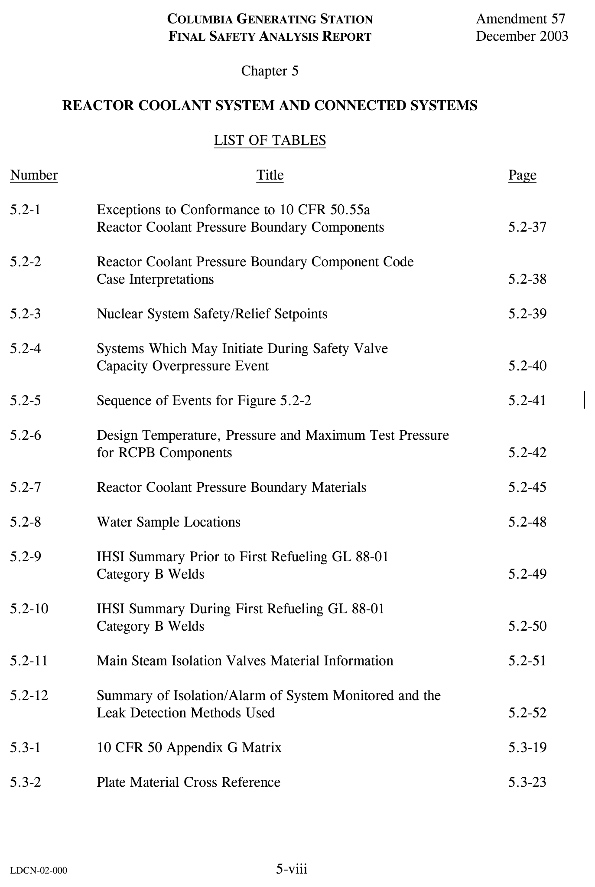

# 05.0 Chapter Front Matter

> Columbia Generating Station FSAR — Chapter 05: Reactor Coolant System and Connected Systems
> Source: `05_chapter-2042-2256.pdf`, PDF pages 1–11 (of 215)
> Amendment 67 compilation (individual pages carry varying amendment dates)

---
<!-- p.1 -->

#### REACTOR COOLANT SYSTEM AND CONNECTED SYSTEMS

TABLE OF CONTENTS (Continued)

Section Page

5.2.3.2 Compatibility with Reactor Coolant................................................ 5.2-16

5.2.3.2.1 Pressurized Water Reactor Chemistry of Reactor Coolant .................. 5.2-16

5.2.3.2.2 Boiling Water Reactor Chemistry of Reactor Coolant ....................... 5.2-16

5.2.3.2.3 Compatibility of Construction Materials with Reactor Coolant............. 5.2-19

##### 5.2.3.2.4 Compatibility of Construction Materials with External Insulation

and Reactor Coolant ................................................................ 5.2-20

#### 5.2.3.3 Fabrication and Processing of Ferritic Materials and Austenitic

Stainless Steels ......................................................................... 5.2-20

### 5.2.4 INSERVICE INSPECTION AND TESTING OF THE REACTOR

COOLANT PRESSURE BOUNDARY............................................. 5.2-21

5.2.4.1 System Boundary Subject to Inspection ........................................... 5.2-21

5.2.4.2 Arrangement of Systems and Components to Provide Accessibility ......... 5.2-22

5.2.4.2.1 Reactor Pressure Vessel ........................................................... 5.2-23

5.2.4.2.2 Piping, Pumps, and Valves ....................................................... 5.2-24

5.2.4.3 Examination Techniques and Procedures ......................................... 5.2-24

5.2.4.3.1 Equipment for Inservice Inspection.............................................. 5.2-24

5.2.4.3.2 Coordination of Inspection Equipment With Access Provisions............ 5.2-25

5.2.4.3.3 Manual Examination ............................................................... 5.2-25

5.2.4.4 Inspection Intervals ................................................................... 5.2-25

5.2.4.5 Examination Categories and Requirements ....................................... 5.2-25

5.2.4.6 Evaluation of Examination Results................................................. 5.2-25

5.2.4.7 System Leakage and Hydrostatic Pressure Tests ................................ 5.2-26

5.2.4.8 Inservice Inspection Commitment .................................................. 5.2-26

#### 5.2.4.9 Augmented Inservice Inspection to Protect Against Postulated Piping

Failures .................................................................................. 5.2-26

#### 5.2.4.10 Augmented Inservice Inspection of Reactor Pressure Vessel Feedwater

Nozzles ................................................................................. 5.2-27

5.2.4.10.1 Preservice Examination .......................................................... 5.2-27

5.2.4.10.2 Inservice Examination ............................................................ 5.2-27

#### 5.2.4.11 Augmented Inservice Inspection for Intergrannular Stress Corrosion

Cracking................................................................................ 5.2-27

5.2.4.12 ASME Section XI Repairs/Replacements........................................ 5.2-27

### 5.2.5 DETECTION OF LEAKAGE THROUGH REACTOR COOLANT

PRESSURE BOUNDARY ............................................................. 5.2-28

5.2.5.1 Leakage Detection Methods ......................................................... 5.2-28

5.2.5.1.1 Detection of Abnormal Leakage Within the Primary Containment ........ 5.2-28

5-ii

<!-- p.2 -->

#### REACTOR COOLANT SYSTEM AND CONNECTED SYSTEMS

TABLE OF CONTENTS (Continued)

Section Page

5.2.5.1.2 Detection of Abnormal Leakage Outside the Primary Containment ....... 5.2-29

5.2.5.2 Leak Detection Devices .............................................................. 5.2-30

5.2.5.3 Indication in the Control Room..................................................... 5.2-31

5.2.5.4 Limits for Reactor Coolant Leakage ............................................... 5.2-32

5.2.5.4.1 Total Leakage Rate ................................................................. 5.2-32

5.2.5.4.2 Normally Expected Leakage Rate................................................ 5.2-32

5.2.5.5 Unidentified Leakage Inside the Drywell ......................................... 5.2-33

5.2.5.5.1 Unidentified Leakage Rate ........................................................ 5.2-33

5.2.5.5.2 Length of Through-Wall Flaw.................................................... 5.2-33

##### 5.2.5.5.3 Criteria to Evaluate the Adequacy and Margin of the Leak

Detection System .................................................................... 5.2-34

5.2.5.6 Safety Interfaces ....................................................................... 5.2-34

5.2.5.7 Testing and Calibration............................................................... 5.2-34

5.2.6 REFERENCES........................................................................... 5.2-34

5.3 REACTOR VESSEL ...................................................................... 5.3-1

5.3.1 REACTOR VESSEL MATERIALS.................................................. 5.3-1

5.3.1.1 Materials Specifications .............................................................. 5.3-1

5.3.1.2 Special Processes Used for Manufacturing and Fabrication ................... 5.3-1

5.3.1.3 Special Methods for Nondestructive Examination............................... 5.3-2

5.3.1.4 Special Controls for Ferritic and Austenitic Stainless Steels................... 5.3-2

5.3.1.5 Fracture Toughness ................................................................... 5.3-2

5.3.1.5.1 Compliance with Code Requirements ........................................... 5.3-2

5.3.1.5.2 Compliance with 10 CFR 50 Appendix G...................................... 5.3-2

5.3.1.5.2.1 Intent of Proposed Approach................................................... 5.3-3

5.3.1.5.2.2 Operating Limits Based on Fracture Toughness ............................ 5.3-3

5.3.1.5.2.3 Temperature Limits for Boltup................................................. 5.3-5

5.3.1.5.2.4 Inservice Inspection Hydrostatic or Leak Pressure Tests.................. 5.3-5

5.3.1.5.2.5 Operating Limits During Heatup, Cooldown, and Core Operation ..... 5.3-6

5.3.1.5.2.6 Reactor Vessel Annealing....................................................... 5.3-6

5.3.1.6 Material Surveillance ................................................................. 5.3-6

##### 5.3.1.6.1 Positioning of Surveillance Capsules and Method of Attachment for

Plant-Specific Surveillance Program ............................................ 5.3-7

5.3.1.6.2 Time and Number of Dosimetry Measurements............................... 5.3-7

5.3.1.6.3 Neutron Flux and Fluence Calculations......................................... 5.3-8

5.3.1.7 Reactor Vessel Fasteners............................................................. 5.3-8

#### LDCN-02-046, 04-033

5-iii

<!-- p.3 -->

#### REACTOR COOLANT SYSTEM AND CONNECTED SYSTEMS

TABLE OF CONTENTS (Continued)

Section Page

5.3.2 PRESSURE-TEMPERATURE LIMITS............................................. 5.3-9

5.3.2.1 Limit Curves ........................................................................... 5.3-9

5.3.2.2 Operating Procedures................................................................. 5.3-9

5.3.3 REACTOR VESSEL INTEGRITY................................................... 5.3-9

5.3.3.1 Design ................................................................................... 5.3-10

5.3.3.1.1 Description........................................................................... 5.3-10

5.3.3.1.1.1 Reactor Vessel .................................................................... 5.3-10

5.3.3.1.1.2 Shroud Support ................................................................... 5.3-10

5.3.3.1.1.3 Protection of Closure Studs..................................................... 5.3-10

5.3.3.1.2 Safety Design Bases ................................................................ 5.3-11

5.3.3.1.3 Power Generation Design Basis .................................................. 5.3-11

5.3.3.1.4 Reactor Vessel Design Data ...................................................... 5.3-11

5.3.3.1.4.1 Vessel Support .................................................................... 5.3-12

5.3.3.1.4.2 Control Rod Drive Housings................................................... 5.3-12

5.3.3.1.4.2.1 Control Rod Drive Return Line ............................................. 5.3-12

5.3.3.1.4.3 In-Core Neutron Flux Monitor Housings .................................... 5.3-12

5.3.3.1.4.4 Reactor Vessel Insulation ....................................................... 5.3-12

5.3.3.1.4.5 Reactor Vessel Nozzles ......................................................... 5.3-12

5.3.3.1.4.6 Materials and Inspection ........................................................ 5.3-14

5.3.3.1.4.7 Reactor Vessel Schematic (BWR) ............................................. 5.3-14

5.3.3.2 Materials of Construction ............................................................ 5.3-14

5.3.3.3 Fabrication Methods .................................................................. 5.3-15

5.3.3.4 Inspection Requirements ............................................................. 5.3-15

5.3.3.5 Shipment and Installation ............................................................ 5.3-15

5.3.3.6 Operating Conditions ................................................................. 5.3-16

5.3.3.7 Inservice Surveillance ................................................................ 5.3-16

5.3.4 REFERENCES........................................................................... 5.3-17

5.4 COMPONENT AND SUBSYSTEM DESIGN ....................................... 5.4-1

5.4.1 REACTOR RECIRCULATION PUMPS ........................................... 5.4-1

5.4.1.1 Safety Design Bases................................................................... 5.4-1

5.4.1.2 Power Generation Design Bases .................................................... 5.4-1

5.4.1.3 Description ............................................................................. 5.4-1

5.4.1.3.1 Recirculation System Cavitation Consideration ............................... 5.4-5

5.4.1.4 Safety Evaluation...................................................................... 5.4-5

5.4.1.5 Inspection and Testing................................................................ 5.4-6

5-iv

<!-- p.4 -->

#### REACTOR COOLANT SYSTEM AND CONNECTED SYSTEMS

TABLE OF CONTENTS (Continued)

Section Page

5.4.2 STEAM GENERATORS (PWR) ..................................................... 5.4-6

5.4.3 REACTOR COOLANT PIPING...................................................... 5.4-7

5.4.4 MAIN STEAM LINE FLOW RESTRICTORS .................................... 5.4-7

5.4.4.1 Safety Design Bases................................................................... 5.4-7

5.4.4.2 Description ............................................................................. 5.4-7

5.4.4.3 Safety Evaluation...................................................................... 5.4-8

5.4.4.4 Inspection and Testing................................................................ 5.4-8

5.4.5 MAIN STEAM LINE ISOLATION SYSTEM..................................... 5.4-9

5.4.5.1 Safety Design Bases................................................................... 5.4-9

5.4.5.2 Description ............................................................................. 5.4-10

5.4.5.3 Safety Evaluation...................................................................... 5.4-12

5.4.5.4 Inspection and Testing................................................................ 5.4-13

5.4.6 REACTOR CORE ISOLATION COOLING SYSTEM .......................... 5.4-14

5.4.6.1 Design Bases ........................................................................... 5.4-14

5.4.6.2 System Design ......................................................................... 5.4-16

5.4.6.2.1 General ............................................................................... 5.4-16

5.4.6.2.1.1 Description ........................................................................ 5.4-16

5.4.6.2.1.2 Diagrams........................................................................... 5.4-17

5.4.6.2.1.3 Interlocks .......................................................................... 5.4-18

5.4.6.2.2 Equipment and Component Description ........................................ 5.4-19

5.4.6.2.2.1 Design Conditions................................................................ 5.4-19

5.4.6.2.2.2 Design Parameters ............................................................... 5.4-20

5.4.6.2.2.3 Overpressure Protection......................................................... 5.4-25

5.4.6.2.3 Applicable Codes and Classifications ........................................... 5.4-27

5.4.6.2.4 System Reliability Considerations ............................................... 5.4-27

5.4.6.2.5 System Operation ................................................................... 5.4-28

5.4.6.2.5.1 Automatic Operation............................................................. 5.4-28

5.4.6.2.5.2 Test Loop Operation............................................................. 5.4-29

5.4.6.2.5.3 Steam Condensing (Hot Standby) Operation ................................ 5.4-29

5.4.6.2.5.4 Manual Actions ................................................................... 5.4-30

5.4.6.2.5.5 Reactor Core Isolation Cooling Discharge Line Fill System ............. 5.4-30

5.4.6.3 Performance Evaluation.............................................................. 5.4-30

5.4.6.4 Preoperational Testing................................................................ 5.4-30

5.4.6.5 Safety Interfaces ....................................................................... 5.4-30

#### LDCN-00-056, 01-009, 01-025

5-v

<!-- p.5 -->

#### REACTOR COOLANT SYSTEM AND CONNECTED SYSTEMS

TABLE OF CONTENTS (Continued)

Section Page

5.4.7 RESIDUAL HEAT REMOVAL SYSTEM ......................................... 5.4-30

5.4.7.1 Design Bases ........................................................................... 5.4-30

5.4.7.1.1 Functional Design Basis ........................................................... 5.4-31

##### 5.4.7.1.2 Design Basis for Isolation of Residual Heat Removal System from

Reactor Coolant System........................................................... 5.4-33

5.4.7.1.3 Design Basis for Pressure Relief Capacity ..................................... 5.4-33

5.4.7.1.4 Design Basis With Respect to General Design Criterion 5 .................. 5.4-36

5.4.7.1.5 Design Basis for Reliability and Operability ................................... 5.4-36

5.4.7.1.6 Design Basis for Protection from Physical Damage .......................... 5.4-37

5.4.7.2 Systems Design ........................................................................ 5.4-37

5.4.7.2.1 System Diagrams ................................................................... 5.4-37

5.4.7.2.2 Equipment and Component Description ........................................ 5.4-38

5.4.7.2.3 Controls and Instrumentation ..................................................... 5.4-40

5.4.7.2.4 Applicable Codes and Classifications ........................................... 5.4-40

5.4.7.2.5 Reliability Considerations ......................................................... 5.4-41

5.4.7.2.6 Manual Action....................................................................... 5.4-41

5.4.7.3 Performance Evaluation.............................................................. 5.4-41

5.4.7.3.1 Shutdown Cooling With All Components Available.......................... 5.4-42

5.4.7.3.2 Shutdown Cooling With Most Limiting Failure ............................... 5.4-42

5.4.7.4 Preoperational Testing................................................................ 5.4-42

5.4.8 REACTOR WATER CLEANUP SYSTEM ........................................ 5.4-43

5.4.8.1 Design Bases ........................................................................... 5.4-43

5.4.8.1.1 Safety Design Bases ................................................................ 5.4-43

5.4.8.1.2 Power Generation Design Bases ................................................. 5.4-43

5.4.8.2 System Description.................................................................... 5.4-44

5.4.8.3 System Evaluation..................................................................... 5.4-45

5.4.8.4 Demineralizer Resins ................................................................. 5.4-46

5.4.8.5 Reactor Water Cleanup Water Chemistry......................................... 5.4-46

5.4.8.5.1 Analytical Methods ................................................................. 5.4-46

5.4.8.5.2 Relationship of Filter-Demineralizer Condition to Water Chemistry...... 5.4-46

5.4.9 MAIN STEAM LINES AND FEEDWATER PIPING ........................... 5.4-47

5.4.9.1 Safety Design Bases................................................................... 5.4-47

5.4.9.2 Power Generation Design Bases .................................................... 5.4-47

5.4.9.3 Description ............................................................................. 5.4-47

5.4.9.4 Safety Evaluation...................................................................... 5.4-48

5.4.9.5 Inspection and Testing................................................................ 5.4-48

5-vi

<!-- p.6 -->

#### REACTOR COOLANT SYSTEM AND CONNECTED SYSTEMS

TABLE OF CONTENTS (Continued)

Section Page

5.4.10 PRESSURIZER......................................................................... 5.4-48

5.4.11 PRESSURIZER RELIEF DISCHARGE SYSTEM .............................. 5.4-48

5.4.12 VALVES................................................................................. 5.4-48

5.4.12.1 Safety Design Bases ................................................................. 5.4-48

5.4.12.2 Description............................................................................ 5.4-48

5.4.12.3 Safety Evaluation .................................................................... 5.4-49

5.4.12.4 Inspection and Testing .............................................................. 5.4-49

5.4.13 SAFETY AND RELIEF VALVES ................................................. 5.4-50

5.4.13.1 Safety Design Bases ................................................................. 5.4-50

5.4.13.2 Description............................................................................ 5.4-50

5.4.13.3 Safety Evaluation .................................................................... 5.4-50

5.4.13.4 Inspection and Testing .............................................................. 5.4-50

5.4.14 COMPONENT AND PIPING SUPPORTS ....................................... 5.4-50

5.4.14.1 Safety Design Bases ................................................................. 5.4-51

5.4.14.2 Description............................................................................ 5.4-51

5.4.14.3 Inspection and Testing .............................................................. 5.4-51

5.4.15 HIGH-PRESSURE CORE SPRAY SYSTEM .................................... 5.4-52

5.4.16 LOW-PRESSURE CORE SPRAY SYSTEM ..................................... 5.4-52

5.4.17 STANDBY LIQUID CONTROL SYSTEM....................................... 5.4-52

5.4.18 REFERENCES ......................................................................... 5.4-52

#### LDCN-01-009, 01-025

5-vii

<!-- p.7 -->

*figure on PDF page 7*

<!-- labels/text on this figure page -->
COLUMBIA GENERATING STATION
Amendment 57
FINAL SAFETY ANALYSIS REPORT
December 2003
REACTOR COOLANT SYSTEM AND CONNECTED SYSTEMS
LIST OF TABLES
Number Title Page
5.2-1 Exceptions to Conformance to 10 CFR 50.55a Reactor Coolant Pressure Boundary Components 5.2-37
5.2-2 Reactor Coolant Pressure Boundary Component Code Case Interpretations 5.2-38
5.2-3 Nuclear System Safety/Relief Setpoints 5.2-39
5.2-4 Systems Which May Initiate During Safety Valve Capacity Overpressure Event 5.2-40
5.2-5 Sequence of Events for Figure 5.2-2 5.2-41
5.2-6 Design Temperature, Pressure and Maximum Test Pressure for RCPB Components 5.2-42
5.2-7 Reactor Coolant Pressure Boundary Materials 5.2-45
5.2-8 Water Sample Locations 5.2-48
5.2-9 IHSI Summary Prior to First Refueling GL 88-01 Category B Welds 5.2-49
5.2-10 IHSI Summary During First Refueling GL 88-01 Category B Welds 5.2-50
5.2-11 Main Steam Isolation Valves Material Information 5.2-51
5.2-12 Summary of Isolation/Alarm of System Monitored and the Leak Detection Methods Used 5.2-52
5.3-1 10 CFR 50 Appendix G Matrix 5.3-19
5.3-2 Plate Material Cross Reference 5.3-23
LDCN-02-000
5-viii

<!-- p.8 -->

#### REACTOR COOLANT SYSTEM AND CONNECTED SYSTEMS

LIST OF TABLES (Continued)

Number Title Page

5.3-3 Weld Material Cross Reference .............................................. 5.3-24

5.3-4 Plate Material.................................................................... 5.3-25

5.3-5 Weld Material ................................................................... 5.3-26

5.3-6 Vessel Beltline Plate............................................................ 5.3-29

5.3-7 Vessel Beltline Weld Material Chemistry .................................. 5.3-30

5.3-8 10 CFR 50 Appendix H Matrix .............................................. 5.3-31

5.3-9 Reactor Vessel Beltline Minimum Wall Thickness and Diameter...... 5.3-33

5.4-1 Reactor Coolant Pressure Boundary Pump and Valve

Description....................................................................... 5.4-53

5.4-2 Reactor Recirculation System Design Characteristics .................... 5.4-58

5.4-3 Operating Experience of Ingersoll-Rand Emergency Core

Cooling Systems Pumps........................................................ 5.4-60

5.4-4 Operating Experience of Similar Ingersoll-Rand Pumps for

BWR Projects Under Review.................................................. 5.4-61

5.4-5 Reactor Water Cleanup System............................................... 5.4-62

5.4-6 Safety and Relief Valve for Piping Systems Connected

to the Reactor Coolant Pressure Boundary ................................. 5.4-63

5-ix

<!-- p.9 -->

#### REACTOR COOLANT SYSTEM AND CONNECTED SYSTEMS
#### LIST OF FIGURES
Number Title

5.1-1 Rated Operating Conditions of the Boiling Water Reactor

5.1-2 Coolant Volumes of the Boiling Water Reactor

5.2-1 Simulated Safety Relief Valve Spring Mode Characteristic Used for Capacity Sizing Analysis

5.2-2 MSIV Closure with Flux Scram - Nominal Safety Setpoint +3% 6 SRV Out-of-Service

5.2-3 Peak Vessel Pressure Versus Safety Valve Capacity

5.2-4 Time Response of Pressure Vessel For Pressurization Events

5.2-5 Nuclear Boiler System (P&ID)

5.2-6 Safety/Relief Valve Schematic Elevation

5.2-7 Safety/Relief Valve and Steam Line Schematic

5.2-8 Schematic of Safety Valve With Auxiliary Actuating Device

5.2-9 Safety Valve Lift Versus Time Characteristics

5.2-10 Conductance Versus pH as a Function of Chloride Concentration of Aqueous Solution at 25°C

5.2-11 Deleted

5.3-1 Pressure Temperature Limits – Curves A through C (Sheets 1 through 3)

5.3-2 Vessel Beltline Plate and Weld Seam Identification

5.3-3 Nominal Reactor Vessel Water Level Trip and Alarm Elevation Settings

5-x

<!-- p.10 -->
November 1998

#### REACTOR COOLANT SYSTEM AND CONNECTED SYSTEMS
LIST OF FIGURES (Continued)

Number Title

5.3-4 Bracket for Holding Surveillance Capsule

5.3-5 Reactor Vessel

5.3-6 Feedwater Nozzle

5.3-7 Feedwater Sparger

5.4-1 Recirculation System Evaluation and Isometric

5.4-2 RRC Pump Dynamic Head - Flow Curve

5.4-3 RRC Pump Speed - Torque Curve

5.4-4 Recirculation Pump Head, NPSH, Flow and Efficiency Curves

5.4-5 Operating Principle of Jet Pump

5.4-6 Core Flooding Capability of Recirculation System

5.4-7 Reactor Recirculation System - P&ID (Sheets 1 and 2)

5.4-8 Main Steam Line Flow Restrictor Location

5.4-9 Main Steam Line Isolation Valve

5.4-10 Reactor Core Isolation Cooling Pump Performance Curve (Constant Flow)

5.4-11 Reactor Core Isolation Cooling System - P&ID

5.4-12 Reactor Core Isolation Cooling System Process Diagram

5.4-13 Reactor Core Isolation Cooling Pump Performance Curve

5.4-14 Typical Strainer

5-xi

<!-- p.11 -->

#### REACTOR COOLANT SYSTEM AND CONNECTED SYSTEMS
LIST OF FIGURES (Continued)

Number Title

5.4-15 Residual Heat Removal System - P&ID (Sheets 1 through 4)

5.4-16 Residual Heat Removal System Process Diagram

5.4-17 Residual Heat Removal System Process Data (Sheets 1 and 2)

5.4-18 Residual Heat Removal (LPCI) Pump Characteristics (S/N 0473-111) P-2A

5.4-19 Residual Heat Removal (LPCI) Pump Characteristics (S/N 0801MP004399-1)
P-2B

5.4-20 Residual Heat Removal (LPCI) Pump Characteristics (S/N 0473112) P-2C

5.4-21 Vessel Coolant Temperature Versus Time (Two Heat Exchangers Available)

5.4-22 Reactor Water Cleanup System - P&ID (Sheets 1 through 3)

5.4-23 Reactor Water Cleanup System Process Diagram (Sheets 1 and 2)

5.4-24 Filter/Demineralization System P&ID

5.4-25 Vessel Coolant Temperature Versus Time (One Heat Exchanger Available)

5-xii

