# 1.2 GENERAL PLANT DESCRIPTION

> Columbia Generating Station FSAR — Chapter 01: Introduction and General Description of Plant
> Source: `01_chapter-54-401.pdf`, PDF pages 11–70 (of 348)
> Amendment 67 compilation (individual pages carry varying amendment dates)

---
<!-- p.11 -->
November 1998

### 1.2 GENERAL PLANT DESCRIPTION
#### 1.2.1 PRINCIPAL DESIGN CRITERIA
The principal design criteria are presented in two ways. First, they are classified as either a power generation function or a safety function. Second, they are grouped according to system. Although the distinctions between power generation or safety functions are not always clear-cut and are sometimes overlapping, the functional classification facilitates safety analyses, while the grouping by system facilitates the understanding of both the system function and design.

##### 1.2.1.1 General Design Criteria
###### 1.2.1.1.1 Power Generation Design Criteria
a. The plant was designed so that it can be fabricated, erected, and operated to produce electric power in a safe and reliable manner. Plant design conforms to applicable codes and regulations as stipulated in Table 1.2-1;

b. The plant is designed to produce steam for direct use in a turbine-generator unit;

c. Heat removal systems are provided with sufficient capacity and operational adequacy to remove heat generated in the reactor core for the full range of normal operational conditions and abnormal operational transients;

d. Backup heat removal systems are provided to remove decay heat generated in the core under circumstances wherein the normal operational heat removal systems become inoperative. The capacity of such systems is adequate to prevent fuel cladding damage;

e. The fuel cladding, in conjunction with other plant systems is designed to retain integrity throughout the range of normal operational conditions and abnormal operational transients;

f. The fuel cladding can accommodate, without loss of integrity, the pressures generated by fission gases released from fuel material throughout the design life of fuel;

g. Control equipment has been provided to allow the reactor to respond automatically to minor load changes, major load changes, and abnormal operational transients;

h. Reactor power level can be manually controlled;

<!-- p.12 -->
November 1998

i. Control of the reactor is possible from a single location;

j. Reactor controls, including alarms, are arranged to allow the operator to rapidly assess the condition of the reactor system and locate system malfunctions; and

k. Interlocks or other automatic equipment are provided as backup to procedural controls to avoid conditions requiring the functioning of nuclear safety systems or engineered safety features (ESF).

###### 1.2.1.1.2 Safety Design Criteria
a. The plant design conforms to applicable codes and regulations;

b. The plant is designed, fabricated, erected, and will be operated in such a way that the release of radioactive materials to the environment is limited to the limits and guideline values of applicable federal regulations pertaining to the release of radioactive materials for normal operations and abnormal transients and accidents;

c. The reactor core is designed so its nuclear characteristics do not contribute to a divergent power transient;

d. The reactor is designed so there is no tendency for divergent oscillation of any operating characteristic, considering the interaction of the reactor with other appropriate plant systems;

e. Gaseous, liquid, and solid waste disposal facilities are designed so the discharge and offsite shipment of radioactive effluents can be made in accordance with applicable regulations;

f. The design provides means by which plant operators can be informed when limits on the release of radioactive material are approached;

g. Sufficient indications are provided to allow determination that the reactor is operating within the envelope of conditions considered by plant safety analysis;

h. Radiation shielding is provided and access control patterns have been established to allow a properly trained operating staff to control radiation doses within the limits of applicable regulations in any mode of normal plant operations;

<!-- p.13 -->
November 1998

i. Those portions of the nuclear system that form part of the reactor coolant pressure boundary (RCPB) are designed to retain integrity as a radioactive material barrier following abnormal operational transients and accidents;

j. Nuclear safety systems and ESF act to ensure that no damage to the RCPB results from internal pressures caused by abnormal operational transients and accidents;

k. Where positive, precise action is immediately required in response to abnormal operational transients and accidents, such action is automatic and requires no decision or manipulation of controls by plant operations personnel;

l. Essential safety actions can be carried out by equipment of sufficient redundance and independence such that no single failure of active components can prevent the required actions. For systems or components to which IEEE-279 (Criteria for Protection Systems for Nuclear Power Generating Stations) and/or IEEE-308
(Criteria for Class 1E Electrical systems for Nuclear Power Generating Stations)
applies, single failures of both active and passive electrical components were considered in recognition of the higher anticipated failure rates of passive electrical components relative to passive mechanical components;

m. Provisions have been made for control of active components of nuclear safety systems and ESF from the control room;

n. Nuclear safety systems and ESF are designed to permit demonstration of their functional performance requirements;

o. The design of nuclear safety systems and ESF includes allowances for natural environmental disturbances such as earthquakes, tornadoes, floods, and storms at the site;

p. Standby electrical power sources have sufficient capacity to power all nuclear safety systems and ESF requiring electrical power;

q. Standby electrical power sources are provided to allow prompt reactor shutdown and removal of decay heat under circumstances where offsite power sources are not available;

r. Features of the plant that are essential to the mitigation of accident consequences are designed, fabricated, and erected to quality standards that reflect the importance of the safety action to be performed;

<!-- p.14 -->
s. A primary containment has been provided that completely encloses the reactor system, drywell, and suppression pool. The primary containment employs the pressure suppression concept;

t. The primary containment is designed to retain integrity as a radioactive material barrier during and following accidents that release radioactive material into the primary containment volume;

u. It is possible to test primary containment integrity and leaktightness at periodic intervals;

v. A secondary containment has been provided that completely encloses both the primary containment and fuel storage areas. The secondary containment includes the standby gas treatment (SGT) system for controlling release of radioactive materials leaking from the primary containment in the event of an accident and also has the capability for filtering radioactive materials directly from the primary containment atmosphere during shutdown conditions;

w. The secondary containment has been designed to act as a radioactive material barrier, if required, when the primary containment is open for expected operational purposes;

x. The primary containment and secondary containment, in conjunction with other ESF, limit radiological effects of accidents resulting in the release of radioactive material to the containment vessel to significantly less than 10 CFR 50.67 limits;

y. Provisions have been made for removing energy from within the containment vessel as necessary to maintain the integrity of the containment system following accidents that release energy to the primary containment;

z. Piping that penetrates the primary containment structure and could serve as a path for the uncontrolled release of radioactive material to the environs is automatically isolated whenever such uncontrolled radioactive material release is threatened. Such isolation shall be effected in time to limit radiological effects to less than specified acceptable limits;

aa. Emergency core cooling systems (ECCS) are provided to limit fuel cladding temperature to temperatures below the onset of fragmentation in the event of a loss-of-coolant accident (LOCA);

bb. The ECCS provide for continuity of core cooling over the complete range of postulated break sizes in the RCPB and are redundant;

<!-- p.15 -->
cc. Operation of the ECCS is initiated automatically when required, regardless of the availability of offsite power supplies and the normal generating system of the plant;

dd. The control room has been shielded against radiation and provided with a high efficiency filtration system so that continued occupancy under accident conditions is possible;

ee. In the event that the control room becomes inaccessible, it is possible to bring the reactor from power range operation to cold shutdown conditions by utilizing the local controls and equipment that are available outside the control room on the remote shutdown control panels;

ff. Backup reactor shutdown capability has been provided independent of normal reactivity control provisions. This backup system has the capability to shut down the reactor from any normal operating condition and subsequently to maintain the shutdown condition; and

gg. Fuel handling and storage facilities are designed to prevent inadvertent criticality and to maintain adequate shielding and cooling of spent fuel.
Provision is made for maintaining the cleanliness of spent fuel cooling and shielding water.

##### 1.2.1.2 System Criteria
The principal design criteria for particular systems are listed in the following subsections.

###### 1.2.1.2.1 Nuclear System Criteria
a. The fuel cladding is designed to retain integrity as a radioactive material barrier throughout the design power range. The fuel cladding is designed to accommodate, without loss of integrity, the pressures generated by the fission gases released from the fuel material throughout the design life of the fuel;

b. The fuel cladding, in conjunction with other plant systems, is designed to retain integrity throughout any abnormal operational transient;

c. Those portions of the nuclear system that form part of the RCPB are designed to retain integrity as a radioactive material barrier following abnormal operational transients and accidents;

<!-- p.16 -->
d. Heat removal systems are provided in sufficient capacity and operational adequacy to remove heat generated in the reactor for the full range of normal operational conditions from plant shutdown to design power and for any abnormal operational transient. The capacity of such systems is adequate to prevent fuel cladding damage;

e. Heat removal systems are provided to remove decay heat generated in the core under circumstances wherein the normal operational heat removal systems become inoperative. The capacity of such systems is adequate to prevent fuel cladding damage. The reactor is capable of being automatically shut down in sufficient time to permit decay heat removal systems to become effective following loss of operation of normal heat removal systems;

f. The reactor core and reactivity control system is designed so that control rod action is capable of bringing the core subcritical and maintaining it so, even with the rod of highest reactivity worth fully withdrawn and unavailable for insertion;

g. The reactor core is designed so that its nuclear characteristics do not contribute to a divergent power transient; and

h. The nuclear system is designed so there is no tendency for divergent oscillation of any operating characteristic, considering the interaction of the nuclear system with other appropriate plant systems.

###### 1.2.1.2.2 Power Conversion System Criteria
Components of the power conversion system have been designed to perform the following basic objectives.

a. Produce electrical power from the steam exiting from the reactor, condense the steam into water, and return the water to the reactor as heated feedwater, with a major portion of its gaseous and particulate impurities removed; and

b. Ensure that any fission products or radioactivity associated with the steam and condensate during normal operation are safely contained inside the system or are released under controlled conditions in accordance with waste disposal procedures.

###### 1.2.1.2.3 Electrical Power Systems Criteria
Sufficient offsite and onsite standby sources of electrical power are provided to attain prompt shutdown and continued maintenance of the plant in a safe condition under all credible

<!-- p.17 -->
circumstances. The power sources are adequate to accomplish all required engineered safety feature functions under postulated design basis accident conditions.

###### 1.2.1.2.4 Radwaste System Criteria
a. The gaseous and liquid radwaste systems are designed to limit the release of radioactive effluents from the plant during normal operation within those limits specified in 10 CFR 20 and 10 CFR 50, Appendix I;

b. The solid radwaste disposal system is designed so that during normal operation offsite shipments will be in accordance with applicable regulations, including

## 10 CFR 20, 10 CFR 71, and 49 CFR 171 through 10 CFR 179, as appropriate;
and

c. The design of the systems provide means by which plant operations personnel are alerted whenever operational limits on the release of radioactive material are approached.

###### 1.2.1.2.5 Auxiliary Systems Criteria
a. Fuel handling and storage facilities are designed to prevent criticality and to maintain adequate shielding and cooling for spent fuel. Provision is made for maintaining the cleanliness of spent fuel cooling and shielding water;

b. Other auxiliary systems, such as standby service water (SW), high pressure core spray (HPCS) SW, fire protection (FP), heating and ventilating, communications, and lighting systems, are designed to function during normal, abnormal, and/or accident conditions; and

c. Auxiliary systems that are not required to effect safe shutdown of the reactor or maintain it in a safe shutdown condition are designed such that failure of these systems shall not prevent the essential auxiliary systems from performing their design functions.

###### 1.2.1.2.6 Shielding and Access Control Criteria
a. Radiation shielding is provided and access control patterns are established to allow a properly trained operating staff to control radiation doses within the limits of published regulations in any normal mode of plant operation; and

b. The control room is shielded against radiation and has a high efficiency filtration system, so that occupancy is possible under accident conditions and

<!-- p.18 -->
TEDE doses are less than those set by Criterion 19 of 10 CFR Part 50, Appendix A and 10 CFR 50.67.

###### 1.2.1.2.7 Nuclear Safety Systems and ESF Criteria
Principal design criteria for nuclear safety systems and ESF correspond to criteria j through q, aa through cc, and ee through ff in Section 1.2.1.1.2.

###### 1.2.1.2.8 Process Control Systems Criteria
The principal design criteria for the process control systems are listed for the nuclear system, the power conversion system, and the electrical power system:

a. Nuclear System Process Control Criteria

1. Control equipment is provided to allow the reactor to respond automatically to load changes within design limits.

2. It is possible to manually control the reactor power level.

3. Control of the reactor is possible from a central location.

4. Nuclear systems process controls and alarms are arranged to allow the operator to rapidly assess the condition of the nuclear system and to locate process system malfunctions.

5. Interlocks or other automatic equipment are provided as a backup to procedural controls to avoid conditions requiring the actuation of nuclear safety systems or ESF.

b. Power Conversion System Process Control Criteria

1. Control equipment is provided to control the reactor pressure throughout its operating range.

2. The turbine is able to respond automatically to minor changes in load.

3. Control equipment in the feedwater system maintains the water level in the reactor vessel at the optimum level required by steam separators.

4. Control of the power conversion equipment is possible from a central location.

<!-- p.19 -->
5. Interlocks or other automatic equipment are provided in addition to procedural controls to avoid conditions requiring the actuation of ESF.

c. Electrical Power System Process Control Criteria

1. The redundant portions of the Class 1E power systems are designed with either division of the system being adequate to safely shut down the unit.

2. Protective relaying is used to detect and isolate faulted equipment from the system with a minimum of disturbance in the event of equipment failure.

3. Primary and secondary undervoltage relays are located on the 4.16-kV Class 1E equipment buses to isolate these buses from the normal auxiliary power system in the event of Class 1E bus under voltage and to initiate starting of the standby power system diesel generators.

4. Standby power diesel generators’ start is initiated by control relays. The generators are also loaded by a sequenced control system to meet the existing emergency condition.

5. All electrically operated breakers can be operated from the main control room.

6. Metering for essential generators, transformers, and circuits is monitored in the main control room.

##### 1.2.1.3 Plant Design Criteria
The plant design criteria are based on general design criteria given in Appendix A of 10 CFR Part 50. Conformance to these criteria is discussed in Section 3.1. The classification of structures, components, and systems is discussed in Section 3.2.

The principal regulations are codes that are used extensively in plant design are highlighted in Table 1.2-1. Note that the codes listed may not be applicable in their entirety. The many codes and regulations applicable to individual systems or structures are discussed throughout the FSAR.

The plant shielding and radiation zone classification can be found in Table 1.2-2. Chapter 12 provides further details.

<!-- p.20 -->
#### 1.2.2 PLANT DESCRIPTION
##### 1.2.2.1 Site Characteristics
###### 1.2.2.1.1 Site Location and Size
Columbia Generating Station (CGS) is located in the southeast area of the Department of Energy (DOE) Hanford Reservation in Benton County, Washington. The site is approximately 3 miles west of the Columbia River at River Mile 352, approximately 12 miles north of the City of Richland, 18 miles northwest of Pasco, and 21 miles northwest of Kennewick. The site is approximately square shaped with a corridor extending to the makeup water pump house located on the Columbia River as shown in Figure 1.2-1. The CGS site encompasses an area of approximately 1089 acres.

###### 1.2.2.1.2 Description of Site Environs
###### 1.2.2.1.2.1 Site Land. See Section 2.1 for site land description.

###### 1.2.2.1.2.2 Population. See Section 2.1 for population description.

1.2.2.1.2.3 Land Use. Natural physical characteristics of the site which make it well-suited for operation of the plant include: favorable geographical, geological, and seismological characteristics; adequate water supply; ideal climatological characteristics; and remoteness from population centers or areas of special ecological concern. The site area had served as a nuclear industrial center since 1943 when it was selected by the federal government as the location for construction of one of the world’s first nuclear production reactors. Since 1943, nine plutonium production reactors and a number of test reactors have been constructed and operated at the Hanford Site.

1.2.2.1.2.4 Meteorology. The climate around CGS is basically continental with a wide range of annual temperatures. See Section 2.3 for additional information.

1.2.2.1.2.5 Hydrology. The Columbia River is the major surface water resource of the region. The river also forms a potential discharge boundary for the aquifer. The surface soils at Hanford are sufficiently permeable to take in water from precipitation and industrial discharges. See Section 2.4 for additional information.

1.2.2.1.2.6 Geology. The Hanford site lies in the east central part of the Pasco Basin, a structural and topographic depression in the Columbia Plateau. The region is underlain by three major geologic units: (a) Tertiary basaltic lavas and intercalated sediments of the Columbia River Group at the base, (b) Plio-Pleistocene sediments of the Ringold Formation, and (c) the Pasco (glaciofluvial) gravels and associated sediments of late Pleistocene age at the surface. See Section 2.5 for additional information.

<!-- p.21 -->
1.2.2.1.2.7 Seismology. The CGS site is situated in an area characterized by low seismicity and widely scattered epicenters. See Section 2.5 for additional information.

###### 1.2.2.1.3 Design Basis Depending on Site Environs
a. Offgas System

An offgas (OG) system consisting of hold-up piping, charcoal adsorbers, and an elevated release is provided for the controlled release of gaseous effluent to the atmosphere. Gaseous releases will be as low as reasonably achievable
(ALARA) in accordance with 10 CFR Part 50, Appendix I, and less than

## 10 CFR Part 20 limits;
b. Liquid Waste Effluents

Liquid waste will be processed and recycled, and releases of excess inventory will be such that concentrations at the point of discharge will be as low as reasonably achievable in accordance with 10 CFR Part 50, Appendix I, and less than 10 CFR Part 20 limits;

c. Wind Loading and Seismic Design

The structures and components whose failure might cause a design basis accident or result in an uncontrolled release of radioactive fission products will be designed to resist wind loads of tornado velocity and earthquake ground motions which are significantly higher than those expected to occur at the site during the service life of the plant; and

d. Flooding

The maximum assumed flood elevation for design purposes is the sum total of the elevations of water due to the following effects:

1. Breach of any of the upstream dams due to seismic forces,
2. High flow in the Columbia River, and
3. Wind and wave action.

<!-- p.22 -->
##### 1.2.2.2 General Arrangement of Structures and Equipment
The principal structures located on the plant site are the following:

a. Reactor building - the building that houses the major portion of the nuclear steam supply system (NSSS), the drywell, suppression pool, primary containment, new and spent fuel pools, refueling equipment, and ECCS;

b. Radwaste and control building - the building that houses the liquid and solids radwaste systems, components of the OG system, and the main control room;

c. Turbine building - the building that houses the power conversion equipment;

d. Diesel generator building - the building that houses the standby diesel generators, diesel fuel oil (DO) storage tanks, and associated controls and instrumentation;

e. Circulating water pump house (Wind River Building) - a structure housing the main circulating water (CW) pumps, plant service water (TSW) pumps, and FP pumps;

f. Standby service water pump houses - structures that house the redundant standby SW pumps and the HPCS SW pump;

g. Spray ponds - cooling ponds provided as the ultimate heat sink (UHS);

h. Makeup water pump house - a structure that houses the cooling tower makeup
(TMU) water pumps;

i. General service building (Yakima Building) - a structure that houses the potable water (PWC) storage tank, demineralized water (DW) storage tank, offices for plant administration, lunch room, and machine shop;

j. Transformer yard;

k. Condensate storage tanks (CSTs);

l. Cooling towers; and

m. Plant Engineering Center (Deschutes Building).

<!-- p.23 -->
The arrangement of these structures on the plant site is shown in Figure 1.2-1. The arrangement of the equipment inside the main buildings is shown in Figures 1.2-2 through
1.2-24.

##### 1.2.2.3 Symbols Used on Engineering Drawings
Figure 1.2-25 defines General Electric’s (GE) piping and instrumentation symbols, and Figure 1.2-26 through 1.2-28 shows Burns and Roe piping and instrumentation symbols.
Figure 1.2-29 defines the logic symbols used on NSSS functional control diagrams.

##### 1.2.2.4 Nuclear System
The nuclear system includes a direct-cycle, forced-circulation, GE boiling water reactor
(BWR) that produces steam for direct use in the steam turbine. A heat balance showing the major parameters of the nuclear system for the rated power conditions is shown in Figure 10.1-1.

###### 1.2.2.4.1 Reactor Core and Control Rods
Fuel for the reactor core consists of slightly enriched uranium dioxide pellets sealed in Zircaloy-2 tubes. These tubes (or fuel rods) are assembled into individual fuel assemblies.
Gross control of the core is achieved by movable, bottom-entry control rods. The control rods are cruciform in shape and are dispersed throughout the lattice of fuel assemblies. The control rods are positioned by individual control rod drives (CRDs).

Each fuel assembly has several fuel rods with gadolinia (Gd2O3) mixed in solid solution with UO2. The Gd2O3 is a burnable poison which diminishes the reactivity of the fresh fuel. It is depleted as the fuel reaches the end of its first cycle.

A fuel design specific limit on cladding strain is the design criterion used for fuel rod cladding failure. The peak linear heat generation for steady-state operation is well below the fuel damage limit even late in life. Experience has shown that the control rods are not susceptible to distortion and have an average life expectancy many times the residence time of the fuel loading.

###### 1.2.2.4.2 Reactor Vessel and Internals
The reactor vessel contains the core and supporting structures; the steam separators and dryers;
the jet pumps; the control rod guide tubes; the distribution lines for reactor feedwater (RFW), HPCS, low-pressure core spray (LPCS), and standby liquid control (SLC); the in-core instrumentation; and other components. The main connections to the vessel include main steam (MS) lines, reactor recirculation (RRC) lines, RFW lines, CRD and in-core nuclear instrument housings, HPCS and LPCS lines, residual heat removal (RHR) lines, SLC line,

<!-- p.24 -->
core differential pressure line, jet pump pressure-sensing lines, and water level instrumentation.

The reactor vessel is designed and fabricated in accordance with applicable codes for a pressure of 1250 psig. The nominal operating pressure in the steam space above the separators is 1035 psia. The vessel is fabricated of low-alloy steel and is clad internally with stainless steel (except for the top head, and certain nozzles and nozzle weld zones which are unclad).

The reactor core is cooled by demineralized water that enters the lower portion of the core and boils as it flows upward around the fuel rods. The steam leaving the core is dried by steam separators and dryers located in the upper portion of the reactor vessel. The steam is then directed to the turbine through the MS lines. Each MS line is provided with two MS isolation valves (MSIVs) in series, one on each side of the primary containment barrier.

###### 1.2.2.4.3 Reactor Recirculation System
The RRC system pumps reactor coolant through the core. This is accomplished by two recirculation loops external to the reactor vessel but inside the primary containment. Each external loop contains a mechanical pump, two motor-operated maintenance valves, and one flow control valve which is mechanically blocked full open. The two motor-operated valves are used as pump suction and pump discharge shutoff valves. The flow control valves are no longer used to control reactor power level and therefore are kept in a mechanically blocked full open position.

The internal portion of the loop consists of the jet pumps, which contain no moving parts. The jet pumps provide a continuous internal circulation path for the major portion of the core coolant flow. The jet pumps are located in the annular region between the core shroud and the vessel’s inner wall. Any recirculation line break would still allow core flooding to approximately two-thirds of the core height, the level of the inlet of the jet pumps.

###### 1.2.2.4.4 Residual Heat Removal System
The RHR system is a system of pumps, heat exchangers, and piping that fulfills the following functions:

a. Removes decay and sensible heat during and after plant shutdown;

b. Injects water into the reactor vessel, following a LOCA, rapidly enough to reflood the core and maintain fuel cladding below the fragmentation temperature independent of other core cooling systems. This is further discussed in Section 1.2.2.5.8;

<!-- p.25 -->
c. Removes heat from the primary containment, following a LOCA, to limit the increase in primary containment pressure. This is accomplished by cooling and recirculating the suppression pool water (containment cooling) and by spraying the drywell and suppression pool air spaces (containment spray) with suppression pool water; and

d. Removes some of the airborne radioactivity from the primary containment atmosphere following a LOCA by spraying the drywell.

###### 1.2.2.4.5 Reactor Water Cleanup System
The reactor water cleanup (RWCU) system recirculates a portion of reactor coolant through a filter-demineralizer to remove particulate and dissolved impurities from the reactor system under controlled conditions. It also removes excess coolant from the reactor system under controlled conditions.

###### 1.2.2.4.6 Nuclear Leak Detection System
The nuclear leak detection (LD) system consists of temperature, pressure, flow, and fissionproduct sensors with associated instrumentation and alarms. This system detects and annunciates leakage in the following systems:

a. Main steam system, b. Reactor water cleanup system, c. Residual heat removal system, d. Reactor core isolation cooling (RCIC) system, e. Reactor feedwater system, f. High-pressure core spray system, g. Low-pressure core spray system, h. Reactor recirculation system, and i. Reactor pressure vessel (RPV) flange.

Small leaks generally are detected by temperature and pressure changes, fill-up rate of drain sumps, and fission-product concentration inside the primary containment. Large leaks are also detected by changes in reactor water level and changes in flow rates in process lines.

##### 1.2.2.5 Nuclear Safety Systems and Engineered Safety Features
###### 1.2.2.5.1 Reactor Protection System
The reactor protection system (RPS) initiates a rapid, automatic shutdown (scram) of the reactor, if required, to prevent fuel cladding damage or nuclear system process barrier damage following abnormal operational transients. The RPS overrides all operator actions and process

<!-- p.26 -->
controls and is based on a fail-safe design philosophy that allows appropriate protective action even if a single component failure occurs.

###### 1.2.2.5.2 Neutron Monitoring System
Although not all portions of the neutron monitoring system qualify as a nuclear safety system, those that provide high neutron flux signals to the RPS do. The intermediate range monitors
(IRMs) and average power range monitors (APRMs), which monitor neutron flux via in-core detectors, signal the RPS to scram in time to prevent excessive fuel cladding damage as a result of overpower transients. The APRM modules also provide inputs to the thermal power monitors (TPMs) which approximate fuel thermal conditions and also provide scram signals to the RPS.

###### 1.2.2.5.3 Control Rod Drive System
When a scram is initiated by the RPS, the CRD system inserts the negative reactivity necessary to shut down the reactor. Each control rod is controlled individually by a hydraulic control unit. When a scram signal is received, high-pressure water stored in an accumulator in the hydraulic control unit forces its control rod into the core.

###### 1.2.2.5.4 Control Rod Drive Housing Supports
Control rod drive housing supports are located underneath the reactor vessel near the control rod housings. The supports limit the travel of a control rod in the event that a control rod housing is ruptured. The supports prevent a nuclear excursion as a result of a housing failure and thus protect the fuel barrier.

###### 1.2.2.5.5 Control Rod Velocity Limiter
A control rod velocity limiter is attached to each control rod to limit the velocity at which a control rod can fall out of the core should it become detached from its CRD. This action limits the rate of reactivity insertion resulting from a rod drop accident. The limiters contain no moving parts.

###### 1.2.2.5.6 Pressure Relief System (Nuclear System)
A pressure relief system consisting of safety/relief valves (SRVs) mounted on the MS lines is provided to prevent excessive pressure inside the nuclear system following either abnormal operational transients or accidents.

<!-- p.27 -->
###### 1.2.2.5.7 Reactor Core Isolation Cooling System
The RCIC system provides makeup water to the reactor vessel when the vessel is isolated.
The RCIC system uses a steam-driven turbine-pump unit and operates automatically in time and with sufficient coolant flow to maintain adequate water level in the reactor vessel. RCIC is not an engineered safety feature. It is included here, however, because of its similar functions.

###### 1.2.2.5.8 Emergency Core Cooling System
Four ECCS are provided to maintain fuel cladding below fragmentation temperature in the event of a breach in the RCPB that results in a loss of reactor coolant. The systems are

a. High-pressure core spray system, b. Automatic depressurization system (ADS), c. Low-pressure core spray system, and d. Low-pressure coolant injection (LPCI), an operating mode of the RHR system.

1.2.2.5.8.1 High-Pressure Core Spray System. The HPCS system provides and maintains an adequate coolant inventory inside the reactor vessel to maintain fuel cladding temperatures below the fragmentation temperature in the event of breaks in the RCPB. The system is initiated by either high pressure in the drywell or low water level in the vessel. It operates independently of all other systems over the entire range of pressure differences from greater than normal operating pressure to zero. The HPCS cooling decreases vessel pressure to enable the low pressure cooling systems to function. The HPCS system is powered by its own diesel generator if auxiliary power is not available, and the system may also be used as a backup for the RCIC system.

1.2.2.5.8.2 Automatic Depressurization System. The ADS rapidly reduces reactor vessel pressure during a LOCA situation in which the HPCS system fails to maintain the reactor vessel water level. The depressurization provided by the system enables the low pressure ECCS to deliver cooling water to the reactor vessel. The ADS uses some of the relief valves that are part of the nuclear system pressure relief system. The automatic relief valves are arranged to open when conditions indicate that the HPCS system is not delivering sufficient cooling water to the reactor vessel to maintain the water level above a preselected value. The ADS will not be activated unless either the LPCS or LPCI pumps are operating. This is to ensure that adequate coolant will be available to maintain reactor water level after the depressurization.

1.2.2.5.8.3 Low-Pressure Core Spray System. The LPCS system consists of one independent pump and the valves and piping to deliver cooling water to a spray sparger over the core. The system is actuated by conditions indicating that a breach exists in the RCPB but water is delivered to the core only after reactor vessel pressure is reduced. This system provides the capability to cool the fuel by spraying water into each fuel channel. The LPCS loop

<!-- p.28 -->
functioning in conjunction with either the ADS or HPCS can maintain the fuel cladding below the prescribed temperature following a LOCA.

1.2.2.5.8.4 Low-Pressure Coolant Injection. The LPCI is an operating mode of the RHR system, but is discussed here because the LPCI mode acts as an engineered safety feature in conjunction with other ECCS. The LPCI uses the pump loops of the RHR to inject cooling water directly into the pressure vessel. The LPCI is actuated by conditions indicating a breach in the RCPB, but water is delivered to the core only after reactor vessel pressure is reduced.
The LPCI operation provides the capability of core reflooding, following a LOCA, in time to maintain the fuel cladding below the prescribed temperature limit.

###### 1.2.2.5.9 Primary Containment
1.2.2.5.9.1 Functional Design. The primary containment is part of the overall containment system which provides the capability to reliably limit the release of radioactive materials to the environs subsequent to the occurrence of the postulated LOCA so that offsite doses will be below the limits stated in 10 CFR Part 50.67. Its design employs an over-and-under, steel pressure vessel which houses the reactor vessel, the RRC loops, and other branch connections of the reactor primary system. The pressure suppression system consists of a drywell, a pressure suppression chamber which stores a large volume of water, a connecting submerged vent system between the drywell and water pool, isolation valves, containment cooling system, and other service equipment. In the event of a RCPB piping failure within the drywell, reactor water and steam would be released into the drywell air space. The resulting increase of drywell pressure would then force a mixture of air, steam, and water through the vents into the pool of water which is stored in the suppression pool, resulting in a rapid pressure reduction in the drywell. Air which is transferred to the suppression chamber, pressurizes the suppression chamber, and is subsequently vented back to the drywell.

1.2.2.5.9.2 Drywell Cooling System. The drywell cooling system is based on recirculating cooling water through the drywell air-handling units to maintain the required ambient temperature. Air is distributed through ductwork and/or up through the annular space between the reactor vessel insulation and the sacrificial shield wall. Air is distributed to areas requiring cooling, such as the RRC motors, the CRD area, and the bellows area. Return air is ducted back to the operating units. The arrangement simplifies the design, operation, and air distribution balance of the system.

Reactor building closed cooling water (RCC) is supplied to the air handling units to dissipate absorbed heat only under normal and loss of power conditions.

The drywell cooling system is not required for safe shutdown, but it is designed with redundant equipment and powered from essential buses to ensure continuous operation to satisfy the power-generation design objective.

<!-- p.29 -->
The drywell cooling system is designed to operate during offsite power loss. Control switches for operating the equipment are located in the main control room.

1.2.2.5.9.3 Suppression Pool Cooling. The containment cooling subsystem of the RHR system is placed in operation to limit the temperature of the water in the suppression pool following a design basis LOCA, to control the pool temperature during normal operation of the SRVs and the RCIC system, and to reduce the pool temperature following an isolation transient. In the containment cooling mode of operation, the RHR main system pumps take suction from the suppression pool and pump the water through the RHR heat exchangers where cooling takes place by transferring heat to SW. The fluid is then discharged back to the suppression pool or the RPV.

1.2.2.5.9.4 Containment Spray. The redundant containment spray cooling subsystems of the RHR system provide containment cooling for postaccident conditions. Water pumped through the RHR heat exchangers can be diverted to spray headers in the drywell and above the suppression pool. The spray removes energy from the drywell atmosphere by condensing the water vapor. The drywell spray also removes particulate fission product from the drywell atmosphere. Approximately 5% of this flow can be directed to the suppression chamber to cool the gas above the water surface.

1.2.2.5.9.5 Containment Atmosphere Control. In the event of a LOCA, hydrogen and oxygen will be generated in the reactor. Containment atmosphere control is provided by inerted containment, containment atmosphere mixing, and hydrogen and oxygen monitoring in a post-LOCA event.

###### 1.2.2.5.10 Primary Containment and Reactor Vessel Isolation System
The primary containment and reactor vessel isolation system includes sensors, trip channels, control switches and remotely activated valve closing mechanisms associated with the valves, which, when closed, effect isolation of the primary containment or reactor vessel or both.

The purpose of the system is to provide timely protection against the onset and consequences of accidents involving the gross release of radioactive materials from the fuel and the nuclear system process barrier. The primary containment and reactor vessel isolation control system initiates automatic isolation of the RCPB and the primary containment vessel whenever monitored variables exceed preselected operation limits.

All pipelines that both penetrate the primary containment and offer a potential release path for radioactive material are provided with redundant isolation capabilities.

<!-- p.30 -->
###### 1.2.2.5.11 Main Steam Line Isolation Valves
Although all pipelines that both penetrate the containment and offer a potential release path for radioactive material are provided with redundant isolation capabilities, the main steam lines, because of their large size and large mass flow rates, are given special isolation consideration.
Automatic MSIVs are provided in each MS line. Each is powered by both air pressure and spring force. These valves fulfill the following objectives:

a. Prevent excessive damage to the fuel barrier by limiting the loss of reactor coolant from the reactor vessel resulting from either a major leak from the steam piping outside the primary containment or from a malfunction of the pressure control system resulting in excessive steam flow from the reactor vessel,

b. Limit the release of radioactive materials (i.e., iodine spiking) by isolating the RCPB in case of a rapid depressurization of RPV and resulting release of radioactive materials from the fuel to the reactor cooling water and steam, and

c. Limit the release of radioactive materials by closing the primary containment barrier in case of a major leak from the nuclear system inside the primary containment.

###### 1.2.2.5.12 Main Steam Line Flow Restrictors
A venturi-type flow restrictor is installed in each MS line. These devices limit the loss-of-coolant from the reactor vessel before the MSIVs are closed in case of an MS line break outside the primary containment.

###### 1.2.2.5.13 Main Steam Line Radiation Monitoring System
The main steam line radiation monitoring system consists of four gamma radiation monitors located externally to the main steam lines just outside the containment. The monitors are designed to detect a gross release of fission products from the fuel. On detection of high radiation, the trip signals generated by the monitors are used to initiate a closure to the reactor water sample valves, mechanical vacuum pump trip, the mechanical vacuum pump lines isolation, and alarms.

###### 1.2.2.5.14 Standby Service Water and High-Pressure Core Spray Service Water Systems
The SW system consists of two completely redundant systems. Each system consists of a pump and piping supplying the associated RHR system heat exchanger, standby diesel generator, essential heating, ventilating, and air conditioning (HVAC) coolers, RHR pump seal coolers, SW motor bearing coolers, and sample coolers with safety grade cooling water from

<!-- p.31 -->
the UHS spray ponds. The Division I SW system also provides cooling water to the LPCS motor bearing cooler.

Cooling water is supplied during a postulated LOCA to the RHR heat exchangers to remove heat when the containment cooling mode of the RHR system is placed in operation. During normal operation, SW is also supplied to the RHR heat exchangers for the shutdown function of the RHR system.

The SW is available to the shell side of the fuel pool cooling and clean up (FPC) system heat exchangers in the event that the normal cooling water supply from the RCC system becomes unavailable.

The HPCS SW system shares spray pond A with the SW system. The pump supplies cooling water to the HPCS diesel generator and the essential HVAC coolers for the HPCS diesel generator and HPCS pump areas.

Cooling water is supplied to all diesel generator cooling systems whenever the diesel generators are started.

###### 1.2.2.5.15 Reactor Building - Secondary Containment
The reactor building completely surrounds the primary containment. The building provides secondary containment when the primary containment is closed and in service. The reactor building also houses refueling and reactor servicing equipment, new and spent fuel storage facilities, and other reactor safety and auxiliary systems. Secondary containment is not required during movement of irradiated fuel assemblies or core alterations.

The design of the reactor building includes provisions for seismic load resistance and low infiltration and exfiltration rates. The building consists of poured-in-place, reinforced-concrete exterior walls up to the refueling floor. Above this level, the building structure is steel frame with insulated metal siding with sealed joints. Access to the building is through interlocked double doors.

###### 1.2.2.5.16 Reactor Building Ventilation Exhaust Radiation Monitoring System
The reactor building ventilation exhaust radiation monitoring system consists of a number of radiation monitors arranged to monitor the activity level of the ventilation exhaust from the reactor building and primary containment. Upon detection of high radiation, the reactor building is automatically isolated and the SGT system is started.

<!-- p.32 -->
###### 1.2.2.5.17 Standby Gas Treatment System
The SGT system consists of two identical filter trains. Each filter train consists of a filter unit, two fans, ductwork, and associated valves.

Either filter train may be considered as an installed spare with the other train capable of passing the required amount of air. Either train alone is capable of exchanging the total reactor building volume once in a 24 hr period.

Each filter unit contains electric heaters, a prefilter, high-efficiency particulate filters (water and fire resistant), an iodine filter (high ignition temperature), and instrumentation to measure temperature and flow.

The system maintains a slightly negative internal building pressure and can process all gaseous effluent prior to its discharge from the reactor building.

All equipment is connected to the essential buses and is started either automatically or manually from the main control room.

###### 1.2.2.5.18 Standby Alternating Current Power Supply System
The standby ac power supply system consists of two diesel generator sets, switchgear, and associated distribution system equipment and auxiliaries.

These diesel generator sets are associated with redundant (Divisions 1 and 2) separation divisions; each diesel generator set serves a particular division. The capacity of each diesel generator set is sufficient to attain shutdown under both normal and LOCA conditions, in the event that both the offsite and the normal auxiliary power sources are unavailable to supply plant loads. Since load distribution is such that redundant auxiliary systems are separated by division, safe shutdown can be achieved with only one of the two diesel generators operating.

The standby ac power supply system diesel generators and associated equipment are designed to Class 1E standards and are located within Seismic Category I structures. Equipment of each division is separated so that failure of any component of one division will not jeopardize proper functioning of the other division.

Although it is not a part of the standby ac power supply system, another independent diesel generator unit supplies ac power exclusively to the HPCS system (see Section 1.2.2.5.8.1) in the event that both the offsite and the normal auxiliary power sources are unavailable to supply plant loads.

The HPCS diesel generator may also be cross connected to either Division 1 or to Division 2 as described in Section 8.3.1.1.7.2.1.

<!-- p.33 -->
###### 1.2.2.5.19 Direct Current Power Supply System
The dc power supply system consists of station batteries, battery chargers, distribution equipment, and related auxiliaries.

The dc system furnishes power at three voltage levels: 250 V, 125 V, and +24 V. The 250-V and 125-V subsystems supply power to both Class 1E and non-Class 1E loads; the 24-V subsystem supplies power for the startup range and power range neutron monitoring systems.

The primary power sources for the system are the dc output station battery chargers. Station batteries associated with each charger operate in a “float-charge” configuration to ensure maintaining the batteries in a fully charged condition. In the event of loss of charger dc output, the station batteries furnish a secondary source of dc supply.

The 125-V and +24-V dc power supply subsystems are each divided into electrically and physically independent divisions. Each battery, together with its independent battery charger, is associated with one of the segregated divisions. The batteries and their associated chargers are located in separate rooms.

The ampere-hour capacity of each battery is capable of supplying all essential loads for a minimum of 2 hr in the event that dc output from the battery chargers is lost.

###### 1.2.2.5.20 Standby Liquid Control System
Although not intended to provide prompt reactor shutdown, as the control rods are, the Standby Liquid Control (SLC) system provides a redundant, independent, and alternate method to bring the nuclear fission reaction to subcriticality and to maintain a subcritical condition as the reactor cools. The system makes possible an orderly and safe shutdown in the event that not enough control rods can be inserted into the reactor core to accomplish shutdown in the normal manner. The system is sized to counteract the positive reactivity effect from rated power to the cold, clean shutdown condition.

The SLC system is also used to maintain the suppression pool pH greater than 7.0 following a LOCA to minimize re-evolving gaseous iodine fission products to the containment atmosphere.

###### 1.2.2.5.21 Safe Shutdown from Outside the Main Control Room
In the event that the control room becomes inaccessible, the reactor can be brought from power range operation to cold shutdown conditions by the use of local controls and equipment that are available outside the control room.

<!-- p.34 -->
###### 1.2.2.5.22 Main Steam Line Isolation Valve Leakage Control System (Deactivated)
The main steam line isolation valve leakage control (MSLC) system was designed to minimize the fission products which could bypass the SGT system after a LOCA. The MSLC system is not credited for accident mitigation and is no longer needed; MSLC is administratively de-activated. Connections between MSLC and other systems are physically isolated, MSLC components are de-energized, closed, or otherwise taken out of service.

###### 1.2.2.5.23 Fuel Pool Cooling and Cleanup System
The FPC system provides for the removal of decay heat from stored spent fuel and maintains specified water temperature, purity, clarity, and level. This prevents boiling of the pool water and controls the buildup of excessive radioactive materials in the cooling water, thereby minimizing potential radiation exposure to plant personnel. The cooling portion of the system is designed to Seismic Category I requirements and may be isolated from the Seismic Category II cleanup portion of the system by automatic Seismic Category I isolation valves which actuate on low-fuel pool water level. Normally the RCC system furnishes non-safety grade cooling water to the FPC system. If required, safety grade cooling and makeup water is available to the FPC system from the SW system.

###### 1.2.2.5.24 Hardened Containment Vent (HCV) System
The HCV system is designed to meet the requirements of NRC Order EA-13-109. The primary design objective of the HCV system is to provide sufficient venting capacity from the wetwell to prevent an overpressure failure of the containment by maintaining containment pressure below the primary containment design pressure and the primary containment pressure limit (PCPL). The HCV system is designed to operate during severe accident conditions which include the elevated temperatures, pressures, radiation levels, and concentrations of combustible gases such as hydrogen and carbon monoxide associated with accidents involving extensive core damage, including accidents involving a breach of the reactor vessel by molten core debris.

The HCV system is designed as a stand-alone system that can function without the support of other plant systems. Other than the two containment isolation valves, the remaining components such as the dedicated nitrogen and battery systems and control room and remote operating stations or instrumentation are not discussed or assumed in mitigating any Chapter 15 accidents.

##### 1.2.2.6 Power Conversion System
###### 1.2.2.6.1 Turbine Generator
The turbine is an 1800 rpm, tandem-compound (one double-flow high-pressure turbine and three double-flow low-pressure turbines), reheat unit with an electrohydraulic governor for

<!-- p.35 -->
normal operation. The turbine generator is provided with an emergency trip system for turbine overspeed. The rating of the turbine generator is 1,173,046 kW.

The generator is a direct-driven, three-phase, 60 Hz, 25,000 V, 1800 rpm, hydrogen inner-cooled, synchronous generator rated at 1,230 MVA at 0.975 power factor, 0.58 short circuit ratio at a maximum hydrogen pressure of 78 psig.

###### 1.2.2.6.2 Main Steam System
The MS system consists of four 26-in. diameter lines (which expand to 30-in. diameter lines inside the turbine building) extending from the outermost MSIVs to the main turbine stop valves. The use of four main steam lines permits testing of the turbine stop valves and MSIVs I during station operation with only a minimum of load reduction. The design pressure and temperature of the MS system from the outermost MSIV to the turbine stop valve is 1250 psig I at 575°F. Other features include drains and parts of the turbine bypass system.

###### 1.2.2.6.3 Main Condenser
The main condenser is a triple-pressure, single-pass, deaerating-type condenser with a divided water box. The condenser includes provisions for accepting up to 25% of the MS flow at design conditions from the turbine bypass system and serves as a heat sink for several other flows, such as exhaust steam from the RFW pump turbines, cascading heater drains, feedwater heater shell operating vents, and condensate pump suction vents.

###### 1.2.2.6.4 Main Condenser Evacuation System
The main condenser evacuation system is designed to remove noncondensable gases from the condenser, including air inleakage and dissociation products originating in the reactor, and to continuously exhaust them to the gaseous radwaste system during operation. The system consists of two 100%-capacity, twin-element first stage and single-element second stage steam jet air ejector units complete with intercondensers for normal plant operation and a mechanical vacuum pump for use during startup. Discharge from the vacuum pumps during startup is routed to the elevated release point.

###### 1.2.2.6.5 Turbine Gland Seal System
The turbine gland seal system is designed to provide a means of preventing air leakage into or radioactive steam leakage out of the turbine. The system consists of two 100% steam evaporators, steam seal pressure regulators, steam seal header, gland seal steam condenser and blowers, and the associated piping, valves, and instrumentation.

<!-- p.36 -->
###### 1.2.2.6.6 Steam Bypass System and Pressure Control System
A turbine bypass system is provided which passes steam directly to the main condenser under the control of the pressure regulator. Steam is bypassed to the condenser whenever the reactor steaming rate exceeds the load permitted to pass to the turbine generator. The capacity of the turbine bypass system is 25% of the turbine design steam flow. The Digital Electro-Hydraulic
(DEH) control system provides main turbine control (governor) valve and bypass valve position demands so as to maintain a nearly constant reactor pressure during normal plant operation.

###### 1.2.2.6.7 Circulating Water System
The CW system provides the condenser with a continuous supply of cooling water. It is a closed system utilizing forced draft cooling towers. Makeup water to the system is provided from TMU pumps located in an intake structure on the Columbia River. The makeup water replaces the water lost by evaporation, drift, and blowdown.

###### 1.2.2.6.8 Condensate and Feedwater System
The condensate and feedwater system pumps condensate from the condenser hotwell to the RPV. Condensate is pumped by three main condensate (COND) pumps through the gland seal steam condenser, the steam jet air ejector condensers, and the offgas condenser. After leaving the offgas condenser, the condensate is pumped through a full-flow condensate filter-demineralizer system. The filter-demineralizer effluent is then pumped by three condensate booster pumps through the five low-pressure heaters. The last low-pressure heater discharges to the suction of the RFW pumps. The discharge from the two turbine-driven RFW pumps passes through the sixth stage of feedwater heating and then flows to the RPV.
Feedwater flow is controlled by varying the speed of the steam-driven turbine.

###### 1.2.2.6.9 Condensate Filter-Demineralizer System
The full-flow condensate filter-demineralizer system with instrumentation and semiautomatic controls is designed to ensure a constant supply of high-quality water to the reactor.

##### 1.2.2.7 Electrical Systems, Instrumentation, and Control
###### 1.2.2.7.1 Electrical Power Systems
The plant consists of a single main generator directly connected to a main power transformer through an isolated phase electrical bus duct. The main power transformer steps up the output of the 25-kV generator to a nominal 500-kV transmission system voltage.

<!-- p.37 -->
The output of the main power transformer is connected to a 500-kV switchyard consisting of circuit breakers, disconnect switches, buses, and associated equipment arranged in a ring bus configuration.

A 230-kV offsite supply is provided to a separate startup auxiliary transformer to supply maximum startup, operating and shutdown load requirements for a normal plant auxiliary loads and for safety loads. In addition, a separate 115-kV offsite supply serves a backup auxiliary transformer with sufficient capacity to provide the power requirements of plant safe shutdown loads.

###### 1.2.2.7.2 Electrical Power Systems Process Control and Instrumentation
Main generator electrical controls are located in the main control room. These include main generator circuit breaker controls, synchronizing equipment, and generator excitation and voltage control equipment. Instrumentation is also provided in the main control room for the main generator connections and equipment. This includes indicating instruments for voltage, current, kW, MVAR, and frequency. Recording instruments are provided for generator MW output and main bus voltage. Kilowatt-hour meters are provided for main generator outputs and for auxiliary power system loads. Instrumentation is provided for monitoring generator and transformer temperatures. Other types of monitoring instrumentation are provided as required to ensure proper operation of equipment. Circuit breaker controls, metering, and indication for the auxiliary power system are also located in the main control room.

High-speed protective relaying equipment is provided for the main generator, main and auxiliary transformers, main buses, transmission lines, and interconnecting cables and bus ducts to provide proper isolation of this equipment in the event of electrical faults. The protective relay system includes breaker failure protection and backup relaying to ensure proper isolation of electrical faults in the event of a failure of the primary protective relaying.

###### 1.2.2.7.3 Nuclear System Process Control and Instrumentation
###### 1.2.2.7.3.1 Reactor Manual Control System. The reactor manual control system (RMCS)
provides the means by which control rods are positioned from the control room for power control. The system operates valves in each CRD hydraulic control unit to change control rod position. Only one control rod can be manipulated at a time. The RMCS includes the logic that restricts control rod movement (rod block) under certain conditions as a backup to procedural controls.

1.2.2.7.3.2 Recirculation Flow Control System. During normal power operation, a variable frequency power supply is used to control flow by varying the RRC pump motor speed.
Adjusting the frequency changes motor speed and the coolant flow-rate through the core, thereby changing the core power level.

<!-- p.38 -->
1.2.2.7.3.3 Neutron Monitoring System. The neutron monitoring system is a system of in-core neutron detectors and out-of-core electronic monitoring equipment. The system provides indication of neutron flux, which can be correlated to thermal power level for the entire range of flux conditions that can exist in the core. The source range monitors (SRM)
and the intermediate range monitors (IRM) provide flux level indications during reactor startup and low power operation. The local power range monitors (LPRM) and average power range monitors (APRM) allow assessment of local and overall flux conditions during power range operation. The traversing in-core probe system (TIP) provides a means to calibrate the individual LPRM sensors. The neutron monitoring system provides inputs to the reactor manual control system to initiate rod blocks if preset flux limits are exceeded, and inputs to the RPS to initiate a scram if other limits are exceeded.

1.2.2.7.3.4 Refueling Interlocks. A system of interlocks that restricts movement of refueling equipment and control rods when the reactor is in the refueling and start-up modes is provided to prevent an inadvertent criticality during refueling operations. The interlocks back up procedural controls that have the same objective. The interlocks affect the refueling platform, refueling platform hoists, fuel grapple, and control rods.

1.2.2.7.3.5 Reactor Vessel Instrumentation. In addition to instrumentation for the nuclear safety systems and ESF, instrumentation is provided to monitor and transmit information that can be used to assess conditions existing inside the reactor vessel and the physical condition of the vessel itself. This instrumentation monitors reactor vessel pressure, water level, coolant temperature, reactor core differential pressure, coolant flow rates, and RPV head inner seal ring leakage.

1.2.2.7.3.6 Process Computer System. An on-line process computer is provided to monitor and log process variables and to make certain analytical computations. The rod worth minimizer function of the computer prevents rod withdrawal under low power conditions if the rod to be withdrawn is not in accordance with a preplanned pattern. The effect of the rod block is to limit the reactivity worth of the control rods by enforcing adherence to the preplanned rod pattern.

###### 1.2.2.7.4 Power Conversion Systems Process Control and Instrumentation
1.2.2.7.4.1 Digital Electro-Hydraulic Control System. The DEH control system maintains control of the turbine governor valves and turbine bypass valves to allow proper generator and reactor response to system load demand changes while maintaining the nuclear system pressure essentially constant. When the generator is not connected to the grid, the DEH control system maintains turbine-generator speed (frequency) in response to reactor pressure changes by adjusting steam flow to the turbine valves and bypass valves.

<!-- p.39 -->
The turbine generator speed/load controls can initiate rapid closure of the turbine control
(governor) valves and rapid opening of the turbine bypass valves to prevent turbine overspeed on a generator electric load loss.

1.2.2.7.4.2 Feedwater System Control. A three-element controller is used to regulate the feedwater system so that proper water level is maintained in the reactor vessel. The controller uses main steam flow rate, reactor vessel water level, and feedwater flow rate signals. The feedwater control signal is used to control the speed of the steam turbine-driven feedwater pumps. During startup, shutdown, and low plant load conditions, the steam turbine-driven feedwater pumps are run at constant speed, and the feedwater control signal is used to modulate a startup feedwater control valve to maintain proper reactor water level.

##### 1.2.2.8 Radioactive Waste Systems
###### 1.2.2.8.1 Liquid Radwaste System
This system collects, treats, stores, and disposes of all radioactive liquid wastes. These wastes are accumulated directly in radwaste tanks or in sumps at various locations throughout the plant for subsequent transfer to collection tanks in the radwaste facility. Wastes are processed on a batch basis with each batch being processed by such method or methods appropriate for the quality and quantity of materials determined to be present. Processed liquid wastes may be returned to the condensate system or discharged to the circulating water blowdown line to the river. The liquid wastes in the discharge piping are diluted with circulating water blowdown to achieve a concentration at the site boundary which is below the limits of 10 CFR Part 20.

Equipment is selected, arranged, and shielded to permit operation, inspection, and maintenance with minimum personnel exposure. For example, tanks and processing equipment which contain significant radiation sources are located behind shielding, and sumps, pumps, instruments, and valves are located in controlled access rooms or spaces. Processing equipment is selected and designed to require a minimum of maintenance.

Protection against accidental discharge of liquid radioactive waste is provided by design redundancy, instrumentation for detection and alarm of abnormal conditions, and procedural controls.

###### 1.2.2.8.2 Solid Radwaste System
Solid radioactive wastes are collected, processed, and packaged for storage and ultimate burial.
These wastes are generally stored on the site until the short half-lived isotopes have decayed.
Wet solid wastes are collected, dewatered, and solidified in steel containers. Examples of these wastes are filter residue, concentrated wastes, and spent resins. Dry solid wastes such as paper, air filters, rags, and used clothing are compressed and packaged in steel containers.

<!-- p.40 -->
###### 1.2.2.8.3 Gaseous Radwaste System
The purpose of the gaseous radwaste system is to process and control the release of gaseous radioactive wastes to the site environs so that the total radiation exposure to persons outside the controlled area does not exceed the limits of the applicable regulations, 10 CFR 20 and 10 CFR 50, Appendix I, even with some defective fuel rods.

The offgases from the main condenser are the major source of gaseous radioactive waste. The treatment of these gases includes volume reduction through a catalytic hydrogen-oxygen recombiner, water vapor removal through a condenser, decay of short-lived radioisotopes through a holdup line, further condensation, filtration, adsorption of isotopes on activated charcoal beds, further filtration through high efficiency filters, and final release.

Continuous radiation monitors are provided which indicate radioactive release from the reactor and from the charcoal absorbers. The radiation monitors are used to isolate the OG system on high radioactivity to prevent gas of unacceptably high activity from release.

Since clean gland seal steam is used, the offgases from the gland seal steam condenser are not treated prior to release.

The design of the OG system is such that the annual exposure to any offsite person during normal operation from gaseous sources will be ALARA and less than 10 CFR 20.

##### 1.2.2.9 Radiation Monitoring and Control
###### 1.2.2.9.1 Process Radiation Monitoring
Radiation monitors are provided on various lines to monitor either for radioactive materials released to the environs via process liquids and gases or for process system malfunctions. All effluents from the plant which are potentially radioactive are monitored. Several of the effluent monitoring systems record the results prior to discharge as noted on the following list of the major monitoring systems provided.

a. Main steam line radiation monitoring system,

b. Air ejector and offgas radiation monitoring systems (results recorded except for the charcoal bed vault),

c. Liquid radwaste effluent radiation monitoring system,

d. Plant service water and circulating water blowdown radiation monitoring systems,

e. Standby service water radiation monitoring system,

<!-- p.41 -->
f. Reactor building ventilation exhaust plenum radiation monitoring system (results recorded),

g. Reactor building elevated release point radiation monitoring system (results recorded except for particulate/iodine sample),

h. Turbine building ventilation exhaust radiation monitoring system, (results recorded),

i. Radwaste building ventilation exhaust radiation monitoring system (results recorded), and

j. Reactor building closed cooling water monitoring system.

###### 1.2.2.9.2 Area Radiation Monitors
Radiation monitoring devices are provided in key areas throughout the plant buildings to ensure that plant personnel will not be inadvertently exposed to high radiation doses.

###### 1.2.2.9.3 Site Radiological Environmental Monitoring
A comprehensive radiation surveillance program was initiated in the spring of 1978 to measure radiation levels in the environs surrounding the plant. The program is designed to measure radiation exposure or radioisotope levels in the environment.

The details of this monitoring program are given in the Offsite Dose Calculation Manual
(ODCM).

###### 1.2.2.9.4 Liquid Radwaste System Control
Liquid wastes to be discharged are handled on a batch basis with protection against accidental discharge provided by procedural controls. Instrumentation with alarms to detect abnormal concentration of the radwaste is provided, including automatic closure of discharge valves isolating the system from the environment.

###### 1.2.2.9.5 Solid Radwaste System Control
The solid radwaste system collects, treats, and stores solid radioactive wastes for offsite shipment. Wastes are handled on a batch basis. Radiation levels of the various batches are monitored by the operator.

###### 1.2.2.9.6 Gaseous Radwaste System Control
Gaseous radwastes are discharged through a reactor building elevated release point. Radiation levels of the release are continuously monitored and recorded. Isolation of the main condenser

<!-- p.42 -->
offgas is automatically initiated prior to release should the activity of the offgas exceed discharge limits.

##### 1.2.2.10 Shielding
The shielding in the plant is designed to minimize exposure of plant personnel to radiation.
The radiation levels during operation or shutdown conditions have been considered in determining the shielding requirements.

##### 1.2.2.11 Fuel Handling and Storage Systems
###### 1.2.2.11.1 New and Spent Fuel Storage
New and spent fuel storage racks are designed to prevent inadvertent criticality and load buckling. Sufficient coolant and shielding are maintained to prevent overheating and excessive personnel exposure, respectively. The design of the fuel pool provides for corrosion resistance, adherence to Seismic Category I requirements, and prevention of Keff from exceeding 0.95 under dry or flooded conditions.

###### 1.2.2.11.2 Fuel Handling System
The fuel handling equipment includes a fuel inspection stand, fuel preparation machine, a 125-ton crane, a refueling platform, a new fuel transfer basket, jib cranes, and other related tools for fuel and reactor servicing.

###### 1.2.2.11.3 Fuel Pool Cooling and Cleanup System
The FPC system removes decay heat from stored spent fuel and maintains specified water temperature, purity, clarity, and level. This prevents fuel pool boiling and buildup of excessive radioactive materials in the cooling water, thereby minimizing possible exposures to plant personnel.

Cooling of spent fuel is accomplished by the Seismic Category I cooling system as described in Section 9.1.3. It can be isolated from the Seismic Category II cleanup portion of the system by automatic, redundant, Seismic Category I isolation valves which actuate on low fuel pool water level. If required, safety grade cooling and makeup water from the SW system is available to the system by remote-manual operation of redundant Seismic Category I valves to provide long-term cooling and prevent fuel pool boiloff which might result in unacceptable building environmental conditions.

<!-- p.43 -->
##### 1.2.2.12 Cooling Water and Auxiliary Systems
###### 1.2.2.12.1 Reactor Building Closed Cooling Water System
The RCC system consists of pumps, heat exchangers, controls, and instrumentation to provide adequate cooling for the reactor auxiliary systems. The system is designed to provide a closed cooling water loop between nonessential systems which are potentially radioactive and the TSW system.

###### 1.2.2.12.2 Plant Service Water System
Normal TSW is supplied from service water pumps located in the circulating water pump house. Two service water pumps are provided. The TSW system is designed to remove heat from various auxiliary equipment located within the plant.

###### 1.2.2.12.3 Ultimate Heat Sink
Two spray ponds that serve as the UHS conservatively have a combined equivalent storage of 30 days, assuming no makeup and maximum evaporation and drift losses. Provisions are made to replenish the sink to allow continued cooling capability beyond the initial 30-day period.

###### 1.2.2.12.4 Demineralized Water Makeup System
The DW makeup system is comprised of the trailer-mounted demineralizers and the DW system.

The DW system is designed to provide demineralized water to the CSTs for plant makeup and demineralized water for other plant operating requirements.

###### 1.2.2.12.5 Potable Water and Sanitary Drain Systems
The plant potable water (PW) system provides water for drinking and sanitary purposes.
Potable water is normally supplied from the tower makeup system (see Section 9.2.3).

The sanitary drain system effluent is directed to a central sanitary waste treatment facility which uses aerated lagoons in series with lined facultative stabilization ponds. The treatment plant, about 2500 ft SE of the CGS reactor, also receives waste from the WNP-1/4, the Plant Support Facility, and the DOE’s 400 Area.

###### 1.2.2.12.6 Process Sampling Systems
The process sampling system provides process information that is required to monitor plant and equipment performance and changes to operating parameters. Representative liquid and

<!-- p.44 -->
gas samples are taken automatically and/or manually during normal plant operation for laboratory or on-line analyses.

###### 1.2.2.12.7 Condensate Supply System
The condensate storage facility provides a source of water for testing and makeup during operation. Two 400,000 gal CSTs are interconnected to simultaneously supply condensate to the main condenser via one header, to the CRD pumps via a second header, and to the RHR, RCIC, and HPCS systems and condensate supply and condensate filter/demineralizer backwash pumps via a third header. The condensate supply pumps deliver condensate to miscellaneous services in the reactor and radwaste buildings.

Condensate is returned to the CSTs from the RCIC, and radwaste systems, from CRD, condensate supply, and condensate filter/demineralizer backwash pump mini-flows, and from the main condensate system (equivalent to excess CRD injection water). Initial fill and makeup is from the DW system.

###### 1.2.2.12.8 Equipment and Floor Drainage Systems
Plant equipment and floor drainage systems handle both radioactive and nonradioactive drains.
Drainage systems which carry radioactive waste are isolated from drainage systems which do not carry radioactive waste.

All drains in the reactor building and radwaste building are considered radioactive. Turbine building drains are divided into radioactive and nonradioactive but all are directed to the radwaste system for processing. Floor and equipment drains in the diesel generator building and service building are routed to the storm water drainage system. The storm water drainage system is normally nonradioactive, however some accumulation of radioactive material
(notably tritium) can occur.

###### 1.2.2.12.9 Compressed Air Systems
The compressed air system consists of the control and service air system and the containment instrument air (CIA) system.

The control air system (CAS) is designed to supply clean, dry, oil-free air to station instrumentation and controls and to the accumulators of the MSIVs located outside the primary containment.

The service air (SA) system is designed to supply clean, oil-free air for station services, such as backwashing demineralizers and filters, hose connections for maintenance throughout the station and breathing air at selected locations.

<!-- p.45 -->
The CIA system is designed to deliver nitrogen or clean, dry, oil-free air for MSIVs, SRV accumulators, and pneumatic operators located inside the primary containment.

###### 1.2.2.12.10 Heating, Ventilating, and Air Conditioning Systems
The HVAC systems are designed to maintain proper air quality for personnel comfort and safety. In addition, the main control room, the critical switchgear area, the cable spreading room HVAC systems, the SW pump room heat removal systems, the reactor building emergency pump and critical electric equipment area cooling systems, and the ventilation system for the standby diesel generators are designed to operate under all station conditions.
The primary containment drywell cooling and ventilation system is designed to operate during normal operation and under most upset conditions except a LOCA. All air distribution systems are designed so that airflow is directed from areas of lesser potential contamination to areas of progressively greater potential contamination.

Three separate and redundant HVAC systems service the main control room, cable spreading room, and critical switchgear areas. SW is used as the cooling medium for each system when the normal cooling water supply is unavailable.

Heating and ventilation for the standby diesel generator rooms is provided continuously for each diesel generator unit. Water cooled air handling units provide additional cooling when the diesel generators operate.

The turbine building is provided with a once-through ventilation system based on the use of evaporative coolers.

Ventilation for the radwaste building is provided by means of a once-through ventilation system with particulates filtered before release to the atmosphere.

The SW pump room heat removal systems consist of two independent and separate fan coil units.

The reactor building emergency pump and critical electric equipment area cooling system consists of 13 air handling units which operate to supply cool air to each of the critical equipment rooms when pumps are started and during abnormal conditions.

The primary containment drywell cooling and ventilation system consists of five fan coil units and nine recirculation fans. During normal operation, a minimum three out of five fan coil units are operating.

Ventilation for the reactor building is provided by a once-through ventilation system based on the use of evaporative coolers. The system incorporates the necessary isolation valves to

<!-- p.46 -->
ensure the necessary secondary containment integrity. A drywell and suppression chamber purge capability is provided as part of this system.

Other HVAC systems provide ventilation to the service building and other miscellaneous areas.

###### 1.2.2.12.11 Fire Protection System
The FP system is designed to provide for the detection and extinguishing of fires.

Manual pull stations and automatic fire detectors are located appropriately throughout the plant and fire alarms are annunciated in the main control room.

The FP system provides a reliable water distribution system for extinguishing fires.
Two motor-driven fire pumps are used for normal service, with a diesel-engine-driven fire pump as a backup. A second diesel-driven fire pump with a separate water supply provides an additional backup. Motor-driven jockey pump is provided to maintain system pressure and to prevent cycling of the main fire pumps.

Automatic suppression systems provide protection to higher hazard areas of the plant including:

 Deluge systems protect the transformers and most other areas containing oil piping and oil storage equipment.

 A low-pressure carbon dioxide (CO2) system is provided for the generator exciter housing.

 A total flooding Halon system is provided for the main control room power generation control complex (PGCC) subfloor.

 Wet pipe sprinklers protect the turbine/generator bearings and other miscellaneous areas.

 Preaction sprinkler systems protect diesel generators, day tank/transfer pump rooms, and areas with high concentrations of electrical cables.

Manual suppression includes:

 Fire hydrants spaced around the yard fire main loop.

 Fire hose stations located throughout the plant.

<!-- p.47 -->
 Portable fire extinguishers of appropriate types are strategically and conspicuously placed throughout the plant.

###### 1.2.2.12.12 Communications Systems
The plant communication systems are designed to provide reliable communication inside and outside the plant and from the plant to local fire protection and law enforcement authorities.
The system utilizes a public address and building wide alarm system, a public telephone system, a private digital telephone system, a sound powered telephone system, a radio communication system, and an automatic transmission telephone link to the Dittmer Control Center of the Bonneville Power Administration (BPA).

###### 1.2.2.12.13 Lighting Systems
The plant lighting systems are normal ac lighting, normal-emergency ac lighting, dc lighting, and battery-pack emergency lighting. Lighting intensities are designed to provide indoor and outdoor illumination consistent with the July 1974 Illumination Engineering Society recommendations, and meet or exceed Occupational Safety and Health Act (OSHA)
requirements.

###### 1.2.2.12.14 Normal Auxiliary Alternating Current Power System
The plant normal auxiliary ac power system consists of two normal auxiliary transformers, the 4.16-kV and 6.9-kV normal auxiliary (non-Class 1E) distribution system, the 480-V auxiliary power distribution system and the 120/208-V non-Class 1E distribution system.

The normal ac auxiliary transformers provide power to all plant auxiliaries and comprise the normal plant ac power source when the main generator is operating. One of the normal auxiliary transformers is a dual secondary type with both secondary windings stepping down the generator voltage to 4.16 kV for supply to 4.16-kV non-Class 1E switchgear buses. The other normal auxiliary transformer steps down the generator voltage to 6.9 kV for supply of 6.9-kV non-Class 1E switchgear buses.

The plant 480-V ac auxiliary power system distributes ac power necessary for normal auxiliary and ESF 480-V plant loads. All non-ESF elements of this distribution system are capable of being supplied from the normal auxiliary power source or from the startup power source via the 4.16 kV-non-Class 1E switchgear. The ESF portions of the 480-V distribution system are supplied via the 4.16-kV Class 1E switchgear, and therefore are capable of being supplied by either the normal, startup, backup, or standby sources.

The 120/208-V non-Class 1E ac power system provides power for non-ESF loads.

<!-- p.48 -->
###### 1.2.2.12.15 Diesel Generator Fuel-Oil Storage and Transfer System
The diesel fuel oil storage and transfer system consists of separate, independent diesel oil supply subsystems serving each of two emergency diesel generators and the HPCS diesel generator. Each full capacity subsystem consists of a fuel oil storage tank, a transfer pump, a day tank, interconnecting piping, strainers and valves, and associated instrumentation and controls.

###### 1.2.2.12.16 Auxiliary Steam System
The auxiliary steam (AS) system normally operates only when the heating steam evaporators are inoperative during plant shutdown. The system then supplies steam to HVAC systems for air and water space heating and for humidification and also to the radwaste system. The system consists of fuel oil storage tank and transfer pumps, auxiliary boiler, blowdown tank, chemical feed tank and metering pump, deaerator and boiler feed pumps, condensate return tank pumps, steam supply and condensate return piping and valves, and associated instruments and controls.

#### 1.2.3 COMPLIANCE WITH NRC REGULATORY GUIDES
The CGS conformance to the NRC regulatory guides is documented in Section 1.8 and in appropriate sections of this FSAR.

<!-- p.49 -->
November 1998

Table 1.2-1

Principal Regulations and Codes Followed in Plant Design

Number Title

## 10 CFR series
Code of Federal Regulations, principally:

## 10 CFR 20
Standards for Protection Against Radiation

## 10 CFR 50
Licensing of Production and Utilization Facilities

## 10 CFR 50, Appendix A General Design Criteria for Nuclear Power Plant Construction
Permits

## 10 CFR 50, Appendix B Quality Assurance Criteria
## 10 CFR 50, Appendix I Numerical Guides for Design Objectives and Limiting
Conditions for Operation to Meet the Criterion "As Low As Is Reasonably Achievable"

## 10 CFR 100
Reactor Site Criteria

#### IEEE-279
IEEE Criteria for Nuclear Power Generating Station Protection Systems

#### IEEE-308
IEEE Criteria for Class IE Electrical Systems for Nuclear Power Generating Stations

#### ASME B&PV
ASME Boiler and Pressure Vessel Code:

Section III Nuclear Components

Section VIII Pressure Vessels

Section XI Inservice Inspection

AEC Press Release Tentative Regulatory Supplementary Criteria for ASME

#### IN-817
Code-Constructed Pressure Vessels

#### ANSI-B31.1.0
ANSI Standard Code for Pressure Piping, Power Piping

NOTE: Additional codes and regulations applying to specific areas of system design are referenced in discussions of individual systems.

<!-- p.50 -->
November 1998

Table 1.2-2

Plant Shielding and Zone Classification

Design Dose Zone Description Rate (mrem/hr)

≤1.0 I Uncontrolled, unlimited access

≤2.5 II Controlled, limited access

III Controlled, occupancy for short periods, normally inaccessible ≤100

IV For very short periods. Secured and controlled entrance.
>100

NOTES:

1. Radiation Zone I areas can be occupied by plant personnel or visitors for unlimited periods.

2. Radiation Zone II areas are areas where whole body dose is not expected to exceed 1.25 rem per calendar quarter.

3. Areas having dose rates in excess of 100 mrem/hr are posted as high radiation areas and access is secured and controlled.

4. Radiation Zone III and IV areas can be entered only after the radiation level is determined and the working time limit is established.

5. Accessible areas have dose rates of less than 100 mrem/hr.

6. Access to all controlled areas is through controlled check points.

7. Controlled and limited access areas are identified by warning signs.

<!-- p.51 -->
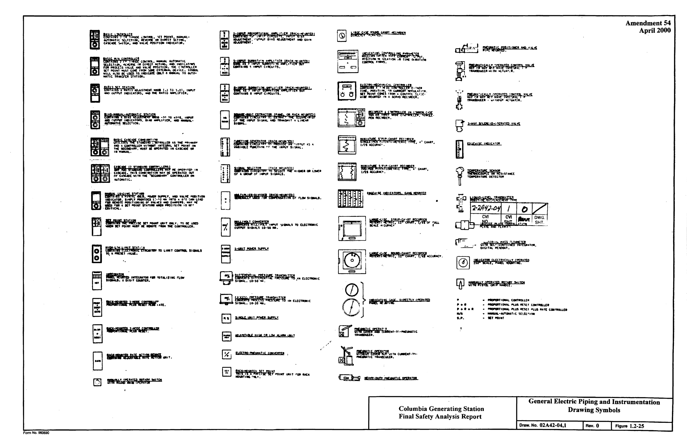

*figure on PDF page 51*

<!-- labels/text on this figure page -->
Amendment 54 April2000
C • AllJ.\' '2lil"t!ffl ~~~ V"',',1
IT. ....
!!ll!llll'!ilJ.(_& ~tr;f f, l nwaoutu-.,, nt "tu4•c• . V 6 I
g J-wu :lrbPli ,p-•"<•mr;p v41,yt
t: f 't I •• A I I
- .....,_a ..... ..,_,..._,,,
• 1·ol I;] ~ 8} lllf'i!Jbill' RIKffiX m,•m ~ " ..
, ....
• • .-allf•-l CGl'TIIOUlA ~
• ~•~~•nu ,c,iu-.1.u ..,. .. ,.
• _,,~ Pl.US llt5ll "I.US llal'I: C:mllllaU.I■
• --·llll'CMIT1t Sl~tc:•1n11
• •t IIOINT R □ EJ
~ C•fl•PYD' MY9eIIC PPP•!PI
El
General Electric Piping and Instrumentation Columbia Generating Station Drawing Symbols Final Safety Analysis Report Draw. No. 02A42-04,l Rev. 0 Figure 1.2-25 Form No. 960690

<!-- p.52 -->
Amendment 67 December 2023 I I I I I I I I

#### I 11 I 10 2
#### OPERATORS
#### MISC. SYMBOLS MISC. SYMBOLS ELECTRICAL SYMBOLS HVAC SYMBOLS
fil-+ e

#### NOTES
#### ~ ----c><J---
GATE (NORMALLY OPEN) □ --- ,,_,,,, ~'"" ~ .,,.,, INSTIWWENT AIRSUPPI.Y (SEE l'IOTE6)
(70-IOOPSIG)
a _l --

1. ALL SOLENOID VALVES SHOWN IN DE-ENERGIZED POSITION. "NE" DENOTES SOL.E"IOIO NORMALLY ............. GATE(NORMALLYCLOSED) INSTRUMENT AIR SUPPLY

rnERGIZEDDURINGPLANTOPERATION,"NO"OENOTESNORMAI_LYDE-ENERCIZED. {SEENOTE6) (REDUCED)
2. D'PIPil IN5IBllMENI PUilGNMKlN IFPN)·

#### REMOTE PANEL OR
••-Ct~-- CLOBE(~RMALLYOPEN) AIR OPl':ltl-.TOR
----c«J---

#### RACKMOUNTEO
INSTRUMENT~ B
(TYPFORVAI.VEORDAAIPER)
+ INSTRUl,l~:ETE N~M~:)~ (EPN • RRC-PS-18,1.) CLOBE(NORMALLYCLOSED)
l,IAINCONfflOLROOt,I SYSTEl,l____.fiRC (PANELORRACKl,IOUNTEO)
(SEENOTE9)
I
3. TYPICAi FOIHPlffNJDESIG~TION(EPN}' __ r::-- "'"" '""""'-'' oa,~ro, FLOOR(AREA)ORAIN 8 ~m______)P'J'-\__ +
(lYPFORVALVEORDAMPER)
TRANSWITTER (SHOWN AS LOCAL}
- ,,_,,,, ~'"" ~ .,,.,,
(SEENOTE9) __/ EOUIPMENTNUr.lBER

(Jt~U~T\NT9)

#### D - -
4 . ITPICN PIPING PESIGN:!JIIPN·
-+-+ PIPE SIZE/ -,W-\\__ UNIQUE LINE NUMBER IOENTIFIER • • 111(:t~ • • HYDRMJLIC PISTON OPERATOR SAMPLEPOINT(SAMPLECONNECTION) E:3---- {LIMIT SWITCH)

#### TOASINPUT
jlL
(TYPFORVAI.Vf.ORDAMPER)

#### COUBINEDBLEECERCHECK
(TRANSIENTOATAACQUISITIONsYSTEl,I)
SYSTElolAND(SUBSYSTEM)J \_(ASR£0'D)fORASr.lESECTIONIIILINES

#### IINDSTOP(ISOLATIONCHECK)
----w
(SEE NOTE 9) (SEE NOTE 10) ~'!"'~;o,R,O,~~S 4 • 900f CLASS """'""""' ~ = ~ g~ ~ = 1~,~~
---0 now ELEMENT

#### METUINGORIFICEPLATE
#### REVERSE CURRENT CHECK
{Sf-lOWN WITH PILOT LIGHTS)
AI..ARMANNUNCtA.TORONLOCALPANEL 5. WHERE THREE WAY VALVE OPERATIONS ARE NOT FINAL, "FIG, A" IS USED (SEE VAI.Vf. 5YM90LS), ••-C:l:J-•• (\ (AL, ALL, AH, AHH AND AI.H USED WHEN

#### SEIMCEISOEFINEO)
l,IOTOR OPERIITOR MIINI..W.LYOPERATEOOAl,IPER WHERE VAI.Vf. OPER.-,TION IS FINO!,L., "F'IG. 8° IS USED. + + MOISTuRESEPARATOR(INLll<IETYPE} ---0
(PARAI.LEL)

#### PLUG OR BALL
6' ~~~ g:=~:~~NJU~~iN~~ ~~~~t~E c~~if~s ~~~~=~~~R,O,llON {NORMALLY OPEN) AI..ARl,IANNUNCtA.TORONREMOTEPANEL ,e_ ~ ~f~~f l~bE~~E~t° ALH USED WHEN ~~ii'~~~a~~~7c;~Jfi~:~~:~~~S~l,IE~~ ~:~LiNT~~AN~El,I

#### PLUGDRBALL
~:0:u~:L:Jp (AI.ARMLOW)
::l;NE(SEENOTEl)
(NORMALLY CLOSED) ---c:l:J---

#### PIPING SPOOL PIECE
#### SOLENOID
7. FOROPERATINGCONDITIONS,DESIGNCONOITIONSANDCOMPLETEPIPINGDESIGNATIONSEETHE
(SHOWN FOR FLOW TEST SECTION)
AI..ARl,IANNUNCtA.TORSHOWINGAI..ARl,ION AUTO. DIAPHR,JJ,!OPER.0.TEDOAI.IPER IMPROPER VALVE POSITION (ONE OR BOTl-1 :~1JNsr;Fctr~~~10Aici~~IO~ ~ ~b:E,g~1Ns~~i6/?1~ fJ~1~c."IPING; SECTION 1 FOR ASl,IE NEEDL£(N0Rlil""-LYOPEN)
(PARAI.LEL) ---c:M:J--- H OESIGMATORSWt.YBEUSED)
'" 8. caJE: GROUP □ESIGNi\TION 1'PPLIES ONLY THROUGH PRlw.RY ROOT VALVES UNLESS SPECIFICALLY

#### NEEDLE(NORMALLYCLOSED)
NOTED OTHERWISE. Me19 DR.O.WING SERIES GIVf.S CODE GROUP FOR INSTRUMENTATION.
9. SYSTEYANDCOr.lPONENT ABBREVIATIONSCANBEfOUNDINTHEr.lASTEREQIJIPI.IENTLIST{r.lEL)
AI..ARl,IANNUNCtA.TOR ORINSECTION1,20fTHEFSMl.
(USED WHEN SERVICE IS NOT DEFINED)
10, THESUBSYSTEM(NOTE 4)DESIC:W.TESAPROCESSFUNCTION, + ,~ 11. ~~L;15J:r-,~1g~ SIGNAi. CODES" FOR PRIM>RY CONTAINMENT ISOLATION VAI.Vf.S SEE F~ AUTO,DIAPHR,l,l,IOPER.O.TEDOAYPER 12.
WHERE ATHREADEOC-"'ISUSED,OUICKDISCONNECTSTYLEFITTINGS(CAMLOCK,CHICAGOOUICK WITH POSITIONER (PARAI..LEL) ~ DISCONNECT,ETC)W.YElEUSEOONAONEFORONEBASIS.
13. TEST POINTS SHOWN ON ALL FLOW DIAGIVIMS DO NOT EXIST IN THE MASTER EQUIPr.lENT LIST
(MEL).THESEARELOCALTESTPOINTSONLY. FLOW CONTROLLER (FLOW REGULATOR)
"IC.llBNO 14, S£E PPW 1.J.29 AND/OR PPM 15.1.18 FOR THE VALVf. LOCKED POSITION. -
---oe'--
----4,,,-i,-.- BUTTERFLY
---{==:]
(POSITION SHOULD BE IDENTIFIED)

#### FLOW METER (POSITIVE DISPLACEMENT)
#### MUFFLER(EXHAUSTSILENCER)
l,IOTOR OPER.O.TED Dlll,IPER SAUNDER'STYPE(W£1R) __ 4,_ __
(PARALLEL) (NORMALLY OPEN) +

#### SAUNOER'STYPE(WEIR)
#### IN LINE FLOW INOICATOR, ELEMEW, ETC. G
(NORMALLY CLOSED)
(S£EMELCOMPONENTLISTINC) ~ lC--r
••-C:l:J-•• ANGLE(~RMALLYOPEN)
+ __ .. -r;. __ ,~i{]
-----@

#### PIPING AND SYSTEM CODE GROUPS ANGLE(NCIRMALLYCLOSED)
ELECTRICl,IOTOR g&l[r'(~~w Vf.RlflCATION
(SHOWNAS2HORSEPOWER)
+ ... -c:fle9
(~~
-"""---""' """""'---' ~ ~ PROGRAMMABLE LOGIC C~T:OL~R~ ASl,IEBOILERANDPRESSUREVESSELCOOESECTIONIIICLASSI.
ASMEBOILERANDPRESSUREV£.SSELCOOESECTIONIIICI.ASS2, * INDICATIONTHATITEl,IISFURNISHEO ASl,IEBOILERANDPRESSUREVf.SSELCOOESECTIONIIICLASS3.

#### WJTHASSOCIATEDEOUIPWENT(UON)
#### ANSIB31.1COOEFORPRESSUREPIPING.
(]

#### NSSSENGINEEREDINSTRUI.IENTS.
UNITHEATER(ELECTRICSTEAl,IOR

#### HOT WATER) -------- FLOW DIRECTION ARROW
RELIEF WITii REMOTE
----0--- ELECTRICAi.SETTiNG

#### REDUCER (OR INCREASER)
#### QUALITY ASSURANCE CLASSES
-] THREAOEOCAP(SEENOTE12)
REOUIREI.IENTS f"OR OUALITYASSURANCE CLASSES ARE SPECIFIEO IN HIE WNP-2 ~ FAN (SHOWN WITH INLET VANE

#### SOLENOID VALVE WITH
CONmDL DAMPER) SPECIFICATIONS. BUILT-IN FLOW CONTROL ~ ____,,... THREAOEOPLUG(SEENOTE12)

#### SEISMIC REQUIRMENTS
----[ QUICK DISCONNECT {SEE NOTE 12)
IT]
-- HOSECONNECTION(SEENOTE12)

#### VANEAXIAI.ORTUBEAXIALFAN
----IJUlJ1---
(NOT USED ON FLOW DI.-.CRAMS)

#### FLEXIBLE CONNECTION
#### LOGIC DIAGRAM SYMBOLS ----11--
~ BUILDING LOCATION LEGEND
----11 ~

#### VANWIAI. FANWITHAIJTOMATICVARIABLE MISC. ABBREVIATIONS
#### P1TCHBLAOESORINLETVANES
(NOT USED ON FLOW DIAGRAMS)
DID WJ<EUP WATER PUMP f-lOUSE

#### OUTDOORS ON SITE --e-
#### INCLINED DROP IN
ELECTRONIC POWER SUPPLY ---1?1- PUMP HOUSE _r_

#### RESPECT TO AIR FLOW
#### FAILASIS
(NOT USED ON FLOW DIAGRAMS)

#### REACTORBUILOING
F.-,ILCLOSEO (CLOSES ON AIR Oil ELECTRICALFAIWRE) ~~~~~ J~: ON AIR OR ELECTRICAL FAILURE)

#### SERVICE BUILDING
DID

#### TURBINE GENERATOR BUILDING
--+-- ----111--

#### RADWASTE/CONTROLBUILDING
#### INCLINED RISE IN
NORM.t.LLY DE-ENERGIZED RESPECT TO AIR FLOW NORM.t.LLYENERGIZED
(NOT USED ON FLOW DIAGR.WS)
CI.Al,IP COUPLING (VICTAULICJ NORM.t.LLYOPEN

#### LINES
D

#### -a-
#### THROTTLED -1-
-o- DUCTSIZE(FIRSTNO.ISSIDESHOWN) MANUAL EMERGENcY
-
(NOT USED ON FLOW DIM;RAMS) l'ULLBOX

#### MISC. EQUIPMENT LEGEND
°8 ---E}-

#### FIRE HYDRANT
(FIRE PROTECTION)

#### SQUARE ELBOW WITH TURNING VANE
~
(NOT USED ON FLOW DIAGRAMS)
{FIRE PROTECTION)

#### DELUGE
~
(FIRE PROTECTION)
~
-a--- FLOOOlr<!G ~

#### SELECTOR SWITCH
{FIRE PROTECTION)

#### SUPPLY DUCT
#### LINES (HVAC)
BASKETSfflAINER('SIMPLEX)

#### TANKFIU.CONNECTION
(NOT USED ON FLOW DIAGRAMS) -8- VALVf.POSITIONINDICATION- LINEARVARIAlllEOlffERENTIALT!t\NSfORl,IER C BASKETSTI!AINER(DUPLEX)
[2J ~'rssi~T ~~NiJ~f (~~~~oM' r~1 13)
---- OIAF'HRIIM OPERIITEO CONTRO..} EXIWJSTORRETURNDUCT ---17 I- TEr.lPER.0.TURE TEST POINT (SEE NOTES 9 & 1J)
(NOTUSEDONFLOWDIAGRAMS) --------v------ OPENS ON AIR FAILURE ~Fif!?Ji~TE --+- OIAF'HR,O,MOPEIU.TEOCOl<ITRQ. OIAPHRAf.lACTION

#### HVAC EQUIPMENT LEGEND CLOSES ON AIR FAILURE
--R- SHUTTL£V/>J_VE

#### DOUBLE CHECK
BO BACKORAFTOAMPER ---1Y1-y BG BOTTOM GRILLE (VERTICAL BELOW 8'-0")
BR BOTTOM REGISTER {VERTICAL BELOW 6'-0")
CO CEILING DIFFUSER {HORIZONTAL WITH OR WITHOUT CEILING)

#### CG CEILING GRIU.E (HORIZONTAL WITH OR WITHOUT CEILING)
#### CR CEILING REGISTER (HORIZONTAL WITH OR WITHOUT CEILING)
#### OC DIJSTCOU.ECTOR
"' JI-

#### PORTABLE FILTER
PRESSUREREDUCINGD,t,MPER REHEAT COIL ~

#### SPLITTERD,IJ,IPER
#### FSAR FIG.
TOF'l'.lRILLE(\IERTICAL Al!OYE8'-0")
~W:~G:!:ErRTICAL ABO'v'E 6'-0j WATER IWdMER ARRESTOR

Flow Diagram Legend, Columbia Generating Station A Symbols and Abbreviations Final Safety Analysis Report I I M501 59 1.2–26 Draw. No. Rev. Figure Form No. 960690ai

<!-- p.53 -->
Amendment 60 December 2009

System Acronyms

SFS Spent Fuel Storage MSLC Main Steam Leakage Control (Deactivated)
AAP Alternate Access Point Bldg. and Appurtenances DO Diesel Oil SGT Standby Gas Treatment DOA Diesel Building Outside Air MT Material Transport AEA Tech. Support Cntr. Exhaust Air SHCO Service Building Heating Condensate DRA Diesel Building Return Air MW Miscellaneous Waste AMA Tech. Support Cntr. Mixed Air SHHW Service Building Heating Hot Water DSA Diesel (Engine) Starting Air MWR Miscellaneous Waste Radioactive ANN Annunciators SLC Standby Liquid Control DW Demineralized Water NSSE Nuclear System Servicing Equipment AOA Tech. Support Cntr. Outside Air SM Salinity Monitoring EDR Equipment Drains Radioactive NSSS Nuclear Steam Supply System APRM Average Power Range Monitors SMA Service Building Mixed Air ELEC Electrical Maintenance Equipment OFEA Offsite Facility Exhaust Air APWH Tech. Support Cntr. Potable Hot Water SO Seal Oil EOF Emergency Offsite Facility OFMA Offsite Facility Mixed Air AR Air Removal SPTM Suppression Pool Temp Monitoring ERM Environmental Rad. Monitoring OFOA Offsite Facility Outside Air ARA Tech. Support Cntr. Return Air SPWH Service Building Potable Hot Water ES Exhaust Steam (Turbine)
OFRA Offsite Facility Recirculation Air ARE Tech. Support Cntr. Refrig. Equipment SRA Service Building Return Air FAC Facilities Generic Equipment OG Off Gas ARI Alternate Rod Insertion SRM Source Range Monitoring FD Floor Drain OL Obstruction Lighting ARM Area Radiation Monitoring SS Sealing Steam FDR Floor Drain Radioactive PDIS Plant Data Information System AS Auxiliary Steam SW Standby Service Water FO Fuel Oil PEA Pumphouse Exhaust Air BA Backwash Air SWA Solid Waste FP Fire Protection PI Process Instrumentation BAS Breathing Air Supply SWCF Service Water Chemical Feed FPC Fuel Pool Cooling PL Plant Equipment BCF Boiler Chemical Feed TDAS Transient Data Acquisition System FW Filtered Water PMA Pumphouse Mixed Air BD Cond. Blowdown or Rad. Boards TEA Turbine Building Exhaust Air GEA Guard House Exhaust Air POA Pumphouse Outside Air BS Bleed (Extraction) Steam TG Turbine Generator PPC Plant Process Computer CAC Containment Atmosphere Control (Deactivated) GFP Guard House Fire Protection TIP Traversing Incore Probe GH Main Guard House PRA Pumphouse Return Air CAS Control Air System TMU Tower Makeup Water GMA Guard House Mixed Air PRM Process Radiation Monitoring CBD Circ. Water Blowdown TO Turbine (Lube) Oil GOA Guard House Outside Air PS Process Sampling CCH Control Room Chilled Water TOA Turbine Building Outside Air GPWH Guard House Water Hot Potable PSD Plant Sanitary Drain CEP Containment Exhaust Purge TPWH Turbine Bldg. Potable Hot Water GRA Guard House Return Air PSR Process Sampling Radioactive CF Chemical Feed TRA Turbine Building Return Air GY Glycol PVMS Plant Vibration Monitoring System CHEM Chemistry Equipment TSC Technical Support Center H2 Hydrogen (Turbine Generator)
PVR Process Vents Radioactive CIA Containment Instrument Air TSW Plant Service Water PWC Potable Cold Water CJW Cooling Jacket Water HCO Heating Steam Condensate VES Vessel (Sect. 8, Non Power Block)
PWH Potable Hot Water CL Chlorine HD Heater Drain VRMA Variable Speed Drive Bldg. Mixed Air PWR Process Waste Radioactive CMS Containment Monitoring System HHW Heating Hot Water WCH Radwaste Building Chilled Water RBM Rod Block Monitor CN Containment Nitrogen HP Health Physics WEA Radwaste Building Exhaust Air RCC Reactor Closed Cooling Water CND Condenser Drains & Vents HPCS High Pressure Core Spray WHCO Radwaste Heating Condensate HS RCIC Reactor Core Isolation Cooling CO Condensate (Auxiliary)
Heating Steam WMA Radwaste Building Mixed Air HSSF Hydrogen Storage and Supply Facility CO2 Carbon Dioxide RD Roof Drain WNP2 Washington Nuclear Plant 2 (Columbia Generating Station)
REA Reactor Building Exhaust Air HSV Heating Steam Vent COMM Communications WOA Radwaste Building Outside Air RFT Reactor Feedwater Turbine COND Condensate (Nuclear)
HT Heat Tracing WPWH Radwaste Bldg. Potable Hot Water RFW Reactor Feedwater HV Heater Vent CP Cathodic Protection WRA Radwaste Building Return Air RHR Residual Heat Removal HWC Hydrogen Water Chemistry CPR Condensate Demineralizer WRE Radwaste Building Refrigeration ROA Reactor Building Outside Air HY RRC Hydraulic Control CRA Containment Recirculating Air WRM Wide Range Monitoring RPIS Rod Position Indicator System IBD ISO Phase Bus Duct Cooling CRD Control Rod Drive ZINC Chemical Feed System RPS Reactor Protection System IR Instrument Rack CSP Containment Supply Purge RPWH Reactor Building Potable Hot Water IRM Intermediate Range Monitor CTMA Cooling Tower Electrical Bldg. Mixed Air RRA Reactor Building Return Air IRON Chemical Feed CVB Containment Vacuum Breakers RRC Reactor Recirculation LD Leak Detection CW Circulating Water RSE Reactor Service Equipment LE Laboratory Equipment (Permanent Plant)
DCN CRD Decontamination RWCU Reactor Water Cleanup LF Laundry Facility DCW Diesel Cooling Water RWM Rod Worth Minimizer LPCS Low Pressure Core Spray DE Diesel Exhaust (Engine)
S Sampling DEA Diesel Building Exhaust Air LPDS Loose Parts Detection System SA Service Air LPRM Local Power Range Monitor DEH Digital Electro-hydraulic Control SAT Sulfuric Acid Treatment MD Miscellaneous Drain DG Diesel Generator SCH Service Building Chilled Water MECH Mechanical Maintenance Equipment DLO Diesel Lube Oil SCI Supervisory Control MEL Master Equipment List DMA Diesel Building Mixed Air SCW Stator Cooling Water MET Meteorological SEA Service Building Exhaust Air MLF Mobile Laundry Facility SEC Plant Security MS Main Steam (Nuclear)
SEIS Seismic Monitoring System MSH Machine Shop Equipment

System Acronyms Columbia Generating Station Final Safety Analysis Report I I
1.2-27 950021.43 Draw. No.
Rev. Figure Form No. 960690FH

<!-- p.54 -->
Amendment 64 December 2017 Equipment Acronyms

AA Audio Alarm HZM Hertz Meter EQ Speciality Equip and Tools CPU Central Processing Unit AC Air Conditioning Unit I/P Current Pneumatic Converter ERB Emerg Rmt Ballast (Lighting)
CR Conductivity Recorder; Control Room Chiller ACC Accumulator ID Ionization Detector ES Exhaust Silencer CRA Crane ACM Acoustic Monitor/Sensor IL Indicating Light ESH Electric Strip Heater CRB Control Rod Blade AD Air Damper IMD Inductive Motor Drive EUH Electric Unit Heater CRM Control Module AH Air Handling Unit IN Inverter EV Evaporator CRS Conductivity Recorder Switch AI Air Indicator IND Inductor EX Exhauster CRT Terminal Display Screen ALM Alarm Annunciator-Do Not Use INDX Indexer EXC Exciter CS Conductivity Switch ALT Alternating Relay IOS Current Operated Switch F Filter CSK Shield Transfer Cask AM Ammeter IR Instrument Rack F/U Flow Unit CT Current Transformer/Cooling Tower AMP Amplifier IS Intake Silencer FA Flame Arrestor CU Condensing Unit ANN Annunciator ISOL Isolator, Isolation Device FC Flow Controller D Damper (Backdraft Or Motor)
AO Air Operator ITD Current Transducer FCN Fuel Oil Tk Fill Connector DC Decoder AR Air Receiver IX Ion Exchanger FCV Flow Control Valve DCM Dry Cleaning Machine AR/FR Analyzer and Flow Recorder JB Junction Box FD Fire Damper DCN CRD Decontamination System ASM Assembly JP Jet Pump FDg Freon Degreaser DDR Disk Drive Recorder ASW Air Switch (4-way Valve)
KBD Computer Keyboard (Security)
FE Flow Element DE Density Element AT Air Transmitter L Lubricator FG Flow Glass DET Detector ATD Amp Transducer LA Lightning Arrestor FGEN Function Generator DFS Differential Flow Switch ATS Automatic Transfer Switch LAG Dynamic Compensator FH Fume Hood DG Digital Display Generator AUD Audio Monitor LAS Low Amplitude Selector FHB Fuel Handling Box DH Drywell Head AUX Auxiliary Unit LC Level Controller FI Flow Indicator DIF Diffuser AV Air Valve LCRM Log Count Rate Meter FIC Flow Indicating Controller DIO Diode, Control Rectifier LCV Level Control Valve AW Air Washer FICS Flow Indicating Controller Switch DISC Disconnect Switch LE Level Element AY Analyzer FIS Flow Indicating Switch DLR Differential Level Recorder LF Lighting Fixture B0 24 Volt Battery FIT Flow Indicating Transmitter DLS Differential Level Switch LG Level Glass B1 125 Volt Battery FL Filter DLT Differential Level Transmitter LI Level Indicator B2 250 Volt Battery FLP Fillport Assem DM Demineralizer LIC Level Indicating Controller B3 12 Volt Battery FLT Filter DMM Display Memory Module LIS Level Indicating Switch B4 48 Volt Battery FLX Flexible Connection DMS Demister LITS Level Indic Trans Switch BDET Badge (Keycard) Detector FN Fan DMTR Demand Meter LMS Limit Switch BELL Bell (Fire Protection)
FO Freon Actuated Operator DOE Dissolved Oxygen Element LMTR V/I Signal Limiter BFI Blown Fuse Indicator FP Filter Polisher DOIT Dissolved Oxygen Indic Trans LNR Linear Reactor BL Baler FQ Flow Integrator DOOR Door LOC Lube Oil Conditioner BLDG Bldg (For PSD System Only)
FQI Flow Integrating Indicator DOR Dissolved Oxygen Recorder LP Lighting Panel BLR Boiler FQS Flow Integrating Switch DP Distribution Panel LPW 24 Volt Lambda Power Supply BT Bolted Tee (For SA System)
FR Flow Recorder DPC Diff Press Controller LR Level Recorder BU Emerg Lighting Battery Unit FR/DL Flow and Diff. Level Recorder DPE Drip Pan Elbow LR/PR Level/Pressure Recorder BUOY Buoy FRC Flow Recording Controller DPI Diff Press Ind LRS Level Recording Switch C Compressor FRDLR Flow and Diff Level Recorder DPIC Diff Press Ind Controller LS Level Switch C0 24 Volt Battery Charger FRS Flow Recording Switch DPIR Diff Press Ind Recorder LSC Lightning Strike Counter C1 125 Volt Battery Charger FS Flow Switch DPIS Diff Press Ind Switch LSPV Sol. Pilot Valve TMU-level C2 250 Volt Battery Charger FSPV Flow Solenoid Pilot Valve DPIT Diff Press Ind Transmitter LSS Low Selector Switch C3 12 Volt Battery Charger FT Flow Transmitter DPR Diff Press Recorder LT Level Transmitter CAB Cabinet FTD Frequency Transducer DPS Diff Press Switch LTD Level Transmitter Detector CAP Capacitor FU Filter Unit DPT Diff Press Transmitter LVDT Linear Var. Dif. Transformer CB Circuit Breaker FUSE Fuse DR Demand Recorder LVS Low Volume Selector CC Cooling Coil FX Flow Test Connection DRVE Drive Mechanism For CRD CCTV Closed Circuit Television FY Flow Sig. Cond.
DS Density Switch LWS Low Differential Pressure CCU Central Control Unit GATE Gate DT Dens Trans Or Drive Turbine M Motor DTIS Diff Temp Indicating Switch CE Conductivity Element GCAL AGS Calibrator M/A Manual/Auto Station DTRS Diff Temp Recording Switch CERA Cond Element Retractor Assembly GEN Generator MA Manifold DTS Diff Temp Switch CF Charcoal Filter GOV Governor MACH Machine DTT Diff Temp Transmitter CFG Centrifuge GVT Gravity Ventilator MBS Maint. Bypass Switchgear DU Deaerator CH Channel H Heater MC Moisture Controller H2E Hydrogen Element DV Deluge Valve CHL Chlorinators MDET Metal Detector DVSP Dump Valve Solenoid Pilot CHM Chamber MDS Manual Discharge Station H2I Hydrogen Indicator DVSPV Dump Valve Solenoid Pilot Valve CHR Chiller MDU Motion Detection Unit H2IS H2 Indicating Switch/Monitor DWS Demineralized Water Shower CHS Chassis ME Moisture Element H2IT Hydrogen Ind Transmitter CI Conductivity Indicator DY Dryer MG Motor-Generator Set H2R Hydrogen Recorder E/I Volt To Current Converter CIC Conductivity Ind Controller MHDD Moving Head Disc Drive E/P Electro Pneumatic Converter CIS Conductivity Ind Switch MI Moisture Indicator H2T Hydrogen Transmitter E/S Electronic Power Supply CIT Conductivity Ind Transmitter MIC Moisture Indicating Controller HAS High Amplitude Selector EAMP Preamplifier CITS Conductivity Ind Transmitter Switch MIS Moisture Indicating Switch HC Heating Coil EC Electronic Controller CJW Cooling Jacket Water MM Motor Module (TIP System)
HCU Hydraulic Control Unit ECG Electrochemical Generator CM Communications Monitor MO Motor Operator HF HEPA Filter ED Eductor CNTR Contractor MODEM Modem HM Hour Meter EF Electronic Filter COE Corrosivity Element MON Monitor HMI Human Machine Interface EFC Excess Flow Check Valve COIC Corrosivity Indic Cont MPDS Microprocessor Data System HO Hydraulic Operator EHC Electric Heating Coil COMP Computer MPS Manual Pull Station HOI Hoist EHO Electrohydraulic Operator CONN Connector MR Moisture Recorder HP Valve Act. Hyd. Power Unit EI Power Supply Monitor COR Corrosivity Recorder MS Moisture Separator HPU Hydraulic Power Unit EIS Power Supply Monitor Switch COS Carbon Monoxide Sensor MT Mositure Transmitter HR Hydrogen Recombiner EJ Expansion Joint COT Corrosivity Transmitter MTA Dew Point Transmitter Amplif HS Hose Station EJC Ejector CP Control Panel MTS Manual Transfer Switch HSS High Selector Switch ELEV Elevator CPL Data Coupler MUX Multiplexer HT Hydrant ELP Emergency Lighting Panel CPTR Compactor MV Manifold Valve HTC Heat Trace Cable EMSQ Mean Square Voltage Device MV/I M/Volt To Current Converter HTP Heat Trace Panel ENG Engine MW Microwave Receiver HU Humidifier EPA Electrical Protection Assem MX Mixer HUM Humidifier (Obsolete. Use HU)
EPP Emergency Power Panel HV Heating and Ventilation Unit HVRB High Voltage Rubber Blanket HX Heat Exchanger

Equipment Acronyms Columbia Generating Station Final Safety Analysis Report I I 950021.42 2 1.2-28.1 Draw. No.
Rev. Figure Form No. 960690ai

<!-- p.55 -->
Amendment 65 December 2019

Equipment Acronyms (con't)
TEST Test (MEL Diagnostics)
RECT Rectifier THD Thermal Detector REL Relay TI Temperature Indicator RES Resistor TIC Temperature Indicating Controller RF Refrigeration Machine(OG)
TIS Temperature Indicating Switch MZ Multizone Air Conditioner RFM Radio Frequency Monitor TJR Temperature Scanning Recorder NR Neutral Grounding Resistor RG Regulator TK Tank O/M Input/Out Module RI Radiation Indicator TM Timer O2/H2 Oxygen /Hydrogen2 RIS Radiation Indicating Switch TN Turn Style O2E Oxygen Element2 RLY Relay TNG Turning Gear RM Radiation Monitor O2H2R Oxygen/Hydrogen Recorder2 TPA Triaxial Peak Accelerograph RMC Remote Manual Controller TPSA O2I Oxygen Indicator2 Testable Pipe Spool Assembly RMS Remote Manual Switch TQ Time Totalizer O2R Oxygen Recorder2 RO Restricting Orifice TQR Torque Recorder OS Oil Separator ROD Control Rod TQS Torque Switch OSC Oscillograph RPIS Rod Position and Info Sys.
TQT Torque Transmitter OZG Ozone Generator RPV Reactor Pressure Vessel TR Temp./ Triax. Record./Transform.
P Pump RR Radiation Recorder TRB Terminal Block P/B Push Button RRM Refrigerant Recovery Machine TRC Temperature Recorder Controller P/E Pneumatic/Electric Converter RSA Response Spectrum Annunciator TRL Translator P/I Pressure/Current Converter RSCC Rod Sequence and Control Cab TRS Temperature Recording Switch P/P Pressure Inverter RSDP Rod Sequence Display Panel TS Temperature Switch PA Pre-Amps RSM Radiation Sampler TSC Temperature Scanner PBU Seismic Playback Unit RSMD Rod Select Module TT Temperature Transmitter PC Pressure Controller RSR Response Spectrum Recorder TT/MT Temperature/Moisture Transmitter PCV Pressure Control Valve RSRT RSR Transducer for RSA TUBE LPRM Guide Tube Assembly PDM Power Distribution Module RST Resin Trap TV Test Valve PDP Power Distribution Panel RT Radiation Transmitter TW Thermal Well PE Pressure Element RTM Run Time Meter TY SMA HVAC, Special Func. Relay PH Ph Ind Transmitter Recorder RV Relief Valve UFM Uniplex Field Module PHB Pneumatic Hydraulic Booster RVT Roof Ventilator USG Ultra-Sonic Generator PHC Ph Controller S Electronic Trip Unit UTD Ultra-Sonic Transducer PHE Ph Element SC Speed or Seismic Controller UV/OR UV Oxidation Reactor PHEC Photoelectric Controller SCAN Scanner UVD Ultra-Violet Detector PHED Photoelectric Detector SCL Scaler V Valve PHIC Ph Indicating Controller SCR Screen V/F Voltage/Freq. Converter PHIT Ph Indicating Transmitter SE Speed Element VARM Var. Meter PHITS Ph Indicating Transmitter Switch SEW Safety Eye Wash/Shower VATD Var. Transducer PHR Ph Recorder SF Spectacle Flange VBAM Vibration Differential Amp PHT Ph Transmitter SH 6.9 Kv Switch Gear VBE Vibration Element PI Pressure Indicator SHRED Shredder VBEC Vibration/Eccentricity Indicator PIC Press Indicating Controller SI Speed Indicator VBI Vibration Indicator PICS Press Indicating Controller and Switch SIOA Silicon and Oxygen Analyzer VBIS Vibration Indicating Switch PIS Pressure Indicating Switch SL 480 Volt Switch Gear VBR Vibration Recorder PL Programmable Logic Card SM 4.16 Kv Switch Gear VBS Vibration Switch PLC Programmable Logic Controller SMA Smoke Alarm, Surface Mt. Acceler.
VCR Video Cassette Recorder PNL Panel SMD Smoke Detector VD Viewing Device POC Disc Position Signal Conv SNB Snubber VE Vibration Element POE Position Indication Element SOL Solenoid (Mech. Linkage)
VIR Vibration Instrument Rack Sample Probe SP POI Position Indicator VM Voltmeter POIC Position Indicating Controller SPC Spacer VMP Vibration Monitoring Panel Speed Switch (Temp. Entry) SPS POS Position Switch VPI Valve Pos. Indication System POT Position Transmitter SPV Solenoid Pilot Valve VSC Variable Speed Controller Set Press Verification Device SPVD POTR Potentiometer "CL.1E Only" VT Velocity Transmitter POV Pilot Operated Pop Off Valve SQRT Square Root Extractor VTD Voltage Transducer Sample Rack SR PP Power Panel VX Process Instrument Valve PR Pressure Recorder SRU Signal Resistor Unit VZ Vaporizer Speed or Seismic Switch SS PRN Line Printer W Watt PROG Programmer SSW Step Switch WDA Wind Direction Amplifier Strainer ST PRTM Programmable Timer WDR Wind Direction Recorder PRV Pressure Reg. Valve SUH Steam Unit Heater WDT Wind Direction Transmitter Summer SUM PS Pressure Switch WELL Well (For PSD System Only)
PT Poten. Xmfer Or Press. Transm.
SUMP Sump WHM Watt Hour Meter Solenoid Valve SV PTA Barometric Pressure Amplifier WM Watt Meter PTD Pressure Transducer SYNC Synchroscope Meter WR Water Reprocessing Unit Trap T PTZM Pan Tilt Zoom Monitor WSA Wind Speed Amplifier PUI Purity Indicator T/SS Temp Selector Switch WSR Wind Speed Recorder Trip Auxiliary Unit TA PUIT Purity Indicator Transmitter WST Wind Speed Transmitter PUS Purity Switch TAPE Magnetic Tape Unit WTD Watt Transducer Tamper Alarm Switch TAS QCC Quick Couple Connection WUH Water Unit Heater QDC Quick Disconnect TB Terminal Box X Primary Containment Penetration Turbidity Element TBE QHM Run Time Meter XAR Resid. Chlorine Analyzer Recorder QSV Quick Acting Solenoid Valve TBIT Turbidity Indicating Trans XAY Analyzer, Special Types Turbidity Recorder TBR R Reservoir XD Explosives Detector R/I Resistance/Current Converter TBS Turbidity Switch XE Element, Special Types Turbidity Transmitter TBT RA Radiation Amplifier XI Indicator, Special Types RAD Radiation Mon. Control Board TC Temperature Controller XR Recorder, Special Types Temperature Control Valve TCV RC Radiation Controller XS Sensor, Special Types RCM Respirator Cleaning Module TD Time Delay XT Transmitter, Special Types Time Delay Relays TDS RD Rupture Disc ZONE Fire Protection Zone Desig.
RDCC Rod Drive Control Cabinet TE Temperature Element ZS Tamper Switch Temperature/Moisture Element TE/ME RDD Rod Detector Display RE Radiation Element

Equipment Acronyms (Con't)
Columbia Generating Station Final Safety Analysis Report

### 950021.44 I I 1.2-28.2
Draw. No.
Rev. Figure Form No. 960690

<!-- p.56 -->
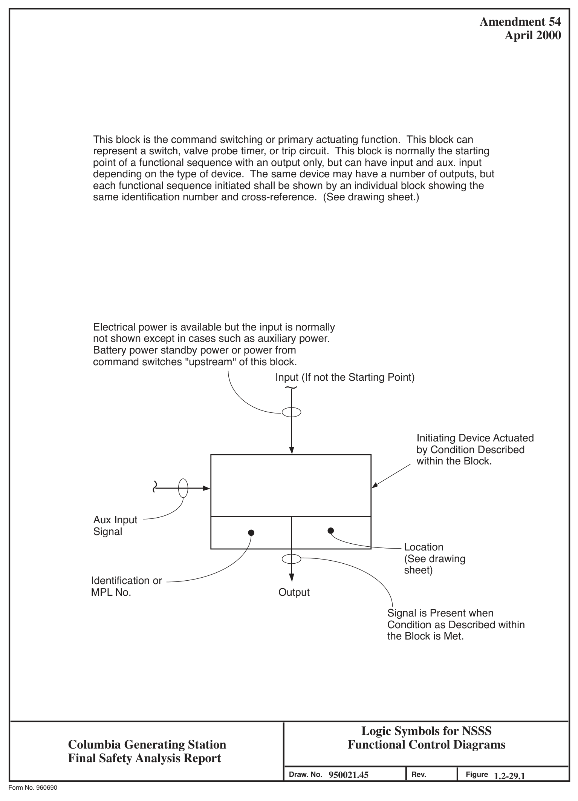

*figure on PDF page 56*

[Vector original (SVG, lossless): fig_page-56.svg](../figures/fig_page-56.svg)

<!-- labels/text on this figure page -->
Amendment 54 April 2000
This block is the command switching or primary actuating function. This block can represent a switch, valve probe timer, or trip circuit. This block is normally the starting point of a functional sequence with an output only, but can have input and aux. input depending on the type of device. The same device may have a number of outputs, but each functional sequence initiated shall be shown by an individual block showing the same identification number and cross-reference. (See drawing sheet.)
Electrical power is available but the input is normally not shown except in cases such as auxiliary power.
Battery power standby power or power from command switches "upstream" of this block.
Input (If not the Starting Point)
Initiating Device Actuated by Condition Described within the Block.
Aux Input Signal Location
(See drawing sheet)
Identification or MPL No.
Output Signal is Present when Condition as Described within the Block is Met.
Logic Symbols for NSSS Functional Control Diagrams Columbia Generating Station Final Safety Analysis Report 950021.45 Draw. No. Rev. Figure 1.2-29.1 Form No. 960690

<!-- p.57 -->
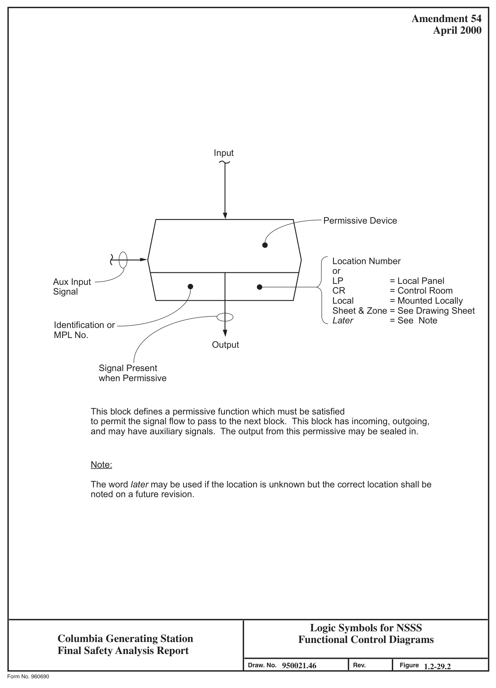

*figure on PDF page 57*

[Vector original (SVG, lossless): fig_page-57.svg](../figures/fig_page-57.svg)

<!-- labels/text on this figure page -->
Amendment 54 April 2000
Input
Permissive Device
Location Number or LP = Local Panel Aux Input CR = Control Room Signal Local = Mounted Locally Sheet & Zone = See Drawing Sheet Later = See Note Identification or MPL No.
Output
Signal Present when Permissive
This block defines a permissive function which must be satisfied to permit the signal flow to pass to the next block. This block has incoming, outgoing, and may have auxiliary signals. The output from this permissive may be sealed in.
Note:
The word later may be used if the location is unknown but the correct location shall be noted on a future revision.
Logic Symbols for NSSS Columbia Generating Station Functional Control Diagrams Final Safety Analysis Report 950021.46 Draw. No. Rev. Figure 1.2-29.2 Form No. 960690

<!-- p.58 -->
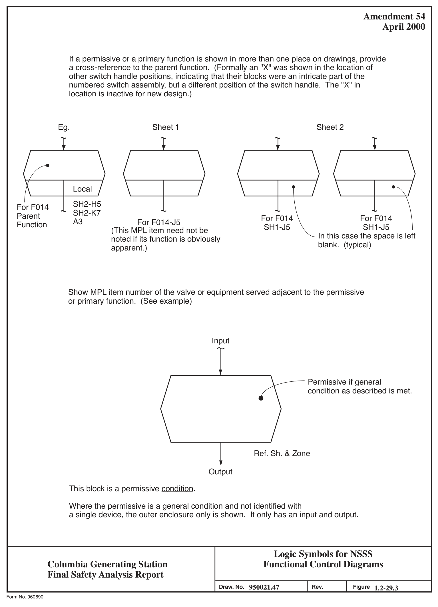

*figure on PDF page 58*

[Vector original (SVG, lossless): fig_page-58.svg](../figures/fig_page-58.svg)

<!-- labels/text on this figure page -->
Amendment 54 April 2000
If a permissive or a primary function is shown in more than one place on drawings, provide a cross-reference to the parent function. (Formally an "X" was shown in the location of other switch handle positions, indicating that their blocks were an intricate part of the numbered switch assembly, but a different position of the switch handle. The "X" in location is inactive for new design.)
Eg.
Sheet 1 Sheet 2
Local
SH2-H5
For F014
SH2-K7
Parent For F014 For F014 A3 For F014-J5 Function
SH1-J5
SH1-J5
(This MPL item need not be In this case the space is left noted if its function is obviously blank. (typical)
apparent.)
Show MPL item number of the valve or equipment served adjacent to the permissive or primary function. (See example)
Input
Permissive if general condition as described is met.
Ref. Sh. & Zone
Output This block is a permissive condition.
Where the permissive is a general condition and not identified with a single device, the outer enclosure only is shown. It only has an input and output.
Logic Symbols for NSSS Functional Control Diagrams Columbia Generating Station Final Safety Analysis Report 950021.47 Draw. No. Rev. Figure 1.2-29.3 Form No. 960690

<!-- p.59 -->
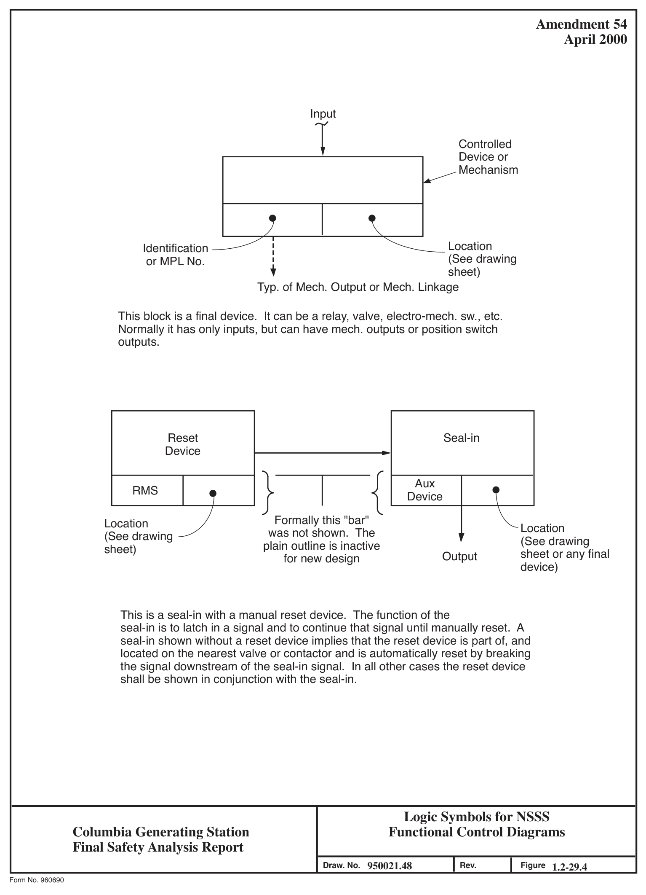

*figure on PDF page 59*

[Vector original (SVG, lossless): fig_page-59.svg](../figures/fig_page-59.svg)

<!-- labels/text on this figure page -->
Amendment 54 April 2000
Input r ✓
Controlled I Device or Mechanism ~ \ ------ J Location Identification ____, I I
(See drawing or MPL No.
I sheet) ♦ Typ. of Mech. Output or Mech. Linkage
This block is a final device. It can be a relay, valve, electro-mech. sw., etc.
Normally it has only inputs, but can have mech. outputs or position switch outputs.
Reset Seal-in Device } I { Aux I ' RMS Device ~ _/ \__ Formally this "bar" Location , Location was not shown. The
(See drawing
(See drawing plain outline is inactive sheet)
sheet or any final Output for new design device)
This is a seal-in with a manual reset device. The function of the seal-in is to latch in a signal and to continue that signal until manually reset. A seal-in shown without a reset device implies that the reset device is part of, and located on the nearest valve or contactor and is automatically reset by breaking the signal downstream of the seal-in signal. In all other cases the reset device shall be shown in conjunction with the seal-in.
Logic Symbols for NSSS Functional Control Diagrams Columbia Generating Station Final Safety Analysis Report
I I 950021.48
Draw. No.
Rev. Figure 1.2-29.4 Form No. 960690

<!-- p.60 -->
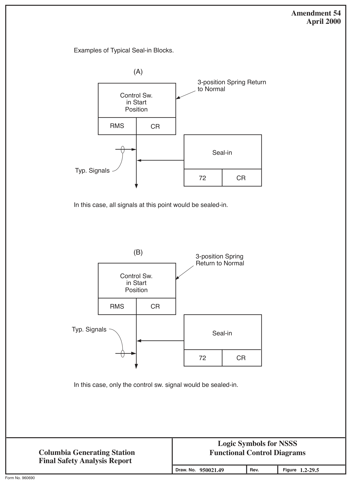

*figure on PDF page 60*

[Vector original (SVG, lossless): fig_page-60.svg](../figures/fig_page-60.svg)

<!-- labels/text on this figure page -->
Amendment 54 April 2000
Examples of Typical Seal-in Blocks.
(A)
3-position Spring Return to Normal Control Sw. ~ in Start Position
RMS CR
I\ J Seal-in
Typ. Signals I
72 CR ,
In this case, all signals at this point would be sealed-in.
(B)
3-position Spring Return to Normal / Control Sw.
in Start Position
RMS CR
\_ Typ. Signals Seal-in
I 72 CR V
Ir
In this case, only the control sw. signal would be sealed-in.
Logic Symbols for NSSS Columbia Generating Station Functional Control Diagrams Final Safety Analysis Report
I I 950021.49 1.2-29.5
Draw. No.
Rev. Figure Form No. 960690

<!-- p.61 -->
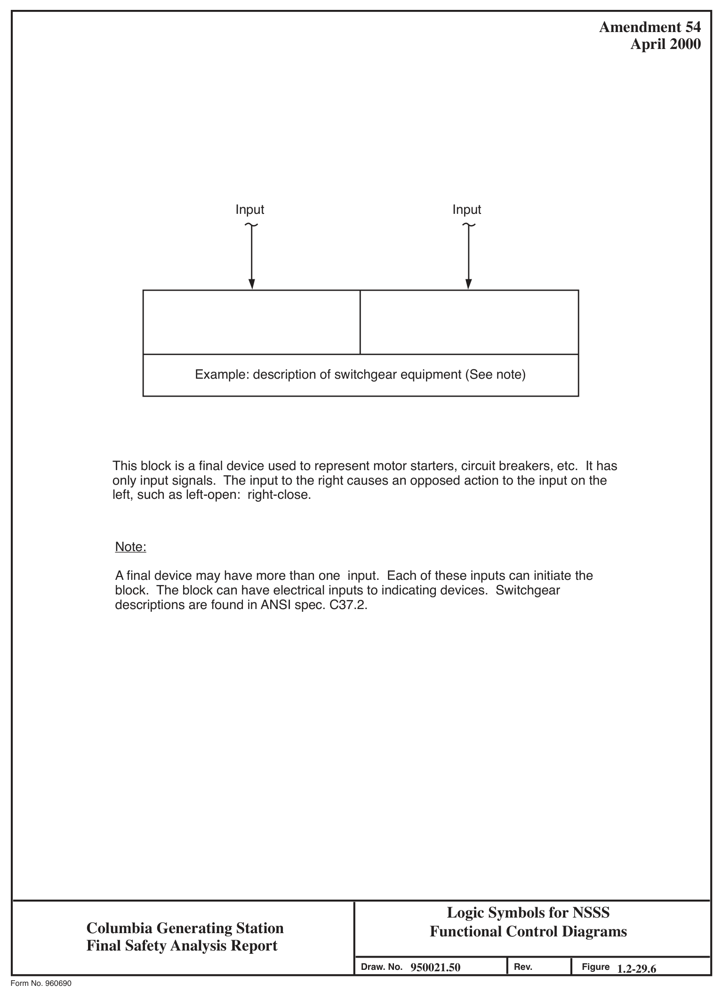

*figure on PDF page 61*

[Vector original (SVG, lossless): fig_page-61.svg](../figures/fig_page-61.svg)

<!-- labels/text on this figure page -->
Amendment 54 April 2000
Input Input ,. ,, ,. ,,
Ir
Example: description of switchgear equipment (See note)
This block is a final device used to represent motor starters, circuit breakers, etc. It has only input signals. The input to the right causes an opposed action to the input on the left, such as left-open: right-close.
Note:
-- A final device may have more than one input. Each of these inputs can initiate the block. The block can have electrical inputs to indicating devices. Switchgear descriptions are found in ANSI spec. C37.2.
Logic Symbols for NSSS Columbia Generating Station Functional Control Diagrams Final Safety Analysis Report
I I 950021.50
Draw. No.
Rev. Figure 1.2-29.6 Form No. 960690

<!-- p.62 -->
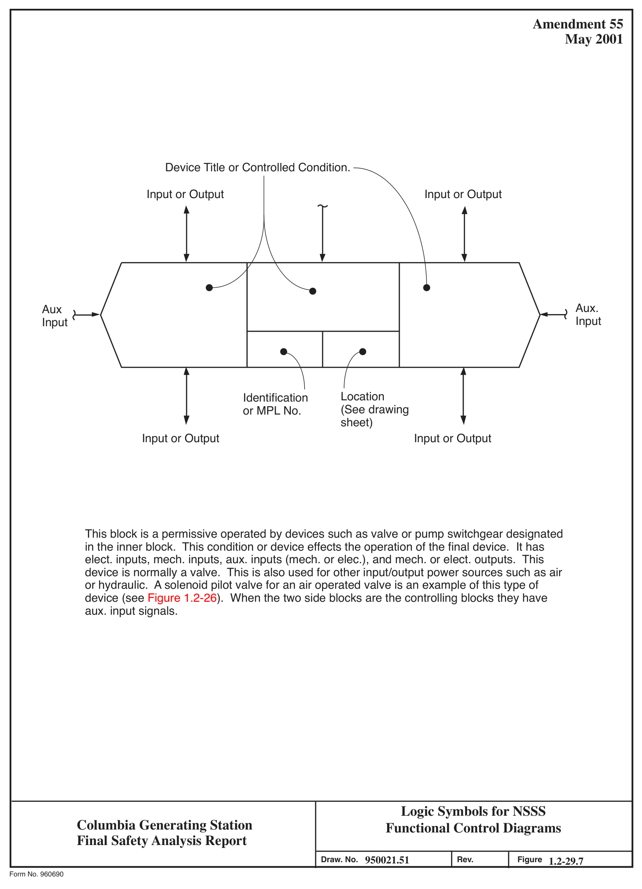

*figure on PDF page 62*

[Vector original (SVG, lossless): fig_page-62.svg](../figures/fig_page-62.svg)

<!-- labels/text on this figure page -->
Amendment 55 May 2001
Device Title or Controlled Condition.
Input or Output Input or Output
Aux.
Aux Input Input
Identification Location
(See drawing or MPL No.
sheet)
Input or Output Input or Output
This block is a permissive operated by devices such as valve or pump switchgear designated in the inner block. This condition or device effects the operation of the final device. It has elect. inputs, mech. inputs, aux. inputs (mech. or elec.), and mech. or elect. outputs. This device is normally a valve. This is also used for other input/output power sources such as air or hydraulic. A solenoid pilot valve for an air operated valve is an example of this type of device (see Figure 1.2-26). When the two side blocks are the controlling blocks they have aux. input signals.
Logic Symbols for NSSS Columbia Generating Station Functional Control Diagrams Final Safety Analysis Report 950021.51 Draw. No. Rev. Figure 1.2-29.7 Form No. 960690

<!-- p.63 -->
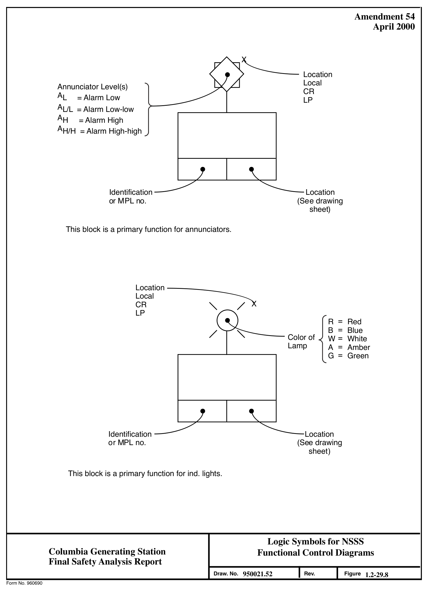

*figure on PDF page 63*

[Vector original (SVG, lossless): fig_page-63.svg](../figures/fig_page-63.svg)

<!-- labels/text on this figure page -->
Amendment 54 April 2000
X Location Local Annunciator Level(s)
CR AL = Alarm Low LP AL/L = Alarm Low-low AH = Alarm High AH/H = Alarm High-high
Identification Location or MPL no.
(See drawing sheet)
This block is a primary function for annunciators.
Location Local X CR LP = R Red B = Blue Color of = W White Lamp A = Amber = G Green
Identification Location or MPL no.
(See drawing sheet)
This block is a primary function for ind. lights.
Logic Symbols for NSSS Columbia Generating Station Functional Control Diagrams Final Safety Analysis Report 950021.52
1.2-29.8 Draw. No. Rev. Figure Form No. 960690

<!-- p.64 -->
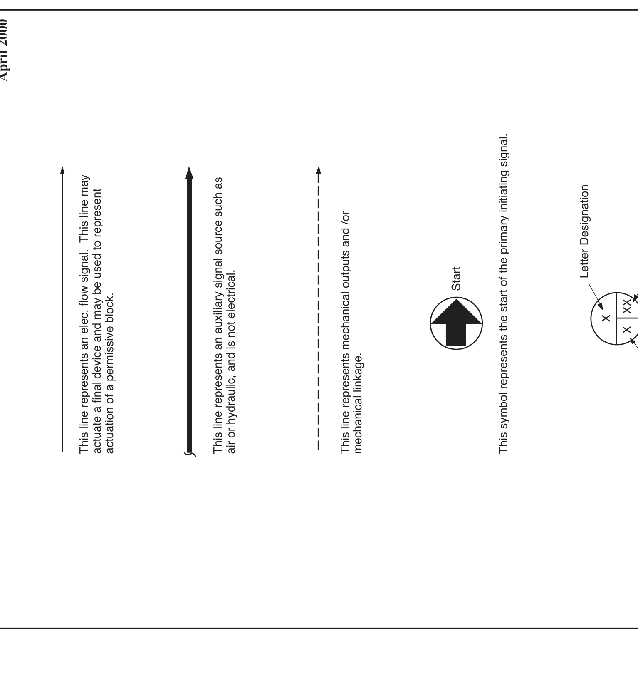

*figure on PDF page 64*

[Vector original (SVG, lossless): fig_page-64.svg](../figures/fig_page-64.svg)

<!-- labels/text on this figure page -->
Amendment 54 April 2000
This line represents an elec. flow signal. This line may actuate a final device and may be used to represent actuation of a permissive block.
This line represents an auxiliary signal source such as air or hydraulic, and is not electrical.
t
This line represents mechanical outputs and /or mechanical linkage.
~ Start
This symbol represents the start of the primary initiating signal.
Letter Designation X X XX Sheet No.
Zone or Ref. Dwg.
This symbol represents a match circle. The letter designation on one dwg. must match the letter on the interfacing dwg.
Logic Symbols for NSSS Columbia Generating Station Functional Control Diagrams Final Safety Analysis Report 950021.53 Draw. No. Rev. Figure 1.2-29.9 Form No. 960690

<!-- p.65 -->
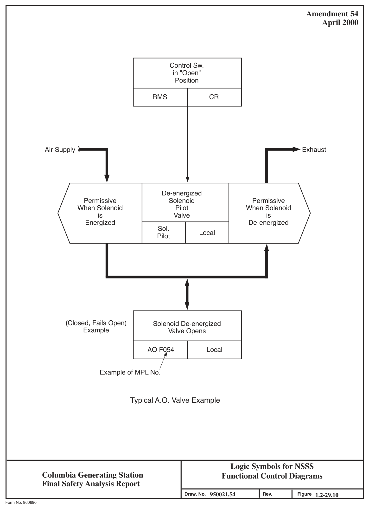

*figure on PDF page 65*

[Vector original (SVG, lossless): fig_page-65.svg](../figures/fig_page-65.svg)

<!-- labels/text on this figure page -->
Amendment 54 April 2000
Control Sw.
in "Open" Position
RMS CR
- Air Supply Exhaust '
' ' De-energized Permissive Solenoid Permissive When Solenoid Pilot When Solenoid is Valve is Energized De-energized Sol.
Local Pilot
(Closed, Fails Open) Solenoid De-energized Example Valve Opens
AO F054 Local ;
I Example of MPL No.
Typical A.O. Valve Example
Logic Symbols for NSSS Columbia Generating Station Functional Control Diagrams Final Safety Analysis Report
I I 950021.54
Draw. No.
Rev. Figure 1.2-29.10 Form No. 960690

<!-- p.66 -->
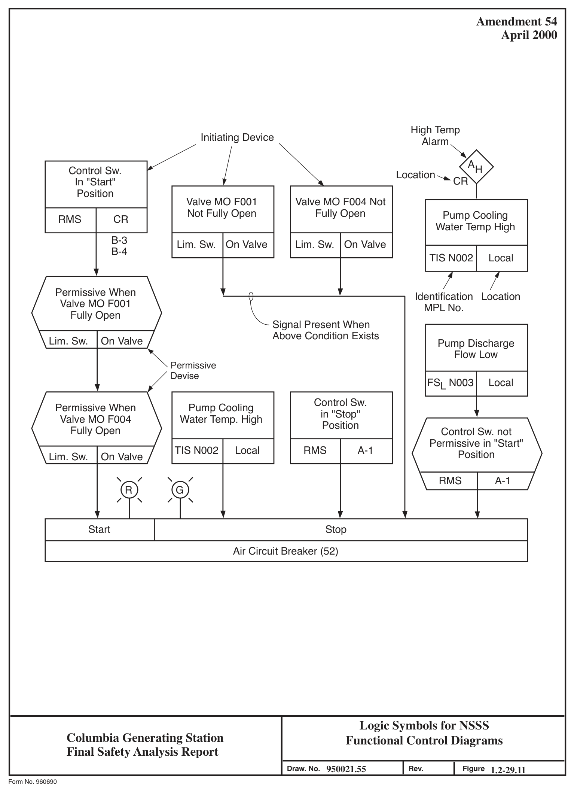

*figure on PDF page 66*

[Vector original (SVG, lossless): fig_page-66.svg](../figures/fig_page-66.svg)

<!-- labels/text on this figure page -->
Amendment 54 April 2000
High Temp Initiating Device Alarm
AH Control Sw.
Location CR In "Start" Position Valve MO F001 Valve MO F004 Not Not Fully Open Fully Open Pump Cooling
RMS CR
Water Temp High B-3 Lim. Sw. On Valve Lim. Sw. On Valve B-4 TIS N002 Local
Permissive When Identification Location Valve MO F001 MPL No.
Fully Open Signal Present When Above Condition Exists Lim. Sw. On Valve Pump Discharge Flow Low Permissive Devise FSL N003 Local Control Sw.
Permissive When Pump Cooling in "Stop" Valve MO F004 Water Temp. High Position Fully Open Control Sw. not Permissive in "Start" TIS N002 Local RMS A-1 Position Lim. Sw. On Valve
RMS A-1
R G
Start Stop Air Circuit Breaker (52)
Logic Symbols for NSSS Columbia Generating Station Functional Control Diagrams Final Safety Analysis Report 950021.55 Draw. No. Rev. Figure 1.2-29.11 Form No. 960690

<!-- p.67 -->
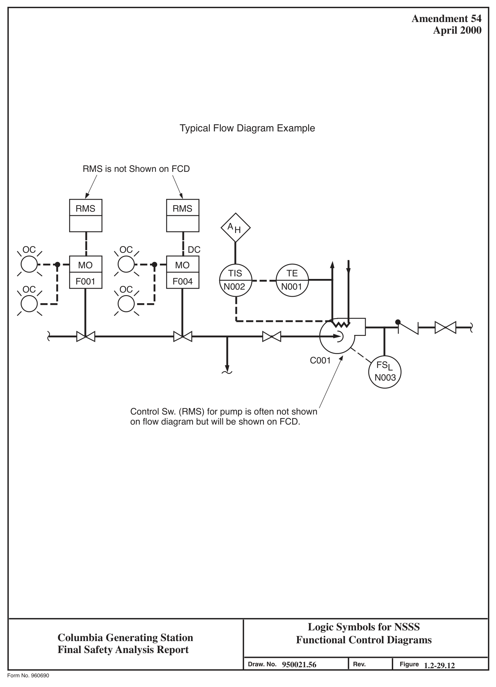

*figure on PDF page 67*

[Vector original (SVG, lossless): fig_page-67.svg](../figures/fig_page-67.svg)

<!-- labels/text on this figure page -->
Amendment 54 April 2000
Typical Flow Diagram Example
RMS is not Shown on FCD
RMS RMS AH
OC OC DC MO MO
TIS TE
F001 F004
N002 N001
OC OC
I C001 FSL N003
Control Sw. (RMS) for pump is often not shown on flow diagram but will be shown on FCD.
Logic Symbols for NSSS Columbia Generating Station Functional Control Diagrams Final Safety Analysis Report 950021.56 Draw. No. Rev. Figure 1.2-29.12 Form No. 960690

<!-- p.68 -->
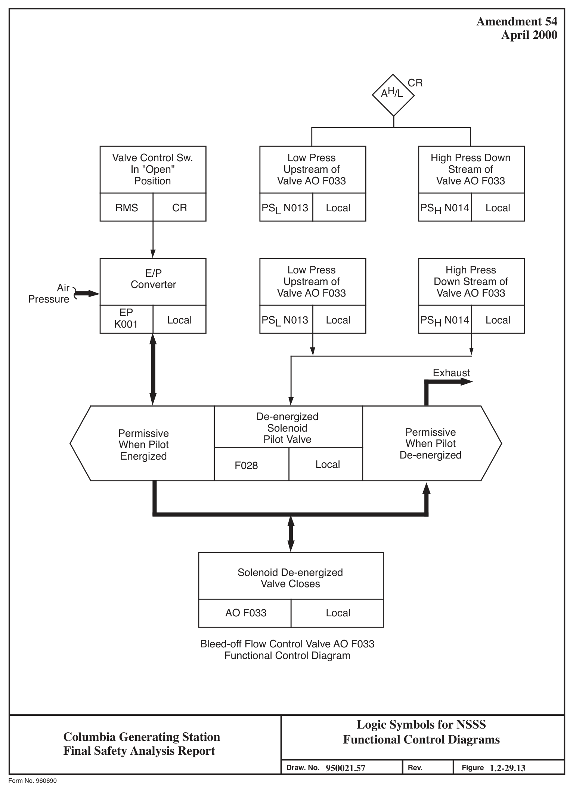

*figure on PDF page 68*

[Vector original (SVG, lossless): fig_page-68.svg](../figures/fig_page-68.svg)

<!-- labels/text on this figure page -->
Amendment 54 April 2000
CR AH/L
Valve Control Sw.
Low Press High Press Down In "Open" Upstream of Stream of Position Valve AO F033 Valve AO F033
RMS CR
PSL N013 Local PSH N014 Local
Low Press High Press E/P Upstream of Down Stream of Converter Air l--- Valve AO F033 Valve AO F033 Pressure EP Local PSL N013 Local PSH N014 Local K001
1
Exhaust
- '' De-energized Solenoid Permissive Permissive Pilot Valve When Pilot When Pilot De-energized Energized F028 Local
~ '
Solenoid De-energized Valve Closes
AO F033 Local
Bleed-off Flow Control Valve AO F033 Functional Control Diagram
Logic Symbols for NSSS Columbia Generating Station Functional Control Diagrams Final Safety Analysis Report 950021.57
1.2-29.13 Draw. No. Rev. Figure Form No. 960690

<!-- p.69 -->
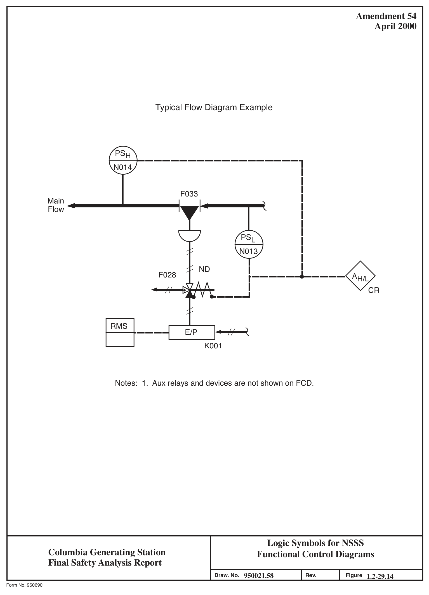

*figure on PDF page 69*

[Vector original (SVG, lossless): fig_page-69.svg](../figures/fig_page-69.svg)

<!-- labels/text on this figure page -->
Amendment 54 April 2000
Typical Flow Diagram Example
------------------, PSH N014
F033 Main Flow
PSL ,-----~----0 N013
ND F028 AH/L CR ___ ...J
B--- ....._______. ~
RMS E/P K001
Notes: 1. Aux relays and devices are not shown on FCD.
Logic Symbols for NSSS Columbia Generating Station Functional Control Diagrams Final Safety Analysis Report 950021.58 Draw. No. Rev. Figure 1.2-29.14 Form No. 960690

<!-- p.70 -->
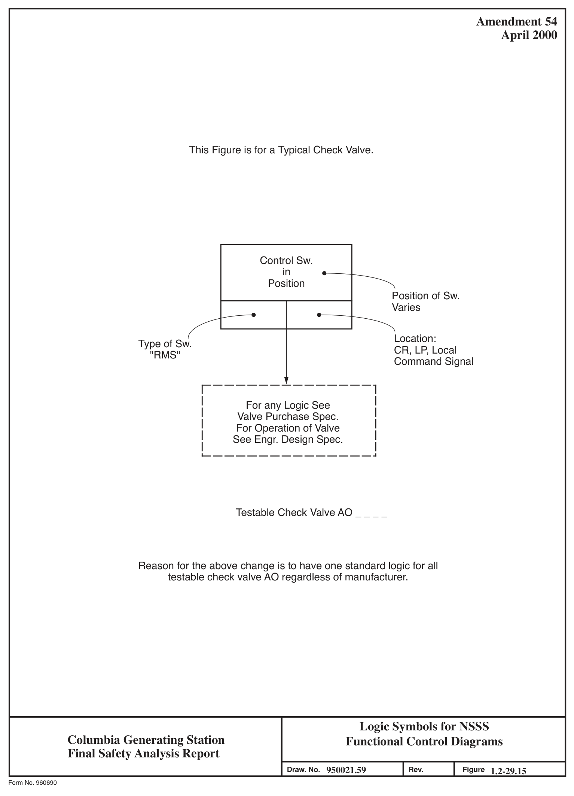

*figure on PDF page 70*

[Vector original (SVG, lossless): fig_page-70.svg](../figures/fig_page-70.svg)

<!-- labels/text on this figure page -->
Amendment 54 April 2000
This Figure is for a Typical Check Valve.
Control Sw.
in Position Position of Sw.
Varies
Location:
Type of Sw.
CR, LP, Local "RMS" Command Signal r---------------, I I For any Logic See I I Valve Purchase Spec.
I I For Operation of Valve I I See Engr. Design Spec.
I I
L---------------J
Testable Check Valve AO _ _ _ _
Reason for the above change is to have one standard logic for all testable check valve AO regardless of manufacturer.
Logic Symbols for NSSS Columbia Generating Station Functional Control Diagrams Final Safety Analysis Report
I I 950021.59
Draw. No.
Rev. Figure 1.2-29.15 Form No. 960690

