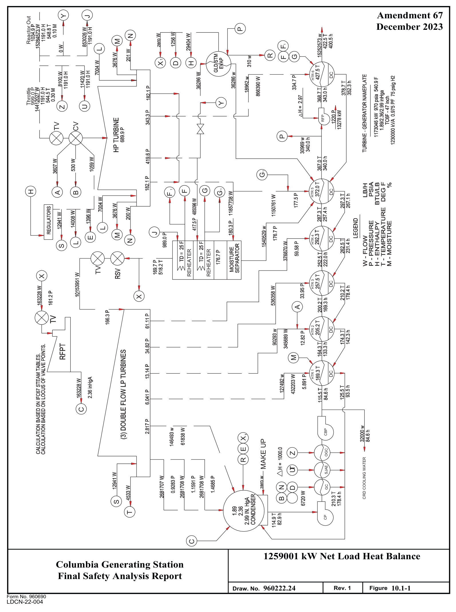
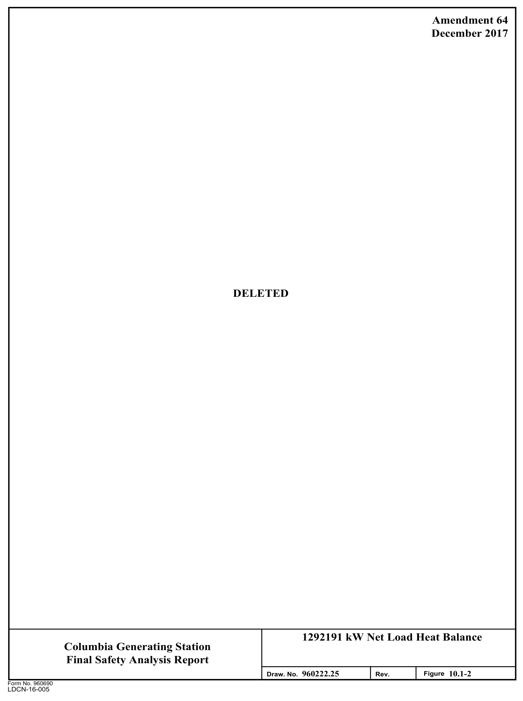

# 10.1 SUMMARY DESCRIPTION

> Columbia Generating Station FSAR — Chapter 10: Steam and Power Conversion System
> Source: `10_chapter-3522-3609.pdf`, PDF pages 7–11 (of 88)
> Amendment 67 compilation (individual pages carry varying amendment dates)

---
<!-- p.7 -->
Chapter 10

#### STEAM AND POWER CONVERSION SYSTEM
#### SUMMARY DESCRIPTION 10.1
The steam and power conversion system is designed to produce electrical energy through conversion of a portion of the thermal energy contained in the steam supplied from the reactor, to condense the main turbine exhaust steam, and to return condensate to the reactor as heated feedwater with a major portion of its gaseous dissolved and particulate impurities removed.

The power conversion system uses the Rankine steam cycle with a closed regenerative feedwater heating cycle. It has the capability to accept 105% of the reactor’s rated steam flow. Steam leaves the reactor vessel at 1035 psia. Steam enters the turbine at 999 psia with a 0.30% moisture content. The turbine is a tandem-compound turbine generator having a six-flow exhaust end. Steam is exhausted into a triple pressure condenser designed for a
2.4-in. Hg average backpressure and is condensed with circulating water cooled by mechanical draft cooling towers. Six stages of regenerative feedwater heating are provided, four heated with extraction steam from the low pressure turbines and two from the high pressure turbine.
The final design feedwater temperature at normal full load is 423°F.

The major components of the steam and power conversion system are the turbine generator, main condenser, condensate pumps, condensate booster pumps, mechanical vacuum pumps, steam jet air ejectors, turbine gland sealing system (which includes gland seal steam evaporators and condenser), turbine bypass system, condensate filter demineralizers, turbine driven reactor feed pumps, feedwater heaters, and condensate storage facilities. The turbine cycle heat balance for rated 102.4% power is given in Figure 10.1-1. This figure is representative of the overall power conversion system.

The saturated steam produced by the boiling water reactor is passed through the high pressure turbine where the steam is expanded and is then exhausted to two moisture separator/reheaters
(two reheat stages) arranged in parallel. The moisture separators remove the moisture content of the steam and superheat the steam before it enters the low pressure turbines where the steam is expanded further.

Steam for the first-stage reheater is taken from the first extraction point of the high pressure turbine while steam for the second-stage reheater is taken from the main steam header. From the low pressure turbines, the steam is exhausted into the main condenser where it is condensed and deaerated. The condensate pumps take suction from the condenser hotwell and deliver the condensate through the gland seal steam condenser, steam-jet air ejector condenser, offgas condenser, and condensate demineralizers to the condensate booster pump suction. The condensate booster pumps then discharge through the low pressure feedwater heater trains to

<!-- p.8 -->
November 1998

the reactor feedwater pumps. The reactor feedwater pumps supply feedwater through the high I pressure feedwater heaters to the reactor. Steam for heating the feedwater in the heating cycle is supplied from turbine extractions. The drains from the feedwater heaters, the reheaters, and the moisture separators are cascaded to the next lower pressure feedwater heater and finally discharged to the condenser.

The ability of the plant to follow system loads depends on the adjustment of the reactor power level. The steam admission valves are controlled by the initial pressure regulator so that the turbine receives the proper amount of steam required for the load demand. The turbine speed governor, however, may override the initial pressure regulator to close the steam admission valves if an increase in system frequency or loss of generator load causes an increase in turbine speed. Reactor steam in excess of that which the admission valves will pass is bypassed I directly to the main condenser through pressure controlled bypass valves. Load rejection in excess of bypass capacity causes the reactor safety/relief valves to open.

The main turbine, main condenser, and moisture separator/reheaters are located in a shielded area with controlled access to limit personnel exposure.

The portions of the power conversion system which constitute part of the reactor coolant pressure boundary are the main steam lines extending from the reactor pressure vessel to the outermost containment isolation valve.

Table 3.2-1 indicates the safety class, quality group classification, and seismic category of the power conversion system. Environmental design bases are discussed in Section 3.11.

Table 10.1-1 presents a summary of important design and performance characteristics of the steam and power conversion system.

The design of various steam and condensate instrumentation systems are based on the need to monitor and control normal power generation system functions such as level, flow, pressure, and temperature. The instrumentation provides information that enables the control room operator to start up, operate, and shut down these systems.

<!-- p.9 -->
Table 10.1-1

Design and Performance Characteristics of Power Conversion Systema

Turbine Data Manufacturer Westinghouse HPT building block

#### BB 296
LPT building block

#### BB 281R
LPT type/LSB length (in.)

#### TC6F/47
Number of casings 1-HP, 3-LP Backpressure zones (in. Hg abs)
1.89/2.36/2.99 (2.4 average)

Generator Rating (kVA)
1,230,000 Gross output (MWe)
1230 Power factor 0.975 Voltage (volts)
25,000 Phase/frequency (Hz)
3/60 Hydrogen pressure (psig)

Steam conditions at throttle valve Flow (lb/hr)
14,412,027 Pressure (psia)
999 Temperature (F)
## 544.5 Enthalpy (Btu/lb)
1191 Moisture content, maximum (%)
0.30

9605 Turbine cycle heat rate (Btu/kW-hr)

Final feedwater temperature (F)
422.5

Turbine cycle arrangement Steam reheat stages 2 Number of feedwater heating stages 6 Feedwater heater in condenser neck First stage

Type of condensate demineralizer Powdered resin

Main steam bypass capacity (%)
23.6

a All data based on 100% load. See Figure 10.1-1.

<!-- p.10 -->

*figure on PDF page 10*

[Vector original (SVG, lossless): fig_page-10.svg](../figures/fig_page-10.svg)

<!-- labels/text on this figure page -->
Amendment 67 Y J Reactor Out December 2023 P N M F1 L R F G 1
X D H
HTR 6 DC
999.0 P Throttle Y U Z
RFP
TV CV
P
G 1
HTR 5 H F 1 F G G 1 DC
A B
L M J
HTR 4 DC
E N L S
REHEATER REHEATER
TV X
HTR 3 DC
X
A
HTR 2 DC
M
HTR 1 DC
C
CBP X
MAKE UP
E OGC Z
CRD COOLING WATER
R
T SJAE U
N D GC
B S
T CP
C 1259001 kW Net Load Heat Balance Columbia Generating Station Final Safety Analysis Report 960222.24 Rev. 1 Figure 10.1-1 Draw. No.
Form No. 960690
LDCN-22-004

<!-- p.11 -->

*figure on PDF page 11*

[Vector original (SVG, lossless): fig_page-11.svg](../figures/fig_page-11.svg)

<!-- labels/text on this figure page -->
Amendment 64 December 2017
DELETED
1292191 kW Net Load Heat Balance Columbia Generating Station Final Safety Analysis Report I I 960222.25 Figure 10.1-2 Draw. No. Rev.
Form No. 960690
LDCN-16-005

