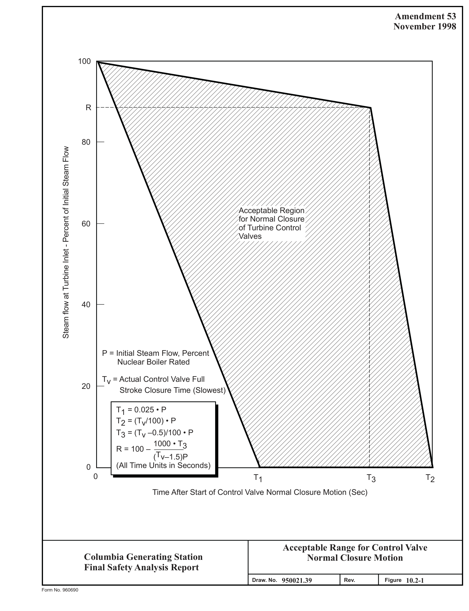
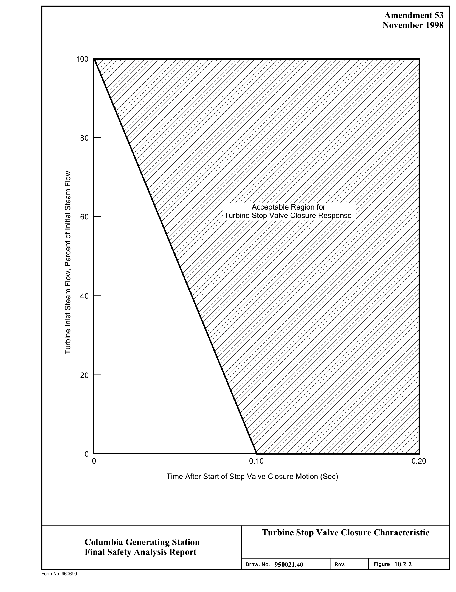
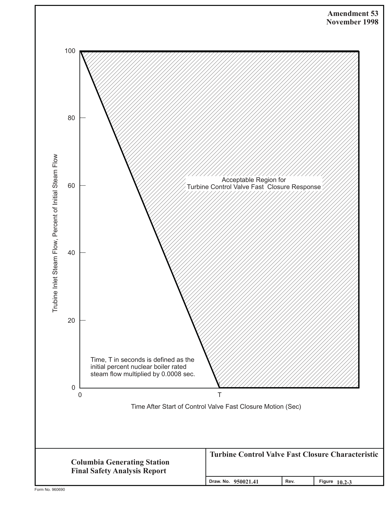
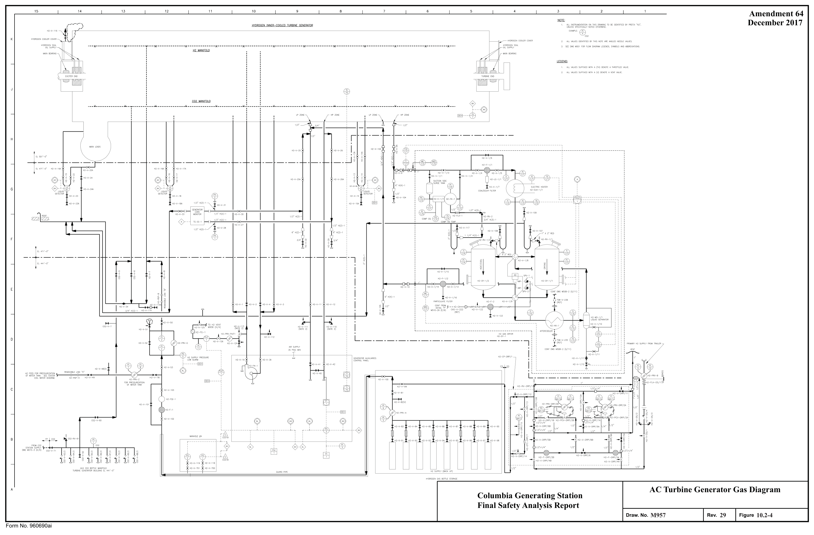
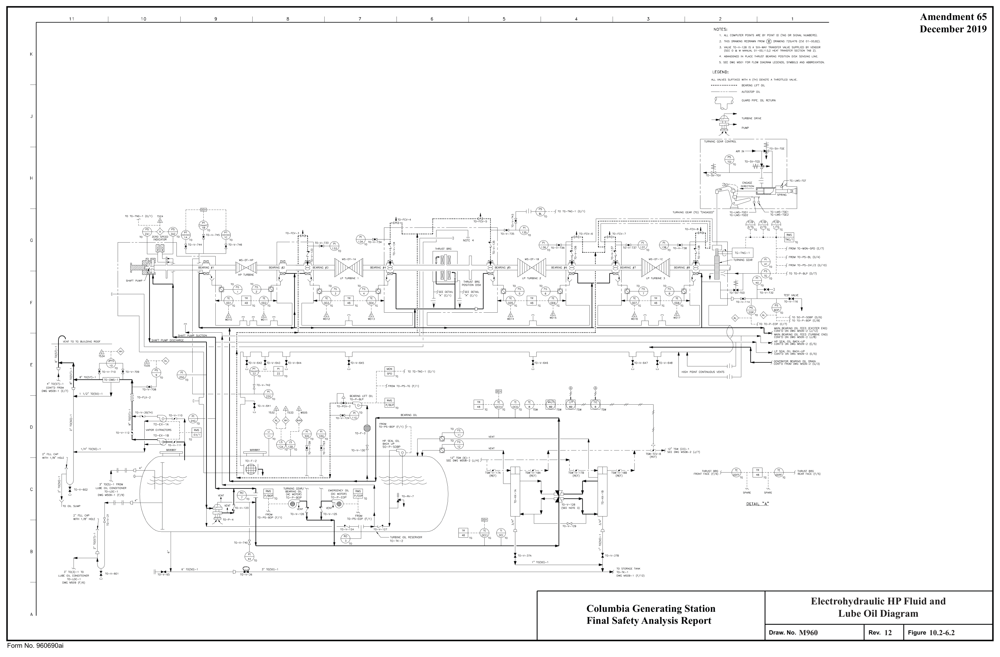
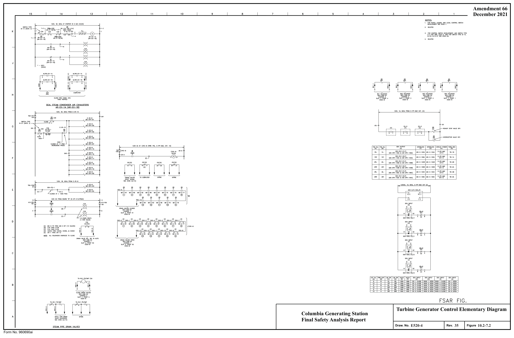

# 10.2 TURBINE GENERATOR

> Columbia Generating Station FSAR — Chapter 10: Steam and Power Conversion System
> Source: `10_chapter-3522-3609.pdf`, PDF pages 12–28 (of 88)
> Amendment 67 compilation (individual pages carry varying amendment dates)

---
<!-- p.12 -->
April 2000

### 10.2 TURBINE GENERATOR
#### 10.2.1 DESIGN BASIS
The turbine generator is designed to receive steam from the boiling water reactor, convert a portion of the thermal energy contained in the steam to electric energy, and provide extraction steam for feedwater heating.

The turbine generator, associated systems, and control characteristics, are integrated with the features of the reactor and associated systems to obtain an efficient and safe power generator unit. The turbine generator is designed to function only during normal plant conditions including startup, power generation, and shutdown. The turbine generator is not required for safe shutdown of the reactor nor to perform safety functions. The turbine generator equipment is in strict conformance with the latest edition in effect at the time of fabrication, of ANSI C.50.10, ANSI C.50.13, and the IEEE standards. The major portion of the manufacture was performed during 1975. The original LP turbine rotors were replaced with fully integral rotors during 1992. Safety class and seismic category are presented in Section 3.2.

The turbine generator design conditions are included in Table 10.1-1.

The turbine generator is intended for base load operation. Normal load swings are limited to the rate of change of power output of the nuclear steam supply system.

The turbine governor valves are capable of full stroke opening and closure within 7 sec for adequate pressure control performance. Normal governor valve closure is shown in Figure 10.2-1.

During events resulting in turbine throttle or governor valve fast closure, turbine inlet steam flow is not reduced faster than permitted by Figures 10.2-2 or 10.2-3.

#### 10.2.2 SYSTEM DESCRIPTION
The main turbine is a tandem-compound unit, consisting of one double-flow high pressure turbine and three double-flow low pressure turbines (Figure 10.3-1), running at 1800 rpm with 47 in. last-stage blades. Exhaust steam from the high pressure turbine passes through two moisture separator/reheaters (two stage reheat) before entering the low pressure turbine inlets.
The exhaust steam from the three low pressure turbines is condensed in the main condenser.

The generator is a three phase, 60 cycle, 25,000 V, 1800 rpm unit rated at 1,230,000 kVA at 0.975 power factor. The stator is water cooled and the rotor is hydrogen cooled. The hydrogen system is designed to minimize the hazard from fires or explosions as discussed in Appendix F.

<!-- p.13 -->
May 2001

The design of the system, Figures 10.2-4 and 10.2-5, and the specified operating procedures are such that explosive mixtures are not possible under normal operating conditions. The hydrogen gas supply system includes a storage trailer and storage cylinders used as backup if the trailer supply runs low. Pressure regulators are mounted on both the storage trailer and the bottle manifold for control of the hydrogen gas, and a circuit for supplying and controlling the carbon dioxide used in purging the generator during filling and degasing operations. To prevent hydrogen leakage by the generator shaft seals, a hydrogen seal oil system is provided.
The hydrogen seal oil system, which includes pumps and controls, deaerates the oil before it is sent to the shaft seals.

The fundamental rule is that hydrogen and air should never be mixed. Carbon dioxide is used as an intermediate gas when changing either from air to hydrogen or from hydrogen to air.
When changing from one gas to another, the generator is vented to the atmosphere. The valves, pressure gauges, regulators, and other equipment in the hydrogen gas supply system permit introducing hydrogen or prevent the flow of hydrogen into the generator and also provide means of controlling the gas pressure within the generator.

Steam is transported from the reactor by four main steam lines and flows through the turbine throttle valves and governor valves to the high pressure turbine. The steam lines are combined upstream of the throttle and governor valves. The turbine bypass valves are located upstream of the turbine throttle valves to permit steam bypass to the main condenser during transient conditions.

Two branch lines from the main steam heater supply steam to the two second-stage reheaters per moisture separator. The steam for the two first-stage reheaters per moisture separator is supplied by extraction lines from the high pressure turbine (see Figure 10.3-1). Moisture preseparator units remove moisture from the lower high-pressure turbine discharge exhaust steam as it exits the turbine. The moisture separator/reheaters remove the moisture from the high-pressure turbine exhaust steam and superheat the steam prior to admission to the low pressure turbines, thereby improving overall cycle efficiency. Extraction steam from the high pressure turbine is used in the first-stage reheater and for feedwater heating in heaters No. 5 and 6. Extraction steam from the low pressure turbines is used for the first, second, third, and fourth stage feedwater heaters. Moisture separator/reheater relief valves are provided to prevent overpressurizing the moisture separator/reheaters and the crossover lines in the event of crossover throttle or intercept valve closure; these relief valves discharge to the main condenser.

The turbine generator is equipped with a digital electrohydraulic (DEH) control system. See Section 7.7.1.5 for a detailed description of the turbine control system.

<!-- p.14 -->
There are four methods of turbine overspeed control protection:

a. Digital Electro-Hydraulic (DEH) speed control, b. Overspeed protection controller (OPC), c. Digital control overspeed trip, and d. Digital trip overspeed trip.

DEH Speed Control

The DEH speed control is designed to maintain turbine speed within 2-3 rpm of setpoint during startup; after the turbine generator has been synchronized to the grid, the grid frequency controls turbine speed. The DEH control system monitors turbine speed via three speed sensors. Upon detecting a separation from the grid and a resulting overspeed condition, the DEH speed control will rapidly close the governor valves via their servo-valves preventing an excessive overspeed condition from occurring.

Overspeed Protection Controller

The OPC primary function is to avoid excessive turbine overspeed such that a turbine trip is avoided. At 103% of rated speed, the OPC solenoids open, rapidly closing the governor and intercept valves to arrest the overspeed before it reaches the trip setting. When turbine speed falls below 101%, turbine speed control is returned to the DEH speed control mode.

Digital Control Overspeed Trip, Digital Trip Overspeed Trip and Quadvoter Hydraulic Trip Block

If the turbine accelerates further than 103% of rated speed, the digital control overspeed trip logic in the DEH control system will provide a trip signal that causes the quadvoter hydraulic trip block to de-energize and trip the turbine. Additionally, the digital trip overspeed trip has three redundant speed sensors and will initiate an independent trip of the quadvoter hydraulic trip block. Both the digital control overspeed trip and the digital trip overspeed trip use two out of three overspeed logic to initiate the trip signal prior to reaching 111% of rated speed.
These signals cause the output module for the quadvoter to simultaneously de-energize, or trip, all of the quadvoter valves.

Redundant power supplies are auctioneered to assure loss of one power supply does not cause the quadvoter to trip. The quadvoter provides two channels, each with two solenoid valves in series, to depressurize the trip header and trip all the throttle, governor, intercept and reheat stop valves. The quadvoter design assures that a single failure of a quadvoter valve will neither cause the turbine to trip nor prevent the turbine from tripping if required. The DEH control system is designed to maintain the turbine speed below 120% of rated speed.

<!-- p.15 -->
The quadvoter trip block assembly is a fail-safe design. Therefore a loss of all power or a loss of all signals to the quadvoter solenoids would cause a turbine trip as all of the quadvoter solenoid valves would de-energize. The turbine overspeed control equipment and electrical wiring may be destroyed by a postulated piping failure; however, this loss would result in a turbine trip based on the fail-safe design. A missile may destroy the electromagnetic speed pickups and associated electrical wiring, but the turbine will still trip on loss of all speed probe signals. Missile damage to the hydraulic lines for the trip block assembly would result in a loss of high pressure fluid thereby depressurizing the trip header and causing a turbine trip.

The operation of the DEH control system is continuously monitored during turbine generator operation. Detection of turbine speed variation is accomplished by the speed-control unit discussed in Section 7.7.1.5. The overspeed protection controller and two digital overspeed trips are tested during reactor startup from refueling outages. The turbine throttle, governor, interceptor, reheat stop valves and quadvoter solenoid valves are periodically tested during operation. Turbine throttle, governor, interceptor and reheat stop valves are periodically inspected. The manner and frequency of the inspection and testing will take into consideration the manufacturer’s and others’ recommendations and missile probability analysis (see Section 3.5.1.3) in conjunction with the plant generating requirements.

Instrumentation for the turbine generator is provided in the control room and is described in Section 7.7.1.5.

The turbine is equipped for normal operations with a shaft-driven lubricating oil pump and ac motor-driven lubricating oil pump for startup, shutdown, and turning gear, or for emergencies whenever oil pressure falls below set pressure. The turbine is also provided with a dc motor-driven lubricating oil pump with power supplied from storage batteries for emergency operation.

The turbine shaft is supplied with “clean” (essentially nonradioactive) sealing steam which prevents outleakage of steam from the high-pressure turbine and inleakage of air to the low pressure turbines. An evaporator generates essentially nonradioactive steam for turbine gland sealing (see Section 10.4.3).

Overpressure protection of the turbine exhaust hoods and the main condenser shell is provided by rupture diaphragms on the exhaust hoods.

The turbine incorporates protective devices including the exhaust hood relief diaphragms, exhaust hood temperature alarm, pilot dump valve for closing the extraction steam nonreturn valves, low vacuum alarm, thrust bearing wear alarm, and low bearing oil pressure alarm.

<!-- p.16 -->
In addition, the following tabulation is a list of the turbine generator protective trips:

Mechanical Faults Electrical Faults

Low vacuum Generator power differential

Thrust bearing wear Generator underfrequency

Low oil pressure Generator differential current

Overspeed Generator stator ground

Manual Generator loss of excitation

Anti-motoring Generator negative sequence

Low DEH pressure Generator overcurrent during starting

Low EH (electrohydraulic) Generator stator ground during starting fluid level Generator overexcitation Reactor high water level Generator/transformer overall differential RCIC-V-13 and 45 open Manual Moisture separator reheater shell side high level Unit lockout

Loss of DEH control power Unit overall lockout

Both Throttle Valves on a steam chest closed

The main steam throttle and governor valves are located in the steam chest assembly which is parallel to the axis of the high pressure turbine. The nominal closure time for a fully open throttle or governor valve is 0.15 sec. A failure of one governor valve causes the other valves to increase or decrease their opening to compensate for that valve. If one valve fails open at low load condition, the other valves close. If the closing of the other valves is not enough to compensate for that valve, the turbine load increases proportional to steam flow.

The reheat stop and intercept valves are in-line valves located in the crossover piping between the moisture separator/reheater and low pressure turbine. The closure time upon depressionization of the trip header for a fully open valve is 0.15 sec.

<!-- p.17 -->
The valves described above are periodically tested as required by the Licensee Controlled Specifications (LCS) by using the DEH control system during power operation. Pressure variations caused by closing a governor valve cause the other governor valves to open.
Therefore, testing must be done at a reduced power level to provide sufficient margin for pressure control. Details of the pressure control system are discussed in Section 7.7.1.5. In 1----------------------'' addition, one of each valve will have its internals periodically inspected as required by the LCS.

Each of the extraction steam lines has a reverse current valve and a gate valve, with the exception of the extraction lines to low pressure number 1 heaters. These valves are located near the condenser. On turbine trip the reverse current valves close immediately on reverse flow. Because of the fast closure and the short distance between these valves and the extraction points at the turbine, the amount of steam in these lines does not affect the turbine coastdown following a turbine trip.

#### 10.2.3 TURBINE DISK INTEGRITY
Analysis of potential turbine missile hazards and drawings showing the orientation of the turbine with respect to important structures are presented in Section 3.5.1.3.

#### 10.2.4 SAFETY EVALUATION
The steam entering the high pressure turbine may contain fission, coolant activation, and activated corrosion products. The anticipated concentration of nitrogen-16, which is the dominant radionuclide entering the high pressure turbine, is discussed in Section 12.2.
Moisture separation and transit time between the high pressure and low pressure turbines reduces the concentration of radionuclides in the steam prior to entering the low pressure turbine. Most of the gaseous radioactivity is removed by the steam-jet air ejector and routed to the offgas system (see Section 11.3). The condensate in the condenser hotwell contains significantly less radioactive material than the inlet steam.

Access to the turbine area is controlled. Radiation levels associated with turbine components are described in Section 12.2 and shielding requirements are discussed in Section 12.3.

<!-- p.18 -->

*figure on PDF page 18*

[Vector original (SVG, lossless): fig_page-18.svg](../figures/fig_page-18.svg)

<!-- labels/text on this figure page -->
Amendment 53 November 1998
100
R
80 Steam flow at Turbine Inlet - Percent of Initial Steam Flow Acceptable Region for Normal Closure 60 of Turbine Control Valves
40
P = Initial Steam Flow, Percent Nuclear Boiler Rated
Tv = Actual Control Valve Full 20 Stroke Closure Time (Slowest)
T1 = 0.025 • P T2 = (Tv/100) • P T3 = (Tv –0.5)/100 • P 1000 • T3 R = 100 –
(Tv–1.5)P
(All Time Units in Seconds) 0 0 T1 T3 T2 Time After Start of Control Valve Normal Closure Motion (Sec)
Acceptable Range for Control Valve Columbia Generating Station Normal Closure Motion Final Safety Analysis Report 950021.39 10.2-1 Draw. No. Rev. Figure Form No. 960690

<!-- p.19 -->

*figure on PDF page 19*

[Vector original (SVG, lossless): fig_page-19.svg](../figures/fig_page-19.svg)

<!-- labels/text on this figure page -->
Amendment 53 November 1998
100
80
Turbine Inlet Steam Flow, Percent of Initial Steam Flow Acceptable Region for Turbine Stop Valve Closure Response 60
40
20
0 0 0 . 1 0 0 . 2 0
Time After Start of Stop Valve Closure Motion (Sec)
Turbine Stop Valve Closure Characteristic Columbia Generating Station Final Safety Analysis Report D r a w . N o . 950021.40 R e v . Figure 10.2-2 Form No. 960690

<!-- p.20 -->

*figure on PDF page 20*

[Vector original (SVG, lossless): fig_page-20.svg](../figures/fig_page-20.svg)

<!-- labels/text on this figure page -->
Amendment 53 November 1998
100
80
Trubine Inlet Steam Flow, Percent of Initial Steam Flow Acceptable Region for 60 Turbine Control Valve Fast Closure Response
40
20
Time, T in seconds is defined as the initial percent nuclear boiler rated steam flow multiplied by 0.0008 sec.
0 0 T Time After Start of Control Valve Fast Closure Motion (Sec)
Turbine Control Valve Fast Closure Characteristic Columbia Generating Station Final Safety Analysis Report 950021.41 Draw. No. Rev. Figure 10.2-3 Form No. 960690

<!-- p.21 -->

*figure on PDF page 21*

[Vector original (SVG, lossless): fig_page-21.svg](../figures/fig_page-21.svg)

<!-- labels/text on this figure page -->
Amendment 64 13 12 11 10 15 14 December 2017
----------~---~-;;;~; ;--,-- i i
- - --1"- -- --- --- - -- - -,i:- - --- -- -- -:,,i;: - - - - - - - - -
' ' ' : ' : ' ' ' ' : ' '
----"T i I --~-----V--- _J ___ ..,.____ -------"---- 0 C02 "'~~ -~--"----- ' ' ' ' '
i ' ' ' ' ' ' ' ' ' ' ' ' ' ' ' ' ' ' ' ' '
t ' ' ' ' ' ' ' ' ' ' ' ' ' ' ' ' ' ' '
-- ~L-------
' ' ' ' ' ' ' ' ' ' ' ' ' ' ' ' ' ' '
------1 ' ' ' ' ' ' ' ' ' '
' L ______ _
--------7!
'' ' ' ' ' ' ' ' ' ' ' ! !
I!
~---=-:==--=--- '
-1 "~ ~ ~--1' ~~2 ',; 71
AC Turbine Generator Gas Diagram Columbia Generating Station Final Safety Analysis Report M957 29 10.2-4 Draw. No. Rev. Figure Form No. 960690ai

<!-- p.22 -->
#### CO2 CYLINDER CONNECT I ON ,
#### HYDROGEN CYLINDER CDNNEC110N
#### <vA•j2C DEUIL_L m. : .. '.·.• CG~·>SO
-~• _c 1 •1.
2 --- JS' -i.soo,-.
\ 1·5 o I

#### CO2 RELIEF VALVE
#### OPENS AT 100 PSIG
,815• ·14NGO·RH·UT P.D. ,778& ::~:i~
(iii £0NNE<HON 10 G£N£flA!Ofl ,125• - 14HG0-LH-EXT f,o . . na& '.:::~i 2,5 INCH IPS SOCKE1 w,Lo

#### COHNECT10N PROVIDED FOR
SCH£DULE 40 S1EU PIPE. O.D. ,8250 '.:::~:
•.0000 O.D . . 8250 ·.OOSD CO 80TTLES ARE STANO.IIRDIZED IN USA. CONNECTION SH~L-IN I'S -STANDARD . PURCHASER SHOULD CHECK HIS H2 bOTTLES ARE STANOAROI ZED IN USA. CONNECTION CO2 SUPPLIER TO MAKE SURE CONN£CT I ON SUPPLI EO SHOWN IS STtlNOARO, PURCHASER SHOULD CHECK HIS H2 IS StlTISFAC-TOR1.
SUPPLIER TO MAKE SURE CONN[CTION SUPPLIED IS

#### SATISFACT R1
-,·

70

#### APPROX
1 ~~;;~;;s'~~-1 '~·. . ' .
1 1 1 ] ·1 ·1 1· II£ SUPP\.l"ED '" ' " :, ·, ·, -, • ~-,,-'-- 4",~ -'--,,_~,

#### BY PURCHASER
' H1DROCiEN FUD TO \.!ATER Tll.N.K.

## 5 INCH IPS SOCKET \.!ELD
#### CARBON DIOXIDE GAS SUPPLY
CoNNECTION PRov1orn FDR ~ SCHEDULE 80 STEEL Pl PE \

#### CONTRACT. I
EBOM l-\'j'DROGE~ 1RJ:>..\U:.?-.. WASHINGTON PUBLIC POWER SUPPLY SYS, 'WHlC.H C.OITTP-..ms M~\.-\UI\L / Han.ford No. 2 w. 0. 2808 CD PF-.ESSU~E. 'r--£.GULA.10~ I •'.10ROGEN FEED TO (j[N[RATOR. t R~ESSU~~ C;,P-GES, BURNS AND ROE, INC. .75 INCH IPS SOCKET \.JELD CONNECTION PROVIDED FOR SCKE~ULE 00 STEEL PIPE

#### ORADELL, N.J.-HE .. MPSTEAD, N.Y.-LOS ANGELES, CAL. .
' ,

#### REVIEWED AS CHECKED BELOW
HYOROCiEM PRESSURE FEED ' • I ! //.
1 181 ~~~-~O-~E-~ TO HYOROGEtl PRESSURE CONTROL
-0~ FABR_,c_Ar_,o_•----~---1 f INCH IPS SOCKET \.!ELD CONNECT! OH PROV I OED FOR

#### SIIUT UFF VALVE
□ NOT APPROVED NA SCIIE.:ULE 40 STEEL PIPE.
VENT FOR SETT i NG O TO loo .S INCH SCH[DULE □ ~YDRO(irn CONt~ECT I ON FROM
-PSIG REliULATOR "G" AP~RO\IEO AS NOTED FOR FABRICATION I\N BO STEEL PlPE
- - · ·----f-······ STMTIOtl SUPPLY, 1 INCH IPS □ MANUCIL PRESSURE REGULATOR SOCK:T \.!ELD CONNECT I ON RELEA~ED AS PRELIMINARY: INFORMATION - - -• • - p

## 0 TO 100 PSIG nc;n
#### PROI/IOED FOR SCHEDULE
## 40 STEEL PI PE
#### SUBJECT TO ALL CONTRACTUAL PROVISIONS
THIS REVIEW l?OES NOT IMPI.Y ACCEPTANCE OF

#### SHUT-OFF --
GAUGE O TO llOOO PSIG L ANY MATERIAL OR EQUIPMErH NOT FULHLLING VALVE ALL SPECIFICATION RE·Q~f~E~iENTS.

#### MANUAL PRESSURE
REGULIITOR "Z" 0 lO 50 PSIG

HYDROGEN SUPPLY PRESSURE .Sb OlllMETER - ii HOLES PER PANEL - 8 HOLES TOlAL 20
• SEE VI El-: "A-A" PllNEL • 7• 7' 111

Lr\ ' _J,

#### HYDROGEN GAS SUPPLY --
#### PANEL
### 9.75 ____LL\ .
1.25 1].5 ------1-o>-----11.75 ____ __,.,.
ii..s .5~ DIAMETER

## 4 HOLES SEE 47
VIEW •A-Au HYDROGEN PRESSURE SUPPL1 LI NE FROM

#### SCANNED
Hl'OROGEN SUPPLY. 1 - INCH IPS SOCKET 1-. 00 01)

#### HYORUGEN PRESSURE CONTROL
#### WELD CONNECTION PROVIDED FOR SCHEDULE
~ 40 STEEL PI PE AC Turbine Generator Gas Supply Outline Columbia Generating Station Final Safety Analysis Report 01-00,60 4 10.2-5 Draw. No. Rev. Figure Form No. 960690ai

<!-- p.23 -->
#### IS 14 13 12 II I 0
#### NJ TE 5 ,
ALL I NSTRUH NTAT I □N ON THl5 □RA ~IN G TO BE ID<NT I F IED BY PREF IX 'ctH' UNLE555PECl f !CALLYNO TED Ol HERWI ~ IEXArfLE,l~S IR- 3RYl
(L-3RV)

#### HS-V-166C
------------------ -~ MS-V- 161C ~-~ ~rH~6;~t\,/6l ~\~52~t~t, oi r-~ ~-----

4. RPS lf.STRUI ENT LINES Sfll~H ON TH IS CW.~I NG

#### AR E CL,',,SS I F I EO A5 FQL OW'5 ,
' ' C

5. SEE DWG ~501 FOR FLDW DIAGRAM LEGrn DS, SYMBOLS

#### AN D ABBREVIATIONS
H5-V-l l:6A ~----- LEGEN D: ~M~6;~-~~/IOJ r-~

ll' H- RV-22 es lEH- V- 21A ll'H-V-1 9A s, ,~ C?2-N OOSA IP-V-I R9 1/Y4 f-------->,f---]

CNT'DZ0~ H/10 ~ w ~ I R-V-I RB2/Vl0 ~ ~ ~~0-<2> 0 r---i"J-"---t-'H--:_-0 ~
(;J

#### NOTE4 NOTE2
f----:.1-L+C+

5TART 8ACK-LP ~ ~

Electrohydraulic HP Fluid and Columbia Generating Station Lube Oil Diagram Final Safety Analysis Report M959 19 10.2–6.1 Draw. No. Rev. Figure Form No. 960690ai

<!-- p.24 -->

*figure on PDF page 24*

[Vector original (SVG, lossless): fig_page-24.svg](../figures/fig_page-24.svg)

<!-- labels/text on this figure page -->
Amendment 65 II I 0 4 3 December 2019 NOTES:
1. ALLCOMPUlERPO!NfS AREBY POIMT ID(TAGORSIGNALNUr.lBERS) THIS Cflll.WrnG REDRAWN FRO~ ® DRAWING 725J476 (CY! 01-00.82)
2
3 VN.-"f. TO-V-128 IS A SIX-WAY TR,<,N SFER VALVE SUPPLI ED B'i VENOOR
(S EE O&:M MANUALD1-0 □,11 3,2 HEATTRANSFrnsE CTIONTAfl 2)
LEGEND:
ALL VALVE S surr1xrn WI TH A (TH) DENOTE A THROTTLED Y"-LVE
l~--:frn rG- TNG-l(G/1)
G
--{ TO TO-P- BLP (D/7)
EM O) SHArT PUJP S UCTIDN
i--~----5 TO TG-TNG-1 (G/1)
r- --j rROI, TD- PS- TG (F/1) l: "
16 BEARINGLIHOIL:
•••• L~-~- P- 9._P ____ J __ ~ : T0-PCV-2 G ~TO ; ,._jPl\rn ~
1/4" TO(S0)- 1
~rn ,;,· ITTCC l m
(TE\ (TE\ r THR'JST BRG THRUST ERG ( _-T ~ FRONT FACE (F/ 6) ~--;-- ~ REAR FACE (F/5)
TG TG TG
' ' 3"T0{5)-1 FROl,I ' ' '°' ' '°' ' C LU BE GIL CONDITION ER
TO-LOC-1
DWG r.i=-1 (F/9)
Hc------;e-+--------, tOOILSU ~P
2"FJLLCAP WITH 1/8" HOLE]
1" TD(50)-1 0 l-w_,_ ..
,_,_°'~--~---------l1-__.,,_ __ ~~-------------------------------------------------~M ~~~1~~ 9 -1 (F/12) 5•10(50)-1 J " l0(50)-1 TO STORAGE TANK
Electrohydraulic HP Fluid and Columbia Generating Station Lube Oil Diagram A Final Safety Analysis Report M960 12 10.2-6.2 Draw. No. Rev. Figure Form No. 960690ai

<!-- p.25 -->
Amendment 65 December 2019

15 14 12 10 5 4 2 13 11

,-----------------------------------------------------------7 I ALL lf/STi:iUHENTATlct,iON THIS OOA\IING TD 0c ICE NTIFIEDBY PREFIX ·om· LJ\LESS SPECIFICALLY NOTED OTI-Hl\.lISE.
[EXAMPLE,]

I

#### DEH-SV-TRIP/A CNE)
~s I

## 1 ALL PIPING, ¥ AL\/ES,AN □ ASSOCIATEDE W I M NTONTHIS
' C)~ " " I ~------{l---'l'-------,--O--"'-"...,-'•-,.._"_,;_rn...,1,------, I C ' [QIB}------~---------------
3. ~~ f:iRE~~~o~r FLOW DIAGRAM LEGENDS, SYMBDLS

1
-------- ---1-------{rnj]

=---~--

#### DEH-SV-TRIP/8 CNEJ
[Qffi}------~-acH-V-rnIP/4C)

----- -----------------@BJ

#### HI GH PRE 5SURE
#### SU'PLY
=---~-- G

#### DEH-SY-TRIP/C CNEJ
[NB]--- - -

-----------1------@i]

@IB}---t-----~=~~~~-~~------~----~~---~ 1------------<DAl

□eH-\/-TRIP/60

#### DEH-Y-TRIP/13
I ~-----------~1~-~,~-~•1~---<::,---+----------WA2 1TRIPHE i. DER

#### DEH-SV-TRIP/0 CNEJ
PT7 @IB}- --

#### I------------PT6
#### REFERENC E DRAWINGS
L-----------+---+ol PTS

#### CVI 1095-00, 18.1 - QUADVOTER TRIP SYSTEM OUTLINE
HYDRAULIC OUTLINE ----@BJ
- - - -- - - - - - - - - - --- - - --1- - '

=---r---- , L ___________________________________________________________ _J ' I

C

#### DEH-IR-TRIP
#### QUADVOTER MANIFOLD DETAIL
#### SEE M959 (ZONE E/4)
Electrohydraulic HP Fluid and Columbia Generating Station Lube Oil Diagram Final Safety Analysis Report Draw. No. M959A Rev. 4 Figure 10.2-6.3 Form No. 960690ai

<!-- p.26 -->
Amendment 59 12 11 10 13 15 14 2 7 4 9 8 6 5 3 December 2007

1, FOR SYMBOL LIST SEE DW'

K

#### SYMBOL LIST
#### REFERENCE DWG, LIST
#### ELECTRICALLY OPERATED VALVES (20)
.,_ PRESSURE SWITCHES ~ ""'·

#### J SYSTEM
TIRE ~
-BEARING un OIL-OPENS AT 8&I PSIG DECR. PRESS.-l.OCATED IN TERU. BOX 'TB.

#### ALARM RELAYS LOCATED IN ARC
63/BL 20-I/0PC -SOL V-01/ERSPEEO PROTECTION CONTROLLER WIREO TO TERM. BOX lr TURNING ClEAR

#### E'20-3
OEH-PS-5 -D-1 FLUID BACKUP PLl,IP START-CLOSES ON DECREASING PRESSI.RE 1800 PS1G 85XU -UNIT TRIP LOCKOUT RELAY (DWG, [!512-2)
20-2/0PC -SOL V-01/ERSPEED PROTECTION CONTROLLER WIRED TO TERM. BOX "e•

#### TURNING GEAR SOLENOID VALVES
#### E520-3 -Tt.ellt«l GEAR-OPD6 AT INCREASE: or "ENGACE AIR" PRESS. TO 20 PSIG C :-:c~~~~-M•5~· EHL/IX - LEVEL HI
20/TOE -SOL V-TURt.llNG GEAR El«'.WlE -WIRED TO TERM. 90X "I(" 86Xl..lO' -UNIT TRIP (NERN.I. TRIP LOCKOu'I: LAY (DWC. [512-2)
153/TG-1

#### EHL/2X-LEVELLO-LO
#### ELECTRO-HYORALI.IC PUMPS
#### E'20-3
#### EHL/.JX - LEVEL LO
-BEARING OIL-Cl.OSES ON DECREASING PRESS AT 11-12 PSIG.-l.OCA.TED IN TERM. BOX "I." 20/l'N -SOL V-TURt.llNG GEAR El«'.WlE AIR VENT -WIRED TO TERM. BOX "K" SEARING OIL Pll,IP E'20-3 "'""' EHPR/X - PRESSURE RETURN HI
-BEARING OIL-CL05ES ON DECREASING PRESS. AT 10-11 PSIG,-LOCATED IN TERU, BOX "L"
-ZERO SPEED RELAY-LOCATED IN TERII BOX "I<" EHPF/X - PRESSL.fiE DIFF. ON FILTER SEAI.OILBACKUP~P

#### ES20-J
EHAI/X - PRESSURE HI -EXHAUST HOOD SPRAY-OPENS ON PRESS. INCREASE AT 9 PSIG ~
-EIIERGENCYOILPP-AUX.RELAYDEENERCIZEDFAILURE.
TO 15'1: I.OHi)
BEARING Lin PUWI £WD-411E-004 FOR BOP QRCUIT POWER. EHPL/X - PRESSU1E LO E!520-4 --• """

#### EHTH/X - TEMPERATUIE HI
#### EMERGENCY OIL PIMP
#### E'20-3
-VOLTS/1£RTZ AUX. RELAY ~= ::: :
20/DYI -SOL VALVE ENERGIZED TO ADMIT AIR TO DRAIN VALVE OPERATOR OIL VAPOR EXTRACTOR, RESEIM)IR :::J 20/DYII -SOL VALVE ENERGIZED TO ADMIT AIR /'DRAIN VALVE OPERATOR c:=-~rw10~ru~:~:~:1NCR~~:~~ =:::: -·= = ::::::

#### OIL VAPOR EXTRACTOR.GENERATOR
Cl.AND STEAM COND AIR EXHAUSTERS

#### E'20-4
20/TCO -TURt.llNG GEAR LOW' OIL

#### EXHMJST HOOD SPRAY VALVES
E!520-3 c:::_: ____ -J 20/MPT -SOL V-ELECTRO HYDRAI.I.IC Pl.IF NO'S I t 2 AUTO STMT TEST

#### AUTO STOP RESET & VAC TRIP LATCH
E!520-4 H 20-EHS-1.2.J -SOL V TO OPEN EXHAUST HOOD SPRa\Y WHEN Tl.II!. SPEED EXCEEDS 600RPM INTERCEPT & REIOT ST<J' VALVES TEST a LICHTS

#### E520-4
ES20-!i -Dt rw10 PUii' 11 FILTER 01rr. PRESS. sw. CLOSEs -50 PSID LOW EH FLUID LEVEL LOCK OUT Ra.AY 20/RL -SOL V -REHEAT STOP V TEST, LEFT DEH-DP1s-2M ES20-!i 49X-ASOBP

#### ANTIIOIITORINC PROTECTION
-AIR SIDE SEAL OIL BACK-UP PUlil' <MRLOAD OOH)PIS-288 -Dt FLUID PUii' f2 FILTER DIFF. PRESS. SW. CUISES -50 PSID 20/RR -SOL V -REHEAT STOP V TEST, RIGHT

#### TURBINE TRIP CIRCUIT
E!520-!5

#### SW-10 -DIFF. PRESS. SW. CLOSES ON UM AIR SIDE SEAL OIL PUIF F'RESSI.R
20/IL -SOL V -INTERCEPTOR V TEST, LEn ES20-!i

#### REVERSE CURRENT VALVES
SCW-DPS-l~SW-1!!1) -DIFF, PRESS. SW, OPERATES WHEN DIFF, PRESS. <60 PSI ON Pl.II' SCW-P-1 20/IR -SOL V -INTERCEPTOR V TEST, RIGHT ES20-!i

#### TURBINEAIARMS
SCW-DPS-l&(SW-16) -DIFF. PRESS. SW. OPERATES WHEN DIFF. PRESS. <60 PSI ON PlU' SCW-P-2 : :::: : :: :J
-SOL V -STEAM B'l'-PASS 20/BVl,2,J,4 ROTOR Cl.AND STEAM SPIL1<71/ER 511.JT Off VALVE E!520-4 59/81 -EXCESSIVE ..U.TS/11:RTZ RELAY ~ 20/RW -SOL V -FOR TEST OF' 63/RVB PRESS SWS, ROTOR Cl.AND STEAM SPIL1<71/ER B"I' PASS VALVE 59/SIT -EXCESSIVE VOLTS/11:RTZ TIMINC REI.AV

#### E520-4
63/EHS-1 -EXIWJST HOOO SPRAY-Q.OSES ON DECREASING PRESSURE c.:::::=::-DC FAILURE IN GENERATOR AUX. CONT) PANEL

#### STEAMINLETVALVETESTINDICATION
E!520-4 4110 -REGULATOR SUPPLY BREAKER AUX. RELAY 63/EHS-2 -EXIWJST HOOD SPRAY-Cl.OSES ON DECREASING PRESSURE

#### STU.UBYPASSVALVESINDICATIOII
#### E'20-4
41/o>ll,2 -RECULATOR SUPPLY BREAKER AUX. RELAY 153/EHS-3 -EXIWJST HOOD SPRAY-CLOSES ON DECREASING PRESSURE

#### STU.UPIPEDRAINVALVES
E!520-4 OEH-PS-6 -D-1 FLUID PRESS. LOW-OPENS ON DECREASE PRESS. l!XJO PSIG

#### REHEATERCONTROI.VALVES
E!520-2 DEH-PS--4 -Dt FLUID PRESS HI-CLOSES ON INCREASE PRESS. 2420 PSIO ES20-6 G &2/IGS -MNGEARFAIWRE T.ll.ALARU REIAYO-JOSEC.
VOLTAGEREGuLATORCONTROL

#### SW-9 -DIFF. PRESS. SW. CLOSES WHEN AIR SIDE SEAL OIL PUWI' IS OFF
.,

#### ES20-6
#### VOLTAGERECULATORBASEACI.AJSTER
SW-12 -PRESS SW. Q.OSES Wl-£N SEAi. OIL TURBINE BACK-UP PRESS LO,

#### E520-6
#### VCI.TAGEREQJLATORVOLTACEADJUSTER
c:=: =~-.. ,,,ro, .. /=ROs c := SW-13 -DIFF. PRESS. SW. CLOSES WHEN H2 SIDE SEAi. OIL ~p OFF E!520-6

#### VCI.TAGEREGULATORAI.ARMS
SW-14 -DIFF. PRESS. SW. CLOSES WHEN AIR SIDE SEAL OIL BACl<-1.P PUMP IUINING ES20-6 -EUERG. OIL PlllP RU-.INC

#### VQ.TACE RECUL.ATOR SUPPLY BKR
#### SW-I7 -DIFF, PRESS. SW, Q.OSES WHEN COOUNG WATER FILTER CLOGGED
['20-6 MX-X -AUX. RELAY FOR EMERGENCY OIL Pl.l,IP RU-.INC-ALARM

#### FID.D GROUND PROTECTION
#### SW-I8 -PRESS. SW. Q.OSES WIEN MAKE-1.P WATER FLOW IS ON
CONTROL SW DEVELoPMENTS

#### E520-2A
SW-23 -PRESS. SW. a.OSES W1D1 STATOR COIL COOLING WATER TANK PRESS. IS HI

#### LIMIT SW DEVELOPMENTS
ES20-2 -DIFF. PRESS. SW. CLOSES WHEN STATOR COIL COOLING WATER nor IS LO

#### SW-24
HYDROGEN SIDE SEAL OIL Pll,IP -DIFF. PRESS SW. a.OSES Wl-£N STATOR COIL COOLING WATER nor IS LO-LO E!520-7

#### SW-25
ES20-7 86X1U -UNIT PRIMARY LOCKOUT REI.AY (DWC. E!512-2) AIR SIDE SEAi. OIL PIMP SW-JO -DIFF. PRESS. SW. CLOSES WHEN ClEN. H2/H20 DIFF PRESS. LO E!520-7 AIR SIDE SEAi. OIL BACl<-UP PU'-" 86X1U0i' -UNIT SECON!Wff L0CKOUT RELAY (DWG, E!512-2)

,.,...._.,

#### MISCELLANEOUS
GENERATOR AUX. PM. REMOTE AI.Nl,IS

#### E520-7
J0/64F -nELD GROUND DETECTION PWR. SUPPLY FAILl.ffl: RELAY E~0-4 63-I/ZA -TURNING GEAR ZERO SPEED ALARM ACTUATING CONTACTS (APPROX, 10 SEC. TIME DELAY)-LOCATED IN TERM, BOX •A" 90C -VOLTAGE RECUL.ATOR ON RELAY F E!520-5 63-2/ZA -TURNING GEAR ZERO SPEED ALARM ACTUATING CONTACTS (APPROX. 10 SEC. TIME DELAY)-1.0CATED IN TERM. BOX •1,.•

#### ANTI MOTORING LOCKOUT CIRCUIT
94RB -VOLTAGE REGULATOR TRIP RELAY E!520-5 ~o & !,2b -SOOkV CIRCUIT mEAKER CONTACTS. (IN MICRO WAVE CAB.) K4 QulCI< SOL. VALVES
-VOLTAGE REGULATOR FORCING Al.ARM RELAY RPS/REVAB - COi. VALVE FAST Q.OSURE EH PRESS SW. TEST E520-2 DEH-LS-~ -LOW EH FWID LEVEL LOCKOUT LEVEL SWITCH a.oSES ON LOW EH FWID V/HZ -UAXll,UI VOLTZ/HERTZ RELAY E'20-IS TC-RLY-SPD -TURNING GEAR ACTUATING CONTACT-CLOSED F'ROU ZERO TO 600RPM RJRBINE SPEED-LOCATED IN TG-UON-SPD-BOARD "B" EXCITER FIELD CiROUND DETECTION ,._. PC1, PC2 -VOLTAGE REGULATOR LOSS CE FIRING Pl.I.SE RELAY ARt,lljlCI (RELAY NORltlALLY DE-ENERGIZED)

#### EWD-,1E-017 STATOR COIL WATER PUWI' SCW-P-1 41-A
-REGULATOR BKR, AUTO TRIP Al.ARM RELAY
-COIH.'CT OPENS ON DE~INC TURBINE SPEED IIOORPM-LOCATED IN T(HICJN-SPD-BO,l,Rll "8" (RELAY NORliW.LY ,,.
EWD-!SlE-0I8 STATOR COIL WATER PU'-" SCW-P-2 -VOLTAGE REGULATOR TRIP ALARM RELAY

#### ENERCI
218-03.7864 ClENERATOR AUX, CONTRU STATION "GN;S• -REG.COOLINCFANFAILUREAI.ARMREIAY ~

#### TRIP TRICON 1/0 CARD POINTS
E520-8 FA -nELD FORCING AL.ARM RELAY "20-9 -LOO REJECTION CONTACT IN DEH CONTROLLER CABINET

#### MONITORING IRICON 1/0 CARD POINT-9
(N)
v,,/A -VOLTZ/1€RTZ LIMIT EXCEEOED ALARM RELAY
( CONTROL TRICON II 1/0 CARD POINT-IQ E!520-I0

#### MC -AUX.REI.AYCABINET
#### CONTROL TRICON 12 1/0 CARD POINT-II
FP/A -RECUL.ATOR BLOWN FUSE OR LOSS fE POWER ALARM RELAY [!520-11
(GN') -ALARM CONTICTS LOCATED IN GEM, AUX. CONTROL PANEL 41TD/A -REGuLATOR BKR, CLOSED Al.ARM RELAY OIJ/GX •
-GENERATOR P.T. FAILI.RE REI.AV-LOCATED IN BOMD i,• IN CONTROL ROOM (DWC. E!i12-2)
P'/1/A -RECUL.ATOR POWER SUPPLY FAIWRE Al.NU RELAY " " ..
-n.~NISHED AND INSTALLED BY@ON Tl&IINC GEAR COMS0LET-WIRED TO TERM, BOX "I("
-D.C. POWER FAl~E RELAY ~ GEN. AUX. COMIROL PANEL E 0 -FAN FAILURE ALARM RELAYS LOCATED IN AN CONTRQ. PANEL
-STATOR COIL WATER IPI..ET CONDUCTIVITY HI REI.AY
-STATOR COIL WATER IPI..ET CONDUCTIVITY HI-HI RELAY " '" ◊ -LOCATED IN CEM, AUX, CONTROL STATION ~.• -DEMINERAUZER OUTLET CONDUCTMTY HI RELAY •
-LOCATED IN RPS/REVA81 TES1 PANEL
-GENERATORCROLIIDDETECTIONALARURELAY C•l c;:==:
-LOCATEDINRPS/REVAB2TESTPANEI.
64E/X -EXCITER GROl.llD DETECTION ALARM RELAY
-a.OSES WHEt1 E,H, CONTROL POM:R SUPPLY FAILS-LOCATED IN DEH GOVE~ CONTRW.ER CABINET : : : - :;:)
&JY/AIII -AUX.RELAY

-Wl.T. REGll.ATOR 51.PPLY BREN<ER

VAi.VE EPN
-PUSH 8UTI'ON ELECTRO HYDIWI.IC PIMP TEST "8/MPT

#### RCVI MS-TCV-115A
71/0L -HIGH It LOW LUIE OIL LEVEL SW

#### MS-TCV-1158 LIMIT SWITCHES (33)
M/EHB-1 -SEE M/COND-V-~ DWC. C.19-!I -EXHAUST HOOD BY-PASS SPRAY VALVE TO-PT-IA/IB/1C -BAG. OIL PRESS TRANSMITTERS .. _,

#### RCVJ MS-TCV-115C D
(FOR DEVELOPMENT SEE ~0-2A. EXCEPT AS NOTED)
MS-PT-6',B,C -CONDENSERIPRESSl.ffl:TRANSMITTER U/EHB-2 -SEE l,I/COND-V-&098 DWG. [!519-!5 -EXIWJST HOOD BY-PASS SPRAY VALVE MS-TCV-1151> DEH-PT-5JA,B.C -EHl€ADERPRESSTRANSMITTERS "fTCD-I M/EHB-3 -SEE M/COND-V-509C DWG. [!519-!5 -ElllWJST HOOD B"l'-PASS SPRAY VALVE
-TURNING ClEAR LEVER POSITION SWITCH WIRED TO TERMINM. BOX "I<"
-AIR FLOW SWITOHlPENS ON NO, ISO, PIMSE BUS DUCT AIR FLOW (DWO. [!519-11)
DEH-PS-TRIP/A,B,C,D -TRIP a.0CK PRESS .JJ/T<iD-2 -TURNING ClEAR LEVER POSITION SWITCH WIREO TO TERMINM. BOX "I(" 8YI MS-V-160D
-THERMOSTAT a.osES ON H2 HIGH TEMPERATURE IIS-DPT-UA,B.C -TURB.IS1STAGEDIFFPRESS. "fTClE-I
-TURNING OEAR LEVER POSITION SWITCH WIREO TO TERMINM. BOX "I<" SW-8 -TURBINE Et«I -CONTACT Q.OSES ON DEFOMING TANK LEVEL HI .JJ/TClE-2 -TURNING ClEAR LEVER POSITION SWITCH WIRED TO TERMINM. BOX "I(" 8YJ MS-V-11508 SW-BA -EXCITER Etll -CONTACT CLOSES ON DEFOMING TANK LEVEL HI JJ/VIL c: "fTGT-1 -TURNING ClEAR LEVER POSITION SWITCH WIRED TO TERMINM. BOX "I<" BY< MS-V-160,\
-a.OSES ON H2 SIDE SEAL OIL LEVEL LO JJ/Rl) __ -_-_"'_~_._"':]0 ""'BO><··- -REI.ATCH <J'ERATOR-WIRED TO TERU, BOX "A"
-EMERGENCY TRIP PUSHBUTTON-MOUNTED IN BD "B" MS-V-l&JA. NORIH
-EMERGENCY TRIP PUSHBUTTON-MOUNTED IN BD "B" ,,.
Ill MS-V-1155A SOUIH MS-V-l&GA SOUIH
-DRAIN VALVE LIMIT SW. JJ/rN """'" C JJ/RR
-REHEAT STCI' V RIGHT LIMIT SW, 299 MS-V-15JB ''" """'" JJ/RL
-REHEAT STCI' V LEn LIMIT SW,

#### MS-V-15'8
-INTERCEPTOR V Rl(lHT LIMIT SW. JJ~R 21L MS-V-16'11 SOUIH
-INTERCEPTOR V LEFT LIMIT SW. JJ~L

#### SOUIH
,.. JJ/RO( -REHEAT CONTROi. VALVE
-SPEEDPICKL.F -ElCHAUST H000 SPRAY TG-SE-05/A,B,C """'" JJ/['5 MS-V-163C
-SPEEDPICl<L.F TC-SE-SC/A,B,C """'" .JJ/o & J3/b -DISCONNECT SWITCH CONTACTS - 500kV 3J/EH8-1 -SEE 3J/COND-V-l509A DWG. E!519-!i -EXHAUST 11)00 81'-PASS SPRAY VALVE LIMIT SW.

#### SOUIH JIL MS-V-155C
.Jl/EHB-2 -SEE Jl/COND-V-1509B DWG. E!SUl-!5 -EXIWJST HOOD B"l'-PASS SPRAY VALVE LIMIT SW •

#### JRL MS-V-1156C SOUIH
.JJ/EHB-3 -SEE J3/COND-V-509C DWG. E!SHl-!5 -EXHAUST HOOD B"l'-PASS SPRAY VALVE LIMIT SW •
-@ I.U/VBl -VACULlil ll<R LIMIT SWITCH SEE DWG. ~3 FOR SW. DEVELOPMENT .JJ/AR-V-JA
-@ I.U/VB2 -VACUIM ll<R LIMIT SWITCH SEE DWG, E~3 FOR SW, DEVELOPMENT .JJ/AR-V-3B "IAR-V-X -@I.U/VBJ -VACULlil 11<R LIMIT SWITCH SEE DWG. E523 FOR SW. DEVELOPMENT B .JJ/GS1 -ROTOR GI.AND STU.U SPILJ.-CNER S.O. VALVE LIMIT SW. -SEE: DWG. E~J F'OR SW. DMLOPMENT Turbine Generator Control Elementary Diagram R B.P. VALVE LIMIT SW. -SEE: DWG. ES23 FOR SW. DMLOPMENT Columbia Generating Station Final Safety Analysis Report

#### E520-1
13 10.2-7.1 Draw. No. Rev. Figure Form No. 960690ai

<!-- p.27 -->

*figure on PDF page 27*

[Vector original (SVG, lossless): fig_page-27.svg](../figures/fig_page-27.svg)

<!-- labels/text on this figure page -->
Amendment 66 December 2021
Turbine Generator Control Elementary Diagram Columbia Generating Station Final Safety Analysis Report
E520-4
35 10.2-7.2 Draw. No. Rev. Figure Form No. 960690ai

<!-- p.28 -->
#### I 5 I 4 I 3 I I I I I
15 14

## 12 I 11
13 10 I 8 I Amendment 63 I J!lillS;
December 2015 Ef!s°_:3 1.
rDR NOTES. LEGEND. AND SWITCH DEYELOPl,IENT SEE E520-1. 2, & 2.A.
(I] DELETED , ,_ ______ ,_'~-~-~_,_-_ce_-~_,_1, ______ ~, t--"---'-""-~_A_,_oc_-_ce_-_=~;_, _oo_,TI_,_"'_'_"_°"_'_w_,._es_rn_-_,.,~w~•~''-----t" 1 1 K w'!'-sw.
□ E-CP-ARC/A A~CA-N {0..05E~o~s~:... LEVEL)

#### MS-RLY-HX/1A1
/,---------0 f------<[_~,-.. -.. ------,---{,()-,,------- □E-CP-ARC/A
1.£11~'3'11.
ZONE (OPENS ON HIGH LEVEL}

#### MS-RLY-HX/1A2 E526-3 (F/15)
(F/13) H0-~5;21-'.
11/)
21 ~ LHX1A2
-~r

#### TOBPA
,, " ~ r::.~ ASHE SUllSTA_ ~r· , ir, VIA E-1B-W81

#### LEV. SW.
nnr,r,r, (UICROWAVE)
(MS-RLY-HX/1 ~ )7

#### HD-LS-23A
I.IS-RLY-HX/I A1 ~S-~~7!/l/ 1,1S-Rl.Y-HX/1 -'2 □ 6JY/AM1 L m- 1 □ARc "s" f 1c-~~J~~gP1/1 t-----o-,--n--o-,----o-----~,,•-®,,-- <'<* (CmilPUTER)
.___________.,_ t,1SR1A ~ l,ISR -' HI LEVEL C E-JB-1BER r ff'"T-1 D •" tll LEY." (CO~PUTER) t,ISR A HI LEYEL A MOISTURE {MS-HX-1 A)
ER1-A33D£H-TS-:R1-A121 11~ t.lSR 1A (MS-HX-1 -') SEPARATOR DEH-CAEl-03 'HILrY" DEH-CAB-03 RHTR1A"HILEV"

#### LOW EH FLUID LEVEL
CHASSIS 1 SLOT i~~~~l<IT Hl Ci-1"\SSIS 1 DWG. E!'i21-3 DE~o~iu_:OJ

#### SLOT 3, POINT 18
ES20-II DHASS!S1

#### ANTI-MOTORING
H SLOTE~ici-OtT 9 E~roe:-~e,o

#### TURBINE ALARMS
s,;nOE"-cs-,~m s,n,DEH-L5-7Bs,, t----"'o-_,_,_;._-~-,,8--L,_~B __ ':-,,,o-_,-,--L_'_"-_' ___ ~,,•~·' I Ef-l.-2 ERZ-FB ~EtB--L~s!:

□ARC ·s· .... ~. .... .... I:! ~

t-----o------J,\--E-e,0--C-S-l>-------,,-l-®,,--" - EH TANK LEVEL A EH Tl>NK LEVEL B EH TANK LEVEL C 120V AC AT □E-CP-RC/8 CONTINUED FROI.I DWG. E519-34A (H/11)

#### DEH-CAB-03 DEH-CAB-OJ OEH-CAB-05
□ARC 'B" CI-IASSIS1 CHASS!Sl CHASSIS1 ER2-E2 [)[H-RLY-5 LEf-11.-J □E-CP-RC/8 t-------0---;,1--,-,,o-_"----o-----~,,•-®,,--•' 1£Y'!1'-,tl. SLG1J. POINT1 SL0TJ,POINT2 SL0TJ, POINTJ E52l'.l-8 E~O-!I E520-II
(CLOSE~D~LS~~B LML)
l,IS-RLY-HX/181 t---------J .. \-------ll[_-.-,,-,,-----~,-<1◊,,-- ER1-A29 ~E~B_-~B!f ~ARC ·s· lrnffi-1

#### LOW EH ELUIP LEVEL
t-------0-------J,\--,-.,o-_,-,,+------,,"~· L[V. SW.
□~ -CP-RC/B G LOCK-OUT {OPE~ID~LSi:ii~~BLEVEL)
l,IS-RLY-HX/182

#### I EHPF1 -1
DE~p[;/t ER2-Ajg □ARC 'B" t--------j,f--------ll[_-.-,,-~------,-<10,,-- [~-,---U-,--------b----,---c1~c '""' ZONE
(K/6)
(K/J)
□ARC "B" -

#### H IN GEN. AU)(. PANEL
□ARC 'B" 1~ RC-B SEE DWC, E~0-7 (B,D/4)
I\ ~ OARC"B" n □RC-8 !]I. □ARC "B~ ._'"'--1-<:&~'-j'°,-· -<"l----¾-----,c-<l~~%i--- "' 11~21 'CY.,, fM L LP-1 ER1-m ~~B--P1e!~ 27c 2711 LsCWD-1-l □ARC"B" ,-OSV-10 I □RC-B BS-~~-=- ER1-M 11~21 t--------+------~2113 121~ 211 I\ AUINO, 20 E111s "K"J~t~ MS-RL'r"-HX/181 rn .---t-e,oc>--1r-<,,.l-----1L,-,.,-,_-,-~,~,~'-~ LTGX-1 □ARC 'B" 21
•r" 7" ., ~r" 1 .. 7 ~r,s 7" 7 ;:r" 7" 1 11~-=- OSV QSV OSV QSV □RC-B H H ~§

#### MSRBHILEVEL B
.------<.,&~;-,"r·-<11~)------0----~,~,~c~ 21 s'frtJ~1iER ~~=~e~g~ ~ ~

#### LIWTH-1
{c~~~J~ ~l SLOT lb~~t 20 CW.SSIS1 RH1R18 "HILEV" r1 r1 ir11 r1 DWC. E!l21-J ...___________, "---------v-' '-.r---" "---------v-' "HILEV." TO E-IR-J fO E-IR-J TO E-IR-4 TO E-IR-4 TURBINE Al ARMS

SPARE owe. E521-!! TD ANNUN. TO COr.tPUTEff (COJ!!9)
_______________ MX-X MX-X
-~~ nn "f:L !t ti

#### EHPR-X
1'2fN AC AT E-IR-{A)
Er.tERG.OILPP. (Cl) I n QSV-Y(D)
nn ('2~ ('2~ r2~~

#### RUNNING
#### RUNNING
(C1 A)
ir1, r1 ,., QSV-X{O)
I EI-IT-HX _______________ ~ nn SPARE
(,) [>)
losv-(a) (C2A)
EHP-HX _A

#### I (C2) I
~~~ EH R.UID EH FWID EH FLUID D

#### LO-LO LEVEL LO LEVEL 0 HI LEVEL
TO ANNUN. TO COl,IPUTER DWG. E521-!! (COJBO)
EHPFI-X r1 (CJ)

#### TURBINE ALARMS
nn _______________ nn

#### EHP-LX
(C4)

#### EI-L-1X
#### SPARE
_______________ (C5)
nn TG-X/ZSX Ef-l.-2X 12fN AC AT E-IR-{A)
r1 r11 I n 1~2

#### QSV-Y(E) C ,., (C6A)
I
(C~)

#### ANNUNCIATOR
~ [a)
[,)
SPARE m-, osv-x{El losv-(E} (C7A)
j j '"
(C7)
•□i
(CB)

VALVES(C1)10(C1 □)DE-ENERGIZE (C9)
TOCLOSEREVERSECURRENTVALVES;
,-,------, ALLVN..YESMELOCATEDLOCALLY.

#### C0335
#### OPC VALVE 1 SOLENOID
~ (C10) DEH-CAB-04 1~- (-')

#### ZEROTURB.
#### ZEROTURB.
#### CHASSIS2
#### SPEED
#### SPEED
F~~□, F~;=r F~7 F~7 SLOT7,POINT 6 [520-8

#### POWERED FROM E-IR-J
~1-,=,-~,,~-----jc----------. ~io rc;:~:;--t-~::~~~os~:=~~~-1-=:~=:=::~==:---t-c:~=~::==~:=:----i-:~:~=:==:=:t=;oo~"'~~:=:~=~=::~----il~:=::~:;-1

#### TURBINE ALARMS
BS-RLY-1 cil~[i~N
(CJ) 8S--QSV-!!A BS-OSV--llC 8S-QSll-10E HO--QSV-32A P>1000PSIC
(C+) BS--OSV-13B ..__________,__

#### FSAR FIG. (C5) BS--QSV-10,0,
'----------,--- '-.,--------" '-,,------" I (C6A) TURBINE TRIP TlJRBINE TRI P TURBINE TRIP TURBINE TRIP (ce) es-0SV-1oe BS-OSV-10D NOT USED HD-QSV-3IC/HD-SP'II-J"4C ~~~:1~1.1 fJ 5;~u~fs~ c~~T~~M ~ 55Ho~~~~ I (C7A) (C7) BS--QSV-13'\ BS-OSV-138 NOT USEO HD--QSV-3ID/HD-Sf>I/-J40 D£H-CNl-03 DEH-CI\B-OJ DEH-CliB-03 DEH CAB OJ CHASSIS I CHASSJS1 CHASSJS1 C~SSIS-1 E520-S ~---------------------------------~-----------------------------------1
(Ce ) BS--OSV-21A SLOT 3, POINT J• SLOT 3, POINT 33 SLOT 3, POINT 35 SLOT 3 PDINT 36
(C9) NOT USED E~0-6 [520-8 [520-B
(C10) NOT USE□ ~"" Turbine Generator Control Elementary Diagram
(D) 1 "'""" R0~'5
(El 2 Columbia Generating Station A SUFflX
( F) TB1A-F21 FUSE NUMBER {G) TB1 A-F22 Final Safety Analysis Report RCIC r.tOISTURE CARRY OVER QUICK ACTING SOL. VALVES FOR D~H-C-'13-0J REVERSE CURRENT YALYES

#### I CHASSIS1
#### SLOTJ.POINT 25
#### E520-5
40 10.2-7.3 E520-B Draw. No. Rev. Figure Form No. 960690ai

