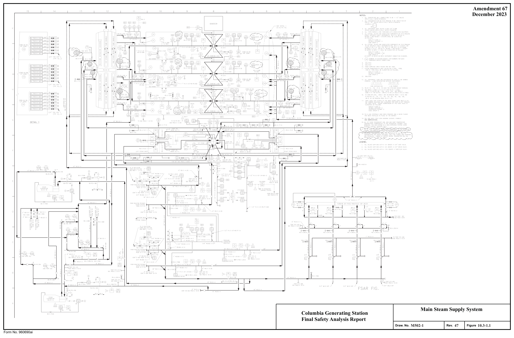
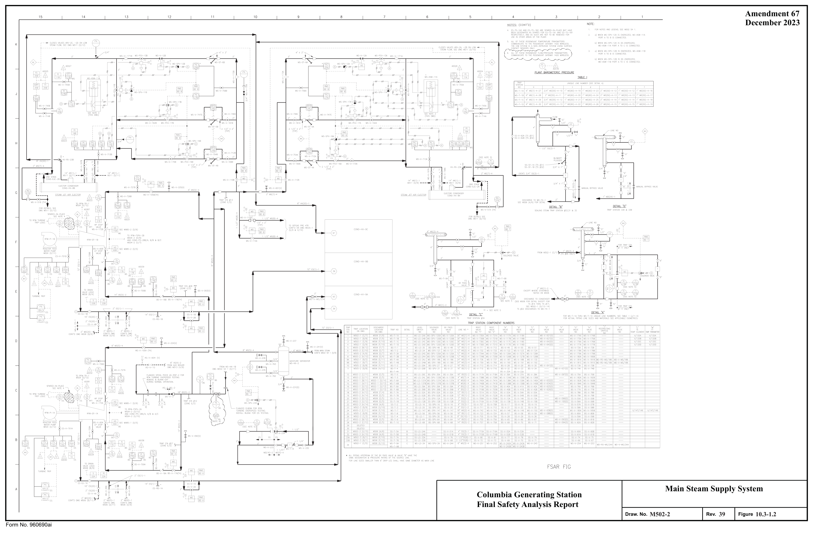
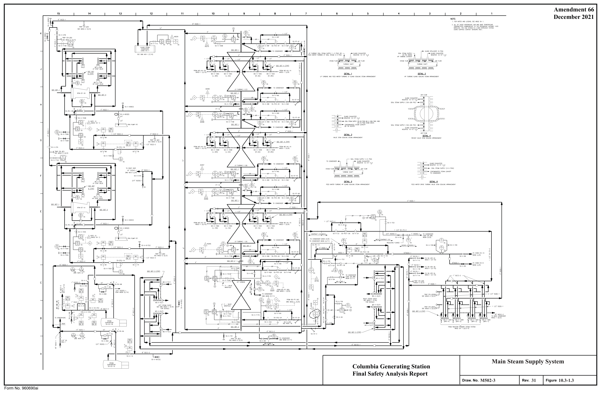
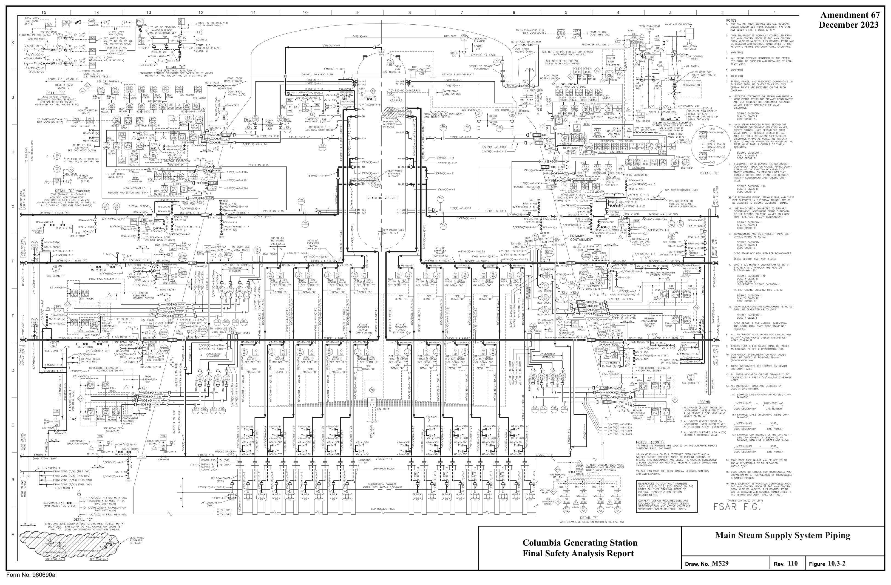

# 10.3 MAIN STEAM SUPPLY SYSTEM

> Columbia Generating Station FSAR — Chapter 10: Steam and Power Conversion System
> Source: `10_chapter-3522-3609.pdf`, PDF pages 29–36 (of 88)
> Amendment 67 compilation (individual pages carry varying amendment dates)

---
<!-- p.29 -->
### 10.3 MAIN STEAM SUPPLY SYSTEM
#### 10.3.1 DESIGN BASES
The main steam supply system is designed for the following conditions:

a. Deliver steam from the reactor to the turbine generator from warmup to 105% of rated load,

b. Provide steam for the second-stage reheaters and steam-jet air ejectors,

c. Bypass steam to the main condenser during startup and in the event steam requirements of the turbine generator are less than that produced by the reactor,

d. Provide steam to the gland seal steam evaporator during startup, low load operation, and shutdown,

e. Provide steam to drive reactor feedwater pumps during startup and low load operation, and

f. Provide steam to the offgas preheaters.

The design pressure and temperature of the main steam piping is 1250 psig and 575°F.

The main steam lines are designed to include accesses to permit inservice inspection and testing
(refer to Sections 5.2.4 and 6.6).

Design codes are given in Table 3.2-1, item 2, Nuclear Boiler System, and item 43, Power Conversion System. The environmental design bases for the main steam supply system are contained in Section 3.11.

#### 10.3.2 SYSTEM DESCRIPTION
The main steam supply system is shown in Figures 10.3-1 and piping drawings are shown in Figures 3.6-32, 3.6-33, 3.6-34, 3.6-35, 3.6-50, 3.6-51, 3.6-53, 3.6-58, 3.6-60, and 10.3-2.
The main steam line piping consists of four 30-in. (26-in. in reactor building) lines extending from the reactor pressure vessel to the main steam header located upstream of the turbine stop and control valves. This header placement ensures a positive means of bypassing steam via the turbine bypass system during transient conditions and startup. Branch lines from the main steam line provide the steam requirements for the reactor feed pumps, second stage reheaters, gland seal steam evaporator, offgas preheaters, and steam jet air ejectors.

#### LDCN-05-009, 06-000
<!-- p.30 -->
The MSIVs are a wye-pattern-type globe valve utilizing pneumatic air to open and spring load with pneumatic air assist to close. Energizing control valves provide pilot and actuator air to open the valve. Deenergizing the control valves removes pilot air which vents actuator opening air and directs air to assist the spring force in closing the valve.

Loss of compressed air failure mode results are a. Loss of compressed air due to loss of nonseismic air lines* results in loss of pilot air and closure of the MSIV by both spring force and pneumatic air cylinder force.

b. Loss of compressed air due to loss of Seismic Category I air lines† results in loss of both pilot air and actuator air with the MSIVs closing by spring force only.

Under normal operation the air supply maintains the required air for holding the valve open and charging the air storage tank. The check valve at the air storage tank inlet ensures a pneumatic supply for assist in closing the valve. No safety-related makeup supply is required for closure of the MSIVs for safe plant shutdown.

The removal of electrical power or failure of both the solenoids on the control valve automatically initiates closure of the MSIVs. Safety-related components ensuring removal of power to the solenoids when required are the only electrical power requirement. Section 9.3.1 describes the compressed air systems.

Equalizing lines connecting steam lines outside of the containment are used to equalize pressure across the main steam line isolation valves prior to restart following a steam line isolation. Assuming all steam line isolation valves have closed, the outer containment isolation valves are opened first and the drain lines are used to warm up and pressurize the outside steam lines. Following warmup the inboard main steam line isolation valves are opened.

#### 10.3.3 SAFETY EVALUATION
Table 3.2-1 lists the applicable seismic category, quality group classification, and safety class for the main steam supply system. The effects of main steam line breaks and other accident conditions outside the containment are evaluated in Chapter 15. Protection against dynamic effects associated with the postulated rupture of piping inside or outside of containment is discussed in Section 3.6.

* Nonseismic lines are those lines supplying air to the isolation valve upstream of the check valve and to the pilot side of the air pilot valves (Figure 9.3-1, detail B).

† Seismic Category I lines include an air storage tank, check valve, and lines from the check valve to the actuator pilot valve (Figure 9.3-1, detail B).

<!-- p.31 -->
#### 10.3.4 INSPECTION AND TESTING REQUIREMENTS
The main steam lines were hydrostatically tested prior to initial operation. Nondestructive testing is performed in accordance with the applicable code requirements.

Preoperational and inservice inspection of the main steam lines and the main steam line isolation valves are presented in Sections 5.2.4 and 6.6.

The use of four main steam lines permits inspection and testing of the turbine stop, control, reheat stop, and intercept valves and main steam line isolation valves during plant operation with a minimum of load reduction.

#### 10.3.5 WATER CHEMISTRY
This section is not applicable to a BWR. See Section 10.4.6 for reactor coolant water chemistry considerations.

#### 10.3.6 STEAM AND FEEDWATER SYSTEM MATERIALS
##### 10.3.6.1 Fracture Toughness
Impact tests in accordance with the size limitations specified in ASME Code Section III, Class 1, are performed on all ASME Code Section III, Class 1, main steam and feedwater materials, as well as Class 2 main steam system materials for all pressure retaining ferritic steel parts. The tests are conducted at a temperature of 45°F or lower in accordance with NB or NC-2310 of the Summer 1972 or Winter 1973 Addendum of ASME Code Section III, as applicable.

##### 10.3.6.2 Materials Selection and Fabrication
All materials used for portions of the main steam system described in this section are included in Appendix I to Section III of the ASME Boiler and Pressure Vessel (B&PV) Code. The requirements for welding the main steam piping from the reactor to the turbine generator are in accordance with ASME Section III, 1971 Edition through the Winter 1973 Addenda. The welding requirements for other steam and feedwater piping are in accordance with ANSI B31.1, October 1973 (see Section 3.2).

Cleaning of components in the main steam system is in accordance with ANSI N45.2.1
(October 1973) or ASTM A380-57 (October 1973) for stainless steel surfaces and Regulatory Guide 1.37.

<!-- p.32 -->
Degree of conformance to the following Regulatory Guides is addressed in Section 1.8: 1.31, Control of Stainless Steel Welding; 1.36, Nonmetallic Thermal Insulation for Austenitic Stainless Steel; 1.44, Control of the Use of Sensitized Stainless Steel; 1.50, Control of Preheat Temperature for Welding of Low-Alloy Steel; and 1.71, Welder Qualification for Areas of Limited Accessibility.

<!-- p.33 -->

*figure on PDF page 33*

<!-- labels/text on this figure page -->
Amendment 67 December 2023
Main Steam Supply System Columbia Generating Station Final Safety Analysis Report
M502-1
47 10.3-1.1 Draw. No. Rev. Figure Form No. 960690ai

<!-- p.34 -->

*figure on PDF page 34*

<!-- labels/text on this figure page -->
Amendment 67 December 2023
Main Steam Supply System Columbia Generating Station Final Safety Analysis Report
M502-2
39 10.3-1.2 Draw. No. Rev. Figure Form No. 960690ai

<!-- p.35 -->

*figure on PDF page 35*

[Vector original (SVG, lossless): fig_page-35.svg](../figures/fig_page-35.svg)

<!-- labels/text on this figure page -->
Amendment 66 December 2021
Main Steam Supply System Columbia Generating Station Final Safety Analysis Report
M502-3
31 10.3-1.3 Draw. No. Rev. Figure Form No. 960690ai

<!-- p.36 -->

*figure on PDF page 36*

<!-- labels/text on this figure page -->
Amendment 67 December 2023
Main Steam Supply System Piping Columbia Generating Station Final Safety Analysis Report M529 110 10.3-2 Draw. No. Rev. Figure Form No. 960690ai

