# 10.4 Other Features Of Steam And Power Conversion System

> Columbia Generating Station FSAR — Chapter 10: Steam and Power Conversion System
> Source: `10_chapter-3522-3609.pdf`, PDF pages 37–88 (of 88)
> Amendment 67 compilation (individual pages carry varying amendment dates)

---
<!-- p.37 -->
### 10.4 OTHER FEATURES OF STEAM AND POWER CONVERSION SYSTEM
#### 10.4.1 MAIN CONDENSER
##### 10.4.1.1 Design Bases
The purpose of the main condenser is to provide a heat sink for condensing the turbine exhaust steam, turbine bypass steam, reactor feed pump drive turbine exhaust steam, and to provide a receiver for miscellaneous drains. It also provides deaeration, noncondensable gas removal, and storage of condensate, which is returned to the condensate system after a period of radioactive decay.

The main condenser is designed for the following conditions (approximate values):

7.7 x 109 Btu/hr a. Duty b. Circulating water flow 555,600 gpm c. Circulating water inlet temperatures 78°F d. Circulating water outlet temperatures 106°F e. Total steam condensed 8,128,700 lb/hr f. Total condensate outflow 15,017,000 lb/hr g. Outlet temperature of condensate 105.0°F h. Condenser pressure (triple)
2.4 in Hg abs (average)
i. Cleanliness factor 85% j. Number of passes 1 k. Air inleakage flow rate limit 50 scfm l. Hotwell storage capacity 163,000 gal

The main condenser is designed to accept a maximum of 25% of the rated reactor steam flow from the turbine bypass system (described in Section 10.4.4) plus 75% of the rated reactor steam flow through the turbine. This steam flow is accommodated without increasing the condenser backpressure to the turbine trip setpoint or exceeding the allowable turbine exhaust temperature.

The main condenser is designed to deaerate the condensate and provide an oxygen content in the hotwell condensate between 30-100 ppb per liter over the entire load range.

Feedwater quality is maintained by the condensate filter demineralizer system described in Section 10.4.6.

The condenser hotwell is designed to contain the condensate that is required during 5 minutes I of full power operation of the turbine. Baffling in the hotwell provides a minimum of 3 minutes condensate hold-up time which permits the decay of short-lived radioactive isotopes.

<!-- p.38 -->
Condenser construction is designed in accordance with requirements of the Heat Exchange Institute, Standards for Steam Surface Condensers (October 1971). Construction of condenser module bundle replacement is designed in accordance with the Tenth Edition.

The piping associated with the condenser is designed, fabricated, inspected, and erected in accordance with ANSI B31.1 (October 1971). Seismic category, safety class, and design codes are discussed in Section 3.2.

##### 10.4.1.2 System Description
Steam from the low-pressure turbine is exhausted directly downward into the condenser shells through exhaust openings in the bottom of the turbine casings and is condensed. The condenser serves as a heat sink for several other flows, such as exhaust steam from the reactor feedwater pump turbines, cascading feedwater heater drains, air ejector condenser drains, gland seal steam condenser drain, feedwater heater shell operating vents, turbine gland seals, and the offgas preheater drains.

Other flows to the condenser originate from the startup vents of the condensate pumps, the reactor feedwater pumps, condensate booster pumps, the condensate pumps, feedwater line startup flushing, reactor feedwater pump turbine drains, low-point drains, condensate makeup, I reactor water cleanup (RWCU), and feedwater heater dumps or drains. All high temperature drains into the condenser shell have impingement baffles or spray pipes to prevent the steam I and entrained water particles from impinging on the surface of the tubes. Stainless steel lagging is provided where required to protect other condenser components. The bypass valves are described in Section 10.4.4.2.

During transient conditions, the condenser is designed to receive turbine bypass steam and feedwater heater and drain tank high-level discharges. The condenser is also designed to receive relief valve discharges from moisture separators, feedwater heater shells, steam seal regulators, and various steam supply lines.

The condenser is cooled by the circulating water system described in Section 10.4.5. Air inleakage and noncondensable gases are removed by the main condenser evacuation system described in Section 10.4.2.

Before leaving the condenser, the condensate is deaerated to reduce the level of dissolved oxygen.

##### 10.4.1.3 Safety Evaluation
During operation, radioactive steam, gases, and condensate are present in the shell of the main condenser. The inventory of radioactive contaminants during operation is discussed in Section 12.2.1.2.2.7. Shielding for and controlled access to the main condenser is provided in

<!-- p.39 -->
Chapter 12. The means of controlling and detecting the leakage of this radioactive inventory in and out of the main condenser is discussed in Sections 11.3 and 11.5.2.2.

Hydrogen is generated by radiolysis in the reactor and injected by the Hydrogen Water Chemistry system.

Hydrogen generation buildup during operation is prevented by continuous evacuation of the main condenser by the air removal system (see Section 10.4.2) and the offgas system (see Section 11.3.2). The radiolytic decomposition rate at rated power is 102 scfm of hydrogen and 51 scfm of oxygen. Hydrogen is introduced into the condensate/feedwater system to mitigate intergranular stress corrosion cracking (IGSCC). The addition of hydrogen into a feedwater system results in reduced radiolysis. The net hydrogen in the steam during Hydrogen Water Chemistry (HWC) is less than during normal water chemistry (NWC) (without hydrogen injection). During plant shutdown, there are no hydrogen sources to the condenser. Hydrogen injection is shut down whenever the reactor is shut down. The inadvertent introduction of hydrogen to condensate/feedwater, from HWC, during extended shutdowns is prevented by isolation of the hydrogen supply, and purging the hydrogen injection system with nitrogen.

The main condenser is not required for safe shutdown of the reactor and does not perform safety functions. However, degradation of the condenser in the form of a leak, loss of circulating water, or air ejector malfunction could lead to a loss of condenser vacuum which removes the effective ability of the condenser as a heat sink. As a consequence, loss of vacuum provides a main steam isolation valve closure signal. See Section 7.3.1.1.2 for a I further description. Due to the distance of the main condenser from safety-related equipment areas, there will be no damage to necessary safe shutdown equipment from flooding caused by failure of the condenser.

Exhaust hood overheating protection is provided by sprays located downstream of the last-stage blades of the turbine.

Loss of main condenser vacuum causes the turbine to trip. Should the turbine stop valves, control valves, or bypass valves fail to close on loss of condenser vacuum, rupture diaphragms on each turbine exhaust connection to the condenser protect the condenser and turbine exhaust hoods against overpressurization. In this event, steam would exhaust to the turbine building.

The main condenser is constructed with titanium tubes and the tubesheet is titanium clad carbon steel. Corrosion protection of the wetted carbon steel water boxes, inlet and outlet valves, and circulating water piping is being performed by a combination of a high quality coating, the use of stainless steels, and sacrifical anodes. The sacrifical anodes attach to the wall of the water boxes and will provide protection in case of any coating breaches or coating failure. All small bore nozzles on the circulating water side penetrating the water box 4 inches and less are of stainless steel. The water box coating will wrap into these connections to

<!-- p.40 -->
prevent any carbon steel exposure. Isolation kits will electrically isolate any attached drain piping to help minimize any stray current corrosion.

##### 10.4.1.4 Tests and Inspections
The condenser shell received a field hydrostatic test prior to initial operation. This test consisted of filling the condenser shell with water, and inspecting the entire tube sheet and shell welds and surfaces for visible leakage and/or excessive deflection.

The condenser module bundle replacement final test for tube or joint leakage was performed using a vacuum-bubble leak test.

During normal plant operation, the following parameters are routinely monitored:

a. Condenser vacuum, b. Conductivity, and c. Condensate temperature.

Any divergence from established limits for these parameters requires an investigation and testing as necessary to determine the extent of the divergence and correct the problem.

##### 10.4.1.5 Instrumentation
The condenser shell is provided with local and remote hotwell level and pressure indication.
The remote indication is by means of indicators and alarms in the main control room. The condensate level in the condenser hotwell is maintained within proper limits by automatic controls that provide for transfer of condensate to and from the condensate storage tanks as needed to satisfy the requirements of the steam system. Condensate temperature is measured in the outlet line of the condensate pumps.

Turbine exhaust hood temperature is monitored and controlled with water sprays to provide protection from exhaust hood overheating.

A main condenser low vacuum alarm is provided. Automatic turbine trip is activated on continued loss of main condenser vacuum followed by main steam isolation valve closure on further degradation of condenser vacuum. See Section 7.3.1.1.2 for a further description of main steam isolation.

Water box pressure and temperature measurements are provided.

Circulating water inleakage to the main condenser is monitored by conductivity elements located in the tube sheet troughs, in the condenser outlet line, and at the condensate pump discharge line (alarm in the main control room). Conductivity of the condensate demineralizer

<!-- p.41 -->
influent is monitored and alarmed in the radwaste control room. A conductivity/chemical species sampling and measurement system is available for characterizing inleakage. Leakage is controlled (prevented) to the extent possible by maintaining chemistry control in the circulating water to provide optimization between scale formation and corrosion. Tube leakage can be corrected by isolating and draining the tube sections containing leaking tubes and then locating and plugging the leaking tube.

#### 10.4.2 MAIN CONDENSER EVACUATION SYSTEM
##### 10.4.2.1 Design Bases
The main condenser evacuation system removes gases from the turbine generator, the reactor feedwater pump turbines, and the main condenser during plant startup and maintains the condenser essentially free of noncondensable gases during operation. This system handles all noncondensable gases which may enter the main turbine and reactor feed pump turbines through their seals, the condensate piping, or which is generated by dissociation of water in the reactor. The main condenser evacuation system discharges to the offgas system through the steam jet air ejectors during normal operation (see Section 11.3).

The piping system associated with the main condenser evacuation system is designed, fabricated, and erected in accordance with ANSI B31.1 (October 1971). The air removal equipment is designed in accordance with the standards for Steam Surface Condensers, published by the Heat Exchange Institute (October 1971).

##### 10.4.2.2 System Description
I The main condenser evacuation system includes, for normal operation, two 100%-capacity I steam jet air ejector units. Each unit consists of a twin-element first-stage steam jet air ejector and a single-element second-stage, steam jet air ejector which discharges to the offgas system.
The capacity of each steam jet air ejector unit is 663 scfm at 70°F total equivalent of mixed gases and vapor at 1-in. Hg absolute. The main condenser design air inleakage flow rate is 50 scfm.

Two mechanical vacuum pumps are provided for hogging operation during startup (see Figure 10.4-1). During startup, both mechanical vacuum pumps can be used to rapidly remove air and noncondensable gases from the main condenser.

The discharge from the vacuum pumps is routed with the gland seal steam exhauster discharge to the reactor building elevated release duct. Because the reactor power is low, a minimal amount of activity is discharged to the environment. A radiation detector monitors the discharge and isolates the vacuum pumps when the radiation level exceeds established limits.
The vacuum pumps operate until sufficient steam pressure is available to start the steam jet air ejector.

<!-- p.42 -->
The source of steam to operate the steam jet air ejector is taken from the main steam header branch line, with steam pressure being regulated by the steam jet air ejector control valves.
Air inleakage, noncondensable gases, as well as entrained water vapor, are removed from the main condenser by the first stage of the steam jet air ejector. The gas-vapor mixture is then discharged into the ejector condenser where the vapor is condensed. The resulting condensate is drained back to the main condenser via a loop seal. The ejector condenser is cooled by the condensate discharge from the condensate pumps. The noncondensing second stage of the steam jet air ejector removes the noncondensable gases and some entrained vapor from the ejector condenser and exhausts them to the offgas system (see Section 11.3). The offgas system processes the noncondensable gases and limits the release of radioactive gases to the environment.

##### 10.4.2.3 Safety Evaluation
The main condenser evacuation system is not safety related. Consequently, the system is not designed to Seismic Category I requirements. Safety class and design codes are presented in Section 3.2.

The radionuclides in the effluent from the steam jet air ejector unit have been evaluated in Section 11.3.

The offgas from the main condenser contains hydrogen gas from dissociation of water in the reactor and from hydrogen injection. In the second-stage steam jet air ejector, sufficient steam is provided to dilute the hydrogen content to less than 4% by volume to keep the mixture below flammability limits.

##### 10.4.2.4 Tests and Inspections
The mechanical vacuum pumps and the steam jet air ejectors were cleaned, inspected, and tested at the vendors’ plant. System preoperational tests as described in Chapter 14 were successfully performed after installation. Main condenser evacuation system monitoring during normal operation along with routine maintenance and inspection ensures proper functioning and performance in accordance with its design bases. Instrumentation permits the operators to monitor system performance during operation.

##### 10.4.2.5 Instrumentation
A radiation monitor is installed in the air removal piping discharge to the reactor building elevated release duct (a common exhaust line to the mechanical vacuum pumps and the gland seal steam condenser exhaust). A high-radiation signal from the monitor will trip both mechanical vacuum pump motors: The trip causes the suction and discharge valves to close and trips the mechanical vacuum pump seal water pumps. The vacuum pump is equipped with instrumentation to ensure proper operation (Figure 10.4-1).

<!-- p.43 -->
December 2005 l A main steam line radiation monitor (MSLRM) high-radiation signal also trips both mechanical J vacuum pump motors. The signal will also trip both gland seal steam condenser exhauster motors (see Section 11.5.2.1.1).

Low steam flow to the second-stage air ejector causes a signal to close the inlet gas valves to the first-stage air ejector. Steam pressure indicators for the first- and second-stage ejectors and a steam flow indicator for the second-stage ejector are provided in the main control room.

#### 10.4.3 TURBINE GLAND SEALING SYSTEM
##### 10.4.3.1 Design Bases
a. The turbine gland sealing system prevents air leakage into, or radioactive steam leakage out of, the main turbine and reactor feedwater pump turbines; and

b. The turbine gland sealing system is designed to provide nonradioactive (clean)
sealing steam, at all loads, to the turbine shaft glands and valve stems (main stop, control reheat stop, intercept, and bypass valves). The condensate from the gland seal steam condenser is returned to the main condenser, and the noncondensable gases (inleaking air) are exhausted to the reactor building elevated release duct.

The turbine gland sealing system is in strict conformance with the latest edition in effect at the time of fabrication of the applicable ANSI, ASME, and IEEE standards. The major portion of manufacture was performed during 1975. The gland seal steam evaporators are designed, fabricated, inspected, tested, and stamped in accordance with Section VIII of the ASME Boiler and Pressure Vessel (B&PV) Code and the Standards of the Tubular Exchanger Manufacturers Association, Class R (May 1972). Seismic category, safety class, and design codes are provided in Section 3.2.

##### 10.4.3.2 System Description
The turbine gland sealing system consists of two 100%-capacity gland seal steam evaporators, seal steam pressure regulators, seal steam header, gland seal steam condenser, exhauster blowers, and the associated piping, valves, and instrumentation (see Figures 10.3-1 and 10.4-2). Sealing steam for turbine shaft seal glands and valve stem seal glands (stop, control, I I reheat stop, intercept, and bypass valves) is supplied from the seal steam header at 200 psig.
The source of sealing steam is from the gland seal steam evaporators or the auxiliary steam boiler. The sealing steam is produced in an evaporator which is heated by extraction steam taken from the high pressure turbine. The condensate fed to the evaporator is taken from the suction header of the reactor feedwater pumps in the feedwater system. During startup and low load operations, a branch line taken off the main steam header supplies the necessary heating steam for the evaporator.

<!-- p.44 -->
Separate seal steam regulators are provided to regulate the pressure of sealing steam for the high pressure turbine, each low pressure turbine, each reactor feed pump turbine shaft seal, the bypass valve assembly, and the main stop and control valve assembly stems.

Since the low pressure (LP) turbine and reactor feedwater pump turbine exhaust pressures are at a vacuum, sufficient sealing steam is supplied to maintain positive pressure in the glands to prevent air inleakage along the shaft. The high pressure (HP) turbine exhaust pressure varies with load and is approximately 177 psia at its maximum. The system is designed to maintain the seal steam supply to the HP turbine glands at a pressure of 16 to 20 psi above HP turbine exhaust to prevent HP turbine exhaust steam leakage through the shaft gland seal.

The main stop, control, and bypass valve stems are provided with an intermediate zone to which sealing steam is supplied. This nonradioactive steam leaks in both directions, towards the HP stem leakoff and towards the LP stem leakoff. The HP stem leakoff contains radioactive steam and is directed to an LP feedwater heater. The LP steam leakoff is nonradioactive and is sent to the gland seal steam condenser. The reheat stop and intercept valve stems are supplied with sealing steam at a pressure greater than the crossover pressure so that any leakage that occurs is into the crossover pipes.

The reactor feedwater pump turbines at the high pressure end are provided with sealing steam at an intermediate point in the turbine gland seal. This nonradioactive steam leaks in both directions, towards the HP end leakoff and towards the LP end leakoff. The HP leakoff contains radioactive steam and is directed to the sixth stage of the turbine. The LP steam leakoff is nonradioactive and is sent to the gland seal steam condenser. Sealing steam for the reactor feed pump turbine LP stop valve, HP stop valve, and control valve is provided in a similar manner.

The outer leakoff of all glands is routed to the gland seal steam condenser which is maintained at a slight vacuum by the exhauster blower. During plant operation, the gland seal steam condenser and one motor-driven blower is in operation. The exhauster blower discharges gland air inleakage to the atmosphere via the reactor building elevated release duct. The gland seal steam condenser is cooled by the main condensate flow.

The steam evaporator is a shell-and-tube heat exchanger designed to provide a continuous supply of clean sealing steam to the seal steam header.

##### 10.4.3.3 Safety Evaluation
The turbine gland sealing system is not safety related.

A supply of clean steam is always available from either of two 100%-capacity steam evaporators or the auxiliary steam boiler. Should the steam packing exhauster fail to function,

<!-- p.45 -->
the sealing steam would continue to flow into the turbine and would be the only steam that could flow out of the glands and into the turbine building. Therefore, no reactor steam would be released to the environment.

A radiation monitor in the discharge of the blower alerts the operator to tube ruptures in the gland seal steam evaporator or other system malfunctions. Sealing system radioactive releases are discussed in Section 11.3.

Relief valves in the seal steam system prevent excessive steam pressure. The valves vent to the condenser and atmosphere.

##### 10.4.3.4 Tests and Inspection
Prior to installation at the site, the gland seal steam evaporator and gland seal steam condensers were cleaned, inspected, and tested at the vendor’s plant. Preoperational testing of this equipment included a hydrostatic test for visual inspection of welded joints to confirm leaktightness. The turbine gland sealing system is regularly inspected and monitored during operation to ensure proper functioning and performance in accordance with its design bases.

##### 10.4.3.5 Instrumentation
The level in both the shell and tube sides of the steam evaporator are controlled by level-control valves: the condensate (shell) side by maintaining the water level surrounding the tubes and the steam side by maintaining the water level in the steam evaporator drain tank.
The flow of heating steam is regulated by the steam pressure control valve.

Liquid level in the gland seal steam condenser is maintained by a trap connected to the main condenser. A local pressure indicator and high-level alarm switch are provided on the gland seal steam condenser. Temperature and pressure gauges and test points are provided to I monitor operation and testing of the system. Instruments for monitoring system operation are provided in the main control room. Low and high level alarms are provided on the gland seal steam evaporator.

#### 10.4.4 TURBINE BYPASS SYSTEM
##### 10.4.4.1 Design Bases
a. The turbine bypass system controls reactor steam pressure by sending excess steam flow directly to the main condenser. This permits independent control of reactor pressure and power during reactor vessel heatup to rated pressure prior to and while the turbine is brought up to speed and synchronized under turbine speed-load control and when cooling down the reactor. Following main turbine generator trips and during power operation when the reactor steam generation

<!-- p.46 -->
exceeds the transient turbine steam requirements, the turbine bypass controls reactor overpressure within its capacity and in accordance with the steam generation rate;

b. The turbine bypass system capacity is 25% of rated reactor steam flow. The bypass system can accommodate a 25% turbine load rejection without causing a significant change in reactor steam flow; and

c. The turbine bypass valves are capable of remote manual operation.

##### 10.4.4.2 System Description
The turbine bypass system consists of four hydraulically operated control valves which are mounted on a valve manifold (see Figure 10.4-3). They are connected to the main steam line I header upstream of the turbine main stop valves by four 10 in. lines. The four individual valves lower the pressure of the steam by reducing its flow velocity before it enters the condenser system.

Each valve outlet discharges into the manifold which is piped directly to pressure-reducing perforated pipes located in the condenser shell (see Figure 10.3-1).

The turbine DEH control system is designed to prevent spurious or unnecessary opening of the bypass valves, due to control signal noise or minor transients. The four valves in the manifold are operated automatically by the control system. The amount of steam flow allowed to pass through the turbine is limited by the DEH control system demand signal, which limits the amount that the governor valves can open. The DEH control system controls the governor valve position to maintain reactor pressure. When the governor valve opening position, required to maintain reactor pressure, exceeds the load demand limit, a signal is sent to the bypass valves to open to maintain reactor pressure. The bypass valves automatically trip closed whenever the vacuum in the main condenser is greater than approximately 23 in. Hg absolute. They have regulation capability and a fast-opening response approximately equivalent to the fast closure of the turbine stop and control valves.

The turbine bypass system piping and valves are designed to the class and seismic category presented in Table 3.2-1. The valve body is forged carbon steel while the internals are stainless steel. The environmental design bases for this system are contained in Section 3.11.

Each valve is sized for 8% of the total rated flow; however, all four valves are designed for 25% of the total flow. If the bypass system capacity is exceeded, the main steam relief valves open on high reactor pressure and excess steam is vented to the suppression pool.

<!-- p.47 -->
##### 10.4.4.3 Safety Evaluation
The effects of a malfunction of the turbine bypass system valves and the effects of such failures on other systems and components are evaluated in Section 15.2.2.

All safety-related components and the turbine speed control system are located remote from the turbine bypass piping and valves. The bypass system is located on the second floor of the turbine building (see Figure 1.2-3) and the speed control and safety-related components are located on the floor above, thus being separated by a concrete floor and wall making any adverse affects from a high-energy line failure in the turbine bypass system extremely unlikely.
The turbine overspeed protection system is a fail-safe design, as described in Section 10.2.2.

The effects of a steam line break on the safety-related components in the turbine building are discussed in Section 3.6.1.

##### 10.4.4.4 Tests and Inspections
The opening and closing of the turbine bypass system valves were checked during initial startup and shutdown for performance and timing. The bypass steam lines upstream of the bypass valves to MS-V-146 were hydrostatically tested to confirm leaktightness. Radiography and visual inspection of all pipe weld joints were performed on this piping. The branch connections and branch lines of this piping were examined in accordance with ANSI B31.1 rules.

Each turbine bypass valve can be tested independently and remotely during plant operation.
The testing is conducted as required by the Technical Specifications.

##### 10.4.4.5 Instrumentation
The controls and valves are designed so that the bypass valves shut on loss of control system electric power or hydraulic pressure. For testing the bypass valves during operation, the stroke time of the individual valves is increased during testing to limit the rate of bypass flow increase and decrease to approximately 1% per sec of reactor rated flow. Upon turbine trip or generator load rejection, the start of bypass steam flow is not delayed more than 0.1 sec after the start of the stop valve or the control valve fast closure motion. A minimum of 80% of the rated bypass capacity is established within 0.3 sec after the start of the stop valve or the control valve closure motion. For more detail refer to Section 7.7.1.5.

<!-- p.48 -->
#### 10.4.5 CIRCULATING WATER SYSTEM
##### 10.4.5.1 Design Bases
The circulating water system is designed to provide cooling water for the condenser using the atmosphere as a heat sink via six circular mechanical-induced draft cooling towers designed to remove 7.962 x 109 Btu/hr from the circulating water. The design heat gain in the condenser is approximately 7.7 x 109 Btu/hr. In addition, the cooling towers have the capacity to cool the plant service water during normal operation and the standby service water during shutdown operation. The operation of the towers is not essential to the safety of the plant.

Makeup for tower evaporation, wind loss, and blowdown is obtained from the Columbia River by makeup pumps. Cooled blowdown from the cooling towers is discharged to the river.

Chemical treatment is provided for the circulating water system to preclude scale, biological growth, and consequent fouling of heat transfer surfaces.

The piping system associated with the circulating water system is designed, fabricated, inspected, and erected in accordance with ANSI B31.1 (October 1973) and AWWA C201.
Major piping components are fabricated from carbon steel. Seismic category, safety classification and design codes are given in Section 3.2.

##### 10.4.5.2 System Description
The circulating water system is shown schematically in Figure 10.4-4. The circulating water system is a closed cycle cooling system using six mechanical induced draft, cross-flow cooling towers. Three circulating water pumps, each having a total head of 95 ft at 186,000 gpm, are provided. These pumps, located in the circulating water pump house, take suction from a common intake plenum and discharge through a common 12-ft-diameter pipe to the three waterboxes of the single-pass triple-pressure zone condenser. The water from the condenser is returned to the cooling towers, cooled, and collected in the cooling tower basins which supply the circulating water pumps intake plenum.

In addition, as part of the cooling tower piping, a cooling tower bypass is provided for plant startup during the winter to prevent icing conditions at the towers. Inlet motor-operated valves are provided at each tower to isolate a tower for maintenance.

The towers are designed such that the buildup of ice will not restrict air flow through the louvers. Temperature range and low water temperature limits are maintained during reduced heat loads by shutting down individual towers (fans and flow) as required. In extreme cold weather, desired cold water temperatures can be achieved with all fan motors shut down but free to rotate with natural draft through the towers.

<!-- p.49 -->
The six mechanical draft cooling towers are located such that there can be no physical interaction between them and plant structures important to safety in the unlikely event of a tower collapse.

The quantity of makeup water to the system is dependent upon cooling tower evaporation, drift losses, and system blowdown requirements. The system blowdown quantity is dependent on the concentration of dissolved solids allowed in the circulating water. The concentration of dissolved solids varies with operating status and the cycles of concentration which are controlled by operation of the blowdown valve. Makeup to the circulating water system is provided via the cooling tower makeup pumps located in a pump house adjacent to the Columbia River. The makeup pumps are designed to pump 12,500 gpm each with a TDH of 204 ft; the makeup flow can be directed into the circulating water bay or to one or both of the plant service water pump suctions by means of a weir box and sluice gate arrangement located in the circulating water inlet bay.

The evaporative-type cooling towers have the potential for creating visible plumes of water vapor under certain atmospheric conditions. The cooling tower system is designed to keep this environmental impact minimal. The cooling tower plumes rarely produce ground level fog or ice in the basin area where the plant is located and do not restrict traffic at the local airports.
Since fogging occurs naturally in the area, the estimated incremental occurrences of fog attributable to cooling tower operations are small compared to the natural occurrences.

Cooling tower drift has been identified as a cause of arcing in switchyard equipment.
Switchyard equipment is monitored and cleaned (as necessary) to preclude this phenomenon.
Offsite environmental effects are monitored per Section 4.2.1 of the Environmental Protection Plan.

The radiological impact and the impact of thermal discharges on the environment are insignificant. The effect of cooling tower blowdown has no significant effect on the Columbia River temperature, and the environmental effect of chemical discharges is considered negligible. The system has no measurable effect on area groundwater.

The environmental considerations mentioned above are discussed in detail in Chapter 5 of the Environmental Report - Operating License Stage.

##### 10.4.5.3 Safety Evaluation
The circulating water system is a non-safety-related system. Consequently, the circulating water system is not designed to Seismic Category I requirements. See Section 9.2.5 for a description of the ultimate heat sink which is designed to perform safety-related functions.

The condenser design ensures that the pressure on the tube side is always maintained higher than the pressure on the shell side, thus eliminating leakage into the circulating water system

<!-- p.50 -->
j H should tube failure occur. Consequently, the design of the circulating water system precludes radioactive leakage into the system. Chemicals used to treat the CW system to preclude scale I and biological growth and to control pH are evaluated in accordance with administrative controls to ensure compatibility with systems and components.

Two evaluations were performed to determine the effects of a postulated failure in the circulating water system inside the turbine building: a “realistic evaluation” and a bounding evaluation. For the “realistic evaluation,” a moderate energy crack was postulated to occur in the circulating water system barriers (e.g., the rubber expansion joints) at the inlet to the main condenser. The inlet side was selected because it yields the severest results. For the bounding evaluation, a complete circumferential expansion joint break was assumed.

The entire condenser area is drained by means of sumps (see Figure 9.3-9), each equipped with duplex pumps. Sumps T-2 and T-3, servicing the inlet and outlet of the condenser, each
---~l~-----------------1 I have 50 gpm pumps. Each of these sumps is equipped with a level alarm and is therefore capable of detecting a circulating water system barrier failure. The level alarm will annunciate in the main control room upon reaching high level, providing a means of detecting the postulated failure within 5 minutes.

“Realistic” Break

The crack area for this postulated failure was assumed to be equal to one-half the pipe diameter times one-half the pipe wall thickness.

d x t A = 2 2 (see Section 3.6.2.1.4.2)

The flow exiting from such a crack would be an orifice flow. The head at expansion joint for normal three-pump operation at 186,000 gpm each was determined (from system energy gradients) to be 90 ft. The flow for these conditions was calculated to be

Q = 1737 gpm

The system has different operating pressures for the various modes of pump operation. The piping was designed for an internal pressure of 60 psig, which is well above the design energy I gradient.

The motor-operated inlet and outlet valves at the condenser are designed and manufactured to close in 60 sec to avoid excessive pressures caused by fast valve closure. Therefore, rapid valve closure is not a consideration. After closure of the inlet and outlet valves, however, the system will be operating with two-thirds of the condenser capacity. With three circulating water pumps in operation and two sections of the condenser in operation, the system flow as determined from the pump operating point diagram will be approximately 450,000 gpm.

1•

<!-- p.51 -->
Comparing the system energy gradients for this mode of operation to that when all three condenser units are in operation, the resultant difference in pressures will be

a. At the inlet side, an increase of approximately 4.3 ft of head (2 psi) occurs, b. At the outlet side, a decrease of approximately 5.2 ft of head (2 psi) occurs.

Detection of the postulated failure will occur within 5 minutes, as described above, by the annunciation in the control room of the sump high level alarm. It is assumed that there will be a 15-minute time allowance for an operator in the control room to check the circulating water system barriers and close both the inlet and outlet valves of one unit of the condenser as may be required. This closure is accomplished by the activation of a remote manual switch in the control room, and therefore no control circuitry time delays nor coastdown times are involved.
Flow will continue, however, after valve closure for about 106 minutes at a decreasing rate, until the remaining water from the condenser is completely discharged.

In the first 5 minutes after a crack, 8435 gal of water will spill into the inlet basin. The capacity of each basin and its capability to store excess flow were calculated to be as follows:

a. Inlet basin: 22,500 gal from el. 436 to el. 441, b. Outlet basin: 27,500 gal from el. 436 to el. 441, and c. Net volume under condenser: 180,500 gal from el. 433 to el. 441.

The time required to fill the inlet basin, after a postulated crack occurs, is computed to be 13.3 minutes. This includes the 50-gpm outflow from the sump pump. The circulating water leakage flow will continue for 6.7 minutes after filling the inlet basin, until reaching the total estimated shutoff time of 20 minutes. It can be assumed that 10% of this water will flow out over the floor at el. 441, and the remainder, about 10,170 gal, will flow into the condenser basin area. During this same time period, four sump pumps in the condenser basin area will have alternately pumped out 670 gal, leaving 9500 gal or 0.42 ft of water in the condenser basin. The rate of rise of water, therefore, is 0.021 ft/minute during the first 20 minutes after the postulated crack occurs. Note that on the high sump level, both pumps run simultaneously rather than alternately, thus doubling the calculated outflow capacity.

After the valves are closed, the water contained in the condenser unit water box will continue to discharge to the area. The quantity of water remaining is estimated to be 87,000 gal. The flow will vary with a diminishing head, the head going from about 25 ft to 0 ft. Using a 20-ft head and the same orifice flow criteria, the rate of flow will be approximately 819 gpm, discharging the remaining water in about 106 minutes. There will be an outflow from all the sump pumps of 150 gpm, with 10% of the flow from the crack again assumed to flow out over the floor. The water will accumulate in the condenser basin at about 590 gpm. After 106 minutes, the water level in this basin will rise an additional 2.77 ft, at 0.0261 ft/minute.
The total height of water when the discharge has stopped is therefore 3.19 ft to el. 436.19.

<!-- p.52 -->
H This elevation is 5 ft below the floor level of the turbine building (el. 441), thus there will be no impacts on safety-related equipment from this event.

Boundary Evaluation

A complete circumferential expansion joint break in the circulating water system would result in the release of large amounts of water into the turbine generator building. The water would fill the net volume under the condenser, tripping the sump high level alarms that annunciate in the main control room. Remote-manual operation of the circulating water pumps and butterfly valves is provided in the main control room to mitigate the accident.

Disregarding operator action, however, the following evaluation is provided. Water would spill across the grade level floor of the turbine generator building at el. 441 ft, exiting through the railroad bay and access doors. Water could flow into the reactor building stairwells and elevator shafts from 441-ft el. down to the 422-ft 3-in. el., eventually filling the stairwells and elevator shafts with water. There is no safe shutdown equipment located in the stairwells or I elevator shafts. The access doors to the emergency core cooling system (ECCS) and RCIC/CRD pump rooms at el. 422 ft 3 in. are designed to withstand a static head of I I approximately 44 ft (measured from centerline of door) of water. All penetrations into the reactor building below the 466 ft el. are designed to minimize flooding effects. Flooding will not affect any required safe shutdown equipment in the reactor building.

Water could also spill across the grade level floor into the radwaste/control building. The basement level of this building is 437 ft. It is thus possible to flood this level with 4 ft of water before the water would exit at grade level (441 ft) through access doors. No safety-related components will be affected by this flooding. The railroad bay and access doors of the turbine generator building are not watertight and are not designed to withstand any static head of water; therefore, no significant depth of water could accumulate in the turbine generator building. All safety-related equipment in the turbine generator building is located above the 471-ft el. and would not be affected.

In conclusion, a complete circumferential expansion joint break in the circulating water system inside the turbine generator building would have no effect on safety-related equipment in the turbine generator building and no effect on safe shutdown equipment in the reactor building.

Discharge operation of water accumulated under the condenser shall be performed in accordance with radioactivity checking requirements for sump discharges.

##### 10.4.5.4 Tests and Inspections
All system components, except the condenser, are accessible during operation and may be inspected visually. The circulating water pumps were tested during preoperational testing.
1•

<!-- p.53 -->
H

The condenser was field hydrostatically tested in accordance with the Steam Surface Condenser Standards published by the Heat Exchange Institute.

All major components were inspected and cleaned prior to installation in the system, and preoperational tests were performed after system installation.

Sampling stations and test connections are provided to allow inservice testing during operation of the system.

##### 10.4.5.5 Instrumentation
The circulating water pumps are individually equipped with shutoff valves that are interlocked with their respective pump motors to prevent startup unless the valve is closed and to prevent I shutdown unless the valve is less than 15% open. Isolation valves are provided at the inlets of each condenser shell, which enable any water box to be isolated. The isolation valves are equipped with limit switches and are operated by manual switches located in the main control room. The system is monitored for temperature, pressure, level, and pH.

#### 10.4.6 CONDENSATE FILTER DEMINERALIZER SYSTEM
##### 10.4.6.1 Design Bases
The condensate filter demineralizer rated system capacity is 32,000 gpm, which is in excess of the 100% system capacity of 31,000 gpm.

As a design basis for this system, the effluent water quality is as follows:

NORMAL OPERATION FEEDWATER QUALITY TO THE REACTOR a

Parameter Frequency Limit Sample

0.1 mho/cm at 25°C b Continuous Conductivity pH 6.5 to 7.5 at 25°C As Required Total Metallic Impurity 15 parts per billion (ppb) Weekly; collected Filter Sample continuously Total Copper (Cu)
2 ppb Weekly Total Iron 5 ppb Weekly

________________________ a Measure after the last feedwater heater unless noted.
b Measured at demineralizer outlet.

<!-- p.54 -->
Nickel (Ni)
2 ppb Weekly Total Silica (SiO2)
5 ppb As Required 10 ppb c Daily Chloride (Cl)
Oxygen 20 to 200 ppb Continuous

The design basis effluent water quality and sampling frequency was originally specified based on vendor fuel warranty and regulatory guidance. Since that time, enhanced analytical and testing techniques have determined that considerably lower concentrations of impurities can cause damage to system components. Through industry sponsored research, guidelines that are much more restrictive than the original design specifications have been developed and adopted.
The implementation and documentation of these more restrictive specifications is controlled by chemistry administrative procedures.

This results in the system being designed to maintain feedwater quality such that the reactor water limits are not exceeded. This is achieved by the following:

a. Operation of the system to a less than 0.065 μS/cm conductivity end-point.
After reaching this limit during normal operating conditions, the filter-demineralizer(s) are taken off line, backwashed, and precoated;

b. Establishing metallic impurity limits to preserved fuel performance by controlling the amount available for deposition on heat transfer and fluid transport surfaces. In addition, controlling corrosion product input minimizes the radiological impact from corrosion product activation, transport, and deposition;

c. Controlling undesirable anionic (chloride and sulfate) impurity input to maintain the reactor coolant concentrations below the levels where stress corrosion cracking is induced; and

d. Control of feedwater dissolved oxygen levels between 20 and 200 ppb falls in the minimal portion of the combined generalized and pitting corrosion curve for carbon steel piping. Piping is preserved and corrosion product activation, transport, and deposition are restricted.

This ensures that in conjunction with the RWCU system, reactor water quality will be maintained.

________________________ c Or 25% of influent level, whichever is lower, to maintain reactor water quality of 200 ppb at rated operating pressure.

<!-- p.55 -->
The condensate filter-demineralizers are designed, fabricated, tested, and stamped in accordance with the ASME B&PV Code Section VIII, Division 1 (November 1971). Seismic category, safety class, and design codes are presented in Section 3.2.

##### 10.4.6.2 System Description
The condensate filter demineralizer system consists of the necessary piping, valves, appurtenances, and instrumentation to control the condensate impurity concentration during plant operation (see Figure 10.4-5).

Six filter demineralizers are provided to polish 100% of the condensate flow: five or six are normally in operation at full power. The six filter demineralizers and associated piping, valves, and instrumentation are similar and piped in parallel.

Each filter demineralizer has an associated hold pump which is brought into service during low flow conditions to recirculate condensate through the filter demineralizer and hold the precoat material on the filter elements.

The individual effluent lines from the filter demineralizer vessels are provided with resin traps to prevent passage of ion exchange resins to the feedwater system.

The system design incorporates the following service systems which are common to all filter demineralizers:

a. Chemical mixing and supply system to circulate a chemical cleaning solution
(e.g., inhibited citric acid) for the purpose of cleaning the filter demineralizer units and directing the waste to the chemical waste system (this system is not normally used);

b. A backwash system to remove the spent resin from the filter demineralizers and direct the radioactive waste to the backwash receiving tank (for further discussion of the backwash system discharge to the liquid waste management system, see Section 11.2); and

c. A precoat system wherein fresh precoat material is prepared and then circulated through the filter demineralizers to coat the filter elements.

The system control panels are located outside the equipment areas to permit remote operation of the condensate filter demineralizers without requiring the operator to enter high radiation areas.

The control panel has a graphic display. All major isolation valves, position indicators, and instrumentation are displayed at their respective locations.

<!-- p.56 -->
##### 10.4.6.3 Safety Evaluation
The condensate filter demineralizer system removes corrosion products, condenser inleakage impurities, and impurities present in the condensed steam.

Purified condensate and feedwater limits ensure sustained, safe plant operation by preserving the integrity of nuclear steam supply system components, vessel internals, fuel, and transport piping.

Due to improved water quality limits, any appreciable circulating water inleakage would result in water chemistry conditions outside acceptable limits and require action(s) to return the water quality to within applicable limits for continued plant operation.

Compliance with Regulatory Guide 1.56 is discussed in Section 1.8.

##### 10.4.6.4 Tests and Inspections
The original condensate filter demineralizers, precoat and chemical mixing tanks, holding pumps, and system valves were hydrostatically tested prior to shipment by the manufacturer.

Field tests were performed after equipment installation to check satisfactory operation and functioning of control equipment, as well as to demonstrate guarantee performance. The guarantee performance test was governed by the ASTM Testing Method Procedures for High Purity Industrial Water.

##### 10.4.6.5 Instrumentation
Instrumentation is provided for the condensate filter demineralizer system for proper operation, control, and protection against malfunction of the equipment.

The system design includes automatic flow balancing control for each filter demineralizer to maintain equal flow through each of the operating vessels by regulating the effluent discharge valve. The filter demineralizer flows are normally balanced manually and routinely monitored to maintain adequate flow balance. The cumulative flow through each filter demineralizer is recorded. Conductivity elements downstream of the flow control valves measure and record demineralizer performance. Differential pressure and conductivity alarms for each filter demineralizer annunciate when the pressure differential across a unit reaches a predetermined value or when the effluent conductivity indicates a significant reduction in ion exchange I capacity. System influent and effluent conductivity are monitored and recorded. Alarms are provided for individual demineralizer differential pressures and outlet conductivities, and for the system inlet and outlet conductivities. These alarms annunciate at predetermined levels and " 1

<!-- p.57 -->
corrective action is initiated in accordance with plant procedures and licensee controlled specifications.

Conductivity instrumentation is calibrated in accordance with applicable ASTM Procedures.

An automatic bypass maintains the condensate system flow in the event the number of filter demineralizers in operation or the flow capacity of the units (due to clogging) is inadequate to handle the required flow.

The resin replacement equipment is designed for semiautomatic operation. A remote manual override is included as an alternate mode of operation.

Conductivity recorders, a grab sample rack with the necessary instrumentation and appurtenances to test influent and effluent condensate, differential pressure monitors, pressure indicators, and local alarms are provided for each unit in addition to the main graphic display control panel.

##### 10.4.6.6 Demineralizer Resins
Compliance with Regulatory Guide 1.56 is discussed in Section 1.8.

Pressure precoat filter/demineralizer media on individual vessels is replaced on a cyclic basis when the pressure drop exceeds 25 psid or the effluent conductivity exceeds 0.065 μS/cm during normal operating conditions. The conductivity limitation does not apply when condenser vacuum is broken and during the period when condenser vacuum is being restored.

##### 10.4.6.7 Water Chemistry Analyses
The filter-demineralizer condition during normal power operation is assessed by the effluent conductivity and ionic content. The influent conductivity is related to impurity concentration through the equivalent conductance of the constituents of the process fluid.

Chemical analysis methods used for determination of conductivity and ionic content are as follows:

Conductivity Measured in accordance to ASTM-D-1125

Chloride Determined by ion chromatography in accordance with the vendor’s operating manual.

<!-- p.58 -->
#### 10.4.7 CONDENSATE AND FEEDWATER SYSTEMS
##### 10.4.7.1 Design Bases
The condensate and feedwater system provides a reliable source of high purity feedwater during both normal operation and anticipated transient conditions. The system is designed with sufficient capacity to provide for 110% of the feedwater flow at rated load. This provides sufficient margin to provide flow under anticipated transient conditions. The feedwater heaters are designed to provide the required temperature of feedwater to the reactor. The final feedwater temperature is 423°F at rated load.

The condensate and feedwater system is designed and fabricated in accordance with ANSI B31.1, (October 1973) and ASME B&PV Code, Section VIII, Pressure Vessels
(November 1971) and 2004 ASME B&PV Code, Section VIII, including 2005 Addenda for RFW-HX-6A and RFW-HX-6B. Seismic category and safety class are discussed in Section 3.2. The environmental design bases for this system are in Section 3.11.

##### 10.4.7.2 System Description
The condensate and feedwater system shown in Figure 10.4-6 is a six-heater regenerative feedwater heating cycle. The extraction steam system supplying heating steam to each feedwater heater is shown in Figure 10.4-7. A discussion of the condensate supply system is presented in Section 9.2.6.

Feedwater heaters 1, 2, 3, and 4 are divided into three one-third capacity parallel trains;
heaters number 5 and 6 are split into two one-half capacity parallel strings. The final feedwater temperature is approximately 423°F at design output. Tube material for RFW-HX- 6A and RFW-HX-6B is type 316 stainless steel. For the rest of the heaters the tubes are type 304 stainless steel. The first-stage heaters are located in the condenser exhaust neck.

Figure 10.4-8 shows the heater drain system. All feedwater heater drains are cascaded back to the condenser (6-5-4-3-2-1 condenser). Reheater drains are carried to the number 6 heaters whereas the moisture separators drain to the number 5 heaters.

Condensate from the condenser hotwell is pumped by three motor-driven pumps of one-third capacity each. The condensate is pumped through the gland seal steam condenser, the steam jet air ejector condensers, the offgas condenser, the condensate demineralization system, and then to the suction of the condensate booster pumps. The condensate pumps are designed to pump approximately 11,000 gpm each with a TDH of 375 ft.

Three motor-driven condensate booster pumps are provided in the system. The capacity of the booster pumps matches that of the condensate pumps, one-third capacity for each pump at design rated feedwater flow. The booster pumps provide the required head to pump the

<!-- p.59 -->
condensate through the five low pressure heaters and provide sufficient excess head to ensure sufficient net positive suction head (NPSH) at the reactor feedwater pumps suction.

The condensate booster pumps are designed to pump approximately 11,000 gpm each with a TDH of 925 ft. Using the condensate pumps, the condensate booster pumps and a series of heat exchangers, the system delivers 14,981,600 lb/hr of condensate at 467 psig and 366°F to the reactor feedwater pumps. Minimum flow through the gland seal steam condenser and steam jet air ejector condenser is controlled by using a recirculation control valve located in the condensate pump discharge lines to permit recirculation of condensate to the condenser.

Two one-half nominal capacity turbine-driven reactor feedwater pumps are provided. Each pump is capable of providing two-thirds of the rated feedwater flow during one pump operation. Minimum flow through the reactor feedwater pumps is controlled by using recirculation control valves located in the pump discharge lines to permit recirculation of feedwater to the condenser.

To minimize the corrosion product input to the reactor, a startup recirculation line is provided from the reactor feedwater supply lines, downstream of the high pressure feedwater heaters, to the main condenser.

The feedwater control system automatically controls the flow of feedwater into the reactor pressure vessel to maintain the water level in the vessel within predetermined levels during all modes of plant operation.

A hydrogen injection system is installed across the condensate booster pumps. The system uses discharge pressure to the pumps to feed dissolved hydrogen into the suction of the booster pumps.

A depleted zinc oxide (DZO) passive injection system (zinc) is installed across the feedwater pumps. The discharge pressure of the pumps can be used to inject a soluble zinc solution into the suction header of the feedwater pumps. Injection of zinc reduces the radioactive contamination on primary piping and components by reducing the levels of cobalt-60.

An iron injection system, installed on the suction line of the condensate booster pumps, can be used to inject an iron oxalate solution into the reactor feedwater. This iron injection system can be used to increase the reactor feedwater iron concentration to build a thin iron film on the inside of the piping to the vessel, vessel internals, and on the fuel.

Table 10.4-1 presents some of the major characteristics of equipment in this system.

<!-- p.60 -->
##### 10.4.7.3 Safety Evaluation
During operation, radioactive steam and condensate are present in the feedwater heating portion of the system which includes the extraction steam piping, feedwater heater shells, heater drain piping, and heater vent piping. Shielding and controlled access are discussed in Chapter 12. The condensate and feedwater system is designed to minimize leakage with welded construction used throughout the piping system. Feedwater heater shell-side relief valve discharges and operating vents are routed to the condenser.

The condensate and feedwater system is not required to effect or support the safe shutdown of the reactor or perform safety functions.

If it is necessary to remove a component such as a feedwater heater, pump, or control valve from service, continued operation of the system is possible by use of the multistream arrangement and the provisions for isolating and bypassing equipment and sections of the system.

The analysis of both the condensate and feedwater individual component failures is bounded by the feedwater component system failure analysis. These analyses are provided in Sections 15.1.1, 15.1.2, and 15.2.7. Included also in Section 15.6.6, are the isolation provisions that minimize release of radioactivity to the environment.

Criteria for feedwater isolation of the reactor coolant system is presented in Section 6.2.4.

##### 10.4.7.4 Tests and Inspections
Each feedwater heater, heater drain tank, condensate pump, condensate booster pump, reactor feedwater pump, and system valves were shop hydrostatically tested at 1.5 times their design pressure. All pumps were shop performance tested. All tube joints of feedwater heaters were shop leak tested. Prior to initial operation portions of the completed ANSI B31.1 feedwater system welds were 100% X-rayed. The remainder of the completed condensate and feedwater system received a field hydrostatic test.

Pressure, temperature, conductivity, and flow instrumentation are provided to monitor system performance during operation. A separate, additional wireless monitoring system comprised of pressure, temperature and flow measuring equipment, is installed to monitor Feedwater Heaters 6A and 6B, as well as the Main Condensate Heaters 5A and 5B. The EMI/RFI characteristics were evaluated and found to be acceptable. Inservice inspection of applicable reactor feedwater piping is presented in Section 5.2.4.

<!-- p.61 -->
##### 10.4.7.5 Instrumentation
Feedwater flow-control instrumentation measures the feedwater flow rate from the condensate and feedwater system. This measurement is used by the feedwater control system that regulates the feedwater flow to the reactor to meet system demands. The feedwater control system is described in Section 7.7.1.4.

The isolation criteria for the feedwater system is loss of feedwater flow. Isolation valves are remotely operated from the main control room using signals which indicate loss of feedwater flow.

Instrumentation and controls regulate pump recirculation flow rate for the condensate pumps, condensate booster pumps, and reactor feed pumps. Measurements of pump suction and discharge pressures are provided for all pumps in the system. Sampling means are provided I for monitoring the quality of the final feedwater (see Section 9.3.2). Temperature measurements are provided for each stage of feedwater heating and these include measurements at the inlet and outlet on both the steam and water sides of the heaters.
Steam-pressure measurements are provided at each feedwater heater. Instrumentation and controls are provided for regulating the heater drain flow rate to maintain the proper condensate level in each feedwater heater shell and heater drain tank. High-level alarm and automatic dump-to-condenser on high level are provided.

Pressure, temperature, conductivity, and flow instrumentation are provided to monitor system performance. The operation of the hotwell makeup and high level dump valves is controlled by the hotwell level controller (Figure 10.4-6).

#### 10.4.8 STEAM GENERATOR BLOWDOWN SYSTEMS
This section is not applicable to a BWR.

#### 10.4.9 AUXILIARY FEEDWATER SYSTEM
This section is not applicable to a BWR.

#### 10.4.10 HYDROGEN WATER CHEMISTRY SYSTEM
##### 10.4.10.1 Design Bases
The Hydrogen Water Chemistry System (HWC) is designed to lower the electrochemical corrosion potential (ECP) of reactor coolant. Studies have shown that the lowering of ECP in the core below –230 mVSHE will mitigate any existing intergranular stress corrosion cracking
(IGSCC) and prevents future development of IGSCC in stainless steel components in the reactor coolant recirculation piping and lower reactor internals.

<!-- p.62 -->
The HWC system injects hydrogen into the feedwater stream, increasing the concentration of dissolved hydrogen in reactor coolant. The presence of dissolved hydrogen suppresses the radiolytic generation of oxygen in the core and acts as a catalyst for the recombination of hydrogen and oxidants on the surface of piping and reactor internals. As a result, oxygen concentrations are reduced. The lower oxygen concentration reduces the ECP of the coolant.

The HWC system can inject up to 30 SCFM of hydrogen into the condensate/feedwater stream, resulting in a hydrogen concentration of up to 0.52 ppm in feedwater. Since the radiolytic generation of oxygen is suppressed, HWC also injects Service Air into the condenser Offgas stream to ensure that a stoichiometic ratio of hydrogen and oxygen are maintained for recombination.

##### 10.4.10.2 System Description
The HWC system is shown schematically in Figures 10.4-9.1, 10.4-9.2, and 10.4-9.3. The system consists of a Hydrogen Storage and Supply Facility (HSSF), a hydrogen injection module, an air injection module, and a main control panel. The HSSF is located approximately 0.6 miles south-southeast of the Plant. A buried 2-inch pipe supplies hydrogen gas from the HSSF to the Turbine Generator Building (TGB) at approximately 200 psig. The hydrogen injection module, located on TGB 441′, regulates the gas flow to a sparger in a bypass line across the condensate booster pumps.

###### 10.4.10.2.1 Hydrogen Storage and Supply Facility
The HSSF stores up to 14,000 gallons of liquid hydrogen at approximately 80 psig. The liquid H2 is pumped, vaporized, and stored in six ASME storage tubes at approximately 2450 psig.
The ASME tubes have a 40,000 SCF capacity, and serve as the primary source of gaseous H2 for the HWC system. Gaseous hydrogen flows to a pressure control manifold that reduces the pressure to the 200 psig for supply to the TGB.

Two 100% capacity parallel pump trains, each with its own vaporizer, are provided for system reliability. One pump operates while the other acts as a backup. The ASME storage tubes are pressurized in a batch process, with pumping initiated when pressure in the tubes decays to approximately 650 psig.

The HSSF has a backup tube trailer that stores approximately 120,000 SCF of gaseous H2.
The HSSF has space for a second tube trailer that is used in the event of the functional loss of the liquid H2 supply. Upon depletion of the inventory in the ASME tubes, the plant supply of hydrogen automatically switches to the tube trailer. As the inventory of the tube trailer is depleted, a replacement tube trailer is brought in. The depleted tube trailer is removed, replenished, and returned. In this way, the HSSF ensures a continuous, reliable supply of gaseous H2 to the HWC system.

<!-- p.63 -->
The HSSF also has a liquid nitrogen storage tank and vaporizer. Gaseous nitrogen is used for HSSF control functions and purging operations.

The operation of the hydrogen supply system at the HSSF is normally automatic, using programmable logic controllers (PLCs) located in a local pump control panel and hydrogen control panel.

The piping at the HSSF is designed to ASME B31.3, Chemical Plant and Petroleum Refinery Piping. The underground yard piping is designed to the requirements of ASME B31.1, Power Piping. All liquid and gas storage vessels are designed, fabricated, and stamped as ASME Boiler and Pressure Vessel Code, Section VIII, Division I, Unfired Pressure Vessels. The applicable fire protection codes are found in Appendix F Table F.3-1.

###### 10.4.10.2.2 Hydrogen and Air Injection
The rate of hydrogen injection is regulated by a PLC in the HWC main control panel, located on the 471′ elevation of the TGB. Hydrogen injection is manually initiated above 5% reactor power, and is then automatically maintained at a rate proportional to reactor power when above 20% power. The injection rate is modulated based on reactor power.

HWC’s suppression of radiolysis in the core results in an imbalance of hydrogen and oxygen in the condenser offgas stream. This imbalance is corrected by the injection of air into the Offgas system, upstream of the catalytic hydrogen recombiners. The Service Air system supplies the air for injection into offgas. The injection system is designed for a maximum flow rate of 93 SCFM.

The air injection rate is modulated based upon the rate of hydrogen injection. Since air leakage into the condenser contributes to the oxygen available for recombination, the required rate of air injection is reduced to account for the rate of air in-leakage.

The Mitigation Monitoring System (MMS) provides an indication of ECP in the reactor water.
The MMS system contains an iron oxide element and a platinum element that may be used for measurement of the ECP of reactor water. ECP may also be monitored using an ECP LPRM probe in the core (see Section 7.6.1.4.2.2). The MMS and ECP LPRM provide an initial correlation of ECP to hydrogen injection to establish a baseline for operation of HWC.

##### 10.4.10.3 Safety Evaluation
The HWC system does not fall within the definitions of any of the safety classifications identified in FSAR Section 3.2.3. However, the storage and handling of a combustible gas entails numerous safety issues that were addressed in the system’s design.

<!-- p.64 -->
The system was designed, procured, and installed to Quality Class II and Seismic Category II requirements. Exceptions are identified below.

• HWC cable terminations, electrical relays, and switches in the main control room panels are Quality Class I. Indicating lights in control room panels are Seismic Category 1M.

• HWC piping in the interfacing portion of the offgas system is Quality Class II+.

• The HSSF liquid hydrogen storage tank, its support foundation and soil were analyzed and installed to Quality Class I and Seismic Category I requirements.

All tanks and pipelines are provided with relief valves for overpressure protection. The liquid H2 storage tank has redundant rupture discs for added protection.

The effects of the catastrophic failures of HSSF tanks at normal or elevated pressure were analyzed, and it was determined that the energy from such failures would not directly affect safety related or important to safety structures, systems, or components. Missiles generated from vessel failures at normal operating pressure would have insufficient energy to reach safety related or important to safety structures, systems, or components. Analysis has shown that missiles generated from an over pressurization event would have a total annual probability of impact less than 10-7 and therefore are not considered credible.

The hydrogen storage tanks at the HSSF are designed to stay in place for all natural phenomena (i.e., earthquakes, tornado winds, floods). No event will cause the tanks to be transported closer to the Plant. Local flooding from a Probable Maximum Precipitation (PMP)
event would submerge the tanks (see Section 2.4.2.3), but not dislodge them. Similarly, the vent stack of the liquid H2 storage tank is designed for flood conditions, with its outlet above PMP flood level. The vent stack design ensures that the tank will continue to off-gas vaporized hydrogen during the flood.

The HSSF is not designed to withstand tornado missiles. A tornado missile could cause the gross failure of a storage tank at the HSSF. However, as noted above, vessel failures have no effect on safety related or important to safety structures, systems, or components.

Similarly, an atmospheric release of all hydrogen stored at the HSSF will have no adverse impact on control room habitability. The HSSF has a maximum storage capacity of approximately 9800 pounds of liquid and gaseous hydrogen. The storage of this amount of hydrogen at the HSSF is not considered a hazard for control room habitability due to the distance from the plant air and remote air intakes to the HSSF.

<!-- p.65 -->
Malfunctions at the HSSF will not have any adverse impact on Plant safety. The major potential effect of failures is the loss of supply of gaseous hydrogen for injection into condensate. The loss of hydrogen injection will cause a release of metallic radionuclides in reactor coolant, a transient N16 spike in the Main Steam lines and increase ECP in the reactor core. The Plant will continue to operate safely on loss of H2 injection.

The buried supply line between the HSSF and the Plant is welded 2 in. schedule 80 pipe.
Since the buried pipe passes under, and is routed next to a railroad track, the design was demonstrated to be in compliance with the American Railway Engineering Association
(AREA) Manual for Railway Engineering.

In the area of the Plant, the buried H2 supply line is encased in a guard pipe. The guard pipe provides mechanical protection, and a means to monitor the pipe for leakage. The vent of the buried line’s guard pipe is directed to a hydrogen detector at the hydrogen supply valve station immediately outside the TGB. Hydrogen detectors are also located in the hydrogen injection module and at the Condensate system injection point. The HWC system is automatically shut down upon receipt of a high-high hydrogen signal from any of these detectors.

The hydrogen does not add to the combustible material in the TGB, since it is contained within welded pipe, and appropriate flow-limiting devices are included in the system. Excess flow valves are located in the supply line at both the HSSF and outside the TGB. The automatic closure of either excess flow valve would mitigate the effects of ruptures of the hydrogen supply line in or around the TGB.

The inadvertent introduction of hydrogen to condensate/feedwater during extended shutdowns is prevented by isolation of the hydrogen supply, and purging the hydrogen injection system with nitrogen.

The injection of hydrogen results in a transient increase in N16 activity in steam exiting the reactor, and an increase in the transport of metallic radionuclides to the recirculation system’s piping and components. These effects are similar to those resulting from NobleChem injection
(Section 5.2.3.2.2). The increased dose rates have no effect on equipment qualification.

The injection of hydrogen into feedwater reduces radiolysis in the reactor core, and results in a net reduction of hydrogen in Main Steam. The injection of hydrogen decreases secondary-side concentrations of dissolved oxygen. Secondary side chemistry is maintained in accordance with EPRI NP-5283-SR-A, “Guidelines for Permanent BWR Hydrogen Water Chemistry Installations”. Dissolved oxygen is maintained in a range where Flow-Accelerated Corrosion
(FAC) will not be exacerbated.

Hydrogen injection terminates automatically when feedwater flow drops below 25%.
Hydrogen injection can also be terminated manually from the control room.

<!-- p.66 -->
The injection of air into offgas increases the transport rate of radioactive species through the system with no adverse effect on system function. Offsite releases are maintained within the limits of 10 CFR 50 Appendix I and 10 CFR 20 Appendix B, Table II.

With the lowered net flow of hydrogen through offgas, the condenser’s steam jet air ejectors provide sufficient dilution steam to maintain the hydrogen concentration below the maximum allowable concentration of 4% by volume (FSAR Section 10.4.2.3).

##### 10.4.10.4 Tests and Inspections
The Hydrogen Water Chemistry system underwent a series of factory acceptance tests and site tests. The tests verified the operability of components, the logic of PLC programming, and the functionality of the integrated system. Site testing included the tuning of the HWC system to achieve the required ECP in the core, and benchmarking the Columbia Station’s response to hydrogen and air injection.

##### 10.4.10.5 Instrumentation
The Hydrogen Water Chemistry system is controlled by an integrated system of instrumentation and programmable logic controllers.

The HSSF is automatically operated by two PLCs, one located in the pump control panel and the other in the hydrogen control panel. The PLCs:

• Monitor pressures, temperatures and levels of the hydrogen and nitrogen systems,

• Control and monitor the hydrogen pumps and associated interlocks,

• Contain industrial safety interlocks for the HSSF facility, and

• Provide system status, process and alarm data to a remote annunciator panel.

The remote annunciator panel is located in the chemistry laboratory of the Radwaste Building, el 487′. The panel includes a human-machine interface PC that displays mimics, process information, and all HSSF alarms. The panel has one control interface with the HSSF, allowing the remote isolation of the HSSF from the Plant. The panel also receives HWC process information from a PLC in the HWC control panel, located on TGB el 441′.

The HWC control panel’s PLC controls the injection of hydrogen and air into the condensate and offgas systems, respectively. The PLC control logic is based upon input flow signals from the hydrogen control module, oxygen control module, and feedwater system. In addition, the PLC receives signals from TGB hydrogen leakage detectors, offgas hydrogen analyzers, and a

<!-- p.67 -->
summed alarm from the HSSF PLCs. Finally, the PLC receives an enable signal from a switch located on a panel in the main control room. The switch is a permissive for the operation of the hydrogen water chemistry system. The switch can also be used to shut the system down.

Hydrogen and air injection is manually initiated from the HWC Control Panel. Injection is automatically terminated by the PLC when the reactor is shut down. Injection can also be manually terminated at the HWC control panel.

Alarms from the HSSF and the HWC injection system are annunciated at the HWC control panel and in the main control room. HSSF process alarms display as a summed “HSSF Trouble Alarm” at the HWC control panel and as “HWC Trouble” in the main control room.
The HWC control panel has annunciators for the display of specific, local process alarms. The HWC process alarms also actuate the summed “HWC Trouble” alarm in the main control room.

Any manual or automatic shutdown of HWC is annunciated as “HWC Shutdown” in the main control room. Automatic shutdown occurs if any of the following signals is received:

Reactor Scram Offgas Isolation High Hydrogen Flow PLC Fault High Hydrogen Pressure Loss of Feedwater or H2 Flow Signal Low Process Air Pressure Offgas Analyzers O.O.S.
High-High Area Hydrogen Low Condensate flow at Injector Offgas % Hydrogen High Shutdown Purge Local Shutdown Demand Control Room Shutdown Demand

These signals simultaneously annunciate on the HWC control panel.

#### LDCN-05-037, 07-018
<!-- p.68 -->
Table 10.4-1

Feedwater System Equipment Characteristicsa

Condensate pumps Quantity 3 Capacitya 11,000 gpm/pump

Total discharge head 375 ft Minimum flow 5600 gpm/pump Driver 1250 hp ac motor

Condensate booster pumps Quantity 3 Capacitya 11,030 gpm/pump

Total discharge head 925 ft Minimum flow 2500 gpm/pump Driver 3000 hp ac motor

Reactor feedwater pumps Quantity 2 Capacitya 18,520 gpm/pump

Total discharge head 2585 ft Minimum flow Designed for 4600 gpm/pump at 5100 ft breakdown Driver Steam turbine

Steam jet air ejectors condenser Quantity 2-100% Minimum cooling flow 5000 gpm

Gland seal steam condenser Quantity 2-100% Design flow 6500 gpm Pressure drop 6 psi

<!-- p.69 -->
Table 10.4-1

Feedwater System Equipment Characteristics (Continued)

Feedwater heaters Quantity 16
(one-third capacity up to and including heater 4 and one-half capacity for heaters 5 and 6)

Condensate (tube-side original design conditions)

Pressure Drop at Inlet Outlet Flow/Chain Design Flow Temp Temp
(lb/hr)
(psi) (°F) (°F)
Heaters

1A, 1B, 1C 4,752,000 5.8 109.4 168.8 2A, 2B, 2C 4,752,000 5.4 168.8 208.5 3A, 3B, 3C 4,752,000
3.5 208.5 262.1 4A, 4B, 4C 4,752,000 6.0 262.1 291.3 5A, 5B 7,128,000 4.0 291.3 358.4 6A, 6B 7,128,000 9.9 360.1 419.8

a Capacity is based on 115% of the original rated condensate/feedwater flow.

<!-- p.70 -->
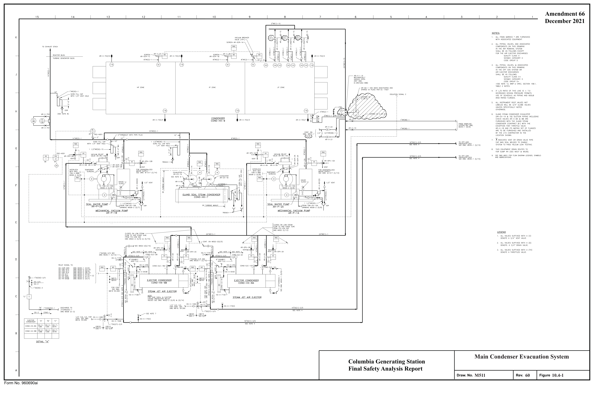

*figure on PDF page 70*

[Vector original (SVG, lossless): fig_page-70_4.svg](../figures/fig_page-70_4.svg)

<!-- labels/text on this figure page -->
Amendment 66 December 2021
Main Condenser Evacuation System Columbia Generating Station Final Safety Analysis Report M511 60 10.4-1 Draw. No. Rev. Figure Form No. 960690ai

<!-- p.71 -->
Amendment 64 4 6 5 3 8 2 December 2017

#### t
#### t FROM HSR FROM MSR
#### FROM MSR t
VALVE: (NORMALLY OPE:Nl

## 1 VAL VE CNORMALL Y CLDSEDJ
#### TO MSR
#### TO MSR
H

#### SAFETY HEAD
#### SWING CHECK
-l

#### PNEUMATICALLY OPERATED VALVE
TO ctSTEAMSTR AINER

#### CONDENSER
□ GAUGE CONNECTION 0 G

#### TEST GAUGE CONNECTION
0 I

#### PURCHASERS PIPE CONNECTION
I :::J:c 4?

#### I ----- PURCHASERS PIPING
I

----- AIR PIPING BY PURCHASER

#### PRESSURE REDUCING VALVE
#### CONTROL PILOT
r-

#### t
r-
-, r- -, r-
-,

#### LJ t
#### t
#### t
#### t
#### t
#### t
n ORIFJCE I

#### I I I I I
#### I I I I I I I I I I I I I I I I

#### I I I I I I I
#### I I I I I I I
#### I I I I I I I
#### HOTOR OPERATED VALVE
#### I I I I I I I
#### I I I I I I I
~,------•---~------------------------------...... -

I
-- GLAND SUPPLY & HP LEAKOFF PIPING I I I I I I _______________________ J L------------------------------~--- ---·------------------------------~--- 82 55-V-717A I I I I I I I
----- GLAND SUCTION & LP LEAKOFF PIPING ' I I I RE:LIE:F VALVE I I I I +---® I I

#### -------------------- l. ___________________________l ,_ ------------r:::i __________________________________________ r '
&-i er- I I I
-~---i----- - -------------------------------------, I

#### SOLENOID OPERATED VALVE
I 45 ..L r L_JIL I I FROM BFP TURB GLD's r-----------------------------------------J I

#### PRESSURE REGULATOR
I I ~ I ' ~ I PRESSURE TRANS [)JCER AND/OR I ~ L-~-

#### TRANSMITTER
D 61
---r-----1 □ PRESSURE CONTR OLLER

#### TO LP CYL t
#### TO LP CYL t
#### DIFFERENTIAL PRESSURE REGULATOR
TI I I

#### DRAIN POT I
♦ I I I I I "T" L __ J I C 4-- FROM HP CYL 4--- F ROH HP CYL I I

#### BY-PASS VALVE
I I
(PPG BY PURCHJ I I

#### ATHDS
I I r-,,.,~ LOCATED ON HAIN i-V'..J~ STE:AH HE:A□rn 1 l.,c,

.tiQIE:.S_;
1. SS-V-44A INTERNALS HAVE BEEN REMOVED AND

#### A BLIND FLANGE HAS BEEN INSTALLED IN PLACE
#### OF TH E BONNET.
B 0l--8--~
---ct--5-~ 441f---..n-----'- (J12 & Q13 8 011 11'1 7),..n------e\'-----j ,b':'.~a:12 Mb~~o>--'. 014
--'1\1---q_p--~ ~-

#### M0-V-87
#### MD-R0-3 L(TYP 3)
#### MD-R0-4 (TYP J)
#### MD-R0-5 MD-V- 78
#### MD-R0-6 MD-V-75
39 3B

#### MD-V- 79
#### MD-V-76
F5AR FlG. MD-V-80 MD-V-77
(TYPICAL)

Turbine Gland Sealing System Columbia Generating Station A Final Safety Analysis Report 01-00,143,1 16 10.4-2 Draw. No. Rev. Figure Form No. 960690ai

<!-- p.72 -->
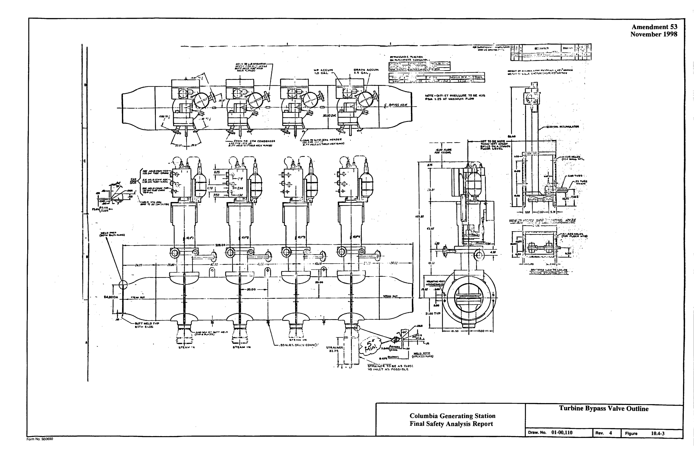

*figure on PDF page 72*

<!-- labels/text on this figure page -->
Amendment 53 November 1998
-· -----. ----~ ·--·----
........ ,.., ••• .,. .... ....,a,.~ .... ~·•~--=•~·-..
•OITI £T -~-..URI! TOM .. ,l!lo ~ P!WA ,. 2$ 1,T W.J.IIIIU!II _.UIW
....
=~ffi':A\-T-+---t-t-~➔~,-,.'I r~t.:l~
Al!I I
• C
;,'J,JI I L L IOUD I I.\ IJ.U
I I
·-!I.C~-- ~
=--+--- ·---111-------------11--io-._o_o_~--.------ill---·--~------11r-------f-'1a"'n-=~-
• IMW..--0:"' flUTT IIC" .. O j i-----~ , ' (TY~4"'-"~R) r•r=~1.
-._,1-....
"l.-1~=1 A ,,~,_,...,,..~ eTg-. .. 11i1
Turbine Bypass Valve Outline Columbia Generating Station Final Safety Analysis Report Draw. No. 01-00,110 4 Rev.
10.4-3 Figure Form No. 960690

<!-- p.73 -->
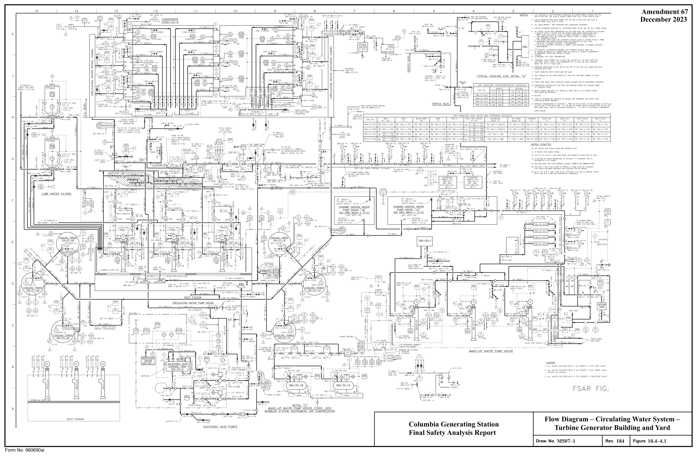

*figure on PDF page 73*

<!-- labels/text on this figure page -->
Amendment 67 December 2023
Flow Diagram – Circulating Water System – Columbia Generating Station Turbine Generator Building and Yard Final Safety Analysis Report M507–1 184 10.4–4.1 Draw. No. Rev. Figure Form No. 960690ai

<!-- p.74 -->
Amendment 65 8 7 5 3 4 December 2019 NOTES:

H 2"CL(5)-1P

#### FLUSH
CONN ~ 2"CL(57)-1P VENDOR PACKAGE BOU001'.R'I

2~CL(5)-1 P J/4"PS(62)-7S

#### CL-TK-3
#### CL-TK-6
~0 c;,1,1._LO~ SCO:u.l H;::;i~LD~TE

#### CATCH TANK FOR
5==::..::_::.:.._ _____ +-_________ -l----4r{~~ ~~~TI~A~I~~7-00,1 ___J._VENDOR PACKAGE CL TA~~ & 4 \IENTS I ½"CL(4J-1H TP-04 TO TSW WIER •---t--;C:;+L_'c,'"_ 8;;
1/2" TSW J 1/4"PS(62)-15

u G ~6~t. OUT CL-SKID-1 2"CL57-IP ~E H,1,1,.CC(N l~JECTIOI, ,KID o~~ c,,1 1221-00,1 1/2" TSW J

#### INSIDE
NC

#### CJRC WATER SAMPI ING SYSTEM
#### WATER BASIN A
B

#### TO CIRC. WATER
BASIN (T'l'P 3 PLCS)

-fj\lENDOR PACKAGE

#### INSI DE BLDG . .30 OUTSID E
#### LC CL-V-97
(CWPH EAST WAlL)
TP-04 VENDOR PACKAgj__ ~ S,t,J,WLE FR~ CONT. H------+-----"''"'4:,_:"C;.!;B~D.;,ll;;-:;.:1s~x;...,1_-1HFOR CONTINUATI~ TP-Ors· 1 · BLO\liOOWN, SEE Ot.1 1.1 CVI , 227_ 00,2 FOR CONTINU ATION SEE-t

., 3/4" 2- CL(l)-lSX OMr.l D/1 1227-00,2 i------~r~------..,-.-:t...._._.;;:;;_..('1..:.,.'2£~~-i

SEE DWG. ij507- 1(G/9)
----J..___yENDOR PACKAGE

:~E;wo. M507-1(H/1.3) f----------+----'1-'"c;::w!.cc41;;-:.:.i::;sx:....--.J...-..iH~~ ~~~11~~~1~;7-00,2

CL-TK-12 SA~PLE FROM CIRC _I_ TP-02 $ 2O50GAL LOO BIO-D!SPERSAHTTANK CL-V-91 (D)
____J._yENDOR PACKAG E ~~Ecg~cG. ~AJg_n~;r,otN♦------+---~_;;.:;~~'----'-l~;~ ~~Tl~t~1 SODIU~ BISULFITE SU PPLY 3/4"CL(8)-1SX · 1 · TP-OB ~;1-oo,2 LC ____J._yEN □O R PACKAGE CL-V-95 IS:_>;.x ___ L.../i.. I.J 1-------------------♦-------1---+--32::,·cicc~,~ 2)~-!_: ,r~;1 Ti ~NnNuAT10N SEE Ql\jMCVl1227-00,2

TP-12 CL-Y-i~ VENDOR PACKAG E FLR EL 448'-0"

#### TP-10
Cl-TK-10 ,-------------------♦-------t---_.;3;.(/:.!4:S"C_f_(~6)c:;-,:.;IS;;X.....:L:C_.J....j ~; ~ ~~Tl~t~1

40~0 CALLDN I SODIUI.IBISULFITETAf-.1< CL-Y-89 (D)
~~7-00,2

#### CL-SKID-2
____J.__yEN DO R PACKAGE GEOCHALCGENATJONBUILDING CL-SKID-2 Ot.lt.lCVI1227-00,2

FLUSH EQUIP DRAINS TO ~--------------~+--......;~,;:..\2;:.].;::. __ --J.---ih~~ ~~~1~it~1~~7-00,2 TP-D 5

3/4"C_(7)-1SX _I_ CO~ .
CIRC WATER ™-SIN

#### LC CL-V-9 6
___J.__yENDOR PACKAGE SA~PLE rROl,j T9N ~-------+---~3t.:,4:_.'T!_;:S!W(,!42aJ)~-;.;1S:!X--li----lHOR · 1 · TP-03 VENDOR PACKAG.IJ._ TP-□: I

#### PUMP DISCH,
CONTINUATION SEE D QMl,I CVI 1227-00,2 FORm,,ci~~u~;~o7~~~~-tr--r-------- ------1--------- ---i-=L-J'~i';'..".,a...!.'":.:Q~(~6);;_-l~SX~o·1-- -:>r--- SEE OWG l,l~D~-1(J/H)

#### CL- EJ-6 CL-V-93
#### CL-V-90 (D)
~

#### ANTIFOAM SU PP LY TO BIOOISPERSANT SUPPLY
I ~ -V-623

#### CI RC WATER BASIN TO CIRC WATER BASIN
1 1;2· cw(s)-1 I 1/2" CW(9)-1 P CW-V- 4:'> 4,t ,;A ,;,+ <» <» Ii It I ~ r------:-- -:---'--[)---{:o:}--,

#### I I I
-- (\~!:/t : r----:---.1.-----[)---to✓--~ C

#### I I I I
lc, --( r--;;·7

#### : : ~------------{)---{:o:}--i 1 I I ' I
: DATA : : DATA : I I I I L_'ox _J L_'o 1x _J

#### TO CND WATER BOX VENTS
#### I I I
I OWG ~:107 SH 1 (J/9) .............

I FRO~ 96" OD CW PIPING I SEEl.l507SH I (K/8)
I L--7 ,-_J I I I I :CDRffJS!ct. MONITORS I

B

#### CW-V-35(TH)
3/4"

A Flow Diagram - Circulating Water System - Columbia Generating Station Turbine Generator Building and Yard Final Safety Analysis Report

#### M507-2
11 10.4-4.2 Draw. No. Rev. Figure Form No. 960690ai

<!-- p.75 -->
Amendment 65 December 2019 10 7 4 2 3 8 6 5

## 1 ALL WORK ON THIS DRAWING SHALL BE QUALITY CLASS G UNLESS
#### OTHERWISE NOTED. H
## 2 FOR A LIST OF REFERENCE OWGS REFER TO OWG C912
## 3 ALL PIPING, VALVES, TANKS, PUMPS, INSTRUl.1ENTS, ETC ON THIS OWG
c----------------------------~I (Li\

#### ARE PART OF THE CHEWCAL FEED SYSTEM (CF)
~ I 4 EQUIP~ENT IS LOCATED IN SOUTHEAST PORTION OF CIRC WATER PUMPHOUSE.
I CC PVC VENT TO ATl.10S ALL sucn □N LINES FROl,I TANKS TO I TANKER FILL CONNECTION 2" PVC (TYP J PU,,CES)
5 THE CH El.1l CAL STORAGE TANKS ARE HEAT TRACED ANO INSULATED. BY VENDOR WILL BE INSULATED AND HEAT TRACC:D a, ½:NOOR I
(TYP)
6 FOR NOTES ANO LEGEND SEE DRAWING i.A507-1.

## 7 DELETED
G T~ 1 1/4" CF(90)-1S SLOPE~ :u, 2'' ~H ,tt,,,4~~~~"6_,__~~ CF-FLX-41 ~ SS c;;$ TUBE L_ L -_ -_ -_ -_ -_ -_ -_ -_ -_ -_ -_ -_ -_ ~-~-

1 1/4" O.D 1/2" D.D. SS TUBING I ~ l ~ l f_ I ~ 1/2" 0.0. f_ 1/2" D.D. SS TUBING 1/2" 0.D. SS TUBING t11 \ TSl'I-V-1538 E , TSW-V-153A I c--------------- ------ -------' /Li\ F
(RE0 (REF)
ci I ~ 2 ~ I I CF

TO TSW-V-14'A ~ '.... .. ~...L--------'

I \ 10 TSW-V-1418 / TSW WIER I I FLOOR EL 448'-Q" (TYP) ' - \__TSW-P-18 TSW-P-IA / ' 2''CF(9□-1sO CW BIIY C SEE TYP FLOOR PENETRATION □IT CW BAY B

#### CW BAY A
p~ I SEE 1.1507-1 (A,B/13-15) ON DWG cgJJ SEE M507-1 (A,8/13-15) SEE M507-1 (A,B/13-15)
4" I I

#### SEE TYP FLOOR PENETRATION OET
I

#### ON DWG C91J
I t E 1· ~ I 2" CF(90)-1S ~; 2• c~•?- 1s(H 1

2~HcUFtf-F\Pctf,x-"42"""~°",.a,!,-~~""!~;..,_..,._C"""...,.,,...,,Ac,.,,.. ___ (X'.,-,-=~......_,..,..-q

1/ 2' CF-V-8J5

CF-V-552(0) L_ L __________________________ -_-_ SS C;[~z TUBE 1/2" 0.0. SS TUBING 1/2" O.D. SS TUBING

2" 0.0

#### F-V-86J CF-V-8 62
1/2" O.D. SS TUBING 1/2" O.D. SS TUBING 1 2" 0.0. SS TUBING 1/2" D.O. SS TUBING

#### t~ 1
1/2" 0.0. SS TUBING

#### FLOOR PENETRATION LOCATION
£_ £_ t~ ·i TSW(R~F) 54A PEN SUCTION APPROXIMATE COLU~N YARD CIRC WTR

#### NO BAY GRID LOCATION
#### PUMP HOUSE
D TSW(~';F) S48
(i) CW-P-1A 4.8 W.55
(,) CW-P-18 ,---------------------------- I~

### 4.8 X.55
i~ @ I

#### I I CF
CW-P- IC 4.8 Z.55 .. - ~ \ " O TSW-V-142B TO TSW-V-142A I

#### TSW-P-1B TSW-P-1A
I

#### CW BAY C SEE TYP FLOOR PENETRATION DET CW BAY B
#### CW BAY A CF-V-808B
#### SEE 1,,1507-1 (A, B/13-15) ON DWG C91J SEE M507-1 (A,B/13-15) SEE M507-1 (A,B/13-15)
I I 2" CF 90)-IS ~ CF-V-829 4" 2·

#### SEE TYP FLOOR PENETRATION DET
I I ON □WG C91J

#### CF-QOC-10
C 1/2'

1"0.0. SSTUBING

1/2" O.D. SS TUBING 1" 0.0. SS TUBING 1" O.D SS TUBING I 2" D.O. SS TUBING

1 /2" O.D. SS TUBING 1/2" O.D. SS TUBI-NG,-n __ F_LO_O_R_EL_44_8'_-0_"~(TY_P~)_ CF~

#### SEE TYP FLOOR PENETRATION OET
ON DWG C913 {TYP) B I I I L_-J

#### TO TMU (CONT ON M5D7-I
#### CW BAY A
#### ZONE D/11)
#### SEE M507-1 (A,B/13 15)
Flow Diagram - Circulating Water System - Columbia Generating Station Turbine Generator Building and Yard A Final Safety Analysis Report

#### M507-3
14 10.4-4.3 Draw. No. Rev. Figure Form No. 960690ai

<!-- p.76 -->
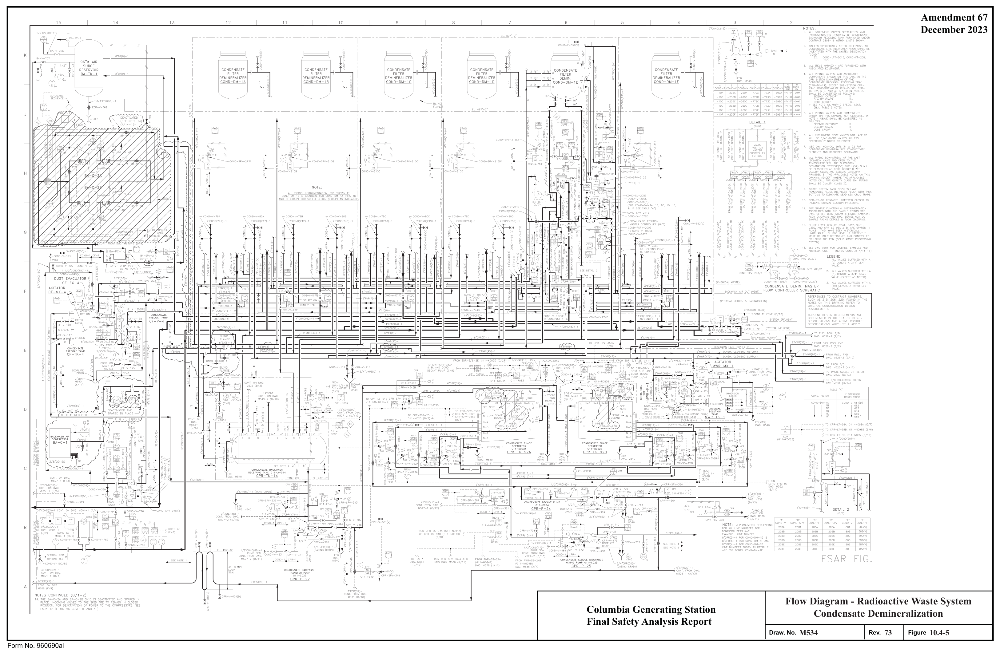

*figure on PDF page 76*

<!-- labels/text on this figure page -->
Amendment 67 December 2023
Flow Diagram - Radioactive Waste System Columbia Generating Station Condensate Demineralization Final Safety Analysis Report M534 73 10.4-5 Draw. No. Rev. Figure Form No. 960690ai

<!-- p.77 -->
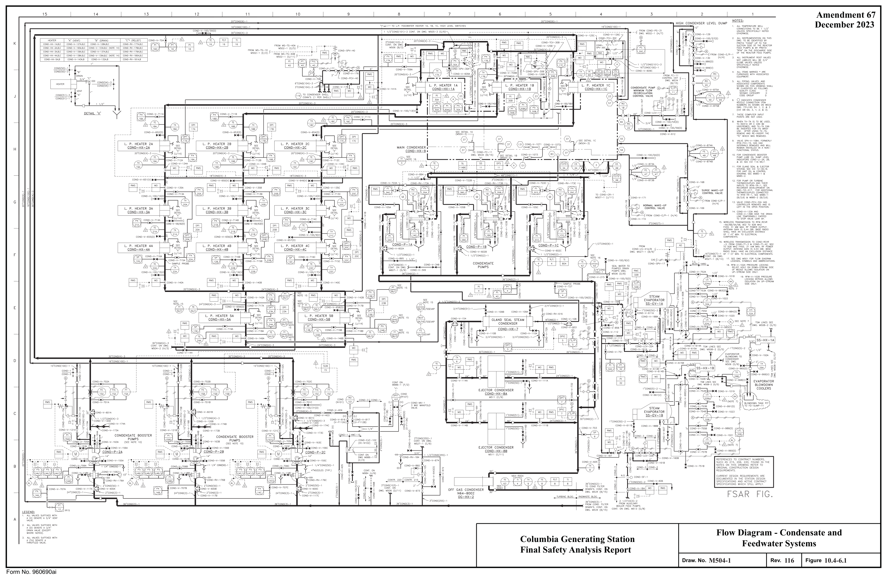

*figure on PDF page 77*

<!-- labels/text on this figure page -->
Amendment 67 December 2023
Flow Diagram - Condensate and Columbia Generating Station Feedwater Systems Final Safety Analysis Report
M504-1
116 10.4-6.1 Draw. No. Rev. Figure Form No. 960690ai

<!-- p.78 -->
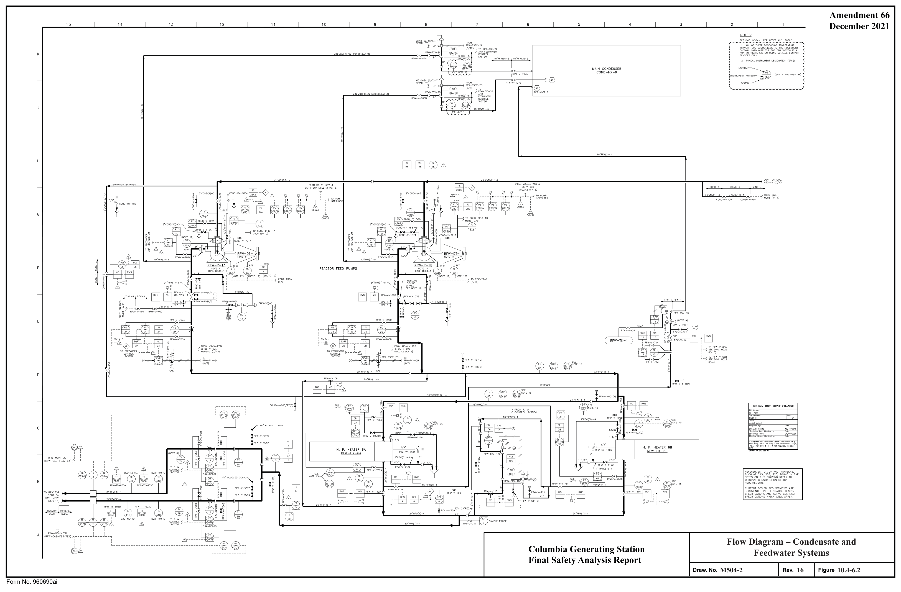

*figure on PDF page 78*

[Vector original (SVG, lossless): fig_page-78_2.svg](../figures/fig_page-78_2.svg)

<!-- labels/text on this figure page -->
Amendment 66 December 2021
Flow Diagram – Condensate and Columbia Generating Station Feedwater Systems Final Safety Analysis Report
M504-2
16 10.4-6.2 Draw. No. Rev. Figure Form No. 960690ai

<!-- p.79 -->
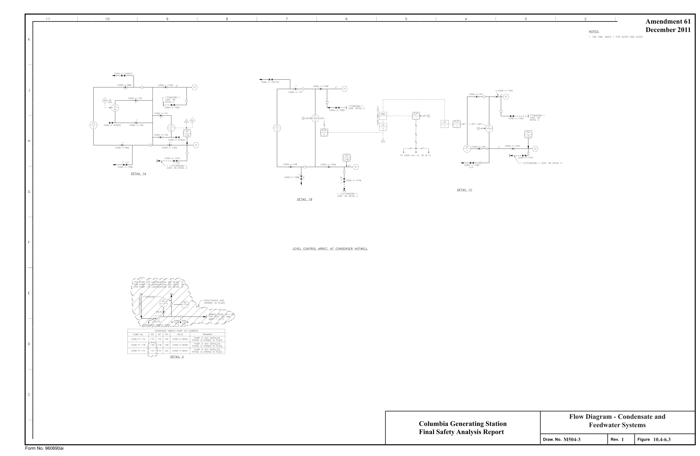

*figure on PDF page 79*

[Vector original (SVG, lossless): fig_page-79.svg](../figures/fig_page-79.svg)

<!-- labels/text on this figure page -->
Amendment 61 J December 2011 NOT[Sc
K
:.:-{ ;.ere,) ---------, l ~~,, ,:_:_ ~I2 T C:)~l)-'0-10:,'(V)
f~'..~
CL:.'" r
~•-------5 - c,\~>) , r'i:..:·" \_, / t ✓-:-----_-_-_-_----,1// ___ 1_ l~C- - ~::bC L;t. ~ 2 /1/ // ffi-------------------------- CY"'~---.J · ,a,~,,; :.~>---#-'-------- ~-~ 11::\ &: 1'.:
_______._______~ . - Q !/\
-;;;~~/ C
C:)N~--~ \_7 C:JtD-'•/-77,3 ' II ~u
J,rn
DETAIL 1 A
I l G
CETAIL 1 3
LEVEL CO\ITROL l,RRC:T. A- C:CNDENSC:R HOTWELL
[:
C
Flow Diagram - Condensate and Columbia Generating Station Feedwater Systems Final Safety Analysis Report
M504-3
1 10.4-6.3 Draw. No. Rev. Figure Form No. 960690ai

<!-- p.80 -->
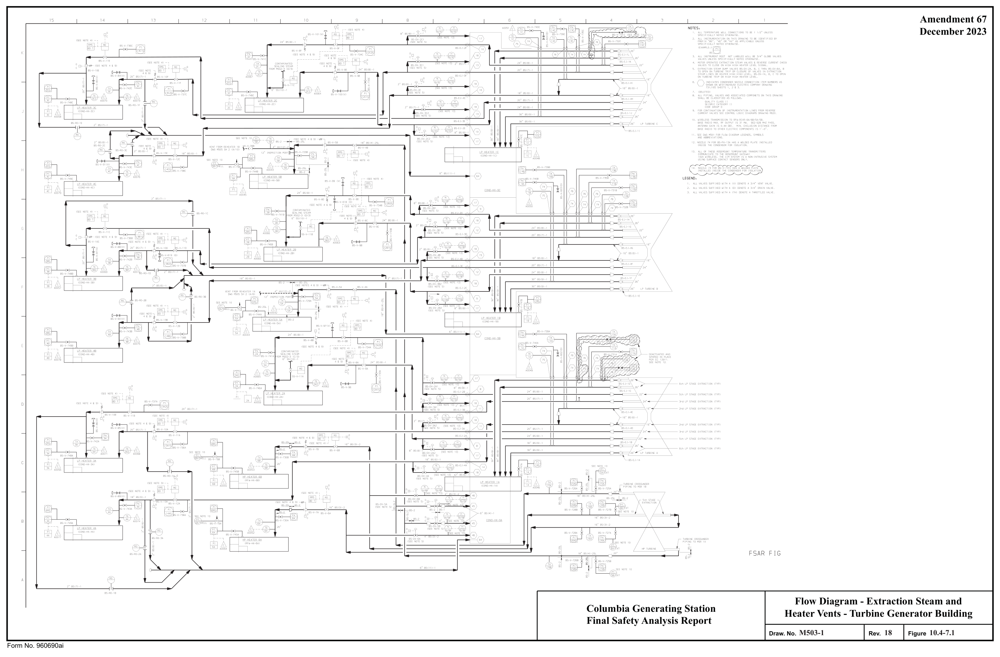

*figure on PDF page 80*

<!-- labels/text on this figure page -->
Amendment 67 December 2023
Flow Diagram - Extraction Steam and Columbia Generating Station Heater Vents - Turbine Generator Building Final Safety Analysis Report
M503-1
18 10.4-7.1 Draw. No. Rev. Figure Form No. 960690ai

<!-- p.81 -->
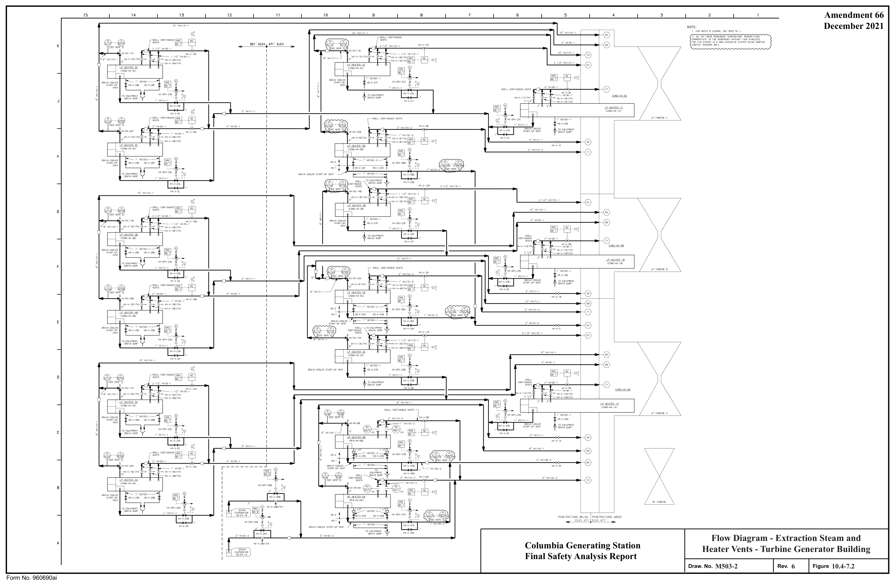

*figure on PDF page 81*

[Vector original (SVG, lossless): fig_page-81.svg](../figures/fig_page-81.svg)

<!-- labels/text on this figure page -->
Amendment 66 December 2021
Flow Diagram - Extraction Steam and Columbia Generating Station Heater Vents - Turbine Generator Building Final Safety Analysis Report
M503-2
6 10.4-7.2 Draw. No. Rev. Figure Form No. 960690ai

<!-- p.82 -->
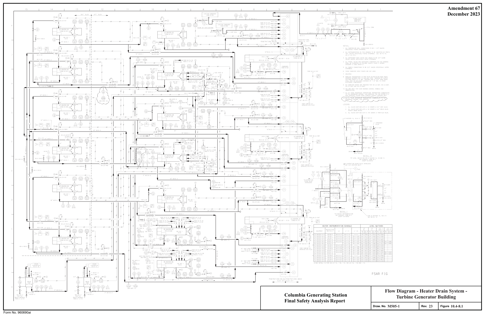

*figure on PDF page 82*

<!-- labels/text on this figure page -->
Amendment 67 December 2023
Flow Diagram - Heater Drain System - Columbia Generating Station Turbine Generator Building Final Safety Analysis Report
M505-1
23 10.4-8.1 Draw. No. Rev. Figure Form No. 960690ai

<!-- p.83 -->
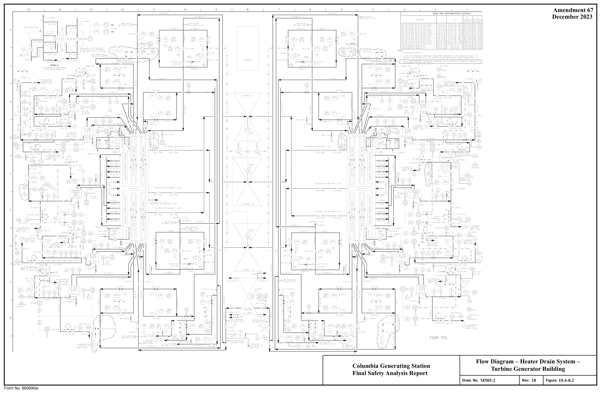

*figure on PDF page 83*

<!-- labels/text on this figure page -->
Amendment 67 December 2023
Flow Diagram – Heater Drain System – Columbia Generating Station Turbine Generator Building Final Safety Analysis Report
M505-2
18 10.4-8.2 Draw. No. Rev. Figure Form No. 960690ai

<!-- p.84 -->
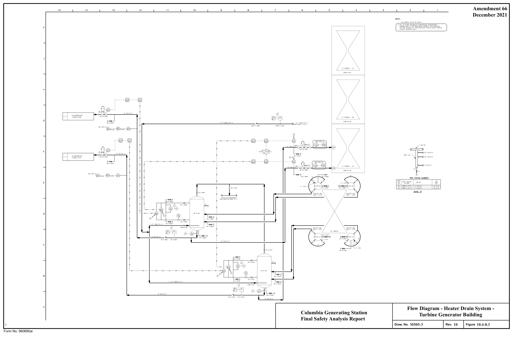

*figure on PDF page 84*

[Vector original (SVG, lossless): fig_page-84.svg](../figures/fig_page-84.svg)

<!-- labels/text on this figure page -->
Amendment 66 December 2021
Flow Diagram - Heater Drain System - Columbia Generating Station Turbine Generator Building Final Safety Analysis Report
M505-3
10 10.4-8.3 Draw. No. Rev. Figure Form No. 960690ai

<!-- p.85 -->
Amendment 63 II ID

#### AN O ASSOCIATED COMPONENTS IN THE HYDROGEN WATER CHEMI STRY SYSTH-A
ISCI.ASSI FJE □ ASFOLLO ll' S·

2. ALL INSTRUMENTAflON ON THIS DWG TO BE "HWC" UNLESS OTHERWI SE NOTED

3. SEE DWG M501 FOR FLOW DIAGRAM LEGENDS, SYMBOLS AND ABBREVJATIOO S ,--------------7 1 ,'LL \l,',L\IES SJFFl~ED WITH A (TH) DENOTE A THROTTLED VALVE.
E-CP-HI 3/P840 (BD "A")

#### i f-:11\".fJE, ..
' ' I I r-~

#### _ __L_ :2-F:-:R-F~ - --- --:- ~R~Fl E-CP-P73/P500 :
' ' ' ' ~-----------------------------□------------------------------------------------------------------------------7 n = , - - - - ~

#### DEMAND DEMAND SU PPLY SUPPLY
~
(N409)
~ ~ ~~~~ 3/4 HWC{57) ZS HOOD I I I I I I ~T~~~ CONN.
L--r---'------- _ L ___ - -'- -- ___ _;__ ____ ----'

i H2 ~~55 H2 PR';.;: ss

## 1 SETPOINT SETPOINT FLOWRATE FLOWRATE
MOFF ~ ~ i ~ ~ ~ ~ :□Nyy :~~~ ~ c _____ L ___ L~ ____ O ~ ___ L_ ____ L ____ L LJ

#### HSSF-G P-P2 HSS F-GAB-LOGAL
r-- --,~~~~,J ~'IT'° -,-----------~ n 2· HWC(1)-2S LJ :~ii 11 n 2• HWC ."i7)-2S i_J
----+-- G L-~- ~ -+---+- ---+-- - I

#### I I I I
I

#### I I I I
#### I I I
#### I I I I
I

#### I I I I
I

#### I I I I
I L_______________________________________________________ I I I I ' ' ' il I

#### I I I I
'

#### I I I I
I

#### I I I I
I l_ --~3L/4L"~HW~C~(5~7~-2~S------------------~' -~' : :
~
-1------~ ' ' ' ' ' ' ' '

--:-------------- T - ------------7 :

,-----------------------------------7

(R235)

#### TO HWC-IR- P73/ 7
n oc (c/s)
1 ~ T ~ (RZJ J )
(N112)
;/,. c,s(s:S L --------.. fHKJ-----h"-----c,;ci~-,L{;k}-'---,;<cL_----,.;~--"-----h"----t~+-,;,-

J/4" HWC{~7)-2S

~--------" ~"-

;oo(aa~)!:o

#### LOW POI HT
#### HWC-TK-1 DRAIH
u N2PURGEElDTTL( n (N1 12A)
'---~-

#### HWC-V-11 0A (TH)
{V-F110A) f I 7/2" e-----,-,------,.l,f-------L--_-_-1t-~~_::" ___ ~_--re"-<c'+-----n-~-1"--.µ---n~--+----P1-----5 J

#### N112B) 0G-V- 20J(REF)
#### CONT ON OWG
~535-1 (G/ 15)
L-,,--~- HWC-V-11qJ(TH) (V-Fl1 08)
L ___ --- -- - -------------------- 1 1/2"

Hwc-IR-P73/P100 ~ ; L~~-----C<>:}-----5 J / 4" 0G-V-204(REF)

#### OG-J/5
! LOW POINT u DRAIN

C--'eH-0'(!.ca, ,1---w-ifiL~,-!c ,-H:u_N210A)

#### FSAR FIG.
Flow Diagram - Hydrogen Water Chemistry n n N'.2100)
c_-,,,._~_ ]CAfJBRATION VENT Turbine Generator Building and Hydrogen Columbia Generating Station Storage and Supply Facility Final Safety Analysis Report L ___________________________________ _J A

#### M986-1
5 10.4-9.1 Draw. No. Rev. Figure

#### HWC-IR-P73/P200
Form No. 960690ai

<!-- p.86 -->
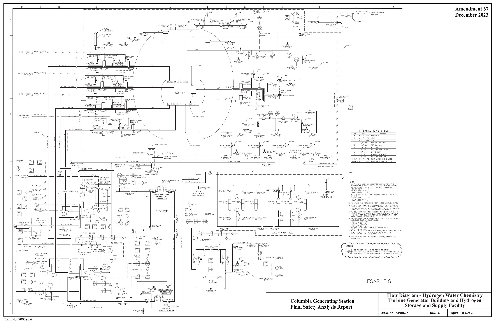

*figure on PDF page 86*

<!-- labels/text on this figure page -->
Amendment 67 December 2023
Flow Diagram - Hydrogen Water Chemistry Turbine Generator Building and Hydrogen Columbia Generating Station Storage and Supply Facility Final Safety Analysis Report
M986-2
4 10.4-9.2 Draw. No. Rev. Figure Form No. 960690ai

<!-- p.87 -->
Amendment 63 7 4 2 11 10 8 5 3 9 6 December 2015

#### NOTES,
1. All PIPING, VALVES AND ASSOCIATED COMPONENTS IN THE

#### HYDROGEN WATER CHEMISTRY SYSTEM (HWC) AND THE HYDROGEN
SUPPLY STORAGE F"ACIUTY (HSSF) ON THIS DRAWING ARE: K
-QUALITY CLASS; II
-SEISMIC CATEGORY: II
-CODE GROUP: D
2. ALL VALVES AND INSTRUMENTS HSSF UNLESS OTHERWISE NOTED.
:3. ALL EQUIPMENT AND INTERCONNECTING PIPING WITHIN THIS BOX

#### SUPPLIED AND DESIGNED BY CHART MANUFACTURING. SEE
CVI I 1002-00,103 AND CVI # 1002-00,110 FOR BILL OF r------------------------------------------------------------------1 MATERIALS AND SPEC!FlCATIONS FOR THESE COMPONENTS AND PIPING.
I 4. ALL PIPING NOT INCLUDED IN NOTE 3, INSTALLED BY INSTALLATION I CONTRACTOR, FOR PIPE DESIGN SPECIFlCATION SEE CV] I 1002-00.7.
#### I 5. SEE DWG M501 FOR FLOW DIAGRAM LEGENDS. SYMBOLS AND

#### VNO,C3
#### ABBREVIATIONS.
I

#### INNER SHELL
I I I I I I I I I I I I HSSF -V-F",,1504

#### I (PV-50-4)
#### I I I I I I H I I II I

#### HSSF-TK-2
#### HSSF - RD-PSE502
I {PSE-502)
I I VENT I I HSSF-Rv'-PSVJ02 I
(PSV-302)
I I I 1" X 1/2 I ,-'"-'--'"--'"'-, }---"-,s-, _1<1,t<-_sv_;-;1- --1 f1o~~o E~~) M986-2 I HSSF-V-BVJ16 HSSF-V-BVJ19
(BV-J16)
(BV-J19) 1/2" X 1/4 I I
(BV-321)
I I G N2-1/4"-CU-204 CONT'D ON M9B6-2 I HSSF-PCV-309
(PCV-309}
(ZONE K/2) I

#### HSSF -F -FIL300
I
(FIL-300) I I HSSF-V-BV.317 HSSf"-V-BV316
(SV-.317)
I
(BV-31B)
I ,--Hss-,-+_Cv-""sv-,-,o--lJL I

#### HSSF-V-FV500
I {IN-320)
(PV-500)
I I

HSSF-RI/-PSV3 □0 (PSV-YJO)
~ ~g>-----,KH~s-s,-~---,v-300--<>------~-~ ~--

#### HSSF -V-BV50-4
F
(KV-300)
(BV-504)
HSSF-Pr::1/-.302

#### HSSF-V-PV301
(PCV-302)

#### U'V-301)
#### HSSF-V-IV500
r-- ~ -- ~ (IV-500) 7"x"J/4" 1 1/2" X 1"

#### HSSF-V-BV.312 HSSF -V-BVJ 1 -4
I~~

#### HSSF -RV- PSV305
#### HSSF-RV-PSV.306
(BV-312)
(BV-314)
{PSV-.305) ""{:;;;~,ifil'r" JL (PSV-306)
I

301 L __________ i VENT

#### HSSF-V-CV.302
#### AMBIENT VENT
(CV-302}

#### HSSF-V-IV502
#### VAPORIZORS
(IV-502)

#### HSSF-V-BV.31J HSSF-V-BV.315
VENT :
(BV-31.3)
(BV-315)
I

#### HS5F-RV-PSV505 I
(PSV-505) I E I HSSF-V-BV505 -c-----t---J!I I
(BV-505)
I

#### VENT HSSF-V-PV505 HSSF-RD-PSE500
(PSE-500} (PV-:10:l) I I ~----------N_2-_3~/B_"-_c_c-_2_0B _______ 7 (ia~~D c/i lr86-2 I I I

#### HSSF-RD-PSE501 I
#### HSSF-RV-PSV504
(PURGE LINE)
(PSE-501) -C------+---l/1 I {PSV-504)
I HSSF-V-Pv'506 N2-3/B"-CU-218 CONT'D ON MS66-2 I ~----------~-----------;(ZONE E/11)
(PV-506) HSSF-RV-P~06 ,--~--~
(PSV-506) I

#### I VENT
~ ~ I I I

#### HSSF-VZ-PBC500
I {PBC-500)
I HSSF-RV-PSV50 □
(PSV-500)
D I HSSF-V-C\1:100

#### HSSF-V-PV501
(PV- 501} (CV-500)
I I HSSF-V-PVS □2 {PV-502)
#### I I I I I I I I

#### HSSF-PCV-500
I
(PCV-500) HSSF-ST-STR500
(STR-500)
I I I I HSSF -RV-PSV!'I03 VENT
(PSV-503)
I I I C

#### HSSF-V-BVSOJ
#### FSAR FI G.
I
(BV-503)
I L _____________________________________________________________________________ J Flow Diagram - Hydrogen Water Chemistry Turbine Generator Building and Hydrogen Columbia Generating Station Storage and Supply Facility Final Safety Analysis Report

#### M986-3
3 10.4-9.3 Draw. No. Rev. Figure B Form No. 960690ai

<!-- p.88 -->

Chapter 11

#### RADIOACTIVE WASTE MANAGEMENT

#### TABLE OF CONTENTS

Section Page

11.1 SOURCE TERMS ........................................................................ 11.1-1

11.1.1 FISSION PRODUCTS ................................................................. 11.1-1

11.1.1.1 Noble Radionuclide Fission Products ............................................ 11.1-1

11.1.1.2 Radiohalogen Fission Products.................................................... 11.1-4

11.1.1.3 Other Fission Products.............................................................. 11.1-6

11.1.1.4 Nomenclature ......................................................................... 11.1-6

11.1.2 ACTIVATION PRODUCTS ........................................................... 11.1-7

11.1.2.1 Coolant Activation Products ....................................................... 11.1-7

11.1.2.2 Noncoolant Activation Products................................................... 11.1-7

11.1.2.3 Steam and Power Conversion System N-16 Inventory ......................... 11.1-8

11.1.3 TRITIUM................................................................................. 11.1-8

11.1.4 FUEL FISSION PRODUCT INVENTORY AND FUEL EXPERIENCE ....... 11.1-11

11.1.4.1 Fuel Fission Product Inventory.................................................... 11.1-11

11.1.4.2 Fuel Experience ...................................................................... 11.1-11

11.1.5 RADIOACTIVITY LEAKAGE AND EFFLUENT SOURCES .................... 11.1-11

11.1.6 REFERENCES .......................................................................... 11.1-12

11.2 LIQUID WASTE MANAGEMENT SYSTEM ..................................... 11.2-1

11.2.1 DESIGN BASIS ........................................................................ 11.2-1

11.2.2 SYSTEM DESCRIPTION............................................................ 11.2-3

11.2.2.1 Process Description.................................................................. 11.2-3

11.2.2.2 Subsystems Description............................................................. 11.2-4

11.2.2.2.1 Equipment Drain Subsystem .................................................... 11.2-4

11.2.2.2.2 Floor Drain Subsystem ........................................................... 11.2-5

11.2.2.2.3 Chemical Waste Subsystem...................................................... 11.2-6

11.2.2.2.4 Shared Equipment................................................................. 11.2-7

11.2.2.2.5 Surge Capacities ................................................................... 11.2-7

11.2.2.2.6 Design Features.................................................................... 11.2-8

11.2.3 RADIOACTIVE RELEASES........................................................ 11.2-9

11.2.3.1 Release Point and Dilution ......................................................... 11.2-9

11.2.3.2 Calculation of Releases of Radioactive Materials .............................. 11.2-9

11.2.3.3 Exposure of Persons at or Beyond the Site Boundary......................... 11.2-10

11.2.3.4 Cost-Benefit Analysis ............................................................... 11.2-10

11.3 GASEOUS WASTE MANAGEMENT SYSTEMS ................................ 11.3-1

11.3.1 DESIGN BASES ....................................................................... 11.3-1

11-i

