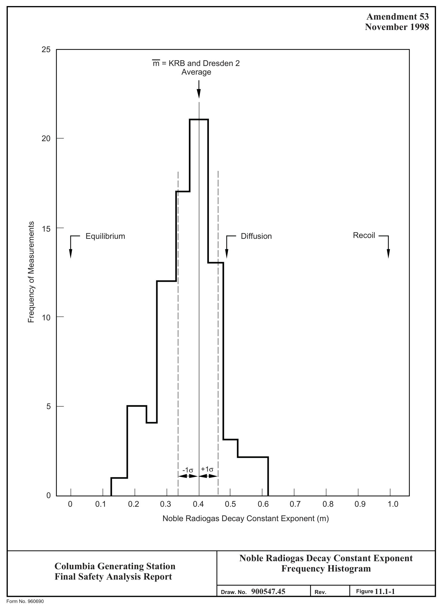
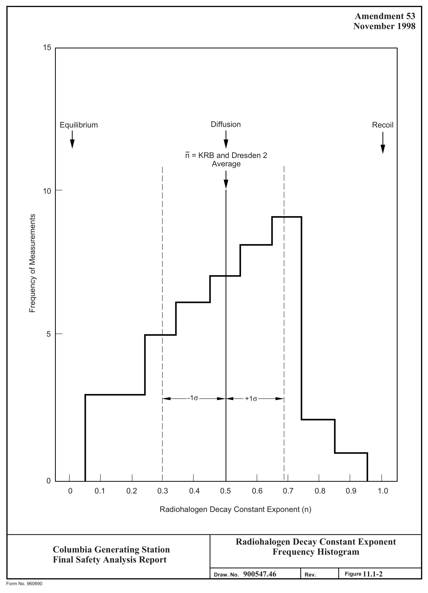
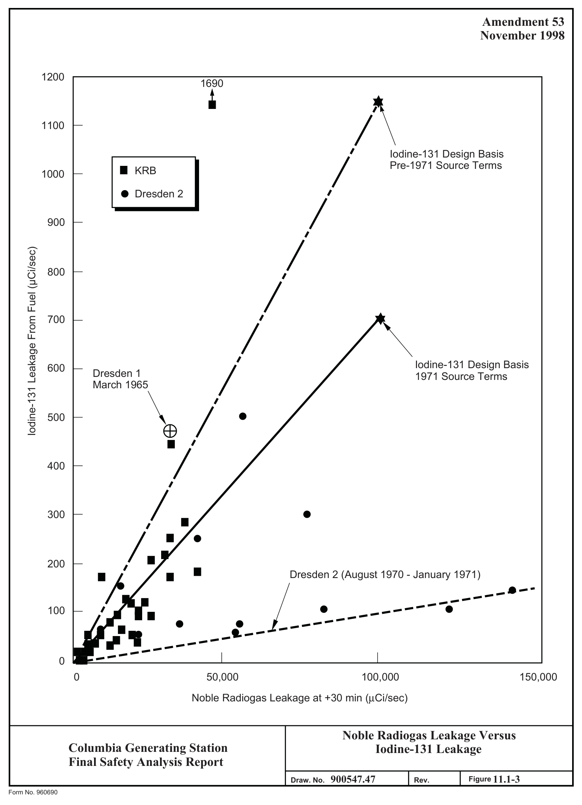

# 11.1 Source Terms

> Columbia Generating Station FSAR — Chapter 11: Radioactive Waste Management
> Source: `11_chapter-3610-3790.pdf`, PDF pages 10–31 (of 181)
> Amendment 67 compilation (individual pages carry varying amendment dates)

---
<!-- p.10 -->

Chapter 11

#### RADIOACTIVE WASTE MANAGEMENT
### 11.1 SOURCE TERMS
The italicized information is historical and was provided to support the application for an operating license.

Radioactive material sources (activation products and fission product release from fuel) have been evaluated in operating boiling water reactors (BWRs) over the past decade. These source terms are reviewed and periodically revised to incorporate up-to-date information. Release of radioactive material from operating BWRs has resulted in doses to offsite persons which have been only a small fraction of 10 CFR 20 permissible or natural background doses.

The information provided in this section defines the design-basis radioactive material levels in the reactor water, steam, and offgas. The various radioisotopes listed have been grouped as coolant activation products, noncoolant activation products, and fission products. The fission product levels are based on measurements of BWR reactor water and offgas at several stations through mid-1971. Emphasis was placed on observations made at Kernkraftwerk RWE-Bayernwerk GmbH (KRB) and Dresden-2. The design-basis radioactive material levels do not necessarily include all the radioisotopes observed or predicted theoretically to be present. The radioisotopes included are considered significant to one or more of the following criteria:

a. Plant equipment design, b. Shielding design, c. Understanding system operation and performance, d. Measurement practicability, and e. Evaluating radioactive material releases to the environment.

The inventory of radionuclides used to determine shielding requirements of system components are discussed in Chapter 12.

#### 11.1.1 FISSION PRODUCTS
##### 11.1.1.1 Noble Radiogas Fission Products
The noble gas radionuclide fission product source terms observed in operating BWRs are generally complex mixtures whose sources vary from miniscule defects in cladding to “tramp” uranium on external cladding surfaces. The relative concentrations or amounts of noble radiogas can be described as follows.

<!-- p.11 -->

Equilibrium: Rg,i = K1Y1
(11.1-1)

Rg,i = K2Y1λi Recoil:
(11.1-2)

The nomenclature in Section 11.1.1.4 defines the terms in these and succeeding equations. The constants K1 and K2 describe the fractions of the total fissions that are involved in each of the releases. The equilibrium and recoil mixtures are the two extremes of the mixture spectrum that are physically possible. When a sufficient time delay occurs between the fission event and the time of release of the radiogases from the fuel to the coolant, the radiogases approach equilibrium levels in the fuel and the equilibrium mixture results. Where there is no delay between the fission event and the release of the radiogases, the recoil mixture is observed.
Prior to Vallecitos Boiling Water Reactor (VBWR) and Dresden-1 experience, it was assumed that noble radiogas leakage from the fuel would be the equilibrium mixture of the noble radiogases present in the fuel.

The VBWR and early Dresden-1 experience (Reference 11.1-1) indicated that the actual mixture most often observed approached a distribution which was intermediate in character to the two extremes. This intermediate decay mixture was termed the “diffusion” mixture. It must be emphasized that this “diffusion” mixture is merely one possible point on the mixture spectrum ranging from the equilibrium to the recoil mixture and does not have the absolute mathematical and mechanistic basis for the calculational methods possible for equilibrium and recoil mixtures. However, the “diffusion” distribution pattern which has been described is as follows:

(11.1-3)
Diffusion: Rg,i = K3Yiλi0.5

The constant K3 describes the fraction of total fissions that are involved in the release. The value of the exponent of the decay constant, λi, is midway between the values for the equilibrium case, 0, and recoil case 1. The “diffusion” pattern value of 0.5 was originally derived from diffusion theory.

Although the previously described “diffusion” mixture was used by GE as a basis for design since 1963, the design-basis release magnitude used has varied from 0.5 Ci/sec to 0.1 Ci/sec as measured after 30-minute decay (t=30 minutes).* Since about 1967, the design-basis release magnitude used (including the 1971 source terms) was established at an annual average of 0.1 Ci/sec (t = 30 minutes). This design basis is considered as an annual average with some time above and some time below this value. This design value was selected on the basis of operating experience rather than predictive assumptions. Several judgment factors,

*The noble radiogas source term rate after 30-minute decay has been used as a conventional measure of the design-basis fuel leakage rate since it is conveniently measurable and was consistent with the nominal design-basis 30-minute offgas holdup system used on a number of previous plants.

<!-- p.12 -->

including the significance of environmental release, reactor water radioisotope concentrations, liquid waste handling and effluent disposal criteria, building air contamination, shielding design, and turbine and other component contamination affecting maintenance, have been considered in establishing this level.

Noble radiogas source terms from fuel above 0.1 Ci/sec (t = 30 minutes) can be tolerated for reasonable periods of time. Continual assessment of these values is made on the basis of actual operating experience in BWRs (References 11.1-2 and 11.1-3).

While the noble radiogas source-term magnitude was established at 0.1 Ci/sec
(t = 30 minutes), it was recognized that there may be a more statistically applicable distribution for the noble radiogas mixture. Sufficient data were available from KRB operations from 1967 to mid-1971 along with Dresden-2 data from operation in 1970 and several months in 1971 to more accurately characterize the noble radiogas mixture pattern for an operating BWR.

The basic equation for each radioisotope used to analyze the collected data is:

( )( )
− λ T − λ t = λ im − R K Y 1 e i e i g,i g i
(11.1-4)

With the exception of Kr-85 with a half-life of 10.74 years, the noble radiogas fission products in the fuel are essentially at an equilibrium condition after an irradiation period of several months (rate of formation is equal to the rate of decay). So for practical purposes the term
(1 - e -λiT) approaches 1 and can be neglected when the reactor has been operating steady state for long periods of time. The term (1 - e -λiT) is used to adjust the releases from the fuel
(t = 0) to the decay time for which values are needed. Historically, t = 30 minutes has been used. When discussing long steady-state operation and leakage from the fuel (t = 0), the following simplified form of Equation 11.1-4 can be used to describe the leakage of each noble radiogas:

im R = K Y λ g,i g i
(11.1-5)

The constant, Kg, describes the magnitude of leakage from the fuel. The relative rates of leakage of the different noble radiogas isotopes is accounted for by the variable, m, the exponent of the decay constant, λi.

Dividing both sides of Equation 11.1-5 by yi, the fission yield, and taking the logarithm of both sides results in the following equation:

( )
( )
( )
= λ + log R / Y m log log K g,i i i g
(11.1-6)

<!-- p.13 -->

Equation 11.1-6 represents a straight line when log (Rg,i/yi) is plotted vs. log (λi); m is the slope of the line. This straight line is obtained by plotting (Rg,i/yi) vs. (λi) on logarithmic graph paper. By fitting actual data from KRB and Dresden-2 (using least squares techniques)
to the equation, the slope, m, can be obtained. This can be estimated on the plotted graph.
With radiogas leakage at KRB over the nearly 5-year period varying from 0.001 to

### 0.056 Ci/sec (t = 30 minutes) and with radiogas leakage at Dresden-2 varying from 0.001 to
### 0.169 Ci/sec (t = 30 minutes), the average value of m was determined. The value for m is 0.4
with a standard deviation of ±0.07. This is illustrated in Figure 11.1-1 as a frequency histogram. As can be seen from this figure, variations in m were observed in the range of m = 0.1 to m = 0.6. After establishing the value of m = 0.4, the value of Kg can be calculated by selecting a value for Rg, or as has been done historically, the design basis is set by the total design-basis source-term magnitude at t = 30 minutes. With SRg at 30 minutes = 100,000 mCi/sec, Kg can be calculated as being 2.6 x 107 and Equation 11.1-4 becomes:

( )( )
7 0.4 − λ t − λ t = λ − R 2 6 10 . x Y 1 e i e i g,i i i
(11.1-7)

This updated noble radiogas source-term mixture has been termed the “1971 mixture” to differentiate it from the “diffusion” mixture. The noble gas source term for each radioisotope can be calculated from Equation 11.1-7. The resultant source terms are presented in Table 11.1-1 as leakage from fuel (t = 0) and after 30-minute decay. While Kr-85 can be calculated using Equation 11.1-7, the number of confirming experimental observations was limited by the difficulty of measuring very low release rates of this isotope. Therefore, the table provides an estimated range for 85Kr based on a few actual measurements.

##### 11.1.1.2 Radiohalogen Fission Products
Historically, the radiohalogen design-basis source term was established by the same equation as that used for noble radiogases. In a fashion similar to that used with gases, a simplified equation can be shown to describe the release of each radiohalogen:

in ,i = λ

#### R K Y
h h i
(11.1-8)

The constant, Kh, describes the magnitude of leakage from fuel. The relative rates of radiohalogen leakage is expressed in terms of n, the exponent of the decay constant, λi. As was done with the noble radiogases, the average value was determined for n. The value for n is 0.5 with a standard deviation of ±0.19. This is illustrated in Figure 11.1-2 as a frequency histogram. As can be seen from this figure, variations in n were observed in the range of n = 0.1 to n = 0.9.

<!-- p.14 -->

It appeared that the use of the previous method of calculating radiohalogen leakage from fuel was overly conservative. Figure 11.1-3 relates KRB and Dresden-2 noble radiogas versus I-131 leakage. While it can be seen from Dresden-2 data, during the period August 1970 to January 1971, that there is a relationship between noble radiogas and I-131 leakage under one fuel condition, there was no simple relationship for all fuel conditions experienced. Also, it can be seen that during this period, high radiogas leakages were not accompanied by high radioiodine leakage from the fuel. Except for one KRB datum point, all steady-state I-131 leakages observed at KRB or Dresden-2 were equal to or less than 505 µCi/sec. Even at Dresden-1 in March 1965, when severe defects were experienced in stainless steel clad fuel, I-131 leakages greater than 500 µCi/sec were not experienced. Figure 11.1-3 shows that these higher radioiodine leakages from the fuel were related to noble radiogas source terms of less than the design-basis value of 0.1 Ci/sec (t = 30 minutes). This may be partially explained by inherent limitations due to internal plant operational problems that caused plant derating.

In general, it would not be anticipated that operation at full power would continue for any significant time period with fuel cladding defects, which would be indicated by 131I leakage from the fuel in excess of 700 µCi/sec. When high radiohalogen leakages are observed, other fission products will be present in greater amounts.

Using these judgment factors and experience to date, the design-basis radiohalogen source terms from fuel were established based on 131I leakage of 700 µCi/sec. This value, as seen in Figure 11.1-3, accommodates the experience data and the design-basis noble radiogas source term of 0.1 Ci/sec (t = 30 minutes). With the I-131 design-basis source-term established, Kh can be calculated as being 2.4 x 107 and radiohalogen release can be expressed by the following equation:

( )( )
− λ − λ 7 0 5 . T t = λ − R 2 4 10 . x Y 1 e i e i h ,i i i
(11.1-9)

Concentrations of radiohalogens in reactor water can be calculated using the following equation:

R h ,i = C h ,i ( )
λ + β + γ M i
(11.1-10)

The observed “carryover” for radiohalogens has varied from 0.1% to about 2% on newer plants. The average of observed radiohalogen carryover measurements has been 1.2% by weight of reactor water in steam with a standard deviation of ±0.9%. In the present source term definition, a radiohalogen carryover of 2% (0.02 fraction) was used.

The radiohalogen release rate from the fuel was calculated from equation 11.1-9.

<!-- p.15 -->

Concentrations in reactor water were calculated from equation 11.1-10.

The resultant concentrations are presented in Table 11.1-2. Radiohalogens with half-lives less than 3 minutes were omitted.

##### 11.1.1.3 Other Fission Products
The observations of other fission products (and transuranic nuclides, including 239Np) in operating BWRs are not adequately correlated by simple equations. For these radioisotopes, design-basis concentrations in reactor water have been estimated conservatively from experience data (Reference 11.1-8) and are presented in Table 11.1-3. Radioisotopes with half-lives less than 10 minutes were not considered. Carryover of these radioisotopes from the reactor water to the steam is estimated to be ≤0.1% (≤ 0.001 fraction) (Reference 11.1-8). In addition to carryover, however, decay of noble radiogases in the steam leaving the reactor will result in production of noble gas daughter radioisotopes in the steam and condensate systems.

Some daughter radioisotopes (e.g., yttrium and lanthanum) were not listed as being in reactor water. Their independent leakage to the coolant is negligible; however, these radioisotopes may be observed in some samples in equilibrium or approaching equilibrium with the parent radioisotope.

Except for 239Np, trace concentrations of transuranic isotopes have been observed in only a few samples where extensive and complex analyses were carried out. The predominant alpha emitter present in reactor water is 242Cm at an estimated concentration of 10-6 µCi/g or less, which is below the maximum permissible concentration in drinking water applicable to continuous use by the general public. The concentration of alpha-emitting plutonium radioisotopes is more than one order of magnitude lower than that of 242Cm.

Plutonium-241 (a beta emitter) may also be present in concentrations comparable to the 242Cm level.

##### 11.1.1.4 Nomenclature
The following list defines the terms used in equations for source term calculations:

= leakage rate of noble gas radioisotope i (µCi/sec) Rg,i

Rh,i = leakage rate of a halogen radioisotope i (µCi/sec)

Yi = fission yield of a radioisotope i (atoms/fission)

λI = decay constant of a radioisotope i (sec-1)

<!-- p.16 -->

T = fuel irradiation time (sec)

t = decay time following leakage from fuel (sec)

m = noble radiogas decay constant exponent (dimensionless)

n = radiohalogen decay constant exponent (dimensionless)

Kg = a constant establishing the level of noble radiogas leakage from fuel

Kh = a constant establishing the level of radiohalogen leakage from fuel

Ch,i = concentration of a radiohalogen i in reactor water (µCi/g)

M = mass of water in the operating reactor (g)

β = cleanup system removal constant (sec-1)

β = cleanup system flow rate (g/sec)
M(g)

g = grams mass

γ = halogen steam carryover removal constant (sec-1)

µ = concentration of rad iohalogen isotope in steam ( Ci / g) steam flow (g / sec)
γ x µ C ( Ci g / )
M (g)
h,i

#### 11.1.2 ACTIVATION PRODUCTS
##### 11.1.2.1 Coolant Activation Products
The coolant activation products are not adequately correlated by simple equations. Design basis concentrations in reactor water and steam have been estimated conservatively from experience data. The resultant concentrations are presented in Table 11.1-4.

##### 11.1.2.2 Noncoolant Activation Products
The activation products formed by activation of impurities in the coolant or by corrosion of irradiated system materials are not adequately correlated by simple equations. The design-basis source terms of noncoolant activation products have been estimated conservatively

<!-- p.17 -->

from experience data (Reference 11.1-8). The resultant concentrations are presented in Table 11.1-5. Carryover of these isotopes from the reactor water to the steam is estimated to be <0.1% (<0.001 fraction) (Reference 11.1-8).

##### 11.1.2.3 Steam and Power Conversion System N-16 Inventory
The main steam and reactor feedwater systems sources are discussed in Section 12.2.1.2.2.7.
This section discusses the N-16 source strength in the moisture separators and reheaters, main condenser and hotwell, feedwater heaters, and associated piping.

#### 11.1.3 TRITIUM
In a BWR, tritium is produced by three principal methods:

a. Activation of naturally occurring deuterium in the primary coolant, b. Nuclear fission of UO2 fuel, and c. Neutron reactions with boron used in reactivity control rods.

The tritium formed in control rods, which may be released from a BWR in liquid or gaseous effluents, is believed to be negligible. The prime source of tritium available for release from a BWR is that produced from activation of deuterium in the primary coolant. Some fission product tritium may also transfer from fuel to primary coolant. This discussion is limited to the uncertainties associated with estimating the amounts of tritium generated in a BWR which are available for release. All of the tritium produced by activation of deuterium in the primary coolant is available for release in liquid or gaseous effluents. The tritium formed in a BWR from deuterium activation is calculated using the equation

Σφ λ V R act = 3 7 104 . x P
(11.1-11)

where:

Ract = tritium formation rate by deuterium activation act (µCi/sec/MWt)

Σ = macroscopic thermal neutron cross section (cm-1)

φ = thermal neutron flux (neutrons/cm2-sec)

V = coolant volume in core (cm3)

<!-- p.18 -->

λ = tritium radioactive decay constant (1.78 x 10-9 sec-1)

P = reactor power level (MWt)

For recent BWR designs, Ract is calculated to be (1.3 ± 0.4) x 10-4 µCi/sec/MWt. The uncertainty indicated is derived from the estimated errors in selecting values for the coolant volume in the core, coolant density in the core, abundance of deuterium in light water [some additional deuterium will be present because of the H(n,γ) D reaction], thermal neutron flux, and microscopic cross section for deuterium.

The fraction of tritium produced by fission which may transfer from the fuel to the coolant
(which will then be available for release in liquid and gaseous effluents) is more difficult to estimate. However, since zircaloy-clad fuel rods are used in BWRs, essentially all fission product tritium will remain in the fuel rods unless defects are present in the cladding material
(Reference 11.1-4).

The study made at Dresden-1 in 1968 by the U.S. Public Health Service (USPHS) suggests that essentially all of the tritium released from the plant could be accounted for by the deuterium activation source (Reference 11.1-3). For purposes of estimating the leakage of tritium from defective fuel, it is assumed that it leaks in a manner similar to the leakage of noble radiogases. Thus, use is made of the empirical relationship described as the “diffusion” mixture used for predicting the source term of individual noble radiogas isotopes as a function of the total noble gas source term. The equation which describes this relationship is:

λ0 5. dif = R Ky
(11.1-12)

where:

Rdif = leakage rate of tritium from fuel (µCi/sec)

y = fission yield fraction (atoms/fission)

λ = radioactive decay constant (sec-1)

K = a constant related to total tritium leakage rate.

When the total noble radiogas source term is 100,000 µCi/sec after 30-minutes decay, leakage from fuel is calculated to be about 0.24 µCi/sec of tritium. To place this value in perspective, in the USPHS study (Reference 11.1-3), the observed rate of 85Kr (which has a half-life similar to that of tritium) was 0.06 to 0.4 times that calculated using the “diffusion” mixture relationship. This would suggest that the actual tritium leakage rate might range from 0.015 to 0.10 µCi/sec. Since the annual average noble radiogas leakage from a BWR is expected to

<!-- p.19 -->

be less than 100,000 µCi/sec (t = 30-minutes), the annual average tritium release rate from the fission source is conservatively estimated at 0.12 ± 0.12 µCi/sec, or 0.0 to 0.24 µCi/sec.
Based on this approach, the estimated total tritium appearance rate in reactor coolant and release rate in the effluent is about 19 Ci/yr.

Tritium formed in the reactor is present as tritiated oxide (HTO) and to a lesser degree as tritiated gas (HT). Tritium concentration on a weight basis in the steam formed in the reactor is the same as in the reactor water at any given time. This tritium concentration is also present in condensate and feedwater. Since radioactive effluents generally originate from the reactor and power cycle equipment, radioactive effluents also have this tritium concentration. The condensate storage tanks receive treated water from the liquid waste management systems and rejected water from the condensate system. Thus, all plant process water approaches a common tritium concentration.

Offgases released from the plant contain tritium, which is present as tritiated gas (HT)
resulting from reactor water radiolysis as well as tritiated water vapor (HTO). In addition, water vapor from the turbine gland seal steam packing exhauster and some water vapor present in ventilation air due to process steam leaks and evaporation from sumps and tanks also contain tritium. The remainder of the tritium leaves the plant in liquid effluents or with solid wastes.

Recombination of radiolysis gases in the offgas system forms water, which is condensed and returned to the main condenser. This tends to reduce the amount of tritium leaving in gaseous effluents. Reducing the gaseous tritium release results in a slightly higher tritium concentration in the plant process water. Reducing the amount of liquid effluent discharged will also result in a higher process coolant tritium concentration.

Essentially all tritium in the primary coolant is eventually released to the environs, either as water vapor and gas to the atmosphere or as liquid effluent to the plant discharge or as solid waste. Reduction due to radioactive decay is negligible due to the 12.3-year half-life of tritium.

The USPHS study at Dresden-1 estimated that approximately 90% of the tritium release was observed in liquid effluent, with the remaining 10% leaving as gaseous effluent
(Reference 11.1-5).

Efforts to reduce the volume of liquid effluent discharges may change this distribution so that a greater amount of tritium will leave as gaseous effluent. From a practical standpoint, the fraction of tritium leaving as liquid effluent may vary between 60% and 90% with the remainder leaving in gaseous effluent.

<!-- p.20 -->
April 2000

The amount of tritium released to the environment in liquid and gaseous effluents is based on the draft Regulatory Guide 1.CC, BWR-GALE code analyses. This is discussed in Sections 11.2 and 11.3 respectively.

#### 11.1.4 FUEL FISSION PRODUCT INVENTORY AND FUEL EXPERIENCE
##### 11.1.4.1 Fuel Fission Product Inventory
Fuel fission product inventory information is used in establishing fission product source terms for accident analysis and is, therefore, discussed in Chapter 15.

##### 11.1.4.2 Fuel Experience
A discussion of BWR fuel experienced including fuel failure, burn-up and thermal conditions under which the experience was gained, is presented in References 11.1-2, 11.1-3, and 11.1-6.

#### 11.1.5 RADIOACTIVITY LEAKAGE AND EFFLUENT SOURCES
Process leakage results in potential release paths for noble gases and other volatile fission products via ventilation systems. Liquids from process leaks are collected and routed to radioactive equipment and floor drain systems. Radioisotope releases via ventilation paths are at extremely low levels and have been insignificant compared to process offgas from operating BWR plants. However, because the implementation of improved process offgas treatment systems makes the ventilation release comparatively significant, measurements have been conducted to identify and quantify these low-level release paths. In addition an awareness of measurements by the Electric Power Research Institute, other organizations, and routine measurements by other utilities with operating BWRs has been maintained. Design basis estimates of the various liquid, gaseous, and solids effluents are discussed in Sections 11.2, 11.3, and 11.4 which follow.

Concurrently, analytical and mathematical model studies are being performed to provide a description of the transport, residence, and release of various radionuclides in and from an operating BWR.

Process leakage measurement, detection, and control methods are further discussed in Sections 5.2.5, 11.2.2, 11.3.2, and 12.1.2.

The effect of process leakage sources on the in-plant airborne radionuclide concentrations and the adequacy of plant ventilation systems is discussed in Section 12.2.2. Liquid radioactive sources are discussed in Section 11.2 and gaseous radioactive sources are discussed in Section 11.3.

<!-- p.21 -->
April 2000

#### 11.1.6 REFERENCES
11.1-1 Brutschy, F. J., “A comparison of Fission Product Release Studies in Loops and VBWR,” Paper presented at the Tripartite Conference on Transport of Materials in Water Systems, Chalk River, Canada (February 1961).

11.1-2 Williamson, H. E., Ditmore, D. C., “Experience with BWR Fuel Through September 1971,” NEDO-10505, May 1972. (Update)

11.1-3 Elkins, R. B., “Experience with BWR Fuel Through September 1974,” NEDO-20922, June 1975.

11.1-4 Ray, J. W., “Tritium in Power Reactors,” Reactor and Fuel Processing Technology, 12 (1), pp. 19-26, Winter 1968-1969.

11.1-5 Kahn, B., et al, “Radiological Surveillance Studies at a Boiling Water Nuclear Power Reactor,” BRH/DER 70-1, March 1970.

11.1-6 Williamson, H. E., Ditmore, D. C., “Current State of Knowledge of High Performance BWR Zircaloy Clad UO Fuel,” NEDO-10173, May 1970.

11.1-7 Marrero, T. R., “Airborne Releases From BWRs for Environmental Impact Evaluation,” NEDO-21159, March 1976.

11.1-8 Gilbert, R. S., Skarpelos, J. M., “Technical Derivation of 1971 BWR Design Basis Radioactive Material Source Terms,” NEDO-10871, March 1973.

<!-- p.22 -->

Table 11.1-1

Noble Radiogas Source Terms

Source Term Source Term t = 30 minutes t = 0
(µCi/sec)
(µCi/sec)
Isotope Half-Life

3.4 x 103
2.9 x 103 83mKr
1.86 hr

6.1 x 103 5.6 x 103 85mKr 4.4 hr

10 to 20a 10 to 20a 85Kr 10.74 years

2.0 x 104
1.5 x 104 87Kr 76 minutes

2.0 x 104
1.8 x 104 88Kr
2.79 hr

1.3 x 105
1.8 x 102 89Kr
3.18 minutes

90Kr
2.8 x 105 32.3 sec
---

91Kr
3.3 x 105 8.6 sec
---

92Kr
3.3 x 105
1.84 sec
---

93Kr 9.9 x 104
1.29 sec
---

94Kr
2.3 x 104 1.0 sec
---

95Kr
2.1 x 103 0.5 sec
---

97Kr
1.4 x 101
1.0 sec
---

1.5 x 101
1.5 x 101 131mXe 11.96 days

2.9 x 102
2.8 x 102 133mXe
2.26 days

8.2 x 103 8.2 x 103 133Xe 5.27 days

2.6 x 104 6.9 x 103 135mXe 15.7 minutes

2.2 x 104
2.2 x 104 135Xe 9.16 hr

1.5 x 105 6.7 x 102 137Xe
3.82 minutes

<!-- p.23 -->

Table 11.1-1

Noble Radiogas Source Terms (Continued)

Source Term Source Term t = 30 minutes t = 0
(µCi/sec)
(µCi/sec)
Isotope Half-Life

8.9 x 104
2.1 x 104 138Xe 14.2 minutes

139Xe
2.8 x 105 40 sec
---

140Xe
3.0 x 105 13.6 sec
---

141Xe
2.4 x 105
1.72 sec
---

142Xe 7.3 x 104
1.22 sec
---

143Xe
1.2 x 104 0.96 sec
---

144Xe 5.6 x 102 9.0 sec
---

∼2.5 x 106 ∼1.0 x 105 Totals

a Estimated from experimental observations.

<!-- p.24 -->

Table 11.1-2

Halogen Radioisotopes in Reactor Water

Concentration
(µCi/g)
Isotope Half-Life
1.5 x 10-2 83Br
2.40 hr

2.7 x 10-2 84Br 31.8 minutes

1.7 x 10-2 85Br
3.0 minutes

1.3 x 10-2 131I 8.07 days

1.2 x 10-1 132I
2.28 hr

8.8 x 10-2 133I 20.8 hr

2.4 x 10-1 134I 52.3 minutes

1.3 x 10-1 135I 6.7 hr

<!-- p.25 -->

Table 11.1-3

Other Fission Product Radioisotopes in Reactor Water

Concentration
(µCi/g)
Isotope Half-Life

3.1 x 10-3 89Sr 50.8 days

2.3 x 10-4 90Sr 28.9 years

6.9 x 10-2 91Sr 9.67 hr

1.1 x 10-1 92Sr
2.69 hr

4.0 x 10-5 95Zr 65.5 days

3.2 x10-5 97Zr 16.8 hr

4.2 x 10-5 95Nb 35.1 days

2.2 x10-2 99Mo 66.6 hr

2.8 x 10-1 99mTc 6.007 hr

1.4 x 10-1 101Tc 14.2 minutes

1.9 x 10-5 103Ru 39.8 days

2.6 x 10-6 106Ru 368 days

4.0 x 10-5 129mTe 34.1 days

4.9 x 10-2 132Te 78.0 hr

1.6 x- 10-4 134Cs
2.06 years

1.1 x 10-4 136Cs 13.0 days

2.4 x 10-4 137Cs 30.2 years

1.9 x 10-1 138Cs 32.3 minutes

1.6 x 10-1 139Ba 83.2 minutes

<!-- p.26 -->

Table 11.1-3

Other Fission Product Radioisotopes in Reactor Water (Continued)

Concentration
(µCi/g)
Isotope Half-Life

9.0 x 10-3 140Ba 12.8 days

1.7 x 10-1 141Ba 18.3 minutes

1.7 x 10-1 142Ba 10.7 minutes

3.9 x 10-5 141Ce 32.53 days

3.5 x 10-5 143Ce 33.0 hr

3.5 x 10-5 144Ce 384.4 days

3.8 x 10-5 143Pr 13.58 days

1.4 x 10-5 147Nd 11.06 days

2.4 x 10-1 239Np
2.35 days

<!-- p.27 -->

Table 11.1-4

Coolant Activation Products in Reactor Water and Steam

Reactor Water Steam Concentration Concentration
(µCi/g)
(µCi/g)
Isotope Half-Life 7 x10-3 4 x 10-2 13N 9.99 minutes

5 x 101 4 x 101 16N 7.13 sec

2 x 10-2 6 x 10-3 17N 4.14 sec

8 x 10-1 7 x 10-1 19O 26.8 sec

4 x 10-3 4 x 10-3 18F 109.8 minutes

<!-- p.28 -->

Table 11.1-5

Noncoolant Activation Products in Reactor Water

Concentration
(µCi/g)
Isotope Half-Life 2 x 10-3 24Na 15 hr

2 x 10-5 32P 14.31 days

5 x 10-4 51Cr 27.8 days

4 x 10-5 54Mn 313 days

5 x 10-2 56Mn
2.58 hr

5 x 10-3 58Co 71.4 days

5 x 10-4 60Co 5.25 years

8 x 10-5 59Fe 45 days

3 x 10-4 65Ni
2.55 hr

2 x 10-6 65Zn 243.7 days

3 x 10-5 69mZn 13.7 hr

6 x 10-5 110mAg 253 days

3 x 10-3 187W 23.9 hr

<!-- p.29 -->

*figure on PDF page 29*

[Vector original (SVG, lossless): fig_page-29_2.svg](../figures/fig_page-29_2.svg)

<!-- labels/text on this figure page -->
Amendment 53 November 1998
25 m = KRB and Dresden 2 Average
20
I I I I I I :r I r Frequency of Measurements 15 7 Recoil Equilibrium Diffusion
10
5
-1σ +1σ ~ I I 0 0 0.1 0.2 0.3 0.4 0.5 0.6 0.7 0.8 0.9 1.0 Noble Radiogas Decay Constant Exponent (m)
Noble Radiogas Decay Constant Exponent Columbia Generating Station Frequency Histogram Final Safety Analysis Report 900547.45 11.1-1 Draw. No.
Rev. Figure Form No. 960690

<!-- p.30 -->

*figure on PDF page 30*

[Vector original (SVG, lossless): fig_page-30_3.svg](../figures/fig_page-30_3.svg)

<!-- labels/text on this figure page -->
Amendment 53 November 1998
15
Diffusion Equilibrium Recoil
t t t
n = KRB and Dresden 2 Average
t I
I I 10 r- I I I Frequency of Measurements I
I 5 1--
..
..
-1σ +1σ
I I I
I I I I I
I 0 0 0.1 0.2 0.3 0.4 0.5 0.6 0.7 0.8 0.9 1.0
Radiohalogen Decay Constant Exponent (n)
Radiohalogen Decay Constant Exponent Columbia Generating Station Frequency Histogram Final Safety Analysis Report I 900547.46 11.1-2 Draw. No.
Rev. Figure Form No. 960690

<!-- p.31 -->

*figure on PDF page 31*

[Vector original (SVG, lossless): fig_page-31_3.svg](../figures/fig_page-31_3.svg)

<!-- labels/text on this figure page -->
Amendment 53 November 1998
1200 1690 ,1\ 1100
Iodine-131 Design Basis Pre-1971 Source Terms ;'/ KRB 1000 Dresden 2
900 / Iodine-131 Leakage From Fuel (µCi/sec)
/ 800 / 700
\ ,!' Iodine-131 Design Basis 600 Dresden 1 1971 Source Terms March 1965 'EB / :/ • 500
400 I
• I 300 ■ I ■ • .fi •• ...
■ 200 I Dresden 2 (August 1970 - January 1971)
J_ : ---------------.-----·-- 100
• I ■ • ■
------------ -- 0 0 50,000 100,000 150,000
Noble Radiogas Leakage at +30 min (µCi/sec)
Noble Radiogas Leakage Versus Columbia Generating Station Iodine-131 Leakage Final Safety Analysis Report 900547.47 11.1-3 Draw. No.
Rev. Figure Form No. 960690

