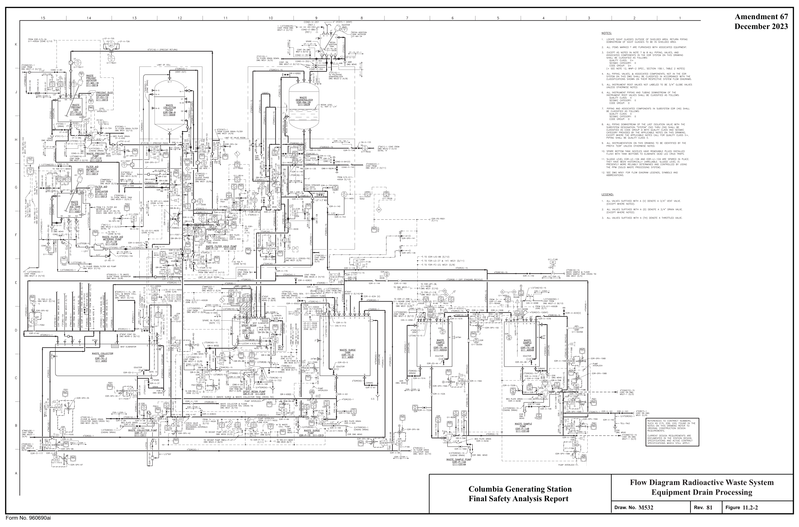
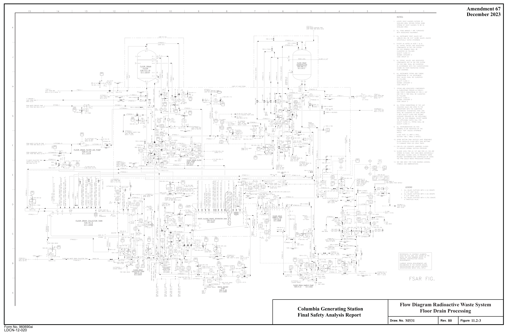
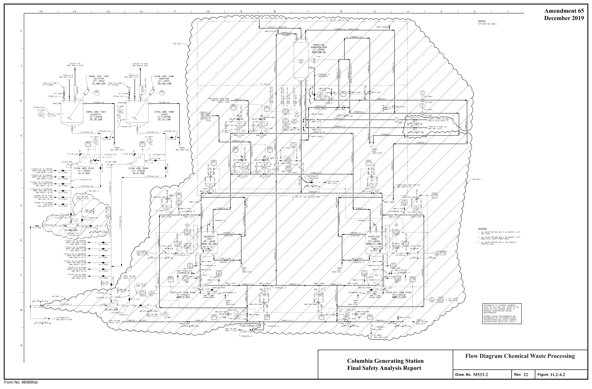
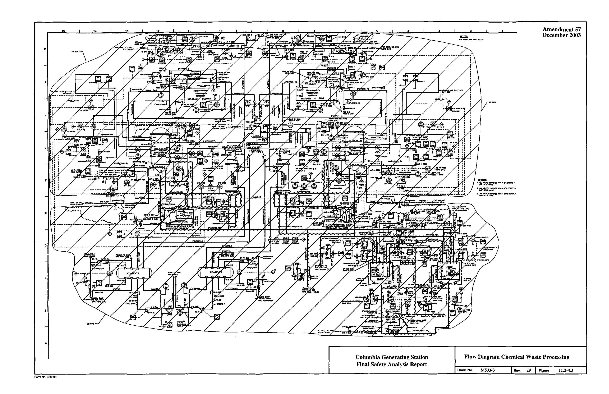

# 11.2 Liquid Waste Management System

> Columbia Generating Station FSAR — Chapter 11: Radioactive Waste Management
> Source: `11_chapter-3610-3790.pdf`, PDF pages 32–80 (of 181)
> Amendment 67 compilation (individual pages carry varying amendment dates)

---
<!-- p.32 -->
November 1998

### 11.2 LIQUID WASTE MANAGEMENT SYSTEM
#### 11.2.1 DESIGN BASIS
The liquid waste management system is designed to collect, segregate, store, and process potentially radioactive liquids generated during normal plant operation and anticipated operational occurrences. The design objective is to keep the radiation dose in unrestricted areas as low as is reasonably achievable (ALARA) within the guidelines of Appendix I to

## 10 CFR 50. The design incorporates the objectives of maximum recycle and minimum release
of radioactive liquids without limiting plant operations or availability.

The criteria considered in the design of this system include volume, radioactivity, operational exposure, and required quality for recycle of the processed liquid. Radioisotopic inventories of the components used for the design are listed in Tables 11.2-1 through 11.2-5. These values are based on the reactor water source term associated with the design-basis fuel leakage rate.
Allowance is made for concentration, decay and daughter product buildup in filters, demineralizers, and tanks. Equipment locations and arrangements are shown in Section 1.2.

The system is designed to treat process liquids with radioisotope concentrations associated with the design-basis fuel leakage and produce a quality of water which allows its recycle for plant reuse. Water inventory will occasionally require the discharge of processed liquids to the environs, in which case concentrations of radioisotopes in the effluent (Table 11.2-6) will be significantly less than the values specified in 10 CFR 20 and within the release limits established in the Technical Specifications. Radiation exposure to persons in unrestricted areas resulting from liquid waste discharged during normal operation and anticipated operational occurrences is less than the guidelines specified in 10 CFR 50, Appendix I.

Tanks that hold radioactive liquid, including the condensate storage tanks, are monitored for level and alarm primarily in the radwaste control room. Table 11.2-7 lists the design features of the tanks in the radwaste building used to prevent uncontrolled releases due to spillage and shows overflow alarms and drainage paths. The radwaste systems are operated from the radwaste control room; hence, additional local alarms are not required for radwaste tank levels.

All liquid waste management system tank overflows and drains are routed to the radwaste building equipment and floor drain sumps (see Figure 9.3-11). Radioactive liquid samples are primarily routed to sampling sinks. Those samples, which are local, drain into floor drain trenches, equipment or floor drain funnels, and pump beds. The above sample receivers are routed to various radioactive sumps, all of which are processed by the liquid waste management system.

Indoor tanks that hold radioactive liquid are not enclosed by individual curbs or elevated thresholds. The portion of the radwaste building that houses radioactive liquid tanks is Seismic

<!-- p.33 -->
I Category I, as discussed in Section 3.8.4.1.2. The radwaste building can retain the normal I operating capacity of all liquid radwaste tanks, which are nonseismic. Analysis of a postulated radioactive release due to a liquid radwaste tank failure is presented in Section 15.7.3.

The radioactive and nonradioactive equipment and floor drains within the plant are segregated.
Equipment and floor drains within the reactor building and radwaste building are routed to the liquid waste management system. The turbine building equipment and floor drains are segregated for radioactivity by component source and area (see Section 9.3.3). Although three of the turbine building sumps are designated as collectors of nonradioactive waste water, there is a possibility of low level contamination of the effluent water. One contamination source is steam leaks inside the building which condense on interior surfaces and are routed to floor drains. Because of this possibility, the discharge of these three sumps is routed to the radwaste system for processing.

The design of the system was accomplished prior to the issuance of Regulatory Guide 8.8.
However, the system does incorporate substantially the guidance provided in this regulatory guide.

Like the nonradioactive sumps, the storm water drainage system (see Section 9.3.3.2.3.1) is not intended to collect radioactive materials. Nonetheless, radionuclides have been detected in the pond water and sediments. These concentrations are attributed to unanticipated and unavoidable occurrences. For example, special system draindowns during maintenance activities may have contributed minor amounts of tritium and corrosion products. Tritium that leaves the plant as a vapor can condense on building roofs and exterior walls and be carried to the ponds in storm drainage. Also, water treatment filter backwashes that are routed to the ponds can contribute radionuclides which were withdrawn from the river.

The degree of compliance with Regulatory Guide 1.143 is described in Section 1.8.

The liquid waste management system is designed to the requirements of General Design Criteria, Appendix A to 10 CFR 50, as follows:

General Design Criterion 60

The system capacity as required by General Design Criterion 60 is sufficient for the volume of liquid waste expected from normal operation and anticipated operational occurrences such as condenser leakage, maintenance activities, and process equipment down time. Flow rates are listed in Tables 11.2-8 through 11.2-10.

General Design Criterion 64

Radioactivity monitoring in the sample tanks and in the effluent discharge path ensures that excess liquid discharged to the environs does not exceed the limits of 10 CFR 20. Sampled

<!-- p.34 -->
fluids exceeding these limits are returned to an appropriate collector tank for reprocessing.
The radwaste effluent radiation monitoring system is described in Section 11.5.2.2.2.3.

#### 11.2.2 SYSTEM DESCRIPTION
##### 11.2.2.1 Process Description
Radioactive liquid wastes are collected and segregated into three categories: high purity waste, low purity waste, and chemical waste. Wastes thus classified are treated in subsystems designated as equipment drain, floor drain, and chemical waste, respectively.

High purity wastes, treated in the equipment drain subsystem, have low conductivity and relatively high radioactivity concentrations. Radioactive material is removed from these wastes by filtration and ion exchange. Following treatment and batch sampling, the processed waste is normally returned to condensate storage for reuse in plant.

Low purity wastes, treated in the floor drain subsystem, have moderate conductivity and generally low radioactivity. As with high purity wastes, radioactive material is removed by filtration and ion exchange. Following treatment and batch sampling, the processed waste is normally returned to condensate storage for reuse in the plant.

The high conductivity and organic content of chemical wastes preclude normal treatment in the system demineralizers by ion exchange. These wastes can be neutralized by adding appropriate neutralizing agent and thorough mixing. If necessary, following neutralization, these wastes are routed to a backwash tank or phase separator where unexpended ion-exchange capacity of the resins is used to remove contaminants from the chemical waste. After thorough mixing and a period of quiescence to allow the ion-exchange process to proceed, the excess liquid is decanted to the floor drain system for further processing. The spent resins in the separators are then processed as described below.

The installed chemical waste concentrators are currently not used. Their preoperational testing and use has been deferred until a need is identified. There are currently no plans to activate the concentrators.

The installed detergent drain tanks are not normally used. Any wastes requiring disposal are handled on a case-by-case basis and routed for processing and disposal in accordance with plant procedures and regulatory requirements and guidelines.

All liquid radwaste process streams terminate in one of the sample or distillate tanks. Since the liquid waste management system is operated on a batch basis, this arrangement allows each treated batch to be sampled to ensure that the treatment was effective. If the sample indicates that the processed liquid is still above acceptable radioactivity limits or substandard in purity, equipment is provided to either recycle the batch through the same treatment or through a

<!-- p.35 -->
I subsystem providing a higher degree of treatment. If the sample indicates that the level of activity is within limits required to discharge and the water is in excess of inventory capacity or is substandard in purity, the processed liquid may be discharged. The actual release of effluents from any processed and sampled batch tank requires the opening of a key-locked valve in accordance with written operating procedures. All required information regarding the batch release must be documented. These procedures are established to prevent inadvertent release of liquids that have not been suitably processed and analyzed.

Expended ion exchange resins are removed by backwashing to the spent resin tank and phase separators. Excess backwash water is removed from the phase separators by decantation and routed to either the floor drain or equipment drain collector tank for treatment. The powdered resin sludge is accumulated for radioactive decay. Following accumulation of successive layers in the phase separator, the sludge is then transferred to the radwaste processing system for dewatering or solidification. The deep bed resins in the spent resin tank, after a decay period, are also transferred to the solid radwaste processing system. Water separated from the wastes is returned via the waste sludge phase separator to the floor drain collector tank for treatment. The solid waste management system is described in Section 11.4.

Noncondensable gases from the liquid waste processing vessels are vented through the radwaste building exhaust system. This system is described in Section 9.4.3.2.

A process flow diagram, Figure 11.2-1, together with process flow diagram data, Table 11.2-11, show the volumes, flow rates, and radioactivity concentration used in the design of the liquid and solid waste management system.

The radionuclide distribution of liquid waste management system influents is based on the reactor coolant concentrations, as discussed in Section 11.1, taking into consideration mixing and dilution sources.

Decontamination factors which were used for evaluations of the system are those values specified in draft Regulatory Guide 1.CC. Table 11.2-12 shows the process equipment design basis decontamination factors which were used to generate the radioactivity values in Table 11.2-11.

##### 11.2.2.2 Subsystems Description
###### 11.2.2.2.1 Equipment Drain Subsystem
The equipment drain subsystem consists of a waste collector tank, waste surge tank, pressure precoat filter, deep bed demineralizer, two waste sample tanks, and auxiliary equipment necessary to operate the subsystem. Sizes and capacities of the equipment are listed in Table 11.2-13. The waste surge tank principally serves as a receptacle for reactor hydrotest and thermal expansion water and residual heat removal (RHR) system flush water during

<!-- p.36 -->
startup and testing of these systems. The waste surge tank also serves as backup during equipment downtime. The piping and instrumentation drawing for this subsystem is shown in Figure 11.2-2.

High purity (low solids content) liquid wastes are collected in the waste collector tank from the following sources:

a. Drywell equipment drain sump, b. Reactor building equipment drain sump, c. Radwaste building equipment drain sump, d. Turbine building equipment drain sump, e. Reactor water cleanup system, f. RHR system, g. Cleanup phase separators (decant water), h. Condensate phase separators (decant water), and i. Fuel pool seal rupture drains (to waste surge tank).

The quantities of these wastes are summarized in Table 11.2-8. Since these wastes can contain a high percentage of primary reactor water, the radioactive concentration could be relatively high (on the order of 2.4 µCi/ml).

In the event of a component malfunction within the equipment drain subsystem, sufficient cross ties are provided to the floor drain subsystem to permit continued processing of the wastes.
Sufficient capacity and treatment capability are provided to handle such conditions.

Normally, the equipment drain subsystem treated effluents are recycled to the condensate storage tanks for reuse within the plant. When condensate storage capacity is not available or the water is substandard in purity, the purified liquid from this subsystem may be sampled, analyzed and, if acceptable for release as described previously, routed to the blowdown line for discharge. Liquid waste that is unacceptable for discharge is reprocessed.

###### 11.2.2.2.2 Floor Drain Subsystem
The floor drain subsystem consists of a floor drain collector tank, pressure precoat filter, deep bed demineralizer, sample tank, and auxiliary equipment necessary to operate the subsystem.
Sizes and capacities of the equipment are listed in Table 11.2-13. The flow diagram for this subsystem is shown in Figure 11.2-3.

Intermediate purity liquid wastes are collected in the floor drain collector tank from the following sources:

a. Drywell floor drain sump, b. Reactor building floor drain sumps,

<!-- p.37 -->
c. Radwaste building floor drain sumps, d. Turbine building floor drain sump, and e. Waste sludge phase separator (decant water).

The quantities of these wastes are summarized in Table 11.2-9. These wastes are normally of intermediate purity (50 mho/cm and higher) and have radioactive concentrations on the order of 0.1 µCi/ml.

Similar to the equipment drain subsystem, the floor drain subsystem normally functions as an independent process stream. Equipment redundancy and intersystem cross ties have been provided to allow substitution for any failed component.

High purity effluent is routed to condensate storage for reuse in the plant. When condensate storage capacity is exceeded or the processed liquid is substandard in purity, it may be discharged via the blowdown line, if it meets acceptable limits.

###### 11.2.2.2.3 Chemical Waste Subsystem
The chemical waste subsystem consists of two of each of the following: detergent drain tanks, chemical waste tanks, decontamination solution concentrators, decontamination solution concentrated waste tanks, and distillate tanks. It contains also a polishing (deep bed)
demineralizer and auxiliary equipment necessary to operate the subsystem. Sizes and capacities of the equipment are listed in Table 11.2-13. The flow diagram for this subsystem is shown in Figure 11.2-4. The decontamination solution concentrators, concentrated waste tanks, distillate tanks, and polishing demineralizer have been installed but will not be used until plant operating experience indicates a need and system testing is accomplished. Chemical wastes are currently processed by routing to a backwash tank or phase separator for use of unexpended ion-exchange capacity of the resins to clean the water prior to decanting to the floor drain subsystem for further processing.

Chemical wastes collected in the chemical waste tank are from the following sources:

a. Detergent drains, b. Shop decontamination solutions, c. Reactor and turbine building decontamination drains, d. Low purity wastes from either the equipment or floor drain subsystems, e. Filter demineralizer element chemical cleaning solutions, f. Battery room drains, g. Chemical system overflows and tank drains, and h. Laboratory drains.

The quantities of these wastes are summarized in Table 11.2-10. These chemical wastes are of such high conductivity and organic content as to preclude normal treatment by ion exchange,

<!-- p.38 -->
and the radioactivity concentrations are variable. These wastes are processed by routing to a backwash tank or phase separator and to the floor drain system for further processing.

If the concentrators were ever activated, the evaporator concentrates would be processed by the solid waste management system and the distillate would be routed to the distillate tank. After analysis, the distillate could be routed through a polishing demineralizer to further reduce impurities, recycled through the evaporator, or sent directly to condensate storage for plant reuse. As with the other subsystems, when high purity water storage capacity is exceeded or the processed liquid is of substandard purity, liquid within 10 CFR 20 release limits could be discharged via the blowdown line.

###### 11.2.2.2.4 Shared Equipment
Other than serving as mutual backup, main process equipment normally is not shared between subsystems. Auxiliary equipment not in the direct process stream is shared between subsystems. Shared equipment includes the following:

a. The waste precoat tank and waste precoat pump are shared between the waste collector filter and the floor drain filter,

b. The waste filter aid tank is shared between the waste collector filter and floor drain filter,

c. The resin addition tank is shared between the waste demineralizer, floor drain demineralizer, and polishing demineralizer, and

d. The chemical addition tanks, caustic and acid, and associated pumps are shared between the waste collector tank, floor drain collector tank, detergent tanks, and chemical waste tanks.

###### 11.2.2.2.5 Surge Capacities
The radwaste system process data is the basis for sizing of the equipment. Tables 11.2-8, 11.2-9, and 11.2-10 list startup flows, daily flows, and maximum flows for the equipment drain subsystem, floor drain subsystem and chemical waste subsystem, respectively.
Anticipated operational occurrences such as startup operations, equipment malfunction, and shutdown operations are accounted for in these tabulations. The bases for these types of values are presented in NEDO-10951, “Releases from BWR Radwaste Management Systems,” July 1973.

The surge storage and process capacities can be envisioned by comparing the normal and maximum daily volumes, listed in Table 11.2-11, with the design flow rates of pumps and tank volumes listed in Table 11.2-13. Alternate processing rather than bypass operations are used

<!-- p.39 -->
during equipment downtime. The equipment and floor drain subsystems are sized such that with either subsystem inoperative, the remaining subsystem is capable of processing the maximum expected volume of both subsystems. Additionally, the waste surge tank provides reserve storage capacity. The chemical waste subsystem incorporates two parallel processing paths. Cross connections allow individual components from either process path to serve as a substitute in the other process path. The parallel path processing and adequate storage capacity ensures that inoperability of any component in this subsystem will not limit plant operation.

###### 11.2.2.2.6 Design Features
The design pressures and temperatures for individual components are listed in Table 11.2-13.
Collection and storage tanks are designed for atmospheric pressure. The mixed-bed demineralizer units, precoat filter units, and concentrators are pressure vessels. The quality classification for the system is Quality Group D+ as defined in Section 3.2.

Chapter 12 discusses the design features incorporated in the system to maintain occupational exposure ALARA. As shown in the general arrangement drawings in Section 1.2, the radwaste processing equipment is located in shielded rooms and cells. Process lines that penetrate shield walls are routed to prevent a direct radiation path from the tanks and equipment to normally occupied areas.

Control of the liquid waste management system is from a shielded radwaste control room and from shielded local operating galleries. Flanges are provided where required for maintenance in an otherwise all-welded system. The cells and concrete rooms provide secondary enclosures which facilitate collection of spills or leaks from the system for processing. Vessels that may have their contents mixed with air or that may have batches transferred into them by means of pneumatic transfer are closed and vented to the radwaste building ventilation system. Piping and tubing 2 in. and under is field routed but required to be in specified space envelopes for shielding and in-plant exposure consideration.

The liquid waste management system is designed to minimize the effects of equipment malfunction and operator error. After initiation by the operator, valve positioning, equipment startup, and system operation can be automatically performed by a process controller. Failure of any valve to properly align stops the sequence and prevents a pump start. Once on line, processing continues until the feed volume is processed or the capacity of a piece of process equipment is reached. In either case, automatic shutdown occurs with valves returning to the shutdown position. During initial system startup or in the event of controller failure, the processes are manually controlled. System variables, such as tank levels, flow rates, pressures, and conductivity are indicated and alarmed in the radwaste control room.

The discharge from the liquid waste subsystems to the blowdown line is normally isolated by a closed manual valve and a key-locked closed manual valve separated by a telltale drain. This path is further protected by air-operated isolation valves, flow control valves, flow indication

<!-- p.40 -->
December 2015 ,.

and radiation monitoring instrumentation. These design features are complimented by administrative procedures which prevent inadvertent radioactive liquid releases and releases of liquids that exceed the Technical Specifications release limit.

#### 11.2.3 RADIOACTIVE RELEASES
The decision to recycle or to release a particular batch of processed liquid is based on plant water inventory and the type and concentration of chemical impurities being processed. It is not expected that tritium buildup in the plant will determine the frequency of releases.
Concentration of radionuclides released to the environment will be significantly less than those values specified in 10 CFR 20. The quantities of radioactive materials released during normal operation will not result in dose rates to persons in unrestricted areas in excess of 10 CFR 50, Appendix I, values as implemented by the Technical Specifications release limits.

##### 11.2.3.1 Release Point and Dilution
Excess liquid effluent is discharged to the circulating water blowdown line at a variable rate up to about 190 gpm. Dilution is furnished by circulating water system blowdown when required or when normal blowdown is in progress. The circulating water blowdown line terminates in the Columbia River. Applicable concentration limits specified in 10 CFR 20 apply at the point of discharge to the river.

The storm water drainage ponds described in Section 9.3.3.2.3.1 are a point of release of detectable radionuclides. For the reasons discussed in Section 11.2.1, most of the activity is believed to be either condensed gaseous effluent or material of external origin. The ponds are within a plant restricted area (see Section 2.1.1.3), and public access is restricted by a fence which surrounds the ponds.

##### 11.2.3.2 Calculation of Releases of Radioactive Materials
Quantities of radioactive materials released with liquids were calculated for initial plant licensing using the GALE code presented in draft Regulatory Guide 1.CC to show compliance with Appendix I to 10 CFR 50 for normal operation plus anticipated operational occurrences.
The plant operational parameters, including source terms, were those presented in Appendix B of the guide with waste stream flow rates adjusted to the Columbia Generating Station plant design. The calculated quantities of radioactive materials released with liquids used for initial plant licensing are presented in Table 11.2-14 in terms of curies per year. The radionuclide concentrations in the effluent are presented in Table 11.2-6 and are compared with the values of 10 CFR 20, Appendix B, Table II, Column 2.
l Since becoming operational, releases of radioactive materials in liquid effluents have been I determined using actual flow volumes and quantitative and qualitative laboratory analyses.
Doses due to radioactive materials released in liquid effluents are determined to be in

<!-- p.41 -->
compliance with Technical Specifications at specified intervals. Compliance is reported in the Annual Radioactive Effluent Release Report using the NRC LADTAP II computer code along with parameters outlined in the Offsite Dose Calculation Manual.

##### 11.2.3.3 Exposure of Persons at or Beyond the Site Boundary
Estimated annual exposure of persons in unrestricted areas resulting from liquid effluents
(Table 11.2-6) is discussed in Section 5.2 of the Environmental Report, Operating License stage. The estimated total body dose of 2.3 mrem per year and largest calculated single organ dose of 1.6 mrem per year to the bone are well within the guidelines of 10 CFR 50, Appendix I.

##### 11.2.3.4 Cost-Benefit Analysis
It has been determined that a cost-benefit analysis, as described in Appendix I to 10 CFR 50 Section II.D is not required for Columbia Generating Station.

The question of eligibility of Columbia Generating Station to dispense with the Appendix I cost-benefit analysis as to “per site” limitations was reviewed by the NRC in connection with their review of WPPSS Nuclear Project No. 1 (WNP-1) and WPPSS Nuclear Project No. 4
(WNP-4), Docket Nos. 50-460 and 50-513. The Staff concluded in its testimony at the Atomic Safety and Licensing Board (ASLB) hearing for WNP-1 and WNP-4 held on November 11, 1975, that

The aggregate doses associated with WPPSS Nuclear Project No. 1, WPPSS Project No. 2, and WPPSS Nuclear Project No. 4 operation meet the RM-50-2
(i.e., Annex) design objectives [Tr. 724-727].

These conclusions were ratified by the ASLB on its decision pertaining to WNP-1 and WNP-4 of December 22, 1975, RAI-75/12 922, 934.

<!-- p.42 -->
I I Table 11.2-1

Liquid Waste Management System Radioisotope Inventory Equipment Drain Subsystem

Radioisotope Inventory (µCi)
Waste Collector Waste Waste Sample Tanka Radioisotope Tanka Waste Filtera Demineralizera

83Br 4.53E4
3.15E4
3.18E2 84Br 4.67E4 9.19E3 9.28E1 85Br
1.17E4 4.17E-4 4.21E-6 89Sr 4.35E4
1.88E6 4.35E2 90Sr
3.25E3
2.12E5
3.25E1 91Sr 7.12E5
1.10E6 9.13E3 92Sr
3.40E5
2.48E5
2.50E3 90Y
3.53E2
2.00E5
3.92E0 91Y 4.21E3 5.10E5 4.69E1 91MY 4.12E5 7.31E5 5.82E3 92Y
2.15E5
2.37E5
2.33E3 95Zr 5.63E2 2.81E2 1.31E4 5.62E0 97Zr 6.94E1 1.73E1 1.70E1
3.46E-1 95Nb 5.93E2 2.97E2 1.69E4 5.93E0 99Mo
2.79E5 1.38E5 6.13E5
2.75E3 99MTc
1.70E6 8.18E3 2.02E6
1.51E4 101Tc
2.05E5 5.15E3 5.20E1 103Ru
2.66E2 1.33E2 5.17E3
2.66E0 106Ru
3.67E1 1.84E1 1.12E3
3.67E-1 129MTe 5.60E2
2.00E4 5.59E0 129Te
3.03E2
1.27E4
3.31E0 132Te 6.30E5
3.21E6 6.23E3 129I
2.83E-8 9.76E-5
3.16E-10 131I
1.77E5
2.12E6
1.76E3 132I 8.53E5
3.45E6 7.83E3 133I 9.03E5
1.57E6 8.67E3 134I 4.66E5
1.75E5
1.77E3 135I 7.73E5 7.35E5 6.80E3 134Cs
2.26E3
1.44E5
2.26E1 135Cs 4.19E-5
1.97E-2 5.95E-7 136Cs
1.52E3
2.80E4
1.51E1 137Cs
3.39E3
2.21E5
3.39E1 138Cs
3.29E5 6.54E4 6.60E2 137MBa
2.99E3
2.07E5
3.17E1

<!-- p.43 -->
Table 11.2-1

Liquid Waste Management System Radioisotope Inventory Equipment Drain Subsystem (Continued)

Radioisotope Inventory (µCi)
Waste Collector Waste Waste Sample Tanka Radioisotope Tanka Waste Filtera Demineralizera

139Ba
3.67E5
1.98E5
2.00E3 140Ba
1.24E5
2.29E6
1.24E3 141Ba
2.64E5
1.50E4
1.52E2 142Ba
2.32E5
2.14E3
2.16E1 141Ce
1.18E3 5.99E2 3.04E4
1.22E1 143Ce
3.98E2 1.94E2 4.80E2
3.88E0 144Ce 4.94E2 2.47E2 1.48E4 4.94E0 140La
2.07E4
2.28E6
2.29E2 141La
3.66E4 4.61E4 4.60E2 142La
2.34E4
3.08E4
3.11E2 143Pr 5.37E2 2.69E2 1.71E4 5.37E0 144Pr 4.40E2 2.46E2 1.48E4 4.91E0 147Nd
1.92E2 9.59E1 1.52E3
1.92E0 239NP
2.98E6
1.13E7
2.93E4 24Na
1.80E4
2.52E4
1.70E2 32P
2.77E2 5.54E3
2.76E0 51Cr 6.99E3 3.49E3 1.10E5 6.98E1 54Mn 5.65E2 2.82E2 1.70E4 5.65E0 56Mn
1.58E5 5.67E4 5.57E4
1.13E3 58Co 7.04E4 3.52E4 1.68E6 7.03E2 60Co 7.07E3 3.53E4 2.26E5 7.07E1 59Fe
1.12E3 5.61E2 2.30E4
1.12E1 65Ni 9.40E2 3.36E2 3.30E2 6.73E0 65Zn
2.82E1
1.67E3
2.82E-1 69MZn
2.63E2
3.52E2
2.47E0 110MAg 8.47E2 4.24E2 2.52E4 8.47E0 187W
3.16E4 1.53E4 2.99E4
3.05E2

a The radioisotope inventory listed above for the waste collector tank, waste filter, waste demineralizer, and waste sample tank is assumed to be applicable to the floor drain collector tank, floor drain filter, floor drain demineralizer, and floor drain sample tank, respectively.
This is done for the purpose of shielding analysis. In actuality, the radionuclide inventory in any component of the floor drain system is discussed in Sections 11.2.2.2.1 and 11.2.2.2.2.
The values from the equipment drain subsystem are maximum due to cross-ties for alternate processing.

<!-- p.44 -->
Table 11.2-2

Liquid Waste Management System Radioisotope Inventory Chemical Waste Subsystem

Radioisotope Inventory (µCi)
1D □CJ DSC Waste Decon.
Chemical DSC Waste Measuring Distillate Solution II Radioisotope Waste Tank Tanka Tankb Tank Concentrator

83Br 84Br 85Br 89Sr
1.11E3 2.82E3 1.74E3 1.11E0 1.48E3 90Sr 7.87E1 2.00E2 1.23E2 7.87E-2 1.05E2 91Sr 92Sr 90Y 91Y 91MY 92Y 95Zr
1.43E1 3.65E1 2.25E1 1.43E-2 1.92E1 97Zr 95Bv 99Mo 7.87E3 2.00E4 1.23E4 7.87E0 1.05E4 99MTc 101Tc 103Ru 106Ru 129MTe 1.43E1 3.65E1 2.25E1 1.43E-2 1.92E1 129Te 132Te
1.75E4 4.45E4 2.75E4 1.75E1 2.34E4 129I 131I 4.65E3 1.13E4 6.95E3 4.65E0 5.92E3 132I 133I 134I 135I 134Cs 5.75E1 1.46E2 9.02E1 5.75E-2 7.68E1 135Cs 136Cs
3.94E1 1.00E2 6.19E1 3.94E-2 5.27E1 137Cs 8.60E1 2.19E2 1.35E2 8.60E-2 1.15E2

<!-- p.45 -->
Table 11.2-2

Liquid Waste Management System Radioisotope Inventory Chemical Waste Subsystem (Continued)

Radioisotope Inventory (µCi)
1D □CJ DSC Waste Decon.
Chemical DSC Waste Measuring Distillate Solution II Radioisotope Waste Tank Tanka Tankb Tank Concentrator

138Cs 137MBa 139Ba 140Ba
3.22E3 8.18E3 5.05E3 3.22E0 4.30E3 141Ba 142Ba 141Ce
1.40E1 3.56E1 2.20E1 1.40E-2 1.87E1 143Ce
1.25E1 3.17E1 1.96E1 1.25E-2 1.67E1 144Ce
1.25E1 3.17E1 1.96E1 1.25E-2 1.67E1 140La 141La 142La 143Pr
1.36E1 3.44E1 2.12E1 1.36E-2 1.81E1 144Pr 147Nd 5.01E0 1.27E1 7.85E0 5.01E-3 6.69E0 239Np 8.60E4 2.19E5 1.35E5 8.60E1 1.15E5 24Na 32P 7.18E0 1.82E1 1.13E1 7.18E-3 9.58E0 51Cr
1.79E2 4.54E2 2.80E2 1.79E-1 2.38E2 54Mn
1.43E1 3.65E1 2.25E1 1.43E-2 1.92E1 56Mn 58Co
1.79E3 4.54E3 2.80E3 1.79E0 2.38E3 60Co
1.79E2 4.54E2 2.80E2 1.79E-1 2.38E2 59Fe
2.87E1 7.26E1 4.48E1 2.87E-2 3.82E1 65Ni 65Zn 7.18E-1 1.82E0 1.13E0 7.18E-4 9.58E-1 69MZn 110MAg 2.15E1 5.46E1 3.37E1 2.15E-2 2.87E1 187W

a Decontamination solution concentrator waste tank.
b Decontamination solution concentrator waste measuring tank.

<!-- p.46 -->
Table 11.2-3

Liquid Waste Management System Radioisotope Inventory RWCU and Condensate Filter Demineralizers

Radioisotope Inventory (µCi)
Radioisotope RWCU Filter Demineralizer Condensate Filter Demineralizer

83Br
2.50E6
2.30E5 84Br 9.00E5 9.12E4 85Br
3.00E4 5.42E3 89Sr
1.40E7
3.00E5 90Sr
1.10E6
2.56E4 91Sr
3.20E7
2.13E5 92Sr
1.60E7 9.12E4 90Y
1.10E6
2.09E4 91Y 4.54E4 91MY
2.20E7
1.28E5 92Y 9.12E4 95Zr
1.80E5
2.59E4 97Zr
2.40E4 8.19E1 95Nb 5.60E5
2.97E4 99Mo 5.50E7
3.04E6 99MTc
2.40E7
3.18E6 101Tc
1.90E6
1.04E4 103Ru 9.00E4
1.16E4 106Ru
1.20E4
1.85E3 129MTe
1.50E6
3.60E3 129Te
2.29E3 132Te
3.70E7
1.20E6 129I 4.89E-6 131I 8.50E7
1.34E7 132I 5.80E7
2.96E6 133I
1.40E8
1.19E7 134I
1.40E7
1.35E6 135I 6.50E7 5.55E6 134Cs 7.50E5
1.77E4 135Cs
2.48E-2 136Cs 4.20E5 7.37E3 137Cs
1.20E6
2.67E4 138Cs 5.50E6
3.23E4 127MBa
1.20E6
2.50E4

<!-- p.47 -->
Table 11.2-3

Liquid Waste Management System Radioisotope Inventory RWCU and Condensate Filter Demineralizers (Continued)

Radioisotope Inventory (µCi)
Radioisotope RWCU Filter Demineralizer Condensate Filter Demineralizer

139Ba
1.20E7 7.23E4 140Ba
3.60E7 6.03E5 141Ba
3.00E6
1.63E4 142Ba
1.60E6 9.94E3 141Ce
1.80E5
2.86E4 143Ce 5.00E4
2.40E3 144Ce
1.60E5
2.47E4 140La 4.10E7 5.60E5 141La
1.63E4 142La 9.94E3 143Pr
1.60E5
2.74E4 144Pr
2.47E4 147Nd 5.50E4 5.65E3 239Np 5.00E8 4.27E6 24Na
1.50E6 9.56E3 32P 9.50E4
1.40E3 51Cr
2.60E6
2.80E5 54Mn
2.20E5
2.83E4 56Mn 6.00E6
2.69E5 58Co
2.60E7
3.27E6 60Co
2.80E6
3.61E5 59Fe 4.30E5 4.96E4 65Ni
3.80E4
1.59E3 65Zn
1.10E4
2.16E2 69MZn
2.00E4
1.34E2 110MAg
3.40E5 4.24E4 187W
3.60E6
1.49E5

<!-- p.48 -->
Table 11.2-4

Liquid Waste Management System Radioisotope Inventory Spent Resin and Condensate Backwash Receiving Tanks

Radioisotope Inventory (µCi)
Radioisotope Spent Resin Tank Condensate Backwash Receiving Tank

83Br
3.15E4
2.30E5 84Br 9.19E3 9.12E4 85Br 4.17E-4 5.42E3 89Sr
1.88E6
3.00E5 90Sr
2.12E5
2.56E4 91Sr
1.10E6
2.13E5 92Sr
2.48E5 9.12E4 90Y
2.00E5
2.09E4 91Y 5.10E5 4.54E4 91MY 7.31E5
1.28E5 92Y
2.37E5 9.12E4 95Zr
1.31E4
2.59E4 97Zr
1.70E1 8.19E1 95Nb
1.69E4
2.97E4 99Mo 6.13E5
3.04E6 99MTc
2.02E6
3.18E6 101Tc 5.15E3
1.04E4 103Ru 5.17E3
1.16E4 106Ru
1.12E3
1.85E3 129MTe
2.00E4
3.60E3 129Te
1.27E4
2.29E3 132Te
3.21E6
1.20E6 129I 9.76E-5 4.89E-6 131I
2.12E6
1.34E7 132I
3.45E6
2.96E6 133I
1.57E6
1.19E7 134I
1.75E4
1.35E6 135I 7.35E4 5.55E6 134Cs
1.44E4
1.77E4 135Cs
1.97E-2
2.48E-2 136Cs
2.80E4 7.37E3 137Cs
2.21E5
2.67E4 138Cs 6.54E4
3.23E4 137MBa
2.07E5
2.50E4

<!-- p.49 -->
Table 11.2-4

Liquid Waste Management System Radioisotope Inventory Spent Resin and Condensate Backwash Receiving Tanks (Continued)

Radioisotope Inventory (µCi)
Radioisotope Spent Resin Tank Condensate Backwash Receiving Tank

139Ba
1.98E5 7.23E4 140Ba
2.29E6 6.03E5 141Ba
1.50E4
1.63E4 142Ba
2.14E3 9.94E3 141Ce
3.04E4
2.86E4 143Ce 4.80E2
2.40E3 140Ce
1.48E4
2.47E4 141La
2.28E6 5.60E5 141La 4.61E4
1.63E4 142La
3.08E4 9.94E3 143Pr
1.71E4
2.74E4 144Pr
1.48E4
2.47E4 147Nd
1.52E3 5.65E3 239Np
1.13E7 4.27E6 24Na
2.52E4 9.56E3 32P 5.54E3
1.40E3 51Cr
1.10E5
2.80E5 54Mn
1.70E4
2.83E4 56Mn 5.57E4
2.69E5 58Co
1.68E6
3.27E6 60Co
2.26E5
3.61E5 59Fe
2.30E4 4.96E4 65Ni
3.30E2
1.59E3 65Zn
1.67E3
2.16E2 69MZn
3.52E2
1.34E2 110MAg
2.52E4 4.24E4 187W
2.99E4
1.49E5

<!-- p.50 -->
Table 11.2-5

Liquid Waste Management System Radioisotope Inventory Phase Separators

Radioisotope Inventory (µCi)
RWCU Phase Condensate Phase Waste Sludge I I Radioisotope Separator Separator Phase Separator

83Br 4.95E6
2.26E5 84Br
1.71E6 7.04E4 85Br
3.73E4 8.21E2 89Sr
3.48E8
2.94E6 90Sr
3.95E7
3.23E5 91Sr 6.40E7
2.21E5 92Sr
3.17E7 8.98E4 90Y
3.95E7
3.15E5 91Y 5.66E6 4.76E5 91MY 4.40E7
1.35E5 92Y
2.33E5 9.57E4 95Zr 4.83E6
2.55E5
3.70E1 97Zr 4.70E4 7.14E1 4.53E-1 95Nb
1.41E7
3.29E5
3.96E1 99Mo
1.93E8 5.23E6
1.35E4 99MTc
1.27E8
2.17E6 8.76E3 101Tc
3.41E6 7.67E-2 103Ru
2.06E6
1.36E5
1.74E1 106Ru 4.09E5
2.14E4
2.45E0 129MTe
3.15E7
3.48E-4 129Te
1.82E7
2.07E3 132Te
1.43E8
2.40E6 129I
1.29E-1 6.20E-5 131I 6.70E8 5.31E7 132I
1.87E8 4.16E6 133I
3.00E8
1.33E7 134I
2.72E7
1.18E6 135I
1.30E8 5.69E6 134Cs
2.63E7
2.19E5 135Cs
1.98E-1
3.48E-1 136Cs 4.00E6 4.07E4 137Cs 4.31E7
3.37E5 138Cs
1.05E7
2.50E4

<!-- p.51 -->
Table 11.2-5

Liquid Waste Management System Radioisotope Inventory Phase Separators (Continued)

Radioisotope Inventory (µCi)
RWCU Phase Condensate Phase Waste Sludge I I Radioisotope Separator Separator Phase Separator

137MBa 4.00E7
3.14E5 139Ba
2.36E7 6.74E4 140Ba 4.18E8
3.33E6 141Ba 5.51E6
1.01E4 142Ba
2.79E6 4.69E3 141Ce
3.80E6
2.37E5 7.78E1 143Ce
1.22E5
2.88E3
1.46E1 144Ce 5.37E6
2.83E5
3.29E1 140La 4.78E8
3.64E6 141La
3.86E4 5.32E2 142La 4.89E4 6.33E2 143Pr 5.68E6
3.26E5
3.59E1 144Pr 5.08E6
2.83E5
3.29E1 147Nd 5.61E5
2.66E4
1.18E1 239Np
1.57E9 6.92E6 24Na
3.07E6
1.02E4 32P
1.19E6 8.19E3 51Cr 4.93E7
2.15E6 4.50E2 54Mn 7.43E6
3.26E5
3.76E1 56Mn
1.19E7
2.52E5
1.52E3 58Co 7.14E8
3.27E7 4.64E3 60Co 9.98E7 4.30E6 4.72E2 59Fe
1.03E7 4.50E5 7.35E1 65Ni 7.52E4
1.49E3 9.01E0 65Zn
3.63E5
2.57E3 69MZn 4.06E4
1.41E2 110MAg
1.14E7 4.84E5 5.64E1 187W 7.95E6
1.63E5 9.81E2

<!-- p.52 -->
Table 11.2-6

Annual Average Concentration of Radionuclides in Liquid Effluent

Effluent Concentration 10 CFR 20 Table II Fraction of 10 CFR 20
(µCi/ml)
(µCi/ml) Effluent/10 CFR 20 Nuclide

24Na
1.3E-9 5E-5 0.000026 32P 5.2E-11 9E-6 0.00000575 51Cr
1.3E-9 5E-4 0.0000026 54Mn
1.6E-11 3E-5 0.000000533 56Mn
1.4E-9 7E-5 0.00002 55Fe
2.8E-10 1E-4 0.0000028 59Fe 8E-12 1E-5 0.00000008 58Co 5.4E-11 2E-5 0.0000027 60Co
1.1E-10 3E-6 0.0000367 65Ni 8E-12 1E-4 0.00000008 64Cu 4E-9 2E-4 0.00002 65Zn 5.4E-11 5E-6 0.000011 69mZn
2.8E-10 6E-5 0.00000467 69Zn 3E-10 8E-4 0.000000375 187W 5.4E-11 3E-5 0.0000018 239Np
1.6E-9 2E-5 0.00008 83Br 7.2E-11 9E-4 0.00000008 84Br 6E-12 4E-4 0.000000015 89Rb 4.2E-11 9E-4 0.0000000467 89Sr
2.8E-11 8E-6 0.0000035 91Sr 4.4E-10 2E-5 0.000022 91mY
2.8E-10 2E-3 0.00000014 91Y
1.4E-11 8E-6 0.00000175 92Sr 3E-10 4E-5 0.0000075 92Y 6.2E-10 4E-5 0.0000155 93Y 4.6E-10 2E-5 0.000023 98Nb
1.6E-11 2E-4 0.00000008 99Mo 4.6E-10 2E-5 0.000023 99mTc
1.8E-9 1E-3 0.0000018 101Tc 4E-12 2E-3 0.000000002 103Ru 6E-12 3E-5 0.0000002

<!-- p.53 -->
Table 11.2-6

Annual Average Concentration of Radionuclides in Liquid Effluent (Continued)

Effluent Concentration 10 CFR 20 Table II Fraction of 10 CFR 20
(µCi/ml)
(µCi/ml) Effluent/10 CFR 20 Nuclide

103mRh 6E-12 6E-3 0.000000001 104Tc
1.2E-11 4E-4 0.00000003 105Ru
1.1E-10 7E-5 0.00000165 105mRh
1.2E-10
--
-- 105Rh
3.8E-11 5E-5 0.00000076 129mTe 1E-11 7E-6 0.00000150 129Te 6E-12 4E-4 0.00000016 131mTe 2E-11 8E-6 0.0000026 131Te 4E-12 8E-5 0.00000005 131I
1.4E-9 1E-6 0.0014 132Te 2E-12 9E-6 0.000000233 132I 7E-10 1E-4 0.000007 133I
3.6E-9 7E-6 0.000510 134I
2.9E-10 4E-4 0.0000007 134Cs
1.6E-9 9E-7 0.00175 135I
1.7E-9 3E-5 0.0000580 136Cs 9.9E-10 6E-6 0.000165 137Cs
3.6E-9 1E-6 0.0036 137mBa
3.4E-9
--
-- 138Cs
1.5E-9 4E-4 0.0000037 139Ba 1E-10 2E-4 0.0000005 140Ba 1E-10 8E-6 0.0000131 140La
2.3E-11 9E-6 0.00000256 141La
3.6E-11 5E-5 0.00000071 141Ce 8E-12 3E-5 0.000000280 142La 7.6E-11 1E-4 0.00000076 143Ce 6E-12 2E-5 0.0000003 143Pr 1E-11 2E-5 0.0000005 All others
1.5E-11 1E-8 0.0015

Total 0.009020094

<!-- p.54 -->
Table 11.2-7

Tank Design Features

High Level Component Alarm Overflows and Drains

Floor drain collector tank Yes (RCR) Floor drain sump, W-2

Waste sludge phase separator Yes (RCR) Floor drain sump, W-2

Floor drain sample tank Yes (RCR) Floor drain sump, W-2

Waste collector tank Yes (RCR) Floor drain sump, W-2

Spent resin tank Yes (RCR) Floor drain sump, W-2

Waste surge tank Yes (RCR) Equipment drain sump, W-3

Waste sample tanks Yes (RCR) Equipment drain sump, W-3

Detergent drain tanksb Noa Chemical waste sump, W-4

Chemical waste tanks Yes (RCR) Chemical waste sump, W-4

Distillate tanksb Noa Chemical waste sump, W-4

Nonoperational decontamination solution No Chemical waste sump, W-4 concentrator waste tanksb

Condensate backwash receiving tank Yes (RCR) Equipment drain sump, W-3

Condensate phase separators Yes (RCR) Equipment drain sump, W-3

Noa Decontamination solution concentrator waste Decontamination solution measuring tankc concentrator waste tanks

RWCU phase separators Yes (RCR) Equipment drain sump, W-3

Condensate storage tanks Yes (MCR) Floor drain sump, T4

a Alarms not installed.

#### LEGEND
b Nonoperational.
RCR - radwaste control room c Not used.
MCR - main control room

<!-- p.55 -->
Table 11.2-8

Equipment Drain Subsystem Sources

Irregular Maximum Startup Regular Daily Flows Daily Flows Flows (gpd) Flows (gpd) (gpd) (gpd)
Source

Equipment drains

Drywell 3,860 3,860 28,800

Reactor building 3,755 3,755 14,400

Turbine building 5,726 5,726 5,726

Radwaste building 1,000 1,000 1,000

Reactor hydrotest and water level 56,720 0 0 reduction to operating state

4,000a RHR system flush water 0

13,500b 40,500c Condensate demineralizer backwash 27,000

1,215d Cleanup demineralizer backwash 2,430

Water inleakage to condenser 0 0 14,400

Total 100,491 14,341 104,826

a Occurs every shutdown prior to placing the RHR system in operation for shutdown cooling.

b Under normal operating conditions, one condensate filter demineralizer would be precoated every 4 days.

c The maximum daily flow is based on a main condenser inleakage of 10 gpm, which corresponds to 3 condensate demineralizer precoatings daily and maximum leak and drain inflows. Up to 36 gpm of condenser inleakage can be accommodated. This requires precoating of one condensate demineralizer every 3 hr. This inleakage rate would result in overloading the equipment drain subsystem but could be tolerated for short periods of time during location and repair of the leak.

d Under normal operating conditions, each cleanup demineralizer may be precoated every 6.8 days.

<!-- p.56 -->
Table 11.2-9

Floor Drain Subsystem Sources

Regular Daily Irregular Flows Maximum Daily Source Flows (gpd) (gpd) Flows (gpd)

Floor drains

Drywell 700 28,800

Reactor building 2,000 15,000

Radwaste building 1,000 1,000

Turbine building 2,000 2,000

8,489a Waste sludge phase separator 0 8,489 decant

Total 5,700 8,489 55,289

a Under normal operating conditions, the waste sludge phase separator tank is decanted every 3-4 days.

<!-- p.57 -->
Table 11.2-10

Chemical Waste Subsystem Sources

Regular Daily Irregular Flow Maximum Daily Source Flow (gpd) (gpd) Flow (gpd)

Detergents drains/shop 1,000 2,000 decontamination solutions

Laboratory drains 500 500

Decontamination drains reactor and 1,000 1,000 turbine buildings

From floor drain or equipment 15,000 15,000 drain subsystem

Filter demineralizer chemical Infrequent 2,000 2,000 cleaning solutions

Battery room drains Infrequent 100 100

Total 1,500 20,600

<!-- p.58 -->
1.0/30.0 9.22E-7 3.08E-5 4.66E2 Batch 4000 4000
- -
- 8

7.18E-6 3.59E-4 4.0/7.4 4.0/2.0
3.67E4 13,500 27,000 450
-
- 6

1.59E-2 5.32E-1
1.0/6.8 Equipment Drain Subsystem 4.89E6 2430 2430
1.0 -
- 53 5 Radwaste System Process Flow Diagram Data
1.91E-5 1.26E-2
3.94E2 2.73E3 5726 5726 909 6.3 6.3 50 4

Table 11.2-11 7.18E-5 2.39E-3
2.59E2 9.05E3 1000 1000 909 1.1 1.1 50 3

1.30E-2 4.32E-1
1.76E5 6.14E6 14,400 3755 15.8 909 4.1 50 2

5.16E-2 7.19E5 2.51E7 28,800 1.72E0 3860 63.4 455 8.5 50 1 Daily activity (µCi/day)
Maximum daily volume (gal) Maximum activity (µCi/cm3)
Normal daily volume (gal) Normal activity (µCi/cm3)
Batches/day (maximum)
Flow rate (gal/minute)
Batches/day (normal)
Volume/batch (gal)
Maximum Normal Flow path

<!-- p.59 -->
1.44E-5 4.78E-4 5.18E1 1.81E3 1000 1000 909 1.1 1.1 50 19

1.05E-6 1.00E-3 7.57E0 7.57E3 15,000 2000 16.5 909 100 2.2 18 Equipment Drain Subsystem (Continued)
7.18E-6 6.84E-2
1.81E1 1.81E5 28,800 Radwaste System Process Flow Diagram Data (Continued)
63.4 455 700 1.5 17 50

1.16E-4 104,826 3.53E-3 6.30E3 2.04E5 15,000 15,000 190 1.0 7.0 14

Table 11.2-11 104,826 1.16E-4 3.53E-3 6.30E3 2.03E5 15,000 15,000 190 1.0 7.0 12

5.81E-3 104,826 3.53E-1
3.14E5 2.00E7 15,000 15,000 190 1.0 7.0 33

104,826 1.16E-2 3.59E-1 6.30E5 2.04E7 15,000 15,000 190 1.0 7.0 9 Daily activity (µCi/day)
Maximum daily volume (gal) Maximum activity (µCi/cm3)
Normal daily volume (gal) Normal activity (µCi/cm3)
Batches/day (maximum)
Flow rate (gal/minute)
Batches/day (normal)
Volume/batch (gal)
Maximum Normal Flow path

<!-- p.60 -->
1.00E-6 1.08E-4
1.0/2.6
2.06E1 2.33E3 15,000 55,489 5700 190 3.7 108

1.00E-6 1.08E-4
1.0/2.6
2.06E1 2.33E3 15,000 55,489 Equipment Drain Subsystem (Continued)
5700 190 3.7 107

Radwaste System Process Flow Diagram Data (Continued)
4.99E-5 1.08E-2
1.0/2.6
1.03E3 2.33E5 15,000 55,489 5700 3.74 190 23

1.00E-6 1.08E-2
1.0/2.6 15,000
2.56E3 2.33E5 55,489 Table 11.2-11 5700 190 3.7 21

7.18E-6 3.59E-4 10./3.4 8489 8489
- - 117 1.0 50

7.18E-7 2.39E-5 5.18E0 1.81E2 2000 2000 909 2.2 2.2 50 20 Daily activity (µCi/day)
Maximum daily volume (gal) Maximum activity (µCi/cm3)
Normal daily volume (gal) Normal activity (µCi/cm3)
Batches/day (maximum)
Flow rate (gal/minute)
Batches/day (normal)
Volume/batch (gal)
Maximum Normal Flow path

<!-- p.61 -->
7.18E-6 3.59E-4 56,720 56,720
1.0/yr 190 1.0

## 37 Radwaste System Process Flow Diagram Data (Continued)
Waste Surge Subsystem Table 11.2-11 7.18E-6 3.59E-4 56,720 56,720
1.0/yr Batch 104 1.0

Maximum daily volume (gal) Maximum activity (µCi/cm3)
Normal daily volume (gal)
Normal activity (µCi/cm3)
Batches/day (maximum)
Flow rate (gal/minute)
Batches/day (normal)
Volume/batch (gal)
Flow path

<!-- p.62 -->
1.07E-1
1.07E-1 314 168 3.7 122 20

1.07E-1
1.07E-1 1162 615 1.0 121 Chemical Waste Subsystem 31 Radwaste System Process Flow Diagram Data (Continued)
24,306
2.71E-3
2.71E-3 12,153 581 2.0 120 10

Table 11.2-11
2.76E-3 12,153 24,306
- 190 2.0 109

1000
1.05E-5
1.05E-5 1000 2000
1.0 2.0 25 27 Normal activity solids (µCi/batch)
Maximum activity solids (µCi/batch) liquids (µCi/cm3)
liquids (µCi/cm3)
Maximum daily volume (gal)
liquids (gal) Normal daily volume (gal)
Batches/day (maximum) Volume/batch solids(lb)
Flow rate (gal/minute)
Batches/day (normal)
Flow path

<!-- p.63 -->
7.18E-6
3.59E-4 4.0/2.0 13,500 27,000 4/7.4
- 450
- - - Waste Sludge Subsystem (Condensate Backwash)
6

7.18E-6
3.59E-4
1.26E7
2.67E7 1/18.5 Radwaste System Process Flow Diagram Data (Continued)
7527 3300 7527
- 20 60 1

7.18E-6
3.59E-4 4.0/7.4 5.26E7 54,000 13,500 2.20E6 7300 Table 11.2-11 450 4.0 330 58

7.18E-6
3.59E-4 4.0/7.4
2.20E6 5.26E7 13,500 54,000 2500 7300 330 4.0 56

Maximum activity solids (µCi/batch)
liquids (µCi/cm3)
Normal activity solids (µCi/batch)
liquids (µCi/cm3)
Maximum daily volume (gal)
liquids (gal) Normal daily volume (gal)
Volume/batch solids (lb) Batches/day (maximum)
Flow rate (gal/minute)
Batches/day (normal)
Flow path

<!-- p.64 -->
Waste Sludge Subsystem (Cleanup Backwash)
1.59E-2 5.32E-1
1.0/6.8 2430 2430
-
1.0 - - - 53 5

Radwaste System Process Flow Diagram Data (Continued)
1.59E-2 5.32E-1
1.19E8
1.80E8
1.0/60 1.0/60 1196 1196 524 - 20 59

Table 11.2-11
1.59E-2 5.32E-1
2.0/6.8
2.55E7 7.68E8 1215 2430 29.7 270 2.0 360 54

Maximum activity solids (µCi/batch)
liquids (µCi/cm3)
Normal activity solids(µCi/batch) liquids (µCi/cm3)
Maximum daily volume (gal)
liquids (gal) Normal daily volume (gal)
Volume/batch solids (lb) Batches/day (maximum)
Flow rate (gal/minute)
Batches/day (normal)
Flow path

<!-- p.65 -->
7.18E-6 3.59E-4 1539 3510
- -
- - 20 71 Waste Sludge Subsystem (Spent Resin)
7.18E-6 3.59E-4 1.0/165 1.0/100
1.16E2 1.26E2 1539 Radwaste System Process Flow Diagram Data (Continued)
746 37 69

7.18E-6 3.59E-4 6.15E3 2.34E5
1.0/67 1.0/49 1539 119 746 37 Table 11.2-11 7.18E-6 3.59E-4
2.39E6 2.74E7
1.0/66 1.0/29 1539 746 37 64

Maximum activity solids (µCi/batch)
liquids (µCi/cm3)
Normal activity solids (µCi/batch)
liquids (µCi/cm3)
liquids (gal)
Volume/batch solids (lb) Batches/day (maximum)
Flow rate (gal/minute)
Batches/day (normal)
Flow path

<!-- p.66 -->
7.18E-6 9.88E-4
1.0/3.4 4.87E4 7.33E5 220 501 501 1.0 65 20
-

Equipment Drain Subsystem
- - - - - - - - - - - -

Radwaste System Process Flow Diagram Data (Continued)
7.18E-6
3.59E-4
1.0/5.2 1.0/5.2
1.47E4
1.47E6 2430 59.4 540 - - 62

7.18E-6
3.59E-4
1.0/3.4 1.1/1.0 8.42E1 8.42E1 Table 11.2-11 41.36 1692 1861 376 - 63

7.18E-6
3.59E-4
3.30E4
3.30E4 41.36 1692 1692 4906 376 1.0 2.9 61

Maximum activity solids (µCi/batch)
liquids (µCi/cm3)
Normal activity solids (µCi/batch)
liquids (µCi/cm3)
Maximum daily volume (gal)
liquids (gal) Normal daily volume (gal)
Volume/batch solids (lb) Batches/day (maximum)
Flow rate (gal/minute)
Batches/day (normal)
Flow path

<!-- p.67 -->
Activity level expected during operation with no fuel leaks and corrosion product reactor water Maximum activity - Activity level expected during operation with fuel leak rate equivalent to reactor water activity concentration of 2.3 µCi/cm3 and design basis noble radiogas release rate of 100,000 µCi/sec Maximum volume - Maximum expected flow during unsteady state operation such as startup, shutdown, etc.
Fractional values on tables denote the number of items per occurrence divided by the number of days between each Waste system input activities are based on a reactor water-to-steam partition coefficient of 1.0E-3.
Radwaste System Process Flow Diagram Data (Continued)
Expected flow during steady state normal operation occurrence (i.e., 1/30 batches/day means one batch processed every 30 days).
Values for design purposes only. Actual flows and activities may differ.
Table 11.2-11
(corrosion and fission products present)
Maximum volume and maximum activity are not concurrent.
activity concentration of 0.1 µCi/cm3 For activity values: E-1 = number x 10-1; E1 = number x 101 E-4 = number x 10-4; E4 = number x 104 Process Diagram, Figure 11.2-1, forms part of this data.
The following definitions are used for this data:
Normal volume - Normal activity - NOTES:

<!-- p.68 -->
Table 11.2-12

Radwaste Process Equipment Design Basis

Radioactivity Equipment Decontamination Factor

Deep bed demineralizers Soluble 100 Insoluble 50

Precoat filters Soluble 1 Insoluble 2

Evaporators (influent/distillate)a 1000

a Concentration factor (influent/bottoms) = 0.6/32.

<!-- p.69 -->
□ □ □ □ Remarks Notes 3, 4 Notes 3, 4 Note 11 Note 11 Note 11 Note 11 Note 11 Note 3 Note 2 Note 3 Note 2

#### I I I
I I 190 gal/minute @ 155 ft TDH 190 gal/minute @ 155 ft TDH 190 gal/minute @ 100 ft TDH 190 gal/minute @ 155 ft TDH 190 gal/minute @ 100 ft TDH 75 gal/minute @ 50 ft TDH 75 gal/minute @ 50 ft TDH Size or Capacity 188 ft2 of filter area 188 ft2 of filter area I I 65 ft3 resin bed 65 ft3 resin bed I I

#### I I I
75,000 gal 20,000 gal 20,000 gal 20,000 gal 20,000 gal

Quantity Liquid Radwaste Equipment 1 1 2 2 1 1 1 1 1 1 1 1 1 1 1 1

Table 11.2-13 Material of Construction Stainless steel Stainless steel Stainless steel Stainless steel Stainless steel Stainless steel Stainless steel Carbon steel Carbon steel Carbon steel Carbon steel Carbon steel Carbon steel Carbon steel Carbon steel Carbon steel

#### EQUIPMENT DRAIN SUBSYSTEM
#### FLOOR DRAIN SUBSYSTEM
Floor drain filter hold pump Floor drain collector pump Floor drain demineralizer Floor drain sample pump Floor drain collector tank Floor drain sample tank Waste filter hold pump Waste collector pump Waste sample pumps Waste collector filter Waste demineralizer Waste collector tank Waste sample tanks Waste surge pump Waste surge tank Floor drain filter

<!-- p.70 -->
December 2003 ~ □ □ □ □ □ q Notes 4, 8 Notes 4, 8 Remarks □ Note 12 Note 12 Note 10 Note 12 Note 12 Note 6 Note 5 Note 7 Note 2 Note 3 Note 9 I 285 gal/minute @ 200 ft TDH 2300 gal/minute @ 40 ft TDH 142 gal/minute @ 230 ft TDH 325 gal/minute @ 50 ft TDH 27 gal/minute @ 90 ft TDH 30 gal/minute @ 95 ft TDH 0 to 154 gal/hr @ 145 psi Size or Capacity I 65 ft3 resin bed 50 gal/minute 10 gal/minute I 15,000 gal 15,000 gal 79 gal/hr 1600 gal 1200 gal 210 gal 630 gal 200 gal Liquid Radwaste Equipment (Continued)
I

Quantity 2 2 1 2 2 2 2 2 2 2 2 2 1 1 1 1 2 1 2 2

Table 11.2-13 Material of Construction Stainless steel/carbon steel Stainless steel/carbon steel Carpenter 20 steel Stainless steel Stainless steel Stainless steel Stainless steel Stainless steel Stainless steel Stainless steel Stainless steel Stainless steel Stainless steel Carbon steel Carbon steel Carbon steel Carbon steel Carbon steel Carbon steel Ductile iron

#### CHEMICAL WASTE SUBSYSTEM
Waste filter aid metering pump Concentrator recycle pump Concentrator (evaporator) I AUXILIARY EQUIPMENT Concentrator feed pumps Chemical addition pumps Chemical addition tanks Concentrator condenser Polishing demineralizer ~-- Detergent drain pumps Chemical waste pumps Chemical waste tanks Detergent drain filter Detergent drain tank Waste precoat pump Waste filter aid tank Resin addition tank Waste precoat tank Heating element Distillate pumps Distillate tanks I

<!-- p.71 -->
10. Design flows: shell side - 6300 lb/hr @ 274°F, tube side - 2300 gpm @ 218°F; design pressures: shell side - 4. Vessel is lined with phenolic/epoxy cross linked, alkaline polymerized coating, internals are stainless steel.
1. Unless otherwise noted, the design pressure of the equipment is 150 psig, design temperature is 150°F.
Design flow is: coolant inlet-750 gpm @ 105°F, outlet -120°F; design pressure: shell side - 30 psig, 11. Tank design pressure is atmospheric plus static head pressure, design temperature is 140°F. 12. Tank design pressure is atmospheric plus static head pressure, design temperature is 150°F.
Liquid Radwaste Equipment (Continued)
Table 11.2-13 9. Vessel is lined with acid-resistant high-bake phenolic coating.
60 psig, tube side - 75 psig; design temperature - 307°F.
6. Design pressure is 30 psig, design temperature is 274°F.
2. Vessel is rubber lined, internals are stainless steel.
tube side - 150 psig; design temperature - 274°F.
8. Design pressure is atmospheric.
3. Design temperature is 220°F. 5. Design temperature is 300°F.
NOTES:
7.

<!-- p.72 -->
Total (Ci/yr)
0.00692 0.00027 0.00703 0.00008 0.00745 0.00147 0.00004 0.00028 0.00058 0.00004 0.02098 0.00028 0.00147 0.00157 0.00028 0.00790 0.00039 0.00003 0.00022 0.00015 0.00231

Total (Ci/yr)a Adjusted 0.00688 0.00027 0.00704 0.00008 0.00747 0.00143 0.00004 0.00028 0.00058 0.00004 0.02098 0.00028 0.00146 0.00153 0.00028 0.00831 0.00039 0.00003 0.00022 0.00015 0.00233

Total Laws 0.00079 0.00003 0.00081 0.00001 0.00085 0.00017 0.00000 0.00003 0.00006 0.00000 0.00239 0.00003 0.00017 0.00018 0.00003 0.00094 0.00004 0.00000 0.00002 0.00002 0.00026 Annual Releases of Radioactive Material as Liquid (Ci)
Low Purity 0.00043 0.00002 0.00052 0.00001 0.00034 0.00010 0.00000 0.00002 0.00004 0.00000 0.00128 0.00002 0.00009 0.00009 0.00002 0.00060 0.00002 0.00000 0.00002 0.00001 0.00014
(Ci)
Table 11.2-14 High Purity 0.00008 0.00036 0.00001 0.00036 0.00001 0.00027 0.00052 0.00005 0.00000 0.00001 0.00002 0.00000 0.00111 0.00001 0.00007 0.00001 0.00003 0.00000 0.00001 0.00013 0.00000

#### CORROSION AND ACTIVATION PRODUCTS
(Ci)

Concentration in Primary Coolant
(µCi/ml)
8.79E-3 2.06E-4 5.14E-3 6.18E-5 4.28E-2 1.03E-3 3.08E-5 2.06E-4 4.12E-0 2.57E-4 2.91E-2 2.06E-4 1.94E-3 2.98E-4 7.10E-3 2.42E-3 3.67E-3 3.60E-3 1.03E-5 3.82E-3 0.0

Half-Life 6.25E-1 1.07E-1 1.07E-1 5.33E-1 5.57E-1 3.96E-2 9.96E-1 1.00E-1 2.21E-2 1.07E-2 4.03E-1 5.20E1
(days) 1.43E1 2.78E1 3.03E2 9.50E2 4.50E1 7.13E1 1.92E2 2.45E2 2.35E0

#### FISSION PRODUCTS
Nuclide 69mZn 54Mn 56Mn 64Cu 65Zn 239Np 51Cr 59Fe 65Ni 187W 24Na 58Co 60Co 69Zn 89Rb 55Fe 83Br 84Br 91Sr 89Sr 32P

<!-- p.73 -->
Total (Ci/yr)
0.00147 0.00007 0.00157 0.00325 0.00241 0.00008 0.00241 0.00937 0.00002 0.00003 0.00003 0.00006 0.00058 0.00059 0.00019 0.00005 0.00003 0.00010 0.00002 0.00671 0.00001 0.00367 0.01783 0.00147

Total (Ci/yr)a Adjusted 0.00146 0.00007 0.00159 0.00328 0.00241 0.00008 0.00244 0.00893 0.00002 0.00003 0.00003 0.00006 0.00055 0.00056 0.00018 0.00005 0.00003 0.00010 0.00002 0.00643 0.00001 0.00345 0.01667 0.00144

Annual Releases of Radioactive Material as Liquid (Continued)
Total Laws 0.00017 0.00001 0.00018 0.00038 0.00027 0.00001 0.00028 0.00107 0.00000 0.00000 0.00000 0.00001 0.00006 0.00006 0.00002 0.00001 0.00000 0.00001 0.00000 0.00077 0.00000 0.00041 0.00199 0.00017
(Ci)

Low Purity 0.00008 0.00001 0.00007 0.00016 0.00014 0.00000 0.00018 0.00054 0.00000 0.00000 0.00000 0.00000 0.00003 0.00003 0.00001 0.00000 0.00000 0.00001 0.00000 0.00049 0.00000 0.00016 0.00115 0.00006
(Ci)
Table 11.2-14 High Purity 0.00008 0.00000 0.00000 0.00004 0.00000 0.00000 0.00000 0.00012 0.00021 0.00014 0.00001 0.00010 0.00054 0.00000 0.00000 0.00000 0.00004 0.00001 0.00000 0.00000 0.00027 0.00026 0.00084 0.00010
(Ci)

Concentration in Primary Coolant
(µCi/ml) 4.12E-5
1.85E-2 6.56E-2 5.87E-2 4.11E-5 1.00E-4 5.11E-3 1.02E-5 2.41E-2 1.93E-2 5.26E-2 8.60E-3 5.29E-3 3.83E-3 3.11E-3 2.04E-3 2.06E-5 1.80E-3 0.0 0.0 0.0 0.0 0.0 0.0

Half-Life
2.798E0 3.47E-2 1.13E-1 1.47E-1 4.25E-1 3.54E-2 9.72E-3 3.96E-2 1.25E-2 1.85E-1 5.21E-4 4.79E-2 1.74E-2 9.58E-2 8.75E-1 3.67E-2
3.96E1 1.50E0 3.40E1 1.25E0 8.05E0 3.25E0 2.5E-1
(days) 5.88E1

Nuclide 103mRh 105mRh 99mTc 129mTe 131mTe 99Mo 91mY 98Nb 103Ru 105Ru 105Rh 101Tc 104Tc 129Te 131Te 132Te 92Sr 91Y 92Y 93Y 131I 132I 133I 134I

<!-- p.74 -->
Total (Ci/yr)
a Adjusted total includes an additional 0.15 ci/yr with the same isotopic distribution as the calculated source term to account 0.00776 0.00829 0.00493 0.01783 0.01678 0.00755 0.00056 0.00056 0.00011 0.00018 0.00004 0.00038 0.00003 0.00005 0.17834 13.0

Total (Ci/yr)a Adjusted 0.00007 0.00741 0.00788 0.00473 0.01730 0.01618 0.00724 0.00053 0.00053 0.00011 0.00017 0.00004 0.00036 0.00003 0.00005 0.17962 13.0 Annual Releases of Radioactive Material as Liquid (Continued)
Total Laws 0.00089 0.00094 0.00057 0.00206 0.00193 0.00087 0.00006 0.00006 0.00001 0.00002 0.00000 0.00004 0.00000 0.00001 0.00007 0.02026
(Ci)
for anticipated occurrences such as operator errors resulting in unplanned releases.
Low Purity 0.00081 0.00044 0.00051 0.00188 0.00175 0.00065 0.00002 0.00004 0.00001 0.00001 0.00000 0.00002 0.00000 0.00000 0.00001 0.01307
(Ci)
Table 11.2-14 High Purity 0.00008 0.00005 0.00020 0.00002 0.00000 0.00000 0.00000 0.00050 0.00018 0.00022 0.00004 0.00000 0.00001 0.00003 0.00000 0.00719
(Ci)

Concentration in Primary Coolant 4.31E-01
(µCi/ml) 3.09E-5 1.77E-2 2.05E-5 7.21E-5 7.34E-3 8.09E-3 4.11E-4 3.08E-5 4.08E-3 3.01E-5 4.11E-5 1.38E-2 0.0 0.0 0.0

Half-Life
2.79E-1 1.77E-3 2.24E-2 5.76E-2 1.62E-1 6.39E-2 1.32E-2
(days) 7.49E2 1.30E1 1.10E4 1.28E1 1.67E0 3.24E1 1.38E0 1.37E1 Total (except tritium)
Total release Nuclide All others 137M Ba 141Ce 143Ce 134Cs 136Cs 137Cs 138Cs 139Ba 140Ba 140La 141La 142La 143Pr 135I

<!-- p.75 -->
..
• • a Amendment 57 ,o II 7 December 2003 ,.
•on., 1,--rorl!oTU ANO T41U SU OF, ITAIIIUD ll!CYCU a.u.1-u., 1t1tacnt o.au tezEeoe ..

#### PIIMI IIU.
U£ NOT! IJ U't'-'tl.L

#### IOUIP. •••
e 11-1&1• l!!'.ll!2! 0 • VTIUn' lf.auN -,,

T...._t I

Q· na«s-s n11:tM •a ..

G..
$tf 10TtU n .. To"tt"i~ot Tlfft

0

... 00/lS,, r,,ao,COIID 'iDt FIUUS

•

..

..

' '-

• "- -~ '·. "-- ~ ~~~;z;:;~ ~ -\..

L

• I I I 0.S:C1-'IC HEAftR~ ..
Radwaste System Process Diagram Columbia Generating Station Final Safety Analysis Report II 11.2-1 Draw.No. 2G11-04,6 Rgure Rev.

Form No. 960690

<!-- p.76 -->

*figure on PDF page 76*

<!-- labels/text on this figure page -->
Amendment 67 December 2023
Flow Diagram Radioactive Waste System Columbia Generating Station Equipment Drain Processing Final Safety Analysis Report M532 81 11.2-2 Draw. No. Rev. Figure Form No. 960690ai

<!-- p.77 -->

*figure on PDF page 77*

<!-- labels/text on this figure page -->
Amendment 67 December 2023
Flow Diagram Radioactive Waste System Columbia Generating Station Floor Drain Processing Final Safety Analysis Report M531 80 11.2-3 Draw. No. Rev. Figure Form No. 960690ai
LDCN-12-020

<!-- p.78 -->
10 12 7 15 14 13 11 8 4 3 Amendment 63 December 2015 1' ~~: ER~i~~ ~~~i~s D~~~~:E~ :I~~~~

#### GLASSES TO BE IN SI-HELOED AREA.
K
2. ALL INSTRUl.4ENT ROOT VALVES NOT LABELED WILL BE 3/4" GLOBE VALVES UNLESS SPECIFICALLY

#### NOTED OTHERWISE.
3 .. ALL PIPING VAL\IES AND ASSOCIATED COMPONENTS

#### IN THE MWR AND PVR SYSTEMS SHOWN ON THIS
#### DWG. ARE CLASSIFIED AS FOLLOWS UNLESS
OTHERWISE NOTED:
1"GF{49)-1SX SEISMIC CATEGORY [I QUALITY CL.A.SS II+ CODE r.;ROUP D+ [CODE GROUP D FOR INSTRUMENT PIPING AND SUBSYSTEl.4 f.1WR-(57)-1S AND 1" CF(<IS)-1SX FROM Cl'-P-32A {CF-V-5-45A) MWR-(59}-1SX PIPING DOWNSTREAM Of THE DWG. M533-2 {f/H·) LAST IS[l_ATION VALVE CONNECTED TO I• 1"CF(<IS)-1SX j 1"Cf'(47)-ISX

#### VESSELS, TANKS, PUMPS, HEAT EXCHANGERS,
n!ON Cf-P-32A (Cf-V-~~9) ETC .. AND MWR(30)-1S].
DWG, N~l.5-2 (f/1") 4, ALL PIPING. VALVES, AND ASSOCIATED

#### COMPONENTS NOT IN THE MWR AND PVR
SYSTEMS ON THIS DWG. SHALL BE CLASSIFIED I"c;ic(◄9)-1SX FRO~ CF-P-32A (CF-V-223B)
1"CF(<19}-1SX IN ACCORDANCE WITH THE CLASSIFICATION DWC.MS~-2(F/14)
SHOWN ON THEIR RESPECTI\IE FLOW DIAGRAMS.
5. LOCAL CONDUCTIVITY ELElrolENTS, ESPECIALLY IN

#### LIN ES WITH INTERMITTENT FLOWS, ARE TO BE
#### KEPT WET AT ALL TIMES BY A LOOP SEAL,
1"GF(H)-1sx 6. LINES SHOWN AS~ ARE ELECTRICAL l-l[AT TRACED.
7, ALL ITEMS MARKED WITH AN ASTERISK(") ARE FURNISHED WITH ASSOCIATED EQU!PlrolENT.
1"Cf(i!!)-1SX 8. ALL PI PING. VALVES, AN D ASSOCIATED ~~:Ri~~~T~o1~J~E Ng~E s~~i~ ~NDi~SIFIED I I AS FOLLOWS: C11-Not1~--~

#### SEISMIC CATEGORY II
~~ ~~l~~SSD II H FROM EDR-E/s-28 <- _______ _,. 1"CF(51)-1SX 1"CF(51}-ISI( I I I 1"CF(61}-ISI( FROM Cl'-P-32B(CF-V-22 4A) (C/2) ' owe. N~3.5-2 {D/13)
9. ALL PIPING DOWI\ISTREAM OF Tl-IE LAST ISOLATION VALVE AND OPEN TO THE AT~ OSPHERE WITH THE SUBSYSTEM DESIGNATION " SYSTEl,4" {50} TI-IRU I I ,·cs,.,,-,~ ,RQNC•-P-32B{C•-V-22' B)
11/2"MWR(2)-l DWC.NSll-2{0/13) (59) SHALL BE CLASSIFIED AS CODE GROUP D WITH QUALITY CLASS AND SEISMIC c.i,,TECORY

#### PROVIDED BY THE APPLICABLE NOTES ON THIS
'-oo~----1~-----<5 DRAWING, EXCEPT WHERE THE APPLICABLE NOTES ~~-- 6"~~N~;:_-231~Jg)-v-~2A)
CALL FOR QUALITY CLASS II+, PIPING SHALL BE QUALITY CLASS II, (+ SEE NOTE 12. WNP-2 1"C1'(47)-!S~ ,._,._,(_,o_)-_,s ___________ _ SPEC., SECTION 158.1 TABLE 2 NOTES.) UWG ~r(~~~) ,_ _______________ FRON Cl'-P-32B(CF-V-562B)
~ ""·"'"-'''"" 10. SPARE BOTTOM TANK NOZZLES I--IAVE REMOVABLE

#### PLUGS INSTALLED FLUSI-I WITI-I TANK BOTTOMS TO
#### ELIMINATE DEAD LEG CRUD TRAPS
11. SCOPED AND HASHED AREAS ARE DEFERRED FOR 11/2"MWR(3)-1S

#### LATER PRE-OPERATIONAL TESTING AND ARE NOT
#### PRESENTLY OPERATIONAL.
G 12. SEE DWG M501 FOR FLOW DIAGRAM LEGENDS, ~-!
SYMBOLS ANO ABBREVIATIONS. ~-:
~ s• NWR(~)-1S

--12RA1li....il

ijWR-F"U-66 Gll-P068 ' ' ' ' ' ' ,w,.,,.,,_,
--- -- -- -----.----.--- -- -- --------·--- -- ------ -- -

#### I ' ' ' ' L.-------------
11/2M\1'~0)-1
1. ALL VALVES SUFr!XED WITI-I A (V)
DENOTE A 3/-4" VENT VALVE.
j j j 2 .. ALL VALVES SUFFIXED WITH A (D)
s ~~)~' ~~~ )----~---- DENOTE A -:}/<I" DRAIN VALVE. (EXCEPT : i ,----"5 rROM Elll-E/S-28 j ' 7
(E/1)
WH ERE NOTED) YMWR(S!l)-15 ' ' 3 .. ALL VALVES SUFFIXED WITH A (TH) DENOTE I ' I '' : I (c/2)

#### A THROTTLED VALVE.
' ' I '' r------------ ' ~ :
~: i ~ r------- - : : i-------1 l m-Jro&! : G11-1011 1 i ~ : ! ~I ' _ _J !
§>-~14M L~I l'IC Cl1-R075~ :1 :
<€> 5fil ~-----
--------l-1 : ! ! G11---ttl~ll liCl1--lll!M I I I I ___ ,J _j LS LT ◊~1-NllllJi iGII-IIW I ~-@::°'t': ~ 131 .,_ __ .'.) 51A 1r 'i"G1Hll'II <$>-•-@i•'-le'.'si--..~~~ , ____ .__ _______ _J ._ ________ J 1/r C,,,S{10}-1S 1/2" 10)-1

g;.~_cg,NJ~90)-1 ~~:°~~0)-1 OW(; r.e27-2 (F/5)
DWG. Mb27-2 (D/e)

J]L i D

1 1/2" ~WR(~9)-1S

y ~~~~=~ (C/2)
t---------1 Y ~~lo(cf2)
,-------~ TO MWR-LT-89A (G11-N089A} ~----~: ~ !
: (F/15)
~------+------~ T~ ~2WR-LT-89B (G11-N □89B) EDR :
, ---------- ----------7 :
1/2"LIWR(2)-1S REF. ONLY : ( / } C

#### DWG. M532 (E/7) I
I I I '-------~ TO MWR-DPT-90 (G11-N090)
(1-1/10)

1/2"-(2)-1 r---------------------------------------------- 11/2" ~R(2)-1S

, ~°C,--,_ -l/<1" NWR(M}-15 I ~&M~O(C/3) {CASIN!;;O~N) I ' I I I I I I I ________________________________________________________ J I

Flow Diagram Chemical Waste Processing A Columbia Generating Station Final Safety Analysis Report

#### M533-1
24 11.2-4.1 Draw. No. Rev. Figure Form No. 960690ai

<!-- p.79 -->

*figure on PDF page 79*

<!-- labels/text on this figure page -->
Amendment 65 2 15 14 13 12 11 December 2019 NOTES:
FOR NOlES SEE ~533-1.
3•c r(~1)-1sx 3"CF(57)-1SX \IENT DWG. ~ 549-2 (K/5)
DWG. ',1549-2 (K/5)
CHEM. ADD. TANK
(ACID)
G11-A024B
CF-TK-248
G11- laOH ~ ~:'' .,_ __ J I
LEGEND:
1 ~~ /~~ SU FFI XED WITH A {V) DE NOTE A J/4"
2 ALLV,'L\IES SUFFI XEDW!TH A(D) 0EN0TEAJ/ 4"
DfW N VN._Vf., EXCEPT WHERE NOTED.
,-}- --- --f ~~:c~~~~~521)(H/Q)
CF-I SX ~ CDN D-1
A
Flow Diagram Chemical Waste Processing Columbia Generating Station Final Safety Analysis Report
M533-2
22 11.2-4.2 Draw. No. Rev. Figure Form No. 960690ai

<!-- p.80 -->

*figure on PDF page 80*

<!-- labels/text on this figure page -->
Amendment 57 2 14 December 2003
I(
~:..~::.:-mei,l"Ci'JDD(GTtll,
1MINliD:w,tPOmflil-•(111t~• ~ ~
0
C
9
Flow Diagram Chemical Waste Processing Columbia Generating Station Final Safety Analysis Report 29 11.2-4.3 Draw.No. Rav. Figure
MS33-3
Fonn No. 960690

