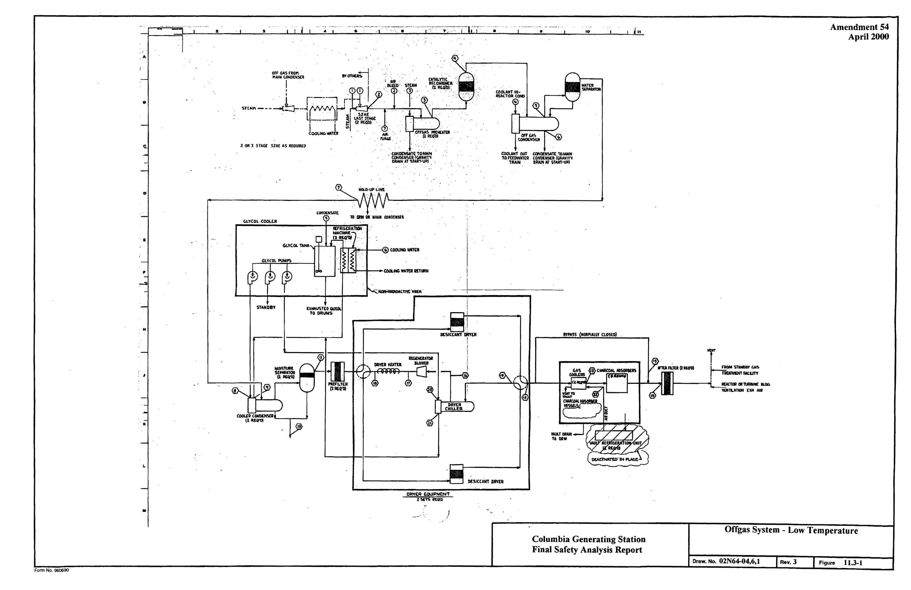
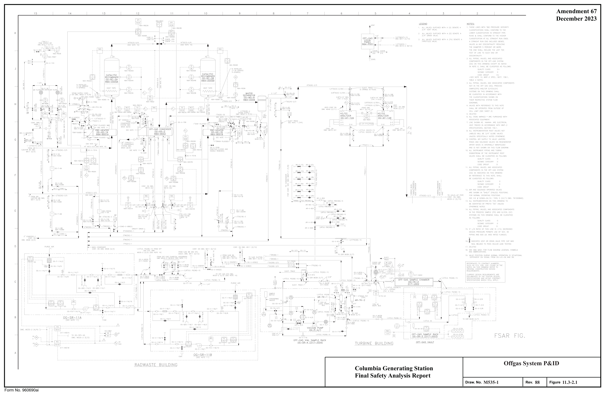
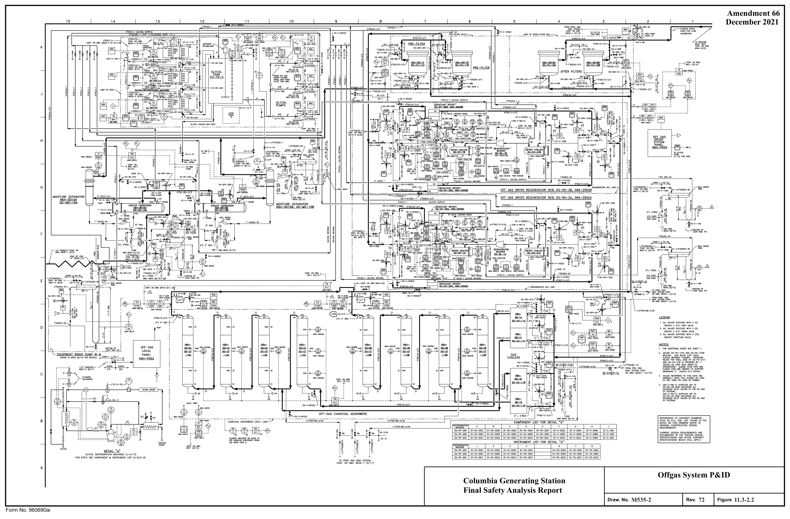

# 11.3 Gaseous Waste Management Systems

> Columbia Generating Station FSAR — Chapter 11: Radioactive Waste Management
> Source: `11_chapter-3610-3790.pdf`, PDF pages 81–112 (of 181)
> Amendment 67 compilation (individual pages carry varying amendment dates)

---
<!-- p.81 -->
### 11.3 GASEOUS WASTE MANAGEMENT SYSTEMS
#### 11.3.1 DESIGN BASES
The objective of the gaseous waste management system is to process and control the release of gaseous radioactive effluents to the site environs so as to maintain as low as reasonably achievable the exposure of persons in unrestricted areas to radioactive gaseous effluents, during normal and anticipated operational occurrences. This is to be accomplished while maintaining occupational exposure as low as is reasonably achievable (ALARA) and without limiting plant operation or availability.

The gaseous waste management systems are designed to limit the dose to offsite persons from routine station releases to significantly less than the limits specified in 10 CFR 20 and to operate within the emission rate limits established in the Technical Specifications.

To evaluate the offgas system design compliance with the limits of 10 CFR 20, an annual average noble radiogas source term (based on 30-minute decay) of 100,000 μCi/sec of the “1971 Mixture” as discussed in Section 11.1 is used. The noble radiogas effluent release rate from the charcoal adsorbers is about 49-59 μCi/sec based upon 30 scfm air inleakage and injection. The isotopic composition is given in Table 11.3-1 in units of μCi/sec and Ci/yr.

To evaluate that the annual average exposure at the site boundary during normal operation and anticipated operational occurrences from gaseous effluents does not exceed the dose objectives of Appendix I to 10 CFR 50, an average source term release rate derived from field measurements (1993-2003) is used.

Equipment and components used to collect, process, or store gaseous radioactive waste are not designed as Seismic Category I. To evaluate that equipment failure will not result in offsite whole body doses exceeding 0.5 rem in two hours, the Technical Specification release rate limit was used, consistent with the guidance presented in Reference 11.3-7.

The gaseous radwaste equipment is selected, arranged, and shielded to maintain occupational exposure ALARA. The system was designed prior to the issuance of Regulatory Guide 8.8.
However, the system incorporates substantially the guidance provided in this regulatory guide.
The gaseous effluent treatment system conforms to the requirements of General Design Criteria 60 and 64 as specified in Section 3.1.

A list of the major offgas system components and design features is provided in Table 11.3-2.
Equipment and piping is designed and constructed in accordance with the requirements of the applicable codes as given in Tables 3.2-1 and 3.2-2.

The quality group classifications of the various systems are shown in Table 3.2-1. Seismic category, safety class, quality assurance requirements, and principal construction codes

<!-- p.82 -->
information are contained in Section 3.2. The system is designed to Quality Group Classification D+.

#### 11.3.2 SYSTEM DESCRIPTION
##### 11.3.2.1 Main Condenser Steam Jet Air Ejector RECHAR System
The offgas from the main condenser steam jet air ejector (SJAE) is treated by means of a system utilizing catalytic recombination and charcoal adsorption (RECHAR system) (see Figure 11.3-1). Descriptions of the major process components including design temperature and pressure are given in Table 11.3-2 and in the following.

Noncondensable radioactive offgas is continuously removed from the main condenser by the air ejector during plant operation. The air ejector offgas will normally contain activation gases, principally 16N, 19O, and 13N. The 16N and 19O have short half-lives and are readily decayed. 13N with a 10-minute half-life is present in small amounts that are further reduced by decay. Activation gas source terms are presented in Table 11.1-4.

The air ejector offgas will also contain radioactive noble gases including parents of biologically significant 89Sr, 90Sr, 140Ba, and 137Cs. The concentration of these noble gases depends on the amount of tramp uranium in the coolant and on the cladding surfaces (usually extremely small)
and the number and size of fuel cladding defects.

A main condenser offgas treatment system has been incorporated in the plant design to reduce the radioactive gaseous effluents from the station. The offgas system uses a catalytic recombiner to recombine hydrogen and oxygen. After cooling (to approximately 130°F) to strip the condensables and reduce the volume, the remaining noncondensables (principally air I with traces of krypton and xenon) are delayed in a holdup line. The gas is cooled to 45°F and processed through a HEPA filter. The gas is then passed through a desiccant dryer that reduces the dewpoint to approximately -90°F. Charcoal adsorption beds selectively adsorb and delay the xenon and krypton from the bulk carrier gas (principally dry air). With an air inleakage of 30 scfm, this treatment system results in a delay of 15 hr for krypton and 9.5 days for xenon. After the delay, the gas is again passed through a HEPA filter and discharged to the environment through the reactor building elevated release duct.

Figure 11.3-1 is the process flow diagram for the system. The process data for startup and normal operating conditions are submitted as proprietary data under separate cover as Table 11.3-3. The information supporting the process data is presented in Reference 11.3-2.
The system is mechanically capable of processing three times the source terms of Table 11.3-1 without affecting delay time of the noble gases.

Table 11.3-1 also lists isotopic activities at the discharge of the system, from which the decontamination factor for each noble gas isotope can be determined.

<!-- p.83 -->
The flow diagram is shown in Figure 11.3-2. The main process routing is indicated by a heavy line.

The basis for sizing the recombiner is to maintain the hydrogen concentration below 4%
(including steam) at the inlet and below 1% at the outlet on a dry basis. The exit hydrogen I concentration is normally well below the 1% maximum allowed. The hydrogen generation rate of the reactor is based on data from nine boiling water reactors (BWR). The hydrogen generation rate is given in Table 11.3-3.

The krypton and xenon holdup time is closely approximated by the following equation:

K M D T = V

where:

T = holdup time of a given gas, seconds.

## 3 KD = dynamic adsorption coefficient for the given gas, cm
gram M = weight of charcoal, grams

## 3 V = flow rate of the carrier gas, cm
sec

Dynamic adsorption coefficient values for xenon and krypton used to determine gaseous I effluent releases are discussed in Reference 11.3-1. Moisture has a detrimental effect on adsorption coefficients. To prevent moisture from reaching the charcoal, fully redundant, adsorbent (-90°F dewpoint) air dryers are supplied. There are redundant moisture analyzers that will alarm on breakthrough of the dryer beds; however, breakthrough is not expected since the dryer beds will be regenerated on a time basis. The system is slightly pressurized, which together with very stringent leak rate requirements, prevents leakage of moist air into the charcoal.

After the hydrogen and oxygen are removed by the recombiner, the remaining carrier gas is primarily nitrogen with a small percentage of oxygen due to the air inleakage from the main I condenser and air injection from the HWC system. Analyses have shown that the system can maintain condenser vacuum at combined air injection and air inleakage rates as high as I 93 scfm. Reference 11.3-3, Par. S1 (c) (2) indicates that with certain conditions of stable l operation and suitable construction, noncondensables (not including radiological decomposition l products) should not exceed 6 scfm per condenser shell for large condensers. Dilution air is not added to the system unless the air inleakage is less than 6 scfm. In that event, 6 scfm is

<!-- p.84 -->
December 2005 l added to provide for dilution of residual hydrogen from the recombiner. An initial bleed of J oil-free air is added on startup until the recombiner reaches operating temperature.

The charcoal adsorbers design process flow sheet is for an ambient temperature. Operation at ambient temperature is sufficient to reduce gaseous radioactivity levels to a fraction of that allowed by 10 CFR 50 Appendix I. The decay heat is sufficiently small that, even in the no-flow condition, there is no significant loss of adsorbed noble gases due to temperature rise in the adsorbers. The adsorbers are located in a shielded room and maintained at ambient I room temperature. A radiation monitor is provided to monitor the radiation level in the air handling room of the charcoal bed vault for high gas activity from a system leak. High radiation will cause an alarm in the control room.

Channeling in the charcoal adsorbers is prevented by supplying an effective flow distributor on the inlet, having long columns and having a high bed-to-particle diameter ratio of approximately 500. Underhill has stated that channeling or wall effects may reduce efficiency I of the holdup bed if this ratio is not greater than 12 (Reference 11.3-4). During transfer of the charcoal into the charcoal adsorber vessels, radial sizing of the charcoal will be minimized by pouring the charcoal (by gravity or pneumatically) over a cone or other instrument to spread the granules over the surface.

A valve is provided to bypass the charcoal adsorbers. The main purpose of this bypass is to protect the charcoal during preoperational and startup testing when gas activity is zero or very low.

It may be desirable to use the bypass for short periods during startup or normal operations.
This bypass mode would not be used for normal operation unless some unforeseen system malfunction would necessitate shutting down the power plant or operating in the bypass mode and remaining within the technical specification radioactivity release limits. The radioactivity released is controlled by a process monitor upstream of the vent isolation valve that will cause the bypass valve to close on a high radiation alarm. This interlock can be defeated only by a key lock switch. In addition, there is a high-high-high alarm setpoint on the same monitor that will cause isolation of the offgas system if established release rate limits are reached.

Leakage of radioactive gases from the system is limited by welding piping connections where possible and using bellows stem seals or equivalent leakage control valving. The system operates at a maximum of 7 psig during startup and less than 2 psig during normal operation so that the differential pressure to cause leakage is small.

Hydrogen concentration of gases from the air ejector is kept below the flammable limit by maintaining adequate process steam flow for dilution at all times. This steam flow rate is monitored and alarmed in the main control room.

<!-- p.85 -->
Two parallel independent hydrogen analyzers are used to measure the hydrogen content of the offgas process flow downstream of the offgas condenser. The hydrogen concentration percentage output from the analyzers is indicated and recorded in the main control room along with independent alarm annunciation for a high hydrogen concentration. Each hydrogen analyzer continuously withdraws a sample of the process offgas, conditions the gas to a constant pressure, analyzes the hydrogen content, and returns the sample gas to the main condenser. The main condenser vacuum provides the pumping force to withdraw the sample gas from the offgas process line and through the hydrogen analyzer system. The analyzer element is a thermal conductivity cell type unit and does not serve as an ignition source to a detonable hydrogen-oxygen mixture.

Piping and tubing 2 in. and under is field routed, but required to be in specified space envelopes for shielding and in-plant exposure consideration. In the offgas system this includes drain lines, steam lines, and sample lines which are shown in Figure 11.3-2.

There are several liquid seals to prevent gas escape through drains shown in Figure 11.3-2.
These seals are protected against permanent loss of liquid by an enlarged section downstream of the seal that can hold the seal volume and will drain by gravity back into the loop after a momentary pressure surge has passed. Each seal has a manual valve that is used to fill the loop with condensate after receiving a loop seal low level alarm.

Iodine input into the offgas system is small by virtue of its retention in reactor water and condensate. The iodine remaining is essentially removed by adsorption in the charcoal. This is supported by the fact that 2-in. charcoal filters remove more than 90% of the influent iodine, whereas this system has approximately 76 ft of charcoal in the flow path.

Particulates are removed with a 99.95% efficiency by a HEPA filter prior to the gas entering the charcoal adsorbers. The noble gas decays within the interstices of the activated charcoal and daughters are entrapped there. The charcoal serves as an excellent filter for particulates and essentially no particulates exit from the charcoal. The charcoal is followed with a HEPA filter which is a safeguard against escape of charcoal dust. Particulate activity discharged from this system is essentially zero.

With an airflow of about 30 scfm and the charcoal adsorbers bypassed, the delay time of the system decreases to approximately 10 minutes. This bypass line is only intended to be used during preoperational testing, and initial system startup operation until proper functioning of upstream equipment is established. This prevents possible degradation of the charcoal due to the introduction of excessive moisture or other contaminants.

In the unlikely event it is necessary to bypass the charcoal adsorbers to continue operation, the bypassing operation shall be allowed only if the radioactive effluents are within the release limits.

<!-- p.86 -->
The isotopic inventory of each equipment piece, based on the source term discussed in Section 11.1, is given in Reference 11.3-5.

Performance of a similar system operating at ambient temperatures and the results of related experimental testing are discussed in Reference 11.3-2. The Tsuruga and Fukushima 1 plants in Japan have similar recombiners in service. Similar systems (ambient temperature charcoal)
are in service at Dresden 2 and 3, Pilgrim, Quad Cities 1 and 2, Nuclenor, Hatch, Browns Ferry 1, 2, and 3, and Duane Arnold.

Design provisions are incorporated which preclude the uncontrolled release of radioactivity to the environment as a result of any single operator error or of any single failure. A comprehensive discussion of single failures is provided in Table 11.3-5.

Design precautions taken to prevent uncontrolled releases of radioactivity include the following:

a. The system design eliminates ignition sources so that a hydrogen detonation is highly unlikely even in the event of a recombiner failure;

b. The system pressure boundary is detonation resistant;

c. All discharge paths to the environment are monitored--the normal effluent path by the process radiation monitoring system and equipment areas by the area radiation monitoring system; and

d. Dilution steam flow to the SJAE is monitored and alarmed. Valve control logic causes the air ejector suction valves to close on low steam flow.

##### 11.3.2.2 Other Radioactive Gas Sources
There are three buildings that contain radioactive gas sources. They are the reactor building, the turbine generator building, and the radwaste building. The ventilation systems for these three buildings are described in Section 9.4. Building volumes and ventilation flow rates are shown in Table 11.3-8. The sources of gaseous radioactivity in these buildings are discussed below. In-plant airborne radioactivity concentrations are discussed in Section 12.2.2.

The primary containment is divided into two sections which are designated as the drywell and suppression chamber. These are separated by the drywell floor which serves as a pressure barrier between the drywell and suppression chamber.

Radioactive halogens and noble gases can be introduced into the drywell atmosphere from two sources. One source is the leakage that occurs from the valves, especially the main steam isolation valves (MSIVs), the inner refueling bellows seal support drains and the main

<!-- p.87 -->
recirculation pumps. This leakage is collected by means of leak-off lines which are directed to the drywell equipment drain sump.

The other source of activity results when a pressure transient causes the main steam relief valves to open with the resulting flow of steam into the suppression pool. When this occurs, there is a pressure buildup in the suppression chamber atmosphere. A tabulation of the expected relative frequency of pressure relief valve venting to the suppression pool is provided in Table 11.3-10. If the pressure differential across the drywell floor is greater than 0.5 psi, the vacuum breaker valves relieve this pressure into the drywell atmosphere. Thus, radioactivity in the suppression chamber atmosphere is introduced into the drywell. The drywell atmosphere is purged to the environment via the reactor building elevated release duct when access is required, either directly or through the standby gas treatment system, considering airborne radiation levels and release limits.

The reactor building ventilation system supplies fresh air to the secondary containment and exhausts air through the reactor building elevated release duct. There is a small amount of activity in the secondary containment atmosphere that emanates from the various reactor I support systems. The reactor building ventilation exhaust is monitored and a radiation level, set by administrative control to ensure Technical Specifications compliance, will cause automatic heating, ventilating, and air-conditioning (HVAC) system isolation, startup of the standby gas treatment system (SGTS), and an alarm in the control room.

There are three sources of nontreated radioactive gas sources in the turbine generator building which are as follows:

a. Gland seal steam leakage and condenser exhaust, b. Equipment leakage, and c. Main condenser offgas during startup.

The activity from these sources is presented in Table 11.3-7.

Gland seal leakage and condenser exhaust contribute essentially no airborne radioactivity releases due to use of “clean” steam as discussed in Section 10.4. During startup, the mechanical vacuum pumps remove the gas present inside the main condenser. The exhaust from these pumps is discharged through the reactor building elevated release duct. Due to radioactive decay during shutdown, only a small amount of activity is exhausted by the vacuum pumps during startup.

Sources of gaseous radioactivity in the radwaste building include,

a. Offgas system leakage, b. Liquid leakage to the radwaste building,

<!-- p.88 -->
c. Liquid waste management system tank vents, and d. Hydropneumatic transfer of resins.

Measures taken to minimize leakage from the offgas system are described in Section 11.3.2.1.
Liquid leakage from equipment and floor drains in the radwaste building is collected in sumps.
The sumps and tanks containing liquid radwaste are vented to the radwaste building exhaust system described in Section 9.4.3.2. The air blow during the backwash of the spent powdered resins to the phase separators generates airborne radioactivity which is vented to the radwaste building filtered exhaust system.

##### 11.3.2.3 Cost-Benefit Analysis
The cost-benefit analysis is discussed in Section 11.2.3.4.

##### 11.3.2.4 Design Features of the Offgas System
Design features of other gaseous waste management systems may be found in Section 9.4.

###### 11.3.2.4.1 Maintainability
Design features which reduce or ease required maintenance include the following:

a. Redundant components for all active, in-process equipment pieces, and

b. No rotating equipment in the process stream and elsewhere in the system only where maintenance can be performed while the system is in operation.

###### 11.3.2.4.2 Pressure Boundaries
Design features and requirements which reduce leakage and releases of radioactive material include the following:

a. Extremely stringent leak rate requirements placed on all equipment, piping, and instruments, and enforced by requiring as-installed leak tests of the entire process system,

b. Use of welded joints except where servicing access to equipment and instrumentation access dictates use of flanged joints,

c. Valve types with extremely low leak rate characteristics, i.e., bellows seals double stem seal, or diaphragm,

<!-- p.89 -->
d. Use of loop seals with enlarged discharge section to avoid siphoning and to be self-refilling by gravity following a pressure surge, and

e. Stringent seat-leak characteristics for valves in lines discharging to the environment via other systems.

###### 11.3.2.4.3 Building Seismic Design
The offgas system is located in the turbine generator and radwaste buildings. The portion of the turbine generator building housing the offgas system is a modified Seismic Category II structure designed to withstand the effects of a safe shutdown earthquake (SSE) and maintain its structural integrity. The portion of the radwaste building housing the offgas system is a Seismic Category I structure. The seismic classification of the turbine generator and radwaste buildings are discussed in Sections 3.8.4.1.3 and 3.8.4.1.2, respectively.

###### 11.3.2.4.4 Construction of Process Systems
Pressure retaining components of process systems utilize welded construction to the maximum practicable extent. Process piping systems include the first root valve on sample and instrument lines. Process lines are not less than 0.75 in. nominal pipe size. Sample and instrument lines are not considered as portions of the process systems. Flanged joints or suitable rapid disconnect fittings are not used except where maintenance requirements clearly indicate that such construction is preferable. Screwed connections in which threads provide the only seal are not used. Screwed connections backed up by seal welding or mechanical joints are used only on lines of 0.75 in. nominal pipe size or less. In lines 0.75 in. or greater, but less than 2.5 in. nominal pipe size, socket type welds are used. In lines 2.5 in. nominal pipe size and larger, pipe welds are of the butt joint type.

###### 11.3.2.4.5 Instrumentation and Control
The offgas system is monitored by flow, temperature, pressure, and humidity instrumentation, and by hydrogen analyzers to ensure correct operation and control. Table 11.3-4 lists the process parameters that are instrumented to alarm in the control room and indicates whether the parameters are recorded or just indicated.

The radioactivity of the gas entering and leaving the offgas system is continuously monitored.
Thus, system performance is known to the operator at all times. A radiation monitor after the offgas condenser continuously monitors radioactivity release from the reactor and input to the charcoal adsorbers. This radiation monitor is used to provide an alarm on high radiation in the offgas. A sample rack with two radiation monitors is also provided at the outlet of the charcoal adsorbers to continuously monitor the radioactivity from the adsorber beds. These radiation monitors are used to isolate the offgas system on high radioactivity to prevent gas of

<!-- p.90 -->
December 2005 l J unacceptably high activity from entering the reactor building elevated release duct. Only one monitor is required to be operable.

The offgas system at the SJAE is sampled periodically in accordance with the Technical Specifications. Provision is made for sampling and periodic analysis of the influent and effluent gases for purposes of determining their compositions. This information is used in calibrating the monitors and in relating the release to calculated offsite doses. Process radiation instrumentation is described in detail in Sections 11.5 and 7.6.1.1.

###### 11.3.2.4.6 Detonation Resistance
The pressure boundary of the system is designed to be detonation resistant. The pressure vessels are designed to withstand 350 psig static pressure, and piping and valves are designed to resist dynamic pressures encountered in long runs of piping at the design temperature. This analysis is covered in a proprietary report submitted to the NRC (Reference 11.3-6).

By this procedure a designer obtains the required wall thickness for specific equipment to sustain a hydrogen and oxygen detonation. The wall thickness is then translated by using the appropriate code calculation to the corresponding equipment that must contain the detonation static pressure. The method assumes the absence of simultaneous secondary events such as earthquakes.

###### 11.3.2.4.7 Operator Exposure Criteria and Controls
This system is normally operated from the main control room. Equipment and process valves containing radioactive fluid are placed in shielded cells maintained at a pressure negative to normally occupied areas. Ventilation air flows from areas of low airborne contamination to areas of higher airborne contamination. Operating offgas process equipment does not require personnel access. Redundant equipment is located in separate cells, minimizing exposure of maintenance personnel. No process fluid is passing through instrumentation panels. Signals from the process streams are transmitted to the instrumentation panels by means of electrical signal converters. Design features minimizing occupational exposure are discussed in Sections 11.3.2.4.1 and 12.3.1.3.

###### 11.3.2.4.8 Equipment Malfunction
Malfunction analyses indicating consequences and design precautions taken to accommodate failure of various components of the system are given in Table 11.3-5.

<!-- p.91 -->
##### 11.3.2.5 Offgas System Operating Procedure
###### 11.3.2.5.1 Prestartup Preparations
Prior to starting the main condenser SJAEs, the glycol coolant is chilled to near 35°F and is circulated through the cooler condenser, a desiccant dryer is regenerated and valved in, the offgas condenser cooling water is valved in, and the recombiner heaters are turned on.

###### 11.3.2.5.2 Startup
As the reactor is pressurized, preheater steam is supplied and air is bled through the preheater and recombiner. The recombiner is preheated to at least 300°F with this air bleed and/or by admitting steam to the final SJAE. With the recombiners preheated and the desiccant dryer and charcoal adsorbers valved in, the SJAE string is started. The bleed air is terminated. As the condenser is pumped down and the reactor power increases, the recombiner inlet stream is diluted to less than 4% hydrogen by volume by a fixed steam supply, and the offgas condenser outlet is maintained at less than 1% hydrogen by volume.

###### 11.3.2.5.3 Normal Operation
After startup, the noncondensables pumped by the SJAE will stabilize. Recombiner performance is closely followed by the recorded temperature profile in the recombiner catalyst bed. The hydrogen effluent concentration is measured by a hydrogen analyzer.

Normal operation is terminated following a normal reactor shutdown or a scram by terminating steam to the SJAEs and the preheater.

##### 11.3.2.6 Offgas System Performance Tests
This system is used on a routine basis and does not require specific testing to ensure operability. Monitoring equipment will be calibrated and maintained on a specific schedule and on indication of malfunction.

###### 11.3.2.6.1 Recombiner
Recombiner performance is continuously monitored and recorded by catalyst bed thermocouples that monitor the bed temperature profile and by a hydrogen analyzer that measures the hydrogen concentration of the effluent.

<!-- p.92 -->
###### 11.3.2.6.2 Prefilter
These particulate filters were tested at the time of filter installation using dioctylphthalate
(DOP) aerosol to determine whether an installed filter meets the minimum in-place efficiency 99.95% particle retention.

The DOP from filter testing is not allowed to enter into the desiccant or the activated charcoal.
This equipment is isolated during filter DOP testing and is bypassed until the process lines have been purged clear of test material. Because the DOP may have a detrimental effect on the desiccant and charcoal, the prefilter will not be periodically tested. This is justified because the main function of this prefilter is to prevent the long-lived daughters of the radioactive xenons generated in the holdup pipe from depositing in the downstream equipment.
Leakage through the filter would be unimportant to environmental release.

###### 11.3.2.6.3 Desiccant Gas Dryer
Desiccant gas dryer performance is continuously monitored by an on-stream humidity analyzer.

###### 11.3.2.6.4 Charcoal Performance
The ability of the charcoal to delay the noble gases can be continuously evaluated by comparing radioactivity measured and recorded by the process activity monitors at the exit of the offgas condenser and at the exit of the charcoal adsorbers.

Grab sample points are located upstream and downstream of the first charcoal bed and downstream of the last charcoal bed and can be used for periodic sampling if the monitoring equipment indicates degradation of system delay performance.

###### 11.3.2.6.5 Post Filter
On installation these particulate filters were tested using a DOP aerosol test or equivalent, as described in Section 11.3.2.6.2.

#### 11.3.3 RADIOACTIVE RELEASES
##### 11.3.3.1 Release Points
The reactor building elevated release duct serves the following systems:

Offgas system, Mechanical vacuum pump and gland seal condenser exhaust, Reactor building ventilation exhaust,

<!-- p.93 -->
Containment purge, and Standby gas treatment system.

The reactor building elevated release duct location is shown in reactor building general arrangement drawings in Section 1.2.

The radwaste building ventilation exhausts through three louver houses 67 ft above plant grade.
The location is shown on Figure 1.2-17.

The exhaust from the turbine generator building ventilation system is through four exhaust fans located on the radwaste building, 119 ft above plant grade. Their location is shown on Figure 1.2-16 (part plan of roof at el. 542 ft-0 in.) and in Figure 1.2-17.

The height, flow rate, heat content, and dimensions of the three release points are shown on Table 11.3-6.

##### 11.3.3.2 Dilution Factors
The dispersion and dilution of gaseous radioactive effluents released from the plant depends on the meteorology of the site and its environs. To determine these parameters, onsite meteorological data has been obtained and analyzed as described in Section 2.3. Annual atmospheric dilution factors have been calculated to determine resultant annual doses and concentrations of radionuclides from normal operation.

The building ventilation exhaust ducts do not rise above the buildings; therefore, atmospheric releases for dose analysis purposes were considered ground level.

##### 11.3.3.3 Estimated Releases
Releases of radioactive material in gaseous effluents for initial plant licensing were calculated using the GALE code presented in NUREG-0016 to show compliance with 10 CFR 20, Appendix B, and 10 CFR 50, Appendix I, for normal operation plus anticipated operational occurrences. The operational parameters including source terms were those presented in Appendix B. The values obtained are presented in Table 11.3-7. These values were used with the meteorology data from Section 2.3.5 to calculate maximum concentrations at the restricted area boundary and maximum individual dose offsite. These data provide maximum annual average (χ/Q) values and does not include a building wake factor.

Restricted area boundary concentrations used for this initial licensing analysis are tabulated by radionuclide and compared with 10 CFR 20 limits in Table 11.3-9. The estimated annual dose to persons offsite is presented in Section 5.2 of the Environmental Report and is well within the numerical guidelines of 10 CFR 50, Appendix I.

<!-- p.94 -->
Since becoming operational, releases of radioactive materials in gaseous effluents have been determined using actual flow rates and quantitative and qualitative analyses. Doses due to radioactive materials in gaseous effluents are determined to show Technical Specifications compliance at specified intervals. Compliance is reported in the Annual Radioactive Effluent Release Report. Doses are ascertained using ODCM approved calculation methods, current meteorology (or historical meteorology if current data are unavailable), and parameters outlined in the Offsite Dose Calculation Manual.

Tritium contamination of the auxiliary boiler and associated components has resulted in release paths which were not intended (see Section 9.4.16.2). The released radioactivity attributable to the worst case tritium concentration (2E + 06 Ci/liter) in the boiler water is an insignificant portion of the total activity released in liquid and gaseous effluents and has been analyzed to result in a correspondingly insignificant radiation dose. The tritium concentration levels and makeup water volume are monitored and evaluated to ensure that tritium effluent releases from the plant are adequately quantified.

#### 11.3.4 REFERENCES
11.3-1 NUREG-0016 (BWR-GALE Code), January 1979

11.3-2 Miller, C. W., Experimental and Operational Confirmation of Off-Gas System Design Parameters, NEDO-10751, January 1973 (Proprietary).

11.3-3 Standards for Steam Surface Condensers, Sixth Edition, Heat Exchange Institute, New York, NY, 1970.

11.3-4 Underhill, Dwight, et al., “Design of Fission Gas Holdup Systems,” Processing of the Eleventh AEC Air Cleaning Conference, 1979, p. 217.

11.3-5 Miller, C. W., et al., A General Justification for Classification of Effluent Treatment System Equipment as Group D, NEDO-10734, February 1973.

11.3-6 Nesbitt, L. B., Design Basis for New Gas Systems, NEDE-11146, July 1971
(Proprietary).

11.3-7 NUREG-0800 USNRC Standard Review Plan, Revision 2, July 1981, Branch Technical Position ETSB 11-5.

<!-- p.95 -->
November 1998

Charcoal Adsorbers During Startup
1.07 x 10-1 Ci/startup 1.7 x 10-1 Additional Discharge from
- - - - - - - - - - - - - - - - - - - - - 6.8
1.4 8.5 0

3.0 x 10-2
1.1 x 101 µCi/sec
- - - - - - - - - - - - - - - - - - - - - 14.3
1.9
1.4 0 Design Air Ejector Offgas Release Rates (30 cfm inleakage) a Normal Discharge from Charcoal
1.2 x 102
3.7 x 101 9.4 x 102 Ci/yrb 280-560 1383-1663
- - - - - - - - - - - - - - - - - - - - - 6.0 Adsorbers b This is based on curies present at time of release. No decay in environment is included.
2.1 x 10-1
3.3 x 101 µCi/sec Table 11.3-1 10-20 49-59 - - - - - - - - - - - - - - - - - - - - -
1.3 4.3

T=30 Minutes µCi/sec
2.9 x 103 5.6 x 103 1.5 x 104 1.8 x 104 1.8 x 102
1.0 x 105
1.5 x 101 2.8 x 102 8.2 x 103 6.9 x 103 2.2 x 104 6.7 x 102 2.1 x 104
- - - - - -
- - - - - - - 10-20

3.4 x 103 6.1 x 103 2.0 x 104 2.0 x 104 1.3 x 105 2.8 x 105 3.3 x 105 3.3 x 105 9.9 x 104 2.3 x 104 2.1 x 103 1.4 x 101 1.5 x 101 2.9 x 102 8.2 x 103 2.6 x 104 2.2 x 104 1.5 x 105 8.9 x 104 2.8 x 105 3.0 x 105 2.4 x 105 7.3 x 104 1.2 x 104 5.6 x 102 2.5 x 106 µCi/sec T=0 10-20 c Estimated from experimental observations.
3.18 minutes 15.7 minutes 3.82 minutes 14.2 minutes a Based on the 1971 mixture. 76 minutes 11.96 days Half-life
2.26 days 5.27 days Totals 10.74 yr 32.3 sec 1.84 sec 1.29 sec 13.6 sec 1.72 sec 1.22 sec 0.96 sec 8.6 sec
1.86 hr 2.79 hr 9.16 hr
1.0 sec 0.5 sec 40 sec 4.4 hr 1 sec 9 sec

Isotope 131m Xe 133m Xe 135m Xe 83m Kr 85m Kr 133Xe 135Xe 137Xe 138Xe 139Xe 140Xe 141Xe 142Xe 143Xe 144Xe 85Krc 87Kr 88Kr 89Kr 90Kr 91Kr 92Kr 93Kr 94Kr 95Kr 97Kr

<!-- p.96 -->
April 2000

Table 11.3-2

Offgas System Major Equipment Items

Offgas Preheaters - two required

Construction: Stainless steel tubes and carbon steel shell. 350 psig shell design pressure, 1000 psig tube design pressure. 400°F shell design temperature, 575°F tube design temperature.

Catalytic Recombiners - two required

Construction: Stainless steel cartridge, carbon steel shell. Catalyst cartridge containing a precious metal catalyst on metal base. Catalyst cartridge to be replaceable without removing vessel. 350 psig design pressure, 900°F design temperature.

Offgas Condenser - one required

Construction: Low alloy steel shell. Stainless steel tubes. 350 psig shell design pressure.
250 psig tube design pressure, 900°F shell design temperature, 150°F tube design temperature.

Water Separator - one required

Construction: Carbon steel shell, stainless steel wire mesh. 350 psig design pressure, 250°F design temperature.

Cooler-Condenser - two required

Construction: Stainless steel shell. Stainless steel tubes. 100 psig tube design pressure, 350 psig shell design pressure. 32/150°F tube design temperature, 32/150°F shell design temperature.

Moisture Separators (downstream of cooler-condenser) - two required

Construction: Carbon steel shell, stainless steel wire mesh. 350 psig design pressure, 32/150°F design temperature.

Desiccant Dryer - four required

Construction: Carbon steel shell packed with Type 3A molecular sieve or equivalent.
350 psig design pressure, 32°F/ 500°F design temperature.

Desiccant Regeneration Skid - two required

<!-- p.97 -->
April 2000

Table 11.3-2

Offgas System Major Equipment Items (Continued)

Dryer Chiller - two required

Construction: Carbon steel shell, stainless steel tubes, design temperature 32°F/500°F, design pressure 50 psig.

Regenerator Blower - two required

Construction: Electrical, design pressure 50 psig design temperature 32°F/150°F.

Dryer Heater - two required

Construction: Electrical, design temperature 32°F/500°F, design pressure 50 psig.

Glycol Cooler Skid - one required

Glycol Storage Tank - one required

Construction: Carbon steel 3000 gal. Water-filled hydrostatic design pressure.
32°F design temperature. API-650.

Glycol Solution Refrigerators and Motor Drives - three required

Construction: Conventional refrigeration units. Glycol solution exit temperature 35°F.

Glycol Pumps and Motor Drives - three required

Construction: Cast iron, 0°F design temperature.

Prefilters and After Filters - two required of each type

Construction: Carbon steel shell. High-efficiency, moisture-resistant filter element. Flanged shell. 350 psig design pressure. -50/150°F design temperature.

Charcoal Adsorbers - eight beds

Construction: Carbon steel. Approximately 4-ft. O.D. x 21-ft vessels each containing approximately 3 tons of activated carbon. Design pressure 350 psig, design temperature
-50/250°F.

<!-- p.98 -->
Table 11.3-3

Process Data For The Offgas (RECHAR) System

The Information On This Page Is Proprietary And Was Submitted Under Separate Cover

(CVI DWG 02N64-04,11,1, Rev. 4 or 02N64-04,11,2, Rev. 2)

#### LDCN-07-041, 09-009
<!-- p.99 -->
November 1998

Table 11.3-4

Offgas System Alarmed Process Parameters

Control Room

Parameters Indicated Recorded

Air ejector discharge pressure - high X

Preheater discharge temperature - low X

Recombiner catalyst temperature - high/low X

Offgas condenser water level (dual) - high/low X

Offgas condenser gas discharge temperature - high (local)
X

H2 analysis (offgas condenser discharge) - dual - high X

Offgas condenser discharge radiation - high X

Gas flow - high/low X

Cooler - condenser discharge temperature - high/low X

Glycol solution temperature - high/low X

Glycol solution level - low

Gas drier discharge humidity - high (local)
X

Prefilter dP - high X

Charcoal adsorber temperature - high X

Charcoal train flow - high/low X

After filter dP - high X

Offgas (charcoal bed discharge) radiation - high X

Steam flow - low X

Desiccant dryer outlet temperature - high/low X

Dryer chiller outlet temperature - high (local)
X

Dryer heater temperature - high

Dryer heater outlet temperature - high (local)
X

Loop seals water level - low

<!-- p.100 -->
November 1998

Steam flow to be held at constant maximum Temperature probes in recombiner and H2 Low temperature alarms on preheater exit (recombiner inlet). Recombiner outlet H2 Low-temperature alarms on preheater exit (recombiner inlet). Recombiner outlet H2 recombiner. Air bleed system at startup. Condensate drains, temperature probes in Alarm provided on steam for low steam analyzer provided. Spare recombiner.
flow. Recombiner temperature alarm.
flow regardless of plant level during Recombiner thermal blanket, spare recombiner, and heater. Hydrogen Design Precautions Spare preheater.
analyzers.
operation. analyzers.
analyzer.

overheating and deterioration of the catalyst. could reduce degree of recombination at low H2 conversion falls off and H2 is detected by Would further dilute process offgas. Steam downstream analyzers. Eventually the gas Increased steam flow to recombiner. This Recombiner performance would fall off at low power level and hydrogen content of catalyst. Eventually excess H2 would be Equipment Malfunction Analysis recombiner gas discharge may increase, flowmeter. Eventually the stripped gas respectively, the process gas becomes concentrations exceed 4 and 5 vol %, Temperature profile changes through eventually to a combustible mixture.
detected by H2 analyzer or by gas Inadequate steam flow will cause When the hydrogen and oxygen Consequences consumption would increase.
Table 11.3-5 could become combustible. could become combustible.
power levels.
flammable.

Catalyst gradually deactivates Wear of steam supply nozzle Low pressure steam supply Catalyst gets wet at start Malfunction Low flow of motive high-pressure steam Steam leak of ejector

Steam jet air ejectors Equipment Item Recombiners Preheaters

<!-- p.101 -->
November 1998

Stainless-steel tubes specified. Low level provided with high and low-level alarms.
Outside of pipe dipped and wrapped. alarm glycol tank level. Spare cooler Two independent drain systems, each Design Precautions Stainless steel mesh specified. 0.25-in. corrosion allowance.
condenser provided.
None Equipment Malfunction Analysis (Continued)
SJAE, and increase operating pressure of the increases. Moderate leakage would be of no The coolant (reactor condensate) would leak drain valve fails to close, gas will recycle to the main condenser, increase the load on the Higher quantity of water collected in holdup Leakage to soil of gaseous and liquid fission build up in the condenser and pressure drop clean radwaste. If not detected at radwaste, If both drain valves fail to open, water will to the process gas (shell) side. This would process condensate drains to the hotwell).
the glycol solution would discharge to the concern from a process standpoint. (The process (shell) side and be discharged to eventually initiate a reactor scram. If a Glycol-water solution would leak into instrumentation, could cause pressure be detected if drain well liquid level buildup in the main condenser and The high ∆P, if not detected by Consequences Table 11.3-5 line and routed to radwaste.
reactor condensate system.
main condenser.
will increase.
products.

Liquid level instruments fail Corrosion of wire mesh Malfunction Cooling water leak Corrosion of tubes Corrosion of line element

Equipment Item Cooler-condenser Offgas condenser Water separator Holdup line

<!-- p.102 -->
November 1998

temperature alarms provided. Gas moisture provided. Temperature indication and low Spare unit provided in separate vault. ∆P alarms on glycol temperature and process Stainless steel mesh specified. Spare unit operation are provided. Glycol solution Design glycol-H2O solution temperature provided. High ∆P alarm on prefilter.
Two spare refrigerators during normal detectors provided downstream of gas well above freezing point. Spare unit Design Precautions instrumentation provided.
gas temperature.
driers.
Equipment Malfunction Analysis (Continued)
Over a long period, the desiccant drier cycle If both spare units fail to operate, the glycol gradually building up pressure drop. If this Shell side of cooler could plug up with ice, happens, the spare unit could be activated.
maintenance more difficult, but would not dehumidification system performance will regeneration cycles for the desiccant beds radiation level in the drier vault and make process gas routed to gas driers element.
drier desiccant. This would increase the increase ∆P and lead to a reactor scram.
More radioactivity would deposit on the Increased moisture would be retained in Complete blockage of both units would moisture pickup. Pressure drop across prefilter may increase if filter media is and may raise the gas dewpoint as it is period would deteriorate as a result of solution temperature will rise and the deteriorate. This will require rapid affect releases to the environment.
Consequences Table 11.3-5 discharged from the drier.
wetted.

Loss of integrity of filter Corrosion of wire mesh Malfunction Icing up of the tubes Mechanical failure media

Glycol refrigeration Moisture separators Equipment Item Cooler-condenser
(continued)
machines Prefilters

<!-- p.103 -->
Highly instrumented, mechanically simple gas Redundant, shielded desiccant beds and drier drier and first charcoal bed can be bypassed Redundant gas drier system supplied. Gas Dose consequences are within 10 CFR 20 through alternate drier to second charcoal humidity analyzers and alarms supplied.
ΔP instrumentation provided. Spare unit dehumidification system with redundant Main process equipment and piping are Drier cycles on timer. Redundant gas Design Precautions designed to contain a detonation.
limits. Analysis is included in equipment is supplied.
Reference 11.3-5.
equipment.
provided.
bed.
Equipment Malfunction Analysis (Continued)
gradually as moisture deposits. Holdup times Release of radioactivity if pressure boundary made for drying charcoal as required during for krypton and xenon would decrease, and plant emissions would increase. Provisions charcoal media itself should be a good filter Increased moisture in air entering charcoal effectiveness, thus reducing radioisotope Loss of integrity of filter media Probably of no real consequence. The Charcoal accumulates moisture Charcoal performance will deteriorate adsorbers would decrease adsorption Inability to regenerate desiccant.
Consequences Table 11.3-5 Release of radioactivity.
at the low air velocity.
retention time.
annual outage.
fails.

Moisture breakthrough Malfunction Earthquake damage Internal detonation Mechanical failure Desiccant regeneration Equipment Item Charcoal adsorbers Desiccant drier After filters equipment System

<!-- p.104 -->
Table 11.3-6

Release Point Data

Note: Refer to ODCM Table 3-13.

<!-- p.105 -->
November 1998

8.0E 01 2.8E 02 2.1E 02 2.4E 02 5.2E 00 2.8E 03 7.8E 02 1.1E 03 1.5E 03 7.0E 03 4.8E-01 1.8E-00 7.1E 01 Total 0.0 0.0 0.0 0.0

Mechanical Vac Pump
3.0E-02 2.3E 03 3.5E 02 0.0 0.0 0.0 0.0 0.0 0.0 0.0 0.0 0.0 0.0 0.0 0.0

Air Ejector 5.2E 00 2.3E 01
2.1E 00 2.8E 02 NOTE: 0.0 appearing in the table indicates release is less than 1.0 Ci/yr for noble gas, 0.0001 Ci/yr for iodine.
0.0 0.0 0.0 0.0 0.0 0.0 0.0 0.0 0.0 0.0 0.0

Gland Seal Gaseous Waste System Release 0.0 0.0 0.0 0.0 0.0 0.0 0.0 0.0 0.0 0.0 0.0 0.0 0.0 0.0 0.0 Gaseous Release Ratea (Ci/yr)
Table 11.3-7 Radwaste Building 5.0E-02 1.8E-01
1.0E 01 4.5E 01 0.0 0.0 0.0 0.0 0.0 0.0 0.0 0.0 0.0 0.0 0.0

Building 3.1E 00 3.1E 00 3.1E 00 6.9E 01 4.8E 01 3.6E 01 7.3E 00 1.8E-01 7.1E-01 Reactor 0.0 0.0 0.0 0.0 0.0 0.0

2.0E-01 8.0E-01 Turbine 7.1E 01 2.0E 02 2.4E 02 2.9E 02 6.8E 02 6.6E 02 1.5E 03 Building 0.0 0.0 0.0 0.0 0.0 0.0

Containment Building 6.9E 01 4.8E 01 3.6E 01 7.3E 00 1.8E-02 7.1E-02
3.1E 00 3.1E 00 3.1E 00 0.0 0.0 0.0 0.0 0.0 0.0

Coolant Conc.
1.200E-03 2.000E-03 6.300E-06 6.900E-03 6.900E-03 4.300E-02 4.900E-06 9.400E-05 2.700E-03 8.800E-04 7.600E-03 4.900E-02 2.900E-02 3.618E-03 1.549E-02 Tritium gaseous release
(µCi/g)
Total noble gases Nuclide 131mXe 133mXe 135mXe 83mKr 85mKr 133Xe 135Xe 137Xe 138Xe 85Kr 87Kr 88Kr 89Kr 131I 133I

<!-- p.106 -->
November 1998

1.4E-02 4.3E-03 1.1E-03 1.4E-03 1.5E-02 2.3E-03 6.4E-03 2.9E-05 5.2E-04 5.2E-04 4.6E-03 3.8E-04 6.6E-03 1.1E-02 8.0E-04 Total

Mechanical Vac
3.1E-06 2.1E-06 1.0E-05 1.1E-05 Building 0.0 0.0 0.0 0.0 0.0 0.0 0.0 0.0 0.0 0.0 0.0

Radwaste Building Gaseous Waste System Release (Continued)
9.4E-05 4.7E-04 1.6E-04 4.7E-05 9.4E-04 1.6E-05 4.7E-06 3.1E-06 5.2E-07 5.2E-07 4.7E-05 4.7E-06 9.4E-05 1.0E-06 6.3E-05 Airborne Particulate Release Rate (Ci/yr)
Table 11.3-7 Reactor Building
3.1E-04 3.1E-03 4.2E-04 6.3E-04 1.0E-02 2.1E-03 9.4E-05 5.2E-06 4.2E-04 2.1E-04 4.2E-03 3.1E-04 5.8E-03 4.2E-04 1.0E-04

a Estimated release based on GALE code evaluation.
Turbine Building
1.4E-02 5.2E-04 5.2E-04 6.3E-04 2.1E-03 2.1E-04 6.3E-03 2.1E-05 1.0E-04 3.1E-04 3.1E-04 5.2E-05 6.3E-04 1.1E-02 6.3E-04

Containment Building
3.1E-06 3.1E-05 4.2E-06 6.3E-06 1.0E-04 2.1E-05 9.4E-07 5.2E-08 4.2E-06 2.1E-06 4.2E-05 3.1E-06 5.8E-05 4.2E-06 1.0E-06

Nuclide 54Mn 124Sb 134Cs 136Cs 137Cs 140Ba 141Ce 58Co 60Co 65Zn 51Cr 59Fe 95Zr 89Sr 90Sr

<!-- p.107 -->
April 2000

Table 11.3-8

Building Volume and Ventilation Rates

Free Air Volume (ft3) Ventilation Rate (cfm)
Building D Secondary containment (reactor 3.5 x 106 80,000 I building)

#### I I I
2.0 x 106 Radwaste building I 83,000 I I I Turbine building I 5.7 x 106 360,000 10,500a □
2.0 x 105 Primary containment (drywell)

7,500a I I Primary containment (wetwell) 1.4 x 105

a During primary containment purge only.

<!-- p.108 -->
April 2000

Table 11.3-9

Maximum Sector Annual Average Concentrations of Gaseous Radioactive Materials at the Original Restricted Area Boundary

Annual Average Boundary Derived Air Release Rate Concentrationa Concentration Concentration/ Nuclide (Ci/sec) (µCi/cm3) (DAC)b (µCi/cm3) DAC

3H

### 2.3 E-6 1.8 E-11 1 E-7
0.00018 85mKr 2.5 E-6 1.9 E-11 1 E-7 0.0002 85Kr 9.0 E-6 6.9 E-11 7 E-7 0.000099 87Kr 6.6 E-6 5.1 E-11 2 E-8 0.002 88Kr 8.0 E-6 6.2 E-11 9 E-9 0.00069 131mXe 1.7 E-7 1.3 E-12 2 E-6 0.0000006 133Xe 9.0 E-5 6.9 E-10 6 E-7 0.0011 135mXe 2.4 E-5 1.9 E-10 4 E-8 0.0047 135Xe 3.7 E-5 2.8 E-10 7 E-8 0.0041 138Xe 4.6 E-5 3.6 E-10 2 E-8 0.018 131I 1.6 E-8 1.3 E-13 2 E-10 0.0006 133I 5.7 E-8 4.4 E-13 1 E-9 0.00044 51Cr 4.3 E-10 3.4 E-15 3 E-8 0.00000011 54Mn 1.3 E-10 9.7 E-16 1 E-9 0.00000097 59Fe 3.7 E-11 2.8 E-16 5 E-10 0.00000057 58Co 4.3 E-11 3.4 E-16 1 E-9 0.00000034 60Co 4.3 E-10 3.4 E-15 5 E-11 0.000067 65Zn 7.3 E-11 5.7 E-16 4 E-10 0.0000015 89Sr 2.0 E-10 1.6 E-15 1 E-9 0.0000016 90Sr 9.3 E-13 7.2 E-18 6 E-12 0.0000013 95Zr 1.7 E-11 1.3 E-16 4 E-10 0.0000003 124Sb 1.7 E-11 1.3 E-16 3 E-10 0.0000004 134Ca 1.5 E-10 1.1 E-15 2 E-10 0.0000058 136Cs 1.1 E-11 8.9 E-17 9 E-10 0.000000099 137Cs 2.1 E-10 1.6 E-15 2 E-10 0.0000079 140Ba 3.7 E-10 2.8 E-15 2 E-9 0.0000015 141Ce 2.5 E-11 1.9 E-16 1 E-9 0.00000019

MPC 0.03

a χ/Q factor of 7.7 x 10-6 at 0.5 miles distance in SE sector used. No building wake factor included; meteorological data from 4/74 through 3/75.
b 10 CFR 20, Appendix B, to 20.1001-20.2401, Table II Column I.

<!-- p.109 -->
April 2000

Table 11.3-10

Frequency and Quantity of Steam Discharged to Suppression Pool

Quantity of Steam Event Frequency Category (lb/event)

1. RCIC test (monthly)
Moderate 29,000
2. RCIC test (vessel injection at startup)
Moderate 116,000
3. Inadvertent RCIC injection Moderate 5,000 4. SRV test Moderate 118,000 5. Inadvertent SRV opening Moderate 118,000 260,000a 6. Trip of both recirculation pumps Moderate 7. Turbine trip Moderate 18,000 8. Generator load rejection Moderate 18,000 256,000a 9. Pressure regulator failure - open Moderate 260,000a 10. Recirculation flow control failure - decreasing Moderate 267,000a 11. Loss of all feedwater flow Moderate 271,000a 12. Inadvertent closure - all MSIV Moderate 291,000a 13. Loss of condenser vacuum Moderate 270,000a 14. Feedwater control failure - maximum demand Moderate 251,000a 15. Loss of auxiliary transformer Moderate 280,000a 16. Loss of all grid connections Moderate 126,000a 17. Turbine trip w/o bypass Moderate 127,000a 18. Generator load rejection w/o bypass Moderate 19. Stuck open SRV Moderate 817,000

Notes: Events 1, 2, and 3 based on steam flow quantity during test mode per RCIC system process diagram.
Events 4 and 5 assuming test and inadvertent opening at 1000 psi reactor pressure for 10 minutes.
Events 6 through 18 based on event description from Chapter 15.
Event 19 based on results from 251 Standard Plant Suppression Pool Response Analyses.

a Isolation event. It is assumed that SRV cycling is terminated at T = 30 minutes and reactor depressurization.

<!-- p.110 -->

*figure on PDF page 110*

<!-- labels/text on this figure page -->
Amendment 54
•
• • .•
II 10
2 April 2000
A
OFT GAS FROM • MAIN tOND[IISER
UlQUflTIN•
-lltAC.TCR CON> •
Z OR 3 STMi[ 51AE A5 REOUIRCD . CllN.DMAT£ TOMAIN ' CQOUNT OUT COMlfN~'IE TO MAIN·
• CCX.lllil!';tll IGll~'llrt TO tmlWll'IElt CONDlNSOI fc.llAVITT DANN AT ~IARl•UPI , •.
iRAltl • . DRAIN Ill STAIIMIPJ
1U CIW OR. MAia CDIID[NIH
Q.YC0L-CC0LLR
• II
,, i __ l_ __ _
-----~------,
-~tll'IE·•UA· . I
5iANDlrf tllllW'. TED aYC01.
TO DRUMS
H BYPA1S (N0111A\LY CL05[D)
F1U flltR (Z H4'DI ~~ ,, J I litlCTOR al llMIII'. aux;
1£1111.ITIOH EXII Am
• IC
L
Dl!SICCM DIIVER
DR'IER EQIJIPMENT
Z 'Sa~ lll:GID
Ill
Offgas System - Low Temperature Columbia Generating Station Final Safety Analysis Report Draw. No. 02N64-04,6,1 Rev.3 11.3-1 Figure Fonn No. 960690

<!-- p.111 -->

*figure on PDF page 111*

<!-- labels/text on this figure page -->
Amendment 67 December 2023
Offgas System P&ID Columbia Generating Station Final Safety Analysis Report
M535-1
88 11.3-2.1 Draw. No. Rev. Figure Form No. 960690ai

<!-- p.112 -->

*figure on PDF page 112*

<!-- labels/text on this figure page -->
Amendment 66 December 2021
Offgas System P&ID Columbia Generating Station Final Safety Analysis Report
M535-2
72 11.3-2.2 Draw. No. Rev. Figure Form No. 960690ai

