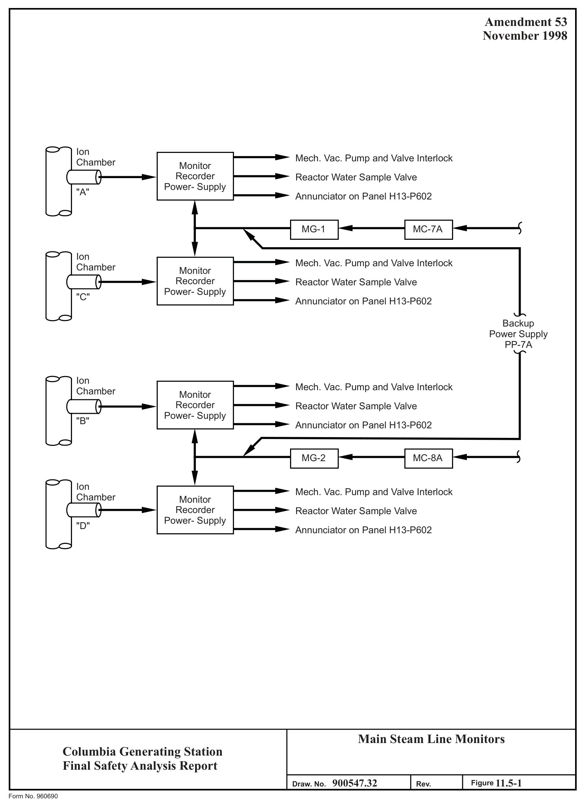
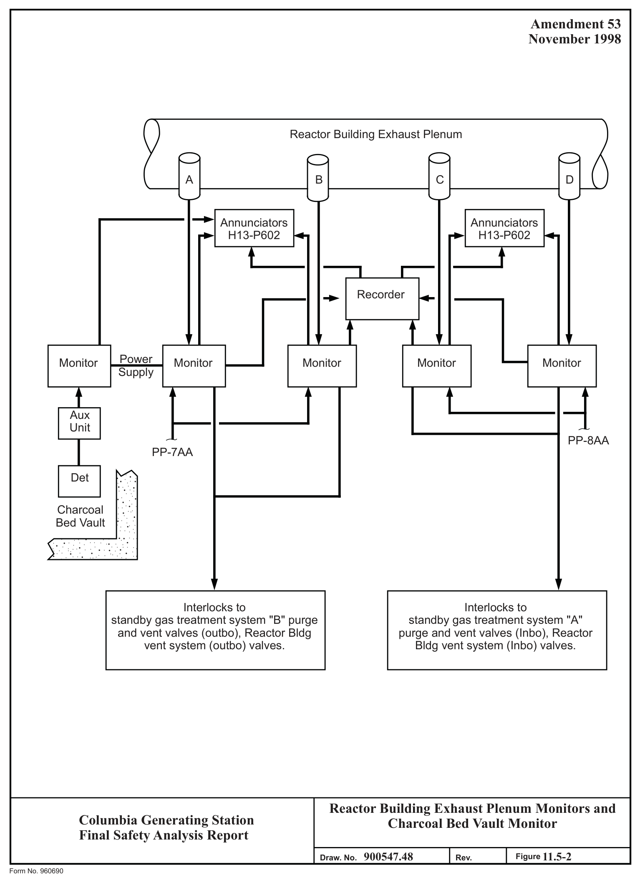
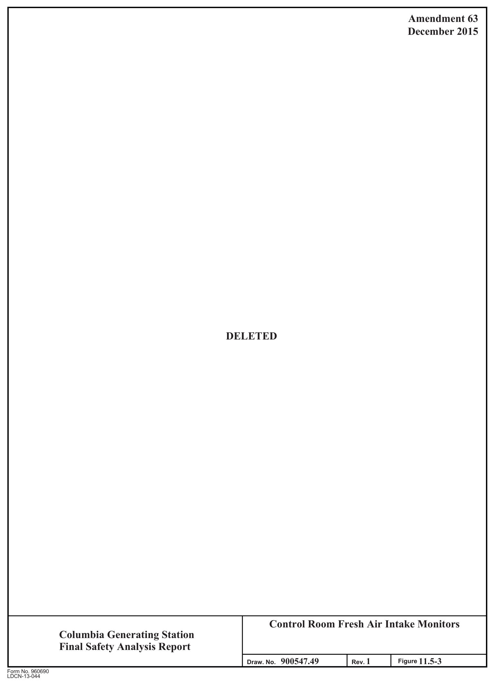
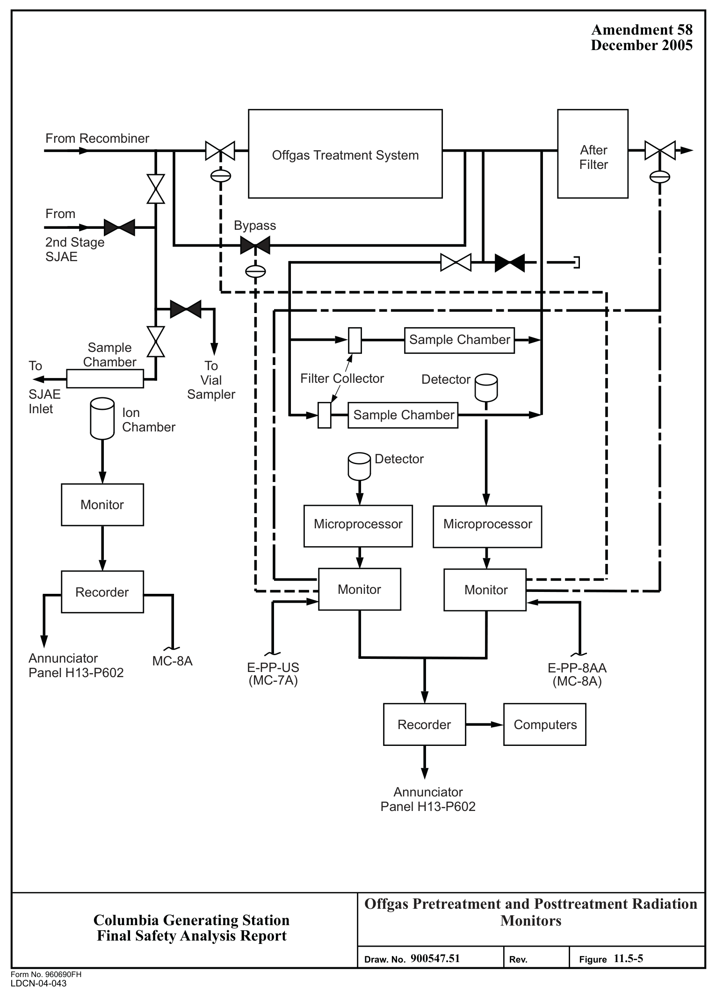
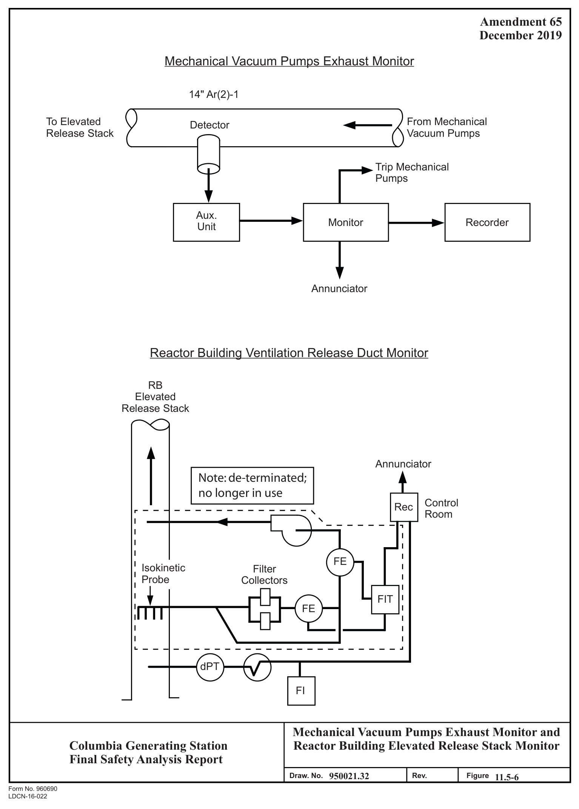
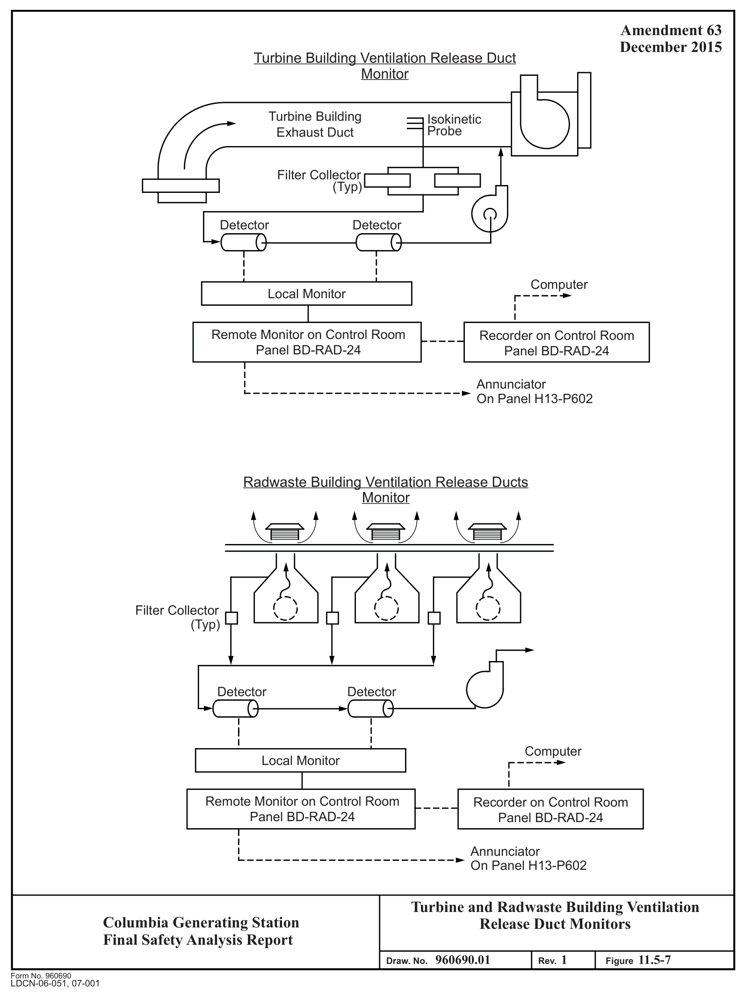
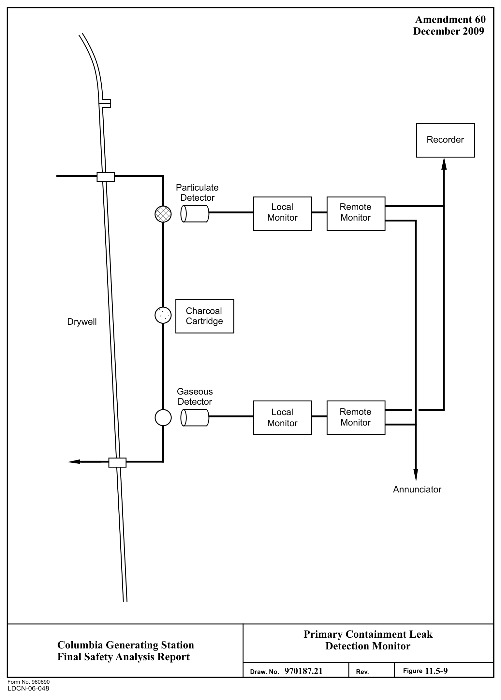
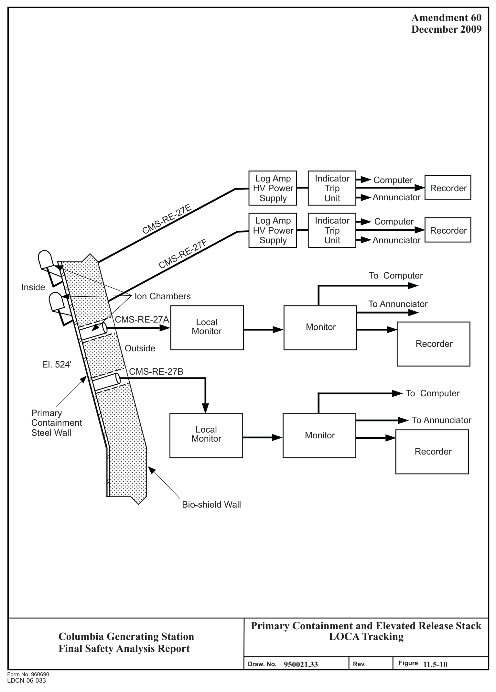
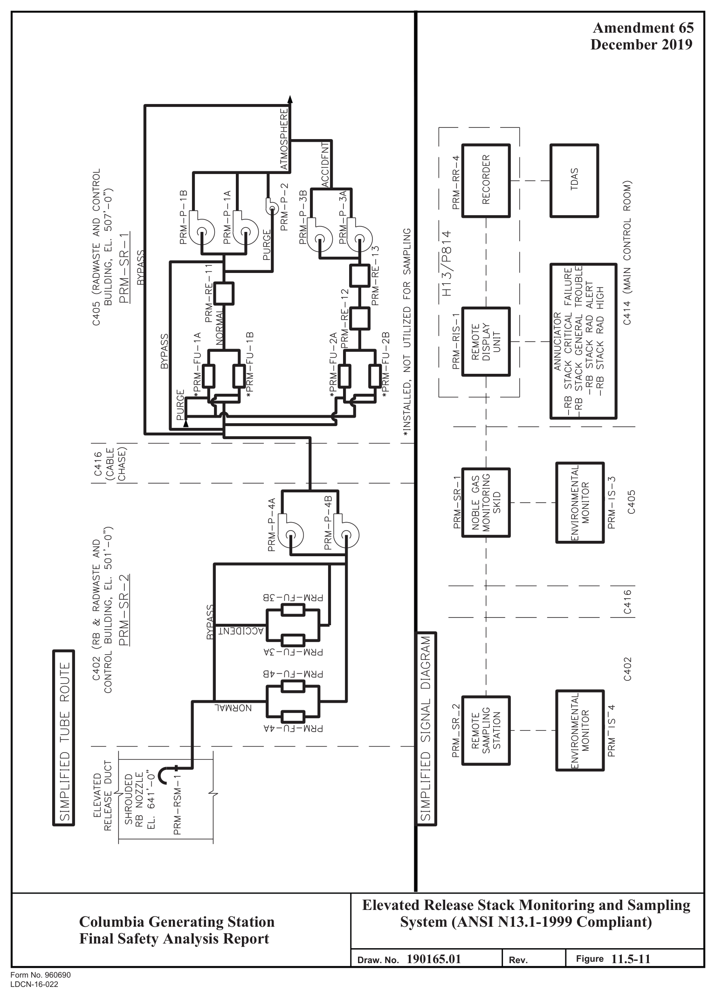
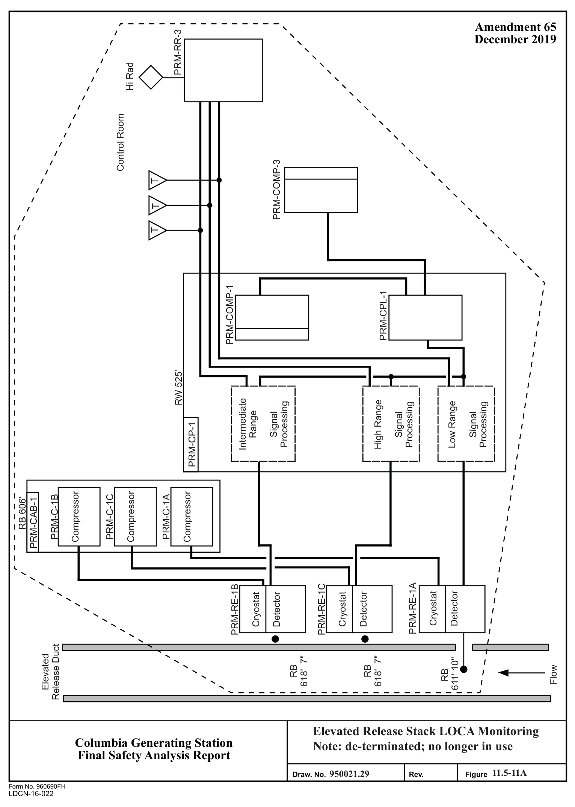

# 11.5 Process And Effluent Radiological Monitoring And Sampling

> Columbia Generating Station FSAR — Chapter 11: Radioactive Waste Management
> Source: `11_chapter-3610-3790.pdf`, PDF pages 135–178 (of 181)
> Amendment 67 compilation (individual pages carry varying amendment dates)

---
<!-- p.135 -->
November 2015

### 11.5 PROCESS AND EFFLUENT RADIOLOGICAL MONITORING AND SAMPLING
#### SYSTEMS
The process and effluent radiological monitoring and sampling systems are provided to allow determination of the content of radioactive material in various gaseous and liquid process and effluent streams. The design objective and criteria are primarily determined by the system designation of either

a. Instrumentation systems required for safety, or b. Instrumentation systems required for plant operation.

#### 11.5.1 DESIGN BASIS
##### 11.5.1.1 Design Objectives
The process and effluent radiological monitoring and sampling system is designed to provide for compliance with the requirements of 10 CFR Part 50 including the General Design Criteria
(GDC) of Appendix A and provides the monitoring and sampling required to make measurements, evaluations, and reports recommended by Regulatory Guide 1.21, Revision l.

###### 11.5.1.1.1 Systems Required for Safety
The main objective of radiation monitoring systems (RMS) required for safety is to initiate appropriate protective action to limit the release of radioactive materials from the reactor vessel and reactor building if predetermined radiation levels are exceeded in major process/effluent streams and to limit inflow of airborne radioactivity to the control room following an accidental release. Additional objectives are to have these systems available under all operating conditions, including accidents and postaccidents, and to provide control room personnel with an indication of the radiation levels in the major process/effluent streams plus alarm annunciation if high radiation levels are detected.

The RMS provided to meet these objectives are

a. Main steam line RMS, b. Reactor building ventilation exhaust plenum RMS, and c. Standby service water RMS.

###### 11.5.1.1.2 Systems Required for Plant Operation
The main objective of the RMS is to provide operating personnel with measurement of the content of radioactive materials in all effluent and important process streams. This allows demonstration of compliance with Technical Specifications by providing gross radiation level

<!-- p.136 -->
monitoring and collection of halogens and particulates on cartridges and filters (gaseous effluents). Additional objectives are to initiate discharge valve isolation on the offgas, liquid radwaste, or drain systems if predetermined release rates are exceeded and to provide for sampling at certain radiation monitor locations to allow determination of specific radionuclide content.

The RMS provided to meet these objectives are

a. For gaseous process streams

1. Offgas pretreatment RMS,
2. Offgas post-treatment RMS,
3. Charcoal bed vault RMS, and 4. Mechanical vacuum pump exhaust RMS.

b. For gaseous effluent streams

1. Reactor building elevated release duct RMS,
2. Turbine generator building ventilation release duct RMS, and
3. Radwaste building ventilation release duct RMS.

c. For liquid process streams

1. Standby service water RMS and
2. Reactor building closed cooling water RMS.

d. For liquid effluent streams

1. Radwaste effluent RMS,
2. Circulating water (blowdown) RMS,
3. Standby service water RMS, and 4. Plant service water (TSW) RMS.

e. For primary containment monitoring

1. Leak detection RMS and
2. Loss-of-coolant accident (LOCA) tracking RMS.

<!-- p.137 -->
##### 11.5.1.2 Design Criteria
###### 11.5.1.2.1 Systems Required for Safety
The design criteria for the RMS required for safety are that the systems shall:

a. Withstand the effect of natural phenomena (e.g., earthquakes) without loss of capability to perform their functions,

b. Perform its intended safety function in the environment resulting from normal and postulated accident conditions,

c. Meet the reliability, testability, independence, and failure mode requirements of engineered safety features,

d. Provide continuous output on control room panels,

e. Permit checking of the operational availability of each channel during reactor operation with provision for calibration function and instrument checks,

f. Ensure an extremely high probability of accomplishing its safety function in the event of anticipated operational occurrences,

g. Initiate prompt protective action prior to exceeding Technical Specifications limits,

h. Provide warning of increasing radiation levels indicative of abnormal conditions by alarm annunciation,

i. Insofar as practical, provide self-monitoring of components to the extent that power failure or component malfunction causes annunciation and channel trip,

j. Register full scale output if radiation detection exceeds full scale, and

k. Have sensitivities and ranges compatible with anticipated radiation levels.

The applicable GDC are 1, 2, 3, 4, 13, 19, 20, 21, 22, 23, 24, 29, 60, and 64 (see Section 3.1). The systems shall meet the design requirements for Safety Class 2, Seismic Category I systems, along with the quality assurance requirements of 10 CFR Part 50, Appendix B.

<!-- p.138 -->
###### 11.5.1.2.2 Systems Required for Plant Operation
The design criteria for operational RMS are that the systems shall

a. Provide continuous indication of radiation levels in the main control room,

b. Provide warning of increasing radiation levels indicative of abnormal conditions by alarm annunciation,

c. Insofar as practical, provide self-monitoring of components to the extent that power failure or component malfunction causes annunciation and, for systems initiating protective action, channel trip,

d. Monitor a sample representative of the bulk stream or volume,

e. Have provisions for calibration, function and instrumentation checks,

f. Have sensitivities and ranges compatible with anticipated radiation levels and Technical Specifications limits, and

g. Register full scale output if radiation detection exceeds full scale.

The RMS monitors discharges from the gaseous and liquid radwaste treatment systems and nonradioactive sumps have provisions to alarm and to initiate automatic closure of the effluent discharge valves on the affected treatment systems prior to exceeding the normal operation limits specified in the Technical Specifications. Additionally, the primary containment monitoring system meets the criteria, except for item g.

The applicable GDC are 13, 60, and 64 (see Section 3.1).

#### 11.5.2 SYSTEM DESCRIPTION
##### 11.5.2.1 Systems Required for Safety
Information on these systems is presented in Tables 11.5-1 and 11.5-2 and the arrangements shown in Figures 11.5-1 through 11.5-4. The equipment is designed to Quality Class I and Seismic Category I requirements. High reliability is further achieved by the use of redundancy as noted below.

###### 11.5.2.1.1 Main Steam Line Radiation Monitoring System
This system monitors the gamma radiation level exterior to the main steam lines. The normal radiation level is produced primarily by coolant activation gases plus smaller quantities of

<!-- p.139 -->
fission gases being transported with the steam. In the event of a gross release of fission products from the core, this monitoring system provides signals to the following:

a. Reactor water sample valves, b. Mechanical vacuum pumps, c. Mechanical vacuum pumps isolation valves, d. Gland seal exhausters, and e. Control room annunciators.

The system consists of four redundant instrument channels. Each channel consists of a local detector (gamma-sensitive ion chamber) and a control room radiation recorder and a readout module with an auxiliary trip unit. Power for two channels (A and C) is supplied from the reactor protection system (RPS) bus A and for the other two channels (B and D) from RPS bus B. Channels A and C are physically and electrically independent of channels B and D.

The detectors are located near the main steam lines in the steam tunnel as it enters the turbine building. The detectors are geometrically arranged so that this system is capable of detecting significant increases in radiation level with any number of main steam lines in operation.

Each radiation monitor has four trip circuits: two upscale (high-high and high), one downscale
(low), and one inoperative. Each trip is visually displayed on the affected radiation readout module. A high-high or inoperative trip results in a channel trip in the auxiliary unit which is an input to the reactor water sample valves, mechanical vacuum pump shutdown, and discharge valve closure. A high trip actuates a main steam line (MSL) high control room annunciator common to all channels. A downscale and inoperative trip actuates a MSL downscale/inoperative control room annunciator common to all channels. High and low trips do not result in a channel trip. Each radiation monitor displays the measured radiation level.

Arrangement details are shown in Figure 11.5-1.

###### 11.5.2.1.2 Reactor Building Exhaust Plenum Radiation Monitoring System
This system monitors the radiation level of the reactor building ventilation system exhaust plenum prior to its discharge from the building into the elevated release duct. A high radioactivity level in the exhaust system could be due to fission gases from a leak or an accident.

The system consists of four redundant instrument channels. Each channel consists of a local detection assembly (a sensor and converter unit containing a Geiger-Mueller (GM) tube and electronics) and a control room radiation readout module. The 120-V ac power for channels
(A and B) is provided from Division 1, and for channels (C and D) from Division 2 power panels; the multipoint strip chart recorder supplied from the Division 2 uninterruptible power supply (UPS) power panel records the output of all four channels. The detection assemblies

<!-- p.140 -->
are located outside the exhaust air plenum upstream of the secondary containment discharge isolation valves. The distance upstream from the inboard discharge isolation valve is such that, at the maximum design flow, the transport time from the detector location to the inboard discharge valve is greater than the total time required to respond to trip level radiation and close the inboard discharge valve before exceeding 10 CFR 50.67 dose limits (see Section 9.4.2.3).

Each radiation monitor has two trip circuits: one upscale (high-high) and one downscale/inoperative (fail safe design). Two-out-of-two upscale/downscale trips (channels A and B) initiates closure of the reactor building ventilation outboard isolation valves and the primary containment outboard purge and vent valves, and initiates startup of standby gas treatment (SGT) system train B. The same condition for channels C and D initiates closure of the corresponding inboard valves and initiates startup of SGT train A.

An upscale trip is displayed on the affected radiation readout module and actuates a reactor building vent high-high radiation control room annunciator common to all channels.
A downscale trip is also displayed on the radiation readout module and actuates a reactor building vent downscale control room annunciator common to all channels.

An additional trip signal for high radiation alarm is provided by the recorder and actuates a reactor building vent high radiation control room annunciator. Each radiation monitor displays the measured radiation level.

Arrangement details are shown in Figure 11.5-2.

###### 11.5.2.1.3 Deleted
<!-- p.141 -->
11.5.2.l.4 Standby Service Water Radiation Monitoring System

This system monitors gamma radiation levels of the service water liquid process and effluent streams.

Each monitor system consists of a gamma scintillation detector inserted into an offline chamber to which a process stream sample is piped. The detector locations are selected to obtain a reasonable geometry and are positioned away from crud trap and associated high background regions. Lead shielding is provided to further reduce background levels.

At each liquid offline detector location, a continuous sample from the liquid process pipe passes through a shielded detection assembly for gross radiation monitoring and then is returned to the process pipe. The detection assembly consists of a detector mounted in a shielded sample chamber. The local radiation monitor and the meter in the control room display the measured gross radiation level. The sample chamber and lines can be drained to allow assessment of background buildup. The flow meter at the sample rack provides local sample line flow indication.

Sample flow for each detector is from the standby service piping downstream of each of the two residual heat removal (RHR) heat exchanger (loops A and B). These monitors are designed to detect any primary coolant leakage into the standby service water through the RHR heat exchanger, during operation of the RHR heat exchangers in the shutdown heat removal mode.

Additional details are shown in Figure 11.5-4.

##### 11.5.2.2 Systems Required for Plant Operation
All systems associated with the plant process cycle provide for indication and recording of radiation levels in the main control room in conjunction with alarm annunciation features.

Information on these systems is presented in Tables 11.5-1 and 11.5-2 and the arrangements are shown in Figures 11.5-2 and 11.5-4 through 11.5-10.

<!-- p.142 -->
###### 11.5.2.2.1 Gaseous Process and Effluent Radiation Monitoring System
11.5.2.2.1.1 Offgas Pretreatment Radiation Monitoring System. This system monitors radioactivity at the outlet of the water separator downstream of the catalytic recombiners. The monitor detects the radiation level which is attributable to the fission gases produced in the reactor and transported with steam through the turbine to the condenser.

A continuous sample is extracted from the offgas pipe via a stainless steel sample line that is then passed through a sample chamber and a sample panel before being returned to the suction side of the steam jet air ejector (SJAE). The sample chamber is a steel pipe which is internally polished to minimize plateout. It can be purged with room air to check detector response by using a three-way solenoid-operated valve. The valve is controlled by a switch located in the main control room. The sample panel measures and indicates sample line flow.

The detector is a gamma-sensitive ionization chamber mounted external to the sample chamber.
The channel has a logarithmic radiation readout module which provides a system alarm output and is provided with a recorder.

The 120-V ac UPS power for count ratemeter and trip auxiliary circuit is supplied from critical Division 2 panel; strip chart recorder receives reliable (Division B) instrument power, and local 120-V ac for the offgas sample and vial sampler control panel.

The radiation readout module has four trip circuits: two upscale (high-high and high), one downscale (low), and one inoperative. The trip outputs are used for alarm function only.
Each trip is displayed on the radiation monitor and actuates a control room annunciator: offgas high-high, offgas high, and offgas downscale/inoperative. Sample line flow is displayed at the sample panel.

The radiation level output by the monitor can be directly correlated to the concentration of the noble gases by using the semiautomatic vial sampler panel to obtain a grab sample. To draw a sample, a serum bottle is inserted into a sample chamber, the sample lines are evacuated, and a solenoid-operated sample valve is opened to allow offgas to enter the bottle. After the sampling bottle is removed, the sample is analyzed in the counting room with a multichannel gamma analyzer to determine the concentration of the various noble gas radionuclides.
A correlation between the observed activity and the monitor reading permits calibration of the monitor.

For arrangement details see Figure 11.5-5.
I I 11.5.2.2.1.2 Offgas Posttreatment Radiation Monitoring System. This system monitors radioactivity in the offgas piping downstream of the offgas system charcoal vessels and upstream of the offgas system discharge valve. A continuous sample is extracted from the

<!-- p.143 -->
offgas system piping, passed through the offgas posttreatment sample panels for monitoring and sampling, and returned to the offgas system piping. Each sample panel has a cartridge and filter (one for particulate collection and one for halogen collection) in series with filter bypass capabilities (with respect to flow) with two identical continuous gross radiation detection assemblies. Each gross radiation detection assembly consists of a shielded chamber, a radiation detector, and a check source. Two radiation monitors in the main control room display the measured gross radiation level.

The sample panels and shielded chambers can be purged with room air to check detector response by using solenoid valves that can be operated from the control room or at the sample panels. The sample panels measure and indicate sample line flow. A solenoid operated check source for each detection assembly operated from the control room or locally can be used to check operability of the gross radiation channel.

Channel A monitor receives reliable (Division A) 120-V ac power and channel B is supplied with Division 2 power; the ±24-V dc auxiliary trip circuits are supplied internally from the monitor power supply. Control room chart recorder receives reliable (Division B) instrument power. Offgas posttreatment sample panel 11A is provided 120-V ac (Division A) power and offgas posttreatment sample panel 11B is provided 120-V ac (Division B) power.

Each radiation readout module has four trip circuits: two upscale (high-high-high, and high), one downscale (low), and one inoperative. Each trip is visually displayed on the radiation monitor. The first three trips actuate corresponding control room annunciators: offgas posttreatment high-high-high radiation, offgas posttreatment high radiation, and offgas posttreatment downscale. A high-high trip from the recorder actuates an offgas posttreatment high radiation annunciator in the main control room. High or low sample flow measured at the sample panel actuates a control room offgas posttreatment trouble annunciator.

A trip auxiliary unit in the control room takes the high-high-high and downscale trip outputs and, if its logic is satisfied, initiates closure of the offgas system discharge and drain valves.
The logic is satisfied if two high-high-high, one high-high-high and one downscale, or two downscale trips occur. The high-high-high trip setpoints are determined such that valve closure is initiated prior to exceeding Technical Specifications limits. Any one high upscale trip initiates closure of the offgas system bypass line valve and initiates opening of the charcoal adsorber treatment line valve.

Grab sampling functions required for isotopic analysis and gross monitoring calibrations can be performed at each redundant sample panel.

For arrangement details see Figure 11.5-5.

11.5.2.2.1.3 Offgas Charcoal Bed Vault Radiation Monitoring System. The charcoal bed vault air handling room is monitored for an increase in the gross gamma radiation level from

<!-- p.144 -->
leakage of radioactive noble gases out of the treatment system. The channel includes a sensor indicator, trip unit, and a locally mounted auxiliary unit. The detector is mounted outside of the air handling room door. The insulated door only attenuates 80 keV gamma (133Xe) by approximately 40%. An indicator and trip unit is located in the main control room. The channel provides for sensing and readout, both local and remote, of gamma radiation over a range of six logarithmic decades (10+0 to 10+6 mR/hr).

The indicator and trip unit has one adjustable upscale trip circuit for alarm and one downscale trip circuit for instrument inoperative which annunciates in the main control room. The trip circuits are capable of convenient operational verification by means of test signals or through the use of portable gamma sources. Power is supplied from the channel A power supply of the reactor handling ventilation exhaust plenum RMS.

For arrangement details see Figure 11.5-2.

11.5.2.2.1.4 Mechanical Vacuum Pump Exhaust Radiation Monitoring System. The radiation monitor on the mechanical vacuum pump exhaust is designed to alarm, stop, and isolate the mechanical vacuum pumps in the case of high level of radioactive gases in air being exhausted to the reactor building elevated release duct. The mechanical vacuum pump is operated during plant startups to remove bulk air from the condenser and is secured at the point where the steam jet air ejection suction is available and condenser offgases are routed through the recombiner charcoal process treatment system. In addition to monitoring discharges via the mechanical vacuum pumps, the turbine gland seal air exhauster system is continuously monitored via this process radiation monitoring system. Clean sealing steam is used on the turbine gland seals to maintain the releases of radionuclides to as low as is reasonably achievable (ALARA) limits. The monitor complies with GDC 64 and is Quality Class II and Seismic Category II.

The channel includes an energy-compensated GM detector, a readout module, and recorder in the main control room. The channel provides for sensing and readout, both local and remote, of gamma radiation over a range of four logarithmic decades (10-2 to 102 mR/hr).

The indicator and trip unit has two adjustable trip circuits. The upscale trip circuit generates a high radiation alarm and stops the mechanical vacuum pumps. The adjustable downscale trip circuit generates an instrument alarm.

For arrangement details see Figure 11.5-6.

11.5.2.2.1.5 Reactor Building Elevated Release Duct Radiation Monitoring and Sampling System. This system is one of various plant gaseous effluent monitoring systems used to comply with regulatory requirement GDC 64 and 10 CFR 20. GDC 64 requires utilization facilities to provide a means to monitor effluent discharge paths for radioactivity that may be released into the outside atmosphere during normal operations and postulated accidents. Under

<!-- p.145 -->
normal operating conditions, this criterion is met by applying applicable provisions found in Regulatory Guide 1.21, Rev. 1, Position C and Appendix A. Under postulated accident conditions, this criterion is met by applying applicable provisions found in NUREG-0737, Item 11.F.1, Attachments 1 and 2, and Regulatory Guide 1.97, Rev. 2, Position C and Table 1. 10 CFR 20 limits the release of radioactive materials to within specified quantities. These limits are specified in the ODCM. A necessary requirement of limiting the release of radioactive material is to continually measure radioactivity release points. The same provisions of Regulatory Guide 1.21, Rev. 1, provide an acceptable methodology to measure radioactivity.
Additionally, this system and the LOCA detectors of Section 11.5.2.2.3.2 comply with GDC 13. This system is evaluated to ANSI N42.18-1980, Section 5.4. For this system, ANSI N13.1-1999 supersedes reference to ANSI N13.1-1969 in the above documents. ANSI N13.1- 1999 methodology assures continuous representative sampling of radioactive gaseous effluents released from the duct.

The system provides detection capability for Regulatory Guide 1.97 variables/categories C.2, C.3, E.2 and E.3. These variables are given in Regulatory Guide 1.97, Rev. 2, Table 1.
They are: Type C – Containment Effluent Radioactivity – Noble Gases (from identified release points including Standby Gas Treatment System Vent), Type C –Effluent Radioactivity – Noble Gases (from buildings as indicated above), Type E –Noble Gas and Vent Flow Rate Standby Gas Treatment System Purge (for Mark II plants), Type E – Noble Gas and Vent Flow Rate Secondary Containment Purge (for Mark II plants), Type E – Noble Gas and Vent Flow Rate Secondary Containment (reactor shield building annulus), and Type E – Particulates and Halogens All Identified Plant Release Points. Portions of this system which are necessary in order to monitor the Regulatory Guide 1.97 Category 2 variables stated above are Quality Class 2+. All other portions of the system are Quality Class 2.

Per the above regulations, four categories of effluent are monitored or sampled: noble gases, halogens, particulates, and tritium. Monitoring and sampling methods provide gross radioactivity concentration values and individual radionuclide activity concentration values.
These values are direct inputs into plant analyses. Under normal conditions noble gas, halogen, particulate, and tritium values input into analyses that demonstrate radionuclide releases into the environment do not exceed limits found in the ODCM. Furthermore, the values demonstrate the adequacy and performance of containment and effluent controls. Under postulated accidents, monitoring the release of noble gases can show significant releases from the Reactor Building, allow for the assessment of a release, indicate containment breach and accomplishment of mitigation actions, and provide verification. Sampling of halogens and particulates can show significant releases from the Reactor Building, allow for the assessment of a release, and provide the ability to conduct long-term surveillance.

The system is not required to remain functional after a seismic event. SSCs inside the duct, cable chase C416, and the Main Control Room are mounted Seismic Category 1M to prevent interactions with Seismic Category 1 SSCs. The Remote Sampling System post-accident samplers, the transformer, and the noble gas monitoring skid (NGMS) are mounted Seismic

<!-- p.146 -->
Category 1M because these SSCs are heavy and are mounted to floors that are Seismic Category 1. All system components are Seismic Category 2.

Per the regulatory guidance above, the system must have a reliable power source. To meet this requirement, the system is powered off of a power source which is backed by the emergency diesel generators and, therefore, is considered reliable under postulated accident conditions. The power source is not redundant, as Regulatory Guide 1.97 and NUREG-0737 do not require a redundant or a battery backed power source for this particular monitoring and sampling function.

Reactor Building Elevated Release Duct is located adjacent to the north wall of the Reactor Building. The duct takes supply from the gland seal and mechanical vacuum pumps, the Off Gas System, the Standby Gas Treatment System exhaust, and the Reactor Building Ventilation System exhaust. These effluents exhaust to the outside atmosphere at the top of the duct.

Both monitoring and sampling are performed continuously using offline detectors and sampling media. The sample effluent is taken at a nominal supply flow of 2 SCFM using a shrouded nozzle located near the top of the elevated release duct. The shrouded nozzle is located so as to obtain a representative sample of the process effluent. Design and location of the shrouded nozzle are per guidance given in ANSI N13.1-1999. The nozzle is connected to a stainless steel tube, which runs down the inside of the elevated release duct, exits the duct, runs down the northwest portion of the outside wall of the Reactor Building, and penetrates through the Reactor Building roof into corridor C402. The tubing connects to the remote sampling system, located in the southeast corner of the corridor. After passing through the remote sampling station, the sample effluent is routed, via a second run of tubing, along the south wall of the corridor, into the Radwaste and Control Building - first through the cable chase and then into room C405. In C405 the tubing connects to the NGMS. After passing through the NGMS, the sample effluent is routed through a small section of tubing and vented directly to the outside atmosphere. The sampling station is located sufficiently close to sampling point so as to meet the sampling efficiency guidelines given in ANSI N13.1-1999. The NGMS is located in C405 to avoid space restrictions and environmental concerns. The system is heat traced to maximize sample transport and mitigate the potential for condensation inside the sample line.

The noble gas monitoring skid is a GEMS-700 monitoring system. It includes three noble gas detectors: low, intermediate, and high. The low range detector is located on the normal sample line path of the skid. The intermediate and high range detectors are located on the accident sample line path of the skid. Under normal conditions, the normal sample line is open, the bypass line is closed, and the accident sample line is closed. On a signal of elevated radiation levels, the skid accident sample line opens, the bypass line opens, and the normal line closes. The low range detector is a plastic beta scintillation detector. The intermediate range and high range detectors are cadmium telluride semiconductor gamma detectors. Table 11.5-1

<!-- p.147 -->
lists the design ranges and sensitivities of each detector. The GEMS-700 is equipped with a local processing and display unit and a remote display unit. Signal from the local processing and display unit is routed to the remote display unit and from the remote display unit to a digital recorder. The local processing and display unit is located on the GEMS-700. The remote display unit and digital recorder are located in the main control room. From the recorder, signal is sent to TDAS and four annunciator alarms. The alarms are: RB STACK GENERAL TROUBLE, RB STACK CRITICAL FAILURE, RB STACK RAD ALERT, and

#### RB STACK RAD HIGH.
The remote sampling station consists of a normal sample line, a bypass sample line, and an accident sample line. The normal line divides into two redundant branches, each of which contains a filter paper medium and a charcoal cartridge. The filter paper collects particulates and the charcoal cartridge adsorbs halogens. Sampling frequency is shown on Table 11.5-3 and the ODCM. The accident line also divides into two redundant branches, each of which connects to a shielded particulate and iodine sampler. The sampler contains a filter paper medium to collect particulates and a silver zeolite cartridge to trap halogens. The redundant sampling media on the normal and accident lines allow for continuous sampling to occur. The samplers on the accident sample line are shielded to limit personnel radiation exposure, per provisions in NUREG-0737. A flow totalizer on the remote sampling station is used to calculate the volume of effluent passing through the sampling media per a given sample. The sampling media are transported to a laboratory for analyses. The activity concentrations of particulates and halogens are determined using the laboratory measured activity values and the flow totalizer measured effluent sample volume. Under normal conditions, the normal sample line is open and the bypass line is closed. On an elevated level of radiation signal from the NGMS, the normal sample line automatically closes and the bypass line automatically opens.
The accident line branches off from the bypass line. Downstream of the sampling media all three branches recombine before connecting to a system pump, which drives the sample effluent through the system to the NGMS. A redundant pump, on the remote filter station ensures system reliability. See Figure 11.5-11 for a simplified drawing of the system.

The remote sampling station and the noble gas monitoring skid also provide for the connection of a tritium sampler. Sampling of tritium is performed during normal conditions.

Major electrical components are located in corridor C402 and room C405. Heat trace and conduit are located in the elevated release duct, outside, in corridor C402, the cable chase C416, and room C405. Both C402 and C405 are equipped with environmental monitors, which provide signal to the Main Control Room if the environments in either of these two areas are outside the allowable environmental operating limits of the electrical devices or if either environmental monitor becomes inoperable. This is done to meet the requirements of Regulatory Guide 1.89, Rev. 1, for augmented quality systems. A signal from either environmental monitor will cause a RB STACK GENERAL TROUBLE alarm or a RB STACK CRITICAL FAILURE alarm on the annunciation panel in the Main Control Room.
Loss of either environmental monitor will cause a RB STACK CRITICAL FAILURE alarm.

11.5-12a

<!-- p.148 -->
Under normal conditions, the system is only used to monitor and sample the release of radioactive gaseous effluents and no setpoints or actions, manual or automatic, are associated with this system. However, under abnormal conditions the monitoring portion of the system provides input to Emergency Action Level (EAL) scheme for classification of an emergency.
The EAL thresholds and their associated classifications are given in the Emergency Plan procedures.

The monitoring instrumentation is calibrated and inspected at regular intervals, per the recommendations of the vendor, operating experience with similar components, and ANSI N13.1-1999. Both calibrations and inspections are performed per plant surveillance test procedures. Preventive maintenance is also performed on components susceptible to failure.
This subset of components was chosen per vendor recommendation and operating experience.
Frequently replaced parts are maintained available on site. While less frequently used replacement parts are available from the vendor or the vendor’s subcontractor as stated on the GEMS-700 procurement specification.

Note 1: The previous Reactor Building Elevated Release Duct monitoring system consisted of three HPGe detectors, associated processing equipment, and a recorder. During normal conditions, this system provided monitoring of noble gases. During postulated accident conditions, this system provided monitoring of noble gases, particulates, and halogens. The previous system has not been physically removed from the plant. However, the previous system has been de-terminated and therefore no longer functions. For a diagram of the previous monitoring system see Figure 11.5-11A.

Note 2: The previous Reactor Building Elevated Release Duct sampling system consisted of two holders for filter media and charcoal cartridges. During normal conditions, the previous system provided sampling of particulates and halogens. The previous system has not been physically removed from the plant. However, the previous system has been de-terminated and therefore no longer functions. For a diagram of the previous sampling system see Figure 11.5- 6.

11.5-12b

<!-- p.149 -->
11.5.2.2.1.6 Turbine Generator Building Ventilation Release Duct Radiation Monitoring System. This monitoring system measures the radioactivity in the turbine building exhaust prior to its discharge to the environment and in doing so complies with Regulatory Guide 1.21, Revision 1, GDC 64, and NUREG-0737. This monitor detects the fission and activation products from the steam which may leak from the turbine or the other primary components in the building. The gaseous activity in the exhaust is expected to normally be below detectable levels. The particulate and iodine activity is typically accumulated on a filter and cartridge respectively for a week to obtain sufficient activity to be detectable. These filters are analyzed to determine the quantities of specific radionuclides present and the results, together with the gaseous activity strip chart recorder, provide a permanent record of radioactivity released to the environment.

A continuous representative sample is extracted from the exhaust vent through a multi-ported isokinetic probe, down a 30-ft tube to pass through a filter paper to collect particulates, and through an impregnated charcoal cartridge to collect iodine. The sample travels through two gas detectors, a mass flow transducer, a local flow meter with switch, and then a sample pump prior to being exhausted to the radwaste building roof area by the turbine building exhaust fans. The sample flow rate is automatically adjusted to compensate for effluent flow changes.

The gas monitoring system includes two local detectors mounted in one lead-shielded chamber, a local ratemeter with display, a remote control/display unit, and a recorder in the main control room. The normal sample flows through the high range detector followed by the low range detector. Arrangement details are shown on Figure 11.5-7.

The monitoring system includes four channels: channel 1, low-range (10-7 to 10-1 µCi/cc), channel 2, high-range (10-3 to 10+3 µCi/cc), channel 3, calculated composite range (10-7 to 10+3 µCi/cc), and channel 4, gas effluent release rate range (10+1 to 10+11 µCi/sec). A two-decade overlap is provided between the low and high range channels. The low and high range channels are equipped with a radioactive test source.

The gas monitoring system has no control functions. The monitor provides an alert radiation alarm and an instrument inoperative alarm, both of which annunciate in the main control room.
The reliable power for low/high range radiation monitor(s) and recorder(s) is provided from Division A power panel and backed by standby power.

<!-- p.150 -->
###### 11.5.2.2.1.7 Radwaste Building Ventilation Release Ducts Radiation Monitoring System.
This monitor system measures the radioactivity in the radwaste building ventilation air exhaust as it is being discharged to the environment and in doing so complies with Regulatory Guide 1.21, Revision 1, GDC 64, and NUREG-0737. Radioactivity originates from radwaste tank vents, from primary water processing equipment, and from laboratory sampling hoods, as well as various cubicles having liquid process treatment systems within the building.
A continuous sample is drawn from each of the two out of three exhaust fans that are operating. The sampling uses isokinetic probes with a fixed flow rate and samples are isokinetic over the normal ventilation operating range. The representative sample is withdrawn through a multi-ported duct probe, through a tube passing through a particulate filter, and through a charcoal cartridge to collect particulate and iodine samples, which are removed at least weekly for laboratory radiochemical analyses. The filtered air sample streams from the operable exhaust fans are combined to pass through two gas detectors, a mass flow transducer, a local flow meter with switch and a sample pump prior to being exhausted to the room.

The gas monitoring system includes two local detectors mounted in one leaded-shielded chamber, a local ratemeter with display, a remote control/display unit, and a recorder in the main control room. The normal sample flows through the high range detector followed by the low range detector. Arrangement details are shown in Figure 11.5-7.

The monitoring system includes four channels: channel 1, low-range (10-6 to 10-1 µCi/cc), channel 2 high-range (10-3 to 10+3 µCi/cc), channel 3, calculated composite range (10-6 to 10+3 µCi/cc), and channel 4, gas effluent release rate range (10+1 to 10+10 µCi/sec). A two-decade overlap is provided between the low and high range channels.

The gas monitoring system has no control functions. The monitor provides an alert radiation alarm and an instrument inoperative alarm, both of which annunciate in the main control room.
The reliable power for low/high range radiation monitor(s) and recorder(s) is provided from Division A, power panel and backed by standby power.

11.5.2.2.1.8 NRC Safety Evaluation Report, NUREG-0892 Acceptance. System comparisons to ANSI 13.10 (redesignated as ANSI N42.18) have been performed.

An inline gamma spectroscopy system provides an isotopic analysis of all effluents exiting the reactor building elevated release duct. See Section 11.5.2.2.1.5, Figure 11.5-11, and Table 11.5-1.

Particulate/iodine sampling of the other buildings (radwaste and turbine) exhausts will be handled by the normal effluent samplers where the postaccident release concentration is quite low.

<!-- p.151 -->
If there were a reactor accident with a core fission product release, the reactor building
(secondary containment) immediately isolates. The atmosphere is maintained at a 0.25 in. H2O vacuum by the SGT system. The only potential airborne contamination that could reach the other buildings is from the SGT system bypass leakage pathways as listed in Table 6.2-16.
Shielding needed for the radwaste and turbine building normal effluent sampling systems was evaluated using assumptions consistent with the discussion in Appendix J (see Sections J.2 and J.3). For the purpose of defining the shielding requirements for the radwaste and turbine building, an iodine concentration of 3.7 x 10+4 μCi/cm3 is assumed in the inleakage air. This iodine concentration is based on a 50% core inventory release to the drywell atmosphere and a 50% plate-out factor. This plate-out factor is conservative for determining sample shielding requirements. With 0.35 scfh bypass leakage into the radwaste building, the building exhaust
(83,000 cfm) concentration will be 2.6 x 10-3 μCi/cm3, ignoring building volume dilution. The normal effluent sampler operates at 3 cfm; therefore, the charcoal cartridge 30 minutes accumulation would be 6.7 mCi. This would result in a dose rate of 21 mR/hr at 1 ft from the cartridge. Doubling the dose rate to account for particulates yields 42 mR/hr at 1 ft from the sample assembly. Because of the high exhaust flow rate (260,000 cfm) and less inleakage I
(0.24 scfh), the turbine building exhaust is less concentrated. The radwaste and turbine building normal effluent sampling systems are adequate for postaccident sampling and no I shielding is necessary (see Section 11.5.2.2.1.5). The evaluation for shielding was not repeated for the implementation of the alternative source term (AST).

###### 11.5.2.2.2 Liquid Process and Effluent Radiation Monitoring System
These systems monitor gamma radiation levels of liquid process and effluent streams.

Each monitor system consists of a gamma scintillation detector inserted into either a well in the process piping or a sump or an offline chamber to which a process stream sample is piped.
The detector locations are selected to obtain a reasonable geometry and are positioned away from crud traps and associated high background regions. Lead shielding is provided to further reduce background levels.

At each liquid offline detector location a continuous sample is extracted from the liquid process pipe, passed through a shielded detection assembly for gross radiation monitoring, and then returned to the process pipe. The detection assembly consists of a detector mounted in a shielded sample chamber equipped with a check source. The meter and recorder in the control room displays the measured gross radiation level. The sample chamber and lines can be drained to allow assessment of background buildup. The flow meter at the sample rack provides local sample line flow indication. A solenoid-operated check source operated from the control room is used to check operability of the channel response.

The critical ±24-V dc for monitor(s) is supplied from Division 1 (and 2) power panels, except for the plant service water monitor which receives 120-V ac from Division A panel, reliable

<!-- p.152 -->
power is provided for control room strip chart recorders, sample control panel receives local 120-V ac.

The detector’s local preamplifier unit is designed to remain fully operational in the expected environment. If exposed to radiation transients which exceed the channel range, the channel maintains full scale deflection and returns to normal functioning when the transient has subsided.

Each radiation monitor, except for the circulating water, has four trip circuits: two upscale
(high-high and high), one downscale (low), and one inoperative. Each trip is visually displayed on the affected radiation monitor. Two of these trips actuate corresponding control room annunciators: one upscale (high radiation) and the downscale for the affected liquid monitoring channel. High or low sample flow measured at the sample panel actuates a control room high-low flow annunciator for the affected liquid channel.

All alarms are annunciated in a control room. Liquid monitoring system details are given in Table 11.5-2 and the monitor arrangements are shown in Figure 11.5-4.

###### 11.5.2.2.2.1 Standby Service Water Radiation Monitoring System. See Section 11.5.2.1.4.

11.5.2.2.2.2 Reactor Building Closed Cooling Water Radiation Monitoring System. The radiation detector is located offline and samples the closed cooling water piping side of the reactor closed cooling water system (RCC) heat exchangers.

The monitor system is a diagnostic tool to verify that no inleakage of primary plant water has occurred from the reactor water cleanup system nonregenerative heat exchanger system which uses RCC as coolant. Since the RCC is a closed system, inleakage would be detected by the monitor system.

11.5.2.2.2.3 Radwaste Effluent Radiation Monitoring System. This monitor system measures the radioactivity in the radwaste effluent discharge prior to its entering the cooling tower blowdown line.

Liquid waste can be discharged from several radwaste processed water tanks such as the floor drain sample tank, waste sample tanks, or distillate drain tanks. These tanks contain water that has been processed through one or more treatment systems such as evaporation, filtration, and I ion exchange. Prior to the discharge from any tank, the liquid in the appropriate tank is sampled and analyzed in the laboratory for radioactivity. Based on this analysis, discharge is permitted as specified in the Offsite Dose Calculation Manual (ODCM).

The radiation detector is located offline and samples the common discharge line from the liquid radwaste system through which all liquid radwaste is discharged to the blowdown line. The

<!-- p.153 -->
December 2009 l l piping arrangement is designed so that the sample well can be flushed to lower background levels.

The high-high upscale trip on the radwaste effluent radiation monitor is used to initiate closure of the radwaste system discharge valve. The trip point is set such that closure is initiated prior to exceeding ODCM limits for liquid effluents. The high upscale trip actuates an annunciator in the radwaste control room as well as the main control room.

11.5.2.2.2.4 Circulating Water and Plant Service Water Radiation Monitoring Systems. The circulating water monitor is located on the discharge side of the circulating water pumps for the main condenser in the coolant blowdown line to the Columbia River. The location of this monitor permits detection of radioactive material leaking to the circulating water from any I source, including the TSW system. If an alarm condition exists, circulating water blowdown to the Columbia River is terminated by automatic closure of the circulating water blowdown valve in the circulating water pump house (see Section 9.2.1.2), and it annunciates in the control room.

During plant outages, water is discharged to the river via temporary pumps installed in the circulating water pump house and connected to the blowdown line. Automatic termination of blowdown is not provided for this temporary arrangement. The only possible source of radiation would be through the TSW system which is monitored for radiation. There is about a 2-hr holdup time in the circulating water pipe giving ample time for blowdown to be manually secured if an alarm is received.

The TSW radiation monitor is located in the TSW return header to the circulating water system. The monitor is an offline type that continuously measures the radioactivity level of the I TSW returning flow to the circulating water system. The radiation detector is lead shielded to minimize background radiation effects. The signal from the detector is displayed on a readout module and recorded in the main control room.

###### 11.5.2.2.3 Primary Containment Radiation Monitoring System
This monitoring system is composed of two parts, a sensitive two-channel leak detection system and a four-channel high activity LOCA tracking system.

11.5.2.2.3.1 Leak Detection Monitors. This monitoring system measures the radioactivity in the drywell and in doing so complies with Regulatory Guide 1.45, Revision 0, and GDC 30.
The radioactivity in the drywell is from coolant and corrosion activation products plus fission products produced in the reactor and released through leaks.

This monitoring system has two redundant subsystems, each having two detectors, individually monitoring particulates, and noble gas activity. Additionally a charcoal sample cartridge is provided to trap halogen gases. The detectors are housed in divisionally separated sample

<!-- p.154 -->
racks located in a reactor building sample room. The sample racks have incorporated blowers and flow controls to withdraw gas samples from the primary containment atmosphere via stainless steel sampling lines and vent back to the containment. The environment in which the local cabinets are located is maintained to limit upper temperature excursions that may occur in the reactor building during an accident. Associated radiation readout modules and recorders are mounted in the main control room along with alarm annunciators.

Required 120-V ac supply for Division 1 and 2 equipment in both the main control room and the reactor building sample room is provided on a divisional basis by the 120/240-V ac critical
(Class 1E) instrumentation power system.

The two-channel detector assemblies are provided with lead shielding to minimize the effects of background radiation to ensure high sensitivity. The detectors are of the beta scintillation type and are provided with check sources to verify system operability. The particulate detector views a fixed filter collector on which airborne particulates are trapped. The noble gas detector views a fixed volume of gas.

Each radiation monitor has three trip circuits: one upscale Hi to alarm and close sample line valve, one upscale Alert, and one downscale for instrument inoperative. All alarms annunciate I in the main control room. This monitoring subsystem provides no control function and is a diagnostic tool which enables the main control room operator to take appropriate action.

Arrangement details are shown in Figure 11.5-9.

11.5.2.2.3.2 Loss-of-Coolant Accident Tracking Radiation Monitoring Systems (Containment Drywell). The LOCA monitoring systems, CMS-RE-27E and CMS-RE-27F, monitor the drywell atmosphere from inside the drywell; while CMS-RE-27A and CMS-RE-27B monitor the drywell atmosphere through penetrations in the bioshield wall. These four monitors provide LOCA monitoring for abnormal radioactivity levels following an accident condition involving rupture of the reactor coolant boundary.
I The in-containment LOCA monitors CMS-RE-27E and CMS-RE-27F, located at approximately 517 ft level Azimuth 291° and 515 ft level Azimuth 51.5° respectively, track long-term decreases in containment radioactivity that take place with decay and decontamination and comply with GDC 13 and 64. The in-containment LOCA monitors each contain a Victoreen Model 877-1 ionization chamber with a range of 1 to 107 R/hr. These two detectors are qualified and meet the criteria of Table II.F.1-3 of NUREG 0737, including calibration with a high level gamma source. The chambers will respond to low energy gamma radiation such as 81 keV from 133Xe fulfilling the Regulatory Guide 1.97, Revision 2 criteria.

The LOCA monitors, CMS-RE-27A and CMS-RE-27B, are housed in the bioshield wall and are against the containment steel shell. These monitors will monitor the drywell radiation in conjunction with the in-containment LOCA monitors CMS-RE-27E and CMS-RE-27F. The

<!-- p.155 -->
LOCA monitors, while not required for plant operation, are used to monitor the drywell in the post-LOCA situation.

The LOCA monitoring systems (CMS-RE-27A, CMS-RE-27B, CMS-RE-27E, and CMS-RE-27F) are redundant and separately supplied with power from Division 1 and 2 in both the main control room and remote locations.

Each ionization chamber is wired to a local monitor. Output from each local monitor is wired to a monitor located in the main control room. Radiation levels within the primary containment for each LOCA monitoring system are recorded in the main control room.

Each monitor has alarm circuitry and indication for high radiation and for instrument inoperative that annunciate in the main control room. This monitoring subsystem provides no control function and is a diagnostic tool which enables the main control room operator to take appropriate action.

Arrangement details are shown in Figure 11.5-10.

##### 11.5.2.3 Sampling
The following sections present a detailed description of the radiological sampling procedures, frequencies and objectives for all plant process and effluent sampling. This sample program provides the means to show compliance with the ODCM for the process radiation monitoring system and radwaste system.

###### 11.5.2.3.1 Process Sampling
Section 9.3.2 describes the design of sampling facilities provided for general sampling. The sample frequency, type of analyses, analytical sensitivity, and the purpose of the sample are summarized in Table 11.5-4 for each liquid process sample location and in Table 11.5-5 for each gas process sample location. The analytical procedures used in sample analysis are presented in Section 11.5.2.3.3. These samples serve to monitor radioactivity levels within various plant systems.

###### 11.5.2.3.2 Effluent Sampling
Effluent sampling of all potentially radioactive liquid and gaseous effluent paths is conducted on a regular basis to verify the adequacy of effluent processing to meet the discharge limits to unrestricted areas. This effluent sampling program will be of such a comprehensive nature as to provide the information for the effluent measuring and reporting programs required by

## 10 CFR Part 50.36a in annual reports to the NRC. The frequency of the periodic sampling
and analysis described herein is normal and will be increased if effluent levels approach

<!-- p.156 -->
Technical Specifications limits. Tables 11.5-3 and 11.5-6 summarize the sample and analysis schedules which correspond to Regulatory Guide 1.21, Revision 1, guidance.

###### 11.5.2.3.3 Analytical Procedures
Samples of process and effluent gases and liquids will be analyzed in the laboratory by the following techniques: gross beta counting, gross alpha counting, gamma spectrometry, liquid scintillation counting, and radiochemical separations.

Instrumentation which is available in the laboratory for the measurement of radioactivity includes a single channel analyzer, alpha counter, beta counter, liquid scintillation counter, and multichannel gamma spectrometer.

Samples for beta counting are evaporated to dryness on metal planchets prior to counting.
Sample volume, counting geometry, and counting time are chosen to achieve the required measurement sensitivities. Correction factors are applied for sample-detector geometry, self-absorption and counter-resolving time.

Gross beta and gross alpha analyses of liquid effluent samples may be performed with an internal proportional counter. The samples are prepared for counting by evaporation onto metal planchets. Gross beta counting is also performed using a liquid scintillation counter.

Sample volume and counting times are chosen to achieve the required measurement sensitivity.
When possible, sample volume is selected to maintain a sample residue thickness of less than 1 mg/cm2. Correction factors are applied for self-absorption.

Gamma ray spectrometry is used for isotopic analyses of gaseous, airborne particulate and iodine, and liquid samples. High-resolution germanium solid-state detectors are available for this purpose. The detectors are calibrated against NIST traceable gamma ray standards for a variety of sample detector geometries. The gamma spectra are resolved using a software program developed for computerized spectrum resolution.

Gaseous tritium samples are collected by condensations or adsorption, and the resultant liquid is analyzed by liquid scintillation counting techniques.

Radiochemical separations are used for the routine analysis of 89Sr and 90Sr.

###### 11.5.2.3.4 Inservice Inspection, Calibration, and Maintenance
During reactor operation, checks of system operability are made by observing channel behavior. During reactor operation at intervals specified in the Offsite Dose Calculation Manual (ODCM) and the Technical Specifications (TS), the response of each detector supplied with a remotely activated check source or LED source simulator will be recorded together with the instrument background count rate to ensure proper functioning of the

<!-- p.157 -->
monitor. Any detector whose response is observed to be inconsistent with that expected for power operation and is not supplied with a remotely activated check source or LED source simulator will be checked with a portable source or by comparison of detector response to system activity. An exception to the portable source check requirement will be allowed for those detectors mounted in areas that are deemed hazardous to personnel.

The system has electronic testing and calibrating equipment, which permits channel testing without relocating or dismantling channel components. An internal trip test circuit, adjustable over the full range of the readout meter, is used for testing. Each channel is tested prior to performing a calibration check. Verification of valve operation, ventilation diversion, or other trip functions is done at this time if it can be done without jeopardizing the plant safety. The tests are performed in conformance with the ODCM test frequencies.

The continuous radiation monitors are calibrated to commercial radionuclide standards traceable to the NIST. Each continuous monitor is calibrated during the refueling outage or every 18 months as required by the ODCM, using standard sources with NIST traceability.

A calibration can also be performed by using liquid or gaseous radionuclide standards or by comparison analysis of particulate, iodine, liquid, or gaseous grab samples with laboratory instruments.

#### 11.5.3 EFFLUENT MONITORING AND SAMPLING
The implementation of the requirements of GDC 64 concerning monitoring of gaseous effluent discharge paths for radioactivity is discussed in Section 11.5.2.2.1. Section 11.5.2.2.2 provides applicable discussions for liquid effluent radiation monitors.

#### 11.5.4 PROCESS MONITORING AND SAMPLING
The implementation of the requirements of GDC 60 concerning automatic closure of isolation valves in gaseous and liquid effluent discharge paths is discussed in Sections 11.5.2.1 and 11.5.2.2. Section 11.5.2.2.1 provides a discussion of gaseous process radiation monitors.
Section 11.5.2.2.2.2 provides a discussion of liquid process radiation monitors.

<!-- p.158 -->
ODCM Alarms Trips Specs Specs Tech Tech Upscale Setpoints N/A background, background, background background Above full below trip below trip Above Above power Above

defined in Table defined in Table activity defined in Table 11.1-4 activity defined in Table 11.3-7 Offgas activity Offgas activity Reactor bldg. Expected Activity Steam line 11.3-1 11.3-1 Process and Effluent Radiation Monitoring System Radionuclides
(Gaseous and Airborne Monitors) Measured Principal Noble gas activation products Coolant fission 133Xe a gases Table 11.5-1 10-2 - 102 mR/hr 100 - 106 mR/h 100 - 106 mR/h 100 - 107 cpm Range (6 dec. log) (4 dec. log)
(7 dec. log) 24 Ci/cc)
(6 dec. log)
(2 x 10-5 to

Sensitivity Efficiency/ 4.08 x 105 cpm/Ci/ amp/R/h 3 x 10-10 amp/R/h 3 x 10-10

#### B. SYSTEMS REQUIRED FOR PLANT OPERATION
mL

chamber chamber -scint, Type Filter, Iodine Filter -ion -ion Part.
GMb

A. SAFETY-RELATED SYSTEMS (Number of chamber (1)
Channels) Adjacent to steam lines adjacent to Offline (2)
Detector Location Inline (4)
Offline, sample
(4)

#### MS-RE-3A, 3B, 3C,
Offgas posttreatment Offgas pretreatment radiation monitors radiation monitors radiation monitors radiation monitor OG-RE-601A and

#### REA-RE-9A, 9B,
Reactor building Main steam line exhaust plenum Monitor

#### OG-RE-601B
9C, and 9D

#### OG-RE-2
and 3D

<!-- p.159 -->
ODCM Alarms Trips Upscale Setpoints N/A

#### N/A N/A N/A N/A N/A
background background ODCM Above Above N/A

#### N/A N/A N/A
Expected Activity inventory defined RB activity Table Within monitor in Section 11.3 ODCM Table ODCM Table Charcoal bed LOCA Table LOCA Table 15.6-10 and 15.6-10 and 6.2.2.1-1 6.2.2.1-1 15.6-11 15.6-11 11.3-7 range Process and Effluent Radiation Monitoring System
(Gaseous and Airborne Monitors) (Continued)
Radionuclides Measured Principal  emittersc Noble gas  emitters 133Xe a 133Xe a 133Xe a 133Xe Table 11.5-1 100 - 106 mR/h (6 10-2 - 106 mR/hr 1E-07 Ci/cc to 1E-03 Ci/cc to 1E00 Ci/cc to 1E+02 Ci/cc 1E+06 Ci/cc 1E-01 Ci/cc Range
(4 dec. log)
from 10-12 from 10-12 dec. log)
Ci/cm3 Ci/cm3

cpm/(Ci/cm) cpm/(Ci/cm)
cpm/(Ci/cc) Efficiency/ Sensitivity
1.810E+08 2.506E+04 1.105E+01 N/A

#### N/A N/A
Charc. ß-scint Type CdTe CdTe Filter cart. GM GM

bed vault (1) (Number of Channels)
Detector Location Offline (1) Offline (1) Offline (1)
Charcoal Inline (1)
Offline Offline

Mechanical vacuum Charcoal bed vault elevated discharge radiation monitor radiation monitor Reactor building Particulate filter pump discharge Monitor

#### PRM-RE-11 PRM-RE-12 PRM-RE-13
Iodine filter

#### OG-RE-11 AR-RE-21
<!-- p.160 -->
Alarms Trips Upscale Setpoints N/A N/A N/A

background ODCM ODCM Above

Expected Activity activity defined in LOCA mixture of activity defined in LOCA mixture of F.P. activity see F.P. activity see Radwaste bldg.
Within monitor Turbine bldg.
Table 15.6-9 Table 11.3-7 Table 15.6-9 Table 11.3-7 range Process and Effluent Radiation Monitoring System
(Gaseous and Airborne Monitors) (Continued)
Radionuclides product gases Principal Measured Fission a a a a 133Xe 133Xe 133Xe 133Xe

Table 11.5-1 R/h (6 dec. log) R/h (6 dec. log) R/h (6 dec. log)
(6 dec. log) (6 dec. log)
(5 dec. log) (6 dec. log) Range 10-3 - 103
-1 10-3 - 103 10-2 x 104 -6 -10-1 100 - 107
-7 -10 µCi/cc Ci/cc µCi/cc Ci/cc 10 10

Sensitivity Efficiency amp/R/h amp/R/h amp/R/h 1 x 10-10 7 x 10-11

#### N/A N/A
#### N/A N/A
iodine filter Part. filterc chambers Type ß-scint ß-scint ß-scint ß-scint -ion

(Number of containment Adjacent to Channels)
Detector Location Offline (2)
Offline (2)
steel walls Outside(2)
Inside (2)

WEA-RE-14 Low Range TEA-RE-13 Low Range Radwaste bldg. vent.
Primary containment b CMS-RE-27E, 27F WEA-RE-14A High CMS-RE-27A, 27B TEA-RE-13A High Turbine bldg. vent.
exhaust radiation exhaust radiation Monitor LOCA monitors Range Range

#### LDCN-06-051, 07-001
<!-- p.161 -->
Alarms Trips scale scale Upscale Setpoints Full Full d For particulate, Cs-137 is the fission product radionuclide used for converting counts per minute to µCi/cc. For gas, Kr-85 is the fission product background, background, below trip below trip Above Above

Containment Section 12.2 discussed in Expected Activity

Process And Effluent Radiation Monitoring System activation product d
(Gaseous And Airborne Monitors) (Continued) Radionuclides Measured Principal daughter and radionuclide used for converting counts per minute to µCi/cc. The monitors display units of µCi/cc. Fission gas corrosion

Table 11.5-1 10-12 - 10-6 µCi/cc 10-7 – 10-1 µCi/cc Range
(6 dec. log) (6 dec. log)

Efficiency/ Sensitivity

#### N/A N/A
c Composite of particulate filters analyzed for 89Sr and 90Sr.
Part. filter Type ß-scint ß-scint a Sensitivity based on this radionuclide.
(Number of Channels) Location b Not required for plant operation.
Offline
(2) (2)

Primary containment radiation monitor

#### CMS-RE-12-1A CMS-RE-12-3A CMS-RE-12-1B CMS-RE-12-3B
Monitor Particulate Gas

<!-- p.162 -->
11.5.2.2.2.4 applicable applicable applicable Trips ODCMb Upscale Setpoints Section b The alarm point will be set, based upon the activity, radionuclides, and dilution factor so that the concentration in the discharge line is less than Not Not Not

background background background background background Alarms Above Above Above Above Above Process and Effluent Radiation Monitoring System (Liquid Monitors)
Less than minimum Less than minimum Less than minimum Less than minimum Expected Activity detector sensitivity detector sensitivity detector sensitivity detector sensitivity Section 11.2

Radionuclides Measured Principal 137Cs a 137Cs a 137Cs a 137Cs a 137Cs a 60Co 60Co 60Co 60Co 60Co Table 11.5-2
1.0E-02 µCi/cc 10-1 - 106 cps 10-1 - 106 cps 10-1 - 106 cps 10-1 -106 cps
(7 dec. log) (7 dec. log) (7 dec. log) (7 dec. log) (6 dec. log)
Range
1.0E-08 to

Type γ-scint γ-scint γ-scint γ-scint γ-scint 10 CFR 20 Appendix B, Table II, Column 2 limits.
Detector Location
(Number of Channels)
Offline (2) Offline (1) Offline (1)
Offline (1)
Inline (1)
a Sensitivity based on this radionuclide.
Circulating water effluent Reactor building closed cooling water radiation Residual heat removal standby service water monitor RCC-RE-7 Plant service water Radwaste effluent Monitor radiation monitor radiation monitor radiation monitor radiation monitor

#### SW-RE-4, 5
#### CBD-RE-8 TSW-RE-5 FDR-RE-6
#### LDCN-06-015, 06-041
<!-- p.163 -->
November 1998

Effluent record Effluent record Effluent record Purpose

Radiological Analysis Summary of Gaseous Effluent Samples μCi/ml 10-11 10-11 10-11 10-10 10-11

Sensitivity Gamma spectruma Radioiodinesb Table 11.5-3 89Sr and 90Src Analysis Gross alpha As above As above Tritium

Frequency Quarterly As above As above Monthly Weekly

c On composite of particulate filters Radwaste building exhaust Reactor building elevated Turbine building exhaust Sample Description Grab Sample b On charcoal cartridge a On particulate filter release exhaust

<!-- p.164 -->
April 2000

Evaluate fuel cladding integrity Evaluate system performance Evaluate system performance Evaluate system performance Evaluate system performance Evaluate cleanup efficiency I Determine radionuclides aAnalysis performed on an infrequent basis as needed to evaluate equipment performance or unusual water chemistry.
Purpose present in system Tank inventory Tank inventory Radiological Analysis Summary of Liquid Process Samples µCi/ml 10-6 10-6 10-6 10-6 10-6 10-6 10-6 10-6 10-6

Sensitivity Table 11.5-4 Gamma spectrum Gamma spectrum Gamma spectrum Gamma spectrum Gamma spectrum Gamma spectrum Gamma spectrum Gamma spectrum Analysis 131I, 133I with Technical In accordance Specifications Frequency Periodically Periodically Weekly Batcha Batcha Batcha Batcha

Grab Sample Sample Description Fuel pool filter - demineralizer Reactor water cleanup system Floor drain collector tank Condensate storage tanks Detergent drain tank (2)
Chemical waste tank Waste collector tank Reactor coolant inlet and outlet

<!-- p.165 -->
November 1998

Evaluate prior to discharge Determine offgas activity Determine offgas system respiratory equipment cleanup performance Determine need for Purpose

Radiological Analysis Summary of Gaseous Process Samples µCi/ml 10-11 10-10 10-10 10-6 10-6

Gamma spectruma,b Sensitivity Gamma spectruma Gamma spectrumc Gamma spectrum Gamma spectrum Analysis Table 11.5-5

Prior to entry Frequency Periodically Periodically Periodically

Offgas pretreatment monitor sample Containment atmosphere (drywell)
Offgas posttreatment sample Sample Description Grab Sample b On charcoal cartridge a On particulate filter c Noble gas

<!-- p.166 -->
November 1998

Effluent discharge record Effluent discharge record Effluent discharge record Effluent discharge record a If tank is to be discharged, analyses will be performed on each batch. If tank is not to be discharged, analyses will be Purpose
(backup sample)

Radiological Analysis Summary of Liquid Effluent Samples µCi/ml 10-6 10-6 10-8 10-5 10-7 10-5 10-6

b If liquids were discharged during the previous month or quarter, as applicable.
Sensitivity Gamma Spectrum Gamma spectrum Gamma spectrum Analysis Gross alpha Gross ß or Table 11.5-6 89Sr/90Sr Tritium Tritium performed periodically to evaluate equipment performance.
Weekly grab of continuously Frequency proportional Quarterlyb Monthlyb collected sample Batcha Batcha

Circulating water discharge Liquid radwaste effluent Floor drain sample tank Waste sample tanks (2)
(composite of all tanks Sample Description Grab Sample discharged)
line

<!-- p.167 -->

*figure on PDF page 167*

[Vector original (SVG, lossless): fig_page-167_3.svg](../figures/fig_page-167_3.svg)

<!-- labels/text on this figure page -->
Amendment 53 November 1998
Ion Mech. Vac. Pump and Valve Interlock Chamber Monitor Recorder Reactor Water Sample Valve Power- Supply "A" Annunciator on Panel H13-P602
MG-1
MC-7A
Ion Mech. Vac. Pump and Valve Interlock Chamber Monitor Recorder Reactor Water Sample Valve Power- Supply "C" Annunciator on Panel H13-P602
Backup Power Supply
PP-7A
Ion Mech. Vac. Pump and Valve Interlock Chamber Monitor Recorder Reactor Water Sample Valve Power- Supply "B" Annunciator on Panel H13-P602
MG-2
MC-8A
Ion Mech. Vac. Pump and Valve Interlock Chamber Monitor Recorder Reactor Water Sample Valve Power- Supply "D" Annunciator on Panel H13-P602
Main Steam Line Monitors Columbia Generating Station Final Safety Analysis Report 900547.32 11.5-1 Draw. No.
Rev. Figure Form No. 960690

<!-- p.168 -->

*figure on PDF page 168*

[Vector original (SVG, lossless): fig_page-168_4.svg](../figures/fig_page-168_4.svg)

<!-- labels/text on this figure page -->
Amendment 53 November 1998
- Reactor Building Exhaust Plenum --c~ r--.-
I'-----
A B C
D ----1 ..... .. ..
'-- -- '-- --
..........
Annunciators Annunciators • •
H13-P602
H13-P602
t
t
-
....
I I
Recorder i..
t
•
• ' '
---- Power Monitor Monitor Monitor Monitor Monitor Supply
t
- l
j ~ Aux I Unit
- ~ I
PP-8AA
PP-7AA
I 'v.".' ..
Det .. . .
.. .. ·• Charcoal . .. .
Bed Vault . .
Interlocks to Interlocks to standby gas treatment system "B" purge standby gas treatment system "A" and vent valves (outbo), Reactor Bldg purge and vent valves (Inbo), Reactor vent system (outbo) valves.
Bldg vent system (Inbo) valves.
Reactor Building Exhaust Plenum Monitors and Columbia Generating Station Charcoal Bed Vault Monitor Final Safety Analysis Report 900547.48 11.5-2 Draw. No.
Rev. Figure Form No. 960690

<!-- p.169 -->

*figure on PDF page 169*

[Vector original (SVG, lossless): fig_page-169_4.svg](../figures/fig_page-169_4.svg)

<!-- labels/text on this figure page -->
Amendment 63 December 2015
DELETED
Control Room Fresh Air Intake Monitors Columbia Generating Station Final Safety Analysis Report I I 900547.49 1 11.5-3 Draw. No.
Rev. Figure Form No. 960690
LDCN-13-044

<!-- p.170 -->
Amendment 59 December 2007 Plant Service Water Monitor Scintillation Detector • .___I ___. ~-1 ~ Local Recorder on Monitor Monitor Panel BD-RAD-24 Detector I~ Annunciator Well on Panel H13-P602

Standby Service Water
(RHR Loop “A”)
Monitor Scintillation Detector _ _ _ . ~~ ~ Recorder on Pre Amp Monitor Panel H13-P604 __) I~ • . _ _ _ I Detector Annunciator Well Instrument on Panel H13-P602 Bus "A"

Standby Service Water
(RHR Loop “B”)
Monitor Scintillation Detector _ _ _ . ~~ ~ Recorder on Pre Amp Monitor Panel H13-P600 __) I~ Detector • . _ _ _ I Annunciator Well Instrument on Panel H13-P602 Bus "B"

Circulating Water
(Blowdown) Monitor Scintillation Detector ·_I -~~ ~ Recorder on Pre Amp Monitor Panel H13-P600 __) I~ Detector Annunciator Well Instrument on Panel H13-P602 Bus "B"

Effluent Valve Interlock

Radwaste Effluent Scintillation Monitor Detector Pre Amp Monitor Annunciator Detector on Panels H13-P602 Well & G11-P001 Instrument Bus "A"

Reactor Building Closed Cooling Water Monitor Scintillation Detector Recorder on Pre Amp Monitor Panel H13-P600 Detector Annunciator Well Instrument on Panel H13-P602 Bus "B"

Process and Effluent Liquid Radiation Monitors Columbia Generating Station Final Safety Analysis Report 900547.50 11.5-4 Draw. No. Rev. Figure Form No. 960690FH

<!-- p.171 -->

*figure on PDF page 171*

[Vector original (SVG, lossless): fig_page-171_4.svg](../figures/fig_page-171_4.svg)

<!-- labels/text on this figure page -->
Amendment 58 December 2005
From Recombiner After Offgas Treatment System Filter :
I I I From Bypass 2nd Stage
I $ -------i ....-.-- -]
SJAE L--t- ----------------- ----. _J I
...........
_______ _____,.__ 1- 1 I Sample Chamber Sample I I Chamber To To Filter Collector Detector I Vial I SJAE Sampler Inlet Ion Sample Chamber I I Chamber I I Detector I I I I Monitor Microprocessor Microprocessor
L.----------,...
I .._ __ _
---_-- _J I
Monitor Monitor Recorder
Annunciator MC-8A
E-PP-US
E-PP-8AA
Panel H13-P602
(MC-7A)
(MC-8A)
Recorder Computers
Annunciator Panel H13-P602
Offgas Pretreatment and Posttreatment Radiation Columbia Generating Station Monitors Final Safety Analysis Report 900547.51 11.5-5 Draw. No. Rev. Figure Form No. 960690FH
LDCN-04-043

<!-- p.172 -->

*figure on PDF page 172*

[Vector original (SVG, lossless): fig_page-172_5.svg](../figures/fig_page-172_5.svg)

<!-- labels/text on this figure page -->
Amendment 65 December 2019
Mechanical Vacuum Pumps Exhaust Monitor
14" Ar(2)-1
To Elevated From Mechanical Detector Release Stack Vacuum Pumps
Trip Mechanical Pumps
Aux.
Monitor Recorder Unit
Annunciator
Reactor Building Ventilation Release Duct Monitor
RB Elevated Release Stack
Annunciator Note: de-terminated;
no longer in use Control Rec Room
FE Isokinetic Filter Probe Collectors FIT FE
dPT
FI
Mechanical Vacuum Pumps Exhaust Monitor and Reactor Building Elevated Release Stack Monitor Columbia Generating Station Final Safety Analysis Report 950021.32 Draw. No. Rev. Figure 11.5-6 Form No. 960690
LDCN-16-022

<!-- p.173 -->

*figure on PDF page 173*

[Vector original (SVG, lossless): fig_page-173_5.svg](../figures/fig_page-173_5.svg)

<!-- labels/text on this figure page -->
Amendment 63 December 2015 Turbine Building Ventilation Release Duct Monitor
Turbine Building Isokinetic Exhaust Duct Probe
Filter Collector
(Typ)
Detector Detector
Computer I I r----- Local Monitor 1 I ______,~---,..___ _ I .____ _ Remote Monitor on Control Room Recorder on Control Room Panel BD-RAD-24 Panel BD-RAD-24 ______, I I Annunciator I L----------------------- ► On Panel H13-P602
Radwaste Building Ventilation Release Ducts Monitor
Filter Collector
(Typ)
Detector Detector
Computer r----- I I Local Monitor I ____,----,..___ _ 1 I .____ _ Remote Monitor on Control Room Recorder on Control Room Panel BD-RAD-24 Panel BD-RAD-24 ______, I I Annunciator I L----------------------- ► On Panel H13-P602
Turbine and Radwaste Building Ventilation Columbia Generating Station Release Duct Monitors Final Safety Analysis Report 960690.01 1 11.5-7 Draw. No.
Rev. Figure Form No. 960690
LDCN-06-051, 07-001

<!-- p.174 -->

*figure on PDF page 174*

[Vector original (SVG, lossless): fig_page-174_5.svg](../figures/fig_page-174_5.svg)

<!-- labels/text on this figure page -->
Amendment 57 December 2003
DELETED
Columbia Generating Station Final Safety Analysis Report I I 970187.20 11.5-8 Draw. No.
Rev. Figure Form No. 960690
LDCN-02-005

<!-- p.175 -->

*figure on PDF page 175*

[Vector original (SVG, lossless): fig_page-175_5.svg](../figures/fig_page-175_5.svg)

<!-- labels/text on this figure page -->
Amendment 60 December 2009
Recorder
j,
- Particulate Detector Local Remote
()
\ Monitor Monitor I
··· □ Charcoal ..
Cartridge Drywell
- Gaseous Detector
() i Remote Local Monitor Monitor
Annunciator
Primary Containment Leak Columbia Generating Station Detection Monitor Final Safety Analysis Report 970187.21 11.5-9 Figure Draw. No.
Rev.
Form No. 960690
LDCN-06-048

<!-- p.176 -->

*figure on PDF page 176*

[Vector original (SVG, lossless): fig_page-176_4.svg](../figures/fig_page-176_4.svg)

<!-- labels/text on this figure page -->
Amendment 60 December 2009
Log Amp Indicator Computer HV Power Trip Recorder Supply Unit Annunciator
CMS-RE-27E
Log Amp Indicator Computer HV Power Trip Recorder Supply Unit Annunciator CMS-RE-27F To Computer Inside Ion Chambers To Annunciator
CMS-RE-27A
Local Monitor Monitor Recorder Outside El. 524'
CMS-RE-27B
To Computer
Primary To Annunciator Containment Local Steel Wall Monitor Monitor Recorder
Bio-shield Wall
Primary Containment and Elevated Release Stack LOCA Tracking Columbia Generating Station Final Safety Analysis Report Draw. No. 950021.33 Rev. Figure 11.5-10 Form No. 960690
LDCN-06-033

<!-- p.177 -->

*figure on PDF page 177*

[Vector original (SVG, lossless): fig_page-177_3.svg](../figures/fig_page-177_3.svg)

<!-- labels/text on this figure page -->
Amendment 65 December 2019 BI
PRM-P-2 IATMOSPHERE
- !J 7 I
PRM-RR-4 RECORDER 8
C405 (RADWASTE AND CONTROL
I -
C414 (MAIN CONTROL ROOM)
BUILDING, EL. 507'-0")
-
H13/P814 -
*INSTALLED, NOT UTILIZED FOR SAMPLING
PRM-SR-1
~---- - -
-
-
-RB STACK CRITICAL FAILURE r-RB STACK GENERAL TROUBLE
-
-RB STACK RAD ALERT
-RB STACK RAD HIGH
-
ANNUCIATOR
PRM-RIS-1
DISPLAY REMOTE
UNIT BYPASS
- I l
- L I i l
- 7 -
I I I I
I C416 I I CHASE) I
(CABLE ~NVIRONMENTAL
MONITORING PRM-SR-1 NOBLE GAS
PRM-IS-3
MONITOR
C405 SKID
I I
CONTROL BUILDING, EL. 501 '-0")
STATION .-----r-r---
C402 (RB & RADWASTE AND
PRM-SR-2
I I I I I I I I
lc416I
SIMPLIFIED SIGNAL DIAGRAM
<( "1 ::::> LL I ::a 0::: Q. I C402 ls1MPLIFIED TUBE ROUTE <GW LL ::a Q. -st I ::::> I 0:::
~NVIRONMENTAL,
---
-' <( PRM_SR_2 PRM-IS-4 ::a 0::: 0 z
SAMPLING
MONITOR REMOTE
LL ::a Q. -st I ::::> I 0:::
RELEASE DUCT
EL. 641'-0"
RB NOZZLE ELEVATED SHROUDED PRM-RSM-1
Elevated Release Stack Monitoring and Sampling System (ANSI N13.1-1999 Compliant)
Columbia Generating Station Final Safety Analysis Report 190165.01 11.5-11 Draw. No.
Rev. Figure Form No. 960690
LDCN-16-022

<!-- p.178 -->

*figure on PDF page 178*

[Vector original (SVG, lossless): fig_page-178_3.svg](../figures/fig_page-178_3.svg)

<!-- labels/text on this figure page -->
r--------------- ' Amendment 65
PRM-RR-3
December 2019 I ' ' I ' I ' I 0- ' Hi Rad ' I ' I ' I ' ' I ' I ' I Control Room ' ' I ' I ' I ' I ' ' I
PRM-COMP-3
' I ' I T ' I ' ' I ' I T ' I ' ' I T ' ' ' ' ' ' ( ' I
PRM-COMP-1
I PRM-CPL-1
I I I I I I ~L-: ____ I I
-:] __ t: ___ RW 525' _ _j_[ ___ I I
I I I I I I -
I I I I I I I
Intermediate High Range Processing Processing Low Range Processing I
I I I I I I
I Range Signal I I Signal I I Signal I I
PRM-CP-1 I I I I I I I
I I I I I I I
I I I I I I I
L _____ I L _____ I L--~--_J I
- I I I Compressor Compressor Compressor
I PRM-C-1B PRM-C-1A
PRM-C-1C
RB 606' PRM-CAB-1
I I
I ....
I I I I I I I I I I ' '
I ' '
PRM-RE-1A
PRM-RE-1C
PRM-RE-1B
I ' '
Cryostat Detector Cryostat Detector Cryostat Detector I ' ' I ' ' ' I • • ' I ' ' ' - ' I Release Duct
I ... I
Elevated 618' 7" 618' 7" ' 611' 10" I '
0 RB RB
Flow ' RB ' '
., I ' ....
I I
Elevated Release Stack LOCA Monitoring Columbia Generating Station Note: de-terminated; no longer in use Final Safety Analysis Report I I 11.5-11A 950021.29 Draw. No.
Rev. Figure Form No. 960690FH
LDCN-16-022

