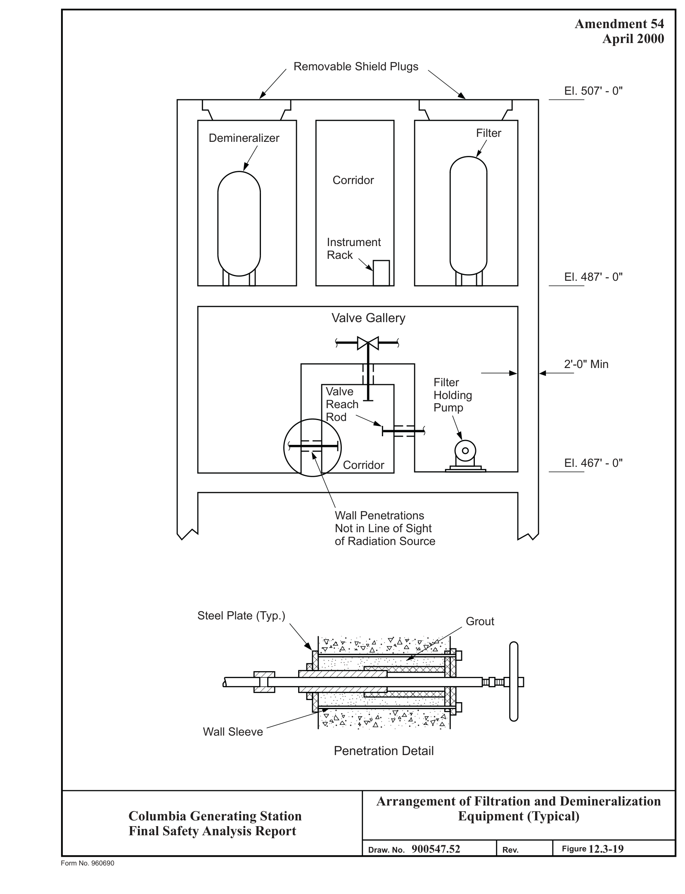
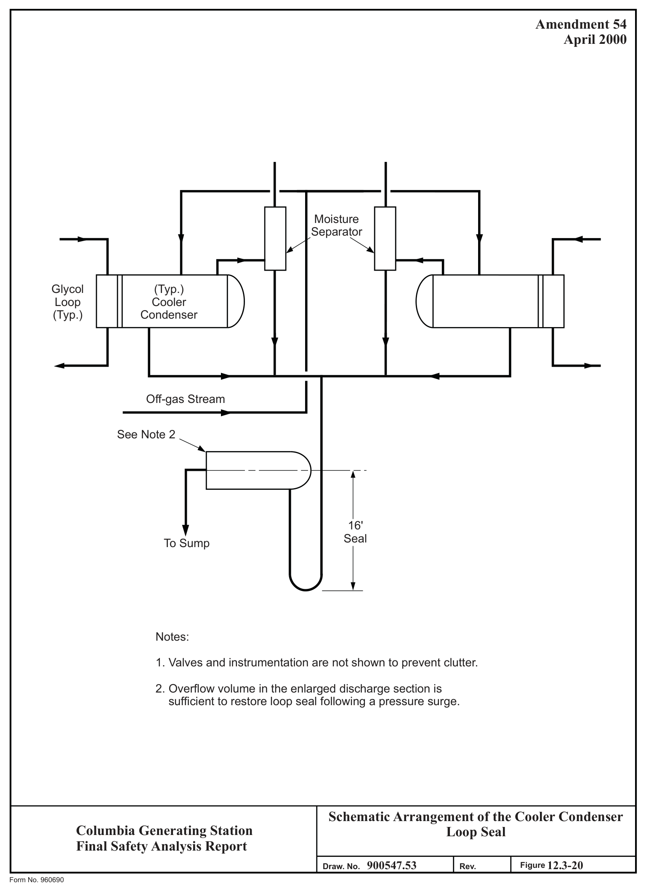
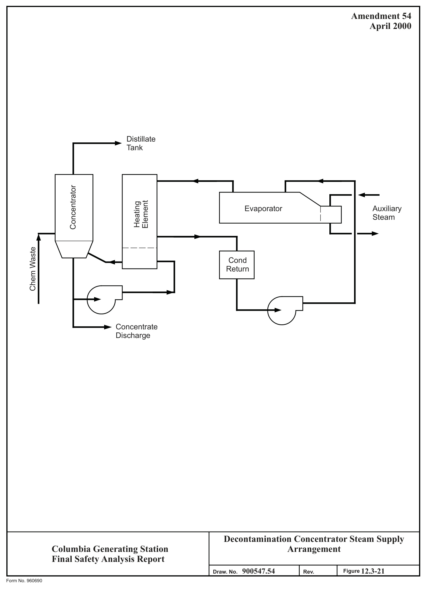
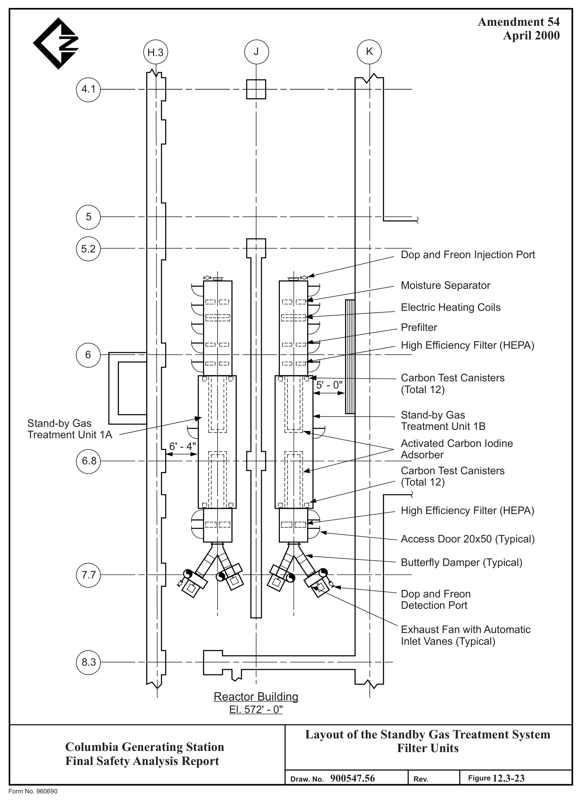

# 12.3 RADIATION PROTECTION DESIGN FEATURES

> Columbia Generating Station FSAR — Chapter 12: Radiation Protection
> Source: `12_chapter-3791-3908.pdf`, PDF pages 52–82 (of 118)
> Amendment 67 compilation (individual pages carry varying amendment dates)

---
<!-- p.52 -->
### 12.3 RADIATION PROTECTION DESIGN FEATURES
#### 12.3.1 FACILITY DESIGN FEATURES
Columbia Generating Station plant incorporates the design objectives and the design features guidance given in Regulatory Guide 8.8 to the extent discussed in Section 12.1.1. Examples of these features are discussed in Section 12.3.1.3.

Figures 12.3-5 through 12.3-18 show the general arrangement for each of the plant buildings.
In addition, these figures show the shielding arrangement, radiation zone designations for both normal operation and shutdown conditions, controlled access areas, personnel and equipment decontamination areas, location of the health physics facilities, location of area radiation monitors, location of radwaste control panels, location of the counting room, and location of the onsite laboratory for analysis of chemical and radiochemical samples. The counting room is located at el. 487 ft 0 in. of the radwaste and control building (see Figure 12.3-13). The design basis radiation level within the counting room is 0.1 mrem/hr during normal operation.

Plant areas, as identified in Section 12.3 figures, are categorized as design radiation zones according to expected maximum radiation levels and anticipated personnel occupancy with consideration given toward maintaining personnel exposures ALARA and within the standards of 10 CFR 20.

##### 12.3.1.1 Radiation Zone Designations
The design basis criteria used for each zone are given below, and the plant layout including major equipment, locations, and radiation zone designations are shown in Figures 12.3-5 through 12.3-18.

For purposes of radiation exposure control, a restricted area is defined in 10 CFR 20, paragraph 20.1003, and plant procedures.

Maximum Dose Rate Design Bases Criteria Zone (mrem/hr)
1.0 I Unlimited occupancy.

2.5 Unlimited occupancy for plant personnel during the II normal work week.

III 100.0 Design base occupancy less than 1 hr per week.
Posted zones and controlled entries.

IV Unlimited Positive access control. Controlled entry and occupancy.

<!-- p.53 -->
Each access point to every Zone IV area may be secured by locked door or other positive control method while it is a “high radiation area.” Occupancy of such areas is limited in frequency and duration and entrance must be authorized in advance by the Radiological Operations Supervisor or his representative.

An area survey of radiation levels will be conducted prior to first entry of Zone IV areas to determine the maximum habitation time.

##### 12.3.1.2 Traffic Patterns
Access control and traffic patterns in the plant have been evaluated to maintain personnel radiation exposures ALARA and to minimize the spread of contamination.

Normal entry into the plant is as follows:

a. Personnel normally access the plant Protected Area through the security Protected Area Access Point (PAAP).

b. The main Radiologically Controlled Area (RCA) normally includes the reactor building, turbine generator building, radwaste building, and diesel generator building. Normal access to these areas is through one of two Health Physics control points located at each end of the main plant corridor.

##### 12.3.1.3 Radiation Protection Design Features
Section 12.1.2 discusses the design objectives for the plant. Examples showing the incorporation of these objectives are provided in the following sections.

###### 12.3.1.3.1 Facility Design Features
Filters and Demineralizers

Liquid radioactive waste and other process streams containing radioactive contaminants are processed through filters and demineralizers. The pressure-precoat type of filter is used in the major fluid processing systems. Cartridge type filters are used in a few select instances such as in the control rod drive (CRD) system. In the case of demineralizers, either the pressure-precoat or deep-bed type of demineralizer is employed.

Each filter and demineralizer is located in a shielded cubicle at el. 487 ft 0 in. of the radwaste and control building. These filters and demineralizers are accessible through the ceiling of the cubicle by removing the shielding plug at el. 507 ft 0 in. This minimizes the radiation

<!-- p.54 -->
April 2000

exposure to plant personnel from adjacent sources. After removal of the shielding plug, the filter or demineralizer can be serviced remotely by use of special tools designed for this purpose. If it is necessary, the filter or demineralizer can be removed from the cubicle to a work area for servicing. There are overhead cranes provided for the purpose of shielding plug and filter or demineralizer vessel removal.

Each pressure precoat type filter or demineralizer has its own support equipment such as a holding pump, process control valves, and precoating equipment. The holding pump and process control valves associated with each filter or demineralizer is located in the valve gallery. This valve gallery is located on the east side of the radwaste-control building, el. 467 ft 0 in., and is a Zone III radiation area (Figure 12.3-12).

The holding pump and motor-operated valves can be operated from control panels located in Zone III radiation areas. Manually operated process control valves are operated by use of reach rods that pass through the shielding walls into the corridor. This corridor is a Zone III radiation area. With the exception of instrument root valves, all pumps and valves can be remotely operated. Instrument root valves are normally open and are not used during normal plant operation. The filter or demineralizer precoat equipment and associated controls, which includes metering equipment, are located in a Zone III radiation area to provide for maintenance access. Each filter or demineralizer may be backwashed with condensate water, chemically cleaned, or purged with air from a remote control panel. Each deep-bed demineralizer has its own support equipment. A gravity feed subsystem transfers the fresh resins from the resin addition tank to the demineralizers. The spent resins are transferred hydropneumatically to the spent resin tank.

All piping routed to and from filter or demineralizer cubicles is located in the valve gallery area or in shielded pipe tunnels. The pipes are routed to avoid unnecessary bends, thus minimizing possible crud buildup.

Specific examples of filters or demineralizers that incorporate the aforementioned design features are the waste collector filter and waste collector demineralizer. A typical layout is shown in Figure 12.3-19.

Tanks
----

All tanks that contain radioactive liquids and solids are categorized into different groups depending on their level of radioactivity. Tanks that contain significant levels of radioactivity are located at el. 437 ft-0 in. of the radwaste and control building.

The tanks that contain radioactive backwash and resins are located in shielded cubicles. These include the condensate phase separator tanks-condensate backwash receiving tank, spent resin tanks waste sludge phase separator tanks, and the reactor water clean up (RWCU) phase

<!-- p.55 -->
May 2001

separator tanks. These tanks are constructed of either stainless steel or epoxy-lined carbon steel.

The tanks that contain unprocessed liquid radioactive waste, such as the waste collector, floor drain collector, and chemical waste tanks are not located in individually shielded cubicles.
However, as described in Section 12.1.1, administrative controls will be used to keep doses to plant personnel ALARA. The waste collector and the floor drain collector tanks are constructed of carbon steel. The chemical waste tanks are stainless steel.

To measure the liquid level in the aforementioned tanks, a bubbler-type level indicator, coupled with a pressure transducer, provides for remote monitoring of the liquid level.

All tanks described above are vented to the radwaste building heating, ventilating, and air conditioning (HVAC) exhaust system as described in Section 12.2.2. This limits the release of airborne radionuclides to the area surrounding the tank.

Pumps

Pumps handling spent demineralizer resins are shielded from the phase separator tank. An example of this is the waste sludge discharge pump which is shielded from the waste sludge phase separator by concrete and block wall. A shutoff valve in the suction line keeps the pump I isolated when it is not in use. Following the discharge of a sludge batch from the phase separator tanks, the pump and its associated piping is automatically flushed with condensate I I water. Thus, when it is not in use, the pump is free of sludge. A condensate supply, controlled by a valve electrically linked to the pump, maintains an external sealing barrier, preventing sludge leakage past the shaft seal during pump operation.

Heat Exchangers

Heat exchangers handling radioactive fluids are designed to limit occupational exposures. An example is the cooler condensers whose function is to condense moisture from the offgas process stream. The cooler condensers are located in a separate cell in the radwaste building, as shown in Figure 12.3-11. No personnel access is required during plant operation. The associated valves, other than those used during maintenance operations, are remotely operated.
The glycol coolant which flows through the tube side is kept at a higher pressure than the offgas flowing through the shell side of the condenser. Thus, a tube failure will not result in radioactivity contaminating the glycol cooling loop. Condensate water that is separated from the offgas is returned, via a water loop seal, to the radioactive sump for processing. The 16-ft deep loop seal prevents escape of radioactive gas through the drain connection. An enlarged discharge section in the loop seal protects it against siphoning. The enlarged discharge section also provides for automatic loop seal restoration should its contents be displaced by a temporary pressure surge. Figure 12.3-20 shows schematically the cooler condenser loop seal arrangement.

<!-- p.56 -->
May 2001

Recirculation Pumps

The decontamination concentrator bottoms recirculation pump serves the decontamination solution concentrator. The pump is made of 316 stainless steel to minimize the corrosive effects of miscellaneous chemical waste fluid. The pump is located in a separate cell from the concentrating equipment it serves. A steam/air sparger at the bottom of the concentrator can be used to flush the pump prior to any maintenance operations. The internals of the pump may be removed without disturbing the connecting piping. A double mechanical seal with clean water circulating through it prevents leakage of process liquid past the shaft seal.

The decontamination concentrator bottoms recirculation pump is not used. There are no plans to use the pump.

Evaporators

The decontamination solution concentrators use steam to boil off water from the incoming chemical waste, as described in Section 11.2. The heating steam is supplied from an evaporator. As shown in Figure 12.3-21, steam generated from demineralized water flows in a closed loop through the shell side of the evaporator and the shell side of the concentrator heating element. The steam is then circulated to the condensate return tank to be pumped back to the evaporator. The steam in the concentrator heating element is at a higher pressure than the decontamination solution flowing through the tube side. Furthermore, the auxiliary steam system, which provides heating steam to the tube side of the evaporator, is at a higher pressure than the shell side. This arrangement provides an effective barrier against contamination of the house auxiliary steam.

The decontamination solution evaporator system is deactivated. There are no plans to use the system.

Valve Gallery and Valve Operating Stations

Valves handling radioactive fluids and requiring manual operation are located in a valve gallery at el. 467 ft 0 in. of the radwaste and control building. These valves are operated from behind a shielding wall with the aid of reach rods. Reach rod penetrations are not in the line-of-sight with major radiation sources, such as resin traps. In addition, the reach rod wall penetrations are grouted about the reach rod assembly, and steel plates are added on both sides of the penetration to minimize radiation exposure. A typical application of reach rods and details of a shielding wall penetration is shown in Figure 12.3-19.

The operating stations for motor-operated valves are located in Zone III radiation areas.

<!-- p.57 -->
Sampling Areas

The location of the sampling areas within the plant is discussed in Section 9.3. Design features of sample areas that reduce occupational exposure are discussed in Section 12.2.2.3.5.

Ventilation Filters and Filter Trains

Filters that are installed as part of the HVAC units in the Columbia Generating Station plant are located in an accessible area. Selected filter units are designed so that it is possible to introduce a plastic bag over the filter through a service access opening in the HVAC unit. For other filter units, the filter can be pulled into a plastic bag as the filter is removed from the HVAC unit.

Hydrogen Recombiners

The hydrogen recombiners for the offgas system are located in the turbine-generator building.
These recombiners are single-pass devices which do not require process control valves. They are located in a shielded cell and do not require personnel access during operation.
Temperature and pressure in the recombiners are remotely monitored. The recombiners and associated piping are designed to withstand an internal explosion.

###### 12.3.1.3.2 Design Features That Reduce Crud Buildup
Design features and considerations are included to reduce radioactive nickel and cobalt production and buildup. For example, the primary coolant system consists mainly of austenitic stainless steel, carbon steel, and low alloy steel components. Nickel content of these materials is low. Nickel and cobalt contents are controlled in accordance with applicable ASME material specifications. A small amount of nickel base material (Inconel 600) is employed in the reactor vessel internal components. Inconel 600 is required where components are attached to the reactor vessel shell, and coefficient of expansion must match the thermal expansion characteristics of the low-alloy vessel steel. Inconel 600 was selected because it provides the proper thermal expansion characteristics, adequate corrosion resistance and can be readily fabricated and welded. Alternate low nickel materials which meet the above requirements and are suitable for long term reactor service are not available. Hardfacing and wear materials having a high percentage of cobalt are restricted to applications where no alternate materials of equally good characteristics are available.

To minimize crud buildup, lines carrying slurries in the reactor water cleanup system and in the radwaste system use extensively self-flushing valves. Furthermore, all of the pipe joints of
2.5 in. and above in size in the reactor water cleanup (RWCU) and radwaste systems are butt
1.-------------' .-----------'I I welded. Butt welding is also used in the equipment drain processing (EDR) and floor drain processing (FDR) systems for lines of 1 in. and above, except for two 1-in. flow control valves, one 1.5-in. flow control valve, two 2-in. socket welded ball valves, one 1-in. socket i

#### LDCN-05-002, 05-007
<!-- p.58 -->
December 2005 r t welded ball valve, and four 3-in. flanged butterfly valves. Lines of 2.5-in. and larger in the offgas system are also butt welded.

The recirculation system is equipped with decontamination flanges for decontamination of the recirculation pump and associated hardware. Also the cleanup, emergency core cooling system
(ECCS), and radwaste systems are provided with decontamination connections to enable decontamination of their hardware. In addition, the RWCU and condensate process filter demineralizers reduce the amount of activation products in these systems. Boiling water reactors (BWRs) do not use high temperature filtration.

Depleted zinc is injected into the feedwater system to displace cobalt from the corrosion product layer in the recirculation system. Iron is injected into the feedwater system to cause the displaced cobalt to adhere to the surface of the fuel rods. This has caused a reduction of exposure rates from the recirculation system.

###### 12.3.1.3.3 Field Routing of Piping
All code Group A piping is dimensioned in detail. Other piping, 2 in. in diameter and smaller, carrying radioactive fluids, are not dimensioned in detail but are required to be in specified space envelops for shielding and in-plant exposure considerations. Such piping runs have their inception points and terminal points dimensionally located. These inception or terminal points may be an outlet or inlet of a pump, a junction with a larger pipe, or a tank nozzle. Also located dimensionally are all pipe penetrations through a wall, ceiling, or floor. Radioactive piping routed through lower radiation zones is enclosed within a shielded tunnel when warranted by high expected radiation levels. Radioactive piping 2.5-in. in diameter and larger is detailed dimensionally.

###### 12.3.1.3.4 Design Features That Reduce Occupational Doses During Decommissioning
Many of the design facilities which presently exist in the plant can be used to minimize occupational exposure during decommissioning, whether decommissioning is accomplished through mothballing, entombment, removal/dismantling, or any combination of the above alternatives. Such facilities include those used for handling and for offsite shipment of fresh fuel, spent fuel, more sources, contaminated filter elements, resins, and other radioactive wastes. The radioactively contaminated spent fuel pool water can be removed by a portable pump placed into the pool after all spent fuel has been removed from the site and any decommissioning use of the pool is finished. The portable pump will discharge into the skimmer surge tank from where the existing decontamination procedure can be implemented.

The number of man rems due to the airborne radioactivity, that may be introduced by the handling of radioactively contaminated systems, as well as the number of man rems due to contact with the same systems, can be reduced by first decontaminating them. Means exist in the present design where radioactively contaminated systems can be decontaminated chemically

<!-- p.59 -->
by remote control and flushed. The plant has a hot machine shop and a hot instrument shop located in the radwaste building where contaminated equipment can be decontaminated under controlled conditions. Provisions have been made in the same building for a future decontamination facility with expanded features.

If decommissioning is accomplished by mothballing, the above provisions will reduce to low levels the occupational radiation exposure to personnel. According to Regulatory Guide 1.86, this method involves “putting the facility in a state of protective storage.” In general, the facility may be left intact except that all fuel assemblies and the radioactive fluids and waste should be removed from the site.

If entombment is chosen as the method of decommissioning, the previously described plant design facilities are adequate to accomplish the tasks with low occupational radiation exposure to personnel. The additional requirements described in Regulatory Guide 1.86 for “sealing all the remaining highly radioactive or contaminated components (e.g., the pressure vessel and reactor internals) within a structure integral with the biological shield after having all fuel assemblies, radioactive fluids and wastes, and certain selected components shipped offsite” can be met. The necessary modifications to the Columbia Generating Station primary containment structure are shown in Figure 12.3-22.

Low occupational radiation exposure to personnel can be achieved if the decommissioning method adopted is that of immediate removal/dismantling of the plant. For example, the laydown area, el. 606 ft 10.5 in., in the reactor building is provided with a drainage system.
There the drywell head and the reactor pressure vessel head can be decontaminated if it is required. Furthermore, there is ample space to erect a contamination control envelope around them during their segmentation for transportation and burial. The plant design accommodates the cutting of the reactor internal under water and within contamination control envelopes.
The turbidity of the water can be reduced by using the RWCU system. The only modification that might be required to the existing system could be the installation of a strainer for the removal of large filings or other large size contaminants. The highly radioactive pieces can be transferred under water to the cask loading area in the spent fuel pool by methods similar to loading spent fuel. The airborne radioactivity generated by the dismantling process can be removed by the filtration systems that the contaminated control envelopes can have and/or by the standby gas treatment system (SGTS).

##### 12.3.1.4 Radioactive Material Safety
###### 12.3.1.4.1 Materials Safety Program
Columbia Generating Station has a program to ensure the safe storage, handling, and use of sealed and unsealed special nuclear source and byproduct materials. Included in the program are procedures for the following:

<!-- p.60 -->
a. Receiving and opening shipments as required by 10 CFR 20.1906,

b. Storage of licensed materials as required by 10 CFR 20.1801 and 20.1802,

c. Inventory and control of radioactive materials,

d. Posting of radioactive material storage areas and tagging of source,

e. Leak tests - sources are checked for leakage or loss of material at least semiannually, and

f. Disposal - all licensed material disposals are in accordance with 10 CFR Part 20 requirements or by transfer to an authorized recipient as provided in 10 CFR Parts 30, 40, or 70.

###### 12.3.1.4.2 Facilities and Equipment
Facilities are provided for handling unsealed sources, such as the liquid standard solutions used for calibration of plant instrumentation. The radiochemical laboratory is equipped with a negative pressure fume hood with filtered exhaust. The hood work surface is designed to withstand heavy weights so that shielding can be provided in the form of lead brick. Drains from the fume hood are routed to the liquid radwaste system.

Remote handling tools are used as needed for movement of the high level sealed sources from their normal storage containers. Shielding to reduce personnel exposure is provided for these sources when they are not in use and to the extent practicable while they are in use.

Portable radiation and contamination monitoring instrumentation is provided, as described in Section 12.5.2, for surveillance to maintain control of the sources.

###### 12.3.1.4.3 Personnel and Procedures
The Columbia Generating Station Chemistry/Radiological Services Director/Radiation Protection Manager (RPM) is responsible for the control and monitoring of sealed and unsealed source and byproduct materials. The Nuclear Material Manager appointed by the Engineering Manager is accountable for special nuclear materials (SNM). The Chemistry/Radiological Services Director/Radiation Protection Manager is responsible for the minimization of radioactive waste and the preparation, offsite shipment, and disposal of radioactive materials and radwaste. Monitoring during handling of these materials is provided by Radiation Protection. Experience and qualifications of Radiation Protection personnel are described in Section 13.1.

Health Physics requirements and instructions to personnel involved in handling byproduct materials are included in implementing procedures.

<!-- p.61 -->
###### 12.3.1.4.4 Required Materials
Any byproduct, source, or special nuclear materials in the form of reactor fuel, sealed neutron sources for reactor startup, sealed sources for reactor instrument and radiation monitoring equipment calibration, or as fission detectors, will be limited to the amounts required for reactor operation or specific calibration purposes except as noted in the facility operating license.

#### 12.3.2 SHIELDING
##### 12.3.2.1 General
The radiation shielding design is in compliance with all NRC regulations concerning permissible radiation doses to individuals in restricted and nonrestricted areas. The guidance provided in Regulatory Guide 1.69 on concrete radiation shields is followed to the extent discussed in Section 1.8. The guidance provided in Regulatory Guide 8.8 on radiation protection is followed to the extent discussed in Section 12.1.2. The plant design and layout optimizes personnel and/or equipment protection. Shielding is supplemented with whatever administrative control procedures are necessary to ensure regulatory compliance. These control procedures include area access restrictions, occupancy limitations, personnel monitoring requirements, and radiation survey practices. Other criteria and considerations are listed in Section 12.1.2.

The shielding design is evaluated under the following conditions of plant operation:

a. Operation at design power, including anticipated operational occurrences,

b. Shutdown conditions, with radiation from the subcritical reactor core, spent fuel assemblies, and other sources discussed in Section 12.2, and

c. Postaccident conditions, including those accident occurrences analyzed in Chapter 15. Emphasis is placed on control room habitability.

The majority of the shielding calculations performed are of the “bulk shielding” type.
Ordinary concrete, having a density of about 150 lb/ft3, is used for shielding except for special applications. In special applications, water, steel, high density concrete, lead, and permali JN P/3% boron are used.

The effects of mechanical or electrical penetrations in shield walls on radiation exposure to personnel is minimized by locating penetrations to preclude direct view of radiation sources through the penetration. The effect of penetrations in shield walls is also minimized by keeping penetration openings to the smallest practicable size. Penetrations are located away

<!-- p.62 -->
from immediate areas with personnel access. When these criteria cannot be implemented, penetrations are offset.

Access into shielded areas is, in general, by labyrinths. Labyrinths are located to preclude direct personnel radiation exposure. Where labyrinths are not practicable, shield doors are used. Knock-out walls for equipment removal are constructed of brick arranged in staggered rows to preclude direct streaming.

Portable and removable shielding devices are used when practical and feasible. Portable shielding devices are easily moved from one location to another. Removable shielding devices are normally used at specific locations and can be removed when necessary. The reactor vessel to fuel pool transfer passage is a location where removable shielding is employed primarily for the protection of personnel working in the drywell. Personnel evaluation of the affected drywell area may be employed instead of, or in conjunction with, the above mentioned shielding.

##### 12.3.2.2 Methods of Shielding Calculations
Standard methods are used in computing the required shielding thickness for a given source.
These methods are described in References 12.3-1 through 12.3-4. Specific methods of calculation and the computer codes used in the shielding design are discussed below.

The NRN computer code (Reference 12.3-5) is used to determine the shielding requirements for the core generated neutrons and to calculate the thermal neutron flux used to determine captured gamma sources outside the core. This code is based on a multigroup slowing down and diffusion system corrected by a multigroup first flight or removal neutron source. The neutron cross sections used with this code are from Oak Ridge National Laboratory with modifications which have resulted from comparisons with data in BNL-325 (Reference 12.3-6)
and the ENDF/B data libraries.

The QAD-BR computer code, which is based on the QAD-P5 code (Reference 12.3-7), is the basic code used to determine shielding requirements for gamma ray sources. This code provides gamma flux, dose rate, energy deposition, and other quantities which result from a point by point representation of a volume distributed source of radiation. Attenuation coefficients for water, iron, and lead, used in this program are taken from the Engineering Compendium for Radiation Shielding (Reference 12.3-1). Concrete attenuation coefficients are taken from ANL-6443 (Reference 12.3-8).

Any shielding requirements which are not determined with the QAD code were determined by using the methods discussed in the Reactor Shielding Design Manual (Reference 12.3-2). The various sources are reduced to their basic geometric configuration (line, disc, cylinder, sphere, etc.) and the corresponding equations are solved to find the dose. The Taylor exponential form

<!-- p.63 -->
of the buildup factor is used in these equations. All required data is taken from Reference 12.3-1.

The criteria for penetration acceptability is based on the radiation zone levels in the areas separated by the wall where the penetration is located. The penetration is analyzed if the penetration passes from Radiation Zone IV to Zones III, II, or I; or, if the penetration passes from Radiation Zone III to Zones II or I. This analysis considers both the scattered as well as the direct radiation. The direct component is calculated using the point source attenuation equation, as described in the Reactor Shielding Design Manual (Reference 12.3-2). The scattered component is calculated using the Chilton-Huddleston equations (Reference 12.3-9).
Compensatory shielding (e.g., labyrinths, steel plate, lead wool) is used as needed, to reduce radiation streaming through penetrations and to protect against localized “hot spots.”

The general dose rate in each plant area, including contributions from radiation streaming, satisfies the design dose rate specified for that area.

Entrances to shielding cubicles are designed to prevent source radiation from passing directly through the opening. Whenever possible, a labyrinthine entrance is designed to reduce the emerging radiation to a level compatible with the access requirements outside the cubicle. The scattered and direct components of the emerging radiation are calculated by the above methods.

##### 12.3.2.3 Shielding Description
###### 12.3.2.3.1 General
The description of the shielding throughout the entire plant is summarized within the following sections. These descriptions are to be used in conjunction with the radiation zone maps, Figures 12.3-5 through 12.3-18, to locate the process equipment which is shielded and to determine the design dose rate.

###### 12.3.2.3.2 Reactor Building
The sacrificial shield is an ordinary concrete structure 2 ft thick, lined on the inside and outside by steel plates of a minimum thickness of 0.5 in. each. The sacrificial wall extends between el. 519 ft 2.25 in. and 567 ft 4.5 in.

The biological shield wall protects station personnel in the reactor building from radiation emanating from the reactor vessel. The dose rate at the outer face of the biological shield as well as above the shield plug (above the reactor vessel) is, except at penetrations, less than
2.5 mrem/hr during normal reactor operation. The reactor core is the primary source of radiation, and it is used in computing the above dose rate. The wall is in the shape of a shell of the frustum of a cone, and its composition is ordinary concrete at least 5 ft thick. Inside the biological wall exists the primary containment vessel which has the same shape as the wall.

<!-- p.64 -->
The primary containment vessel is made of 0.75 in. minimum steel plate. The 16N contained in the recirculation system, the main steam lines, and the water in the vessel below the core along with the fission process in the core constitute the major sources of radiation used to determine the radial dose rate. The shielding arrangement for the other major sources in the reactor building is shown on Figures 12.3-15 through 12.3-18.

Personnel evacuation of the affected drywell area(s) and/or employing removable shielding at the fuel pool passage are two methods used for personnel protection in the drywell during fuel handling operations. The shielding is designed such that radiation levels are no greater than 100 R/hr at contact. Portable locally alarming radiation monitors and/or direct Health Physics monitoring are employed for additional personnel protection.

###### 12.3.2.3.3 Turbine Building
In the turbine building, 16N constitutes the major source of radiation and basis for shielding design. It is contained in the turbines, moisture separator reheaters, and the feedwater heater system that are located in the turbine access areas at el. 501 ft 0 in. and 471 ft 0 in. These areas are surrounded by ordinary concrete walls at least 3.5 ft thick. The dose rate to the areas outside these walls is less than 2.5 mrem/hr.

The walls which surround the turbine-generator access area at el. 501 ft 0 in. extend up to 524 ft 0 in. This minimizes the effects of direct radiation streaming at the site boundary.

The shielding arrangement for the major sources of radiation in the turbine building, including those discussed above, are shown in Figures 12.3-5 through 12.3-10.

###### 12.3.2.3.4 Radwaste Building
The shielding arrangement for the major sources in the radwaste building are shown in Figures 12.3-11 through 12.3-14.

#### 12.3.3 VENTILATION
The plant ventilation systems for the different areas of the plant are designed to meet the requirements of 10 CFR Parts 20 and 50. Gaseous wastes will be released in a controlled manner to environs such that during plant operation, onsite and offsite radioactivity levels are ALARA. The design features which limit and reduce the airborne radioactivity are as follows:

a. In the reactor, radwaste, and turbine generator buildings the air flow is from areas of low airborne radioactivity potential to areas of higher airborne radioactivity potential. This serves to isolate and segregate airborne radioactivity which may be released due to equipment failure or malfunction and leakage from fluid systems;

<!-- p.65 -->
b. To prevent radioactivity buildup, all ventilation air is supplied to the reactor, turbine, and radwaste buildings on a once through basis;

c. All cubicles housing equipment which handles radioactivity contaminated material are ventilated at a minimum rate of three volume air changes per hour;

d. All sinks and chemical laboratory work areas where radioactive samples or materials are handled are provided with exhaust hoods to protect operating personnel from airborne contaminants;

e. All liquid equipment leaks which are potential sources of airborne radioactivity in the reactor building are collected in the reactor building equipment drain system. The drain system is maintained at a negative pressure with respect to the balance of the building to protect operating personnel from airborne leakage generated in the system sumps. All exhaust air drawn from the reactor building equipment drain system is filtered by absolute particulate and charcoal filters.
The particulate and charcoal filters minimize the release of contaminated particulates and iodine; and

f. The primary containment purge system reduces airborne radioactivity within the drywell to acceptable levels prior to entry of working personnel. The level of radioactivity released to the environment during normal primary containment purge will not exceed the requirements of 10 CFR Part 20 Appendix B. When airborne radiation levels in the primary containment are too high to allow direct purging to the atmosphere through the reactor building exhaust, purge air at a reduced flow rate is passed through the SGTS prior to exhaust. In this latter mode, airborne iodine and particulates are removed from the purge exhaust air prior to release;

The air cleaning systems which utilize special filtration equipment to limit airborne radioactive contaminants are

a. Standby gas treatment system (see Section 6.5), b. Control room emergency filtration system (see Sections 9.4 and 6.4), c. Reactor building sump vent exhaust filter system (see Section 9.4), and d. Radwaste building exhaust filtration system (see Section 9.4).

In addition, small local absolute particulate filters are used to locally filter the effluent from sample sink hoods and chemical hoods. These small filter units are all described in Section 9.4.

<!-- p.66 -->
The SGTS filter units discussed in Section 6.5.1 and the control room emergency filter units discussed in Sections 6.4 and 9.4.1 are the only engineered safety feature (ESF)
filtration systems. A detailed evaluation of these units with respect to Regulatory Guide 1.52 is given in Section 1.8. The balance of the filtration systems meet the intent of Regulatory Guide 1.52 with the following deviations:

a. Reactor building sump vent filter units

These units are composed of demisters, an electric heater, a medium efficiency prefilter, an absolute particulate (HEPA) filter and tray type adsorber filters composed of 2-in. deep charcoal beds in a sheet metal housing. These units do not have absolute particulate filters downstream of the adsorber section as described in Regulatory Guide 1.52.

The 5-ft spacing between filter frames, as required in Regulatory Guide 1.52, is not provided in these units. These units are of low capacity (1000 cfm), and personnel access into the units for servicing and testing is not possible. Access panels are provided for servicing and removal of all unit components. Sufficient space is provided between elements to permit removal of any element without disturbing any other element.

b. Radwaste building exhaust filter units

These three units are composed of medium efficiency prefilters, absolute particulate (HEPA) filters and centrifugal fans in a sheet metal housing.
Unit capacity is 42,000 cfm, which is in excess of the 30,000 cfm maximum capacity recommended in Regulatory Guide 1.52. These units are composed of a 5 filter high by 8 filter wide array. Permanent service platforms are provided on both sides of the HEPA filters at an intermediate height for operating personnel during filter testing and service.

Absolute particulate (HEPA) filter and charcoal adsorber filters will be tested periodically to ensure continued filter efficiency as discussed in Sections 6.5.1.4, 9.4.2.4, and 9.4.3.4.

Figure 12.3-23 (el. 572 ft 0 in.) shows the layout of the SGTS filter units. The concrete wall between the units serves as both a fire wall and missile barrier between the two filter trains.
Access doors, 20 in. x 50 in., are provided into each plenum section between unit elements.
Ample aisle space is provided outside the units for ease of access for personnel to perform tests and maintenance. Charcoal test canisters are provided as shown in Figure 12.3-23. There are

<!-- p.67 -->
12 test canisters per 4-in. deep filter bed. Dioctylphthalate (DOP) and freon injection and detection ports are provided as shown.

#### 12.3.4 IN-PLANT AREA RADIATION AND AIRBORNE RADIOACTIVITY
#### MONITORING INSTRUMENTATION
##### 12.3.4.1 Criteria for Necessity and Location
The objectives of the in-plant area radiation and airborne radioactivity monitoring systems are to

a. Warn of excessive gamma radiation levels in areas where nuclear fuel is stored or handled,

b. Provide operating personnel with a record and indication in the main control room of gamma radiation levels at selected locations within the various plant buildings,

c. Provide information to the main control room so that decision may be made with respect to deployment of personnel in the event of a radiation accident or equipment failure,

d. Assist in the detection of unauthorized or inadvertent movement of radioactive material within the various plant buildings,

e. Provide local alarms at selected locations where a substantial change in radiation levels might be of immediate importance to personnel frequenting the area,

f. Monitor areas having a high potential for increase gamma radiation levels where personnel may be required to work,

g. Supplement other systems including process radiation leak detection or building release detection in detecting abnormal migrations of radioactive materials from process streams,

h. Monitor the general conditions in the reactor building following an accident, and

i. Furnish information for making radiation surveys.

No credit is taken for the operability of the in-plant area radiation and airborne radioactivity monitors in the event of an accident. However, the probability is high that many or all of the 13 area monitors in the reactor building will be operable. These monitors have local sensors in separate physical locations within the reactor building. The wiring from the local sensors is

<!-- p.68 -->
run to the main control room in cable runs that have Seismic Category I qualified supports.
The electrical supply for the area monitor indicator and control room alarms in the main control room are powered from a critical 120-V ac supply. The local audible alarms are powered from a local ac supply and its loss would not impact control room readings. The sensors are designed to maintain operability and accuracy in atmosphere up to 95% RH, and temperature to 50°C.

##### 12.3.4.2 Description and Location
a. Area radiation monitors

Area radiation monitors consist of local detector alarm units and main control room mounted indicator trip units, alarms, and recorders. Redundant criticality monitors are located in the reactor building new fuel storage pit as recommended by Regulatory Guide 8.12. When practicable and feasible the guidance in Regulatory Guide 8.12 has been followed. Major items in Regulatory Guide 8.12 have been addressed and include

1. Employing two detectors in the new fuel vault,

2. Emergency planning that includes both the Emergency Plan and the Emergency Plan Implementing Procedures, evacuation routes, assembly areas, and yearly drills, and

3. Surveillance testing of criticality alarm systems, including procedures that address methods and frequency of testing.

## 10 CFR 50.68(b) requires radiation monitors in storage and associated handling
areas when fuel is present to detect excessive radiation levels and to alert personnel to initiate appropriate safety actions.

Other detector locations have been selected in accordance with good operating practice and from past operating experience with similar plants. Detector locations are shown in Figures 12.3-5 through 12.3-18. Annunciations are given in the main control room and locally at the sensors when radiation levels exceed a predetermined level. Point indication and recording are provided for in the main control room. Local detectors are wall-mounted approximately 7 ft off the floor. The detectors have sufficient cable length to be taken from their normal positions to floor level for insertion into calibrating chambers to verify instrument accuracy. Direct-reading dosimeters, worn by individuals in

<!-- p.69 -->
radiologically controlled areas, provide protection in areas where area radiation monitors have not been installed.

An additional area radiation monitor is installed on the refueling bridge during bridge operation to provide personnel protection. This monitoring system provides local indication, visual, and audible alarm.

There is no area radiation monitor in the area of the radwaste building where the waste containers are filled and stored. Waste containers will normally be processed either “in cask” or in the shielded waste storage bay.

The location and ranges of the 31 area radiation monitors are given in Table 12.3-1. Table 12.3-2 lists the maximum background radiation levels for the area radiation monitors in the reactor building based on design basis calculation.

b. Airborne radiation monitors

Airborne radioactivity monitoring for plant personnel protection and surveillance uses fixed location, continuous particulate monitors which include continuous iodine samplers; portable continuous particulate monitors with continuous iodine samplers positioned at specific work sites; and particulate and iodine grab samples taken before and during specific jobs.

Movable local alarming continuous air monitors are placed at predetermined plant locations for personnel protection and to substantiate the quality of the plant breathing atmosphere. The monitors have local readouts (charts) and have radioiodine sampling capabilities.

The installed continuous particulate monitoring system was designed for responsive personnel protection and plant surveillance. The three installed particulate monitors measure the airborne particulate activity levels in the radwaste and reactor building ventilation exhaust and furnish recording signals to the main control room. These units draw approximately 3 cfm air sample through the particulate filter which is monitored by a shielded beta detector with an efficiency of approximately 30%. The resultant response of the system is an increase of about 350 cpm for 1 hr of sampling at a 1 x 10-10 Ci/cm3 concentration. External gamma radiation will increase the background by 70 cpm/mrem/hr.

<!-- p.70 -->
The actual ability of a ventilation exhaust monitoring system to detect the airborne particulate concentration in a specific space is dependent on the following factors:

1. Flow rate ratio (flow of air from a specific confined space/flow rate of bulk ventilation system exhaust),

2. Particulate activity and its half-life of the bulk ventilation system exhaust air,

3. Radionuclide composition in the specific confined space, and

4. The energy of the beta radiation from the radionuclide composition.

Normal plant conditions are expected to yield a bulk ventilation exhaust air concentration
(primarily short-lived fission product daughters and natural activity half-life about 20 minutes)
of 1-3 x 10-10 Ci/cm3. This will reach an equilibrium on the sample filter of about 500 cpm.
The MPCa for normal plant airborne contamination is expected to be greater than 6 x 10-8 Ci/cm3. At this MPCa concentration a 1-hr accumulation (one MPCa-hr) will equal
2.0 x 105 cpm. Applying a dilution factor of 270:1, the 1-hr accumulation will equal 750 cpm.
This is a worst case dilution that considers the reactor building TIP Drive room at 400 cfm in the 105,000 cfm building bulk exhaust flow. Therefore, the ventilation monitoring system will easily detect 10 MPCa-hr on all locations.

Local particulate constant air monitoring instruments and a comprehensive (particulate, noble gases, and iodine) grab air sampling program complement the plant air sampling program.
Under these conditions, corrective actions will be taken and an assessment by portable sampling system results and portable monitoring activities will establish activity levels in all occupied areas which have potential for abnormal airborne activity.

In the radwaste building, the potentially contaminated areas normally entered by people would be those corridors adjacent to radioactive liquid and gaseous waste processing systems equipment such as demineralizers, concentrators, waste storage tanks, recombiners, dryers, moisture separators, and charcoal holdup vessels. Assuming that exfiltration from any one of the process systems to a normally entered corridor was sufficient to attain MPCa levels for 137Cs in that corridor, the dilution ratio would approach a factor of 10 to 100. For the worst case (100 to 1 ratio of bulk ventilation flow rate to corridor flow rate), 137Cs at MPCa
(6 x 10-8 Ci/cm3) would be detected within 1 hr on the continuous particulate monitor. If exfiltration from a process vessel cubicle was sufficient to produce MPCa levels in an adjoining corridor, it is more probable that the normal cubicle flow rate input to the bulk ventilation flow would produce a prior distinguishable countrate ramp.

<!-- p.71 -->
In the turbine building, airborne contamination is most likely to arise from nuclear steam leaks or offgas processing systems piping. Heater bay areas, steam jet air ejector rooms, turbine areas, and steam-driven feedwater pump areas have the potential for airborne contamination.
Regular radiological surveys in the turbine building are not augmented by continuous particulate monitoring of the turbine building ventilation exhaust.

Each of the continuous particulate monitors has an associated iodine sampling cartridge which is counted regularly for baseline and surveillance information. This cartridge and iodine sampled/collected with portable sampling devices will be analyzed in the plant laboratory counting facility when abnormal airborne activity levels are signaled by a continuous I particulate monitoring system. At a 5 cfm air flow rate through an iodine sampling cartridge, iodine present at an occupational MPCa concentration of 9 x 10-9 Ci/cm3 would be quantitatively observable within a 1-minute sample interval. Bases for this assessment are a 10-minute count time on a 12-15% Ge(Li) detector system having an overall efficiency of about 1% when source and geometry considerations are included. The information presented for detecting one MPCa concentration for 137Cs in areas having a low ventilation flow rate can also be applied to the iodine case. One MPCa of iodine can be ascertained within a 1-hr I sampling period with a dilution factor of greater than 100. The routine weekly analysis of integrated iodine samples of radwaste, reactor, and turbine building ventilation air will permit observation of small iodine inputs. When these inputs are significant, a particulate and iodine sampling program is initiated to establish the source point.

Continuous particulate monitoring is reasoned to be the most responsive personnel protection and internal plant surveillance mechanism available. In addition, all tasks with potential for generating airborne contamination will be performed only when authorized by a radiation work permit (RWP).

The RWP assesses the radiological hazards, establishes additional monitoring and sampling requirements and, if necessary, specifies required engineering control and/or respiratory protection.

During outages, the above airborne monitoring system will be augmented by additional iodine sampling (continuous and grab) on the refueling floor since airborne iodine concentrations are known to become significant at this time.

##### 12.3.4.3 Specification for Area Radiation Monitors
The area radiation monitoring system is shown as a function block diagram in Figure 12.3-24.
Each channel consists of a sensor and a converter unit, a combined indicator and trip unit, a shared power supply, and a shared multipoint recorder. All channels also have a local meter and visual alarm auxiliary unit mounted near the sensor.

<!-- p.72 -->
Each monitor has an upscale trip that indicates high radiation and a downscale trip that indicates instrument failure. These trips actuate alarms but cause no control function. The trip circuits are set so that a loss of power annunciates in the control room.

The type of detector used is a Geiger-Mueller tube responsive to gamma radiation over an energy range of 80 KeV to 7 MeV. Detector ranges are given in Table 12.3-1.

Area radiation monitors are calibrated at a set frequency to ensure intended accuracy using standard sources with National Institute of Standards and Technology (NIST) traceability per PPM program.

An internal trip test circuit, which is adjustable over the full range of the trip circuit, is provided. The test signal is fed into the indicator and trip-unit input so that a meter reading is provided in addition to a real trip. High-range radiation alarm trip circuits for high level and criticality monitors are of the latching type and must be manually reset at the front of the control room panel. The trip circuits for all other area radiation monitors are of the nonlatching type.

##### 12.3.4.4 Specification for Airborne Radiation Monitors
The airborne particulate monitors contain scintillation detectors with count ratemeters. Means for remote recording are provided for in the main control room. Sample collectors consist of shielded, fixed particulate, filter-type air collectors. The calibration frequency will occur at least annually and after major maintenance. Instrument response checks will be made at least monthly. Monitors will be calibrated using standard radioactive sources in the same geometry as the location of the particulate filter or by collection and analysis of mixtures present at known air flow rates. Particulate monitors are provided in the reactor and radwaste buildings.
The monitors are located so as to monitor the exhaust air from that building prior to any filtration. In addition, charcoal sampling cartridges are installed in each monitor for laboratory analysis of iodine.

Each of the three channels of the airborne radioactivity monitors has an independent local visual and audible alarm. High radioactivity or equipment failure will generate an alarm signal. No automatic system functions are performed by the alarm signals.

##### 12.3.4.5 Annunciators and Alarms
The annunciators are of the window type with pushbutton switches for sound acknowledgment and light reset functions. There are no automatic system actions performed by the area radiation monitors. The annunciator alarm windows are located in the main control room.

<!-- p.73 -->
Area monitors have local/remote alarms that sound on exceeding their high radiation alarm settings and remote alarms to indicate instrument failure (see Figure 12.3-24). Monitors located in the reactor building near the fuel pool and in the new fuel areas have individual high radiation alarm windows. The remainder of the area monitor units in the reactor building have a common annunciator window for high radioactivity. Area monitors in the turbine building and the radwaste building each have a common building high radioactivity alarm window. All the area monitors have one common alarm window for instrument failure.

The two area monitors that are used as criticality detectors are located in the new fuel vault.
These monitors have a range of 10+2-10+6 mrem/hr and alarm on either of a fully adjustable upscale or downscale trip point. The alarm setpoint and bases are given in the Licensee Controlled Specifications.

##### 12.3.4.6 Power Sources, Indicating and Recording Devices
The area radiation monitor power supply units, indicating devices (except local alarms), and the recorders are all located on panels in the control room and receive power from the 120-V ac instrument power supply bus. The local audio alarms are supplied from a local 120-V ac instrument distribution panel. The recorder is a multipoint, strip chart type, which compiles a permanent record of inputs from the area radiation monitors.

#### 12.3.5 REFERENCES
12.3-1 Jaeger, R. G. et al., Engineering Compendium on Radiation Shielding, Volume 1, Shielding Fundamentals and Methods.

12.3-2 Rockwell, T., Reactor Shielding Design Manuals, 1st Edition, D. Van Nostrand Co., Inc., New York, 1956.

12.3-3 Goldstein, H., Fundamental Aspects of Reactor Shielding, Addison-Wesley Publishing Co., Inc., Reading, 1959.

12.3-4 Blizard, E. P., Reactor Handbook, Vol. III, Part B, Shielding.

12.3-5 Aalto, E. et al., A Users Manual for the NRN Shield Design, AE-145, June 1964.

12.3-6 Hughes, D. J. and Schwartz, R. B., Neutron Cross Sections, BNL 325, 2nd Edition, 1958.

Hughes, D. J., Magurno, B. A. and Brussel, M. K., Neutron Cross Sections, BNL 325, wnd. ed., Supplement 1, 1960.

<!-- p.74 -->
Stehn, John R. et al., Neutron Cross Sections, BNL 325, 2nd. Edition, Supplement 2, 1964.

12.3-7 Malenfant, Richard, QAD-A Series of Point Kernel General Purpose Shielding Program, U.S. Department of Commerce, LA-3573, Springfield, VA, 1966.

12.3-8 Walker, R. L., and Grotenhuis, M., A Summary of Shielding Constants for Concrete, ANL-6443, November 1961.

12.3-9 Chilton, A. B. and Huddleston, C. M., A Semiemperical Formula for Differential Dose Albedo for Gamma Rays on Concrete, Nuclear Science and Engineering, 17, 419-424, 1963.

<!-- p.75 -->
April 2000

Table 12.3-1

Area Monitors

Building Range Station Location Level (ft) (mrem/hr)

## 1 Reactor building fuel pool area
606

## 2 Reactor building fuel pool area
606

## 3 Reactor building new fuel area
606

102-106 3A Reactor building new fuel area 2 606

## 4 Reactor building control rod hyd equipment area E 522
## 5 Reactor building control rod hyd equipment area W 522
## 6 Reactor building equipment access area S
572

## 7 Reactor building neutron monitor system drive 501
mechanical area

## 8 Reactor building SGTS filters area
572

## 9 Reactor building northwest RHR pump room
422

## 10 Reactor building southwest RHR pump room
422

## 11 Reactor building northeast RHR pump room
422

## 12 Reactor building RCIC pump room
422

## 13 Reactor building HPCS pump room
422

## 14 Turbine building turbine front standard
501

## 15 Turbine building entrance
441

## 16 Turbine building reactor feed pump area 1A
441

## 17 Turbine building reactor feed pump area 1B
441

## 18 Turbine building condensate pump area
441

<!-- p.76 -->
April 2000

Table 12.3-1

Area Monitors (Continued)

Building Range Station Location Level (ft) (mrem/hr)

## 19 Main control room
501 1-104

## 20 Radwaste building valve room E
467

## 21 Radwaste building valve room W
467

## 22 Radwaste building sample room
487

## 23 Reactor building CRD pump room 10
422

## 24 Reactor building equipment access area (W)
471

## 25 Radwaste building hot machine shop
487

## 26 Radwaste building contaminated tool room
467

## 27 Radwaste building waste surge tank area
437

## 28 Radwaste building tank corridor area north
437

## 29 Radwaste building tank corridor area south
437

## 30 Radwaste building radwaste control room
467

10-1-104

## 32 Reactor building NE entrance
471

10-1-104

## 33 Reactor building NW entrance
501

10-1-104

## 34 Reactor building eastside
606

35a Reactor building refueling bridge 606 0.1-2000

a Item 35 is installed at its dedicated location on the refueling bridge prior to bridge operation.
Alarm settings for all of the above monitors will be selected to provide indication of any abnormal increase in radiation levels while minimizing false alarms.

<!-- p.77 -->
April 2000

Table 12.3-2

Maximum Design Basis Background Radiation Level for Area Monitors

Maximum Design Basis ARM Building Level (ft) Background Level (mrem/hr)

#### ARM-RE-1
606 100

#### ARM-RE-2
606 100

#### ARM-RE-3
606 100

#### ARM-RE-3A
606 100

#### ARM-RE-4
522 3000

#### ARM-RE-5
522 500

#### ARM-RE-6
572 100

#### ARM-RE-7
501 100

#### ARM-RE-8
572 100

#### ARM-RE-9
422 4000

#### ARM-RE-10
422 4000

#### ARM-RE-11
422 100

#### ARM-RE-12
422 3000

#### ARM-RE-13
422 100

#### ARM-RE-23
422 3000

#### ARM-RE-24
471 100

#### ARM-RE-32
471 100

#### ARM-RE-33
501 100

#### ARM-RE-34
606 100

<!-- p.78 -->

*figure on PDF page 78*

[Vector original (SVG, lossless): fig_page-78_3.svg](../figures/fig_page-78_3.svg)

<!-- labels/text on this figure page -->
Amendment 54 April 2000
Removable Shield Plugs
El. 507' - 0"
Filter Demineralizer
Corridor
Instrument Rack El. 487' - 0"
Valve Gallery
2'-0" Min Filter Valve Holding Reach Pump Rod
El. 467' - 0" Corridor
Wall Penetrations Not in Line of Sight of Radiation Source
Steel Plate (Typ.)
Grout
. ·. ·· ... ·.· .
.. . ·:•· ·.v ",t;.' . ..,· : •. ·-·x I, . . •
• V -1:,. • V · vii• ·,{6 A " • .v: ·•~"':-1· ">:l:" e,.• . ~-v• A;. · . . .'.· .. --'.• ~'."l -i:._ Wall Sleeve Penetration Detail
Arrangement of Filtration and Demineralization Equipment (Typical)
Columbia Generating Station Final Safety Analysis Report 900547.52 12.3-19 Draw. No.
Rev. Figure Form No. 960690

<!-- p.79 -->

*figure on PDF page 79*

[Vector original (SVG, lossless): fig_page-79_3.svg](../figures/fig_page-79_3.svg)

<!-- labels/text on this figure page -->
Amendment 54 April 2000
---
- ....
Moisture
- ' Separator ' ~ ✓
--
-
-~ I I / Glycol (Typ.)
I Loop Cooler
(Typ.) Condenser ' ' '
-
- I ..
- r Off-gas Stream
See Note 2
-
~U 16' 1 Seal To Sump
Notes:
1. Valves and instrumentation are not shown to prevent clutter.
2. Overflow volume in the enlarged discharge section is sufficient to restore loop seal following a pressure surge.
Schematic Arrangement of the Cooler Condenser Columbia Generating Station Loop Seal Final Safety Analysis Report I 900547.53 12.3-20 Draw. No.
Rev. Figure Form No. 960690

<!-- p.80 -->

*figure on PDF page 80*

[Vector original (SVG, lossless): fig_page-80_3.svg](../figures/fig_page-80_3.svg)

<!-- labels/text on this figure page -->
Amendment 54 April 2000
Distillate Tank
Concentrator Element Heating Evaporator Auxiliary Steam
Chem Waste Cond Return
Concentrate Discharge
Decontamination Concentrator Steam Supply Arrangement Columbia Generating Station Final Safety Analysis Report 900547.54 12.3-21 Draw. No.
Rev. Figure Form No. 960690

<!-- p.81 -->

*figure on PDF page 81*

[Vector original (SVG, lossless): fig_page-81_2.svg](../figures/fig_page-81_2.svg)

<!-- labels/text on this figure page -->
Amendment 54 £_ __ ◊ April 2000 J K H.3 0-- -I---+--+--- 4.1
0-- -l---+--+---
5
--+--I----- 0-- -1---+--+--- 5.2
---+--1----- Dop and Freon Injection Port
Moisture Separator
Electric Heating Coils Prefilter High Efficiency Filter (HEPA)
6
Carbon Test Canisters 5' - 0"
(Total 12)
Stand-by Gas Stand-by Gas Treatment Unit 1B Treatment Unit 1A Activated Carbon Iodine 6' - 4" Adsorber 6.8 Carbon Test Canisters
(Total 12)
High Efficiency Filter (HEPA)
Access Door 20x50 (Typical)
Butterfly Damper (Typical)
7.7 Dop and Freon Detection Port
Exhaust Fan with Automatic 0-- -1----1-----1---- Inlet Vanes (Typical)
8.3
Reactor Building El. 572' - 0"
Layout of the Standby Gas Treatment System Columbia Generating Station Filter Units Final Safety Analysis Report 900547.56 12.3-23 Draw. No.
Rev. Figure Form No. 960690

<!-- p.82 -->
• t.
I

11 1 3_L._..._l ____ _._l ____ s ____ .._\ _~l :aa...f" _ __._ ______ _,_ _____ j .... 4 ____ ____ _._! ____ 7 ___ ,..., I

f,._&_; ___ 8 I !: 9 .
2 . -•·· ,.,,,,1,;•.-1••u ••1:•,>"'' , .. , • . .a·•..,•-
•P91 ID ,-ar•. t ,.,111,,: "' • • , I~ I: 1:
;

... ... ...... ... .. ..,i

,c, ·-----r-----------.....,j

I I

A Z11124?AD 1011-1010,

lOCAL (?t'I OTHl:RS) •----------------, 'lllSUAL RANGE QUANTITY lNOTE I>

#### AREA RADIATION UONITOR
5003 ALP.RM

#### CHANNEL WITH AUX UNIT
SENSOR a MIi I HII AUii INOICATOR CONVERftR ( T'fP OJ:20) UNIT & TRIP UNIT I e SENSOR a "' I I .01-100

#### I CONVERTER
I

#### O.J-1000 I
N003(TYP ~ ZS)
I

#### I N004 (HPOF3J
COIIIT~OL l''NR fRONI NOOl(Z8) KOQ4<ZSl IC602(2Bl I LOCAL 1'20'# AC lllSTR\BUTION 10"-10° N004 { l)•I KOOS(3) K604O) PANEL
-

#### I I I
I !
I J ! I

#### TABLE I
I

#### CONTROL POWER
-------·~---, FROM 120 VAC D

#### I L- INSTRUUENT BUS
~ "B" AUDlO

#### AUXILIARY
#### UNIT I ALARM
#### L0C.11.L
I • I. RANCES CHOUN 8't PUACH.IISEA AAr/S"OVYN ON DZl· 3C'50 C 5001/5002 K004 (TYP OF ZS)
KLA~0N HORN/ KOOS tTYP DF31 LOC.~L HORN C"5E [T'IP 01'.' 3 J ~ POWEii SUPPLY
2. RENI0IIE0 i T'tP or 3)
I f'OR UP TO I ~-------------- ---- --- - --- - - ·-- --------------7

## 10 INDICATOR
I 1

#### II TRIP UNITS
- I •
3.REMOVEO. STATION

#### NUMBER
-- / K&03A,a,ci.n

#### IC603A PWR I 2 3 4
'SEE,DET All • A• SUP

#### INDICATOR
a IF-8)

#### TRIP UNIT
4 . . CHANNEL CA LIBRA TED BY USE QF CALIBRATION K.4,02 l TYP O~ ZS)
UNIT 1<003. <NOT SHOWN> .• 5 6 7 B 9 10 K604 CTYP OF 3> D F'QR LOCATION a IDENTIFICATION OF INSTRUMENTS 5. r---------------------------------------~

#### SEE INSTRUIIENT OAT A SHEET 021-3050- .
#### I I I
I

#### I 1 I
I r----------------------------------------J, IC60JB ~~~ II 12 13 1• - I I I 6. RECORDERS ARE LOCATED IN PROCESS RADIATION I I r ________ _J I I RECORDER VERTICAL BOARD. (H13•1i'E.O0)
#### I I ' I I

## 15 I& 17 18 19 20
I I

#### SEE NOTE 6
I I I I YUL Tl POINT . '· ... ~ I 1 ,· RECORDER . ·•·· . --• .- . , __ \ POWER f'ROII I I . ' .. 11600 i,e---- 120 VAC . , 1 I ., :. ~} INSTRUMENT BUS 1<603C PWR 21 22 23 2• SUP • ----------------~ I :
I I· ll[Fi:RENCE OOCUIIENTS I I
• ' . . ' '. :'-:- I I I. DES SPEC SPECIAL WIRE I C:ABLE • AH-:4<>10 :". ; • 25 26 27 28 29 30 .- I : L-----------------------------------------------7 I DOWNSCALE TRIPS
2. DES SPEC AREA RADIATION U0NITQRINC. . 021,;,,fo10 .. • • L~---------...---------...---------...---------7 I ~ ◊ ◊ ◊ <& <b I UPSCALE TRIPS I .. ·:.:..··
•'• •' Kfl03tl 'P~R 3A SUP

INDICATOR\ lRlP UNIT& FOR £At" STATION RAOWASTE NEW f'UEL REACTOR TURBINE AREA PANE\. OZ\•PGIOO l~13•Pe13) REFUELING FLOOR AREA BLDG AREA STORAGE AREA 8UILDIN(i BLDlo IIONlTORS D[TAtl 'A" HIGH RADIATION Hlt.H RAOIA TI0N HIGH RAOIA TI0N HIGH RAOIA TIDN HIGH RADIATION DOWNSCALE . __ '

H Block Diagram - Area Radiation Columbia Generating Station Monitoring System Final Safety Analysis Report

#### I Figure I Rev. 6
Draw. No. 02D21-04,I,1 12.3-24 Form No. 960690

