# 13.0 Chapter Front Matter

> Columbia Generating Station FSAR — Chapter 13: Conduct of Operations
> Source: `13_chapter-3909-3965.pdf`, PDF pages 1–37 (of 57)
> Amendment 67 compilation (individual pages carry varying amendment dates)

---
<!-- p.1 -->

Chapter 13

#### CONDUCT OF OPERATIONS

#### TABLE OF CONTENTS

Section Page

13.1 ORGANIZATION STRUCTURE ..................................................... 13.1-1

13.1.1 MANAGEMENT AND TECHNICAL SUPPORT ORGANIZATION ...... 13.1-1

13.1.1.1 Technical Support for Operations ................................................. 13.1-1

13.1.1.2 Organizational Arrangement ....................................................... 13.1-2

13.1.1.3 Qualifications ......................................................................... 13.1-3

13.1.2 OPERATING ORGANIZATION.................................................... 13.1-3

13.1.2.1 Plant Organization ................................................................... 13.1-3

13.1.2.2 Plant Personnel Responsibilities and Authorities ............................... 13.1-3

13.1.2.2.1 Plant Management ................................................................. 13.1-3

13.1.2.2.2 Operations Supervision ........................................................... 13.1-4

13.1.2.2.3 Operating Shift Crew Supervision .............................................. 13.1-5

13.1.2.2.4 Shift Technical Advisor ........................................................... 13.1-6

13.1.2.2.5 Licensed Operators ................................................................ 13.1-6

13.1.2.2.6 Nonlicensed Operators ............................................................ 13.1-6

13.1.2.2.7 Engineering Management ........................................................ 13.1-7

13.1.2.2.7.1 System Engineering Manager ................................................. 13.1-7

13.1.2.2.7.2 Design Engineering Manager ................................................. 13.1-8

13.1.2.2.7.3 Reactor/Fuels Manager ........................................................ 13.1-8

13.1.2.2.7.4 Technical Services Manager .................................................. 13.1-9

13.1.2.2.7.5 Deleted ............................................................................ 13.1-9

13.1.2.2.7.6 Deleted ............................................................................ 13.1-9

13.1.2.2.7.7 Deleted ........................................................................... 13.1-9

13.1.2.2.8 Nuclear Engineering Supervision ............................................... 13.1-9

13.1.2.2.9 Radiological Services Supervision .............................................. 13.1-9

13.1.2.2.10 Chemistry Supervision .......................................................... 13.1-10

13.1.2.2.11 Maintenance Supervision ....................................................... 13.1-10

13.1.2.2.12 Planning, Scheduling and Outage Supervision .............................. 13.1-10

13.1.2.2.13 Quality Supervision .............................................................. 13.1-10

13.1.2.3 Operating Shift Crews ............................................................... 13.1-11

13.1.2.3.1 Shift Crew Composition .......................................................... 13.1-11

13.1.2.3.2 Shift Responsibility for Radiation Protection ................................. 13.1-11

13.1.2.3.3 Shift Maintenance Support ....................................................... 13.1-11

13.1.2.3.4 Shift Fire Brigade .................................................................. 13.1-12

13.1.2.3.5 Shift Chemistry Support .......................................................... 13.1-12

#### LDCN-18-001, 18-032

13-i

<!-- p.2 -->

Chapter 13

#### CONDUCT OF OPERATIONS

TABLE OF CONTENTS (Continued)

Section Page

13.1.3 QUALIFICATIONS OF NUCLEAR PLANT PERSONNEL .................. 13.1-12

13.1.3.1 Plant Management ................................................................... 13.1-12

13.1.3.2 Operations Department .............................................................. 13.1-13

13.1.3.2.1 Operations Director ............................................................... 13.1-13

13.1.3.2.2 Shift Manager ...................................................................... 13.1-13

13.1.3.2.3 Control Room Supervisor ........................................................ 13.1-13

13.1.3.2.4 Shift Technical Advisor ........................................................... 13.1-14

13.1.3.2.5 Shift Support Supervisor ......................................................... 13.1-14

13.1.3.2.6 Reactor Operator ................................................................... 13.1-14

13.1.3.2.7 Equipment Operator ............................................................... 13.1-14

13.1.3.3 Engineering ............................................................................ 13.1-14

13.1.3.3.1 Engineer in Charge ............................................................... 13.1-14

13.1.3.3.2 Engineering Managers ............................................................ 13.1-15

13.1.3.3.3 Engineering Supervisors .......................................................... 13.1-15

13.1.3.3.4 Fire Protection Engineer ......................................................... 13.1-15

13.1.3.4 Maintenance ........................................................................... 13.1-15

13.1.3.4.1 Maintenance Director ............................................................. 13.1-15

13.1.3.4.2 Maintenance Supervisors ......................................................... 13.1-16

13.1.3.5 Chemistry and Radiological Services ............................................. 13.1-16

13.1.3.5.1 Chemistry/Radiological Services Director ................................... 13.1-16

13.1.3.5.2 DELETED .......................................................................... 13.1-16

13.1.3.5.3 Radiation Protection Manager ................................................... 13.1-16

13.1.3.5.4 Radiological Services Supervisors .............................................. 13.1-17

13.1.3.5.5 Chemistry Supervisors ............................................................ 13.1-17

13.1.3.6 DELETED ............................................................................ 13.1-17

13.1.3.7 Quality ................................................................................. 13.1-17

13.2 TRAINING ................................................................................. 13.2-1

13.2.1 PLANT STAFF TRAINING PROGRAM ......................................... 13.2-1

13.2.2 INITIAL AND CONTINUING TRAINING ...................................... 13.2-2

13.2.2.1 Licensed Operators .................................................................. 13.2-2

13.2.2.1.1 Initial Training ..................................................................... 13.2-2

13-ii

<!-- p.3 -->

Chapter 13

#### CONDUCT OF OPERATIONS

TABLE OF CONTENTS (Continued)

Section Page

13.2.2.1.2 Continuing Training ............................................................... 13.2-3

13.2.2.2 Nonlicensed Operator Training .................................................... 13.2-3

13.2.2.2.1 Initial Training ..................................................................... 13.2-3

13.2.2.2.2 Continuing Training Program ................................................... 13.2-4

13.2.2.3 Shift Technical Advisor Training .................................................. 13.2-4

13.2.2.3.1 Initial Training ..................................................................... 13.2-4

13.2.2.3.2 Continuing Training ............................................................... 13.2-4

13.2.2.4 Other Plant Personnel (Maintenance, Health Physics, Chemistry) .......... 13.2-5

13.2.2.4.1 Initial Training ..................................................................... 13.2-5

13.2.2.4.2 Continuing Training ............................................................... 13.2-5

13.2.2.5 Fire Brigade ........................................................................... 13.2-5

13.2.2.5.1 Initial and Continuing Training ................................................. 13.2-5

13.2.2.5.2 Offsite Fire Department .......................................................... 13.2-6

13.2.3 TRAINING PROGRAM EFFECTIVENESS ...................................... 13.2-7

13.2.4 PLANT TRAINING RECORDS .................................................... 13.2-7

13.2.5 OTHER TRAINING DOCUMENTS ............................................... 13.2-7

13.3 EMERGENCY PLANNING ............................................................ 13.3-1

13.4 REVIEW AND AUDIT .................................................................. 13.4-1

13.4.1 ONSITE REVIEW ..................................................................... 13.4-1

13.4.2 INDEPENDENT REVIEW ........................................................... 13.4-1

13.4.3 AUDIT PROGRAM ................................................................... 13.4-2

13.5 PLANT PROCEDURES ................................................................. 13.5-1

13.5.1 ADMINISTRATIVE PROCEDURES .............................................. 13.5-1

13.5.1.1 Conformance With Regulatory Guide 1.33, Revision 2 ....................... 13.5-1

13.5.1.2 Preparation of Procedures .......................................................... 13.5-1

13.5.1.3 Procedures ............................................................................. 13.5-1

13.5.2 OPERATING AND MAINTENANCE PROCEDURES ........................ 13.5-2

13.5.2.1 Control Room Operating Procedures ............................................. 13.5-2

13.5.2.2 Other Procedures ..................................................................... 13.5-3

13.6 INDUSTRIAL SECURITY ............................................................. 13.6-1

13-iii

<!-- p.4 -->
Chapter 13

#### CONDUCT OF OPERATIONS
#### LIST OF TABLES
Number Title Page

13.1-1 Minimum Shift Crew Composition ............................................... 13.1-19

13-iv

<!-- p.5 -->
Chapter 13

#### CONDUCT OF OPERATIONS
#### LIST OF FIGURES
Number Title

13.1-1 Energy Northwest Organization

13.1-2 Nuclear Generation Organization

13.1-3 Plant General Manager Organization

13.1-4 Operational Support Organization

13.1-5 (Deleted)

13.1-6 Vice President Engineering Organization

13.1-7 Quality Organization

13.1-8 (Deleted)

13.1-9 Operations Organization

13.1-10 Operations Crew

13.1-11 Radiological Services Organization

13.1-12 Chemistry Organization

13.1-13 Plant Maintenance Organization

13-v

<!-- p.6 -->
 %1.7/$+#)'0'4#6+0)56#6+10 #OGPFOGPV 
(+0#.5#('6;#0#.;5+54'2146 &GEGODGT    %JCRVGT   %10&7%61(12'4#6+105   14)#0+<#6+105647%674'  6JGQTICPK\CVKQPCNUVTWEVWTGQH'PGTI[0QTVJYGUVCPFVJGNKPGQHTGURQPUKDKNKV[HQTVJG QRGTCVKQPQH%QNWODKC)GPGTCVKPI5VCVKQP
%)5KUKPCEEQTFCPEGYKVJGUVCDNKUJGF CFOKPKUVTCVKXGCPFSWCNKV[UVCPFCTFUVJCVCRRN[VQVJKUQRGTCVKQP6JGCRRNKECDNGQTICPK\CVKQP EJCTVUCTGUJQYPKP(KIWTGUVJTQWIJ   /#0#)'/'06#0&6'%*0+%#.572214614)#0+<#6+10  'PGTI[0QTVJYGUVKUCOWPKEKRCNEQTRQTCVKQPCPFCLQKPVQRGTCVKPICIGPE[QHVJG5VCVGQH 9CUJKPIVQP6JGOCPCIGOGPVCPFEQPVTQNQH'PGTI[0QTVJYGUVKUXGUVGFKPVJG'ZGEWVKXG $QCTF  6JG'ZGEWVKXG$QCTFEQPUKUVUQHHKXGOGODGTUQHVJG'PGTI[0QTVJYGUV$QCTFQH&KTGEVQTU CPFUKZQWVUKFGFKTGEVQTU6JTGGQWVUKFGFKTGEVQTUCTGUGNGEVGFD[VJG$QCTFQH&KTGEVQTUCPF VJTGGFKTGEVQTUCTGCRRQKPVGFD[VJG)QXGTPQTQHVJG5VCVGQH9CUJKPIVQP  6JGHWNN$QCTFQH&KTGEVQTUJCUOGODGTUTGRTGUGPVKPIGCEJQH'PGTI[0QTVJYGUVʼnUOGODGT WVKNKVKGUCPFJCUVJGCWVJQTKV[VQUGNGEVVJGKPUKFGOGODGTUQHVJG'ZGEWVKXG$QCTFCPFVQ VGTOKPCVGGZKUVKPIRTQLGEVUQTCWVJQTK\GPGYRTQLGEVU  %GTVCKPTGURQPUKDKNKVKGUHQTFC[VQFC[OCPCIGOGPVQH'PGTI[0QTVJYGUVJCXGDGGPFGNGICVGF VQVJG%JKGH'ZGEWVKXG1HHKEGT
VJGEJKGHCFOKPKUVTCVKXGQHHKEGT  6JGUVCHHQH'PGTI[0QTVJYGUVKPENWFGUUGPKQTOCPCIGOGPVNGXGNRQUKVKQPUYJKEJCTG TGURQPUKDNGVQVJG%JKGH'ZGEWVKXG1HHKEGTHQTRGTHQTOCPEGQHURGEKCNK\GFYQTMD[VJGKT TGURGEVKXGITQWRU5GG(KIWTGHQTCPQTICPK\CVKQPEJCTV*QYGXGTCUURGEKHKGFKP 6GEJPKECN5RGEKHKECVKQPU5GEVKQPVJG%JKGH'ZGEWVKXG1HHKEGTTGVCKPUEQTRQTCVG TGURQPUKDKNKV[HQTQXGTCNNRNCPVPWENGCTUCHGV[   6GEJPKECN5WRRQTVHQT1RGTCVKQPU  6GEJPKECNUWRRQTVHQTVJGPWENGCTQTICPK\CVKQPKUVJGTGURQPUKDKNKV[QHVJG%JKGH0WENGCT 1HHKEGT5KVG8KEG2TGUKFGPV2NCPV)GPGTCN/CPCIGTCPF8KEG2TGUKFGPV'PIKPGGTKPI  6JG2NCPV)GPGTCN/CPCIGTKUTGURQPUKDNGHQTVJGUCHGTGNKCDNGCPFGHHKEKGPVQRGTCVKQPCPF OCKPVGPCPEGQH%)5CPFHQTRTQXKFKPIOCLQTUGTXKEGUYJKEJUWRRQTVRNCPVQRGTCVKQP

.&%0 

<!-- p.7 -->
Reporting to the Chief Nuclear Officer includes the Site Vice President, Corporate Operations Support General Manager, if staffed, and the Quality Manager. Security reports to the Corporate Operations Support General Manager, if staffed at that level.

Reporting to the Chief Nuclear Officer are departments that provide support to CGS in the areas of Operations, Engineering, and Quality (see Figure 13.1-2).

The Quality Manager’s responsibilities are described in the Energy Northwest Operational Quality Assurance Program Description (OQAPD), EN-QA-004. An organization chart is provided in Figure 13.1-7.

Reporting to the Site Vice President are the Vice President, Engineering, the Plant General Manager, the Nuclear Projects General Manager, and the Training Director. (see Figure 13.1- 4). The Reactor and Major Maintenance Manager reports to the Nuclear Projects General Manager, if staffed.

Reporting to the Vice President, Engineering are departments which provide technical support in the areas of reactor fuels and engineering. The Vice President, Engineering is responsible for design control of all authorized plant modifications, technical expertise in the fundamental engineering disciplines such as mechanical, electrical, civil, chemical, fuels, as well as specialty areas such as materials, welding, and inservice inspection engineering. In addition, the Vice President, Engineering is responsible for providing technical support in the area of system engineering. An organization chart for Engineering is shown in Figure 13.1-6.

##### 13.1.1.2 Organizational Arrangement
Figures 13.1-1 through 13.1-7 provide the current corporate structure as applicable to CGS support organizations. The number of personnel to be assigned to each of the working level organizations will be determined based on workload and need for pertinent expertise. If the need arises, qualified outside contractors will be used to support the Energy Northwest staff.

LDCN-22-036; 23-004 13.1-2

<!-- p.8 -->
##### 13.1.1.3 Qualifications
Qualification requirements for key technical support personnel who fulfill the responsibilities identified in Section 13.1.1.1 shall meet the criteria of Regulatory Guide 1.8, Rev. 1-R (May 1977) (see the OQAPD). The personnel qualification and training programs are under continuing review and modification to reflect the changes following the TMI accident. The Vice President Engineering meets the definition and qualifications of “Engineer in Charge.”

Any Vice President, Director or Manager listed in Section 13.1.1.1 may authorize deviations from the qualification requirements for subordinate positions when, in their judgment, the combined education, experience, and managerial competency of a particular individual are sufficient to ensure adequate performance of assigned responsibilities. Such exceptions will be documented in writing and will not be used as a means to degrade the overall qualifications of the support staff. Deviations are not authorized for those positions whose qualifications are described in the Technical Specifications and the OQAPD.

#### 13.1.2 OPERATING ORGANIZATION
##### 13.1.2.1 Plant Organization
This section describes the structure, functions, and responsibilities of the onsite organization established to operate and maintain CGS. Figures 13.1-9 through 13.1-13 show the plant organizations that directly operate and maintain CGS. The principal departments that function directly under the supervision of the Plant General Manager are: Operations, Maintenance, Radiological Services, and Chemistry (see Figure 13.1-3).

The Security Force Lieutenant is responsible to the Plant General Manager for day-to-day operation of the Plant Security Program and receives functional supervision from Operations Support management.

Position titles, NRC licenses required, and lines of functional reporting, as well as direct lines of communications, are indicated on the organization charts.

##### 13.1.2.2 Plant Personnel Responsibilities and Authorities
###### 13.1.2.2.1 Plant Management
The Plant General Manager has direct responsibility and authority for all plant activities. The Plant General Manager reports directly to the Site Vice President.

The Plant General Manager has the responsibility for management of the following plant departments: Operations, Chemistry, Radiological Services, Planning, Scheduling and Outage, and Maintenance.

#### LDCN-23-004, 23-039
<!-- p.9 -->
A Security Force Lieutenant exercises supervision and authority over the onsite security personnel. The Security Force Lieutenant reports to the Plant General Manager or the designated representative on day shifts and to the Shift Manager during other than normal working hours (i.e., backshifts, weekends, and holidays).

In the event of incapacitation of key plant personnel or unexpected contingencies of a temporary nature, the line of succession of authority and responsibility for all plant activities is as follows:

a. Plant General Manager, b. Operations Director, c. One of the Assistant Operations Managers (see below), d. Duty Shift Manager.

###### 13.1.2.2.2 Operations Supervision
Operations is under the direction of the Operations Director. The Operations Director is responsible for overall plant operation. The Operations Director directs and manages the activities of operations to ensure safe plant operation and control of plant systems in compliance with licensing documents.

The Operations Director is responsible for being cognizant of and complying with the

#### OQAPD.
The Operations Director is responsible for the day-to-day routine as well as the abnormal or emergency operating situations that may arise. The Operations Director is responsible to see that all operations are carried out in a safe, efficient manner and that the plant is operated in strict conformance to the Operating License, Technical Specifications, and in accordance with approved written procedures. Additionally, the Operations Director is responsible for operating personnel schedules, development, and periodic review of plant operating procedures and instructions, and the preparation of operating records and reports.

The Operations Crew, Operations Support, Operations Work Control and Operations Training Managers (hereinafter referred to collectively as Assistant Operations Managers (AOMS))
support and assist the Operations Director in the performance of these duties. The Operations Crew Manager is responsible to the Operations Director for the immediate supervision of the Operations staff that supports work team and outage activities, and as such, they receive direction from the Operations Director for the day-to-day routine and supervise implementation. The Operations Support Manager is responsible to the Operations Director for the immediate supervision of the Operations staff that supplies miscellaneous support to the Operations Department.

#### LDCN-23-004, 23-028
<!-- p.10 -->
The AOMs may be required to maintain a current Senior Reactor Operator (SRO) license.
During periods of transition such as promotion, the individual with a current SRO, either the Operations Director or one of the AOM will have the responsibility for immediate supervision of the Operations staff. In either case, the individual with the SRO may only be relieved by another individual possessing a current SRO. The Operations Director will designate one of the assistants to assume total responsibility for the Operations Director’s duties (as described in this section) during periods when the Operations Director is temporarily absent from the plant.
See Figure 13.1-9 for an organization chart of the Operations Department.

The plant Fire Marshal assists the Operations Director in the implementation of the Fire Protection Program. Responsibilities include ensuring that the fire protection systems and components are maintained and that the Fire Brigade is adequately trained and staffed.
Additional details related to the roles and responsibilities of the Fire Marshal are contained in Appendix F, Table F.3-1, Section A.1

###### 13.1.2.2.3 Operating Shift Crew Supervision
Within the Operations Department are a minimum of five shift crews during normal operations. In some situations, such as refueling outages, these may be reduced to four shift crews. Plant management and technical support will be present or on call at all times to provide advice to the shift personnel.

The Shift Manager holds an SRO license and is directly responsible to the Operations Director
(see Figure 13.1-10 for typical Operations Crew organization chart). The Shift Manager is in charge of all plant operations on shift and is directly in charge of and responsible for the shift crew assigned to his specific shift. The Shift Manager has the authority to institute immediate action in any given situation to shut the plant down, or eliminate difficulties to preclude violation of the Operating License or Technical Specifications, or to avert possible injury or undue radiation exposure of personnel. Additionally, the Shift Manager may at times direct the activities of other personnel during tasks such as backshift maintenance, radiation protection, chemistry control, and security implementation. The Shift Manager also keeps plant management appraised of situations that may affect plant safety and/or constitute a hazard to the general public. During other than normal working hours, the Shift Manager assumes responsibility for all plant operations in the absence of senior plant management personnel.

The Control Room Supervisor holds an SRO license and assists the Shift Manager in the performance of duties and assumes those duties during periods when the Shift Manager is unavailable. The Control Room Supervisor is responsible for supervising the activities of the Control Room Reactor Operators and other assigned personnel (i.e., equipment operators and maintenance support personnel) required to operate the plant safely and efficiently. The Control Room Supervisor is directly responsible to the Shift Manager.

<!-- p.11 -->
If stationed, the Shift Support Supervisor assists the Shift Manager in the performance of his duties. The Shift Support Supervisor is responsible for the supervision and direction of personnel assigned to perform balance-of-plant (BOP) operating functions such as operations of makeup water treatment system, radwaste processing systems, and other plant support systems.
The individual is responsible for performing administrative duties as assigned.

All core alterations are observed and directly supervised by either a licensed SRO, or licensed SRO limited to fuel handling, who has no concurrent responsibilities during the performance of the core alterations.

###### 13.1.2.2.4 Shift Technical Advisor
A Shift Technical Advisor (STA) qualified individual provides engineering expertise on shift I pursuant to safe and efficient operation of the plant. The STA function may be staffed by a dedicated individual (licensed or non-licensed), or by an individual filling a dual role as the Control Room Supervisor, Shift Manager or Shift Support Supervisor. The STA qualified individual monitors reactor core operations, and core management and reactivity controls. The STA normally reports to the Shift Manager.

###### 13.1.2.2.5 Licensed Operators
In addition to the licensed supervisors listed above, there are a minimum of two reactor operators on each shift. The reactor operator (RO) holds a reactor operator or senior reactor operator license and is responsible to the Control Room Supervisor for the safe and efficient operation of the plant from the main control room. The RO follows approved procedures in performing work and is responsible for taking the immediate action required to maintain or bring the plant to a safe condition during abnormal and/or emergency conditions. However, if a particular situation is not covered by a procedure, the individual may seek advice from the Control Room Supervisor, or if the situation is critical, may use his or her own judgment to prevent damage to equipment, injury to personnel, or undue radiation exposure of plant personnel and the general public. The RO directs and supports the activities of other operators in the performance of their duties and works cooperatively with all plant service groups that interface with plant operation.

###### 13.1.2.2.6 Nonlicensed Operators
The equipment operators (EO) are responsible to the Control Room Supervisor or Shift Support Supervisor for assisting in the plant operation and performing work assignments from local control stations and all other defined areas outside of the central control room. The EO follows approved procedures in doing work and does not deviate from those procedures except as authorized. The EO performs assigned routine inspections and manipulates equipment without close supervision. The EO also performs special assignments as directed.

<!-- p.12 -->
###### 13.1.2.2.7 Engineering Management
Reporting to the Vice President, Engineering is the System Engineering Manager, the Technical Services Manager, the Design Engineering Manager, and the Reactor Fuels Manager.

They are responsible for developing and implementing plant programs and procedures which provide proper management control in the above areas and thus ensure compliance with the conditions of the operating license and proper plant safety. They interface with other support organizations to support plant operations.

The engineering organizations are responsible for being cognizant of and complying with the Operational Quality Assurance Program Description.

13.1.2.2.7.1 System Engineering Manager. The System Engineering Manager, with the assistance of direct supervisory reports, is responsible for long-term management of and the health and reliability of systems and components, overall direction of the system engineering program in support of plant operation, maintenance, and chemistry, and developing long range plans for system improvement and performance in the areas of NSSS systems, control/electrical systems, and BOP systems.

The System Engineering Manager is responsible for the development, implementation, and execution of programs to monitor system performance, to conduct inspections, and to perform specialized testing. The objective is to identify potential component degradation, minimize threats to successful operation of systems and the plant, and to identify opportunities for improvement.

The System Engineering Manager is the primary interface with the Design Engineering Manager and Technical Services Manager in support of maintaining plant compliance with design and licensing requirements.

The System Engineering Manager is responsible for implementing performance monitoring of plant systems and critical plant programmatic processes. This includes providing recommendations to plant management for implementation of new program requirements, performing periodic assessments of existing programs, and recommending component or system improvements. The System Engineering Manager is responsible for daily plant support, responding to emergent issues, operability assessments, and providing troubleshooting expertise to operations and maintenance.

System Engineering Supervisors direct the activities of the System Engineering staff in support of plant operation in the functional areas of mechanical engineering, instrumentation and control engineering, and electrical engineering. Activities include initiating engineering design

<!-- p.13 -->
changes, making recommendations for improved operation, supporting operability assessments and providing operating and maintenance support for instrumentation and control systems, mechanical systems, electrical systems, plant water systems, and waste handling systems.

13.1.2.2.7.2 Design Engineering Manager. The Design Engineering Manager is responsible to assist System Engineering for daily plant support, responding to emerging issues, and operability assessments. The Design Engineering Manager is responsible for maintenance of the plant design basis, performance of plant design changes, and design and drafting. This includes non-modification design related activities.

The Design Engineering Manager, with the assistance of direct supervisory reports, manages the various engineering design disciplines including mechanical, civil/stress, structural, electrical, instrumentation and other teams that are formed to address specific design engineering or business needs.

13.1.2.2.7.3 Reactor Fuels Manager. The Reactor Fuels Manager is responsible for fuel design, overall management of the reactor core, and monitoring of core parameters.

The Reactor Fuels Manager, with the assistance of direct supervisory reports, is responsible for providing technical support to Operations in management of refueling floor activities, support to Maintenance in resolving refueling equipment problems, providing technical resources for resolution of vessel hardware problems and concerns with interfacing systems which influence or monitor core reactivity, for maintaining involvement in applicable industry initiatives affecting core reactivity issues and new developments in core operation, providing recommendations to plant management on operating strategies in support of normal and offnormal operating situations, and planned shutdown and startup activities.

The Reactor Fuels Manager ensures sound fuel design philosophy is followed, fuel designs provide no unreasonable challenges to safe plant operation, and probabilistic safety assessments
(PSA) are performed for CGS.

The Fuel Design/Reactor Engineering staff are responsible for performing periodic core physics evaluations to monitor the operation, burnup, and thermal/hydraulic performance of the reactor core. They provide and maintain plant operating curves and reactivity data for use by shift operation personnel and are responsible for the onsite accountability of nuclear fuel and special nuclear materials. The Fuel Design/Reactor Engineering staff are responsible

<!-- p.14 -->
for core design, fuel planning, licensing support (e.g., COLR, accident/transient analysis), and analytical work necessary to support cycle operation (e.g., control rod pattern recommendations).

The Safety Analysis/PSA staff provide probabilistic safety assessments for CGS. They provide analytical support for radiation dose analysis, shielding, equipment qualification, ODCM, emergency procedures and primary and secondary containment analyses.

13.1.2.2.7.4 Technical Services Manager, with the assistance of direct supervisory reports, is responsible for plant, code, and component programs. The Technical Services personnel are responsible for Equipment Qualification (EQ), Fire Protection (FP), In Service Test (IST), Thermal Performance (TP), ASME Section XI, ISI, BWRVIP, welding, Appendix J Local Leak Rate Testing (LLRT), pump, valve (AOVs, MOVs, and reliefs), large motor, circuit breaker, relay, and Component Condition Monitoring programs, including vibration analysis, oil analysis, and thermography, and performing engineering needed for special procurement.

###### 13.1.2.2.7.5 Deleted

###### 13.1.2.2.7.6 Deleted

###### 13.1.2.2.7.7 Deleted

###### 13.1.2.2.8 Nuclear Engineering Supervision
See Section 13.1.2.2.7.3.

#### LDCN-18-001, 18-032
<!-- p.15 -->
###### 13.1.2.2.9 Radiological Services Supervision
See Section 12.5.1 for a description of duties, responsibilities, and reporting relationships. See Figure 13.1-11 for an organization chart.

###### 13.1.2.2.10 Chemistry Supervision
Chemistry is under the direction of the Chemistry/Radiological Services Director, who reports to the Plant General Manager. The group provides plant oversight for system chemistry optimization and control, gaseous, and liquid effluent releases, radwaste processing and chemical control, the Offsite Dose Calculation Manual, the Radiological Environmental Monitoring Program (REMP), and Radiological Effluent Report. See Figure 13.1-12 for an organization chart.

###### 13.1.2.2.11 Maintenance Supervision
Maintenance is under the direction of the Maintenance Director. The Maintenance Director is responsible for the Maintenance Program and for the development and implementation of maintenance processes and procedures which will ensure the safe and reliable operation of plant equipment. The Maintenance Director is responsible for primary component level troubleshooting. The Maintenance Director reports to the Plant General Manager. The organization is shown in Figure 13.1-13.

The Maintenance Director, with the assistance of direct managerial reports, manages the following activities: Maintenance Services, FIN Component Group, Mechanical Component Group, I & C Component Group, Electrical Component Group, and other teams that are formed to address specific maintenance or business needs. Shops and/or teams may be combined as long as supervisory qualifications are maintained as described in Section 13.1.3.4.

All plant modifications are accomplished through this department either directly or through the actions of the Site Support Services contractor. Engineering, Training, and Support Services, as discussed in Section 13.1.1.1, provide support for this department. Other support is provided when needed in the form of vendor representatives for technical guidance on maintenance of major components of the plant.

Maintenance Supervisors are responsible for the day-to-day implementation of the Maintenance Program. They are responsible for maintaining plant electrical, instrumentation, and mechanical systems through preventive and corrective maintenance and surveillance programs.

<!-- p.16 -->
###### 13.1.2.2.12 Planning, Scheduling and Outage Supervision
This organization is responsible for managing the work process and ensuring work schedule consistency. It is also responsible for the development and oversight of outage preparation and implementation and coordination of outage work.

###### 13.1.2.2.13 Quality Supervision
A description of duties and responsibilities for the Quality organization is contained in the

#### OQAPD.
##### 13.1.2.3 Operating Shift Crews
###### 13.1.2.3.1 Shift Crew Composition
Shift coverage is provided by using a rotating shift schedule depending on operating needs.
The schedules are based on a nominal 40-hr work week and shifts are normally of 8 or 12 hr duration (excluding shift turnover time).

During normal operations, a minimum of five crews provide 24 hr/day, 7 day/week coverage.
Table 13.1-1, as well as the Technical Specifications and the Emergency Plan, identify the minimum number and type of licensed and unlicensed personnel required to be onsite.

For those operations that involve core alterations, direct supervision of all fuel movements is provided by an individual holding an SRO license. This person has no other concurrent responsibilities during this assignment.

It is CGS’s policy to maintain an adequate number of personnel in the Shift Manager, Control Room Supervisor, Shift Support Supervisor, STA (if required), Control Room Reactor Operator, and Equipment Operator positions such that the use of overtime is not routinely required to compensate for inadequate staffing.

###### 13.1.2.3.2 Shift Responsibility for Radiation Protection
A minimum of one Health Physics Technician is assigned to each operating shift to provide radiological surveillance/control (see Table 13.1-1).

All shift personnel are instructed in the fundamentals of health physics such as implementing radiation protection procedures, radiation and contamination surveys, use of protective barriers and signs, use of protective clothing and breathing apparatus, radiation monitoring, and accumulated dose.

Shift personnel are responsible for immediately informing the on-duty Shift Manager if conditions develop that exceed or are likely to exceed preestablished radiation levels or exposure limits or if they believe that unsafe or hazardous conditions exist. The Shift Manager

<!-- p.17 -->
will evaluate the situation and if a radiological condition exists that warrants attention and investigation, the appropriate Health Physics personnel will be called for assistance.

###### 13.1.2.3.3 Shift Maintenance Support
Craftsmen and technicians, as required, are available to provide maintenance support and surveillance testing in the areas of instrumentation and controls and mechanical and electrical equipment.

###### 13.1.2.3.4 Shift Fire Brigade
A Shift Fire Brigade, consisting of a minimum of five members of the nominal shift complement, shall have advanced fire training and be equipped for fire fighting. This select group on each operating shift will have primary response capabilities and will respond to emergencies involving fire and/or emergencies where life threatening danger exists.

The brigade shall not include the minimum shift crew complement required to safely shut down the unit. At a minimum the brigade leader and two brigade members shall have sufficient knowledge of plant fire safe shutdown systems. The balance of the fire brigade shall be composed of Fire Brigade trained support personnel. See Section 13.2.2.5 for the qualification requirements for fire brigade members.

###### 13.1.2.3.5 Shift Chemistry Support
At least one qualified chemistry technician is assigned to each operating shift for the purpose of providing chemistry support in the area of chemical surveillances while the plant is in Modes 1, 2, or 3.

#### 13.1.3 QUALIFICATIONS OF NUCLEAR PLANT PERSONNEL
The minimum educational and experience qualifications for the onsite plant personnel are based on Regulatory Guide 1.8, Rev. 1-R (May 1977). If an individual who does not meet the minimum qualification criteria is placed in a discipline, it will be specifically pointed out and justification or explanation provided. See Section 13.1.1.3. Personnel qualification and training programs are under continual review and modification to reflect the changes following TMI. The minimum qualification requirements identified in Section 13.1.3.1 will be revised accordingly. The licensed ROs and SROs meet or exceed the minimum qualifications of the supplemental requirements specified in Sections A and C of Enclosure 1 of the March 28, 1980, NRC letter to all licensees, as modified by NUREG-0737, November 1980, “Clarification of TMI Action Plan Requirements,” Enclosure 1, Section 1.A.2.1, “Immediate Upgrading of Reactor Operator and Senior Reactor Operator Training and Qualifications.”

<!-- p.18 -->
##### 13.1.3.1 Plant Management
The Plant General Manager shall have 10 years of responsible power plant experience of which a minimum of 3 years shall be nuclear power plant experience. A maximum of 4 years of the remaining 7 years of experience may be fulfilled by academic training on a one-for-one time basis. This academic training shall be in an engineering or scientific field generally associated with power production. The Plant General Manager shall have acquired the experience and training normally required for examination by the NRC for an SRO license, whether or not the examination is taken. The Plant General Manager should have a recognized baccalaureate or higher degree in an engineering or scientific field generally associated with power production.

When one or more persons are designated as principal alternates for the Plant General Manager and the alternate person(s) meet nuclear plant experience and training requirements established for the Plant General Manager, the requirement of the Plant General Manager may be reduced, such that only one of their ten years of experience need to be nuclear power plant experience and they need not have training normally required for examination by the NRC for an SRO license.

If the Plant General Manager does not have the appropriate education credentials, then at least one of the designated principal alternate positions should have a recognized baccalaureate or higher degree in an engineering or scientific field generally associated with power production.

##### 13.1.3.2 Operations Department
###### 13.1.3.2.1 Operations Director
The Operations Director shall have a minimum of 8 years of responsible power plant experience of which a minimum of 3 years shall be nuclear power plant experience.

A maximum of 2 years of the remaining 5 years of power plant experience may be fulfilled by satisfactory completion of academic or related technical training on a one-for-one time basis.
The Operations Crew Manager shall have qualifications similar to those of the Operations Director. The Operations Director or Operations Crew Manager shall hold an SRO license.

<!-- p.19 -->
###### 13.1.3.2.2 Shift Manager
The Shift Manager shall have a minimum of a high school diploma or equivalent and 4 years of responsible power plant experience of which a minimum of 1 year shall be nuclear power plant experience. At least 6 months of nuclear plant experience will be at CGS. A maximum of 2 years of power plant experience may be fulfilled by academic or related technical training on a one-for-one time basis. The Shift Manager shall hold an SRO license. For NRC license eligibility guidelines (experience, training, and education) for an SRO license, see NUREG-1021, section ES-202.

###### 13.1.3.2.3 Control Room Supervisor
The Control Room Supervisor shall have a minimum of a high school diploma or equivalent and 4 years of responsible power plant experience, of which a minimum of 1 year shall be nuclear power plant experience. At least 6 months of nuclear plant experience will be at CGS.
A maximum of 2 years of power plant experience may be fulfilled by academic or related technical training on a one-for-one time basis. The Control Room Supervisor shall hold an SRO license. For NRC license eligibility guidelines (experience, training, and education) for an SRO license, see NUREG-1021, section ES-202.

###### 13.1.3.2.4 Shift Technical Advisor
The STA possesses a bachelor’s degree in engineering or science with sufficient courses to provide a sound background for understanding the design and operation of a BWR power plant. The STA shall have a minimum of 2 years of power plant experience with at least 6 months of nuclear plant experience at CGS.

###### 13.1.3.2.5 Shift Support Supervisor
The Shift Support Supervisor shall have a high school diploma or equivalent. The individual shall have 4 years of power plant experience of which 1 year shall be nuclear power plant experience. This position does not require an RO license.

###### 13.1.3.2.6 Reactor Operator
The RO shall have a minimum of a high school diploma or equivalent and two years of power plant experience of which a minimum of 1 year shall be nuclear power plant experience. At least 6 months of the nuclear experience shall be at CGS unless the incumbent has an equal amount of nuclear experience acquired on a similar unit. The individual shall hold an RO license. For NRC license eligibility guidelines (experience, training, and education) for an RO license, see NUREG-1021, section ES-202.

<!-- p.20 -->
###### 13.1.3.2.7 Equipment Operator
Before assuming the full responsibilities of the position in the plant, the Equipment Operator shall have a minimum of a high school diploma or equivalent and shall have completed the Energy Northwest training program for Equipment Operators. This position does not require an RO license.

##### 13.1.3.3 Engineering
###### 13.1.3.3.1 Engineer in Charge
The “Engineer-in-Charge” described in Section 13.1.1.3 shall have a minimum of a Bachelor’s Degree in Engineering or the Physical Sciences and a minimum of 8 years of related technical experience of which 3 years is professional level experience in nuclear services, nuclear plant operation, or nuclear engineering, and the necessary overall nuclear background to determine when to call consultants and contractors for dealing with complex problems beyond the scope of owner-organization expertise.

###### 13.1.3.3.2 Engineering Managers
Engineering Managers shall have a minimum of 8 years of related technical experience of which 1 year should be nuclear power plant experience. A maximum of 4 years of the remaining 7 years may be fulfilled by satisfactory completion of academic training as defined in ANSI N18.1-1971. The Reactor Fuels Manager shall have a bachelor of science degree in engineering or physical sciences suitable to the nuclear power field and a minimum of 2 years of experience in areas such as reactor/core physics and measurements, heat transfer, and physics testing.

Engineering Managers appointed as members of the Plant Operations Committee must also meet the qualification requirements specified in the OQAPD.

###### 13.1.3.3.3 Engineering Supervisors
The Engineering Supervisors shall have a minimum of 5 years of related technical experience of which 1 year shall be nuclear power plant experience. A maximum of 4 years of the required 5 years may be fulfilled by satisfactory completion of academic training. The Reactor Engineering/Fuel Design Supervisor(s) shall have a minimum of 2 years experience in areas such as reactor/core physics and measurements, heat transfer, and physics testing. A Bachelor of Science degree in engineering or physical sciences or the equivalent is required.

The individual(s) responsible for instrumentation and control shall have a minimum of 5 years experience in instrumentation and control, of which a minimum of 6 months shall be in nuclear instrumentation and control. A minimum of 2 of the 5 years of experience should be related

<!-- p.21 -->
technical training. A maximum of 4 of the 5 years of experience may be fulfilled by related technical or academic training as defined by ANSI N18.1-1971.

###### 13.1.3.3.4 Fire Protection Engineer
The qualified Fire Protection Engineer meets the qualifications of professional member in the Society of Fire Protection Engineers or is a registered Fire Protection Engineer.

##### 13.1.3.4 Maintenance
###### 13.1.3.4.1 Maintenance Director
The Maintenance Director shall have a minimum of 7 years of responsible power plant experience or applicable industrial experience, a minimum of 1 year of which shall be nuclear power plant experience. A maximum of 2 years of the remaining 6 years of power plant or industrial experience may be fulfilled by satisfactory completion of academic or related technical training on a one-for-one time basis. They further should have nondestructive testing familiarity, craft knowledge, and an understanding of electrical, pressure vessel, and piping codes.

###### 13.1.3.4.2 Maintenance Supervisors
Maintenance Supervisors shall each have a high school diploma or equivalent and should have a minimum of 4 years experience in the craft or discipline that they supervise in accordance with ANSI 18.1, 1971. In cases where a supervisor does not have a minimum of 4 years of experience in the discipline of the craft being supervised, technical direction for the craft will be given by a qualified supervisor.

##### 13.1.3.5 Chemistry and Radiological Services
###### 13.1.3.5.1 Chemistry/Radiological Services Director
The Chemistry/Radiological Services Director shall, in accordance with ANSI N18.1-1971, have a minimum of 8 years in responsible positions, of which 1 year shall be nuclear power plant experience. A maximum of 4 years of the remaining seven years of experience should be fulfilled by satisfactory completion of academic training.

###### 13.1.3.5.2 Deleted
###### 13.1.3.5.3 Radiation Protection Manager
The Chemistry/Radiological Services Director functions as the Radiation Protection Manager and shall, at a minimum, meet the qualifications defined in Regulatory Guide 1.8,

#### LDCN-23-004, 23-028
<!-- p.22 -->
Rev. 1-R (May 1977). This individual shall have a bachelor’s degree or the equivalent in a science or engineering subject including some formal training in radiation protection. The Radiation Protection Manager shall have at least 5 years of professional experience in applied radiation protection. A master’s degree may be considered equivalent to 1 year of professional experience and a doctor’s degree may be considered equivalent to 2 years of professional experience where course work related to radiation protection is involved. At least 3 years of this professional experience shall be in applied radiation protection work in a nuclear facility dealing with radiological problems similar to those encountered in nuclear power stations, preferably in an actual nuclear power station. The Radiation Protection Manager is an assigned duty and not a defined position in the organization (see Section 12.5.1).

###### 13.1.3.5.4 Radiological Services Supervisors
Radiological Services Supervisors shall, in accordance with ANSI 18.1-1971, have a high school diploma or equivalent and a minimum of 4 years of related experience.

###### 13.1.3.5.5 Chemistry Supervisors
Chemistry Supervisors who are responsible for directing the actions of technicians shall, in accordance with ANSI N18.1-1971, have a high school diploma or equivalent and a minimum of 4 years related experience.

###### 1.3.1.3.6 Deleted
##### 13.1.3.7 Quality
See the OQAPD for a description of qualification requirements.

<!-- p.23 -->
Table 13.1-1

Minimum Shift Crew Composition

Minimum Number of Personnel per Position per Shift

Position Titleb Type of License Modes 1, 2, and 3c Modes 4 and 5c

#### SM SRO 1 1

CRS SRO 1 None

#### RO RO 2 1

EO None 2 1

1d,e Notef STA None

HP None 1 1

a This table represents the minimum number of personnel required to fill any particular position. It does not provide a total staffing level for an operating shift. Additional staff for safe shutdown and fire brigade must also be satisfied.

Technical Specifications paragraph 5.3.2 was added in LAR 182 to clarify compliance with

## 10 CFR 55.53 requirements. Energy Northwest may take credit for more than the minimum
number of watchstanders required by 10 CFR 50.54(m). However, fulfillment of

## 10 CFR 55.53(e) and (f) requirements of active performance of operator or senior operator
functions requires that Energy Northwest implement administrative controls to assure functions and duties are divided and rotated in a manner which provides each watchstander meaningful and significant opportunity to maintain proficiency in the performance of the functions of an RO and/or SRO.

b Position title abbreviations are as follows:

SM Shift Manager with SRO on Columbia Generating Station CRS Control Room Supervisor with SRO on Columbia Generating Station RO Reactor Operator with RO or SRO on Columbia Generating Station EO Equipment Operator STA Shift Technical Advisor HP Health Physics Technician

<!-- p.24 -->
Table 13.1-1

Minimum Shift Crew Composition (Continued)

c Modes

1. Power operation
2. Startup
3. Hot shutdown 4. Cold shutdown 5. Refueling

d An STA qualified individual shall be on-shift in Modes 1, 2 and 3. The STA qualified individual may be a dedicated individual (licensed or non-licensed) or an individual filling a dual role position as the Control Room Supervisor, Shift Manager or Shift Support Supervisor.

e When the STA qualified individual is filling a dual role as the Control Room Supervisor or Shift Manager, another SRO is required to be on-shift to provide independent oversight and emergency response support to the Shift Manager.

f Refer to the Emergency Plan for emergency response staffing requirements in Modes 4, 5.

The shift crew composition may be one less than the minimum requirements for a period not to exceed 2 hr to accommodate unexpected absence of on-duty shift crew members provided immediate action is taken to restore the shift crew composition to within the minimum requirements. This provision does not permit any shift crew position to be unmanned on shift change due to an oncoming shift crewman being late or absent.

During any absence of the Shift Manager from the control room while the unit is in Operational Condition 1, 2, or 3, an Operations Department individual with a valid SRO license shall be designated to assume the control room command function. During any absence of the Shift Manager from the control room while the unit is in Operational Condition 4 or 5, an individual with a valid SRO license or RO license shall be designated to assume the control room command function.

<!-- p.25 -->
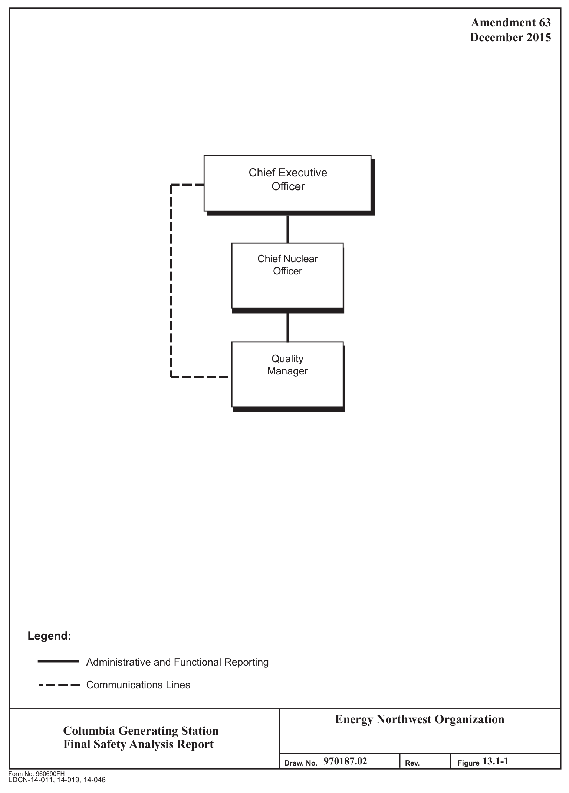

*figure on PDF page 25*

[Vector original (SVG, lossless): fig_page-25.svg](../figures/fig_page-25.svg)

<!-- labels/text on this figure page -->
Amendment 63 December 2015
Chief Executive r-- Officer
Chief Nuclear Officer
L----
Quality Manager
Legend:
Administrative and Functional Reporting
---- Communications Lines
Energy Northwest Organization Columbia Generating Station Final Safety Analysis Report I I 970187.02 13.1-1 Draw. No.
Rev. Figure Form No. 960690FH
LDCN-14-011, 14-019, 14-046

<!-- p.26 -->
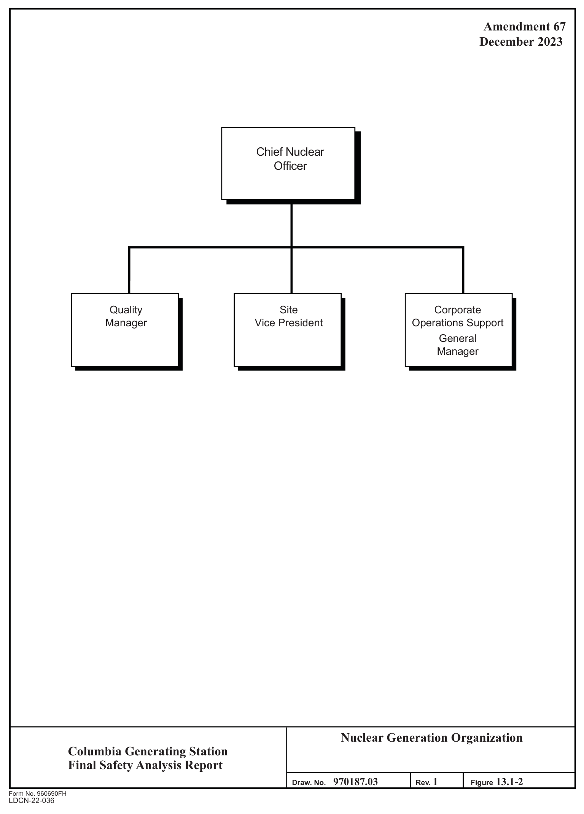

*figure on PDF page 26*

[Vector original (SVG, lossless): fig_page-26.svg](../figures/fig_page-26.svg)

<!-- labels/text on this figure page -->
Amendment 67 December 2023
Chief Nuclear Officer
Quality Site Corporate Manager Vice President Operations Support General Manager
Nuclear Generation Organization Columbia Generating Station Final Safety Analysis Report 970187.03 Rev. 1 13.1-2 Draw. No.
Figure Form No. 960690FH
LDCN-22-036

<!-- p.27 -->
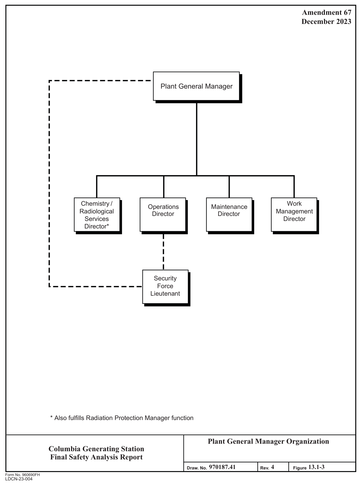

*figure on PDF page 27*

[Vector original (SVG, lossless): fig_page-27_2.svg](../figures/fig_page-27_2.svg)

<!-- labels/text on this figure page -->
Amendment 67 December 2023
Plant General Manager
Chemistry / Work Operations Maintenance Radiological Management Director Director Services Director Director*
Security Force Lieutenant
* Also fulfills Radiation Protection Manager function
Plant General Manager Organization Columbia Generating Station Final Safety Analysis Report 970187.41 4 13.1-3 Draw. No.
Rev. Figure Form No. 960690FH
LDCN-23-004

<!-- p.28 -->
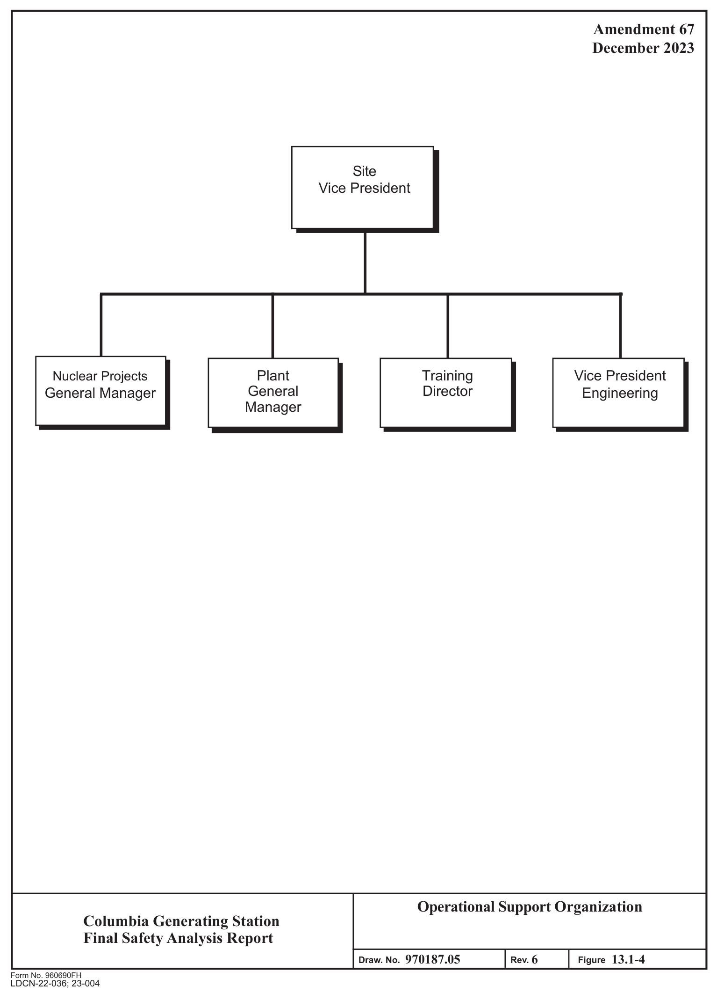

*figure on PDF page 28*

[Vector original (SVG, lossless): fig_page-28.svg](../figures/fig_page-28.svg)

<!-- labels/text on this figure page -->
Amendment 67 December 2023
Site Vice President
Plant Training Vice President Nuclear Projects General Director General Manager Engineering Manager
Operational Support Organization Columbia Generating Station Final Safety Analysis Report 970187.05 6 13.1-4 Draw. No.
Rev. Figure Form No. 960690FH LDCN-22-036; 23-004

<!-- p.29 -->
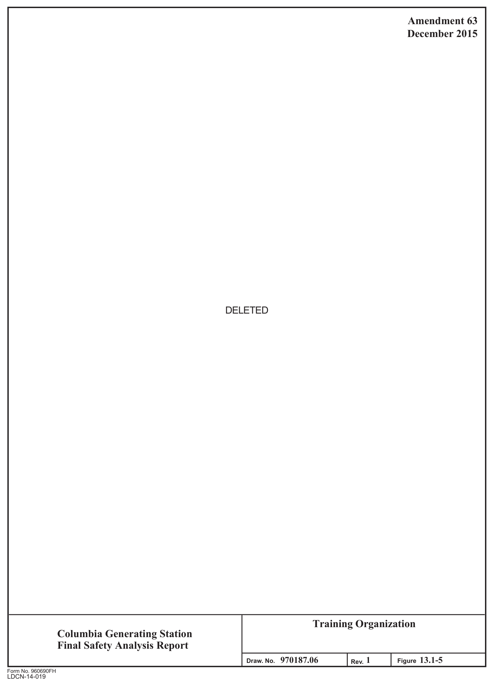

*figure on PDF page 29*

[Vector original (SVG, lossless): fig_page-29_3.svg](../figures/fig_page-29_3.svg)

<!-- labels/text on this figure page -->
Amendment 63 December 2015
DELETED
Training Organization Columbia Generating Station Final Safety Analysis Report I I 970187.06 1 13.1-5 Draw. No.
Figure Rev.
Form No. 960690FH
LDCN-14-019

<!-- p.30 -->
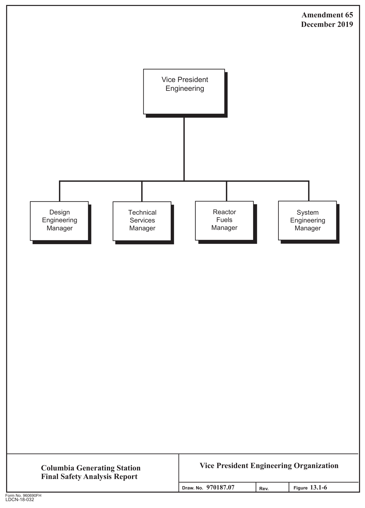

*figure on PDF page 30*

[Vector original (SVG, lossless): fig_page-30_4.svg](../figures/fig_page-30_4.svg)

<!-- labels/text on this figure page -->
Amendment 65 December 2019
Vice President Engineering
Reactor Technical Design System Fuels Services Engineering Engineering Manager Manager Manager Manager
Vice President Engineering Organization Columbia Generating Station Final Safety Analysis Report I 970187.07 13.1-6 Draw. No.
Figure Rev.
Form No. 960690FH
LDCN-18-032

<!-- p.31 -->
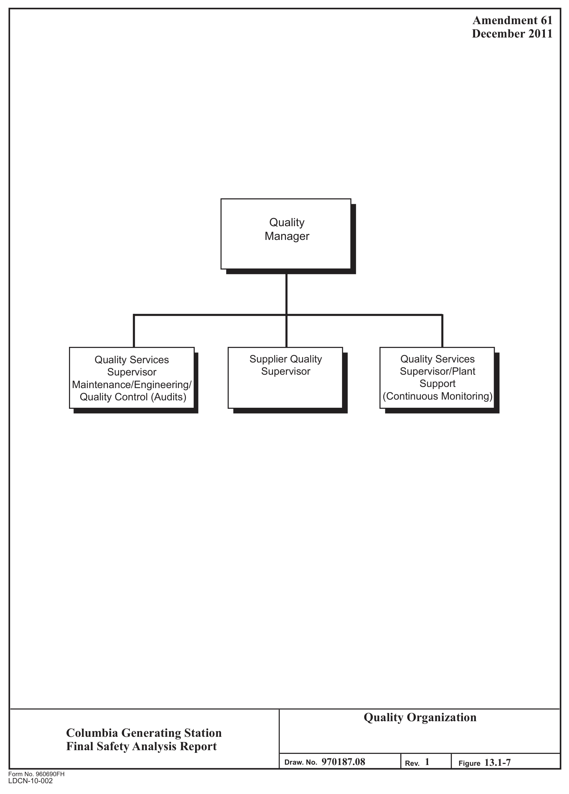

*figure on PDF page 31*

[Vector original (SVG, lossless): fig_page-31_4.svg](../figures/fig_page-31_4.svg)

<!-- labels/text on this figure page -->
Amendment 61 December 2011
Quality Manager
Supplier Quality Quality Services Quality Services Supervisor Supervisor/Plant Supervisor Support Maintenance/Engineering/
(Continuous Monitoring)
Quality Control (Audits)
Quality Organization Columbia Generating Station Final Safety Analysis Report I I 970187.08 1 13.1-7 Draw. No.
Rev. Figure Form No. 960690FH
LDCN-10-002

<!-- p.32 -->
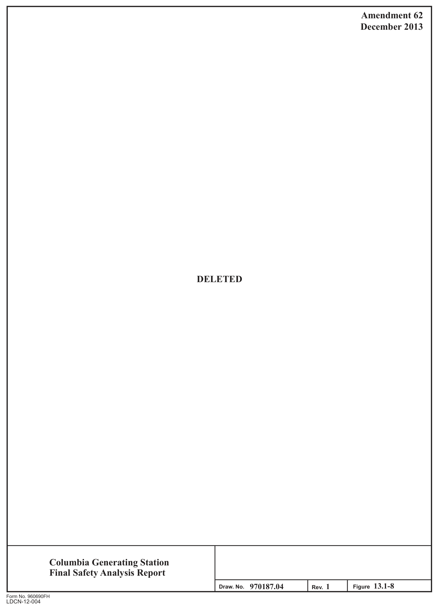

*figure on PDF page 32*

[Vector original (SVG, lossless): fig_page-32.svg](../figures/fig_page-32.svg)

<!-- labels/text on this figure page -->
Amendment 62 December 2013
DELETED
Columbia Generating Station Final Safety Analysis Report I I 13.1-8 970187.04 1 Draw. No.
Rev. Figure Form No. 960690FH
LDCN-12-004

<!-- p.33 -->
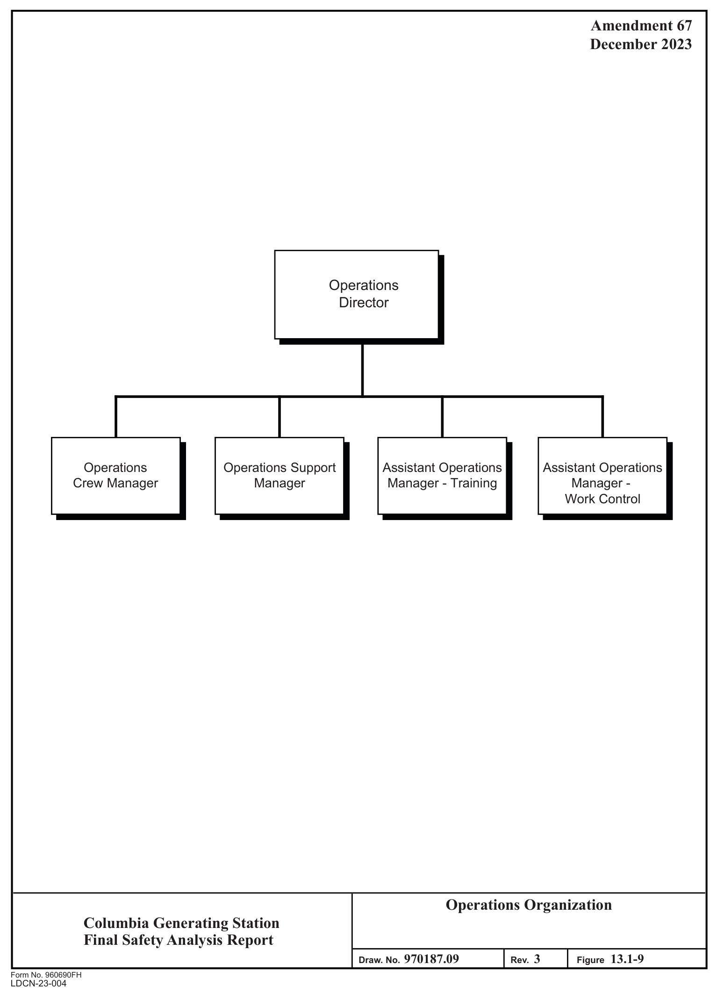

*figure on PDF page 33*

[Vector original (SVG, lossless): fig_page-33_2.svg](../figures/fig_page-33_2.svg)

<!-- labels/text on this figure page -->
Amendment 67 December 2023
Operations Director
Operations Operations Support Assistant Operations Assistant Operations Crew Manager Manager Manager - Training Manager - Work Control
Operations Organization Columbia Generating Station Final Safety Analysis Report 970187.09 3 13.1-9 Draw. No.
Rev. Figure Form No. 960690FH
LDCN-23-004

<!-- p.34 -->
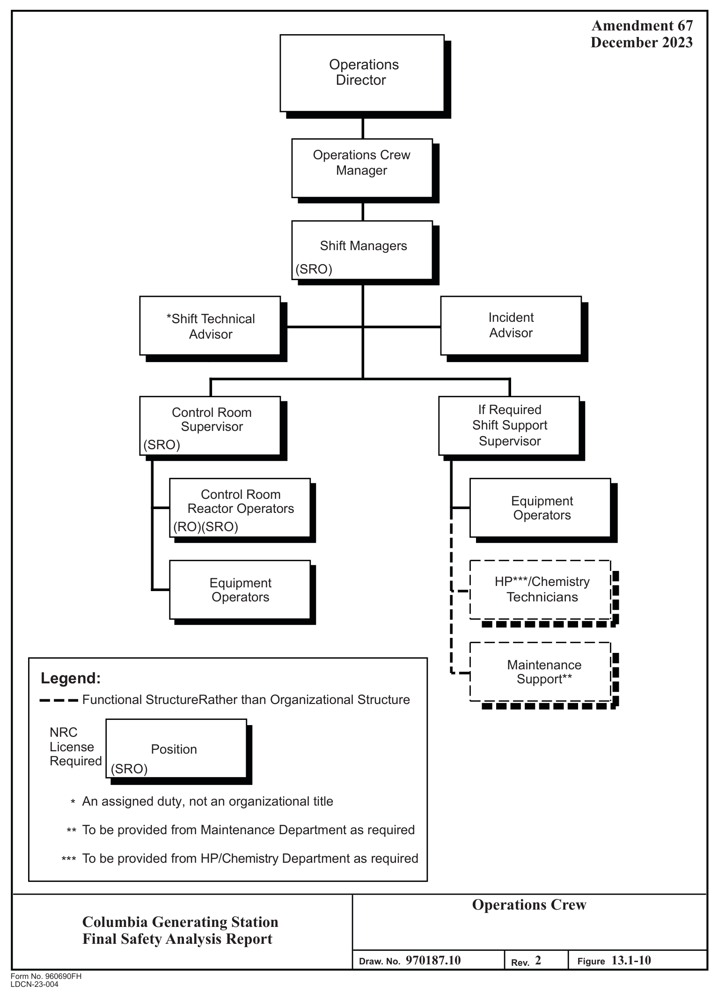

*figure on PDF page 34*

[Vector original (SVG, lossless): fig_page-34_2.svg](../figures/fig_page-34_2.svg)

<!-- labels/text on this figure page -->
Amendment 67 December 2023 Operations Director
Operations Crew Manager
Shift Managers
(SRO)
Incident *Shift Technical Advisor Advisor
If Required Control Room Shift Support Supervisor Supervisor
(SRO)
Control Room Equipment Reactor Operators Operators
(RO)(SRO)
HP***/Chemistry Equipment Technicians Operators
Maintenance Legend:
Support** Functional StructureRather than Organizational Structure
NRC License Position Required
(SRO)
An assigned duty, not an organizational title *
To be provided from Maintenance Department as required **
To be provided from HP/Chemistry Department as required ***
Operations Crew Columbia Generating Station Final Safety Analysis Report 970187.10 2 13.1-10 Draw. No.
Figure Rev.
Form No. 960690FH
LDCN-23-004

<!-- p.35 -->
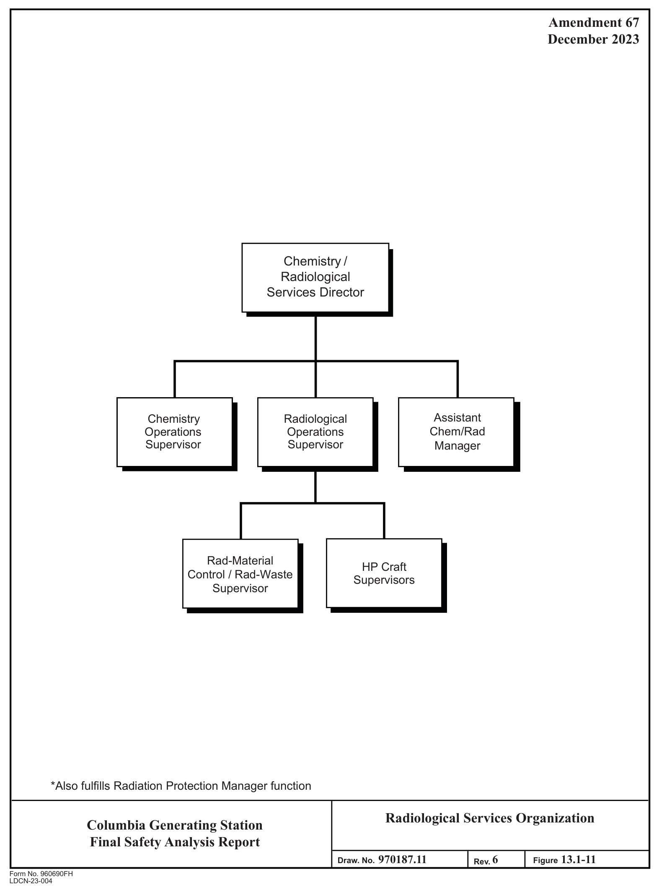

*figure on PDF page 35*

[Vector original (SVG, lossless): fig_page-35_2.svg](../figures/fig_page-35_2.svg)

<!-- labels/text on this figure page -->
Amendment 67 December 2023
Chemistry / Radiological Services Director
Assistant Chemistry Radiological Chem/Rad Operations Operations Supervisor Supervisor Manager
Rad-Material HP Craft Control / Rad-Waste Supervisors Supervisor
*Also fulfills Radiation Protection Manager function
Radiological Services Organization Columbia Generating Station Final Safety Analysis Report 970187.11 6 13.1-11 Draw. No.
Figure Rev.
Form No. 960690FH
LDCN-23-004

<!-- p.36 -->
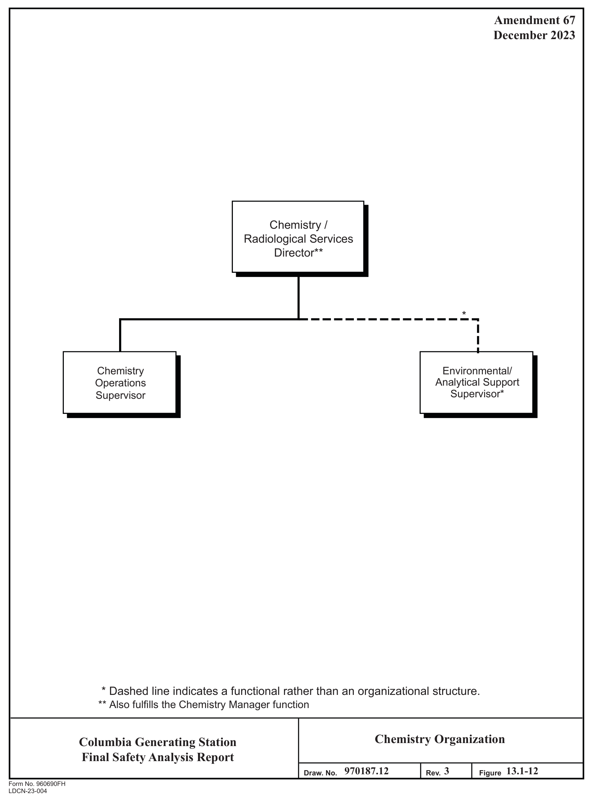

*figure on PDF page 36*

[Vector original (SVG, lossless): fig_page-36_2.svg](../figures/fig_page-36_2.svg)

<!-- labels/text on this figure page -->
Amendment 67 December 2023
Chemistry / Radiological Services Director**
*
Chemistry Environmental/ Analytical Support Operations Supervisor* Supervisor
* Dashed line indicates a functional rather than an organizational structure.
** Also fulfills the Chemistry Manager function
Chemistry Organization Columbia Generating Station Final Safety Analysis Report 970187.12 3 13.1-12 Draw. No.
Rev. Figure Form No. 960690FH
LDCN-23-004

<!-- p.37 -->
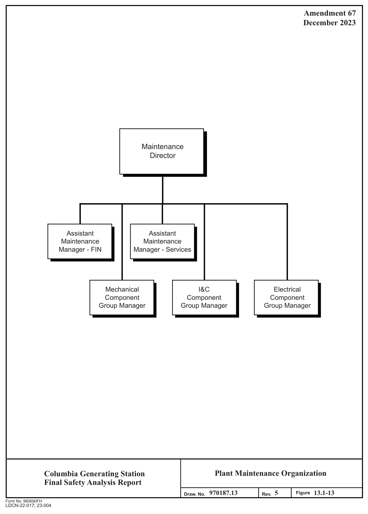

*figure on PDF page 37*

[Vector original (SVG, lossless): fig_page-37.svg](../figures/fig_page-37.svg)

<!-- labels/text on this figure page -->
Amendment 67 December 2023
Maintenance Director
Assistant Assistant Maintenance Maintenance Manager - FIN Manager - Services
Mechanical I&C Electrical Component Component Component Group Manager Group Manager Group Manager
Plant Maintenance Organization Columbia Generating Station Final Safety Analysis Report 970187.13 5 13.1-13 Figure Draw. No.
Rev.
Form No. 960690FH LDCN-22-017; 23-004

