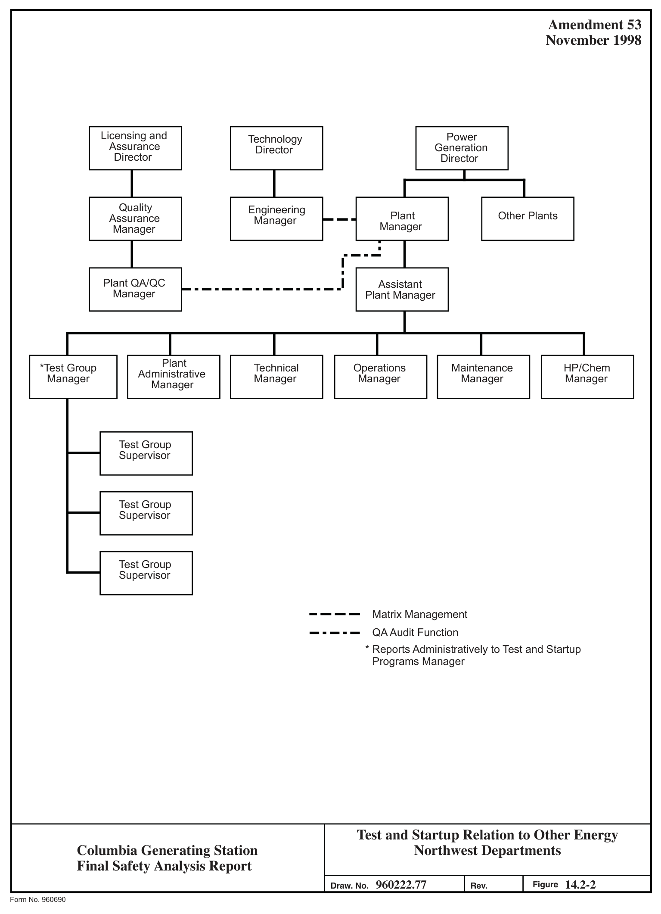
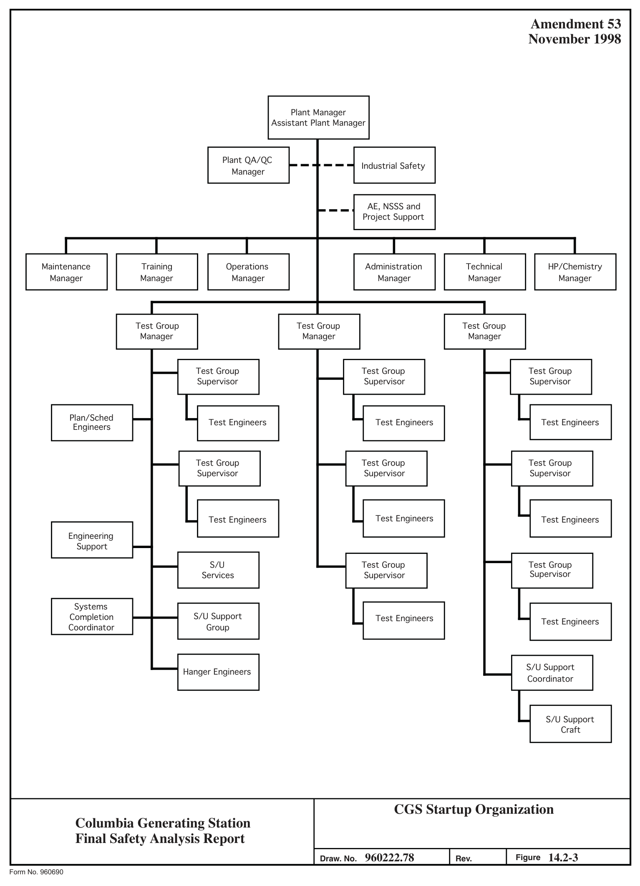
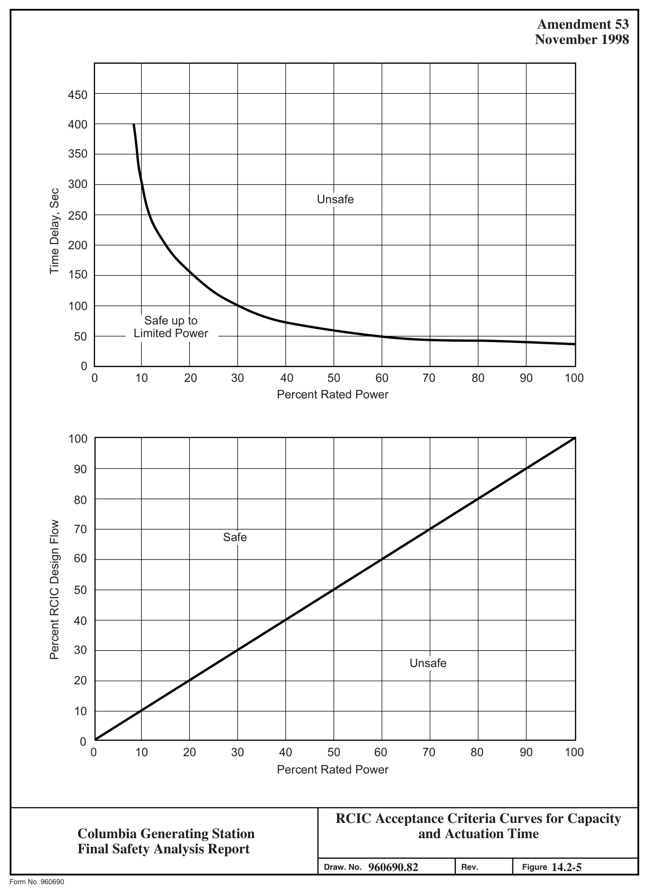
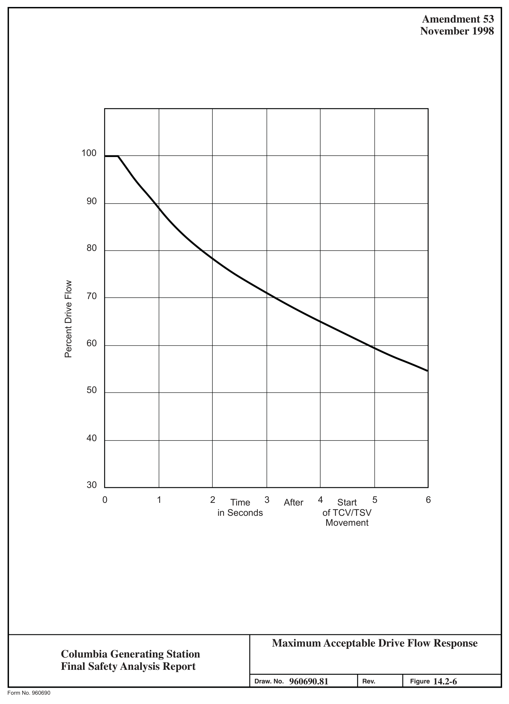

# 14.2 System Lineup, Preoperational, And Initial Startup Test

> Columbia Generating Station FSAR — Chapter 14: Initial Test Program
> Source: `14_chapter-3966-4121.pdf`, PDF pages 12–156 (of 156)
> Amendment 67 compilation (individual pages carry varying amendment dates)

---
<!-- p.12 -->
November 1998

### 14.2 SYSTEM LINEUP, PREOPERATIONAL, AND INITIAL STARTUP TEST
#### PROGRAM
The italicized information is historical and was provided to support the application for an operating license.

The initial test program consisted of a series of tests categorized as system lineup testing, preoperational, and initial startup tests. The system lineup testing determines correct installation and functional operability of equipment. Preoperational tests are those tests normally conducted prior to fuel loading to demonstrate the capability of plant systems to meet performance requirements. Initial startup tests began with fuel loading and demonstrated the capability of the integrated plant to meet performance requirements.

#### 14.2.1 SUMMARY OF TEST PROGRAM AND OBJECTIVES
##### 14.2.1.1 Initial Test Program Objectives
The objectives of the initial test program are to

a. Ensure that the construction is complete and acceptable,

b. Demonstrate the capability of structures, components, and systems to meet performance requirements,

c. Effect fuel loading in a safe manner,

d. Demonstrate, where practical, that the plant is capable of withstanding anticipated transients and postulated accidents,

e. Evaluate and demonstrate, to the extent possible, plant operating procedures to provide assurance that the operating group is knowledgeable about the plant and procedures and fully prepared to operate the facility in a safe manner, and

f. Bring the plant to rated capacity and sustained power operation.

##### 14.2.1.2 Initial Test Program Summaries
The three categories of tests in the initial test program are summarized below:

a. System lineup tests such as pump and valve tests, mechanical actuation to verify proper installation, and electrical continuity verifications, are those tests which demonstrate that components are correctly installed and operational.

<!-- p.13 -->
November 1998

b. Preoperational tests conducted prior to fuel loading to demonstrate that the plant systems have been properly designed and that they meet performance requirements.

c. Startup tests consist of fuel loading, precritical tests, low power tests, and power ascension tests that ensure fuel loading in a safe manner, confirm the design bases, demonstrate where practical that the plant is capable of withstanding the anticipated transients and postulated accidents, and ensure that the plant is safely brought to rated capacity and sustained power operation.

##### 14.2.1.3 Description of System Lineup Tests
Typical system lineup tests generally include but are not limited to the following:

a. Chemical cleaning and flushing of systems, tanks, and vessels,

b. Electrical equipment to test and/or energize, e.g., grounding, relays, circuit breaker operation and controls, continuity, megger, phasing, high potential measurements, and buses,

c. Initial adjustment, bumping, and running of rotating equipment,

d. Checking control and interlock functions of instruments, relays, and control devices,

e. Calibrating instruments and checking or setting initial trip setpoints,

f. Pneumatic testing of instruments and service air system and cleanout of lines,

g. Checking and adjusting relief and safety valves,

h. Complete tests of safety-related motor-operated valves including adjusting torque switches and limit switches, checking all interlocks and controls, measuring motor current and operating speed, and checking leaktightness of stem packing and valve seat during hydrotests; and complete tests of the nuclear steam supply system (NSSS) control systems including checking all interlocks and controls, adjusting limit switches, measuring operating speed, checking leaktightness of pneumatic operators, and checking for proper operation of controllers, pilot solenoids, etc., and

i. Other tests and verifications such as structural, leaktightness, and vibration.

<!-- p.14 -->
November 1998

##### 14.2.1.4 Description of Preoperational Tests
A listing of the preoperational tests is provided in Table 14.2-1. The general objectives of the preoperational test phase are as follows:

a. Ensure that test acceptance criteria are met,

b. Provide documentation of the performance and safety of equipment and systems,

c. Provide baseline test and operating data on equipment and systems for future reference,

d. Run-in of a system for a sufficient period so that any design, manufacturing, or installation defects can be detected and corrected,

e. Ensure that plant systems operate together on an integrated basis to the extent possible,

f. Give maximum opportunity to the permanent plant operating staff to obtain practical experience in the operation and maintenance of equipment and systems,

g. Establish safe and efficient normal, abnormal, and emergency operating procedures, to the extent possible,

h. Establish and evaluate surveillance testing procedures, and

i. Demonstrate that systems and safety equipment are operational and that it is possible to proceed to fuel loading and to the Startup Phase.

##### 14.2.1.5 Description of Startup Tests
The Power Ascension Test Phase (PATP) begins after the Preoperational Test Phase has been completed. The Power Ascension Test Phase begins with fuel loading and extends to commercial operation. This phase is subdivided into the following four parts:

a. Open vessel testing (fuel loading and shutdown power level tests), b. Initial heatup, c. Power testing, and d. Warranty demonstration.

The tests conducted during the Power Ascension Test Phase consist of major plant transients
(Table 14.2-2), stability tests (Table 14.2-3), and a remainder of tests which are directed

<!-- p.15 -->
April 2000

towards demonstrating correct performance of the nuclear boiler and numerous auxiliary plant systems while at power. Certain tests may be identified with more than one class of test.
Table 14.2-4 shows the complete Power Ascension Test Program. Figure 14.2-1 provides test conditions region definition.

The general objectives of the Power Ascension Test Phase are as follows:

a. Achieve an orderly and safe initial core loading,

b. Accomplish all testing and measurements necessary to determine that the approach to initial criticality and subsequent power ascension is safe and orderly,

c. Conduct low power physics tests sufficient to ensure that test acceptance criteria have been met,

d. Conduct initial heatup and hot functional testing so that hot integrated operation of all systems is shown to meet test acceptance criteria,

e. Conduct an orderly and safe power ascension program, with requisite physics and systems testing, to ensure that the plant operating at power meets test acceptance criteria, and

f. Conduct a successful warranty demonstration program.

#### 14.2.2 ORGANIZATION AND STAFFING
##### 14.2.2.1 General
The Energy Northwest Test and Startup Program is administered by two entities with distinct levels of responsibility and two distinct organizations.

For the system lineup test phase and the preoperational test phase, the Test Working Group
(TWG) provides review, approval, and planning of general Test and Startup Program activities and the results of those activities. The Test and Startup organization and qualified members of other organizations represented on the TWG provide the necessary development, implementation, and analysis of Test and Startup Program activities at the working level.

For the Power Ascension Test Phase, the Plant Operations Committee (POC) provides review and planning of the test program and evaluates the test results. The Plant Manager approves the procedures and final test reports. The implementation of the PATP is achieved with the normal plant operations crew operating the plant and test engineers under the direction of the Reactor Engineering Supervisor coordinating the test activities.

<!-- p.16 -->
April 2000

##### 14.2.2.2 Definitions
The definitions of phrases used in this section and throughout this chapter are as follows:

a. Test Working Group (TWG) - a project onsite administrative body whose membership consists of personnel representing organizations directly responsible for preparation and performance of testing and startup during the system lineup and preoperational test phases. This group provides review and approval of test preparation and performance activities.

b. Power Generation - an Energy Northwest organization within the Operations Directorate with responsibility for development and implementation of the Test and Startup Program.

c. Columbia Generating Station (CGS) Test and Startup - a Power Generation division with responsibility for development and implementation of the CGS Test and Startup Program.

d. CGS Plant Organization - a Power Generation division with responsibility to startup, operate, and maintain CGS in compliance with Federal, State, local, and owner requirements.

e. CGS Plant Operations Committee (POC) - refer to definition in Section 13.4.1.
The POC reviews the activities of the Power Ascension Test Phase.

f. Test and Startup Manager - the Power Generation Division Manager with responsibility for implementation of the CGS Test and Startup Program.

g. Test and Startup Program - the program that encompasses the transition from construction to commercial operation and consists of system lineup testing, preoperational testing, and power ascension testing.

h. Test and Startup Program Manual - the manual that defines generic administrative policy and procedures for the initial testing and startup of Energy Northwest nuclear facilities.

i. Test and Startup Instructions - the specific instructions required to implement the Test and Startup Program for an individual project.

j. Plant Procedure Manual (PPM) - the Plant Manager approved procedures for operating the plant. The PPMs include the test procedures for the PATP.

<!-- p.17 -->
April 2000

##### 14.2.2.3 Test and Startup Program Organization and the System Lineup and
Preoperational Test Program

###### 14.2.2.3.1 General
Power Generation is an organization within the Energy Northwest Operations Directorate.
Relative to the Program, Power Generation is responsible for development and administration of plans, policies, and administrative procedures; procurement of test equipment and other test-related resources, and assignment of the CGS Test and Startup Manager. The Power Generation organization and its relationship to other Energy Northwest organizations is shown in Figure 14.2-2.

###### 14.2.2.3.2 Responsibilities of CGS Test and Startup Division
CGS Test and Startup is a Division of the Power Generation organization. The CGS Test and Startup Manager manages an organization comprised of Energy Northwest test engineers and test technicians augmented by test personnel from the architect-engineer, the NSSS supplier, and others as contractually established. The CGS Test and Startup Manager is responsible for the development and implementation of the CGS Test and Startup program and those responsibilities are described in Section 14.2.2.3.3. The CGS Test and Startup staff organization is shown in Figure 14.2-3.

###### 14.2.2.3.3 CGS Test and Startup Department Position Responsibilities
###### 14.2.2.3.3.1 CGS Test and Startup Manager.

a. Chairman, TWG;

b. Develop plans, schedules, methods, procedures, and data systems for the testing and evaluation of all plant equipment and systems to permit acceptance and licensing;

c. Administer and coordinate the testing activities with other organizations involved in the Test and Startup Program;

d. Manage and direct assigned test personnel in activities relating to the attainment of Test and Startup Program objectives;

e. Manage and direct assigned test personnel to establish qualitative and quantitative acceptance criteria and develop test procedures to direct and guide performance of testing, and

<!-- p.18 -->
April 2000

f. Provide recommendations and effect actions to eliminate equipment or system deficiencies as determined by Test and Startup Program criteria which could adversely affect performance of safety-related functions.

###### 14.2.2.3.3.2 CGS Test Group Manager.

a. Represent Test and Startup on the TWG;

b. Coordinate the activities of Test Group Supervisors and test engineers during the Test and Startup Program;

c. Develop, monitor, and coordinate the preparation and implementation of plans, schedules, methods, and procedures for testing and evaluation of plant systems and components for verification of performance and acceptance;

d. Maintain surveillance over testing performed by Energy Northwest and others, including system and equipment tests, and calibration of instrumentation;

e. Identify problem areas and recommend actions where deficiencies could adversely affect the performance, safety-related functions, or operating efficiency;

f. Assist in preparation of program status and other Test and Startup Program related reports, and

g. Assume the responsibilities of the Test and Startup Manager as described in the Test and Startup Program Manual (TSPM) during his absence and all other responsibilities specifically delegated.

14.2.2.3.3.3 CGS Test Group Supervisor. Test Group Supervisors are assigned lead technical responsibility for testing. General Test Group Supervisors’ duties are as follows:

a. Supervise the activities of assigned test engineers;

b. Review and, where appropriate, approve test procedures, field changes to procedures and test results, and make recommendations to the Test Group Managers or Startup Manager, as appropriate;

c. Set schedules and priorities for assigned Test Engineers and assist them with problem resolution;

<!-- p.19 -->
April 2000

d. With other Test Group Supervisors and the Test Group Manager or Startup Manager, as appropriate, plan and coordinate startup activities and provide assistance;

e. Advise the Test Group Manager or Test and Startup, as appropriate, on all matters concerning testing within their group and if required, attend TWG meetings for this purpose;

f. Act for the Test Group Manager or Test and Startup Manager, as appropriate, when so delegated;

g. Prepare for and perform testing as required to support the Test and Startup Program;

h. Coordinate the identification and documentation of design problems and their resolution, and

i. Advise the Test Group Manager or Test and Startup Manager, as appropriate, regarding current and future manpower requirements impacting the testing effort.

14.2.2.3.3.4 CGS Test Engineers. Test engineers provide for the routine development and implementation of testing. General test engineer duties are as follows:

a. Prepare assigned test procedures,

b. Review tests and inspections prepared by others for application to assigned testing responsibilities,

c. Provide direction during performance of system and component testing, and

d. Identify problem areas and recommend actions where deficiencies could adversely affect performance of safety-related functions or operating efficiency.

##### 14.2.2.4 Plant Operations Organization and the Power Ascension Test Program
The PATP will be carried out by the plant operations organization using test procedures developed and approved according to the requirements of the PPM. The PATP procedures were prepared by members of the plant technical department under the supervision of the Reactor Engineering Supervisor. Technical expertise from other Energy Northwest organizations and from the General Electric Company (GE), the NSSS vendor, was used whenever necessary. Review of these procedures and scheduling of the test activities will be carried out by the POC and approved by the Plant Manager. The Reactor Engineering

<!-- p.20 -->
November 1998

Supervisor will direct the PATP test engineers in the completion of testing according to the POC schedule.

##### 14.2.2.5 Test Working Group
###### 14.2.2.5.1 System Lineup and Preoperational Test Program
The purpose of the TWG, a composite of representatives from organizations directly responsible for preparation, performance, and review of Test and Startup Program activities, is to provide a means for a coordinated review of all testing concerns and ensuring all obligations to the Test and Startup Program are met by the organizations represented.

The TWG provides review and approval of all activities proposed and the results thereof as appropriate. All decisions and approvals or recommendations of the group are included in the minutes of the meetings. Matters requiring approval by the TWG includes, but are not limited to

a. System lineup procedures, b. Preoperational test procedures, c. Changes to test procedures, and d. Results of testing.

###### 14.2.2.5.2 Membership and Responsibility of the Test Working Group
The TWG membership consist of organizations that have a direct support function for conduct or development of testing.

The CGS Test and Startup Manager is Chairman of the TWG and is responsible for convening and conducting TWG meetings on the administrative and technical content of program activities.

The Test Group Manager is responsible for providing a technical review of the proposed activities, technical documents, and their results. The Test Group Manager serves as Chairman during the absence of the Test and Startup Manager.

The CGS Plant Manager is responsible for providing an operational review of test documents and for submitting safety-related documents to the POC for review and for communicating the committee’s decisions to the TWG. The Plant Manager provides detailed plant operating procedures and surveillance procedures to be used for plant operation and testing during the Test and Startup Program system lineup and preoperational test phase.

<!-- p.21 -->
April 2000

The plant quality assurance representative to the TWG shall be responsible for review of proposed activities, test procedures, and test results as required by the Operational Quality Assurance Program Description (OQAPD).

The project engineering representative is responsible for obtaining a technical review of proposed activities and test documents by assigned project engineers and for providing a working relationship with Energy Northwest and architect-engineering organizations to aid resolution of testing concerns.

Conditional Members are representative of any organization having responsibility and/or expertise in the area of the TWG meeting agenda. In this situation the representative will be requested to attend the meeting by the TWG chairman.

##### 14.2.2.6 Plant Organization Functions and Responsibilities During All Testing and Plant
Operations

The plant organization has overall responsibility for the safe and efficient operation of plant systems and equipment, from provisional acceptance through commercial operation including responsibility for maintenance and operational control. Plant organization responsibilities in supporting the Test and Startup Program are discussed in Section 14.2.2.7.1.

The responsibility of the plant organization representative to the TWG is defined in Section 14.2.2.5.2.

##### 14.2.2.7 Energy Northwest Support of the Test and Startup Program
###### 14.2.2.7.1 Plant Organization
In addition to the responsibilities described in Section 14.2.2.6, the plant operating, technical, and maintenance sections provide manpower for development, implementation, and review of testing.

14.2.2.7.1.1 Support During Test and Startup Program Development. Assistance during the development of the Test and Startup Program is provided formally through the plant organization’s TWG representative and through the POC. Input to test procedures and other testing documentation by the plant staff ensures that

a. The operational requirements of the test procedures are based on the knowledge and experience of the operating staff,

b. The technical considerations receive the review of the Plant Technical Staff, and

<!-- p.22 -->
c. Important nuclear and operational safety considerations receive attention by the plant organization.

14.2.2.7.1.2 Support During Testing. Detailed review and analysis of system lineup and preoperational test results will be performed by the plant technical section and/or plant operations section where their particular expertise is deemed necessary by the plant representative to the TWG to support approvals of completed system lineup and preoperational tests.

Detailed review and analysis of PATP test results will be carried out by the test engineers of the plant operations technical department and will receive final review through the POC and final approval by the Plant Manager.

###### 14.2.2.7.2 CGS Program
The CGS Program Director is responsible for the performance of the organizations involved in the design, procurement, and construction of generating projects. The Program Director supports the Test and Startup Program by providing and implementing project control systems, project engineering services, and engineering support services.

The CGS Program Director supports the Test and Startup Program by maintaining a high level of current status information available to the startup program organizations to ensure that all startup program scheduling and preparation is based on an accurate assessment of the condition of systems and equipment being readied for testing. The Program Director provides liaison with Construction Management for the provision of construction craft support for the implementation of various system lineup and preoperational tests.

###### 14.2.2.7.3 Plant Quality Assurance
The functions of the plant Quality Assurance organization during the Test and Startup Program will be to survey ongoing efforts to determine that the controls required by various regulations, guides, and standards are effectively implemented. The activities of the TWG will be monitored to ensure that the proper degrees of control for safety-related activities are being maintained and that required activities are completed when they are prerequisite to another testing activity.

##### 14.2.2.8 Architect-Engineer Support of the Test and Startup Program
Burns and Roe, Inc., is responsible for providing engineering services required to ensure timely completion of construction testing and equipment turnover for provisional acceptance and system turnover. Burns and Roe also provides system-oriented engineers to assist the CGS Test and Startup Divisions, as requested by Energy Northwest technical direction and/or advice and consultation during system and component testing through preoperational testing.

<!-- p.23 -->
##### 14.2.2.9 General Electric Support of the Test and Startup Program
General Electric is the supplier of the boiling water reactor (BWR) NSSS for the CGS plant.
General Electric is responsible for generic and specific CGS designs and for the supply of the NSSS. During the construction phase of the plant cycle, the GE Resident Site Manager is responsible for all NSSS equipment disposition. When the startup testing phase of the project begins after fuel load, the responsibility of GE-NSSS activities are assigned to the Preoperational and Startup group. The GE Preoperational and Startup staff responsibilities are outlined below.

###### 14.2.2.9.1 Staff Responsibilities
14.2.2.9.1.1 General Electric Operations Manager. The GE Operations Manager is the senior NSSS vendor representative onsite at or near official fuel loading, and is the official site spokesman for GE for preoperational and startup testing concerns and requirements. The Operations Manager coordinates with the Startup Superintendent for the performance of his duties, which are as follows:

a. Reviewing all NSSS test procedures, including changes to test procedures, and test results as a conditional member of TWG and POC,

b. Providing technical direction to the station staff,

c. Managing the activities of the GE site personnel in providing technical direction to CGS personnel in the testing and operation of GE-supplied systems,

d. Providing liaison between the site and the GE San Jose home office to provide rapid and effective solution to problems that cannot be solved onsite,

e. Participating as a conditional member of the TWG when required, and

f. Reviewing test procedures for the POC.

14.2.2.9.1.2 General Electric Operations Superintendent. The GE Operations Superintendent is responsible to the GE Operations Manager for supervising the activities of GE Shift Superintendents. He works directly with the CGS Operations Manager in providing GE technical direction to the operating organization.

14.2.2.9.1.3 General Electric Shift Superintendents. The GE shift superintendents provide technical direction to CGS shift personnel in the testing and operation of GE-supplied systems.
They provide 24-hr per day shift coverage as required beginning with fuel loading. They report to the GE Operations Superintendent.

<!-- p.24 -->
14.2.2.9.1.4 General Electric Lead Engineer - Startup Test, Design, and Analysis. The GE lead engineer - Startup Test, Design, and Analysis, is responsible to the GE Operations Manager for supervising the GE shift engineers and for verifying core physics parameters and characteristics and documenting that performance of the NSSS and components conform to test acceptance criteria.

The lead engineer works with the CGS technical department to coordinate and effect implementation of the PATP instrumentation including special test equipment required to confirm these acceptance criteria.

##### 14.2.2.10 Qualifications of Personnel Supporting the Test and Startup Program
The qualifications described in this section are for those persons having authority to direct testing, review and approve test documentation and results, or otherwise have direct influence on the conduct of testing and quality of acquired data. Although other personnel, specifically GE, Burns and Roe, and Energy Northwest technical specialists, are also involved in these processes, they are under the direction of individuals whose qualifications are described herein and who review and approve all Test and Startup Program activities.

###### 14.2.2.10.1 Test and Startup Program Department Personnel Qualifications
a. At the time of appointment to the active position, the CGS Test and Startup Manager shall have 10 years of responsible thermal power plant experience such as, but not limited to, managerial, technical, or administrative positions, of which a minimum of 3 years shall be nuclear power plant experience.
A maximum of 4 years of the remaining 7 years of experience may be fulfilled by academic training on a one-to-one basis. This academic training shall be in engineering or the individual shall have acquired the experience and training normally required for examination by the NRC for a senior operator license whether or not the examination is taken.

b. Minimum qualifications for Test Group Manager are a B.S. degree in engineering or related field and 6 years of applicable experience, at least 3 of which are in testing or operation of nuclear power generation, propulsion, or similar scale test or production facilities. Related experience may be substituted for academic requirements when the candidate’s professional background and level of achievement clearly demonstrate capabilities to fill the position.
Previous preoperational testing experience is required. A good understanding of quality assurance and regulatory requirements and an ability to effectively communicate with others are necessities. A demonstrated technical leadership in his discipline and necessary work experience at the Test Group Supervisor or equivalent level is evidence of required proficiency.

<!-- p.25 -->
c. Minimum qualifications for Test Group Supervisor are a B.S. degree in engineering or related field and 5 years of applicable experience, at least 2 of which are in testing or operation of nuclear power generation, propulsion, or similar scale test or production facilities. Related experience may be substituted for academic requirements when the candidate’s professional background and level of achievement clearly demonstrate capabilities to fill the position.
Previous preoperational testing experience is required. A good understanding of quality assurance and regulatory requirements and an ability to effectively communicate with others are necessities. A demonstrated technical leadership in his discipline and necessary work experience at the Senior Test Engineer or equivalent level is evidence of required proficiency.

d. Minimum qualifications for a Test Engineer directing preoperational tests are a B.S. degree in engineering or related field or a graduate of a technical or vocational school in an engineering or related field and 2 years of related experience. Related experience above the required minimum may be substituted for academic requirements when the candidate’s record for performance clearly indicates the ability to fill the position without question. A good understanding of engineering principles and the ability to understand new concepts and to effectively communicate with others is a necessity.

Minimum requirements for a Test Engineer directing startup tests are a B.S.
degree in engineering or related field and 2 years of related experience or a graduate of a technical or vocational school in an engineering or related field, and 3 years of related experience. Related experience above the required minimum may be substituted for academic requirements when the candidate’s record for performance clearly indicates the ability to fill the position without question. A good understanding of engineering principles and the ability to understand new concepts and to effectively communicate with others is a necessity.

###### 14.2.2.10.2 Plant Organization Personnel Qualifications
Qualifications of some plant personnel are discussed in Section 13.1.3.

#### 14.2.3 TEST PROCEDURES
##### 14.2.3.1 Development of Test Procedures
Test Procedures are developed by the CGS Test and Startup or Plant Operations Department to provide a detailed method to demonstrate the capability of the system to perform its design function under anticipated operating and accident condition.

<!-- p.26 -->
General Electric Company as supplier of the NSSS provides test program specifications and instructions from which Energy Northwest prepares the preoperational and initial startup test procedures for systems supplied by GE.

Architect-Engineer and Vendors

Technical assistance is provided by Burns and Roe and vendor technical representatives as deemed necessary.

###### 14.2.3.1.1 Incorporation of Plant Procedures
The following program will be implemented at CGS to utilize and qualify plant operating procedures during testing.

a. Plant procedures required to support testing will have been prepared and approved before preoperational testing begins on the system using the best information available from the principal designer and responsible equipment suppliers.

b. Preoperational test procedures will use plant operating and emergency procedures as nearly as possible.

c. Using the results of preoperational testing, including the use-testing of plant procedures where practical, the plant procedures required to support startup testing will be updated and revised before startup testing of applicable systems.
Exceptions to this program will be those approved plant procedures required to be verified during the startup phase.

d. Startup test procedures will be developed using the results of preoperational testing and updated plant procedures.

###### 14.2.3.1.2 Format of Test Procedures
14.2.3.1.2.1 Preoperational Test Phase. The minimum content requirements for CGS Preoperational test procedures are specified in the Energy Northwest TSPM. The format for CGS test procedures is specified in the CGS TSPM. The resulting format and content is the following:

<!-- p.27 -->
a. Preoperational Test Procedure Format

1. Purpose

A concise description of the objectives of the test, including such test requirements as component functions to be checked and testing under normal or simulated conditions to verify readiness for system startup and operation, and system tests to confirm that the performance of the system is in compliance with all applicable design requirements.

2. Prerequisites

Provisions necessary for performance of the test. Conditions that should exist prior to start of the test. Instructions given to identify required operational status of the plant and interfacing systems, environmental conditions, and individual component status requirements, including verification of the following:

(a) Components and systems being tested have been turned over and open deficiencies will not affect the performance of the test,

(b) System lineup testing on components, included in the test, is complete,

(c) Necessary support systems are available, and

(d) For control system testing, the other principal control systems are in appropriate operating modes for the given test conditions.

3. Limits and Precautions

Special precautions required for safety of personnel and equipment or needed to ensure a meaningful test and satisfactory performance of testing.

4. Special Equipment

A list of special material and equipment for the performance of the test.

5. Procedure

A step by step procedure for performing the test. Plant operating procedures will be utilized whenever practicable for the operation of

<!-- p.28 -->
systems and equipment during testing and for returning the system to normal after completion of testing. Abnormal procedures will be utilized as required to supplement normal plant operating procedures. Data collection will be part of the procedure steps.

6. Restoration

Includes those steps necessary to return the system to a normal operating or tagged status. This may include removal of special test instruments, temporary equipment, electrical jumpers, valve lineups, etc.

7. Acceptance Criteria

The criteria against which the success or failure of the test will be judged must be identified. In some instances, these will be qualitative criteria, e.g., given event does or does not occur. In other cases, quantitative values can be designated as acceptance criteria.

(a) All quantitative acceptance criteria shall include suitable tolerances, and

(b) A readily apparent correlation should exist to cross-reference among procedure steps, data, and acceptance criteria.

8. References

A listing of all material required for the preparation and performance of the test. This should include piping and instrumentation drawings, electrical elementary drawings, vendor instruction manuals, applicable FSAR sections, contract specifications, and applicable codes, standards or guides, and applicable plant procedures.

###### 14.2.3.1.2.2 Power Ascension Test Phase. All PATP procedures will be formatted according to the PPM.

##### 14.2.3.2 Review of Test Procedures
Each member of the TWG ensures test procedures will provide for review with respect to that member’s organizational area of responsibility. Power ascension test procedures will be reviewed by the POC.

Comments submitted by TWG members will be evaluated by the TWG and the test procedure revised accordingly. After discussion of the resulting version, the decision to reject, accept, or

<!-- p.29 -->
accept with modification, will be obtained by consensus of the membership of the TWG. In the event the TWG cannot reach a consensus, the Chairman shall provide resolution or a method for resolving the issue to the appropriate division management for review and concurrence.

The results of the POC review of PATP will be approved by the Plant Manager.

The qualifications of the individuals or organization representatives reviewing test procedures are described in Section 14.2.2.10.

The administrative procedures governing the test procedure review process are contained in the CGS TSPM. These procedures cover the mechanism for review and comment resolution, documentation of this review, and method of indication for the review status of a test procedure.

##### 14.2.3.3 Approval of Test Procedures
Test procedures will be approved by the TWG Chairman by means of consensus of the TWG membership after review of the test procedure as described in Section 14.2.3.2. Power ascension test procedures will be reviewed by the POC in a similar manner.

Individual test procedures will be approved by the chairman of the TWG or POC/Plant Manager, as appropriate. The consensus of the two committees were contained in the meeting minutes.

The administrative procedures governing the exercise of approval of test procedures are contained in the CGS TSPM or the PPM.

#### 14.2.4 CONDUCT OF TEST PROGRAM
##### 14.2.4.1 Administrative Procedures for Preoperational Testing
###### 14.2.4.1.1 Test Performance Authorization
A significant period of time may have elapsed between the time a preoperational test procedure was approved and the time a test is performed. The test procedure is therefore reviewed just prior to initiating the test. Any changes in the system since original approval of the test procedure will be thoroughly researched and the test procedure revised and approved in accordance with Sections 14.2.3.2 and 14.2.3.3. The CGS Test and Startup Manager will then approve the test procedure for performance of the test.

<!-- p.30 -->
###### 14.2.4.1.2 Preoperational Test Prerequisites
Approval by the Test and Startup Manager to perform a preoperational test also requires consideration of the prerequisite testing required to qualify components and systems for operation. In general, completion of the system lineup testing (see Section 14.2.1.3) will qualify the system for preoperational testing. System lineup testing, as a prerequisite to preoperational testing, includes the following:

a. Instrumentation and protective relay checks, including calibration, setpoint adjustments, logic verification, and line checks;

b. Component operability checks, including valve stroking, motor rotation, ventilation system balancing, rotating equipment run-in and pipe support inspection and adjustment;

c. Flushing, including proof flushes, flow instrumentation response, and pump performance and capacity checks;

d. Electric component and system checks, including breaker trip setpoints; and

e. Hydrostatic or pneumatic pressure tests and systems where dynamic testing, such as pump runs, are required to allow performance of pressure tests.
Pressure integrity tests are otherwise performed during construction testing.

Verification that required system lineup tests have been or can be successfully completed prior to preoperational testing is performed by the respective test group manager prior to recommending turnover of a system or component from a contractor to Energy Northwest.
Verification that the system is actually ready for preoperational testing will be performed as described in Section 14.2.4.3.

###### 14.2.4.1.3 Conduct of Preoperational Testing
a. Implementation responsibilities for scheduling all tests are assigned to the CGS Test and Startup Manager. The TWG will be kept informed of the scheduled activities.

b. The satisfaction of prerequisites to commencement of the test, as indicated in the test procedure, will be verified by the test engineer prior to performance of the test.

c. The assigned test engineer is responsible for directing the performance of each test. Testing is performed in direct coordination between the test engineer and shift supervision.

<!-- p.31 -->
d. All testing will be conducted in accordance with approved test procedures. If, during the performance of a test the procedure is unacceptable, the test engineer can propose changes by use of a “Test Change Notice” (see Section 14.2.4.4).
This provided both documentation of the change and confirmation by the TWG.

e. All test data will be entered on or attached to the record copy of the test procedure.

###### 14.2.4.1.4 Deficiency Reporting
Deficiencies or discrepancies identified during testing will be reported individually as described in Section 14.2.5.2.

Corrective action or satisfactory disposition shall be taken on all deficiencies and discrepancies in equipment and procedures prior to final approval of the preoperational test results. All deficiencies or discrepancies identified during the test, or which have not been resolved on completion of the test, will be recorded in the record copy of the preoperational test.

###### 14.2.4.1.5 Equipment Maintenance and Modifications During Preoperational Testing
Modifications or repair to safety-related systems will be implemented as a result of a formal system of problem and deviation reporting. Disposition of problems requiring mechanical or electrical changes or repairs by contractors will be implemented by work requests.

a. Startup Problem Reports (SPR), Startup Deficiency Reports (SDR), and Startup Work Requests (SWR) are administered through closed-loop procedural controls to ensure resolutions. A completed SPR, SDR, and SWR is approved for closure by the respective Test Group Manager.

b. Startup Problem Reports are used to report design deficiencies and are coordinated by the Energy Northwest project engineering organization for resolution by the responsible design organization or qualified alternate. The SPRs are reviewed by engineering and a Project Engineering Directive (PED) is issued to define plant modifications or changes that are required. An SWR is then issued to perform the plant modification by contractor personnel or an SDR is issued to defer the work or have it performed by startup personnel.

c. Startup Deficiency Reports (SDR) are used to report and track non-design-related deficiencies. If required, an SWR will be issued to perform the repair work to resolve the non-design-related deficiency by contractor personnel. Work accomplished by startup personnel can be accomplished by the SDR without issuing an SWR.

<!-- p.32 -->
d. Retest requirements will be identified on the SWR or SDR and attached to, or referenced by the work request number in test files.

e. Startup Problem Reports, SDR, SWR, design change documentation, retest results, and procurement records for safety-related systems will be filed in assembled packages or with appropriate cross-referencing for retrievability.

###### 14.2.4.1.6 Preoperational Test Summary
During the preoperational test, the test engineer will prepare a test report which includes a summary of the conduct of the test, evaluation of the test results with reference to the acceptance criteria, and a description of problems encountered and corrective actions taken or proposed. This report will be attached to the record copy of the test.

###### 14.2.4.1.7 Evaluation of Preoperational Test Data
On completion of the test, a copy of the official test procedure, data, the test summary, and other applicable attachments will be transmitted to each member of the TWG responsible for review.

###### 14.2.4.1.8 Preoperational Test Records
The Test and Startup Manager will maintain all official test records (the copy of the test procedure containing the original test data and signatures and all attachments) until completion of the test program. See Section 14.2.6 for details of the test records handling and retention program.

##### 14.2.4.2 Administrative Procedures for Power Ascension Testing
###### 14.2.4.2.1 Plant Operation During Power Ascension Testing
During initial startup tests and operations, the plant procedures are followed except as specifically modified by approved test procedures. In addition, special safety precautions and limitations are included in the test procedures. Approved test procedures will be used to control test conditions outside of the Technical Specifications limits where allowed for test purposes.

Certain individual tests or power escalations may require authorization by both the POC and the Plant Manager immediately prior to implementation and will be so identified in the applicable test procedure.

<!-- p.33 -->
The final authority to start or continue a test is the responsibility of the Shift Manager after all previous approvals have been exercised. Testing is performed in direct coordination between the test engineer and Shift Manager.

###### 14.2.4.2.2 Power Ascension Test Scheduling and Sequencing
Scheduling and sequencing of testing during startup is performed under the direction of the Plant Manager by POC.

The startup or power ascension test sequence is described in terms of individual test evolutions and specific power plateaus due to interfaces with other simultaneous tests, requirements for continuous data review, and plant administrative requirements for authorization to proceed or continue. The test sequence identifies hold points for data review and authorization to proceed and establishes the general plant conditions for each group of tests.

###### 14.2.4.2.3 Power Ascension Test Performance
Before starting each test, the assigned shift test engineer will review the test procedure to ensure that prerequisite activities of conditions have been satisfied as described in Section 14.2.4.3.

The test will be stopped or curtailed if it cannot be performed safely or in accordance with the approved test procedure. Required test procedure deviations or changes may be effected in accordance with PPM 1.2.3, “Use of Plant Procedures,” as described in Section 14.2.4.4.2.

Should apparent deviations of test results from performance requirements or acceptance criteria be revealed, or should other apparent anomalies develop, the plant will be placed in a safe condition and relevant test data will be reviewed by the test engineer and Shift Manager.
If the apparent discrepancy or anomaly is substantiated, the situation will be reviewed by the POC to ascertain if a plant safety question is involved. Control of any identified nonconformance or noncompliance will be in accordance with the plant administrative procedures.

Evaluation of the effect of the discrepancy or anomaly on plant safety will be performed at the appropriate level of review, and appropriate corrective actions will be taken before resumption of the test or test conditions at which the problem was revealed.

At the completion of an entire test procedure, the test engineer will assemble all of the data and supporting information, nonconformance documentation, and test results evaluations for review by the POC. Any data reduction or analysis required will be done as soon after the data is available as is practical so that the results of the analysis may be included in the complete test package.

<!-- p.34 -->
Test records will be maintained as described in Section 14.2.6.

##### 14.2.4.3 Control of Test Prerequisites
Conditions and activities prerequisite to a given test will be identified in the applicable test procedure. Prior to commencement of the particular test, the test engineer will verify that the identified prerequisites have been satisfied. The verifications will be recorded and retained as part of the test record.

The test engineer will verify that

a. The test procedure has been approved by the appropriate committee and Plant Manager, Test and Startup Manager, or Startup Superintendent as required.
The test procedure is compatible with the latest versions of material referenced in the test procedure;

b. The record copy of the test procedure is identical to that contained in the master file or PPM, including the latest TWG/POC approved revisions or test procedure field changes (see Section 14.2.4.4);

c. Prerequisite tests have been completed. If TWG and/or Plant Manager approval of a completed test is also a prerequisite, that approval will have been obtained;

d. The test procedure has been made available for shift operator review and familiarization. Operator support has been scheduled, as necessary;

e. Test equipment is available or in place as required. Calibration or other readiness requirements have been completed. System instrumentation to be used in the test has been calibrated within the required time period established for surveillance testing and/or preventative maintenance; and

f. Test and operating personnel involved in the performance of the test have been briefed immediately prior to starting the test.

##### 14.2.4.4 Modification of Test Procedures During Testing
###### 14.2.4.4.1 System Lineup and Preoperational Test Phase
The TSPM provides a means of controlling modifications to TWG-approved test procedures during testing. This administrative procedure, contained in the CGS TSPM, applies to changes made to an approved test procedure during preoperational and startup testing. The procedure does not apply to revisions made during the preparation of test procedures.

<!-- p.35 -->
The procedure provides control of revisions which change the intent or the acceptance criteria of the test procedure.

The required changes, when identified by the responsible test engineer, are described on a special form (Test Change Notice/Procedure Deviation Form) which identifies the affected test procedure or plant procedure, justifies the change, and contains spaces for the appropriate approvals. The Test Change Notice forms became a permanent part of the test record.

A Test Change Notice for a preoperational test is reviewed by the TWG and approved by the Test and Startup Manger, TWG Chairman.

###### 14.2.4.4.2 Power Ascension Test Phase
All test procedure details or changes must be made in accordance with PPM 1.2.3, “Use of Plant Procedures.” This process requires documentation on the required forms, signatures of authorized individuals, and subsequent full POC review. The PPM 1.2.3 forms became a permanent part of the test record.

#### 14.2.5 REVIEW, EVALUATION, AND APPROVAL OF TEST RESULTS
##### 14.2.5.1 Control of Test Results Review
The individuals responsible for reviewing the results of particular tests will be designated by the POC or the Test and Startup Manager. These reviews will be obtained through TWG or POC members in accordance with their represented areas of responsibility. TWG members will provide names of individuals in their represented organizations who meet the requirements of Regulatory Guide 1.58, Revision 0, for evaluation of inspection and test results.

Based on the recommendations of the qualified reviewers, the completed preoperational test will be approved by the TWG. Plant Operating Committee review and Plant Manager approval of power ascension test results is required.

##### 14.2.5.2 Design Organization Participation in Problem Resolution
Failures of tests to meet acceptance criteria and other problems discovered in the course of testing will be documented as deficiencies in accordance with the requirements of the TSPM for System Lineup and Preoperational Tests and in accordance with PPM 1.3.12, “Plant Nonconformances,” for the power ascension tests. Reports of such deficiencies will indicate the parties or organizations deemed responsible for providing an acceptable resolution of the deficiency. The responsible organization will be requested to provide a resolution of the defined problem.

<!-- p.36 -->
Documentation of the final resolution will include the recommendation of the responsible organization and a description of the measures implemented in accordance with that recommendation. Design problems will require resolution by the appropriate Energy Northwest Technical Division Department, Project Engineering, Plant Technical Staff, or original design organization, depending on the technical nature of the problem.

##### 14.2.5.3 Results Analysis Prerequisites to Continuation of Startup Testing
The POC will establish prerequisites for various tests, test conditions, and test phases in consideration of system or component qualification for subsequent testing. The control or prerequisites to an individual test will be as described in Section 14.2.4.3.

The POC will also require an evaluation of the data acquired during a particular test phase or plateau. The items considered in this evaluation will include, but are not limited to the following:

a. The need for additional testing or retesting to improve assurance that a particular system or component will perform as required in subsequent testing, especially under more demanding conditions such as higher power levels,

b. The need for analysis of certain data to qualify measured variables or parameters for use in subsequent measurements,

c. The completeness of testing up to the point in question as evidenced by the documentation of the completed tests, and

d. The need for specific reviews and approvals of particular sets of data to satisfy the above.

#### 14.2.6 TEST RECORDS
##### 14.2.6.1 System Lineup and Preoperational Test Phase
###### 14.2.6.1.1 General
The TSPM contains a generic procedure regarding filing and recordkeeping to be applied to testing documentation. This procedure is intended to ensure compliance of Energy Northwest project startup programs with the applicable provisions of ANS N45.2.9-1974, “Requirements for Collection, Storage, and Maintenance of Nuclear Power Plant Quality Assurance Records,” as required by Regulatory Guide 1.88, Revision 1, December 1975.

The following sections describe the provisions of the aforementioned procedure, which will be contained in specific detail in the CGS Test and Startup Instructions.

<!-- p.37 -->
###### 14.2.6.1.2 Test Record Responsibilities
The Test and Startup Manager is responsible for identifying the responsibilities, controls, and requirements for establishing and implementing a Test and Startup Program filing and recordkeeping system, in accordance with 10 CFR 50 Appendix B, ANSI N45.2.9, and the Energy Northwest Quality Assurance Program Manual. The Test and Startup Manager will ensure that adequate procedures are prepared and maintained within the Test and Startup Instructions. The Test and Startup Manager will ensure that trained and qualified personnel maintain the Test and Startup Program files.

###### 14.2.6.1.3 Types of Documents and Records Requiring Test Record File Retention
Documentation and records that will be maintained within Test and Startup Program files are:

a. Test and Startup program records as specified by ANSI N45.2.9, and

b. All records and documents as specified by the Test and Startup Program and instruction manuals.

Other records, documents, correspondence, etc., may be maintained at the discretion and approval of the Startup Program Manager, provided their access requirements do not compromise the security of the mandatory files.

##### 14.2.6.2 Power Ascension Test Phase
All test records and data shall be kept and filed in accordance with the PPM 1.6 series of procedures which detail the requirements for all plant recordkeeping.

#### 14.2.7 CONFORMANCE OF TEST PROGRAMS WITH REGULATORY GUIDES
##### 14.2.7.1 Conformance with Regulatory Guide 1.68
The CGS Test and Startup Program conforms to the requirements of Regulatory Guide 1.68, Revision 0, “Preoperational and Initial Startup Test Programs for Water-Cooled Power Reactors,” except where specifically noted otherwise. The Regulatory Guide has been reviewed by Energy Northwest for applicability of individual items in the guide to CGS and its systems. The applicability to this plant has determined the nature and scope of testing to be performed. Actual exceptions to the testing required by this guide have been specifically addressed and are discussed in Section 14.2.7.2. Areas where the guide does not apply are not considered to be exceptions.

<!-- p.38 -->
##### 14.2.7.2 Exceptions to Regulatory Guide 1.68
The exceptions to Regulatory Guide 1.68 are listed below with an explanation of the justification for the exception.

a. Exception to Format of Test Procedures

The format of the test procedures is different from that found in Appendix C of Regulatory Guide 1.68, but the format difference is not considered an exception to the regulatory guide since the guide specifies required elements of a test procedure while merely implying but not requiring a format.

b. See Section 1.8.2 for a delineation of specific exceptions to the requirements of Regulatory Guide 1.68.

##### 14.2.7.3 Conformance With or Exceptions to Regulatory Guides Other Than 1.68
a. Regulatory Guide 1.70, “Standard Format and Content of Safety Analysis Reports for Nuclear Power Plants” will be complied with for the section that pertains to the Test and Startup Program,

b. Regulatory Guide 1.33, “Quality Assurance Program Requirements” will be complied with in “Quality Assurance During the Operations Phase,” Section 17.2, of the FSAR for the Test and Startup Program,

c. All other regulatory guides pertaining to individual testing will be complied with unless noted otherwise in Section 14.2.12, and

d. Regulatory Guide 1.58 “Qualifications of Nuclear Power Plant Inspection, Examination, and Testing Personnel.” Energy Northwest Test and Startup personnel involved in testing meet the requirements of Regulatory Guide 1.58.

#### 14.2.8 UTILIZATION OF REACTOR OPERATING AND TESTING EXPERIENCES IN
#### THE DEVELOPMENT OF THE TEST PROGRAM
As a matter of Energy Northwest policy, a continuous program of review of reactor operating experience is coordinated by the Operations Division of Energy Northwest. The sources of information reviewed in compliance with this policy are NRC Information Notices and Bulletins, operating experience reports, preoperational test summaries and startup reports from other plants, administrative and test procedures from other plants’ startup programs, personal contacts with other nuclear plant licensees or applicants, and additional information supplied by Energy Northwest Technical and Operations Division members. All available sources are

<!-- p.39 -->
utilized; relevance to particular Energy Northwest nuclear projects is determined in the review process.

The information is reviewed by CGS Startup Program personnel for applicability to the CGS Test and Startup Program, for incorporation into test procedures, or for consideration in the administrative control of testing.

#### 14.2.9 TRIAL USE OF PLANT OPERATING AND EMERGENCY PROCEDURES
To the extent practical throughout the preoperational and initial PATP, test procedures utilize operating, emergency, and abnormal procedures where applicable in the performance of tests.
The use of these procedures is intended to do the following:

a. Prove the specific procedure or illustrate changes which may be required, b. Provide training of plant personnel in the use of these procedures, and c. Increase the level of knowledge of plant personnel on the systems being tested.

Test procedures may use operating, emergency, and abnormal procedures in several ways: the test procedure may reference the procedure directly; the test procedure may extract a series of steps from the procedure; the test procedure may use a combination of the first two methods; or the test procedure may require system and plant conditions that will be obtained by the use of plant operating or emergency procedures.

#### 14.2.10 INITIAL FUEL LOADING AND INITIAL CRITICALITY
##### 14.2.10.1 Fuel Loading and Shutdown Power Level Tests
Fuel loading and initial criticality is conducted in accordance with written procedures after all prerequisite tests are satisfactorily completed and an operating license has been issued. Prior to approving fuel loading, the plant must be verified as ready to load fuel. This verification is accomplished by the following steps, which are performed at the completion of a majority of the preoperational testing.

###### 14.2.10.1.1 Loss of Power Demonstration-Standby Core Cooling Required
This test demonstrates the capability of each emergency diesel generator to start automatically and assumes all of its emergency core cooling loads in a loss of normal auxiliary power.

###### 14.2.10.1.2 Cold Functional Testing
The cold functional testing defined here is an integrated system operation of various plant systems that can be operated as systems prior to fuel loading. The intent is to observe any unexpected operational problems from either an equipment or a procedural source and to

<!-- p.40 -->
provide an opportunity for operator familiarizations with the system-operating procedures under operating conditions.

Some of the cold functional testing will be accomplished during the preoperational test program. For example, integrated and simultaneous operation of the following systems may take place during the flush of the total system: condensate system, condensate demineralizer system, low-pressure coolant injection (LPCI) system, core spray system, reactor water cleanup (RWCU) system, service water system, closed cooling water (RCC) system, and others.
As required, additional integrated systems performance will be demonstrated prior to fuel loading.

###### 14.2.10.1.3 Routine Surveillance Testing
Because of the interval between completion of a preoperational test on a system and the requirement for that system to be operated may be of considerable length, a number of routine surveillance tests must be performed prior to fuel loading and must be repeated on a routine basis. The Technical Specifications described the test frequency. In general, this Surveillance Test Program (specified in the Technical Specifications) is instituted prior to fuel loading by the plant operating staff.

###### 14.2.10.1.4 Master Startup Checklist
A detailed list of items that must be complete, including the preoperational tests, work requests, design changes, and proper dispositioning of all exceptions noted during preoperational testing listed in Table 14.2-1 is rechecked to verify completion just prior to the final approvals for fuel loading and at each significant new step such as heat up, opening main steam isolation valves (MSIVs), and power operation.

###### 14.2.10.1.5 Initial Fuel Loading
Fuel loading requires the movement of the full core complement of assemblies from the fuel pool to the core, with each assembly identified by number before being placed in the correct coordinate position. The procedure controlling this movement is arranged so that shutdown margin and subcritical checks are made at predetermined intervals throughout the loading, thus ensuring safe loading increments. Specially sensitive invessel neutron monitors that are maintained at the loading face as loading progresses serve to provide indication for the shutdown margin measurements, and also to allow the recording of the core flux level as each assembly is added. A complete check is made of the fully loaded core to ascertain that all assemblies are properly installed, correctly oriented, and are occupying their designated positions.

<!-- p.41 -->
###### 14.2.10.1.6 Zero Power Level Tests
At this point in the program, a number of tests are conducted which are best described as initial zero power level tests. Chemical and radiochemical tests are made to check the quality of the reactor water before fuel is loaded, and to establish base and background levels required to facilitate later analysis and instrument calibrations. Plant and site radiation surveys are made at specific locations for later comparison with the values obtained at the subsequent operating power levels. Shutdown margin checks are repeated for the fully loaded core, and criticality is achieved with each of the two prescribed rod sequences in turn, the data being recorded for each rod withdrawn. Each rod drive is subjected to scram and performance testing. The initial setting of the intermediate range monitors (IRMs) is at maximum gain.

##### 14.2.10.2 Initial Heatup to Rated Temperature and Pressure
Heatup follows the satisfactory completion of the fuel loading and zero power level tests
(Sections 14.2.10.1.5 and 14.2.10.1.6) and further checks are made of coolant chemistry together with radiation surveys at the selected plant locations. All control rod drives (CRDs)
are scram-timed at rated temperature and pressure, with selected drives timed at two intermediate reactor pressures and for different accumulator pressures. The process computer checkout continues as more process variables become available for input. The reactor core isolation cooling (RCIC) system will complete controlled starts at low reactor pressure and at rated conditions, with testing in the quick-start mode at 150 psig and 1000 psig. Correlations are obtained between reactor vessel temperatures at several locations and the values of other process variables as heatup continues. The movements of NSSS piping in the drywell mainly as a function of expansion are recorded for comparison with design data.

##### 14.2.10.3 Power Testing From 25% to 100% of Rated Output
The power test phase comprises the following tests, many of which are repeated several times at the different test levels; consequently, see Table 14.2-4 for the series. While a certain basic order of testing is maintained relative to power ascension, there is, nevertheless, considerable flexibility in the test sequence at a particular power level which may be used whenever it becomes operationally expedient. In no instance, however, is nuclear safety compromised.

a. Coolant chemistry tests and radiation surveys are made at each principal test level to preserve a safe and efficient power increase,

b. Selected CRDs are scram-timed at various power levels to provide a correlation with the initial data,

c. The effect of control rod movement on other parameters (e.g., electrical output, steam flow, and neutron flux level) is examined for different power conditions,

<!-- p.42 -->
d. Following the first reasonable, accurate heat balance (25% power) the average power range monitors (APRMs) are calibrated and IRMs are reset if necessary,

e. At each major power level (25%, 60%, and 100%), the local power range monitors (LPRMs) are calibrated,

f. The APRMs are calibrated initially at each new power level and following LPRM calibration,

g. Completion of the process computer checkout is made for all variables, and the various options are compared with hand calculations as soon as significant power levels are available,

h. Further tests of the RCIC are made with and without injection into the reactor pressure vessel (RPV),

i. Collection of data from the system expansion tests is completed for those piping systems which had not previously reached full operating temperatures,

j. The axial and radial power profiles are explored fully by means of the traversing in-core probe (TIP) system at representative power levels during the power ascension, and

k. Core performance evaluations are made at all test points above the 10% power level and for selected flow transient conditions; the work involves the determination of core thermal power, maximum fuel rod surface heat flux, and minimum critical power ratio (MCPR), and other thermal parameters.

l. Overall plant stability in relation to minor perturbations is shown by the following group of tests which are made at selected test points:

1. Core power-void mode response,
2. Pressure regulator setpoint change,
3. Water level setpoint change, 4. Turbine valve surveillance, and 5. Recirculation flow setpoint change.

For the first of these tests, a centrally located control rod is moved and the flux response is noted on a selected LPRM chamber. The next two tests require that the changes made should approximate as closely as possible a step change in demand, while for the next test the turbine stop, control, and bypass valves are opened to verify stability and power level for surveillance testing. The remaining test is performed to properly adjust the control loop of the

<!-- p.43 -->
recirculation system. For all of these tests the plant performance is monitored by recording the transient behavior of numerous process variables, the one of principal interest being neutron flux. Other imposed transients are produced by step changes in demand core flow, partial loss of feedwater heating, and simulating failure of the operating pressure regulator to permit takeover by the backup regulator. Table 14.2-3 shows the power and flow levels at which all these stability tests are performed.

m. The category of major plant transients includes full closure of all the MSIVs, fast closure of turbine generator control valves, fast closure of turbine generator stop valves, loss of the main generator and offsite power, tripping a feedwater pump, and several trips of the recirculation pumps. The plant transient behavior is recorded for each test and the results may be compared with the acceptance criteria and the predicted design performance. Table 14.2-2 shows the operating test condition for all the proposed major transients;

n. A test is made of the relief valves in which leaktightness and general operability are demonstrated;

o. At some major power levels the jet pump flow instrumentation is calibrated;

p. The as-built characteristics of the recirculation system are investigated as soon as operating conditions permit full core flow; and

q. The local control loop performance, based on the drive pump, jet pumps, and control equipment is checked.

#### 14.2.11 TEST PROGRAM SCHEDULE
The test program schedule for preoperational and startup tests are indicated in Table 14.2-4 and Figure 14.2-4. These schedules are preliminary and will be adjusted to consider actual construction and testing progress; they are included to provide general information but are not considered to be identical to the schedules in use during the startup program. The test procedures will be made available for review at least 30 days prior to the test date or fuel load.

#### 14.2.12 INDIVIDUAL TEST DESCRIPTIONS
##### 14.2.12.1 Preoperational Test Procedures
The following general descriptions are the specific objectives of each preoperational test.
During the final construction phase, it may be necessary to modify the preoperational test methods as operating and preoperational test procedures are developed. Consequently, methods described in the following descriptions are general, not specific.

<!-- p.44 -->
Specific acceptance criteria for each preoperational test are in accordance with the detailed system and equipment specifications for equipment in those systems. The tests demonstrate that the installed equipment and systems perform within the limits of these specifications.

In addition to the prerequisites listed on each on the following preoperational tests, there will be electrical power available to each of the systems.

Table 14.2-1 lists the preoperational tests anticipated for this facility.

###### 14.2.12.1.1 Reactor Feedwater System Preoperational Test
a. Purpose

To verify the operation of the reactor feedwater system, including pumps, valves, turbines, turbine auxiliaries, and turbine control systems.

b. Prerequisites

The system lineup tests have been completed, the TWG has reviewed and approved the procedure, and the Test and Startup Manager has approved the initiation of testing. The condensate system, control air system, and service water system must have a readiness verification.

c. General Test Methods and Acceptance Criteria

The performance of the reactor feedwater system is verified within the limitations of the auxiliary steam supply by the demonstration of the proper operation of the following:

1. Valves and related controls, interlocks, and position indicators,
2. Reactor feedwater pumps, turbines, and auxiliaries,
3. Control logic, and 4. Annuciators and protective devices.

###### 14.2.12.1.2 Condensate System Preoperational Test
a. Purpose

To verify the operation of the condensate system, including pumps, valves, and control systems.

<!-- p.45 -->
b. Prerequisites

The system lineup tests have been completed, the TWG has reviewed and approved the procedure, and the Test and Startup Manager has approved the initiation of testing. The condenser, condensate filter demineralizers, feedwater, and control air systems are capable of supporting this test as necessary.

c. General Test Methods and Acceptance Criteria

The performance of the condensate system is verified by the demonstration of the proper operation of the following:

1. Valves and related controls, interlocks, and positions indicators,
2. Condensate pumps, condensate booster pumps and auxiliaries,
3. Control logic, and 4. Annuciators and protective devices.

###### 14.2.12.1.3 Fire Protection System Preoperational Test
a. Purpose

To verify the operation of the fire protection system including the diesel engine, pumps, valves, detection and alarm circuits, and control and instrumentation circuits. To verify the location and status of all portable equipment.

b. Prerequisites

The system lineup tests have been completed, the TWG has reviewed and approved the procedure, and the Test and Startup Manager has approved the initiation of testing. The circulating water system, control and service air system, and electrical distribution system are available to support operation.

c. General Test Methods and Acceptance Criteria

Verification of the fire protection system capability is demonstrated by the proper integrated operation of the following:

1. Diesel engine and pump operation and related control and logic,
2. Fire alarm and detection circuits,
3. Fire control panel in the main control room, 4. Deluge, wet pipe and preaction sprinkler systems, and 5. Carbon dioxide and Halon systems.

<!-- p.46 -->
In addition, portable equipment and hose station capability will be verified.

###### 14.2.12.1.4 Reactor Water Cleanup System Preoperational Test
a. Purpose

To verify the operation of the RWCU system, including pumps, valves, and filter/demineralizer equipment.

b. Prerequisites

The system lineup tests have been completed, the TWG has reviewed and approved the procedure, and the Test and Startup Manager has approved the initiation of testing. Filter aid, and anion and cation resin should be available.
The RCC system and instrument air system must have readiness verification.

c. General Test Methods and Acceptance Criteria

Verification of the RWCU system capability is demonstrated by the proper integrated operation of the following:

1. Drain flow regulator flow interlocks,
2. System isolation and logic,
3. Valve-operating sequence, 4. Pump operation and related control and logic, 5. Annuciators, and 6. Filter/demineralizer system operation.

###### 14.2.12.1.5 Standby Liquid Control System Preoperational Test
a. Purpose

To verify the operation of the standby liquid control (SLC) system including pumps, tanks, control, logic, and instrumentation.

b. Prerequisites

The system lineup tests have been completed, the TWG has reviewed and approved the procedure, and the Test and Startup Manager has approved the initiation of testing. Valves should be previously bench tested and other precautions relative to positive displacement pumps taken. The reactor vessel should be available for injecting demineralized water.

<!-- p.47 -->
c. General Test Methods and Acceptance Criteria

Verification of the SLC system capability is demonstrated by the proper integrated operations of the following:

1. SLC system tank level instrumentation,
2. Heaters,
3. Alarms and logic, 4. Relief valves, 5. Pumps and related controls and logic, and 6. Flow testing with different flow paths.

###### 14.2.12.1.6 Nuclear Boiler System Preoperational Test
a. Purpose

To verify proper operation of the nuclear boiler system including safety/relief valves (SRVs) and related controls and logic.

b. Prerequisites

The system lineup tests have been completed, the TWG has reviewed and approved the procedure, and the Test and Startup Manager has approved the initiation of testing. Verify that all SRVs have been previously bench tested.

c. General Test Methods and Acceptance Criteria

Functional and capacity tests of SRVs are not performed; verification of the NSSS capability is demonstrated by the proper integrated operation of the following:

1. System valves and related sensors and logic,
2. Vacuum breaker in relief valve discharge lines,
3. Automatic isolation function of reactor water sample isolation valves, 4. Isolation and leak detection systems, 5. Automatic depressurization system logic, 6. Reactor vessel actuators accumulator capacity test, 7. Safety/relief valves air piston operation, 8. Reactor head seal leak detection, and 9. Alarms and annunciators.

<!-- p.48 -->
###### 14.2.12.1.7 Residual Heat Removal System Preoperational Test
a. Purpose

To verify the operation of the residual heat removal (RHR) system under its various modes of operation: LPCI, shutdown cooling and vessel head spray, containment spray, and suppression pool water cooling.

b. Prerequisites

The system lineup tests have been completed, the TWG has reviewed and approved the procedure, and the Test and Startup Manager has approved the initiation of testing. The RHR service water system must have readiness verification. The reactor vessel and recirculation loops shall be intact and capable of receiving water.

c. General Test Methods and Acceptance Criteria

Verification of the RHR system capability is demonstrated by the proper integrated operation of the following:

1. System isolation valve control and logic tests,

2. RHR and RHR service water pump and motor operation, controls, and related logic features,

3. Automatic LPCI initiation logic,

4. Verification of all flow paths. The time from initiation signal to full flow should be verified, and

5. Alarms and annunciators.

###### 14.2.12.1.8 Reactor Core Isolation Cooling System Preoperational Test
a. Purpose

To verify the operation of the RCIC system including turbine, pump, valves, instrumentation, and control.

<!-- p.49 -->
b. Prerequisites

The system lineup tests have been completed, the TWG has reviewed and approved the procedure, and the Test and Startup Manager has approved the initiation of testing. The turbine, disconnected from the pump, shall be tested.
The turbine instruction manual shall be reviewed in detail in order that precautions relative to turbine operation are followed. Then the system shall be tested within the capability of a temporary steam supply with the pump coupled to the turbine.

c. General Test Methods and Acceptance Criteria

1. All valves and related controls, interlocks, and indicators,
2. Manual and automatic initiation,
3. Automatic isolation, including leak detection system logic, 4. Turbine speed control, trip, mode selection, and test mode, 5. Barometric condenser condensate pump, and vacuum pump controls, 6. Flow path verification, and 7. Annunciators.

###### 14.2.12.1.9 Reactor Recirculation System and Control Preoperational Test
a. Purpose

To verify the operation of the reactor recirculation system including pumps and their associated motors, valves, instrumentation, and controls. The rated conditions tests will be conducted during the startup testing program.

b. Prerequisites

The system lineup tests have been completed, the TWG has reviewed and approved the procedure, and the Test and Startup Manager has approved the initiation of testing. The RCC system must receive readiness verification. All required testing of equipment up to the operation of the recirculation pump has been completed, including recirculation pump motor (uncoupled) and all control loops.

c. General Test Methods and Acceptance Criteria

After prerequisite testing, verification of system capability is demonstrated by the proper integrated operation of the following:

1. System valves,

<!-- p.50 -->
2. Logic and interlocks,
3. Recirculation pumps, valves, and related controls and interlocks, 4. Annunciators, and 5. Low frequency motor generator (LFMG) set.

###### 14.2.12.1.10 Reactor Manual Control System Preoperational Test
a. Purpose

To verify the operation of the reactor manual control (RMC) system, including relays, control circuitry, switches and indicating lights, and control valves.

b. Prerequisites

The system lineup tests have been completed, the TWG has reviewed and approved the procedure, and the Test and Startup Manager has approved the initiation of testing. The CRD pump will not be operational during this test.

c. General Test Methods and Acceptance Criteria

Verification of RMC system capability is demonstrated by the proper integrated operation of the following:

1. Rod blocks, alarms, and interlocks for all modes of the reactor mode switch,

2. Rod position information system,

3. Rod drift alarm circuit, and

4. Rod directional control valve time sequence for insert and withdraw commands.

###### 14.2.12.1.11 Control Rod Drive Hydraulic System Preoperational Test
a. Purpose

To verify the operation of the CRD hydraulic system including CRD mechanisms, hydraulic control units, hydraulic power supply, instrumentation, and controls.

<!-- p.51 -->
b. Prerequisites

The system lineup tests have been completed, the TWG has reviewed and approved the procedure, and the Test and Startup Manager has approved the initiation of testing. The CRD manual control system preoperational test must be completed on associated CRDs. The RCC system and instrument air system must receive readiness verification.

c. General Test Methods and Acceptance Criteria

Verification of CRD system capability is demonstrated by the proper integrated operation of the following:

1. Logic and interlocks,

2. CRD pumps and related controls and interlocks,

3. Flow controller, pressure control valves, and stabilizer valves,

4. Scram discharge level switches and CRD position indication, alarms, and interlocks,

5. CRDs functional testing including latching and position indication,

6. Scram testing of control rods at atmospheric pressure, and

7. Annunciators.

###### 14.2.12.1.12 Fuel Handling and Vessel Servicing Equipment Preoperational Test
a. Purpose

To verify the operation of the fuel handling and vessel servicing equipment including tools used in the servicing of control rods, fuel assemblies, LPRMs and dry tubes, and vacuum cleaning equipment.

b. Prerequisites

The system lineup tests have been completed, the TWG has reviewed and approved the procedure, and the Test and Startup Manager has approved the initiation of testing. Additionally, the refueling platform, fuel preparation machine, and fuel racks must be installed and operational; all slings and lifting devices must be certified at their design load, at least by the vendor.

<!-- p.52 -->
c. General Test Methods and Acceptance Criteria

Verification of the fuel handling and vessel servicing equipment is demonstrated by dry operation of the following equipment:

1. Cell disassembly tools,

2. Channel replacement tools,

3. Instrument handling tools,

4. Vacuum cleaning equipment,

5. Interlocks and logic associated with the refueling and service platform are verified, and

6. Proper operation of refueling and service platforms are verified.

###### 14.2.12.1.13 Low-Pressure Core Spray System Preoperational Test
a. Purpose

To verify the operation of the low-pressure core spray system (LPCS), including spray pumps, sparger ring, spray nozzles, controls, valves, and instrumentation.

b. Prerequisites

The system lineup tests have been completed, the TWG has reviewed and approved the procedure, and the Test and Startup Manager has approved the initiation of testing. The reactor vessel must be available and ready to receive water.

c. General Test Methods and Acceptance Criteria

Verification of the LPCS system capability is demonstrated by the proper integrated operation of the following:

1. Logic and interlocks,

2. Low-pressure core spray system pumps, including auto initiation,

<!-- p.53 -->
3. Flow path verification, including determination of system hydraulic performance to verify proper sizing of restricting orifice in LPCS discharge line to vessel (see Section 6.3.2.2.3),

4. Annunciators,

5. The time for initiation signal to full flow should be verified, and

6. Photographs to prove acceptability of core spray patterns.

###### 14.2.12.1.14 High-Pressure Core Spray System Preoperational Test
a. Purpose

To verify the operation of the high-pressure core spray (HPCS) system, including diesel generator and related auxiliary equipment, pumps, valves, instrumentation, and control.

b. Prerequisites

The system lineup tests have been completed, the TWG has reviewed and approved the procedure, and the Test and Startup Manager has approved the initiation of testing. The HPCS diesel generator must be installed and be operational.

c. General Test Methods and Acceptance Criteria

Verification of HPCS system capability is demonstrated by the proper integrated operation of the following:

1. Valve controls and interlocks,

2. HPCS electrical system tests, including dc and ac,

3. HPCS diesel generator functional tests including starting, rated load, load rejection,

4. Pump and motor tests with normal power supply and with diesel generator,

5. HPCS flow path and flow rate verification,

6. Annunciators,

<!-- p.54 -->
7. The time from initiation signal to full flow should be verified, and

8. Photographs to prove acceptability of HPCS spray pattern.

###### 14.2.12.1.15 Fuel Pool Cooling and Cleanup System Preoperational Test
a. Purpose

To verify the operation of the fuel pool cooling and cleanup system including the pumps, heat exchangers, controls, valves, and instrumentation.

b. Prerequisites

The system lineup tests have been completed, the TWG has reviewed and approved the procedure, and the Test and Startup Manager has approved the initiation of testing. The instrument air, service air, fuel pool emergency makeup, service water, and RHR systems must be available.

c. General Test Methods and Acceptance Criteria

Verification of the fuel pool system capability is demonstrated by the integrated operation of the following:

1. Logic and interlocks,
2. Interconnection to RHR system,
3. Pump operation and related controls, 4. Cleanup subsystem operation, and 5. Annunciators.

###### 14.2.12.1.16 Leak Detection System Preoperational Test
a. Purpose

To summarize the test requirements and verify the leak detection test data for each of the nuclear systems.

b. Prerequisites

The system lineup tests have been completed, the TWG has reviewed and approved the procedure, and the Test and Startup Manager has approved the initiation of testing. The prerequisites are included in the preoperational test specifications for each of the nuclear systems listed below.

<!-- p.55 -->
c. General Test Methods and Acceptance Criteria

As an integral part of each of the following system preoperational tests, the nuclear systems leak detection is verified by the proper operation of the leak detection features of the following nuclear systems:

1. Feedwater control system,
2. RWCU system,
3. NSSS, 4. RHR system, 5. RCIC system, 6. Recirculation system, and 7. Radwaste system.

###### 14.2.12.1.17 Liquid and Solid Radwaste System Preoperational Test
a. Purpose

To verify that the radioactive waste system will perform its design functions of processing liquid and solid radioactive wastes.

b. Prerequisites

The system lineup tests have been completed, the TWG has reviewed and approved the procedure, and the Test and Startup Manager has approved the initiation of testing.

c. General Test Methods and Acceptance Criteria

Testing will demonstrate that the pumps, tanks, controls, and valves including automatic isolation, diversion and protection features, and instrumentation and alarms will operate and function in accordance with design requirements.

Testing will also verify that the CGS Process Control Program results in an acceptable waste form as required by 10 CFR 61. Simulated waste will be verified to form a free-standing monolithic solid with no free liquid prior to implementation of the solidification process on radioactive waste. Liners containing solidified waste will be inspected prior to shipment to the disposal site to verify compliance with 10 CFR 61 requirements.

<!-- p.56 -->
###### 14.2.12.1.18 Reactor Protection System Preoperational Test
a. Purpose

To verify the proper operation of the reactor protection system (RPS), including sensor logic and their respective scram relays, scram reset time delay, the annunciators, and motor generator set power supply.

b. Prerequisites

The system lineup tests have been completed, the TWG has reviewed and approved the procedure, and the Test and Startup Manager has approved the initiation of testing.

c. General Test Methods and Acceptance Criteria

Verification of the RPS capability is demonstrated by the proper integrated operation of the following:

1. Motor generator set performance,

2. Sensor logic and scram relay logic,

3. Scram reset time delay,

4. Sensors input-to-scram trip actuator response time on all channels of each function for which response times are required by the Technical Specifications,

5. Annunciators,

6. Mode switch tests, and

7. Auxiliary sensor operation.

The ability of the system to scram the reactor within a specified time must be demonstrated in the CRD hydraulic system preoperational test (see Section 14.2.12.1.11).

<!-- p.57 -->
###### 14.2.12.1.19 Neutron Monitoring System Preoperational Test
a. Purpose

To verify the operation of the neutron monitoring system (NMS) including startup, intermediate, and power range detectors, and their related equipment.

b. Prerequisites

The system lineup tests have been complete, the TWG has reviewed and approved the procedure, and the Test and Startup Manager has approved the initiation of testing. Additionally, all source range monitors (SRMs) and pulse preamplifiers, IRMs and voltage preamplifiers, and APRMs will have been calibrated according to the vendor’s instructions.

c. General Test Methods and Acceptance Criteria

Verification of the NMS capability is demonstrated by the proper integrated operation of the following:

1. All SRM detectors, and their respective insert and retract mechanisms, and cables;

2. SRM channel including pulse preamp, remote meter and record, trip logic, logic bypass and related lamps and annunciators, control system interlocks, refueling instrument trips, and power supply;

3. All IRM detectors and their respective insert and retract mechanisms and cables;

4. IRM channels including voltage preamps, remote recorders, RMC system interlocks, RPS trips, annunciators and lamps, and power supplies;

5. All LPRM detectors and their respective cables, and power supplies;

6. All APRM channels including trips, trip bypasses, annunciators and lamps, remote recorders, RMC system interlocks, RPS trips, and power supplies;

7. Recirculation flow bias signal including flow unit, flow transmitters, and related annunciators, interlocks, and power supplies, and

<!-- p.58 -->
8. Both rod block monitor (RBM) channels including trips, trip bypasses, annunciators and lamps, remote recorders, RMC system interlocks, and power supplies.

###### 14.2.12.1.20 Traversing In-Core Probe System Preoperational Test
a. Purpose

To verify the operation of the traversing in-core probe (TIP) system including the TIP detector, controls and interlocks, containment secure lamp, and containment isolation circuits.

b. Prerequisites

The system lineup tests have been completed, the TWG has reviewed and approved the procedure, and the Test and Startup Manager has approved the initiation of testing. (Additionally, the TIP detector and dummy detector, ball valve time delay, core top and bottom limits, clutch, x-y recorder, and purge system will have been shown to be operational.)

c. General Test Methods and Acceptance Criteria

With the exception of the shear valve, which is not tested, verification of the TIP system is demonstrated by the proper integrated operation of the following:

1. Indexer cross-calibration interlock,

2. Shear valve control monitor lamp, and

3. Drive motor manual control and override, automatic control and stop, and low speed control.

###### 14.2.12.1.21 Rod Worth Minimizer System Preoperational Test
a. Purpose

To verify the operation of the rod worth minimizer (RWM) system under its various modes of operation.

b. Prerequisites

The system lineup tests have been completed, the TWG has reviewed and approved the procedure, and the Test and Startup Manager has approved the

<!-- p.59 -->
initiation of testing. Additionally, the rod position indication system (RPIS) will have been shown to be operational, rod sequence control (RSC) system bypassed, and computer diagnostic and special tests completed.

c. General Test Methods and Acceptance Criteria

Verification of the RWM system is demonstrated by the proper integrated operation of the following:

1. Rod test option,

2. System initialization both above and below the low power setpoints, and above and below the low power alarm points,

3. RWM program,

4. Rod withdrawal and insertion error block, and

5. Rod drift scan, and annunciation.

The RWM program acceptance of an operator-supplied rod position value must be demonstrated.

###### 14.2.12.1.22 Process Radiation Monitoring System Preoperational Test
a. Purpose

To verify the operation of the process radiation monitoring (PRM) system, including the offgas vent, offgas, main steam line, liquid process, and building ventilation radiation monitoring subsystems.

b. Prerequisites

The system lineup tests have been completed, the TWG has reviewed and approved the procedure, and the Test and Startup Manager has approved the initiation of testing. Additionally, the process radiation monitors, pulse preamplifiers, power supplies, indicator and trip units, are calibrated.
Insulation resistance and high potentiometer tests will have been completed.

<!-- p.60 -->
c. General Test Methods and Acceptance Criteria

Verification of the PRM system is demonstrated by the proper integrated operation of the following:

1. Vent preamps, channels, trip points, annunciators and lamps, sample rack, and check source,

2. Offgas vial sampler, log radiation monitor (LRM) and their related annunciators, lamps and recorders, and high/low flow detector,

3. Main steam and LRM channels, trip points, and annunciators and lamps, High-High and Inop trip, and recorders,

4. Liquid process preamps, channels, trip points, and annunciators and lamps, and recorders,

5. Building ventilation system sensors, channels, trip points, and annunciators and lamps, recorders, and SGTS interlock, and

6. Control center air monitoring sensors, channels, annunciators, and indicators.

###### 14.2.12.1.23 Area Radiation Monitoring System Preoperational Test
a. Purpose

To verify the operation of the area radiation monitoring (ARM) system, including channels, trip points, alarms, and recorder.

b. Prerequisites

The system lineup tests have been completed, the TWG has reviewed and approved the procedure, and the Test and Startup Manager has approved the initiation of testing. Additionally, indicator, trip units, and power supplies are calibrated.

<!-- p.61 -->
c. General Test Methods and Acceptance Criteria

Verification of the ARM system capability is demonstrated by the proper integrated operation of the following:

1. Monitor channels,
2. Channel trip points,
3. Alarm annunciators and lights, and 4. Recorder.

###### 14.2.12.1.24 Process Computer Interface System Preoperational Test
a. Purpose

To verify the operation of the process computer interface (PCI) system including computer inputs and printout.

b. Prerequisites

The system lineup tests have been completed, the TWG has reviewed and approved the procedure, and the Test and Startup Manager has approved the initiation of testing. Additionally, computer diagnostic checks and programming are completed.

c. General Test Methods and Acceptance Criteria

Verification of the PCI system is demonstrated by the proper integrated operation of the following:

1. Analog input signals,
2. Computer printout,
3. Digital input signals, and 4. Digital output signals.

###### 14.2.12.1.25 Rod Sequence Control System Preoperational Test
a. Purpose

To verify the operation of the RSC system under its various modes of operation.

<!-- p.62 -->
b. Prerequisites

The system lineup tests have been completed, the TWG has reviewed and approved the procedure, and the Test and Startup Manager has approved the initiation of testing. Additionally, the self-test feature of the RSC system is verified.

c. General Test Methods and Acceptance Criteria

Verification of the RSC system is demonstrated by the proper integrated operation of the following:

1. Low power setpoint and low power alarm point tests,
2. RSC system status displays and annunciators,
3. Reactor mode switch test, 4. System diagnostic and data quality tests, 5. Rod position data tests, 6. Single rod bypass provision, 7. Rod sequences tests, 8. Rod group assignment, 9. Constraints of rod movement tests, 10. 100% to 75% control rod density tests, 11. 5% to 50% control rod density tests, and 12. 0% control rod density to low power setpoint tests.

###### 14.2.12.1.26 Remote Shutdown Preoperational Test
a. Purpose

To verify the feasibility and operability of the shutdown functions from the remote shutdown panel and its ability to bring the reactor to a cold condition in an orderly fashion.

b. Prerequisites

The system lineup tests have been completed, the TWG has reviewed and approved the procedure, and the Test and Startup Manager has approved the initiation of testing. Additionally, the control power should be supplied to the remote shutdown panel, and the independence of power supply voltage, and fuses should be verified.

<!-- p.63 -->
c. General Test Methods and Acceptance Criteria

Verification of the remote shutdown system is demonstrated by the proper integrated operation of the following tests:

1. Operation of valves, controls, instruments, and pumps on systems available from this panel, and

2. Transfer switch operation from the control room panels to the remote shutdown panel.

###### 14.2.12.1.27 Offgas System Preoperational Test
a. Purpose

To verify the operation of the offgas system including valves, recombiner, condensers, coolers, filters, and hydrogen analyzers.

b. Prerequisites

The system lineup tests have been completed, the TWG has reviewed and approved the procedure, and the Test and Startup Manager (Assistant Plant Manager) has approved the initiation of testing. Additionally, the instrument air system, electrical power, and cooling water should be operational.

c. General Test Methods and Acceptance Criteria

Verification of the offgas system is demonstrated by the following tests:

1. Valve operation including fail safe and isolation features and valve status lights indicate the correct valve position,

2. Pump operation,

3. Level and temperature control and indication,

4. Recombiner and preheater tests,

5. Condenser, cooler, and moisture separator tests,

6. Gas dryer and cooler tests,

7. Filter efficiency,

<!-- p.64 -->
8. Hydrogen analyzer performance test, and

9. Purge and bleed air rate test.

###### 14.2.12.1.28 Environs Radiation Monitoring Preoperational Test
a. Purpose

To verify the operation of the environs radiation monitoring system, including dosimeters, sampling pump, and filter equipment.

b. Prerequisites

System lineup tests have been completed, the TWG has reviewed and approved the procedure, and the Test and Startup Manager has approved the initiation of testing. Additionally, indicator power supplies are calibrated according to the vendor’s instruction manual.

c. General Test Methods and Acceptance Criteria

Verification of the environs radiation monitoring system capability is demonstrated by the proper operation of the following:

1. Air sample equipment, and
2. Thermoluminescent detector (TLD) (passive dosimeters).

###### 14.2.12.1.29 Main Steam System Preoperational Test
a. Purpose

To verify the proper operation of the MSIVs and related controls.

b. Prerequisites

The system lineup tests have been completed, the TWG has reviewed and approved the procedure, and the Test and Startup Manager has approved the initiation of testing.

<!-- p.65 -->
c. General Test Methods and Acceptance Criteria

Verification of the main steam system is demonstrated by the proper integrated operation of the following:

1. Automatic isolation of the MSIVs,

2. Minimum closing times are met,

3. MSIV accumulator capacity tests are satisfactory, and

4. Valves, heaters, blowers, and initiating logic of the MSIV leakage control system.

###### 14.2.12.1.30 Radwaste Building Heating, Ventilating, and Air Conditioning System
Preoperational Test

a. Purpose

To verify that the radwaste building heating, ventilating, and air conditioning
(HVAC) system will function in accordance with the design requirements as set forth in the design specifications.

b. Prerequisites

The system lineup tests have been completed, the TWG has reviewed and approved the procedure, and the Test and Startup Manager has approved the initiation of testing. The 480-V ac power system, control air supply service air system, and the turbine service water system is capable of supporting this test as necessary.

c. General Test Methods and Acceptance Criteria

Verification of the radwaste building HVAC system is demonstrated by the proper integrated operation of the following:

1. Ventilation fans and their related controls,
2. Filters and instrumentation,
3. Dampers and controls, and 4. Annunciators and protective devices.

<!-- p.66 -->
###### 14.2.12.1.31 Closed Cooling Water System Preoperational Test
a. Purpose

To verify the operation of the RCC system including pumps, valves, logic, and annunciator.

b. Prerequisites

The system lineup tests have been completed, the TWG has reviewed and approved the procedure, and the Test and Startup Manager has approved the initiation of testing. The following support systems must have received readiness verifications:

1. Control and service air (CAS/SA),
2. Makeup water treatment,
3. Essential 480-V ac power, and 4. Instrumentation power.

c. General Test Methods and Acceptance Criteria

Verification of the RCC system is demonstrated by the proper integrated operation of the following:

1. Surge tank level control,
2. System pumps and control logic,
3. Chemical addition pump and control, and 4. Remote-operated valves.

###### 14.2.12.1.32 Primary Containment Atmospheric Control System Preoperational Test
(SYSTEM DEACTIVATED)

a. Purpose

To verify the operation of the primary containment atmospheric control (CAC)
system including blowers, coolers, valves, instruments, and alarms.

b. Prerequisites

The system lineup tests have been completed, the TWG has reviewed and approved the procedure, and the Test and Startup Manager has approved the initiation of testing. Primary containment, essential 480-V ac power, standby

<!-- p.67 -->
service water (SW), instrument power, and control air systems must have received readiness verification.

c. General Test Methods and Acceptance Criteria

Verification of the primary CAC system is demonstrated by the proper integrated operation of the following:

1. Isolation and control valves,
2. Blowers,
3. Instrumentation, 4. Alarms, and 5. Recombiner components to the extent that flow paths are verified.

Primary CAC system hydrogen/oxygen recombining performance capabilities are not demonstrated during the preoperational test.

###### 14.2.12.1.33 Primary Containment Cooling System Preoperational Test
a. Purpose

To verify the operation of the primary containment cooling system including fans, dampers, related controls, and instrumentation.

b. Prerequisites

The system lineup tests have been completed, the TWG has reviewed and approved the procedure, and the Test and Startup Manager has approved the initiation of testing. The 480-V ac power, instrument power, and RCC systems must have received readiness verification.

c. General Test Methods and Acceptance Criteria

Verification of the primary containment cooling system is demonstrated by the proper integrated operation of the following:

1. Fans and control logic,
2. Cooling coils,
3. Dampers, cooling water flow control valves and related controls, 4. Instrumentation, 5. Related loss-of-power logic, and 6. Annunciators.

<!-- p.68 -->
Primary containment cooling system heat removal capabilities are not demonstrated during the preoperational test.

###### 14.2.12.1.34 Primary Containment Instrument Air Preoperational Test
a. Purpose

To verify proper operation of the containment instrument air (CIA) system, including compressors, dryers, valves, and related controls and logic.

b. Prerequisites

The system lineup tests have been completed, and the TWG has reviewed and approved the procedure, and the Test and Startup Manager has approved the initiation of testing. The plant service water supply system must receive a readiness classification.

c. General Test Methods and Acceptance Criteria

Verification of the CIA system capability is demonstrated by the proper integrated operation of the following:

1. Logic and interlocks,

2. CIA system air compressors,

3. CIA system air dryers,

4. System nonreturn check valves,

5. Alarms and controls,

6. Nitrogen backup supply, and

7. Valve/component failure modes for those valves/components supplied by the CIA system to simulated loss of air supply.

###### 14.2.12.1.35 Primary Containment Atmospheric Monitoring System Preoperational Test
a. Purpose

To verify the capability of the primary containment atmospheric monitoring system to monitor and display containment atmospheric conditions.

<!-- p.69 -->
b. Prerequisites

The system lineup tests have been completed, the TWG has reviewed and approved the procedure, and the Test and Startup Manager has approved the initiation of testing. Instrument power is available to system components.

c. General Test Methods and Acceptance Criteria

Verification of the primary containment atmospheric monitoring system capability is demonstrated by the proper integrated operation of the following:

1. Samples and controls,
2. Analyzers,
3. Pressure and temperature instrumentation, 4. Radiation monitors, 5. Indicating/recording instrumentation, and 6. Annunciators.

###### 14.2.12.1.36 Standby Gas Treatment System Preoperational Test
a. Purpose

To verify the reliable operation of the standby gas treatment system (SGTS), including fans, filter trains, and related controls.

b. Prerequisites

The system lineup tests have been completed, the TWG has reviewed and approved the procedure, and the Test and Startup Manager has approved the initiation of testing. The following systems must have readiness verification:

1. Essential 480-V ac power,
2. Instrument power,
3. Control air, and 4. Reactor building heating and ventilation.

c. General Test Methods and Acceptance Criteria

Verification of the SGTS is demonstrated by the proper integrated operation of the following:

1. SGTS fans and control logic,

<!-- p.70 -->
2. Filter trains and related instruments,

3. Automatic valves and control logic,

4. System interconnections to reactor building heating and ventilation and primary containment atmospheric control system, and

5. Annunciators.

###### 14.2.12.1.37 Loss of Power and Safety Testing Preoperational Test
a. Purpose

To verify the operation of the 230/115-kV, 6.9-kV, 4.16-kV, and 480-V distribution systems.

To verify the integrated ability of the plant electrical distribution and safety systems to operate on normal and standby power sources during accident conditions.

To verify that loss of a single ac or dc distribution system division (exclusive of the HPCS diesel generator and batteries) will not prevent the remaining systems from actuating during an accident condition.

b. Prerequisites

The system lineup tests and the 69/N (N = number of diesels) consecutive starts from the emergency diesel generators have been completed, the TWG has reviewed and approved the procedure, and the Test and Startup Manager has approved the initiation of testing. The 125-V dc system and the emergency core cooling systems (ECCS) are available to support testing.

c. General Test Methods and Acceptance Criteria

Verification of the 230/115-kV, 6.9-kV, 4.16-kV, and 480-V distribution systems operability shall be demonstrated by the following:

1. Demonstration of circuit integrity and integrated operation of circuit breakers, controls and interlocks, instrumentation, automatic transfer features, and protective devices and alarms.

<!-- p.71 -->
2. Demonstration of proper system response to a loss of the 230-kV and 115-kV distribution systems independently and simultaneously both with and without loss-of-coolant accident (LOCA)/containment isolation signals.

3. Demonstration of proper system response to a loss of the 230/115-kV distribution systems and one individual standby diesel generator during an ECCS/containment isolation actuation.

Signals for these tests shall be simulated from the actual initiating devices when this is practical.

4. Testing of the diesel generators will include the following:

(a) Sequential loading of each diesel generator unit,

(b) Maintenance of specified frequency and voltage during the loading sequence,

(c) Capability to reject and restart their largest single load any time after the design loading sequence is complete, and

(d) Capability to supply power to vital equipment during loss of station normal power conditions.

5. Electrical independence will be verified during testing by

(a) Verifying that operation of the division/equipment being tested and the nonactuation of deenergized buses/equipment does not affect the proper operation of the remaining buses/equipment.

(b) Monitoring of the major distribution buses to ensure absence of voltage.

Main power transformers supplying power from the offsite system cannot be full load tested; they are tested according to this procedure to the design emergency load. All other in-plant power sources are load tested in their individual preoperational tests.

<!-- p.72 -->
###### 14.2.12.1.38 Instrument Power Preoperational Test
a. Purpose

To verify the operation of the instrument power systems.

b. Prerequisites

The system lineup tests have been completed, the TWG has reviewed and approved the procedure, and the Test and Startup Manager has approved the initiation of testing.

The 125-V dc and the 480-V ac power systems are energized and capable of supplying power to the instrument power systems.

c. General Test Methods and Acceptance Criteria

Verification of the instrument power systems shall be accomplished by demonstrating circuit integrity and integrated operation of

1. Static inverters, transformers, and buses,
2. Controls and interlocks,
3. Transfer features, 4. Instrumentation, and 5. Protective devices and alarms.

###### 14.2.12.1.39 Emergency Lighting System Preoperational Test
a. Purpose

To verify the operation of the emergency lighting system within the design requirements of the system.

b. Prerequisites

The system lineup tests have been completed, the TWG has reviewed and approved the procedure, and the Test and Startup Manager has approved the initiation of testing. The 125-V dc system has received a readiness verification.

<!-- p.73 -->
c. General Test Methods and Acceptance Criteria

Verification of the emergency lighting system is to demonstrate proper automatic operation of the system and to provide sufficient lighting during loss of normal lighting.

###### 14.2.12.1.40 Standby Alternating Current Power System Preoperational Test
a. Purpose

To verify the operation of the standby ac power system including diesel engines, auxiliaries, generators, controls, and instrumentation.

b. Prerequisites

The system lineup tests have been completed, the TWG has reviewed and approved the procedure, and the Test and Startup Manager has approved the initiation of testing.

The following support systems or components must have received readiness verification:

1. Standby service water,
2. 125/250-V dc power,
3. Instrument power, and 4. Essential 4160-V ac power.

c. General Test Methods and Acceptance Criteria

Verification of the standby ac power system is demonstrated by the proper integrated operation of the following:

1. The diesel engines and auxiliaries,
2. The generators, exciters, and voltage regulators,
3. Fuel storage and supply system, 4. Start and control logic circuitry and interlocks, 5. Protective devices, 6. Instrumentation, and 7. Annunciators.

Testing will be performed to demonstrate the following design features.

<!-- p.74 -->
1. The diesel generator’s performance capability to establish frequency, voltage, and load acceptance with a specified time interval on initiation of an automatic start signal under both cold and hot conditions.

2. Specified full- and over-load performance capabilities.

3. The diesel generator’s capability to reject the maximum rated load without exceeding speeds or voltage which will cause tripping.

14.2.12.1.41 250-V Direct Current Power System Preoperational Test

a. Purpose

To verify the operation of the 250-V dc power system including batteries, chargers, controls, interlocks, instruments, and protective devices.

b. Prerequisites

The system lineup tests have been completed, the TWG has reviewed and approved the procedure, and the Test and Startup Manager has approved the initiation of testing. Battery room ventilation and 480-V ac power supply to the chargers have received readiness verification.

c. General Test Methods and Acceptance Criteria

Verification of the 250-V dc power system is demonstrated by the proper integrated operation of the following:

1. Battery chargers including capability to recharge the battery in accordance with Section 8.3.2.1.4.3,

2. Batteries (including charge and discharge rate/capacity tests and load profiles described in Table 8.3-14),

3. Protective relays and devices,

4. System control logic,

5. Instrumentation (including ground detection),

6. Breakers, and

7. Annunciators.

<!-- p.75 -->
14.2.12.1.42 125-V Direct Current Power System Preoperational Test

a. Purpose

To verify the operation of the 125-V dc power system including batteries, chargers, controls, interlocks, instruments, and protective devices.

b. Prerequisites

The system lineup tests have been completed, the TWG has reviewed and approved the procedure, and the Test and Startup Manager has approved the initiation of testing. Battery room ventilation and 480-V ac power supply to the chargers have received readiness verification.

c. General Test Methods and Acceptance Criteria

Verification of the 125-V dc power system is demonstrated by the proper integrated operation of the following:

1. Battery chargers including capability to recharge the battery in accordance with Section 8.3.2.1.1.3,

2. Batteries (including charge and discharge rate/capacity tests and load profiles described in Tables 8.3-11 and 8.3-12),

3. Protective relays and devices,

4. System control logic,

5. Instrumentation (including ground detection),

6. Breakers, and

7. Annunciators.

14.2.12.1.43 24-V Direct Current Power System Preoperational Test

a. Purpose

To verify the operation of the 24-V dc power system.

<!-- p.76 -->
November 1998

b. Prerequisites

The system lineup tests have been completed, the TWG has reviewed and approved the procedure, and the Test and Startup Manager has approved the initiation of testing.

c. General Test Methods and Acceptance Criteria

Verification of the 24-V dc power system shall include demonstrations of battery capacity and battery charger capabilities described in Section 8.3.2.1.3.3.

###### 14.2.12.1.44 Plant Service Water System Preoperational Test
a. Purpose

To demonstrate the proper operation of the plant service water system, including pumps, valves, and related controls.

b. Prerequisites

The system lineup tests have been completed, the TWG has reviewed and approved the procedure, and the Test and Startup Manager has approved the initiation of testing.

The following support systems or components must have received readiness verification:

1. 4160-V ac power,
2. 480-V ac power,
3. Instrument power, 4. Service water pump house structure, 5. Various heat exchangers or coolers utilizing service water, and 6. Tower makeup (TMU).

c. General Test Methods and Acceptance Criteria

Verification of the plant service water system is demonstrated by the proper operation and performance of the service water pumps, the operation of filters, remote-operated valves, related controls, and instrumentation.

<!-- p.77 -->
November 1998

###### 14.2.12.1.45 Standby Service Water System Preoperational Test
a. Purpose

To verify the proper operation of the SW system for normal and abnormal plant operating modes.

b. Prerequisites

The system lineup tests have been completed, the TWG has reviewed and approved the procedure, and the Test and Startup Manager has approved the initiation of testing. The following support systems or components must have received readiness verification:

1. Essential 4160-V ac power,

## 2 Instrument power,
3. Control air, 4. Standby service water pump house structure, 5. Various heat exchangers or coolers utilizing SW, and 6. Tower makeup (TMU).

c. General Test Methods and Acceptance Criteria

Verification of this system is demonstrated by the proper integrated operation and performance of the following:

1. Pumps and related controls,

2. Remote-operated valves and controls,

3. Automatic-operated valves and control logic,

4. Instrumentation,

5. Annunciators,

6. Standby service water system control logic response to a simulated loss of normal station power event,

7. Pumps net positive suction head (NPSH) adequate and no vortexing,

8. Proper operation of basin siphon cross connection, and

<!-- p.78 -->
November 1998

9. The preoperational test program includes tests to confirm the performance characteristics of the spray ponds (see Section 9.2.5).

###### 14.2.12.1.46 Plant Communications System Preoperational Test
a. Purpose

To demonstrate that the plant communications and evacuation alarm system will provide effective communication between various plant locations and to verify proper operation of the emergency evacuation alarm components and system.

b. Prerequisites

The system lineup tests have been completed, the TWG has reviewed and approved the procedure, and the Test and Startup Manager has approved the initiation of testing.

c. General Test Methods and Acceptance Criteria

Proper operation of all the communication system components and the emergency evacuation alarm system and components will be demonstrated.

###### 14.2.12.1.47 Reactor Building Emergency Cooling System Preoperational Test
a. Purpose

To demonstrate the proper integrated operation of the reactor building emergency equipment cooling system including fans, cooling coils, instrumentation, and controls.

b. Prerequisites

The system lineup tests have been completed, the TWG has reviewed and approved the procedure, and the Test and Startup Manager has approved the initiation of testing. The following support systems or components must have received readiness verification:

1. Electrical power to motors, control circuits, and instrumentation, and
2. Standby service water system.

<!-- p.79 -->
November 1998

c. General Test Methods and Acceptance Criteria

Verification of this system is demonstrated by the proper integrated operation of the fan coil units, their associated controls, interlocks, and annunciators.

###### 14.2.12.1.48 Control, Cable, and Critical Switchgear Rooms Heating, Ventilating, and
Air Conditioning System Preoperational Test

a. Purpose

To verify that the control, cable, and critical switchgear rooms HVAC systems will function in accordance with the design requirements as set forth in the design specifications.

b. Prerequisites

The system lineup tests have been completed, the TWG has reviewed and approved the procedure, and the Test and Startup Manager has approved the initiation of testing. The following support systems have received readiness verification:

1. 480-V ac power,
2. Instrument power, and
3. Chilled water.

c. General Test Methods and Acceptance Criteria

Verification of the control, cable, and critical switchgear rooms HVAC system is demonstrated by the proper integrated operation of the following:

1. Supply and exhaust fans and their related controls,
2. Filters, dampers, valves, and related instrumentation and control logic,
3. Coolers, and 4. Annunciators.

###### 14.2.12.1.49 Standby Service Water Pump House Heating and Ventilating System
Preoperational Test

a. Purpose

To verify that the SW pump house heating and ventilating system will function in accordance with the design requirements as set forth in the design specifications.

<!-- p.80 -->
November 1998

b. Prerequisites

The system lineup tests have been completed, the TWG has reviewed and approved the procedure, and the Test and Startup Manager has approved the initiation of testing. The 480-V ac power system must have received readiness verification.

c. General Test Methods and Acceptance Criteria

Verification of the SW pump house heating and ventilating system is demonstrated by the proper integrated operation of the following:

1. Ventilation fans and their related controls,
2. Filters and instrumentation,
3. Dampers and controls, and 4. Annunciators.

###### 14.2.12.1.50 Reactor Building Crane Preoperational Test
a. Purpose

To verify the operation of the reactor building crane.

b. Prerequisites

The system lineup tests have been completed, the TWG has reviewed and approved the procedure, and the Test and Startup Manager has approved the initiation of testing. Construction load tests of 125% static and 100% operational are complete.

Contractor use of the reactor building crane for construction purposes is complete.

c. General Test Methods and Acceptance Criteria

Verification of the reactor building crane is demonstrated by the proper integrated operation of the following:

1. Crane traverse components,
2. Hook traverse and hoist components,
3. Controls and indicators,

<!-- p.81 -->
November 1998

4. Safety devices, and 5. Instrumentation.

###### 14.2.12.1.51 Primary Containment Integrated Leak Rate Preoperational Test
a. Purpose

To verify overall primary containment integrity by pressurizing to specified test pressures and conducting integrated leak rate measurements.

b. Prerequisites

The system lineup tests have been completed, the TWG has reviewed and approved the procedure, and the Test and Startup Manager has approved the initiation of testing. The following supporting activities, systems, or components must have been completed or received readiness verification:

1. All type B and C local leak testing completed, documented, and verified as a system lineup test; see Section 6.2.6.1,

2. All containment isolation valves fully operable and closed in the normal manner,

3. All containment-associated piping hangers, supports, restraints, and anchors have been installed and properly set,

4. Residual heat removal and core spray systems preoperational tests complete, and

5. A containment area survey completed to locate, isolate, or remove any instrumentation, light bulbs, etc., which may be damaged by high external pressure.

c. General Test Methods and Acceptance Criteria

Verification of primary containment integrity is demonstrated by pressurizing to the required test pressure. See Section 6.2.6.1 for a detailed test description.

The drywell-wetwell leakage test will be performed as part of this test to verify the acceptance criteria described in Section 3.8.3.7.

<!-- p.82 -->
###### 14.2.12.1.52 Secondary Containment Integrated Leak Rate Preoperational Test
a. Purpose

To verify overall secondary containment integrity by subjecting the reactor building to a specified negative pressure and measuring the inleakage.

b. Prerequisites

The system lineup tests have been completed, the TWG has reviewed and approved the procedure, and the Test and Startup Manager has approved the initiation of testing. The following supporting activities or systems/components must have been completed or received readiness verification:

1. Reactor building structure complete with personnel and vehicle air lock
(railroad bay) doors installed and operable,

2. Reactor building conduit, pipe, and other structural penetrations sealed, and

3. Standby gas treatment system.

c. General Test Methods and Acceptance Criteria

Verification of secondary containment integrity is demonstrated by operating the SGTS at a specific capacity while maintaining the reactor building internal structure at a specified negative pressure.

###### 14.2.12.1.53 Diesel Generator Building Heating and Ventilating System Preoperational
Test

a. Purpose

To verify that the diesel generator building heating and ventilating system will function in accordance with the design requirements as set forth in the design specifications.

b. Prerequisites

The system lineup tests have been completed, the TWG has reviewed and approved the procedure, and the Test and Startup Manager has approved the initiation of testing. The 480-V ac power system must have received readiness verification.

<!-- p.83 -->
November 1998

c. General Test Methods and Acceptance Criteria

Verification of the diesel generator building heating and ventilating system is demonstrated by the proper integrated operation of the following:

1. Ventilation fans and their related controls,
2. Filters and instrumentation,
3. Dampers and controls, and 4. Annunciators.

###### 14.2.12.1.54 Seismic Monitoring System Preoperational Test
a. Purpose

To verify the operation of the seismic monitoring system.

b. Prerequisites

The system lineup tests have been completed, the TWG has reviewed and approved the procedure, and the Test and Startup Manager has approved the initiation of testing.

c. General Test Methods and Acceptance Criteria

Verification of the seismic monitoring system is demonstrated by the proper integrated operation of the following:

1. Annunciators, and
2. Instrumentation.

##### 14.2.12.2 General Discussion of Startup Tests
All those tests comprising the startup test phase (Table 14.2-4) are discussed in this section.
For each test a description is provided for test purpose, test prerequisites, test description, and statement of test acceptance criteria, where applicable.

In describing the purpose of a test, an attempt is made to identify those operating and safety-oriented characteristics of the plant which are being explored.

Where applicable, a definition of the relevant acceptance criteria for the test is given and is designated either Level 1 or Level 2. A Level 1 criterion normally relates to the value of a process variable assigned in the design of the plant, components, systems, or associated

<!-- p.84 -->
November 1998

equipment. If a Level 1 criterion is not satisfied, the plant will be placed in a suitable hold-condition until resolution is obtained. Tests compatible with this hold-condition may be continued. Following resolution, applicable tests must be repeated to verify that the requirements of the Level 1 criterion are now satisfied.

A Level 2 criterion is associated with expectations relating to the performance of systems. If a Level 2 criterion is not satisfied, operating and testing plans would not necessarily be altered.
Investigations of the measurements and of the analytical techniques used for the predictions would be started.

For transients involving oscillatory response, the criteria are specified in terms of decay ratio
(defined as the ratio of successive maximum amplitudes of the same polarity). The decay ratio must be less than unity to meet a Level 1 criterion and less than 0.25 to meet a Level 2 criterion.

##### 14.2.12.3 Startup Test Procedures
###### 14.2.12.3.1 Test Number 1 - Chemical and Radiochemical
14.2.12.3.1.1 Purpose. The principal objectives of this test are to (a) secure information on the chemistry and radiochemistry of the reactor coolant, and (b) determine that the sampling equipment, procedures, and analytic techniques are adequate to supply the data required to demonstrate that the chemistry of all parts of the entire reactor system meet specifications and process requirements.

Specific objectives of the test program include evaluation of fuel performance, evaluations of demineralizer operations by direct and indirect methods, measurements of filter performance, confirmation of condenser integrity, demonstration of proper steam separator-dryer operation, measurement and calibration of the offgas system, and calibration of certain process instrumentation. Data for these purposes is secured from a variety of sources: plant operating records, regular routine coolant analysis, radiochemical measurements of specific nuclides, and special chemical tests.

14.2.12.3.1.2 Prerequisites. The preoperational tests have been completed, reviewed by POC, and the Plant Manager has approved the test procedures and initiation of testing.
Instrumentation has been checked or calibrated as appropriate.

14.2.12.3.1.3 Description. Prior to fuel loading a complete set of chemical and radiochemical samples will be taken to ensure that all required sample stations are functioning properly and to determine initial concentrations. Subsequent to fuel loading during reactor heatup and at each major power level change, samples will be taken and measurements will be made to determine the chemical and radiochemical quality of reactor water and reactor

<!-- p.85 -->
November 1998

feedwater, amount of radiolytic gas in the steam, gaseous activities leaving the air ejectors, decay times in the offgas lines and performance of filters and demineralizers.

Calibrations will be made of monitors in the stack, liquid waste system, and liquid process lines.

###### 14.2.12.3.1.4 Criteria.

Level 1

Chemical factors defined in the Technical Specifications and Fuel Warranty must be maintained within the limits specified.

The activity of gaseous liquid effluents must conform to license limitations.

Water quality must be known at all times and should remain within the guidelines of the Water Quality Specifications.

Level 2

Not applicable.

###### 14.2.12.3.2 Test Number 2 - Radiation Measurements
14.2.12.3.2.1 Purpose. The purposes of this test are to (a) determine the background radiation levels in the plant environs prior to operation for base data on activity buildup, and
(b) monitor radiation at selected power levels to ensure the protection of personnel during plant operation.

14.2.12.3.2.2 Prerequisites. The preoperational tests have been completed, reviewed by POC, and the Plant Manager has approved the test procedures and initiation of testing.
Instrumentation has been checked or calibrated as appropriate.

14.2.12.3.2.3 Description. A survey of natural background radiation throughout the plant site will be made prior to fuel loading. Subsequent to fuel loading, during reactor heatup and at nominal power levels of 25%, 60%, and 100% of rated power, gamma dose rate measurements and where appropriate, neutron dose rate measurements will be made at significant locations throughout the plant. All potentially high radiation areas will be surveyed.

<!-- p.86 -->
November 1998

###### 14.2.12.3.2.4 Criteria.

Level 1

The radiation doses of plant origin and the occupancy times of personnel in radiation zones shall be controlled consistent with the guidelines of the Standards for Protection Against Radiation outlined in 10 CFR 20 and the NRC General Design Criteria in 10 CFR 50, Appendix A.

Level 2

Not applicable.

###### 14.2.12.3.3 Test Number 3 - Fuel Loading
14.2.12.3.3.1 Purpose. The purpose of this test is to load fuel safely and efficiently to the full core size.

14.2.12.3.3.2 Prerequisites. The preoperational tests have been completed, reviewed by POC, and the Plant Manager has approved the test procedures and initiation of testing. Also the following prerequisites will be met prior to commencing fuel loading to ensure that this operation is performed in a safe manner:

a. The status of all systems required for fuel loading will be specified and will be in the status required;

b. Fuel and control rod inspections will be complete. Control rods will be installed and tested;

c. At least three movable neutron detectors will be calibrated and operable. At lease three neutron detectors will be connected to the high flux scram trips.
They will be located so as to provide acceptable signals during fuel loading;

d. Nuclear instruments will be source checked with a neutron source prior to loading or resumption if sufficient delays are incurred;

e. The status of secondary containment will be specified and established;

f. Reactor vessel status will be specified relative to internal component placement and this placement established to make the vessel ready to receive fuel;

g. Reactor vessel water level will be established and minimum level prescribed;

<!-- p.87 -->
November 1998

h. The standby liquid control system will be operable and in readiness;

i. Fuel handling equipment will have been checked and dry runs completed;

j. The status of protection systems, interlocks, mode switches, alarms, and radiation protection equipment will be prescribed and verified. The high flux trip points will be set for a relatively low power level;

k. Water quality must meet required specifications; and

l. A neutron source will be installed near the center of the core.

14.2.12.3.3.3 Description. Prior to fuel loading, control rods and neutron sources and detectors will be installed and tested. Fuel loading will begin at the center of the core and will proceed radially to the fully loaded configuration.

Control rod functional tests, subcriticality checks, and shutdown margin demonstrations will be performed periodically during the loading.

###### 14.2.12.3.3.4 Criteria.

Level 1

The partially loaded core must be subcritical by at least 0.38% ∆k/k with the analytically strongest rod fully withdrawn.

Level 2

Not applicable.

###### 14.2.12.3.4 Test Number 4 - Full Core Shutdown Margin
14.2.12.3.4.1 Purpose. The purpose of this test is to demonstrate that the reactor will be subcritical throughout the first fuel cycle with any single control rod fully withdrawn.

14.2.12.3.4.2 Prerequisites. The preoperational tests have been completed, reviewed by POC, and the Plant Manager has approved the test procedures and initiation of testing. Also the following prerequisites will be complete prior to performing the full core shutdown margin test:

a. The predicted critical rod position is available,

b. The standby liquid control system is available,

<!-- p.88 -->
November 1998

c. Nuclear instrumentation is available with neutron count rate of at least 0.5 counts per sec and signal to noise ratio greater than two, and

d. High-flux scram trips are set conservatively low.

14.2.12.3.4.3 Description. This test will be performed in the fully loaded core in the xenon-free condition. The shutdown margin test will be performed by withdrawing the control rods from the all-rods-in configuration until criticality is reached. If the highest worth rod will not be withdrawn in sequence, other rods may be withdrawn providing that the reactivity worth is equivalent. The difference between the measure Keff and the calculated Keff for the in sequence critical will be applied to the calculated value to obtain the true shutdown margin.

###### 14.2.12.3.4.4 Criteria.

Level 1

The shutdown margin of the fully loaded, cold (68°F or 20°C), xenon-free core occurring at the most reactive time during the cycle must be at least 0.38% ∆k/k with the analytically strongest rod (or its reactivity equivalent) withdrawn. If the shutdown margin is measured at some time during the cycle other than the most active time, compliance with the above criterion is shown by demonstrating that the shutdown margin is 0.38% ∆k/k plus an exposure dependent correction factor which corrects the shutdown margin at that time to the minimum shutdown margin.

Level 2

Criticality should occur within ±1% ∆k/k of the predicted critical (predicted critical to be determined later).

###### 14.2.12.3.5 Test Number 5 - Control Rod Drive System
14.2.12.3.5.1 Purpose. The purposes of the CRD system test are to (a) demonstrate that the CRD system operates properly over the full range of primary coolant temperatures and pressures from ambient to operating, and (b) determine the initial operating characteristics of the entire CRD system.

14.2.12.3.5.2 Prerequisites. The preoperational tests have been completed, reviewed by POC, and the Plant Manager has approved the test procedures and initiation of testing. The RMC system preoperational testing must be completed on CRDs being tested. The reactor vessel, RCC system, condensate supply system, and instrument air system must be operational to the extent required to conduct the test.

<!-- p.89 -->
November 1998

14.2.12.3.5.3 Description. The CRD tests performed during the startup test program are designed as an extension of the tests performed during the preoperational CRD system tests.
Thus, after it is verified that all CRDs operate properly when installed, they are tested periodically during heatup to ensure that there is not significant binding caused by thermal expansion of the core components.

Test Conditions Reactor Pressure with Core Loaded psig (kg/cm2) Accumulator Action Pressure 0 600 (42.2) 800 (56.2) Rated

Position indication All

4* Normal stroke times All insert/withdraw

4* All** Coupling

4* Friction All

4* All Scram Normal All 4*

Scram Minimum 4*

4* Scram Zero

4*** Scram Normal

NOTE: Single CRD scrams should be performed with the charging valve closed. (Do not ride the charging pump head.)

* Refers to four CRDs selected for continuous monitoring based on slow normal accumulator pressure scram times, or unusual operating characteristics, at zero reactor pressure or rated reactor pressure when this data is available. The “four selected CRDs” must be compatible with the RWM, RSC system, and CRD sequence requirements.
** Established initially that this check is normal operating procedures.
*** Scram times of the four slowest CRDs (based on scram data at rated pressure will be determined at test condition 2, 3, and 6 during planned reactor scram).

<!-- p.90 -->
November 1998

###### 14.2.12.3.5.4 Criteria.

Level 1

a. Each CRD must have a normal withdraw speed less than or equal to 3.6 in./sec
(9.14 cm/sec), indicated by a full 12-ft stroke in greater than or equal to 40 sec.

b. The mean scram time of all operable CRDs with functioning accumulators must not exceed the following times (scram time is measured from the time the pilot scram valve solenoids are deenergized):

Position Inserted From Scram Time Fully Withdrawn
(sec)

45 0.430 39 0.868 25
1.936 05
3.497

c. The mean scram time of the three fastest CRDs in a two-by-two array must not exceed the following times (scram time is measured from the time the pilot scram valve solenoids are deenergized):

Position Inserted From Scram Time Fully Withdrawn
(sec)

45 0.455 39 0.920 25
2.052 05
3.706

Level 2

Each CRD must have normal insert or withdraw speed of 3.0 ± 0.6 in./sec a.
(7.62 ± 1.52 cm/sec), indicated by a full 12-ft stroke in 40 to 60 sec.

b. With respect to the CRD friction tests, if the differential pressure variation exceeds 15 psid (1.1 kg/cm2) for a continuous drive in, a settling test must be performed, in which case the differential settling pressure should not be less than 30 psid (2.1 kg/cm2) nor should it vary by more than 10 psid (0.7 kg/cm2)
over a full stroke.

<!-- p.91 -->
Level 3

a. On receipt of a simulated or actual scram signal (maximum error), the flow control valve must close to its minimum position within 10 sec to 30 sec.

b. The CRD system flow should not change by more than ± 3.0 gpm as reactor pressure varies from 0 to rated pressure.

c. The decay ratio of any oscillatory controlled variable must be ≤0.25 for any flow setpoint changes or for system disturbances caused by the CRDs being stroked.

###### 14.2.12.3.6 Test Number 6 - Source Range Monitor Performance and Control Rod
Sequence

14.2.12.3.6.1 Purpose. The purpose of this test is to demonstrate that the operational sources, SRM instrumentation, and rod withdrawal sequences provide adequate information to achieve criticality and increase power in a safe and efficient manner. The effect of typical rod movements on reactor power will be determined.

14.2.12.3.6.2 Prerequisites. The preoperational tests have been completed, reviewed by POC, and the Plant Manager has approved the test procedures and initiation of testing. The CRD system must be operational.

14.2.12.3.6.3 Description. Source range monitor count-range data will be taken during rod withdrawals to critical and compared with stated criteria on signal count-to-noise count ratio.

A withdrawal sequence has been calculated which completely specifies control rod withdrawals from the all-rods-in condition to the rated power configuration. Critical rod patterns will be recorded periodically as the reactor is heated to rated temperature.

Movement of rods in a prescribed sequence is monitored by the rod control and information system, which will prevent out of sequence withdrawal. Also not more than two rods may be inserted out of sequence.

As the withdrawal of each rod group is completed during the power ascension, the electrical power, steam flow, control valve position, and APRM response will be recorded.

###### 14.2.12.3.6.4 Criteria.

Level 1

There must be a neutron signal-to-noise ratio of at least 2 to 1 on the required operable SRMs or fuel loading chambers.

<!-- p.92 -->
There must be a minimum count rate of 0.5 counts/sec on the required operable SRMs or fuel loading chambers.

The IRMs must be on scale before the SRMs exceed the rod block setpoint.

Level 2

Not applicable.

###### 14.2.12.3.7 Test Number 7
Not applicable.

###### 14.2.12.3.8 Test Number 8
Not applicable.

###### 14.2.12.3.9 Test Number 9
See test number 16B in Section 14.2.12.3.16.2.

###### 14.2.12.3.10 Test Number 10 - Intermediate Range Monitor System Performance
14.2.12.3.10.1 Purpose. The purpose of this test is to adjust the IRM system to obtain an optimum overlap with the SRM and APRM systems.

14.2.12.3.10.2 Prerequisites. The preoperational tests have been completed, reviewed by POC, and the Plant Manager has approved the test procedures and initiation of testing. All SRMs and pulse preamplifiers, IRMs and voltage preamplifiers, and APRMs have been calibrated in accordance with the vendor’s instructions.

14.2.12.3.10.3 Description. Initially the IRM system is set to maximum gain. After the APRM calibration, the IRM gains will be adjusted to optimize the IRM overlap with the SRMs and APRMs.

###### 14.2.12.3.10.4 Criteria.

Level 1

Each IRM channel must be on scale before the SRMs exceed their rod block setpoint. Each APRM must be on scale before the IRMs exceed their rod block setpoint.

<!-- p.93 -->
Level 2

Each IRM channel must be adjusted so that a half decade overlap with the SRMs and one decade overlap with the APRMs are ensured.

###### 14.2.12.3.11 Test Number 11 - Local Power Range Monitor Calibration
###### 14.2.12.3.11.1 Purpose. The purpose of this test is to calibrate the LPRM system.

14.2.12.3.11.2 Prerequisites. The preoperational tests have been completed, reviewed by POC, and the Plant Manager has approved the test procedures and initiation of testing.
Instrumentation for calibration has been checked and installed.

14.2.12.3.11.3 Description. The LPRM channels will be calibrated to make the LPRM readings proportional to the neutron flux in the LPRM water gap at the chamber elevation.
Calibration factors will be obtained through the use of either an off-line or a process computer calculation that relates the LPRM reading to average fuel assembly power at the chamber height.

###### 14.2.12.3.11.4 Criteria.

Level 1

Not applicable.

Level 2

Each LPRM reading will be within 10% of its calculated value.

###### 14.2.12.3.12 Test Number 12 - Average Power Range Monitor Calibration
###### 14.2.12.3.12.1 Purpose. The purpose of this test is to calibrate the APRM system.

14.2.12.3.12.2 Prerequisites. The preoperational tests have been completed, reviewed by POC, and the Plant Manager has approved the test procedures and initiation of testing.
Instrumentation for calibration has been checked and installed.

14.2.12.3.12.3 Description. A heat balance will generally be made each shift and after each major power level change. Each APRM channel reading will be adjusted to be consistent with the core thermal power as determined from the heat balance. During heatup a preliminary calibration will be made by adjusting the APRM amplifier gains so that the APRM readings agree with the results of a constant heatup rate heat balance. The APRMs should be recalibrated in the power range by a heat balance as soon as adequate feedwater indication is

<!-- p.94 -->
available. Recalibration of the APRM system will not be necessary from safety considerations if at least two APRM channels per RPS trip circuit have readings greater than or equal to core power.

###### 14.2.12.3.12.4 Criteria.

Level 1

The APRM channels must be calibrated to read equal to or greater than the actual core thermal power.

Technical Specifications and Fuel Warranty Limits on APRM scram and rod block shall not be exceeded.

In the startup mode, all APRM channels must produce a scram at less than or equal to 15% of rated thermal power.

Level 2

If the above criteria are satisfied then the APRM channels will be considered to be reading accurately if they agree with the heat balance or the minimum value required based on peaking factor maximum linear heat generation rate (MLHGR) and fraction of rated power to within
(+7, -0)% of rated power.

###### 14.2.12.3.13 Test Number 13 - Process Computer
14.2.12.3.13.1 Purpose. The purpose of this test is to verify the performance of the process computer under plant operating conditions.

14.2.12.3.13.2 Prerequisites. The preoperational tests have been completed, reviewed by POC, and the Plant Manager has approved the test procedures and initiation of testing.
Computer diagnostic testing has been completed. Construction and construction testing on each input instrument and its cabling has been completed.

14.2.12.3.13.3 Description. Computer system program verifications and calculational program validations at static and at simulated dynamic input conditions will be preoperationally tested at the computer supplier’s site and following delivery to the plant site.
Following fuel loading, during plant heatup and the ascension to rated power, the NSSS and the balance-of-plant system process variables sensed by the computer as digital or analog signals will become available. Verify that the computer is receiving correct values of NSSS process variables and that the results of performance calculations of the NSSS is correct. At steady-state power conditions the dynamic system test case will be performed.

<!-- p.95 -->
As discussed in Test 19 the BUCLE offline computation system will be used to evaluate core performance until the process computer performance is verified. A manual computation method is available at the site if both the process computer and BUCLE are not available.

###### 14.2.12.3.13.4 Criteria.

Level 1

Not applicable.

Level 2

Programs OD-1, P1, and OD-6 will be considered operational when

a. The MCPR calculated by BUCLE and the process computer either

1. Are in the same fuel assembly and do not differ in value by more than 2%, or

2. For the case in which the MCPR calculated by the process computer is in a different assembly than that calculated by BUCLE, for each assembly, the MCPR and CPR calculated by the two methods shall agree within 2%.

b. The MLHGR calculated by BUCLE and the process computer either

1. Are in the same fuel assembly and do not differ in value by more than 2%, or

2. For the case in which the MLHGR calculated by the process computer is in a different assembly than that calculated by BUCLE, for each assembly, the MLHGR and LHGR calculated by the two methods shall agree within 2%.

c. The maximum average planar linear heat generation rate (MAPLHGR)
calculated by BUCLE and the process computer either

1. Are in the same fuel assembly and do not differ in value by more than 2%, or

2. For the case in which the MAPLHGR calculated by the process computer is in different assembly than that calculated by BUCLE, for each

<!-- p.96 -->
assembly, the MAPLHGR and APLHGR calculated by the two methods shall agree within 2%.

d. The LPRM gain adjustment factors calculated by BUCLE and the process computer agree to within 2%.

e. The remaining programs will be considered operational on successful completion of the static and dynamic testing.

###### 14.2.12.3.14 Test Number 14 - Reactor Core Isolation Cooling System
14.2.12.3.14.1 Purpose. The purpose of this test is to verify the proper operation of the RCIC system over its expected operating pressure range.

14.2.12.3.14.2 Prerequisites. The preoperational tests have been completed, reviewed by POC, and the Plant Manager has approved the test procedures and initiation of testing.

14.2.12.3.14.3 Description. The RCIC system test consists of two parts: Injection to the condensate storage tank and injection to the reactor vessel. The initial condensate storage tank
(CST) injections consist of manual and automatic starts at 150 psi and at rated reactor pressure. The pump discharge pressure during these tests is throttled to 100 psi above reactor pressure. This initial testing is done to demonstrate system operability and making initial controller adjustments. This is followed by vessel injections beginning with cold RCIC hardware; “cold” being defined as a minimum of 3 days without any kind of RCIC operation.

The vessel injections verify the adequacy of the startup transient and also include steady-state controller adjustments. Five consecutive successful system initiations starting from cold condition and with the same equipment settings are necessary to demonstrate system reliability.
Two of these initiations are vessel injection tests with one performed using the controllers on the remote shutdown panel.

After final controller settings are determined, three CST injections at rated pressure and/or 150 psig pressure are done with initially cold RCIC equipment. These runs provide a bench mark for future surveillance testing and provide further assurance of system reliability.

A demonstration of extended operation of 30 minutes of continuous running until pump and turbine oil temperature is stabilized is scheduled at a convenient time during the test program, probably in conjunction with one of the system reliability tests. During this demonstration, automatic RCIC suction transfer from the CST to the suppression pool will be performed to confirm system stability in this configuration.

<!-- p.97 -->
During vessel injections all reactor steam is routed to the turbine bypass valves. The steam admission valves of the main and feedwater turbines should be closed whenever the moisture carryover threshold is reached.

###### 14.2.12.3.14.4 Criteria.

Level 1

The average pump discharge flow must be equal to or greater than 600 gpm after 30 sec have elapsed from automatic initiation at any reactor pressure between 150 psig and rated.

The RCIC turbine must not trip off or isolate during auto or manual start tests.

If any Level 1 criteria are not met, the reactor operation will be restricted to the power level defined by Figure 14.2-5. This restriction is in addition to any restrictions defined by the Technical Specifications.

Level 2

The turbine gland seal condenser system shall be capable of preventing steam leakage to the atmosphere.

The differential pressure switch for the RCIC steam supply line high flow isolation trip shall be adjusted to actuate at the valve specified in the Technical Specifications (about 300%).

The speed and flow control loops shall be adjusted so that the decay ratio of any RCIC system related variable is not greater than 0.25.

To provide an overspeed trip avoidance margin, the transient start first and subsequent speed peaks shall not exceed 5% above the rated RCIC turbine speed.

###### 14.2.12.3.15 Test Number 15
Not applicable.

###### 14.2.12.3.16 Test Numbers 16A and 16B
###### 14.2.12.3.16.1 Test Number 16A - Selected Process Temperatures.

14.2.12.3.16.1.1 Purpose. The purpose of this test is to (a) ensure that the measured bottom head drain temperature corresponds to bottom head coolant temperature during normal operations, (b) identify any reactor operating modes that cause temperature stratification,
(c) determine the proper setting of the low flow control limiter for the recirculation pumps to

<!-- p.98 -->
avoid coolant temperature stratification in the RPV bottom head region, and (d) familiarize the plant personnel with the temperature differential limitations of the reactor system.

14.2.12.3.16.1.2 Prerequisites. The preoperational tests have been completed, reviewed by POC, and the Plant Manager has approved the test procedures and initiation of testing.

14.2.12.3.16.1.3 Description. The adequacy of bottom drain line temperature sensors will be determined by comparing it with recirculation loop coolant temperature when core flow is 100% of rated.

During initial heatup while at hot standby conditions, the bottom drain line temperature, recirculation loop suction temperature, and applicable reactor parameters are monitored as the recirculation flow is slowly lowered to either minimum stable flow or the low recirculation pump speed minimum valve position, whichever is the greater. The effects of cleanup flow will be investigated as operational limits allow. Using this data it can be determined whether coolant temperature stratification occurs and if so, what minimum recirculation flow will prevent it.

Monitoring the preceding information during planned pump trips will determine if temperature stratification occurs in the idle recirculation loops or in the lower plenum when one or more loops are inactive.

All data will be analyzed to determine if changes in operating procedures are required.

###### 14.2.12.3.16.1.4 Criteria.

Level 1

a. The reactor recirculation pumps shall not be started nor flow increased unless the coolant temperatures between the steam dome and bottom head drain are within 145°F (81°C).

b. The recirculation pump in an idle loop must not be started, active loop flow must not be raised, and power must not be increased unless the idle loop suction temperature is with in 50°F (28°C) of the active loop suction temperature. If two pumps are idle, the loop suction temperature must be within 50°F (28°C) of the steam dome temperature before pump startup.

Level 2

During two-pump operation at rated core flow, the bottom head temperature as measured by the bottom drain line thermocouple should be within 30°F (17°C) of the recirculation loop temperatures.

<!-- p.99 -->
###### 14.2.12.3.16.2 Test Number 16B - Water Level Reference Leg Temperature Measurement.

14.2.12.3.16.2.1 Purpose. The purpose of this test is to measure the reference leg temperature and recalibrate the affected level instruments if the measured temperature is different than the value assumed during the initial calibration.

14.2.12.3.16.2.2 Prerequisites. The preoperational tests have been completed, reviewed by POC, and the Plant Manager has approved the test procedures and initiation of testing. All applicable system instrumentation is installed and calibrated.

14.2.12.3.16.2.3 Description. To monitor the reactor vessel water level, five level instrument systems are provided. These are

a. Shutdown range level system, b. Narrow range level system, c. Wide range level system, d. Fuel zone level system, and e. Upset range.

These systems are used respectively as follows:

a. Water level measurement in cold shutdown conditions (shutdown range level system),

b. Feedwater flow and water level control functions in hot operating conditions
(narrow range level system),

c. Safety functions in hot operating conditions (wide range level system),

d. Safety functions in cold shutdown conditions (fuel zone level system), and

e. High water level protection, hot operating condition (upset range).

The test will be done at rated temperature and pressure and under steady-state conditions and will verify that the reference leg temperature of the level instrument is the value assumed during initial calibration. If not, the instruments will be recalibrated using the measured value.

<!-- p.100 -->
###### 14.2.12.3.16.2.4 Criteria.

Level 1

Not applicable.

Level 2

The indicator readings on the narrow range level system should agree with ± 1.5 in. of the average readings or the reading calculated from the correct reference leg temperatures.

The wide and upset range level system indicators should agree within ± 6 in. of the average readings or the readings calculated from the correct reference leg temperatures.

###### 14.2.12.3.17 Test Number 17 - System Expansion
14.2.12.3.17.1 Purpose. The purpose of this test is to (a) verify that piping systems and components are unrestrained with respect to thermal expansion, (b) verify that suspension components are functioning in the specified manner, (c) provide confirmatory data for the calculated stress levels in nozzles and weldments, (d) perform an inspection to satisfy ASME Section XI, IWF-220 post heatup (shakedown) inspection requirements, and (e) satisfy the inspection requirements for the condensate and feedwater systems according to Regulatory Guide 1.68.1.

14.2.12.3.17.2 Prerequisites. Necessary preoperational tests have been completed. The preheatup examination program relating to component supports as contained in the CGS Preservice Inspection Program Plan has been completed. The POC has reviewed and the Plant Manager has approved the test procedure and initiation of testing. Instrumentation has been installed and calibrated.

14.2.12.3.17.3 Description. A significant mechanical design objective for nuclear piping support systems is to provide for unrestricted thermal expansion of piping and components, from ambient to rated temperature. The combination of visual and remote monitoring of selected piping systems will provide the data necessary to evaluate the support system. The criteria used for system selection is Standard Review Plan Section 3.9.2 and those systems with a normal operating temperature greater than 250°F. The drywell piping systems selected for visual inspection and remote monitoring are the following:

a. Reactor recirculation, b. Main steam, c. Feedwater, d. Residual heat removal (shutdown cooling supply and return line), e. Reactor core isolation cooling (steam supply and head spray line),

<!-- p.101 -->
f. Safety/relief valve discharge piping, and g. Reactor water cleanup.

In addition, visual inspections only of the following drywell systems will be conducted:

a. High-pressure core spray, b. Low-pressure core spray, c. Sacrificial shield wall penetrations, d. Residual heat removal (LPCI) injection lines, e. Main steam flow instrumentation piping, f. Main steam drain piping, g. Reactor head vent piping, h. Reactor coolant sample piping, and i. Standby liquid control injection piping.

Piping support system components (hangers, sway struts, boxes, snubbers, and whip restraints)
for the systems listed will be visually inspected at ambient (less than or equal to 200°F), during the initial heatup cycle at an intermediate temperature (200°F to 300°F, equivalent to 30 psig reactor pressure) and at normal operating temperature (545°F, equivalent to 1000 psig reactor pressure). Data from the remote monitoring instrumentation will be recorded and evaluated at similar intervals. Exceptions to this are feedwater, main steam relief valve (MSRV) discharge piping, and the reactor head spray and vent piping above the drywell bulkhead. The feedwater piping will attain rated temperatures only at higher reactor power levels, which precludes drywell entry. The MSRV piping is only heated up during valve actuation, which also represents a potential inspection personnel hazard. The area above the bulkhead is considered hazardous due to confinement and high temperatures. The methods used to evaluate these are as follows:

a. Feedwater drywell piping is instrumented and will be evaluated at 25% and 100% reactor power using the data collected by the lanyard potentiometers.

b. Two MSRV lines will be instrumented allowing data evaluation to be applied to all lines during SRV actuation.

c. The piping above the bulkhead will be visually inspected prior to drywell head installation.

Feedwater and the SRV piping systems will also be inspected during the shakedown inspection.

The instrumented nodes will be provided with three sensors to indicate movement in three orthogonal plans. The actual node locations will be selected through a coordinated effort between the CGS Plant Technical and Technology organizations. In this way the analytically best suited node will be coupled with accessible locations. General Electric will provide

<!-- p.102 -->
locations and acceptance criteria for the recirculation and main steam systems. The Energy Northwest Mechanic’s Department will provide similar information for the remainder of the systems tested. The instruments will provide thermal movement and vibration data that will be compared with predicted values. If these measured displacements confirm the calculated values, coupled with acceptable visual inspections, the piping system will be considered to have responded as designed. The type of lanyard potentiometer monitors used enable the collection of thermal movement and vibration data. With the acceptance criteria for all testing based on the system design, conformance to the acceptance criteria indicates adherence to the analytical limits.

On completion of the startup test, the piping response data and the completed test procedure will be reviewed by the Energy Northwest Engineering Department responsible for the Stress Report Review and GE. The review will determine if the test results indicate the piping responded in a manner consistent with the Stress Report predictions and the ASME Code limits.
An Energy Northwest Level 3 inspector and the American Nuclear Insurers (ANI) will sign all data sheets performing ASME Section XI inspections.

The drywell piping testing/inspections will be conducted during the PATP as follows:

a. The visual inspections and thermal expansion data will be taken during the initial reactor heatup at thermal equilibrium conditions,

b. During the course of the PATP, data will be collected during steady state and transient conditions for vibration level evaluation, and

c. Near the end of the PATP a final drywell entry and inspection is scheduled.

Visual inspections will be conducted on selected piping systems outside the drywell during thermal equilibrium, steady-state operation, and selected transient conditions. The systems selected are:

a. Main steam, b. Condensate and feedwater, c. RCIC steam supply and exhaust, d. RCIC injection piping, e. RHR shutdown cooling supply and return, f. Reactor water cleanup, and g. Main steam leakage control system.

<!-- p.103 -->
###### 14.2.12.3.17.4 Criteria.

Level 1

Thermally induced displacement of system components shall be unrestrained with no evidence of binding or impairment.

Spring hangers shall not be bottomed out or have the spring fully stretched.

Snubbers shall not reach the limits of their travel. The displacements at the established transducer locations used to measure pipe deflections shall not exceed the allowable values.
The allowable values of displacement shall be based on not exceeding ASME Section III Code Stress allowables.

Level 2

Spring hangers will be in their operating range (between the hot and cold settings).

Snubber settings must be within their expected operating range.

The displacements at the established transducer locations shall not exceed the expected values.

###### 14.2.12.3.18 Test Number 18 - Core Power Distribution
14.2.12.3.18.1 Purpose. The purpose of this test is to determine the reproducibility of the TIP system readings.

14.2.12.3.18.2 Prerequisites. The preoperational tests have been completed, reviewed by POC, and the Plant Manager has approved the test procedures and initiation of testing. The TIP detector and dummy detector, ball valve time delay, core top and bottom limits, clutch, x-y recorder, and purge system will have been shown to be operational. Instrumentation has been calibrated and installed.

14.2.12.3.18.3 Description. The TIP reproducibility consists of a random noise component and a geometric component. The geometric component is due to variation in the water gap geometry and TIP tube orientation from TIP location to location. Measurement of these components is obtained by taking repetitive TIP readings at a single TIP location, and by analyzing pairs of TIP readings taken at TIP locations which are symmetrical about the core diagonal of fuel loading symmetry.

One set of TIP data will be taken at the 50% power level and at least one other set at 75% power or above.

<!-- p.104 -->
The TIP data will be taken with the reactor operating with an octant symmetric rod pattern and at steady-state conditions.

The total TIP reproducibility is obtained by dividing the standard deviation of the symmetric TIP pair nodal ratios by two. The nodal TIP ratio is defined as the nodal base value of the TIP in the lower right half of the core divided by its symmetric counterpart in the upper left half.
The total TIP reproducibility value that is compared with the test criterion is the average value of the data sets taken.

The random noise uncertainty is obtained from successive TIP runs made at the common hole, with each of the TIP machines making six runs. The standard deviation of the random noise is derived by taking the square root of the average of the variances at nodal levels 5 through 22, where the nodal variance is obtained from the fractional deviations of the successive TIP values about their nodal mean value.

The geometric component of TIP reproducibility is obtained by statistically subtracting the random noise component from the total TIP reproducibility.

###### 14.2.12.3.18.4 Criteria.

Level 1

Not applicable.

Level 2

The total TIP uncertainty (including random noise and geometrical uncertainties) obtained by averaging the uncertainties for all data sets shall be less than 6.0%.

The data acquired for random noise uncertainty does not have specific acceptance criteria value and is used only to aid in the analysis of the TIP uncertainty.

###### 14.2.12.3.19 Test Number 19 - Core Performance
14.2.12.3.19.1 Purpose. The purposes of this test are to (a) evaluate the core thermal power, and (b) evaluate the following core performance parameters are within limits: (a) maximum linear heat generation rate (MLHGR), (b) minimum critical power ratio (MCPR), and
(c) maximum average planar linear heat generation rate (MAPLHGR).

14.2.12.3.19.2 Prerequisites. The preoperational tests have been completed, reviewed by POC, and the Plant Manager has approved the test procedures and initiation of testing.
System instrumentation has been installed and calibrated, and test instrumentation has been calibrated.

<!-- p.105 -->
14.2.12.3.19.3 Description. The core performance evaluation is employed to determine the principal thermal and hydraulic parameters associated with core behavior. These parameters are

a. Core flow rate, b. Core thermal power level, c. MLHGR, d. MAPLHGR, and e. MCPR.

The core performance parameters will be evaluated by manual calculation techniques described in Startup Test Instruction 19 or may be obtained from the process computer.

If the process computer is used as a primary means to obtain these parameters, it must be proven that it agrees with BUCLE within 2% on all thermal parameters (see Test Number 13).
If both BUCLE and the process computer are not available, the manual calculation techniques described in Startup Test Instruction 19 can be used for the core performance evaluation.

###### 14.2.12.3.19.4 Criteria.

Level 1

The MLHGR of any rod during steady-state conditions shall not exceed the limit specified by the Technical Specifications.

The steady-state MCPR shall not exceed the minimum limits specified by the Technical Specifications.

The MAPLHGR shall not exceed the limits specified by the Technical Specifications.

Steady-state reactor power shall be limited to the rated MWt and values on or below the design flow control line. Core flow shall not exceed its rated value.

Level 2

Not applicable.

###### 14.2.12.3.20 Test Number 20 - Steam Production
14.2.12.3.20.1 Purpose. The purpose of performing this test is to demonstrate that the NSSS is providing steam sufficient to satisfy all appropriate warranties as defined in the contract.

<!-- p.106 -->
14.2.12.3.20.2 Prerequisites. The preoperational tests have been completed, reviewed by POC, and the Plant Manager has approved the test procedures and initiation of testing.

14.2.12.3.20.3 Description. Warranty demonstration consists of recording sufficient data under steady-state conditions to determine the reactor power level, the pressure and quality of the steam, and the steam flow rate from the reactor.

These measurements will include the temperature, pressure, and flow rate of feedwater entering the reactor; the energy added to the reactor water by the recirculation drive pumps; the flow rate through and temperature entering and leaving the reactor cleanup system; the flow rate and temperature of the CRD cooling water; the carryover of reactor water into the steam lines, and the steam pressure outside the drywell near the MSIV.

Each set of measurements shall be taken at frequent intervals, every 5 or 10 minutes as appropriate, for a total test run duration of 4 hr. The average measure quantity, suitably corrected for all calibration factors, is used to determine NSSS output during the test run.
Where the contract requires a 100-hr demonstration, two test runs shall be made, one in the first 50 hr and one in the second 50 hr. The demonstrated output is the average of the values from the two test runs. During the balance of the 100-hr demonstration, the NSSS output shall be held constant within ± 5% of the nominal steam flow rate as indicated by the installed plant feedwater instrumentation.

###### 14.2.12.3.20.4 Criteria.

Level 1

a. The NSSS parameters as determined by using normal operating procedures shall be within the appropriate license restrictions.

b. The NSSS will be capable of supplying steam in an amount and quality corresponding to the final feedwater temperature and other conditions shown on the rated steam output curve in the NSSS technical description. The rated steam output curve provides the warrantable reactor vessel steam output as a function of feedwater temperature, as well as warrantable steam conditions at the outboard MSIVs.

c. Thermodynamic parameters are consistent with the 1967 ASME steam tables.
Correction techniques for conditions that differ from the contracted conditions will be mutually agreed to prior to the performance of the test.

Level 2

Not applicable.

<!-- p.107 -->
###### 14.2.12.3.21 Test Number 21 - Core Power-Void Mode
14.2.12.3.21.1 Purpose. The purpose of this test is to measure the stability of the core power-void dynamic response and to demonstrate that its behavior is within specified limits.

14.2.12.3.21.2 Prerequisites. The preoperational tests have been completed, reviewed by POC, and the Plant Manager has approved the test procedures and initiation of testing.
System instrumentation has been installed and calibrated, and test instrumentation calibrated.

14.2.12.3.21.3 Description. The core power void loop mode that results from a combination of the neutron kinetics and core thermal hydraulic dynamics is least stable near the natural circulation end of the rated 100% power rod line. A fast change in the reactivity balance is obtained by a pressure regulator step change (see test 22) and by moving a very high worth rod only 1 or 2 notches. Both local flux and total core response will be evaluated by monitoring selected LPRMs during the transient.

###### 14.2.12.3.21.4 Criteria.

Level 1

The transient response of any system-related variable to any test input must not diverge.

Level 2

The decay ratio for each system-related variable containing oscillatory modes must be less than or equal to 0.5.

###### 14.2.12.3.22 Test Number 22 - Pressure Regulator
14.2.12.3.22.1 Purpose. The purposes of this test are to: (a) determine the optimum settings for the pressure control loop by analysis of the transients induced in the reactor pressure control system by means of the pressure regulators, (b) demonstrate the backup capability of the pressure regulators via simulated failure of the controlling pressure regulator and to set the regulating pressure difference between the two regulators at an appropriate value,
(c) demonstrate smooth pressure control transition between the control valves and bypass valves when reactor steam generation exceeds steam used by the turbine, and (d) demonstrate that affected parameters are within acceptable limits during pressure-regulator-induced transient maneuvers.

14.2.12.3.22.2 Prerequisites. The preoperational tests have been completed, reviewed by POC, and the Plant Manager has approved the test procedures and initiation of testing.
Instrumentation has been checked or calibrated as appropriate.

<!-- p.108 -->
14.2.12.3.22.3 Description. The pressure setpoint will be decreased rapidly and then increased rapidly by about 10 psi (0.7 kg/cm2) and the response of the system will be measured in each case. It is desirable to accomplish the setpoint change in less than 1 sec. At specified test conditions the load limit setpoint will be set so that the transient is handled by control valves, bypass valves, and both. The regulators will be tested by simulating a failure of a selected pressure regulator so that the other regulator will take over control. The response of the system will be measured and evaluated and regulator settings will be optimized.

###### 14.2.12.3.22.4 Criteria.

Level 1

The transient response of any pressure control system related variable to any test input must not diverge.

Level 2

a. Pressure control system variables may contain oscillatory modes of response. In these cases, the decay ratio for each controlled mode of response must be less than or equal to 0.25,

b. The pressure response time from initiation of pressure setpoint change to the turbine inlet pressure peak shall be ≤10 sec,

c. Pressure control system deadband, delay, etc., shall be small enough that steady-state limit cycles (if any) shall produce steam flow variations no larger than ± 0.5% of rated steam flow,

d. For all pressure regulator transients the peak neutron flux and/or peak vessel pressure shall remain below the scram settings by 7.5% and 10 psi respectively
(maintain a plot of power versus the peak variable values along the 100% rod line), and

e. The variation in incremental regulation (ratio of the maximum to the minimum valve of the quantity, “incremental change in pressure control signal/incremental change in steam flow,” for each flow range) shall meet the following:

<!-- p.109 -->
Steam Flow Obtained With Valves Wide Open (%) Variation

≤4:1 0 to 90 ≤2:1 90 to 97 ≤5:1 90 to 99

Level 3

a. Additional dynamics of the control system, outside of the regulator compensation filters, shall be equivalent to a time constant no greater than 0.10 sec. This also includes any dead time which may exist,

b. Control or bypass valve motion must respond to pressure inputs with deadband
(insensitivity) no greater than ± 0.1 psi, and

c. Dynamics of both pressure regulators will be essentially identical.

###### 14.2.12.3.23 Test Number 23 - Feedwater System
14.2.12.3.23.1 23A - Water Level Setpoint and Manual Flow Changes.

14.2.12.3.23.1.1 Purpose. The purpose of this test is to verify that the feedwater system has been adjusted to provide acceptable reactor water level control.

14.2.12.3.23.1.2 Prerequisites. The preoperational tests have been completed, reviewed by POC, and the Plant Manager has approved the test procedures and initiation of testing.
Instrumentation has been checked or calibrated as appropriate.

14.2.12.3.23.1.3 Description. Reactor water level setpoint changes of approximately 3 in. to 6 in. (8 cm to 15 cm) will be used to evaluate (and adjust if necessary) the feedwater control system settings for all power and feedwater pump modes. The level setpoint changes will also demonstrate core stability to subcooling changes.

###### 14.2.12.3.23.1.4 Criteria.

Level 1

The transient response of any level control system-related variable to any test must not diverge.

<!-- p.110 -->
November 1998

Level 2

a. Level control system-related variables may contain oscillatory modes of response. In these cases, the decay ratio for each controlled mode of response must be less than or equal to 0.25;

b. The open loop dynamic flow response of each feedwater actuator (turbine or valve) to small (<10%) step disturbances shall be

1. Maximum time to 10% of a step disturbance ≤ 1.1 sec

≤ 1.9 sec 2. Maximum time from 10% to 90% of a step disturbance

3. Peak overshoot (% of step disturbance) ≤ 15%

≤ 14 sec 4. Settling time, 100%, ± 5%

c. The average rate of response of the feedwater actuator to large (>20% of pump flow) step disturbances shall be between 10% and 25% rated feedwater flow/sec. This average response rate will be assessed by determining the time required to pass linearly through the 10% and 90% response points; and

d. At steady-state generation for the 3/1 element system, the input scaling to be mismatch gain should be adjusted such that level error due to biased mismatch gain output should be within ± 1 in.

Level 3

a. The dynamic response of each individual level or flow sensor shall be as fast as possible. Band width must be at least 4.0 radians/sec (faster than 0.25 sec equivalent time constant), except for the steam flow sensors which must have band width of at least 1.0 radian/sec (faster than 1.0 sec equivalent time constant);

b. Vessel level, feedwater flow, and steam flow sensors must be installed with sufficiently short lines and proper damping adjustment so that no resonances exist;

c. Initial settings of the function generators should give a straight line. The function generators must be adjusted so that the change in slope (actual fluid flow change divided by demand change for small disturbances) shall not exceed a factor of 2 to 1 (maximum slope versus minimum slope) over the entire 20% to

<!-- p.111 -->
April 2000

100% feed flow range. Also the function generators should be used to minimize the differences between feedwater actuators (pumps and/or valves); and

d. All auxiliary controls which have direct impact on reactor level and feedwater control (e.g., feed pump minimum recirculation flow valve control) should be functional, responsive, and stable. The minimum low valve control should be fast enough to avoid pump trips and yet slower than the feedwater startup valve to avoid possible reactor flux scram due to a cold water slug.

14.2.12.3.23.2 23B - Loss of Feedwater Heating

14.2.12.3.23.2.1 Purpose. The purpose of this test is to demonstrate adequate response to a feedwater temperature loss.

14.2.12.3.23.2.2 Prerequisites. The preoperational tests have been completed, reviewed by POC, and the Plant Manager has approved the test procedures and initiation of testing.
Instrumentation has been checked or calibrated as appropriate.

14.2.12.3.23.2.3 Description. The condensate/feedwater system will be studied to determine the single failure that will cause the largest loss in feedwater heating. This event will then be performed at between 80% and 90% power with the recirculation flow near its rated value.

###### 14.2.12.3.23.2.4 Criteria.

Level 1

a. For the feedwater heater loss test, the maximum feedwater temperature decrease due to a single failure case must be ≤100°F. The resultant MCPR must be greater than the fuel thermal safety limit; and

b. The increase in simulated heat flux cannot exceed the predicted Level 2 value by more than 2%. The predicted value will be based on the actual test values of feedwater temperature change and power level.

Level 2

The increase in simulated heat flux cannot exceed the predicted value in the Transient Safety Analysis Design Report referenced to the actual feedwater temperature change and power level.

<!-- p.112 -->
November 1998

14.2.12.3.23.3 22C - Feedwater Pump Trip.

14.2.12.3.23.3.1 Purpose. The purpose of this test is to demonstrate the capability of the automatic core flow runback feature to prevent low water level scram following the trip of one feedwater pump.

14.2.12.3.23.3.2 Prerequisites. The preoperational tests have been completed, reviewed by POC, and the Plant Manager has approved the test procedures and initiation of testing.
Instrumentation has been checked or calibrated as appropriate.

14.2.12.3.23.3.3 Description. One of the two operating feedwater pumps will be tripped and the automatic recirculation runback circuit will act to drop the power to within the capacity of the remaining feedwater pump. Prior to the test a simulation of the feedwater pump trip will be done to verify the runback capability of the recirculation system. This test should be performed after test 23D (limiting pump speeds).

###### 14.2.12.3.23.3.4 Criteria.

Level 1

Not applicable.

Level 2

The reactor shall avoid low water level scram by a 3-in. margin from an initial water level halfway between the high- and low-level alarm setpoints.

14.2.12.3.23.4 23D - Maximum Feedwater Runout Capability.

14.2.12.3.23.4.1 Purpose. This test calibrates the feedwater flow and determines if the maximum feedwater runout capability is compatible with the licensing.

14.2.12.3.23.4.2 Prerequisites. The preoperational tests have been completed, reviewed by POC, and the Plant Manager has approved the test procedures and initiation of testing.
Instrumentation has been checked or calibrated as appropriate.

14.2.12.3.23.4.3 Description. The test is divided into two parts: first, the initial calibration of the speed controller and second, verification of calibration by measured data which includes a verification that the maximum feedwater flows do not exceed the flows (different flows at different vessel pressures) in the FSAR.

a. The speed controller calibration is done by first obtaining vendor pump performance curves. The pump performance curves are then used to determine

<!-- p.113 -->
November 1998

the turbine speed corresponding to the maximum allowable flow rated vessel pressure specified by the FSAR and the minimum speed that corresponds to 0% flow at 865 psia. Additionally, for good level control system performance it should reach 115% nuclear boiler rated (NBR) flow at 1080 psia and 90% NBR flow at 1024 psi in the one pump tripped condition. Adjustable equipment (i.e., feed pump turbine speed loops, mechanical limiters, and feedwater control system function generator, etc.) are set to prevent the feedwater pumps from exceeding their maximum allowed output and yet allow the desirable performance; and

b. During the data collection and verification of calibration portion of the test, pressure, flow, and controller data will be collected between 60%-100% power.
Measured data will be compared against expected values to ensure proper calibration. The measured maximum flow will be adjusted to the FSAR pressures using the measured data. The maximum flows stated in the FSAR are used as licensing assumptions; therefore, the FSAR maximum flows should not be exceeded. If, however, the FSAR maximum flows are exceeded two options exist. The system can be adjusted so that the licensing assumption is not exceeded or an additional penalty can be applied to the CPR. The CPR can be revised by applying a 0.01 adder for each 5% of rated feedwater flow difference
(between the determined actual maximum flow and the FSAR maximum flow).

###### 14.2.12.3.23.4.4 Criteria.

Level 1

Maximum speed attained shall not exceed the speeds which will give the following flows with the normal complement of pumps operating.

a. F% NBR at P psia, and b. [F% + A(P-P rated)] % NBR at P rated, psig where: F = 135%, P = 1075 psia, A = 0.2%/psig.

Level 2

The maximum speed must be greater than the calculated speeds required to supply:

a. With rated complement of pumps -115% NBR at 1075 psi, and b. One feedwater pump tripped condition -68% NBR at 1025 psia.

NOTE: Level 1 test criteria are originated from NSSS transient Performance Engineering Unit. Level 2 test criteria are originated from the Control System Design Unit.

<!-- p.114 -->
November 1998

###### 14.2.12.3.24 Test Number 24 - Turbine Valve Surveillance
14.2.12.3.24.1 Purpose. The purpose of this test is to demonstrate the acceptable procedures and maximum power levels for recommended periodic surveillance testing of the main turbine, control, and stop and bypass valves without producing a reactor scram.

14.2.12.3.24.2 Prerequisites. The preoperational tests have been completed, reviewed by POC, and the Plant Manager has approved the test procedures and initiation of testing.
Instrumentation has been checked or calibrated as appropriate.

14.2.12.3.24.3 Description. Individual main turbine control and stop and bypass valves are tested routinely during plant operation as required for turbine surveillance testing. At several test points the response of the reactor will be observed. It is recommended that the maximum possible power level for performance of these tests along the 100% load line be established.
First, actuation should be between 45% and 65% power and used to extrapolate to the next test point between 75% and 90% power and ultimately to the maximum power test condition with ample margin to scram. Note the proximity to APRM flow bias scram point and preconditioning cladding interim operating management recommendation (PCIOMR) envelope.
Each valve test will be manually initiated and reset. The rate of valve stroking and timing of the close-open sequence will be such that the minimum practical disturbance is introduced and that PCIOMR limits are not exceeded.

###### 14.2.12.3.24.4 Criteria.

Level 1

Not applicable.

Level 2

a. Peak neutron flux must be at least 7.5% below the scram trip setting. Peak vessel pressure must remain at least 10 psi below the high pressure scram setting. Peak heat flux must remain at least 5.0% below its scram trip point;
and

b. Peak steam flow in each line must remain 10% below the high flow isolation trip setting.

<!-- p.115 -->
November 1998

###### 14.2.12.3.25 Test Number 25 - Main Steam Isolation Valves
14.2.12.3.25.1 25A - Main Steam Isolation Valve Function Tests.

14.2.12.3.25.1.1 Purpose. The purposes of this test are to (a) functionally check the MSIVs for proper operation at selected power levels, (b) determine isolation valve closure times, and
(c) determine a maximum power at which full closures of a single valve can be performed without a scram.

14.2.12.3.25.1.2 Prerequisites. The preoperational tests have been completed, reviewed by POC, and the Plant Manager has approved the test procedures and initiation of testing.
Instrumentation has been checked or calibrated as appropriate.

14.2.12.3.25.1.3 Description. At 5% and greater reactor power levels, individual fast closure of each MSIV will be performed to verify their functional performance and to determine closure times. The times to be determined are (a) the time from deenergizing the solenoids until the valve is 100% closed (tsol), and (b) the valve stroke time (ts) Time tsol equals the interval from deenergizing the solenoids until the valve reaches 90% closed plus 1/8 times the interval from 10% to 90% closure. Time ts equals the interval from when the valve starts to move until it is 100% closed and is based on the interval from 10% to 90% closure and linear valve travel from 0% to 100% closure.

To determine the maximum power level at which full individual closures can be performed without a scram, first actuation will be performed between 40% to 55% power and used to extrapolate to the next test point between 60% and 85% power and ultimately to the maximum power test condition with ample margin to scram.

###### 14.2.12.3.25.1.4 Criteria.

Level 1

The MSIV stroke time (ts) shall be not faster than 3.0 sec (average of the fastest valve in each steam line) and for any individual valve 2.5 sec ≤ts≤5 sec. Total effective closure time for any individual MSIV shall be tsol plus the maximum instrumentation delay time as determined in preoperational test GE-4 and shall be ≤5.5 sec.

Level 2

a. The reactor shall not scram or isolate, and

b. During full closure of individual valves, peak valve pressure must be 10 psi
(0.7 kg/cm2) below scram, peak neutron flux must be 7.5% below scram, and

<!-- p.116 -->
November 1998

steam flow in individual lines must be 10% below the isolation trip setting. The peak heat flux must be 5% less than its trip point.

14.2.12.3.25.2 25B - Full Reactor Isolation.

14.2.12.3.25.2.1 Purpose. The purpose of this test is to determine the reactor transient behavior that results from the simultaneous full closure of all MSIVs.

14.2.12.3.25.2.2 Prerequisites. The preoperational tests have been completed, reviewed by POC, and the Plant Manager has approved the test procedures and initiation of testing.
Instrumentation has been checked or calibrated as appropriate.

14.2.12.3.25.2.3 Description. A test of the simultaneous full closure of all MSIVs will be performed at >75% of rated thermal power. Correct performance of the RCIC and relief valves will be shown. Reactor process variables will be monitored to determine the transient behavior of the system during and following the main steam line isolation.

###### 14.2.12.3.25.2.4 Criteria.

Level 1

a. Reactor must scram to limit the severity of the neutron flux and simulated fuel surface heat flux transient,

b. Feedwater system settings must prevent flooding of the steam lines,

c. The recorded MSIV full closure times must meet the previously stated timing specifications (test 25A), and

d. The positive change in vessel dome pressure occurring within 30 sec after closure of all MSIV valves must not exceed the Level 2 criteria by more than 25 psi. The positive change in simulated heat flux shall not exceed the Level 2 criteria by more than 2% of rated value.

Level 2

a. The temperature measured by the thermocouples on the discharge side of the SRVs must return to within 10°F of the temperature recorded before the valve was opened. If pressure sensors are available, they shall return to their initial state upon valve closure;

b. For the full MSIV closure from full power predicted analytical results based on beginning-of-cycle design basis analysis, assuming no equipment failures and

<!-- p.117 -->
November 1998

applying appropriate parametric corrections, will be used as the basis to which the actual transient is compared.

c. Initial action of RCIC and HPCS shall be automatic if low water level (L2) is reached, and system performance shall be within specification, and

d. Recirculation pump trip shall be initiated if low water level (L2) is reached.
Recirculation pump power will shift to the LFMGs if low water level (L3) is reached.

###### 14.2.12.3.26 Test Number 26 - Relief Valves
14.2.12.3.26.1 Purpose. The purposes of this test are to (a) verify the proper operation of the main system relief valves, (b) verify that the discharge piping is not blocked, (c) verify their proper seating following operation, (d) obtain signature information of relief valve response for subsequent comparisons, and (e) determine their capacities.

14.2.12.3.26.2 Prerequisites. The preoperational tests have been completed, reviewed by POC, and the Plant Manager has approved the test procedures and initiation of testing.
Instrumentation has been checked or calibrated as appropriate.

14.2.12.3.26.3 Description. The main steam relief valves will each be opened using the “manual” control mode so that at any time only one is open. During heatup at 250 psig
(17.5 kg/cm2), each valve will be opened and closed to demonstrate proper functioning. Flow verification of each relief valve will be determined at rate pressure by observing bypass or control valve motion and by observing a change in discharge thermocouple readings. Proper reseating of each relief valve will be verified by observation of temperatures in the relief valve discharge piping. At selected test conditions each valve will be manually actuated and appropriate system parameters recorded during the transient. Data analysis will include a comparison of the system response during each of the valve actuations. Capacity of each relief valve will be determined at rated pressure by the amount of bypass or control valve closure required to maintain reactor pressure.

###### 14.2.12.3.26.4 Criteria.

Level 1

There should be positive indication of steam discharge during the manual actuation of each valve.

The sum of capacity measurements from all relief valves shall be equal to or greater than 15.8 x 106 lb/hr at an inlet pressure of 103% at 1205 psig. The total flow capacity of the SRVs used in the automatic depressurization system must be equal to or greater than 4.8 x 106 lb/hr

<!-- p.118 -->
November 1998

at 1125 psig when the valve having the highest measured capacity is assumed to be out of service.

Level 2

Relief valve leakage shall be low enough that the temperature measured by the thermocouples in the discharge side of the valves returns to within 10°F (5.6°C) of the temperature recorded before the valve was opened. The thermocouples are expected to be operating properly.

The pressure regulator must satisfactorily control the reactor transient and close the control valves or bypass valves by an amount equivalent to the relief valve discharge. The valve transients recorder signatures for each valve must be returned to GE in San Jose for relative system response comparison.

Each relief valve shall have a capacity between 90% and 122.5% of its expected value corrected to an inlet pressure of 103% at 1205 psig.

No more than 25% of the relief valves may have an individual corrected flow rate that is between 90% and 100% of their expected flow rates.

The transient recorder signatures for each valve must be analyzed for relative system response comparison.

###### 14.2.12.3.27 Test Number 27 - Turbine Trip and Generator Load Rejection
14.2.12.3.27.1 Purpose. The purpose of this test is to demonstrate the response of the reactor and its control systems to protective trips in the turbine and generator.

14.2.12.3.27.2 Prerequisites. The preoperational tests have been completed, reviewed by POC, and the Plant Manager has approved the test procedures and initiation of testing. All controls and interlocks are checked and instrumentation calibrated. The plant electrical system will be aligned in the normal mode for the operating condition at which the test is performed.

14.2.12.3.27.3 Description. Turbine trip (closure of the main turbine stop valves within 0.1 sec) and generator trip (closure of the main turbine control valves in about 0.1 sec to 0.2 sec) will be performed at selected power levels during the startup test program. At low power levels, reactor protection following the trip is provided by high neutron flux and vessel high pressure scram. For the protective trips occurring at intermediate and higher power levels, reactor will scram by relays, actuated by control or stop valve motion.

A generator trip will be performed at low power level such that nuclear boiler steam generation is just within the bypass valve capacity to demonstrate scram avoidance.

<!-- p.119 -->
November 1998

For the trips performed at intermediate power range, reactor scram is most important in controlling the transient peaks.

Above 40% power, the recirculation pump circuit breakers are both automatically tripped, and subsequent transient pressure rise will be limited by the opening of the bypass valves initially and the SRVs if necessary.

###### 14.2.12.3.27.4 Criteria.

Level 1

a. For turbine and generator trips at power levels greater than 50% NBR, there should be a delay of less than 0.1 sec following the beginning of control or stop valve closure before the beginning of bypass valve opening. The bypass valves should be opened to a point corresponding to greater than or equal to 80% of their capacity within 0.3 sec from the beginning of control or stop valve closure motion;

b. Feedwater system settings must prevent flooding of the steam line following these transients;

c. The two pump drive flow coastdown transient during the first 6 sec must be equal to or faster than that specified in test 30B (see Figure 14.2-6);

d. The positive change in vessel dome pressure occurring within 30 sec after either generator or turbine trip must not exceed the Level 2 criteria by more than 25 psi;

e. The positive change in simulated heat flux shall not exceed the Level 2 criteria by more than 2% of the rated value; and

f. The total time delay from start of turbine stop valve motion or control valve motion to the complete suppression of electrical arc between the fully open contacts of the recirculation pump trip (RPT) circuit breakers shall be less than 190 msec.

Level 2

a. There shall be no MSIV closure during the first 3 minutes of the transient, and operator action shall not be required during that period to avoid the MSIV trip.
(The operator may take action after the first 3 minutes, including switching out of run mode. The operator may also switch out of run mode in the first

<!-- p.120 -->
November 1998

3 minutes if measured data confirms that his action did not prevent MSIV closure);

b. The positive change in vessel dome pressure and in simulated heat flux which occurs within the first 30 sec after the initiation of either generator or turbine trip must not exceed the predicted values. [Predicted values will be referenced to actual test conditions of initial power life and dome pressure and will use beginning of life (BOL) nuclear data. Worst case design or Technical Specification values of all hardware performance shall be used in the prediction with the exception of control rod insertion time and the delay from beginning of turbine control valve or stop valve motion to the generation of the scram signal.
The predicted pressure and heat flux will be corrected for the actual measured values of these two parameters];

c. For the generator grip within the bypass valves capacity, the reactor shall not scram for initial thermal power values within that bypass valve capacity;

d. The measured bypass capacity (in percent of rated power) shall be equal or greater than that used for the FSAR analysis (3,576,000 lb/hr);

e. Recirculation LFMG sets shall take over after the initial recirculation pump trips and adequate vessel temperature difference shall be maintained;

f. Feedwater level control shall avoid loss of feedwater due to possible high level
(L8) trip during the event;

g. Low water level total recirculation pump trip, HPCS, and RCIC shall not be initiated; and

h. The temperature measured by thermocouples on the discharge side of the SRVs must return to within 10°F of the temperature recorded before the valve was opened. In addition the acoustical monitors should indicate the valve is closed after the transient is complete.

###### 14.2.12.3.28 Test Number 28 - Shutdown From Outside the Main Control Room
14.2.12.3.28.1 Purpose. The purpose of this test is to demonstrate that the reactor can be brought down from a normal initial steady-state power level to the point where cooldown is established and under control with reactor vessel pressure and water level controlled from outside the control room.

<!-- p.121 -->
November 1998

14.2.12.3.28.2 Prerequisites. The preoperational tests have been completed, reviewed by POC, and the Plant Manager has approved the test procedures and initiation of testing.
Instrumentation has been checked or calibrated as appropriate.

14.2.12.3.28.3 Description. The test will be performed at a low power level and will consist of demonstrating the capability to control reactor level and pressure from outside the control room. The reactor will be scrammed and isolated from the control room. Reactor pressure and water level will be controlled using SRVs, RCIC, and RHR from outside the control room during the subsequent cooldown. In addition, the RHR shutdown cooling mode will be placed in service from outside the control room. All other operator actions not directly related to maintaining vessel water level and pressure will be performed in the main control room.
Operation from the main control room to protect or secure systems not related to the controlled cooldown of the reactor is permitted during this test. These actions are recorded and later evaluated to determine if they had bearing on the transient.

###### 14.2.12.3.28.4 Criteria.

Level 1

Not applicable.

Level 2

During a simulated main control room evacuation, the reactor must be brought to the point where cooldown can be initiated, and the reactor vessel pressure and water level must be controlled using equipment and controls outside the main control room.

###### 14.2.12.3.29 Test Number 29 - Recirculation Flow Control
14.2.12.3.29.1 29A - Valve Position Control.

14.2.12.3.29.1.1 Purpose. The purpose of this test is to demonstrate the recirculation flow control systems capability while in the valve position (POS) mode.

14.2.12.3.29.1.2 Prerequisites. The preoperational tests have been completed, reviewed by POC, and the Plant Manager has approved the test procedures and initiation of testing. All controls are checked and instrumentation calibrated.

14.2.12.3.29.1.3 Description. The testing of the recirculation flow control system follows a “building block” approach while the plant is ascending from low to high power levels:
Components and inner control loops are tested first, followed by drive flow control and plant power maneuvers to adjust and then demonstrate the outer loop controller performance.
Preliminary component and valve position loop tests will be run when the plant is in cold

<!-- p.122 -->
November 1998

shutdown to visually observe the hydraulic cylinder response. While operating at low power with the pumps using the low frequency power supply, small step changes will input into the position controller and the response recorded.

###### 14.2.12.3.29.1.4 Criteria.

Level 1

The transient response of any recirculation system related variables to any test input must not diverge.

Level 2

a. Recirculation system related variables may contain oscillatory modes of response. In these cases, the decay ratio for each controlled mode of response must be less than or equal to 0.25,

Maximum rate of change of valve position shall be 10 ± 1% sec. b.

During TC-3 and TC-6 while operating on the high speed (60 Hz) source, gains and limiters shall be set to obtain the following response,

c. Delay time for position demand step shall be

For step inputs of 0.5% to 5% ≤0.15 sec.
For step inputs of 0.2% to 0.5%-

d. Response time for position demand step shall be

For step inputs of 0.5% to 5% ≤0.45 sec.
For step inputs of 0.2% to 0.5%-, and

e. Overshoot after a small position demand input (1% to 5%) step shall be 10% of magnitude of input.

Level 3

a. Gains shall be set to give as fast a response as possible for small position demand input within the overshoot criterion (e) and without additional valve duty cycle. (See test 29B, Section 14.2.12.3.29.2, for valve duty cycle measurement.)

b. Position loop deadband shall be 0.2% of full valve stroke.

<!-- p.123 -->
November 1998

NOTE: At a minimum, performing tests near the high and low end of the specified range is acceptable for verifying step input response.

14.2.12.3.29.2 29B - Recirculation Flow Loop Control.

14.2.12.3.29.2.1 Purpose. The purposes of this test are to (a) demonstrate the core flow system’s control capability over the entire flow control range, including both core flow neutron flux and load following modes of operation, and (b) determine that all electrical compensators and controllers are set for desired system performance and stability.

14.2.12.3.29.2.2 Prerequisites. The preoperational tests have been completed, reviewed by POC, and the Plant Manager has approved the test procedures and initiation of testing. All controls are checked and instrumentation calibrated.

14.2.12.3.29.2.3 Description. Following the initial position mode tests of 29A the final adjustment of the position loop gains, flow loop gains, and preliminary valves of the flux loop adjustments will be made on the mid-power line. This will be the most extensive testing of the recirculation control system. The core power distribution will be adjusted by control rods to permit broader range of maneuverability with respect to PCIOMR. In general, the controller dials and gains will be raised to meet the maneuvering performance objectives. Thus, the system will be set to be the slowest that will perform satisfactorily to maximize stability margins and to minimize equipment wear by avoiding controller overactivity.

Because of PCIOMR power maneuvering rate restrictions, the fast flow maneuvering adjustments are performed along a mid-power rod line, and extrapolation made to the expected results along the 100% rod line. The utility has the option to decide to

a. Perform the faster power changes on the 100% rod line that are greater than what the PCIOMR allow, or

b. To accept the mid-power load line demonstrations as acceptable proof of maneuverability.

For immediate commercial operation, the flux loop will be set slower and the operator will limit manual mode maneuvers. If PCIOMRs are ever withdrawn, the tested faster auto settings can be inserted onto the controller with only a brief dynamic test, rather than a full startup test.

<!-- p.124 -->
November 1998

###### 14.2.12.3.29.2.4 Criteria.

Level 1

The transient response of any recirculation system related variable to any test input must not diverge.

Level 2

a. The decay ratio of the flow loop response to any test inputs shall be <0.25,

b. The flow loops provide equal flows in the two loops during steady-state operation. Flow loop gains should be set to correct a flow imbalance in less than 25 sec,

c. The delay time for flow demand step (≤5%) shall be 0.4 sec or less,

The response time for flow demand step (≤5%) shall be 1.1 sec or less, d.

The maximum allowable flow over shoot for step demand of ≤5% of rated shall e.
be 6% of the demand step, and

f. The flow demand step settling time shall be ≤6 sec.

Level 3

a. Incremental gain from function generator for valve position demand input to sensed drive flow shall not vary by more than 2 to 1 over the entire flow range, and

b. Flow loop upper limit should be checked for proper setting.

Flux Loop Criteria

Level 1

The flux loop response to test inputs shall not diverge.

Level 2

a. Flux over shoot to a flux demand step shall not exceed 2% of rated for a step demand of ≤20% of rated,

<!-- p.125 -->
November 1998

b. The delay time for flux response to a flux demand step shall be ≤0.8 sec,

c. The response time for flux demand stop shall be 2.5 sec, and

d. The flux setting time shall be ≤15 sec for a flux demand step ≤20% of rated.

Scram Avoidance and General Criteria

Level 1

Not applicable.

Level 2

For any one of the above loops test maneuvers, the trip avoidance margins must be at least the following:

a. For APRM ≥7.5%, and For simulated heat flux ≥5.0%. b.

Flux Estimator Test Criteria

Level 1

Not applicable.

Level 2

a. Switching between estimated and sensed flux should not exceed 5 times/5 minutes at steady state, and

b. During flux step transient there should be no switching to sensed flux or if switching does occur, it should switch back to estimated flux within 20 sec of the transient.

Flux Control Valve Duty Test Criteria

Level 1

Not applicable.

<!-- p.126 -->
May 2001

Level 2

The flow control valve duty cycle in any operating mode shall not exceed 0.2% Hz. Flow control valve duty cycle is defined as

Integrated valve movement in percent (% Hz)
2x time span in seconds

###### 14.2.12.3.30 Test Number 30 - Recirculation System
14.2.12.3.30.1 30A - One Pump Trip.

14.2.12.3.30.1.1 Purpose. The purposes of this test are to (a) obtain recirculation system performance data during the pump trip, flow coastdown, and pump restart, and (b) verify that the feedwater control system can satisfactorily control water level without a resulting turbine trip/scram.

14.2.12.3.30.1.2 Prerequisites. The preoperational tests have been completed, reviewed by POC, and the Plant Manager has approved the test procedures and initiation of testing.
Instrumentation has been checked or calibrated as appropriate.

14.2.12.3.30.1.3 Description. The reactor coolant recirculation system consists of the reactor vessel and two piping loops. Each loop contains a constant speed centrifugal recirculation pump, a flow control valve and two isolation valves located in the drywell, and 10 jet pumps in parallel, situated in the reactor downcomer and discharges through a manifold system to the nozzles of the 10 jet pumps. Here the flow is augmented by suction flow from the downcomer and delivered to the reactor inlet plenum.

A potential threat to plant availability is the high water level turbine trip scram caused by the level upswell that results after an unexpected recirculation one pump trip. The change in core flow and the resultant power decrease causes void formation which the level sensing system senses as a rise in water level. The one-pump trip tests are to prove that the water level will not rise enough to threaten a high level trip of the main turbine or the feedwater pumps.

###### 14.2.12.3.30.1.4 Criteria.

Level 1

The reactor shall not scram during the one-pump trip recovery.

<!-- p.127 -->
November 1998

Level 2

The reactor water level margin to avoid a high level trip shall be ≥3.0 in. during the one-pump trip.

NOTE: Margin to trip is defined as

Margin (high level trip <8 setpoint) - (maximum water level reached ruing test) - (high level alarm <7 setpoint - initial water level)

a The simulated heat flux margin to avoid a scram shall be ≥5.0% during the one-pump trip and also during the recovery, and

b. The APRM margin to avoid a scram shall be ≥7.5% during the one-pump trip recovery.

14.2.12.3.30.2 30B - Recirculation Trip of Two Pumps.

14.2.12.3.30.2.1 Purpose. The purpose of the test is to record and verify acceptable performance of the recirculation two pump circuit trip system.

14.2.12.3.30.2.2 Prerequisites. The preoperational tests have been completed, reviewed by POC, and the Plant Manager has approved the test procedures and initiation of testing.
Instrumentation has been checked or calibrated as appropriate.

14.2.12.3.30.2.3 Description. In case of higher power turbine or generator trips, there is an automatic opening of circuit breakers in the pump power supply. The result is a fast core flow coastdown that helps reduce peak neutron and heat flow in such events. This two-pump trip test verifies that this flow coastdown is satisfactory prior to the high power turbine/generator trip tests and subsequent operation.

###### 14.2.12.3.30.2.4 Criteria.

Level 1

The two-pump-drive flow coastdown transient during the first 6 sec must be bounded by the limiting curves. (See Figure 14.2-6.)

(The limiting curves will be determined based on measurement of the recirculation flow delta P using the elbow flow meters, transmitter time delay, and time constant.)

<!-- p.128 -->
November 1998

Level 2

Not applicable.

14.2.12.3.30.3 30C - System Performance.

14.2.12.3.30.3.1 Purpose. The purpose of this test is to record recirculation system parameters during the power test program.

14.2.12.3.30.3.2 Prerequisites. The preoperational tests have been completed, reviewed by POC, and the Plant Manager has approved the test procedures and initiation of testing.
Instrumentation has been checked or calibrated as appropriate.

14.2.12.3.30.3.3 Description. Recirculation system parameters will be recorded at several power-flow conditions and in conjunction with single pump trip recoveries and internals vibration testing (if applicable).

###### 14.2.12.3.30.3.4 Criteria.

Level 1

Not applicable.

Level 2

a. The core flow shortfall shall not exceed 5% at rated power,*

b. The measured core delta P shall not be 70.6 psi above prediction,*

c. The calculated jet pump M ration shall not be 0.2 points below prediction,*

d. The drive flow shortfall shall not exceed 5% at rated power,*

e. The measured recirculation pump efficiency shall not be 78% points below the vendor tested efficiency, and

f. The nozzle and riser plugging criteria shall not be exceeded.

* The GE Steam Generation System Design Unit will provide predictions for the comparisons for these criteria.

<!-- p.129 -->
November 1998

14.2.12.3.30.4 30D - Recirculation Pump Runback.

14.2.12.3.30.4.1 Purpose. The purpose of this test is to verify the adequacy of the recirculation runback to mitigate a scram on the loss of one feedwater pump.

14.2.12.3.30.4.2 Prerequisites. The preoperational tests have been completed, reviewed by POC, and the Plant Manager has approved the test procedures and initiation of testing.
Instrumentation has been checked or calibrated as appropriate.

14.2.12.3.30.4.3 Description. While operating at near rated recirculation flow, a loss of a feedwater pump will be simulated. The transient and final condition will be studied to determine the adequacy of the system in preventing a scram during the scheduled loss of a single feedwater pump test (test 23C).

###### 14.2.12.3.30.4.4 Criteria.

Level 1

Not applicable.

Level 2

The recirculation flow control valves shall runback on a trip of the runback circuit.

14.2.12.3.30.5 30E - Recirculation System Cavitation.

14.2.12.3.30.5.1 Purpose. The purpose of this test is to verify that no recirculation system cavitation will occur in the operable region of the power-flow map.

14.2.12.3.30.5.2 Prerequisites. The preoperational tests have been completed, reviewed by POC, and the Plant Manager has approved the test procedures and initiation of testing.
Instrumentation has been checked or calibrated as appropriate.

14.2.12.3.30.5.3 Description. Both the jet pumps and the recirculation pumps will cavitate at conditions of high flow and low power where NPSH demands are high and little feedwater subcooling occurs. However, the recirculation flow will automatically run back on sensing a decrease in subcooling (as measured by the difference between the steam and recirculation loop temperature), to lower the reactor power. The maximum recirculation flow is limited by approximate stops which will run back the recirculation flow away from the possible cavitation region. It will be verified that these limits are sufficient to prevent operation where recirculation pump or jet pump cavitation is predicted to occur.

<!-- p.130 -->
November 1998

The recirculation system flow control valves will cavitate at conditions of high differential pressure and low power (low subcooling). The recirculation flow will automatically run back on sensing a decrease in subcooling (as measured by a low feedwater flow). This limit will be verified to ensure that operation is prevented where flow control valve cavitation may occur.

In both the above cases, flow runback is caused by a shift in the power supply to the recirculation pump motors from normal power to the LFMGs.

###### 14.2.12.3.30.5.4 Criteria.

Level 1

Not applicable.

Level 2

Runback logic shall have settings adequate to prevent operation in areas of potential cavitation.

###### 14.2.12.3.31 Test Number 31 - Loss of Turbine-Generator and Offsite Power
14.2.12.3.31.1 Purpose. This test determines electrical equipment and reactor system transient performance during a loss of auxiliary power.

14.2.12.3.31.2 Prerequisites. The preoperational tests have been completed, reviewed by POC, and the Plant Manager has approved the test procedures and initiation of testing.
Instrumentation has been checked or calibrated as appropriate. The plant electrical system will be aligned in the normal mode for the operating condition at which the test is performed.

14.2.12.3.31.3 Description. The loss of auxiliary power test will be performed at 20% to 30% of rated power. The proper response of reactor plant equipment, automatic switching equipment, and the proper sequencing of the diesel generator load will be verified.
Appropriate reactor parameters will be recorded during the resultant transient.

###### 14.2.12.3.31.4 Criteria.

Level 1

a. Reactor protection system actions shall prevent violation of fuel thermal limits.

b. All safety systems, such as the RPS, the diesel generators, and HPCS must function properly without manual assistance. The HPCS and/or RCIC system action, if necessary, shall keep the reactor water level above the initiation level

<!-- p.131 -->
November 1998

of the LPCS, LPCI, automatic depressurization systems, and MSIV closure.
Diesel generators shall start automatically and when they reach rated frequency and voltage the diesel breakers will close and restore power to the engineered safety features (ESF) buses.

Level 2

a. Proper instrument display to the reactor operator shall be demonstrated, including power monitors, pressure, water level, control rod position, suppression pool temperature, and reactor cooling system status. Displays shall not be dependent on specially installed instrumentation, and

b. If SRVs open, the temperature measured by thermocouples on the discharge side of the SRVs must return to within 10°F of the temperature recorded before the valve was opened. If pressure sensors are available, they shall return to their initial state on valve closure.

###### 14.2.12.3.32 Not Applicable
###### 14.2.12.3.33 Test Number 33 - Piping Vibration
14.2.12.3.33.1 Purpose. The purpose of this test is to verify that the design stress levels due to piping vibration are not exceeded and satisfy the inspection requirements for condensate and feedwater systems according to Regulatory Guide 1.68.1.

14.2.12.3.33.2 Prerequisites. The preoperational tests have been completed, reviewed by POC, and the Plant Manager has approved the test procedures and initiation of testing.
Instrumentation has been installed and calibrated.

14.2.12.3.33.3 Description. This test is an extension of test 17 and has been procedurally combined with the system expansion test. During reactor operation, it is desirable to show that destructive level piping vibrations do not occur during steady-state conditions and during planned transients. Acceptable vibration levels are verified by measurement (using the same sensors used in test 17) and by visual observation during system walkdowns for selected piping systems outside containment. See Section 14.2.12.3.17.2 for systems selected and selection criteria.

###### 14.2.12.3.33.4 Criteria.

Level 1

The measured vibration amplitude (peak-to-peak) of the systems monitored shall not exceed the maximum allowable displacements.

<!-- p.132 -->
November 1998

Level 2

The measured amplitude (peak-to-peak) of vibration shall not exceed the expected values.

Visual Inspection Acceptance Criteria

The vibration levels experienced will be evaluated as acceptable if they are too small to be detected by the naked eye with consideration given to the following:

a. Proximity to sensitive equipment (pumps, valves, motor control centers, control panels, etc.),

b. Branch connection behavior, and

c. Performance of nearby component supports.

If an acceptable assessment of the observed deflections cannot be performed and corrective measures are not available, the inspector will then obtain the magnitude and frequency of the vibration using a portable vibration instrument. The information will then be evaluated by the piping design engineer to verify acceptance. Unacceptable vibration levels will be treated as a Level 1 violation.

###### 14.2.12.3.34 Test Number 34 - Reactor Pressure Vessel Internals Vibration
14.2.12.3.34.1 Purpose. The purpose of this test is to provide information needed to confirm the similarity between the reactor internals design and the prototype with respect to flow-induced vibration. Testing is in response to Regulatory Guide 1.20 for a vibration measurement program for nonprototype, Category IV reactor internals, and the GE vibration test specification 22A6601, Revision 0.

14.2.12.3.34.2 Prerequisites. The preoperational tests have been completed, reviewed by POC, and the Plant Manager has approved the test procedures and initiation of testing.
Instrumentation has been checked or calibrated as appropriate.

14.2.12.3.34.3 Description. During operation, the reactor structure may be forced into many modes of vibrations. Analytical work indicates that unacceptable level vibrations will not occur.

Detailed descriptions of sensor locations are given in GE Test Specification 22A6601, Revision 0.

<!-- p.133 -->
November 1998

Sensors used for the measurements are resistance wire strain gauges and accelerometers with double integrating output signal conditioning. Sensors will be installed in a manner to sense the most probable mode of vibration as indicated by analysis.

The test program consists of at power tests performed with the system at normal operating pressure and temperature.

During the vibration test the vibration engineer will monitor and record vibrating amplitudes and frequencies obtained from the sensors mounted on the various components. The measured amplitudes and frequencies are then compared to the acceptance criteria to ensure that all measured vibration amplitudes are within acceptable levels.

###### 14.2.12.3.34.4 Criteria.

Level 1

The peak stress intensity may exceed 10,000 psi (single amplitude) when the component deformed in a manner corresponding to one of its normal or natural modes, but the fatigue usage factor must not exceed 1.0.

Level 2

The peak stress intensity shall not exceed 10,000 psi (single amplitude) when the component is deformed in a manner corresponding to one of its normal or natural modes. This is the low stress limit which is suitable for sustained vibration in the reactor environment for the design life of the reactor components.

###### 14.2.12.3.35 Test Number 35 - Recirculation System Flow Calibration
14.2.12.3.35.1 Purpose. The purpose of this test is to perform complete calibration of the installed recirculation system flow instrumentation.

14.2.12.3.35.2 Prerequisites. The preoperational tests have been completed, reviewed by POC, and the Plant Manager has approved the test procedures and initiation of testing.
Instrumentation has been checked or calibrated as appropriate.

14.2.12.3.35.3 Description. During the testing program at operating conditions, which allow the recirculation system to be operated at rated flow at rated power, the jet pump flow instrumentation will be adjusted to provide correct flow indication based on the jet pump flow.
After the relationship between drive flow and core flow is established, the flow biased APRM/RBM system will be adjusted to match this relationship.

<!-- p.134 -->
November 1998

###### 14.2.12.3.35.4 Criteria.

Level 1

Not applicable.

Level 2

Jet pump flow instrumentation shall be adjusted such that the jet pump total flow recorder will provide a correct core flow indication at rated conditions.

The APRM/RBM flow-bias instrumentation shall be adjusted to function properly at rated conditions.

The flow control system shall be adjusted to limit maximum core flow to 102.5% of rated by limiting the flow control valve opening position.

###### 14.2.12.3.36 Test Number 70 - Reactor Water Cleanup System
14.2.12.3.36.1 Purpose. The purpose of this test is to demonstrate specific aspects of the mechanical operability of the RWCU system. (This test, performed at rated reactor pressure and temperature, is actually the completion of the preoperational testing that could not be done without nuclear heating.)

14.2.12.3.36.2 Prerequisites. The preoperational tests have been completed, reviewed by POC, and the Plant Manager has approved the test procedures and initiation of testing.
Instrumentation has been checked or calibrated as appropriate.

14.2.12.3.36.3 Description. With the reactor at rated temperature and pressure, process variables will be recorded during steady-state operation in three modes as defined by the system process diagram: hot shutdown with loss of RPV recirculation pumps, normal, and blowdown. A comparison of the bottom head flow indicator and the RWCU inlet flow indicator will be made. The RWCU system sample station shall be tested at hot process conditions.

###### 14.2.12.3.36.4 Criteria.

Level 1

Not applicable.

<!-- p.135 -->
November 1998

Level 2

The temperature at the tube side outlet of the nonregenerative heat exchangers shall not exceed 130°F (54°C) in the blowdown mode and shall not exceed 120°F in the normal mode.

The pump available NPSH will be 13 ft or greater during the hot shutdown with loss of RPV recirculation pumps mode defined in the process diagrams.

The cooling water supplied to the nonregenerative heat exchangers shall be less than 6% above the flow corresponding to the heat exchanger capacity (as determined from the process diagram) and the existing temperature differential across the heat exchangers. The outlet temperature shall not exceed 180°F.

Recalibrate bottom head flow indicator (R610) against RWCU flow indicator (R609) if the deviation is greater than 25 gpm.

Pump vibration shall be less than or equal to 2 mils peak-to-peak (in any direction) as measured on the bearing housing and 2 mils peak-to-peak shaft vibration as measured on the coupling end.

###### 14.2.12.3.37 Test Number 71 - Residual Heat Removal System
14.2.12.3.37.1 Purpose. The purpose of this test is to demonstrate the ability of the RHR system to remove heat from the reactor system so that the refueling and nuclear system servicing can be performed.

14.2.12.3.37.2 Prerequisites. The preoperational tests have been completed, reviewed by POC, and the Plant Manager has approved the test procedures and initiation of testing.
Instrumentation has been checked or calibrated as appropriate.

14.2.12.3.37.3 Description. During the first suitable reactor cooldown, the shutdown cooling mode of the RHR system will be demonstrated. Unfortunately, the decay heat load is insignificant during the startup test period. Use of the mode with low core exposure could result in exceeding the 100°F/hr cooldown rate of the vessel if both RHR heat exchangers are used simultaneously. Late in the test program after accumulating significant core exposure, this demonstration would more adequately demonstrate the heat exchanger capacity.

###### 14.2.12.3.37.4 Criteria.

Level 1

Not applicable.

<!-- p.136 -->
November 1998

Level 2

The RHR system shall be capable of operating in the suppression pool cooling and shutdown cooling modes (with each heat exchanger) at the flow rates and temperature differentials determined by the flow rates and temperature differentials indicated on the process diagrams.

###### 14.2.12.3.38 Test Number 72 - Drywell Atmosphere Cooling System
14.2.12.3.38.1 Purpose. The purpose of this test is to verify the ability of the drywell atmosphere cooling system to maintain design conditions in the drywell during operating conditions and post scram conditions.

14.2.12.3.38.2 Prerequisites. The preoperational tests have been completed, reviewed by POC, and the Plant Manager has approved the test procedures and initiation of testing.
Instrumentation has been checked or calibrated as appropriate.

14.2.12.3.38.3 Description. During heatup and power operation, data will be taken to ascertain that the drywell atmospheric conditions are within design limits.

###### 14.2.12.3.38.4 Criteria.

Level 1

Not applicable.

Level 2

The drywell cooling system shall maintain drywell air temperatures at or below the design values as specified for the NSSS equipment.

###### 14.2.12.3.39 Test Number 73 - Cooling Water Systems
14.2.12.3.39.1 Purpose. The purpose of the test is to verify that the heat removal performance of the SW system, the reactor building RCC system, and the plant service water
(TSW) system is adequate.

14.2.12.3.39.2 Prerequisites. The preoperational tests have been completed, reviewed by POC, and the Plant Manager has approved the test procedures and initiation of testing.
Instrumentation has been checked or calibrated as appropriate.

14.2.12.3.39.3 Description. The SW, the RCC, and the TSW systems heat exchanger heat transport capabilities will be verified. Verification will be conducted in the following manner.
The system water flow rate through each heat exchanger will be measured. The system water

<!-- p.137 -->
November 1998

temperature drop across each heat exchanger will also be measured. From these acquired water flow rates and temperature drop data, the heat transport rates will be calculated. Where available, the calculated heat transport data will be compared directly with design calculations to determine acceptability. For those systems in which no design calculations of the heat transport rate have been directly calculated, the heat removal performance of the particular heat exchanger will be considered acceptable if the components serviced by the cooling system exhibit proper operation. If proper performance is not experienced, adjustments in the heat transport capability (i.e., increased flow to the heat exchanger or increased flow to a particular load) would be made. In addition to the heat exchanger heat transport rate verification, the actual SW pump head will be determined for all three SW pumps. This actual SW pump head will be compared to the design requirements for acceptability.

###### 14.2.12.3.39.4 Criteria.

Level 1

Not applicable.

Level 2

The system heat transport parameters either meet the requirements of the design specifications, or provide adequate cooling to the components serviced such that they operate satisfactorily.

###### 14.2.12.3.40 Test Number 74 - Offgas System
14.2.12.3.40.1 Purpose. The purposes of this test are to verify the proper operation of the offgas system over its expected operating parameters and to determine the performance of the activated carbon adsorbers.

14.2.12.3.40.2 Prerequisites. The preoperational tests have been completed, reviewed by POC, and the Plant Manager has approved the test procedures and initiation of testing.
Instrumentation has been checked or calibrated as appropriate.

14.2.12.3.40.3 Description. The pressure, temperature, relative humidity, system flow, and percentage of radiolytic hydrogen in the offgas are periodically monitored during startup and at steady-state conditions. Prior to initial steam flow to the main condenser, charcoal bed hold-up times will be measure experimentally using a pulsed Krypton-85 gas injection technique. The charcoal bed dynamic adsorption coefficient will then be determined by established analytical methods. The performance of the catalytic recombiner will be compared the catalytic recombiner guaranteed performance curve.

<!-- p.138 -->
April 2000

###### 14.2.12.3.40.4 Criteria.

Level 1

The release of radioactive gaseous and particulate effluents must not exceed the limits specified in the Technical Specifications. There shall be no loss of flow of dilution steam to the noncondensing stage when the steam jet air ejectors are pumping.

Level 2

The system flow, pressure, temperature, and relative humidity shall comply with design specifications. The catalytic recombiner, the hydrogen analyzer, the activated carbon bed, and the filters shall be performing their required function.

<!-- p.139 -->
November 1998

Table 14.2-1

Preoperational Tests

Section Reference Title

###### 14.2.12.1.1 Reactor Feedwater System
###### 14.2.12.1.2 Condensate System
###### 14.2.12.1.3 Fire Protection System
###### 14.2.12.1.4 Reactor Water Cleanup System
###### 14.2.12.1.5 Standby Liquid Control System
###### 14.2.12.1.6 Nuclear Boiler System
###### 14.2.12.1.7 Residual Heat Removal System
###### 14.2.12.1.8 Reactor Core Isolation Cooling
###### 14.2.12.1.9 Reactor Recirculation System and Control
###### 14.2.12.1.10 Reactor Manual Control System
###### 14.2.12.1.11 Control Rod Drive Hydraulic System
###### 14.2.12.1.12 Fuel Handling and Vessel Servicing Equipment
###### 14.2.12.1.13 Low Pressure Core Spray System
###### 14.2.12.1.14 High Pressure Core Spray
###### 14.2.12.1.15 Fuel Pool Cooling and Cleanup System
###### 14.2.12.1.16 Leak Detection System
###### 14.2.12.1.17 Liquid and Solid Radwaste System
###### 14.2.12.1.18 Reactor Protection System
###### 14.2.12.1.19 Neutron Monitoring System
###### 14.2.12.1.20 Traversing In-Core Probe System
###### 14.2.12.1.21 Rod Worth Minimizer System
###### 14.2.12.1.22 Process Radiation Monitoring System
###### 14.2.12.1.23 Area Radiation Monitoring System
<!-- p.140 -->
November 1998

Table 14.2-1

Preoperational Tests (Continued)

Section Reference Title

###### 14.2.12.1.24 Process Computer Interface System
###### 14.2.12.1.25 Rod Sequence Control System
###### 14.2.12.1.26 Remote Shutdown
###### 14.2.12.1.27 Offgas System
###### 14.2.12.1.28 Environs Radiation Monitoring System
###### 14.2.12.1.29 Main Steam System
###### 14.2.12.1.30 Radwaste Building Heating, Ventilation, and Air Conditioning
System

###### 14.2.12.1.31 Closed Cooling Water System
###### 14.2.12.1.32 Primary Containment Atmospheric Control System
###### 14.2.12.1.33 Primary Containment Cooling System
###### 14.2.12.1.34 Primary Containment Instrument Air System
###### 14.2.12.1.35 Primary Containment Atmospheric Monitoring System
###### 14.2.12.1.36 Standby Gas Treatment System
###### 14.2.12.1.37 Loss of Power and Safety Testing
###### 14.2.12.1.38 Instrument Power System
###### 14.2.12.1.39 Emergency Lighting
###### 14.2.12.1.40 Standby Alternating Current Power System
14.2.12.1.41 250-V Direct Current Distribution System

14.2.12.1.42 125-V Direct Current Distribution System

14.2.12.1.43 24-V Direct Current Distribution System

###### 14.2.12.1.44 Plant Service Water System
###### 14.2.12.1.45 Standby Service Water System
###### 14.2.12.1.46 Plant Communication System
<!-- p.141 -->
November 1998

Table 14.2-1

Preoperational Tests (Continued)

Section Reference Title

###### 14.2.12.1.47 Reactor Building Emergency Cooling System
###### 14.2.12.1.48 Control Cable and Critical Switchgear Rooms Heating, Ventilation,
and Air Conditioning System

###### 14.2.12.1.49 Standby Service Water Pump House Heating and Ventilating System
###### 14.2.12.1.50 Reactor Building Crane
###### 14.2.12.1.51 Primary Containment Integrated Leak Rate Test
###### 14.2.12.1.52 Secondary Containment Integrated Leak Rate Test
###### 14.2.12.1.53 Diesel Generator Building Heating and Ventilating System
<!-- p.142 -->
November 1998

95-100 100

#### X X X X X 6
Test Condition 60-75 100 X 3 X

20-25 1, 2 37

#### X X X
Approximate Core Flow Approximate Power
(% rated) (% rated)
Major Plant Transients Table 14.2-2

Shutdown from outside control room Loss of generator and offsite power MSIVs (all valves, full isolation)
T-G control valve fast close Loss of feedwater heating Recirculation pump trips T-G stop valve fast close Title Feedwater pump trip Test condition

Test 23C 23B 25 27 27 28 30 31

<!-- p.143 -->
November 1998

40-50 NC X 4

#### X X X X
60-75 95-100 100 X Xb X 6

#### X X X
Test Condition Xa

## 55 X X X X
X 5

60-75 100 X 3

#### X X X
40 50 X X X X 2

20 37 X X X X 1

Stability Tests Approximate Power Table 14.2-3 Approximate Core Flow (% rated)
(% rated)

Core power - void mode response Recirculation flow control system Feedwater system: heater loss Feedwater system: water level Pressure regulator setpoint Pressure regulator backup Turbine valve surveillance Title setpoint change Test condition regulator changes a 45-65% Power b 75-90% Power 23A 23B Test 24 29 21 22 22

<!-- p.144 -->
November 1998

Warranty

Xb X X X X 6

Test Conditionsa X 5

4

Xb X

## 3 X X
Power Ascension Test Program Xb

#### X 2 X X X
Table 14.2-4 X X

## 1 X X
X X Heat Up X X X X X X

Cold Test or Open RPV X X X X X

SRM performance and control Chemical and radiochemical Full core shutdown margin Radiation measurements Name LPRM calibration IRM performance Control rod drive Not applicable Not applicable rod sequence Fuel loading See 16B

Test 10 11 1 2 3 4 5 6 7 8 9

<!-- p.145 -->
November 1998

Warranty X X X

X

#### X X X
X X 6

X Test Conditionsa X X 5 X

#### X X X X 4

Power Ascension Test Program (Continued)

#### X X X X X
3 X

Xc X 2 X X X X X Table 14.2-4

#### X X X X
1 X

Heat Up

#### X X X X X X
Cold Test or Open RPV X X

Core power void mode response Selected process temperatures System expansion and piping temperature measurement Water level reference leg Core power distribution Name APRM calibration Core performance Process computer Steam production Not applicable vibration RCIC

Test 16A 16B 12 13 14 15 17 18 19 20 21

<!-- p.146 -->
November 1998

Warranty

X,M Md Xe

#### X,M, X,M,
## 6 BP BP
X

#### X,NO, BP,M X,BP,
X,i,j Test Conditionsa SP X 5 M

X,k SP X,BP X,BP X,g,i,j X,g,h

#### X X SP
4

Power Ascension Test Program (Continued)

#### BP,M BP,M X,M
#### X,BP X,NO X,BP X,NO
3

X,c S X 2

Table 14.2-4

#### X,BP X,BP
Xf 1 X

Heat Up Xf X

Cold Test or Open RPV

D maximum runout capability A water level setpoint change Pressure regulator: setpoint Turbine valve surveillance C feedwater pump trip MSIVs: each valve one valve Name Feedwater system Backup regulator B heater loss changes

Test 22 24 25 23

<!-- p.147 -->
November 1998

Warranty

Xb,l Xo SD X,n 6

X,b SD Test Conditionsa X,l 5

4 Xb,l Power Ascension Test Program (Continued)
SD 3

X,BP Xl,m Xm 2

Table 14.2-4 X 1

Heat Up X

Cold Test or Open RPV

Shutdown from outside control Flow demonstration full isolation Turbine stop valve Name Generator load Operational Relief valves:
Rejection Stop room

Test 28 26 27

<!-- p.148 -->
November 1998

Warranty

Xl,n Xl L,g Xg 6

M,g Xg Test Conditionsa 5

Xg Lg 4 Xl,n Xd X Power Ascension Test Program (Continued)
Xl,m X,m Xl,n L,m M,m Am 3

X,b,l M,m X,m SD Lm X 2

Table 14.2-4 1 L

Heat Up

Cold Test or Open Recirculation system:
RPV L

Loss of T-G and offsite power Noncavitation verification Recirculation flow control System performance Trip two pumps Name Trip one pump Not applicable Not applicable Runback system

Test 31 32 33 29 30

<!-- p.149 -->
November 1998

Warranty

Xg X X X X 6

Test Conditionsa Xg 5

4

Power Ascension Test Program (Continued)
Xm X X 3 b Perform test 5, timing of four slowest control rods in conjunction with these scrams.
Xm X 2

Table 14.2-4 X X 1

Heat Up

#### X X X
Cold Test or Open RPV d Demonstrate recirculation system runback feature.
a See Figure 14.2-1 for test conditions region map.
X

Reactor water cleanup system Residual heat removal system Drywell atmosphere cooling f At either heatup or test condition 1.
c Between test conditions 1 and 3.
Cooling water system Name Not applicable RPV Internals Offgas system e 80%-90% power.
Test 36-69 34 70 71 72 73 74

<!-- p.150 -->
November 1998

control room test will be completed by demonstrating the operation of the shutdown cooling mode of RHR from the remote shutdown o After one of the scram transients from test condition, during the reactor cooldown, the last part of the shutdown from outside the Power Ascension Test Program (Continued)
Table 14.2-4

k Between 40% and 55% power on the 100% load line.
X = Combined flow command mode operation, FLO A = Automatic load following mode operation, ALF L = Local position command mode operation, POS h Between 45% and 65% power on 100% load line.
n Perform test 34 in conjunction with this test.
j Determine maximum power without scram.
M = Flux command mode operation, FLX l Do test 17 in conjunction with this test.
g Between or at test conditions 5 and 6.
i Future maximum power test point.
m Between test conditions 2 and 3.
BP = Bypass valve response SP = Scram possibility SD = Scram definite

#### LEGEND
panel.

<!-- p.151 -->
Amendment 53 November 1998

130

A. Natural Circulation 120 B. Low Recirculation Pump Speed Valve Minimum Position
(Truncate @ 100% C. Low Recirculation Pump Speed Valve Maximum Position Core Flow and Power)
D. Rated Recirculation Pump Speed Valve Minimum Position 110 E. Analytical Lower Limit of Master Power Flow Control F. Analytical Upper Limit of Master Power Flow Control F No. 6 100

105% Rod Line 90 Rated Core Flow 100% Rod Line Line 80 75% Rod Line No. 5 Percent Power No. 3 E 70

C 60 D A B 50 No. 4 50% Rod Line 40 No. 2 30 Minimum Flow Control Line for Transfer to 100% SPD 20 Cavitation Region

Recommended Startup Path 10 No. 1 0 0 10 20 30 40 50 60 70 80 90 100 110

Percent Core Flow

Condition
(TC)

## 1 Before main generator synchronization and recirc pumps operating on
low frequency power supply from approximately 5 to 20 percent thermal power

## 2 Between 50% and 75% control rod lines, at or below the analytical lower
limit of master flow control mode

## 3 From 50% to 75% control rod lines and core flow between 80% and
maximum allowable

## 4 Natural circulation and within 5% of the intersection with 100% rod line
## 5 Mid-power range within 5% of 100% control rod line and 0 to +5% core flow
of the minimum flow line, for master flow control in manual mode, and for automatic power control in auto mode

## 6 Within 0 to –5% of rated thermal power, and within 5% of rated core flow
rate

Test Condition Region Definition Columbia Generating Station Final Safety Analysis Report 960690.93 14.2-1 Draw. No.
Rev. Figure Form No. 960690

<!-- p.152 -->

*figure on PDF page 152*

[Vector original (SVG, lossless): fig_page-152_3.svg](../figures/fig_page-152_3.svg)

<!-- labels/text on this figure page -->
Amendment 53 November 1998
Licensing and Power Technology Assurance Generation Director Director Director I I I I I Quality Engineering Plant Other Plants Assurance Manager
--■ Manager Manager I I I i--- I Plant QA/QC Assistant -■-■-■-■-■-■-■-J Manager Plant Manager I I I I I Plant *Test Group Technical Operations Maintenance HP/Chem Administrative Manager Manager Manager Manager Manager Manager
- Test Group Supervisor
- Test Group Supervisor
- Test Group Supervisor
----
----- Matrix Management QA Audit Function * Reports Administratively to Test and Startup Programs Manager
Test and Startup Relation to Other Energy Northwest Departments Columbia Generating Station Final Safety Analysis Report
I I 960222.77 14.2-2
Figure Draw. No. Rev.
Form No. 960690

<!-- p.153 -->

*figure on PDF page 153*

[Vector original (SVG, lossless): fig_page-153_3.svg](../figures/fig_page-153_3.svg)

<!-- labels/text on this figure page -->
Amendment 53 November 1998
Plant Manager Assistant Plant Manager ~-- --1 I I Plant QA/QC Industrial Safety Manager
---1 I AE, NSSS and Project Support
I I I I I
Maintenance Training Operations Administration Technical HP/Chemistry Manager Manager Manager Manager Manager Manager
I I
Test Group Test Group Test Group Manager Manager Manager
-
-
- Test Group Test Group Test Group
- Supervisor Supervisor Supervisor L L L Plan/Sched Test Engineers Test Engineers Test Engineers Engineers
-
-
- Test Group Test Group Test Group Supervisor Supervisor Supervisor L
-
-
- Test Engineers Test Engineers Test Engineers
Engineering
-
- Support - Test Group Test Group S/U Supervisor Services Supervisor L
- Systems S/U Support Completion Test Engineers Test Engineers Coordinator Group
-
- S/U Support Hanger Engineers Coordinator L S/U Support Craft
CGS Startup Organization Columbia Generating Station Final Safety Analysis Report
I I 960222.78 14.2-3
Figure Draw. No. Rev.
Form No. 960690

<!-- p.154 -->
Amendment 53 LEGEND:

## 1 PREPARE PREOP TEST PROCEDURES
November 1998

## 2 REVIEW
NOTE: TIME SCALE LISTED ACROSS THE 3 APPROVE

#### FUEL LOAD 4 TEST ACTIVITY
#### BOTTOM OF PAGE IS IN MONTHS
1 2 3 4

#### CONDENSATE
1 2 3 4

_____ ....,

#### PLANT SERVICE WATER
1 2 3 4

#### STANDBY SERVICE WATER
1 2 3 4 4

#### FEEDWATER
- 1 2 3 4

#### PRIMARY CONTAINMENT ATMOSPHERIC CONTROL
#### I 1 2 3 4

#### PRIMARY CONTAINMENT COOLING
- 1 2 3 4

#### PRIMARY CONTAINMENT INSTRUMENT AIR
#### I 1 2 3 4

#### PRIMARY CONTAINMENT ATMOSPHERIC MONITORING
1 2 3 4 125V DC DISTRIBUTION 1 2 3 4

#### LOSS OF POWER AND SAFETY TEST
1 2 3 4 250V DC DISTRIBUTION 1 2 3 4
--

#### INSTRUMENT POWER
1 2 3 4

#### EMERGENCY LIGHTING
1 2 3 4 24V DC DISTRIBUTION 1 2 3 4

#### STANDBY AC POWER
1 2 3 4 4

#### HIGH PRESSURE CORE
1 2 3 4

#### LOW PRESSURE CORE SPRAY
1 2 3 4

#### STANDBY GAS TREATMENT
1 2 3 4 4 RESIDUAL HEAT REMOVAL ------+--+-+-+-+---¢--+--l-~-o~-+o-OC>•--•---- •-O■j■,-•-,o-+--+--+---+------1
- 1 2 3 4

#### FUEL HANDLING & VESSEL SERVICING EQUIPMENT
1 2 3 4

#### FUEL POOL COOLING
- 1 2 3 4

#### SECONDARY CONTAINMENT ILRT
1 2 3 4

#### PRIMARY CONTAINMENT ILRT
- 1 2 3 4

#### NUCLEAR BOILER
1 2 3 4

#### REACTOR WATER CLEANUP
- - 1 2 3 4

#### CONTROL ROD DRIVE MANUAL CONTROL
1 2 3 4

#### CONTROL ROD DRIVE HYDRAULIC
1 2 3 4

#### ROD WORTH MINIMIZER
1 2 3 4

#### ROD SEQUENCE CONTROL
1 2 3 4

#### TRAVERSING INCORE PROBE
1 2 3 4 4

#### REACTOR RECIRCULATION
- 1 2 3 4

#### REACTOR CORE ISOLATION COOLING
1 2 3 4

#### PROCESS COMPUTER
- 1 2 3 4

#### STANDBY LIQUID CONTROL
1 2 3 4

#### LEAK DETECTION
1 2 3 4

#### NEUTRON MONITORING
1 2 3 4

#### CLOSED COOLING WATER
- 1 2 3 4 4

#### REACTOR PROTECTION
1 2 3 4

#### PROCESS RADIATION MONITORING
-
-- 1 2 3 4 AREA RADIATION MONITORING 1 2 3 4

#### ENVIRONS MONITORING
1 2 3 4

#### REACTOR BUILDING CRANE
1 2 3 4

#### REACTOR BUILDING EMERGENCY COOLING
1 2 3 4

#### CONTROL, CABLE, & CRITICAL SWCHGR ROOMS HVAC
- 1 2 3 4

#### STANDBY SERVICE WATER PUMPHOUSE H&V
1 2 3 4

#### DIESEL GENERATOR BUILDING H&V V
1 2 3 4

#### SECURITY
1 2 3 4

#### OFFGAS
1 2 3 4

#### MAIN STEAM
1 2 3 4

#### PLANT COMMUNICATION
1 2 3 4

#### REMOTE SHUTDOWN
1 2 3 4

#### LIQUID AND SOLID RADWASTE
1 2 3 4

#### RADWASTE BUILDING HVAC
1 2 3 4

#### FIRE PROTECTION
Preoperational Test Schedule Columbia Generating Station Final Safety Analysis Report

#### I 960690.83 14.2-4
Draw. No.
Rev. Figure Form No. 960690

<!-- p.155 -->

*figure on PDF page 155*

[Vector original (SVG, lossless): fig_page-155_2.svg](../figures/fig_page-155_2.svg)

<!-- labels/text on this figure page -->
Amendment 53 November 1998
450
400
350
300 \ Time Delay, Sec Unsafe \ 250 "' ' 200
150
100
............... i---.......
Safe up to Limited Power - 50 I I 0 0 10 20 30 40 50 60 70 80 90 100 Percent Rated Power
/ 100 I/ 90 / 80 / 70 Percent RCIC Design Flow Safe 60 / / 50 / 40
30 / Unsafe 20 / 10 / 0 0 10 20 30 40 50 60 70 80 90 100 Percent Rated Power
RCIC Acceptance Criteria Curves for Capacity and Actuation Time Columbia Generating Station Final Safety Analysis Report
I I 960690.82 14.2-5
Draw. No.
Rev. Figure Form No. 960690

<!-- p.156 -->

*figure on PDF page 156*

[Vector original (SVG, lossless): fig_page-156_3.svg](../figures/fig_page-156_3.svg)

<!-- labels/text on this figure page -->
Amendment 53 November 1998
100 ~ 90 '~ 80 ' ~~ Percent Drive Flow 70 ~ ~ 60 ~ 50
40
30 0 1 2 3 4 5 6 Time After Start in Seconds of TCV/TSV Movement
Maximum Acceptable Drive Flow Response Columbia Generating Station Final Safety Analysis Report 960690.81 14.2-6 Draw. No.
Rev. Figure Form No. 960690

