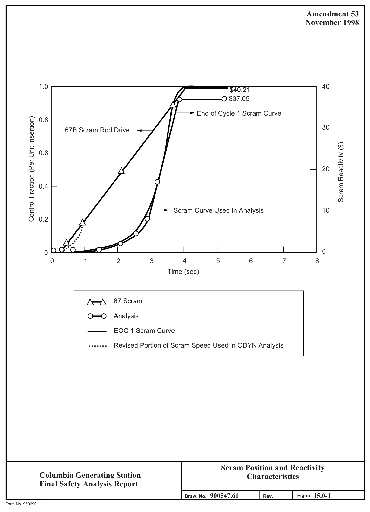
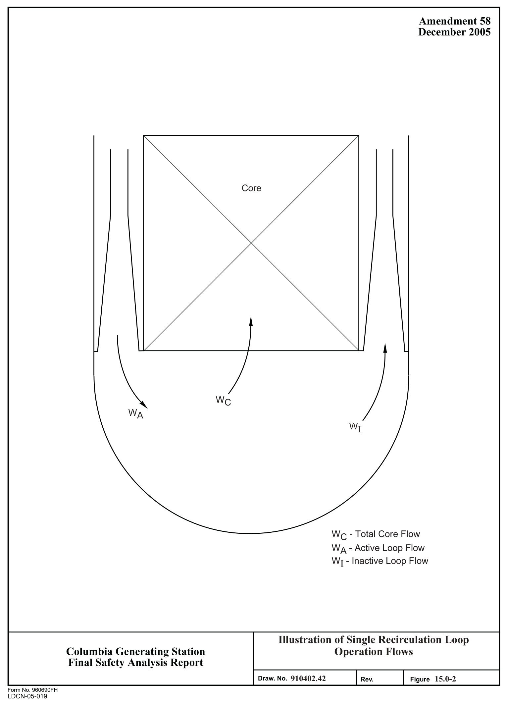

# 15.0 GENERAL

> Columbia Generating Station FSAR — Chapter 15: Accident Analyses
> Source: `15_chapter-4122-5262.pdf`, PDF pages 28–59 (of 1141)
> Amendment 67 compilation (individual pages carry varying amendment dates)

---
<!-- p.28 -->
Chapter 15

#### ACCIDENT ANALYSES
### 15.0 GENERAL
This chapter discusses the effects of anticipated process disturbances and postulated component failures, their consequences, and the capabilities built into the plant to control or accommodate such failures and events. The analyses have been reviewed and revised, as needed, for the:

 Reactor power uprate  Installation of the adjustable speed drive for the reactor recirculation pumps  Implementation of an alternative source term  APRM/RBM Technical Specification (ARTS) improvement program  Maximum Extended Load Line Limit Analysis (MELLLA)
 Cycle specific changes

These changes to the plant licensing and design basis and their impact are discussed in this chapter.

The scope of the situations analyzed includes anticipated (expected) operational occurrences, off-design abnormal (unexpected) transients that induce system operating condition disturbances, postulated accidents of low probability, and hypothetical events of extremely low probability. For each reload, the events are evaluated by the fuel vendor(s). The events identified as limiting during the evaluation are analyzed and the sections are revised.

The plant was originally licensed at 3323 MWt. In 1995, an amendment to the plant Operating License authorized an increase in power to 3486 MWt. The power uprate analysis was performed in accordance with the NRC-approved General Electric Company (GE) generic power uprate program for boiling water reactors (BWRs).

A Measurement Uncertainty Recapture (MUR) uprate design change was performed per EC 14942 in 2016 to increase rated thermal power to 3544 MWt. The power uprate analysis was performed in accordance with the NRC-10CFR50, Appendix K approved methodology.

The postulated events in this chapter have been analyzed for power uprate conditions. The only exceptions to using uprated power are some non-limiting single loop operation (SLO)
transients that were not reanalyzed as part of the GE power uprate transient analysis. Their text and figures are clearly marked with ORIGINAL POWER designation. Limiting events in terms of setting the fuel operating limits (e.g., Loss of Feedwater Heating, Generator Load Rejection Without Bypass) are reanalyzed on a cycle specific basis and therefore, may include fuel vendor results and references.

The events in this chapter have been analyzed for application of the adjustable speed drives
(ASD) in place of the former reactor recirculation control system that used flow control valves

<!-- p.29 -->
(FCV). The uprated power for Columbia Generating Station is 3544 MWt which is 6.65% higher than the original licensed power of 3323 MWt. All transient initial conditions are specified in Table 15.0-2, 15.0-2A, 15.0-2B or the individual transient event description sections. Several performance improvement packages have been included in the analysis:

1. Final Feedwater Temperature Reduction (FFWTR) and Feedwater Heaters Out-Of- Service (FWHOOS) - Analyses were performed at a reduced feedwater temperature at rated thermal power for operations at end-of-cycle and during the cycle for limiting transients.

2. Increased Core Flow (ICF) – Increased core flow allows for operation at 106% of the rated core flow. The limiting transients were performed for the end-of-cycle with control rods fully withdrawn. This envelopes the operation at increased core flow condition throughout the cycle.

3a. Extended Load Line Limit Analysis (ELLLA) - The consequences of the transients were evaluated to determine if operating limit adjustments are necessary for operation in the extended operating domain and compared with the evaluation at rated thermal power and increased core flow region. This comparison ensures bounding of the results at the extended operating domain.

3b. Maximum Extended Load Line Limit Analysis (MELLLA) – The consequences of the transients were evaluated to determine if operating limit adjustments are necessary for operation in the maximum extended operating domain and compared with the evaluation at rated thermal power and increased core flow region. This comparison ensures bounding of the results at the maximum extended operating domain.

4. Single Loop Operation (SLO) - Limiting transients were re-analyzed for operation at SLO. Using adjustable speed drives (ASD), GE determined the maximum active loop’s recirculation flow at 105% of rated pump speed with resultant analyzed power and core flow conditions of 73.8% UP and 57% of rated core flow for SLO. Prior to power uprate, a comprehensive SLO analysis was performed. For non-limiting events, this analysis has been retained for completeness and historical purposes. These analyses are clearly marked with ORIGINAL POWER designation.

5. End-of-Cycle RPT Out-of-Service (RPT OOS) - The recirculation pump trip (RPT)
mitigates several transients that are more severe at end-of-cycle. The limiting transients were re-analyzed with RPT OOS at various power/flow conditions.

6. Turbine Bypass Out-of-Service - Limiting transient events have been analyzed with turbine bypass valves out-of-service at limiting power and flow conditions.

7. Average Power Range Monitor, Rod Block Monitor Technical Specifications (ARTS) – The ARTS improvement program improves fuel thermal limits protection at off-rated conditions with a more rigorous application of power and flow dependent

<!-- p.30 -->
Minimum Critical Power Ratio (MCPR) and Linear Heat Generation Rate (LHGR)
limits. The ARTS improvement program eliminates the Technical Specification requirement for total peaking factor setdown at off-rated conditions. The ARTS program includes modification of the Rod Block Monitor (RBM), from flow-based to power-based setpoints, to improve the rod movement flexibility at less than rated power conditions, and establish an optimized configuration that improves the system response with respect to bundle power.

Additional updates address the implementation of the use of alternative source terms (AST) as described in the Regulatory Guide 1.183, July 2000, “Alternative Radiological Source Terms for Evaluating Design Basis Accidents at Nuclear Power Reactors.” This methodology is based on the advances that have been made in understanding the timing, magnitude, and the chemical form of fission product releases from severe nuclear power plant accidents. The accidents that were reanalyzed by Energy Northwest with the AST:

 Loss of coolant accident (LOCA)
 Fuel handling accident (FHA)
 Control rod drop accident (CRDA)
 Main steam line break, outside containment, accident (MSLB)

The radiological consequences of these accidents were determined based on AST approved for use under 10 CFR 50.67. In accordance with the guidance provided in Regulatory Guide 1.183, the licensing and design basis are revised to reflect the application of full scope AST methodology (with the exception that the TID-14844 will continue to be used as the basis for equipment qualification (EQ) and radiation zone maps/shielding calculations). The accidents analyzed as part of the implementation of AST are subject to the limits specified in 10 CFR 50.67 and guidelines of Regulatory Guide 1.183.

#### 15.0.1 ANALYTICAL OBJECTIVE
The spectrum of postulated initiating events is divided into categories based on the type of disturbance and the expected frequency of the initiating occurrence. The limiting events in each combination of category and frequency are quantitatively analyzed.

#### 15.0.2 ANALYTICAL CATEGORIES
Transient and accident events contained in this report are provided in individual categories as specified by Regulatory Guide 1.70, Revision 2. The results of the events are summarized in Table 15.0-1. Events evaluated are assigned to one of the following applicable categories:

a. Decrease in reactor coolant temperature:

Reactor vessel water (moderator) temperature reduction results in an increase in core reactivity. This could lead to fuel-cladding damage.

<!-- p.31 -->
b. Increase in reactor pressure:

Nuclear system pressure increases threaten to rupture the reactor coolant pressure boundary (RCPB). Increasing pressure also collapses the voids in the core-moderator, thereby increasing core reactivity and power level that could threaten fuel cladding due to overheating.

c. Decrease in reactor coolant system flow rate:

A reduction in the core coolant flow rate could overheat the cladding as the coolant becomes unable to adequately remove the heat generated by the fuel.

d. Reactivity and power distribution anomalies:

Transient events included in this category are those that could cause rapid increases in power due to increased core flow disturbance events. Increased core flow reduces the void content of the moderator increasing core reactivity and power level.

e. Increase in reactor coolant inventory:

Increasing coolant inventory could result in excessive moisture carryover to components such as the main turbine, feedwater turbines, etc.

f. Decrease in reactor coolant inventory:

Reductions in coolant inventory could threaten the fuel as the coolant becomes less able to remove heat generated in the core.

g. Radioactive release from subsystems and components:

Loss of integrity of a radioactive containment component is postulated.

h. Anticipated transients without scram:

To determine the capability of plant design to accommodate an extremely low probability event, a multi-system maloperation situation is postulated.

##### 15.0.2.1 Single Loop Operation (SLO)
Operation with one recirculation loop results in a maximum power output that is 20% to 30% below that which is attainable for two-pump operation. Therefore, the consequences of abnormal operation transients from one-loop operation will be considerably less severe than those analyzed from a two-loop operational mode because of the associated reduction in operation power level.

<!-- p.32 -->
For pressurization, flow decrease, and cold water increase transients, results presented bound both the thermal and overpressure consequences of one-loop operation. The consequences of flow decrease transients are also bounded by the full power analysis. A single pump trip from one-loop operation is less severe than a two-pump trip from full power because of the reduced initial power level.

Cold water increase transients can result from either recirculation flow controller failure or introduction of colder water into the reactor vessel by events such as loss of feedwater heater.
For the former, the flow-dependent MCPR values are derived assuming both recirculation loop controllers fail. This condition produces the maximum possible power increase and, hence, maximum MCPR for transients initiated from less than rated power and flow. When operating with only one recirculation loop, the flow and power increase associated with this failure with only one recirculation loop will be less than that associated with both loops;
therefore, the MCPR values derived with the two-pump assumption are conservative for SLO.
The latter event, loss of feedwater heating, is generally the most severe cold water increase event with respect to increase in core power. This event is caused by positive reactivity insertion from core inlet subcooling and it is relatively insensitive to initial power level.
A generic statistical loss of feedwater heater analysis using different initial power levels and other core design parameters concluded one-pump operation with lower initial power level is conservatively bounded by the full power two-pump analysis. Inadvertent restart of the idle recirculation pump has been analyzed and is applicable for SLO.

From the above discussions, the transient consequence from SLO is bounded by previously submitted full power analyses. The maximum power level that can be attained with one-loop operation is only restricted by the MCPR and overpressure limits established from a full-power analysis.

The following most limiting transients of coldwater increase, pressurization and flow decrease events are analyzed for SLO and the results are shown in Table 15.0-1A:

a. Feedwater flow controller failure (maximum demand), b. Generator load rejection with bypass failure, and c. One pump seizure accident.

15.0-4a

<!-- p.33 -->
#### 15.0.3 EVENT EVALUATION
##### 15.0.3.1 Identification of Causes and Frequency Classification
Situations and causes that lead to the initiating event analyzed are described within the analytical categories. The frequency of occurrence of each event is summarized based on operating plant history for the transient event. Events for which inconclusive data exist are discussed separately within each event section.

Each initiating event within the major groups is assigned to one of the following frequency groups:

a. Incidents of moderate frequency - these are incidents that may occur during a calendar year to once per lifetime. This event is referred to as an “anticipated
(expected) operational transient.”

b. Infrequent incidents - these are incidents that may occur during the life of the particular plant. This event is referred to as an “abnormal (unexpected)
operational transient.”

c. Limiting faults - these are occurrences that are not expected to occur but are postulated because their consequences may result in the release of significant amounts of radioactive material. This event is referred to as a “design basis
(postulated) accident.”

<!-- p.34 -->
###### 15.0.3.1.1 Unacceptable Results for Incidents of Moderate Frequency [Anticipated
(Expected) Operational Transients]

The following are unacceptable safety results for incidents of moderate frequency:

a. Release of radioactive material to the environs that exceeds the limits of

## 10 CFR 20,
b. Reactor operation induced fuel cladding failure,

c. Nuclear system stresses in excess of that allowed for the transient classification by applicable industry codes, and

d. Containment stresses in excess of that allowed for the transient classification by applicable industry codes.

###### 15.0.3.1.2 Unacceptable Results for Infrequent Incidents [Abnormal (Unexpected)
Operational Transients]

The following are unacceptable safety results for infrequent incidents:

a. Release of radioactivity that results in dose consequences that exceed a small fraction of 10 CFR 50.67 values,

b. Fuel damage that would preclude resumption of normal operation after a normal restart,

c. Generation of a condition that results in consequential loss of function of the reactor coolant system, and

d. Generation of a condition that results in a consequential loss of function of a necessary containment barrier.

###### 15.0.3.1.3 Unacceptable Results for Limiting Faults [Design-Basis (Postulated)
Accidents]

The following are unacceptable safety results for limiting faults:

a. Radioactive material release that results in dose consequences that exceed the requirements of 10 CFR 50.67,

<!-- p.35 -->
b. Failure of fuel cladding that would cause changes in core geometry such that core cooling would be inhibited,

c. Nuclear system stresses in excess of those allowed for the accident classification by applicable industry codes,

d. Containment stresses in excess of those allowed for the accident classification by applicable industry codes when containment is required, and

e. Radiation exposure to plant operations personnel in the main control room in excess of 5 rem total effective dose equivalent (TEDE) for the duration of the accident.

##### 15.0.3.2 Sequence of Events and Systems Operation
Each transient or accident is discussed and evaluated in terms of

a. A step-by-step sequence of events from initiation to final stabilized condition
(e.g., termination of the accident),

b. The extent to which normally operating plant instrumentation and controls are assumed to function,

c. The extent to which plant and reactor protection systems are required to function,

d. The credit taken for the functioning of normally operating plant systems,

e. The operation of engineered safety systems that is required, and

f. The effect of a single failure or an operator error on the event.

The transient or accident discussion is specific to the event in that it is limited to the events and system operations related to the reactor core performance and postulated damage. In general, the step-by-step description ends when the analysis has demonstrated that the core performance results are within established limits. The stabilized condition does not imply that all actions to stabilize plant parameters or to recover from the transient or accident have been completed by plant personnel. In the stabilized condition, either the core has demonstrated compliance with requirements or the postulated or deterministic damage is complete. At this point, the transient or accident is terminated. After termination of the event, the operator actions or system operations are not event specific. The required actions and expected system operations, needed to establish cold shutdown or to initiate recovery actions, are symptom based and described in

<!-- p.36 -->
procedures. The events associated with a radiological release and radiological consequences of the transient or accident are also discussed.

###### 15.0.3.2.1 Single Failures or Operator Errors
15.0.3.2.1.1 General. The events considered in this section were evaluated and are provided in this chapter in accordance with Regulatory 1.70, Revision 2.

###### 15.0.3.2.1.2 Initiating Event Analysis.

a. The undesired opening or closing of any single valve (a check valve is not assumed to close against normal flow),

b. The undesired starting or stopping of any single component,

c. The malfunction or maloperation of any single control device,

d. Any single electrical component failure, or

e. Any single operator error.

Operator error is defined as an active deviation from written operating procedures or nuclear plant standard operating practices. The set of actions is limited as follows:

a. Those actions that could be performed by one person,

b. Those actions that would have constituted a correct procedure had the initial decision been correct, and

c. Those actions that are subsequent to the initial operator error and have an effect on the designed operation of the plant, but are not necessarily directly related to the operator error.

Examples of single operator errors are as follows:

a. An increase in power above the established flow control power limits by control rod withdrawal in the specified sequences,

b. The selection and complete withdrawal of a single control rod out of sequence,

c. An incorrect calibration of an average power range monitor (APRM), and

<!-- p.37 -->
d. Manual isolation of the main steam lines as a result of operator misinterpretation of an alarm or indication.

###### 15.0.3.2.1.3 Single Active Component Failure or Single Operator Error Analysis.

a. The undesired action or maloperation of a single active component, or

b. Any single operator error where operator errors are defined as in Section 15.0.3.2.1.2.

##### 15.0.3.3 Core and System Performance
Fuel thermal and hydraulic design are described in Section 4.4.

The fuel cladding integrity safety limit is set so that no fuel damage is calculated to occur if the limit is not violated. Exceeding unacceptable results criteria for fuel cladding integrity for anticipated operational transients is avoided by meeting the following criteria provided in the NRC Standard Review Plan (NUREG-0800) Section 4.4:

a. The expected number of fuel rods in boiling transition should not exceed 0.1% of the fuel rods in the core. This criterion is met by ensuring that the MCPR for any anticipated operational transient is calculated to be not less than the MCPR99.9% values given in the cycle-specific Core Operating Limits Report
(COLR).

b. No fuel centerline melting nor cladding strain in excess of 1% will occur. This criterion is met by compliance with the operating limits for LHGR given in the cycle-specific COLR.

The operating limit for MCPR is developed as follows:

The MCPR calculated during the transient is compared to the MCPR99.9%. The MCPR99.9% is established using the critical power evaluation methods and includes consideration of the operating domain and manufacturing uncertainties and a conservative core power distribution as inputs. The operating limit MCPR is established such that the transient CPR for the dynamic anticipated operational occurrences and quasi steady-state anticipated operational occurrences are included in the evaluation. Thus, the operating limit MCPR is specified to maintain an adequate margin to boiling transition.

The MCPR operating limit is the maximum of (a) the applicable exposure dependent, full power and full flow MCPR limit, (b) the applicable exposure and power dependent MCPR limit, and (c) the flow dependent MCPR limit as specified in the cycle-specific COLR. This stipulation ensures that the MCPR99.9% will not be violated throughout the CGS

<!-- p.38 -->
operating regime. Full power MCPR limits are specified to define operating limits at rated power and a range of flow conditions that support extended load line operation. Power dependent MCPR limits are specified to define operating limits at other than rated power conditions. A flow dependent MCPR limit is specified to define operating limits at other than rated flow conditions.

With implementation of ARTS, the APRM total peaking factor setdown requirement is eliminated and power-dependent LHGR limits are substituted to ensure adherence to the fuel thermal mechanical design bases. Flow dependent LHGR limits are added to ensure adherence to all fuel thermal mechanical design bases during recirculation flow increase events.

ELLLA operation extends the power and flow operating regime for CGS above the rated rod line for SLO and two-loop recirculation pump operation (TLO). MELLLA further extends the power and flow operating regime but only for TLO. The COLR defines the ELLLA boundary for SLO and MELLLA boundary for TLO. The cycle specific Supplemental Reload Licensing Report (Reference 15.0-1) documents the reload analyses.

The CGS cycle-specific COLR provides the average planar linear heat generation rate
(APLHGR) limits, the MCPR limits, and the linear heat generation rate (LHGR) limits as required by the Technical Specifications.

###### 15.0.3.3.1 Mathematical Model
Unless otherwise stated in the Mathematical Model description for the event being discussed, the following mathematical model was used to perform the Chapter 15 transient analyses.

Transients are analyzed using the transient analysis models described in Reference 15.0-5.
The three-dimensional transient analysis model TRACG was used to analyze transients involving significant reactor pressurization (i.e., limiting events). The point-kinetics transient analysis model REDY and the one-dimensional transient analysis model ODYN were used for transients not involving significant reactor pressurization (i.e., non-limiting events). The transient analysis model determines the transient pressure, power, heat flux, and average core flow which are required as input to both the hot channel analysis and to the transient critical power methodology. The TRACG transient analysis model also calculates the transient peak reactor vessel pressure to demonstrate conformance to the reactor pressure vessel safety limit, which is based on the reactor pressure vessel design pressure.

TRACG is a best-estimate code for analysis of BWR transients (Reference 15.0-5). It is based on a multi-dimensional, two-fluid model for the reactor thermal-hydraulics, and a threedimensional neutron kinetics model for the reactor core. TRACG has a modular structure and flexible geometry capability. It contains a set of basic thermal-hydraulic components, such as vessel, channel, pipe, and tee components which are used as the building blocks to construct the system simulation. In addition to the basic thermal-hydraulic component models, TRACG contains a set of component models for the recirculation pumps, jet pumps, fuel channels,

#### LDCN-10-004, 15-011
<!-- p.39 -->
steam separators, and dryers. TRACG also contains a control system model capable of simulating major BWR control systems.

The input data to the transient analysis model come from two sources: (1) the plant model or base deck, and (2) the BWR three-dimensional simulator PANACEA. The plant model provides the necessary input data for the simulation of the plant, including the plant and control systems performance characteristics. The BWR three-dimensional simulator supplies the core state, the neutron kinetics cross sections, and other data necessary to characterize the reactor core.

The TRACG analysis process begins by performing channel grouping and selecting limiting
(hot) channels from the PANACEA wrapup file. After updating the TRACG Basedeck with any cycle specific OPL-3 changes, a TRACG Steady-State Initialization case, restarting from the PANACEA wrapup, is then run to establish initial conditions for the subsequent transient case. The Steady-State Initialization includes key parameters such as core power, core flow, vessel steam flow, core inlet subcooling, reactor dome pressure, vessel narrow range water level, steamline pressure drop, and turbine control valve initial position. These TRACG calculated steady state parameters are then compared with the corresponding PANACEA heat balance value or the cycle specific OPL-3 form to confirm that the steady state results are within methodology defined acceptance criteria. A TRACG Null Transient case is then run to establish the TRACG flux convergence criterion. Finally, the TRACG transient cases are run to calculate the limiting (hot) channel ΔCPR/ICPR, pressure margins, and Limiting (hot)
channel power and nodal integrated powers.

The GESAM MCPR99.9% calculational process, which includes the GEXL correlation, is then used to calculate the OLMCPR, based on plant specific transient bias and uncertainty inputs, the cycle specific MCPR99.9%, and the TRACG calculated ΔCPR/ICPR. The limiting hot channel power and nodal integrated powers are then normalized and used for input to perform the plant/cycle/event specific fuel rod thermal/mechanical evaluation, which is a separate calculation.

The above mathematical models describe the models used in the introduction of GNF2 fuel.
Cycle specific analyses are performed using vendor specific models for the vendor supplying the reload fuel for the current cycle as described elsewhere in this chapter.

###### 15.0.3.3.2 Input Parameters and Initial Conditions for Analyzed Events
This section discusses the important input parameters used in the analysis for the event discussed. In some cases, the discussion references Table 15.0-2 (or 2A or 2B).

###### 15.0.3.3.3 Consideration of Uncertainties
Except for total core flow and TIP reading, the uncertainties used in the statistical analysis to determine the MCPR99.9% are not dependent on whether coolant flow is provided by one or two recirculation pumps. Uncertainties used in the two-loop operation analysis are documented in

<!-- p.40 -->
the FSAR. A 6% core flow measurement uncertainty has been established for single loop operation (compared to 2.5% for two-loop operation). This value conservatively reflects the one standard deviation (one sigma) accuracy of the core flow measurement system documented in Reference 15.0-2. In SLO, measurement and prediction uncertainties for radial power distribution and axial power distribution also increase. In the current methodology, axial power uncertainty is not an important parameter. The net effect of these revised uncertainties is an incremental increase in the required MCPR99.9%. The MCPR99.9% for SLO is given in the cycle specific COLR.

###### 15.0.3.3.3.1 Core Flow Uncertainty Analysis

The uncertainty analysis procedure used to establish the core flow uncertainty for one-pump operation is essentially the same as for two-pump operation, with some exceptions. The core flow uncertainty analysis is described in Reference 15.0-2. The analysis of one-pump core flow uncertainty is summarized below.

For SLO, the total core flow can be expressed as follows (see Figure 15.0-2):

W  W  W

#### C A I
where:

WC total core flow

WA active loop flow, and

WI  inactive loop (true) flow.

By applying the “propagation of errors” method to the above equation, the variance of the total flow uncertainty can be approximated by:

a 2     1 2      2   2    2    2   2      WC Wsys WArand WIrand C 1  a 1  a

where:

WC = uncertainty of total core flow;

Wsys = uncertainty systematic to both loops;

WArand = random uncertainty of active loop only;

<!-- p.41 -->
WIrand = random uncertainty of inactive loop only;

C = uncertainty of “C” coefficient; and

a = ratio of inactive loop flow (WI) to active loop flow (WA).

From an uncertainty analysis, the conservative, bounding values of

    , , , and Wsys WArand WIrand C

are 1.6%, 2.6%, 3.5% and 2.8% respectively. Based on the above uncertainties and a bounding value of 0.36* for “a”, the variance of the total flow uncertainty is approximately:

2 2  1   0 36 .              WC 2  2  2  2  2  2 16 .
2 6 .
35 . 2 8 . 50 . %      . 1 0 36 1 0 36  .

When the effect of 4.1% core bypass flow split uncertainty at 12% (bounding case) bypass flow fraction is added to the above total core flow uncertainty, the active coolant flow uncertainty is:

2 2  012 .        active coolant  2  2  2 50 . % 41 . % 51 . %   1  012 .

which is less than the 6% core flow uncertainty assumed in the statistical analysis.

In summary, core flow during one-pump operation is measured in a conservative way and its uncertainty has been conservatively evaluated.

###### 15.0.3.3.4 Results
This section discusses the results, in terms of core and system performance, of the event analyzed. The COLR provides operating limits that are the results of analytical evaluations that impact core operating parameters for the current cycle. In addition, critical parameters for the complete set of transients analyzed are shown in Table 15.0-1. From the data in Table 15.0-1, an evaluation of the limiting event for that particular category and parameter can

* This flow split ratio varies from about 0.13 to 0.36. The 0.36 value is a conservative bounding value. The analytical expected value of the flow split ratio for CGS is 0.23.

<!-- p.42 -->
be made. The limiting events are reanalyzed for the current operating cycle. Table 15.0-3 provides a summary of accidents that may have radiological consequences.

##### 15.0.3.4 Barrier Performance
This section addresses the performance of the RCPB and the containment system during transients and accidents.

During transients that occur with no release of coolant to the containment, only RCPB performance is considered. If release to the containment occurs as in the case of limiting faults, then challenges to the containment are evaluated as well.

Piping systems within the secondary containment structure (i.e., the reactor building) have been analyzed for pipe break effects including jet impingement, jet reaction, pipe whip, and subcompartment pressurization. Where necessary, these loads were included in the design of the structure to ensure that the secondary containment can perform its required functions as defined in Section 6.2.3.

##### 15.0.3.5 Radiological Consequences
This section addresses the radiological release consequences during the incidents of moderate frequency (anticipated operational transients), infrequent incidents (abnormal operational transients), and limiting faults (design basis accidents [DBA]) events. For all events where consequences are limiting a detailed quantitative evaluation is presented. For nonlimiting events, a qualitative evaluation is presented or the results are referenced from a more limiting or enveloping case or event.

For limiting faults (DBA), conservative assumptions considered to be acceptable to the NRC for the purpose of worst case bounding of the event and determining the adequacy of the plant design to meet 10 CFR 50.67 requirements are assumed. This is referred to as the “design basis analysis.”

The atmospheric dispersion coefficients are presented in Tables 15.0-4 and 15.0-5. Reference will be made to these tables in the discussion of the analyses.

#### 15.0.4 REFERENCES
15.0-1 Supplemental Reload Licensing Report for Columbia (most recent version referenced in COLR).

15.0-2 General Electric Company, General Electric BWR Thermal Analysis Basis
(GETAB); Data, Correlation, and Design Application, NEDO-10958-A, January 1977.

<!-- p.43 -->
15.0-3 GE Nuclear Energy, “WNP-2 Power Uprate Transient Analysis Task Report,” GE-NE-208-08-0393, Revision 0, September 1993 (Proprietary).

15.0-4 GE-Hitachi Report, “Evaluation of Steam Flow Induced Error Impact on the L3 Setpoint Analysis Limit,” GEH-NE-0000-0077-4603, December 2007.

15.0-5 General Electric Company, “General Electric Standard Application for Reactor Fuel,” NEDE-24011-P-A, and supplement for United States, NEDE-24011-P- A-US (most recent approved version referenced in COLR).

15.0-6 GE-Hitachi Nuclear Energy, “Safety Analysis Report for Columbia Generating Station Thermal Power Optimization,” NEDC-33853P, March 2016.

<!-- p.44 -->
Frequency Category
(d) (d) (d) (d) (d) (d) (d) (d) (d) (d) (d) (d) (d) (d)

DCPRb,c,e <0.01 <0.01 <0.01 <0.01 0.022 0.079 0.12k 0.31k 0.32k 0.31k 0.12 n/a Results Summary of Transient Events Applicable to Columbia Generating Stationa Average Surface Heat Flux (% of Maximum Core Initial)
100 100 106 100 111 100 106 100

Steam Line Maximum Pressure
(psig)
1189 1151 1012 1187 1241 1238 1198 1166 1166 1166 1142

Maximum Pressure Vessel (psig)
1218 1172 1061 1220 1271 1268 1234 1199 1185 1196 1152 Table 15.0-1 Maximum Pressure Dome (psig)
1191 1151 1020 1188 1245 1242 1200 1173 1169 1173 1142 See Section 15.6.6 Neutron Flux Maximum (%NBR)e

#### DECREASE IN REACTOR COOLANT TEMPERATURE
See text See text See text See text 104h 104h 297 129 102 160 325 308 203 194 193

Inadvertent Opening of Safety or Relief Valve Feedwater Controller Failure, Max Demand Loss of Feedwater Heating, Manual Flow

#### INCREASE IN REACTOR PRESSURE
Generator, Load Rejection, Bypass-Onf Generator Load Rejection, Bypass-Off Loss of Auxiliary Power Transformers RHR Shutdown Cooling Malfunction Failure of RHR Shutdown Cooling Pressure Regulator Fail-Closed Pressure Regulator Fail-Open Loss of All Grid Connections Description Loss of Condenser Vacuum Loss of all Feedwater Flow Inadvertent MSIV Closure Turbine Trip, Bypass-Onf Turbine Trip, Bypass-Off Decreasing Temperature Feedwater Piping Break Control

Figure 15.2-1 15.2-2 15.2-3 15.2-4 15.2-5 15.2-6 15.2-7 15.2-8 15.2-9 I.D.
15.1-1 15.1-2

Paragraph I.D.
15.1.1 15.1.2 15.1.3 15.1.4 15.1.6 15.2.1 15.2.2 15.2.2 15.2.3 15.2.3 15.2.4 15.2.5 15.2.6 15.2.6 15.2.7 15.2.8 15.2.9 15.1 15.2

<!-- p.45 -->
Compliance with the event acceptance criteria is demonstrated by cycle-dependent analysis of potentially limiting events just prior to the operation of that Frequency Category a Results reflect GE14 fuel introduction, and updates from GNF2 introduction some of which are dependent on fuel design and core loading pattern.
(d) (d) (d) (d) (d) (i) (j) (j) (j) (i)
(d) (d) (d) (d)

DCPRb,c,e Results Summary of Transient Events Applicable to Columbia Generating Stationa (Continued)
<0.01g <0.01 <0.01 <0.01 <0.01 <0.01 0.53 0.15 0.27 Average Surface Heat Flux (% of Maximum Core Initial)

100 100 100 100 100 190 127 149 100 Steam Line Maximum Pressure
(psig)
1012 1076 1012 1061 1098 1001 1012 998 986 See appropriate events in Sections 15.1 and 15.2 Maximum cycle. The results are reported in the Supplemental Reload Licensing Report (Reference 15.0-1). Pressure Vessel (psig)
1059 1088 1059 1072 1110 1026 1009 1033 1052 Table 15.0-1 See Sections 15.4.1 and 15.4.2 Maximum Pressure Dome (psig)
1020 1077 1020 1061 1099 1004 1006 1020 990

#### DECREASE IN REACTOR COOLANT SYSTEM FLOW RATE
REACTIVITY AND POWER DISTRIBUTION ANOMALIES Neutron Flux Maximum (%NBR)e See 15.3.3 See text See text See text See text

#### INCREASE IN REACTOR COOLANT INVENTORY
104h 104h 104h 104h 104h 122c 134c 150c 100h

Speed Decrease of Two Main Recirc Motors Abnormal Startup of Idle Recirculation Loop Speed Increase of Both Main Recirc Motors Speed Decrease of One Main Recirc Motor Speed Increase of One Main Recirc Motor Trip of Both Recirculation Pump Motors Trip of One Recirculation Pump Motor Seizure of One Recirculation Pump Inadvertent HPCS Pump Startf Description Misplaced Bundle Accident Control Rod Misoperation Recirc Pump Shaft Break Rod Drop Accident RWE - Refueling RWE - At Power BWR Transients RWE - Startup

Figure 15.4-1 15.4-2 15.5-1 I.D.
15.3-1 15.3-2 15.3-3 15.3-4 15.3-5

Paragraph I.D.
15.4.1.1 15.4.1.2 15.3.1 15.3.1 15.3.2 15.3.2 15.3.3 15.3.4 15.4.2 15.4.3 15.4.4 15.4.5 15.4.5 15.4.7 15.4.9 15.5.1 15.5.3 15.4 15.5 15.3

<!-- p.46 -->
e For Measurement Uncertainty Recapture (MUR), non-limiting events are not re-analyzed, but reported results are scaled from 3486 MWt to 3544 MWt b MCPR operating limits are based on the delta-CPR (DCPR) results from the limiting transient event and the MCPR99.9% defined in the COLR.
Results Summary of Transient Events Applicable to Columbia Generating Stationa (Continued)
k This value is only for the more limiting GNF2 fuel and does not include plant specific TRACG bias and uncertainty.
g ODYN results without the adjustment factors delineated in the ODYN Report NEDO-24154, NEDC-24154P.
Table 15.0-1 f Non-limiting event under power uprate conditions (event not reanalyzed).
c Option B DCPR results are reported.
rated, unless otherwise indicated.
h No increase from initial value.
d Moderate frequency.
j Infrequent incident.
i Limiting fault.

<!-- p.47 -->
Table 15.0-1A

Summary of Transient Peak Value Results Single-Loop Operation

Maximum Maximum Neutron System Paragraph/ Flux Pressure Frequency Figure Description
(% NBR) (psig) Category

Initial condition 73.8 1020 N/A

15.1.2/ Feedwater flow controller failure 87.5 1118 (a)
15.1-3 (maximum demand) uprated power

#### 15.2.2 Generator load rejection - uprated 129 1184 (a)
power

15.3.3/ Seizure of active recirculation pump 73.8 1017 (b)

a Moderate frequency incident.
b Limiting fault.

<!-- p.48 -->
Table 15.0-2

Input Parameters and Initial Conditions for Transients

REDY REDY (ASD Events) ODYN

Thermal power level, MWta 1.
Rated value 3486 3323 3486 Analysis value 3702 3464 3629 16.09 x 106 14.98 x 106 15.73 x 106
2. Steam flow, lbs/hr analysis value 108.5 x 106 108.36 x 106 95.5-115.0 x 106 3. Core flow, lbs/hr 4. FW flow rate, lb/sec analysis value 4471 4161 4362 5. Feedwater temperature, °F 426 424 426 6. Vessel dome pressure, psig 1020 1020 1020 7. Vessel core pressure, psig 1031 1031 1031 8. Turbine bypass capacity, %NBR 22.7 25 22.7 9. Core coolant inlet enthalpy, Btu/lb 528.3 529.3 529.6 10. Turbine inlet pressure, psig 992 975 997 11. Fuel lattice 8 x 8/9 x 9 8x8 Simulated 8x8/9x9 12. Core average fuel cladding gap conductance, Btu/sec-ft2-°F 0.3608 0.1667 Fuel specific 13. Core leakage flow, % 10.20 11.84 Cycle specific 14. Required MCPR operating limit
1.24 (c)
(b)
1.06 (c)
15. MCPR99.9%
(b)
16. Doppler coefficient (-)¢/° Nominal EOC-1 0.311 0.227 (d)
Analysis data ASD events
1. Increase power 0.295 0.215
2. Decrease power 0.327 17. Void coefficient (-)¢/% Rated Nominal EOC-1 7.48 (d)
Analysis data for power increase events 15.93 12.70 (d)
Analysis data for power decrease events 12.10 7.065 (d)
18. Core average rated void fraction, % (Steady state)
41.24 41.32 43.1 19. Scram reactivity, $k analysis data Figure 15.0-1 Figure 15.0-1 (d)
20. Control rod drive speed, position versus time Figure 15.0-1 Figure 15.0-1 Figure 15.0-1 21. Jet pump ratio, M
2.36 2.41 2.39

<!-- p.49 -->
Table 15.0-2

Input Parameters and Initial Conditions for Transients (Continued)

REDY REDY (ASD Events) ODYN

22. Safety/relief valve capacity,% NBR safety valve capacity @ 1241 psig 108.6 111.5 108.6 Relief valve capacity @ setpoint values in item 25 of this table @ 1121 psig 98.3 101.8 98.3 @ 1131 psig 99.1 102.8 99.1 @ 1141 psig 100.0 103.7 100 @ 1151 psig 100.9 104.6 100.9 @ 1161 psig 101.7 105.5 101.7 Manufacturer Crosby Crosby Quantity installed 18 18 23. Relief function delay, sec 0.4 0.4 0.4 24. Relief function response, sec 0.15 0.1 0.15 25. Setpoints for safety/relief valves Safety function, psig 1200, 1210 1177, 1187, 1200, 1210 1221, 1231 1197, 1207, 1221, 1231 1241 1217 1241 Relief function, psig 1121, 1131 1091, 1101, 1121, 1131 1141, 1151 1111, 1121, 1141, 1151 1161 1131 1161 26. Number of valve groupings simulated Safety function, number 5 5 Relief function, number 5 5 27. High flux trip analysis setpoint
(123 x 1.041),% NBR 128.0 126.20 128e 28. High pressure scram setpoint, psig 1086 1071 1086 29. Vessel level trips, inches with respect to dryer skirt bottom Level 8 - (L8), in.
59.5 55.5 59.5 Level 4 - (L4), in.
31.5 30 7.5i 12.5i (f)
Level 3 - (L3), in.
Level 2 - (L2), in.
(-38) (f)
30. APRM thermal trip analysis setpoint
(117 x 1.041)% NBR @ 100% core flow 121.8 122.030 121.8e 31. Recirculation pump trip delay, sec 0.190 0.140 0.190 32. Recirculation pump trip inertia time constant for 6g 6g 6g analysis, sec 33. RPS response time delay
(h)
(h) (h)

<!-- p.50 -->
Table 15.0-2

Input Parameters and Initial Conditions for Transients (Continued)

a Defines rated thermal power associated with the analysis. REDY values reflect original rated thermal power, REDY ASD Events and ODYN values reflect the 3486 MWt reactor power uprate. %NBR values correspond to the rated thermal power values. Measure Uncertainty Recapture power uprate values are in Table 15.0-2B. Reported results are scaled to 3544 MWt, unless otherwise indicated.

b See COLR.

c Not applicable to reload 7/cycle 8 simulation.

d ODYN values are calculated within the code.

e The thermal multiplier (1.041 = 3629/3486) is used to give a conservative margin that is proportional to the core power.

f Parameter not used in the analysis.

g The inertia time constant is defined by the expression:

2  J n t O g T O

where

t = inertia time constant (sec)
Jo = pump motor inertia (lb-ft2)
n = rated pump speed (rps)
g = gravitational constant (ft/sec2)
To = pump shaft torque (lb-ft)
h The “maximum overall response time” as addressed in the LCS is utilized for each scram encountered in the Chapter 15 events.

i The impact of steam flow induced error on the analytical limit does not impact event descriptions or conclusions (Reference 15.0-4).

<!-- p.51 -->
Table 15.0-2A

Input Parameters and Initial Conditions for Transients and Accidents for Single-Loop Operation

Original Rated Power Uprated Power

1. Thermal power analysis value (MWt) 2596.9 2615

2. Flow

10.79 x 106 10.76 x 106 Steam (1b/hr)

59.0 x 106 61.85 x 106 Core (lb/hr)

5.88 x 106 6.22 x 106 Core bypass (lb/hr)

10.79 x 106 10.76 x 106 Feedwater (lb/hr)

5.88 x 106 N/A Turbine bypass (lb/hr)

Turbine bypass (% rated)
N/A 23%

3. Core Inlet Enthalpy (Btu/lb)
510.8 513.7

4. Pressure

Vessel dome (psia)
1020 1008

Vessel core (psia)
1029.7 1017.7

Turbine inlet (psia)a 960.5 1000

5. Jet pump ratio (M)
3.2
3.4

6. Safety/relief valve capacity

% NBR @ 1,164 psig 107.1 N/A

Manufacturer Crosby Crosby

Quantity installed 18 18

% NBR @ 1241 psig N/A 108.6

7. Relief function

Delay (sec)
0.4 0.4

Response (sec)
0.1 0.15

<!-- p.52 -->
Table 15.0-2A

Input Parameters and Initial Conditions for Transients and Accidents for Single-Loop Operation (Continued)

Original Rated Power Uprated Power 8. Setpoints for safety/relief valves Safety function (psig)
1177, 1187, 1197, 1200, 1210, 1221, 1207, 1217 1231, 1241 Relief function (psig)
1106, 1116, 1126, 1121, 1131, 1141, 1136, 1146 1151, 1161 9. Number of valve groupings simulated Safety function (number)
5 5 Relief function (number)
5 5 10. Setpoints High flux trip analysis (1.21 x 1.043) 126.2 128
(% NBR)
High pressure scram (psig)
1071 1086 APRM thermal trip (% NBR @ 122.03 121.8 100% core flow)
11. Vessel level trips (ft above instrument zero)
Level 8 - (L8) (ft)
## 4.542 Level 4 - (L4) (ft)
2.625
1.083b Level 3 - (L3) (ft)
Level 2 - (L2) (ft)
(-)4.167 12. RPT delay (sec)
0.19 0.19 13a. RPT inertia for analysis (lb/ft2)
24,500 N/A 13b. RPT inertia time constant (sec)
N/A 6

a Pressure specified at rated power condition. Off-rated power pressure drop is calculated by transient analysis code.
b The impact of steam flow induced error on the analytical limit does not impact event descriptions or conclusions (Reference 15.0-4).

<!-- p.53 -->
Table 15.0-2B

Input Parameters and Initial Conditions for ARTS/MELLLA, MUR and GNF Reload Transient Analyses

Parameter ARTS/MELLLA MUR/Reload

1. Thermal power level, MWt 3486 3544
2. Steam flow, lbs/hr analysis value 15.01 x 106 15.28 x 106 87.6 – 115.0 x 106 89.7 – 115.0 x 106
3. Core flow, lbs/hr 4. FW flow rate, lb/sec analysis value 4161.6 4236.9 5. Feedwater temperature, °F 421.2 422.1 6. Vessel dome pressure, psig 1020 7. Vessel core pressure, psig 1032 8. Turbine bypass capacity, %NBR 23.75 23.33 9. Core coolant inlet enthalpy, Btu/lb 527.2 528.5
(rated flow)
10. Turbine inlet pressure, psig 990 11. Fuel lattice 10 x 10 mixed core

12. Required MCPR operating limit See COLR 13. MCPR99.9% See COLR 14. Control rod drive speed, position versus timea 15. Jet pump ratio, M
2.285 16. Safety/relief valve capacity, % NBR See Table 5.2-3 safety valve capacity Manufacturer Crosby Quantity installed 18 17. Relief valve function delay, sec 0.4 response, sec 0.15 18. Safety valve function delay, sec 0.0 response, sec 0.3

<!-- p.54 -->
Table 15.0-2B

Input Parameters and Initial Conditions for GNF Reload Transient (Continued)

Parameter Value

19. Setpoints for safety/relief valves # in Group Setpoint Safety function, psig 2b 1200 4b 1210 4 1221 4 1231 4 1241 2b 1156 Relief function, psig 4b 1166 4 1176 4 1186 4 1196 20. Number of valve groupings simulated Safety function, number (actual/credited)
5 / 3 Relief function, number (actual/credited)
5 / 3 21. High flux trip analysis setpoint,% NBR 123.0 22. High pressure scram setpoint, psig 1086 23. Vessel level trips, inches with respect to instrument zero Level 8 – (L8), in.
## 59.5 Level 4 – (L4), in.
30
2.5c Level 3 – (L3), in.
Level 2 – (L2), in.
-90 LOCA
-70 Non LOCA 24. APRM thermal trip analysis setpoint Not credited 25. Recirculation pump trip delay, sec 0.200 26. RPS response time delay See LCS a See Section 4.6.1.1.2.5.3.
b Valve group function not credited in safety analyses.
c This allows the correction due to steam flow induced error (Reference 15.0-4).

<!-- p.55 -->
Table 15.0-3

Summary of Accidents

Paragraph Failed Fuel I.D.
Title Calculated Value

#### 15.3.3 Seizure of one recirculation pump
None

#### 15.3.4 Recirculation pump shaft break
None

#### 15.4.9 Rod drop accident
850 rods

#### 15.6.2 Instrument line break
None

#### 15.6.4 Steam system pipe break outside containment
None

#### 15.6.5 Loss-of-coolant accident within RCPB
100%

#### 15.6.6 Feedwater line break
None

#### 15.7.1 Main condenser gas treatment system failure
N/A

#### 15.7.3 Liquid radwaste tank failure
N/A

#### 15.7.4 Fuel handling accident
250 rods

### 15.8 Anticipated transients without scram
None

<!-- p.56 -->
Table 15.0-4

/Q (s/m3) values for the EAB and LPZ

Time Period EAB /Q (s/m3) LPZ /Q (s/m3)

0 - 2 hrs 1.81 E-4 4.95 E-5

2 - 8 hrs

### 4.95 E-5
8 - 24 hrs

### 3.69 E-5
1 - 4 d

### 1.95 E-5
4 - 30 d

### 7.81 E-6
<!-- p.57 -->
Table 15.0-5

Control Room Atmospheric Dispersion Factors
(sec/m3)

Hours Turbine Secondary SGT System Building Containment Release Filtered Intake Release Path 0 - 2 8.81E-4 2.82E-4 1.43E-4 2 - 8 3.75E-4 2.17E-4 1.05E-4 8 - 24 1.93E-4 8.77E-5 4.14E-5 24 - 96 1.50E-4 7.42E-5 3.52E-5 96 - 720 1.44E-4 6.40E-5 3.03E-5

Unfiltered Intake Release Path 0 - 2 4.70E-3 7.02E-4 6.95E-4 2 - 8 2.00E-3 3.19E-4 3.36E-4 8 - 24 1.03E-3 1.30E-4 1.28E-4 24 - 96 8.01E-4 1.05E-4 9.72E-5 96 - 720 7.69E-4 9.00E-5 7.69E-5

<!-- p.58 -->

*figure on PDF page 58*

[Vector original (SVG, lossless): fig_page-58_2.svg](../figures/fig_page-58_2.svg)

<!-- labels/text on this figure page -->
Amendment 53 November 1998
1.0 40 $40.21 $37.05
End of Cycle 1 Scram Curve Control Fraction (Per Unit Insertion) 0.8 30 67B Scram Rod Drive
Scram Reactivity ($)
0.6
20
0.4
Scram Curve Used in Analysis 10 0.2
0 0 0 1 2 3 4 5 6 7 8 Time (sec)
67 Scram
Analysis
EOC 1 Scram Curve
Revised Portion of Scram Speed Used in ODYN Analysis
Scram Position and Reactivity Columbia Generating Station Characteristics Final Safety Analysis Report 900547.61 15.0-1 Draw. No.
Rev. Figure Form No. 960690

<!-- p.59 -->

*figure on PDF page 59*

[Vector original (SVG, lossless): fig_page-59_2.svg](../figures/fig_page-59_2.svg)

<!-- labels/text on this figure page -->
Amendment 58 December 2005
Core
WC WA WI
WC - Total Core Flow WA - Active Loop Flow WΙ - Inactive Loop Flow
Illustration of Single Recirculation Loop Operation Flows Columbia Generating Station Final Safety Analysis Report 910402.42 15.0-2 Draw. No. Rev. Figure Form No. 960690FH
LDCN-05-019

