# 15.1 DECREASE IN REACTOR COOLANT TEMPERATURE

> Columbia Generating Station FSAR — Chapter 15: Accident Analyses
> Source: `15_chapter-4122-5262.pdf`, PDF pages 60–95 (of 1141)
> Amendment 67 compilation (individual pages carry varying amendment dates)

---
<!-- p.60 -->
### 15.1 DECREASE IN REACTOR COOLANT TEMPERATURE
#### 15.1.1 LOSS OF FEEDWATER HEATING
##### 15.1.1.1 Identification of Causes and Frequency Classification
###### 15.1.1.1.1 Identification of Causes
A feedwater heater can be lost in at least two ways:

a. Steam extraction line to heater is closed, and b. Steam is bypassed around heater.

The first case produces a gradual cooling of the feedwater. In the second case, the steam bypasses the heater and no heating of that feedwater occurs. In either case, the reactor vessel receives cooler feedwater. The maximum number of feedwater heaters that can be tripped or bypassed by a single event represents the most severe transient for analysis considerations.
This event has been conservatively estimated to incur a loss of up to 100°F of the feedwater heating capability of the plant and causes an increase in core inlet subcooling. This increases core power due to the negative void reactivity coefficient.

###### 15.1.1.1.2 Frequency Classification
This event is considered to be an incident of moderate frequency and is analyzed under worst case conditions of a 100°F loss at full power.

##### 15.1.1.2 Sequence of Events and Systems Operation
The loss of feedwater heating leads to a gradual decrease in the temperature of the feedwater entering the reactor vessel. The decrease in feedwater temperature results in an increase in the core inlet subcooling which collapses voids, and increases the core average power. The gradual power change allows fuel thermal response to maintain pace with the increase in neutron flux. For this analysis, it was assumed that the initial feedwater temperature dropped 100°F.

In establishing the expected sequence of events and simulating the plant performance, it was assumed that normal functioning occurred in the plant instrumentation and controls, plant protection, and reactor protection systems. Engineered safety feature (ESF) system initiation is not anticipated or required to prevent or mitigate the transient.

The Average Power Range Monitor (APRM) Simulated Thermal Power trip setpoint provides protection against transients such as the Loss of Feedwater Heating where thermal power increases slowly. While the sequence of events may produce sufficiently high

<!-- p.61 -->
flux levels to initiate an APRM reactor protection system trip, no credit is taken for a reactor trip in the analysis of the event. A description of the APRM system and operation is provided in Sections 7.2.1.1.1.2 and 7.6.1.4.3.

###### 15.1.1.2.1 The Effect of Single Failures and Operator Errors
The loss of feedwater heating generally leads to an increase in reactor power level. The APRM system is the mitigating system and is designed to be single failure proof. Therefore, single failures are not expected to result in a more severe event than analyzed.

##### 15.1.1.3 Core and System Performance
###### 15.1.1.3.1 Mathematical Model
The analytical dynamic behavior has been determined using the steady state boiling water reactor (BWR) simulator code PANACEA (Reference 15.1-2). This code does not provide plots of the dynamic behavior of basic parameters as a function of time nor does it provide information for a sequence of events table. Therefore, no figures or tables are available.
Reference 15.1-6 approves the use of PANACEA for modeling the Loss of Feedwater Heating event.

The loss of feedwater heating (LFWH) event analysis supports an assumed 100°F decrease in the feedwater temperature. The result is an increase in core inlet subcooling, which collapses voids, thereby, increasing the core power and shifting the axial power distribution toward the bottom of the core. As a result of the axial power shift and increased core power, voids begin to build up at the bottom of the core, acting as negative feedback to the void collapse process.
The negative feedback moderates the core power increase. The PANACEA code is used to determine the change in minimum critical power ratio (MCPR) during the event. Analyses were performed for a range of cycle exposures to ensure that appropriate limits are set.
Although there is a substantial increase in core thermal power during the event, the increase in steam flow is much less because a large part of the added power is used to overcome the increase in inlet subcooling. The increase in steam flow is accommodated by the pressure control system by the turbine control (governor) valves or the turbine bypass valves, so no pressurization occurs (Reference 15.1-3).

###### 15.1.1.3.2 Input Parameters and Initial Conditions
These analyses have been performed, unless otherwise noted, with plant conditions tabulated in Table 15.0-2B.

<!-- p.62 -->
###### 15.1.1.3.3 Results
The LFWH transient is analyzed for each reload core to quantify the reduction in thermal margins. The results of the analysis are provided in the cycle specific Supplemental Reload Licensing Report (Reference 15.1-3).

###### 15.1.1.3.4 Considerations of Uncertainties
Factors such as exposure and magnitude of feedwater temperature change are assumed to be at the worst configuration so that any deviations seen in the actual plant operation reduce the severity of the event.

##### 15.1.1.4 Barrier Performance
The consequences of this event do not result in any temperature or pressure transient in excess of the criteria for which the fuel, pressure vessel, or containment are designed. Therefore, barrier integrity and function is maintained.

##### 15.1.1.5 Radiological Consequences
Since this event does not result in any additional fuel failures or any release of primary coolant to either the secondary containment or to the environment, there are no radiological consequences associated with this event.

#### 15.1.2 FEEDWATER CONTROLLER FAILURE - MAXIMUM DEMAND
##### 15.1.2.1 Identification of Causes and Frequency Classification
###### 15.1.2.1.1 Identification of Causes
This event is postulated on the basis of a single failure of a control device, specifically one that can directly cause an increase in coolant inventory by increasing the feedwater flow. The most severe applicable event is a feedwater controller failure (FWCF) during maximum flow demand. The feedwater controller is forced to its upper limit at the beginning of the event.
The event is evaluated for both single and two reactor recirculation loop operations. Because the two-loop operation event is bounding, the core performance analysis is limited to the feedwater controller failure during two-loop operation. However, the MCPR operating limit for single loop operation (SLO) is obtained by adding the CPR from two-loop operation to the MCPR99.9% for SLO.

###### 15.1.2.1.2 Frequency Classification
This event is considered to be an incident of moderate frequency.

<!-- p.63 -->
##### 15.1.2.2 Sequence of Events and Systems Operation
The increase in feedwater flow, due to a failure of the feedwater control system to maximum demand, results in an increase in the water level and a decrease in the coolant temperature at the core inlet. The increase in core inlet subcooling causes an increase in core power. As the feedwater flow continues at maximum demand, the water level continues to rise and eventually reaches the high water level trip setpoint. The initial water level is conservatively assumed to be at the low level normal operating range of 30 inches above instrument zero to delay the high-level trip and maximize the core inlet subcooling that results from the FWCF. The high water level trip causes the turbine throttle (stop) valves to close in order to prevent damage to the turbine from excessive liquid inventory in the steam line. The valve closures create a compression wave that travels to the core causing a void collapse and subsequent rapid power excursion. In addition to the turbine throttle valve closure, the turbine governor valves also close in the fast closure mode. The closure of the governor (control) turbine valves initiates a reactor scram and a recirculation pump trip. Because of the partially opened initial position of the governor valves, they will close faster than the throttle valves and initiate the pressurization portion of the event. The turbine bypass valves are assumed operable and provide some pressure relief. The core power excursion is mitigated in part by the pressure relief, but the primary mechanisms for termination of the event are reactor scram and revoiding of the core.

The high-pressure core spray (HPCS) system and reactor core isolation cooling (RCIC) system initiate on a low reactor water level (L2) to maintain long-term water level control following tripping of feedwater pumps. The analysis of this event assumes normal functioning of plant instrumentation and controls, plant protection and reactor protection systems.

Table 15.1-1 lists the sequence of events for Figure 15.1-1. The figure shows the changes in variables during this transient.

###### 15.1.2.2.1 Sequence of Events and Systems Operation – Single Loop Operation
The simulated feedwater controller transient is shown in Figure 15.1-3 for the case of 73.8% power, 57% core flow. The high-water level turbine trip and feedwater pump trip are initiated at approximately 8.4 sec. A scram occurs simultaneously with the turbine trip and limits the neutron flux peak and fuel thermal transient so no fuel damage occurs.

Table 15.1-1A lists the sequence of events for Figure 15.1-3. The figures show the changes in important variables during this transient.

Identification of Operator Actions

a. Observe high feedwater pump trip has terminated the failure event,

<!-- p.64 -->
b. Switch the feedwater controller from auto to manual control to try to regain a correct output signal, and

c. Conduct follow-up assessment.

###### 15.1.2.2.2 The Effect of Single Failures and Operator Errors
The first sensed event to initiate corrective action to the transient is the vessel high water level
(L8) trip. Multiple level sensors are used to sense and detect when the water level reaches the L8 setpoint. At this point in the logic, a single failure will not initiate or prevent a turbine trip signal. Turbine trip signal transmission, however, is not built to single failure criterion. The result of a failure at this point would have the effect of delaying, but not impacting, the pressurization “signature.”

Scram trip signals from the turbine are designed such that a single failure will neither initiate nor impede a reactor scram trip initiation.

##### 15.1.2.3 Core and System Performance
###### 15.1.2.3.1 Mathematical Model
The predicted dynamic behavior has been determined using a computer simulated, analytical model of a direct-cycle BWR. This model is described in detail in Reference 15.1-3. Results from the two-loop operation bound the SLO event. Therefore, the discussion of core and system performance is limited to the description of the analysis for two-loop operation.

The nonlinear computer simulated analytical model is designed to predict associated transient behavior of the reactor. Some of the significant features of the model are the following:

a. An integrated three-dimensional neutron kinetics core model is assumed which includes a detailed description of hydraulic feedback effects, axial power shape changes, and reactivity feedbacks;

b. The fuel is represented by a separate channel grouping scheme based on the distinct characteristics of the fuel bundles in the core;

c. The four physical steam lines are modeled as two steam lines, one a single steam line and the other as three lumped steam lines. The modeled steam lines are connected with a tee component and another tee connected downstream which is connected to a valve component modeling the Turbine Bypass Valves
(TBVs). Also associated with these steam lines are valve components modeling the inboard and outboard main steam isolation valves, the Safety/Relief valves, and the Turbine Control Valves. Pressure boundary condition components are

<!-- p.65 -->
connected to the downstream sides of the S/RVs, and the TBVs. A flow boundary condition component represents the steam mass flow rate through the TCVs. This mass flow rate is calculated by the TRACG control system logic.
The open area fraction of the S/RVs and TBVs is determined by the TRACG control system logic. TRACG control systems are used extensively in modeling plant component and system behavior.;

d. The code is based on a multi‐dimensional two‐fluid model for the reactor thermal hydraulics. The basic two‐phase, two‐fluid model consists of the volume and time averaged conservation equations for mass, momentum, and energy for each phase. Thus, the model does not assume thermal or mechanical equilibrium between the phases;

e. A control system model capable of simulating major BWR controls systems, such as feedwater flow, recirculation flow, reactor water level, pressure, and load demand; and

f. The ability to simulate necessary reactor protection system functions is provided.

###### 15.1.2.3.2 Input Parameters and Initial Conditions
These analyses have been performed with the plant conditions in Table 15.0-2B.

All rods out scram characteristics are assumed. The safety/relief valve (SRV) action is conservatively assumed to occur with higher than nominal setpoints. The transient is simulated by programming an upper limit failure in the feedwater system such that 139% feedwater flow occurs at the nominal reactor operating pressure of 1035 psia.

An increase in feedwater flow will cause a corresponding drop in feedwater temperature.
However, the relatively large time constant of the feedwater heaters (order of minutes) plus the flow transport time (10 sec from heaters to vessel and 3 sec from sparger to core) would preclude any effect of temperature reduction on the transient since the transient is essentially over in about 20 sec. Therefore, feedwater temperature is assumed to remain constant.

###### 15.1.2.3.3 Results
The simulated feedwater controller transient is shown in Figure 15.1-1. The high water level turbine trip and feedwater pump trip are initiated as stated in Table 15.1-1. Results reflect GNF2 fuel introduction, some of which are dependent on fuel design and core loading pattern.
Compliance with the event acceptance criteria is demonstrated by cycle-dependent analysis of potentially limiting events just prior to the operation of that cycle. The results are reported in the Supplemental Reload Licensing Report (Reference 15.1-3).

<!-- p.66 -->
t I Because the total change in feedwater flow is greatest from reduced power conditions, the feedwater controller failure (FWCF) transient was analyzed for several reduced power states.
The power dependent MCPR limits are established to protect the fuel during the FWCF event.

###### 15.1.2.3.4 Consideration of Uncertainties
All systems used for protection in this event were assumed to have the most conservative response characteristics. Therefore, actual plant behavior is expected to lead to a less severe transient.

##### 15.1.2.4 Barrier Performance
The consequences of this event do not result in any temperature or pressure transient in excess of the criteria for which the fuel, pressure vessel, or containment are designed. Therefore, barrier integrity and function is maintained.

##### 15.1.2.5 Radiological Consequences
The consequence of this event does not result in fuel failure. It does result in the discharge of normal coolant activity to the suppression pool by means of SRV operation, which is contained in the primary containment. This event does not result in an uncontrolled release to the environment, so the plant operator can choose to hold the activity in containment or discharge it when conditions permit. If purging of the containment is chosen, the release would be in accordance with established requirements.

#### 15.1.3 PRESSURE REGULATOR FAILURE - OPEN
##### 15.1.3.1 Identification of Causes and Frequency Classification
###### 15.1.3.1.1 Identification of Causes
The total steam flow rate to the main turbine resulting from a pressure regulator malfunction in the Digital Electro-Hydraulic (DEH) control system is limited by a maximum flow limiter imposed at the turbine controls. This limiter is set to limit maximum steam flow demand to approximately 130% NBR.

If the triple redundant DEH control system fails such that the turbine control (governor) valves fully open and the turbine bypass valves partially open, the maximum steam flow is established.

###### 15.1.3.1.2 Frequency Classification
This event is categorized as an incident of moderate frequency.

<!-- p.67 -->
##### 15.1.3.2 Sequence of Events and Systems Operation
###### 15.1.3.2.1 Sequence of Events
Table 15.1-2 lists the sequence of events for Figure 15.1-2. Figure 15.1-2 depicts how the high water level turbine trip and isolation valve closure stops vessel depressurization and produces a normal shutdown of the reactor.

###### 15.1.3.2.2 Systems Operation
Depressurization results in formation of voids in the reactor coolant and causes a decrease in reactor power almost immediately. In this simulation, the depressurization rate is large enough such that water level swells to the sensed level trip setpoint (L8), initiating main turbine and feedwater turbine trips. Position switches on the turbine stop (throttle) valves initiate a reactor scram and RPT and shut down the reactor. After the turbine trip, the failed DEH control system signals the bypass to open to full bypass flow of 25% NBR steam flow. After the pressurization resulting from the turbine stop (throttle) valve closure, the pressure increase opens the relief valves and pressure drops and continues to drop until turbine inlet pressure is below the low turbine pressure isolation setpoint when main steam line isolation limits the duration and severity of the depressurization.

In order to properly simulate the expected sequence of events, the analysis of this event assumed normal functioning of plant instrumentation and controls, plant protection, and reactor protection systems except as otherwise noted.

Initiation of HPCS and RCIC system functions will occur when the vessel water level reaches the L2 setpoint although this is not included in the analysis. Normal startup and actuation can take up to 30 sec before effects are realized. If these events occur, they will follow some time after the primary concerns of fuel thermal margin and overpressure effects have occurred and are expected to be less severe than those already experienced by the system.

###### 15.1.3.2.3 The Effect of Single Failures and Operator Errors
This transient leads to a loss of pressure control such that the increased steam flow demand causes a depressurization. Instrumentation for pressure sensing of the turbine inlet pressure is designed to be single failure proof for initiation of MSIV closure.

Reactor scram sensing, originating from limit switches on the MSIVs, is designed to be single failure proof. It is, therefore, concluded that the basic phenomenon of pressure decay is adequately terminated.

<!-- p.68 -->
##### 15.1.3.3 Core and System Performance
###### 15.1.3.3.1 Mathematical Model
The point-kinetics REDY model described in Section 15.0.3.3.1 is used to simulate this event.

###### 15.1.3.3.2 Input Parameters and Initial Conditions
This transient is simulated by setting the DEH control system demand signal to a high value, which causes the turbine control (governor) valves to open fully and the turbine bypass valves to open partially. A DEH control failure with 130% steam flow demand signal was simulated as a worst case since 130% is the normal maximum flow limit in order to conform with Table 15.1-2.

A 5-sec isolation valve closure is assumed when the turbine pressure decreases below the turbine inlet low pressure setpoint for main steam line isolation initiation.

Reactor scram is initiated when the isolation valves reach the 10% closed position. This is the maximum travel from the full open position allowed by specification.

This analysis has been performed, unless otherwise noted, with the plant conditions listed in Table 15.0-2.

###### 15.1.3.3.3 Results
Results are summarized in Table 15.0-1.

No significant reductions of fuel thermal margins occur. No significant thermal stresses are imposed on the reactor coolant pressure boundary (RCPB).

###### 15.1.3.3.4 Consideration of Uncertainties
If the maximum flow limiter were set higher or lower than normal, a faster or slower loss in nuclear steam pressure would result. The rate of depressurization may be limited by the bypass capacity, but it is unlikely. For example, the turbine valves will open to the valves-wide-open state admitting slightly more than the rated steam flow, and with the limiter in this analysis set to fail at 130%, it is expected that less than 25% would be bypassed. This is, therefore, not a limiting factor for the plant. If the rate of depressurization does change, it will be terminated by the low turbine inlet pressure trip setpoint.

Depressurization rate has a proportional effect upon the voiding action in the core and the flashing in the vessel bulk water regions. If the rate is low enough, the water level may not swell to the high water level trip setpoint and the isolation will occur earlier when pressure at

<!-- p.69 -->
the turbine decreases below 795 psig. The reactor will scram as a result of the MSIV closure.
Since power is being depressed as the pressure decreases (due to additional voiding in the core), this transient is less severe when a slower depressurization rate is assumed. Therefore, the assumed L8 trip provides the most restrictive margins on MCPR and peak vessel pressure.

##### 15.1.3.4 Barrier Performance
Barrier performance analyses were not required since the consequences of this event do not result in any temperature or pressure transient in excess of the criteria for which fuel, pressure vessel, or containment are designed. Peak pressure in the bottom of the vessel is below the ASME code upset limit for the RCPB.

##### 15.1.3.5 Radiological Consequences
The consequence of this event does not result in fuel failure. It does result in the discharge of normal coolant activity to the suppression pool by means of SRV operation, which is contained in the primary containment. This event does not result in an uncontrolled release to the environment, so the plant operator can choose to hold the activity in containment or discharge it when conditions permit. If purging of the containment is chosen, the release would be in accordance with established requirements.

#### 15.1.4 INADVERTENT SAFETY/RELIEF VALVE OPENING
The event is defined as the inadvertent opening of an SRV which stays in the “open” position.
It was determined that this event is not limiting from a core performance standpoint.

##### 15.1.4.1 Identification of Causes and Frequency Classification
###### 15.1.4.1.1 Identification of Causes
Cause of inadvertent opening is attributed to malfunction of the valve or an operator initiated opening. Opening and closing circuitry at the individual valve level (as opposed to groups of valves) is subject to a single failure impact. It is therefore simply postulated that a failure occurs and the event is analyzed accordingly. Detailed discussion of the valve is provided in Section 5.2.2.

###### 15.1.4.1.2 Frequency Classification
This event is categorized as an incident of moderate frequency.

<!-- p.70 -->
##### 15.1.4.2 Sequence of Events and Systems Operation
###### 15.1.4.2.1 Sequence of Events
Table 15.1-3 lists the sequence of events.

###### 15.1.4.2.2 Systems Operation
In this transient, the analysis assumes normal functioning of plant instrumentation and controls, specifically, the relief valve discharge line temperature sensors and the suppression pool temperature sensors and reactor pressure vessel level control systems. The opening of an SRV allows steam to be discharged into the suppression pool. The sudden increase in the rate of steam flow leaving the reactor vessel causes a mild depressurization transient. The pressure regulator senses the nuclear system pressure decrease and within a few seconds closes the turbine control (governor) valve far enough to stabilize reactor vessel pressure at a slightly lower value and reactor power settles at nearly the initial power level. Additionally, although not credited in the analysis to mitigate the consequences of this transient, minimum reactor and plant protection systems, emergency core cooling system flow, and RHR suppression pool cooling, are available.

###### 15.1.4.2.3 The Effect of Single Failures and Operator Errors
From a core performance standpoint, a single failure or operator error would simply activate the reactor protection system resulting in a plant shutdown. A single failure or operator error cannot increase the severity of this event.

The instrumentation which detects and audibly alarms the resulting suppression pool temperature rise, and the RHR containment heat removal system are designed to meet the single failure criteria. The operator must manually initiate suppression pool cooling.

##### 15.1.4.3 Core and System Performance
###### 15.1.4.3.1 Mathematical Model
The one-dimensional ODYN model described in Section 15.0.3.3.1 is used to simulate this event.

###### 15.1.4.3.2 Input Parameters and Initial Conditions
These analyses have been performed, unless otherwise noted, with plant conditions tabulated in Table 15.0-2, the ODYN column. A discussion of the SRV is provided in Section 5.2.2.

<!-- p.71 -->
###### 15.1.4.3.3 Results
Thermal margins decrease only slightly through the transient, and no fuel damage results from the transient. The MCPR is essentially unchanged and, therefore, the MCPR99.9% margin is unaffected.

##### 15.1.4.4 Barrier Performance
The transient resulting from a stuck open relief valve is a mild depressurization which is within the range of normal load following. Therefore, there is no significant effect on RCPB and containment design pressure limits.

Since quenchers are used as steam discharge devices on the steam relief lines, no unstable condensation oscillations are expected which could damage the containment vessel. This is discussed in Appendix 3A.

Therefore, barrier integrity and function is maintained.

##### 15.1.4.5 Radiological Consequences
While the consequence of this event does not result in fuel failure, it does result in the discharge of normal coolant activity to the suppression pool by means of SRV operation.
Since this activity is contained in the primary containment there will be no exposures to operating personnel. Since this event does not result in an uncontrolled release to the environment the plant operator can choose to hold the activity in containment or discharge it to the environment when conditions permit. If purging of the containment is chosen, the release would be in accordance with established requirements.

#### 15.1.5 SPECTRUM OF STEAM PIPING FAILURES INSIDE AND OUTSIDE OF
#### CONTAINMENT IN A PRESSURIZED WATER REACTOR
This event is not applicable to BWR plants.

#### 15.1.6 INADVERTENT RESIDUAL HEAT REMOVAL SHUTDOWN COOLING
#### OPERATION
This transient is classified as a nonlimiting event for both original and uprated power conditions. Therefore, no further analysis has been performed.

<!-- p.72 -->
##### 15.1.6.1 Identification of Causes and Frequency Classification
###### 15.1.6.1.1 Identification of Causes
At design power conditions no conceivable malfunction in the shutdown cooling system could cause temperature reduction.

In startup or cooldown operation, where the reactor is at or near critical, a very slow increase in reactor power could result. A shutdown cooling malfunction leading to a moderator temperature decrease could result from misoperation of the cooling water controls for the RHR heat exchangers. The resulting temperature decrease would cause a slow insertion of positive reactivity into the core. If the operator did not act to control the power level, a high neutron flux reactor scram would terminate the transient without violating fuel thermal limits and without any measurable increase in nuclear system pressure.

###### 15.1.6.1.2 Frequency Classification
This event is categorized as an incident of moderate frequency.

##### 15.1.6.2 Sequence of Events and Systems Operation
###### 15.1.6.2.1 Sequence of Events
A shutdown cooling malfunction leading to a moderator temperature decrease could result from misoperation of the cooling water controls for RHR heat exchangers. The resulting temperature decrease causes a slow insertion of positive reactivity into the core. Scram will occur before any thermal limits are reached if the operator does not take action. The sequence of events for this event is shown in Table 15.1-4.

###### 15.1.6.2.2 System Operation
A shutdown cooling malfunction causing a moderator temperature decrease must be considered in all operating states. However, this event is not considered while at power operation since pressure is too high to permit operation of RHR shutdown cooling.

No unique safety actions are required to avoid unacceptable safety results for transients as a result of a reactor coolant temperature decrease induced by misoperation of the shutdown cooling heat exchangers. In startup or cooldown operation, where the reactor is at or near critical, the slow power increase resulting from the cooler moderator temperature would be controlled by the operator in the same manner normally used to control power in the source or intermediate power ranges.

<!-- p.73 -->
###### 15.1.6.2.3 Effect of Single Failures and Operator Action
No single failures can cause this event to be more severe.

If the operator takes action, the slow power rise will be controlled in the normal manner. If no operator action is taken, a scram will terminate the power increase before thermal limits are reached.

##### 15.1.6.3 Core and System Performance
The increased subcooling caused by misoperation of the RHR shutdown cooling mode could result in a slow power increase due to the reactivity insertion. This power rise would be terminated by a flux scram before fuel thermal limits are approached. Therefore, only a qualitative description is provided here.

##### 15.1.6.4 Barrier Performance
The consequences of this event do not result in any temperature or pressure transient in excess of the criteria for which the fuel, pressure vessel, or containment are designed. Therefore, barrier integrity and function is maintained.

##### 15.1.6.5 Radiological Consequences
Since this event does not result in any fuel failures, no analysis of radiological consequences is required for this event.

#### 15.1.7 REFERENCES
15.1-1 For Power Uprate: GE Nuclear Energy, “WNP-2 Power Uprate Transient Analysis Task Report,” GE-NE-208-08-0393, September 1993 (Proprietary).

15.1-2 NEDE-30130-P-A, “Steady State Nuclear Methods,” April 1985.

15.1-3 Supplemental Reload Licensing Report for Columbia (most recent version referenced in COLR).

15.1-4 NEDC-24154-P-A, “Qualification of the One-Dimensional Core Transient Model for Boiling Water Reactors,” Volumes 1, 2, 3 and 4, February 2000.

15.1-5 GE Nuclear Energy, “WNP-2 Power Uprate Project NSSS Engineering Report,” GE-NE-208-17-0993, Revision 1, December 1994.

<!-- p.74 -->
15.1-6 “General Electric Standard Application for Reactor Fuel,” NEDE-24011-P-A and “Supplement for United States,” NEDE-24011-P-A-US (most recent approved revision referenced in COLR).

15.1-7 NEDE-32906P-A, “TRACG Application for Anticipated Operational Occurrences Transient Analyses,” Revision 3, September 2006.

<!-- p.75 -->
Table 15.1-1

Typical Sequence of Events for Figure 15.1-1

Feedwater Controller Failure 100% Reactor Power / 106% Core Flow

Time (sec)
Event

0 Initiate simulated failure of 139% upper limit on feedwater flow.

### 10.06 L8 vessel level setpoint trips main turbine and feedwater pumps. Turbine
bypass operation initiated.

## 10.16 Turbine control (governor) or stop (throttle) valves fully closed.

### 10.08 Reactor scram trip actuated from main turbine control (governor) valve fast
closure.

## 10.16 Turbine bypass valves start to open.

### 10.27 Recirculation pump motor circuit breakers open causing decrease in core
flow to natural circulation.

<!-- p.76 -->
Table 15.1-1A

Sequence of Events for Figure 15.1-3

Feedwater Controller Failure Single Loop Operation 73.8% Power / 57% Flow

Time (sec)
Event

0 Initiate an upper limit failure of 146% of rated feedwater flow.

## 8.39 L8 vessel level setpoint trips main turbine and feedwater pumps.

## 8.39 Recirculation pump trip (RPT) actuated by stop valve position switches.

## 8.40 Reactor scram trip actuated from main turbine stop valve position switches.

## 8.49 Turbine stop valves closed and main turbine bypass valves start to open.

### 8.58 Recirculation pump motor circuit breakers open causing decrease in core
flow to natural circulation.

<!-- p.77 -->
Table 15.1-2

Sequence of Events for Figure 15.1-2

Pressure Regulator Failure - Open Uprated Power

Time (sec)
Event

0 Simulate maximum limit on steam flow, (130%) to main turbine.

0.2a Main turbine bypass valves open.

## 3.31 Vessel water level (L8) trip initiates turbine and feedwater trips.

### 3.32 Main turbine stop valves reach 90% open position initiating a reactor
scram.

## 3.50 Both recirculation pumps trip.

## 6.15 Feedwater recirculation valves trip.

## 6.95 Group 3 relief valves actuated.

## 7.40 Group 4 relief valves actuated.

10a Pressure relief valves closed.

### 57.98 Main steam line isolation valves closed on turbine inlet pressure (795
psig).

77 High-pressure core spray and RCIC system initiation on low level (L2).

a Approximately.

<!-- p.78 -->
Table 15.1-3

Sequence of Events for Inadvertent Safety/Relief Valve Opening

Uprated Power

Time Event

0 Initiate opening of one SRV which remains open throughout the event.

1a Reactor dome pressure decreases.

3a DEH turbine control system pressure regulator initiates closure of the turbine control (governor) valves to stabilize reactor vessel pressure.

8+ Reactor power settles near the initial power level.

a Approximately.

<!-- p.79 -->
Table 15.1-4

Sequence of Events for Inadvertent Residual Heat Removal Shutdown Cooling Operation

Original Rated Power

Timea Event

0 Residual heat removal shutdown cooling inadvertently activated.

0-10 minutes Slow rise in reactor power.

+10 minutes Operator may take action to limit power rise. Flux scram will occur if no action is taken.

a Approximately.

<!-- p.80 -->
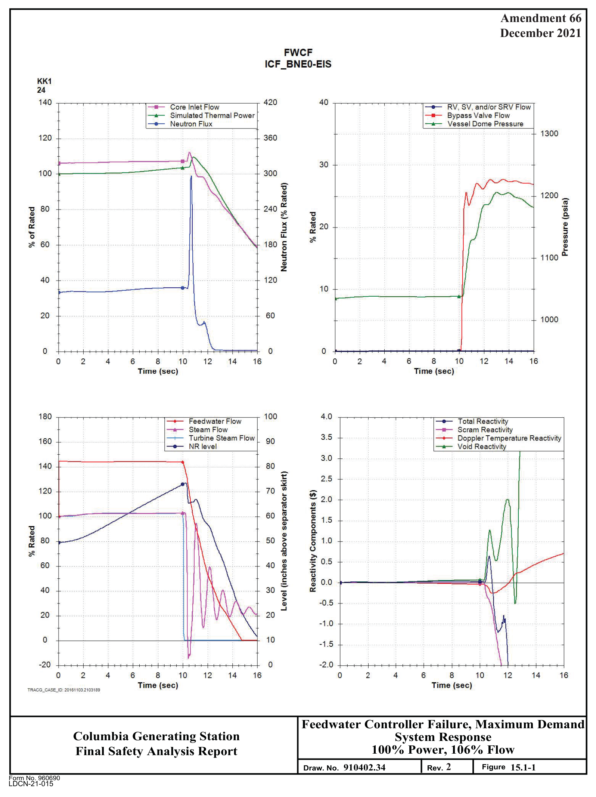

*figure on PDF page 80*

[Vector original (SVG, lossless): fig_page-80_4.svg](../figures/fig_page-80_4.svg)

<!-- labels/text on this figure page -->
Amendment 66 December 2021
Feedwater Controller Failure, Maximum Demand Columbia Generating Station System Response 100% Power, 106% Flow Final Safety Analysis Report 2 910402.34 Figure 15.1-1 Draw. No. Rev.
Form No. 960690
LDCN-21-015

<!-- p.81 -->
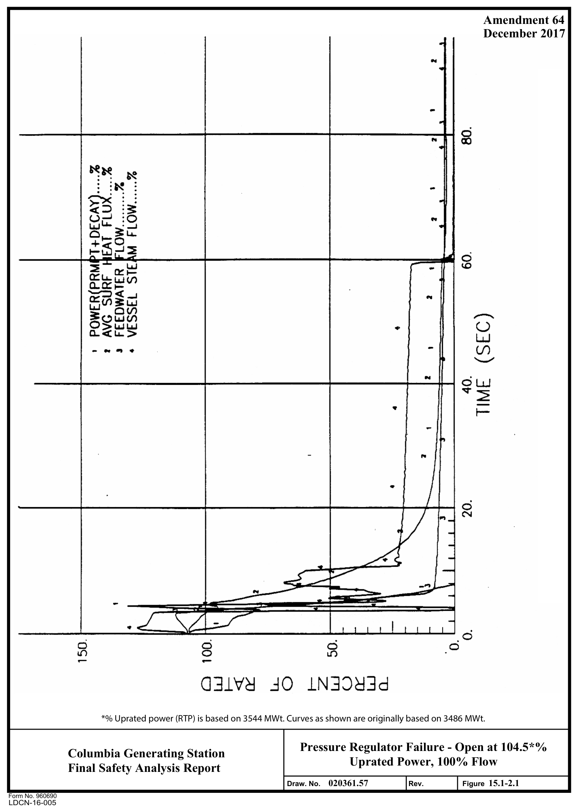

*figure on PDF page 81*

<!-- labels/text on this figure page -->
Amendment 64 December 2017 I
I
•
I
I 80.
ir ..
t>T +DECA'Q·····%
EAT FLU ..... %
• VESSEL STE \M FLOW ...... %
FEEDWATER .:-Low ......... ?.
I
I
2 4
60.
AVG s RF t
POWERJPRM
t
2
TIME (SEC)
•
I I I .,
-
z 40.
4 ,
J
J I
~
---- 4
20.
l. ll I
• \ .
I
I\ I I ~ \ l~ z , ~ 100. ~ \ I >- ..
..... ..... ..... ..... .... 0. >- >- >-
150.
50.
0.
~ w <t: t-z w er: w Q_ er:: LL u 0 0
*% Uprated power (RTP) is based on 3544 MWt. Curves as shown are originally based on 3486 MWt.
Pressure Regulator Failure - Open at 104.5*% Columbia Generating Station Uprated Power, 100% Flow Final Safety Analysis Report 020361.57 15.1-2.1 Draw. No. Rev. Figure Form No. 960690
LDCN-16-005

<!-- p.82 -->
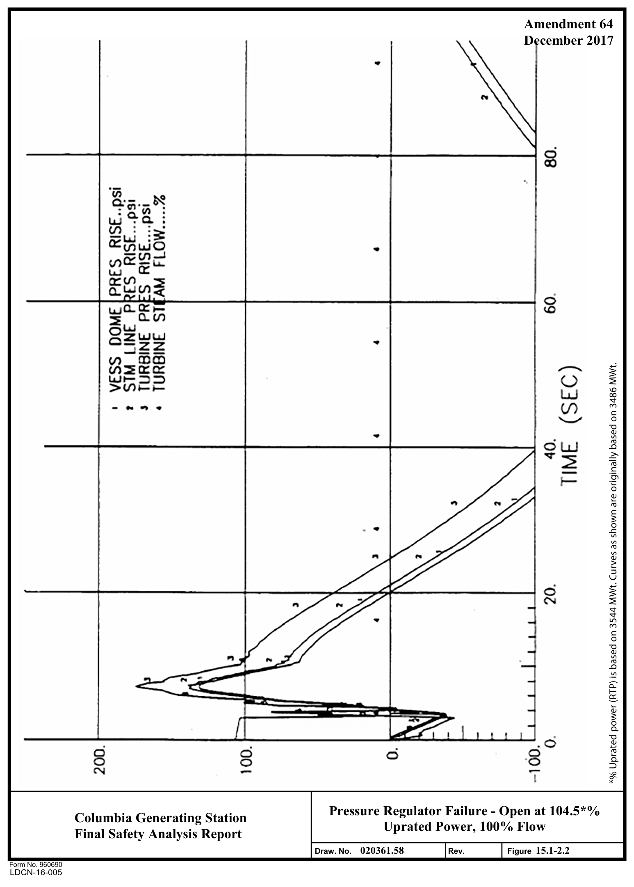

*figure on PDF page 82*

<!-- labels/text on this figure page -->
Amendment 64 December 2017 200. t---------+--------+---- ----1----------+-----
o. lr--fl'9'-----~---or------..-------+-------+-----
100. l--t--111.__,r--"'t::::-----+-------t--------t--------+------
• _ --'-'~--- 80.
1 VESS DOME) PRES RISE .. psi
• TURBINE ST AM FLOW ..... %
, STM LINE P ES RISE ... psi TURBINE PR S RISE. ... psi ___.__...______._._ ___________ '
60.
'
TIME (SEC) *% Uprated power (RTP) is based on 3544 MWt. Curves as shown are originally based on 3486 MWt.
l
' 40.
- 160, .__._..J..--a..___._----..._..__,______.__ ___ 20.
•
o.
Pressure Regulator Failure - Open at 104.5*% Columbia Generating Station Uprated Power, 100% Flow Final Safety Analysis Report 020361.58 15.1-2.2 Draw. No. Rev. Figure Form No. 960690
LDCN-16-005

<!-- p.83 -->
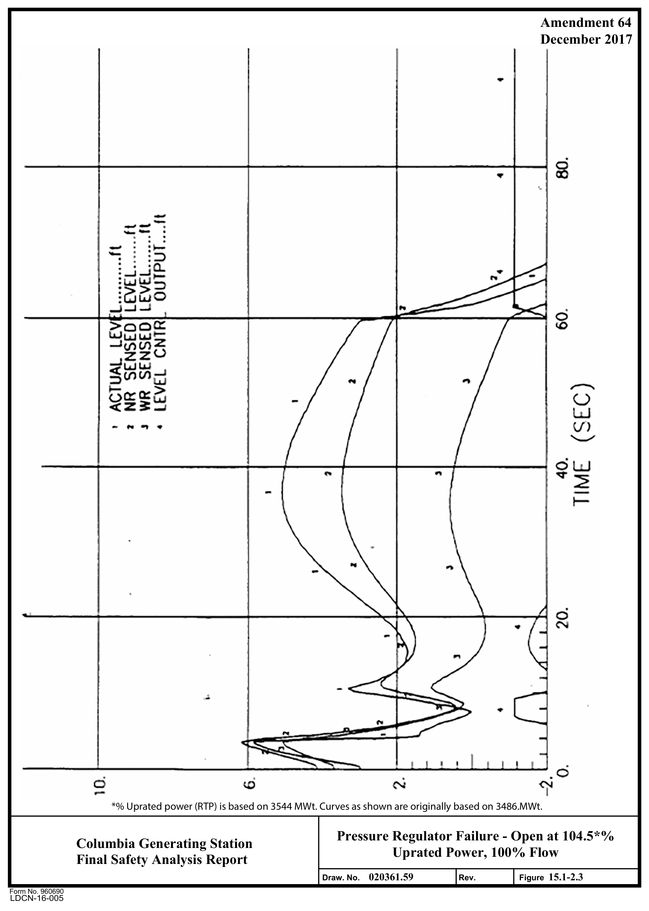

*figure on PDF page 83*

<!-- labels/text on this figure page -->
Amendment 64 December 2017 L-----+-------f-- ----t-----,---- _._ ____ _ 4
80.
I I 6. _,,..__ _______________________ 4 ..
OUTPUT ... .ft
2 NR SENSED LEVEL ...... .f l J WR SENSED LEVEL. ...... ft
I ACTUAL LEVtl .......... t l
\ \
u \ 60.
?&1
• LEVEL CNTR
TIME (SEC)
40.
I 1 ,
' \ u '-= v' v'
-2. 1 I I l I l 1 /1 I I D,, 20.
I•
•
0. 2. I 1 o.
*% Uprated power (RTP) is based on 3544 MWt. Curves as shown are originally based on 3486.MWt.
Pressure Regulator Failure - Open at 104.5*% Columbia Generating Station Uprated Power, 100% Flow Final Safety Analysis Report 020361.59 15.1-2.3 Draw. No. Rev. Figure Form No. 960690
LDCN-16-005

<!-- p.84 -->
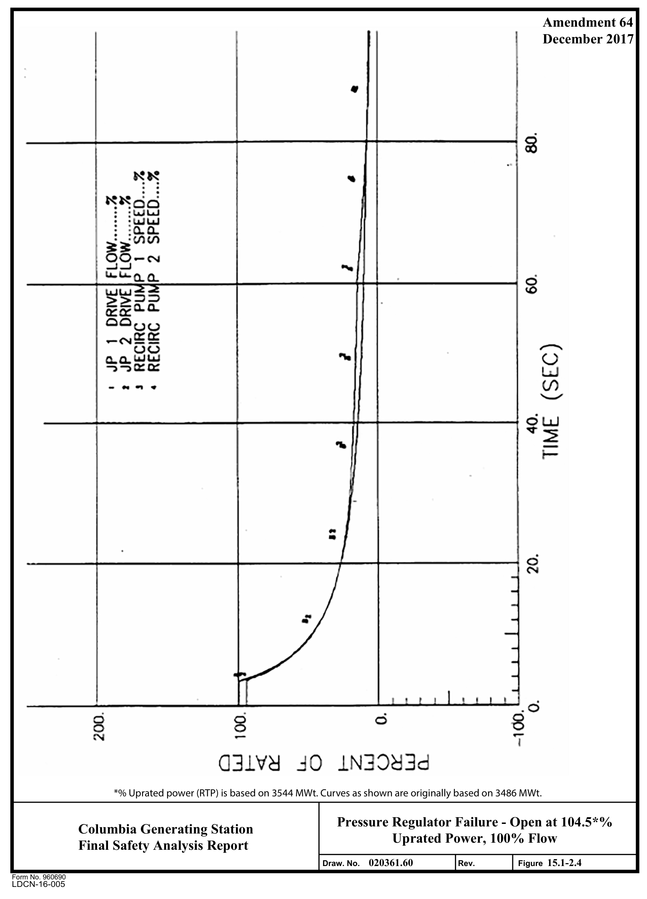

*figure on PDF page 84*

<!-- labels/text on this figure page -->
Amendment 64 December 2017
..
•
80.
J RECIRC PU~ P 1 SPEED .... ~ • RECIRC PU~ P 2 SPEED .... ~
~
•
1 JP 2 DRIVE FLOW ........ ,: 1 JP 1 DRIVE fLOW .•...... 7.
I 60.
TIME (SEC)
I
40.
'
I ~ 11
20.
I
I
I
••
I I I
I
. :1
I
I
- - --- --- 0. - 100. -
~ 100. 200.
0.
<( ._ w Q_ n::: LL n::: w z 0 0 0
*% Uprated power (RTP) is based on 3544 MWt. Curves as shown are originally based on 3486 MWt.
Pressure Regulator Failure - Open at 104.5*% Columbia Generating Station Uprated Power, 100% Flow Final Safety Analysis Report 020361.60 15.1-2.4 Draw. No. Rev. Figure
- - Form No. 960690
LDCN-16-005

<!-- p.85 -->
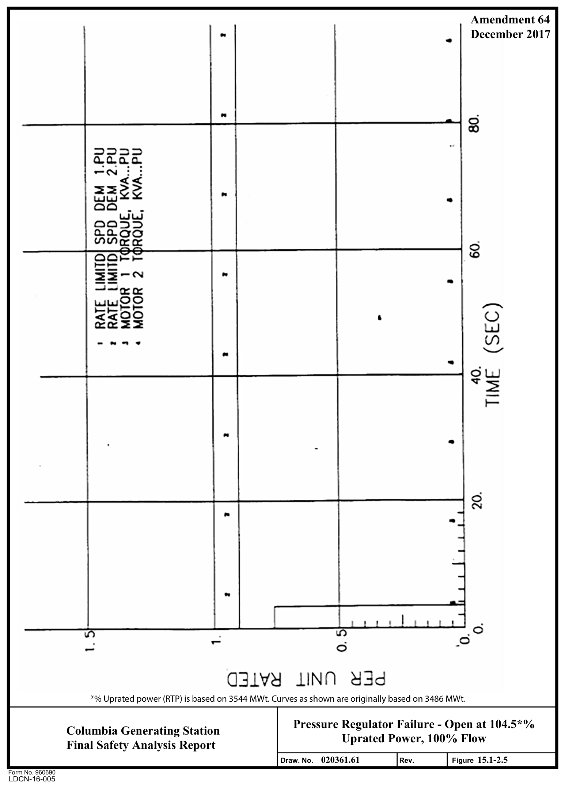

*figure on PDF page 85*

<!-- labels/text on this figure page -->
Amendment 64 December 2017 ' I
80. I ~
: RATE UMITD SPD DEM 1.PU RATE l lMITD SPD DEM 2.PU J MOTOR 1 T1 lRQUE, KVA ... PU • MOTOR 2 T: 1RQUE, KVA ... PU
• I
60.
I I
TIME (SEC)
•
I I
• I 40.
I I
I
20.
I I I I
I
I 1·
I
I ,
• II .._ I
- - ... - I--... ,_ 0. - 0. 5
'o. 1.::
1.
~ ::, w w fr: 0:: 0...
J--z J- 0
*% Uprated power (RTP) is based on 3544 MWt. Curves as shown are originally based on 3486 MWt.
Pressure Regulator Failure - Open at 104.5*% Columbia Generating Station Uprated Power, 100% Flow Final Safety Analysis Report 020361.61
15.1-2.5 - - Draw. No. Rev. Figure
Form No. 960690
LDCN-16-005

<!-- p.86 -->
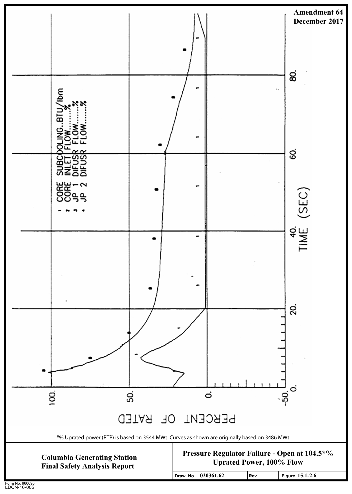

*figure on PDF page 86*

<!-- labels/text on this figure page -->
Amendment 64
100. --------....------------------------- ---
December 2017
-50. '--'-............. __.___ ............. _.__.~.J--- - ---_._--- ------- --_.._----
•
80.
--------1
• CORE SUBCrLING .. BTU/lbm
FLOW ....... %
FLOW ....... X
, CORE INLET FLOW ........ "-
~ 60.
I J JP 1 DIFUS • JP 2 DIFUS
TIME (SEC)
I
• I I 40.
~ • -- I 20.
I
'\.' \ \
I I I ""1 I o.
I I 50.
0.
I
<( 0 ._ w 0:: w Q_ 0 w 0:::
LL. z t- 0
*% Uprated power (RTP) is based on 3544 MWt. Curves as shown are originally based on 3486 MWt.
Pressure Regulator Failure - Open at 104.5*% Columbia Generating Station Uprated Power, 100% Flow Final Safety Analysis Report 020361.62 15.1-2.6 Draw. No. Rev. Figure Form No. 960690
LDCN-16-005

<!-- p.87 -->
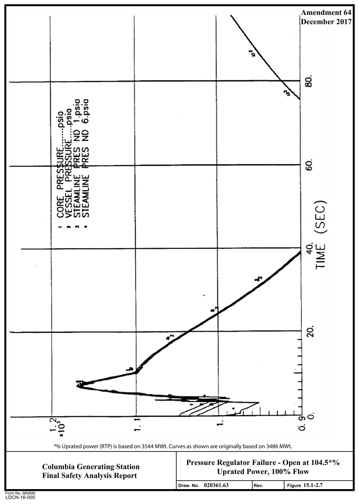

*figure on PDF page 87*

<!-- labels/text on this figure page -->
Amendment 64
- ---~------&.---------..__---- r------ December 2017
2--:---i------+-:~~yi~fui;---=::;-:---l---- 80.
1. 11------1~-1,;,--~---- ---+---- ---+-------
RES ND 1.psio RES ND 6.psio
SURE. .... psio
• CORE PRES,URE. ...... psio
60.
• VESSEL PR
• STEAMLINE STEAMLINE
TIME (SEC)
.,
40.
Q.9LL.....L.JL...L..L.J.--L.L-1..-1--
20.
1. I \W Q.
•IO' I
1.
*% Uprated power (RTP) is based on 3544 MWt. Curves as shown are originally based on 3486 MWt.
Pressure Regulator Failure - Open at 104.5*% Columbia Generating Station Uprated Power, 100% Flow Final Safety Analysis Report 020361.63 15.1-2.7 Draw. No. Rev. Figure Form No. 960690
LDCN-16-005

<!-- p.88 -->
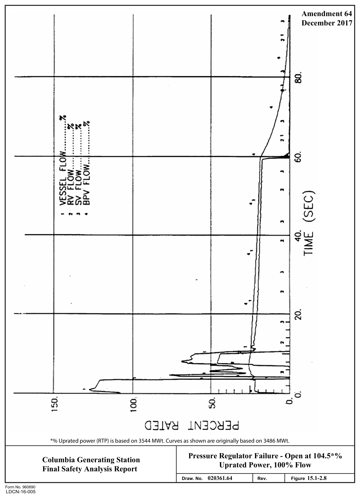

*figure on PDF page 88*

<!-- labels/text on this figure page -->
Amendment 64 J ~
2 • , December 2017
.I •
80.
l
VESSEL FLO ~--···· .. ····'-
J SV FLOW ..... .......... ~ 2 RV FLOW ..... .......... %
• BPV FLOW ... ···········'-
• 60.
~
1 TIME (SEC)
••
I
J
40.
1
t I
)
t
J
• I 20.
I
J I
I
I 2 I I 'f ~ I I I r--... •
1 ,- 1 ~ ~
1 c-" I 50. - i- b. o:
t
... ,_ ,- >- - .... -
150.
100.
~ 0 w <( fr: .._ w 0::: w Q_ z 0
*% Uprated power (RTP) is based on 3544 MWt. Curves as shown are originally based on 3486 MWt.
Pressure Regulator Failure - Open at 104.5*% Columbia Generating Station Uprated Power, 100% Flow Final Safety Analysis Report 020361.64 15.1-2.8 Draw. No. Rev. Figure
Form No. 960690
LDCN-16-005

<!-- p.89 -->
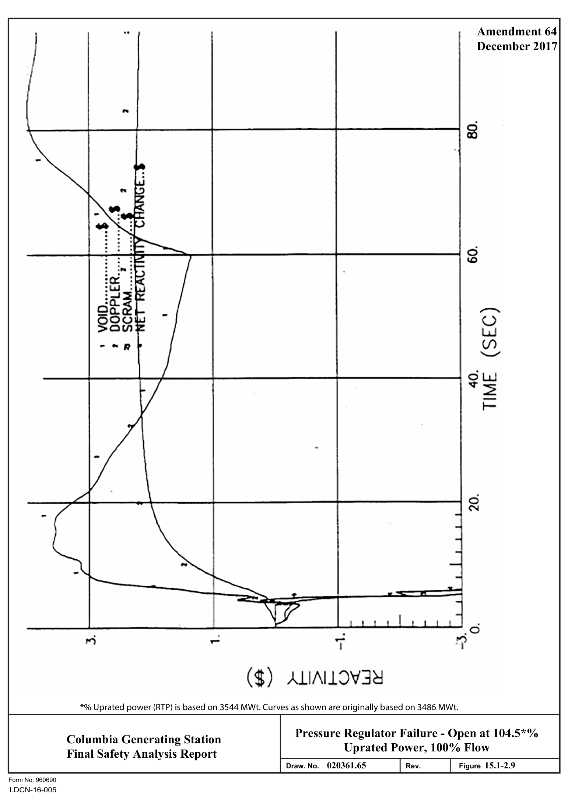

*figure on PDF page 89*

<!-- labels/text on this figure page -->
~3.~~~=-+~~ Amendment 64 December 2017
-7"----t""-----
J 80.
, DOPPLER. .......... ... S
1 VOI0 ............ 1·····1.)$ '
~ SCRAM ..... ~ ... ........ .
-
60.
.......... .--------+--------+--
TIME (SEC)
40.
20.
3 . .,__ _ __,,_ ___
0.
- 1. 1.
~ ~ ~ ~
---- > 4: .,_ u w
*% Uprated power (RTP) is based on 3544 MWt. Curves as shown are originally based on 3486 MWt.
Pressure Regulator Failure - Open at 104.5*% Columbia Generating Station Uprated Power, 100% Flow Final Safety Analysis Report 020361.65 15.1-2.9 Draw. No. Rev. Figure
Form No. 960690
LDCN-16-005

<!-- p.90 -->
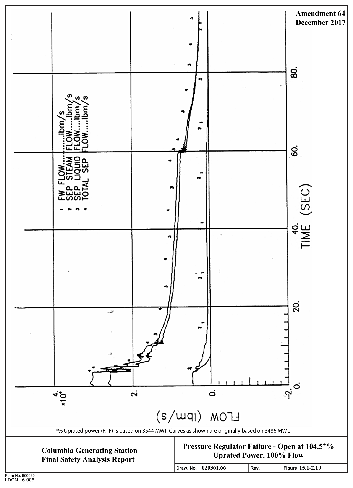

*figure on PDF page 90*

<!-- labels/text on this figure page -->
Amendment 64 ...
December 2017 ► ~
•
"' "
• .. '
-..
•
- j
•
-..
...
,,,--..
u w
- .. .., .
(/)
• '--"'
----+-_______ ....., ____ _,.. __ ~~--------'OW
q-~ t-
- - N
..
-
-----+---------~---..-u----~~-------~ 0
-- N
..
- ...
.
- ...
-
- - ...
-
•
-
•
• l l
...1-_ _.__•~•__.,•~1 _...__I,.__.,,......,,__.., ..... - . o
.
_......,_.....i,,, ___________
-
vo
0 N ~~ M
(s/wq1) MOlJ *% Uprated power (RTP) is based on 3544 MWt. Curves as shown are originally based on 3486 MWt.
Pressure Regulator Failure - Open at 104.5*% Columbia Generating Station Uprated Power, 100% Flow Final Safety Analysis Report 020361.66 15.1-2.10 Draw. No. Rev. Figure Form No. 960690
LDCN-16-005

<!-- p.91 -->
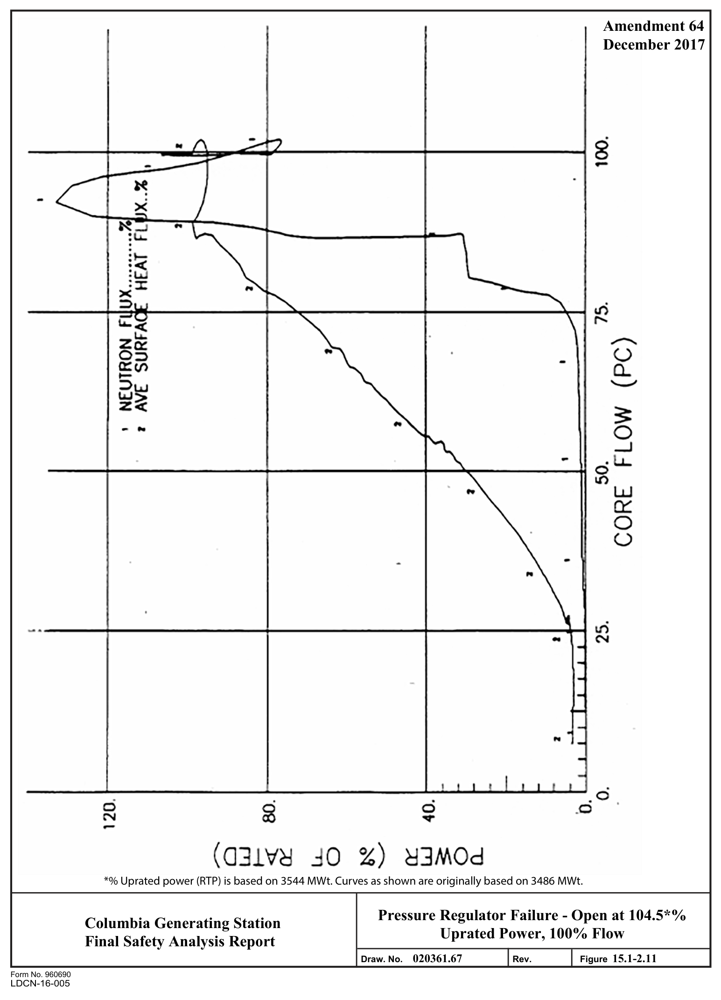

*figure on PDF page 91*

<!-- labels/text on this figure page -->
Amendment 64 December 2017 _
_,.__~..._ ___
100.
I
r AVE SURFAct: HEAT FLIJX .. %
, NEUTRON ruux ........... ,;
,.._ ___ 75.
:::: I -+-______
CORE FLOW (PC)
50.
I 120. t-------_. ______ 25.
l I I I I I ' I I I
J
b. I l 0.
40.
80.
~
;: .....__..,
0 w <( fr:
et: w ()_ - LL t-- 0 0
*% Uprated power (RTP) is based on 3544 MWt. Curves as shown are originally based on 3486 MWt.
Pressure Regulator Failure - Open at 104.5*% Columbia Generating Station Uprated Power, 100% Flow Final Safety Analysis Report 020361.67 15.1-2.11 Draw. No. Rev. Figure Form No. 960690
LDCN-16-005

<!-- p.92 -->
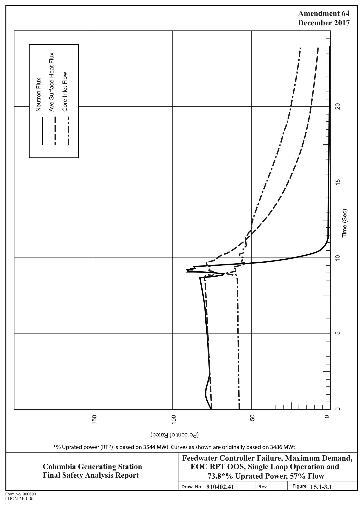

*figure on PDF page 92*

[Vector original (SVG, lossless): fig_page-92.svg](../figures/fig_page-92.svg)

<!-- labels/text on this figure page -->
Amendment 64 December 2017
- .
- I - I Ave Surface Heat Flux I - I
I I -
I Core Inlet Flow I - I Neutron Flux I - I I - I
-
- I I I 20 I I I - I I I
- I I
I I I
I
- I I I
- I I I I
- I I
I I -
I I I I . I I I .
15 I I I I I I I I I I Time (Sec)
I I
- I ~I J /J __,,I- ,..,, /•
--· ~
• 10
•
- ~- < ~ ,L
- I
- ~
- I I
- I
- I
- I I
-
- I I 5 I
- I
- I I
-
- I I
- I
- I I
-
I I I
I
- ~
- I I
I I I
I I I I I I
0
50 150 100 0
(Percent of Rated)
*% Uprated power (RTP) is based on 3544 MWt. Curves as shown are originally based on 3486 MWt.
Feedwater Controller Failure, Maximum Demand, EOC RPT OOS, Single Loop Operation and Columbia Generating Station Final Safety Analysis Report 73.8*% Uprated Power, 57% Flow 910402.41 15.1-3.1 Draw. No. Rev. Figure Form No. 960690
LDCN-16-005

<!-- p.93 -->
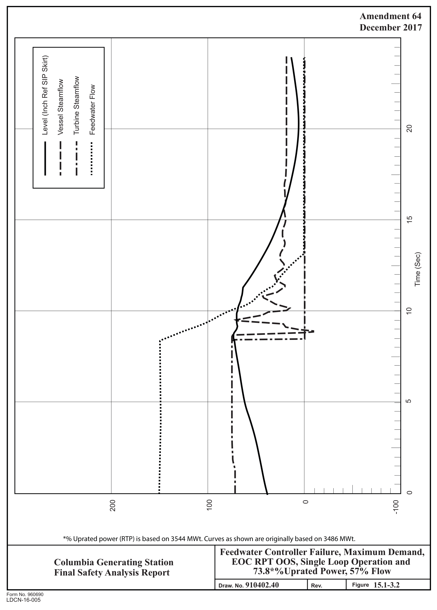

*figure on PDF page 93*

[Vector original (SVG, lossless): fig_page-93.svg](../figures/fig_page-93.svg)

<!-- labels/text on this figure page -->
Amendment 64 December 2017
Level (Inch Ref SIP Skirt)
Turbine Steamflow Vessel Steamflow Feedwater Flow 20
15
Time (Sec)
-- ..
...
----'-- 10
••
------ ...
--------- ······ ······
5
l • I
0
100 200 0
-100
*% Uprated power (RTP) is based on 3544 MWt. Curves as shown are originally based on 3486 MWt.
Feedwater Controller Failure, Maximum Demand, EOC RPT OOS, Single Loop Operation and Columbia Generating Station 73.8*%Uprated Power, 57% Flow Final Safety Analysis Report 910402.40 15.1-3.2 Draw. No.
Rev. Figure Form No. 960690
LDCN-16-005

<!-- p.94 -->
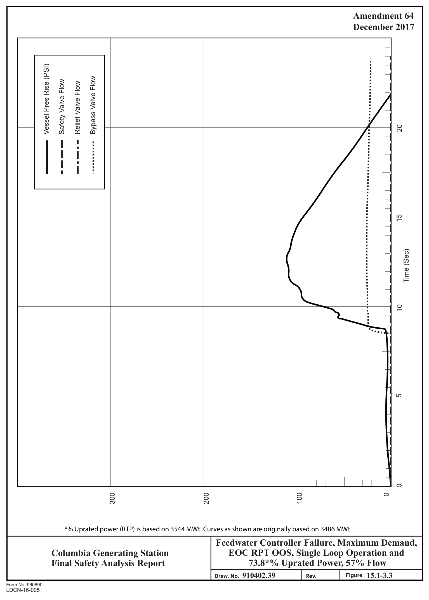

*figure on PDF page 94*

[Vector original (SVG, lossless): fig_page-94.svg](../figures/fig_page-94.svg)

<!-- labels/text on this figure page -->
Amendment 64 December 2017
Vessel Pres Rise (PSI)
Bypass Valve Flow Safety Valve Flow Relief Valve Flow 20
15
Time (Sec)
10
5
0
300 200 100 0
*% Uprated power (RTP) is based on 3544 MWt. Curves as shown are originally based on 3486 MWt.
Feedwater Controller Failure, Maximum Demand, EOC RPT OOS, Single Loop Operation and Columbia Generating Station 73.8*% Uprated Power, 57% Flow Final Safety Analysis Report 910402.39 15.1-3.3 Draw. No.
Rev. Figure Form No. 960690
LDCN-16-005

<!-- p.95 -->
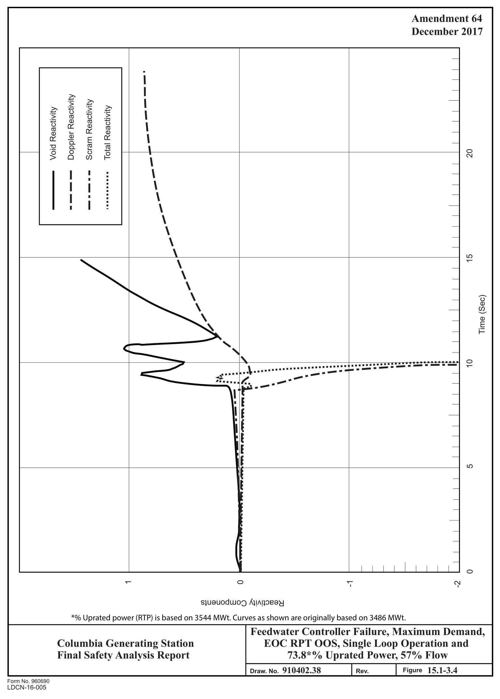

*figure on PDF page 95*

[Vector original (SVG, lossless): fig_page-95_2.svg](../figures/fig_page-95_2.svg)

<!-- labels/text on this figure page -->
Amendment 64 December 2017
.
I I Doppler Reactivity I Scram Reactivity Total Reactivity Void Reactivity I I I 20 \
• \ I I •
• • \ I • I
•
• • \ I I • I \ i \ \ \ 15
Time (Sec)
10 4 '"'"'"'"' ,.,.\,.,.,.,.,.,.,.,.,.,.,.,.,.,.,.,.,.,.,.,.,.,.,.,.,.,., ,.,.,.,.,.,.,.,.,.,., ' #.■1■1■1■1 r·-·- ., - - - - - · - - - - - - - - - - - - • ■11~ .- , 1 -
I I I I
I -
E I
• 5
0
-1 1 0
-2
Reactivity Components *% Uprated power (RTP) is based on 3544 MWt. Curves as shown are originally based on 3486 MWt.
Feedwater Controller Failure, Maximum Demand, EOC RPT OOS, Single Loop Operation and Columbia Generating Station 73.8*% Uprated Power, 57% Flow Final Safety Analysis Report 910402.38 15.1-3.4 Draw. No.
Rev. Figure Form No. 960690
LDCN-16-005

