# 15.2 INCREASE IN REACTOR PRESSURE

> Columbia Generating Station FSAR — Chapter 15: Accident Analyses
> Source: `15_chapter-4122-5262.pdf`, PDF pages 96–162 (of 1141)
> Amendment 67 compilation (individual pages carry varying amendment dates)

---
<!-- p.96 -->
### 15.2 INCREASE IN REACTOR PRESSURE
#### 15.2.1 PRESSURE REGULATOR FAILURE - CLOSED
This transient is classified as a nonlimiting event for both original and uprated power conditions. Therefore, cycle specific analyses are not performed for this event. The analysis results presented in the section are based on uprated power conditions and a representative reload core (Cycle 8) as documented in Reference 15.2-5.

##### 15.2.1.1 Identification of Causes and Frequency Classification
###### 15.2.1.1.1 Identification of Causes
A triple redundant control system is provided to maintain primary system pressure control.
The pressure upstream of the main turbine stop (throttle) valves is sensed by three redundant throttle pressure transmitters and the control system uses a median select logic to determine which pressure transmitter is used to control throttle pressure. The pressure control system compares the detected throttle pressure to a pressure setpoint to control the position of the main turbine control (governor) valves in order to control pressure.

It is assumed for purposes of this transient analysis that a single failure occurs on the controlling pressure transmitter which erroneously causes the DEH control system to close the turbine control (governor) valves and thereby increases reactor pressure. If this occurs, the self diagnostics ability and triple redundant control system is available.

###### 15.2.1.1.2 Frequency Classification
This event is categorized as an incident of moderate frequency.

##### 15.2.1.2 Sequence of Events and Systems Operation
###### 15.2.1.2.1 Sequence of Events
A failure of a DEH control system component that causes the turbine control (governor) valves or turbine bypass valves to move towards the closed position will momentarily result in an initial pressure increase because the reactor is still generating the initial steam flow. The DEH control system is self diagnostic. It will detect the faulty component and disable it. The control system is redundant and will continue to perform its functions, and will restore steady state operation.

For a failure that causes the DEH turbine control pressure regulator to initiate a demand signal to close the turbine control (governor) valves (requires multiple component failures), there will be an increase in system pressure and reactor power. A scram will be initiated when the high

#### LDCN-06-057, 07-011
<!-- p.97 -->
neutron flux scram setpoint is reached. The pressure rises to the pressure relief setpoint, part of the relief valves open, discharging steam to the suppression pool. The plant response is given in Table 15.2-1.

###### 15.2.1.2.2 Systems Operation
Normal plant instrumentation and control is assumed to function except for the pressure regulator failure. The event is analyzed from 102.4% uprated power and 106% of rated core flow. The event results in a high flux trip initiated by the reactor protection system.

###### 15.2.1.2.3 The Effect of Single Failures and Operator Errors
The first assumed failure produces a slight pressure increase in the reactor until the DEH control system adjusts to the single failure and gains control. No other action is significant in restoring normal operation. If subsequent failures occur such that the DEH control system further closes the turbine control (governor) valves the reactor pressure could rise to the point where a flux or pressure scram trip would be initiated to shutdown the reactor. This event is less severe than the turbine trip for the following reasons:

a. For the DEH control system failure-closure event the reactor scrams on high neutron flux or pressure but the recirculation pumps do not trip. As a result, core flow remains at 100% or greater throughout the critical portion of the transient with respect to the critical power ratio (CPR). This provides improved heat transfer capability in relation to the turbine trip transient; and

b. Since the turbine control (governor) valves close in response to a pressure error signal, their closure rate is not as fast as the turbine stop (throttle) or control
(governor) valve response to a trip signal. This produces a slower pressurization rate for the DEH control system failure relative to the turbine trip event. This in turn results in a lower peak neutron flux and therefore a lower peak surface heat flux than the turbine trip event.

##### 15.2.1.3 Core and System Performance
###### 15.2.1.3.1 Mathematical Model
The one-dimensional ODYN model described in Section 15.0.3.3.1 is used to simulate this event.

<!-- p.98 -->
###### 15.2.1.3.2 Input Parameters and Initial Conditions
The analyses have been performed with plant conditions at 102.4% of uprated power and 106% of rated core flow. The input parameters are given in detail in Table 15.0-2 under the ODYN column.

###### 15.2.1.3.3 Results
The closure of the turbine governor (control) valves results in a rise in reactor pressure, collapsing the coolant voids which in turn increases the neutron flux. One sec after the initiation of the event the neutron flux increases to the high flux setpoint signal and initiates a reactor scram. Two sec into the event the pressure in the reactor reaches the ATWS high pressure trip setpoint, initiating a recirculation pump trip signal. As the pressure in the reactor system continues to rise, the relief valves begin to open starting with Group 3. The maximum pressure is reached at 3.25 sec and is calculated to be 1220 psig at the bottom of the reactor vessel. Table 15.2-1 provides the sequence of events and Figure 15.2-1 depicts the plant parameters responses. Key transient peak values are presented in Table 15.0-1. This event is nonlimiting in that the pressurization event is less severe than the Generator Load Rejection with Bypass Failure and Turbine Trip with Bypass Failure events.

###### 15.2.1.3.4 Consideration of Uncertainties
The uncertainties included in the initial power and flow considerations maximize the consequences of the plant response. The independent pressure regulators normally respond such that failure of one would be compensated by the other regulator with plant not experiencing a trip.

##### 15.2.1.4 Barrier Performance
The consequences of this event do not result in any temperature or pressure transient (see Table 15.0-1) in excess of the criteria for which the fuel, pressure vessel, or containment are designed. Therefore, barrier integrity and function is maintained.

##### 15.2.1.5 Radiological Consequences
Since this event does not result in any fuel failures or any release of primary coolant to either the secondary containment or to the environment, there are no radiological consequences associated with this event.

<!-- p.99 -->
#### 15.2.2 GENERATOR LOAD REJECTION
##### 15.2.2.1 Identification of Causes and Frequency Classification
###### 15.2.2.1.1 Identification of Causes
Fast closure of the turbine control (governor) valves (TCVs) is initiated whenever electrical grid disturbances occur which result in significant loss of electrical load on the generator. The TCVs are required to close as rapidly as possible to prevent excessive overspeed of the turbine-generator rotor. Closure of the main TCVs will cause a sudden reduction in steam flow which results in an increase in system pressure, which may cause a reactor shutdown due to a high flux or high steam pressure condition.

###### 15.2.2.1.2 Frequency Classification
###### 15.2.2.1.2.1 Generator Load Rejection. This event is categorized as an incident of moderate frequency.

15.2.2.1.2.2 Generator Load Rejection with Bypass Failure. This event is categorized as a moderate frequency event.

##### 15.2.2.2 Sequence of Events and System Operation
The generator load rejection with bypass failure event is the most limiting (with respect to thermal margin) of the class of transients characterized by rapid vessel pressurization, including load rejection with the bypass valves operating. The generator load rejection causes a TCV (governor valve) fast closure, which initiates a reactor scram and a recirculation pump trip (RPT). The compression wave produced by the TCV fast closure travels through the steam lines into the vessel and pressurizes the reactor vessel and core. Bypass flow to the condenser, which would mitigate the pressurization effect, is conservatively not allowed. The excursion of core power due to void collapse is primarily terminated by reactor scram and void growth due to RPT. The recirculation pump speed remains constant until tripped by the RPT system.

Events caused by low water level trips, including closure of main steam line isolation valves
(MSIVs), and initiation of high-pressure core spray (HPCS) and reactor core isolation cooling
(RCIC) are not included in the simulation. Should these events occur, they will follow after the primary concerns of fuel thermal margin and overpressure effects have occurred, and are expected to be less severe than those already experienced by the system.

<!-- p.100 -->
###### 15.2.2.2.1 Sequence of Events
15.2.2.2.1.1 Generator Load Rejection - Turbine Control Valve Fast Closure. This transient is classified as a nonlimiting event for both original and uprated power conditions. Therefore, the original rated power (3323 MWt) analysis has not been updated.

A loss of generator electrical load from high power conditions produces the sequence of events listed in Table 15.2-2.

15.2.2.2.1.2 Generator Load Rejection with Failure of Bypass. A loss of generator electrical load at 3544 MWt with bypass failure produces the sequence of events listed in Table 15.2-3.

###### 15.2.2.2.2 System Operation
15.2.2.2.2.1 Generator Load Rejection with Bypass. To properly simulate the expected sequence of events, the analysis of this event assumes normal functioning of plant instrumentation and controls, plant protection, reactor pressure vessel (RPV) safety/relief valves (SRV), and reactor protection systems (RPS) unless stated otherwise. The bypass valve opening characteristics reflect the specified delay together with the specified opening characteristic required for bypass system operation.

Turbine control valve fast closure initiates a scram trip signal for power levels greater than 29.5% nuclear boiler rated (NBR). In addition, recirculation pump trip (RPT) is initiated.
Both of these trip signals satisfy single failure criterion and credit is taken for these protection features.

The pressure relief system, which operates the SRVs independently when system pressure exceeds relief valve instrumentation setpoints is assumed to function normally during the time period analyzed.

15.2.2.2.2.2 Generator Load Rejection with Failure of Bypass. Same as Section 15.2.2.2.2.1 except that failure of the main turbine bypass valves is assumed for the entire transient. In addition, the pressure relief system, which operates the SRVs independently when system pressure exceeds relief valve instrumentation setpoints, fails to operate. Pressure relief is provided by the safety function of the SRVs.

###### 15.2.2.2.3 The Effect of Single Failures and Operator Errors
Mitigation of pressure increase, the basic nature of this transient, is accomplished by the RPS functions. Turbine control valve trip scram and RPT are designed to satisfy the single failure criterion. An evaluation of the most limiting single failure (i.e., failure of the bypass system)
was considered in this event.

<!-- p.101 -->
##### 15.2.2.3 Core and System Performance
###### 15.2.2.3.1 Mathematical Model
15.2.2.3.1.1 Generator Load Rejection with Bypass. The predicted dynamic behavior for the generator load reject with bypass valves operable has been determined using a computer simulated, analytical model of a generic direct-cycle BWR. This model is described in detail in Reference 15.2-4.

The nonlinear computer simulated analytical model is designed to predict associated transient behavior of the reactor. Some of the significant features of the model are the following:

a. A point kinetic model is assumed with reactivity feedbacks from control rods
(absorption), voids (moderation), and Doppler (capture) effects.

b. The fuel is represented by three four-node cylindrical elements, each enclosed in a cladding node. One of the cylindrical elements is used to represent core average power and fuel temperature conditions, providing the source of Doppler feedback. The other two are used to represent “hot spots” in the core, to simulate peak fuel center temperature and cladding temperature.

c. Four primary system pressure nodes are simulated. The nodes represent the core exit pressure, vessel dome pressure, steam line pressure (at a point representative of the safety/relief valve location), and turbine inlet pressure.

d. The active core void fraction is calculated from a relationship between core exit quality, inlet subcooling, and pressure. This relationship is generated from multimode core steady-state calculations. A second-order void dynamic model, with the void boiling sweep time calculated as a function of core flow and void conditions, is also utilized.

e. Principal controller functions such as feedwater flow, recirculation flow, reactor water level, pressure and load demand are represented together with their dominant nonlinear characteristics.

f. The ability to simulate necessary reactor protection system functions is provided.

15.2.2.3.1.2 Generator Load Rejection with Bypass Failure. The predicted dynamic behavior for the load rejection with bypass inoperable has been determined using a computer simulated, analytical model of a direct-cycle BWR that is discussed in Section 15.1.2.3.1. This model is described in detail in Reference 15.2-10.

<!-- p.102 -->
###### 15.2.2.3.2 Input Parameters and Initial Conditions
These analyses have been performed, unless otherwise noted, with the plant conditions tabulated in Table 15.0-2 for the load rejection with bypass and in Table 15.0-2B for load rejection with bypass failure.

The turbine digital electrohydraulic control system power/load imbalance device detects load rejection before a measurable speed change takes place.

The closure characteristics of the TCVs are assumed such that the valves operate in the full arc (FA) mode and have a full stroke closure time, from fully open to fully closed, of 0.15 sec.
In FA mode, at 100% power, the TCVs are not fully open, so the analysis assumes a closure time that is a fraction of the full stroke time proportional to the TCV initial position.

###### 15.2.2.3.3 Results
Analyses were performed to analyze combinations of RPT operable/inoperable and Option A and Option B scram speeds (Reference 15.2-3). The excursion of core power due to void collapse is primarily terminated by reactor scram and void growth due to RPT.

15.2.2.3.3.1 Generator Load Rejection with Bypass. Figure 15.2-2.1 shows the results of the generator trip from original rated power. Peak neutron flux rises 147% above NBR conditions.

The average surface heat flux peaks at 102.9% of the initial value and minimum critical power ratio (MCPR) does not significantly decrease below its initial value.

15.2.2.3.3.2 Generator Load Rejection with Failure of Bypass. Figure 15.2-2.2 shows that, for the case of bypass failure, peak neutron flux reaches about 325% power. Results reflect GNF2 fuel introduction, some of which are dependent on fuel design and core loading pattern.
Compliance with the event acceptance criteria is demonstrated by cycle-dependent analysis of potentially limiting events just prior to the operation of that cycle. The results are reported in the Supplemental Reload Licensing Report (Reference 15.2-3). As discussed in Section 15.0.2.1, when this event is initiated during single loop operation, the consequences are less severe than the consequences analyzed for the two loop operation.

###### 15.2.2.3.4 Consideration of Uncertainties
The full stroke closure time of the TCV of 0.15 sec is conservative. Typically, the actual closure time is closer to 0.2 sec. The less time it takes to close, the more severe the pressurization effect.

<!-- p.103 -->
All systems used for protection in this event were assumed to have the poorest allowable response. Expected plant behavior is, therefore, expected to reduce the actual severity of the transient.

##### 15.2.2.4 Barrier Performance
###### 15.2.2.4.1 Generator Load Rejection
Peak pressure remains within normal operating range and no threat to the barrier exists.

###### 15.2.2.4.2 Generator Load Rejection with Failure of Bypass
The peak dome pressure reaches 1244 psig. The peak reactor coolant pressure boundary
(RCPB) pressure reaches 1270 psig. The peak pressure remains well below the nuclear barrier transient pressure limit of 1375 psig.

##### 15.2.2.5 Radiological Consequences
While the consequences of this event do not result in fuel failures, the result includes the discharge of normal coolant activity to the suppression pool by means of safety/relief valve
(SRV) operation. Since this activity is contained in the primary containment, there will be no exposure to the public. Since this event does not result in an uncontrolled release to the environment, the plant operator can choose to hold the activity in containment or filter the discharge prior to release to the environment when conditions permit in accordance with established requirements.

#### 15.2.3 TURBINE TRIP
##### 15.2.3.1 Identification of Causes and Frequency Classification
###### 15.2.3.1.1 Identification of Causes
A variety of turbine or nuclear system malfunctions will initiate a turbine trip. Some examples are moisture separator high levels, operator lockout, loss of control fluid pressure, low condenser vacuum, and reactor high water level.

###### 15.2.3.1.2 Frequency Classification
###### 15.2.3.1.2.1 Turbine Trip. This event is categorized as an incident of moderate frequency.
In defining the frequency of this event, turbine trips which occur as a by-product of other transients such as loss of condenser vacuum or reactor high level trip events are not included.
However, spurious low vacuum or high level trip signals which cause an unnecessary turbine trip are included in defining the frequency.

<!-- p.104 -->
15.2.3.1.2.2 Turbine Trip with Failure of Bypass. This transient disturbance is categorized as a moderate frequency incident.

##### 15.2.3.2 Sequence of Events and Systems Operation
###### 15.2.3.2.1 Sequence of Events
15.2.3.2.1.1 Turbine Trip. This transient is classified as a nonlimiting event for both original and uprated power conditions. Therefore, the original rated power (3323 MWt) analysis has not been updated. Turbine trip at high power produces the sequence of events listed in Table 15.2-4.

15.2.3.2.1.2 Turbine Trip with Failure of Bypass. Turbine trip at high power with bypass failure produces the sequence of events listed in Table 15.2-5.

###### 15.2.3.2.2 Systems Operation
15.2.3.2.2.1 Turbine Trip. All plant control systems maintain normal operation unless specifically designated to the contrary.

Turbine stop (throttle) valve closure initiates a reactor scram trip by means of valve position signals to the protection system.

Turbine stop valve closure initiates RPT thereby terminating the jet pump drive flow.

The pressure relief system, which operates the relief valves independently when system pressure exceeds relief valve instrumentation setpoints, is assumed to function normally during the time period analyzed.

The severity of turbine trips from lower initial power levels decreases to the point where a scram can be avoided if auxiliary power is available from an external source and the power level is within the bypass capability.

15.2.3.2.2.2 Turbine Trip with Failure of Bypass. Same as Section 15.2.3.2.2.1 except that failure of the main turbine bypass system is assumed for the entire transient time period analyzed. During the transient the SRVs open and close sequentially as the stored energy is dissipated until the pressure falls below the valve setpoints.

15.2.3.2.2.3 Turbine Trip at Low Power with Failure of Bypass. Same as Section 15.2.3.2.2.1 except that failure of the main turbine bypass system is assumed.

<!-- p.105 -->
Below 29.5% NBR power level, a main stop valve scram trip inhibit signal derived from the first stage pressure of the turbine is activated. This is done to eliminate the stop valve scram trip signal from scramming the reactor provided the bypass system functions properly. In other words, the bypass would be sufficient at this low power to accommodate a turbine trip without the necessity of shutting down the reactor. All other protection system functions remain functional as before and credit is taken for those protection system trips.

###### 15.2.3.2.3 The Effect of Single Failures and Operator Errors
###### 15.2.3.2.3.1 Turbine Trips at Power Levels Greater Than 29.5% Nuclear Boiler Rated.
Mitigation of pressure increase, the basic nature of this transient, is accomplished by the RPS functions. Main stop valve closure scram trip and RPT are designed to satisfy single failure criterion.

15.2.3.2.3.2 Turbine Trips at Power Levels Less Than 29.5% Nuclear Boiler Rated. Same as Section 15.2.3.2.3.1 except RPT and stop valve closure scram trip is normally inoperative.
Since protection is still provided by high flux, high pressure, etc., these will continue to function and scram the reactor should a single failure occur.

##### 15.2.3.3 Core and System Performance
###### 15.2.3.3.1 Mathematical Model
15.2.3.3.1.1 Turbine Trip with Bypass. The predicted dynamic behavior for the turbine trip has been determined using a computer simulated, analytical model of a generic direct-cycle BWR, as discussed in Section 15.2.2.3.1. This model is described in detail in Reference 15.2-4.

15.2.3.3.1.2 Turbine Trip with Bypass Failure. The three-dimensional TRACG model described in Section 15.0.3.3.1 is used to simulate this event.

###### 15.2.3.3.2 Input Parameters and Initial Conditions
These analyses have been performed, unless otherwise noted, with plant conditions tabulated in Table 15.0-2 for the turbine trip with bypass and Table 15.0-2B for the turbine trip with bypass failure.

The turbine trip analysis was performed at the 105% of the original rated steam flow. The turbine trip with bypass failure was analyzed at an initial condition of 100% rated power
(3544 MWt) and 106% rated core flow.

Turbine stop (throttle) valves full stroke closure time is 0.1 sec.

<!-- p.106 -->
A reactor scram is initiated by position switches on the stop valves when the valves are 90% open or less. This stop valve scram trip signal is automatically bypassed when the reactor is below 29.5% NBR power level.

Reduction in core recirculation flow is initiated by position switches on the main stop valves, which actuate trip circuitry which trips the recirculation pumps.

###### 15.2.3.3.3 Results
15.2.3.3.3.1 Turbine Trip. The results of a turbine trip with the bypass system operating normally are shown in Figure 15.2-3.

Neutron flux increases rapidly because of the void reduction caused by the pressure increase.
However, the flux increase is limited to 138% of rated by the stop valve scram and the RPT system. Peak fuel surface heat flux does not exceed 101.7% of its initial value.

15.2.3.3.3.2 Turbine Trip with Failure of Bypass. The results of a turbine trip with failure of the bypass system are shown in Figure 15.2-4.

The peak neutron flux reaches 308% of its rated value, and peak surface heat flux reaches 111% of its initial value.

Compliance with the event acceptance criteria is demonstrated by cycle-dependent analysis of potentially limiting events just prior to the operation of that cycle. The results are reported in the Supplemental Reload Licensing Report (Reference 15.2-3) if the event is limiting.

15.2.3.3.3.3 Turbine Trip with Bypass Valve Failure, Low Power. This transient is less severe than a similar one at high power. Below 29.5% of rated power, the turbine stop valve closure and TCV (governor valve) closure scrams are automatically bypassed. At these lower power levels, turbine first stage pressure is used to initiate the scram logic bypass. The scram which terminates the transient is initiated by high vessel pressure. The bypass valves are assumed to fail; therefore, system pressure will increase until the pressure relief setpoints are reached. At this time, because of the relatively low power of this transient event, relatively few relief valves will open to limit reactor pressure. Peak pressures are not expected to greatly exceed the pressure relief valve setpoints and will be significantly below the reactor coolant pressure boundary (RCPB) transient limit of 1375 psig. Peak surface heat flux and peak fuel center temperature remain at relatively low values and MCPR remains well above the GETAB MCPR99.9%.

<!-- p.107 -->
###### 15.2.3.3.4 Considerations of Uncertainties
Uncertainties in these analyses involve protection system settings, system capacities, and system response characteristics. In all cases, the most conservative values are used in the analyses. For example:

a. Slowest allowable control rod scram motion is assumed, b. Scram worth shape for all-rod-out conditions is assumed, c. Minimum specified valve capacities are utilized for overpressure protection, and d. Setpoints of the SRVs include errors and uncertainties (high) for all valves.

##### 15.2.3.4 Barrier Performance
###### 15.2.3.4.1 Turbine Trip
Peak pressure in the bottom of the vessel reaches 1163 psig, which is below the American Society of Mechanical Engineers (ASME) Code limit of 1375 psig for the RCPB. Vessel dome pressure does not exceed 1136 psig.

###### 15.2.3.4.2 Turbine Trip with Failure of Bypass
The peak steam line pressure reaches 1235 psig. The peak reactor coolant pressure boundary
(RCPB) pressure reaches 1260 psig. The peak pressure remains well below the nuclear barrier transient pressure limit of 1375 psig.

15.2.3.4.2.1 Turbine Trip with Failure of Bypass at Low Power. Qualitative discussion is provided in Section 15.2.3.3.3.3.

##### 15.2.3.5 Radiological Consequences
The consequence of this event does not result in fuel failure. It does result in the discharge of normal coolant activity to the suppression pool by means of SRV operation, which is contained in the primary containment. This event does not result in an uncontrolled release to the environment, so the plant operator can choose to hold the activity in containment or discharge it when conditions permit. If purging of the containment is chosen, the release would be in accordance with established requirements.

#### 15.2.4 MAIN STEAM LINE ISOLATION VALVE CLOSURES
This transient is classified as a nonlimiting event for both original and uprated power conditions. Therefore, cycle specific analyses are not performed for this event. The analysis results presented in the section are based on uprated power conditions and a representative reload core (Cycle 8) as documented in Reference 15.2-5.

<!-- p.108 -->
##### 15.2.4.1 Identification of Causes and Frequency Classification
###### 15.2.4.1.1 Identification of Causes
Various steam line and nuclear system malfunctions, or operator actions, can initiate MSIV closure. Examples are low-steam line pressure, high-steam line flow, low-water level, or manual action.

###### 15.2.4.1.2 Frequency Classification
15.2.4.1.2.1 Closure of All Main Steam Line Isolation Valves. This event is categorized as an incident of moderate frequency. To define the frequency of this event as an initiating event and not the byproduct of another transient, only the following contribute to the frequency:
Manual action (purposely or inadvertent); spurious signals such as low pressure, low reactor water level, and low condenser vacuum; and equipment malfunctions such as faulty valves or operating mechanisms. A closure of one MSIV may cause an immediate closure of all the other MSIVs depending on reactor conditions. If this occurs, it is also included in this category. During the MSIV closure, position switches on the valves provide a reactor scram when the valves in three or more main steam lines are less than 90% open (except for interlocks which permit proper plant startup). Protection system logic permits the test closure of one valve without initiating scram from the position switches.

15.2.4.1.2.2 Closure of One Main Steam Line Isolation Valve. This event is categorized as an incident of moderate frequency. One MSIV at a time may be manually closed for testing purposes. Operator error or equipment malfunction may cause a single MSIV to be closed inadvertently. If reactor power is greater than about 75% when this occurs, a high flux or high steam line flow condition may result in a scram. If all MSIVs close as a result of the single event, the event is considered as a closure of all MSIVs. The results presented for this event assume all MSIVs close as a result of an unspecified initiating event.

##### 15.2.4.2 Sequence of Events and Systems Operation
###### 15.2.4.2.1 Sequence of Events
Table 15.2-6 lists the sequence of events for Figure 15.2-5. When the MSIV’s reach their 85% open position, a reactor scram is initiated by the reactor protection system. The valve closure results in a system pressure increase which in turn results in a spike in reactor neutron flux. The reactor vessel pressure increase also results in an ATWS recirculation pump trip
(RPT). As the pressure increases, the relief valves begin to open terminating the pressure increase.

<!-- p.109 -->
###### 15.2.4.2.2 Systems Operation
15.2.4.2.2.1 Closure of All Main Steam Line Isolation Valves. The MSIV closures initiate a reactor scram trip by means of position signals to the protection system. Credit is taken for successful operation of the protection system.

The pressure relief system which initiates opening of the relief valves when system pressure exceeds relief valve instrumentation setpoints is assumed to function normally during the time period analyzed.

All plant control systems maintain normal operation unless specifically designated to the contrary.

15.2.4.2.2.2 Closure of One Main Steam Line Isolation Valve. A closure of a single MSIV will not initiate a reactor scram by means of the position signal to the protection system. This is because the valve position scram trip logic is designed to accommodate single valve operation and testability during normal reactor operation at limited power levels. Credit is taken for the operation of the pressure and flux signals to initiate a reactor scram.

All plant control systems maintain normal operation unless specifically designated to the contrary.

###### 15.2.4.2.3 The Effect of Single Failures and Operator Errors
Mitigation of pressure increase is accomplished by initiation of the reactor scram by means of MSIV position switches and the protection system. Relief valves also operate to limit system pressure. All of these aspects are designed to single failure criterion and additional single failures would not alter the results of this analysis.

Failure of a single relief valve to open is not expected to have any significant effect. Such a failure is expected to result in less than a 5 psi increase in the maximum vessel pressure rise.
The peak pressure will still remain considerably below 1375 psig.

##### 15.2.4.3 Core and System Performance
###### 15.2.4.3.1 Mathematical Model
The point-kinetics REDY model described in Section 15.0.3.3.1 is used to simulate these transient events.

<!-- p.110 -->
###### 15.2.4.3.2 Input Parameters and Initial Conditions
It is assumed the closure of all MSIVs occurs with the plant operating at 104.5% of uprated power and 100% core flow. The input parameters are defined with the plant conditions tabulated in Table 15.0-2 for power uprate.

The MSIVs close in 3 to 5 sec. The worst case, the 3-sec closure time, is assumed in this analysis.

Position switches on the valves initiate a reactor scram when the valves are less than 90% open as described in Section 7.2 (85% is assumed in the analysis). Closure of these valves inhibits steam flow to the feedwater turbines terminating feedwater flow.

Valve closure indirectly causes a trip of the main turbine and generator.

Because of the loss of feedwater flow, water level within the vessel decreases sufficiently to initiate trip of the recirculation pump and to initiate the HPCS and RCIC systems.

###### 15.2.4.3.3 Results
15.2.4.3.3.1 Closure of All Main Steam Line Isolation Valves. The reactor scram is initiated at 0.45 sec when the MSIVs reach 85% open position. The nuclear system relief valves begin to open at 3.08 sec after the start of isolation. The valves close sequentially as the stored heat is dissipated but continue to discharge the decay heat intermittently. Table 15.2-6 provides the sequence of events and Figure 15.2-5 depicts the plant parameters responses. Key transient peak values are presented in Table 15.0-1. This event is non-limiting in that the pressurization event and change in CPR margin is less severe than the Generator Load Rejection with Bypass Failure and Turbine Trip with Bypass Failure events.

15.2.4.3.3.2 Closure of One Main Steam Line Isolation Valve. Only one isolation valve is permitted to be closed at a time for testing purposes to prevent scram. Normal test procedure requires an initial power reduction to approximately 65% to 70% of design conditions to avoid high-flux scram, high-pressure scram, or full isolation from a high-steam flow condition in the open steam lines. With a 3-sec closure of one MSIV during 105% of original rated power conditions, the steam flow disturbance raises vessel pressure and reactor power enough to initiate a high neutron flux scram. This transient is considerably milder than closure of all MSIVs at full power. No quantitative analysis is furnished for this event. No significant change in thermal margins is experienced and no fuel damage occurs. Peak pressure remains below SRV setpoints.

Inadvertent closure of one or all of the isolation valves while the reactor is shut down will produce no significant transient. Closures during plant heatup will be less severe than the maximum power cases (maximum stored and decay heat).

<!-- p.111 -->
###### 15.2.4.3.4 Considerations of Uncertainties
Uncertainties in these analyses involve protection system settings, system capacities, and system response characteristics. In all cases, the most conservative values are used in the analyses. For example:

a. Slowest allowable control rod scram motion is assumed,

b. Scram worth shape for all-rod-out conditions is assumed,

c. Minimum specified valve capacities are used for overpressure protection, and

d. Setpoints of the SRVs are assumed to be 15 psi higher than the valve’s nominal setpoint.

##### 15.2.4.4 Barrier Performance
###### 15.2.4.4.1 Closure of All Main Steam Line Isolation Valves
The nuclear system relief valves begin to open at approximately 3.1 sec after the start of isolation. The valves close sequentially as the stored heat is dissipated but continue to discharge the decay heat intermittently. Peak pressure at the vessel bottom reaches 1234 psig, clearly below the pressure limits of the RCPB. Peak pressure in the main steam line is 1198 psig.

###### 15.2.4.4.2 Closure of One Main Steam Line Isolation Valve
No significant effect is imposed on the RCPB, since if closure of the valve occurs at a high operating power level a flux or pressure scram will result. The main turbine bypass system will continue to regulate system pressure by means of the other three steam lines.

##### 15.2.4.5 Radiological Consequences
While the consequence of this event does not result in fuel failure, it does result in the discharge of normal coolant activity to the suppression pool via SRV operation. Since this activity is contained in the primary containment, there will be no exposure to the public. Since this event does not result in an uncontrolled release to the environment, the plant operator can choose to hold the activity in containment or discharge it to the environment when conditions permit. If purging of the containment is chosen, the release would be in accordance with established requirements.

<!-- p.112 -->
#### 15.2.5 LOSS-OF-CONDENSER VACUUM
This transient is classified as a nonlimiting event for both original and uprated power conditions. Therefore, cycle specific analyses are not performed for this event. The analysis results presented in the section are based on uprated power conditions and a representative reload core (Cycle 8) as documented in Reference 15.2-5.

##### 15.2.5.1 Identification of Causes and Frequency Classification
###### 15.2.5.1.1 Identification of Causes
Various malfunctions can cause a loss-of-condenser vacuum. The causes and estimated vacuum decay rates include failure or isolation of steam jet air ejectors (<1 in. Hg/mm), loss of sealing steam shaft gland seals (1 to 2 in. Hg/minute), opening of vacuum breaker valves
(2 to 12 in. Hg/minute), and loss of one or more circulating water pumps
(4 to 24 in. Hg/minute).

###### 15.2.5.1.2 Frequency Classification
This event is categorized as an incident of moderate frequency.

##### 15.2.5.2 Sequence of Events and Systems Operation
###### 15.2.5.2.1 Sequence of Events
Table 15.2-7 lists the sequence of events for Figure 15.2-6.

###### 15.2.5.2.2 Systems Operation
It is conservatively assumed that condenser vacuum is lost at a rate of 2 inches of Hg per second. The bypass system is signaled to close approximately 10 inches of Hg less than the stop (throttle) valve closure vacuum setpoint level which means the bypass is available for approximately 5 sec before the turbine stop (throttle) valves close. The loss of vacuum initiates a main turbine trip and feedwater turbine trip. Upon reaching 90% close, the turbine throttle (stop) valves closure results in a reactor scram. As the reactor pressure increases, the relief valves will open. Subsequently, this results in the main steam line isolation valves to close. However, the effect of the MSIV closure is minimal since the turbine stop (throttle)
valve and bypass valve closure have already terminated main steam line flow.

Tripping functions incurred by sensing main turbine condenser vacuum are designated in Table 15.2-8.

<!-- p.113 -->
###### 15.2.5.2.3 The Effect of Single Failures and Operator Errors
Single failure will not effect the vacuum monitoring and turbine trip devices which are redundant. The protective sequences of the anticipated operational transient are shown to be single failure proof.

##### 15.2.5.3 Core and System Performance
###### 15.2.5.3.1 Mathematical Model
The one-dimensional ODYN model described in Section 15.0.3.3.1 was used to simulate this transient event.

###### 15.2.5.3.2 Input Parameters and Initial Conditions
This analysis was performed with plant conditions tabulated in Table 15.0-2 and at 102.4% of uprated power and 100% core flow. Turbine stop (throttle) valves full stroke closure time used in this analysis is 0.1 second and a reactor scram is initiated by position switches on the stop valves when the valves are less than 90% open. The 2 inches of Hg per second assumed in the analysis is conservative with respect to normal loss of vacuum and no operator actions are assumed.

Thus, the bypass system is available for several seconds since the bypass is signaled to close at a vacuum level of about 10 in. Hg less than the stop valve closure.

###### 15.2.5.3.3 Results
The loss of condenser vacuum initiates a main turbine trip, which then initiates turbine bypass operation. The bypass is available for approximately 5 sec until both the turbine bypass valves and the main steam line isolation valves receive a signal to close on low condenser vacuum.
The effect of MSIV closure tends to be minimal since the closure of main turbine stop valves and subsequently the bypass valves have already shut off the main steam line flow.
Figure 15.2-6 shows the transient expected for this event. It is assumed that the plant is initially operating at 105% of uprated NBR steam flow conditions. Peak neutron flux reaches 252% of NBR power while average fuel surface heat flux reaches 111% of rated value. The SRVs open to limit the pressure rise then sequentially reclose as the stored energy is dissipated.

###### 15.2.5.3.4 Consideration of Uncertainties
The reduction or loss of vacuum in the main turbine condenser will sequentially trip the main and feedwater turbines and close the MSIVs and turbine bypass valves. While these are the major events occurring, other resultant actions will include scram (from stop valve closure)

<!-- p.114 -->
and bypass opening with the main turbine trip. Because the protective actions are actuated at various levels of condenser vacuum, the severity of the resulting transient is dependent upon the rate at which the vacuum is lost. Normal loss of vacuum due to loss-of-cooling water pumps or steam jet air ejector problem produces a very slow rate of loss of vacuum (minutes, not seconds). If corrective actions by the reactor operators are not successful, then simultaneous trips of the main and feedwater turbines, and ultimately complete isolation by closing the bypass valves (opened with the main turbine trip) and the MSIVs, will occur.

A faster rate of loss of the condenser vacuum would reduce the anticipatory action of the scram and the overall effectiveness of the bypass valves since they would be closed more quickly.

Other uncertainties in these analyses involve protection system settings, system capacities, and system response characteristics. In all cases, the most conservative values are used in the analyses. For example:

a. Slowest allowable control rod scram motion is assumed,

b. Scram worth shape for all-rod-out conditions is assumed,

c. Minimum specified valve capacities are utilized for overpressure protection, and

d. Setpoints of the SRVs are assumed to be 15 psi higher than the valve’s nominal setpoint.

##### 15.2.5.4 Barrier Performance
The maximum calculated pressure for this event as presented in Table 15.0-1 is below the ASME Code limit of 1375 psig for the RCPB and the ASME Service Level C of 1500 psig.
The consequences of this event do not result in any temperature or pressure transient in excess of the criteria for which the fuel, pressure vessel, or containment are designed. Therefore, barrier integrity and function is maintained.

##### 15.2.5.5 Radiological Consequences
While the consequence of this event does not result in fuel failures, it does result in the discharge of normal coolant activity to the suppression pool by means of SRV operation. Since this activity is contained in the primary containment, there will be no exposure to the public.
Since this event does not result in an uncontrolled release to the environment, the plant operator can choose to hold the activity in containment or discharge it to the environment when conditions permit. If purging of the containment is chosen, the release would be in accordance with established requirements.

<!-- p.115 -->
#### 15.2.6 LOSS OF ALTERNATING CURRENT POWER
This transient considers the loss of AC power to the plant from both an onsite cause (loss of auxiliary power transformer) and an offsite cause (loss of all grid connections).

This transient is classified as a nonlimiting event for both original and uprated power conditions. Therefore, cycle specific analyses are not performed for this event. The analysis results presented in the section are based on uprated power conditions and a representative reload core (Cycle 8) as documented in Reference 15.2-5.

##### 15.2.6.1 Identification of Causes and Frequency Classification
###### 15.2.6.1.1 Identification of Causes
15.2.6.1.1.1 Loss of Auxiliary Power Transformers. Causes for interruption or loss of the auxiliary power transformers can arise from normal operation or malfunctioning of transformer protection circuitry. These can include high transformer oil temperature, reverse of high current operation, and operator error which trips the transformer breakers.

15.2.6.1.1.2 Loss of All Grid Connections. Loss of all grid connections can result from major shifts in electrical loads, loss of loads, lightning, storms, wind, etc., which contribute to electrical grid instabilities. These instabilities will cause equipment damage if unchecked.
Protective relay schemes automatically disconnect electrical sources and loads to mitigate damage and regain electrical grid stability.

###### 15.2.6.1.2 Frequency Classification
15.2.6.1.2.1 Loss of Auxiliary Power Transformers. This event is categorized as an incident of moderate frequency.

15.2.6.1.2.2 Loss of All Grid Connections. This event is categorized as an incident of moderate frequency.

##### 15.2.6.2 Sequence of Events and Systems Operation
###### 15.2.6.2.1 Sequence of Events
15.2.6.2.1.1 Loss of Auxiliary Power Transformers. Table 15.2-9 lists the sequence of events for Figure 15.2-7.

###### 15.2.6.2.1.2 Loss of All Grid Connections. Table 15.2-10 lists the sequence of events for Figure 15.2-8.

<!-- p.116 -->
###### 15.2.6.2.2 Systems Operation
15.2.6.2.2.1 Loss of Auxiliary Power Transformers. This event, unless otherwise stated, assumes and takes credit for normal functioning of plant instrumentation and controls, plant protection, and reactor protection systems.

The reactor is subjected to a complex sequence of events when the plant loses all auxiliary power. Estimates of the responses of the various reactor systems (assuming loss of the auxiliary transformers) provide the following simulation sequence:

a. Recirculation pumps and condenser circulatory water pumps trip off at time = 0. A 4 sec recirculation pump trip inertia time constant is assumed for this analysis;

b. Reactor scram and MSIV closure is initiated at 2 sec due to loss of power to the scram and MSIV relay solenoids; and

c. Feedwater turbines trip off at 4 sec due to MSIV closure at 2 sec.

Operation of the HPCS and RCIC are not simulated in this analysis. Their operation occurs at a time beyond the primary concerns of fuel thermal margin and overpressure effects of this analysis.

15.2.6.2.2.2 Loss of All Grid Connections. Same as Section 15.2.6.2.2.1 with the following additional concern.

The loss of all grid connections would add a generator load rejection to the above sequence at time, t=0. The load rejection immediately causes the TCVs (governor valves) to close, causes a scram, and initiates RPT [already tripped at reference time t = 0].

###### 15.2.6.2.3 The Effect of Single Failures and Operator Errors
Loss of the auxiliary power transformers in general leads to a reduction in power level due to rapid pump coastdown with pressurization effects due to MSIV closure resulting from loss of power to the solenoids. Additional failures of the other systems assumed to protect the reactor would not result in an effect different from those reported. Failures of the protection systems have been considered and satisfy single failure criteria and, as such, no change in analyzed consequences is expected.

<!-- p.117 -->
##### 15.2.6.3 Core and System Performance
###### 15.2.6.3.1 Mathematical Model
The point-kinetics REDY model described in Section 15.0.3.3.1 was used to simulate this event.

###### 15.2.6.3.2 Input Parameters and Initial Conditions
15.2.6.3.2.1 Loss of Auxiliary Power Transformers. It is assumed the loss of the auxiliary power transformer occurs with the plant operating at 104.5% of uprated power and 100% core flow. The input parameters are defined with the plant conditions tabulated in Table 15.0-2 except as noted below.

a. The recirculation pump trip inertia time constant is 4 sec.

b. The relay-type Reactor Trip System (RTS) circuitry generates a reactor scram and Main Steam Isolation Valves (MSIV) closure signal due to loss of power to the scram and MSIV solenoids. This occurs 2 sec after the loss of offsite power.

c. The feedwater pumps trip due to MSIV closure 2 sec after the MSIV begin to close as a result of the loss of power to the MSIV solenoids.

15.2.6.3.2.2 Loss of All Grid Connections. It is assumed the loss of all grid connections occurs with the plant operating at 102.4% of uprated power and 100% core flow. The input parameters are defined with the plant conditions tabulated in Table 15.0-2 except as noted below.

a. The recirculation pump trip inertia time constant is 4 sec.

b. The relay-type Reactor Trip System (RTS) circuitry generates a Main Steam Isolation Valves (MSIV) closure signal due to loss of power to the MSIV solenoids. This occurs 2 sec after the loss of offsite power.

c. The feedwater pumps trip due to MSIV closure 2 sec after the MSIV begin to close as a result of the loss of power to the MSIV solenoids.

###### 15.2.6.3.3 Results
15.2.6.3.3.1 Loss of Auxiliary Power Transformers. Initially the offsite power is cutoff causing both recirculation pumps to trip. The loss of power to the scram and MSIV solenoids causes a reactor scram, MSIV isolation and a feedwater pump trip 2 sec after the MSIV

<!-- p.118 -->
isolation. Subsequently, the feedwater recirculation valves trip and the relief valves begin to open due to the rising pressure caused by the main steam line isolation. Table 15.2-9 provides the sequence of events and Figure 15.2-7 depicts the plant parameters responses. Key transient peak values are presented in Table 15.0-1. This event is non-limiting in that the pressurization event and change in MCPR margin are less severe than the Generator Load Rejection with Bypass Failure and Turbine Trip with Bypass Failure events.

15.2.6.3.3.2 Loss of All Grid Connections. Loss of all grid connections is a more general form of loss of auxiliary power. It essentially takes on the characteristic response of the standard full load rejection discussed in Section 15.2.2. Initially the offsite power is cutoff to the grid causing the turbine-generator to detect a loss of electrical load, and a power-load unbalance. The turbine generator overspeed protection control (OPC) initiates a control
(governor) valve fast closure, turbine bypass valves opening and a reactor scram. At the same time both recirculation pump motors trip. Subsequently, MSIV isolation occurs and both feedwater pumps trip. The rising pressure due to the isolation of the steam line causes the relief valves to open. Table 15.2-10 provides the sequence of events and Figure 15.2-8 depicts the plant parameter responses. Key transient peak values are presented in Table 15.0-1. This event is non-limiting in that the pressurization event and change in MCPR margin are less severe than the Generator Load Rejection with Bypass Failure and Turbine Trip with Bypass Failure events.

###### 15.2.6.3.4 Consideration of Uncertainties
The most conservative characteristics of protection features are assumed. Any actual deviations in plant performance are expected to make the results of this event less severe.

Operation of the HPCS and RCIC systems are not included in the simulation of the first 50 sec of this transient. Startup of the pumps occurs in the latter part of this time period but the system has no significant effect on the results of this transient.

Following main steam line isolation and prior to RHR initiation the reactor pressure is expected to increase until the SRV setpoints are reached. During this time the valves operate in a cyclic manner to discharge decay heat to the suppression pool.

##### 15.2.6.4 Barrier Performance
###### 15.2.6.4.1 Loss of Auxiliary Power Transformers
Safety/relief valves open in the pressure relief mode of operation as the pressure increases beyond their setpoints. The pressure in the dome is limited to a maximum value of 1169 psig well below the vessel pressure limit of 1375 psig.

<!-- p.119 -->
###### 15.2.6.4.2 Loss of All Grid Connections
Safety/relief valves open in the pressure relief mode of operation as the pressure increases beyond their setpoints. The pressure in the dome is limited to a maximum value of 1173 psig well below the vessel pressure limit of 1375 psig.

##### 15.2.6.5 Radiological Consequences
The consequence of this event does not result in fuel failure. It does result in the discharge of normal coolant activity to the suppression pool by means of SRV operation, which is contained in the primary containment. This event does not result in an uncontrolled release to the environment, so the plant operator can choose to hold the activity in containment or discharge it when conditions permit. If purging of the containment is chosen, the release would be in accordance with established requirements.

#### 15.2.7 LOSS-OF-FEEDWATER FLOW
This transient is classified as a nonlimiting event for both original and uprated power conditions. Therefore, cycle specific analyses are not performed for this event. The analysis results presented in the section are based on uprated power conditions and a representative reload core (Cycle 8) as documented in Reference 15.2-5. The analysis has not been updated for the change in MSIV isolation setpoint from Level 2 to Level 1 because the analysis is bounding and conclusions of the analysis are not affected (Reference 15.2-8).

##### 15.2.7.1 Identification of Causes and Frequency Classification
###### 15.2.7.1.1 Identification of Causes
A loss of feedwater flow could occur from pump failures, feedwater controller failures, operator errors, or reactor system variables such as a high vessel water level (L8) trip signal.

###### 15.2.7.1.2 Frequency Classification
This event is categorized as an incident of moderate frequency.

##### 15.2.7.2 Sequence of Events and Systems Operation
###### 15.2.7.2.1 Sequence of Events
Feedwater flow terminates at approximately 5 sec. Subcooling decreases causing a reduction in core power level and pressure. As power level is lowered, the turbine steam flow starts to drop off. Water level continues to drop until the vessel level (L3) scram trip setpoint is reached, whereupon the reactor is shut down.

<!-- p.120 -->
Main steam line isolation initiation occurs due to vessel water dropping to the L2 trip. Also at this time, the recirculation system is tripped and HPCS and RCIC operation is initiated.
Operation of the HPCS and RCIC systems is not included in the simulation of the first 50 seconds of this transient since startup of the pumps occurs in the latter part of this time period. Therefore, the system has no significant effects on the results of this transient.

Table 15.2-11 lists the sequence of events for Figure 15.2-9.

###### 15.2.7.2.2 Systems Operation
Loss of feedwater flow results in a proportional reduction of vessel inventory causing the vessel water level to drop. The first corrective action is the low level (L3) scram trip actuation. Reactor protection system responds after this trip to scram the reactor. The low level (L3) scram trip function meets single failure criterion.

Vessel water level (L2) trip initiates main steam line isolation, recirculation pump trip and HPCS/RCIC system operation (not simulated). The recirculation pump motor circuit breakers then open causing decrease in core flow to natural circulation.

###### 15.2.7.2.3 The Effect of Single Failures and Operator Errors
The nature of this event results in a lowering of vessel water level. Key corrective efforts to shut down the reactor are automatic and designed to satisfy single failure criterion. Therefore, any additional failure in these shutdown methods would not aggravate or change the simulated transient.

The potential exists for a single relief valve failing to close once it is opened. This would result in a complete depressurization of the reactor. Either the RCIC or the HPCS system is capable of maintaining adequate core coverage and will provide long-term inventory control.
For the complete loss of feedwater flow event, operation of RCIC or HPCS is sufficient to avoid initiation of ADS on low vessel level (L1).

##### 15.2.7.3 Core and System Performance
###### 15.2.7.3.1 Mathematical Model
The point-kinetics REDY model described in Section 15.0.3.3.1 was used to simulate this event.

<!-- p.121 -->
###### 15.2.7.3.2 Input Parameters and Initial Conditions
The simultaneous trip of both feedwater pumps is assumed to occur while the plant is operating at 104.5% uprated power and 100% core flow. These analyses have been performed, unless otherwise noted, with plant conditions tabulated in Table 15.0-2.

###### 15.2.7.3.3 Results
Table 15.2-11 provides the sequence of events and Figure 15.2-9 depicts the plant parameter responses. Key transient peak values are presented in Table 15.0-1. This event is non-limiting in that the pressurization event and change in MCPR are less severe than the Generator Load Rejection with Bypass Failure and Turbine Trip with Bypass Failure events.

###### 15.2.7.3.4 Consideration of Uncertainties
End-of-cycle scram characteristics are assumed.

This transient is most severe from high power conditions, because the rate of level decrease is greatest and the amount of stored decay heat to be dissipated is highest.

##### 15.2.7.4 Barrier Performance
Peak pressure in the bottom of the vessel reaches 1152 psig, which is below the ASME Code limit of 1375 psig for the RCPB. Vessel dome pressure does not exceed 1142 psig. The consequences of this event do not result in any temperature or pressure transient in excess of the criteria for which the fuel, pressure vessel, or containment are designed. Therefore, barrier integrity and function are maintained.

##### 15.2.7.5 Radiological Consequences
The consequence of this event does not result in fuel failure. It does result in the discharge of normal coolant activity to the suppression pool by means of SRV operation, which is contained in the primary containment. This event does not result in an uncontrolled release to the environment, so the plant operator can choose to hold the activity in containment or discharge it when conditions permit. If purging of the containment is chosen the release will be in accordance with established requirements.

#### 15.2.8 FEEDWATER LINE BREAK
See Section 15.6.6.

<!-- p.122 -->
#### 15.2.9 FAILURE OF RESIDUAL HEAT REMOVAL SHUTDOWN COOLING
This transient is classified as a nonlimiting event for both original and uprated power conditions.

Normally, in evaluating component failures associated with the RHR shutdown cooling mode of operation, active pumps or instrumentation (all of which are redundant for the safety related portions of the RHR system) would be assumed to be the component failure. For purposes of a worst case analysis, a valve on the single recirculation suction line to the otherwise redundant RHR shutdown cooling loops is assumed to fail. Manual attempts to open the valve are assumed unsuccessful. Discovery is conservatively assumed to occur at 100 psig. This envelops discovery at normal RHR shutdown cooling operating limits (see Section 5.4.7).
This failure disables the shutdown cooling mode but does not affect the remaining RHR modes of operation. Reference 15.2-1 establishes additional assumptions.

##### 15.2.9.1 Identification of Causes and Frequency Classification
###### 15.2.9.1.1 Identification of Causes
The plant is operating at 105% of original NBR steam flow when an event occurs, e.g., a longterm loss of offsite power, causing a plant shutdown. Reactor vessel depressurization is initiated to bring the reactor pressure to approximately 100 psig. Concurrent with the loss of offsite power a failure of a valve in the shutdown cooling suction line occurs which prevents the operator from establishing the normal shutdown cooling path through the RHR shutdown cooling lines. An additional failure is assumed which completely disables the RHR equipment in one division. The operator then establishes a shutdown cooling path for the vessel through the SRV valves.

###### 15.2.9.1.2 Frequency Classification
This event is categorized as an incident of moderate frequency.

##### 15.2.9.2 Sequence of Events and Systems Operation
###### 15.2.9.2.1 Sequence of Events
The sequence of events for this event is shown in Table 15.2-12.

<!-- p.123 -->
15.2.9.2.1.1 Identification of Operator Actions. For the early part of the transient, the operator actions are to restore and maintain reactor water level. The operator should reestablish reactor cooling by one or more of the following:

a. Maintain reactor water inventory with the RCIC (when single failure is not assumed to be a loss of Division 1 dc power) and HPCS systems,

b. At approximately 10 minutes into the transient, initiate suppression pool cooling, it is assumed that only one RHR heat exchanger is available,

c. Initiate RPV shutdown depressurization by manual actuation of the SRVs,

d. Attempts to open one of the two RHR shutdown cooling suction valves are assumed unsuccessful (reactor pressure is approximately 100 psig), and

e. Continue RPV depressurization by opening SRVs and establish a reactor cooling path as described in the notes for Figure 15.2-10.

Time required to initiate the necessary steps to maintain reactor pressure and level control is approximately 10 minutes.

###### 15.2.9.2.2 Systems Operation
Plant instrumentation and control is assumed to be functioning normally except as noted. In this evaluation credit is taken for the plant and reactor protection systems and/or the ESF used.

###### 15.2.9.2.3 The Effect of Single Failures and Operator Errors
The worst case single failure (loss of division power) has already been analyzed in this event.
Therefore, no single failure or operator error can increase the consequences of this event.

##### 15.2.9.3 Core and System Performance
The earliest time the shutdown cooling system can be actuated is 2 to 3 hr after shutdown is initiated. During this time MCPR remains high and nucleate boiling heat transfer is not exceeded at any time. Therefore, the core thermal safety margin remains essentially unchanged. The 10-minute time period approximated for operator action is an estimate of how long it would take the operator to initiate the necessary actions. It is not a time by which action must be initiated.

The transient behavior of the core during this event has been evaluated in Section 15.2.6.

<!-- p.124 -->
##### 15.2.9.4 Results
For most single failures that could result in loss of shutdown cooling, no unique safety actions are required. In these cases, shutdown cooling is simply reestablished using the redundant shutdown cooling loop. In cases where the RHR shutdown cooling suction line valves cannot be opened, alternate paths are available to accomplish the shutdown cooling function
(Figure 15.2-11). An evaluation has been performed assuming a failure that disables the RHR shutdown cooling suction line valves.

This evaluation demonstrates the capability to safely transfer fission product decay heat and other residual heat from the reactor core at a rate such that specified acceptable fuel design limits and the design conditions of the RCPB are not exceeded.

The alternate cooldown path chosen to accomplish the shutdown cooling function uses the RHR and ADS or normal relief valve systems (see Reference 15.2-1 and Figure 15.2-10).
The alternate shutdown systems are capable of performing the function of transferring heat from the reactor to the environment using only safety systems. The systems are capable of bringing the reactor to a cold shutdown in approximately 36 hr or less after the transient occurs.

The systems have suitable redundancy in components such that even for onsite electrical power operation (offsite power is not available), the safety function of the systems can be accomplished assuming an additional single failure. The systems can be fully operated from the main control room.

The design evaluation is divided into two phases: (a) full power operation to approximately 100 psig vessel pressure, and (b) approximately 100 psig vessel pressure to cold shutdown
(14.7 psia 200°F) conditions.

###### 15.2.9.4.1 Full Power to Approximately 100 psig
Independent of the event that initiated plant shutdown (whether it be a normal plant shutdown or a forced plant shutdown), the reactor is normally brought to approximately 100 psig using either the main condenser or, in the case where the main condenser is unavailable, the HPCS and RCIC systems together with the nuclear boiler pressure relief system and the RHR heat exchanger in the suppression pool cooling mode.

For evaluation purposes, however, it is assumed that plant shutdown is initiated by a transient event (loss of offsite power) which results in relief valve actuation and subsequent suppression pool heatup. For this postulated condition, the reactor is shut down and the reactor vessel pressure is reduced to approximately 100 psig. Manual operation of the SRVs is used to depressurize the reactor vessel. Reactor vessel makeup water is automatically provided by means of the RCIC (until reduced vessel pressure is reached) and HPCS systems. While in

<!-- p.125 -->
this condition, the RHR system (suppression pool cooling mode) is used to maintain the suppression pool temperature within shutdown limits.

These systems are designed to routinely perform their functions for both normal and forced plant shutdown. Since the HPCS and RHR systems are divisionally separated and the HPCS and RCIC systems are divisionally separated, no single failure together with the loss of offsite power, is capable of preventing reaching the 100 psig level.

###### 15.2.9.4.2 Approximately 100 psig to Cold Shutdown
The following assumptions are used for the analyses of the procedures for attaining cold shutdown from a pressure of approximately 100 psig:

a. The vessel is at 100 psig and saturated conditions,

b. A worst-case single failure is assumed to occur (i.e., loss of a division of emergency power), and

c. There is no offsite power available.

In the event that the RHRs shutdown suction line is not available because of single failure, the first action to be taken will be to control reactor pressure. If a single electrical failure caused the suction line to fail in the closed position, a hand wheel is provided on the valve to allow manual operation. If for some reason the normal shutdown cooling suction line cannot be restored to service, the capabilities described below will satisfy the normal shutdown cooling requirements and thus fully comply with GDC 34.

The RHR shutdown cooling line valves are in two divisions (Division 1 - the outboard valve, and Division 2 - the inboard valve) to satisfy containment isolation criteria. For evaluation purposes, the worst-case failure is assumed to be the loss of a division of emergency power, since this also prevents electrical actuation of one shutdown cooling line valve. Engineered safety features equipment and safe shutdown RCIC equipment (until reduced reactor pressure is reached) available for accomplishing the shutdown cooling function include (for the selected path):

ADS (dc Division 1 and dc Division 2)

RHR Loop A (Division 1)

HPCS (Division 3)

<!-- p.126 -->
RCIC (dc Division 1)

LPCS (Division 1)

Since availability or failure of Division 3 equipment does not affect the normal shutdown mode, normal shutdown cooling is easily available through equipment powered from only Divisions 1 and 2. It should be noted that, HPCS is always available for coolant injection if either of the other two divisions fails. For failure of Division 1 or 2, the following systems are assumed functional:

a. Division 1 Fails, Division 2 and 3 Functional

Failed Systems Functional Systems

RHR Loop A HPCS

LPCS ADS

RCIC RHR Loops B and C

Assuming the single failure is a failure of Division 1 emergency power, the safety function is accomplished by establishing one of the cooling loops described in Activity C1 of Figure 15.2-10.

b. Division 2 Fails, Division 1 and 3 Functional

Failed Systems Functional Systems

RHR Loop B and C HPCS ADS RHR Loop A LPCS RCIC (until reduced reactor pressure is reached)

Assuming the single failure is the failure of Division 2, the safety function is accomplished by establishing one of the cooling loops described in Activity C2 of Figure 15.2-10.
Figures 15.2-12 through 15.2-15 show RHR loops A, B, and/or C (simplified).

###### 15.2.9.4.3 Temperature Response – 3462 MWt
The reactor vessel temperature and pressure response versus time for the core conditions defined in Table 15.2-13 (105% of original rated steam flow, 3462 MWt rated power) are presented in Figures 15.2-16 and 15.2-17. Figure 5.2-16 presents the results for

<!-- p.127 -->
Activity C1.b.1 or C2 described in Figure 15.2-10. Figure 5.2-17 presents the results for Activity C1.b.2. The bulk suppression pool temperature responses from the same analysis are presented in Figures 15.2-18 and 15.2-19. Figure 5.2-18 presents the results for Activity C1.b.1 or C2 and Figure 5.2-19 presents the results for Activity C1.b.2.

###### 15.2.9.4.4 Temperature Response – 3702 MWt
Reference 15.2-7 analyzed the same two scenarios (Activities C2 and C1.b.2) for 104.5% of power uprate conditions (3702 MWt) to determine the peak bulk suppression pool temperature and the time required to cool the reactor vessel to cold shutdown (14.7 psia and 200°F). The analysis at power uprate conditions calculated a relative 4°F increase in the peak bulk pool temperature due to the power uprate. However, the peak temperature calculated was lower than the temperatures presented in this section due to the use of more realistic assumptions.
These assumptions include a more realistic decay heat model, lower initial suppression pool temperature (90°F), and more realistic treatment of pump heat addition.

##### 15.2.9.5 Barrier Performance
As noted above, the consequences of this event do not result in any temperature or pressure transient in excess of the criteria for which the fuel, pressure vessel, or containment are designed. Release of coolant to the containment occurs by means of SRV actuation.

##### 15.2.9.6 Radiological Consequences
The consequence of this event does not result in fuel failure. It does result in the discharge of normal coolant activity to the suppression pool by means of SRV operation, which is contained in the primary containment. This event does not result in an uncontrolled release to the environment, so the plant operator can choose to hold the activity in containment or discharge it when conditions permit. If purging of the containment is chosen, the release would be in accordance with established requirements.

#### 15.2.10 REFERENCES
15.2-1 Letter - R. S. Boyd to I. F. Stuart; dated November 12, 1975. Subject:
Requirements delineated for RHRS - Shutdown Cooling System - Single Failure Analysis.

15.2-2 NEDC-24154-P-A, “Qualification of the One-Dimensional Core Transient Model for Boiling Water Reactors,” Volumes 1, 2, 3 and 4, February 2000.

15.2-3 Supplemental Reload Licensing Report for Columbia (most recent version referenced in COLR).

<!-- p.128 -->
15.2-4 R. B. Linford, “Analytical Methods of Plant Transient Evaluations for the General Electric Boiling Water Reactor,” NEDO 10802, April 1973.

15.2-5 For Power Uprate: GE Nuclear Energy, “WNP-2 Power Uprate Transient Analysis Task Report,” GE-NE-208-08-0393, September 1993 (Proprietary).

15.2-6 Deleted.

15.2-7 GE Nuclear Energy, “WNP-2 Power Uprate Project NSSS Engineering Report,” GE-NE-208-17-0993, Revision 1, December 1994 (Proprietary).

15.2-8 AREVA NP, Inc., “Columbia Generating Station MSIV Closure Level Setpoint Change - Loss of Feedwater Flow Transient Analysis,” 51-9084418-000, July 2008.

15.2-9 GE Hitachi Nuclear Energy, “License Amendment Request for Proposed Changes to Columbia Technical Specifications: Changing Group 1 Isolation Valves’ Low Reactor Water Level Isolation Signal from the Current Level 2 to Level 1,” 0000-0081-6730-R1, July 2008.

15.2-10 NEDE-32906P-A, “TRACG Application for Anticipated Operational Occurrences Transient Analyses,” Revision 3, September 2006.

<!-- p.129 -->
Table 15.2-1

Sequence of Events for Figure 15.2-1

Pressure Regulator Failure - Closed 102.4% Uprated Power - 106% Flow

Time (sec)
Event

0 Failure of the pressure regulator causes closure of the turbine control valves.

## 1.0 Scram signal initiated at high neutron flux.

### 2.0 Recirculation pump motor circuit breakers open causing decrease in
core flow to the natural circulation.

## 2.56 Group 3 relief valves actuated.

## 2.67 Group 4 relief valves actuated.

## 2.77 Group 5 relief valves actuated.

## 2.84 Turbine control valves close.

<!-- p.130 -->
Table 15.2-2

Sequence of Events for Figure 15.2-2.1

Generator Load Rejection with Bypass On Original Rated Power

Time (sec)
Event

(-)0.015a Turbine generator detection of loss of electrical load.

0 Turbine generator overspeed protection control (OPC) devices trip to initiate turbine control (governor) valve fast closure.

0 Turbine generator OPC trip initiates main turbine bypass system operation.

0 Fast control valve closure initiates scram trip.

0 Fast control valve closure initiates an RPT.

## 0.07 Turbine control valves closed.

## 0.11 Turbine bypass valves start to open.

### 0.19 Recirculation pump motor circuit breakers open causing decrease in
core flow to natural circulation.

## 1.70 Group 1 relief valves actuated.

## 1.86 Group 2 relief valves actuated.

## 2.01 Group 3 relief valves actuated.

## 2.27 Group 4 relief valves actuated.

a Approximately.

<!-- p.131 -->
Table 15.2-3

Typical Sequence of Events for Figure 15.2-2.2

Generator Load Rejection with Bypass Failure 100% Power 106% Flow

Time (sec)
Event

(-)0.003a Turbine generator detection of loss of electrical load.

0 Turbine generator OPC devices trip to initiate turbine control (governor)
valve fast closure.

0 Turbine bypass valves fail to operate.

## 0.03 Time of scram trip.

## 0.15 Turbine control valves fully closed.

## 0.20 Time of RPT trip.

## 0.28 Start of control blade motion.

(b)
Group 1 MSRVs actuated (safety function).

(b)
Group 2 MSRVs actuated (safety function).

## 2.83 Group 3 MSRVs actuated (safety function).

## 3.17 Group 4 MSRVs actuated (safety function).

a Approximately.
b Not used - out of service for this analysis.

<!-- p.132 -->
Table 15.2-4

Sequence of Events for Figure 15.2-3

Turbine Trip, Trip Scram - Bypass and RPT On Original Rated Power

Time (sec)
Event

0 Turbine trip initiates closure of main stop (throttle) valves.
0 Turbine trip initiates bypass operation.

### 0.01 Main turbine stop valves reach 90% open position and initiate reactor
scram trip.
## 0.01 Main turbine stop valves reach 90% open position and initiate an RPT.
## 0.10 Turbine stop valves closed.
## 0.10 Turbine bypass valves start to open to regulate pressure.

### 0.20 Recirculation pump motor circuit breakers open causing decrease in
core flow to natural circulation.
## 1.63 Group 1 relief valves actuated.
## 1.78 Group 2 relief valves actuated.
## 1.94 Group 3 relief valves actuated.
## 2.14 Group 4 relief valves actuated.
## 2.50 Group 5 relief valves actuated.
## 4.67 Feedwater turbines trip on L8 high water level.
5.1a Group 5 relief valves start to close.
7.2a All relief groups closed.
## 31.0 Turbine bypass starts to close.
32.3a Turbine bypass closed.
## 39.7 Turbine bypass reopens on pressure increase at turbine inlet.

### 45.3 Main steam line isolationb, HPCS system initiation, and RCIC system
initiation on low level (L2) (not included in simulation).
50+ Group 1 relief valves cycle open and close on pressure.

a Estimated.
b The analysis has not been updated for the change in MSIV isolation setpoint from Level 2 to Level 1 because the analysis is bounding and conclusions of the analysis are not affected
(Reference 15.2-9).

<!-- p.133 -->
Table 15.2-5

Sequence of Events for Figure 15.2-4

Turbine Trip with Bypass Failure at 100% Power/106% Core Flow

Time (sec)
Event

0 Turbine trip initiates closure of main stop (throttle) valves.

0 Turbine bypass valves fail to operate.

### 0.01 Main turbine stop valves reach 90% open position and initiate reactor
scram trip.

## 0.10 Turbine stop valves closed.

### 0.20 Recirculation pump motor circuit breakers open causing decrease in
core flow to natural circulation.

(a)
Group 1 relief valves actuated.

(a)
Group 2 relief valves actuated.

## 2.83 Group 3 relief valves actuated.

## 3.18 Group 4 relief valves actuated.

a Not used - out of service for this analysis.

<!-- p.134 -->
Table 15.2-6

Sequence of Events for Figure 15.2-5

Main Steam Line Isolation Valve Closure 104.5% Uprated Power, 100% Rated Flow

Time (sec)
Event

(-) 0.003 (approximately) Turbine-Generator detection of loss of electrical load.

0 Initiate closure of all main steam line valves.

## 0.45 MSIVs reach 85% opening initiating a position valve scram.

## 2.0 Loss of feedwater begins as turbine loses steam supply.

## 2.53 Both recirculation pumps trip due to high pressure.

## 3.0 All MSIVs closed.

## 3.08 Groups 3 relief valves actuated.

## 3.16 Groups 4 relief valves actuated.

## 3.24 Groups 5 relief valves actuated.

11 (approx.) All pressure relieve valves closed.

## 18.23 Groups 3 relief valves begin to cycle.

<!-- p.135 -->
Table 15.2-7

Sequence of Events for Figure 15.2-6

Loss of Condenser Vacuum 102.4% Uprated Power, 100% Rated Flow

Time (sec)
Event

(-)5.0 (approximately) Initiate simulated loss of condenser vacuum at 2 in. of Hg per second.

## 0.00 Low condenser vacuum main turbine trip and feedwater turbine trips initiated.

## 0.00 Main turbine trip initiates turbine bypass operation.

## 0.01 Main turbine stop valves reach 90% open position and initiate reactor scram.

## 0.19 Both recirculation pumps trip.

## 2.15 Group 3 relief valves actuated.

## 2.28 Group 4 relief valves actuated.

## 2.42 Group 5 relief valves actuated.

## 2.91 Feedwater recirculation valve is tripped.

## 5.00 Low condenser vacuum initiates turbine bypass valve closure and MSIV closure.

5.6 (approx.) All relief valves closed.

6.0 (approx.) Main steam isolation valves closed.

## 7.90 Group 3 relief valves reactuated.

## 8.35 Group 4 relief valves reactuated.

## 24.01 Group 5 relief valves reactuated.

<!-- p.136 -->
Table 15.2-8

Trip Signals Associated with Loss-of-Condenser Vacuum

Vacuuma Protective Action Initiated

27 to 30 Normal vacuum range.

20 to 23 Main turbine trip and feedwater turbine trip (stop valve closures).

7 to 10 Main steam line isolation valve closure and bypass valve closure.

a Inches of Hg.

<!-- p.137 -->
Table 15.2-9

Sequence of Events for Figure 15.2-7

Loss of Auxiliary Power Transformers 104.5% Uprated Power, 100% Rated Flow

Time (sec)
Event

## 0.00 Loss of auxiliary power transformers occurs.

## 0.00 Recirculation system pump motors are tripped.

## 2.00 Reactor scram due to loss of power to the scram solenoid.

### 2.00 Main steam line isolation valves begin to close due to loss of power to
MSIV solenoids.

## 4.00 Feedwater pumps are tripped due to MSIV closure.

## 5.98 Group 3 relief valves actuated.

## 6.15 Group 4 relief valves actuated.

## 6.34 Group 5 relief valves actuated.

<!-- p.138 -->
Table 15.2-10

Sequence of Events for Figure 15.2-8

Loss of All Grid Connections 102.4% Uprated Power, 100% Rated Flow

Time (sec)
Event

## 0.00 Loss of grid causes turbine-generator to detect a loss of electrical load.

### 0.00 Turbine-generator PLU devices trip to initiate TCV fast closure and
turbine bypass system operation.
## 0.00 Recirculation pumps trip.
## 0.00 Fast control valve closure initiates reactor scram.
## 2.00 Main steam line isolation is initiated due to loss of power to the solenoids.
## 2.12 Group 3 relief valves actuated.
## 2.25 Group 4 relief valves actuated.
## 2.37 Group 5 relief valves actuated.
## 4.00 Feedwater pump tripped due to MSIV closure.

<!-- p.139 -->
Table 15.2-11

Sequence of Events for Figure 15.2-9

Loss of All Feedwater Flow 104.5% Uprated Power, 100% Rated Flow

Time (sec)
Event

0 Initiate trip of all feedwater pumps.

### 3.91 Recirculation runback initiated with narrow range sensed level less
than L4 and feedwater pumps off.

## 7.38 Vessel water level (L3) trip initiates scram trip.

### 32.32 Vessel water level (L2) trip initiates main steam line isolationa,
recirculation pump trip and HPCS/RCIC system operation (not simulated).

### 32.51 Recirculation pump motor circuit breakers open causing decrease in
core flow to natural circulation.

a The analysis has not been updated for the change in MSIV isolation setpoint from Level 2 to Level 1 because the analysis is bounding and conclusions of the analysis are not affected
(Reference 15.2-8).

<!-- p.140 -->
Table 15.2-12

Sequence of Events for Failure of Residual Heat Removal Shutdown Cooling

Original Rated Power

Timea Event

0 Reactor is operating at 105% NBR steam flow when LOP transient occurs initiating plant shutdown.

0 Concurrently loss of division power occurs (i.e., loss of one diesel generator).

0 Initial suppression pool temperature at 95°F.

10 minutes Suppression pool cooling initiated to prevent overheating from SRV actuation.

10 minutes Controlled blowdown initiated.

2-3 hr Blowdown to 100 psi completed.

2-3 hr Personnel are sent in to open RHR shutdown cooling suction valve and fail.

2.5-3.5 hr Complete blowdown to suppression pool by opening SRVs.

2.5-3.5 hr Redirect RHR pump discharge from pool to vessel by means of the LPCI line. Alternate cooling path now established.

7 hr Maximum suppression pool temperature attained.

a Approximately.

<!-- p.141 -->
Table 15.2-13

Evaluation of Failure of Residual Heat Removal Shutdown Cooling

Parameter Value

Initial power corresponding 105% original rated steam flow

To suppression pool mass (lbm)
8.52 E6

Residual heat removal (KHX value)
289
(Btu/sec/°F)

Initial vessel condition

Pressure (psia)
1055

Temperature (°F)
550.7

Initial primary fluid inventory (lbm)
7.016 E5

Initial pool temperature (°F)
95

Service water temperature (°F)
87

Vessel heat capacity (Btu/lbm/°F)
0.123

High-pressure core spray on-off water level (ft)

#### HPCS ON
40.8

#### HPCS OFF
47

High-pressure core spray flow rate 868
(lbm/sec)

Low-pressure coolant injection flow rate 982
(lbm/sec)

<!-- p.142 -->
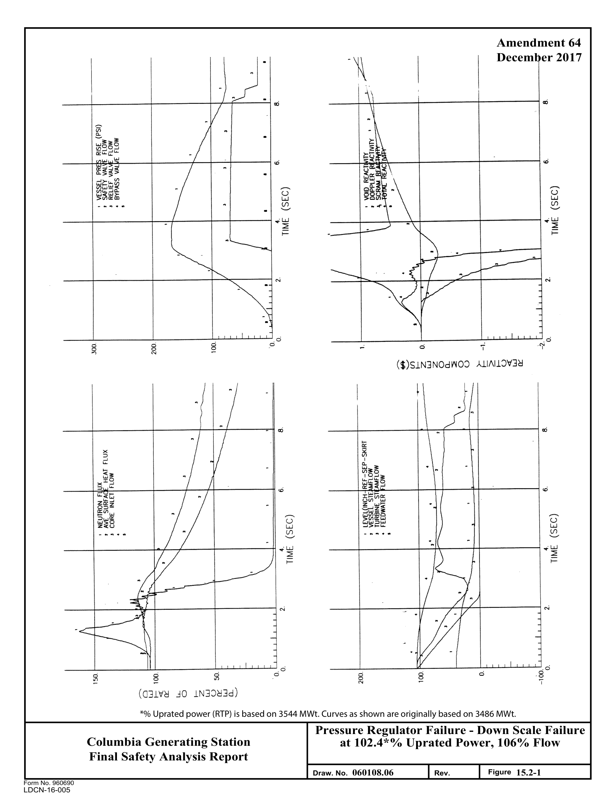

*figure on PDF page 142*

[Vector original (SVG, lossless): fig_page-142_2.svg](../figures/fig_page-142_2.svg)

<!-- labels/text on this figure page -->
Amendment 64 December 2017 I J,•~ 8. 8.
,-
' "5SEL 1f ••E ("')
FLOW FLOW
FLOW ' \/Oln RFACTtnY 6. I 6.
• SAFETY VAJ:. • RELIEF VAL
• BYPASS V
TIME (SEC) TIME (SEC)
•
\. I I 4.
4.
r
If 'o. r I kt:::1'.'.J I I I I I
2.
2.
0.
0.
1.1 300. 200. 100.
~ -1. -~. 0.
,oor~~I,. 1= ~
<{ w ,,...._ .... -....., (/) w z 0 a.. ::i: I- 0:::
f- z 0 0 0
0. LLLL.L.L.L.L.L.LJ_ ___ :::::::::::l======I======'===~
I I 8.
I 8.
• LEVEL~NCH REF-SEP-SKIRT HEAT fLUX
TURBINE ST AMFLOW
FLOW CORE INLET fLOW LOW NEUTRON f ux 6. I 6.
STE
• FEEDWATER .
AVE SURfA
VESSE
TIME (SEC)
TIME (SEC)
• I 4. I 4.
IA'"''\""' I J \, I.AL
2. I 2.
~ 100.r=== 0. 0.
-100. 0.
50.
200.
150.
,........_ 0 w 0::: u.. f-z w fr'. w 0...
0 0
*% Uprated power (RTP) is based on 3544 MWt. Curves as shown are originally based on 3486 MWt.
Pressure Regulator Failure - Down Scale Failure Columbia Generating Station at 102.4*% Uprated Power, 106% Flow Final Safety Analysis Report 060108.06 Figure 15.2-1 Draw. No. Rev.
Form No. 960690
LDCN-16-005

<!-- p.143 -->
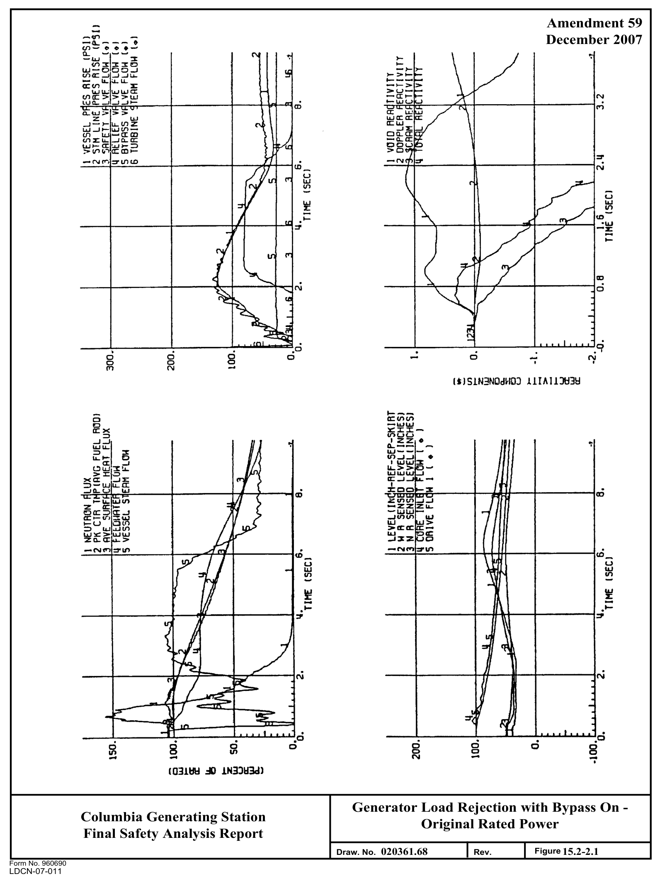

*figure on PDF page 143*

<!-- labels/text on this figure page -->
Amendment 59
2 STH LINE PRES AISE <P51J
December 2007 l VESSEL PiES RISE IPSll TEAM FLOM l•I ~ REL EF V LVEFLOH 1., S BYPASS V LVE FLOH l•I 13 ~RF~Tl v Lvf. now c.1 200.i----+------+-----+-----+---- J.2 I
6 TURBINE
2.11 I
TlHE ISECI ~
1.s I
a.a 8¥ I I
-0.
300 1 100. I
•
• ~ o. -l. -2.
I
~ ~ ~
.... :,: > -... ; -
0
.,_ ... ,.
200 I I I r " " -.. ,pr· .
OH t • I ·I
O. i----1------11-----t------+--- ·•
I I• I Ii'! r;tn;-'~1i:n.
8.
a. I I I I
5 DRIVE fl
Q cOAE IRL . 6. 11.TIHE (SEC16. I I I ~
TIME ISECJ
I @ 100.~ ,~I oe.::-= "· I I ~ I I
2.
O•J.' Mee I,•••&.
-100. Ce t t e I e e t e I I I
100.1 ~L 1-..
o. 1so. I
•
~ so.
'
... ! l!s ...
Generator Load Rejection with Bypass On - Columbia Generating Station Original Rated Power Final Safety Analysis Report 020361.68 Figure 15.2-2.1 Draw. No. Rev.
Form No. 960690
LDCN-07-011

<!-- p.144 -->
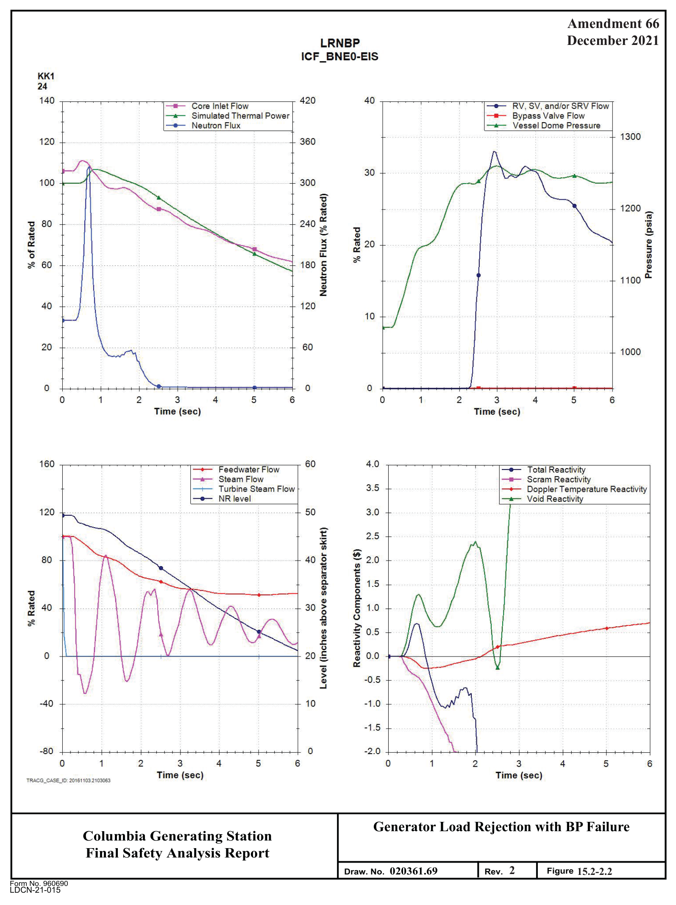

*figure on PDF page 144*

[Vector original (SVG, lossless): fig_page-144.svg](../figures/fig_page-144.svg)

<!-- labels/text on this figure page -->
Amendment 66 December 2021
Generator Load Rejection with BP Failure Columbia Generating Station Final Safety Analysis Report 2 020361.69 15.2-2.2 Draw. No.
Rev. Figure Form No. 960690
LDCN-21-015

<!-- p.145 -->
6'1 3 zl !>

## 11 VESSEL I RISE lPSIJ
ID § 81 ~n I I I 2 STH LINE PfES RISE (PSI I

.... e

lr'-ii,k,NE"J 01! l~J l = - 200.~

#### I 150.
-a a, C . . (1.1

= .... rn er

## 8 TUReINE STEAM FL.OM t7.J
;, = ~ (;')
= fD 100. Ill#"' I I I ►B 1100.
= "'I
-= ~ ::. =· = la fll IJQ :;.:I rn I u >,."< >w ).._'4 o., I 14 5 f'.". ,a S' I \8 8:::-::,.
\6 19), e ::. ::t g

-lCX\i.° 10.
.,_

C j ""'3 r::
z "'I er a· lctfflE: SUB (BTU/LBJ 9 Vfl(INCHESJ i LUNCHES!
100.
120.
l'D
( ?. l Q\ ... ""'3 7. l ::!.
...
"Cl ~

"'I .... ""'3

80.
~ "'Cl rn IE n :D "'I ~ D)
~ jl I-I "°· o.
~ "Cl e1 £ I'll C ii ...
l I A I f~ I ~ u,, t C.
I I ·I "°· o.~•111 11•~ o. -S0.[111111111 o.
,I a = 50. 75. 100.
10. 20. 30.
25;
l'D l'D ~ l'Il-!f: (SEC)
Cft FUIM 17.J er c. l'D e I "'I l'D 0 = 1-o&l:I \C- \C f.11 oow

<!-- p.146 -->
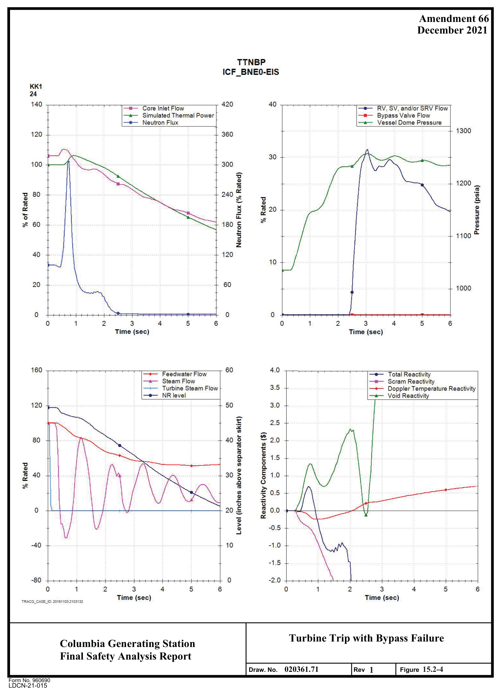

*figure on PDF page 146*

[Vector original (SVG, lossless): fig_page-146_2.svg](../figures/fig_page-146_2.svg)

<!-- labels/text on this figure page -->
Amendment 66 December 2021
Turbine Trip with Bypass Failure Columbia Generating Station Final Safety Analysis Report 020361.71 1 15.2-4 Draw. No. Rev Figure Form No. 960690
LDCN-21-015

<!-- p.147 -->
Amendment 64 200. t--------+---- --+--------,1--------+-- ----
- 100.~~~~~~~----- ~---- -~~ ---- -~---- December 2017
-·- O.l--<''----''------+-------+-------,1-------+-----
- - '-?,

#### I 40.
I 40.

• VESS DOME)PRES RISE .. psi TURBINE ST AM FLOW ..... %

.c:
, STM LINE P ES RISE.. .psi , TURBINE PR S RISE. ... psi
• ~ET REACTI \TY CHANGE . .,I

#### L--- S
1 DOPPLER ..... ······•···'

• SCRAM ...•..... ........ $

• VOID •••...•..... ...... $

JO.
30.

#### TIME (SEC)
#### TIME (SEC)
lo?,.
20.
~ 20.

I *% uprated power (RTP) is based on 3544 MWt. Curves as shown are originally based on 3486 MWt.
/,;,.,::

10. I 10.
~:
V /

I .

~~ 100 I VI • A

o.
'--- 0.
-.l 3. 1. -1.
~ ~ >

,......_ w ----- j:::: ';;/_ 0:::

100·n~--:-----t-----+------+-----J ____ _ w 5 50. rrr--ti------t------,.-+------l---h

J 150. t-------+-------+-------f-------+-- 40.
40.
150 t---+>-----1----------t-------+--------+- J

• SCALED NE1iRON FLUX .... %

EAT FLUX ..... %

VESSEL STE M fLOW ...... 7.

LOW ......... ?.

• VESSEL FLOr········ .... 1. • BPV FLOW .............. %

RV FLOW ............... % • SV FLOW ..... .......... %

u

JO.
30.
I FE£DWATER

#### AVG SURF
21

#### TIME (SEC )
#### TIME (SEC)
#### J 1 II
I

I 20.
20.
I I

## 1 I I
■

I b 10.
10.

b. 1 , , •• , 1 I o.
100. 50.
~ w w <{ a::: L,_ I-z w u a::: w 0... o Cl::'. 1-z 0...

## 0 I- 0
Main Steam Line Isolation Valve Closure Columbia Generating Station at 104.5*% Uprated Power, 100% Rated Flow Final Safety Analysis Report 020361.72 Figure 15.2-5 Draw. No. Rev.
Form No. 960690

<!-- p.148 -->
Amendment 64 December 2017 ',
- -~----
3. ------+-------+-------+------------

-3. LJ.....LJLL.L-'-''--'-........ --'--------'~------L...----.......,__,._ ____ _

-
- Aw-c-<--------+------- l--·-•- ----·•·----1---·---·-- ··
-
- ~ -----<c-------~-------+---------1---
- = -::::-1----=
- +------ +-------+-- 40.
40.

• VESS DOME,PRES RISE..psi TURBINE ST AM FJ-OW .... %

------+--a...NET REACTI ITY CHANGE..I STM I.INE P ES RISL .psi TURBINE PR S RISL .. psi
-

r DOPPLER. ............ I ,, SCRAM ......... ........ 1

-

• VOIO ........... J·····'

- 30.
30. I ~

- '~,
- TIME (SEC )

#### TIME (SEC)
-

- 100~~~ ~~~~----- ~-- 20. ?"5-----= I 20.

- +----- 10.
10. \'l

fl 0. !'-- --- \

100 kif 200 t--- 0.
0.
- 1. 1.
~ ~

I-> ,......_ <( a::

>- i== u w

r""' j ' r ~.

• . '" . ' .. 1 40.
40.
, ,

EAi FLUX ..... % VESSEL STE M FLOW ...... %

LOW .... ..... % • NEUTRON Ff X ........... %

• VESSEL FLO ,i ............ %

• BPV fLOW ... ........... %

r RV FLOW .... .. ... ,; • SV FLOW ..... ··········"

1 1 30 30. l ,l. l. '. . "' n
• FEEOWATER
• AVG SURF

#### TIME (SEC )
#### TIME (SEC)
,,, I

• ;-t, 20.
20.

10.
F'~ 10.
i

~ .
'r--,-..._ ' '

0.
b 150. 100.
150 100 50 LtJ <( Ld u 0::: w Q_ I- 0::: LL I-z <( 0::: w u a:: w Q_ 0 0 0 w I- I- z *% Uprated power (RTP) is based on 3544 MWt. Curves as shown are originally based on 3486 MWt.
Loss of Condenser Vacuum Columbia Generating Station at 102.4*% Uprated Power, 100% Rated Flow Final Safety Analysis Report 020361.73 Figure 15.2-6 Draw. No. Rev.
Form No. 960690

<!-- p.149 -->
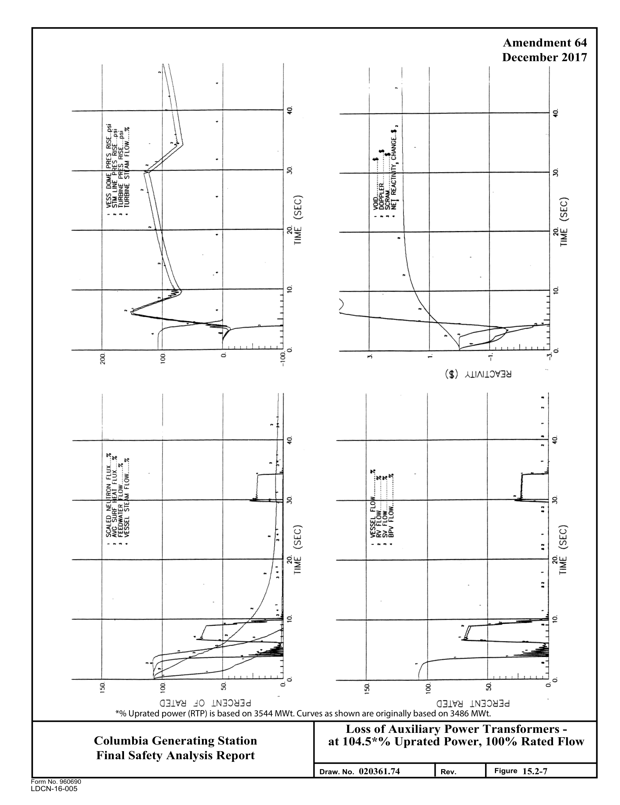

*figure on PDF page 149*

[Vector original (SVG, lossless): fig_page-149_2.svg](../figures/fig_page-149_2.svg)

<!-- labels/text on this figure page -->
~ Amendment 64 December 2017
' - - -
- -
40.
40_
• VESS DOME PRES RISLpsi
• NEJ REACT! llY, CHANGE..$ ,
• STM LINE P ES RISL.-psi TURBINE ST AM fLOW. ___ .% • TURBINE PR S RISE.. .. psi _____ , • DOPPLER ... . . -- s
• VOi □ .. ----···--· ·----t Jo_ JO.
• SCRAM--- -- -·-·
TIME (SEC)
TIME (SEC)
20_ .
20_
'
10_ 10_
I'-./
/ / \\! ·, ~~ 0.
0.
- 100.
1_ 100 o. J. - 1 -3 200.
~ -
I-> ,.......
i= <{ w >- u O:'.
• I
,11
• • 40. I 40.
I,,._ AVG SURF I EAT FLUX ... . %
SCALED NE TRON f LUX .... 7.
VESSEL STE M FLQW_ ..... %
fEEDWATER 'LOW·-·····-·7, " n.
• VESSEL FLO ~--------·---%
• RV FLOW_ .. _. ····-·-·-·% • SV FLOW. ____ ·----·-··-% • BPV FLOW._ . ...... , .... r.
ll I JO_ JO_ ~
TIME (SEC)
TIME (SEC)
I II '
•
,1
20_ J. I I 20_
I
"
10_ IQ_ \.K ~· I
~ 50. t-T-1 '
•
• f 100 I~
I- 0.
150. 100.
50 0 150 0 w <{ I-z w w (L I- LL 0 I-z I- O:'. u O:'.
w <{ O:'. w u n:: w (L 0 *% Uprated power (RTP) is based on 3544 MWt. Curves as shown are originally based on 3486 MWt.
Loss of Auxiliary Power Transformers - Columbia Generating Station at 104.5*% Uprated Power, 100% Rated Flow Final Safety Analysis Report 020361.74 Figure 15.2-7 Draw. No. Rev.
Form No. 960690
LDCN-16-005

<!-- p.150 -->
Amendment 64 December 2017 0 . j•-~~~~~~-------~-------'--------L--- ---
-1-------+------

'Vl!l!i 1.:U. 1. l'lt[!i l<{!il. f''., t SIH I llt PRf"S Ii i :,f_ •• ps i 1tUIJlt-( PRI.S up· .... ,.,;; .f.

VOID .•..•. •• ... ·t ...... s CXJ'PlER • ••.•.••.•. ••.. $ 5CRN1 . . . ........ ...... $ 1£1 R[ACIIVI IY C 1/ffil . . $

11--l, . -~~ ,o.

#### I 10. ' - - 1.H ~ ----, -------~ -----'---~------.
IU?Ultl. SIU.11 fl

#### I 30. , / 30.
3. i----------Jr-------+------ IIMt lSEC l TIME <SEC> 20.
20.

IO.
IO.
I

I

\

100. I) 100. 0. ;.,oo.
I.
3. l-s ~ >· 0:: <I>

V[ SSI.L SILAH 11 1 I. .... . % Nllll<tt,/ II Ux.,. ·t•· .. /. IX ..... /. HUJ..LA.HH fl CU .. ...•. . /.

V(SS[L fl.l~L ... ·t · ..... % SV fLOl ......... ...... X BPV FLOI ........ ..... . 1. RV flOl . .... ......... . 1.

,o.
10 .
AVG 9.,Rf !lid 11 I 00. ll-------+ -------l - ------- 1------- 1 30. • 30.

I IMI lSECl I !ME CSECJ 20.
20.

IO .
10.
l.".:-1-J~ l __ I ~1.\d . .:..

I

I 0.
0 .
0. 1 '.:, 0, IOU. 'JO.
so. o. l'..>O.
,_ Id u l " uJ 0:: uJ tX uJ ()_ < ,, I l /l. ) , .<'. tol 0::
L l I-< I- z u . u '

*% Uprated power (RTP) is based on 3544 MWt. Curves as shown are originally based on 3486 MWt.
Loss of All Grid Connections - Columbia Generating Station 102.4*% Uprated Power, 100% Rated Flow Final Safety Analysis Report 020361.75 Figure 15.2-8 Draw. No. Rev.
Form No. 960690

<!-- p.151 -->
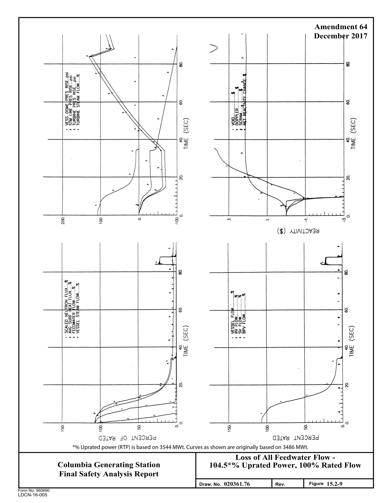

*figure on PDF page 151*

[Vector original (SVG, lossless): fig_page-151_2.svg](../figures/fig_page-151_2.svg)

<!-- labels/text on this figure page -->
Amendment 64 December 2017
3. t--------------+-------+-------t----- 200.1---------1-------1--------+-------I------ V
80.
80.
• VESS OOMEiPRES RISE .. psi TURBINE ST AM FLOW ..... %
STM LINE P ES RISE.. .psi TURBINE PR S RISE. ... psi 60. 60.
TIME (SEC)
TIME (SEC)
40.
40.
20.
20.
0.
0.
100. 0. -100.
1. -1. -'3.
~ >
........,_ ,4;4 <( i== u w (l'.'.
1so.1----------<>--------+-------+--------+------ 1so.1---------1--------,1-------+--------1----- I ,,
80. I 80.
·'
• SCALED N[]RON FLUX .... %
EAT FLUX ..... % VESSEL STE M FLOW ...... %
LOW ......... %
' VESSEL FLO .........•.. %
'
• BPV FLOW ...........•.. %
r RV FLOW ............... % • SV FLOW ............... %
I
' I 60. . .1, 60.
FEEOWATER
AVG SURF
I .
I
'
TIME (SEC)
TIME (SEC)
I I ' I I 40.
40.
f\ ,\ b > \, I 20. 20.
I
0. § 1001 50. 'o.
100. so.
<( w w (l'.'. Li... t-z w u (l'.'. w (l'.'. I-z u (l'.'. w Q <(
I- 0 Q 0
*% Uprated power (RTP) is based on 3544 MWt. Curves as shown are originally based on 3486 MWt.
Loss of All Feedwater Flow - Columbia Generating Station 104.5*% Uprated Power, 100% Rated Flow Final Safety Analysis Report 020361.76 Figure 15.2-9 Draw. No. Rev.
Form No. 960690
LDCN-16-005

<!-- p.152 -->
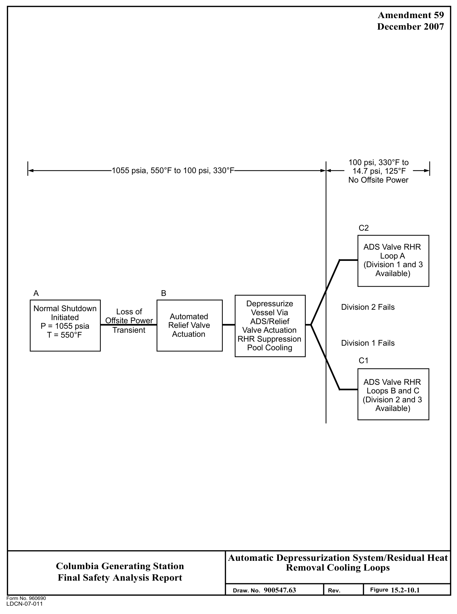

*figure on PDF page 152*

[Vector original (SVG, lossless): fig_page-152_4.svg](../figures/fig_page-152_4.svg)

<!-- labels/text on this figure page -->
Amendment 59 December 2007
100 psi, 330°F to I
- ~ 1055 psia, 550°F to 100 psi, 330°F 14.7 psi, 125°F I No Offsite Power
C2 r ADS Valve RHR Loop A
(Division 1 and 3 Available)
A B Depressurize Division 2 Fails Normal Shutdown
- Loss of Vessel Via Automated Initiated Offsite Power ADS/Relief Relief Valve P = 1055 psia Transient Valve Actuation Actuation T = 550°F RHR Suppression Division 1 Fails Pool Cooling \_ C1
ADS Valve RHR Loops B and C
(Division 2 and 3 Available)
Automatic Depressurization System/Residual Heat Columbia Generating Station Removal Cooling Loops Final Safety Analysis Report I I 900547.63 Figure 15.2-10.1 Draw. No. Rev.
Form No. 960690
LDCN-07-011

<!-- p.153 -->
Amendment 54 April 2000

#### NOTES
#### ACTIVITY A
Initial pressure =1055 psia Initial temperature = 550°F For purpose of this analysis, the following worst-case conditions are assumed to exist:
a. The reactor is assumed to be operating at 105% of original NBR steam flow, b. A loss of power transient occurs, c. A simultaneous loss of onsite power (Division 1 or Division 2), and d. Operator unable to open one of the RHR shutdown cooling line suction valves.

#### ACTIVITY B
Initial system pressure =1055 psia Initial system temperature = 550°F

Operator Actions During approximately the first 30 minutes, reactor decay heat is passed to the suppression pool by the automatic operation of the reactor relief valves. Reactor water level will be returned to normal by the HPCS and RCIC systems automatic operation.

After approximately 10 minutes, the operator initiates depressurization of the reactor vessel to control vessel pressure.
Controlled depressurization procedure consists of controlling vessel pressure and water level by using the SRV or HPCS and/or RCIC systems. After approximately 15 minutes, it is assumed one RHR heat exchanger is placed in the suppression pool cooling mode to remove decay heat. At this time, the suppression pool will be 121°F.

When the reactor pressure approaches 100 psig, the operator would normally prepare for operation of the RHR system in the shutdown cooling mode. At this time (121 minutes), the suppression pool will be 186°F.

ACTIVITY C1 (Division 1 fails, Division 2 available)
System pressure =100 psig System temperature = 330°F

Operation Actions

The operator establishes a closed cooling path as follows:

a. A minimum of two ADS valves (dc Division 2) are powered open.
b. Either of the following cooling paths are established:
1. Using RHR loop B, water from the suppression pool is pumped through the RHR heat exchanger (where a portion of the decay heat is removed) into the reactor vessel. The cooled suppression pool water flows through the vessel (picking up a portion of the decay heat) out the ADS valves and back to the suppression pool. This alternate cooling path is shown in Figure 15.2-12.
2. Using RHR loops B and C together, water is taken from the suppression pool and pumped directly into the reactor vessel. The water passes through the vessel (picking up decay heat) and out the ADS valves returning to the suppression pool as shown in Figure 15.2-13. Suppression pool water is then cooled by operation of RHR loop B in the pool cooling mode (see Figure 15.2-14). In this alternate cooling path, RHR loop C is used for injection and RHR loop B for cooling. Cold shutdown is achieved approximately 36 hr after the transient occurs.

ACTIVITY C2 (Division 2 fails, Division 1 available) (Figure 15.2-15)
System pressure =100 psig System temperature = 330°F

Operator Actions

The operator establishes a closed cooling path as follows:

a. A minimum of two ADS valves (dc Division 1) are powered open, and b. Using RHR loop A instead of loop B, an alternate cooling path is established as shown in Activity C1. Cold shutdown is reached in approximately 15 hr.

Automatic Depressurization System/Residual Heat Columbia Generating Station Removal Cooling Loops Final Safety Analysis Report I I D r a w . N o . 9 9 0 5 7 7.8 7 R e v . Figure 1 2.5 - 1 2.0 Form No. 960690

<!-- p.154 -->
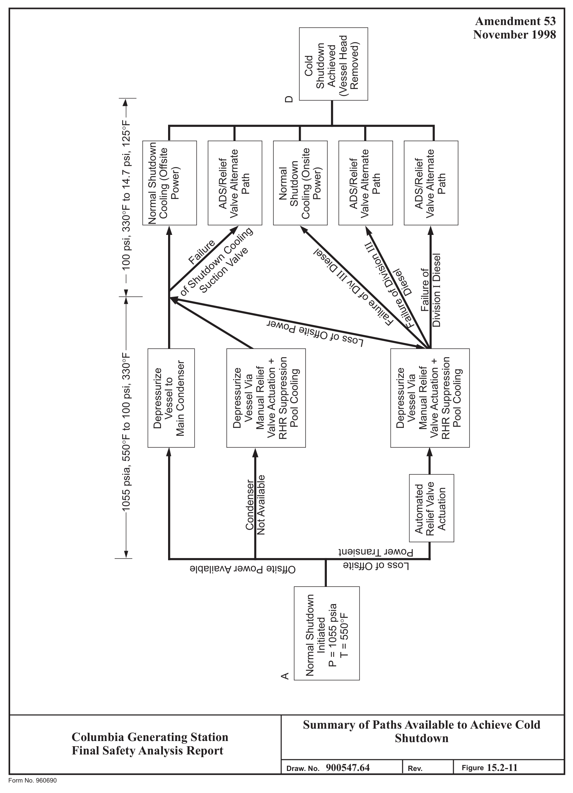

*figure on PDF page 154*

[Vector original (SVG, lossless): fig_page-154_2.svg](../figures/fig_page-154_2.svg)

<!-- labels/text on this figure page -->
Amendment 53 November 1998
(Vessel Head Removed) Shutdown Achieved Cold
D
100 psi, 330°F to 14.7 psi, 125°F Normal Shutdown Cooling (Offsite Cooling (Onsite Valve Alternate Valve Alternate Valve Alternate ADS/Relief ADS/Relief ADS/Relief Shutdown Power)
Normal Power)
Path Path Path
of Shutdown Cooling Failure Failure of Division III Suction Valve Failure of Div III Diesel Division I Diesel Diesel Failure of Loss of Offsite Power 1055 psia, 550°F to 100 psi, 330°F RHR Suppression RHR Suppression Valve Actuation + Valve Actuation + Main Condenser Manual Relief Manual Relief Depressurize Depressurize Depressurize Pool Cooling Pool Cooling Vessel Via Vessel Via Vessel to
Not Available Condenser Relief Valve Automated Actuation
Power Transient Loss of Offsite Offsite Power Available
Normal Shutdown P = 1055 psia T = 550°F Initiated
A
Summary of Paths Available to Achieve Cold Columbia Generating Station Shutdown Final Safety Analysis Report 900547.64 15.2-11 Figure Draw. No.
Rev.
Form No. 960690

<!-- p.155 -->
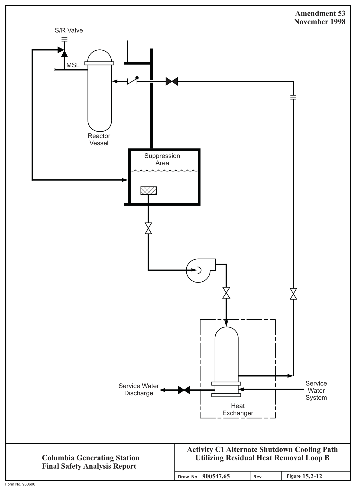

*figure on PDF page 155*

[Vector original (SVG, lossless): fig_page-155_3.svg](../figures/fig_page-155_3.svg)

<!-- labels/text on this figure page -->
Amendment 53 November 1998 S/R Valve
MSL
Reactor Vessel
Suppression Area
Service Service Water Water Discharge System Heat I I L_ _____ _J Exchanger
Activity C1 Alternate Shutdown Cooling Path Utilizing Residual Heat Removal Loop B Columbia Generating Station Final Safety Analysis Report 900547.65 15.2-12 Draw. No.
Rev. Figure Form No. 960690

<!-- p.156 -->
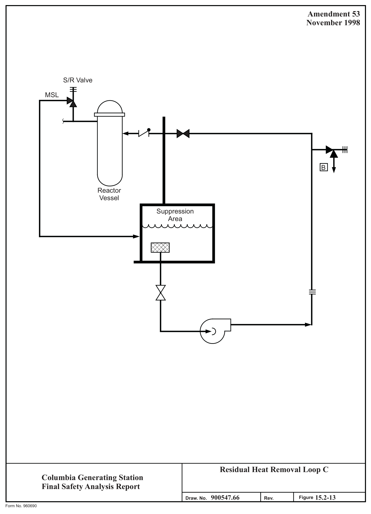

*figure on PDF page 156*

[Vector original (SVG, lossless): fig_page-156_4.svg](../figures/fig_page-156_4.svg)

<!-- labels/text on this figure page -->
Amendment 53 November 1998
S/R Valve
MSL
□ B
Reactor Vessel
Suppression Area
Residual Heat Removal Loop C Columbia Generating Station Final Safety Analysis Report 900547.66 15.2-13 Draw. No.
Rev. Figure Form No. 960690

<!-- p.157 -->
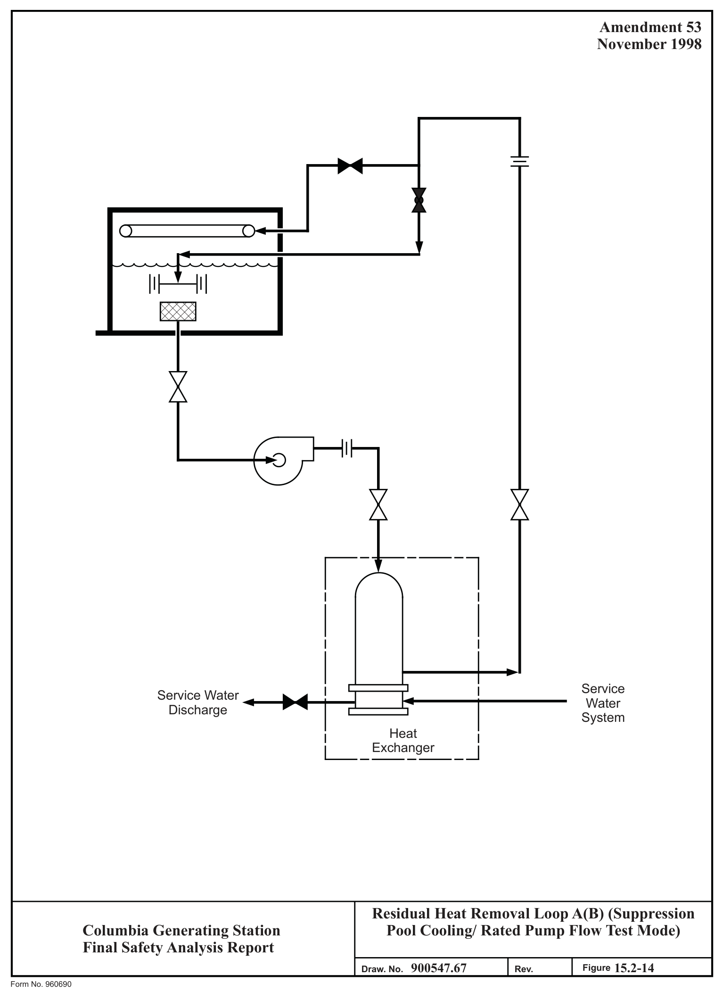

*figure on PDF page 157*

[Vector original (SVG, lossless): fig_page-157_3.svg](../figures/fig_page-157_3.svg)

<!-- labels/text on this figure page -->
Amendment 53 November 1998
1.- ---7 I I I I I I I Service I Service Water Water Discharge System Heat I I
L_ _____ _J Exchanger
Residual Heat Removal Loop A(B) (Suppression Pool Cooling/ Rated Pump Flow Test Mode)
Columbia Generating Station Final Safety Analysis Report 900547.67 15.2-14 Draw. No.
Rev. Figure Form No. 960690

<!-- p.158 -->
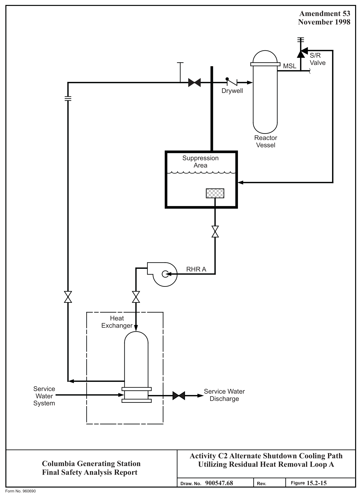

*figure on PDF page 158*

[Vector original (SVG, lossless): fig_page-158_4.svg](../figures/fig_page-158_4.svg)

<!-- labels/text on this figure page -->
Amendment 53 November 1998
S/R Valve MSL
Drywell
Reactor Vessel
Suppression Area
RHR A
,--- -7 Heat Exchanger I I I I I I I I I Service Service Water Water Discharge System
Activity C2 Alternate Shutdown Cooling Path Columbia Generating Station Utilizing Residual Heat Removal Loop A Final Safety Analysis Report 900547.68 15.2-15 Draw. No.
Rev. Figure Form No. 960690

<!-- p.159 -->
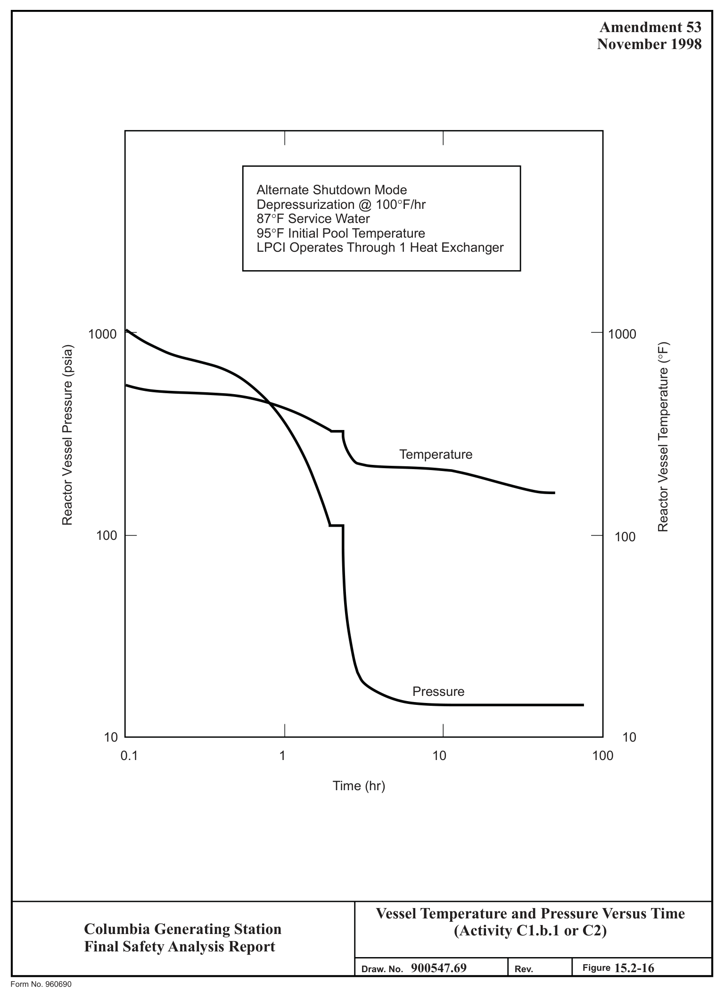

*figure on PDF page 159*

[Vector original (SVG, lossless): fig_page-159_3.svg](../figures/fig_page-159_3.svg)

<!-- labels/text on this figure page -->
Amendment 53 November 1998
Alternate Shutdown Mode Depressurization @ 100°F/hr 87°F Service Water 95°F Initial Pool Temperature LPCI Operates Through 1 Heat Exchanger
1000 1000 °F) Reactor Vessel Pressure (psia)
Reactor Vessel Temperature ( Temperature
100 100
Pressure
10 10 0.1 1 10 100
Time (hr)
Vessel Temperature and Pressure Versus Time Columbia Generating Station
(Activity C1.b.1 or C2)
Final Safety Analysis Report 900547.69 15.2-16 Draw. No.
Rev. Figure Form No. 960690

<!-- p.160 -->
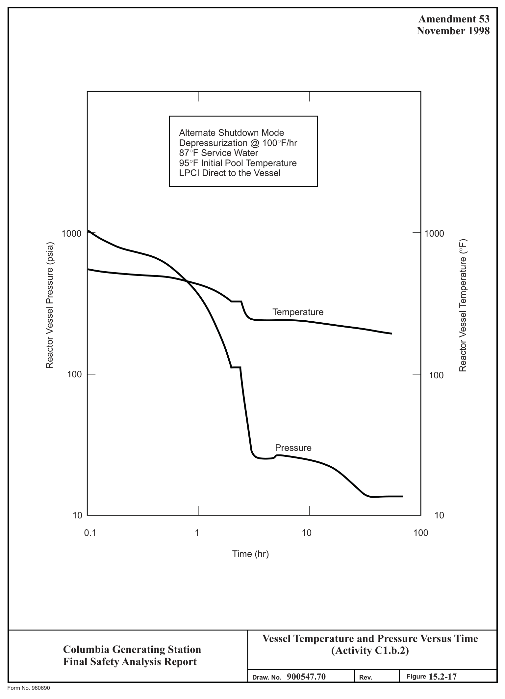

*figure on PDF page 160*

[Vector original (SVG, lossless): fig_page-160_2.svg](../figures/fig_page-160_2.svg)

<!-- labels/text on this figure page -->
Amendment 53 November 1998
Alternate Shutdown Mode Depressurization @ 100°F/hr 87°F Service Water 95°F Initial Pool Temperature LPCI Direct to the Vessel
1000 1000 Reactor Vessel Temperature (°F)
Reactor Vessel Pressure (psia)
Temperature
100 100
Pressure
10 10 0.1 1 10 100
Time (hr)
Vessel Temperature and Pressure Versus Time Columbia Generating Station
(Activity C1.b.2)
Final Safety Analysis Report 900547.70 15.2-17 Draw. No.
Rev. Figure Form No. 960690

<!-- p.161 -->
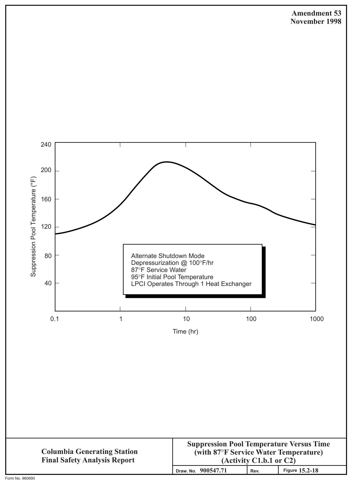

*figure on PDF page 161*

[Vector original (SVG, lossless): fig_page-161_4.svg](../figures/fig_page-161_4.svg)

<!-- labels/text on this figure page -->
Amendment 53 November 1998
240
200 Suppression Pool Temperature (°F)
160
120
80 Alternate Shutdown Mode Depressurization @ 100°F/hr 87°F Service Water 95°F Initial Pool Temperature 40 LPCI Operates Through 1 Heat Exchanger
0.1 1 10 100 1000
Time (hr)
Suppression Pool Temperature Versus Time Columbia Generating Station
(with 87°F Service Water Temperature)
Final Safety Analysis Report
(Activity C1.b.1 or C2)
900547.71 15.2-18 Draw. No.
Rev. Figure Form No. 960690

<!-- p.162 -->
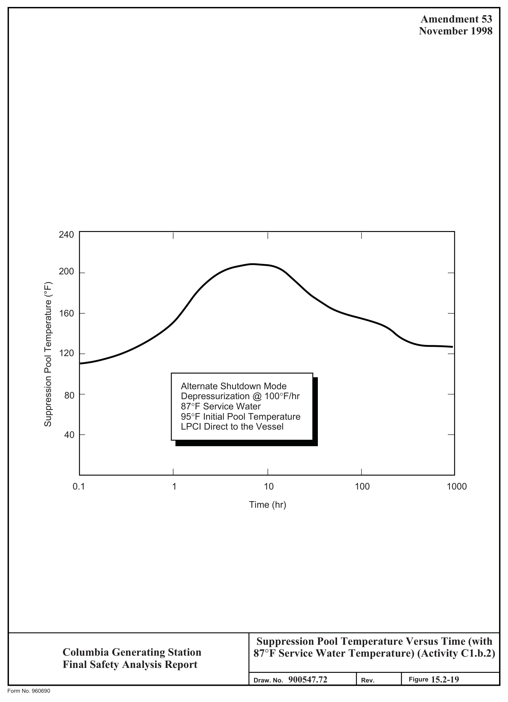

*figure on PDF page 162*

[Vector original (SVG, lossless): fig_page-162_5.svg](../figures/fig_page-162_5.svg)

<!-- labels/text on this figure page -->
Amendment 53 November 1998
240
200 Suppression Pool Temperature (°F)
160
120
Alternate Shutdown Mode 80 Depressurization @ 100°F/hr 87°F Service Water 95°F Initial Pool Temperature LPCI Direct to the Vessel 40
0.1 1 10 100 1000
Time (hr)
Suppression Pool Temperature Versus Time (with Columbia Generating Station 87°F Service Water Temperature) (Activity C1.b.2)
Final Safety Analysis Report 900547.72 15.2-19 Draw. No.
Rev. Figure Form No. 960690

