# 15.3 DECREASE IN REACTOR COOLANT SYSTEM FLOW RATE

> Columbia Generating Station FSAR — Chapter 15: Accident Analyses
> Source: `15_chapter-4122-5262.pdf`, PDF pages 163–206 (of 1141)
> Amendment 67 compilation (individual pages carry varying amendment dates)

---
<!-- p.163 -->
### 15.3 DECREASE IN REACTOR COOLANT SYSTEM FLOW RATE
#### 15.3.1 RECIRCULATION PUMP TRIP
The events for two-recirculation pump operation are not limiting, therefore, the analyses have not been updated since the reactor power uprate analyses.

##### 15.3.1.1 Identification of Causes and Frequency Classification
###### 15.3.1.1.1 Identification of Causes
Recirculation pump motor operation can be tripped by design and by random operational failures. Design tripping will occur in response to:

a. Reactor vessel water level L2 setpoint trip, b. Turbine control (governor) valve fast closure or stop (throttle) valve closure, c. Failure to scram high pressure setpoint trip, d. Motor branch circuit over-current protection, e. Motor overload protection, and f. Suction block valve not fully open.

Random tripping will occur in response to:

a. Operator error,

b. Loss of electrical power source to the pumps, and

c. Equipment or sensor failures and malfunctions which initiate the above intended trip response.

###### 15.3.1.1.2 Frequency Classification
15.3.1.1.2.1 Trip of One Recirculation Pump. This event is categorized as an incident of moderate frequency.

15.3.1.1.2.2 Trip of Two Recirculation Pumps. This event is categorized as an incident of moderate frequency.

<!-- p.164 -->
##### 15.3.1.2 Sequence of Events and Systems Operation
###### 15.3.1.2.1 Sequence of Events
15.3.1.2.1.1 Trip of One Recirculation Pump. Table 15.3-1 lists the sequence of events for Figure 15.3-1.

15.3.1.2.1.2 Trip of Two Recirculation Pumps. Table 15.3-2 lists the sequence of events for Figure 15.3-2.

###### 15.3.1.2.2 Systems Operation
15.3.1.2.2.1 Trip of One Recirculation Pump. Tripping a single recirculation pump requires no protection system or safeguard system operation. This analysis assumes normal functioning of plant instrumentation and controls.

15.3.1.2.2.2 Trip of Two Recirculation Pumps. Analysis of this event assumes normal functioning of plant instrumentation and controls and plant and reactor protection systems.

Specifically, this transient takes credit for vessel level (L8) instrumentation to trip the turbine.
Reactor shutdown relies on scram trips from the turbine stop (throttle) valves. High system pressure is limited by the pressure relief valve system operation.

###### 15.3.1.2.3 The Effect of Single Failures and Operator Errors
###### 15.3.1.2.3.1 Trip of One Recirculation Pump. None

15.3.1.2.3.2 Trip of Two Recirculation Pumps. Table 15.3-2 lists the vessel level (L8) trip event as the first response to initiate corrective action in this transient and it is intended to prohibit moisture carryover to the main turbine. Multiple level sensors are used to sense and detect when the water level reaches the L8 setpoint. At this point, a single failure will neither initiate nor impede a turbine trip signal. Turbine trip signal transmission circuitry, however, is not built to single failure criterion. At this point the transient event is functionally over.

Scram trip signals from the turbine are designed such that a single failure will neither initiate nor impede a reactor scram trip initiation.

##### 15.3.1.3 Core and System Performance
###### 15.3.1.3.1 Mathematical Model
The point-kinetics REDY model described in Section 15.0.3.3.1 is used to simulate this event.

<!-- p.165 -->
###### 15.3.1.3.2 Input Parameters and Initial Conditions
These analyses have been performed, unless otherwise noted, with plant conditions in Table 15.0-2.

Pump motors and pump rotors are simulated with minimum specified rotating inertias.

###### 15.3.1.3.3 Results
15.3.1.3.3.1 Trip of One Recirculation Pump. Figure 15.3-1 shows the response of the reactor system following the trip of one recirculation pump motor. Initially a recirculation pump is tripped in one loop, causing the core inlet flow to decrease, while the other recirculation loop flow increases. Subsequently jet pump diffuser flow reverses in the tripped recirculation loop. At approximately 45 sec the reactor reaches a new equilibrium operating point, at approximately 73.8% power and 57% core flow. During the transient, level swell is not sufficient to cause turbine trip.

15.3.1.3.3.2 Trip of Two Recirculation Pumps. Figure 15.3-2 shows the response of the I reactor system following the trip of both recirculation pump motors. Initially both recirculation pumps are tripped, causing the core inlet flow to decrease, while vessel level rises until both main and feedwater turbines trip on high level (L8). A reactor scram is subsequently initiated at 90% turbine stop valve position. Shortly after the scram is initiated the stop valves close and the bypass valves open to regulate pressure. At this point the transient event is functionally over.

###### 15.3.1.3.4 Consideration of Uncertainties
Initial conditions chosen for these analyses are conservative and tend to force analytical results to be more severe than expected under actual plant conditions.

Actual pump and pump-motor drive line rotating inertias are expected to be somewhat greater than the minimum design values assumed in this simulation. Actual plant deviations regarding inertia are expected to lessen the severity as analyzed. Minimum design inertias were used as well as the least negative void coefficient since these maximize the flow reduction.

##### 15.3.1.4 Barrier Performance
###### 15.3.1.4.1 Trip of One Recirculation Pump
Figure 15.3-1 results indicate a basic reduction in system pressures from the initial conditions.
Therefore, the reactor coolant pressure boundary (RCPB) barrier is not impacted.

<!-- p.166 -->
###### 15.3.1.4.2 Trip of Two Recirculation Pumps
The results shown in Figure 15.3-2 indicate peak pressures stay well below the limit allowed by the applicable American Society of Mechanical Engineers (ASME) code. Therefore, the RCPB barrier is not impacted.

##### 15.3.1.5 Radiological Consequences
The consequence of this event does not result in fuel failure. It does result in the discharge of normal coolant activity to the suppression pool by means of safety/relief valve (SRV)
operation, which is contained in the primary containment. This event does not result in an uncontrolled release to the environment, so the plant operator can choose to hold the activity in containment or discharge it when conditions permit. If purging of the containment is chosen, the release will be in accordance with established requirements.

#### 15.3.2 RECIRCULATION FLOW CONTROL FAILURE - DECREASING FLOW
##### 15.3.2.1 Identification of Causes and Frequency Classification
###### 15.3.2.1.1 Identification of Causes
A postulated failure of the input demand signal, which is used in both loops, can decrease core flow at the maximum ramp demand rate established by the adjustable speed drive (ASD)
control. Failure within either loop controller can result in a maximum ramp demand rate as limited by the ASD control.

###### 15.3.2.1.2 Frequency Classification
This event is categorized as an incident of moderate frequency.

##### 15.3.2.2 Sequence of Events and Systems Operation
###### 15.3.2.2.1 Sequence of Events
15.3.2.2.1.1 Speed Decrease of One Recirculation Pump. Table 15.3-3 lists the sequence of events for Figure 15.3-3.

15.3.2.2.1.2 Speed Decrease of Two Recirculation Pumps. Table 15.3-4 lists the sequence of events for Figure 15.3-4.

<!-- p.167 -->
###### 15.3.2.2.2 Systems Operation
15.3.2.2.2.1 Speed Decrease of One Recirculation Pump. The most severe control system disturbance is a failure that causes the ASD internal controller to move at its maximum rate.
Such transients may be obtained by instantaneous failure of a controller output into its upper or lower limits. Originally the recirculation flow was controlled by valve motion. For the current analysis the recirculation flow control valves have been locked at the full open position, and ASD units have been implemented to provide the necessary flow control.

15.3.2.2.2.2 Speed Decrease of Two Recirculation Pumps. The most severe control system disturbance is a failure that causes the ASD internal controller to move at its maximum rate.
Such transients may be obtained by instantaneous failure of a controller output into its upper or lower limits. The independent and simultaneous failure of each individual loop controller would be highly improbable.

Thus, for the two loop controller failure event, the ASD internal controller is assumed to move at its maximum rate in both recirculation loops. Originally the recirculation flow was controlled by valve motion. For the current analysis the recirculation flow control valves have been locked at the full open position, and ASD units have been implemented to provide the necessary flow control.

###### 15.3.2.2.3 The Effect of Single Failures and Operator Errors
The single failure and operator considerations for this event are essentially the same as in Section 15.3.1.2.3.2. The speed decrease of two instead of one recirculation pump would be the envelope case for the additional single component failure or operator error.

##### 15.3.2.3 Core and System Performance
###### 15.3.2.3.1 Mathematical Model
The point-kinetics REDY model described in Section 15.0.3.3.1 is used to simulate these transient events.

###### 15.3.2.3.2 Input Parameters and Initial Conditions
These analyses have been performed, unless otherwise noted, with plant conditions listed in Table 15.0-2.

15.3.2.3.2.1 Speed Decrease of One Recirculation Pump. For the simulation of this event, a controller malfunction causes a zero demand signal to be sent to one of the recirculation ASD units, while the plant is operating at 104.5% uprated power and 100% core flow. A control demand error (low) signal causes the ASD to adjust the recirculation pump speed demand rate

<!-- p.168 -->
limit downward at an assumed rate of 25%/sec for one loop failure. The ensuing transient is similar to a recirculation pump trip.

15.3.2.3.2.2 Speed Decrease of Two Recirculation Pumps. For the simulation of this event, a controller malfunction causes a zero demand signal to be sent to both of the recirculation ASD units, while the plant is operating at 104.5% uprated power and 100% core flow.
A control demand error (low) can cause the ASD units to adjust the recirculation pump speed downward in both loops at the 5%/sec pump speed rate limit.

###### 15.3.2.3.3 Results
15.3.2.3.3.1 Speed Decrease of One Recirculation Pump. Figure 15.3-3 shows the response of the plant for this transient. Initially a negative recirculation pump speed demand is sent to the ASD due to a postulated controller failure. The negative pump speed demand causes the diffuser flow to decrease, and eventually reverse, in the failed loop. At the same time the active loop increases flow to compensate for the failed recirculation loop. At approximately 45 sec the reactor reaches a new equilibrium operating point, at approximately 72.8% power and 57% core flow. During the transient, level swell is not sufficient to cause turbine trip which would result in a reactor scram.

15.3.2.3.3.2 Speed Decrease of Two Recirculation Pumps. Figure 15.3-4 shows the response of the plant to this transient using the 5%/sec pump speed demand rate limit. Initially, a negative recirculation pump speed demand is sent to both ASD units due to a postulated controller failure. The negative pump speed demand causes the diffuser flows to decrease in the failed loops. During the transient, level swell is not sufficient to cause turbine trip which would result in a reactor scram.

###### 15.3.2.3.4 Consideration of Uncertainties
Initial conditions chosen for these analyses are conservative and tend to force analytical results to be more severe than expected under actual plant conditions.

These analyses are unaffected by deviations in pump/pump motor and driveline inertias since it is the ASD controller that causes rapid recirculation decreases.

##### 15.3.2.4 Barrier Performance
###### 15.3.2.4.1 Speed Decrease of One Recirculation Pump
The pressure in the vessel dome is well below the vessel pressure limit. The event does not result in a temperature or pressure transient in excess of the criteria for which the fuel, pressure vessel, or containment are designed. Therefore, barrier integrity and function is maintained.

<!-- p.169 -->
###### 15.3.2.4.2 Speed Decrease of Two Recirculation Pumps
The pressure in the vessel dome is well below the vessel pressure limit. The event does not result in a temperature or pressure transient in excess of the criteria for which the fuel, pressure vessel, or containment are designed and these barriers maintain their integrity and function as designed.

##### 15.3.2.5 Radiological Consequences
Since this event does not result in any fuel failures or any release of primary coolant to either the secondary containment or to the environment there are no radiological consequences associated with this event.

#### 15.3.3 RECIRCULATION PUMP SEIZURE
The pump seizure accident for single loop operation (SLO) is analyzed for the introduction of GNF2 fuel into the Columbia reactor core.

##### 15.3.3.1 Identification of Causes and Frequency Classification
The case of recirculation pump seizure represents the extremely unlikely event of instantaneous stoppage of the pump motor shaft of one recirculation pump. This event produces a very rapid decrease of core flow as a result of the large hydraulic resistance introduced by the stopped rotor. The sudden decrease in core coolant flow while the reactor is at full power results in a degradation of core heat transfer which could result in fuel damage.

The event is categorized as an infrequent incident when operating with two recirculation pumps in service. For single loop operation, this event is considered to be a limiting fault, but is analyzed as an incident of moderate frequency for Global Nuclear Fuel reloads.

##### 15.3.3.2 Sequence of Events and Systems Operation
###### 15.3.3.2.1 Sequence of Events
Table 15.3-5 lists the sequence of events for Figure 15.3-5, for two loop operation.
Table 15.3-6 lists the typical sequence of events for the recirculation pump seizure accident during SLO.

Identification of Operator Actions

The operator must verify that the reactor scrams with the turbine trip resulting from reactor water level swell. The operator should regain control of reactor water level through RCIC

<!-- p.170 -->
operation or by restart of a feedwater pump, and must monitor reactor water level and pressure control after shutdown.

###### 15.3.3.2.2 Systems Operation
In order to properly simulate the expected sequence of events, the analysis of this event assumes normal functioning of plant instrumentation and controls, plant protection, and reactor protection systems.

Operation of safe shutdown features, including operation of the HPCS and RCIC systems though not included in this simulation, may be used to maintain adequate water level.

###### 15.3.3.2.3 The Effect of Single Failures and Operator Errors
Single failures in the scram logic originating by means of the high vessel level (L8) trip are similar to the considerations in Section 15.3.1.2.3.2.

##### 15.3.3.3 Core and System Performance
###### 15.3.3.3.1 Mathematical Model
The point-kinetics REDY model described in Section 15.0.3.3.1 is used to simulate this event for two loop operation. The computer model described in Reference 15.3-2 was used to simulate this event for SLO.

###### 15.3.3.3.2 Input Parameters and Initial Conditions
This analysis has been performed for two loop operation, unless otherwise noted, with plant conditions tabulated in Table 15.0-2, column “REDY (ASD Events)”. For the simulation of the event while in two loop operation, one recirculation pump was seized instantaneously
(pump speed set to zero) while the plant is operating at 104.5% uprated power and 100% core flow.

For single loop operation, the analysis has been performed, unless otherwise noted, with plant conditions tabulated in Table 15.0-2A, column “Original Rated Power”. For the purpose of evaluating consequences to the fuel thermal limits, this transient event is assumed to occur as a consequence of an unspecified, instantaneous stoppage of the active recirculation pump shaft while the reactor is operating at 73.8% NBR power under SLO. Also, the reactor is assumed to be operating at thermally-limiting conditions. The void coefficient is adjusted to the most conservative value, that is, the least negative value in Table 15.0-2A.

<!-- p.171 -->
###### 15.3.3.3.3 Results
Figure 15.3-5 presents the results of the accident for two loop operation. Table 15.3-5 shows the sequence of events for this transient. Initially a recirculation pump is seized in one loop causing the flow in the seized loop to reverse and the flow in the active loop to increase. As the flow in the seized loop decreases, the vessel level rises until a turbine trip is initiated on high level, L8. Once L8 is reached, both feedwater pumps trip. A reactor scram is subsequently initiated due to 90% turbine stop (throttle) valve position. Shortly after the turbine trip is initiated the stop valves close and the bypass valves open to regulate pressure.
Simultaneously the active recirculation loop trips due to the turbine trip. The MCPR does not decrease significantly before fuel surface heat flux begins dropping enough to restore greater thermal margins. After the time at which MCPR occurs, heat flux decreases more rapidly than the rate at which heat is removed by the coolant and the ΔCPR is less than 0.01.

Figure 15.3-6 presents the results of the event in SLO. Core coolant flow drops rapidly, reaching a minimum value of 25% rated at about 2.0 sec.

The RRC pump seizure while in SLO is more limiting than the RRC pump seizure in two loop operation. See Table 15.0-1A.

15.3.3.3.3.1 Considerations of Uncertainties. Considerations of uncertainties are included in the analysis.

##### 15.3.3.4 Barrier Performance
The bypass valves open to limit the pressure well within the range allowed by the ASME vessel code. The RCPB is not impacted by overpressure. Therefore, barrier integrity and function is maintained.

##### 15.3.3.5 Radiological Consequences
Since this event does not result in any fuel failures or any release of primary coolant to either the secondary containment or to the environment there are no radiological consequences associated with this event.

#### 15.3.4 RECIRCULATION PUMP SHAFT BREAK
##### 15.3.4.1 Identification of Causes and Frequency Classification
The breaking of the shaft of a recirculation pump is considered a design basis accident event.
It has been evaluated as a mild accident in relation to other design basis accidents such as the loss-of-coolant accident. The analysis has been conducted with consideration to a single or

<!-- p.172 -->
two loop operation. Two loop operation represents the worst case since single loop operation is limited to approximately 73.8% power.

This postulated event is bounded by the more limiting case of recirculation pump seizure.

###### 15.3.4.1.1 Identification of Causes
The case of recirculation pump shaft breakage represents the unlikely event of rapid stoppage of the pump operation of one recirculation pump. This event produces a rapid decrease of core flow.

###### 15.3.4.1.2 Frequency Classification
This event is categorized as an incident of infrequent frequency.

##### 15.3.4.2 Sequence of Events and Systems Operation
###### 15.3.4.2.1 Sequence of Events
A postulated instantaneous break of the pump motor shaft of one recirculation pump as discussed in Section 15.3.4.1.1 will cause the core flow to decrease rapidly resulting in water level swell in the reactor vessel. When the vessel water level reaches the high water level setpoint (Level 8), a main turbine trip and feedwater pump trip will be initiated.

A reactor scram and the remaining recirculation pump trip will be initiated due to the turbine trip. Eventually the vessel water level will be controlled by HPCS and/or RCIC flow.

###### 15.3.4.2.2 Systems Operation
Normal operation of plant instrumentation and control is assumed. This event takes credit for vessel water level (Level 8) instrumentation to scram the reactor and trip the main turbine and feedwater pumps. High system pressure is limited by the pressure relief system operation.

Operation of HPCS and/or RCIC is expected in order to maintain adequate water level control.

###### 15.3.4.2.3 The Effect of Single Failures and Operator Errors
Effects of single failures in the high vessel level (L8) trip are similar to the considerations in Section 15.3.1.2.3.2.

Assumption of single component failure or operator error in other equipment has been examined and this has led to the conclusion that no other credible failure exists for this event.
Therefore, the bounding case has been considered.

<!-- p.173 -->
##### 15.3.4.3 Core and System Performance
The pump shaft break event is bounded by the pump seizure event. Since this event is less limiting than that event, only qualitative evaluation is provided. Therefore, no discussion of mathematical model, input parameters, and consideration of uncertainties, etc., is necessary.

###### 15.3.4.3.1 Qualitative Results
If this unlikely event occurs, core coolant flow will drop rapidly. The level swell produces a trip of the main and feedwater turbines. A scram is initiated due to turbine trip. Since heat flux decreases more rapidly than the rate at which heat is removed by the coolant, there is no impact on thermal limits. Additionally, the bypass valves and the potential for a momentary opening of some of the SRVs limit the pressure well within the range allowed by the ASME vessel code. Therefore, the RCPB is not impacted by overpressure.

The severity of this pump shaft break event is bounded by the pump seizure event. In either of these two events, the recirculation drive flow of the affected loop decreases rapidly.

In the case of the pump seizure event, the loop flow decreases faster than the normal flow coastdown as a result of the large hydraulic resistance introduced by the stopped rotor. For the pump shaft break event, the hydraulic resistance caused by the broken pump shaft is less than that of the stopped rotor for the pump seizure event. Therefore, the core flow decrease following a pump shaft break effect is slower than the pump seizure event. Thus, it can be concluded that the potential effects of the hypothetical pump shaft break accident are bounded by the effects of the pump seizure event.

##### 15.3.4.4 Barrier Performance
The bypass valves and momentary opening of some of the SRVs limit the pressure well within the range allowed by the ASME vessel code. Therefore, the RCPB is not impacted by overpressure.

##### 15.3.4.5 Radiological Consequences
Since this event does not result in any fuel failures or any release of primary coolant to either the secondary containment or to the environment there are no radiological consequences associated with this event.

#### 15.3.5 REFERENCES
15.3-1 General Electric Company, “WNP-2 Power Uprate Transient Analysis Task Report,” GE-NE-208-08-0393, September 1993.

<!-- p.174 -->
15.3-2 NEDC-24154-P-A, “Qualification of the One-Dimensional Core Transient Model for Boiling Water Reactors,” Volumes 1, 2, 3 and 4, February 2000.

15.3-3 Advanced Nuclear Fuels Corporation, “WNP-2 Single Loop Operation Analysis,” ANF-87-119, September 1987.

<!-- p.175 -->
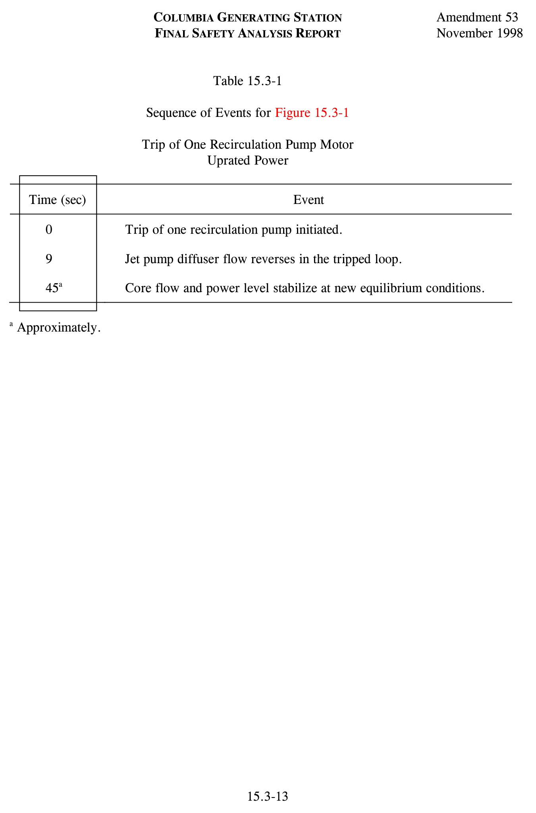

*figure on PDF page 175*

<!-- labels/text on this figure page -->
COLUMBIA GENERATING STATION
Amendment 53
FINAL SAFETY ANALYSIS REPORT
November 1998
Table 15.3-1
Sequence of Events for Figure 15.3-1
Trip of One Recirculation Pump Motor Uprated Power
Time (sec)
Event
0 Trip of one recirculation pump initiated.
9 Jet pump diffuser flow reverses in the tripped loop.
45a Core flow and power level stabilize at new equilibrium conditions.
a Approximately.
15.3-13

<!-- p.176 -->
Table 15.3-2

Sequence of Events for Figure 15.3-2

Trip of Both Recirculation Pump Motors Uprated Power

Time (sec)
Event

0 Trip of both recirculation pumps initiated.

## 5.66 Vessel water level (L8) trip initiates turbine trip.

## 5.66 Feedwater pumps are tripped off.

### 5.67 Main turbine stop (throttle) valves reach 90% open position and initiate
reactor scram trip.

## 5.76 Turbine bypass valves open.

<!-- p.177 -->
November 1998

Table 15.3-3

Sequence of Events for Figure 15.3-3

Recirculation Flow Control Failure Decreasing Flow in One Loop Uprated Power

Time (sec)
Event

0 Initiate fast down scale of recirculation pump speed in one loop.

4a Jet pump diffuser flow reverses in the affected loop.

45a Core flow and power level stabilize at new equilibrium conditions.

a Approximately.

<!-- p.178 -->
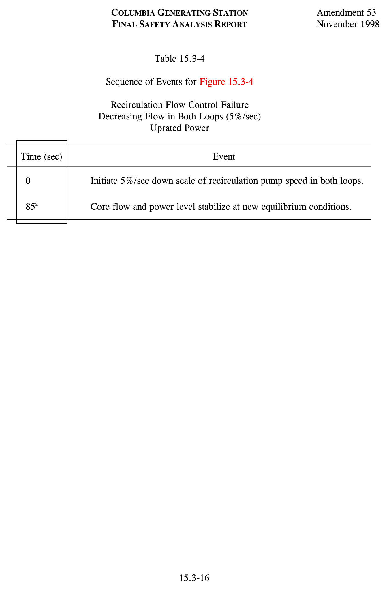

*figure on PDF page 178*

<!-- labels/text on this figure page -->
COLUMBIA GENERATING STATION
Amendment 53
FINAL SAFETY ANALYSIS REPORT
November 1998
Table 15.3-4
Sequence of Events for Figure 15.3-4
Recirculation Flow Control Failure Decreasing Flow in Both Loops (5%/sec)
Uprated Power
Time (sec)
Event
0 Initiate 5%/sec down scale of recirculation pump speed in both loops.
85a Core flow and power level stabilize at new equilibrium conditions.
15.3-16

<!-- p.179 -->
Table 15.3-5

Sequence of Events for Figure 15.3-5

One Recirculation Pump Seizure Uprated Power

Time (sec)
Event

0 Seizure of one recirculation pump initiated.

1a Jet pump diffuser flow reverses in the seized loop.

## 4.40 Vessel water high level (L8) trip initiates a turbine trip.

## 4.40 Feedwater pumps are tripped off.

### 4.41 Main turbine stop (throttle) valves reach 90% open position and
initiate reactor scram.

## 4.59 Active recirculation loop trips due to previous turbine trip.

a Approximately.

<!-- p.180 -->
Table 15.3-6

Sequence of Events for Pump Seizure
(for Single Loop Operation)

Time (sec)
Event

### 0.0 Recirculation pump motor trip off complete
Single pump seizure was initiated; core flow decreases

~1.9 Reverse flow ceases in the idle loop

~6.0 Power and flow stabilize

<!-- p.181 -->
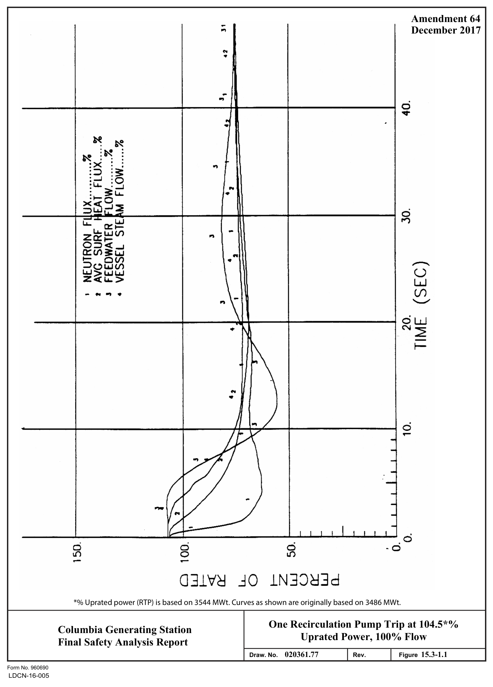

*figure on PDF page 181*

<!-- labels/text on this figure page -->
Amendment 64
December 2017 150. }--------ti----------+--------+-------;------ ]1
' 0. L-L-'--JL....-L....I-Ji.....-1..-..1--1--'---------',__ ________________
_
42
I 1, 40.
- ••
EAT FLUX ..... %
• VESSEL STE M FLOW ...... %
LOW ......... %
NEUTRON f!X ........... %
I J
•2 3 I JO.
1 FEEOWATER
1 AVG SURF
I
. j___;,--..
TIME (SEC)
I
20.
•2
~~ I - -- - 10.
IK'?
i I \ 100. I \I 0.
50.
~ w 0::: w 0... 0::: LL t-z u w <{ 0 0
*% Uprated power (RTP) is based on 3544 MWt. Curves as shown are originally based on 3486 MWt.
One Recirculation Pump Trip at 104.5*% Columbia Generating Station Uprated Power, 100% Flow Final Safety Analysis Report 020361.77 15.3-1.1 Draw. No. Rev. Figure
Form No. 960690

<!-- p.182 -->
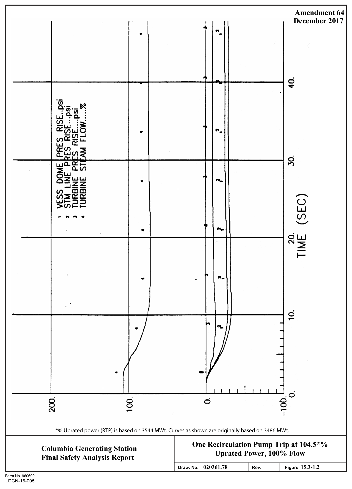

*figure on PDF page 182*

<!-- labels/text on this figure page -->
Amendment 64 December 2017 .. -
,2 •
40.
..
- I ~
•
VESS DOME PRES RISE..psi
• TURBINE ST AM FLOW ..... %
STM LINE p ~ES RISE. .. psi
J TURBINE PR :s RISE .... psi
.
• 1 I
JO.
.
•
l
TIME (SEC)
I I
- - I 4 20.
-........ ~ •
• 2 ' I
10.
1 ~ /
---- 1
,
1 I 1
•
-1 Ob. ,_ , , 1 I
.... - - - -- - - 0.
200.
100.
0.
*% Uprated power (RTP) is based on 3544 MWt. Curves as shown are originally based on 3486 MWt.
One Recirculation Pump Trip at 104.5*% Columbia Generating Station Uprated Power, 100% Flow Final Safety Analysis Report 020361.78 15.3-1.2 Draw. No. Rev. Figure
- - Form No. 960690

<!-- p.183 -->
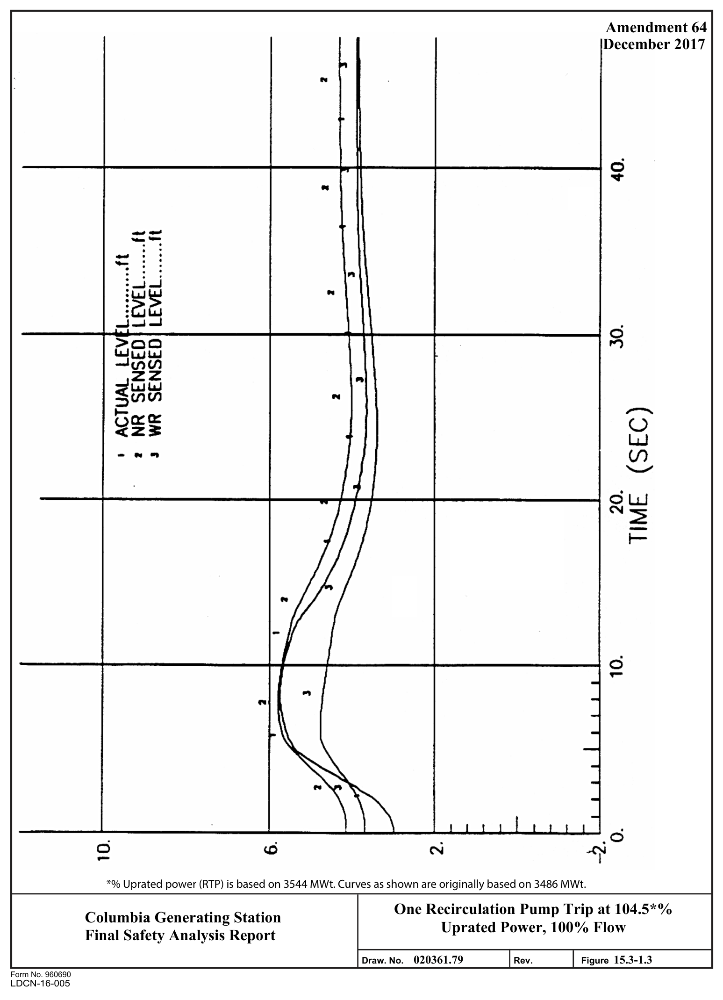

*figure on PDF page 183*

<!-- labels/text on this figure page -->
Amendment 64 December 2017
-2.~.........___.._ ............................ ___________________ -'-----
z
40.
a
J WR SENSED LEVEL. ...... ft 1 NR SENSED LEVEL. ...... fl
I ACTUAL LEVf L .........• ft
:,
J
30.
'
J
TIME (SEC)
20.
10.
-
0.
10.
6.
2.
*% Uprated power (RTP) is based on 3544 MWt. Curves as shown are originally based on 3486 MWt.
One Recirculation Pump Trip at 104.5*% Columbia Generating Station Uprated Power, 100% Flow Final Safety Analysis Report 020361.79 15.3-1.3 Draw. No. Rev. Figure Form No. 960690

<!-- p.184 -->
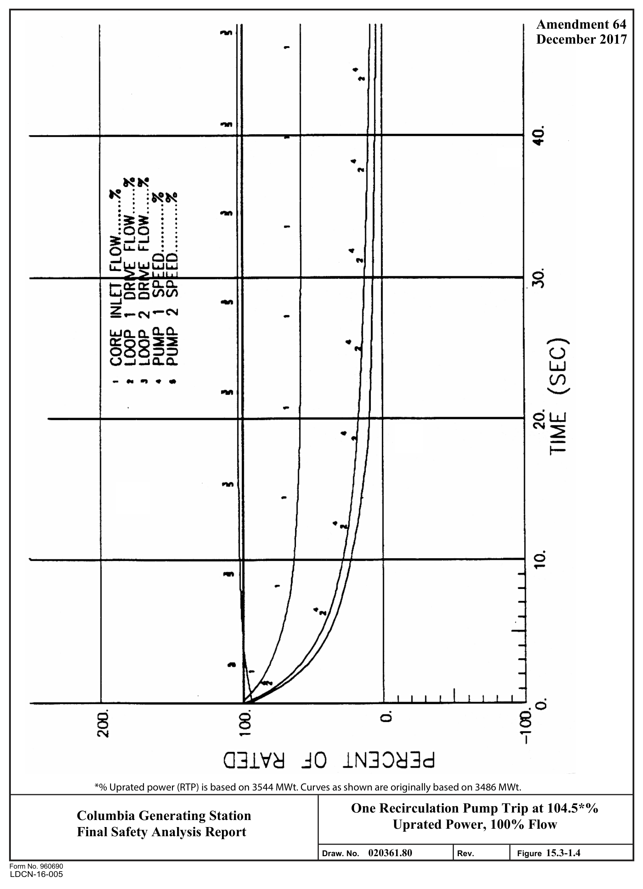

*figure on PDF page 184*

<!-- labels/text on this figure page -->
Amendment 64 i December 2017
2•
I • 40.
• I
t J LOOP 2 DR E FLOW ...... ~
FLOW ...... %
CORE INLETHLOW ........ ~
• PUMP 1 SP ED ........... % • PUMP 2 SP ED ........... %
j I . · JO.
I , LOOP 1 OR I
) ..
TIME (SEC
2 ~ I I .· I I , 20.
I
i
1
10.
I I I I~ ----
a
0. I
-100. 200.
~ 100.
0.
~ <( a::: LL w a::: w Q_ z 0 0 0
*% Uprated power (RTP) is based on 3544 MWt. Curves as shown are originally based on 3486 MWt.
One Recirculation Pump Trip at 104.5*% Columbia Generating Station Uprated Power, 100% Flow Final Safety Analysis Report 020361.80 15.3-1.4 Draw. No. Rev. Figure Form No. 960690

<!-- p.185 -->
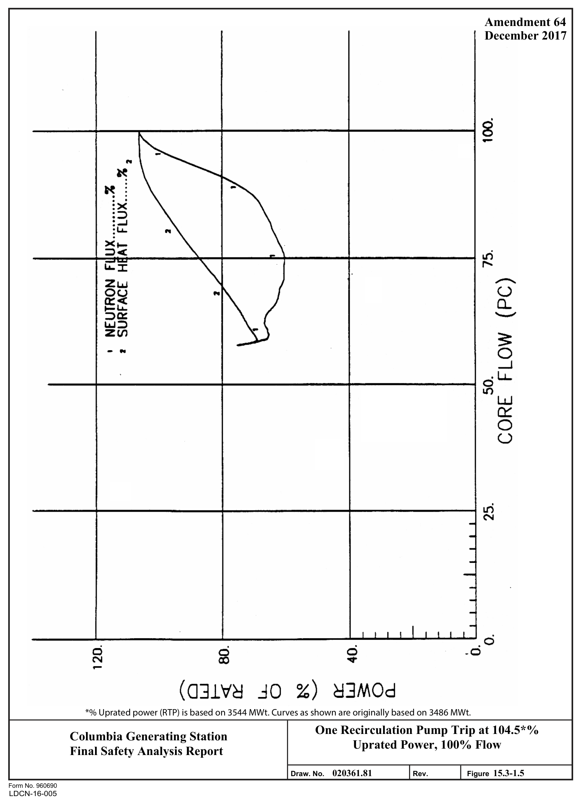

*figure on PDF page 185*

<!-- labels/text on this figure page -->
Amendment 64 December 2017 120. t--------+-------+------~1--------+------
___,.__ ___
_
100.
_,,_ _____
1 SURFACE HIIAT FLUX ...... " 2
NEUTRON FUUX ........... ~
75.
I 0. L....L-L-.JL.-.J--.....L-1._,a__....&.......,1----L..-----___.L--_____
CORE FLOW {PC)
I
50.
25.
0.
40. 80.
~
....---...
.............. w 3: Q_
et: u....
0 w <( a:::
I- 0 0
*% Uprated power (RTP) is based on 3544 MWt. Curves as shown are originally based on 3486 MWt.
One Recirculation Pump Trip at 104.5*% Columbia Generating Station Uprated Power, 100% Flow Final Safety Analysis Report
020361.81 15.3-1.5 Draw. No. Rev. Figure Form No. 960690

<!-- p.186 -->
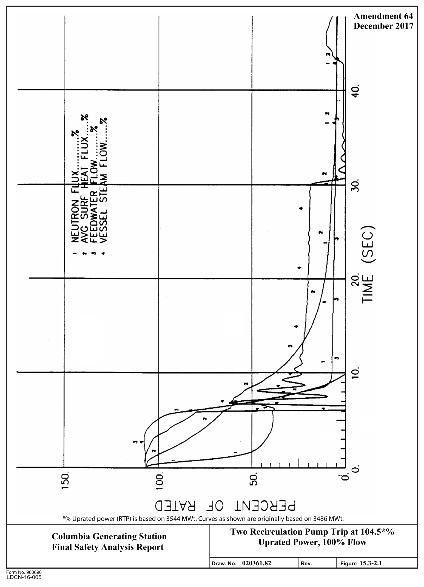

*figure on PDF page 186*

<!-- labels/text on this figure page -->
Amendment 64
December 2017 150. t-------+----------lf--------1-------__._ ____ _
40.
EAT FLUX ..... %
I I
• VESSEL STE M FLOW ...... %
& NEUTRON f]X .. ·········"
LOW ......... ?.
r\ I JO.
FEEDWATER
, AVG SURF
•
TIME (SEC)
2
., I
• • 20.
•
'- .,
10. I W _'II. I IA
. .
I
I ~ .,
0.
• I 100.
50.
0.
I
w w Q_ 0::: LL t-z 0:::
w <( u I- 0 0 *% Uprated power (RTP) is based on 3544 MWt. Curves as shown are originally based on 3486 MWt.
Two Recirculation Pump Trip at 104.5*% Columbia Generating Station Uprated Power, 100% Flow Final Safety Analysis Report
020361.82 15.3-2.1 Draw. No. Rev. Figure Form No. 960690

<!-- p.187 -->
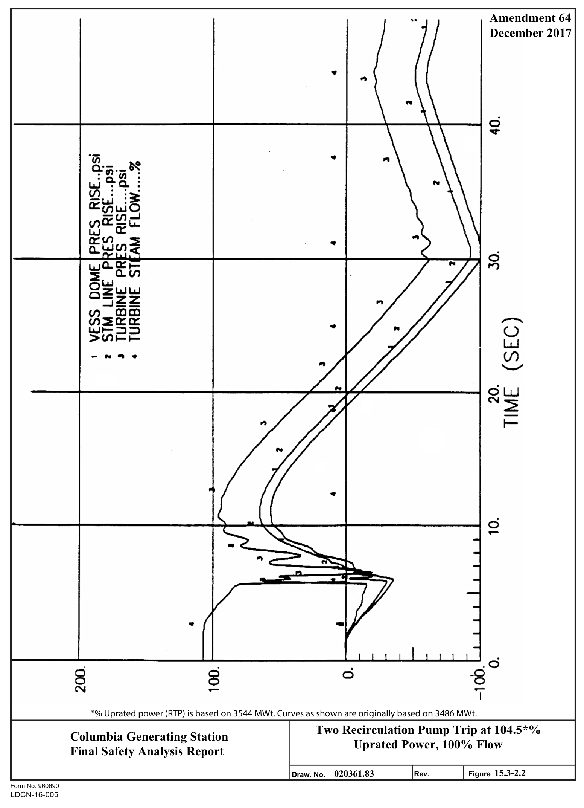

*figure on PDF page 187*

<!-- labels/text on this figure page -->
Amendment 64 200. -----------+-------+---------1--------1------
lQO. t---............ ----+--..,__-----+------1---------1-------
December 2017
---L ___ _
40.
I
-1ob.~............._ ............... ____.__L--"--..L.-.L.-----....L.-------a.--i::;;__ ___
• VESS DOMEiPRES RISE .. psi
• TURBINE ST AM FLOW .•... % , STM LINE P ES RISE ... psi
TURBINE PR S RISE .... psi
30.
I
TIME (SEC)
"x J
20.
V'-1
10.
I
•~fl
•
-...·
0. 0. I
*% Uprated power (RTP) is based on 3544 MWt. Curves as shown are originally based on 3486 MWt.
Two Recirculation Pump Trip at 104.5*% Columbia Generating Station Uprated Power, 100% Flow Final Safety Analysis Report
15.3-2.2 020361.83 Rev. Figure Draw. No.
Form No. 960690

<!-- p.188 -->
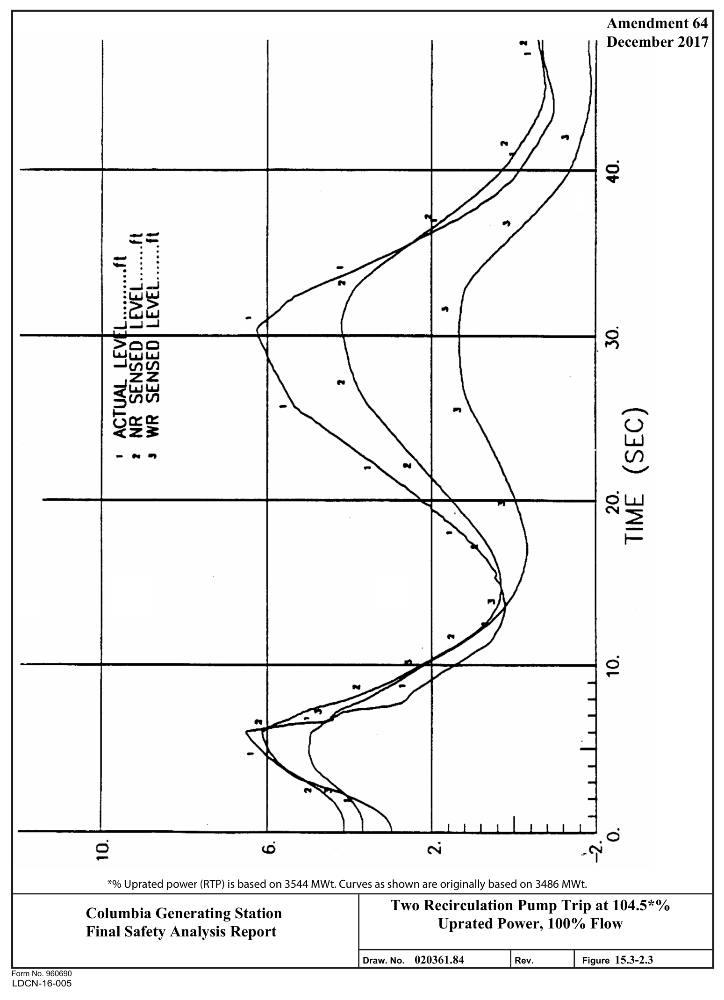

*figure on PDF page 188*

<!-- labels/text on this figure page -->
Amendment 64 December 2017
6. -----~~i---1-------+--------ir;_,t--~-----+------
10. t--------ti---------+-------+--------1------
2 . ._------.--A-----------."+----------+------'111.........,__+------
~
40.
I
, NR SENSED LEVEL. ..... .fl WR SENSEO LEVEL ..... .ft
ACTUAL LEVf L .......... ft
J
JO.
I
TIME (SEC)
J I
20.
I
10.
\ -2. I I I I I I I I I I I 0.
*% Uprated power (RTP) is based on 3544 MWt. Curves as shown are originally based on 3486 MWt.
Two Recirculation Pump Trip at 104.5*% Columbia Generating Station Uprated Power, 100% Flow Final Safety Analysis Report
020361.84 15.3-2.3 Draw. No. Rev. Figure Form No. 960690

<!-- p.189 -->
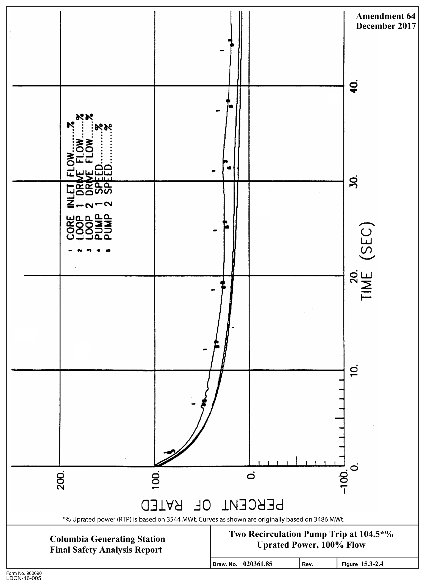

*figure on PDF page 189*

<!-- labels/text on this figure page -->
Amendment 64 200. t--------+-------t---------+-------1------ __., _____ ~-----------
December 2017
40.
FLOW ...... !Y. J LOOP 2 DR E FLOW ...... "-
' CORE INL.ETILOW ........ ~
• PUMP 1 SP ED ........... % • PUMP 2 SP ED ........... %
I ' JO.
I I , LOOP 1 DR
TIME (SEC)
.- I
·•· I 20.
-100. ~--,1........1..__.___..__._ ............. __.___..___ ____
10.
I o.
0 w 100.
0.
a:: w Q_ fr:: LL w u <( I- I- z 0
*% Uprated power (RTP) is based on 3544 MWt. Curves as shown are originally based on 3486 MWt.
Two Recirculation Pump Trip at 104.5*% Columbia Generating Station Uprated Power, 100% Flow Final Safety Analysis Report 020361.85 15.3-2.4 Draw. No. Rev. Figure Form No. 960690

<!-- p.190 -->
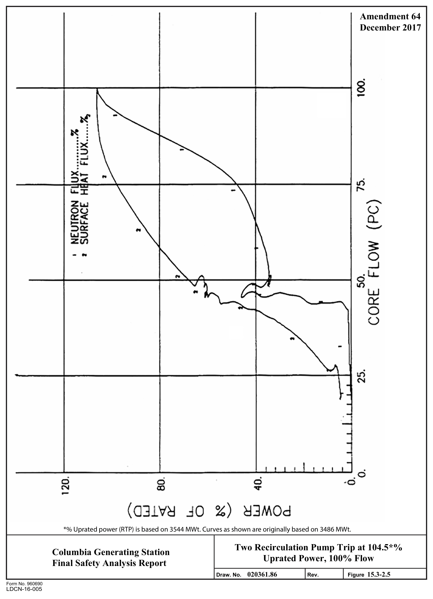

*figure on PDF page 190*

<!-- labels/text on this figure page -->
Amendment 64 120. ---------------------------------
' 0. L.L...1-1--L..Ll.....L...JL-I-.J.-===~-....l,_------L------L----
December 2017
100.
1 SURFACE HdAT FLUX ...... ~
NEUTRON FUUX ........... "
75.
CORE FLOW (PC)
I
50.
25.
o.
80.
40.
~ ~
......_.... <(
a::: w 3: 0 w a::: u_ Q_ t- 0 0
*% Uprated power (RTP) is based on 3544 MWt. Curves as shown are originally based on 3486 MWt.
Two Recirculation Pump Trip at 104.5*% Columbia Generating Station Uprated Power, 100% Flow Final Safety Analysis Report 020361.86 15.3-2.5 Draw. No. Rev. Figure Form No. 960690

<!-- p.191 -->
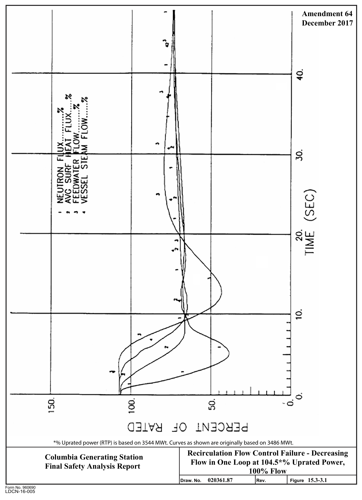

*figure on PDF page 191*

<!-- labels/text on this figure page -->
Amendment 64 150. r--------t--------t--------+-------1------
December 2017
( o. ----~----------------._.,._-__________________ __,,._ _ __ _ C))
I I 40.
, AVG SURF t EAT FLUX ..... %
) +,
• VESSEL STE M FLOW •..... 7o
LOW ......... 7.
I NEUTRON F!X ........... 7.
'
I \ )
JO. I
J FEEOWATER
'
TIME (SEC)
J
•
, JV • 20.
I
I
J 10.
I '\. \ • I \. \ '\.
\ 'r ~ \ I \ 0.
~ I 50. 100.
w w fr::
<( t-z w u 0::: Q_ J- U- 0 0
*% Uprated power (RTP) is based on 3544 MWt. Curves as shown are originally based on 3486 MWt.
Recirculation Flow Control Failure - Decreasing Columbia Generating Station Flow in One Loop at 104.5*% Uprated Power, Final Safety Analysis Report 100% Flow 020361.87 15.3-3.1 Draw. No. Rev. Figure Form No. 960690

<!-- p.192 -->
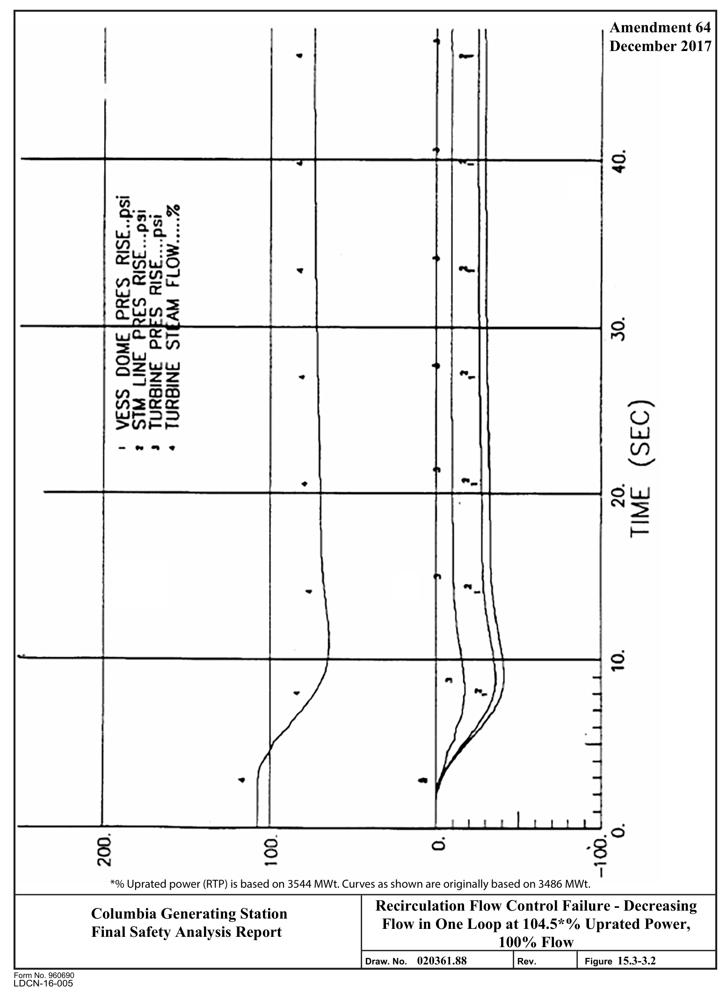

*figure on PDF page 192*

<!-- labels/text on this figure page -->
Amendment 64 December 2017 .
- '
•
.
40.
• I
VESS DOME PRES RISE. .psi
• TURBINE ST AM FLOW .•... % STM LINE p RES RISE ... psi
, TURBINE PR :s RISE .... psi
. -... • I
JO.
. • --- ,t
TIME (SEC)
I I .
.
• 1 20.
I
..
• J I ~ 10.
I ., ., I
I
I I . I
-----...
• I I
I
I
- ,_
.... ,_ .... ._ ,_ .... 0. I-
200.
100.
- 100. 0.
•
*% Uprated power (RTP) is based on 3544 MWt. Curves as shown are originally based on 3486 MWt.
Recirculation Flow Control Failure - Decreasing Columbia Generating Station Flow in One Loop at 104.5*% Uprated Power, Final Safety Analysis Report 100% Flow 020361.88 15.3-3.2 Draw. No. '-- Rev. '-- Figure Form No. 960690

<!-- p.193 -->
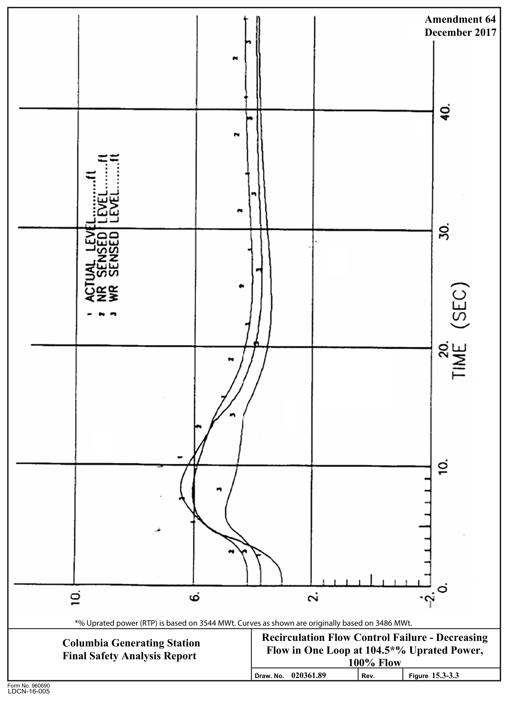

*figure on PDF page 193*

<!-- labels/text on this figure page -->
Amendment 64
2. r------~t-------t--- -__.:._-;-f-------1----- December 2017
-2. --------------------- -----------'--------L---
2
40. I
2
, NR SENSED LEVEL. ...... ft .1 WR SENSED LEVEL. ...... ft
• ACTUAL LfVf L .......... tl
J
I 30. I
•
TIME (SEC)
20. f
~ 1
10.
'P"
o. 6.1 10.
.
*% Uprated power (RTP) is based on 3544 MWt. Curves as shown are originally based on 3486 MWt.
Recirculation Flow Control Failure - Decreasing Columbia Generating Station Flow in One Loop at 104.5*% Uprated Power, Final Safety Analysis Report 100% Flow 020361.89 15.3-3.3 Draw. No. Rev. Figure Form No. 960690

<!-- p.194 -->
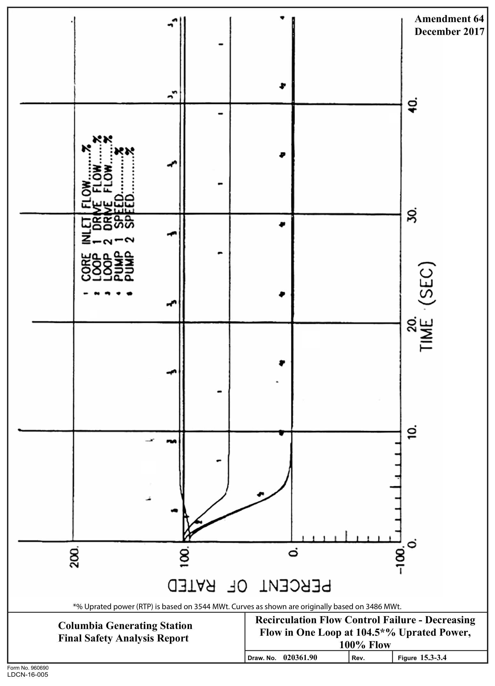

*figure on PDF page 194*

<!-- labels/text on this figure page -->
• Amendment 64 J~ December 2017 I
..
>,
40.
I
1 LOOP 1 DR VE FLOW ...... ,; 1 LOOP 2 OR VE FLOW ...... ,;
1 CORE INLET FLOW ........ ,; • PUMP 2 SP :£0 ........... ~
• PUMP 1 SP EEO .•••...••.• X ~ \
I
JO.
• \ ' TIME ·(SEC)
~ \ 20.
. • \
I
10.
4 ~ I I I ' I
I I .I
~ \ • I
I
._ I ~ ._ - ~ - ._ ._ 0. '- '- 200.
-100. 100.
o.
~ z w 0:: 0:: w Cl.
W L,_ J- 0 0 0
*% Uprated power (RTP) is based on 3544 MWt. Curves as shown are originally based on 3486 MWt.
Recirculation Flow Control Failure - Decreasing Columbia Generating Station Flow in One Loop at 104.5*% Uprated Power, Final Safety Analysis Report 100% Flow 020361.90 15.3-3.4 Draw. No. Rev. Figure Form No. 960690

<!-- p.195 -->
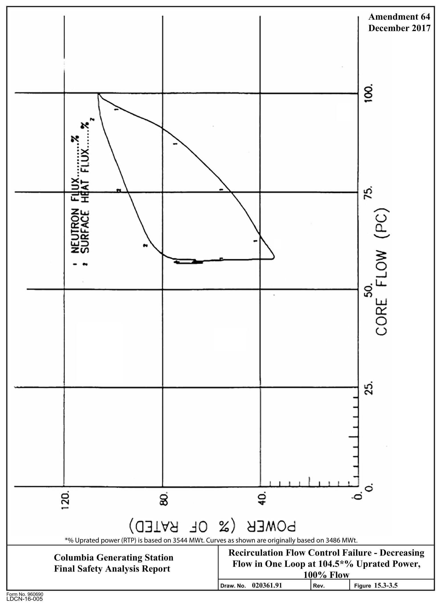

*figure on PDF page 195*

<!-- labels/text on this figure page -->
Amendment 64 December 2017
b . .__.__....__._....__._ .............. ----...._.__ ____________ _________ _
120. t--------+---------+-----------1--------+--
100.
1
, SURFACE H&AT FLUX ...... "
' NEUTRON ruux ........... ~
75.
CORE FLOW (PC)
50.
25.
0.
40.
80.
~ ~ ,,.._ ..__..,. <( fr: u_ fr: w Q_ 0 w t- 0 0 *% Uprated power (RTP) is based on 3544 MWt. Curves as shown are originally based on 3486 MWt.
Recirculation Flow Control Failure - Decreasing Columbia Generating Station Flow in One Loop at 104.5*% Uprated Power, Final Safety Analysis Report 100% Flow 020361.91 15.3-3.5 Draw. No. Rev. Figure Form No. 960690

<!-- p.196 -->
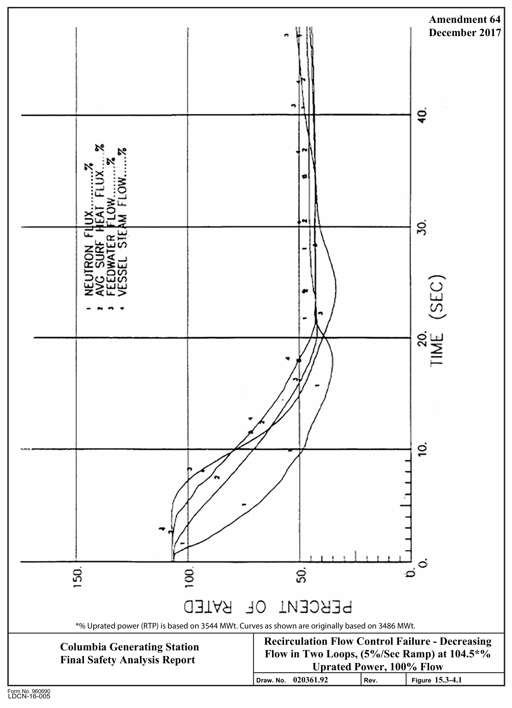

*figure on PDF page 196*

<!-- labels/text on this figure page -->
Amendment 64
•• E · :;z if: . ~ _ =:
December 2017
l ____._ ___________ _
-
150. ----------------- -------------- ., ◄O .
fAT FLUX ... . %
• VESSEL STE M t LOW ...... 7.
LOW ......... 7.
NEUTRON f]X ........... 7.
JO.
............... __.__L-L........__._ .......... .__ _ _________
s FEEDWATER , AVG SURF
IME (SEC)
!--r=-=-; >~ I
• •
20.
10.
I
<'.i >
' >
< > ~ 0. ~ ~ ~ so. ~ 0.
. • 00 1 ~ <( .,_ w fr'.: u..
w 0..
0 0
*% Uprated power (RTP) is based on 3544 MWt. Curves as shown are originally based on 3486 MWt.
Recirculation Flow Control Failure - Decreasing Columbia Generating Station Flow in Two Loops, (5%/Sec Ramp) at 104.5*% Final Safety Analysis Report Uprated Power, 100% Flow 020361.92 15.3-4.1 Draw. No. Rev. Figure Form No. 960690

<!-- p.197 -->
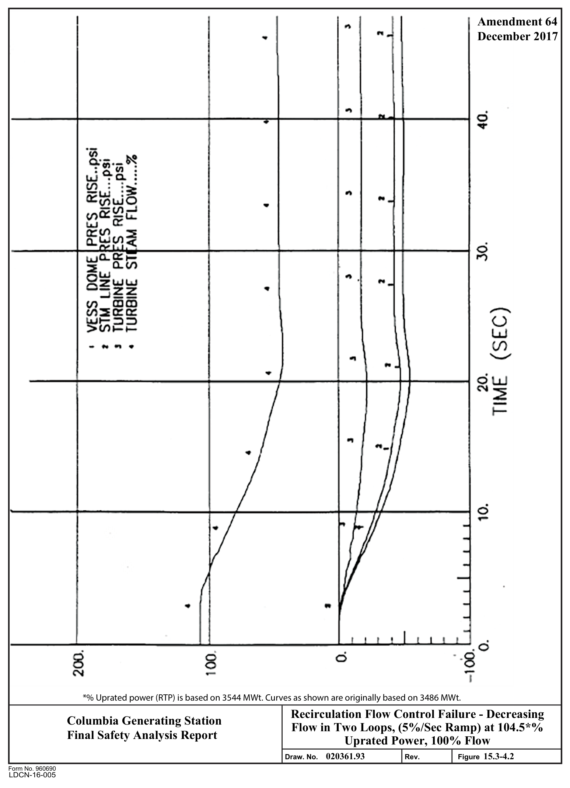

*figure on PDF page 197*

<!-- labels/text on this figure page -->
Amendment 64 ) •
December 2017 2 '
J 40.
~
• I
VESS DOME PRES RISE .. psi
• TURBINE ST AM FLOW .•... % , STM LINE P ~ES RISE ... psi
, TURBINE PR ES RISE .... psi
, I I 4
JO.
~ ~ J
2 •
I
TIME (SEC)
~ I
J J I 4 20.
J ~ 10.
~ I
I
I
I I I
...........
----
• I I
I
I
- ~ - -- ,_ -- ._ 0.
- 100. 200. 100.
0.
' '
*% Uprated power (RTP) is based on 3544 MWt. Curves as shown are originally based on 3486 MWt.
Recirculation Flow Control Failure - Decreasing Columbia Generating Station Flow in Two Loops, (5%/Sec Ramp) at 104.5*% Final Safety Analysis Report Uprated Power, 100% Flow 020361.93 15.3-4.2 Draw. No. Rev. Figure
- - Form No. 960690

<!-- p.198 -->
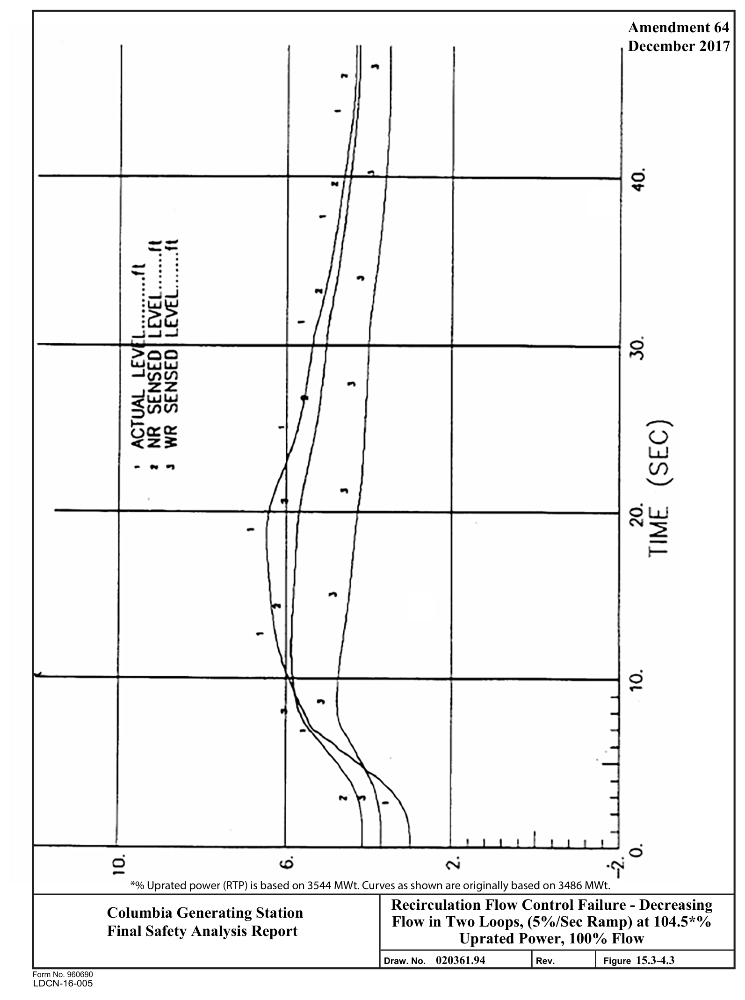

*figure on PDF page 198*

<!-- labels/text on this figure page -->
Amendment 64 December 2017 J J
•
-~·
--- 40.
J I
, NR SENSED LEVEL. ..... .f t WR SENSED LEVEL. ...... ft
• ACTUAL LEV ~L ...•...... fl
J
I JO.
>
------=
TIME (SEC)
I
.s
-:---.....
J .
20.
1
> J ,
--- 10. ~
-2 . .... , • • , I • , , •
J
•
I
.a l I
-- I---
....
0. -- -- I- 10.
6.
2.
*% Uprated power (RTP) is based on 3544 MWt. Curves as shown are originally based on 3486 MWt.
Recirculation Flow Control Failure - Decreasing Columbia Generating Station Flow in Two Loops, (5%/Sec Ramp) at 104.5*% Final Safety Analysis Report Uprated Power, 100% Flow ,__ ,__ 020361.94 15.3-4.3 Draw. No.
Rev. Figure Form No. 960690

<!-- p.199 -->
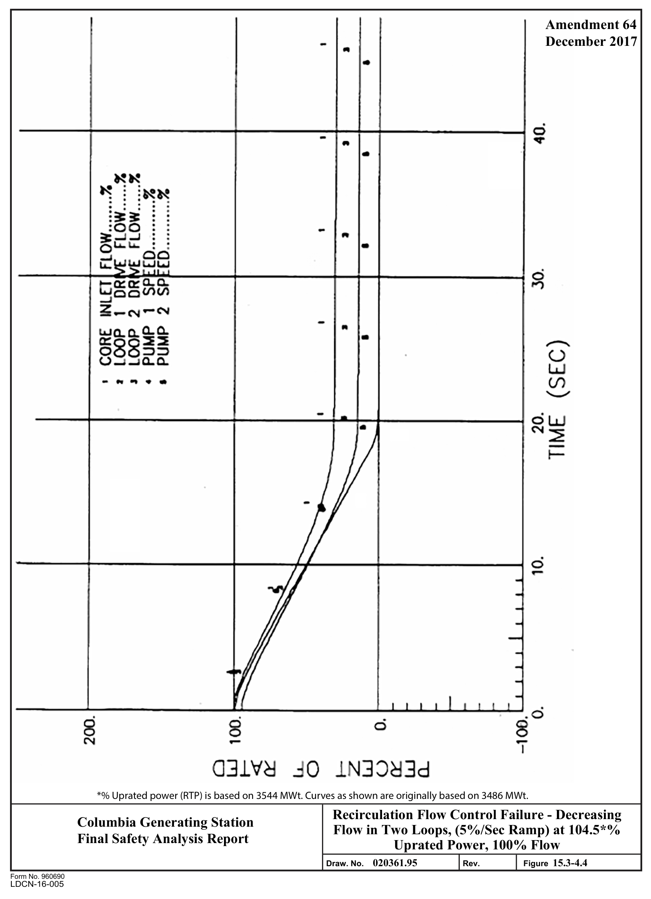

*figure on PDF page 199*

<!-- labels/text on this figure page -->
Amendment 64
--'---- --- ------J...------
- December 2017 a
• 200. t---- ----+------+-------4--------+-----
• a I
40.
FLOW ...... ~ FLOW ...... %
CORE lNLCTHLOW ........ ~
• PUMP 1 SP ED .......•... % • PUMP 2 SP ED ..... ...... ,;
J I I JO.
1 LOOP 1 DR LOOP 2 DR
•
•
TIME (SEC)
I .1
20. .r
...........
-100. L...J...J._JLJ._...L....J.__i_.L-L.....,L_-----
--......._""-
10.
I I
0. I I 0 w 100.
o.
~ <{ 0 ._ w w 0::: u... a_ u t-
*% Uprated power (RTP) is based on 3544 MWt. Curves as shown are originally based on 3486 MWt.
Recirculation Flow Control Failure - Decreasing Columbia Generating Station Flow in Two Loops, (5%/Sec Ramp) at 104.5*% Final Safety Analysis Report Uprated Power, 100% Flow 020361.95 15.3-4.4 Draw. No. Rev. Figure Form No. 960690

<!-- p.200 -->
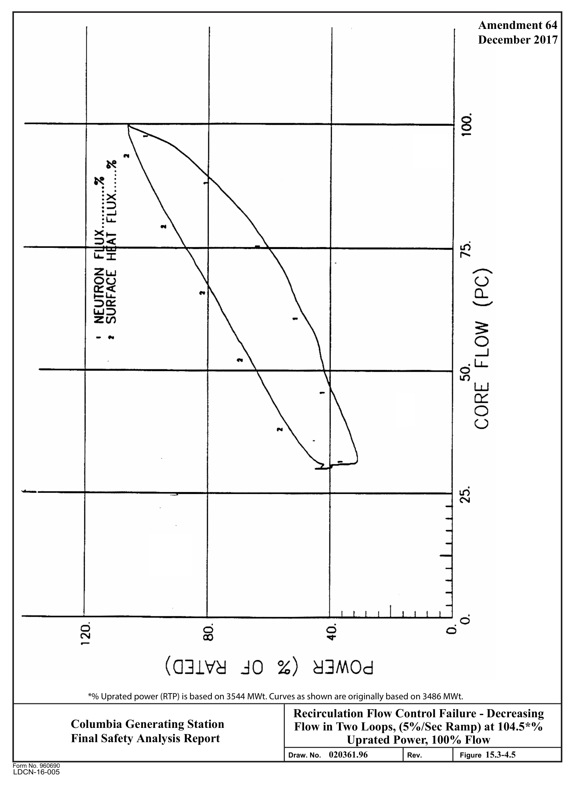

*figure on PDF page 200*

<!-- labels/text on this figure page -->
Amendment 64 120. t-------+-------f---------1~-----~----- '------ December 2017
100.
L..._ _____
SURFACE HIIAT FLUX ...... %
NEUTRON FllUX ....••....• ,;
75.
L---_______
CORE FLOW (PC)
t I
50. 0. L-.L-....___.__..._&-.L-.....__.._,.__...._ _____
f 25.
0.
40.
~ 80.
~ ~ ~ ,,._ <( 0 w 0::: LL 0::: w Q_ 0 0
*% Uprated power (RTP) is based on 3544 MWt. Curves as shown are originally based on 3486 MWt.
Recirculation Flow Control Failure - Decreasing Columbia Generating Station Flow in Two Loops, (5%/Sec Ramp) at 104.5*% Final Safety Analysis Report Uprated Power, 100% Flow 020361.96 15.3-4.5 Draw. No. Rev. Figure Form No. 960690

<!-- p.201 -->
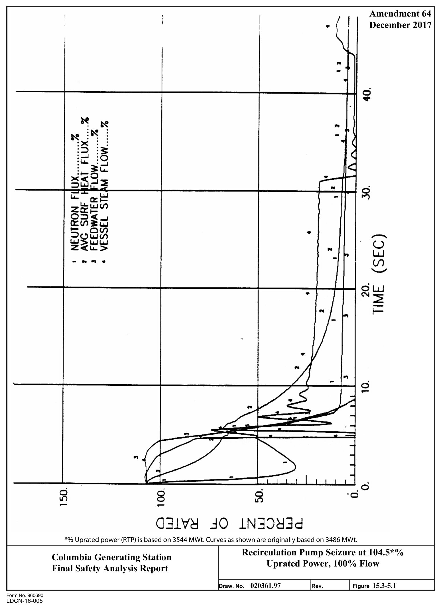

*figure on PDF page 201*

<!-- labels/text on this figure page -->
Amendment 64 December 2017 ◄ 150. ----------t--------t------------t"--------t----- 1 I I 40.
EAT FLUX ..... %
• VESSEL STE M FLOW ...... ?.
2
LOW ......... ~
1 NEUTRON ff X··········"
I ..
I =n 30.
FEEDWATER
1 AVG SURF
•
TIME (SEC)
l
20.
.
4 I
•
.._.
J 10.
I .no. I I ...
I I
I a
I 111
I
J
100. ~ 0.
I I 50.
0.
•
w <( LL w w (1.. .__ a::: J-z u 0::::
0 0
*% Uprated power (RTP) is based on 3544 MWt. Curves as shown are originally based on 3486 MWt.
Recirculation Pump Seizure at 104.5*% Columbia Generating Station Uprated Power, 100% Flow Final Safety Analysis Report
020361.97 15.3-5.1 Draw. No. Rev. Figure Form No. 960690

<!-- p.202 -->
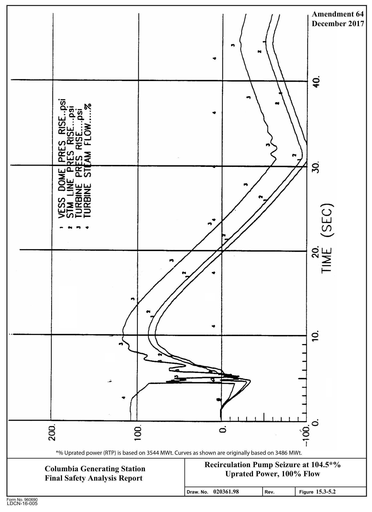

*figure on PDF page 202*

<!-- labels/text on this figure page -->
Amendment 64 200. ,---------tr-------+-------1--------l------ 100. r----"'c'"----t----+--------t-------+-------1------
-100. ---~~----~------------_...... ________ ---Ji-----
December 2017
40.
I
1 VESS DOMEf PRES RISE .. psi
• TURBINE ST AM FLOW ..... %
1 STM LINE P ES RISE. .. psi
TURBINE PR S RISE. ... psi 30.
I
TIME (SEC)
"'" .1 "'t''-.. t 20.
10.
I
rltll
I,
,...
0.
0. I ,,
*% Uprated power (RTP) is based on 3544 MWt. Curves as shown are originally based on 3486 MWt.
Recirculation Pump Seizure at 104.5*% Columbia Generating Station Uprated Power, 100% Flow Final Safety Analysis Report
020361.98 15.3-5.2 Draw. No. Rev. Figure Form No. 960690

<!-- p.203 -->
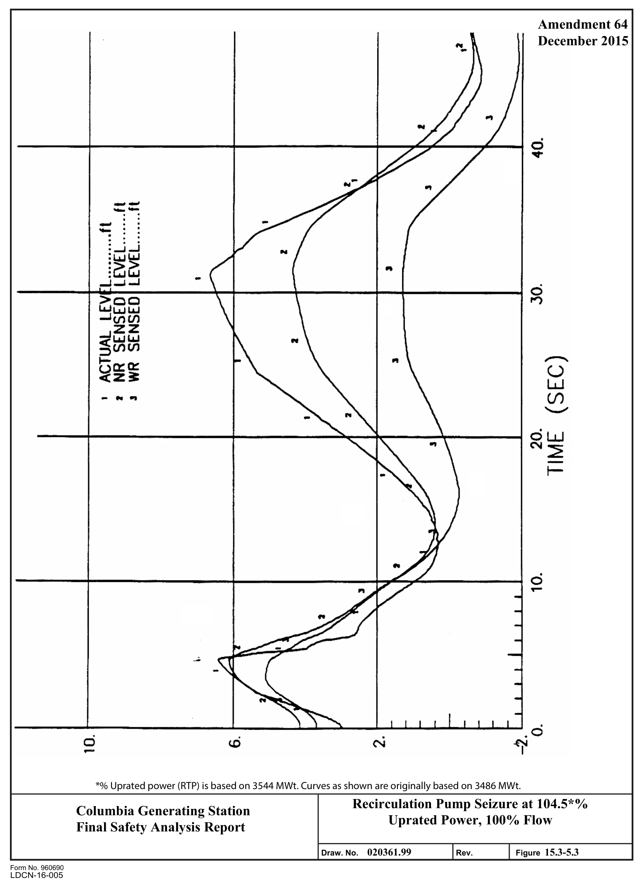

*figure on PDF page 203*

<!-- labels/text on this figure page -->
Amendment 64
December 2015 6. t----#"--'k-or----t--------t-------,-~,,,,,C---J---...------1------ ----
40.
\\: I I
1 NR SENSED LEVEL ....... fl WR SENSED LEVEL. ...... ft
1 ACTUAL LEVf L .......... ft
, JO.
1 I
TIME (SEC)
J
.J
~c 20.
I
, r 1
10.
'\. ,1
I I I I I I I I I
I,
-2. I I 0.
2. I 10.
*% Uprated power (RTP) is based on 3544 MWt. Curves as shown are originally based on 3486 MWt.
Recirculation Pump Seizure at 104.5*% Columbia Generating Station Uprated Power, 100% Flow Final Safety Analysis Report
020361.99 15.3-5.3 Draw. No. Rev. Figure
Form No. 960690

<!-- p.204 -->
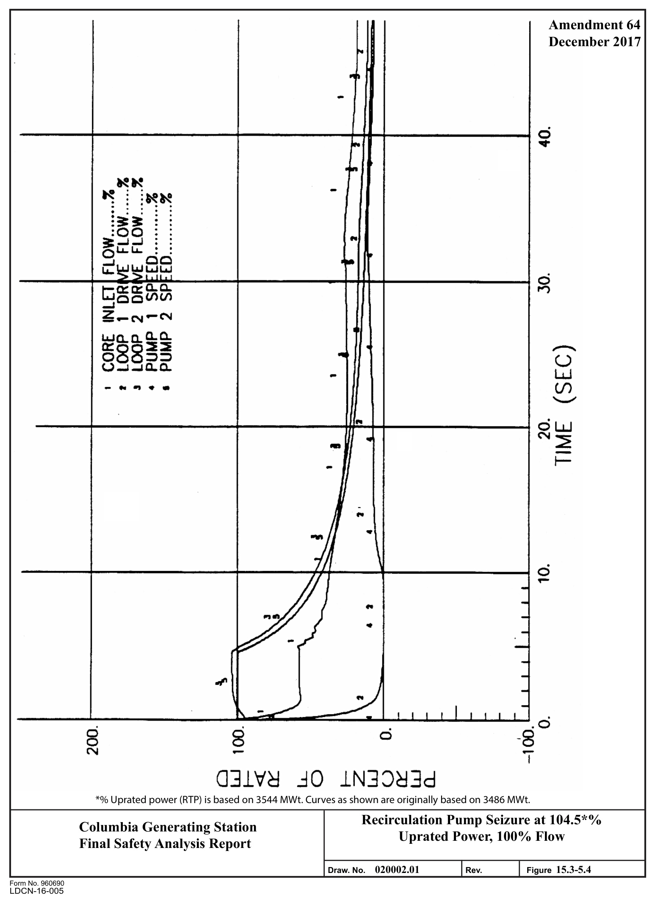

*figure on PDF page 204*

<!-- labels/text on this figure page -->
Amendment 64 200. t--------+--------,t--------f---------1-----
-100. -------------------------------------- December 2017
40.
FLOW ...... % .1 LOOP 2 OR E FLOW ...... ,;
CORE INLETHLOW ........ ~
• PUMP 1 SP ED .......... ·" • PUMP 2 SP ED ........... %
2 I .
JO.
, LOOP 1 DR
•
•
TIME (SEC)
I
I I ~,
2•2
20.
I
• I
~~I ..
10.
1
•
\ l\2 ~ I 0.
~ 100.
0.
'
w er w fr:: LL u Q_ <( I- z 0 0
*% Uprated power (RTP) is based on 3544 MWt. Curves as shown are originally based on 3486 MWt.
Recirculation Pump Seizure at 104.5*% Columbia Generating Station Uprated Power, 100% Flow Final Safety Analysis Report
020002.01 15.3-5.4 Draw. No. Rev. Figure Form No. 960690

<!-- p.205 -->
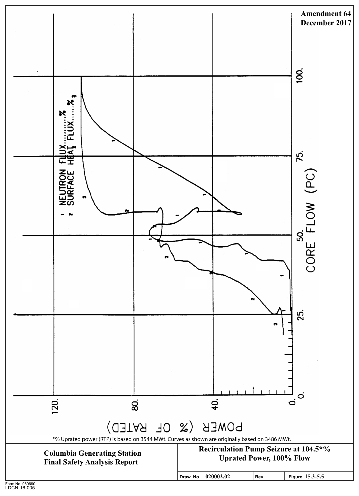

*figure on PDF page 205*

<!-- labels/text on this figure page -->
Amendment 64 120.t--------+-----------1,----------t---------t------ December 2017
100.
I
1 SURFACE H8A\ FLUX ...... ~~
NEUTRON rnux ........... x
75.
I
CORE FLOW (PC)
1
50.
I
r
25.
Q. I I I I I I I I I I I
1
0.
80.
40.
~ ~ '--' 3: 0 w <( er 0:: w Cl..
LL t- 0 0
*% Uprated power (RTP) is based on 3544 MWt. Curves as shown are originally based on 3486 MWt.
Recirculation Pump Seizure at 104.5*% Columbia Generating Station Uprated Power, 100% Flow Final Safety Analysis Report
020002.02 15.3-5.5 Draw. No. Rev. Figure Form No. 960690

<!-- p.206 -->
Amendment 63 December 2015

POWER: 75.0% RATED FLOW: 57.0% RATED 100 ~~~-~~~-~~~--~~__.--~N~e-u~t-ro-n~F=l~u-x----~ 125 ~~~~~-----~~-__.--v~e-s-se~l~D~o-m-e~P~r-e-ss-u-re-~ 1075
--fr- Average Surface Heat Flux
--fr- Idle Loop Flow (%]
---B--- Core Inlet Flow , ---B--- Active Loop Flow(%] , -+- Pum s eed % of Initial 100 -h-~-~------~-~-~-~---~ 1050

_ J ______ l ______ L ___ I ______ l ___ I ___ !... 75 75 1025

1000 ~ ..
,, .. ...
,, .. ... 50 .e: e :::, .. ..
50 a:
a:
'#- '#- 975 £_ 25

950 0 I L I I I I I I 25 - 1 - - - , - - - 1 - - - - - - 1- - - 1 - - - - - - r
- - 1- -

-25 + ---+--+---+--+---+--~--,--+---+--+--~ 925

-50 +--+--+-+---<-+-+--+--+--+--+---i-t-+--+--+--+-+---<-+-+--+- 0 900 0 2 4 6 8 10 12 14 16 18 20 0 2 4 6 8 10 12 14 16 18 20 Time (s)
Time(s)

125 1-6 ~~--~~--~~~--~~--~~-~__. --~G-N~F~2-46~ 125
--&- Vessel Level
-fr- Vessel Steam Flow
--fr- G1446 I -B- Feedwater Flow ,-+- Turbine Steam Flow

----T--------,-- 1.5

I __ I __ 1 __ l __ :--:!j>=9'-,,&-e--)--_Q,------ 100 100

1.4
--i--------1-- :;;; ..
~ ci. .. .. ..
0 ,, ..
~ a:
~ 0 ., ..
75 > o 1.3 --------1------- +---------,.-------- - - t- - - t- - - + - - ~ 75 "'1 - - ""1 - - -1- - -,- - -1- - -,- - - t- a..
;;; '#- g u

#### > .. E
.; 0

..J 1.2

50 50

I I
1.1 ________ L ________ l_ ___ _

25 25 1.0 +--+-+--+--+-+--+----i+--+--+-+--+--+-+--+----<--+--+--t---+---1 2 0 2 4 6 8 10 12 14 16 20 0 3 4 18 Time(s)
Time (s)
PID: F687A

SLO Recirculation Pump Seizure Results Columbia Generating Station Final Safety Analysis Report 910402.37 1 15.3-6 Draw. No.
Rev. Figure Form No. 960690

