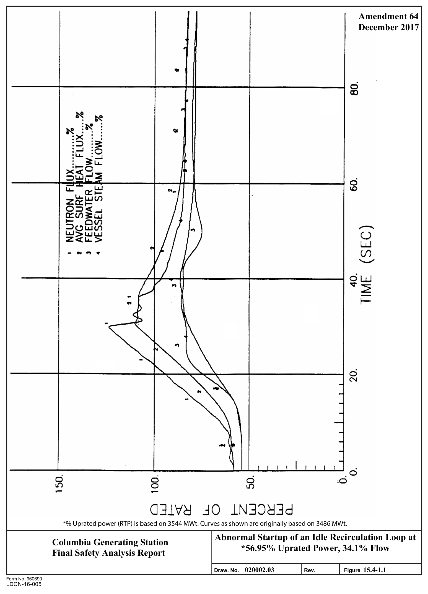
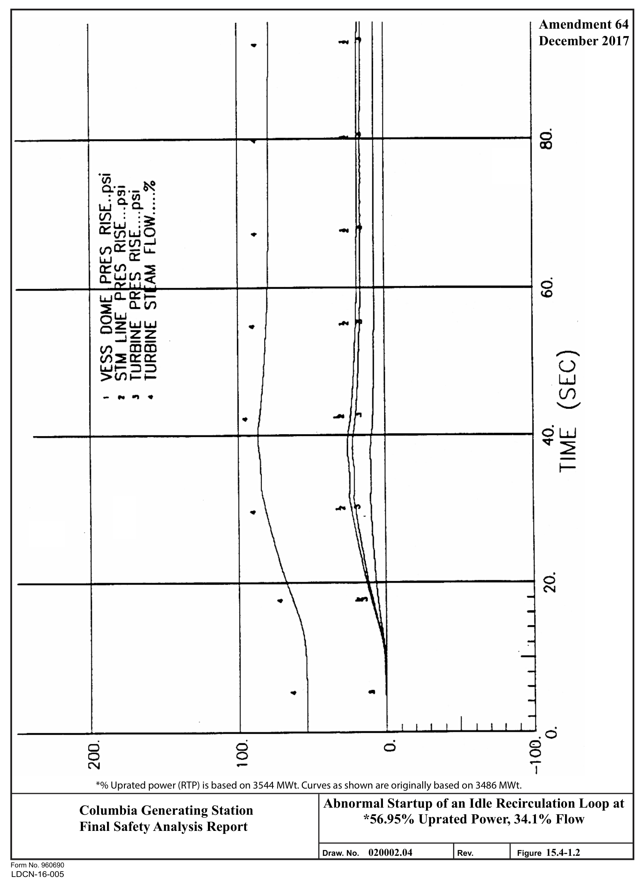
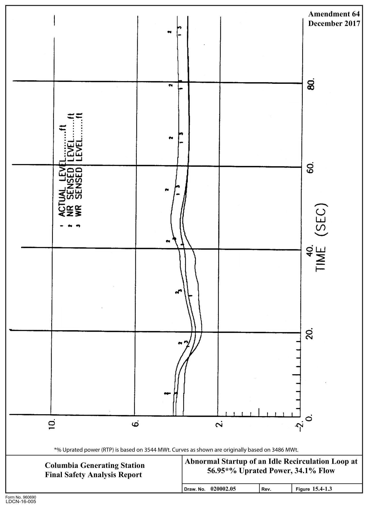
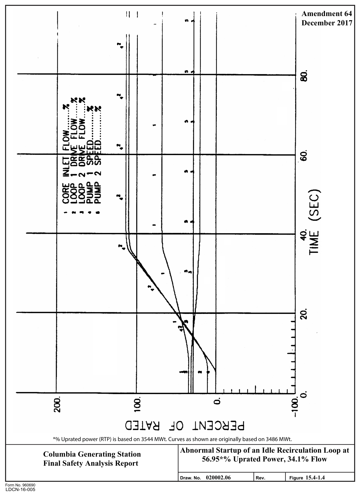
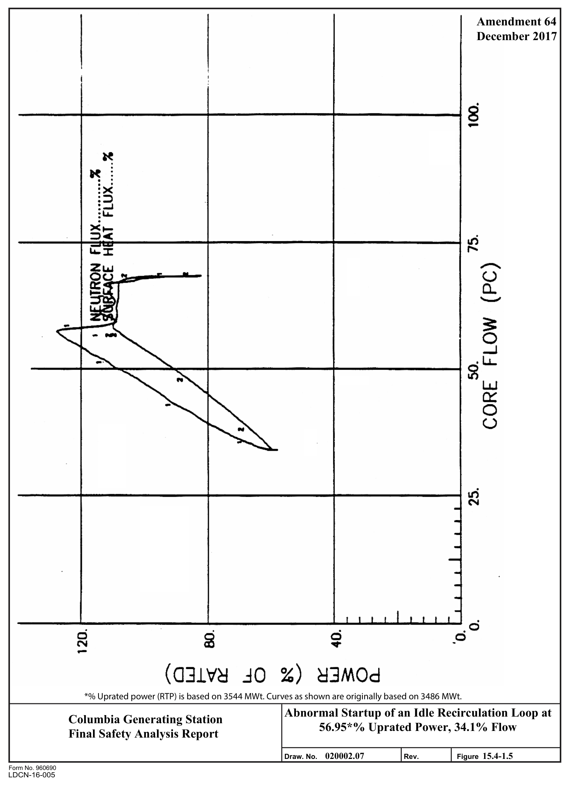
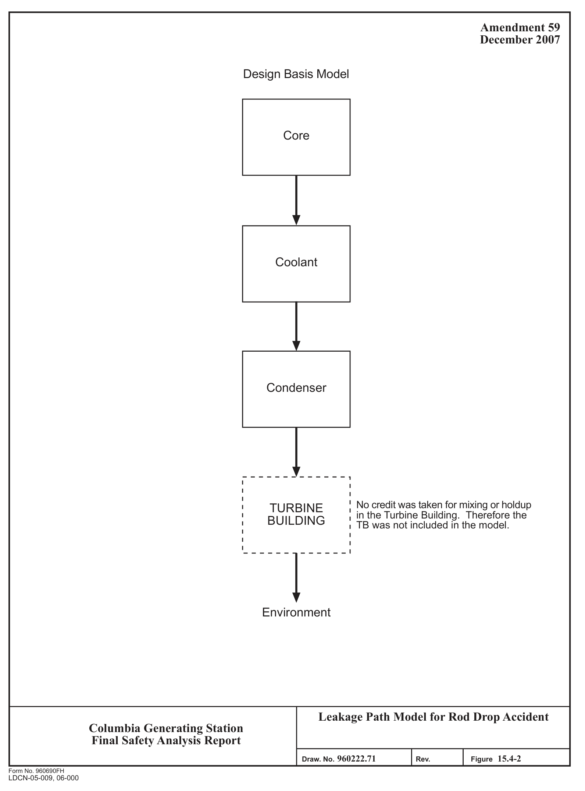

# 15.4 REACTIVITY AND POWER DISTRIBUTION ANOMALIES

> Columbia Generating Station FSAR — Chapter 15: Accident Analyses
> Source: `15_chapter-4122-5262.pdf`, PDF pages 207–244 (of 1141)
> Amendment 67 compilation (individual pages carry varying amendment dates)

---
<!-- p.207 -->
### 15.4 REACTIVITY AND POWER DISTRIBUTION ANOMALIES
#### 15.4.1 ROD WITHDRAWAL ERROR - LOW POWER
This transient is classified as a nonlimiting event for both original and uprated power conditions. Furthermore, the low power Rod Withdrawal Error (RWE) is not affected by power uprate and therefore, the following qualitative analysis is valid for power uprate.

##### 15.4.1.1 Control Rod Removal Error During Refueling
###### 15.4.1.1.1 Identification of Causes and Frequency Classification
The event considered is inadvertent criticality due to the complete withdrawal or removal of the most reactive rod during refueling. The probability of the initial causes alone is considered low enough to warrant its being categorized as an infrequent incident since there is no postulated set of circumstances which results in an inadvertent control rod withdrawal error
(RWE) while in the refuel mode.

###### 15.4.1.1.2 Sequence of Events and Systems Operation
15.4.1.1.2.1 Initial Control Rod Removal. During refueling operations, safety system interlocks provide assurance that inadvertent criticality does not occur because a control rod was removed or is withdrawn in coincidence with another control rod.

15.4.1.1.2.2 Fuel Insertion With Control Rod Removed. To minimize the possibility of loading fuel into a cell containing no control rod, it is required that all control rods are fully inserted when fuel is being loaded into the core. This requirement is backed up by refueling interlocks on rod withdrawal and movement of the refueling platform. When the mode switch is in the “REFUEL” position, the interlocks prevent the platform from being moved over the core if a control rod is withdrawn and fuel is on the hoist. Likewise, if the refueling platform is over the core and fuel is on the hoist, control rod motion is blocked by the interlocks.

15.4.1.1.2.3 Second Control Rod Removal. When the platform is not over the core (or fuel is not on the hoist) and the mode switch is in the “REFUEL” position, only one control rod can be withdrawn. Any attempt to withdraw a second rod results in a rod block by the refueling interlocks.

Since the core is designed to meet shutdown requirements with the highest worth rod withdrawn, the core remains subcritical even with one rod withdrawn.

15.4.1.1.2.4 Control Rod Removal Without Fuel Removal. The design of the control rod, incorporating the velocity limiter, does not physically permit the upward removal of the control

<!-- p.208 -->
rod without the simultaneous or prior removal of the four adjacent fuel bundles. This precludes any hazardous condition.

15.4.1.1.2.5 Effect of Single Failure and Operator Errors. If any one of the operations involved in initial failure or error is followed by any other single equipment failure or single operator error, the necessary safety actions are taken (e.g., rod block or scram) automatically prior to violation of any limits.

###### 15.4.1.1.3 Core and System Performances
Since the probability of inadvertent criticality during refueling is precluded, the core and system performances were not analyzed. The withdrawal of the highest worth control rod during refueling will not result in criticality. This is verified experimentally by performing shutdown margin checks. Additional reactivity insertion is precluded by interlocks. As a result, no radioactive material is released from the fuel, making it unnecessary to assess any radiological consequences.

No mathematic models are involved in this event. The need for input parameters or initial conditions is not required as there are no results to report. Consideration of uncertainties is not appropriate.

###### 15.4.1.1.4 Barrier Performance
An evaluation of the barrier performance was not made for this event since it is a highly localized event and does not result in any change in the core pressure or temperature.

###### 15.4.1.1.5 Radiological Consequences
An evaluation of the radiological consequences was not made for this event since no radioactive material is released from the fuel.

##### 15.4.1.2 Continuous Rod Withdrawal During Reactor Startup
###### 15.4.1.2.1 Identification of Causes and Frequency Classification
This event is categorized as an infrequent incident. The probability of further development of this event is low because it is contingent upon the failure of the rod worth minimizer (RWM)
system or failure of a second licensed operator (or technically qualified member of the technical staff) observing the out-of-sequence rod selection concurrent with a high worth rod, out-of-sequence rod selection contrary to procedures, and operator disregard of continuous alarm annunciations prior to safety system actuation.

<!-- p.209 -->
May 2001

###### 15.4.1.2.2 Sequence of Events and Systems Operation
15.4.1.2.2.1 Sequence of Events. Control RWEs are not considered credible in the startup and low power ranges. The RWM or second licensed operator (or other technically qualified member of the technical staff) prevents the operator from selecting and withdrawing an out-of-sequence control rod.

Continuous control RWEs during reactor startup are precluded by the RWM or second qualified person. The RWM or second qualified person prevents the withdrawal of an out-of-sequence control rod from 100% control rod density to 10% of rated thermal power.

15.4.1.2.2.2 Effects of Single Failure and Operator Errors. If any one of the operations involved in the initial failure or error is followed by another single component failure or single operator error, the necessary safety actions are automatically taken to preclude violation of any limits.

###### 15.4.1.2.3 Core and System Performance
The performance of the RWM or second licensed operator (or technically qualified member of the technical staff) prevents erroneous selection and withdrawal of an out-of-sequence control rod. Thus, core and system performance is not affected by such a single operator error.

No mathematical models are involved in this event. The need for input parameters or initial conditions is not required as there are no results to report. Consideration of uncertainties is not applicable.

###### 15.4.1.2.4 Barrier Performance
An evaluation of the barrier performance was not performed for this event since there is no postulated set of circumstances for which this error could occur.

###### 15.4.1.2.5 Radiological Consequences
An evaluation of the radiological consequences is not required for this event since no radioactive material is released.

<!-- p.210 -->
#### 15.4.2 ROD WITHDRAWAL ERROR - AT POWER
##### 15.4.2.1 Identification of Causes and Frequency Classifications
###### 15.4.2.1.1 Identification of Causes
While operating in the power range in a normal mode of operation, the reactor operator makes a procedural error and withdraws the maximum worth control rod until the rod block monitor
(RBM) system inhibits further withdrawal.

###### 15.4.2.1.2 Frequency Classification
The probability of this event is considered low enough to warrant its being categorized as an infrequent incident. However, because of the lack of sufficient frequency database, this event is considered an incident of moderate frequency.

##### 15.4.2.2 Sequence of Events and Systems Operation
###### 15.4.2.2.1 Sequence of Events
The sequence of events for this transient is presented in Table 15.4-1.

###### 15.4.2.2.2 Systems Operation
The focal point of this event is localized to a small portion of the core; therefore, although reactor control and instrumentation is assumed to function normally, credit is taken only for the RBM system.

While operating in the power range in a normal operational mode, the reactor operator makes a procedural error and withdraws the maximum worth control rod until the RBM system inhibits further withdrawal.

Under normal operating conditions the nearest local power range monitor (LPRM) would detect the peak linear power exceeding design limits and alarm. The operator would acknowledge the alarm and take appropriate action.

If the RWE is severe, the RBM system would alarm, at which time the operator would acknowledge the alarm and take corrective action. Even for conditions such as highly abnormal control rod patterns, operator disregard of all alarms and warnings, and continuous control rod withdrawal, the RBM system will block further withdrawal of the control rod before the fuel reaches the point of boiling transition or the 1% cladding strain limit imposed on the clad.

<!-- p.211 -->
###### 15.4.2.2.3 Effect of Single Failure and Operator Errors
Operator errors do not impact the consequences of this event due to the single failure proof design of the RBM system.

##### 15.4.2.3 Core and System Performance
###### 15.4.2.3.1 Mathematical Model
The control RWE transient is classified as a “slow transient.” A slow transient is a power increase transient that is sufficiently slow so that the assumption that steady-state conditions are achieved at each time step is either realistic or conservative. Using this assumption, this transient is calculated using a steady state, three dimensional, coupled nuclear thermal hydraulics computer program PANACEA. All spatial effects are included in the calculation.
A detailed discussion of the code is presented in Reference 15.4-4.

The control RWE analysis has been performed to estimate the minimum critical power ratio
(MCPR) and maximum linear heat generation rate (LHGR) in such a transient. A starting control rod pattern is established for the typical BWR reactor and a central control rod is withdrawn from the fully inserted position. Rod withdrawal results in an increase of the LHGR and decrease of the critical power ratio (CPR). The computed maximum LHGR and minimum CPR are compared to values of other transients to establish operating limits for the reactor. The analysis determines the transient MCPR as a function of the rod block monitor setpoint.

###### 15.4.2.3.2 Input Parameters and Initial Conditions
The number of possible RWE transients is large due to the number of control rods and the wide range of exposures and power levels. In order to encompass all of the possible RWEs which could conceivably occur, a limiting analysis is defined such that a conservative assessment of the consequences is provided. These conditions bound the effects of the RWE at lower power or flow conditions, including operation with only one reactor recirculation pump.

a. The assumed error is a continuous withdrawal of the maximum worth rod at its maximum drive speed;

b. The core is assumed to be operating at rated conditions;

c. The reactor is presumed to be in its most reactive state and devoid of all xenon.
This ensures that the amount of reactivity is a maximum;

d. It is assumed that the operator has fully inserted the maximum worth rod prior to its removal and selected the remaining control rod pattern in such a way as to

<!-- p.212 -->
approach thermal limits in the fuel bundles in the vicinity of the rod to be withdrawn (this control rod configuration would only be achieved by deliberate operator action or by numerous operator errors);

e. The operator is assumed to ignore all warnings during the transient;

f. Each RBM channel is analyzed and within each channel, LPRM failures are considered such that the worst case LPRM failures (a minimum of 4 LPRMs are required for the channel to be operable) for the least responsive RBM channel is considered when calculating the ΔCPR for each RBM setpoint. The channel with the greatest response is assumed to be bypassed.

15.4.2.3.2.1 Rod Block Monitor System Operation. The RBM system minimizes the consequences of a RWE by blocking motion of the control rod before the MCPR99.9% are exceeded.

When the operator selects a control rod, the RBM signals (associated LPRM input) are calibrated to a fixed (constant) reference signal. The upscale trip levels are set at a fixed level above the reference and will vary as step functions of APRM simulated thermal power. The analytical limits are specified in References 15.4-17 and 15.4-18. This will allow longer withdrawals at low powers where thermal margins are high and allow only short withdrawals at high power. Once tripped, recalibration is allowed only by deselecting the rod, typically accomplished by selecting another rod, and reselecting the rod. Reselection will result in recalibration to the reference signal. The operator verifies adequate thermal margin before continuing rod withdrawal following an RBM upscale trip.

###### 15.4.2.3.3 Results
At certain core exposures and power/flow conditions, this limiting transient may be a control RWE. The fuel thermal-mechanical limit (i.e., 1% cladding strain) criterion is met.
Compliance with the event acceptance criteria is demonstrated by cycle-dependent analysis of potentially limiting events just prior to the operation of that cycle. The results are reported in the Supplemental Reload Licensing Report (Reference 15.4-16).

###### 15.4.2.3.4 Considerations of Uncertainties
The conservative assumptions which ensure that this event has been conservatively analyzed have been previously discussed in Section 15.4.2.3.2.

##### 15.4.2.4 Barrier Performance
An evaluation of the barrier performance was not made for this event since this is a localized event with very little change in the gross core characteristics. Typically, an increase in total core power is less than 6% and the changes in pressure are negligible.

<!-- p.213 -->
##### 15.4.2.5 Radiological Consequences
An evaluation of the radiological consequences is not required for this event since no radioactive material is released from the fuel.

#### 15.4.3 CONTROL ROD MALOPERATION (SYSTEM MALFUNCTION OR
#### OPERATOR ERROR)
This event is covered with the evaluation cited in Sections 15.4.1 and 15.4.2.

#### 15.4.4 STARTUP OF IDLE RECIRCULATION PUMP
##### 15.4.4.1 Identification of Causes and Frequency Classification
This event is not analyzed for reload cores. This event is bounded by the off-rated power and flow dependent limits. The slow flow runout analysis of two recirculation loops and the associated limits bounds this event because the heat flux change associated with two pumps increasing flow to the maximum bounds the heat flux change associated with a single pump startup. For the application of ARTS, the analysis basis is that there is an initial 50°F ∆T between the idle and operating loops. This is an appropriate assumption for the thermal limits calculations and it is consistent with Technical Specification requirements. The analysis basis is not expanded into the MELLLA domain because single loop operation is not expanded beyond the ELLLA domain. (Reference 15.4-17)

The event is not analyzed for power uprate to 3544 MWt (Reference 15.4-18).

###### 15.4.4.1.1 Identification of Causes
This action results directly from the operator’s manual action to initiate pump operation. It assumes that the remaining loop is already operating.

###### 15.4.4.1.2 Frequency Classification
15.4.4.1.2.1 Normal Restart of Recirculation Pump at Power. This event is categorized as an incident of moderate frequency.

15.4.4.1.2.2 Abnormal Startup of Idle Recirculation Pump. This event is categorized as an incident of moderate frequency.

##### 15.4.4.2 Sequence of Events and Systems Operation
###### 15.4.4.2.1 Sequence of Events
Table 15.4-2 lists the sequence of events for Figure 15.4-1.

<!-- p.214 -->
###### 15.4.4.2.2 Systems Operation
This event assumes and takes credit for normal functioning of plant instrumentation and controls. No protection systems action is anticipated. No engineered safety feature (ESF)
action occurs as a result of the event.

###### 15.4.4.2.3 The Effect of Single Failures and Operator Errors
Attempts by the operator to start the pump at higher power levels will result in a reactor scram on flux.

##### 15.4.4.3 Core and System Performance
###### 15.4.4.3.1 Mathematical Model
The point-kinetics REDY model described in Section 15.0.3.3.1 is used to simulate this event.

###### 15.4.4.3.2 Input Parameters and Initial Conditions
This analysis has been performed while the plant is operating with a single recirculation loop, at 57% uprated power and 34% core flow. Conservatively, the water in the idle loop is assumed to have a minimum temperature of 100°F. The average enthalpy is based on saturated water temperature at the suction inlet with a linear enthalpy gradient to the discharge outlet water temperature of 100°F.

The active recirculation loop is operating with a pump speed that produces about 45% of normal rated jet pump diffuser flow in the active jet pumps. The inactive recirculation loop jet pumps are forward flowing at about 2% of normal jet pump diffuser flow because of natural circulation affects. The core is receiving about 34% of its normal rated flow.

The idle recirculation pump suction and discharge block valves are open. Normal procedure requires leaving an idle loop in this condition to maintain the loop temperature within the required limits for restart.

###### 15.4.4.3.3 Results
The transient response to the incorrect startup of a cold idle recirculation loop is shown in Figure 15.4-1. Shortly after the pump begins to move, the flow from the started jet pump diffusers causes the core inlet flow to increase. The pump startup demand is conservatively assumed to ramp at a rate of 3.3% until maximum pump speed is achieved. The diffuser flows on the started side of the reactor increase ultimately to about 144% of rated while the flow rate of the opposite loop diffusers decreases and eventually reverses to about -8% of rated. As the inactive loop pump increases speed the cold fluid is pumped out of the

<!-- p.215 -->
recirculation loop piping and is mixed with hot downcomer fluid and the mixture flows to the core with a resulting increase of the core inlet subcooling.

A moderate-duration neutron flux peak to just above 122% of NB rated is produced as the colder, increasing core flow reduces the void volume. Surface heat flux follows the slower response of the fuel and peaks at 108% of rated before decreasing after the cold water is washed out of the loop at about 30 sec. No damage occurs to the fuel barrier as the MCPR remains substantially above the MCPR99.9% limit.

###### 15.4.4.3.4 Consideration of Uncertainties
This particular transient is analyzed for a maximum pump speed demand signal causing the ASD to adjust the recirculation pump speed upward at a nominal speed demand rate limit.
A conservative idle loop temperature is assumed and no other uncertainties were included.

##### 15.4.4.4 Barrier Performance
No evaluation of barrier performance is required for this event since no significant pressure increases are incurred during this transient. See Figure 15.4-1.

##### 15.4.4.5 Radiological Consequences
Since this event does not result in any fuel failures or any release of primary coolant to either the secondary containment or to the environment, there are no radiological consequences associated with this event.

#### 15.4.5 RECIRCULATION FLOW CONTROL FAILURE WITH INCREASING FLOW
##### 15.4.5.1 Identification of Causes and Frequency Classification
###### 15.4.5.1.1 Identification of Causes
An upscale failure of the master manual setpoint station can cause an increase in the core coolant flow rate. Upscale failure of an individual remote manual setpoint station or manual demand loop can also cause an increase in core coolant flow rate.

###### 15.4.5.1.2 Frequency Classification
This event is an incident of moderate frequency.

<!-- p.216 -->
##### 15.4.5.2 Sequence of Events and Systems Operation
The increase in recirculation flow results in an increase in core flow. The increase in core flow causes an increase in core power level and shifts the power toward the top of the core by reducing the void fraction in the top of the core.

The rate and magnitude of the power increase are dependent on the rate and magnitude of the flow increase. The operator would be expected to control a slow or small increase through normal operating procedures. However, a rapid or significant increase in neutron flux could exceed the high flux scram setpoint and initiate a scram.

This analysis assumes a relatively gradual flow increase that challenges the thermal limits but does not initiate plant protective systems prior to operator action to terminate the transient.
The turbine control (governor) valves and possibly the bypass valves open to control reactor pressure. Core power increases until a steady state power level is reached at the maximum recirculation flow. The operator then regains control of the flow control system and returns the plant to a normal operating condition.

The analysis of this event assumes and takes credit for normal functioning of plant instrumentation and controls, and the reactor protection system (RPS). Operation of ESF is not expected.

###### 15.4.5.2.1 The Effect of Single Failures and Operator Errors
The greatest challenge to the thermal limits is the gradual flow increase without actuation of the RPS. The transient is terminated by operator action but not until the maximum core flow of 108.5% rated flow is reached. No actions, either automatic or manual, occur to mitigate the transient prior to event termination at the maximum core flow.

##### 15.4.5.3 Core and System Performance
###### 15.4.5.3.1 Mathematical Model
The core is assumed to be in a pseudo steady state condition in which all plant thermal hydraulics are in equilibrium. The feedwater inlet temperature is assumed to be at its equilibrium value at all power levels during the event. The flow control line used to define the power/flow points represents the steepest attainable during normal reactor operation. The core radial and axial peaking distributions are assumed not to change during the event. The MCPR hot channel analysis along the flow ascension path is calculated with ISCOR
(References 15.4-4 and 15.4-14).

Only potentially MCPR limiting fuel is evaluated. Potentially limiting is defined as within 0.10 of the core MCPR for the nominal rated power rodded depletion (typically only fresh and

<!-- p.217 -->
once burnt fuel). ISCOR is run at the power/flow level corresponding to the plant/cycle specific maximum flow and iterations are performed on the potentially MCPR limiting fuel channel radial peaking factor(s) such that the hot channel MCPR is equal to the MCPR99.9% ±0.005. ISCOR is then run along the specified flow control line at a range of core flows from 30% to 100% to obtain the potentially MCPR limiting fuel MCPR value(s) for each case. The results of this analysis determine the flow-dependent MCPR limits to assure that the MCPR will not fall below the MCPR99.9% for a flow increase event. These analyses bound final feedwater temperature reduction (FFWTR) as well as normal feedwater temperature conditions. The LHGR along the flow ascension path is calculated using PANACEA
(References 15.4-4 and 15.4-14) to perform a power search at 10% flow increments from 30% up to the maximum runout flow at various core exposures. Only bundles which could exceed the steady state LHGR limits after the event are considered in the statistical sample. A statistically based overpower or a bounding overpower is used in confirming the LHGR reduction factors. LHGR reduction factors are determined to ensure that 1% cladding strain and fuel centerline melt limits are not exceeded (Reference 15.4-17).

###### 15.4.5.3.2 Input Parameters and Initial Conditions
The gradual increase in recirculation flow provides the greatest challenge to thermal limits.
The final point in the transient is a power below the high flux scram setpoint at maximum flow. Maximum flow is the maximum flow that can be attained by a credible controller failure initiated from a given low flow starting point. A spectrum of initial, low flow starting points is analyzed at various points throughout the cycle. The analysis assumes that the event is quasisteady state and that a flow biased scram does not occur. Table 15.4-3 contains a listing of the important input parameters and initial conditions.

###### 15.4.5.3.3 Results
The reduced flow MCPR was calculated at discrete flow points. The reduced flow MCPR operating limit curve is shown in the cycle specific Core Operating Limits Report (COLR) for all cycle exposures, including FFWTR operation. The reduced flow LHGR was calculated at discrete flow points. The reduced flow LHGR operating limit is shown in the COLR.

###### 15.4.5.3.4 Considerations of Uncertainties
The conservative nature of the analysis approach bounds the uncertainties in void reactivity and power distribution characteristics expected for actual plant conditions.

##### 15.4.5.4 Barrier Performance
The reduced flow MCPR is established so that the event does not challenge the MCPR99.9%.
Therefore, no fuel damage is predicted as a result of this event.

<!-- p.218 -->
##### 15.4.5.5 Radiological Consequences
An evaluation of the radiological consequences is not required for this event since no radioactive material is released.

#### 15.4.6 CHEMICAL AND VOLUME CONTROL SYSTEM MALFUNCTIONS
This event is not applicable to boiling water reactor (BWR) plants.

#### 15.4.7 MISPLACED BUNDLE ACCIDENT
The fuel loading error considers the consequences of either of two possible events:
misorientation or mislocation of a fuel assembly. Further, the assumption is made that the error is not discovered during core verification. The purpose of the analysis is to determine the change in the minimum CPR and increase in LHGR between the correctly loaded core and the misloaded core. A combination of the misorientation and mislocation is not considered because of the very low probability of occurrence.

##### 15.4.7.1 Identification of Causes and Frequency Classification
###### 15.4.7.1.1 Identification of Causes
The event discussed in this section is the improper loading of a fuel bundle and subsequent operation of the core. For the mislocation of a fuel bundle, three errors must occur during the initial core loading. First, a bundle must be misloaded into a wrong position in the core.
Second, the bundle that was supposed to be loaded where the mislocation occurred would have to be placed in an incorrect location. Third, the misplaced bundles would have to be overlooked during the core verification performed following core loading. For the misorientation of a fuel bundle, the bundle is loaded 180° from the correct orientation and this error is overlooked during the core verification.

A fuel loading error would place a fuel assembly in an incorrect location in the core, potentially placing several highly reactive assemblies in close proximity. If a relatively high reactivity assembly is placed in a location not directly monitored by the LPRM/core monitoring system (i.e., unmonitored location), this incorrectly located assembly will operate at higher powers with reduced thermal margins relative to the symmetric monitored assembly.
The incorrectly located assembly may violate operating limits if the symmetric, monitored assembly is operated close to limits. If the incorrect location is a directly monitored cell, the change in the local power readings may not be sufficient to either alert the operators of the loading error or to completely account for the reduction in thermal margin. In this situation, the incorrectly located assembly may violate operating limits while being treated by the monitoring system as if it were correctly loaded.

<!-- p.219 -->
###### 15.4.7.1.2 Frequency of Occurrence
This event is categorized as an infrequent incident but is analyzed for GNF reloads consistent with Section 15.3.3.1 as an incident of moderate frequency.

##### 15.4.7.2 Sequence of Events and Systems Operation
A fuel bundle is misloaded (incorrect location or orientation) into the core and the error is not identified during the core verification process. The core is operated through the cycle at the conditions assumed for the reference core (the specified core load) with the control rod sequence developed for the reference core. At some point during the cycle, the control rod sequence places the limiting assembly (being monitored by the core monitoring system as a correctly loaded assembly) at the MCPR operating limit. Potentially, this causes the misloaded assembly to be operated below the MCPR operating limit curve and above the design LHGR limit curve. Because the operator may be unable to detect the error, the core operation continues throughout the cycle.

Fuel loading errors, undetected by in-core instrumentation following fueling operations, may result in undetected reductions in thermal margins during power operations. No detection is assumed, and therefore, no corrective operator action or automatic protection system functioning occurs.

###### 15.4.7.2.1 Effect of Single Failure and Operator Errors
This analysis already represents the worst case (i.e., operation with a misplaced bundle requires multiple equipment failures or operator errors).

##### 15.4.7.3 Core and System Performance
###### 15.4.7.3.1 Mathematical Model
A three-dimensional BWR simulator model is used to calculate the core performance resulting from this event. This model is described in detail in Reference 15.4-4 and Sections S.2.2.1.8 and S.2.2.1.9 of Reference 15.4-5.

###### 15.4.7.3.2 Input Parameters and Initial Conditions
Initial input parameters and conditions are cycle specific. Sections S.2.2.1.8 and S.2.2.1.9 of Reference 15.4-5 describe the input parameters and initial conditions applied to the mislocated and misoriented bundle events. For both the mislocated and misoriented bundle events, the fuel loading error is undetected throughout the cycle by the core monitoring system.

###### 15.4.7.3.3 Results
The results of the analyses for the fuel loading errors show that the resulting MCPR does not challenge the MCPR99.9%. No rods are expected to exceed the LHGR limits. Results reflect GE14 fuel introduction, some of which are dependent on fuel design and core loading pattern.

<!-- p.220 -->
Compliance with the event acceptance criteria is demonstrated by cycle-dependent analysis of potentially limiting events just prior to the operation of that cycle. The results are reported in the Supplemental Reload Licensing Report (Reference 15.4-16).

###### 15.4.7.3.4 Considerations of Uncertainties
A sufficient number of mislocated assembly cases are considered to assure that the limiting case is evaluated. The mislocated assemblies are loaded into positions that could produce limiting results. For the misoriented assembly case, the gap sizes resulting from the rotation are selected to assure a conservative estimate of the impact on MCPR.

##### 15.4.7.4 Barrier Performance
An evaluation of the barrier performance was not made for this event since it is a mild and highly localized event. No perceptible change in the core pressure would be observed.

##### 15.4.7.5 Radiological Consequences
An evaluation of the radiological consequences is not required for this event since no radioactive material is released from the fuel.

#### 15.4.8 SPECTRUM OF ROD EJECTION ASSEMBLIES
This event is not applicable to BWR plants.

#### 15.4.9 CONTROL ROD DROP ACCIDENT
##### 15.4.9.1 Identification of Causes and Frequency Classification
###### 15.4.9.1.1 Identification of Causes
The control rod drop accident (CRDA) is the result of a high worth control rod decoupled from the drive mechanism, dropping out of the core. The subsequent insertion of positive reactivity causes a localized power excursion. This is not an anticipated event because of the system failures and personnel errors that would have to occur in combination to present the reactivity required at the same time that the coupling failed. The control rod patterns are controlled in accordance with the banked position withdraw sequence (BPWS) to preclude situations in which rod drops would have sufficient reactivity to cause the damage postulated by the power excursion.

Detailed discussions of the rod drop analysis and BPWS are given in Reference 15.4-3 and 15.4-7.

<!-- p.221 -->
###### 15.4.9.1.2 Frequency Classification
The CRDA is categorized as a limiting fault because it is not expected to occur during the lifetime of the plant. However, postulated consequences include the potential for the release of radioactive material.

For reactivity anomalies, the CRDA is the limiting event.

##### 15.4.9.2 Sequence of Events and Systems Operation
The CRDA assumptions include:

1. At some time, a fully inserted control rod becomes decoupled from its drive and sticks in the fully inserted position.

2. During the start up sequence, the rod patterns employed are permitted by the constraints on rod movements by technical specifications and the rod sequence control hardware, including the maximum allowable number of bypassed rods.
At some time under critical reactor conditions, the rod pattern causes the decoupled rod to have the maximum worth from fully inserted to the position of its drive. The rod worth minimizer is not functioning. The rod drops at that time.

3. The reactor goes on a positive period, and the fuel temperature reactivity feedback terminates the initial power burst.

4. The reactor scrams on the APRM high flux scram signal.

5. All withdrawn rods, except for the decoupled rod, scram at the technical specification rate.

6. The scram terminates the accident.

7. If the mechanical vacuum pump (MVP) is maintaining condenser vacuum (e.g., the plant was operating at 5% power or less) and the main steam line radiation
(MSLR) monitors detected radiation levels above the setpoint, the MSLR monitors would trip the MVP to reduce the fission product release from the condenser.

Although other normal plant instrumentation and controls are assumed to function, no credit for their operation is taken in the analysis of this event. No operator actions are required to terminate this event. Subsequent to reactor scram which terminates the event, normal vessel inventory makeup systems will be used as available.

<!-- p.222 -->
###### 15.4.9.2.1 Effect of Single Failures and Operator Errors
As discussed, the event is terminated, and therefore mitigated, by the APRM high flux scram signal to RPS. The RPS design meets the single failure criteria. The event is further mitigated by an initial control rod configuration that complies with the BPWS. The withdrawal (or insertion) sequence is implemented by the operator and enforced by the RWM. An operator error in control rod movement will be detected and stopped by the RWM. If the RWM system is not operable, rod movement can only continue with a backup for the operator verifying compliance with the BPWS sequence. Failure of the RWM concurrent with an operator error of moving an out-of-sequence rod, contrary to procedures would be required to result in a potentially more limiting event. Therefore, sufficient redundancy exists such that termination of this transient within the limiting criteria is assured.

At low power levels, the MVP trip maintains the condenser leak rates within the analytical assumptions. The MSLR monitor design meets the single failure criteria and no active failure would prevent the trip signal (Section 11.5.2.1).

##### 15.4.9.3 Core and System Performance
###### 15.4.9.3.1 Mathematical Model
The analytical methods, assumptions and conditions for evaluating the excursion aspects of the CRDA are described in detail in References 15.4-1, 15.4-3, 15.4-13. To limit the worth of the postulated dropped rod, the rod pattern control systems are programmed to follow the BPWS, which is generically defined in Reference 15.4-7.

###### 15.4.9.3.2 Input Parameters and Initial Conditions
The data presented in Reference 15.4-7 shows that BPWS reduces the control rod worths to the degree that the detailed analyses presented in References 15.4-1, 15.4-3, 15.4-13 or the bounding analyses presented in Reference 15.4-11 do not need to be performed each cycle.

###### 15.4.9.3.3 Results
Control rod drop accident results from BPWS plants have been statistically analyzed and documented in Reference 15.4-12. The results show that, in all cases, the peak fuel enthalpy in a CRDA would be much less than the 280 cal/gm design limit even with a maximum incremental rod worth corresponding to 95% probability at the 95% confidence level. Based on these results, it was proposed to the NRC, and subsequently found acceptable, to delete the CRDA from the standard GE BWR reload package for the BPWS plants.

<!-- p.223 -->
The US Supplement to Reference 15.4-5 reports the results of radiological analyses for initial cores that are orders of magnitude below those identified in 10 CFR 100. The radiological consequences of the CRDA, assuming a full core of more recent GE/GNF fuel designs, are discussed in Reference 15.4-5. With implementation of Alternative Source Term (AST), the radiological release acceptance criterion becomes 10 CFR 50.67. An evaluation of fuel damage was performed because the maximum deposited fuel rod enthalpy exceeded 170 cal/gm, which is the enthalpy limit assumed for eventual cladding perforation. The number of fuel rods predicted to fail (Reference 15.4-15) are bounded by the number assumed in the radiological consequences analysis for this event.

The total energy deposited and the associated increase in reactor system pressure during a rod drop event is not high relative to other events such as turbine trip without bypass or main steam line isolation valve closure, both of which are quantitatively analyzed. As such, the increase in reactor system pressure is not anticipated to result in penetration of the stress limits defined in Section III of the ASME boiler and pressure code.

##### 15.4.9.4 Barrier Performance
An evaluation of the barrier performance was not made for this accident since this is a localized event with no significant change in the gross core temperature or pressure.

##### 15.4.9.5 Radiological Consequences
The radiological analysis is based on the AST described in Reference 15.4-8. Specific models, assumptions, and the program used for computer evaluation are described in Reference 15.4-6.
Specific parametric values used in the evaluation are presented in Table 15.4-4. The radiological consequences remain bounding because cycle specific analyses have confirmed that the number of fuel rods with an enthalpy greater than the threshold for fuel failure are well below the number assumed in the analysis.

###### 15.4.9.5.1 Fission Product Release from Fuel
The failure of 1.8% of the core was assumed for this analysis. The mass fraction of the fuel in the damaged rods which reaches or exceeds the initiation temperature of fuel melting (taken as 2804°C) is assumed to be 0.0077.

Fuel reaching melt condition is assumed to release 100% of the noble gas inventory and 50% of the iodine inventory. The remaining fuel rods with clad damage only (no melting), will undergo a gap release which is assumed to release 10% of noble gases and 10% of iodine inventories.

<!-- p.224 -->
The core inventory of fission products is based on a plant-specific ORIGEN 2 run for pre-power uprate basis of 3489 MW with 1000 days of exposure, adjusted as follows:

 A scale factor of 1.0528 to bound the dose impact of power level to 3556 MWt,

 A correction to increase by 25 percent short-lived krypton values (based on comparisons to other core inventory tables), and

 An increase by 60% in the activity of longer lived isotopes to bound longer plant operation at a higher burnup rate.

The assumed core power of 3556 MWt is the rated power plus power measurement uncertainties. These adjustments resulted in a conservative source term (in terms of activity available). A peaking factor of 1.7 is assumed and no delay time is considered between departure from that power condition and the initiation of the accident.

###### 15.4.9.5.2 Fission Product Transport to the Environment
The transport pathway consists of a release from the core to the coolant, carryover with steam to the turbine condenser and leakage from the condenser to the environment. The release fractions are given in Reference 15.4-6 and are consistent with Reference 15.4-8. No credit is taken for mixing in the turbine building or filtration by the CREF.

Of the activity reaching the condenser, 100% of the noble gases, and 10% of the iodine (due to partitioning and plate-out) and 1% of the particulates remain airborne and are available for release to the environment. The activity airborne in the condenser leaks to the environment as a ground level release at a rate of 1% of condenser volume per day. Release from the condenser is assumed to terminate 24 hours following the onset of the accident. Radioactive decay is accounted for during residence in the condenser; however, it is neglected after release I to the environment. If the condenser is not isolated from the offgas system, the activity is processed through the offgas system. In this case, radioactive decay is accounted for during the residence in the offgas system. Response of the offgas system to elevated radiation levels is described in Section 11.3.2.4.5.

The activity airborne in the condenser is presented in Table 15.4-5. The cumulative release of activity to the environment is presented in Table 15.4-6.

###### 15.4.9.5.3 Results
The calculated exposures from the design basis analysis are presented in Table 15.4-7 and are within the limits of 10 CFR 50.67.

<!-- p.225 -->
#### 15.4.10 REFERENCES
15.4-1 Stirn, R. C., “Rod Drop Accident Analysis for Large Boiling Water Reactors,” NEDO-10527, March 1972.

15.4-2 GE Nuclear Energy, “WNP-2 Power Uprate Transient Analysis Task Report,” GE-NE-208-08-0393, September 1993 (Proprietary).

15.4-3 Stirn, R. C., “Rod Drop Accident Analysis for Large BWRs,” Supplement 1, NEDO-10527, July 1972.

15.4-4 “Steady -State Nuclear Methods,” NEDE-30130-P-A, April 1985.

15.4-5 “General Electric Standard Application for Reactor Fuel,” NEDE-24011-P-A and “Supplement for United States,” NEDE-24011-P-A-US (most recent approved version referenced in COLR).

15.4-6 Energy Northwest, “Columbia Generating Station Alternative Source Term,” CGS-FTS-0168, Revision 2, June 2011.

15.4-7 Paone, C. J., “Bank Position Withdrawal Sequence,” NEDO-21231.

15.4-8 NRC Regulatory Guide 1.183, “Alternative Source Term for Evaluating Design Basis Accidents at Nuclear Power Reactors,” July 2000.

15.4-9 Deleted.

15.4-10 General Electric, “Safety Evaluation for Eliminating the Boiling Water Reactor Main Steam Isolation Valve Closure Function and Scram Function of the Main Steam Line Radiation Monitor,” NEDO-31400A, Class I, October 1992.

15.4-11 “GE BWR Generic Reload Application for 8x8 Fuel,” Supplement 3 to Revision 1, NEDO-20360.

15.4-12 Letter from R. E. Engel (GE) to D. M. Vassallo (NRC), “Elimination of Control Rod Drop Accident Analysis for Banked Position Withdrawal Sequence Plants,” February 24, 1982.

15.4-13 Stirn, R. C., “Rod Drop Accident Analysis for Large Boiling Water Reactors Addendum No. 2 Exposed Cores,” Supplement 2, NEDO-10527, January 1973.

<!-- p.226 -->
15.4-14 Letter from D. G. Eisenhut (NRC) to R. L. Gridley (GE), “Safety Evaluation for the General Electric Topical Report, Generic Reload Fuel Application
(NEDE-24011-P),” May 12, 1978, MFN-212-78.

15.4-15 “GNF2 Advantage Generic Compliance with NEDE-24011-P-A (GESTAR II),” NEDC-33270P (most recent version referenced in COLR).

15.4-16 Supplemental Reload Licensing Report for Columbia (most recent version referenced in COLR).

15.4-17 “Energy Northwest Columbia Generating Station APRM/RBM/Technical Specifications/Maximum Extended Load Line Limit Analysis
(ARTS/MELLLA),” NEDC-33507P, Revision 0, April 2010.

15.4-18 GE-Hitachi Nuclear Energy, “Safety Analysis Report for Columbia Generating Station Thermal Power Optimization,” NEDC-33853P, March 2016.

#### LDCN-21-015, 21-036
<!-- p.227 -->
Table 15.4-1

Sequence of Events - Rod Withdrawal Error in Power Range

Timea Event

(1) Event begins; operator selects the maximum worth control rod, acknowledges any alarms and withdraws the rod at the maximum rod speed.

(2) Core average power and local power increase causing LPRM alarm.

(3) Event ends – rod block by RBM

a The RWE event is analyzed with a three-dimensional core simulator. This is a conservative steady state analysis for the determination of the appropriate power distribution limits during the event. Since it is not a dynamic simulation, no timed sequence of events is available.

<!-- p.228 -->
Table 15.4-2

Sequence of Events for an Abnormal Startup of an Idle Recirculation Loop

Time (sec)
Event

## 0.00 Plant operating with one recirculation loop only.

## 5.00 Start idle recirculation loop pump motor.

## 29.6 Peak value of core inlet subcooling.

### 29.6 Peak thermal power. Estimated APRM thermal power approximately
1% below APRM thermal power setpoint.

## 45.7 Pump motor at full speed.

80+ Reactor reaches new equilibrium condition.

<!-- p.229 -->
Table 15.4-3

Reactor Recirculation Pump Flow Increase Input Parameters and Initial Conditions

Parameter Value

Reactor Power/Core Flow Flow increase is initiated from several power/flow points and terminates at 109% rated power, 108.5%rated flow

Power Distribution The MCPR equals the MCPR99.9% at the final power/flow condition

Reactivity The results are applicable from Beginning of Cycle to End of Cycle for nominal and reduced feedwater temperatures

Control Rod Configuration The control rod pattern is the same at the initial and final points.

<!-- p.230 -->
Table 15.4-4

Control Rod Drop Accident Evaluation Parameters

I. Data and assumptions used to estimate radioactive source from postulated accidents.
A. Power level Section 15.4.9.5.1 B. Burnup Section 15.4.9.5.1 C. Fuel damaged
1.8% of core D. Release of activity by nuclide Table 15.4-6 E. Iodine fractions
(1) Organic 0.0015
(2) Elemental 0.0485
(3) Particulate 0.95 F. Reactor coolant activity before the accident.
N/A

II. Data and assumptions used to estimate activity released.
A. Condenser leak rate (%/day)
## 1.0 B. Turbine building leak rate (%/day)
N/A C. Valve closure time (sec)
N/A D. Adsorption and filtration efficiencies
(1) Organic iodine N/A
(2) Elemental iodine N/A
(3) Particulate iodine N/A
(4) Particulate fission products N/A E. Recirculation system parameters
(1) Flow rate N/A
(2) Mixing efficiency N/A
(3) Filter efficiency N/A F. Containment spray parameters (flow rate, drop size, etc.) N/A

<!-- p.231 -->
Table 15.4-4

Control Rod Drop Accident Evaluation Parameters (Continued)

G. Containment volumes N/A H. All other pertinent data and assumptions None

III. Dispersion data Table 15.0-4

IV. Dose data A. Method of dose calculation Reference 15.4-6 B. Dose conversion assumptions Reference 15.4-6 C. Peak activity concentrations in condenser Table 15.4-5 D. Doses Table 15.4-7

<!-- p.232 -->
Table 15.4-5

Control Rod Drop Accident Activity Airborne in the Condenser (Curies)

3556 MWth

1 m 30 m 2 hrs 8 hrs 12 hrs 24 hrs Kr83m 4.12E+04 3.43E+04 1.96E+04 2.06E+03 4.61E+02 5.13E+00 Kr85m 8.50E+04 7.88E+04 6.21E+04 2.40E+04 1.27E+04 1.90E+03 Kr85 4.77E+03 4.77E+03 4.76E+03 4.75E+03 4.74E+03 4.72E+03 Kr87 1.54E+05 1.18E+05 5.20E+04 1.95E+03 2.18E+02 3.05E-01 Kr88 2.19E+05 1.95E+05 1.34E+05 3.03E+04 1.12E+04 5.72E+02 Kr89 2.05E+05 3.71E+02 1.14E-06 6.96E-18 1.01E-16 7.70E-18 Xe131m 3.24E+03 3.23E+03 3.22E+03 3.16E+03 3.13E+03 3.02E+03 Xe133m 1.93E+04 1.91E+04 1.88E+04 1.74E+04 1.65E+04 1.41E+04 Xe133 6.30E+05 6.28E+05 6.23E+05 6.01E+05 5.87E+05 5.47E+05 Xe135m 1.23E+05 3.40E+04 6.24E+02 7.12E-05 1.68E-09 2.52E-16 Xe135 1.52E+05 1.46E+05 1.31E+05 8.30E+04 6.13E+04 2.47E+04 Xe137 4.52E+05 2.62E+03 2.99E-04 4.13E-18 3.26E-17 2.41E-17 Xe138 4.00E+05 1.22E+05 3.11E+03 1.30E-03 7.24E-08 2.47E-18

Total noble gases 2.49E+06 1.39E+06 1.05E+06 7.68E+05 6.97E+05 5.96E+05

I-131* 3.06E+05 2.64E+05 1.83E+05 8.50E+04 6.15E+04 2.47E+04 I-132 6.71E+05 1.98E+05 1.34E+05 3.03E+04 1.12E+04 5.72E+02 I-133 6.05E+05 1.22E+05 3.11E+03 1.30E-03 7.24E-08 1.02E-17 I-134 3.24E+03 3.23E+03 3.22E+03 3.16E+03 3.13E+03 3.02E+03 I-135 2.51E+06 1.41E+06 1.07E+06 7.85E+05 7.14E+05 6.10E+05

Total Iodine 4.09E+06 1.99E+06 1.39E+06 9.03E+05 7.90E+05 6.38E+05

* The isotopic iodine activity is the sum of the elemental and organic iodines with 97% elemental and 3% organic.
The particulate iodine comprise 0%.

<!-- p.233 -->
Table 15.4-5

Control Rod Drop Accident Activity Airborne in the Condenser (Curies) (Continued)

3556 MWth

1 m 30 m 2 hrs 8 hrs 12 hrs 24 hrs Rb86 5.87E-02 5.86E-02 5.84E-02 5.77E-02 5.73E-02 5.60E-02 Cs134 8.23E+00 8.23E+00 8.22E+00 8.20E+00 8.18E+00 8.14E+00 Cs136 1.82E+00 1.82E+00 1.81E+00 1.79E+00 1.77E+00 1.71E+00 Cs137 6.63E+00 6.63E+00 6.62E+00 6.61E+00 6.59E+00 6.56E+00 Sb127 1.38E-02 1.38E-02 1.36E-02 1.30E-02 1.26E-02 1.14E-02 Sb129 3.95E-02 3.66E-02 2.88E-02 1.10E-02 5.84E-03 8.61E-04 Te127m 1.95E-03 1.95E-03 1.94E-03 1.94E-03 1.93E-03 1.91E-03 Te127 1.38E-02 1.38E-02 1.38E-02 1.36E-02 1.34E-02 1.25E-02 Te129m 5.81E-03 5.80E-03 5.79E-03 5.75E-03 5.72E-03 5.63E-03 Te129 3.72E-02 3.74E-02 3.43E-02 1.52E-02 8.10E-03 1.20E-03 Te131m 1.75E-02 1.73E-02 1.67E-02 1.45E-02 1.32E-02 9.97E-03 Te132 1.67E-01 1.66E-01 1.64E-01 1.55E-01 1.49E-01 1.33E-01 Ba137m 1.54E+00 6.62E+00 6.62E+00 6.61E+00 6.59E+00 6.56E+00 Ba139 7.82E-02 6.14E-02 2.90E-02 1.43E-03 1.94E-04 4.75E-07 Ba140 7.65E-02 7.64E-02 7.61E-02 7.49E-02 7.41E-02 7.17E-02 Mo99 1.02E-02 1.02E-02 1.00E-02 9.39E-03 8.99E-03 7.90E-03 Tc99m 9.06E-03 9.12E-03 9.27E-03 9.45E-03 9.33E-03 8.55E-03 Ru103 9.81E-03 9.81E-03 9.79E-03 9.72E-03 9.68E-03 9.55E-03 Ru105 7.21E-03 6.69E-03 5.33E-03 2.14E-03 1.16E-03 1.87E-04 Ru106 4.26E-03 4.26E-03 4.26E-03 4.24E-03 4.23E-03 4.21E-03 Rh105 6.83E-03 6.83E-03 6.80E-03 6.42E-03 6.04E-03 4.87E-03

#### Y90 3.50E-05 6.38E-05 1.52E-04 4.90E-04 7.02E-04 1.28E-03
#### Y91 4.56E-04 4.66E-04 4.95E-04 5.82E-04 6.22E-04 6.87E-04
#### Y92 6.39E-04 4.76E-03 1.26E-02 1.28E-02 7.81E-03 1.10E-03
#### Y93 5.94E-04 5.74E-04 5.18E-04 3.42E-04 2.59E-04 1.13E-04
Zr95 7.13E-04 7.13E-04 7.12E-04 7.08E-04 7.06E-04 6.98E-04 Zr97 7.23E-04 7.09E-04 6.66E-04 5.21E-04 4.42E-04 2.70E-04

<!-- p.234 -->
Table 15.4-5

Control Rod Drop Accident Activity Airborne in the Condenser (Curies) (Continued)

3556 MWth

1 m 30 m 2 hrs 8 hrs 12 hrs 24 hrs Nb95 7.13E-04 7.13E-04 7.13E-04 7.11E-04 7.10E-04 7.06E-04 La140 8.08E-04 1.43E-03 3.33E-03 1.04E-02 1.46E-02 2.54E-02 La141 7.26E-04 6.66E-04 5.10E-04 1.75E-04 8.58E-05 1.01E-05 La142 6.91E-04 5.55E-04 2.81E-04 1.84E-05 3.00E-06 1.29E-08 Pr143 6.31E-04 6.32E-04 6.35E-04 6.44E-04 6.49E-04 6.58E-04 Nd147 2.86E-04 2.85E-04 2.84E-04 2.79E-04 2.76E-04 2.66E-04 Am241 1.28E-07 1.28E-07 1.28E-07 1.28E-07 1.27E-07 1.27E-07 Cm242 2.91E-05 2.91E-05 2.90E-05 2.89E-05 2.89E-05 2.87E-05 Cm244 2.36E-06 2.35E-06 2.35E-06 2.35E-06 2.34E-06 2.33E-06 Ce141 1.85E-03 1.85E-03 1.85E-03 1.83E-03 1.82E-03 1.80E-03 Ce143 1.67E-03 1.66E-03 1.60E-03 1.40E-03 1.28E-03 9.85E-04 Ce144 1.36E-03 1.36E-03 1.36E-03 1.35E-03 1.35E-03 1.34E-03 Np239 2.93E-02 2.91E-02 2.85E-02 2.64E-02 2.51E-02 2.15E-02 Pu238 3.99E-06 3.99E-06 3.99E-06 3.98E-06 3.97E-06 3.95E-06 Pu239 7.89E-07 7.89E-07 7.89E-07 7.87E-07 7.85E-07 7.82E-07 Pu240 1.30E-06 1.30E-06 1.30E-06 1.29E-06 1.29E-06 1.29E-06 Pu241 3.70E-04 3.70E-04 3.69E-04 3.68E-04 3.68E-04 3.66E-04 Sr89 3.37E-02 3.37E-02 3.37E-02 3.35E-02 3.33E-02 3.29E-02 Sr90 5.58E-03 5.58E-03 5.57E-03 5.56E-03 5.55E-03 5.52E-03 Sr91 4.32E-02 4.17E-02 3.74E-02 2.42E-02 1.81E-02 7.54E-03 Sr92 5.01E-02 4.41E-02 2.97E-02 6.14E-03 2.15E-03 9.15E-05

<!-- p.235 -->
Table 15.4-6

Control Rod Drop Accident Activity Airborne to the Environment (Curies)

3556 MWth

1 m 0.5 hr 2 hrs 8 hrs 12 hrs 24 hrs Kr83m 2.78E-01 7.86E+00 2.43E+01 4.38E+01 4.56E+01 4.61E+01 Kr85m 5.74E-01 1.71E+01 6.09E+01 1.61E+02 1.91E+02 2.19E+02 Kr85 3.21E-02 9.92E-01 3.97E+00 1.59E+01 2.38E+01 4.75E+01 Kr87 1.04E+00 2.83E+01 7.87E+01 1.17E+02 1.18E+02 1.18E+02 Kr88 1.48E+00 4.31E+01 1.45E+02 3.20E+02 3.52E+02 3.69E+02 Kr89 1.54E+00 8.07E+00 8.08E+00 8.08E+00 8.08E+00 8.08E+00 Xe131m 2.18E-02 6.73E-01 2.69E+00 1.07E+01 1.59E+01 3.13E+01 Xe133m 1.30E-01 4.00E+00 1.58E+01 6.10E+01 8.92E+01 1.66E+02 Xe133 4.24E+00 1.31E+02 5.22E+02 2.05E+03 3.04E+03 5.88E+03 Xe135m 8.48E-01 1.48E+01 2.00E+01 2.01E+01 2.01E+01 2.01E+01 Xe135 1.02E+00 3.10E+01 1.18E+02 3.80E+02 5.00E+02 7.01E+02 Xe137 3.32E+00 2.09E+01 2.10E+01 2.10E+01 2.10E+01 2.10E+01 Xe138 2.75E+00 5.00E+01 7.03E+01 7.08E+01 7.08E+01 7.08E+01

Total Noble 1.73E+01 3.58E+02 1.09E+03 3.28E+03 4.50E+03 7.70E+03 Gases

I-131* 4.08E-01 1.19E+01 4.01E+01 1.05E+02 1.35E+02 2.12E+02 I-132 4.81E+00 1.48E+02 5.83E+02 2.21E+03 3.23E+03 6.10E+03 I-133 8.80E-01 1.58E+01 2.40E+01 3.60E+01 4.39E+01 6.76E+01 I-134 2.06E+00 5.93E+01 1.97E+02 4.97E+02 6.18E+02 8.19E+02 I-135 4.80E+00 6.40E+01 1.66E+02 3.41E+02 3.73E+02 3.90E+02

Total Iodine 1.30E+01 2.99E+02 1.01E+03 3.19E+03 4.40E+03 7.59E+03

* The isotopic iodine activity is the sum of the elemental and organic iodines with 97% elemental and 3% organic.
The particulate iodine comprise 0%.

<!-- p.236 -->
Table 15.4-6

Control Rod Drop Accident Activity Airborne to the Environment (Curies) (Continued)

3556 MWth

1 m 0.5 hr 2 hrs 8 hrs 12 hrs 24 hrs Rb86 3.95E-07 1.22E-05 4.88E-05 1.94E-04 2.90E-04 5.73E-04 Cs134 5.54E-05 1.71E-03 6.86E-03 2.74E-02 4.11E-02 8.19E-02 Cs136 1.23E-05 3.79E-04 1.52E-03 6.02E-03 8.99E-03 1.77E-02 Cs137 4.47E-05 1.38E-03 5.52E-03 2.21E-02 3.31E-02 6.60E-02 Sb127 9.31E-08 2.87E-06 1.14E-05 4.47E-05 6.60E-05 1.26E-04 Sb129 2.66E-07 7.92E-06 2.83E-05 7.46E-05 8.82E-05 1.01E-04 Te127m 1.31E-08 4.05E-07 1.62E-06 6.48E-06 9.70E-06 1.93E-05 Te127 9.31E-08 2.88E-06 1.15E-05 4.58E-05 6.83E-05 1.33E-04 Te129m 3.91E-08 1.21E-06 4.83E-06 1.93E-05 2.88E-05 5.72E-05 Te129 2.50E-07 7.77E-06 3.04E-05 9.08E-05 1.10E-04 1.28E-04 Te131m 1.18E-07 3.63E-06 1.43E-05 5.33E-05 7.65E-05 1.34E-04 Te132 1.12E-06 3.46E-05 1.38E-04 5.35E-04 7.88E-04 1.49E-03 Ba137m 5.43E-06 1.21E-03 5.35E-03 2.19E-02 3.29E-02 6.58E-02 Ba139 5.29E-07 1.45E-05 4.15E-05 6.44E-05 6.55E-05 6.56E-05 Ba140 5.15E-07 1.59E-05 6.36E-05 2.53E-04 3.77E-04 7.41E-04 Mo99 6.89E-08 2.12E-06 8.44E-06 3.27E-05 4.80E-05 9.02E-05 Tc99m 6.11E-08 1.89E-06 7.65E-06 3.12E-05 4.69E-05 9.18E-05 Ru103 6.61E-08 2.04E-06 8.17E-06 3.26E-05 4.88E-05 9.69E-05 Ru105 4.86E-08 1.45E-06 5.19E-06 1.39E-05 1.66E-05 1.93E-05 Ru106 2.87E-08 8.87E-07 3.55E-06 1.42E-05 2.13E-05 4.24E-05 Rh105 4.60E-08 1.42E-06 5.68E-06 2.23E-05 3.27E-05 6.00E-05

#### Y90 2.33E-10 1.02E-08 7.78E-08 8.86E-07 1.88E-06 6.88E-06
#### Y91 3.07E-09 9.60E-08 3.97E-07 1.75E-06 2.76E-06 6.06E-06
#### Y92 3.78E-09 5.63E-07 6.33E-06 4.33E-05 6.04E-05 7.81E-05
#### Y93 4.00E-09 1.22E-07 4.63E-07 1.52E-06 2.02E-06 2.90E-06
<!-- p.237 -->
Table 15.4-6

Control Rod Drop Accident Activity Airborne to the Environment (Curies) (Continued)

3556 MWth

1 m 0.5 hr 2 hrs 8 hrs 12 hrs 24 hrs Zr95 4.81E-09 1.48E-07 5.94E-07 2.37E-06 3.55E-06 7.06E-06 Zr97 4.87E-09 1.49E-07 5.79E-07 2.06E-06 2.86E-06 4.60E-06 Nb95 4.81E-09 1.48E-07 5.94E-07 2.38E-06 3.56E-06 7.10E-06 La140 5.37E-09 2.31E-07 1.72E-06 1.91E-05 4.00E-05 1.41E-04 La141 4.90E-09 1.45E-07 5.11E-07 1.29E-06 1.50E-06 1.68E-06 La142 4.67E-09 1.30E-07 3.81E-07 6.23E-07 6.37E-07 6.40E-07 Pr143 4.25E-09 1.32E-07 5.28E-07 2.13E-06 3.21E-06 6.48E-06 Nd147 1.92E-09 5.94E-08 2.37E-07 9.42E-07 1.40E-06 2.76E-06 Am241 8.63E-13 2.67E-11 1.07E-10 4.27E-10 6.39E-10 1.28E-09 Cm242 1.96E-10 6.05E-09 2.42E-08 9.67E-08 1.45E-07 2.89E-07 Cm244 1.59E-11 4.90E-10 1.96E-09 7.84E-09 1.18E-08 2.34E-08 Ce141 1.25E-08 3.85E-07 1.54E-06 6.15E-06 9.20E-06 1.83E-05 Ce143 1.13E-08 3.47E-07 1.37E-06 5.12E-06 7.36E-06 1.30E-05 Ce144 9.15E-09 2.83E-07 1.13E-06 4.52E-06 6.77E-06 1.35E-05 Np239 1.97E-07 6.07E-06 2.41E-05 9.28E-05 1.36E-04 2.52E-04 Pu238 2.69E-11 8.31E-10 3.33E-09 1.33E-08 1.99E-08 3.98E-08 Pu239 5.32E-12 1.64E-10 6.58E-10 2.63E-09 3.94E-09 7.86E-09 Pu240 8.75E-12 2.70E-10 1.08E-09 4.33E-09 6.48E-09 1.29E-08 Pu241 2.49E-09 7.69E-08 3.08E-07 1.23E-06 1.85E-06 3.68E-06 Sr89 2.27E-07 7.02E-06 2.81E-05 1.12E-04 1.68E-04 3.34E-04 Sr90 3.76E-08 1.16E-06 4.65E-06 1.86E-05 2.78E-05 5.55E-05 Sr91 2.91E-07 8.84E-06 3.36E-05 1.09E-04 1.44E-04 2.05E-04 Sr92 3.38E-07 9.81E-06 3.26E-05 7.00E-05 7.63E-05 7.96E-05

<!-- p.238 -->
Table 15.4-7

Control Rod Drop Accident Radiological Effects (rem)

Time TEDE Dose Area

Exclusion area (1950 m)
2 hr 0.03

Low population zone (4827 m) 30 days 0.03

Control Room 30 days 0.7

<!-- p.239 -->

*figure on PDF page 239*

<!-- labels/text on this figure page -->
Amendment 64 1so. l--------l-------+-----~r------.-----
b. ~~-±~~~- December 2017
f
80.
I
EAT FLUX ..... %
• VESSEL STE M FLOW ...... %
LOW ......... %
"
• NEUTRON F!X ........... "
60.
.I
J FEEOWATER
2 AVG SURF
---------~
TIME (SEC)
40.
., I
J
/ I / 20.
o.
I 100.
50.
w a::: w Q_ 0:::: LL I-z u w <(
J-- 0
0
*% Uprated power (RTP) is based on 3544 MWt. Curves as shown are originally based on 3486 MWt.
Abnormal Startup of an Idle Recirculation Loop at Columbia Generating Station *56.95% Uprated Power, 34.1% Flow Final Safety Analysis Report
020002.03 15.4-1.1 Draw. No. Rev. Figure Form No. 960690
LDCN-16-005

<!-- p.240 -->

*figure on PDF page 240*

<!-- labels/text on this figure page -->
Amendment 64 December 2017
l
4
80. ~ '
VESS 0OME PRES RISE..psi
• TURBINE ST AM FLOW .•... % STM LINE p RES RISE. .. psi TURBINE PR :s RISE. ... psi ~
• j
60.
• ~ -
TIME (SEC)
.s I I
• ~ J 40.
• ~ ~ '
~ ~ 20.
_J__
• I
I
I
1 · . I
I
• I I I
1 ...._
--- ,_ ....
0.
'- 0-
-100. -
200.
100.
0.
*% Uprated power (RTP) is based on 3544 MWt. Curves as shown are originally based on 3486 MWt.
Abnormal Startup of an Idle Recirculation Loop at Columbia Generating Station *56.95% Uprated Power, 34.1% Flow Final Safety Analysis Report
020002.04 ---- ---- 15.4-1.2 Draw. No. Rev. Figure Form No. 960690
LDCN-16-005

<!-- p.241 -->

*figure on PDF page 241*

<!-- labels/text on this figure page -->
Amendment 64 December 2017
- ,l I I
80.
2 I
WR SENSED LEVEL. ...... ft NR SENSED LEVEL. ...... ft
I ACTUAL LEV L .......... f t
., I 1
60.
I I t
TIME (SEC)
~ I .1 v- I 40.
--
2s
-,-
20.
I ~ 2 )
I
I
I I I
f I
I
....... I ~
2. .... .... ,_ .... .... .... 0.
- 10.
-2.
6.
*% Uprated power (RTP) is based on 3544 MWt. Curves as shown are originally based on 3486 MWt.
Abnormal Startup of an Idle Recirculation Loop at Columbia Generating Station 56.95*% Uprated Power, 34.1% Flow Final Safety Analysis Report
020002.05 15.4-1.3 Draw. No. Rev. Figure Form No. 960690
LDCN-16-005

<!-- p.242 -->

*figure on PDF page 242*

<!-- labels/text on this figure page -->
Amendment 64 II I
December 2017 ft ..
.. ..
----+-------~~+----+-------"-"-t-t--+--------_,. ~
- .. .. . .
••
--~-----~~-~-~~~-------c~W
-t-
~
......
.. ..
0
----- N
-~~ ' - .. ,
-- ~
- I - I I
I I I I I I .0
g
8 -
8 -I 0 N
03l'v~ jQ 1N3J~:3d
*% Uprated power (RTP) is based on 3544 MWt. Curves as shown are originally based on 3486 MWt.
Abnormal Startup of an Idle Recirculation Loop at Columbia Generating Station 56.95*% Uprated Power, 34.1% Flow Final Safety Analysis Report
020002.06 15.4-1.4 Draw. No. Rev. Figure Form No. 960690
LDCN-16-005

<!-- p.243 -->

*figure on PDF page 243*

<!-- labels/text on this figure page -->
Amendment 64 ·o. LL_j:_Li._L_i__J__l_LL ___ ----=~---~------;;;;;----
December 2017
'-------+--------f-f-t----+-------.---
100.
CE HIIAT FLUX ...... ~
~ON fllUX ........... "
75.
CORE FLOW (PC)
50.
25.
o.
120.
40.
80.
~ ...---...
......._.,.
0:: w 3: (l_ 0::: u....
0 w <( f- 0 0
*% Uprated power (RTP) is based on 3544 MWt. Curves as shown are originally based on 3486 MWt.
Abnormal Startup of an Idle Recirculation Loop at Columbia Generating Station 56.95*% Uprated Power, 34.1% Flow Final Safety Analysis Report
020002.07 15.4-1.5 Draw. No. Rev. Figure Form No. 960690
LDCN-16-005

<!-- p.244 -->

*figure on PDF page 244*

[Vector original (SVG, lossless): fig_page-244_2.svg](../figures/fig_page-244_2.svg)

<!-- labels/text on this figure page -->
1 I Amendment 59 December 2007
Design Basis Model
r
7
Core I - I I
i·
r
-1
Coolant I - I I ,.
-1 I
Condenser
L _J
r
- - - jr
I I - - - ------,
I I - - -__ T _____ :
I I I No credit was taken for mixing or holdup TURBINE I I in the Turbine Building. Therefore the
I BUILDING
I TB was not included in the model. I I I I I
Environment
- '-- I Leakage Path Model for Rod Drop Accident
-J
Columbia Generating Station Final Safety Analysis Report I L ' I 960222.71 15.4-2 Draw. No. Rev. Figure Form No. 960690FH
LDCN-05-009, 06-000

