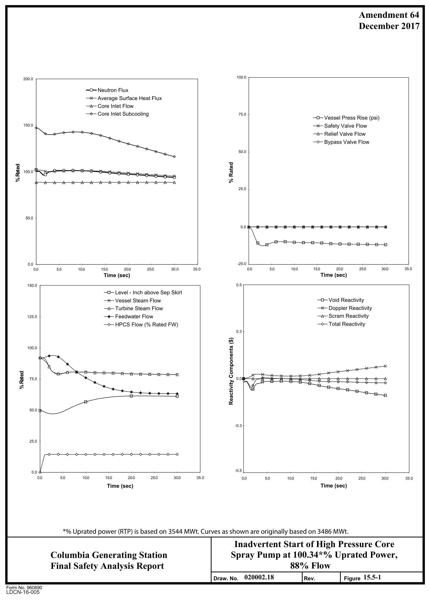

# 15.5 INCREASE IN REACTOR COOLANT INVENTORY

> Columbia Generating Station FSAR — Chapter 15: Accident Analyses
> Source: `15_chapter-4122-5262.pdf`, PDF pages 245–249 (of 1141)
> Amendment 67 compilation (individual pages carry varying amendment dates)

---
<!-- p.245 -->
### 15.5 INCREASE IN REACTOR COOLANT INVENTORY
#### 15.5.1 INADVERTENT HIGH-PRESSURE CORE SPRAY STARTUP
This transient is classified as a nonlimiting event for both original and uprated power conditions. The transient is not analyzed for each reload, but was analyzed for the GE14 New Fuel Introduction. Inadvertent startup of the high-pressure core spray (HPCS) system was analyzed because it provides the greatest auxiliary source of cold water into the vessel.

##### 15.5.1.1 Identification of Causes and Frequency Classification
###### 15.5.1.1.1 Identification of Causes
Manual startup (i.e., operator error) and continued injection of the HPCS system is postulated for this analysis.

###### 15.5.1.1.2 Frequency Classification
This transient disturbance is categorized as an incident of moderate frequency.

##### 15.5.1.2 Sequence of Events and Systems Operation
The HPCS system is manually initiated and injects into the reactor vessel, reaching full flow in approximately one second. The addition of the cooler water to the upper plenum causes a reduction in steam flow. This causes some reactor pressure decrease as the turbine control system responds to the event. As the steam flow decreases, the feedwater system responds by decreasing flow. In less than a minute, the reactor and the auxiliary steam systems stabilize at a new, lower power level. The analysis assumes normal functioning of plant instrumentation and controls. No engineered safety feature (ESF) function is expected in response to this transient. Plant parameter responses are shown in Figure 15.5-1.

###### 15.5.1.2.1 The Effect of Single Failures and Operator Errors
Inadvertent operation of the HPCS system results in a mild depressurization. Level control and pressure regulator actuation are expected to establish a new stable operating state. The effect of a single failure in the DEH control system will have no effect on the transient because of its redundant design.

The effect of a single failure in the level control system has rather straightforward consequences including level rise or fall by improper control of the feedwater system.
Increasing level will trip the turbine and automatically stop injection by the HPCS system.
Decreasing level will automatically initiate a scram at the L3 level trip.

<!-- p.246 -->
##### 15.5.1.3 Core and System Performance
###### 15.5.1.3.1 Mathematical Model
The one-dimensional ODYN transient analysis model described in Reference 15.5-1 was used to simulate this transient.

###### 15.5.1.3.2 Input Parameter and Initial Conditions
The important parameters are shown in Table 15.5-1.

###### 15.5.1.3.3 Results
The calculated uncorrected ΔCPR for the simulated bundles is less than 0.01
(Reference 15.5-2). A summary of transient key peak values is found in Table 15.0-1.

15.5.1.3.3.1 Consideration of Uncertainties. Important analytical factors including reactivity coefficient and feedwater temperature change have been assumed to be at the worst conditions so that any deviations in the actual plant parameters will produce a less severe transient.

##### 15.5.1.4 Barrier Performance
Figure 15.5-1 indicates only a slight pressure reduction from initial conditions; therefore, reactor coolant pressure boundary pressure margins are not impacted.

##### 15.5.1.5 Radiological Consequences
Since this event does not result in any fuel failures or any release of primary coolant to either the secondary containment or to the environment, there are no radiological consequences associated with this event.

#### 15.5.2 CHEMICAL VOLUME CONTROL SYSTEM MALFUNCTION
(OR OPERATOR ERROR)

This event is not applicable to boiling water reactor plants.

#### 15.5.3 BOILING WATER REACTOR TRANSIENTS WHICH INCREASE REACTOR
#### COOLANT INVENTORY
These events are discussed in Sections 15.1 and 15.2.

<!-- p.247 -->
#### 15.5.4 REFERENCES
15.5-1 “Qualification of the One-Dimensional Core Transient Model for Boiling Water Reactors,” Volumes 1, 2, 3 and 4, NEDC-24154-P-A, February 2000.

15.5-2 GE Hitachi Nuclear Energy, “Inadvertent High Pressure Core Spray Startup Analysis,” 0000-0098-5369-R0, March 2009.

<!-- p.248 -->
Table 15.5-1

Input Parameters and Initial Conditions HPCS Injection

Parameter Value t------------1 Reactor power 100.34% (3556 MWth)

Core flow 106% ICF and 88% ELLLA

HPCS water source Suppression pool

HPCS source pressure 14.7 psia

40 F HPCS source temperature

HPCS source enthalpy

### 11.0 Btu/lbm
HPCS pump flow 12.6 % of rated feedwater flow (3800 gal/min)

Vessel-to-suppression pool differential 1020 psid pressure

<!-- p.249 -->

*figure on PDF page 249*

[Vector original (SVG, lossless): fig_page-249_2.svg](../figures/fig_page-249_2.svg)

<!-- labels/text on this figure page -->
Amendment 64 December 2017
100.0 200.0
Neutron Flux Average Surface Heat Flux Core Inlet Flow Core Inlet Subcooling 75.0 Vessel Press Rise (psi)
Safety Valve Flow 150.0 Relief Valve Flow Bypass Valve Flow
50.0
% Rated ted 100.0 % Ra
25.0
50.0
0.0
-25.0 0.0 0.0 5.0 10.0 15.0 20.0 25.0 30.0 35.0 0.0 5.0 10.0 15.0 20.0 25.0 30.0 35.0 Time (sec)
Time (sec)
0.5 150.0 Level - Inch above Sep Skirt Void Reactivity Vessel Steam Flow Doppler Reactivity Turbine Steam Flow Scram Reactivity 125.0 Feedwater Flow Total Reactivity HPCS Flow (% Rated FW)
0.3
Reactivity Components ($)
100.0
% Rated 0.0 75.0
50.0
-0.3
25.0
-0.5 0.0 0.0 5.0 10.0 15.0 20.0 25.0 30.0 35.0 0.0 5.0 10.0 15.0 20.0 25.0 30.0 35.0 Time (sec)
Time (sec)
*% Uprated power (RTP) is based on 3544 MWt. Curves as shown are originally based on 3486 MWt.
Inadvertent Start of High Pressure Core Spray Pump at 100.34*% Uprated Power, Columbia Generating Station 88% Flow Final Safety Analysis Report 020002.18 15.5-1 Draw. No.
Rev. Figure Form No. 960690
LDCN-16-005

