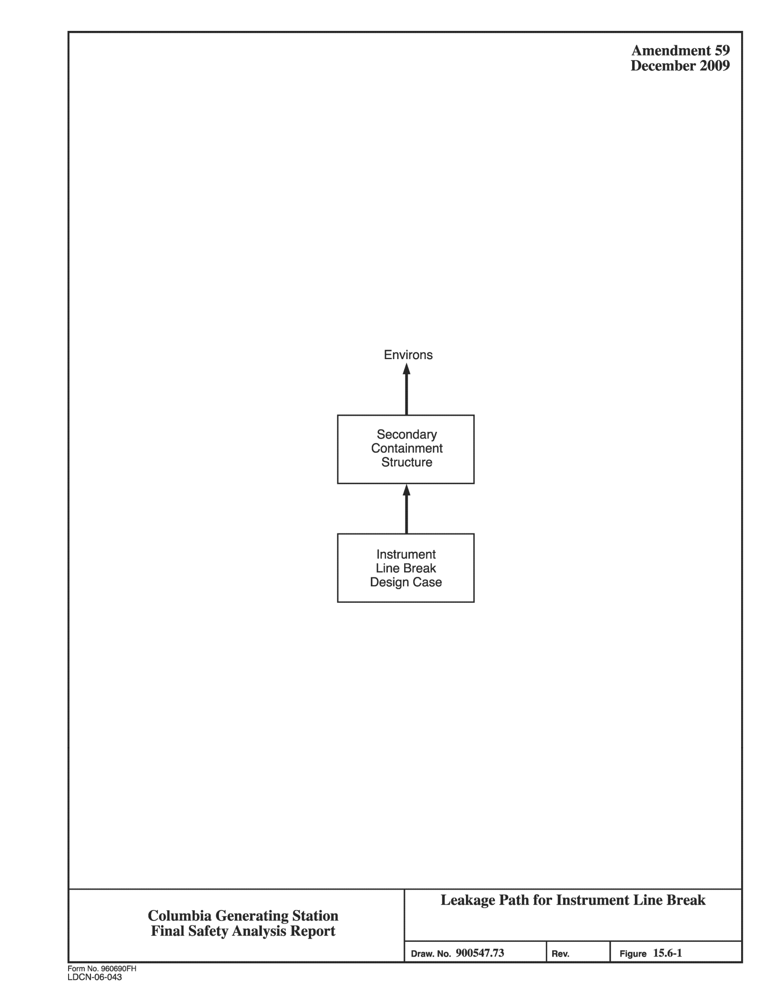
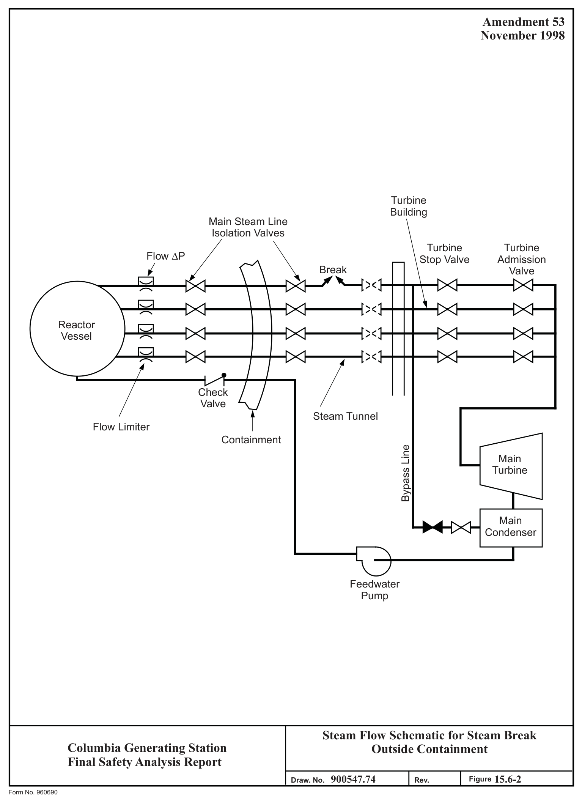
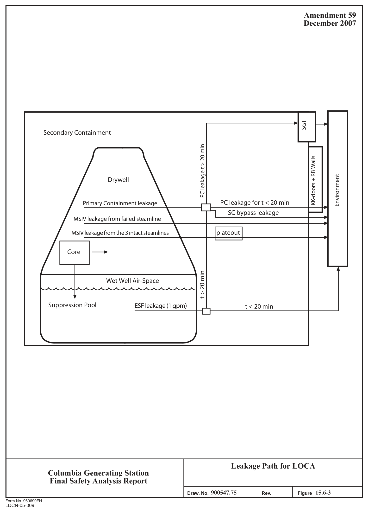
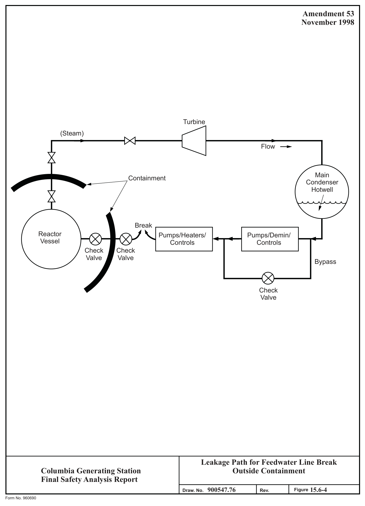

# 15.6 DECREASE IN REACTOR COOLANT INVENTORY

> Columbia Generating Station FSAR — Chapter 15: Accident Analyses
> Source: `15_chapter-4122-5262.pdf`, PDF pages 250–286 (of 1141)
> Amendment 67 compilation (individual pages carry varying amendment dates)

---
<!-- p.250 -->
### 15.6 DECREASE IN REACTOR COOLANT INVENTORY
#### 15.6.1 INADVERTENT SAFETY/RELIEF VALVE OPENING
This event is discussed in Section 15.1.4.

#### 15.6.2 INSTRUMENT LINE PIPE BREAK
This faulted condition is not a limiting event for either original or uprated power conditions.
Therefore, the uprated power analysis for the accident has not been updated.

This event involves the postulated pipe break in a small steam or liquid line that is connected to the reactor coolant pressure boundary (RCPB) and is located in the reactor building. If the break were inside primary containment, the event would be bounded by the steam line break inside containment (LOCA) (see Section 15.6.5). That event is bounding because the instrument line sizes are bounded by the spectrum of breaks considered in the LOCA analysis.

##### 15.6.2.1 Identification of Causes and Frequency Classification
###### 15.6.2.1.1 Identification of Causes
There is no specific event or circumstance identified which results in the failure of an instrument line. These lines are designed to specific engineering specifications and standards, and seismic and environmental requirements. However, for the purpose of evaluating the consequences of this event, the failure of an instrument line is assumed to occur.

###### 15.6.2.1.2 Frequency Classification
This event is categorized as a limiting fault.

##### 15.6.2.2 Sequence of Events and Systems Operation
The instrument line ruptures (complete circumferential break) and releases reactor coolant into the secondary containment. The analysis assumes that the reactor coolant activity is at the Technical Specification limit corresponding to an iodine spike of 4µCi/g dose equivalent 131I and that the break cannot be isolated. The operators have a variety of methods to detect the leak such as monitoring plant area temperatures and radiation levels, system pressures, or sump inventories, or during operator rounds. It is assumed that the reactor operators identify the break after 20 minutes and initiate a reactor scram.

Using available plant systems, the operators maintain reactor water level and cool down and depressurize the reactor within 5 hr, at a rate less than or equal to the 100°F/hr limit in the Technical Specifications. Examples of plant systems or components the operators can use for

<!-- p.251 -->
inventory and temperature controls include HPCS, RCIC, SRVs, RHR, or the condensate feed system. No credit is taken for the automatic initiation of the RPS or ESF.

###### 15.6.2.2.1 The Effect of Single Failures and Operator Errors
The event is handled by operator actions. Assuming additional single equipment failure or single operator error occurrences, adequate equipment would be available to respond to the loss of reactor coolant.

##### 15.6.2.3 Core and System Performance
The inventory loss is within the capacity of the make up systems available and the shutdown and the cool down are controlled evolutions. Therefore, no fuel damage will occur and no other barriers are challenged.

###### 15.6.2.3.1 Qualitative Summary - Results
Since instrument line breaks result in a slower rate of coolant loss and are bounded, the results are qualitative rather than quantitative. Since the rate of coolant loss is slow, an orderly reactor system depressurization follows reactor scram and the primary system is cooled down and maintained without ECCS actuation. No fuel damage or core uncovery occurs as a result of this event.

##### 15.6.2.4 Barrier Performance
###### 15.6.2.4.1 General
The release of primary coolant through the orificed instrument line would not result in an increase in secondary containment pressure.

##### 15.6.2.5 Radiological Consequences
The radiological consequences are based on the following assumptions and methods:

a. The broken instrumentation line contains a 0.5-in. diameter flow restricting orifice inside the drywell.

b. Flow is critical at the orifice and is determined using the GOTHIC computer program (Reference 15.6-1) that employs the Henry model for subcooled liquid and the Moody model for saturated and superheated vapors (Reference 15.6-4).

c. The total integrated mass of fluid released by means of the break during the blowdown is 121,000 lb. Of this total, 29,800 lb flash to steam.

<!-- p.252 -->
d. The specific models, assumptions and the program used for the radiological analysis is in Reference 15.6-3. Specific values of parameters used in the evaluation are presented in Table 15.6-1. The leakage path used in these calculations is shown in Figure 15.6-1.

e. The activity released from the instrument line break is based on the iodine spike concentration of 4µCi/g dose equivalent 131I and is assumed to not mix or be held up within the secondary containment and is released to the environment at a flow rate of 80,000 cfm without SGT filtration.

f. The activity released to the secondary containment and the environment is presented in Table 15.6-2.

###### 15.6.2.5.1 Results
The calculated exposures are presented in Table 15.6-3.

#### 15.6.3 STEAM GENERATOR TUBE FAILURE
This event is not applicable to boiling water reactor (BWR) plants.

#### 15.6.4 STEAM SYSTEM PIPING BREAK OUTSIDE CONTAINMENT
This event involves the postulation of a large steam line pipe break outside the primary containment. The analysis assumes that a main steam line instantaneously and circumferentially breaks at a location downstream of the outboard isolation valve. The plant is designed to immediately detect such an occurrence, initiate isolation of the broken line, and actuate the necessary protective features. The main steam line was selected for analysis because the postulated event envelops evaluation of steam line failures outside containment.

##### 15.6.4.1 Identification of Causes and Frequency Classification
###### 15.6.4.1.1 Identification of Causes
A main steam line break is postulated without the cause being identified. These lines are designed to specific engineering codes and standards, and seismic and environmental requirements. However, for the purpose of evaluating the consequences of a postulated large steam line rupture, the failure of a main steam line is assumed to occur.

###### 15.6.4.1.2 Frequency Classification
This event is categorized as a limiting fault.

<!-- p.253 -->
##### 15.6.4.2 Sequence of Events and Systems Operation
###### 15.6.4.2.1 Sequence of Events
When the steam line breaks, steam flow through the failed line will rapidly increase, initiating the high main steam line flow trip that initiates the signal to close the main steam isolation valves (MSIVs). The closing MSIVs initiate a reactor protection (RPS) signal, scramming the reactor. The analysis assumes that the MSIVs are fully closed 6 seconds after the break.
Performance of the engineered safety feature (ESF) systems in response to the loss of coolant is discussed in Chapter 6.

The sequence of events and approximate time required to reach the event is given in Table 15.6-4.

###### 15.6.4.2.2 Systems Operation
A postulated guillotine break of one of the four main steam lines outside the containment results in mass loss from both ends of the break. The flow from the upstream side is initially limited by the flow restrictor upstream of the inboard isolation valve. Flow from the downstream side is initially limited by the total area of the flow restrictors in the three I unbroken lines. Initially, only steam will issue from the broken end of the steam line. The flow in each line is limited by critical flow at the limiter to a maximum of 200% of rated flow I for each line. Rapid depressurization of the RPV causes the water level to rise resulting in a steam-water mixture flowing from the break until the valves are closed. Mass loss (steam and water) is reduced and finally terminated (except for leakage) as the MSIVs close.

###### 15.6.4.2.3 The Effect of Single Failures and Operator Errors
The effect of single failures has been considered in analyzing this event. All of the protective sequences for this event are capable of single equipment failure or single operator error accommodation and yet still complete the necessary safety action.

##### 15.6.4.3 Core and System Performance
The temperature and pressure transients resulting as a consequence of this accident are insufficient to cause fuel damage.

###### 15.6.4.3.1 Input Parameters and Initial Conditions
See Section 6.3 for initial conditions.

<!-- p.254 -->
###### 15.6.4.3.2 Results
There is no fuel damage as a consequence of this accident.

See Section 6.3 for ECCS analysis.

###### 15.6.4.3.3 Considerations of Uncertainties
Discussions of the uncertainties associated with the ECCS performance and the containment isolation systems are discussed in Sections 6.3 and 7.3, respectively.

##### 15.6.4.4 Barrier Performance
Since this break occurs outside the primary containment, barrier performance within the containment envelope is not applicable. There are sufficient vent openings in the steam tunnel to ensure that the secondary containment structure will not be damaged.

##### 15.6.4.5 Radiological Consequences
The radiological analysis is based on NRC Regulatory Guide 1.183 (Reference 15.6-5). The dispersion of the plume is based on the puff model given in Regulatory Guide 1.194
(Reference 15.6-6).

The specific models, assumptions, and the program used for computer evaluation are described in Reference 15.6-3. Specific values of parameters used in the evaluation are presented in Table 15.6-5. There is no fuel damage as a result of this accident. The only activity available for release from the break is that which is present in the reactor coolant and steam lines prior to the break. The iodine inventories and the subsequent exposures are based on the equilibrium conditions and maximum reactor coolant activity for an iodine spiking event as allowed by the Technical Specifications. The analysis assumes all the activity in this discharge becomes airborne and released directly and unfiltered to the environment. The release of activity to the environment is presented in Table 15.6-6.

The following assumptions and conditions are used in determining the mass loss from the primary system from the inception of the break to full closure of the MSIVs:

a. The reactor is operating at the power level associated with maximum mass release,

b. Nuclear system pressure is 1060 psia and remains constant during closure,

c. An instantaneous circumferential break of the main steam line occurs,

<!-- p.255 -->
d. Isolation valves start to close at 0.5 sec on high flow signal and are fully closed at 6 sec,

e. The Moody critical flow model (Reference 15.6-4) is applicable, and

f. The flow limiters allow up to 200% of rated flow through the MSIVs, and

g. Level rise time is conservatively assumed to be one second. Mixture quality is conservatively taken to be a constant 7% (steam weight percentage) during mixture flow.

The total integrated mass leaving the RPV through the steam line break is 130,000 lb of which 105,000 lb is liquid and 25,000 lb is steam. Only the liquid portion of the discharged coolant is assumed to carry the iodine activity of 4 µCi/gm dose-equivalent of I-131. The entire amount of activity in the liquid is assumed to be released to the environment.

The transport pathway is a direct unfiltered release to the environment and an unfiltered entrance to the control room as presented in Figure 15.6-2.

###### 15.6.4.5.1 Results
The calculated doses for the design basis analysis are presented in Table 15.6-7. The doses are within the limits of 10 CFR 50.67.

#### 15.6.5 LOSS-OF-COOLANT ACCIDENTS (RESULTING FROM SPECTRUM OF
#### POSTULATED PIPING BREAKS WITHIN THE REACTOR COOLANT
#### PRESSURE BOUNDARY) - INSIDE CONTAINMENT
Accidents that could result in the release of radioactive fission products directly into the containment are the results of postulated breaks in the reactor coolant system pressure boundary (RCPB). The analysis postulates that the most severe pressurization transient to the primary containment is caused by a complete circumferential break of the suction line of one of the two recirculation loops. Flow through the break transports the reactor vessel contents to the suppression pool.

The loss-of-coolant accident (LOCA) postulates the break of any of the spectrum of piping systems that form the RCPB. The plant and operator responses to the spectrum of breaks are presented in Chapter 6. Chapter 6 demonstrates that fuel, core, and barrier performance requirements are met for the spectrum of breaks. The bounding radiological analysis for the LOCA event detailed in this section reflects an inadequate core cooling accident that degrades to complete core damage. The event assumed for the analysis is the break inside containment of one of the main steam lines. The radiological analysis assumptions presented in

<!-- p.256 -->
Section 15.6.5 are separate and distinct and are not mechanistically tied to the pipe break analyzed in Chapter 6.

##### 15.6.5.1 Identification of Causes and Frequency Classification
###### 15.6.5.1.1 Identification of Causes
There are no realistic, identifiable events that would result in a pipe break inside the containment of the magnitude required to cause the fuel damage sufficient to release the source terms assumed in this section. The piping is designed to specific engineering codes and standards and for severe seismic and environmental conditions. However, since such an accident provides an upper limit estimate of the dose consequences for the limiting faulted condition, it is evaluated without the causes being identified.

###### 15.6.5.1.2 Frequency Classification
This event is categorized as a limiting fault.

##### 15.6.5.2 Sequence of Events and Systems Operation
The sequence of events and system operations are discussed in Chapter 6. The effect of single failures and operator errors is discussed in Chapter 6.

##### 15.6.5.3 Core and System Performance
For the plant response to the LOCA and the evaluation of the system and core performance, see Chapter 6.

##### 15.6.5.4 Radiological Consequences
The radiological consequences are based on the guidance provided in Regulatory Guide 1.183
(Reference 15.6-5) for the purpose of determining adequacy of the plant design to meet 10 CFR 50.67 limits.

A schematic of the transport pathway is shown in Figure 15.6-3.

###### 15.6.5.4.1 Design Basis Analysis
The specific models, assumptions, and computer code used to evaluate the radiological consequences of the bounding LOCA based on the above criteria are presented in Reference 15.6-3. Specific values of parameters used in this evaluation are presented in Table 15.6-8.

<!-- p.257 -->
15.6.5.4.1.1 Fission Product Release from Fuel. It is assumed that 100% of the noble gases and 30% of the iodine are released from an equilibrium core operating at a power level of 3556 MWt for 1000 days prior to the accident. Of this release, 100% of the noble gases become airborne. Some of the iodine is removed by plate-out and filtration; therefore, it is not available for airborne release to the environment. The activity airborne in the containment is presented in Table 15.6-9.

15.6.5.4.1.2 Fission Product Transport to the Environment. The fission product transport to the environment consists of two basic pathways. One transport pathway consists of leakage from the containment to the secondary containment by several different mechanisms and is discharged to the environment through the SGT system at an elevated location. Of the secondary containment flow, 50 cfm bypasses the SGT filters. The second transport pathway consists of leakage from the containment directly to the environment through piping systems that originate in containment and terminate outside the reactor building. The individual mechanisms for leakage from the primary containment are:

a. Containment leakage - Leakage from primary containment to the secondary containment. Prior to the completion of secondary containment drawdown this leakage is assumed to be a direct release to the environment; however, when drawdown is complete, 20 minutes post accident, this leakage is treated by the SGT system before it is released to the environment. No credit is taken for forced mixing and holdup within the secondary containment.

b. ESF leakage - Leakage from engineered safety feature (ESF) components outside the primary containment (all ESF equipment which circulates primary coolant or suppression pool water during the course of the postulated accident)
to the secondary containment. This leakage is treated in a manner similar to the containment leakage described above.

c. Hydrogen purge - No hydrogen purge is required or assumed throughout the postaccident period.

d. MSIV leakage - Leakage from the primary containment (or the RPV) through the main steam isolation valves (MSIVs) to the turbine building. Iodine is assumed to plate-out in three of the four main steam lines. Plate-out in the broken fourth main steam line is not credited. In that line it is assumed one MSIV fails open (single failure), whereas all MSIVs in the other three steam lines are assumed to close.

e. Bypass leakage - Leakage from the primary containment that bypasses the secondary containment and is released, untreated, directly to the environment.

<!-- p.258 -->
Fission product activities in secondary containment and those released to the environment based on the above assumptions are given in Tables 15.6-10 and 15.6-11, respectively.

15.6.5.4.1.3 Suppression Pool pH Control. The suppression pool pH is maintained above 7.0 for the duration of the accident as a result of the standby liquid control system injection of sodium pentaborate solution. The solution is assumed to be injected and fully mixed with the suppression pool water within 8 hours post-LOCA.

15.6.5.4.1.4 Results. The calculated doses for the design basis analysis are presented in Table 15.6-12 and are within the limits of 10 CFR 50.67.

#### 15.6.6 FEEDWATER LINE BREAK - OUTSIDE CONTAINMENT
In order to evaluate large liquid process line pipe breaks outside containment, the failure of a feedwater line is assumed to evaluate the response of the plant design to this postulated event.
The postulated break of the feedwater line, representing the largest liquid line outside the containment, provides the envelope evaluation relative to this type of occurrence. The break is assumed to be instantaneous, circumferential, and outboard of the outermost isolation valve.
The analysis has not been updated for the change in MSIV isolation setpoint from Level 2 to Level 1 because the analysis remains bounded by the recirculation line break LOCA
(Reference 15.6-9).

##### 15.6.6.1 Identification of Causes and Frequency Classification
###### 15.6.6.1.1 Identification of Causes
A feedwater line break is assumed without the cause being identified. The subject piping is designed to specific engineering codes and standards.

###### 15.6.6.1.2 Frequency Classification
This event is categorized as a limiting fault.

##### 15.6.6.2 Sequence of Events and Systems Operation
###### 15.6.6.2.1 Sequence of Events
The sequence of events is shown in Table 15.6-13.

###### 15.6.6.2.2 Systems Operation
It is assumed that the normally operating plant instrument and controls are functioning. Credit is taken for the actuation of the reactor isolation system and ECCS. The RPS (SRVs, ECCS,

<!-- p.259 -->
and control rod drives) and plant protection system (RHR heat exchanger) are assumed to function. The ESF system is assumed to operate normally. Although not an ECCS and not credited nor required for mitigation of this event, RCIC will also be used if available for maintaining vessel level as it initiates at approximately the same low reactor vessel level as

#### HPCS.
###### 15.6.6.2.3 The Effect of Single Failures and Operator Errors
The feedwater line outside the containment is a special case of the general LOCA break spectrum considered in Section 6.3. The general single-failure analysis for LOCAs is discussed in Section 6.3.3.3. For the feedwater line break outside the containment, since the break is isolable, the HPCS can provide adequate flow to the vessel to maintain core cooling and prevent fuel rod cladding failure. A single failure of the HPCS would require actuation of ADS and the low-pressure core cooling systems to keep the core covered with water.

##### 15.6.6.3 Core and System Performance
###### 15.6.6.3.1 Qualitative Summary
The accident evaluation qualitatively considered in this section is considered to be conservative and to envelope assessment of the consequences of the postulated failure of one of the feedwater piping lines external to the containment. The accident is postulated to occur at the input parameters and initial conditions given in Table 6.3-2a, 6.3-2b, and 6.3-2c.

###### 15.6.6.3.2 Qualitative Results
The feedwater line break outside the containment is less limiting than the steam line break outside the containment or the LOCA inside the containment.

The reactor vessel is isolated on low-low water level and the HPCS would restore the reactor water level to the normal elevation. The fuel is covered throughout the event and there are no pressure or temperature transients sufficient to cause fuel damage.

###### 15.6.6.3.3 Consideration of Uncertainties
This event was conservatively analyzed and uncertainties were adequately considered (see Section 6.3 for details).

##### 15.6.6.4 Barrier Performance
A break spectrum analysis for the complete range of reactor conditions indicates that the limiting fault event for breaks outside the containment is a complete severance of one of the

<!-- p.260 -->
main steam lines. The feedwater system piping break is less severe than the main steam line break.

##### 15.6.6.5 Radiological Consequences
The specific models, assumptions, and the program used for computer evaluation are described in Reference 15.6-2. Specific values of parameters used in the evaluation are presented in Table 15.6-14. A diagram of the leakage path for this accident is shown in Figure 15.6-4.

###### 15.6.6.5.1 Fission Product Release
Fission product release is assumed to occur from two pathways: activity being pumped from the condenser hotwell and activity returning to the feedwater system from the reactor water cleanup (RWCU) system. The activity in both of these sources is based on the Technical Specification coolant limit.

Noble gas activity in the condensate is negligible since the air ejectors remove most of the noble gas from the condenser.

###### 15.6.6.5.2 Fission Product Transport to the Environment
The transport pathway consists of liquid release from the break, carryover to the turbine building atmosphere due to flashing and partitioning and unfiltered release to the environment through the turbine building ventilation system.

Of the 860,000 lb of condensate released from the break, 86,000 lb flashes to steam with assumed iodine carryover of 100%. Of the activity remaining in the unflashed liquid, 5% is assumed to become airborne. Normally, all feedwater reaching the break location will have passed through condensate demineralizers which have a 90% iodine removal efficiency.
However, as a result of the increased feedwater flow caused by the break, differential pressure across the demineralizers is assumed to initiate flow through the demineralizer bypass line.
This bypass line then carries 15% of the total flow resulting in an effective iodine removal efficiency for all flow of 76.5%. In addition, it is also assumed that 2771 lb of liquid returning from the RWCU are released prior to isolation of the RWCU. The activity concentration in this return steam is 1% of the RPV coolant concentration.

Taking no credit for holdup, decay, or plate-out during transport through the turbine building, the release of activity to the environment is presented in Table 15.6-15. The release is assumed to take place within 2 hr of the occurrence of the break.

<!-- p.261 -->
###### 15.6.6.5.3 Results
The calculated exposures for the realistic analysis are presented in Table 15.6-16 and are a small fraction of 10 CFR 100 guidelines.

#### 15.6.7 REFERENCES
15.6-1 GOTHIC Containment Analysis Package, Technical Manual, Version 4.0, Numerical Applications, Inc., NA18907-06, Revision 3.

15.6-2 Nguyen, D., “Realistic Accident Analysis for General Electric Boiling Water Reactor - The RELAC Code and User’s Guide,” (NEDO-21142).

15.6-3 Energy Northwest, “Columbia Generating Station Alternative Source Term,” CGS-FTS-0168, Revision 2, June 2011.

15.6-4 Moody, F. J, “Maximum Two-Phase Vessel Blowdown from Pipes,” ASME Paper Number 65-WA/HT-1, March 15, 1965.

15.6-5 Regulatory Guide 1.183, Revision 0, “Alternative Radiological Source Terms for Evaluating Design Basis Accidents at Nuclear Power Reactors,” July, 2000.

15.6-6 Regulatory Guide 1.194, Revision 0, “Atmospheric Relative Concentrations for Control Room Radiological Habitability Assessments at Nuclear Power Plants,” July, 2003.

15.6-7 Federal Guidance Report 11, “Limiting Values of Radionuclide Intake and Air Concentration and Dose Conversion Factors for Inhalation, Submersion and Ingestion,” Oak Ridge National Laboratory, 1988.

15.6-8 Federal Guidance Report 12, “External Exposure to Radionuclides in Air, Water and Soil,” Oak Ridge National Laboratory, 1993.

15.6-9 GE Hitachi Nuclear Energy, “License Amendment Request for Proposed Changes to Columbia Technical Specifications: Changing Group 1 Isolation Valves’ Low Reactor Water Level Isolation Signal from the Current Level 2 to Level 1,” 0000-0081-6730-R1, July 2008.

<!-- p.262 -->
Table 15.6-1

Instrument Line Break Accident - Parameters Tabulated for Postulated Accident Analyses

Design Basis Parameters Assumptions I. Data and assumptions used to estimate radioactive source from postulated accidents A. Power level N/A B. Burnup N/A C. Fuel damaged None D. Airborne activity by nuclide Table 15.6-2 E. Iodine fractions
(1) Organic 0.15%
(2) Elemental 4.85%
(3) Particulate 95% F. Initial reactor coolant activity with iodine spike 4 μci/g 131I
1.6 μci/g 132I 14.8 μci/g 133I 11.0 μci/g 134I 30.0 μci/g 135I 16.0 μci/g

II. Data and assumptions used to estimate activity released A. Primary containment leak rate (%/day)
N/A 80,000a B. Secondary containment effluent rate (cfm)
C. Valve movement times N/A D. Adsorption and filtration efficiencies
(1) Organic iodine N/A
(2) Elemental iodine N/A
(3) Particulate iodine N/A
(4) Particulate fission products N/A E. Recirculation system parameters
(1) Flow rate N/A
(2) Mixing efficiency N/A
(3) Filter efficiency N/A F. Containment spray parameters (flow rate, drop size, etc.) N/A G. Containment volumes N/A H. All other pertinent data and assumptions None

<!-- p.263 -->
Table 15.6-1

Instrument Line Break Accident - Parameters Tabulated for Postulated Accident Analyses (Continued)

Design Basis Parameters Assumptions III. Dispersion data A. Offsite See Table 15.0-4 B. Control Room See Table 15.0-5

IV. Dose data A. Method of dose calculation Reference 15.6-5 B. Dose conversion assumptions Reference 15.6-7 C. Peak activity released from secondary containment Table 15.6-2 D. Doses Table 15.6-3

a No forced mixing in secondary containment is considered.

<!-- p.264 -->
Table 15.6-2

Instrument Line Failure

Activity Airborne in Secondary Containment (Ci)
2 hr 5 hr 8 hr 1 day 30 days 133Xe 7.02E-07 2.60E-07 0.00E+00 0.00E+00 0.00E+00 135Xe 1.22E-05 3.67E-06 0.00E+00 0.00E+00 0.00E+00

Total 1.29E-05 3.93E-06 0.00E+00 0.00E+00 0.00E+00

131I 2.00E-02 8.09E-03 0.00E+00 0.00E+00 0.00E+00 132I 1.03E-01 1.72E-02 0.00E+00 0.00E+00 0.00E+00 133I 1.29E-01 4.80E-02 0.00E+00 0.00E+00 0.00E+00 134I 7.60E-02 2.80E-03 0.00E+00 0.00E+00 0.00E+00 135I 1.64E-01 4.93E-02 0.00E+00 0.00E+00 0.00E+00

Total 4.92E-01 1.25E-01 0.00E+00 0.00E+00 0.00E+00

Activity Airborne in the Environment (Ci)
2 hr 5 hr 8 hr 1 day 30 days 133Xe 1.90E-03 3.93E-03 4.91E-03 6.06E-03 6.08E-03 135Xe 3.56E-02 6.76E-02 8.02E-02 9.06E-02 9.06E-02

Total 3.75E-02 7.15E-02 8.51E-02 9.67E-02 9.67E-02

131I 4.87E+01 8.46E+01 8.72E+01 8.72E+01 8.72E+01 132I 3.51E+02 4.81E+02 4.86E+02 4.86E+02 4.86E+02 133I 3.26E+02 5.51E+02 5.65E+02 5.65E+02 5.65E+02 134I 4.91E+02 5.52E+02 5.53E+02 5.53E+02 5.53E+02 135I 4.46E+02 7.06E+02 7.22E+02 7.22E+02 7.22E+02

Total 1.66E+03 2.37E+03 2.41E+03 2.41E+03 2.41E+03

<!-- p.265 -->
Table 15.6-3

Instrument Line Failure Radiological Effects

Total Effective Dose Equivalent Limit Area
(rem)
(rem TEDE)

Control Room
1.58 5

Exclusion area (1950 m) (2 hr)
0.36
2.5

Low population zone (4827 m) (30 days)
0.16
2.5

<!-- p.266 -->
Table 15.6-4

Sequence of Events for Steam Line Break Outside Containment

Time Event

0 Guillotine break of one main steam line outside primary containment.

0.5a High steam line flow signal initiates closure of MSIV.

<1.0 Reactor begins to scram.

>6.0 Main steam line isolation valves fully closed.

## 10 Safety/relief valves open on high vessel pressure. The valves open and
close to maintain vessel pressure at approximately 1100 psi.

600 Operator initiates ADS or manually controls relief valves. Vessel depressurizes rapidly.

750 High-pressure core spray initiates on low water level.

1270 Core effectively reflooded. No fuel rod failure.

a Approximately.

<!-- p.267 -->
Table 15.6-5

Steam Line Break Accident - Parameters Tabulated for Postulated Accident Analyses

Design Basis Parameters Assumptions I. Data and assumptions used to estimate radioactive source from postulated accidents.
A. Power level N/A B. Burnup N/A C. Fuel damaged None D. Release of activity by nuclide Table 15.6-6 E. Iodine fractions1
(1) Organic N/A
(2) Elemental N/A
(3) Particulate N/A F. Reactor coolant activity before the accident corresponds 4 μci/gm to the iodine spike of 4 μci/gm dose-equivalent I-131

II. Data and assumptions used to estimate activity released.
A. Primary containment leak rate (%/day)
N/A B. Secondary containment leak rate (%/day)
N/A C. Isolation valve closure time (sec)
6 D. Adsorption and filtration efficiencies
(1) Organic iodine1 N/A
(2) Elemental iodine N/A
(3) Particulate iodine N/A
(4) Particulate fission products N/A

1 Since no filtration is credited, speciation of iodines is not applicable.

<!-- p.268 -->
Table 15.6-5

Steam Line Break Accident - Parameters Tabulated for Postulated Accident Analyses (Continued)

Design Basis Parameters Assumptions E. Recirculation system parameters N/A
(1) Flow rate N/A
(2) Mixing efficiency N/A
(3) Filter efficiency N/A F. Containment spray parameters (flow rate, drop size, etc.) N/A G. Containment volumes N/A H. All other pertinent data and assumptions None III. Dispersion data
(1) Offsite Table 15.0-4

### 8.19 E-4 sec/m3
(2) Control Room

IV. Dose data A. Method of dose calculation Reference 15.6-3 B. Dose conversion assumptions Reference 15.6-7 C. Peak activity concentrations in containment N/A D. Doses Table 15.6-7

<!-- p.269 -->
Table 15.6-6

Steam Line Break Accident Activity Release to Environment (Curies)

Activity Isotope Released

131I
1.91E 02

<!-- p.270 -->
Table 15.6-7

Steam Line Break Accident Radiological Effects of a Puff Release

TEDE (rem)
Area

Exclusion area (1950 m)
0.40

Low population zone (4827 m)
0.11

Control Room
1.8

<!-- p.271 -->
Table 15.6-8

Loss-of-Coolant Accident - Parameters Tabulated for Postulated Accident Analysis

Design Basis Parameters Assumptions

I. Data and assumptions used to estimate radioactive source from postulated accidents

A. Power level 3556

B. Burnup N/A

C. Fuel damaged 100%

Table 15.6-10 and 15.6-11 D. Airborne activity by nuclide

E. Iodine fractions

(1) Organic 0.0015

(2) Elemental 0.0485

(3) Particulate 0.95

F. Reactor coolant activity before the N/A accident

II. Data and assumptions used to estimate activity released

A. Primary containment leak rate includes 0 – 24 hrs 0.5 MSIV leakage (% volume/day)
24 – 720 hrs 0.25

B. Secondary containment leak rate (%/day) N/A

20 C. Drawdown period (minutes)

D. Adsorption and filtration efficiencies (%)

(1) Organic iodine 98%

(2) Elemental iodine 98%

(3) Particulate iodine 98%

(4) Particulate fission products 98%

<!-- p.272 -->
Table 15.6-8

Loss-of-Coolant Accident - Parameters Tabulated for Postulated Accident Analysis (Continued)

Design Basis Parameters Assumptions

E. Secondary containment volumetric 50 flow rate bypassing SGT filters1, cfm

F. Secondary containment bypass 0 – 24 hrs 0.04% volume per day 24 – 720 hrs 0.02% volume per day leakage

G. Recirculation system parameters

(1) Flow rate (cfm)
N/A

(2) Mixing efficiency N/A

(3) Filter efficiency N/A

H. Containment spray removal rates Time (hr) Removal Rate (1/hr)
0 0.0 0.25 6.20
2.44 0.62 24.0 0.0

I. Containment volumes Table 6.2-1

J. MSIV leak rate per steam line 0 – 24 hrs 16 scfh 24 – 720 hrs 8 scfh

K. ESF leakage into secondary 2 gpm containment

L. CREF bypass leakage 50 cfm

III. Dispersion data Table 15.0-4
(1) Offsite Table 15.0-5
(2) Control room

1 SGT filter bypass will reduce SGT filter efficiency from 99% to 98%.

<!-- p.273 -->
Table 15.6-8

Loss-of-Coolant Accident - Parameters Tabulated for Postulated Accident Analysis (Continued)

Design Basis Parameters Assumptions IV. Dose data

A. Method of dose calculation Reference 15.6-5

B. Dose conversion assumptions Reference 15.6-7, 15.6-8

C. Peak activity concentrations in Table 15.6-9 containment

D. Doses Table 15.6-12

<!-- p.274 -->
3.03E+03 3.03E+03 1.29E+06 1.56E+05 6.17E+02 3.52E+06 4.97E+06 7.73E+01 5.34E+01 3.99E+00 1.00E+01 1.05E+00
1.03E-01 3.25E-06 30 day 0 0 0 0 0 0 0 0 0 0 0

4.09E+04 1.12E+02 3.92E+04 6.80E+03 8.71E+04 1.58E+03 5.84E+05 1.45E+06 9.35E+01 1.76E+05 9.30E+05 4.33E+06 1.72E+08 1.79E+07 1.97E+08 9.57E+01 1.72E+02 1.60E+01 1.33E+01 1.18E+01 5.95E-129 1.52E-103 4.13E-04
3.87E-18 24.0 hr 0

1.25E+05 3.57E+04 1.92E+05 4.52E+02 1.02E+05 4.55E+05 6.34E+05 7.36E+06 1.46E+06 5.97E+05 9.29E+06 9.71E+05 5.33E+06 1.86E+08 3.82E+07 2.50E+08 3.05E+04 6.56E+04 5.82E+03 3.11E+03 4.49E+03
3.36E-38 2.18E-02 1.59E-29 3.98E-01 8.0 hr

3.93E+05 2.17E+05 6.82E+05 3.47E+04 4.77E+05 1.80E+06 2.84E+06 1.39E+07 1.46E+06 5.33E+06 2.51E+07 9.81E+05 5.60E+06 1.89E+08 9.29E+02 4.21E+07 7.13E+03 2.86E+08 1.29E+05 3.09E+05 2.57E+04 9.64E+03 1.98E+04
1.60E-15 5.09E-11 4.0 hr Primary Containment1 Activity (Curies)
2.69E+06 2.15E+06 4.95E+06 1.18E+06 3.97E+06 1.49E+07 5.87E+06 1.86E+07 1.43E+06 1.56E+07 4.03E+07 9.66E+05 5.63E+06 1.87E+08 1.88E+05 4.20E+07 9.34E+05 3.19E+08 9.72E+05 2.41E+06 1.99E+05 3.17E+04 1.52E+05
3.42E-04 8.99E-02 Loss-of-Coolant Accident
2.0 hr Table 15.6-9
2.63E+06 2.79E+06 4.97E+06 2.55E+06 4.29E+06 1.72E+07 3.02E+06 7.71E+06 5.05E+05 9.53E+06 1.82E+07 5.71E+01 3.42E+05 2.01E+06 6.64E+07 9.51E+05 1.56E+07 1.35E+03 3.82E+06 1.28E+08 9.62E+05 2.49E+06 1.97E+05 3.19E+04 1.46E+05
1.0 hr 1Primary Containment includes the Dry Well & the Wet Well Air-Space
2.42E+06 2.75E+06 4.62E+06 2.87E+06 4.05E+06 1.67E+07 1.80E+06 4.35E+06 2.74E+05 5.92E+06 1.05E+07 8.12E+02 1.86E+05 1.10E+06 3.61E+07 1.00E+06 8.57E+06 1.05E+04 3.81E+06 7.36E+07 9.21E+05 2.04E+06 1.55E+05 2.40E+04 1.15E+05 0.8 hr

1.72E+06 2.10E+06 3.30E+06 2.49E+06 2.94E+06 1.26E+07 4.92E+05 1.13E+06 6.82E+04 1.69E+06 2.79E+06 5.31E+03 4.63E+04 2.74E+05 9.00E+06 4.87E+05 2.23E+06 3.75E+04 1.75E+06 2.00E+07 7.85E+05 2.31E+05 0.00E+00 0.00E+00 0.00E+00 0.5 hr

2.15E+06 2.82E+06 4.16E+06 3.81E+06 3.78E+06 1.67E+07 2.51E+05 5.45E+05 3.17E+04 9.02E+05 1.38E+06 6.47E+04 2.15E+04 1.28E+05 4.19E+06 4.40E+05 1.02E+06 2.50E+05 1.50E+06 1.07E+07 9.84E+05 2.83E+05 0.00E+00 0.00E+00 0.00E+00 ______________________________ 0.25 hr

Total noble gases Alkali metals Noble metals Total iodines Te-group La-group Ce-group Isotope 131mXe 133mXe 135mXe 83mKr 85mKr 133Xe 135Xe 137Xe 138Xe 85Kr 87Kr 88Kr 89Kr 131I 132I 133I 134I 135I

<!-- p.275 -->
2.24E+00 6.47E+00 8.98E+00 4.11E-01 1.79E-07 4.11E-01
2.70E-01 1.07E-03
1.34E-04 9.28E-05 6.92E-06 1.74E-05 1.81E-06 30 day 0 0 0 0 0 0 0 0 0 0 0 0

5.47E+00 5.24E+00 1.16E+01 2.03E+00 5.03E+00 3.22E+00 1.50E+01 6.06E+02 8.24E+01 7.14E+02 6.86E-03 5.53E-08 9.08E-01 5.47E-03 3.25E-04 6.10E-01
3.34E-04 5.99E-04 5.60E-05 4.65E-05 4.11E-05 0 0 0 0 24 hr

6.08E+00 9.36E+00 4.95E+00 2.13E+01 2.20E+00 2.55E+01 5.06E+00 2.07E+00 3.22E+01 3.37E+00 1.85E+01 6.49E+02 1.57E+02 8.95E+02
1.17E-43 7.58E-08 5.52E-35 1.38E-06 1.07E-01 2.29E-01 2.03E-02 1.09E-02 1.57E-02 8.84E-01 2.20E-02 8 hr Secondary Containment Activity (Curies) - 20 Minute Drawdown 7.11E+00 3.26E+00 1.23E+01 8.61E+00 3.19E+01 9.84E+00 4.81E+01 5.06E+00 1.85E+01 8.69E+01 3.40E+00 1.94E+01 6.59E+02 1.61E+02 1.01E+03 1.08E+00 5.56E-21 3.22E-03 1.77E-16 2.47E-02 4.51E-01 8.96E-02 3.36E-02 6.92E-02 6.29E-01 4 hr

1.50E+01 1.19E+01 2.75E+01 6.54E+00 2.21E+01 8.29E+01 2.02E+01 6.40E+01 4.91E+00 5.36E+01 1.38E+02 3.32E+00 1.93E+01 6.43E+02 1.50E+02 3.21E+00 1.10E+03 3.38E+00 8.45E+00
1.17E-09 6.44E-01 3.09E-07 6.92E-01 1.12E-01 5.30E-01 Loss-of-Coolant Accident 2 hr Table 15.6-10
1.15E+01 1.22E+01 2.17E+01 1.12E+01 1.88E+01 7.54E+01 1.02E+01 2.59E+01 1.70E+00 3.21E+01 6.13E+01 1.15E+00 6.78E+00 2.24E+02 3.20E+00 5.35E+01 1.28E+01 4.33E+02 3.33E+00 8.69E+00
1.92E-04 4.53E-03 6.76E-01 1.12E-01 5.04E-01 1 hr

9.90E+00 1.13E+01 1.89E+01 1.18E+01 1.65E+01 6.84E+01 5.88E+00 1.42E+01 1.94E+01 3.44E+01 3.59E+00 1.18E+02 3.29E+00 2.87E+01 1.25E+01 2.42E+02 3.18E+00 6.92E+00 8.97E-01 2.66E-03 6.08E-01 3.43E-02 5.18E-01 8.11E-02 3.82E-01 0.75 hr

6.89E+00 8.38E+00 1.32E+01 9.98E+00 1.18E+01 5.02E+01 1.65E+00 3.77E+00 5.66E+00 9.33E+00 3.01E+01 1.63E+00 7.70E+00 5.87E+00 6.72E+01 2.75E+00 0.00E+00 0.00E+00 0.00E+00
2.28E-01 1.78E-02 1.55E-01 9.17E-01 1.25E-01 8.69E-01 0.5 hr

0.25 hr 0 0 0 0 0 0 0 0 0 0 0 0 0 0 0 0 0 0 0 0 0 0 0 0 0

Total noble gases Alkali metals Noble metals Total iodines Te-group La-group Ce-group Isotope 131mXe 133mXe 135mXe 83mKr 85mKr 133Xe 135Xe 137Xe 138Xe 85Kr 87Kr 88Kr 89Kr 131I 132I 133I 134I 135I

<!-- p.276 -->
3.03E+03 1.15E+04 1.67E+03 5.28E+02 1.06E+03 1.78E+04 7.35E+03 4.42E+04 1.64E+05 1.59E+04 6.73E+04 1.16E+01 5.55E+04 9.18E+04 6.45E+06 4.59E+02 3.33E+05 4.04E+01 1.87E+03 7.23E+06 2.16E+02 3.82E+02 2.94E+01 6.65E+00 2.22E+01 30 d

8.35E+02 2.52E+03 1.42E+03 5.28E+02 1.05E+03 6.35E+03 7.35E+03 4.36E+04 1.07E+04 1.59E+04 6.71E+04 1.16E+01 7.06E+03 3.71E+04 1.35E+06 4.59E+02 2.67E+05 4.04E+01 1.87E+03 1.81E+06 2.14E+02 3.81E+02 2.93E+01 6.30E+00 2.22E+01 24 hrs

6.37E+02 1.13E+03 1.17E+03 5.28E+02 9.63E+02 4.43E+03 6.81E+03 2.99E+04 3.25E+03 1.55E+04 5.53E+04 1.16E+01 2.18E+03 1.24E+04 4.22E+05 4.59E+02 9.96E+04 4.04E+01 1.87E+03 6.49E+05 2.10E+02 3.71E+02 2.84E+01 5.82E+00 2.15E+01 Activity Released to the Environment (Curies) - 20 Minute Drawdown 8 hrs

5.49E+02 7.45E+02 1.03E+03 5.25E+02 8.74E+02 3.72E+03 4.92E+03 1.67E+04 1.37E+03 1.27E+04 3.49E+04 1.16E+01 9.28E+02 5.38E+03 1.80E+05 4.58E+02 4.24E+04 4.04E+01 1.87E+03 3.02E+05 1.96E+02 3.38E+02 2.56E+01 4.56E+00 1.94E+01 4 hrs

4.48E+02 5.27E+02 8.49E+02 4.98E+02 7.35E+02 3.06E+03 2.19E+03 6.15E+03 4.33E+02 6.46E+03 1.40E+04 1.16E+01 2.93E+02 1.72E+03 5.68E+04 4.35E+02 1.34E+04 4.04E+01 1.74E+03 1.04E+05 1.68E+02 2.70E+02 2.01E+01 3.23E+00 1.51E+01 Loss-of-Coolant Accident 2 hrs Table 15.6-11
2.31E+02 2.89E+02 4.44E+02 3.53E+02 3.97E+02 1.71E+03 3.80E+02 9.21E+02 5.82E+01 1.25E+03 2.22E+03 1.16E+01 3.94E+01 2.33E+02 7.66E+03 2.36E+02 1.86E+03 4.04E+01 8.78E+02 1.58E+04 9.54E+01 8.25E+01 4.94E+00 3.66E+00 7.72E-01 1 hrs

1.80E+02 2.31E+02 3.47E+02 2.99E+02 3.13E+02 1.37E+03 1.47E+02 3.43E+02 2.09E+01 5.03E+02 8.42E+02 1.16E+01 1.42E+01 8.40E+01 2.76E+03 1.40E+02 6.85E+02 3.99E+01 5.02E+02 6.09E+03 7.76E+01 3.87E+01 1.54E+00 1.13E+00
2.30E-01 0.75 hrs

1.39E+02 1.82E+02 2.69E+02 2.45E+02 2.44E+02 1.08E+03 4.59E+01 1.02E+02 6.00E+00 1.62E+02 2.55E+02 1.13E+01 4.07E+00 2.41E+01 7.92E+02 6.80E+01 1.98E+02 3.79E+01 2.35E+02 1.94E+03 6.16E+01 1.64E+01 0.5 hrs 0 0 0

6.59E+01 8.83E+01 1.28E+02 1.23E+02 1.17E+02 5.22E+02 1.09E+01 2.34E+01 1.34E+00 3.98E+01 5.95E+01 9.01E+00 5.42E+00 1.77E+02 2.28E+01 4.33E+01 2.69E+01 7.66E+01 4.97E+02 2.99E+01 6.96E+00 9.12E-01 0.25 hrs 0 0 0

Total noble gases Alkali metals Noble metals Total iodines Te-group La-group Ce-group Isotope 131mXe 133mXe 135mXe 83mKr 85mKr 133Xe 135Xe 137Xe 138Xe 85Kr 87Kr 88Kr 89Kr 131I 132I 133I 134I 135I

<!-- p.277 -->
Table 15.6-12

Loss-of-Coolant Accident
(Design Basis Analysis)
Radiological Effects

TEDE Total Effect
(rem)

Exclusion area (1950 m) (2 hr)
4.1

Low population zone (4827 m) (30 days)
4.0

Control Room (30 days)
3.5

<!-- p.278 -->
Table 15.6-13

Sequence of Events for Feedwater Line Break Outside Containment

Time Event

0 One feedwater line breaks.

0+ Feedwater line check valves isolate the reactor from the break.

<30 sec At low reactor water level, reactor scram would initiate and, at low-low reactor water level, HPCS and MSIV closureb would initiate and recirculation pumps would trip.

2 minutesa The SRVs open and close and maintain the reactor vessel pressure at approximately 1100 psig.

1 to 2 hr Normal reactor cooldown established.

a Approximately.

b The analysis has not been updated for the change in MSIV isolation setpoint from Level 2 to Level 1 because it remains bounded by the recirculation line break LOCA (Reference 15.6-9).

<!-- p.279 -->
Table 15.6-14

Feedwater Line Break Accident - Parameters Tabulated for Postulated Accident Analysis

Parameter Value

I. Data and assumptions used to estimate radioactive source from postulated accidents A. Power level N/A B. Burnup N/A C. Fuel damaged None D. Release of activity by nuclide Table 15.6-15 E. Iodine fractions
(1) Organic 0
(2) Elemental 1%
(3) Particulate 0
(4) Reactor coolant activity before the accident Section 15.6.6.5.1

II. Data and assumptions used to estimate activity released A. Primary containment leak rate (%/day)
N/A B. Secondary containment leak rate (%/day)
N/A C. RWCU total isolation valve closure time (sec) 75 D. Adsorption and filtration efficiencies
(1) Organic iodine N/A
(2) Elemental iodine N/A
(3) Particulate iodine N/A
(4) Particulate fission products N/A E. Recirculation system parameters N/A
(1) Flow rate N/A
(2) Mixing efficiency N/A
(3) Filter efficiency N/A F. Containment spray parameters (flow rate, drop size, N/A etc.)
G. Containment volumes N/A H. All other pertinent data and assumptions None

<!-- p.280 -->
Table 15.6-14

Feedwater Line Break Accident - Parameters Tabulated for Postulated Accident Analysis (Continued)

Parameter Value

III. Dispersion data A. Boundary and LPZ distance (m)
1950/4827

B. χ/Qs for time intervals of 0-2 hr - EAB/LPZ 2.62 x 10-4/1.06 x 10-4

IV. Dose data A. Method of dose calculation Reference 15.6-2 B. Dose conversion assumptions Reference 15.6-2 C. Peak activity concentrations in containment N/A D. Doses Table 15.6-16

<!-- p.281 -->
Table 15.6-15

Feedwater Line Break Accident Activity Release to Environment (Curies)

Isotope Activity

131I
2.22 x 10-2

132I
2.05 x 10-1

133I
1.52 x 10-1

134I 4.45 x 10-1

135I
2.22 x10-1

Total
1.04 x 10

<!-- p.282 -->
Table 15.6-16

Feedwater Line Break Accident Biological Effects of a Puff Release

Whole Body Dose Thyroid Dose Area
(rem)
(rem)

1.37 x 10-4 5.47 x 10-3 Exclusion area (1950 m)

5.53 x 10-5
2.21 x 10-3 Low population zone (4827 m)

<!-- p.283 -->

*figure on PDF page 283*

<!-- labels/text on this figure page -->
Amendment 59 December 2009
Environs
Secondary Containment Structure
Instrument Line Break Design Case
Leakage Path for Instrument Line Break Columbia Generating Station Final Safety Analysis Report Draw. No. 900547.73 I Figure 15.6-1 I Rev.
Form No. 960690FH
LDCN-06-043

<!-- p.284 -->

*figure on PDF page 284*

[Vector original (SVG, lossless): fig_page-284.svg](../figures/fig_page-284.svg)

<!-- labels/text on this figure page -->
Amendment 53 November 1998
Turbine Building Main Steam Line Isolation Valves Turbine Turbine Flow ∆P Stop Valve Admission Break Valve
Reactor Vessel
Check Valve Steam Tunnel Flow Limiter Containment Bypass Line Main Turbine
Main Condenser
Feedwater Pump
Steam Flow Schematic for Steam Break Columbia Generating Station Outside Containment Final Safety Analysis Report 900547.74 15.6-2 Draw. No.
Rev. Figure Form No. 960690

<!-- p.285 -->

*figure on PDF page 285*

[Vector original (SVG, lossless): fig_page-285.svg](../figures/fig_page-285.svg)

<!-- labels/text on this figure page -->
Amendment 59 December 2007
SGT Secondary Containment
PC leakage t > 20 min KK-doors + RB Walls Environment Drywell PC leakage for t < 20 min Primary Containment leakage SC bypass leakage MSIV leakage from failed steamline
plateout MSIV leakage from the 3 intact steamlines
Core
t > 20 min Wet Well Air-Space
Suppression Pool ESF leakage (1 gpm)
t < 20 min
Leakage Path for LOCA Columbia Generating Station Final Safety Analysis Report 900547.75 15.6-3 Draw. No. Rev. Figure Form No. 960690FH
LDCN-05-009

<!-- p.286 -->

*figure on PDF page 286*

[Vector original (SVG, lossless): fig_page-286.svg](../figures/fig_page-286.svg)

<!-- labels/text on this figure page -->
Amendment 53 November 1998
Turbine
(Steam)
--- Flow
Main Containment Condenser Hotwell
Break Reactor Pumps/Heaters/ Pumps/Demin/ Vessel Controls Controls Check Check Valve Valve Bypass
Check Valve
Leakage Path for Feedwater Line Break Outside Containment Columbia Generating Station Final Safety Analysis Report 900547.76 15.6-4 Draw. No.
Rev. Figure Form No. 960690

