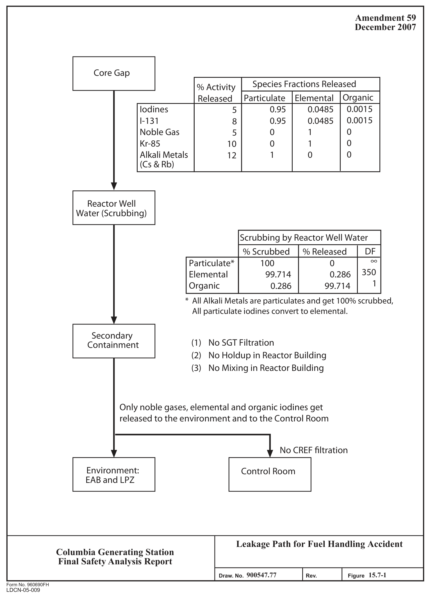

# 15.7 Radioactive Release From Subsystems And Components

> Columbia Generating Station FSAR — Chapter 15: Accident Analyses
> Source: `15_chapter-4122-5262.pdf`, PDF pages 287–300 (of 1141)
> Amendment 67 compilation (individual pages carry varying amendment dates)

---
<!-- p.287 -->
November 1998

### 15.7 RADIOACTIVE RELEASE FROM SUBSYSTEMS AND COMPONENTS
These events are classified as nonlimiting events for both original and uprated power conditions. Therefore, no further analysis has been performed.

#### 15.7.1 RADIOACTIVE GAS WASTE SYSTEM LEAK OR FAILURE
Not applicable.

#### 15.7.2 LIQUID RADIOACTIVE SYSTEM FAILURE
Not applicable.

#### 15.7.3 POSTULATED RADIOACTIVE RELEASES DUE TO LIQUID RADWASTE
#### TANK FAILURE
##### 15.7.3.1 Identification of Causes and Frequency Classification
###### 15.7.3.1.1 Identification of Causes
The liquid radwaste tanks are constructed to specific engineering codes and standards and to the uniform building code seismic requirements. These tanks operate at atmosphere pressure and low temperatures. A positive action interlock system is provided to prevent inadvertent opening of a drain valve because of operator error. Accordingly, the possibility of a complete tank failure or drainage is considered small.

An unspecified event is postulated to cause the complete release of the average radioactivity inventory in the tank containing the largest quantities of significant radionuclides in the liquid radwaste system. The tank postulated to rupture is one of the two decontamination solution concentrated waste tanks (see Figure 11.2-1).

###### 15.7.3.1.2 Frequency Classification
This accident is categorized as a limiting fault.

##### 15.7.3.2 Sequence of Events and Systems Operation
###### 15.7.3.2.1 Sequence of Events
The sequence of events expected to occur is as follows:

<!-- p.288 -->
May 2001

Sequence of Events - Liquid Radwaste Tank Failure

Events Time Event begins-failure occurs 0

Area radiation alarms alert plant personnel ∼ 1 minute

∼ 10 minute Operator action begins

###### 15.7.3.2.2 Systems Operation
Failure of a concentrated waste tank does not require a shutdown nor does it impair a safe shutdown. It will lead to limited operation of the concentrated waste system using the remaining tank.

The liquid contents of this tank will also be contained by the building walls and an unlined, 18-in. high concrete dike around the radwaste tank area. Floor drain sump pumps would receive a high water level alarm, activate automatically, and remove the spilled liquid.

###### 15.7.3.2.3 The Effects of Single Failures and Operator Errors
This event has been analyzed without taking credit for any expected operator action or system operation; therefore, a discussion of single equipment failure or single operator error is not applicable.

##### 15.7.3.3 Core and System Performance
The failure of this liquid radwaste system component does not directly affect the nuclear steam supply system (NSSS). It will lead to decoupling of NSSS with the subject system.

This failure has no applicable effect on the reactor core or the NSSS safety performance.
Specific assumptions and parameters are presented in Table 15.7-1.

##### 15.7.3.4 Barrier Performance
This event does not involve any containment barrier integrity except the tank itself and the radwaste building. The dike and walls of the radwaste building surrounding the tanks are built to Seismic Category I criteria. In the analysis of spill consequences, no credit is taken for the dike or radwaste building in recontaining the spilled liquid.

<!-- p.289 -->
##### 15.7.3.5 Radiological Consequences
The entire volume (700 gal) of concentrator waste tank assumed to spill with isotope inventory given in Table 11.2-1. Tritium concentration is assumed to be 0.01 μCi/ml (Environmental Report, Operating License Section 3.5.1).

The hypothetical radwaste tank failure was evaluated using conservative assumptions such as no containment in the radwaste building and unimpeded flow vertically through 50-60 ft of sand and gravel.

The following offsite concentration data for the radionuclides of interest are provided for the WNP-1/4 wells and at the Columbia River:

Concentration Concentration at at WNP-1/4 Wells Columbia River Concentration Radionuclide
(μCi/ml)
(μCi/ml)
Limit (μCi/ml)
3H
1.0 x 10-7
1.3 x 10-8 1 x 10-3 90Sr
1.7 x 10-4 4.2 x 10-7 5 x 10-7 137Cs
2.2 x 10-10
1.4 x 10-27 1 x 10-6

The calculations show the strontium concentration exceeding the unrestricted area limitation at the WNP-1/4 wells. These wells are a temporary water supply and are under the control of Energy Northwest. Should a spill occur there will be ample time to assess the severity and extent of contamination.

Concentration at the river bank will be diluted by the river flow. The nearest surface water users are several miles downstream.

#### 15.7.4 FUEL HANDLING ACCIDENT
##### 15.7.4.1 Identification of Causes and Frequency Classification
###### 15.7.4.1.1 Identification of Causes
The fuel handling accident is assumed to occur as a consequence of a failure of the fuel assembly lifting mechanism resulting in dropping a raised irradiated fuel assembly onto other fuel bundles seated in the reactor pressure vessel (RPV). The event was selected as the bounding event because it considers the maximum height and weight, while assuming a minimum water level above the damaged fuel.

###### 15.7.4.1.2 Frequency Classification
This event is categorized as a limiting fault.

<!-- p.290 -->
##### 15.7.4.2 Sequence of Events and Systems Operation
The following sequence of events is assumed in the analysis.

No fuel movement will take place in the first 24 hr following shutdown. At 24 hr postshutdown fuel movement starts and the fuel handling equipment is assumed to fail dropping the fuel grapple and an irradiated fuel bundle onto the irradiated fuel bundles seated in the RPV.
Fuel is damaged and fission products are released to the reactor coolant, then to the reactor building atmosphere, and finally to the environment over a 2-hr period. No credit is taken for holdup or mixing in the reactor building, nor is credit taken for filtration by the standby gas treatment (SGT).

###### 15.7.4.2.1 The Effects of Single Failures and Operator Errors
No systems or operator actions are credited to mitigate a fuel handling accident.

##### 15.7.4.3 Core and System Performance
###### 15.7.4.3.1 Mathematical Model
Because of the complex nature of the impact and the resulting damage to fuel assembly components, a rigorous prediction of the number of failed rods is not possible. For this reason, a simplified energy approach was taken and numerous conservative assumptions were made to ensure a conservative estimate of the number of failed rods.

The kinetic energy acquired by a falling fuel assembly may be dissipated in one or more impacts. The energy absorption on successive impacts is estimated by considering a plastic impact.

The energy transferred in the dropped assembly is considered in two phases. First, the fuel assembly is expected to impact on the reactor core at a small angle from the vertical, inducing a bending mode of failure on the fuel rods of the dropped assembly. The kinetic energy of the fall is dissipated in the impact. The analysis assumes that the energy of the dropped assembly is absorbed by only the cladding and other core structures. The assumption that no energy is absorbed by the fuel material results in considerable conservatism in the mass-energy calculations. Half of the energy is dissipated in the structure of the dropped assembly, failing all the rods in the assembly. The remaining half is allocated evenly across the structural mass of the impacted assemblies. The energy dissipated by the cladding is calculated by multiplying the impacted assembly energy by the cladding mass fraction and dividing by the energy required to fail a rod (based on 1% uniform plastic deformation).

<!-- p.291 -->
The second phase considers the kinetic energy developed by the irradiated fuel assembly and lifting mechanism tipping over and impacting the core horizontally. The kinetic energy developed is equal to the initial potential energy of the assembly relative to the top of the core.
Again, half of the energy is absorbed by the dropped assembly and half by the impacted assemblies. The number of failed rods in the impacted assemblies is determined using the cladding mass fraction and the energy required to fail a rod.

###### 15.7.4.3.2 Input Parameters and Initial Conditions
The parameters and conditions used to determine the number of failed rods are listed below:

a. The fuel assembly is dropped from a height of 34 ft. The maximum height allowed by the fuel handling equipment is less than 34 ft;

b. The dropped mass consists of a fuel assembly (600 lb bounding analyzed wet weight for GNF2 10 x 10 fuel, 586 lb bounding analyzed wet weight for GE14 10 x 10 fuel, 617 lb wet weight for GE 8 x 8 fuel and 665 lb dry weight for ATRIUM-10) and the fuel grapple (350 lb wet weight);

c. The energy required to fail a fuel rod is approximately 157 ft-lb for GNF2 10 x 10 fuel, 175 ft-lb for GE14 10 x 10 fuel, 250 ft-lb for GE 8 x 8 fuel and 205 ftlb for ATRIUM-10; see Reference 15.7-3 for SVEA-96.

###### 15.7.4.3.3 Results
Based on a core of GE 8 x 8 fuel, the calculation predicts 124 failed fuel rods; 62 rods in the dropped assembly, 43 rods in the first impact, and 19 additional rods in the second impact.
Westinghouse analysis predicts a maximum of 123 failed rods (Reference 15.7-3) and AREVA NP calculated that up to 156 rods could fail (Reference 15.7-4). Analysis of the GE14 10 x 10 fuel estimates that a total of 151 fuel rods will fail (Reference 15.7-5). Analysis of GNF2 10 x 10 fuel estimates that a total of 172 fuel rods will fail (Reference 15.7-6).

##### 15.7.4.4 Barrier Performance
The reactor coolant pressure boundary, primary containment and secondary containment are open at the time of the accident. However, a similar event could occur in the spent fuel pool
(SFP), during spent fuel transfer from the RPV to, or handling in, the SFP. Assuming a drop height of 4 ft, the number of failed rods as a result of a GE 8 x 8 bundle (unchanneled) drop in the SFP was calculated and found to be 90 rods; the number for channeled GE 8 x 8 is less than that. The dose analysis for a drop of a bundle over the core, which assumes 250 failed rods, bounds a drop of a bundle in the SFP.

<!-- p.292 -->
##### 15.7.4.5 Radiological Consequences
The fission product inventory is based on a plant-specific ORIGEN 2 run for pre-power uprate basis of 3489 MW with 1000 days exposure adjusted as described in Section 15.4.9.5.1. The release is based on damage to 250 fuel rods. A 24-hr period for decay from the power condition is assumed. Figure 15.7-1 indicates the leakage flow path for this accident.

###### 15.7.4.5.1 Design Basis Analysis
Specific values of parameters used in the evaluation are presented in Table 15.7-2. The dispersion coefficients used to determine offsite doses are presented in Table 15.0-4.

15.7.4.5.1.1 Fission Product Release From Fuel. The fission product inventory of a core average exposure fuel rod is adjusted by a peaking factor of 1.7 to establish the inventory of each damaged rod. Five percent of the noble gases inventory (10% for 85Kr) and 5% of the iodine inventory (8% for 131I), and 12% of the alkali metals inventory are assumed to be released to the reactor well. The activity airborne in the secondary containment is presented in Table 15.7-3.

15.7.4.5.1.2 Fission Product Transport to the Environment. The transport pathway consists of mixing in the reactor well water, migration from the reactor well to the secondary containment atmosphere, and release to the environment without passing through the SGT. All of the noble gas, 0.5% of the iodines, and 0% of the alkali metals are assumed to become airborne in the secondary containment (Reference 15.7-1).

From the activity airborne in the reactor building, 99% is released to the environment in 2 hr.

The release of activity to the environment is presented in Table 15.7-4.

15.7.4.5.1.3 Results. The calculated doses for the design basis analysis are presented in Table 15.7-5 and are within the limits of 10 CFR 50.67.

#### 15.7.5 SPENT FUEL CASK DROP ACCIDENT
The spent fuel cask is equipped with ANSI N14.6 (Reference 15.7-2) compliant lifting lugs and a lifting yoke compatible with the reactor building crane main hook. The reactor building crane is provided with sufficient redundancy such that no credible postulated failure of any crane component required to lift, hold, and move loads, will result in the dropping of the fuel cask. Therefore, an analysis of the spent fuel cask drop is not required.

<!-- p.293 -->
#### 15.7.6 REFERENCES
15.7-1 Energy Northwest, “Columbia Generating Station Alternative Source Term,” CGS-FTS-0168, Revision 2, June 2011.

15.7-2 “Special Lifting Devices for Shipping Containers Weighing 10,000 Pounds
(4500 kg) or More,” ANSI N14.6-1993, June 1993.

15.7-3 ABB/Combustion Engineering, “Fuel Assembly Mechanical Design Report for WNP-2,” CE NPSD-792-P, May 1996.

15.7-4 AREVA NP, “Columbia Generating Station Cycle 19 Reload Analysis,” ANP-2602, Revision 0, March 2007.

15.7-5 GE Hitachi Nuclear Energy, GEH-0000-0075-4920, Revision 6, “GE14 Fuel Design Cycle-Independent Analyses for Energy Northwest Columbia Generating Station,” May 2017.

15.7-6 GE Hitachi Nuclear Energy, 002N3439, “GNF2 Fuel Design Cycle-Independent Analyses for Energy Northwest Columbia Generating Station,” (most recent version referenced in the COLR).

<!-- p.294 -->
Table 15.7-1

Liquid Radwaste Tanks Failure – Parameters and Concentrations

Parameter Value

I. Data and assumptions used to estimate Entire volume (700 gal) of radioactive source concentrator waste tank assumed to spill with isotope inventory given in Table 11.2-1. Tritium concentration assumed to be 0.01 mCi/ml from the CGS

#### ER-OL.
II. Data and assumptions used to estimate activity released A. Containment leak rate (%/day) N/A B. Secondary containment leak rate (%/day) N/A C. Valve movement times N/A D. Absorption and filtration efficiencies N/A
(1) Organic iodine N/A
(2) Elemental iodine N/A
(3) Particulate iodine N/A
(4) Particulate fission products N/A E. Recirculation system parameters N/A
(1) Flow rate N/A
(2) Mixing efficiency N/A
(3) Filter efficiency N/A F. Containment spray parameters (flow N/A rate, drop size, etc.)
G. Containment volumes N/A H. Other pertinent data and assumptions See Section 2.4.13.3

III. Concentration data Conc. Limita @ WNP-1/4 Wells @ Col. R (μCi/ml) Radionuclide (μCi/ml) (μCi/ml)
3H
1.0 x 10-7
1.3 x 10-8 1 x 10-3 90Sr
1.7 x 10-4 4.2 x 10-7 5 x 10-7 137Cs
2.2 x 10-10
1.4 x 10-27 1 x 10-6

a From 10 CFR Part 20.

<!-- p.295 -->
Table 15.7-2

Fuel Handling Accident Parameters Tabulated for Postulated Accident Analysis

Design Basis Parameters Assumptions I. Data and assumptions used to estimate radioactive source from postulated accidents A. Power level 3556 Fuel decay period 24 hrs B. Radial peaking factor
1.7 C. Assumed fuel damaged 250 rods Bundles in the core 764 Rods per bundle 62 D. Release of activity from the gap to the reactor Figure 15.7-1 well water E. Iodine species fractions released Figure 15.7-1
(1) Organic
(2) Elemental
(3) Particulate F. Reactor coolant activity before the accident N/A

II. Data and assumptions used to estimate activity released A. Primary containment leak rate (%/day)
N/A 99% of the activity in B. Secondary containment release rate 2 hr with a flow rate of 2.3 SC volumes per hr C. Valve movement times N/A D. SGT filtration N/A E. Scrubbing by reactor well water Figure 15.7-1
(1) Organic iodine
(2) Elemental iodine
(3) Particulate iodine
(4) Particulate alkali metals

<!-- p.296 -->
Table 15.7-2

Fuel Handling Accident Parameters Tabulated for Postulated Accident Analysis (Continued)

Design Basis Parameters Assumptions F. Recirculation system parameters
(1) Flow rate N/A
(2) Mixing efficiency N/A
(3) Filter efficiency N/A G. Containment spray parameters (flow rate, N/A drop size, etc.)
H. Containment volumes N/A I. Other pertinent data and assumptions
(1) SGT filtration None
(2) CREF filtration None
(3) Holdup in reactor building None
(4) Mixing in reactor building None

III. Dispersion data (for duration of release, 0 – 2 hr)
Table 15.0-4
(1) Offsite 8.69E-4 sec/m3
(2) Control room

IV. Dose data A. Method of dose calculation Regulatory Guide 1.183 B. Dose conversion assumptions Regulatory Guide 1.183 C. Peak activity concentrations in containment N/A D. Doses Table 15.7-5

<!-- p.297 -->
December 2007 ______________ I

2.51E-01 6.23E-20 8.31E-11 1.25E-36 1.10E-22 2.51E-01 7.63E-20 5.85E-21 1.32E+01 1.21E-30 4.03E-22 4.03E-51 7.55E-01 2.34E-03 1.62E+02 7.32E-53 5.37E-20 8.74E-51 3.34E-52 1.76E+02 30 days

2.35E+00 9.73E-16 8.21E-02 6.50E-19 1.75E-05 2.43E+00 1.78E-18 6.91E-07 1.33E+01 9.87E-22 3.80E-11 1.19E-19 3.38E+00 5.95E+00 4.60E+03 1.72E-21 1.22E+01 1.01E-20 2.69E-22 4.63E+03 4 days

3.04E+00 1.98E-06 8.96E-01 8.99E-17 2.91E-02 3.97E+00 9.06E-07 6.04E-02 1.33E+01 8.50E-10 2.11E-03 4.10E-20 4.02E+00 1.47E+01 3.78E+03 1.38E-20 1.39E+03 1.11E-20 1.83E-21 5.20E+03 1 day

3.22E+00 2.33E-04 1.52E+00 3.40E-11 1.51E-01 4.90E+00 3.62E-04 7.57E-01 1.33E+01 5.39E-06 1.11E-01 3.88E-19 4.18E+00 1.80E+01 1.98E+03 4.61E-28 1.71E+03 1.39E-19 4.76E-28 3.73E+03 Activity Airborne in Secondary Containment (Curies)
8 hr

3.26E+00 7.65E-04 1.74E+00 8.45E-10 2.28E-01 5.23E+00 1.62E-03 1.42E+00 1.33E+01 4.81E-05 2.99E-01 2.38E-20 4.22E+00 1.89E+01 1.30E+03 1.85E-26 1.02E+03 4.31E-24 2.92E-26 2.36E+03 4 hr Fuel Handling Accident Table 15.7-3
3.29E+00 1.39E-03 1.86E+00 4.21E-09 2.80E-01 5.43E+00 3.42E-03 1.95E+00 1.33E+01 1.44E-04 4.91E-01 1.56E-24 4.24E+00 1.94E+01 9.24E+02 1.88E-24 3.64E+02 6.80E-27 2.50E-24 1.33E+03 2 hr

3.31E+01 1.87E-02 1.93E+01 9.40E-08 3.11E+00 5.55E+01 4.98E-02 2.29E+01 1.33E+02 2.49E-03 6.30E+00 1.49E-23 4.26E+01 1.97E+02 8.50E+03 2.22E-22 2.14E+03 2.48E-25 2.42E-22 1.10E+04 1 hr

1.05E+02 6.87E-02 6.19E+01 4.44E-07 1.04E+01 1.77E+02 1.90E-01 7.85E+01 4.22E+02 1.03E-02 2.26E+01 1.54E-21 1.35E+02 6.26E+02 2.68E+04 2.64E-21 6.58E+03 3.71E-23 2.58E-21 3.47E+04 0.5 hr

2.10E+02 1.50E-01 1.25E+02 1.13E-06 2.14E+01 3.56E+02 4.25E-01 1.64E+02 8.42E+02 2.43E-02 4.85E+01 1.43E-19 2.70E+02 1.25E+03 5.34E+04 1.17E-20 1.32E+04 1.76E-21 1.07E-20 6.92E+04 12 minutes

2.64E+02 1.95E-01 1.58E+02 1.54E-06 2.72E+01 4.49E+02 5.55E-01 2.10E+02 1.06E+03 3.24E-02 6.26E+01 6.66E-19 3.39E+02 1.58E+03 6.73E+04 1.92E-20 1.67E+04 6.42E-21 1.73E-20 8.73E+04 6 minutes

Total iodine Total noble Isotope 131mXe 133mXe 135mXe gases 133Xe 135Xe 137Xe 138Xe 83mKr 85mKr 85Kr 87Kr 88Kr 89Kr 131I 132I 133I 134I 135I

<!-- p.298 -->
December 2007 ______________ I
3.29E+02 2.23E-01 1.95E+02 1.56E-06 3.28E+01 5.57E+02 6.21E-01 2.50E+02 1.32E+03 3.47E-02 7.26E+01 1.27E-13 4.23E+02 1.96E+03 8.40E+04 1.02E-13 2.10E+04 1.27E-13 1.05E-13 1.09E+05 30 days

3.29E+02 2.23E-01 1.95E+02 1.56E-06 3.28E+01 5.57E+02 6.21E-01 2.50E+02 1.32E+03 3.47E-02 7.26E+01 4.38E-16 4.23E+02 1.96E+03 8.40E+04 9.44E-18 2.10E+04 8.44E-16 5.69E-18 1.09E+05 4 days

3.29E+02 2.23E-01 1.95E+02 1.56E-06 3.28E+01 5.57E+02 6.21E-01 2.50E+02 1.32E+03 3.47E-02 7.26E+01 4.78E-19 4.23E+02 1.96E+03 8.40E+04 1.47E-20 2.10E+04 2.95E-20 1.35E-20 1.09E+05 1 day

3.29E+02 2.23E-01 1.95E+02 1.56E-06 3.28E+01 5.57E+02 6.21E-01 2.50E+02 1.32E+03 3.47E-02 7.26E+01 4.65E-19 4.23E+02 1.96E+03 8.40E+04 1.47E-20 2.10E+04 4.31E-21 1.35E-20 1.09E+05 8 hr Activity Released to the Environment (Curies)
3.28E+02 2.23E-01 1.95E+02 1.56E-06 3.28E+01 5.56E+02 6.21E-01 2.50E+02 1.32E+03 3.47E-02 7.26E+01 4.64E-19 4.23E+02 1.96E+03 8.40E+04 1.47E-20 2.10E+04 4.17E-21 1.35E-20 1.09E+05 4 hr Fuel Handling Accident Table 15.7-4
3.28E+02 2.23E-01 1.95E+02 1.56E-06 3.28E+01 5.56E+02 6.21E-01 2.50E+02 1.32E+03 3.47E-02 7.26E+01 4.64E-19 4.23E+02 1.96E+03 8.40E+04 1.47E-20 2.10E+04 4.17E-21 1.35E-20 1.09E+05 2 hr

2.98E+02 2.07E-01 1.77E+02 1.49E-06 3.01E+01 5.06E+02 5.81E-01 2.30E+02 1.20E+03 3.28E-02 6.73E+01 4.64E-19 3.85E+02 1.79E+03 7.63E+04 1.46E-20 1.89E+04 4.17E-21 1.34E-20 9.89E+04 1 hr

2.28E+02 1.63E-01 1.35E+02 1.23E-06 2.31E+01 3.86E+02 4.61E-01 1.78E+02 9.13E+02 2.64E-02 5.26E+01 4.64E-19 2.92E+02 1.36E+03 5.79E+04 1.34E-20 1.44E+04 4.16E-21 1.22E-20 7.51E+04 0.5 hr

1.23E+02 9.07E-02 7.33E+01 7.21E-07 1.26E+01 2.09E+02 2.59E-01 9.78E+01 4.93E+02 1.51E-02 2.92E+01 4.43E-19 1.58E+02 7.35E+02 3.13E+04 9.23E-21 7.78E+03 3.86E-21 8.26E-21 4.06E+04 12 minutes

6.84E+01 5.12E-02 4.09E+01 4.16E-07 7.07E+00 1.16E+02 1.47E-01 5.49E+01 2.75E+02 8.63E-03 1.64E+01 3.64E-19 8.80E+01 4.10E+02 1.74E+04 5.74E-21 4.34E+03 3.03E-21 5.10E-21 2.26E+04 6 minutes

Total iodine Total noble Isotope 131mXe 133mXe 135mXe 83mKr 85mKr 133Xe 135Xe 137Xe 138Xe gases 85Kr 87Kr 88Kr 89Kr 131I 132I 133I 134I 135I

<!-- p.299 -->
Table 15.7-5

Fuel Handling Accident (Design Basis Analysis)
Radiological Effects

TEDE (rem)
Area

Exclusion area (1950 m) (2 hr)
1.0

Low population zone (4827 m) (30 day)
0.3

Control room (30 day)
3.7

<!-- p.300 -->

*figure on PDF page 300*

[Vector original (SVG, lossless): fig_page-300_2.svg](../figures/fig_page-300_2.svg)

<!-- labels/text on this figure page -->
Amendment 59 December 2007
Core Gap Species Fractions Released % Activity Organic Released Particulate Elemental Iodines 5 0.95 0.0485 0.0015
I-131
0.95 0.0485 0.0015 8 0.0000 Noble Gas 5 0.00 1.0000 Kr-85 10 0.00 1.0000 0.0000 Alkali Metals 12 1.00 0.0000 0.0000
(Cs & Rb)
H
Reactor Well Water (Scrubbing)
Scrubbing by Reactor Well Water % Scrubbed % Released DF ∞ Particulate* 100.000 0.000 350 Elemental 99.714 0.286 1 Organic 0.286 99.714 * All Alkali Metals are particulates and get 100% scrubbed, All particulate iodines convert to elemental.
H
Secondary
(1) No SGT Filtration Containment
(2) No Holdup in Reactor Building
(3) No Mixing in Reactor Building
Only noble gases, elemental and organic iodines get released to the environment and to the Control Room
1, No CREF filtration ~ J
Environment:
Control Room EAB and LPZ
Leakage Path for Fuel Handling Accident Columbia Generating Station Final Safety Analysis Report I 900547.77 15.7-1 Draw. No. Rev. Figure Form No. 960690FH
LDCN-05-009

