# 15.8 ANTICIPATED TRANSIENTS WITHOUT SCRAM

> Columbia Generating Station FSAR — Chapter 15: Accident Analyses
> Source: `15_chapter-4122-5262.pdf`, PDF pages 301–356 (of 1141)
> Amendment 67 compilation (individual pages carry varying amendment dates)

---
<!-- p.301 -->
### 15.8 ANTICIPATED TRANSIENTS WITHOUT SCRAM
#### 15.8.0 CAPABILITIES OF PRESENT DESIGN TO ACCOMMODATE
#### ANTICIPATED TRANSIENTS WITHOUT SCRAM
The anticipated transients without scram (ATWS) events described in this section are not design basis events for Columbia Generating Station (CGS). A proposed method for minimizing the effects of failure-to-scram is described in References 15.8-1 and 15.8-2.

The recirculation pump trip (RPT), alternate rod insertion (ARI), and two pump standby liquid control (SLC) system operation features are utilized at CGS to provide protection against failure to scram. Due to the CGS design feature utilizing SLC system injection through the high-pressure core spray (HPCS) header, a plant-unique analysis was performed to demonstrate ATWS protection and mitigation at pre-power uprate conditions.

The ATWS acceptance criteria are established in Reference 15.8-3 as:

a. The reactor coolant pressure boundary (RCPB) remains below emergency pressure limits,

b. The containment pressure remains below design limits. The suppression pool temperature remains below local saturation temperature limits as defined in Reference 15.8-3,

c. A coolable geometry is maintained,

d. Radiological releases are maintained within 10 CFR 100 allowable limits. With implementation of Alternate Source Term (AST), the radiological release acceptance criterion becomes 10 CFR 50.67, and

e. Equipment necessary to mitigate the postulated ATWS event are evaluated to provide a high degree of assurance (assurance of function) that it will function in the environment (pressure, temperature, humidity, and radiation) predicated to occur as a result of the ATWS event.

The ATWS analysis, performed in conformance with NEDE-24222, did not include a SLCS pump suction valve delay in the SLCS injection time. To determine the impact of the 35 sec opening time for the suction valves upstream of the SLCS pumps, the limiting ATWS event for peak suppression pool temperature (i.e., MSIVC) was analyzed with the 35 sec delay in SLC system injection time. The results presented for the hot shutdown time, peak suppression pool temperature, and peak containment pressure for MSIVC in Table 15.8-3 include the effects of the 35 sec delay.

#### LDCN-05-009, 07-011
<!-- p.302 -->
Section 15.8.9 shows that for the ATWS event with the most severe heat flux transient, fuel related applicable limits were met with considerable margins. In addition, Reference 15.8-3 concludes that maximum peak cladding temperature will not exceed 2200F and the maximum local oxidation will be much less than 17%. Thus, criteria 3 and 4 are shown to be satisfied by the plant specific and generic analyses. Sections 15.8.7 and 15.8.9 show that resulting primary system pressures will be less than emergency pressure limit and that suppression pool temperature increase and peak pressure are within design limits. Reference 15.8-3 concludes that the safety/relief valve (SRV) air clearing loads will be bounded by the design loads. Thus criteria 1 and 2 are satisfied. In Reference 15.8-5, Energy Northwest concluded that ATWS equipment had been determined to be qualified by (a) materials analysis of agreeable components including test reports when available, (b) existing qualification to other accident profiles (LOCA, HELB) that encompass the ATWS profile, or (c) location in a mild environment that is not affected by the ATWS accident environment. This satisfies criterion 5.

Power Uprate Evaluation

The ATWS events were analyzed at power uprate operating conditions to demonstrate protection and mitigation of the consequences of these events. These analyses were performed at 3629 MWt power level and bound operation at uprate power level of 3544 MWt. The selection of critical events which were analyzed were guided by Reference 15.8-3.

For power uprate evaluation, it was conservatively assumed that ARI has failed, thus, requiring SLC system injection to achieve reactor shutdown.

The analysis presented herein are applicable to application of flow control valve (FCV) or adjustable speed drive to reactor recirculation system (RRC). A summary of ATWS results are shown in Table 15.8-3. The analysis results presented in this section are based on a representative reload core at the time of the analysis (Cycle 8). Power uprate ATWS analyses were performed with Extended Load Line Limit Analysis (ELLLA) operating conditions.
These analyses show that performance at the power uprate condition is within vessel maximum pressure, fuel temperature and containment pressure limits for the most severe ATWS transients (Reference 15.8-6).

<!-- p.303 -->
Maximum Extended Load Line Limit Analysis (MELLLA)

The ATWS events were analyzed at MELLLA operating conditions to demonstrate protection and mitigation of the consequences of these events. These analyses were performed at 3486 MWt power level. The selection of critical events which were analyzed was guided by References 15.8-8, 15.8-10 and 15.8-11.

It was conservatively assumed that ARI has failed, thus requiring SLC system injection to achieve reactor shutdown. ATWS mitigation is achieved with one or two subsystems of SLC provided the SLC solution is enriched to 44 atom percent Boron-10.

A summary of ATWS results are shown in Table 15.8-3. The analysis results presented in this section are based on a representative reload core at the time of the analysis (Cycle 20)
(Reference 15.8-12). The analysis was dispositioned for GNF2 fuel introduction (reference 15.8-13).

The analysis was dispositioned for power uprate to 3544 MWt (Reference 15.8-14).

#### 15.8.1 INADVERTENT CONTROL ROD WITHDRAWAL
This transient is bounded by assumptions in the GE licensing topical reports and the other transients analyzed in this section.

#### 15.8.2 LOSS OF FEEDWATER
##### 15.8.2.1 Identification of Causes and Frequency Classification
###### 15.8.2.1.1 Identification of Causes
Section 15.2.7 provides identification of causes for loss of feedwater event. The loss of feedwater event with failure to scram will initiate an ATWS event.

15.8-2a

<!-- p.304 -->
###### 15.8.2.1.2 Frequency Classification
This event is of extremely low probability and is categorized as a limiting fault.

##### 15.8.2.2 Sequence of Events and System Operation
###### 15.8.2.2.1 Sequence of Events
Table 15.8-4 lists the sequence of events for Figure 15.8-1.

15.8.2.2.1.1 Identification of Operator Actions. For the simulation purpose, the following operator actions have been assumed.

a. Allow automatic operation of the HPCS and reactor core isolation cooling
(RCIC),

b. Begin boron injection at two minutes following ATWS high-pressure trip or at boron injection initiation temperature (BIIT), whichever is later, and

c. Switch residual heat removal (RHR) to suppression pool cooling mode 11 minutes following initiation of the transient.

The emergency operating procedures provide operator actions for an ATWS event.

###### 15.8.2.2.2 System Operation
For the loss of feedwater ATWS event, a complete failure to scram is postulated to occur for all reactor protection system (RPS) scram signals. All other plant control systems maintain normal operation. The relief valves are all assumed to function at the specified setpoints.
Loss of feedwater flow results in a proportional reduction of vessel inventory causing the vessel water level to drop. The first corrective action is the initiation of HPCS and RCIC on Level 2. For this event, a complete failure of ARI is postulated. The operator must manually initiate SLC system to inject boron into the reactor vessel for reactor shutdown.

###### 15.8.2.2.3 The Effect of Single Failure and Operator Errors
This ATWS event is based on the assumed complete failure of all control rods to scram. This is a multiple equipment failure. For the conservative assumption of failure of the ARI system, the ATWS event is terminated by boron injection through operator activation of the SLC system. This event is less limiting compared with other ATWS events analyzed at power uprate condition.

<!-- p.305 -->
##### 15.8.2.3 Core and System Performance
###### 15.8.2.3.1 Mathematical Model
Reference 15.8-7 describes the generic evaluation methodology for the ATWS event evaluated at uprated power conditions. Additional plant specific analyses were performed for a bounding 10% power uprate using the same methodology.

###### 15.8.2.3.2 Input Parameters and Initial Conditions
The initial operating conditions and equipment performance characteristics are given in Tables 15.8-1 and 15.8-2, respectively. MSIV closure occurs on low-low-low water level (L1)
but is analyzed based on low-low water level (L2), conservatively overpredicting suppression pool heatup. The HPCS/RCIC flow rates are conservatively high and water level setpoints represent nominal values. The ATWS high pressure setpoint was set at the upper analytical limit. The SRV setpoints were set using a statistical spread of the analytical setpoint limits for the first opening of each value and reset to a statistical spread of the nominal setpoints for all remaining SRV openings during the transient event.

###### 15.8.2.3.3 Results
The results of this ATWS event simulation are shown in Figure 15.8-1. Feedwater pump trip is assumed to occur at the onset of the event. Upon the loss of the feedwater flow, reactor pressure, water level, and neutron flux begin to fall. Once reactor water level reaches low-low water level (L2), the protection system trips the recirculation pumps, initiates HPCS and RCIC and signals closure of main steam line isolation valves (MSIVs). Reactor pressure begins to rise due to closure of MSIVs. The relief valves begin to open due to reactor pressure increase.
It is conservatively assumed the operator manually initiates SLC system 2 minutes after the ATWS setpoint has been reached.

###### 15.8.2.3.4 Consideration of Uncertainties
Uncertainties in these analyses involve protection system setpoints, system capacities, and system response times. For ATWS transient analyses, best estimated values are used when possible. Examples of conservative bounding values which were used to cover uncertainties are as follows:

a. For conservatism, the analysis assumed the highest probable ATWS high-pressure trip setpoint, and

b. Boron injection is the later time of BIIT or 2 minutes following ATWS high-pressure trip.

<!-- p.306 -->
##### 15.8.2.4 Barrier Performance
The calculated peak vessel bottom head pressure is 1202 psig, which is below the American Society of Mechanical Engineers (ASME) Code Limit of 1375 psig for the RCPB and well below the ASME service level C of 1500 psig. The consequences of this event do not result in any temperature or pressure transient in excess of the criteria for which the fuel, pressure vessel, or containment are designed. Therefore, barrier integrity and function is maintained.

##### 15.8.2.5 Radiological Consequences
While this event does not result in fuel failure it does result in the discharge of normal coolant activity to the suppression pool by means of SRV operation. Since this activity is contained in the primary containment, there will be no uncontrolled release to the environment.

#### 15.8.3 LOSS OF ALTERNATE CURRENT POWER
This transient is bounded by the other transients analyzed in this section.

#### 15.8.4 LOSS OF ELECTRICAL LOAD
This transient is bounded by assumptions in the GE licensing topical reports and the other transients analyzed in this section. (Reference 15.8-11)

#### 15.8.5 LOSS OF CONDENSER VACUUM
This transient is bounded by assumptions in the GE licensing topical reports and the other transients analyzed in this section.

#### 15.8.6 TURBINE TRIP
This event was analyzed at pre-power uprate condition for low power and full power
(corresponding to 3323 MWt) operation. At uprated conditions, the event is bounded by the other transients analyzed in this section. The selection of critical events were guided by Reference 15.8-3.

<!-- p.307 -->
#### 15.8.7 CLOSURE OF MAIN STEAM LINE ISOLATION VALVES
##### 15.8.7.1 Identification of Causes and Frequency Classification
###### 15.8.7.1.1 Identification of Causes
Various steam line and nuclear system malfunctions, or operator actions, can initiate MSIV closure. These are detailed in Section 15.2.4. The MSIV closure event with failure to scram will initiate an ATWS event.

###### 15.8.7.1.2 Frequency Classification
This event is of extremely low probability and is categorized as a limiting fault.

##### 15.8.7.2 Sequence of Events and System Operation
###### 15.8.7.2.1 Sequence of Events
Table 15.8-5 lists the sequence of events for Figure 15.8-2.

15.8.7.2.1.1 Identification of Operator Actions. For the simulation purpose, the following operator actions have been assumed:

a. Allow automatic operation of RCIC, inhibit HPCS consistent with Emergency Operating Procedures,

b. Begin boron injection at 2 minutes following ATWS high-pressure trip or at BIIT, whichever is later, and

c. Switch RHR to suppression pool cooling mode 11 minutes following initiation of the transient.

Emergency Operating Procedures provide operator actions for an ATWS event.

###### 15.8.7.2.2 System Operation
For the MSIV closure ATWS event, a complete failure to scram is postulated to occur for all RPS scram signals. All other plant control systems maintain normal operation. The relief valves are all assumed to function at the specified setpoints. The RPT occurs at the ATWS high pressure trip setpoint. For this event, a complete failure of ARI is postulated. The operator must manually initiate SLC system to inject boron into the reactor vessel for reactor shutdown.

<!-- p.308 -->
###### 15.8.7.2.3 The Effect of Single Failures and Operator Errors
For the conservative assumption of failure of ARI system, the ATWS event is terminated by boron injection through operator activation of the SLC system. Relief valves operate to limit system pressure. All of these aspects are designed to single failure criterion. Analyses have been performed for dual and single SLC pump operation with natural of 44 atom percent Boron-10 enrichment, respectively. The single pump SLC transport time delay accounts for the reduced flow rate in the system.

##### 15.8.7.3 Core and System Performance
###### 15.8.7.3.1 Mathematical Model
References 15.8-8, 15.8-11 and 15.8-12 describes the generic evaluation methodology for the ATWS event under MELLLA conditions.

###### 15.8.7.3.2 Input Parameters and Initial Conditions
The initial operating conditions and equipment performance characteristics are given in Table 15.8-1A. The ATWS high pressure setpoint was set at the upper analytical limit. The SRV setpoints were set using a statistical spread of the analytical setpoint limits for the first opening of each value and reset to a statistical spread of the nominal setpoints for all remaining SRV openings during the transient event.

###### 15.8.7.3.3 Results
The results of this ATWS event simulation are shown in Table 15.8-3 and Figure 15.8-2. The MSIVs close within a nominal 4 sec stroke time. Once the MSIVs reach the 85% open position, a reactor scram is initiated. The scram was assumed to fail to insert any control rods.
The rapid increase in reactor pressure generates rapid increase in reactor core power due to collapsing core voids. The relief valves begin to open responding to reactor pressure rise.
Upon reaching the ATWS high-pressure setpoint, the RPT occurs and reduces core power. It is conservatively assumed the operator manually initiates SLC system 2 minutes after the ATWS setpoint has been reached.

The peak calculated vessel bottom head pressure is below the ASME Service Level C limit of 1500 psig.

<!-- p.309 -->
The calculated peak suppression pool temperature of the event is below the containment design limit. The calculated peak containment pressure is also below the containment design limit.

###### 15.8.7.3.4 Consideration of Uncertainties
Uncertainties in these analyses involve protection system setpoints, system capacities, and system response times. For ATWS transient analyses, best estimated values are used when possible. Examples of conservative bounding values which were used to cover uncertainties are as follows:

a. For conservatism, the analyses assumed the highest probable ATWS high-pressure trip setpoint, and

b. Boron injection is the later time of BIIT or 2 minutes following ATWS high-pressure trip.

c. A 35 sec opening time for the suction values upstream to the SLCS pumps was modeled increasing the SLCS initiation time.

##### 15.8.7.4 Barrier Performance
The calculated peak vessel bottom head pressure is below the ASME Service Level C limit of 1500 psig. The consequences of this event do not result in any temperature or pressure transient in excess of the criteria for which the fuel, pressure vessel, or containments are designed. Therefore, these barrier integrity and function is maintained.

##### 15.8.7.5 Radiological Consequences
While this event does not result in fuel failure it does result in the discharge of normal coolant activity to the suppression pool by means of SRV operation. Since this activity is contained in the primary containment, there will be no uncontrolled release to the environment.

<!-- p.310 -->
#### 15.8.8 INADVERTENT OPENING OF RELIEF VALVE
##### 15.8.8.1 Identification of Causes and Frequency Classification
###### 15.8.8.1.1 Identification of Causes
This event assumes that a SRV may “open” and stick in the “open” position. These events are detailed in Section 15.1.4. The inadvertent opening of relief valve (IORV) event with failure to scram will initiate an ATWS event.

###### 15.8.8.1.2 Frequency Classification
This event is of extremely low probability and is categorized as a limiting fault.

##### 15.8.8.2 Sequence of Events and System Operation
###### 15.8.8.2.1 Sequence of Events
The analysis has not been updated for the change in MSIV isolation setpoint from Level 2 to Level 1 because the analysis is bounding and conclusions of the analysis are not affected
(Reference 15.8-9).

Table 15.8-7 lists the sequence of events for Figure 15.8-4.

15.8.8.2.1.1 Identification of Operator Actions. For the simulation purpose, the following operator actions have been assumed:

a. Initiate boron injection 2 minutes after BIIT, b. Disable HPCS, RCIC, and low level MSIV closure, c. Use feedwater to manually control the water level at the top of active fuel, and d. Manually trip the recirculation pumps.

15.8.8.2.1.2 System Operation. For the IORV ATWS event, a complete failure to scram is postulated to occur for all RPS scram signals. All other plant control systems maintain normal operation. For this event, a complete failure of ARI is also postulated. The operator must manually initiate SLC system to inject boron into the reactor vessel for reactor shutdown.

###### 15.8.8.2.2 The Effect of Single Failures and Operator Errors
For the conservative assumption of failure of ARI system, the ATWS event is terminated by boron injection through operator activation of the SLC system. This is a multiple equipment failure event. All of these aspects are designed to single failure criterion.

<!-- p.311 -->
The instrumentation, which detects and audibly alarms the resulting suppression pool temperature rise, and the RHR containment heat removal system are designed to meet the single failure criteria. The operator must, however, manually initiate suppression pool cooling.

##### 15.8.8.3 Core and System Performance
###### 15.8.8.3.1 Mathematical Model
Reference 15.8-7 describes the generic evaluation methodology for the ATWS event evaluated at uprated power conditions. Additional plant specific analyses were performed for a bounding 10% power uprate using the same methodology.

###### 15.8.8.3.2 Input Parameters and Initial Conditions
The initial operating conditions and equipment performance characteristics are given in Tables 15.8-1 and 15.8-2, respectively. The HPCS/RCIC flow rates are conservatively high and water level setpoints represent nominal values. The ATWS high pressure setpoint was set at the upper analytical limit. The SRV setpoints were set using a statistical spread of the analytical setpoint limits for the first opening of each value and reset to a statistical spread of the nominal setpoints for all remaining SRV openings during the transient event.

###### 15.8.8.3.3 Results
The results of this ATWS event simulation are shown in Figure 15.8-4. The opening of a SRV allow steam to be discharged into the suppression pool. The sudden increase in the rate of steam flow leaving the reactor vessel causes a mild depressurization transient.

Discharge of steam into the suppression pool increases the suppression pool temperature. The operator initiates SLC system 2 minutes after the suppression pool temperature reaches 110F, trips the recirculation pumps, and initiates feedwater runback to lower the reactor water level to top of active fuel (TAF). Suppression pool cooling begins 11 minutes after the initiation of the event. The operator disables HPCS and RCIC level 2 initiation. The MSIV Level 2 closure is also disabled. Turbine steam flow is terminated upon closure of the MSIVs due to low steam line pressure.

<!-- p.312 -->
###### 15.8.8.3.4 Consideration of Uncertainties
Uncertainties in these analyses involve protection system setpoints, system capacities, and system response times. For ATWS transient analyses, best estimated values are used when possible. Examples of conservative bounding values which were used to cover uncertainties are as follows:

a. For conservatism, the analysis assumed the highest probable ATWS high-pressure trip setpoint, and

b. Boron injection is the later time of BIIT or 2 minutes following ATWS high-pressure trip.

##### 15.8.8.4 Barrier Performance
The IORV ATWS event is a mild depressurization which has no significant effect on RCPB.
During the event, the suppression pool is continually heated due to SRV discharge. The peak suppression pool temperature and pressure are within the design criteria of the containment.

##### 15.8.8.5 Radiological Consequences
While this event does not result in fuel failure, it does result in the discharge of normal coolant activity to the suppression pool by means of SRV operation. Since this activity is contained in the primary containment, there will be no uncontrolled release to the environment.

#### 15.8.9 PRESSURE REGULATOR FAILURE - OPEN (PREGO)
##### 15.8.9.1 Identification of Causes and Frequency Classification
###### 15.8.9.1.1 Identification of Causes
The causes for this event is detailed in Section 15.1.3. The PREGO event with failure to scram will initiate an ATWS event.

###### 15.8.9.1.2 Frequency Classification
This event is of extremely low probability and is categorized as a limiting fault.

##### 15.8.9.2 Sequence of Events and System Operation
###### 15.8.9.2.1 Sequence of Events
Table 15.8-8 lists the sequence of events for Figure 15.8-5.

<!-- p.313 -->
15.8.9.2.1.1 Identification of Operator Actions. For the simulation purpose, the following operator actions have been assumed.

a. Allow automatic operation of RCIC, inhibit HPCs consistent with Emergency Operating Procedures,

b. Begin boron injection at 2 minutes following ATWS high-pressure trip or at BIIT, whichever is later, and

c. Switch RHR to suppression pool cooling mode 11 minutes following initiation of the transient.

The emergency operating procedures provide operator actions for an ATWS event.

15.8.9.2.1.2 System Operation. For the PREGO ATWS event, a complete failure to scram is postulated to occur for all RPS scram signals. All other plant control systems maintain normal operation. For this event, a complete failure of ARI is also postulated. The operator must manually initiate SLC system to inject boron into the reactor vessel for reactor shutdown.

###### 15.8.9.2.3 The Effect of Single Failures and Operator Errors
For the conservative assumption of failure of ARI system, the ATWS event is terminated by boron injection through operator activation of the SLC system. This is a multiple equipment failure event. All of these aspects are designed to single failure criterion.

The instrumentation, which detects and audibly alarms the resulting suppression pool temperature rise, and the RHR containment heat removal system are designed to meet the single failure criteria.

##### 15.8.9.3 Core and System Performance
###### 15.8.9.3.1 Mathematical Model
References 15.8-8, 15.8-11 and 15.8-12 describe the generic evaluation methodology for the ATWS event under MELLLA conditions.

###### 15.8.9.3.2 Input Parameters and Initial Conditions
The initial operating conditions an equipment performance characteristics are given in Table 15.8-1A. The ATWS high pressure setpoint was set at the upper analytical limit. The SRV setpoints were set using a statistical spread of the analytical setpoint limits for the first opening of each value and reset to a statistical spread of the nominal setpoints for all remaining SRV openings during the transient event.

<!-- p.314 -->
###### 15.8.9.3.3 Results
The results of this ATWS event simulation are shown in Table 15.8-3 and Figure 15.8-5. The DEH control system failure with 130% steam flow demand signal is assumed to occur.
Ensuing reactor depressurization results in formation of voids in the reactor coolant and causes a decrease in reactor power almost immediately. The MSIV closure occurs due to trip signal from low steam line pressure. Reactor pressure rises to the relief setpoints and the recirculation pumps trip on the high pressure ATWS setpoint.

Discharge of steam into the suppression pool increases the suppression pool temperature. The operator initiates feedwater runback to lower the reactor water level to TAF after the suppression pool temperature reaches 110F. The HPCS and RCIC systems are initiated at low reactor water level. The SLC system is manually initiated 2 minutes after the ATWS high pressure setpoint was reached.

###### 15.8.9.3.4 Consideration of Uncertainties
Uncertainties in these analyses involve protection system setpoints, system capacities, and system response times. For ATWS transient analyses, best estimated values are used when possible. Examples of conservative bounding values which were used to cover uncertainties are as follows:

a. For conservatism, the analysis assumed the highest probable ATWS high-pressure trip setpoint, and

b. Boron injection is the later time of BIIT or 2 minutes following ATWS high-pressure trip.

##### 15.8.9.4 Barrier Performance
The calculated peak vessel bottom head pressure is below the ASME Service Level C limit of 1500 psig. The consequences of this event do not result in any temperature or pressure transient in excess of the criteria for which the fuel pressure vessel or containment are designed. Therefore, barrier integrity and function is maintained.

##### 15.8.9.5 Radiological Consequences
While this event does not result in fuel failure, it does result in the discharge of normal coolant activity to the suppression pool by means of SRV operation. Since this activity is contained in the primary containment, there will be no uncontrolled release to the environment.

<!-- p.315 -->
#### 15.8.10 SINGLE REACTOR RECIRCULATION SYSTEM PUMP OPERATION
The following discussion is based on pre-uprate power level of 3323 MWt. Thus, the 100% rod line corresponds to 3323 MWt power at rated core flow.

For pre-uprate condition, it was shown that operation of the plant with only a single RRC pump and the resulting transient conditions which could occur while in this mode are bounded by the other transients analyzed in this section, and the parametric studies performed in Reference 15.8-4. This conclusion was based on evaluating the effects of power, void reactivity worth and doppler worth at both 100% conditions, and at conditions present under single RRC pump operation.

Sensitivity studies presented in Reference 15.8-4 compare the turbine trip at 100% power condition with the turbine trip at lower power conditions, such as one would have under single RRC pump.

The rod line for single RRC pump operation for pre-uprate condition was normally maintained between 100% and 104.25% power level. At less than 100% power the average void in the core was slightly higher for operation on the 104.25% rod line than for operation on the 100% rod line. In addition, the doppler worth at lower power conditions is higher than at 100% power. The presence of higher voids and the increased doppler worth when operating at the 104.15% rod line is bounded by the parametric analyses in Reference 15.8-4. These parametric analyses determined the sensitivity of plant response between the MSIV closure at 100% power and the MSIV closure with higher reactivity coefficients at 100% power. The void worth assumed in the higher reactivity coefficient case gives a much higher effect than the increased average void present in the single RRC pump operation mode at the 104.25% rod line, which bounds this case. The doppler reactivity worth used in the MSIV closure with higher reactivity coefficients is representative of the doppler reactivity worth found at lower power conditions such as those present in the single RRC pump operation mode.

<!-- p.316 -->
#### 15.8.11 REFERENCES
15.8-1 Hatch Unit 1 FSAR. Amendment 10, Appendix L, “Failure-to-Scram Analysis,” October 27, 1971.

15.8-2 Michelotti, L. A., “Analysis of Anticipated Transients Without Scram,”

#### NEDO-10349.
15.8-3 NEDE-24222, “Assessment of BWR Mitigation of ATWS, Volume II
(NUREG-0460 Alternate No. 3).”

15.8-4 EI International, Inc., “Final Report, Anticipated Transients Without Scram Analysis for the WNP-2 Nuclear Power Plant,” SA-JAD-087-90, December 1989.

15.8-5 Supply System Letter G02-90-116, G. C. Sorensen (Supply System) to NRC, “Nuclear Plant No. 2. Operating License (NPF-21 Resolution of Anticipated Transient Without Scram (ATWS) for WNP- 2,” dated June 29, 1990.

15.8-6 GE Nuclear Energy, “WNP-2 Power Uprate Project NSSS Engineering Report,” GE-NE-208-17-0993, Revision 1, December 1994.

15.8-7 GE Nuclear Energy, “Generic Evaluations of General Electric Boiling Water Reactor Power Uprate,” Licensing Topical Report NEDC-31984P, July 1991 and Supplements 1 & 2.

15.8-8 “Generic Guidelines for General Electric Boiling Water Reactor Extended Power Uprate,” NEDC-32424P-A, February 1999 (ELTR-1).

15.8-9 GE Hitachi Nuclear Energy, “License Amendment Request for Proposed Changes to Columbia Technical Specifications: Changing Group 1 Isolation Valves’ Low Reactor Water Level Isolation Signal from the Current Level 2 to Level 1,” 0000-0081-6730-R1, July 2008.

15.8-10 “Generic Evaluations of General Electric Boiling Water Reactor Extended Power Uprate,” NEDC-32523P-A, February 2000 (ELTR-2) and Supplement 1, Volume 1, February 1999 and Volume II, April 1999.

15.8-11 “Constant Pressure Power Uprate,” NEDC-33004P-A, Revision 4, July 2003.15.8-12“Project Task Report ENERGY NORTHWEST Columbia Generating Station ARTS/MELLLA Task T0902: Anticipated Transients Without Scram,” 0000-0101-1095-R2, May 2010.

<!-- p.317 -->
15.8-13 002N3439, GNF2 Fuel Design Cycle-Independent Analyses for Energy Northwest Columbia Generating Station, (most recent version referenced in the

#### COLR).
15.8-14 GE-Hitachi Nuclear Energy, “Safety Analysis Report for Columbia Generating Station Thermal Power Optimization,” NEDC-33853P, March 2016.

<!-- p.318 -->
Table 15.8-1

Anticipated Transients Without Scram Analysis Initial Conditions

Parameters Value

Reactor dome pressure (psig)
1020

Vessel core flow (Mlb/hr)
108.5

Vessel steam flow (Mlb/hr)
15.728

Reactor thermal power (MWt)
3629

Initial vessel and recirculation piping inventory (lbm)
609,600

Narrow range sensed initial water level (ft above separator skirt) 4.13

Initial core average void fraction (%)
41.8

Void reactivity coefficient (¢/%)
-12.937

Doppler coefficient (%/F)
-0.31087

Feedwater enthalpy (Btu/lb)
403.1

Sodium penetaborate solution concentration (% by weight)
13.6

Suppression pool liquid volume (ft3)
112,197

Suppression pool temperature (F)
90

Service water temperature (F)
90

<!-- p.319 -->
Table 15.8-1A

Anticipated Transients Without Scram Analysis for MELLLA Initial Conditions and Equipment Performance Characteristics

Parameter Value

Dome Pressure (psia)
1035 MELLLA Core Flow (Mlbm/br / % rated)
87.6 / 80.7 Core Thermal Power (MWt / %CLTP)
3486 / 100.0 Steam / Feed Flow (Mlbm/hr / %NBR)
15.013 / 100 Sodium Pentaborate Solution Concentration in the SLCS Storage 13.6 Tank (% by weight)
Boron 10 Enrichment (atom %)
19.8* SLCS Injection Location HPCS Number of SLCS Pumps Operating 2 SLCS Injection Rate (gpm)
82.4* SLCS Liquid Transport Time (sec)
321 Initial Suppression Pool Liquid Volume (ft3)
112197 Initial Suppression Pool Temperature (°F)
90 RHR Heat Exchanger Design Effectiveness per Loop (BTU/sec°F) 289 Number of RHR Heat Exchanger Loops 2 RHR Heat Exchanger Design Effectiveness during LOOP 289
(BTU/sec°F)
Number of RHR Heat Exchanger Loops Available for LOOP Event 2 RHR Service Water Temperature (°F)
90 Transient time at which the RHR suppression pool cooling is 660 established (seconds)
High Dome Pressure ATWS-RPT Setpoint (psig)
1170 SRV Capacity — per valve (lbm/hr) / Reference Pressure (psig) / 876500/ 1165 / 3 Accumulation (%)
SRV Configuration

## 18 SRV (4 OOS)
* Values for two SLC pumps injection. For single pump injection, flow rate is 41.2 gpm and Boron-10 enrichment is 44 atom %.

15.8-17a

<!-- p.320 -->
Table 15.8-2

Anticipated Transients Without Scram Analysis Equipment Performance Characteristics

Parameter Value

Main steam line isolation valve nominal closure time (sec)
4

Relief valve system capacity (%NBR steam flow at 1144 psia)
93.7

Number of SRVs 18

Relief valve and sensor time delay (sec)
0.4

Relief valve opening time (sec)
0.15

Relief valve closure time delay (sec)
0.3

Standby liquid control system injection rate (gpm)
86.0

Boron Injection Initiation Temperature (BIIT, Suppression Pool Temperature) 110
(°F)

High-pressure core spray/RCIC low water level initiation nominal setpoint (ft -3.04 (L2)
above separator skirt)

High-pressure core spray/RCIC high water level shutoff setpoint (ft above 5.667 (L8)
separator skirt)

High-pressure core spray flow rate (gpm at 1035 psia)
3875

Reactor core isolation cooling flow rate (gpm)
600

Anticipated transients without scram high pressure UAL setpoint (psia)
1186

Anticipated transients without scram dome pressure sensor and logic time delay 0.53
(sec)

Total bypass capacity (Mlb/hr)
3.565

22.3* Total bypass capacity (% of uprate steam flow)

Pump inertia constant (sec)
5.4729

Residual heat removal pool cooling capacity (Btu/sec-F)
578

*23.3 for MELLLA

<!-- p.321 -->
Table 15.8-3

Summary of Anticipated Transients Without Scram Results

ATWS Event

PREGOd MSIVCd LOFW IORV Parameter

292.1d 261 277.45 114.7 Maximum neutron flux (%)
Time (sec)
19.2 4.1 22.36 7.96

Maximum average fuel heat flux (%) 150 136 101.2 101.45 22.6 5 0.49 0.69 Time (sec)

1364d 1349 1202.2 1061.4 Maximum bottom pressure (psig)
Time (sec)
9.9 23.62 0.19 28.7

Peak suppression pool temperature (F) 178.9 179.6c 161.06 165.29

9.8c Peak containment pressure (psig) 9.6 5.97 6.87 Time (sec)
3146 3056 8400 6600

Peak cladding temperature (F)
1572 N/A N/A N/A Time (sec)b

Min. water level (ft above sep. skirt)b
-11.24 -10.66 91.38 975.4 Time (sec)b

Time of hot shutdowna (sec)
895 898 977 1524.6

Time of reaching ATWS setpoint (sec) 22.1 4.4 17.5 N/A

Time of BIIT (sec)
64 47 170 554

a Hot shutdown is defined as generated power remaining below 1% NBR. For MELLLA, hot shutdown is defined as Neutron Flux remains < 0.1%.
b Values not reported for MELLLA.
c Results for two SLC pump operation. For single pump operation, suppression pool temperature is 187°F and containment pressure is 12 psig.
d Noted parameters for PREGO are beginning of Cycle 20 under MELLLA conditions. All other PREGO and MSIVC results are end of Cycle 20.

<!-- p.322 -->
Table 15.8-4

Sequence of Events for Loss of Feedwater

Time Event

0 sec Feedwater pump trip.

17.5 sec High-pressure core spray and RCIC initiated on Level 2.

17.5 sec Main steam line isolation valve closure on Level 2 (see Section 15.8.2.3.2) - scram fails.

17.5 sec Recirculation pump tripped on Level 2 (ATWS setpoint reached, ARI fails).

22.9 sec Relief valves lift.

23.6 sec Vessel pressure peaks.

2 minutes 18 sec Operator initiates SLCS (2 minutes after ATWS setpoint reached).

3 minutes 3 sec Liquid control flow enters the core.

16 minutes Hot shutdown achieved.

140 minutes Suppression pool temperature and containment pressure peak.

<!-- p.323 -->
Table 15.8-5

Sequence of Events for Main Steam Line Isolation Valve Closure
(Long Term Transient)

EOC MELLLA (sec)
Event

MSIV Isolation Initiated 0.0

MSIVs Fully Closed 4.0

High Pressure ATWS Setpoint 4.4

Peak Neutron Flux 4.1

Opening of the First Relief Valve 4.6

Recirculation Pumps Trip 4.9

Peak Heat Flux 5.0

Peak Vessel Pressure 9.9

Feedwater Reduction Initiated 30.0

BIIT Reached 47.0

SLCS Pumps Start 124

Hot Shutdown Achieved (Neutron Flux Remains <0.1%)
898

RHR Cooling established 660

Peak Suppression Pool Temperature 3056

<!-- p.324 -->
Table 15.8-6

#### DELETED
<!-- p.325 -->
Table 15.8-7

Sequence of Events for Inadvertent Open Relief Valve

Time Event

0 sec Relief valve with the lowest opening setpoint opens.

9 minutes 14 sec Operator initiates SLCS 2 minutes after suppression pool temperature = 110F (scram and ARI fail).

9 minutes 14 sec Operator trips recirculation pumps.

9 minutes 14 sec Operator initiates feedwater runback to bring level to TAF.

11 minutes Suppression pool cooling begins.

13 minutes Operator disables HPCS, RCIC Level 2 initiation and MSIV Level 2 closurea.

14 minutes Liquid control flow enters the core.

25 minutes Hot shutdown achieved.

29 minutes Main steam line isolation valve closure on low pressure.

110 minutes Suppression pool temperature and containment pressure peak.

a The analysis has not been updated for the change in MSIV isolation setpoint from Level 2 to Level 1 because the analysis is bounding and conclusions of the analysis are not affected
(Reference 15.8-9).

<!-- p.326 -->
Table 15.8-8

Sequence of Events for Pressure Regulator Failure Open (Long Term Transient)

BOC MELLLA (sec) EOC MELLLA (sec)
Event

TCV and Bypass Valves Start Open 0.1 0.1

MSIV Closure Initiated by Low 15.0 14.2 Steamline Pressure

MSIVs Fully Closed 19.0 18.2

Peak Neutron Flux 19.2 18.4

High Pressure ATWS Setpoint 22.6 22.1

Opening of the First Relief Valve 22.8 22.2

Recirculation Pumps Trip 23.2 22.6

Peak Heat Flux 23.2 22.6

Peak Vessel Pressure 28.7 27.9

Feedwater Reduction Initiated 45.8 45.8

BIIT Reached 64.0 64.0

<!-- p.327 -->
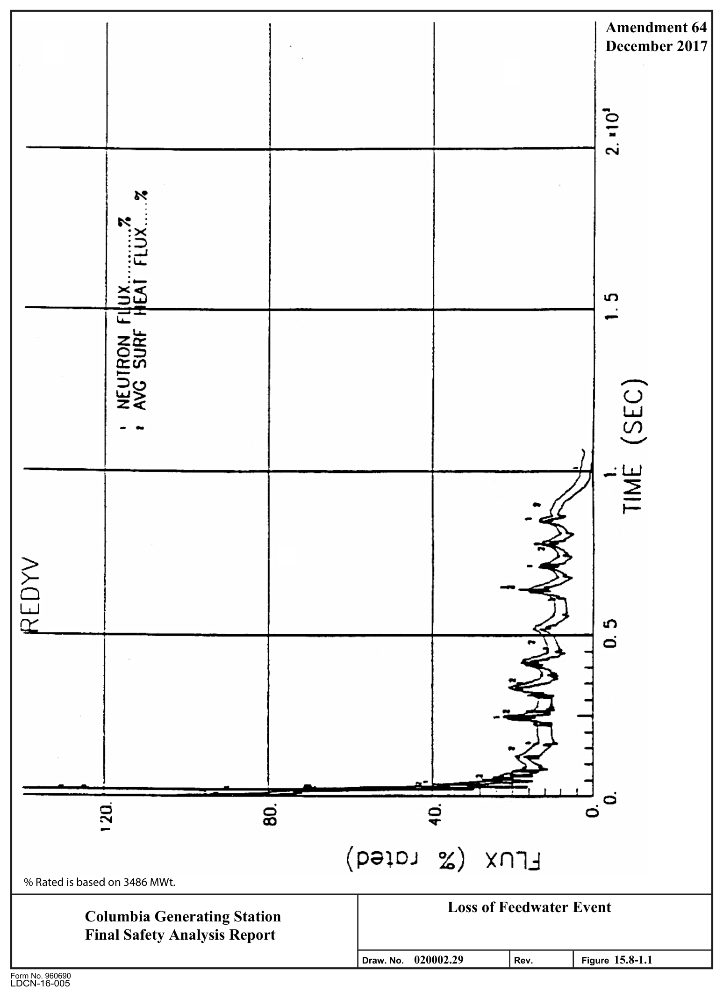

*figure on PDF page 327*

<!-- labels/text on this figure page -->
Amendment 64
0. L...L.....;L.J-..JL-L-1"--'--1----'--l----___a:::a.-------'--------'-----
BO.N------t-------+-------1--------J-.----- December 2017
2. • 101
, AVG SURF •lEAJ flUX ..... %
, NEUTRON ruux ........... 7.
1. 5
TIME (SEC)
1.
EDYV 0. 5
O.
120.
◄O.
~ ~
---...
....__.... _J
.::> LL u
(1)
0 X L
% Rated is based on 3486 MWt.
Loss of Feedwater Event Columbia Generating Station Final Safety Analysis Report
020002.29 15.8-1.1 Draw. No. Rev. Figure Form No. 960690
LDCN-16-005

<!-- p.328 -->
Amendment 53 November 1998

b -•

. - . .
: :..- :a: er:: • • <.J :Wl&J
• ...Ja: :a..
Qa..,- 001.1.1 --..
>CZ

-t-

> >- Cl w

. -
- . c:i '?
I

Loss of Feedwater Event Columbia Generating Station Final Safety Analysis Report Draw. No. 020002.30 Figura 15.8-1.2 Rav.
Form No. 960690

<!-- p.329 -->
Amendment 53 November 1998

- 0 --
-----+---------+----------!o-----------tN

-~ en

#### C. . .
w a:
::, ..
- .
V")
w a::
a.
"""' ~ 0 C
oe:
t
----;----------i-------~;+---------1..;u..J :E ~ t-
---- - >
-
- ~ >a ~ w
-

.:.-----....___

f"'Y
----- 11') -----+--------4------===----~1---------10

-.....

-- ~-
- <!
---..
- _]
-
- ~ . -
('I . - I I °":b --• I I

#### I I I I '
Loss of Feedwater Event Columbia Generating Station Final Safety Analysis Report Draw. No. 020002.31 Agure 15.8-1.3 Rev.
Fonn No. 960690

<!-- p.330 -->
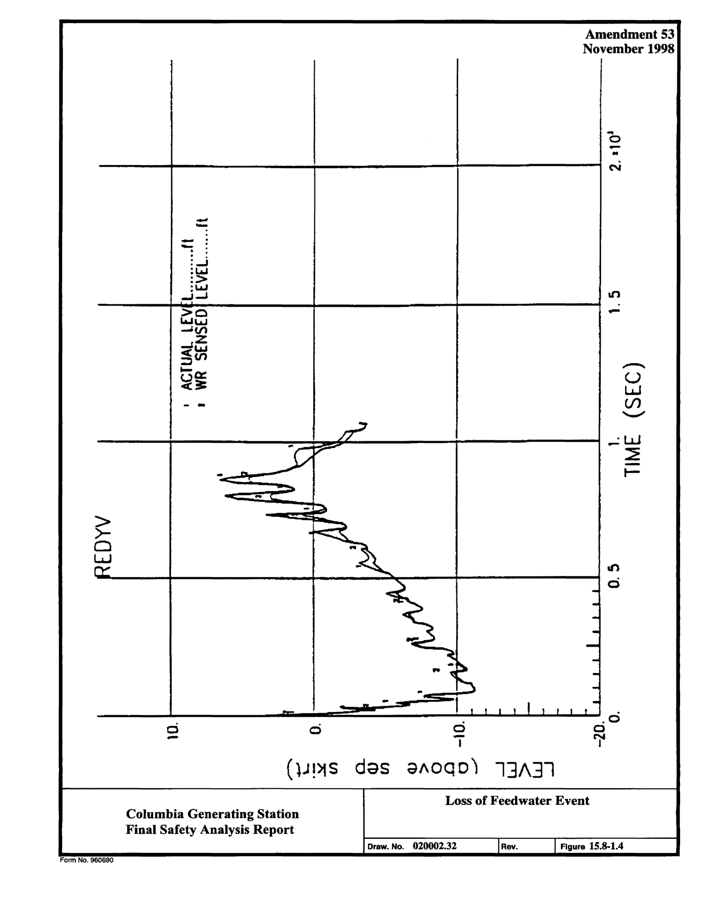

*figure on PDF page 330*

<!-- labels/text on this figure page -->
Amendment 53 November 1998
b -..
-----+-----------i---------+---------""1N
-- .
- :
. .
:_j
:L.,r,J :>
·w
11'1 -
_j...,J
....--..
u
-- Lu ..._,,,, (/)
__: w 2 t-
.n
_._ __ ....,. _________ +-----~----+----------40
_ _L__~~~~.i...l...i....i~ .o
d d 0 0 'T ~
( lJ !)1 s das aAoq D) 73A37
Loss of Feedwater Event Columbia Generating Station Final Safety Analysis Report Draw. No. 020002.32 Figure 15.8-1.4 Rev.
Form No. 960690

<!-- p.331 -->
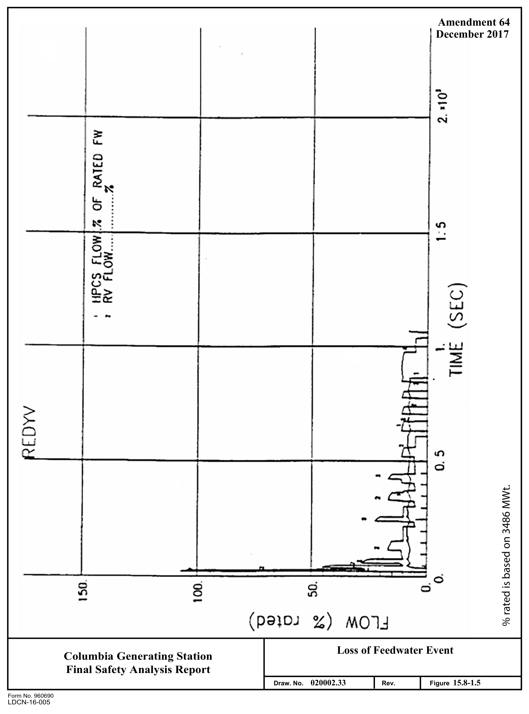

*figure on PDF page 331*

<!-- labels/text on this figure page -->
Amendment 64 December 2017
--J. ____ _
2. ,1 o• ; ~~CfLJ~~~J.~ .. ~~.7.RATEO FW
t 50. r--------t------~f------+----- 1: 5
TIME (SEC)
1.
OYV
0. 5
t
% rated is based on 3486 MWt.
I
lf lfi I
100. I I
0.
0. 50.
~ ~ '--""
,--.....
_J '"O Q) L. 3:
u.... 0
0
Loss of Feedwater Event Columbia Generating Station Final Safety Analysis Report 020002.33 15.8-1.5 Draw. No. Rev. Figure
Form No. 960690
LDCN-16-005

<!-- p.332 -->
Amendment 64 December 2017
------ 150 Neutron Flux (% Rated)
Average Surface Heat Flux (% Rated)
Core Inlet Flow (% Rated)
____ C_o_r_e_l_n_l_e_t_S_u_b_c_o_o_l_i n~g~( B_T_U_/_lb_m~) ____ ... 125
- - ____ "'t _______ ,- ______ ,- ______ ., _______ ,- ___ ~- -

100 I - r - - - - - -
- - - - - - "T - - - - - - - ,- - - - - - 7 - - - - - - - ,- - - - - - - T - - - - - - -1 - - - - - - - 1- - - - - - - T - - - - - - I I

- - - - ,- - - - - - - - - - - - - - 75
---,------ ----,----

50 ------------------------- ------------------ ------------------

#### I I I I I I I I L
] I I I I I

25 ____ I _______ .!._ _______ I _______ I _______ ..!_ _____ _

0 200 400 600 800 1000 1200 1400 1600 1800 2000 0 Time (s)

100 , --- Level (in above Separator Skirt)
, , --------- Vessel Steam Flow (% Rated)
___ , _______ 1 _______ J. ______ ~ _______ :_ ------..- Turbine Steam Flow (% Rated) 75 Feedwater Flow(% Rated) -+-

50 __ J _______ L ______ L ______ J ______________ L
- - J - - - - - - _I - - - - - - I I I

25
- !. - - _! - - - - - - - - - - - - _I - - - - - - - - - - - - - _I - - - - - -

#### I I I I I
'tJ Cl)
16 0 0:::
~
-25 I I
- r - - - - 1
- - - - - - 1- - - - - - - T - - - - - - 7 - - - - - - - 1- - - - - - - - 7 - - - - - - -, - - - - - -

-50

#### I I I
#### I I I I
- - -1 - - - - - - - 1- - - - - - - T - - - - - - "1 - - - - - - - I- - - - - - - i - - -t - - - - - - -1 - - - - - -

-75

-100 0 200 400 600 800 1000 1200 1400 1600 1800 2000 Time (s)

% Rated is based on 3486 MWt.

Main Steam Isolation Valve Closure Event Columbia Generating Station Final Safety Analysis Report 020002.34 1 15.8-2.1 Draw. No. Rev. Figure Form No. 960690

<!-- p.333 -->
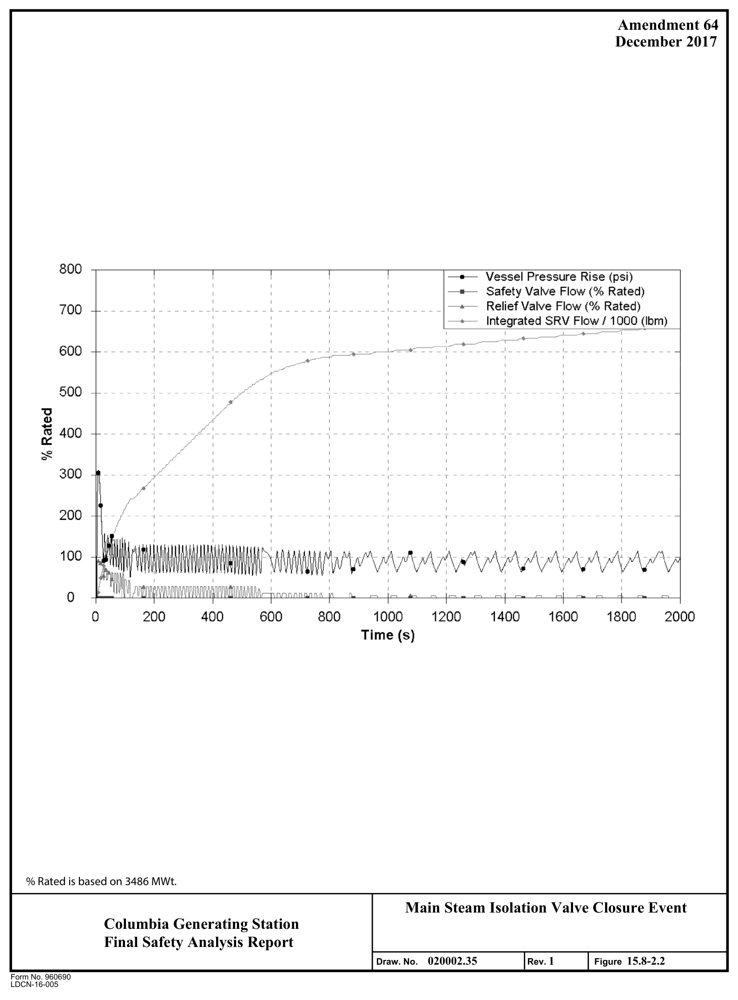

*figure on PDF page 333*

[Vector original (SVG, lossless): fig_page-333_2.svg](../figures/fig_page-333_2.svg)

<!-- labels/text on this figure page -->
Amendment 64 December 2017
800
-------- Vessel Pressure Rise (psi)
------- Safety Valve Flow (% Rated)
Relief Valve Flow (% Rated) 700 ______ .J _______ I _______ L ______ J _______ I ______ _ Integrated SRV Flow/ 1000 (lbm)
------~ ------_:_ ------~ ------=-----~:;:.-c._-c_;;o-=-~-~~-~->:'.-~---=-~-t;-~-;-~-~-~-~-'~-~-~-~-~-~-~-~'~-~-~-~-~-~-~-~~~-~-~-~-~---1 600
500
----------------- I I ------------------------- I I ---------------------------- I I
1 I I I I
I I I
"CJ Q)
16 400 I I
I - - - - - - I - - - - - - - I- -
- - - - - I - - - - - - I - - - - - - - I- - - - - - - - - - - - - -, - - - - - - - I- - - - - - - I - - - - - - et:
~ 0 300
I I I
I I I
f - - - - - - - - - - - - - 1- - - - - - - 7 - - - - - - - 1- - - - - - - T - - - - - - -1 - - - - - - - 1- - - - - - - T - - - - - -
200 r - - - - - - - - - 1 - - - - - - - 1- - - - - - - 1 - - - - - - - J- - - - - - - i - - - - - - - 1 - - - - - - - 1- - - - - - - T - - - - - - I I I I I I
100
0 0 200 400 600 800 1000 1200 1400 1600 1800 2000 Time (s)
% Rated is based on 3486 MWt.
Main Steam Isolation Valve Closure Event Columbia Generating Station Final Safety Analysis Report 020002.35 1 15.8-2.2 Draw. No. Rev. Figure Form No. 960690
LDCN-16-005

<!-- p.334 -->
Amendment 63 December 2015

1500
----- Upper Plenum Pressure (psia)

1400 I I I I I I I
- r - - - - -1 - - - "t - - - 1- - - -1 - - - "t - - - 1- - - l - - - I - - -1 - - - "1 - - - f - - -1 - - - 1'" - - - 1- - - I - - - t" - - -1- - - "'t - -

1300
- r - - - , - - - , - - - r - -
- r - - -1- - r - - - - -, - - - T - - - ,- - - -I - - - T - - - ,- - - 7 - - -I - - - T - - - ,- - - 7 - - - - l - -

#### co' ti) c.. -
#### I I I I I I I I I I I I I I
(I) ...
1200

#### I I I I I I I I I I I I I
I - - - I- I - - - ,- - - I - - - J - - - , - - - "i - - - I- T - - - ,- - - -, - - - I - - I - - - ,- - - - - - I - - - - - -I - - - - - -I - - - -1- - - ::::J ti)
(I) ...
ti)
a.
1100

I 1000 _I ___ ! ___ I ____ I ___ l ___ I ___ _J ___ L ___ I ___ J ___ I_ ___ I ___ l _______ I ___ !... ______ J ___ I __ _

900 100 300 500 700 900 1100 1300 1500 1700 1900 Time (s)

250 20
----- Suppression Pool Temperature (deg F)
--- Containment Pressure (psig)
225 18 ------- :--------: --------: --------:-------- ·-------- . --------· -------

200 16
-
- 14 .
175 - --- ------ . -----------------·----------------- . --------- .
.
LL

#### "C -
C)

#### ti) c.. - C)
12 (I)
150 : : : : : : :
(I) ...
(I) ...
125 10 . . . .
. ------- .--------~--------. ---------------- .-----------------. ------- ::::J 16 ...
::::J ti)
(I) ...
ti) (I) c.. 100 8 a. E

(I) ....

75 6
----~--------·--------~--------~-------~--------·---------------- . .

4 50 : : :
: . .

2 25 .
. . .
.
.
. ------- .--------~--------. --------.-------- .----------------- . -------

0 0 1000 2000 3000 4000 5000 6000 7000 8000 Time (s)

Main Steam Isolation Valve Closure Event Columbia Generating Station Final Safety Analysis Report 020002.36 1 15.8-2.3 Draw. No. Rev. Figure Form No. 960690

<!-- p.335 -->
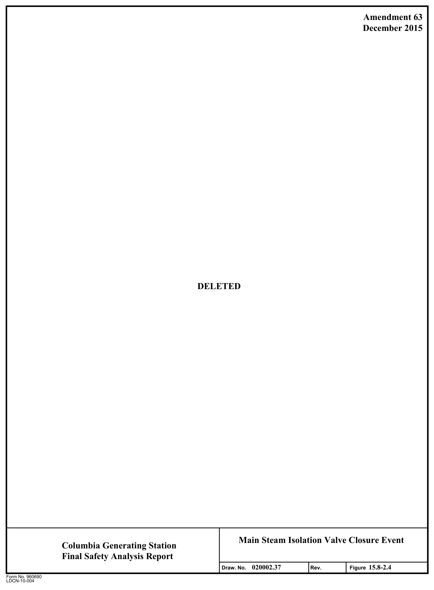

*figure on PDF page 335*

[Vector original (SVG, lossless): fig_page-335_2.svg](../figures/fig_page-335_2.svg)

<!-- labels/text on this figure page -->
Amendment 63 December 2015
DELETED
Main Steam Isolation Valve Closure Event Columbia Generating Station Final Safety Analysis Report I I 020002.37 15.8-2.4 Draw. No. Rev. Figure Form No. 960690
LDCN-10-004

<!-- p.336 -->
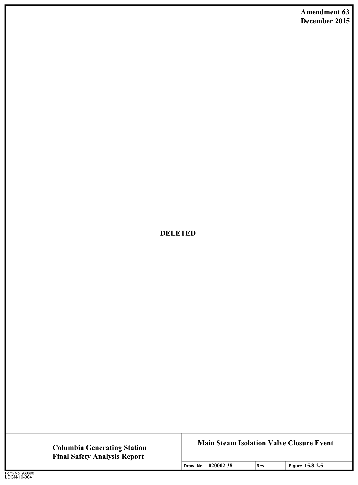

*figure on PDF page 336*

[Vector original (SVG, lossless): fig_page-336_2.svg](../figures/fig_page-336_2.svg)

<!-- labels/text on this figure page -->
Amendment 63 December 2015
DELETED
Main Steam Isolation Valve Closure Event Columbia Generating Station Final Safety Analysis Report I I 020002.38 15.8-2.5 Draw. No. Rev. Figure Form No. 960690
LDCN-10-004

<!-- p.337 -->
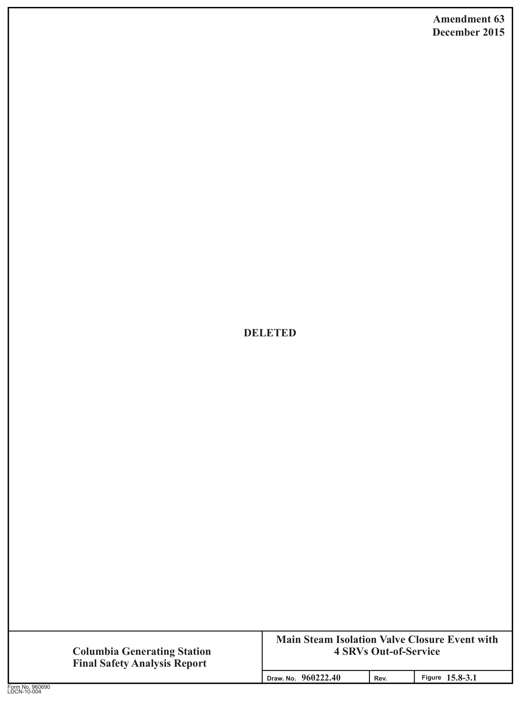

*figure on PDF page 337*

[Vector original (SVG, lossless): fig_page-337_2.svg](../figures/fig_page-337_2.svg)

<!-- labels/text on this figure page -->
Amendment 63 December 2015
DELETED
Main Steam Isolation Valve Closure Event with
4 SRVs Out-of-Service
Columbia Generating Station Final Safety Analysis Report I I 960222.40 15.8-3.1 Draw. No.
Rev. Figure Form No. 960690
LDCN-10-004

<!-- p.338 -->
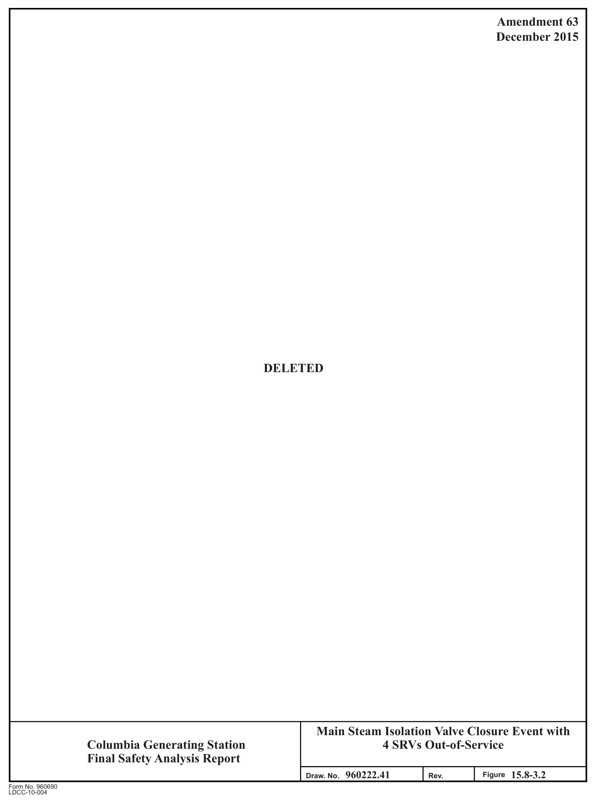

*figure on PDF page 338*

[Vector original (SVG, lossless): fig_page-338_3.svg](../figures/fig_page-338_3.svg)

<!-- labels/text on this figure page -->
Amendment 63 December 2015
DELETED
Main Steam Isolation Valve Closure Event with
4 SRVs Out-of-Service
Columbia Generating Station Final Safety Analysis Report I I 960222.41 15.8-3.2 Draw. No.
Rev. Figure Form No. 960690
LDCC-10-004

<!-- p.339 -->
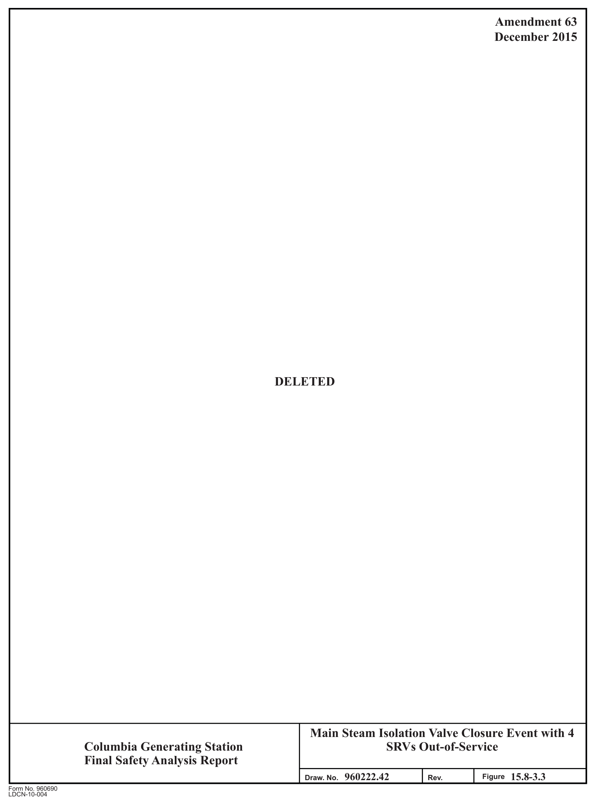

*figure on PDF page 339*

[Vector original (SVG, lossless): fig_page-339_2.svg](../figures/fig_page-339_2.svg)

<!-- labels/text on this figure page -->
Amendment 63 December 2015
DELETED
Main Steam Isolation Valve Closure Event with 4 SRVs Out-of-Service Columbia Generating Station Final Safety Analysis Report I I 960222.42 15.8-3.3 Draw. No.
Rev. Figure Form No. 960690
LDCN-10-004

<!-- p.340 -->
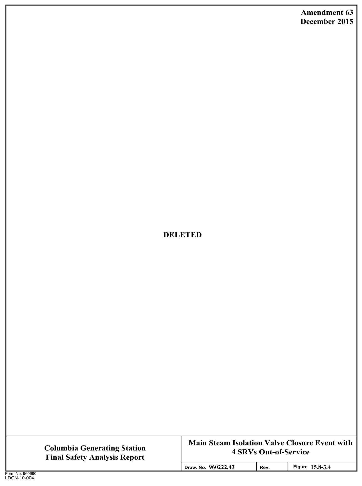

*figure on PDF page 340*

[Vector original (SVG, lossless): fig_page-340_2.svg](../figures/fig_page-340_2.svg)

<!-- labels/text on this figure page -->
Amendment 63 December 2015
DELETED
Main Steam Isolation Valve Closure Event with Columbia Generating Station
4 SRVs Out-of-Service
Final Safety Analysis Report I I 960222.43 Figure 15.8-3.4 Draw. No. Rev.
Form No. 960690
LDCN-10-004

<!-- p.341 -->
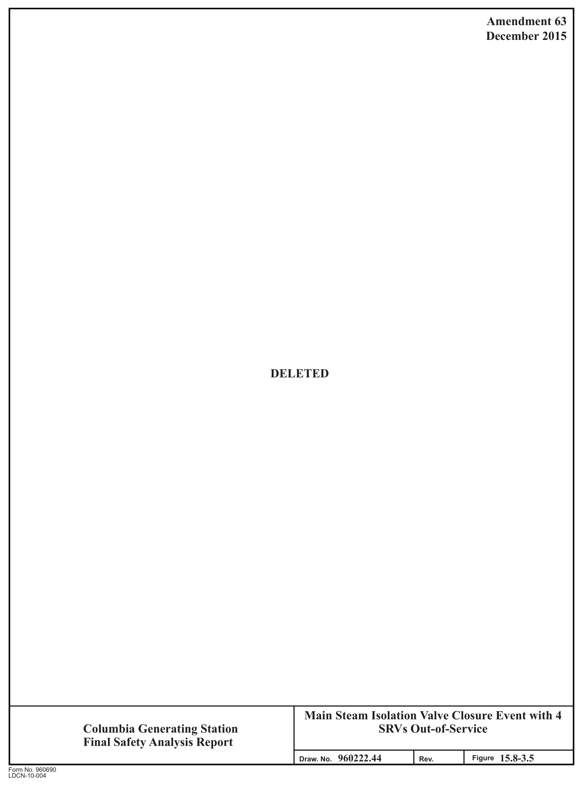

*figure on PDF page 341*

[Vector original (SVG, lossless): fig_page-341_2.svg](../figures/fig_page-341_2.svg)

<!-- labels/text on this figure page -->
Amendment 63 December 2015
DELETED
Main Steam Isolation Valve Closure Event with 4 SRVs Out-of-Service Columbia Generating Station Final Safety Analysis Report I I 960222.44 15.8-3.5 Draw. No.
Rev. Figure Form No. 960690
LDCN-10-004

<!-- p.342 -->
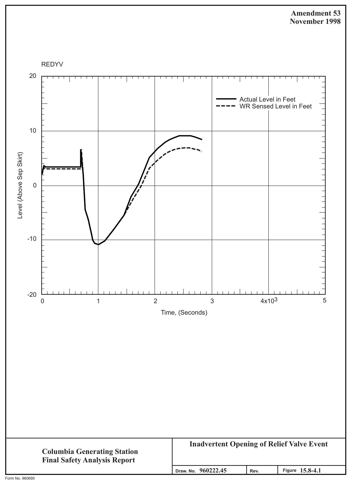

*figure on PDF page 342*

[Vector original (SVG, lossless): fig_page-342_2.svg](../figures/fig_page-342_2.svg)

<!-- labels/text on this figure page -->
Amendment 53 November 1998
REDYV
20
Actual Level in Feet WR Sensed Level in Feet
10
Level (Above Sep Skirt)
0
-10
-20 4x103 5 0 1 2 3 Time, (Seconds)
Inadvertent Opening of Relief Valve Event Columbia Generating Station Final Safety Analysis Report 960222.45 15.8-4.1 Draw. No.
Rev. Figure Form No. 960690

<!-- p.343 -->
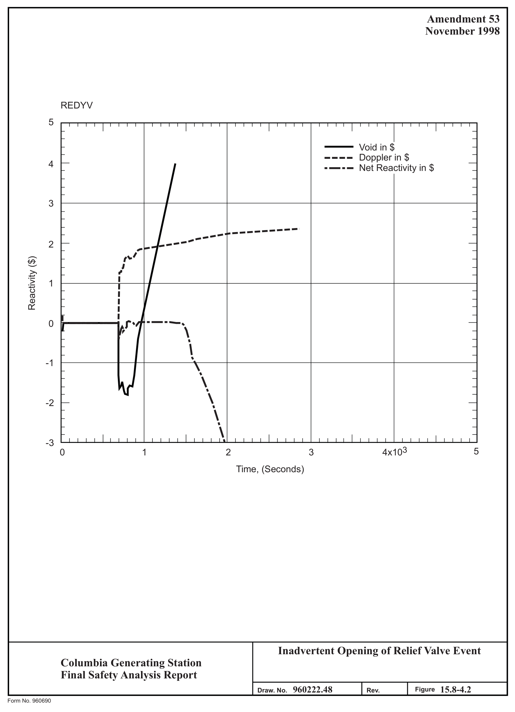

*figure on PDF page 343*

[Vector original (SVG, lossless): fig_page-343.svg](../figures/fig_page-343.svg)

<!-- labels/text on this figure page -->
Amendment 53 November 1998
REDYV
5
Void in $ Doppler in $ 4 Net Reactivity in $
3
---------1 2
Reactivity ($)
1
----.. \ • \ • 0
-1
• \ • \ • \ • \
-2
-3 4x103 0 1 2 3 5 Time, (Seconds)
Inadvertent Opening of Relief Valve Event Columbia Generating Station Final Safety Analysis Report 960222.48 15.8-4.2 Figure Draw. No.
Rev.
Form No. 960690

<!-- p.344 -->
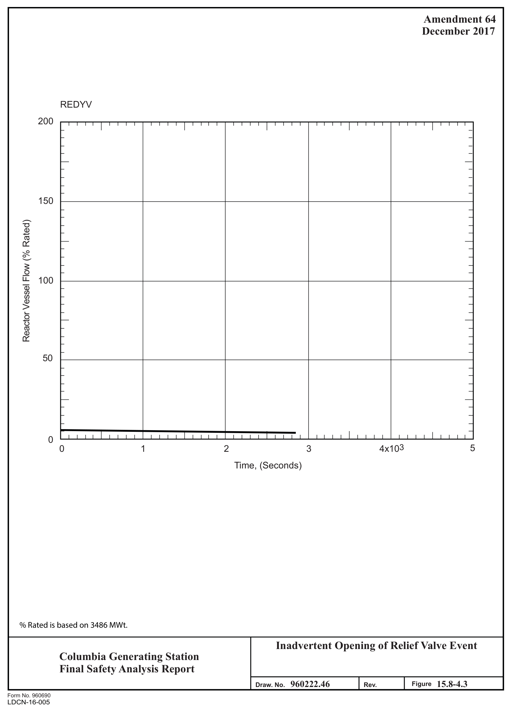

*figure on PDF page 344*

[Vector original (SVG, lossless): fig_page-344_2.svg](../figures/fig_page-344_2.svg)

<!-- labels/text on this figure page -->
Amendment 64 December 2017
REDYV
200 I I I I
I ,... -
- ~
-
- ,... ~
-
-
- ,... ~
-
- ,... ~
- 150
- ,... ~
-
- Reactor Vessel Flow (% Rated)
~
- ~
f--
- ,... ~
- ,...
-
- ~ 100 ,...
-
- ,... ~
-
-
- ~
- ,...
-
- ~
- ~ ,...
- 50 ,...
- ,...
-
- ,... ~
-
f--
- ~ ,...
-
- ~
-
I I I I
I I
I 0 I I I I I I I I I I I I I I I I I I I I I I I I I I I I I I I I I I I I I
5 0 1 2 3 4x103 Time, (Seconds)
% Rated is based on 3486 MWt.
Inadvertent Opening of Relief Valve Event Columbia Generating Station Final Safety Analysis Report I I 960222.46 15.8-4.3 Draw. No.
Rev. Figure Form No. 960690
LDCN-16-005

<!-- p.345 -->
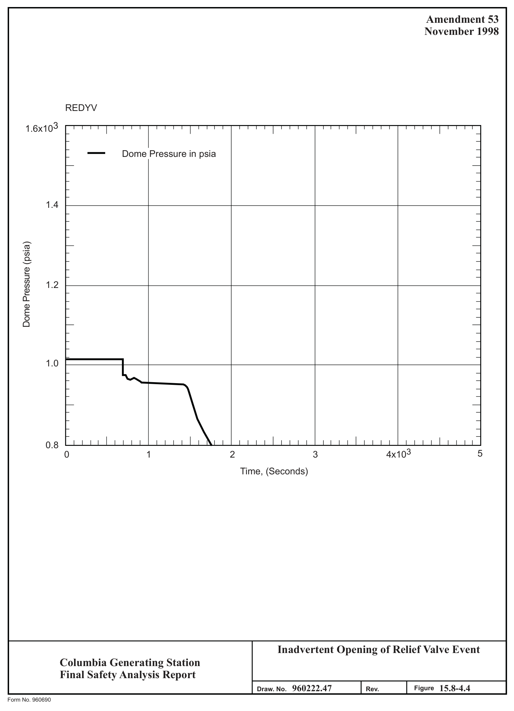

*figure on PDF page 345*

[Vector original (SVG, lossless): fig_page-345_2.svg](../figures/fig_page-345_2.svg)

<!-- labels/text on this figure page -->
Amendment 53 November 1998
REDYV
1.6x103
Dome Pressure in psia
1.4
Dome Pressure (psia)
1.2
1.0
0.8 4x103 0 1 2 3 5 Time, (Seconds)
Inadvertent Opening of Relief Valve Event Columbia Generating Station Final Safety Analysis Report 960222.47 15.8-4.4 Draw. No.
Rev. Figure Form No. 960690

<!-- p.346 -->
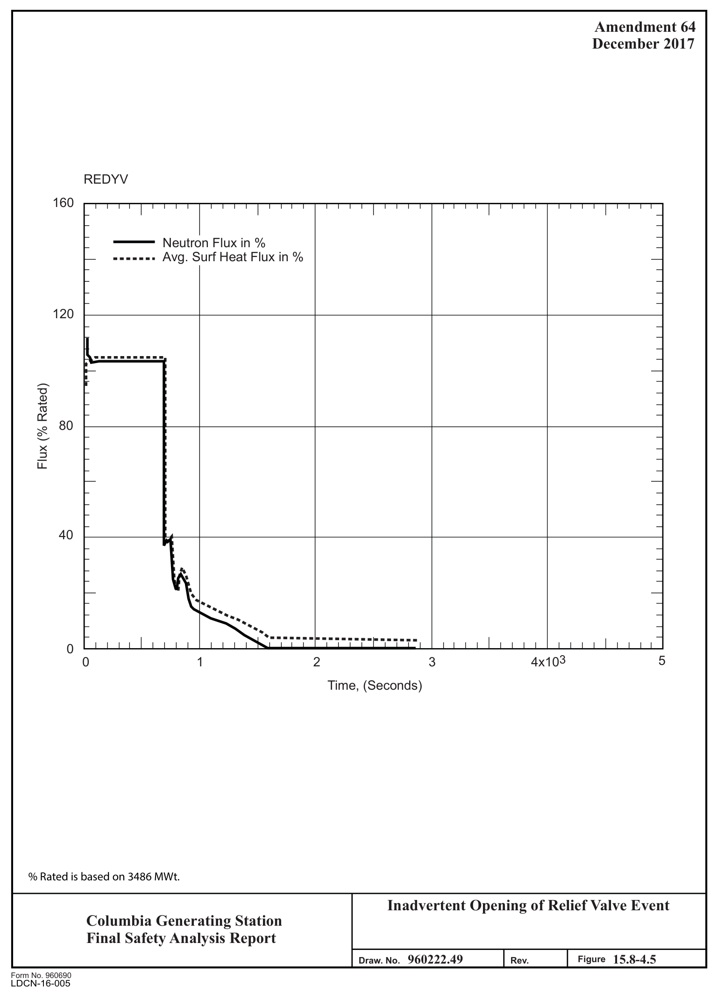

*figure on PDF page 346*

[Vector original (SVG, lossless): fig_page-346.svg](../figures/fig_page-346.svg)

<!-- labels/text on this figure page -->
Amendment 64 December 2017
REDYV
160
Neutron Flux in % Avg. Surf Heat Flux in %
120
Flux (% Rated)
80
40
0 5 4x103 0 1 2 3 Time, (Seconds)
% Rated is based on 3486 MWt.
Inadvertent Opening of Relief Valve Event Columbia Generating Station Final Safety Analysis Report 960222.49 15.8-4.5 Draw. No.
Rev. Figure Form No. 960690
LDCN-16-005

<!-- p.347 -->
Amendment 64 December 2017
--- 150 Neutron Flux (% Rated)
------ Average Surface Heat Flux (% Rated)
Core Inlet Flow(% Rated)
125 __ ,- ___ ~-- ____ C_o_re __ l n_le_t_S_u_b_c_o_o_li_n_g_(_B_T_U_/l_b_m_) ____
---<

100 I I I I - r I
----7-
- T - - - - - - -1 - - - - - - - 1- - - - - - - T - - i - - - - - - - ,- - - - - - - - I- - - -

-,------ 75
--,-------,
--,----
- I - - - - - - - - l- - - - - -

50
---------------- I I I ------' I ------ I -------- I I ---------------- J I ' I ' I

25

0 0 200 400 600 800 1000 1200 1400 1600 1800 2000 Time (s)

100 Level (in above Separator Skirt) I -e- Vessel Steam Flow (% Rated)
--------- I Turbine Steam Flow (% Rated)
75

- - 1- - - - - - - l. - - - - - - ..... -

Feedwater Flow(% Rated)

50 ___ L ___ _ I _ J _______ I __ __ I _______ l _______
- - _I_ - -
- - - - I_ - I I I I

25 _! _______ I __ -------'-' ------ ___ !_ ___ _ I '

#### I I I
"C Cl)
1o 0 0:::

-25 I I

#### I ---,---
---r---- I ------,-- - - I- - - - - - - T - - - - - - 7 -
- - - - I- -

-50 + - - - - - - - - 1- - - - - - - ""1 -
--1-------1--

-75

-100 0 200 400 600 800 1000 1200 1400 1600 1800 2000 Time (s)

% Rated is based on 3486 MWt.

Pressure Regulator Failure - Open Event Columbia Generating Station Final Safety Analysis Report 020002.39 1 15.8-5.1 Draw. No. Rev. Figure Form No. 960690

<!-- p.348 -->
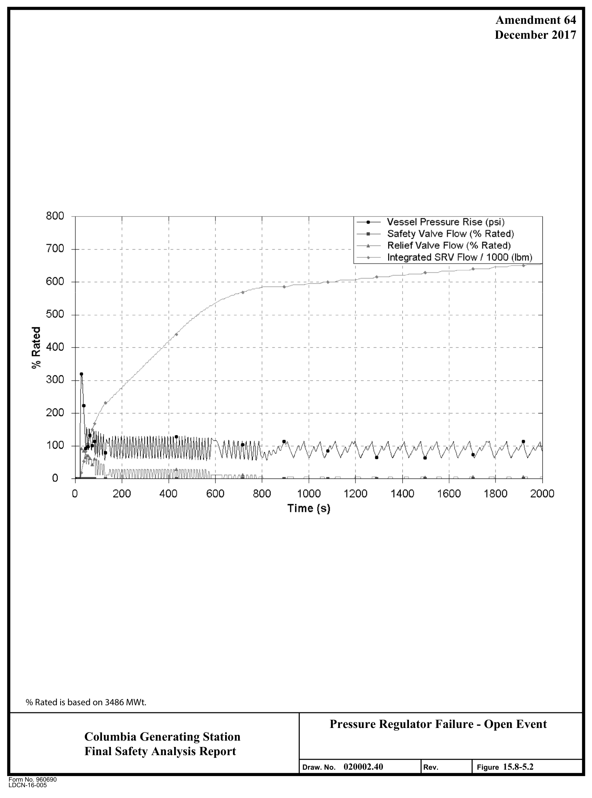

*figure on PDF page 348*

[Vector original (SVG, lossless): fig_page-348_2.svg](../figures/fig_page-348_2.svg)

<!-- labels/text on this figure page -->
Amendment 64 December 2017
--
---- 800 Vessel Pressure Rise (psi)
Safety Valve Flow (% Rated)
Relief Valve Flow (% Rated) 700
- - - - - - .l - - - - - - - I_ - - - - - - l.. - - - - - - ..J - - - - - - - I _ - - - - - - Integrated SRV Flow / 1000 (lbm) I I I I I -+-
- -T- ---7--- 600 ______ J _______ , _______ L ____ -- ~ I ~: __ ~- - - - -~ '- - ~- - - - ~- - - - - ~ -' - - - -~ - - - '- ~- - - I I I
500
------------------ I I ------------------------------------------- I I I J 1
I ' I
,::, Cl)
16 400
- - - - - - 7 - - - - - - - ,- - - - - - - I - - - - - - -, - - - - - - - ,- - - - - - - I I - - - - - - "'j - - - - - - -,- - - - - - - 0:::
I I I ~ 300
- r - - - - - -
- - - - - 7 - - - - - -1- - - - - - 7 - - - - - - - 1- - - - - - - T - - - - - - -1 - - - - - - - ,- - - - - - - T - - - - - -
200
- - - - - "'1 - - - - - - - ,- - - - - - - t'" - - - - - - "'1 - - - - - - - 1- - - - - - - 1'" - - - - - - -1 - - - - - - - r- - - - - - - 1" - - - - - - I I I
I J J
100
0 0 200 400 600 800 1000 1200 1400 1600 1800 2000 Time (s}
% Rated is based on 3486 MWt.
Pressure Regulator Failure - Open Event Columbia Generating Station Final Safety Analysis Report 020002.40 15.8-5.2 Draw. No. Rev. Figure Form No. 960690
LDCN-16-005

<!-- p.349 -->
Amendment 53 December 2015

1500
--- Upper Plenum Pressure (psia)

1400
- r - - -1-
- - -1 - - - -r - - - 1- - - -1 - - - -,- - - - 1- - - "'1 - - - - -, - - - r- - - -1 - - - 1- - - ""1 - - - ,- - - -1- - - -, - - - r- - - 1" - - - I I

#### I I I I I I I
- 1300 I I I I I I I I I I I I I I I I
- r - - -1- - - r - -
- r - - -,- - - , - - - r - - - -1- - - T - - - 1- - - -, - - - T - - - 1- - - 7 - - - , - - -1 - - - T - - - ,- - - 7 - -

#### co rn a. -
...

#### G) 1200
I I I I I I I J I I I J I - r - - -,- - - 1 - 1 - - - - 1 - - - 1- 1 - - - 1 - - -1- - - 1 - - - ,- - - 1 - - - 1- - - - ,- - -
- -1- - - 1- - - -1 - - - -
- 1 - - - - -1 - - :::J rn rn G) ...
a. 1100

1000 I ___ !.. ___ 1 ___ .! ___ I __ _ ___ I ___ .! ___ I ____ I ___ l ___ I ___ J ___ L ___ I ___ .l ___ I_ ___ I ___ l ___ I ____

900 100 300 500 700 900 1100 1300 1500 1700 1900 Time (s)

250 20
--- Suppression Pool Temperature (deg F)
------- Containment Pressure (psig)
18 225
-
-- :- : .
:- : : - :-

16 200
- 175
- 14 ~-------- . --------~--------·--------~--------------- -~ . . u.

#### "C -
#### rn a. -
C,

#### C, G) 150 12
: : : : : : :

#### G) ... 125
#### G) ...
10 .
. . .
. :::J ------ .----------------- . ----------------- .----------------- . ------- 16 ...
:::J rn rn G) ...

#### G) 100
8 a.
a. E

G) .... 75

6
-- ----~-------- ·--------~--------~-------~-------- ·---------------- . .

50 4 : : : : : : :

25 2
------- .--------~--------. --------.-------- . . . . .-----------------. ------- . . .

0 0 1000 2000 3000 4000 5000 6000 7000 8000 Time (s)

Pressure Regulator Failure - Open Event Columbia Generating Station Final Safety Analysis Report 020002.41 1 15.8-5.3 Draw. No. Rev. Figure

Form No. 960690

<!-- p.350 -->
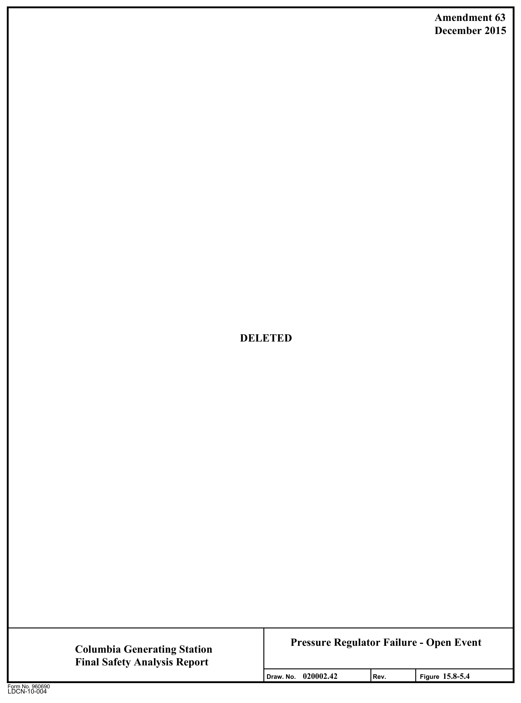

*figure on PDF page 350*

[Vector original (SVG, lossless): fig_page-350.svg](../figures/fig_page-350.svg)

<!-- labels/text on this figure page -->
Amendment 63 December 2015
DELETED
Pressure Regulator Failure - Open Event Columbia Generating Station Final Safety Analysis Report I I 020002.42 15.8-5.4 Draw. No. Rev. Figure Form No. 960690
LDCN-10-004

<!-- p.351 -->
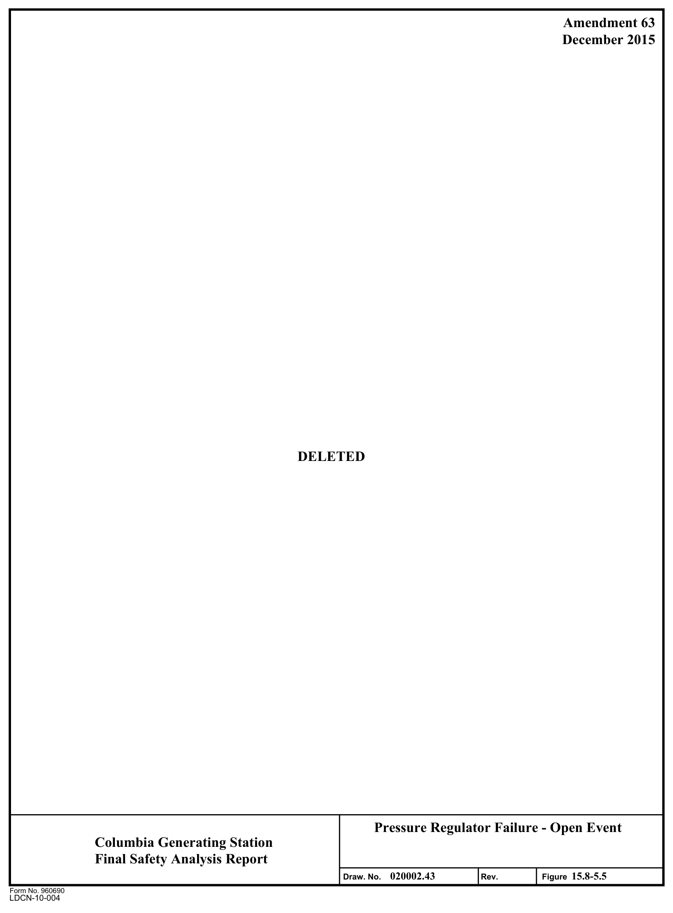

*figure on PDF page 351*

[Vector original (SVG, lossless): fig_page-351.svg](../figures/fig_page-351.svg)

<!-- labels/text on this figure page -->
Amendment 63 December 2015
DELETED
Pressure Regulator Failure - Open Event Columbia Generating Station Final Safety Analysis Report I I 020002.43 15.8-5.5 Draw. No. Rev. Figure Form No. 960690
LDCN-10-004

<!-- p.352 -->
Chapter 16

#### TECHNICAL SPECIFICATIONS
(See Operating License Appendix A)

#### TECHNICAL SPECIFICATION BASES
(Separate Volume)

#### LICENSEE CONTROLLED SPECIFICATIONS
(Separate Volume)

<!-- p.353 -->

April 2000

Chapter 17

#### QUALITY ASSURANCE

#### TABLE OF CONTENTS

Section Page

17.1 QUALITY ASSURANCE DURING DESIGN AND CONSTRUCTION..... 17.1-1

17.1.1 ENERGY NORTHWEST QUALITY ASSURANCE PROGRAM ................ 17.1-1

17.1.1.1 Organization ......................................................................... 17.1-2

17.1.1.2 Quality Assurance Program....................................................... 17.1-10

17.1.1.3 Design Control ...................................................................... 17.1-15

17.1.1.4 Procurement Document Control.................................................. 17.1-15

17.1.1.5 Instructions, Procedures, and Drawings........................................ 17.1-16

17.1.1.6 Document Control .................................................................. 17.1-16

17.1.1.7 Control of Purchased Material, Equipment, and Services................... 17.1-17

17.1.1.8 Identification and Control of Materials, Parts, and Components .......... 17.1-18

17.1.1.9 Control of Special Processes...................................................... 17.1-19

17.1.1.10 Inspection............................................................................ 17.1-19

17.1.1.11 Test Control ......................................................................... 17.1-20

17.1.1.12 Control of Measuring and Test Equipment..................................... 17.1-21

17.1.1.13 Handling, Storage, and Shipping................................................ 17.1-21

17.1.1.14 Inspection, Test, and Operating Status ......................................... 17.1-22

17.1.1.15 Nonconforming Materials, Parts, or Components............................ 17.1-22

17.1.1.16 Corrective Action................................................................... 17.1-23

17.1.1.17 Quality Assurance Records ....................................................... 17.1-24

17.1.1.18 Audits................................................................................. 17.1-25

17.1.2 THE BURNS AND ROE, INC. QUALITY ASSURANCE PROGRAM ........ 17.1-26

17.1.2.1 Introduction .......................................................................... 17.1-26

17.1.2.2 The Burns & Roe, Inc. Quality Assurance Topical Report .................. 17.1-26

#### 17.1.2.3 Exceptions to the Burns & Roe, Inc. Quality Assurance Topical

Report................................................................................. 17.1-26

17.1.2.3.1 Chapter I - Organization........................................................ 17.1-26

17.1.2.3.2 Chapter II - Quality Assurance Program..................................... 17.1-27

17.1.2.3.3 Chapter III - Design Control ................................................... 17.1-27

17.1.2.3.4 Chapter IV - Procurement Document Control............................... 17.1-28

17.1.2.3.5 Chapter V - Instructions, Procedures, and Drawings...................... 17.1-29

17.1.2.3.6 Chapter VI - Document Control ............................................... 17.1-29

##### 17.1.2.3.7 Chapter VII - Control of Purchased Material, Equipment,

and Services ....................................................................... 17.1-30

##### 17.1.2.3.8 Chapter VIII - Identification and Control of Material Parts

and Components.................................................................. 17.1-31

17-i

<!-- p.354 -->

April 2000

Chapter 17

#### QUALITY ASSURANCE

TABLE OF CONTENTS (Continued)

Section Page

17.1.2.3.9 Chapter IX - Control of Special Processes................................... 17.1-31

17.1.2.3.10 Chapter X - Inspection.......................................................... 17.1-31

17.1.2.3.11 Chapter XI - Test Control ...................................................... 17.1-31

17.1.2.3.12 Chapter XII - Control of Measuring and Test Equipment................. 17.1-32

17.1.2.3.13 Chapter XIII - Handling, Storage, and Shipping........................... 17.1-32

17.1.2.3.14 Chapter XIV - Inspection, Test, and Operating Status .................... 17.1-33

17.1.2.3.15 Chapter XV - Nonconforming Materials, Parts, or Components ........ 17.1-33

17.1.2.3.16 Chapter XVI - Corrective Action .............................................. 17.1-34

17.1.2.3.17 Chapter XVII - Quality Assurance Records ................................. 17.1-34

17.1.2.3.18 Chapter XVIII - Audits.......................................................... 17.1-34

### 17.1.3 GENERAL ELECTRIC COMPANY QUALITY ASSURANCE

PROGRAM.............................................................................. 17.1-34

### 17.1.4 BECHTEL POWER CORPORATION QUALITY ASSURANCE

PROGRAM.............................................................................. 17.1-35

17.1.4.1 Quality Assurance Topical Report ............................................... 17.1-35

17.1.4.2 Scope of Responsibility............................................................. 17.1-35

17.1.4.3 Project-Unique Modification to BQ-TOP-1, Revision 3A.................... 17.1-36

ATTACHMENT 1................................................................................. 17.1-38

ATTACHMENT 2................................................................................. 17.1-39

ATTACHMENT 3................................................................................. 17.1-42

ATTACHMENT 4................................................................................. 17.1-43

ATTACHMENT 5................................................................................. 17.1-44

ATTACHMENT 6................................................................................. 17.1-45

ATTACHMENT 7................................................................................. 17.1-46

17.2 QUALITY ASSURANCE DURING THE OPERATIONS PHASE ........... 17.2-1

17-ii

<!-- p.355 -->
November 1998

Chapter 17

#### QUALITY ASSURANCE
#### LIST OF TABLES
Number Title Page

17.1-1 General Electric Quality Assurance Evolutionary Process ............. 17.1-47

17-iii

<!-- p.356 -->
April 2000

Chapter 17

#### QUALITY ASSURANCE
#### LIST OF FIGURES
Number Title

17.1-1 Energy Northwest Organization Chart

17.1-2 Energy Northwest CGS Organization Chart

17.1-3 CGS Project Management Organization Chart

17.1-4 Burns and Roe, Inc. CGS Organization Chart

17.1-5 Bechtel CGS Organization Chart

17-iv

