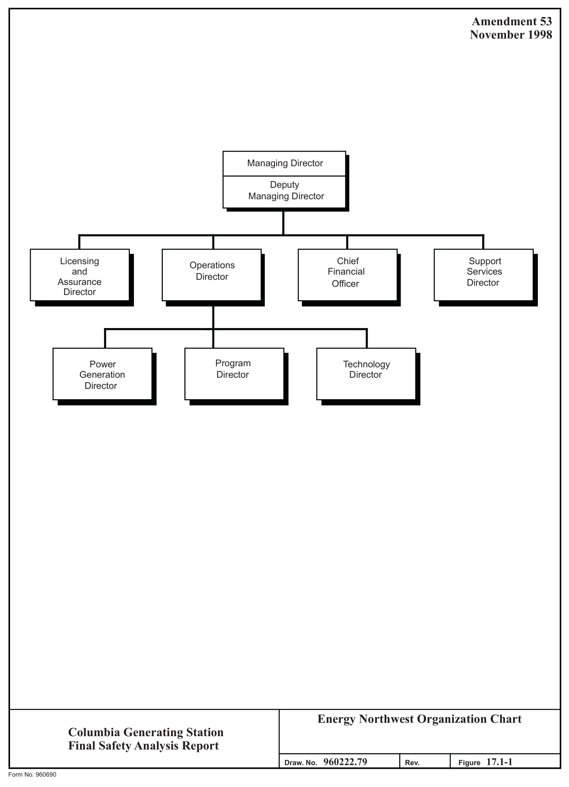
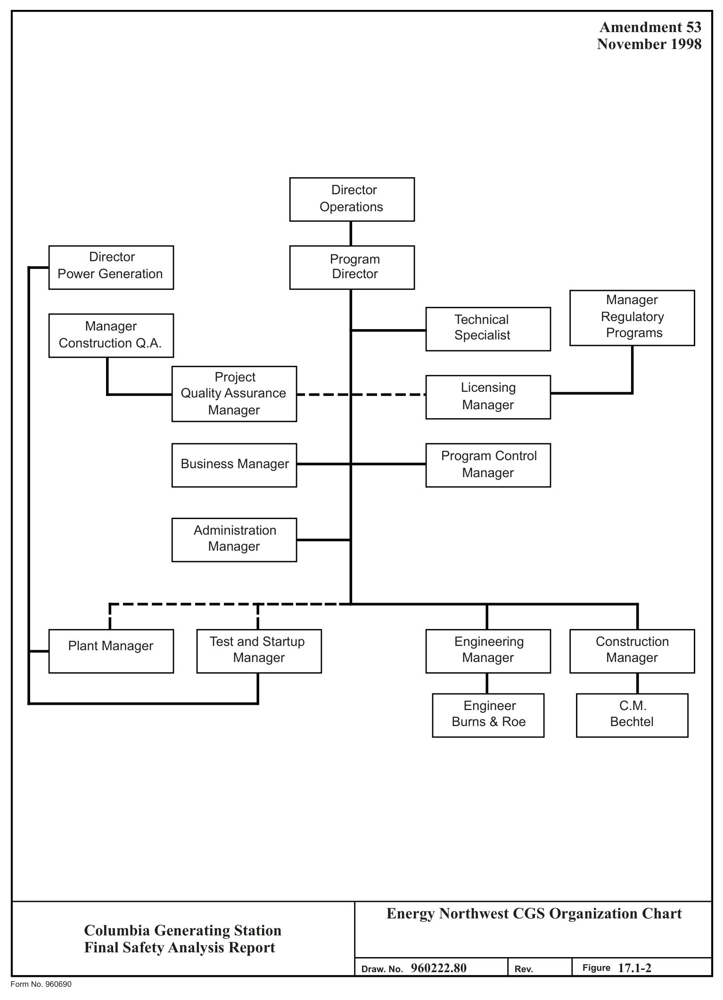
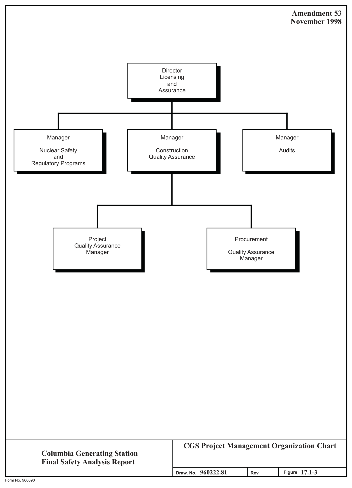
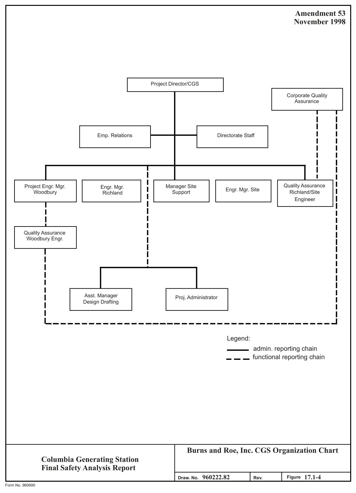
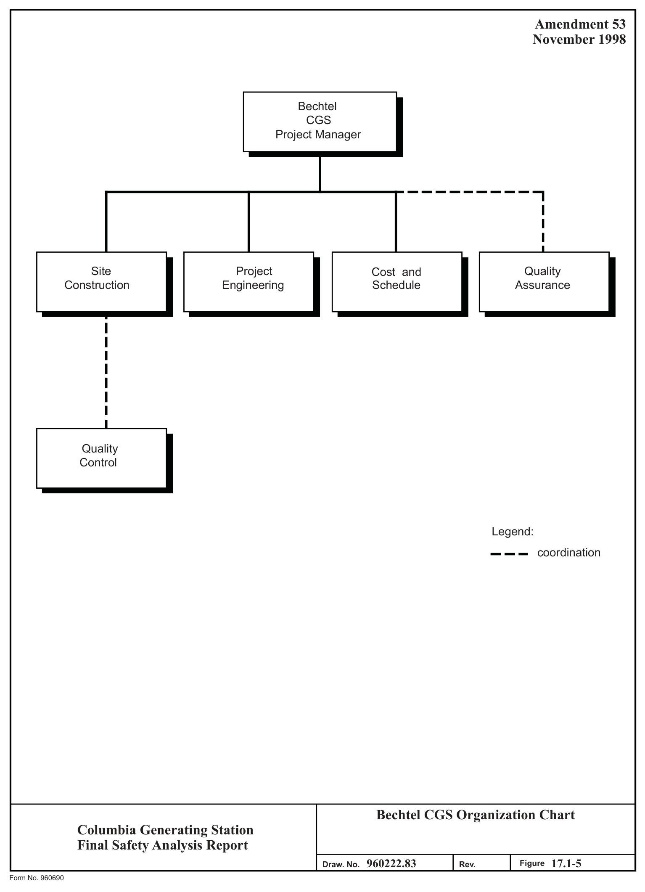

# 17.1 Quality Assurance During Design And Construction

> Columbia Generating Station FSAR — Chapter 15: Accident Analyses
> Source: `15_chapter-4122-5262.pdf`, PDF pages 357–408 (of 1141)
> Amendment 67 compilation (individual pages carry varying amendment dates)

---
<!-- p.357 -->
Chapter 17

#### QUALITY ASSURANCE
### 17.1 QUALITY ASSURANCE DURING DESIGN AND CONSTRUCTION
The quality assurance requirements during design and construction were defined in the FSAR and were revised through Amendment 30 in June 1983. This section is no longer applicable since these phases are completed.

There are four principal participants in Columbia Generating Station (CGS) design and construction quality programs. They are the Owner, Energy Northwest; the Architect/Engineer
(AE), Burns and Roe, Inc. (B&R); the Nuclear Steam Supply System (NSSS) Supplier, General Electric Company (GE); and the Construction Manager (CM), Bechtel Power Corporation.

a. Energy Northwest, as the owner and Licensee, has overall responsibility for assuring that the plant is designed and constructed in accord with approved Quality Assurance Programs (QAPs). The Energy Northwest CGS Project Quality Assurance organization provides management overview of the other elements of the site QAPs. Section 17.1.1 describes the Energy Northwest CGS QAP.

b. Burns and Roe, Inc. provides Architect/Engineer and related services for CGS.
Section 17.1.2 describes the B&R QAP.

c. The General Electric Company (GE) provides NSSS design, fabrication, and erection/construction services for CGS. Section 17.1.3 describes the GE QAP.

d. The Bechtel Power Corporation provides construction management services for CGS. This service consists primarily of direction and coordination of site contractor activities and includes related Quality Assurance/QC services.
Section 17.1.4 describes the Bechtel QAP.

#### 17.1.1 ENERGY NORTHWEST QUALITY ASSURANCE PROGRAM
Energy Northwest has implemented a QAP for the design, procurement, and construction of Energy Northwest Columbia Generating Station (CGS). This QAP has been implemented in accordance with requirements of Appendix B to 10 CFR 50. The applicable requirements of Appendix B, 10 CFR 50 are applied to those items classified as Energy Northwest Quality Class I due to their relationship to a nuclear safety function.

As the license applicant, Energy Northwest is responsible for the plant. Therefore, the Energy Northwest CGS QAP and its implementation has been structured to assure that design,

<!-- p.358 -->
procurement, and construction activities are accomplished in accordance with sound engineering principles and practices. Systems, components, and structures that are safety-related, in the context of 10 CFR 20, 10 CFR 50, and 10 CFR 100, are required to be designed, specified, fabricated, installed, and tested in accordance with applicable regulatory requirements, codes, standards, specifications, and procedures.

The description of the Energy Northwest CGS Design and Construction QAP which follows is of the program as it currently exists. This program evolved from the original quality program which first appeared in Appendix D.O of the PSAR. The changes involved in this evolution process include: NRC requested changes; updates in organization responsibilities and authorities; and the incorporation of new requirements.

##### 17.1.1.1 Organization
Energy Northwest Managing Director is responsible to the Board of Directors for the overall management of Energy Northwest activities, including the establishment and implementation of policies. The Managing Director resolves issues involving quality brought to his attention because of failure to reach resolution at lower levels of management. Overall Energy Northwest organization is shown on Figure 17.1-1.

The Managing Director has the ultimate responsibility for the QAP. The Managing Director shall ensure that the program is implemented and maintained by assigning the appropriate authority and responsibility to the Director of Licensing and Assurance.

The Deputy Managing Director has the authority to implement the policies of the Managing Director. The Deputy Managing Director is accountable to the Managing Director and is responsible for:

a. Coordinating and integrating the activities of Energy Northwest organizations,

b. Supporting and advising the Managing Director on the performance of Energy Northwest functions and evaluation of such, and

c. Acting for the Managing Director, as required.

The Director of Licensing and Assurance reports and is accountable to the Managing Director for the overall development, implementation, and verification of the Energy Northwest Quality Assurance and Nuclear Safety and Regulatory programs to ensure compliance with regulations, codes, and standards. These responsibilities include:

a. Determining the adequacy and effectiveness of program implementation,

<!-- p.359 -->
b. Maintaining cognizance of changing regulatory requirements and providing controlled interface between Energy Northwest and regulatory agencies,

c. Exercising authority to stop nonconforming work of any Energy Northwest Contractor or Supplier organization, and

d. Administering corporate and project Quality Assurance and Nuclear Safety and Regulatory program activities.

The Director of Licensing and Assurance operates through the Manager of Construction Quality Assurance, the Manager of Audits, and the Manager of Nuclear Safety and Regulatory Programs.

The Director of Operations reports and is accountable to the Managing Director for development and implementation of policies and programs supporting the design, construction, and operational phases of Nuclear Power projects WNP-1, CGS, and WNP-3, and the extended construction delay of WNP-4/5. The Director of Operations carries out his responsibilities through the Director of Generation; the Director of Technology; and the Program Directors of WNP-1, CGS, and WNP-3.

The Director of Power Generation reports to the Director of Operations and is responsible for ensuring that the calibration of measuring and test equipment is performed in accordance with approved procedures which establish calibration frequencies, procedures used, recall methods, identification requirements, tolerances and records required to establish equipment history and calibration data.

The Director of Power Generation carries out his responsibilities through the Manager, Generation Services; the Manager, Generation Maintenance; and the Supervisor of Instrumentation Maintenance and Calibration. The Plant Manager and Test and Startup also report to the Director of Power Generation. Startup activities are conducted in accordance with the Operational QAP, Topical Report EN-QA-004, as referenced in Section 17.2.

The Director, Technology reports to the Director of Operations and is responsible for:

a. Providing technical and engineering support to the project,

b. Assisting the project engineering organization in providing technical direction to the Architect Engineer,

c. Assisting the project in performing technical overview of Energy Northwest activities,

d. ASME Code consultation to the project, including interfacing with ASME,

<!-- p.360 -->
e. Performing and managing selected technical programs, having applicability to several projects, including preoperational environmental monitoring, and geology,

f. Providing independent technical evaluations when requested by the Director of Operations, and

g. Overall Energy Northwest records management policy. Implementation of the policy with regard to functions described in this manual is the responsibility of all Directorates, as applicable.

To accomplish this role, the Director of Technology operates through the Assistant Directors, Technology for Systems Engineering, Generation Engineering, CGS Plant Engineering, and Fuel and Environment.

The Director of Support Services reports to the Managing Director and is responsible for the development and implementation of policies and programs which support design, construction, and operation of Energy Northwest plants in the areas of safety and security. Areas in which the Director of Support Services provides support for the projects include industrial safety and fire protection, technical training, administration, and security. To accomplish this role, the Director of Support Services operates through the Manager, Technical Training Programs; the Manager, Administration; the Manager, Health and Safety Programs; and the Manager, Security Programs.

The Chief Financial Officer reports to the Managing Director and is responsible, through the Manager of Central Materials and Procurement, for the development of corporate material management and procurement policy, and the procurement and control of corporate, multiple-project and specialized materials and related services required to support the design and construction of Energy Northwest nuclear power plants.

The Program Director is directly accountable to the Director of Operations and is responsible for the safe, successful, and timely completion of construction of the nuclear plant (including those responsibilities assigned to the Owner by Section III of the ASME Code). The Program Director accomplishes Project responsibilities by managing and directing the AE who performs the design; the CM who manages the construction on the Project; and Project Energy Northwest personnel. See Figures 17.1-2, 17.1-4, and 17.1-5.

The Deputy Program Director reports to the Program Director and is responsible for managing and directing the completion of the design, construction, and turnover to Operations of the power plant in accordance with established requirements. These responsibilities include:

<!-- p.361 -->
a. Monitoring AE/CM internal performance and also monitoring their management of other Contractor’s performance against established requirements; determines corrective measures and/or gives direction and advice, as necessary,

b. Ensuring necessary licenses and permits are obtained, and

c. Providing Project-level reviews and reports, as necessary or directed.

The manager of each CGS department or organization, as well as the manager of each Energy Northwest home office support organization, is responsible for:

a. Identifying those activities within his organization which are quality-related,

b. Establishing and clearly defining the duties and responsibilities of personnel within his organization who execute those quality-related activities, and

c. Ensuring that quality-related activities are accomplished by qualified personnel in accordance with approved procedures, as required.

The principal CGS project organizations are shown on Figures 17.1-2 and 17.1-3.
A description of the primary quality-related functions follows.

The project Engineering Manager reports to the Program Director and is responsible for the timely completion of design for effective field engineering support of the construction effort and for the direction of the AE. Included in his responsibilities are:

a. Managing the design activities of the Project and ensuring its technical adequacy. This includes all actions necessary to ensure a plant design which is constructable, which conforms to all regulatory requirements and corporate commitments that are necessary to receive and retain an operating license, and which is safe and efficient to operate;

b. Those engineering activities which provide solutions and prevention of technical construction restraints which ensure the technical adequacy of the completed construction. In addition, the project Engineering Manager is responsible for dispositioning Energy Northwest-originated nonconformances; and

c. Continuous review of the plant design as it applies to NRC commitments and safety requirements.

The project CM is responsible to the program Director for construction activities at the project, including the direction of the CM. Included in his responsibilities are:

<!-- p.362 -->
a. Providing the necessary management, monitoring, control, and reporting elements that are necessary to ensure performance of the CM.

b. Overview of CM for receiving, storage, issuance, and maintenance of Energy Northwest prepurchased equipment and material from the time of receipt at the project (or release from the Contractor) until it is transferred to the final control of the Energy Northwest.

The Site Administration Manager is responsible to the program Director for providing support services which include management of project facilities, services, personnel services, budget control, procedure development and control; and

a. Shall be responsible for establishing, developing, implementing, and maintaining procedures/instructions for controlling the receipt, distribution, encoding, retention, and disposition of prepurchased equipment, Energy Northwest, AE, CM, and Contractor quality assurance records.

b. Shall be responsible for the receipt, control, preservation, and retrieval of project construction records.

These responsibilities are carried out through the Manager, Records Management, and the Facilities/General Services Supervisor.

The Business Manager reports to the program Director. The Business Manager ensures that Corporate Contract Management policies and procedures are implemented which include management of contract administration, procurement, materials management, and materials control.

a. Supervisor, Contract Administration provides contract administration support including construction contract administration, claims management, contract data reporting, bid preparation, evaluation, and award processing;

b. Manager, project procurement provides purchasing, renting, leasing, or otherwise obtaining materials, equipment, supplies, services, and related phases of contract administration including preparation, award of contracts, and administration;

c. Manager, project Material Control provides receiving, handling, warehousing, excess materials, and storage until installed; and

d. Materials Management provides Project inventory control support, coordination of material, identifies material needed, startup, and operations support.

<!-- p.363 -->
The Manager, Program Control reports to the Program Director CGS, and is responsible for:

a. Overall administration and coordination of the Project budget, including analyses of Owner’s cost, construction management forecasts, and AE estimates,

b. Overall analysis and reporting for the performance measurement system,

c. Financial verification and processing of payments to contractors and vendors, and

d. Coordination and administration of the change management system.

The Manager of Project Licensing reports directly to the Manager, Regulatory Programs and is matrixed to the Program Director. The Manager, Project Licensing is responsible for:

a. Providing coordinated Project-level management of licensing activities,

b. Developing and implementing Project licensing policies consistent with Corporate policies, and

c. Ensuring technical adequacy of licensing submittals.

The Manager, Construction Quality Assurance reports to the Director, Licensing and Assurance and is responsible for the development and implementation of the QAP during the Nuclear Power Plant Design and Construction phases. He is also responsible for Procurement QA; plant modifications; qualification and certification of Energy Northwest nondestructive examination and inspection personnel, and other personnel requiring certification; surveillance of nondestructive examination and inspection activities.

The Manager of Procurement Quality Assurance reports to the Manager of Construction Quality Assurance and is primarily responsible for the definition and implementation of the source surveillance/audit program for verification of activities performed by Energy Northwest vendors (including the NSSS vendors). The Manager of Procurement Quality Assurance is specifically responsible for:

a. Review of and concurrence with procurement documents for items and services
(other than nuclear fuel) initiated by Corporate personnel,

b. Performance of preaward surveys/evaluations of vendors/suppliers, and maintaining and distributing an updated listing of those approved,

<!-- p.364 -->
c. Planning, coordination, and performance of source surveillances, source inspections, and source audits to verify implementation of Energy Northwest direct-purchase Supplier QA/QC Programs,

d. Review and/or approval of offsite Energy Northwest-administrated vendor/supplier quality assurance/ quality control procedures and programs,

e. Perform receipt-inspection of items received at the Corporate Warehouse and Corporate extensions,

f Verify that received items are handled and stored correctly,

g. Ensure training of receiving inspectors,

h. Provide program overview of AE vendor surveillance activities,

i. Quality assurance vendor surveillance of offsite Supplier activities,

j. Audits, surveillances, and/or surveys of suppliers of items, materials, or services who do not have ASME Certification, and

k. Provide overview of NSSS vendors.

The Project Quality Assurance Manager reports to the Manager, Construction Quality Assurance and is matrixed to the Program Director. The Project Quality Assurance Manager is responsible for:

a. Verification of the implementation of Quality Assurance Requirements Manual,

b. Verifying adequate implementation of an approved stop work authority program and directing a stop work order should conditions so dictate,

c. Assurance of a program for identification and reporting of nonconformances,

d. Verification, by audits and surveillances, that the AE, CM, selected contractors, and other Project organizations are implementing applicable quality requirements,

e. Ensuring that adequate staffing is obtained to implement the QAPs at the Project,

f. The assignment of adequately trained an qualified/certified personnel to perform quality verification activities,

<!-- p.365 -->
g. Overview of AE/CM approval of Contractor procedures and instructions,

h. Reporting significant conditions adverse to quality to the Program Director and the Director, Licensing and Assurance, and

i. Reporting quality problems and trends to the Manager, Construction Quality Assurance for use in developing standards for Licensing and Assurance management systems to preclude repetition of quality assurance problems.

The Manager of Audits reports to the Director, Licensing and Assurance and is responsible for maintaining an organization of qualified auditors responsible for verifying implementation of the QAP as follows:

a. Performing quality assurance audits of internal Energy Northwest organizations and external organizations (e.g., AE/CM); except for Management Audits,

b. Developing audit and surveillance schedules and selecting qualified personnel to perform the activities of this function,

c. Certification of Audit Team Leaders,

d. Training of audit personnel,

e. Participating in audits and providing overview of AE activities,

f. Periodic review of Corporate and project audit reports to identify any quality trends which may constitute a need for corrective action, and

g. Maintenance of audit records.

The Manager of Nuclear Safety and Regulatory programs reports to the Director of Licensing and Assurance and is responsible for the development and implementation of policies and programs which support design, construction, and operation of Energy Northwest plants in the areas of Nuclear Safety and Regulatory Programs. Areas in which the Manager of Nuclear Safety and Regulatory Programs provides support for the Projects include nuclear safety assurance, environmental compliance, and licensing. The Manager, Nuclear Safety and Regulatory Programs is responsible for establishment and maintenance of Energy Northwest/ regulatory interfaces and ensuring that nuclear licensing transmittals receive an adequate, competent, and timely review prior to making commitments. To accomplish this role, the Manager, Nuclear Safety and Regulatory Programs operates through the Manager, Regulatory Programs and the Manager, Programs and Safety Performance.

<!-- p.366 -->
##### 17.1.1.2 Quality Assurance Program
Energy Northwest has established and implemented a QAP for the design, procurement, and construction phase of the CGS facility. The QAP is based on the assignment of quality classifications which impose applicable quality requirements to structures, systems, and components.

The Energy Northwest QAP and the supporting procedures and instructions comply with the requirements of Appendix B to 10 CFR Part 50, “Quality Assurance Criteria for Nuclear Power Plants and Fuel Reprocessing Plants”, and applicable regulatory guides as specified in Section 1.8.2 of the FSAR.

Energy Northwest’s design and construction activities at CGS are performed in accordance with the policies established by the Energy Northwest QAP Manual for Design and Construction.

A matrix of the Energy Northwest QAP procedures and the corresponding criteria of

## 10 CFR 50, Appendix B, appears in the table below followed by description of the scope
covered by these procedures.

Supply

## 10 CFR 50, Appendix B Criteria System QAR
Organization

#### QAR-1
Quality Assurance Program

#### QAR-2
Design Control

#### QAR-3
Procurement Document Control

#### QAR-4
Instructions, Procedures and Drawings QAR-5

Document Control

#### QAR-6
Control of Purchased Materials,

#### QAR-7
Equipment and Services

Identification and Control of

#### QAR-8
Material, Parts and Components

Control of Special Processes

#### QAR-9
<!-- p.367 -->
Inspection

#### QAR-10
Test Control

#### QAR-11
Control of Measuring and Test

#### QAR-12
Equipment

Handling, Storage and Shipping

#### QAR-13
Inspection, Test and Operating

#### QAR-14
Status

Nonconforming Materials, Parts or QAR-15 Components

Corrective Action

#### QAR-16
Quality Assurance Records

#### QAR-17
Audits

#### QAR-18
a. Organization - QAR-1

Establishes an organizational structure that will direct the resources of Energy Northwest and its contractors to engineer, design, procure, fabricate, manufacture, install, construct, and test the Energy Northwest Nuclear projects to maximize safety, reliability, and efficiency.

b. Program - QAR-2

Defines the QAP established by Energy Northwest for design and construction.
Included in this program is a system for classifying structures, systems, components, design characteristics, and procurement documents to determine the Quality Assurance activities associated with each item.

c. Design Control - QAR-3

Establishes a system of independent reviews to ensure applicable quality regulatory, code, and design basis requirements are properly translated into design and procurement documents for each structure, system, and component.
The documented review provides a check for design adequacy, inspectability, and compatibility with intended usage.

<!-- p.368 -->
d. Procurement Document Control - QAR-4

Establishes a system to ensure that procurement documents and changes thereto incorporate the technical and quality assurance requirements necessary to ensure the quality and integrity of procured material, equipment, and services.

e. Instructions, Procedures, and Drawings - QAR-5

Establishes system defining the requirements and responsibilities controlling the preparation, review, approval, and release of instructions, procedures, and drawings which implement quality requirements.

f. Document Control - QAR-6

Establishes a system to control the issuance of documents, including changes thereto, which prescribe activities affecting quality.

g. Control of Purchased Material, Equipment, and Services - QAR-7

Establishes a system to ensure material, equipment and services are procured in accordance with the requirements specified in the procurement documents.

h. Identification and Control of Materials, Parts and Components - QAR-8

Establishes a system for the identification and control of material, parts, components, equipment and partially-completed assemblies to ensure that items incorporated into the plant are of proper configuration and, when necessary, traceable to all supporting quality assurance documentation.

i. Control of Special Processes - QAR-9

Establishes a system for the control of special processes.

j. Inspection - QAR-10

Establishes a system which ensures the program requirements for inspection are delineated in the specifications and contracts and ensures that inspection and surveillance activities are performed in accordance with predetermined requirements delineated in written instructions in a planned and systematic manner.

<!-- p.369 -->
k. Test Control - QAR-11

Establishes a system to ensure that plant testing activities are performed in accordance with predetermined requirements, approved, and delineated in written instructions.

l. Control of Measuring and Test Equipment - QAR-12

Establishes a system for the control, calibration, and adjustment of tools, gauges, instruments, and other inspection, measuring, testing, and maintenance devices at specified periods to ensure the usage of proper type, range, and accuracy necessary to verify conformance to established requirements.

m. Handling, Storage, and Shipping - QAR-13

Establishes system to control the handling, storage, shipping, cleaning, and preservation of material, parts, components, and equipment in accordance with written and approved procedures, instructions and recommendations, to ensure that the designed integrity and functionality of the item are maintained.

n. Inspection, Test, and Operating Status - QAR-14

Establishes a system to indicate the inspection, test, and operating status for all structures, systems, or components to preclude the inadvertent bypassing of their inspection and test requirements and to prevent their inadvertent operation.

o. Nonconforming Material, Parts, or Components - QAR-15

Establishes a system to ensure that nonconformances are identified, documented, segregated or otherwise controlled, prevented from inadvertent use or installation and that notification of actions taken is transmitted to the affected parties.

p. Corrective Action - QAR-16

Establishes a system to ensure that significant conditions adverse to quality are identified, the cause determined, documented, brought to the attention of upper management, corrected as soon as possible, and that measures are taken to preclude repetition.

<!-- p.370 -->
April 2000

q. Quality Assurance Records - QAR-17

Establishes a system for the control and maintenance of all records sufficient and necessary to provide objective evidence of the activities affecting quality.

r. Audits - QAR-18

Establishes a system of audits to be performed in a planned and systematic manner to verify compliance and effectiveness of the Energy Northwest QAP.

The CGS Project Management Instructions (PMI) Manual delineates the responsibilities of and interfaces between project organizations. Each project organization is responsible for developing and using implementing procedures/instructions for their assigned functions.

Quality Assurance Instructions, Project Procurement Manuals, and other procedures or instructions pertinent to specific departmental functions describe the measures used to implement the provisions of the programs.

The Energy Northwest Quality Assurance Manager assigned to the CGS Project is responsible for establishing and administering the CGS Quality Assurance policies, goals, and objectives of the QAP and verifying adequate implementation.

The CGS Quality Assurance personnel have the authority and responsibility to perform the necessary actions, including provisions for stop work authority, to accomplish their assignments.

To ensure that CGS Project personnel who perform quality-related activities are cognizant of the quality requirements, they are provided training and indoctrination as prescribed by the Project Training Program. The initial indoctrination includes discussions as to the purpose of applicable codes and standards and familiarization with Appendix B, 10 CFR Parts 50, 50.55(e), and 10 CFR Part 21. The training phase includes instructions on the Project QA policies and instructions on specific quality activities directly related to individual job functions. Personnel whose activities require specific qualifications such as nondestructive testing, audit, inspection, and testing are suitably evaluated, trained as appropriate, and certified.

Training sessions are an ongoing activity and are appropriately documented. Nondestructive test, audit, test, and inspection personnel qualification records are maintained.

The CGS QAP is audited on a regular basis by the Home Office Energy Northwest Audit Section.

<!-- p.371 -->
Contractors who perform safety-related work include the AE, NSSS Supplier, and CM. These contractors are required to establish and implement QAPs consistent with the applicable requirements of 10 CFR Part 50, Appendix B. These programs are reviewed for adequacy by CGS Project personnel. The AE, NSSS Supplier, and Construction Management Contractor quality-related functions are controlled in accordance with the programs described in Sections 17.1.2, 17.1.3, and 17.1.4, respectively.

##### 17.1.1.3 Design Control
Burns and Roe, as AE, is responsible for specifying the overall design of the project, except that GE is responsible for design of the NSSS system. Design by other project organizations
(contractors) is performed in accordance with an approved QAP. The details of the Burns and Roe and GE CGS QAPs are described in Sections 17.1.2 and 17.1.3 respectively.

Design control is performed by project organizations in accordance with approved procedures and/or instructions.

Design input, such as design bases, performance requirements, regulatory requirements, appropriate quality standards, and industry codes and standards are properly identified, documented, and translated into design documents, such as drawings and specifications.

Procedures describe the controls established for the review, approval, release, distribution, and revision of design documents involving design interfaces.

Changes in design, including field changes, and the reason for changes, are documented, controlled, and reviewed in accordance with measures commensurate with those applied to the original activity.

Computer programs for quality affecting activities are controlled, in accordance with quality program requirements of the user organization.

##### 17.1.1.4 Procurement Document Control
Procurement of material, equipment, and services for the Project is accomplished through procurement specifications contracts, or purchase orders which are prepared, reviewed, and approved by cognizant personnel. Procedures require that procurement documents incorporate the applicable quality assurance, regulatory code, and design requirements. The procurement documents require that bidders submit a QAP or plan for major contracts describing their policies, procedures, and systems to be utilized in the control of quality throughout the applicable phases of production, from design to final shipment, erection, or installation.

Procurement documents provide requirements for suppliers to submit or make available for review applicable documents such as drawings, specifications, procedures, instructions,

<!-- p.372 -->
November 1998

inspection and test records, and quality assurance records to the Project for review and/or approval.

Procurement documents require suppliers to provide measures for retention, control, and maintenance of their Quality Assurance records procurement documents specify the appropriate records to be delivered to the Project prior to or with delivery.

When source surveillance is required ,procurement documents require suppliers to provide right of access to their facilities, procedures, and records for inspection and audit by Project personnel. Procurement documents issued after January 1978 require the supplier to establish measures for reporting 10 CFR Part 21 reportable deficiencies and disposition of nonconformances from procurement document requirements. Procurement documents require that the supplier retain the responsibility for monitoring and evaluating their sub-tier suppliers’ performance to specified requirements.

Procurement documents for spare or replacements contain original, equivalent, or improved technical requirements including codes and standards and current applicable QAP requirements.

Changes and revisions to procurement documents are subject to the same or equivalent review/approval requirements as the original document.

##### 17.1.1.5 Instructions, Procedures, and Drawings
Activities affecting quality are described in procedures, instructions, and drawings and the activities are conducted in accordance with these documents.

Procedures, instructions, and drawings include adequate quantitative and qualitative acceptance criteria to ascertain that the prescribed activities have been satisfactorily accomplished.

Procedures, instructions, and drawings are subject to review to assure that applicable codes, standards, and acceptance/rejection criteria are included. Review, approval, or information requirements are included in contract documents.

##### 17.1.1.6 Document Control
A document control system is implemented by the Project. The requirements ensure that documents, including changes, are reviewed, approved, and released in a timely manner to the locations where the activity is being performed. The Project prepares procedures, instructions, and drawings as necessary to ensure that activities such as design, procurement, manufacturing, construction and installation, testing, inspection, auditing, calibration, and special processes are adequately prescribed and the necessary quality requirements are stated.

<!-- p.373 -->
November 1998

Changes to these documents require review and/or approval commensurate to that performed on the original document.

Contractors/subcontractors involved in activities affecting quality are required to establish measures for document control which satisfy project requirements.

Changes to specifications and drawings require approval of the cognizant Engineering personnel. As required by Procurement Documents, changes to supplier and contractor drawings and procedures are reviewed and approved by the Project Organization. Changes to documents such as specifications and drawings are indicated by a revision, change order, or equivalent documented methods.

Project drawings and specifications, supplier and contractor drawings, current revisions, addenda, and changes in design and engineering change notices are released in a controlled manner.

To preclude the inadvertent use of obsolete or superseded documents, a Project drawing/specification status report is periodically issued. These reports indicate the current revision to AE drawings and specifications and related changes, addenda, and design and engineering change notices. Site contractors are required to establish measures to ensure that obsolete or superseded documents are controlled to prevent their inadvertent use.

##### 17.1.1.7 Control of Purchased Material, Equipment, and Services
Prior to award of contract, Quality Assurance, Engineering, and other personnel, as required, perform an evaluation of accepted bids to determine the supplier’s capability to meet procurement requirements. The evaluation may consist of a direct survey of the prospective supplier’s facility and personnel or, a review and evaluation of the implementation of his QAP, or evaluation of the supplier’s history of providing satisfactory products to the project, or evaluation of the supplier’s current records supported by objective evidence.

Surveillance of suppliers, as required, during fabrication, inspection, testing, and shipment of materials, equipment, and components is performed to provide assurance that material, equipment, and services conform to procurement document requirements. Surveillances are conducted by qualified personnel in accordance with established plans and to procedures that identify the attributes or processes to be witnessed and/or verified and the acceptance criteria.
Those items which are simple and standard in design, manufacture, and test, or where quality characteristics can be verified by standard inspections or tests after delivery, are accepted during receiving inspection with no source surveillance. Receiving inspection is performed in accordance with written procedures or instructions.

Measures are established to provide for delivery of documentation from the supplier to the site, prior to or with delivery. These documents provide objective evidence:

<!-- p.374 -->
November 1998

a. That the items conform to the procurement quality requirements such as specifications, codes, and standards,

b. That the required tests, examinations, and inspections have been performed, and

c. That nonconformances have been dispositioned as required.

##### 17.1.1.8 Identification and Control of Materials, Parts, and Components
Measures are established to identify and control materials, parts, and components including partially completed subassemblies. Requirements for identification and traceability are determined during initiation of design documents and are specified in procurement specifications and on drawings.

These measures require that items important to the safety of the Project are identified in a manner (i.e., heat/lot number, part number, serial number, etc.) that can be traced to the appropriate documentation, or group of documents, such as drawings, specifications, purchase orders, material certifications, etc. The identification is maintained and verified, as required, throughout fabrication, installation, and use of the item.

Implementation of these measures is accomplished by the responsible contractors in accordance with approved procedures.

Verification that items are properly identified is performed during vendor surveillance and receiving inspection activities.

During receipt inspection, materials, parts, and components are identified as acceptable or unacceptable. Where practicable, unacceptable items are physically segregated from acceptable items. Items identified as unacceptable may be released for installation provided the following conditions are met:

a. Traceability and identification is maintained,

b. The item can be brought to an acceptable condition without damage to associated equipment or structures, and

c. Controls are established to ensure retrievability and, when applicable, limit the use of the item.

<!-- p.375 -->
November 1998

##### 17.1.1.9 Control of Special Processes
Measures are established for the procedural control of special processes that require interim in-process controls in addition to that inspection and/or examination to ensure achievement of required quality. Examples of these processes are coating/plating, heat treating, welding material cleaning, and nondestructive testing (NDT).

Special processes specified in fabrication/construction documents are controlled and are performed by qualified personnel using approved procedures and equipment evaluated to ensure compliance in accordance with applicable codes, standards, and specifications. Special processes delineated in the procurement documents may require that the applicable contractors submit procedures for review and approval.

##### 17.1.1.10 Inspection
Measures are established to assure that an inspection program is planned and scheduled.

Equipment manufacturers, installers, and constructors are required by procurement documents to perform the inspection necessary to verify that items conform to established criteria.
Procurement documents also require that inspection activities are performed in accordance with documented instructions, procedures, and drawings, as applicable.

Measures are implemented to ensure that inspections and/or tests are performed on work operations as necessary to verify quality, that personnel performing inspections are independent of the individual or group performing the activity being inspected and are qualified to the requirements of the applicable codes, standards, and company programs. Records of certification of qualification are maintained in a current status. Inspection planning provides measures to identify mandatory inspection hold points for contractor inspection personnel.
Where appropriate, procedures, instructions, and checklists used in performing inspections, include as a minimum:

a. Identification of characteristics and activities to be inspected,

b. Identification of the individuals or groups responsible for inspection,

c. Acceptance/rejection criteria,

d. Inspection method, and

e. Inspection reports attesting to the completion of inspection and the identity of the inspector or data recorded.

<!-- p.376 -->
April 2000

The inspection program provides that modification, repairs, and replacements are inspected in accordance with the original design and inspection requirements or acceptable alternatives.

Construction inspection, and receiving inspection at the Project Site is performed by Construction Management Contractor Quality Control and/or installing contractor Quality Control personnel for those activities within the scope of their responsibility. Construction Management Contractor Quality Control personnel perform receiving inspection functions on project supplied materials, parts and components. Construction Management Quality Assurance personnel perform surveillance/audit functions on these activities to ensure compliance with project requirements.

The Energy Northwest Project Quality Assurance performs surveillance/audit functions on the preceding activities.

##### 17.1.1.11 Test Control
A test program is established to specify the requirements and to provide for identification of the testing necessary to demonstrate that structures, systems, and components perform satisfactorily in service.

Testing as addressed in this section pertains to tests performed on prepurchased equipment and materials and, tests performed by the contractors on installed equipment, components, structures, and systems.

The necessary testing requirements are specified in written procedures which incorporate or reference the acceptance limits contained in design and procurement documents and provide that:

a. Calibrated test instrumentation and equipment is available,

b. Tests are performed under suitable environmental conditions with adequate test methods,

c. Tests are conducted by appropriately trained and qualified personnel,

d. Items which are modified, repaired, and replaced are tested in accordance with the same requirements which were applied to the original items or an approved alternate, and

e. Test results are documented and evaluated to ensure that test requirements have been satisfied.

<!-- p.377 -->
November 1998

##### 17.1.1.12 Control of Measuring and Test Equipment
Measures are established to ensure that tools, gauges, instruments, and other measuring and testing devices are identified, controlled, adjusted, and calibrated at intervals necessary to maintain accuracy within specified limits.

Suppliers and site contractors whose activities are quality affecting are required to implement control of measuring and test equipment in accordance with approved procedures. These procedures contain provisions that:

a. Devices are adjusted and calibrated at prescribed intervals against certified standards having valid relationships to nationally recognized standards, or, if no national standard exists, the basis for calibration is documented.

b. Measuring and test equipment is calibrated at specific intervals based on the required accuracy, purpose, extent of use, stability characteristics, and other conditions affecting measurement control.

c. Measuring and test equipment is calibrated against reference standards.
Records are maintained and equipment adequately identified to indicate calibration status and usage.

d. When measuring and test equipment is found to be out of calibrations written procedures describe provisions for documenting and evaluating the validity of previous inspections and tests and, for repeating the original inspection or test using calibrated equipment where necessary to establish acceptability of suspect items.

e. Supplier and contractor procedures specified in procurement documents are reviewed and approved prior to starting work.

##### 17.1.1.13 Handling, Storage, and Shipping
Measures are established to control the handling, storage, shipping, cleaning, and preservation of material and equipment to prevent damage or deterioration. Appropriate procedures are prepared in accordance with design specification requirements and manufacturer’s instructions to provide for special handling, storage, maintenance, cleaning, and preservation. These activities are accomplished in accordance with approved procedures or instructions.

Where required, procedures address requirements for special protective environments such as inert gas atmosphere, moisture content levels, and temperature levels and require that:

<!-- p.378 -->
November 1998

a. Procurement documents establish requirements for handling, shipping, storage, preservation, and maintenance.

b. Items are stored in accordance with their classifications as delineated in Project instructions.

c. Storage areas are monitored to assure that the required storage integrity is maintained.

##### 17.1.1.14 Inspection, Test, and Operating Status
Measures are established to indicate that inspections and tests performed on structures, systems and components are known throughout fabrication, installation and test. Indicators such as tags, stamps, labels, travelers, or other suitable means are utilized to indicate the status of the item. Where required, structures, systems and components such as valves, switches, electrical, and rotating equipment are tagged or locked out to prevent inadvertant use.

Project organizations and contractors involved in inspection, test, and operation of equipment, components, and systems are required to prepare and implement procedures for the control of these items and activities. Procedures include requirements that specified inspections and tests are performed, that application and removal of status indicators are controlled, that bypassing of quality affecting tests and inspections are controlled, and that systems containing inoperative, malfunctioning or nonconforming items, structures, or components are identified and controlled to prevent inadvertant operation.

##### 17.1.1.15 Nonconforming Materials, Parts, or Components
Measures are established for the control of material, parts, components, or services that do not conform to specified requirements.

To prevent inadvertent use or installation, the QAPs of the Project organization, site contractors, subcontractors, and suppliers establish control for identification, documentation, segregation, review, disposition, and notification to affected organizations of non-conforming materials, parts, components, or services.

Written procedures contain provisions:

a. For the handling, processing and dispositioning of nonconforming materials, parts, components, or services,

b. For the identity of the individuals or groups with the authority and responsibility for the review, disposition and approval of nonconforming items,

<!-- p.379 -->
April 2000

c. That nonconforming items are identified as such, by the appropriate status indicator and are physically segregated where practical from acceptable items until dispositioned,

d. That rework or repair of nonconforming items be subject to the same, or an equal test or inspection as was originally imposed, or an approved alternate, and the inspection, testing, rework and/or repair activities are documented,

e. That nonconformance reports are reviewed for potential 10 CFR 50.55(e) and Part 21 reportability,

f. For identification and control of conditional released items,

g. That measures are established in procurement documents to require offsite vendors and suppliers to include their nonconformance reports, which deviate from procurement documents, as a part of their Quality Assurance records, and

h. That site contractors and subcontractors document deviations from contract requirements, and nonconformances dispositioned “use-as-is” or “repair” are submitted to the project for review and/or concurrence.

Nonconformance documentation identifies the nonconforming item, describes the nonconformance and the disposition of the nonconformance, identifies any special inspection requirements and the completion of inspection, and contains required signatures/approvals.

Construction Management Contractor Quality Assurance is responsible for the review of these nonconformance reports to ascertain that they have been dispositioned, approved, and closed out.

Reviews include trend studies, corrective action adequacy, and reporting to appropriate levels of management.

The AE is responsible to provide acceptance of disposition for those conditions for which they have assigned technical responsibility. When technical responsibility has not been assigned to the AE, or another design contractor, or when technical requirements are not affected or technical responsibility has been assumed by Energy Northwest, Energy Northwest will provide acceptance of disposition.

##### 17.1.1.16 Corrective Action
Measures are established to provide for the prompt identification, evaluation, and correction of conditions adverse to quality such as nonconformances, failures, malfunctions, deficiencies, deviations, defective material, and equipment.

<!-- p.380 -->
November 1998

The QAPs for the project organization and onsite contractors are required to establish provisions:

a. That corrective action is implemented in accordance with procedures,

b. That corrective action for significant conditions adverse to quality identify the cause and include actions to preclude recurrence,

c. That follow-up is performed to verify implementation and close out of corrective action,

d. That for significant conditions adverse to quality, the cause and the corrective action taken are reported to cognizant management levels, and

e. That Corrective Action Reports are reviewed for potential 10 CFR 50.55(e) and Part 21 reportability.

##### 17.1.1.17 Quality Assurance Records
Measures are established to assure that sufficient records are maintained to provide documentary evidence of the quality of items and the activities affecting quality.

Quality Assurance records include:

a. Test logs, b. Results of reviews of inspection, tests, audits, and material analysis, c. Surveillance and audit documents, d. Qualification of personnel, procedures and equipment, e. Drawings, as-built drawings and specifications, f. Procurement documents, g. Calibration procedures and reports, and h. Nonconformance and corrective action reports.

Inspection and test records contain as applicable:

a. Type of inspection, test, or examination, b. Identity of inspector or data recorded, c. Date and results of inspection/test, d. Acceptability, e. Action taken relative to deficiencies noted, and f. Identification with the applicable item or activity.

<!-- p.381 -->
April 2000

Suppliers, vendors, and contractors are required to furnish Quality Assurance records prior to or on delivery of equipment, supplies, structures, or systems, or retain them if required by contractual agreement.

Procedures are established and contain provisions for the identification of individuals or groups responsible for record transmittals, retention, and maintenance, and provisions for ensuring that records are identifiable and retrievable.

Record storage facilities are constructed, located and secured to prevent destruction by fire, flooding, theft, and deterioration by extremes in temperature and humidity.

##### 17.1.1.18 Audits
Measures are established to provide a system for conducting audits to verify compliance with all aspects of the QAP and to determine the effectiveness of the program. All aspects include activities associated with:

a. Indoctrination and training programs, b. Interface control between Energy Northwest and the principal Contractors, c. Corrective action, calibrating, and nonconformance control systems, and d. SAR commitments.

The project organizations and principal contractors have established and implemented an audit system which includes objective evaluations of quality-related practices, procedures, activities, and records. The system ensures that the necessary audit functions are performed to preestablished written procedures or checklists, in a planned and systematic manner, and are conducted by trained and qualified personnel who do not have direct responsibility in the areas being audited.

The audit system provides for external audits to be performed, as appropriate, by the home office, project organization, and principal contractors on their suppliers, vendors, and contractors, and internal audits to be performed within each organization.

Audits are planned and scheduled on the basis of the status and safety importance of the activities being performed. They are initiated early enough and performed at regular intervals to ensure the QAP is effectively implemented during design, procurement, manufacture, construction, and installation.

Audits are documented and reviewed with the level of management responsible for the area audited and, where required, follow-up action including reaudit of the deficient areas is performed.

<!-- p.382 -->
April 2000

Audit data is evaluated to assure that the QAP is effective and properly implemented and the results are reported to management for review and assessment.

The Energy Northwest CGS quality affecting activities are audited on a scheduled basis by the Energy Northwest home office audit group.

#### 17.1.2 THE BURNS AND ROE, INC. QUALITY ASSURANCE PROGRAM
##### 17.1.2.1 Introduction
The Burns and Roe, Inc. (B&R) QAP for the Energy Northwest Columbia Generating Station
(CGS) has evolved during the design and construction of CGS. The original B&R QAP was described in the Atomic Energy Commission accepted Preliminary Safety Analysis Report
(PSAR) for CGS, Appendix D.O. This QAP was implemented until February 1978, when Energy Northwest assumed responsibility for Construction Management, Site Quality Assurance, and Vendor Surveillance of selected prepurchased equipment contracts. The B&R QAP was implemented during this phase of the CGS PSAR Deviation Request No. 15 WP. In this phase, B&R was responsible for the AE scope of the engineering and design of CGS and provided experienced Quality Assurance personnel to carry out Energy Northwest’s assumed responsibilities. On June 1, 1981 B&R implemented their Quality Assurance Topical Report, B&ROE-COM4-1-NP-2A, approved by the Nuclear Regulatory Commission, with documented exceptions for the B&R engineering and design and procurement activities for CGS.

##### 17.1.2.2 The Burns & Roe, Inc. Quality Assurance Topical Report
The QAP for CGS was implemented by B&R on June 1, 1981 and is based on the B&R Quality Assurance Topical Report with documented exceptions, CGS Final Safety Analysis Report
(FSAR) commitments, Energy Northwest direction and the B&R contractual responsibilities for the design and construction of CGS. The B&R responsibilities for the CGS Project are engineering and design, and procurement activities for assigned prepurchased equipment contracts. The exceptions to the Quality Assurance Topical Report are identified in the following subparagraphs.

##### 17.1.2.3 Exceptions to the Burns & Roe, Inc. Quality Assurance Topical Report
###### 17.1.2.3.1 Chapter I - Organization
Paragraph 4.1.2

The B&R CGS Project Organization chart is shown as Figure 17.1-4.

<!-- p.383 -->
November 1998

Paragraph 4.3

Construction Management is not within B&R scope of services.

###### 17.1.2.3.2 Chapter II - Quality Assurance Program
Paragraph 2.1

The US NRC Regulatory Guides applicable to CGS are identified in Section 1.8.3 of the CGS

#### FSAR.
Paragraph 4.6

Under the B&R CGS QAP, satisfactory accomplishment of the following quality affecting functions shall be verified:

a. The design process is accomplished in accordance with established procedures.

b. Specifications contain appropriate quality requirements.

c. For those prepurchased equipment contracts for which Burns and Roe performs the vendor surveillance function:

1. Contractors’ QAPs and procedures are adequate,

2. Nonconformances are identified and dispositions provided, and

3. Material receiving, inspection, and storage functions are performed in accordance with established procedures.

d. Surveillance of the activities performed by Contractors whose sole function is to provide engineering and design services.

e. Audits of the quality affecting activities described above are performed on a scheduled basis.

###### 17.1.2.3.3 Chapter III - Design Control
Paragraph 2.1

10 CFR 50, Appendix B and ANSI N45.2 are the basis for the B&R design control program.

<!-- p.384 -->
April 2000

Paragraph 4.1

The detailed design effort is based only on an approved project criteria document.

Paragraph 5

Additional design reviews/verifications have been performed on a sampling of previously issued system designs by the performance of special design reviews in accordance with project procedure WNP-2-ED-013.

Burns & Roe, Inc. procedures for design control have been upgraded to verify that future issued designs and modifications comply with applicable codes, standards, and design requirements.

###### 17.1.2.3.4 Chapter IV - Procurement Document Control
Paragraph 3.4

Records to be retained, controlled and maintained by a supplier are not identified in the specification.

Paragraph 4

The appropriate commercial requirements are established by Energy Northwest and/or B&R and may be incorporated during the initial preparation of the technical specification. Energy Northwest prepares the potential bidders list.

Paragraph 5

Award is determined by Energy Northwest using the bid evaluation prepared by B&R.

Paragraph 6

Technical specifications are not normally conformed. When technical specifications are conformed, the changes are reviewed and approved in accordance with the same procedure used for the original technical specification.

Paragraph 7

Later procurement of spare or replacement parts shall be to the original or improved technical requirements. Impositions of Quality Assurance requirements will be in accordance with the Quality Assurance requirements of the existing specification for procurement of components

<!-- p.385 -->
November 1998

which are added to existing contracts. The latest CGS Project Quality Programs are imposed on new procurements.

###### 17.1.2.3.5 Chapter V - Instructions, Procedures, and Drawings
Paragraph 2.2

Burns and Roe, Inc. review of Quality Assurance plans required by procurement documents is limited to those prepurchased contracts for which B&R performs the vendor surveillance function.

Paragraph 2.5

Burns and Roe verification of the implementation of instructions, procedures, and drawing programs is limited to those prepurchased contracts for which B&R performs the vendor surveillance function.

###### 17.1.2.3.6 Chapter VI - Document Control
Paragraph 2.1

The B&R CGS QAP, in regard to document control, does not govern the following:

a. Procurement documents, except for prepurchased equipment contracts for which B&R performs the vendor surveillance function,

b. Quality Assurance plans, except for the B&R Quality Assurance Plan and the quality assurance plans prepared by prepurchased equipment contracts for which B&R performs the vendor surveillance function,

c. Contractor manufacturing, inspection, and testing procedures, except for those prepared by prepurchased equipment contracts for which B&R performs the vendor surveillance function,

d. Construction and operational test procedures, and

e. Nonconformance reports, except for those prepared by prepurchased equipment contracts for which B&R performs the vendor surveillance function.

<!-- p.386 -->
April 2000

Paragraph 2.3

Changes to documents listed in Paragraph 2.1 may be made and implemented prior to the official revision of the document provided an advance change system exists and is controlled by approved project instruction and/or procedures.

Paragraphs 2.6 and 2.7

Burns and Roe verification of Contractor’s document control programs is limited to those prepurchased contracts for which B&R performs the vendor surveillance function.

###### 17.1.2.3.7 Chapter VII - Control of Purchased Material, Equipment, and Services
Paragraph 3

Recommended bidder lists are not prepared by B&R.

Paragraph 4.2

Quality Assurance audits are performed after contract award.

Paragraph 4.3

Recommendations for award are made by project management to Energy Northwest and Energy Northwest approves and makes the award.

Paragraph 4.4

Records of B&R bid evaluations and recommendation are only maintained by B&R for the supplier selection process.

Paragraphs 5 and 6

Surveillance plans are approved by the Manager of Vendor Surveillance and are subject to Project Quality Assurance review.

Paragraphs 6.3 and 7

Not applicable to B&R CGS QAP.

<!-- p.387 -->
November 1998

###### 17.1.2.3.8 Chapter VIII - Identification and Control of Material Parts and Components
Paragraph 2.1

Verification of identification of components, assemblies and subassemblies is performed by B&R only on prepurchased contracts for which B&R performs a final inspection prior to shipment.

###### 17.1.2.3.9 Chapter IX - Control of Special Processes
Paragraphs 2.5 and 2.6

Only when performing the function of vendor surveillance on prepurchased contracts does B&R evaluate and verify a Contractor’s special process control program.

###### 17.1.2.3.10 Chapter X - Inspection
Paragraph 2.1

The applicability of US NRC Regulatory Guides is as committed in Section 1.8.3 of the CGS FSAR. Mandatory hold points for prepurchased contracts are established after contract award and are contained in the Vendor Surveillance Plan for each Contract.

Paragraph 2.4

Verification that the contractor’s inspection program is being effectively implemented is accomplished by a series of surveillances and audits performed by quality assurance personnel for those prepurchase contracts which Burns and Roe has retained the vendor surveillance function.

###### 17.1.2.3.11 Chapter XI - Test Control
Paragraph 2.1

The applicability of US NRC Regulatory Guides are as committed in Section 1.8.3 of the CGS

#### FSAR.
Paragraph 2.6

Verification of the implementation of a Prepurchase Contractor’s test control program is performed by B&R for prepurchased contracts when B&R performs the vendor surveillance function.

<!-- p.388 -->
November 1998

###### 17.1.2.3.12 Chapter XII - Control of Measuring and Test Equipment
Paragraph 2.3

Selected prepurchase contractor programs for the control of measuring and test equipment are subject to engineering review and approval by B&R.

Paragraph 2.4

Verification that the program for the control of measuring and test equipment is being effectively implemented is ensured by a series of surveillances and audits performed by quality assurance personnel for those prepurchase contracts which Burns and Roe has retained the vendor surveillance function.

###### 17.1.2.3.13 Chapter XIII - Handling, Storage, and Shipping
Paragraph 2.3

Only selected prepurchase contractor programs for the control of handling, preservation, storage, cleaning, packaging, and shipping of items are subject to review and approval by Burns and Roe, Inc. personnel. This procedurally controlled and documented review is the responsibility of the cognizant system or component engineer and includes review by a quality assurance engineer. Project management, based on comments generated during the review, makes an approval determination.

Paragraph 2.4

Not applicable to B&R CGS QAP.

Paragraphs 2.5, 2.6, and 2.7

These requirements are applicable to those prepurchased contracts for which B&R performs the vendor surveillance function.

Paragraph 2.8

Verification of the implementation of Contractor programs for handling, storage, and shipping is performed by B&R only for prepurchased contracts when B&R performs the vendor surveillance function.

<!-- p.389 -->
November 1998

###### 17.1.2.3.14 Chapter XIV - Inspection, Test, and Operating Status
Paragraph 2.3

Not applicable to B&R CGS QAP.

Paragraph 2.4

Selected prepurchase contractor programs for inspection, test, and operating status are subject to engineering review and approval by B&R, for prepurchased contracts which B&R has retained by vendor surveillance function.

Paragraph 2.5

Verification that the inspection, test, and operating status program is being effectively implemented is ensured by a series of surveillances and audits performed by quality assurance personnel for prepurchased contracts which B&R has retained the vendor surveillance function.

###### 17.1.2.3.15 Chapter XV - Nonconforming Materials, Parts, or Components
Paragraph 2.2

Nonconformance reports are not included in final data packages forwarded to B&R.
Nonconformance reports on the CGS Project are not issued or analyzed for quality trends by B&R.

Paragraph 2.3

Selected prepurchase contractor nonconformance control programs are subject to engineering review and approval by B&R.

Paragraph 2.4

All nonconformance reports for those conditions for which B&R has the assigned technical responsibility require engineering review and approval by B&R. Such dispositioned nonconformance reports must be concurred in by the B&R Quality Assurance Manager or designated Quality Assurance Engineers.

Paragraph 2.5

Not applicable to the B&R CGS QAP.

<!-- p.390 -->
April 2000

###### 17.1.2.3.16 Chapter XVI - Corrective Action
No deviations.

###### 17.1.2.3.17 Chapter XVII - Quality Assurance Records
No deviations.

###### 17.1.2.3.18 Chapter XVIII - Audits
Paragraph 2.10

Not applicable to B&R CGS QAP.

Paragraph 2.11

The audit program on material and equipment suppliers applies only to those prepurchased contracts for which B&R performs the vendor surveillance function.

#### 17.1.3 GENERAL ELECTRIC COMPANY QUALITY ASSURANCE PROGRAM
The applicable QAP and detailed procedures of the CGS NSSS and fuel have evolved during the design and construction phases of the CGS plant. The original GE program for CGS was implemented in 1968 and is described in the PSAR, Appendix D. The program at that time was in accordance with the Nuclear Energy Division (NED) quality objectives for safety and reliable systems and components as set forth in the “Blue Book” issued August 20, 1968. On October 1, 1969, the “Blue Book” was replaced with the “Green Book”, Revision 0, which incorporated the intent of the then “Proposed Atomic Energy Commission (AEC) Quality Assurance (QA) Criteria.” The “Green Book” has proceeded through several revisions since 1969. The latest revision is NEDO-11209-04A, dated October 1980. Table 17.1-1 is a matrix showing the entire evolutionary process which the GE program has undergone since August 1968 and identifies related NRC and industry standards that were applied. The actual version in effect at any point in time controlled the QA measures applied to CGS by GE for work when it was initiated, consistent with any necessary contractual adjustments to update from the 1970 base date of the contract with Energy Northwest. For example, any work initiated after March 1978, applies the criteria represented by “Green Book”
(NEDO-11209-04A). Note that those portions dealing with the Standard Reactor Island
(STRIDE) are not applicable to CGS in that CGS is not provided a STRIDE by GE.

In so far as the NSSS is concerned, GE positions and commitments to regulatory guides and ANSI Standards, as made in the applicable revisions of NEDO-11209, take precedence over the positions and commitments described in the FSAR Chapter 3.

<!-- p.391 -->
April 2000

#### 17.1.4 BECHTEL POWER CORPORATION QUALITY ASSURANCE PROGRAM
##### 17.1.4.1 Quality Assurance Topical Report
The Bechtel QAP Plan for use by the Bechtel Power Corporation during Construction Management and System Completion of Energy Northwest Project CGS is described in the NRC-approved Bechtel Topical Report BQ-TOP-1, Revision 3A, Bechtel Quality Assurance Program for Nuclear Power Plants.

##### 17.1.4.2 Scope of Responsibility
This section describes Bechtel responsibilities for providing quality-related services in Construction Management and Systems Completion to Energy Northwest on the CGS Project.
The scope of responsibility differs from that indicated in BQ-TOP-1 in that Bechtel does no function as the responsible design engineering organization. Therefore, those provisions in BQ-TOP-1 associated with design engineering do not apply.

Bechtel will have an engineering management group under the direction of the Project Engineering Manager. This group will provide engineering management staff support capability to Energy Northwest. Engineering personnel will assist in developing the scope and relative priority of remaining engineering activities and will interface with Energy Northwest licensing personnel. Bechtel may perform engineering design assignments on a task basis.
Such design tasks will meet design requirements established by the AE (B&R) and will be performed to the applicable requirements of BQ-TOP-1.

Bechtel will perform construction in the completion of systems, structures, components as assigned by Energy Northwest, utilizing materials provided by Energy Northwest.

Construction Management provisions for quality-related services include:

a. Receiving, including receipt inspection of Energy Northwest purchased items,

b. Storage and maintenance of Energy Northwest purchased items,

c. Contractor/vendor QA documentation review, retention, and turnover to the Energy Northwest,

d. Review and approval of onsite contractor quality-related procedures and manuals,

e. QA/QC audit and surveillance inspection over onsite contractor activities,

f. Administration of the project program for controlling nonconforming items,

<!-- p.392 -->
November 1998

g. Administration of the project program for control of design documents, and

h. Procurement services, including procurement supplier quality services, in support of construction activities.

##### 17.1.4.3 Project-Unique Modification to BQ-TOP-1, Revision 3A
a. Introduction, Page 3 - Replace Regulatory Guide 1.58 (August 1973) with Regulatory Guide 1.58, Revision 1 (September 1980).

b. Introduction, Page 3 - Add Regulatory Guide 1.146 “Qualification of Quality Assurance Program Audit Personnel for Nuclear Power Plants” (Revision 0, 1978). See Section 1.8.3 for compliance statement.

c. Introduction, Page 3 - Replace ANSI Standard N45.2.12-1974 with Regulatory Guide 1.144, “Auditing of Quality Assurance Programs for Nuclear Power Plants” (Revision 1, 1980). See Section 1.8.3 for compliance statement.

d. Section 1, Organization, Subsection 1.5.1, Page 10 - Replace Subsection 1.5.1 with Attachment 1.

e. Section 1, Organization, Subsection 1.5.2, Page 10 - Replace Subsection 1.5.2 with Attachment 2.

f. Section 1, Organization, Subsection 1.5.4, Page 11- Replace Subsection 1.5.4 with Attachment 3.

g. Section 2, Quality Assurance Program (Subparagraphs 2 and 4), Page 23 - Change Regulatory Guide 1.58 (August 1973) to Regulatory Guide 1.58, Revision 1 (September 1980).

h. Section 2, Quality Assurance Program (Subparagraph 3), Page 23 - Change ANSI N45.2.12 to ANSI N45.2.23.

i. Change “Project Engineer” to “Project Engineering Manager” throughout.

j. Table 1, “Bechtel Quality Program Documents”, Page 57 and 58 - Add to Table 1 the Project Documents shown on Attachment 4.

k. Add Figure 15, Bechtel Projects Management Organization, Attachment 5.

l. Add Figure 16, Quality Assurance/Quality Control Organization, Attachment 6.

<!-- p.393 -->
November 1998

m. Appendix A, Bechtel Position on QA NRC Regulatory Guides and ANSI Standards - Delete 5th paragraph (A-7) on Page A-1; Delete pages A-7 through A-13 entirely. Delete 11th paragraph (A-22) on Page A-1; delete Pages A-22 and A-23 entirely.

n. Appendix B, Division Quality Policies, Scope, and Relationship to 10 CFR 50, Appendix B - Add Project Nuclear Quality Assurance Manual as shown by Attachment 7.

<!-- p.394 -->
November 1998

#### ATTACHMENT 1
The Manager of Projects (Attachment 5) is the senior Bechtel representative assigned to the CGS Project. The Manager of Projects reports to the Division Manager of Project Operations and is responsible for providing overall project direction to ensure the consistent and coordinated application of Bechtel policies and skills for the benefit of the CGS Project. The Manager of Project’s staff includes a Deputy Manager of Projects and other managers to coordinate activities in labor relations, the quality program, and administrative services.

<!-- p.395 -->
November 1998

#### ATTACHMENT 2
#### QUALITY ASSURANCE
The SFPD QA Manager (SFHO) is independent of the other managers within the division and has the authority to carry out the responsibilities listed below in directing the Division QAP. He is assisted by a staff of Quality Assurance Managers (SFHO) assigned to functional areas of Program, Technical Services, Training, Project QA, and Audit. The SFPD QA Manager’s (SFHO) functions for the CGS Project include:

a. Provide technical guidance and concurrence for the CGS Project QAP for conformance with the requirements of 10 CFR 50, Appendix B;

b. Formulate and approve Division Quality Assurance Department Procedures which define responsibilities, authority, and functions of SFPD home office staff Quality Assurance Department personnel. Review and concur with the CGS PQAM and revisions;

c. Maintain an awareness of CGS project status, through management audit and day-to-day contact with the Manager of Quality, and provide assistance to the Manager of Quality to ensure timely and effective implementation of the CGS QAP;

d. Formulate and conduct management QA audits to assure compliance with the CGS Nuclear Quality Assurance Manual (NQAM) and implementing procedures, and identify quality problems; identify the need for corrective action and initiate, recommend, coordinate or provide solutions; and verify implementation of solutions and corrective actions;

e. Provide and maintain a qualified and suitably trained staff of Quality Assurance Engineers to carry out required project and staff functions. Assign Quality Assurance Engineer(s) to the CGS project and provide them with administrative direction through the QA Manager - Projects (SFHO);

f. Formulate and implement programs to provide indoctrination and training of Quality Assurance Department Personnel to ensure that suitable proficiency is maintained; and

g. From information supplied by the Manager of Quality, provide quarterly reports to the Division Manager and Manager of Quality Assurance, evaluating the status and adequacy of the WNP-BPC QAP, and advising of any problems requiring program revision or special attention including recommendations for corrective actions. At least annually, a meeting is held with the Division

<!-- p.396 -->
April 2000

Manager (SFHO) and his staff on the subject of status and adequacy of the Division QAP. The Manager of Quality participates in this meeting to cover the status and adequacy of the CGS QAP.

#### MANAGER OF QUALITY
The Manager of Quality receives administrative, technical, and project direction from the Manager of Projects, and is responsible for the project and technical direction of the CGS QAP. The Manager of Quality receives technical guidance for QA and QC from the SFPD QA Manager (SFHO) and Chief Construction Quality Control Engineer (SFHO) respectively. He is assisted by, and provides project and technical direction to the Project Quality Assurance Engineer and Project Construction Quality Control Engineer (Attachment 6). The Manager of Quality is independent of the other line managers within the Project Management organization and has the authority to carry out the responsibilities listed below in directing the QAP including authority to stop work or control further processing. The Manager of Quality’s functions include:

a. Provide technical and project direction to Quality Assurance Engineers assigned to the Energy Northwest projects;

b. Formulate and approve, after review and concurrence by the SFPD QA Manager (SFHO) the Energy Northwest Projects SAR and QAPs as defined in the Energy Northwest Project’s NQAMs. The NQAMs shall be in conformance with the requirements of 10 CFR 50, Appendix B, the TPO Quality Program Policy Manual, and the appropriate Project SAR;

c. Formulate and approve, after review and concurrence by the SFPD QA Manager (SFHO) the revisions to the Energy Northwest Projects SARS and NQAMs. Coordinate revisions to implementing procedures to improve effectiveness of the QAP and update the program;

d. Formulate and approve, after review and concurrence by the SFPD QA Manager (SFHO) the Project Quality Assurance Department Procedures and revisions for Energy Northwest Projects which define responsibilities, authority, and functions of Energy Northwest Projects Quality Assurance personnel;

e. Review quality-related procedures and manuals prepared by centralized support functions outside of the Division (e.g., Procurement, C&S, M&QS) to verify conformance with requirements of the Energy Northwest Projects NQAMs and approve, through the Manager of Quality Assurance BPC, for use as part of the QAP on the Energy Northwest projects;

<!-- p.397 -->
April 2000

f. Maintain an awareness of project status, through contact with the Manager of Projects and ensure timely and effective implementation of the QAP;

g. Direct the performance of project audits to ensure compliance with Energy Northwest projects NQAMs and implementing procedures, and to identify quality problems; identify the need for corrective action and initiate, recommend, coordinate or provide solutions; and verify implementation of solutions and corrective actions;

h. Provide quarterly reports to the SFPD QA Manager (SFHO) evaluating the status and adequacy of the Energy Northwest projects QAP and advising of any problems requiring program revision or special attention, including recommendations for corrective actions;

i. Review Division standard criteria for specifying QAP requirements applicable to contractors and subcontractors, and approve for use on the Energy Northwest projects; and

j. Coordinate the Quality Assurance and Quality Control functions for the Energy Northwest Projects with the Division groups having quality functions, and with groups outside the Division having quality functions, e.g., M&QS, C&S, and

#### PSQD.
<!-- p.398 -->
November 1998

#### ATTACHMENT 3
#### DIVISION CONSTRUCTION
The Manager of Division Construction provides technical and administrative direction of the Construction Department personnel. The Manager of Division Construction (SFHO) is assisted by CMs (SFHO), Chief Construction Engineers (SFHO), where assigned, and the Chief Construction Quality Control Engineer (SFHO). Construction Managers (SFHO) are responsible for the management and technical direction of assigned projects, and for ensuring that construction projects are provided with appropriate personnel and are following prescribed division practices and procedures for conduct of construction activities. Chief Construction Engineers (SFHO) are responsible for providing division standard work procedures to the projects.

Formal quality verification inspection and onsite contractor surveillance inspection activities performed by Bechtel are the responsibility of Construction Quality Control. The Chief Construction Quality Control Engineer (SFHO) is responsible for providing administrative direction to the Construction Quality Control Engineers assigned to the CGS Project. The Chief Construction Quality Control Engineer’s functions include:

a. Provide administrative direction to the Project Construction Quality Control Engineer,

b. Assign quality control engineers to the project,

c. Assist with the training and qualification of construction quality control engineers, and

d. Provide technical guidance to the Manager of Quality for the preparation of quality control procedures and instructions.

<!-- p.399 -->
November 1998

#### ATTACHMENT 4
#### PROJECT QUALITY PROGRAM DOCUMENTS
Review for QA Originating Policy and Authorizing Documents Authority Approval Program Contents Requirements

Nuclear Quality Project QA SFPD QA Manager Manager of Quality Quality program Assurance Manual Engineer (SFHO)
policy. Based on
(NQAM)
Division policy as contained in SFPD Standard NQAM

Project QA manual Project QA SFPD QA Manager Manager of Quality Procedures for
(PQAM) Engineer (SFHO)
conducting Project QA activities

Construction Project Project QA Manager of Quality Responsibilities and Quality Control Construction Engineer procedures for Manual (CQCM)
construction QC activities

Construction Project Field Project QA Chief Construction Responsibilities and Procedures Engineer Engineer Engineer (SFHO) requirements for construction site activities

Bechtel Quality Manager of Codes Manager of Quality President - BPC Policies and Assurance Manual and Standards and SFPD - QA and appropriate procedures for ASME Nuclear Manager (SFHO) authorized code overall Bechtel Components inspection agency Program applicable to ASME work

Engineering Project Engineering Project QA SFPD Engineering Responsibilities and Department Project Manager Engineer Manager requirements for Instructions engineering departments activities

Field Procurement Project Field Project QA Manager of Field Responsibilities and Procedures Procurement Engineer Procurement requirements for [individual jobsite Manager field procurement instructions (IJI)] activities

Procurement Manager Manager QA - BPC Manager Procedures for Supplier Quality Procurement Procurement procurement, Manual Supplier Quality Supplier Quality supplier quality activities

Field Procurement Manager Field Manager QA - BPC Manager Field Procedures for field Procurement Procurement procurement activities

<!-- p.400 -->
November 1998

#### ATTACHMENT 5
#### DIVISION PROJECT
#### OPERATIONS & SERVICES
#### MANAGER
#### SFPD HOME OFFICE
------------------------------------------------------------------------------------------------------------------

#### PLANT PROJECT
#### MANAGER OF PROJECTS
#### PROJECT MANAGER
#### PROJECT
SITE

#### PROJECT
#### MANAGER OF
#### COST AND SCHEDULE
#### CONSTRUCTION ENGINEERING
#### QUALITY
#### MANAGER
#### MANAGER
#### MANAGER
<!-- p.401 -->
November 1998

for performing management QA audits of the ATTACHMENT 6 NOTE: The SFPD QA Manager (SFHO) is responsible Chief Construction Quality Assurance/Quality Control

#### QUALITY CONTROL
Quality Control Engineer (SFHO)

#### CONSTRUCTION
#### ENGINEER
#### PROJECT
SFPD ──Ο──Ο──Ο──Ο──Ο──Ο──Ο──Ο──

Plant Project Organization

#### QUALITY ASSURANCE/QUALITY CONTROL ORGANIZATION
#### MANAGER QUALITY
OF

_ _ _ _ _ TECHNICAL GUIDANCE AND COORDINATION __________ PROJECT AND TECHNICAL DIRECTION ──Ο──Ο── ADMINISTRATIVE DIRECTION

#### QA MANAGER
#### ASSURANCE
#### ENGINEER
#### PROJECT QUALITY
(SFHO)
SFPD

#### LEGEND AND NOTE
──Ο──Ο──Ο──Ο──Ο──Ο──Ο──Ο──

<!-- p.402 -->
November 1998

#### ATTACHMENT 7
#### SECTION
VI

● 1 Quality Audit System ● Status and Adequacy Review 9 ● Quality Action Requests 8 ● SECTION Quality Assurance Records 7 Procedure Control 6 ● ● V ● Stop Work 5 ● Management Corrective Action 4 ● ● ●●● Indoctrination, Training & Qualification 3 ●● 2 Quality Assurance Procedures NQAM Policies and Revisions 1 ● ●● Control of Special Processes 8 ● ● Field Contractor/Subcontractor Control 7

#### SECTION
● ● DIVISION QUALITY POLICIES, SCOPE, AND RELATIONSHIP System T/O for Preoperational Testing 6 IV ● ● Control of Measuring and Test Equipment 5 ● ● ● ● ●●● 4 Nonconforming Materials ● ● ● 3 Field Inspection and Test ●●● ●● Mat'l Rec, Stor, Maint, Hand, & Cont. 2 Construction Site Quality Program 1 ● ● ● ●● 4 Supplier Document Processing SECTION III ●●● Supplier Control & Source Surveillance

## 3 TO 10 CFR 50, APPENDIX B
●● Field Procurement 2 Supplier Evaluation 1

#### ASSURANCE MANUAL NUCLEAR QUALITY
●●●●● SECTION Specialty Group Design Control 5 APPENDIX B Design Interface 4 II ● Design Verification 3 ● ● Design Process and Change Control 2 ● ● Design Control Procedures 9 10 11 1 ●●●●●●●●●●● Construction Department Bechtel Power Corporation Materials & Quality Services Department Procurement Department 8

#### SECTION
Project Organization Charts 7 I Project Construction Team 6 Project Engineering Team 5 Project Management Team 4 Project QA Team 3 SFPD Organization 2 ● Organization Charts 1 Matrix 8 Seismic II/I QA Program 7 Radwaste Management System QA Program SECTION 6 Fire Protection QA Program 5 0 ●●● Definitions 4 ●● ● ● QA Program Definition 3 QA Program Applicability 2 Table of contents 1

#### MATERIALS, PARTS AND COMPONENTS
#### CONTROL OF PURCHASED MATERIAL, HANDLING, STORAGE AND SHIPPING NONCONFORMING MATERIAL, PARTS
#### IDENTIFICATION AND CONTROL OF
#### PROCUREMENT DOCUMENT CONTROL CONTROL OF SPECIAL PROCESSES
#### QUALITY ASSURANCE PROGRAM INSTRUCTIONS, PROCEDURES,
#### CONTROL OF MEASURING AND QUALITY ASSURANCE RECORDS
#### EQUIPMENT, AND SERVICES
#### INSPECTION, TEST, AND
#### SUBJECT
#### POWER DIVISION SAN FRANCISCO
#### CORRECTIVE ACTION
#### OPERATING STATUS
#### DOCUMENT CONTROL
#### TEST EQUIPMENT
#### DESIGN CONTROL
#### OR COMPONENTS
#### ORGANIZATION AND DRAWINGS TEST CONTROL
#### INSPECTION
#### AUDITS
10CFR50

#### APP. B
#### XVIII
#### CRIT.
#### VIII XIII XVII
#### III VII XII XIV XVI
#### II IV VI IX XI XV
#### I V X
<!-- p.403 -->
November 1998

QA Related Regulatory Guide and Standards ANSI

#### X X X X X
#### ASME B&P
Code

#### X X X X X
Regulatory Guide 1.28 AEC General Electric Quality Assurance Evolutionary Process

#### X X X X X
X X

#### ANSI N45.2
#### X X X X X
## 10 CFR 50 Appendix B
Table 17.1-1

#### X X X X X X X
X Appendix B 10 CFR 50 (proposed)
Intent of

Proposed AEC QA Intent of Criteria X X

Objectives - Safe and Reliable Systems and
(NEDO-11209-03A) (NEDO-11209-04A) (NEDO-11209-04A)
Green Book Rev. 2 Green Book Rev. 3 Green Book Rev. 0 Green Book Rev. 1 Green Book Rev. 4 Green Book Rev. 5 (NEDO-11209-01) (NEDO-11209-02)
(NEDO-11209)
NED Quality Components Green Book Green Book Green Book Green Book Blue Book

Effectiveness 12/12/75 8/20/68 10/1/69 9/15/71 3/31/78 Date of 5/1/70 6/1/72 3/1/73 5/7/74 11/76 10/80

<!-- p.404 -->

*figure on PDF page 404*

[Vector original (SVG, lossless): fig_page-404_3.svg](../figures/fig_page-404_3.svg)

<!-- labels/text on this figure page -->
Amendment 53 November 1998
Managing Director
Deputy Managing Director
Chief Support Licensing Operations Financial Services and Director Assurance Director Officer Director
Program Technology Power Director Director Generation Director
Energy Northwest Organization Chart Columbia Generating Station Final Safety Analysis Report 960222.79 17.1-1 Draw. No.
Rev. Figure Form No. 960690

<!-- p.405 -->

*figure on PDF page 405*

[Vector original (SVG, lossless): fig_page-405_3.svg](../figures/fig_page-405_3.svg)

<!-- labels/text on this figure page -->
Amendment 53 November 1998
Director Operations
Director Program Power Generation Director
Manager Regulatory Technical Manager Programs Specialist Construction Q.A.
Project Licensing Quality Assurance Manager Manager
Program Control Business Manager Manager
Administration Manager
Test and Startup Engineering Construction Plant Manager Manager Manager Manager
Engineer C.M.
Burns & Roe Bechtel
Energy Northwest CGS Organization Chart Columbia Generating Station Final Safety Analysis Report 960222.80 17.1-2 Draw. No.
Rev. Figure Form No. 960690

<!-- p.406 -->

*figure on PDF page 406*

[Vector original (SVG, lossless): fig_page-406_2.svg](../figures/fig_page-406_2.svg)

<!-- labels/text on this figure page -->
Amendment 53 November 1998
Director Licensing and Assurance
Manager Manager Manager
Nuclear Safety Construction Audits and Quality Assurance Regulatory Programs
Project Procurement Quality Assurance Manager Quality Assurance Manager
CGS Project Management Organization Chart Columbia Generating Station Final Safety Analysis Report 960222.81 17.1-3 Draw. No.
Rev. Figure Form No. 960690

<!-- p.407 -->

*figure on PDF page 407*

[Vector original (SVG, lossless): fig_page-407_2.svg](../figures/fig_page-407_2.svg)

<!-- labels/text on this figure page -->
Amendment 53 November 1998
Project Director/CGS
Corporate Quality Assurance
Emp. Relations Directorate Staff
Quality Assurance Engr. Mgr.
Project Engr. Mgr.
Manager Site Engr. Mgr. Site Woodbury Support Richland/Site Richland Engineer
Quality Assurance Woodbury Engr.
Asst. Manager Proj. Administrator Design Drafting
Legend:
admin. reporting chain functional reporting chain
Burns and Roe, Inc. CGS Organization Chart Columbia Generating Station Final Safety Analysis Report 960222.82 17.1-4 Draw. No.
Rev. Figure Form No. 960690

<!-- p.408 -->

*figure on PDF page 408*

[Vector original (SVG, lossless): fig_page-408_2.svg](../figures/fig_page-408_2.svg)

<!-- labels/text on this figure page -->
Amendment 53 November 1998
Bechtel CGS Project Manager
Site Project Quality Cost and Construction Engineering Schedule Assurance
Quality Control
Legend:
coordination
Bechtel CGS Organization Chart Columbia Generating Station Final Safety Analysis Report 960222.83 17.1-5 Draw. No.
Rev. Figure Form No. 960690

