# 17.2 Quality Assurance During The Operations Phase

> Columbia Generating Station FSAR — Chapter 15: Accident Analyses
> Source: `15_chapter-4122-5262.pdf`, PDF pages 409–1141 (of 1141)
> Amendment 67 compilation (individual pages carry varying amendment dates)

---
<!-- p.409 -->
April 2000

### 17.2 QUALITY ASSURANCE DURING THE OPERATIONS PHASE
The CGS program for quality assurance during the operations phase is provided separately in the Energy Northwest Operational Quality Assurance Program Description (EN-QA-004).

<!-- p.410 -->

Appendix A

#### SUPPLEMENT

#### AGING MANAGEMENT PROGRAMS AND ACTIVITIES

#### CREDITED FOR COLUMBIA LICENSE RENEWAL

#### TABLE OF CONTENTS

Section Page

A.0 FINAL SAFETY ANALYSIS REPORT SUPPLEMENT .............................. A.1-1

A.1 INTRODUCTION .............................................................................. A.1-1

A.2 AGING MANAGEMENT PROGRAMS AND ACTIVITIES .......................... A.1-1

A.2.1 AGING MANAGEMENT PROGRAMS ................................................... A.2-2

A.2.1.1 Aboveground Steel Tanks Inspection ................................................... A.2-2

A.2.1.2 Compressed Air Monitoring Program .................................................. A.2-2

A.2.1.3 Appendix J Program ....................................................................... A.2-3

A.2.1.4 Bolting Integrity Program ................................................................. A.2-3

A.2.1.5 Buried Piping and Tanks Inspection Program ......................................... A.2-3

A.2.1.6 BWR Feedwater Nozzle Program ....................................................... A.2-4

A.2.1.7 BWR Penetrations Program .............................................................. A.2-4

A.2.1.8 BWR Stress Corrosion Cracking Program ............................................. A.2-5

A.2.1.9 BWR Vessel ID Attachment Welds Program .......................................... A.2-5

A.2.1.10 BWR Vessel Internals Program .......................................................... A.2-5

A.2.1.11 BWR Water Chemistry Program ........................................................ A.2-6

A.2.1.12 Chemistry Program Effectiveness Inspection .......................................... A.2-6

A.2.1.13 Closed Cooling Water Chemistry Program ............................................ A.2-7

A.2.1.14 Inspection of Internal Surfaces of Miscellaneous Piping and Ducting Program . A.2-7

A.2.1.15 Control Rod Drive Return Line Nozzle Program ..................................... A.2-8

A.2.1.16 Diesel Starting Air Inspection ............................................................ A.2-8

A.2.1.17 Diesel Systems Inspection Program ..................................................... A.2-9

A.2.1.18 Diesel-Driven Fire Pumps Inspection Program ....................................... A.2-9

A.2.1.19 Electrical Cables and Connections Not Subject to 10 CFR 50.49 EQ

Requirements Program .................................................................... A.2-9

A.2.1.20 Electrical Cables and Connections Not Subject to 10 CFR 50.49 EQ

Requirements Used in Instrumentation Circuits Program ........................... A.2-9

A.2.1.21 Electrical Cable Connections Not Subject to 10 CFR 50.49 EQ Requirements

Inspection .................................................................................. A.2-10

A.2.1.22 EQ Program ............................................................................... A.2-10

A.2.1.23 External Surfaces Monitoring Program ............................................... A.2-11

A.2.1.24 Fatigue Monitoring Program ........................................................... A.2-11

A.2.1.25 Fire Protection Program ................................................................. A.2-11

#### LDCN-21-041. 23-022

A-i

<!-- p.411 -->

Appendix A

#### SUPPLEMENT

#### AGING MANAGEMENT PROGRAMS AND ACTIVITIES

#### CREDITED FOR COLUMBIA LICENSE RENEWAL

TABLE OF CONTENTS (continued)

Section Page

A.2.1.26 Fire Water Program ...................................................................... A.2-12

A.2.1.27 Flexible Connection Inspection Program ............................................. A.2-12

A.2.1.28 Flow-Accelerated Corrosion (FAC) Program ....................................... A.2-12

A.2.1.29 Fuel Oil Chemistry Program ........................................................... A.2-13

A.2.1.30 Heat Exchangers Inspection ............................................................ A.2-13

A.2.1.31 High-Voltage Porcelain Insulators Aging Management Program ................ A.2-14

A.2.1.32 Inaccessible Power Cables Not Subject to 10 CFR 50.49 EQ Requirements

Program .................................................................................... A.2-14

A.2.1.33 Inservice Inspection (ISI) Program .................................................... A.2-15

A.2.1.34 Inservice Inspection (ISI) Program – IWE ........................................... A.2-15

A.2.1.35 Inservice Inspection (ISI) Program – IWF ........................................... A.2-16

A.2.1.36 Lubricating Oil Analysis Program ..................................................... A.2-16

A.2.1.37 Lubricating Oil Inspection .............................................................. A.2-17

A.2.1.38 Masonry Wall Inspection ................................................................ A.2-17

A.2.1.39 Material Handling System Inspection Program ..................................... A.2-17

A.2.1.40 Metal-Enclosed Bus Program .......................................................... A.2-17

A.2.1.41 Monitoring and Collection Systems Inspection Program .......................... A.2-18

A.2.1.42 Open-Cycle Cooling Water Program ................................................. A.2-18

A.2.1.43 Potable Water Monitoring Program ................................................... A.2-19

A.2.1.44 Preventive Maintenance – RCIC Turbine Casing ................................... A.2-19

A.2.1.45 Reactor Head Closure Studs Program ................................................ A.2-19

A.2.1.46 Reactor Vessel Surveillance Program ................................................. A.2-19

A.2.1.47 Selective Leaching Inspection .......................................................... A.2-20

A.2.1.48 Service Air System Inspection Program .............................................. A.2-20

A.2.1.49 Small Bore Class 1 Piping Program ................................................... A.2-21

A.2.1.50 Structures Monitoring Program ........................................................ A.2-21

A.2.1.51 Supplemental Piping/Tank Inspection ................................................. A.2-21

A.2.1.52 Thermal Aging and Neutron Embrittlement of Cast Austenitic Stainless Steel

(CASS) ..................................................................................... A.2-22

A.2.1.53 Water Control Structures Inspection .................................................. A.2-22

A.2.1.54 Boron Carbide Monitoring Program .................................................. A.2-22

A.2.1.55 Service Level 1 Protective Coatings Program ....................................... A.2-23

A-ii

<!-- p.412 -->

Appendix A

#### SUPPLEMENT

#### AGING MANAGEMENT PROGRAMS AND ACTIVITIES

#### CREDITED FOR COLUMBIA LICENSE RENEWAL

TABLE OF CONTENTS (continued)

Section Page

A.2.2 EVALUATION OF TIME-LIMITED AGING ANALYSES ......................... A.2-23

A.2.2.1 Reactor Vessel Neutron Embrittlement ............................................... A.2-23

A.2.2.1.1 Neutron Fluence ................................................................. A.2-24

A.2.2.1.2 Upper Shelf Energy Evaluation ............................................... A.2-25

A.2.2.1.3 Adjusted Reference Temperature Analysis ................................. A.2-26

A.2.2.1.4 Pressure-Temperature Limits .................................................. A.2-26

A.2.2.1.5 Reactor Vessel Circumferential Weld Inspection Relief .................. A.2-27

A.2.2.1.6 Reactor Vessel Axial Weld Failure Probability ............................ A.2-28

A.2.2.2 Metal Fatigue .............................................................................. A.2-28

A.2.2.2.1 Reactor Pressure Vessel Fatigue Analyses .................................. A.2-29

A.2.2.2.2 Reactor Pressure Vessel Internals ............................................ A.2-29

A.2.2.2.3 Reactor Coolant Pressure Boundary Piping and Piping

Component Fatigue Analyses ................................................. A.2-31

A.2.2.3 Non-Class 1 Component Fatigue Analyses .......................................... A.2-32

A.2.2.4 Effects of Reactor Coolant Environment on Fatigue Life of Components and

Piping ...................................................................................... A.2-33

A.2.2.5 Environmental Qualification of Electrical Equipment .............................. A.2-34

A.2.2.6 Fatigue of Primary Containment, Attached Piping, and Components ........... A.2-34

A.2.2.6.1 Primary Containment ........................................................... A.2-34

A.2.2.6.2 ASME Class MC Components ................................................ A.2-35

A.2.2.6.3 Downcomers ..................................................................... A.2-35

A.2.2.6.4 Safety Relief Valve Discharge Piping ....................................... A.2-36

A.2.2.6.5 Diaphragm Floor Seal .......................................................... A.2-36

A.2.2.6.7 ECCS Suction Strainers ........................................................ A.2-37

A.2.2.7 Other Plant-Specific Time-Limited Aging Analyses ............................... A.2-37

A.2.2.7.1 Reactor Vessel Shell Indications .............................................. A.2-37

A.2.2.7.2 Sacrificial Shield Wall .......................................................... A.2-38

A.2.2.7.3 Main Steam Flow Restrictor Erosion Analyses ............................ A.2-38

A.2.2.7.4 Core Plate Rim Hold-Down Bolts ............................................ A.2-39

A.2.2.7.5 Crane Load Cycle Limit ....................................................... A.2-39

A.3 REFERENCES .................................................................................. A.3-1

A-iii

<!-- p.413 -->
Appendix A

#### SUPPLEMENT
#### AGING MANAGEMENT PROGRAMS AND ACTIVITIES
#### CREDITED FOR COLUMBIA LICENSE RENEWAL
#### LIST OF TABLES
Number Title Page

A.1 Columbia License Renewal Commitments ................................................. A.4-1

A-iv

<!-- p.414 -->
#### APPENDIX A
#### SUPPLEMENT AGING MANAGEMENT PROGRAMS
#### AND ACTIVITIES CREDITED FOR COLUMBIA LICENSE RENEWAL
#### A.0 FINAL SAFETY ANALYSIS REPORT SUPPLEMENT
#### A.1 INTRODUCTION
This appendix provides the information submitted for the Final Safety Analysis Report (FSAR)
Supplement as required by 10 CFR 54.21(d) for the License Renewal Application (LRA). The programs and activities credited to manage the effects of aging are described in LRA Appendix B. Section 4 of the LRA documents the evaluations of time-limited aging analyses for the period of extended operation. LRA Section 3, Section 4, and Appendix B have been used to prepare the program and activity descriptions that are contained in this appendix.

#### A.2 AGING MANAGEMENT PROGRAMS AND ACTIVITIES
The license renewal integrated plant assessment identified existing and new aging management programs (AMPs) necessary to provide reasonable assurance that components within the scope of license renewal will continue to perform their intended functions consistent with the current licensing basis (CLB) for the period of extended operation. This section describes the aging management programs and activities identified during the integrated plant assessment. The aging management programs will be implemented prior to the period of extended operation.
One-time inspections will be conducted within the 10-year period prior to beginning the period of extended operation. The aging management programs identified as necessary in association with the evaluation of time-limited aging analyses (TLAAs) are described in Section A.2.2.

Three elements of an effective aging management program that are common to each of the aging management programs are corrective actions, confirmation process, and administrative controls. These elements are included in the Operational Quality Assurance Program Description (OQAPD) for Columbia, which implements the requirements of 10 CFR 50, Appendix B.

Prior to the period of extended operation, the elements of corrective actions, confirmation process, and administrative controls in the OQAPD will be applied to required aging management programs for both safety-related and non-safety related structures and components determined to require aging management during the period of extended operation.

#### A.1-1
<!-- p.415 -->
The existing Corrective Action Program and the Operating Experience Program ensure, through the continual review of both plant-specific and industry operating experience, that the license renewal aging management programs are effective to manage the aging effects for which they are credited. The aging management programs are either enhanced or new programs are developed when the review of operating experience indicates that the aging management programs may not be effective. For each aging management program listed in this section, operating experience is reviewed on a continuing basis.

The processes and procedures for the review of operating experience address the following points:

 All operating experience is screened for aging of long lived passive structures or components and further evaluation as applicable is performed by personnel trained in the requirements of license renewal scoping, screening, and aging management reviews
(aging effects and mechanisms). The evaluation is completed and prioritized commensurate with the potential significance of the issue. Such evaluations are documented and retained in an auditable and retrievable form.

 Periodic training for system engineers, equipment operators and maintenance personnel specific to identifying aging issues.

 The License Renewal program lead is trained in the requirements of license renewal scoping, screening, and aging management reviews (aging effects and mechanisms).

 Aging management program owners are trained in the requirements of license renewal scoping, screening, and aging management reviews (aging effects and mechanisms)
associated with their particular aging management program.

 When it is determined that enhancements are necessary to adequately manage the effects of aging, the enhancements are entered into and implemented consistent with the plant corrective action program or operating experience program, as applicable.
Enhancements can include, as appropriate, modifications to aging management programs or the creation and implementation of new AMPs.

 Operating experience that is related to aging of long lived passive structures or components is keyword tagged “Aging.”

 The processes are adequate so as to not preclude the consideration of operating experience related to aging management. The processes appropriately gather

#### A.2-1
<!-- p.416 -->
information on all structures and components within the scope of license renewal, and  their materials, environments, aging effects, and aging mechanisms. In addition, the processes include the AMPs credited for managing the effects of aging, and the activities under these AMPs (e.g., inspection methods, preventive actions, evaluation techniques, etc.).

 While the programs and procedures may specify reviews of certain sources of information, such as NRC generic communications and Institute of Nuclear Power Operations reports, they allow for any potential source of relevant plant specific or industry operating experience information.

 AMP owners review data collected by the AMPs, utilize the corrective action program for any conditions that are unsatisfactory to ensure they will be addressed and corrected, maintain required records for the program and maintain the program current and implement revisions as needed based on program results and internal or external operating experience.

 Provide guidance on sharing internal operating experience related to license renewal issues with the industry.

#### A.2.1 AGING MANAGEMENT PROGRAMS
The summary descriptions of the programs and inspections presented below are supplemented by the information and references contained in Table A-1.

#### A.2.1.1 ABOVEGROUND STEEL TANKS INSPECTION
The Aboveground Steel Tanks Inspection detects and characterizes the conditions on the bottom surfaces of the condensate storage tanks. The inspection provides direct evidence through volumetric examination as to whether, and to what extent, a loss of material due to corrosion has occurred in inaccessible areas (i.e., tank base and bottom surface).

The Aboveground Steel Tanks Inspection is a new inspection program that will be implemented prior to the period of extended operation and then ongoing. The initial inspection activities will be conducted within the 10-year period prior to the period of extended operation. License basis document AMPBD-ASTI provides the basis for this inspection.

#### A.2.1.2 COMPRESSED AIR MONITORING PROGRAM
The Compressed Air Monitoring Program replaces the Air Quality Sampling Program and the Diesel Starting Air Inspection (FSAR A.2.1.16) in accordance with NUREG-1801, Rev. 2, Section XI.M24. The Compressed Air Monitoring Program is a prevention and condition monitoring program that manages loss of material due to corrosion for Diesel Starting Air
(DSA) components that contain compressed air through periodic sampling of the air for hydrocarbons, dewpoint, and particulates and periodic

#### LDCN-19-039, 23-022, 21-042
#### A.2-2
<!-- p.417 -->
ultrasonic inspection of the DSA System air receivers. In addition, the Compressed Air Monitoring Program ensures that the Control Air System remains dry and free of contaminants, such that no aging effects require management.

The Compressed Air Monitoring Program, implemented prior to entering the period of extended operation, continues during the extended period of operation by conducting opportunistic inspections when components are opened for periodic maintenance, repair, or surveillance activities when surfaces are made available for inspection. The program provides verification of the effectiveness of the program in mitigating the effects of aging in the DSA System dryers and the downstream piping and components (excluding the DSA System air receivers). License basis document AMPBD-CAM provides the basis for this inspection.

#### A.2.1.3 APPENDIX J PROGRAM
The Appendix J Program is an existing monitoring program that detects degradation of the Primary Containment and systems penetrating the Primary Containment, which are the containment shell and primary containment penetrations including (but not limited to) the personnel airlock, equipment hatch, control rod drive hatch, and drywell head. The Appendix J Program provides assurance that leakage from the Primary Containment will not exceed maximum values for containment leakage. License basis document LLRT-01 provides the basis for this inspection.

#### A.2.1.4 BOLTING INTEGRITY PROGRAM
The Bolting Integrity Program is a combination of existing activities that, in conjunction with other credited programs, address the management of aging for the bolting of mechanical components and structural connections within the scope of license renewal. The Bolting Integrity Program relies on manufacturer and vendor information and industry recommendations for the proper selection, assembly, and maintenance of bolting for pressureretaining closures and structural connections. The Bolting Integrity Program includes, through the Inservice Inspection (ISI) Program, Inservice Inspection (ISI) Program – IWF, Structures Monitoring Program, and External Surfaces Monitoring Program, the periodic inspection of bolting for indications of degradation such as leakage, loss of material due to corrosion, loss of pre-load, and cracking due to stress corrosion cracking (SCC) and fatigue.

#### A.2.1.5 BURIED PIPING AND TANKS INSPECTION PROGRAM
The Buried Piping and Tanks Inspection Program manages the effects of loss of material due to corrosion on the external surfaces of metallic piping and tanks that are buried or underground.
The program also manages the effects of cracking, loss of material (and loss of pre-load) for bolting that is buried. In addition, the program also verifies that aging degradation is not occurring for polymer piping that is buried. The Buried Piping and Tanks Inspection Program is a combination of a mitigation program (consisting of protective coatings and backfill quality)
and a condition monitoring program (consisting of confirmation of backfill quality, periodic soil testing (every 10 years), visual inspections of pipe or tank external surfaces, and

#### LDCN-21-040, 19-039, 22-039, 21-042
#### A.2-3
<!-- p.418 -->
non-destructive evaluation of pipe or tank wall thickness as needed). The Cathodic Protection System is not credited for the Buried Piping and Tanks Program per LR-ISG-2015-01.

Inspection of buried and underground piping will be performed within the 10-year period prior to entering the period of extended operation. Additional inspections of buried and underground piping and buried tanks will be performed within 10 years after entering the period of extended operation, and in each 10 year period thereafter.

The Buried Piping and Tanks Inspection Program is an existing program that requires enhancement prior to the period of extended operation. License basis document AMPBD- BPTI provides the basis for this inspection.

#### A.2.1.6 BWR FEEDWATER NOZZLE PROGRAM
The BWR Feedwater Nozzle Program is an existing program that manages cracking due to stress corrosion cracking and intergranular attack (SCC/IGA) and flaw growth of the feedwater nozzles. The BWR Feedwater Nozzle Program is in accordance with ASME Section XI and NRC augmented requirements.

The BWR Feedwater Nozzle Program consists of: (a) enhanced inservice inspection in accordance with the requirements of the ASME Boiler and Pressure Vessel Code, Section XI, Subsection IWB, Table IWB 2500-1 (2007 edition with the 2008 addenda) and the recommendations of General Electric report NE-523-A71-0594-A (Reference A.3-1), and (b)
system modifications, as described in FSAR Section 5.3.3.1.4.5, to mitigate cracking. The program specifies periodic ultrasonic inspection of critical regions of the feedwater nozzles which are performed on at least 25% of the FW nozzles every ten-year ISI interval.

The BWR Feedwater Nozzle Program credits portions of the Inservice Inspection (ISI)
Program.

#### A.2.1.7 BWR PENETRATIONS PROGRAM
The BWR Penetrations Program is an existing condition monitoring program that manages cracking due to SCC or intergranular stress corrosion cracking (IGSCC) of reactor vessel instrument penetrations, jet pump instrument penetrations, control rod drive penetrations, and incore instrument penetrations. The BWR Penetrations Program detects and sizes cracks in accordance with the guidelines of approved Boiling Water Reactor Vessel and Internals Project
(BWRVIP) documents and the requirements of the ASME Boiler and Pressure Vessel Code, Section XI. The BWR Water Chemistry Program monitors and controls reactor coolant water chemistry in accordance with BWRVIP guidelines to ensure the long-term integrity and safe operation of the vessel components.

#### LDCN-22-029, 22-039, 21-042
#### A.2-4
<!-- p.419 -->
The program credits portions of the Inservice Inspection (ISI) Program and the BWR Vessel Internals Program.

#### A.2.1.8 BWR STRESS CORROSION CRACKING PROGRAM
The BWR Stress Corrosion Cracking Program is an existing condition monitoring program that manages cracking due to SCC/IGA for stainless steel and nickel alloy reactor coolant pressure boundary piping, nozzle safe ends, nozzle thermal sleeves, valve bodies, flow elements, and pump casings.

The BWR Stress Corrosion Cracking Program consists of (a) preventive measures to mitigate SCC/IGA, and (b) inspection and flaw evaluation to monitor SCC/IGA and its effects. The BWR Water Chemistry Program monitors and controls reactor coolant water chemistry in accordance with BWRVIP guidelines to ensure the long-term mitigation of SCC/IGA. The program includes the scope of the Generic Letter 88-01 program, as modified by the staffapproved BWRVIP-75 report.

The program credits portions of the Inservice Inspection (ISI) Program and the BWR Water Chemistry Program.

#### A.2.1.9 BWR VESSEL ID ATTACHMENT WELDS PROGRAM
The BWR Vessel ID Attachment Welds Program is an existing program that manages cracking due to SCC/IGA of the welds for internal attachments to the reactor vessel. The BWR Vessel ID Attachment Welds Program performs examinations and inspections as required by ASME Section XI, augmented by BWRVIP-48-A. These inspections include enhanced visual inspections with resolution to the guidelines in BWRVIP-03. The BWR Water Chemistry Program monitors and controls reactor coolant water chemistry in accordance with BWRVIP guidelines to ensure the long-term integrity and safe operation of the vessel internal attachment welds.

The BWR Vessel ID Attachment Welds Program credits portions of the BWR Vessel Internals Program and the Inservice Inspection (ISI) Program.

#### A.2.1.10 BWR VESSEL INTERNALS PROGRAM
The BWR Vessel Internals Program is an existing condition monitoring program that manages cracking due to stress corrosion cracking and irradiation assisted stress corrosion cracking
(SCC/IASCC), SCC/IGA, flaw growth, and flow-induced vibration for various components and subcomponents of the reactor vessel internals. The BWR Vessel Internals Program consists of mitigation, inspection, flaw evaluation, and repair in accordance with the guidelines

#### A.2-5
<!-- p.420 -->
of BWRVIP reports and the requirements of the ASME Boiler and Pressure Vessel Code, Section XI. The BWR Water Chemistry Program monitors and controls reactor coolant water chemistry in accordance with BWRVIP guidelines to ensure the long-term integrity and safe operation of the vessel internal components.

In addition, this program provides screening criteria to determine the susceptibility of cast austenitic stainless steels (CASS) reactor vessel internals to thermal aging and neutron fluence.
For “potentially susceptible” components, the program considers loss of fracture toughness due to neutron or thermal aging embrittlement and directs augmented inspections as necessary.
The additional screening and inspections will be implemented prior to the period of extended operation.

The BWR Vessel Internals Program credits portions of the Inservice Inspection (ISI) Program.

#### A.2.1.11 BWR WATER CHEMISTRY PROGRAM
The BWR Water Chemistry Program is an existing program that mitigates degradation of components that are within the scope of license renewal and contain or are exposed to treated water, treated water in the steam phase, reactor coolant, or treated water in a sodium pentaborate solution. The program manages the relevant conditions that could lead to the onset and propagation of a loss of material due to corrosion or erosion, cracking due to SCC, or reduction in heat transfer due to fouling through proper monitoring and control of chemical concentrations consistent with BWRVIP water chemistry guidelines.

The BWR Water Chemistry Program is supplemented by the Chemistry Program Effectiveness Inspection and the Heat Exchangers Inspection, to provide verification of the effectiveness of the program in managing the effects of aging. Additionally, the BWR Water Chemistry Program is supplemented by the BWR Feedwater Nozzle Program, BWR Stress Corrosion Cracking Program, BWR Penetrations Program, BWR Vessel ID Attachment Welds Program, BWR Vessel Internals Program, Inservice Inspection (ISI) Program, and Small Bore Class 1 Piping Program to provide verification of the program’s effectiveness in managing the effects of aging for reactor pressure vessel, reactor vessel internals, and reactor coolant pressure boundary components. License basis document SWP-CHE-02 provides the basis for this inspection.

#### A.2.1.12 CHEMISTRY PROGRAM EFFECTIVENESS INSPECTION
The Chemistry Program Effectiveness Inspection detects and characterizes the condition of materials in representative low flow and stagnant areas of systems with water chemistry controlled by the BWR Water Chemistry Program or the Closed Cooling Water Chemistry Program, and with fuel oil chemistry controlled by the Fuel Oil Chemistry Program. The inspection provides direct evidence as to whether, and to what extent, a loss of material due to corrosion has occurred. The inspection also determines whether cracking due to SCC of susceptible materials in susceptible locations has occurred. The Chemistry Program Effectiveness Inspection is a new one-time inspection that will be implemented prior

#### A.2-6
<!-- p.421 -->
to the period of extended operation. The inspection activities will be conducted within the 10year period prior to the period of extended operation. License basis document AMPBD-CPEI provides the basis for this inspection.

#### A.2.1.13 CLOSED COOLING WATER CHEMISTRY PROGRAM
The Closed Cooling Water Chemistry Program mitigates degradation of components that are within the scope of license renewal and contain closed cooling water. The program manages the relevant conditions that could lead to the onset and propagation of a loss of material due to corrosion or erosion, cracking due to SCC, or reduction in heat transfer due to fouling through proper monitoring and control of corrosion inhibitor concentrations consistent with EPRI closed cooling water chemistry guidelines.

The Closed Cooling Water Chemistry Program includes corrosion rate measurement in reactor building closed cooling water locations and is supplemented by the one-time Chemistry Program Effectiveness Inspection and Heat Exchangers Inspection, which provide verification of the effectiveness of the program in managing the effects of aging.

The Closed Cooling Water Chemistry Program is an existing program that requires enhancement prior to the period of extended operation. License basis document AMPBD- CCW provides the basis for this inspection.

#### A.2.1.14 INTERNAL SURFACES OF MISCELLANEOUS PIPING AND DUCTING
#### PROGRAM
The Inspection of Internal Surfaces of Miscellaneous Piping and Ducting (ISMPD) Program subsumes the existing Cooling Units Inspection, Diesel Systems Inspection, Diesel-Driven Fire Pump Inspection, Flexible Connection Inspection, Monitoring and Collection Systems Inspection, Potable Water Monitoring, Service Air System Inspection, and Supplemental Piping and Tanks Inspection license renewal aging management plant-specific programs, as described in FSAR A.2.1.14, A.2.1.17, A.2.1.18, A.2.1.27, A.2.1.41, A.2.1.43, A.2.1.48, and A.2.1.51, respectively, into a single inspection program in accordance with NUREG- 1801, Rev. 2, Section XI.M38, as modified by LR-ISG-2012-02 (reference A.3-4). In addition, the ISMPD Program also performs the inspections of augmented and non-safety related components from the Open-Cycle Cooling Water license renewal aging management program. The components not managed by the ISMPD Program are the Generic Letter 89-13 components which are still managed by the Open-Cycle Cooling Water Program.

The ISMPD Program manages fouling, cracking, loss of material, and change in material properties using opportunistic visual inspections of the internal surfaces of piping and other components during periodic surveillances or maintenance activities when the surfaces are accessible for visual inspection during the period of extended operation. This opportunistic approach is supplemented as needed to ensure a representative sample is achieved in each 10year interval of the period of extended operation. At a minimum, in each 10-year interval during the period of extended operation a representative sample of 20% of the

#### LDCN-21-041, 21-042
#### A.2-7
<!-- p.422 -->
population (defined as components having the same combination of material, environment, and aging effect) or a maximum of 25 components per population is inspected. Where practical, the inspections focus on the bounding or lead components most susceptible to aging because of time in service, and severity of operating conditions. Opportunistic inspections continue in each period despite meeting the sample limit.

The ISMPD Program is consistent with NRC guidance contained in NUREG-1801 AMP XI.M38 “Inspection of Internal Surfaces of Miscellaneous Piping and Ducting Components” as modified by LR-ISG-2012-02 (reference A.3-4). Due to XI.M38 limitations of inspections for loss of material, an exception is taken to include inspections for cracking within the ISMPD Program using inspection techniques capable of detecting this aging effect. License basis document AMPBD-ISMPD provides the basis for this inspection.

#### A.2.1.15 CONTROL ROD DRIVE RETURN LINE NOZZLE PROGRAM
The Control Rod Drive Return Line (CRDRL) Nozzle Program is an existing mitigation and condition monitoring program that manages cracking due to flaw growth of the control rod drive return line nozzle, safe end, cap, and connecting welds. The CRDRL Nozzle Program consists of a) mitigation activities, and b) inspection, flaw evaluation, and repair in accordance with the ASME Boiler and Pressure Vessel Code, Section XI, Subsection IWB, Table IWB 2500-1 (2007 edition with the 2008 addenda) and the recommendations of NUREG-0619.
System modifications were implemented by the original equipment manufacturer prior to initial startup to mitigate cracking. The BWR Water Chemistry Program monitors and controls reactor coolant water chemistry in accordance with BWRVIP guidelines to ensure the longterm integrity and safe operation of the critical regions of the CRDRL nozzle.

The CRDRL Nozzle Program credits portions of the Inservice Inspection (ISI) Program.

#### A.2.1.16 DIESEL STARTING AIR INSPECTION
The Diesel Starting Air Inspection is described in NUREG-2123, Section 3.0.3.1.11 (reference A.3-5). The program has been replaced by the Compressed Air Monitoring Program. License basis document AMPBD-CAM provides the basis for this inspection.

#### LDCN-19-039, 22-029, 21-041, 23-022, 21-042 A.2-8
<!-- p.423 -->
#### A.2.1.17 DIESEL SYSTEMS INSPECTION PROGRAM
The Diesel Systems Inspection Program is described in NUREG-2123, Section 3.0.3.1.12
(reference A.3-5). This program has been subsumed into the ISMPD Program. License basis document AMPBD-ISMPD provides the basis for this inspection.

#### A.2.1.18 DIESEL-DRIVEN FIRE PUMPS INSPECTION PROGRAM
The Diesel-Driven Fire Pumps Inspection Program is described in NUREG-2123, Section
3.0.3.1.13 (reference A.3-5). This program has been subsumed into the ISMPD Program.
License basis document AMPBD-ISMPD provides the basis for this inspection.

#### A.2.1.19 ELECTRICAL CABLES AND CONNECTIONS NOT SUBJECT TO
## 10 CFR 50.49 EQ REQUIREMENTS PROGRAM
The Electrical Cables and Connections Not Subject to 10 CFR 50.49 EQ Requirements Program is an inspection program that detects degradation of electrical cables and connections that are not environmentally qualified and are within the scope of license renewal. The program provides for periodic visual inspection of accessible, non- environmentally qualified cables and connections in order to determine if age-related degradation is occurring, particularly in plant areas with adverse localized environments. An adverse localized environment is a condition in a limited plant area that is significantly more severe than the specified design or bounding plant environment for the general area.

The Electrical Cables and Connections Not Subject to 10 CFR 50.49 EQ Requirements Program is a new aging management program that will be implemented prior to the period of extended operation. The inspection frequency of the program will be once every 10 years, with the initial inspection to be performed prior to the period of extended operation. License basis document AMPBD-E1 provides the basis for this inspection.

#### A.2.1.20 ELECTRICAL CABLES AND CONNECTIONS NOT SUBJECT TO
## 10 CFR 50.49 EQ REQUIREMENTS USED IN INSTRUMENTATION
#### CIRCUITS PROGRAM
The Electrical Cables and Connections Not Subject to 10 CFR 50.49 EQ Requirements Used in Instrumentation Circuits Program is a monitoring program that detects degradation of electrical cables and connections that are not environmentally qualified and used in circuits with sensitive, low-current applications (such as radiation monitoring and nuclear instrumentation loops). The program provides for a review of calibration records for the low-current instruments, in order to detect and identify degradation of the cable system insulation resistance. The program retains the option to perform direct cable testing.

#### LDCN-21-041, 21-042
#### A.2-9
<!-- p.424 -->
The Electrical Cables and Connections Not Subject to 10 CFR 50.49 EQ Requirements Used in Instrumentation Circuits Program is a new aging management program that will be implemented prior to the period of extended operation. The frequency of the program will be once every 10 years, with the initial review to be performed prior to the period of extended operation. License basis document AMPBD-E2 provides the basis for this inspection.

#### A.2.1.21 ELECTRICAL CABLE CONNECTIONS NOT SUBJECT TO 10 CFR 50.49 EQ
#### REQUIREMENTS INSPECTION
The Electrical Cable Connections Not Subject to 10 CFR 50.49 EQ Requirements Inspection detects and characterizes the material condition of metallic electrical connections within the scope of license renewal. The inspection uses thermography (augmented by contact resistance testing) to detect loose or degraded connections that lead to increased resistance for a representative sample of metallic electrical connections in various plant locations.

The Electrical Cable Connections Not Subject to 10 CFR 50.49 EQ Requirements Inspection is a new one-time inspection that will be implemented prior to the period of extended operation.
The inspection activities will be conducted within the 10-year period prior to the period of extended operation. License basis document AMPBD-E6 provides the basis for this inspection.

#### A.2.1.22 EQ PROGRAM
Environmental qualification (EQ) analyses for electrical components with a qualified life of 40 years or greater are identified as TLAAs; therefore, the effects of aging must be addressed for license renewal.

NRC regulation 10 CFR 50.49, “Environmental Qualification of Electrical Equipment Important to Safety for Nuclear Power Plants,” requires licensees to identify electrical equipment covered under this regulation and to maintain a qualification file demonstrating that the equipment is qualified for its application and will perform its safety function up to the end of its qualified life. The EQ Program is an existing program that implements the requirements of 10 CFR 50.49 (as further defined by the Division of Operating Reactor Guidelines, NUREG-0588, and Regulatory Guide 1.89 Revision 1).

In accordance with 10 CFR 54.21(c)(1)(iii), the EQ Program will be used to manage the effects of aging on the intended functions of the components associated with EQ TLAAs for the period of extended operation, because equipment will be replaced prior to reaching the end of its qualified life. Reanalysis addresses attributes of analytical methods, data collection and reduction methods, underlying assumptions, acceptance criteria, and corrective actions if acceptance criteria are not met. Reanalysis of aging evaluations to extend the qualification of

#### A.2-10
<!-- p.425 -->
components is performed on a routine basis pursuant to 10 CFR 50.49(e) as part of the Columbia EQ Program. License basis documents EQES-2, EQES-4 and EQP-1.1 provide the basis for this inspection.

#### A.2.1.23 EXTERNAL SURFACES MONITORING PROGRAM
The External Surfaces Monitoring Program consists of observation and surveillance activities intended to detect degradation resulting from loss of material due to corrosion and cracking due to SCC for mechanical components, as well as hardening and loss of strength for elastomers. The External Surfaces Monitoring Program is a condition-monitoring program.

The External Surfaces Monitoring Program is an existing program that requires enhancement prior to the period of extended operation. License basis document EMPBD-ESMP provides the basis for this inspection.

#### A.2.1.24 FATIGUE MONITORING PROGRAM
Fatigue evaluations for mechanical components are identified as TLAAs; therefore, the effects of fatigue have been addressed for license renewal.

Energy Northwest monitors fatigue of various components (including ASME Class 1 reactor coolant pressure boundary, high energy line break locations, and Primary Containment) via the Fatigue Monitoring Program, which tracks transient cycles and calculates fatigue usage.
Energy Northwest has assessed the impact of the reactor coolant environment on the sample of critical components identified in NUREG/CR-6260 and other limiting components beyond those locations identified in NUREG/CR-6260. Calculation of fatigue usage values is not required for non-Class 1 SSCs. Instead, stress intensification factors and lower stress allowables are used to ensure components are adequately designed for fatigue.

In accordance with 10 CFR 54.21(c)(1)(iii), the Fatigue Monitoring Program will be used to manage the effects of aging due to fatigue on the intended functions of the components associated with fatigue TLAAs for the period of extended operation.

The Fatigue Monitoring Program is an existing program that requires enhancement prior to the period of extended operation. License basis document AMPBD-FMP provides the basis for this inspection.

#### A.2.1.25 FIRE PROTECTION PROGRAM
The Fire Protection Program is an existing program, described in Appendix F of the FSAR, that detects degradation of components in the scope of license renewal that have fire barrier functions. Periodic visual inspections and functional tests are performed of fire dampers, fire barrier walls, ceilings and floors, fire-rated penetration seals, fire wraps, fire proofing, and fire doors to ensure that functionality and operability are maintained. In addition, the Fire

#### A.2-11
<!-- p.426 -->
Protection Program supplements the Fuel Oil Chemistry Program and External Surfaces Monitoring Program through performance monitoring of the diesel-driven fire pump fuel oil supply components and testing and inspection of the halon and carbon dioxide suppression systems, respectively. The Fire Protection Program is a condition monitoring program, comprised of tests and inspections based on Section F.2.7. License basis documents PSM-5.10 and SWP-FPP-01 provide the basis for this inspection.

#### A.2.1.26 FIRE WATER PROGRAM
The Fire Water Program (sub-program of the overall Fire Protection Program) is described in Appendix F of the FSAR, and is credited with managing loss of material due to corrosion, erosion, macrofouling, and selective leaching, cracking due to SCC/IGA of susceptible waterbased fire suppression components in the scope of license renewal. Periodic inspection and testing of the water-based fire suppression systems provides reasonable assurance that the systems will remain capable of performing their intended function. Periodic inspection and testing activities include hydrant and hose station inspections, fire main flushing, flow tests, and sprinkler inspections. The Fire Water Program is a condition monitoring program, comprised of tests and inspections based on Section F.2.7.

The Fire Water Program is an existing program that requires enhancement prior to the period of extended operation. License basis document AMPBD-FW provides the basis for this inspection.

#### A.2.1.27 FLEXIBLE CONNECTION INSPECTION PROGRAM
The Flexible Connection Inspection Program is described in NUREG-2123, Section 3.0.3.2.10
(reference A.3-5). This program has been subsumed into the ISMPD Program. License basis document AMPBD-ISMPD provides the basis for this inspection.

#### A.2.1.28 FLOW-ACCELERATED CORROSION (FAC) PROGRAM
The Flow-Accelerated Corrosion (FAC) Program manages loss of material for steel and gray cast iron components located in the treated water environment of systems that are susceptible to

#### LDCN-21-041, 21-042
#### A.2-12
<!-- p.427 -->
FAC, also called erosion-corrosion. The FAC Program combines the elements of predictive analysis; inspections (to baseline and monitor wall-thinning), industry experience, station information gathering and communication, and engineering judgment to monitor and predict FAC wear rates. The program is a condition monitoring program that implements the recommendations of NRC Generic Letter 89-08, and follows the guidance and recommendations of EPRI NSAC-202L (Reference A.3-2), to ensure that the integrity of piping systems susceptible to FAC is maintained.

The FAC Program is an existing program that requires enhancement prior to the period of extended operation. License basis document AMPBD-FAC provides the basis for this inspection.

#### A.2.1.29 FUEL OIL CHEMISTRY PROGRAM
The Fuel Oil Chemistry Program is an existing program that maintains fuel oil quality in order to mitigate degradation of the storage tanks and associated components containing fuel oil that are within the scope of license renewal. The program includes diesel fuel oil testing for emergency diesel generator and diesel-driven fire pump fuel. The Fuel Oil Chemistry Program manages the relevant conditions that could lead to the onset and propagation of loss of material due to corrosion, or cracking due to SCC of susceptible copper alloys, through proper monitoring and control of fuel oil contamination consistent with plant technical specifications and American Society for Testing and Materials (ASTM) standards for fuel oil. The relevant conditions are specific contaminants such as water or microbiological organisms in the fuel oil that could lead to corrosion of susceptible materials. Exposure to these contaminants is minimized by verifying the quality of new fuel oil before it enters the emergency diesel generator storage tanks and by periodic sampling to ensure that both the emergency diesel generator tanks and fire protection tanks are free of water and particulates. The Fuel Oil Chemistry Program is a mitigation program.

The Fuel Oil Chemistry Program is supplemented by the Chemistry Program Effectiveness Inspection, which provides verification of the effectiveness of the program in mitigating the effects of aging. License basis document SWP-CHE-04 provides the basis for this inspection.

#### A.2.1.30 HEAT EXCHANGERS INSPECTION
The Heat Exchangers Inspection detects and characterizes the surface conditions with respect to fouling of heat exchangers and coolers that are in the scope of the inspection and exposed to indoor air or to water with the chemistry controlled by the BWR Water Chemistry Program or the Closed Cooling Water Chemistry Program. The inspection provides direct evidence as to whether, and to what extent, a reduction of heat transfer due to fouling has occurred on the heat transfer surfaces of heat exchangers and coolers.

#### A.2-13
<!-- p.428 -->
The Heat Exchangers Inspection is a new one-time inspection that will be implemented prior to the period of extended operation. The inspection activities will be conducted within the 10year period prior to the period of extended operation. License basis document AMPBD-HXI provides the basis for this inspection.

#### A.2.1.31 HIGH-VOLTAGE PORCELAIN INSULATORS AGING MANAGEMENT
#### PROGRAM
The High-Voltage Porcelain Insulators Aging Management Program is an existing program that manages the build-up of contamination (hard water residue) on the surfaces of the 115-kV high-voltage insulators located in the transformer yard and the 230-kV high voltage insulators located in the Ashe substation. The program provides for periodic cleaning or recoating of insulators and visual inspection of the coating (if present) on the high-voltage station post insulators between the 115-kV backup transformer and circuit breaker E-CB-TRB located in the station transformer yard. Testing for contamination, and cleaning if required, is conducted on the high voltage station post insulators between the 230-kV overhead line running to Columbia and circuit breaker E-CB-TRS, located in the Ashe substation.

The High-Voltage Porcelain Insulators Aging Management Program is a preventive maintenance program consisting of activities to mitigate potential degradation of the insulation function due to hard water deposits. Uncoated insulators located in the transformer yard are inspected and cleaned every two years. Coated insulators are visually inspected for damage every two years and are re-coated every 10 years. The program requires enhancement prior to the period of extended operation to have the insulators located in the Ashe substation tested for contamination, and cleaned if required, every 8 years. License basis document AMPBD-HVPI provides the basis for this inspection.

#### A.2.1.32 INACCESSIBLE POWER CABLES NOT SUBJECT TO 10 CFR 50.49 EQ
#### REQUIREMENTS PROGRAM
The Inaccessible Power Cables Not Subject to 10 CFR 50.49 EQ Requirements Program will manage the aging of in-scope, power cables (≥ 400V) exposed to significant moisture. First tests or first inspection for license renewal will be completed before the period of extended operation. These cables will be tested at least once every 6 years to provide an indication of the condition of the conductor insulation. The specific type of test performed will be determined prior to the initial test, and is to be a proven test for detecting deterioration of the insulation system due to wetting, such as power factor, partial discharge, or polarization index, as described in EPRI TR-103834-P1-2 (Reference A.3-3), or other testing that is stateof-the-art at the time the test is performed. Significant moisture is defined as periodic exposures that last more than a few days (e.g., cable in standing water). Periodic exposures that last less than a few days (e.g., normal rain and drain) are not significant. In addition, inspection for water collection in electrical manholes will be performed based on actual plant experience with water accumulation in the manholes. However, the inspection frequency will

#### A.2-14
<!-- p.429 -->
be at least annually. Manhole inspection will also be performed periodically, in response to event-driven occurrences (such as heavy rain or flooding). The inspection will include direct observation that cables are not wetted or submerged, that cables/splices and cable support structures are intact, and sump pump systems and associated alarms operate properly. In addition, sump pumps will be inspected and operation verified prior to any known or predicted heavy rain or flooding events which could require the sump pump to operate.

E-MH-B105 sump pump alarms are not installed for this sump pump and will not be inspected or operation verified prior to any known or predicted heavy rain or flooding events. E-MH- B105 electrical manhole will only include direct observation that cables are not wetted or submerged, and that cables/splices and cable support structures are intact as directed by station procedures. License basis document AMPBD-E3 provides the basis for this inspection.

#### A.2.1.33 INSERVICE INSPECTION (ISI) PROGRAM
The Inservice Inspection (ISI) Program is an existing condition monitoring program that manages cracking due to SCC/IGA and flaw growth of multiple reactor coolant system pressure boundary components, including the reactor vessel, a limited number of internals components, and the reactor coolant system pressure boundary. The Inservice Inspection (ISI)
Program also manages loss of material due to corrosion for reactor vessel internals components and reduction of fracture toughness due to thermal embrittlement of cast austenitic stainless steel pump casings and valve bodies.

The Inservice Inspection (ISI) Program details the requirements for the examination, testing, repair, and replacement of components specified in ASME Section XI for Class 1, 2, or 3 components. The Inservice Inspection (ISI) Program complies with the ASME Code requirements.

The program scope has been augmented to include additional requirements, and components, beyond the ASME requirements. Examples include the augmentation of ISI to expand reactor vessel feedwater nozzle examinations, examinations of high energy line piping systems that penetrate containment, examinations per Generic Letter 88-01, and examinations of shroud support plate access hole covers per BWRVIP guidance. Such augmentation is consistent with the ISI program description in NUREG-1801, Section XI.M1.

A.2.1.34 INSERVICE INSPECTION (ISI) PROGRAM – IWE

The Inservice Inspection (ISI) Program – IWE is an existing program that establishes responsibilities and requirements for conducting IWE inspections as required by

## 10 CFR 50.55a. The Inservice Inspection (ISI) Program – IWE includes visual examination of
all accessible surface areas of the steel containment and its integral attachments, and containment pressure-retaining bolting in accordance with the requirements of the ASME Boiler and Pressure Vessel Code, Section XI, Subsection IWE.

#### LDCN-22-022, 21-042
#### A.2-15
<!-- p.430 -->
The inservice examinations conducted throughout the service life of Columbia will comply with the requirements of the ASME Section XI Edition and Addenda incorporated by reference in 10 CFR 50.55a(b) twelve months prior to the start of the inspection interval, subject to prior approval of the edition and addenda by the NRC. This is consistent with NRC statements of consideration for 10 CFR 54 associated with the adoption of new editions and addenda of the ASME Code in 10 CFR 50.55a.

A.2.1.35 INSERVICE INSPECTION (ISI) PROGRAM – IWF

The Inservice Inspection (ISI) Program – IWF is an existing program that establishes responsibilities and requirements for conducting IWF Inspections for ASME Class 1, 2, and 3 component supports as required by 10 CFR 50.55a. The Inservice Inspection (ISI) Program – IWF performs visual examination of supports based on sampling of the total support population. The sample size varies depending on the ASME Class. The largest sample size is specified for the most critical supports (ASME Class 1 and those other than piping supports
(Class 1, 2, 3, and MC)). The sample size decreases for the less critical supports (ASME Class 2 and 3). The primary inspection method employed is visual examination. Degradation that potentially compromises support function or load capacity is identified for evaluation.
Supports requiring corrective actions are re-examined during the next inspection period in accordance with the requirements of the ASME Boiler and Pressure Vessel Code, Section XI, Subsection IWF.

The inservice examinations conducted throughout the service life of Columbia will comply with the requirements of the ASME Section XI Edition and Addenda incorporated by reference in 10 CFR 50.55a(b) twelve months prior to the start of the inspection interval, subject to prior approval of the edition and addenda by the NRC. This is consistent with NRC statements of consideration for 10 CFR 54 associated with the adoption of new editions and addenda of the ASME Code in 10 CFR 50.55a.

#### A.2.1.36 LUBRICATING OIL ANALYSIS PROGRAM
The Lubricating Oil Analysis Program manages loss of material due to corrosion or selective leaching of susceptible materials and reduction of heat transfer due to fouling for plant components that are within the scope of license renewal and exposed to a lubricating oil environment. The Lubricating Oil Analysis Program is a mitigation program.

The Lubricating Oil Analysis Program is supplemented by the Lubricating Oil Inspection, which provides verification of the effectiveness of the program in mitigating the effects of aging.

The Lubricating Oil Analysis Program is an existing program that requires enhancement prior to the period of extended operation. License basis document AMPBD-LOA provides the basis for this inspection.

#### LDCN-22-022, 21-042
#### A.2-16
<!-- p.431 -->
#### A.2.1.37 LUBRICATING OIL INSPECTION
The Lubricating Oil Inspection detects and characterizes the condition of materials in systems and components for which the Lubricating Oil Analysis Program is credited with aging management. The inspection provides direct evidence as to whether, and to what extent, a loss of material due to corrosion or selective leaching has occurred. The inspection also determines whether a reduction in heat transfer due to fouling has occurred.

The Lubricating Oil Inspection is a new one-time inspection that will be implemented prior to the period of extended operation. The inspection activities will be conducted within the 10year period prior to the period of extended operation. License basis document AMPBD-LOI provides the basis for this inspection.

#### A.2.1.38 MASONRY WALL INSPECTION
The Masonry Wall Inspection consists of inspection activities to detect cracking of masonry walls within the scope of license renewal. Masonry walls that perform a fire barrier intended function are also managed by the Fire Protection Program. The Masonry Wall Inspection is implemented as part of the Structures Monitoring Program. The Masonry Wall Inspection performs visual inspection of external surfaces of masonry walls.

The Masonry Wall Inspection is an existing program that requires enhancement prior to the period of extended operation. License basis document AMPBD-MWI provides the basis for this inspection.

#### A.2.1.39 MATERIAL HANDLING SYSTEM INSPECTION PROGRAM
The Material Handling System Inspection Program manages loss of material for cranes
(including bridge, trolley, rails, and girders), monorails, and hoists within the scope of license renewal. The Material Handling System Inspection Program is based on guidance contained in ANSI B30.2 for overhead and gantry cranes, ANSI B30.11 for monorail systems and underhung cranes, and ANSI B30.16 for overhead hoists. License basis documents PPMs 10.4.1, 10.4.5, 10.4.10, and 10.4.12 provide the basis for this inspection

#### A.2.1.40 METAL-ENCLOSED BUS PROGRAM
The Metal-Enclosed Bus program is a new program that detects degradation of the metal enclosed bus in scope of license renewal. The program includes periodic inspection of the interior sections of the bus, and the elastomer seals at the joints of the duct sections. The program also conducts periodic connection resistance tests to ensure all welded flex connections are not experiencing any aging effects.

#### LDCN-22-020, 21-042
#### A.2-17
<!-- p.432 -->
These program aging management activities will be performed once every 10 years, with the first conducted prior to the period of extended operation. License basis document AMPBD- MEB provides the basis for this inspection.

#### A.2.1.41 MONITORING AND COLLECTION SYSTEMS INSPECTION PROGRAM
The Monitoring and collection Systems Inspection Program is described in NUREG-2123, Section 3.0.3.3.8 (reference A.3-5). This program has been subsumed into the ISMPD Program. License basis document AMPBD-ISMPD provides the basis for this inspection.

#### A.2.1.42 OPEN-CYCLE COOLING WATER PROGRAM
The Open-Cycle Cooling Water Program manages loss of material due to corrosion and erosion for components located in the Standby Service Water system, and for components connected to or serviced by those systems. The program manages fouling due to particulates
(e.g., corrosion products) and biological material (micro- or macro-organisms) resulting in reduction in heat transfer for heat exchangers (including condensers, coolers, cooling coils, and evaporators) within the scope of the program.

The Open-Cycle Cooling Water Program consists of inspections, surveillances, and testing to detect the presence, and assess the extent of fouling and loss of material. The inspection activities are combined with chemical treatments and cleaning activities to minimize the effects of aging. The program is a combination condition monitoring and mitigation program that implements the recommendations of NRC Generic Letter 89-13 for safety-related equipment in the scope of the program.

The Inspection of Internal Surfaces in Miscellaneous Piping and Ducting Components Program
(A.2.1.14) manages non-safety related components contained either service water or spray pond makeup water.

#### LDCN-22-020, 21-041, 22-037, 21-042
#### A.2-18
<!-- p.433 -->
The Open-Cycle Cooling Water Program is an existing program that requires enhancement prior to the period of extended operation. License basis document AMPBD-OCCW provides the basis for this inspection.

#### A.2.1.43 POTABLE WATER MONITORING PROGRAM
The Potable Water Monitoring Program is described in NUREG-2123, Section 3.0.3.3.9
(reference A.3-5). This program has been subsumed into the ISMPD Program. License basis document AMPBD-ISMPD provides the basis for this inspection.

A.2.1.44 PREVENTIVE MAINTENANCE – RCIC TURBINE CASING

Preventive Maintenance – RCIC Turbine Casing is an existing program that manages loss of material due to corrosion for the reactor core isolation cooling (RCIC) pump turbine casing and associated piping components downstream from the steam admission valve. These components are exposed to steam during RCIC system operation and testing, but are empty during normal plant operating conditions. Preventive Maintenance – RCIC Turbine Casing is a condition monitoring program comprised of periodic inspection and surveillance activities to detect aging and age-related degradation. License basis document PPM 10.7.1 provides the basis for this inspection.

#### A.2.1.45 REACTOR HEAD CLOSURE STUDS PROGRAM
The Reactor Head Closure Studs Program is an existing program that manages cracking due to SCC and loss of material due to corrosion for the reactor head closure stud assemblies (studs, nuts, washers, and bushings). The Reactor Head Closure Studs Program examines reactor vessel stud assemblies in accordance with the examination and inspection requirements specified in the ASME Boiler and Pressure Vessel Code, Section XI, Subsection IWB (edition and addenda described in the Inservice Inspection (ISI) Program), Table IWB 2500-1. The Reactor Head Closure Studs Program includes preventive measures in accordance with Regulatory Guide 1.65 to mitigate cracking.

The Reactor Head Closure Studs Program credits portions of the Inservice (ISI) Inspection Program.

#### A.2.1.46 REACTOR VESSEL SURVEILLANCE PROGRAM
The Reactor Vessel Surveillance Program is an existing condition monitoring program that manages reduction of fracture toughness due to radiation embrittlement for the low alloy steel

#### LDCN-21-041, 21-042
#### A.2-19
<!-- p.434 -->
reactor vessel shell and welds in the beltline region. The Reactor Vessel Surveillance Program incorporates the BWRVIP Integrated Surveillance Program (ISP), as described in the latest approved revision of BWRVIP-86 (Reference 5.3.4-2).

Energy Northwest follows the requirements of the BWRVIP ISP and applies the ISP data to Columbia. The NRC has approved the use of the BWRVIP ISP in place of a unique plant program for Columbia.

The provisions of 10 CFR 50 Appendix G require Columbia to operate within the currently licensed pressure-temperature (P-T) limit curves, and to update these curves as necessary. The P-T limit curves, as contained in plant technical specifications, will be updated as necessary through the period of extended operation as part of the Reactor Vessel Surveillance Program.
Reactor vessel P-T limits will thus be managed for the period of extended operation. License basis document SWP-VIP-02 provides the basis for this inspection.

#### A.2.1.47 SELECTIVE LEACHING INSPECTION
The Selective Leaching Inspection detects and characterizes the conditions on internal and external surfaces of subject components exposed to raw water, treated water, fuel oil, soil, and moist air (including condensation) environments. The inspection provides direct evidence through a combination of visual examination and hardness testing, or NRC-approved alternative, as to whether, and to what extent, a loss of material due to selective leaching has occurred.

The Selective Leaching Inspection is a new one-time inspection that will be implemented prior to the period of extended operation. The inspection activities will be conducted no earlier than 5 years prior to the period of extended operation. License basis document AMPBD-SLI provides the basis for this inspection.

#### A.2.1.48 SERVICE AIR SYSTEM INSPECTION PROGRAM
The Service Air System Inspection Program is described in NUREG-2123, Section 3.0.3.1.29
(reference A.3-5). This program has been subsumed into the ISMPD Program. License basis document AMPBD-ISMPD provides the basis for this inspection.

#### LDCN-21-041, 23-040
#### A.2-20
<!-- p.435 -->
#### A.2.1.49 SMALL BORE CLASS 1 PIPING PROGRAM
The Small Bore Class 1 Piping Program will detect and characterize cracking of small bore Class 1 piping components that are exposed to reactor coolant. This one-time inspection will provide physical evidence as to whether, and to what extent, cracking due to SCC or to thermal or mechanical loading has occurred in Small Bore Class 1 piping components. The Small Bore Class 1 Piping Program will be a condition monitoring program with no actions to prevent or mitigate aging effect. The program will include visual and volumetric inspection of a representative sample of small bore Class 1 piping, including butt welds and socket welds.

The Small Bore Class 1 Piping Program is a new program that will be implemented prior to the period of extended operation. Inspection activities will begin during the fourth 10-year inservice inspection interval and be completed prior to the period of extended operation. The Small Bore Class 1 Piping Inspection will credit portions of the Inservice Inspection (ISI)
Program. The Small Bore Class 1 Piping Inspection will verify the effectiveness of the BWR Water Chemistry Program in mitigating cracking of small bore piping and piping components.

#### A.2.1.50 STRUCTURES MONITORING PROGRAM
The Structures Monitoring Program manages age-related degradation of plant structures and structural components within its scope to ensure that each structure or structural component retains the ability to perform its intended function. Aging effects are detected by visual inspection of external surfaces prior to the loss of the structure’s or component’s intended function. The Structures Monitoring Program encompasses and implements the Water Control Structures Inspection and the Masonry Wall Inspection. This program implements provisions of the Maintenance Rule, 10 CFR 50.65, that relate to structures, masonry walls, and water control structures. Concrete and masonry walls that perform a fire barrier intended function are also managed by the Fire Protection Program.

The Structures Monitoring Program is an existing program that requires enhancement prior to the period of extended operation. License basis document AMPBD-SMP provides the basis for this inspection.

#### A.2.1.51 SUPPLEMENTAL PIPING/TANK INSPECTION
The Supplemental Piping/Tank Inspection Program is described in NUREG-2123, Section
3.0.3.1.29 (reference A.3-5). This program has been subsumed into the ISMPD Program.
License basis document AMPBD-ISMPD provides the basis for this inspection.

#### LDCN-21-041, 22-023, 21-042
#### A.2-21
<!-- p.436 -->
#### A.2.1.52 THERMAL AGING AND NEUTRON EMBRITTLEMENT OF CAST
#### AUSTENITIC STAINLESS STEEL (CASS)
The Thermal Aging and Neutron Embrittlement of Cast Austenitic Stainless Steel (CASS) is managed under the BWR Vessel Internals Program, see FSAR A.2.1.10.

#### A.2.1.53 WATER CONTROL STRUCTURES INSPECTION
The Water Control Structures Inspection, implemented as part of the Structures Monitoring Program, consists of inspection activities to detect aging and age-related degradation. The Water Control Structures Inspection ensures the structural integrity and operational adequacy of the spray ponds, standby service water pump houses, circulating water pump house
(including circulating water basin), makeup water pump house, cooling tower basins, and those structural components within the structures.

The Water Control Structures Inspection is an existing program that requires enhancement prior to the period of extended operation. License basis document AMPBD-WCSI provides the basis for this inspection.

#### A.2.1.54 BORON CARBIDE MONITORING PROGRAM
The Boron Carbide Monitoring Program detects degradation of the Boron Carbide (B4C)
neutron absorbers in the spent fuel storage racks by monitoring spent fuel racks for potential off-gassing, by in situ testing of the spent fuel racks, and by inspecting the B4C coupons.

From the monitoring data, the stability and integrity of Boron Carbide in the storage cells are assessed. Periodic monitoring of B4C coupons permits early determination of aging degradation. License basis document AMPBD-B4C provides the basis for this inspection.

#### LDCN-21-041, 21-042
#### A.2-22
<!-- p.437 -->
#### A.2.1.55 SERVICE LEVEL 1 PROTECTIVE COATINGS PROGRAM
The Service Level 1 Protective Coating Program monitors the performance of Service Level 1 coatings inside containment through periodic coating examinations, condition assessments, and remedial actions, including repair or testing. The program establishes roles, responsibilities, controls and deliverables for the Service Level 1 Protective Coatings Program. This program also ensures the Design Basis Accident (DBA) analysis limits with regard to coating will not be exceeded for the suction strainers. Site Wide Procedure SWP-SPS-03 provides the basis for this inspection.

#### A.2.2 EVALUATION OF TIME-LIMITED AGING ANALYSES
In accordance with 10 CFR 54.21(c), an application for a renewed operating license requires an evaluation of TLAAs for the period of extended operation. The following TLAAs have been identified and evaluated to meet this requirement.

#### A.2.2.1 REACTOR VESSEL NEUTRON EMBRITTLEMENT
Neutron embrittlement is the change in mechanical properties of reactor vessel materials resulting from exposure to fast neutron flux (E>1.0 MeV) in the beltline region of the reactor core. The most pronounced material change is a reduction in fracture toughness. As fracture toughness decreases with cumulative fast neutron exposure, the material’s resistance to crack propagation decreases. Fracture toughness is also dependent on temperature. The reference temperature for nil-ductility transition (RTNDT) is the temperature above which the material behaves in a ductile manner and below which the material behaves in a brittle manner. As fluence increases, RTNDT increases, and higher temperatures are required for the material to continue to act in a ductile manner.

Requirements associated with fracture toughness, pressure-temperature limits, and material surveillance programs for the reactor coolant pressure boundary are contained in Appendices G and H of 10 CFR 50.

The analyses associated with evaluation of the effect of neutron embrittlement on the reactor pressure vessel for 40 years are TLAAs. Neutron fluence, upper shelf energy, adjusted reference temperature (ART), and vessel P-T limits are time dependent parameters associated with fracture toughness (embrittlement) of reactor vessel materials.

#### A.2-23
<!-- p.438 -->
A.2.2.1.1 Neutron Fluence

EFPY Projection To evaluate the effects of radiation on reactor pressure vessel material embrittlement, the results of analyses were projected to determine neutron fluence out to 54 effective full power years (EFPY). Using actual reactor core power histories through 2007 and conservative estimates of future core designs, extended operation to 60 years was determined to be bounded by 54 EFPY.

Fluence Projection Analyzed fluence values at 51.6 EFPY of reactor operation are addressed in FSAR Section 4.3.2.8 and FSAR Table 4.3-1. These fluence analyses are based on the original licensed thermal power of 3323 mega-watt thermal (MWt) through fuel cycle 10, the previous licensed thermal power uprated to 3486 MWt from cycle 11 through cycle 23, and the current licensed thermal power uprated to 3544 MWt from cycle 24 through the end of life. These fluence analyses use NRC-approved methodology based on the guidance of Regulatory Guide 1.190, "Calculational and Dosimetry Methods for Determining Pressure Vessel Neutron Fluence." The fluence analyses were projected to 54 EFPY for the extended operating period of 60 years.

Beltline Evaluation For the extended operating period, all ferritic materials for vessel beltline shells, welds, nozzles and the associated nozzle to vessel welds, and assembly components are required to be evaluated for neutron irradiation embrittlement if high energy neutron fluence is greater than a threshold value of 1E+17 n/cm2 (E >1 MeV) at the end of the 60 years. The only vessel assembly items, other than the shells and welds of the beltline region that would experience neutron fluence greater than 1E+17 n/cm2 during the period of extended operation are instrumentation nozzle N12 and residual heat removal/low pressure coolant injection
(RHR/LPCI) nozzle N6 (and the associated nozzle-to-vessel welds).

Instrumentation nozzle N12 has a thickness less than 2.5 inches and was not originally evaluated for fracture toughness per ASME Code Appendix G, Section G2223. Nozzle N12 is not limiting for P-T curves as discussed in Section A.2.2.1.4; however, as nozzle N12 was evaluated for impact on the P-T curves it meets the definition of a beltline component per 10 CFR 50, Appendix G. The associated nozzle-to-vessel weld is an austenitic weld and, therefore, is not subject to the fracture toughness requirements of 10 CFR 50, Appendix G.

Nozzle N6 is included in the evaluation for USE in Section A.2.2.1.2. Nozzle N6 is evaluated for ART in Section A.2.2.1.3 below. Nozzle N6 is not the limiting material for the vessel.
However, as nozzle N6 was evaluated for ART it meets the definition of a beltline component

#### A.2-24
<!-- p.439 -->
per 10 CFR 50, Appendix G. The associated nozzle-to-vessel weld is a ferritic weld and, therefore, is subject to the fracture toughness requirements of 10 CFR 50, Appendix G. The nozzle-to-vessel weld for nozzle N6 is also included in the evaluation for USE in Section A.2.2.1.2 and is evaluated for ART in Section A.2.2.1.3.

The beltline definition for the period of extended operation includes the lower shell (Course #1 / Ring #21), lower-intermediate shell (Course #2 / Ring #22), associated vertical (longitudinal)
welds, the girth (circumferential) weld that connects the lower and lower-intermediate shells, and nozzles N6 (and its associated nozzle-to-vessel weld) and nozzle N12.

Disposition Neutron fluence has been projected to the end of the period of extended operation.

A.2.2.1.2 Upper Shelf Energy Evaluation

Appendix G of 10 CFR 50 requires the upper shelf energy (USE) of the vessel beltline materials to remain above 50 ft-lb at all times during plant operation, including the effects of neutron radiation. If USE cannot be shown to remain above this limit, then an equivalent margin analysis (EMA) must be performed to show that the margins of safety against fracture are equivalent to those required by Appendix G of Section XI of the ASME Code.

The initial (unirradiated) USE is not known for all the Columbia vessel plates and welds. For those plates and welds for which the initial USE is known, USE was projected using Regulatory Guide 1.99, Revision 2 methods. For the vessel plates and welds for which the initial USE is not known, USE equivalent margin analyses were performed using the Boiling Water Reactor Owners Group (BWROG) equivalent margin analysis (EMA) methodology.
Results from the testing and analysis of surveillance materials were used in the EMA analyses.

All of the projected USE values for the vessel beltline plates, nozzle forgings, and welds for which the initial USE is known remain above 50 ft-lbs through the end of the period of extended operation (54 EFPY). For the vessel beltline plates and welds, for which the initial USE is not known, the maximum decrease in USE was found to be less than the assumed decrease in the associated generic equivalent margin analyses. The maximum predicted decreases in USE for 54 EFPY for these beltline plates and welds are bounded by the generic equivalent margin analyses. Therefore, the projected USE for the vessel beltline plates and welds is acceptable for the period of extended operation.

Energy Northwest agrees that all beltline materials, including the N12 instrumentation nozzles, must be considered when the licensee develops pressure-temperature limits for Columbia in accordance with 10 CFR Part 50, Appendix G and ASME Code, Section XI, Appendix G.

#### A.2-25
<!-- p.440 -->
Energy Northwest will continue to develop future pressure-temperature limit curves considering all beltline plates, welds, and nozzles.

Disposition Upper shelf energy TLAAs have been projected to the end of the period of extended operation for all reactor vessel beltline materials. Additionally, a specific 54 EFPY equivalent margins analysis will be performed for the N12 nozzle forgings prior to the period of extended operation.

A.2.2.1.3 Adjusted Reference Temperature Analysis

In addition to USE, the other key parameter that characterizes the fracture toughness of a material is the RTNDT. This reference temperature changes as a function of exposure to neutron radiation resulting in an adjusted reference temperature, ART.

The initial RTNDT is the reference temperature for the unirradiated material. The change due to neutron radiation is referred to as ∆RTNDT. The ART is calculated by adding the initial RTNDT, the ∆RTNDT, and a margin to account for uncertainties as prescribed in Regulatory Guide 1.99, Revision 2.

The ART evaluations of record for the vessel beltline plates, nozzle forgings, and welds for the currently licensed period (33.1 EFPY) include power uprate conditions. Based on projected fluence values, the methodology in Regulatory Guide 1.99 was used to project the ART for 54 EFPY. The ART values projected to 54 EFPY are used to develop P-T limit curves.
Projected ART values are well below the 200°F end of life ART suggested in Section 3 of Regulatory Guide 1.99 and are, thus, acceptable for the period of extended operation.

Disposition Reactor vessel adjusted reference temperature TLAAs have been projected to the end of the period of extended operation.

A.2.2.1.4 Pressure-Temperature Limits

To ensure that adequate margins of safety are maintained for various modes of reactor operation, 10 CFR 50, Appendix G specifies pressure and temperature requirements for affected materials for the service life of the reactor vessel. The basis for these fracture toughness requirements is ASME Section XI, Appendix G. The ASME Code requires P-T limits be established for hydrostatic pressure tests and leak tests; for operation with the core not critical during heatup and cooldown; and for core critical operation.

#### A.2-26
<!-- p.441 -->
The Columbia P-T limit curves were revised in 2005 to include the effects of power uprate to 3486 MWt and dispositioned as bounding for uprate to 3544 MWt. The P-T limits are valid for 33.1 EFPY through the end of the currently licensed period. The curves were reviewed in 2009 to assure that the N12 instrumentation nozzle did not affect the existing curves. P-T limits for the period of extended operation will be calculated using the most accurate fluence projections available at the time of the recalculation. The projections may be adjusted if there are changes in core design or if additional surveillance capsule results show the need for an adjustment. The projected ART for the period of extended operation above gives confidence that future P-T curves will provide adequate operating margin.

Energy Northwest will continue to develop pressure-temperature limits in accordance with the Title 10 of the Code of Federal Regulations Part 50, Appendix G (10 CFR Part 50, Appendix G) and ASME Code, Section XI, Appendix G, considering all beltline plates, welds, and nozzles.

License amendment requests to revise the P-T limits will be submitted to the NRC for approval, when necessary to comply with 10 CFR 50 Appendix G, as part of the Reactor Vessel Surveillance Program.

Disposition The TLAA for P-T limits will be adequately managed for the period of extended operation as part of the Reactor Vessel Surveillance Program.

A.2.2.1.5 Reactor Vessel Circumferential Weld Inspection Relief

BWRVIP-74-A, “BWR Vessel and Internals Project, BWR Reactor Pressure Vessel Inspection and Flaw Evaluation Guidelines for License Renewal,” reiterated the recommendation of BWRVIP-05, “BWR Vessel and Internals Project, BWR Reactor Pressure Vessel Shell Weld Inspection Recommendations,” that vessel circumferential welds could be exempted from examination. The NRC safety evaluation report (SER) for BWRVIP-74 agreed, but required that plants apply for this relief request individually. The relief request is required to demonstrate that at the expiration of the current license, the circumferential welds will satisfy the limiting conditional failure probability in the (BWRVIP-05) evaluation. Energy Northwest requested and received permanent relief from vessel shell circumferential (girth) weld volumetric examinations through 33.1 EFPY.

The reactor pressure vessel circumferential weld parameters at 51.6 EFPY have been projected to remain within the bounding (64 EFPY) vessel parameters from the BWRVIP-05 SER. As such, the conditional probability of failure for circumferential welds remains below the limits contained in the SER for BWRVIP-05.

#### A.2-27
<!-- p.442 -->
Disposition The TLAA for reactor vessel circumferential weld examination relief has been projected to the end of the period of extended operation.

A.2.2.1.6 Reactor Vessel Axial Weld Failure Probability

The NRC SER for BWRVIP-74-A evaluated the failure frequency of axially oriented welds in BWR reactor vessels, and determined failure frequency acceptance criteria for 40 years of reactor operation. Applicants for license renewal are required to evaluate axially oriented vessel welds to show that their failure frequency remains below the acceptance criteria in the SER for BWRVIP-74. An acceptable way to do this is to show that the mean RTNDT of the limiting axial beltline weld at the end of the period of extended operation is less than the values specified in the SER.

The Columbia limiting axial weld mean RTNDT at 54 EFPY is projected to remain well below the RTNDT from the SER for BWRVIP-74, thus the Columbia axial weld failure frequency meets the acceptable criteria.

Disposition The TLAA for the reactor vessel axial weld failure probability has been projected to the end of the period of extended operation.

#### A.2.2.2 METAL FATIGUE
Fatigue evaluations for mechanical components are identified as TLAAs; therefore, the effects of fatigue must be addressed for license renewal. Fatigue is an age-related degradation mechanism caused by cyclic duty on a component by either mechanical or thermal loads.

The ASME Boiler and Pressure Vessel Code requires evaluation of transient thermal and mechanical load cycles for Class 1 components. Cumulative usage factors for Class 1 components are calculated based on normal and upset design transient definitions. The design transients used to generate cumulative usage factors for Class 1 components are contained in FSAR Section 3.9.1.1. Energy Northwest is required to monitor design transients listed in FSAR Table 3.9-1 to ensure that plant components are maintained within the design limits.

Calculation of fatigue usage values is not required for non-Class 1 SSCs. Instead, stress intensification factors and lower stress allowables are used to ensure components are adequately designed for fatigue.

The reactor coolant environmental effects of fatigue on plant components were also evaluated.

#### A.2-28
<!-- p.443 -->
The design cycles for Columbia are summarized in FSAR Section 3.9 and FSAR Table 3.9-1.
Energy Northwest counts all fatigue significant cycles, not only for the design transients listed in FSAR Table 3.9-1 but also for the analysis of other plant components. The events listed in FSAR Table 3.9-1 have been evaluated and in some cases regrouped for easier counting.
Faulted conditions listed in the FSAR are not used in the fatigue analyses and are not counted.
Additional transients determined to be fatigue significant after the original design have been added to the counting procedure, while FSAR Table 3.9-1 lists the original design cycles. The projected number of occurrences of design transients to 60 years determined that some analyzed numbers of transients may be exceeded. These projections were done using linear extrapolation from the beginning of plant life. Recent operating experience suggests lower projections and as additional operating data is accumulated, subsequent projections will refine the number of cycles expected in 60 years. Energy Northwest manages fatigue using the Fatigue Monitoring Program to track transient cycles and require corrective action before any analyzed number of cycles is reached.

A.2.2.2.1 Reactor Pressure Vessel Fatigue Analyses

The reactor vessel assembly consists of the reactor pressure vessel (RPV), the vessel support skirt, the shroud support, nozzles, penetrations, stub tubes, head closure flanges, head closure studs, refueling bellows support, and stabilizer brackets.

Design cumulative usage factors (CUFs) for the limiting RPV assembly locations are contained in design reports and were calculated based on the design transients. Energy Northwest manages fatigue for the RPV assembly components using the Fatigue Monitoring Program to track transient cycles and requires corrective action before any analyzed number of cycles is reached.

Disposition The effects of aging on the intended functions of the RPV will be adequately managed for the period of extended operation by the Fatigue Monitoring Program.

A.2.2.2.2 Reactor Pressure Vessel Internals

Fatigue analyses of the overall RPV internals (including the jet pump assemblies) were performed pre-startup as part of the plant design. Component specific fatigue analyses of the jet pumps were performed more recently to bound actual plant operation. Each of these analyses is discussed below.

#### A.2-29
<!-- p.444 -->
Reactor Vessel Internals Fatigue Analyses The RPV internals are described in terms of two assemblies: core support structures and reactor internals. Core support structures include the shroud, shroud support (included as part of the reactor vessel for fatigue), core plate with core plate hold-down bolts, top guide, fuel supports, and control rod guide tubes. Reactor internals include the jet pump assemblies, jet pump instrumentation, feedwater spargers, vessel head spray nozzle, differential pressure line, incore flux monitor guide tubes, surveillance sample holders, core spray line (in-vessel) and spargers, incore instrument housings, low pressure coolant injection coupling, steam dryer, shroud head and steam separator assembly, guide rods, and control rod drive thermal sleeves.

The normal, test, and upset service load cycles used for the design and fatigue analysis for the core support structures and reactor internals are shown in FSAR Table 3.9-1. Calculation of CUFs for the reactor internals was performed as part of a NSSS design evaluation.

Review of the RPV internals in association with power uprate determined that stresses on the vessel internals remained well below all limits. No recalculation of cumulative usage factors was determined to be required. Energy Northwest manages fatigue using the Fatigue Monitoring Program to track transient cycles and require corrective action before any analyzed number of cycles is reached.

Disposition The effects of aging on the intended functions of the RPV internals will be adequately managed for the period of extended operation by the Fatigue Monitoring Program.

Jet Pump Fatigue Analyses In August 2000, Columbia operated for a period of time with the recirculation pumps in an unbalanced mode (pump speeds different by more than 50 percent). The effect of that flow imbalance on the jet pumps was an additional accumulation of fatigue usage.

As a result of inspections during the Spring 2001 outage (R-15), a fatigue analysis of the jet pumps was performed and cumulative usage factors were determined.

Jet pump clamps were installed during the 2005 outage (R-17) to minimize flow induced vibration. These clamps greatly reduced the future potential for riser brace fatigue.

As a result of evaluations after the 2007 outage the usage factors were extended to 60 years.
The maximum CUF of the jet pump risers for 60 years of operation is projected to remain below the fatigue limit. Energy Northwest manages fatigue using the Fatigue Monitoring Program to track transient cycles and require corrective action before any analyzed number of cycles is reached. The Fatigue Monitoring Program credits the BWR Vessel Internals Program

#### A.2-30
<!-- p.445 -->
to monitor the jet pump gaps. Together, these actions effectively manage the fatigue of the jet pumps through the period of extended operation.

Disposition The effects of aging on the intended functions of the jet pumps will be adequately managed for the period of extended operation by the Fatigue Monitoring Program.

A.2.2.2.3 Reactor Coolant Pressure Boundary Piping and Piping Component Fatigue Analyses The Class 1 boundary encompasses all reactor coolant pressure boundary piping (pipe and fittings) and in-line components subject to ASME Section XI, Subsection IWB, inspection requirements. Fatigue analyses of Class 1 piping are based on the transients found in the Columbia piping specifications that are in turn based on the design transients listed in FSAR Section 3.9.

Potential high energy line break (HELB) intermediate locations can be eliminated based on CUFs of less than 0.1 if other stress criteria are also met. The usage factors, as calculated in the design fatigue analyses, account for the design transients assumed for the original 40-year life of the plant. Therefore, the determination of CUFs used in the selection of postulated high energy line intermediate break locations are TLAAs. The Fatigue Monitoring Program will identify when the transients for piping systems are approaching their analyzed number of cycles. Prior to any transient exceeding its analyzed number of cycles for a piping system, the associated analyses will be reviewed to determine whether any additional locations need to be designated as postulated HELB locations.

All Class 1 piping was reviewed for the power uprate. The evaluation determined that there was adequate margin in each system to accommodate the power uprate. Design fatigue usage for 40 years of operation and projected fatigue usage for the period of extended operation are established for the limiting reactor coolant pressure boundary components.

A review of documentation found several fatigue analyses for Class 1 valve stress reports found fatigue analyses that were TLAAs. The fatigue usage for those valves is based on transients that are tracked by the Fatigue Monitoring Program.

Metal fatigue for all Class 1 reactor coolant pressure boundary piping and in-line components is managed by the Fatigue Monitoring Program. The Fatigue Monitoring Program will identify when the transients for piping systems are approaching their analyzed numbers of cycles. Prior to any transient exceeding its analyzed number of cycles for a piping system, the design calculations for that system will be reviewed and appropriate actions will be taken.

#### A.2-31
<!-- p.446 -->
Disposition The effects of aging on the intended functions of the reactor coolant pressure boundary piping and components will be adequately managed for the period of extended operation by the Fatigue Monitoring Program.

#### A.2.2.3 NON-CLASS 1 COMPONENT FATIGUE ANALYSES
The non-Class 1 mechanical components susceptible to fatigue fit into one of two major categories: (1) piping and in-line components (piping, valves, tubing, traps, thermowells, etc.)
or (2) non-piping components (vessels, heat exchangers, tanks, pumps, etc.).

Non-Class 1 components that are Quality Group B or C are designed and constructed as ASME Section III Code Class 2 and 3, respectively. The design of ASME Class 2 and 3 piping systems incorporates a stress range reduction factor for determining acceptability of piping design with respect to thermal stresses. Non-Class 1 components designated as Quality Class D are designed to ANSI B31.1, which also incorporates stress range reduction factors based upon the number of thermal cycles. In general, a stress range reduction factor of 1.0 in the stress analyses applies for up to 7,000 thermal cycles. The allowable stress range is reduced by the stress range reduction factor if the number of thermal cycles exceeds 7,000. If fewer than 7,000 cycles are expected through the period of extended operation, then the fatigue analysis (stress range reduction factor) of record will remain valid through the period of extended operation.

Because none of the non-Class 1 vessels, heat exchangers, storage tanks, or pumps were designed to ASME Section VIII, Division 2 or ASME Section III, Subsection NC-3200, no fatigue evaluation is required. Therefore, there are no fatigue TLAAs for these components.

The fatigue evaluation of non-Class 1 piping and in-line components evaluated the associated operating temperature against the threshold temperature value for fatigue of the material. If the threshold temperature value was exceeded, then the number of transient cycles for the piping or in-line component was projected. In each case, the number of projected cycles for 60 years was found to be less than 7,000 for piping and in-line components whose temperatures exceed threshold values. Therefore, fatigue for non-Class 1 piping and in-line components remains valid for the period of extended operation.

Disposition The TLAA for non-Class 1 component fatigue analyses remains valid for the period of extended operation.

#### A.2-32
<!-- p.447 -->
#### A.2.2.4 EFFECTS OF REACTOR COOLANT ENVIRONMENT ON FATIGUE LIFE OF
#### COMPONENTS AND PIPING
Applicants for license renewal are required to address the reactor coolant environmental effects on fatigue of plant components. The minimum set of components for a BWR of Columbia’s vintage is derived from NUREG/CR-6260, “Application of NUREG/CR-5999 Interim Fatigue Curves to Selected Nuclear Power Plant Components,” as follows:

1. Reactor vessel shell and lower head
2. Reactor vessel feedwater nozzle
3. Reactor recirculation piping (including inlet and outlet nozzles)
4. Core spray line reactor vessel nozzle and associated Class 1 piping 5. Residual heat removal return line Class 1 piping 6. Feedwater line Class 1 piping

Energy Northwest has analyzed these locations for the effects of the reactor coolant environment on fatigue in support of license renewal. Energy Northwest has also analyzed other limiting components beyond those locations indentified in NUREG/CR-6260 for the effects of the reactor coolant environment. Original fatigue usage calculations were reviewed, and the transient groupings and load pairs used in those analyses were carried over to the environmentally-assisted fatigue analyses, with revised non-environmentally assisted usage factors determined.

An effective fatigue life adjustment factor, Fen, that considers a time weighted average of operation with normal water chemistry and hydrogen water chemistry over 60 years of operation, was determined for each load pair analyzed for the components. The fatigue life adjustment factors were applied to the revised component load pair usage factors, and the environmentally-adjusted usage factors were summed to obtain environmentally-adjusted CUFs to verify acceptability of the components for the period of extended operation.

Using fatigue data projected by the Fatigue Monitoring Program and the methodology summarized above, the limiting locations were evaluated. None of the locations evaluated have an environmentally adjusted CUF of greater than 1.0 during the period of extended operation.

For the period of extended operation, on an ongoing basis, ensure that all the limiting locations in Class 1 components and Class 1 systems have been evaluated for the effect of reactor water environment.

#### A.2-33
<!-- p.448 -->
The aging effect of fatigue, including consideration of the environmental effects, will be adequately managed for the period of extended operation using the Fatigue Monitoring Program.

Disposition The effects of environmentally-assisted fatigue on the intended functions of the NUREG/CR- 6260 and other limiting locations will be adequately managed for the period of extended operation using the Fatigue Monitoring Program.

#### A.2.2.5 ENVIRONMENTAL QUALIFICATION OF ELECTRICAL EQUIPMENT
Environmental qualification analyses for electrical equipment are identified as TLAAs. NRC regulation 10 CFR 50.49, “Environmental Qualification of Electric Equipment Important to Safety for Nuclear Power Plants,” requires licensees to identify electrical equipment covered under this regulation and to maintain a qualification file demonstrating that the equipment is qualified for its application and will perform its safety function up to the end of its qualified life. The EQ Program implements the requirements of 10 CFR 50.49 and will be used to manage the effects of aging on the intended functions of the components associated with environmental qualification TLAAs for the period of extended operation.

Disposition The effects of aging on the intended functions of the environmentally qualified components will be adequately managed for the period of extended operation by the EQ Program.

#### A.2.2.6 FATIGUE OF PRIMARY CONTAINMENT, ATTACHED PIPING, AND
#### COMPONENTS
The Primary Containment and attached piping and components susceptible to fatigue resulting from the effects of plant transients are evaluated below.

A.2.2.6.1 Primary Containment The cycles used in the fatigue evaluation of the containment components are provided in FSAR Table 3A.4.1-3. No operating basis earthquakes have been experienced by Columbia through 2007, and the containment analysis for five operating basis earthquakes remains valid for 60 years of plant operation. The safe shutdown earthquake and post-loss of coolant accident
(LOCA) chugging are once in a lifetime events and are not projected to occur during the extended period of operation. Safety relief valve actuations have been projected through 60 years of operation based on the number of actual events through 2007. The fatigue analyses performed using these events will remain valid for the period of extended operation.

#### A.2-34
<!-- p.449 -->
As the cycles on which the containment fatigue analysis is based will not be exceeded for 60 years of operation, these analyses will remain valid for the period of extended operation.

Disposition The TLAA associated with fatigue of the containment remains valid for the period of extended operation.

A.2.2.6.2 ASME Class MC Components Class MC components include the primary containment vessel shell, large openings (equipment hatch, personnel hatches, and access hatch), penetrations (all except the large openings), and attachments (pipe supports in the wetwell, welding pads in the drywell, supports for the stabilizer truss, seal and shear lugs at the drywell floor, supports for the downcomer bracing system, pipe whip supports, radial beam supports, cap truss supports, catwalks, monorail, and platforms). The Class MC components were analyzed for fatigue using the transients listed in FSAR Table 3A.4.1-3. As these cycles will not be exceeded for 60 years of operation, the Class MC component fatigue analysis will remain valid for the period of extended operation.

A specific fatigue analysis was performed for the main steam penetrations using the transients listed in FSAR Table 3A.4.1-3. This analysis will remain valid for the period of extended operation as these cycles will not be exceeded for 60 years of operation.

The effects of power uprate on the containment system response were reviewed and determined to be negligible. The containment peak pressure values remain virtually unaffected by the power uprate and extended load line limit. The LOCA containment dynamic loads are not affected by power uprate, and safety relief valve containment loads will remain below their design allowables. (See FSAR Section 3A.)

All events, including safety relief valve actuations, for 60 years of operation are projected to remain below the containment cyclic basis from FSAR Table 3A.4.1-3. Consequently, the analysis of the Class MC containment components remains valid for the period of extended operation.

Disposition The TLAAs for fatigue of the ASME Class MC components remain valid through the end of the period of extended operation.

A.2.2.6.3 Downcomers Although not an ASME Code requirement, a fatigue evaluation of the downcomers was performed. The fatigue evaluation of the downcomer lines in the wetwell air volume was

#### A.2-35
<!-- p.450 -->
based on the number of cycles presented in FSAR Table 3A.4.1-3. The maximum fatigue usage factor for the downcomers is provided in FSAR Table 3A.4.2-4 and FSAR Table 3A.4.2-5.

All events, including safety relief valve actuations, for 60 years of operation are projected to remain below the containment cyclic basis from FSAR Table 3A.4.1-3. Consequently, the analysis of the downcomers remains valid for the period of extended operation.

Disposition The TLAA for fatigue of the downcomers remains valid through the end of the period of extended operation.

A.2.2.6.4 Safety Relief Valve Discharge Piping Although not an ASME Code requirement, a fatigue evaluation of the safety relief valve (SRV)
discharge piping was performed. The fatigue evaluation used the number of cycles as presented in FSAR Table 3A.4.1-3. The maximum fatigue usage factor for all 18 SRV discharge lines in the wetwell air volume is below the ASME allowable limits per FSAR Section 3A.4.2.4.6.

The SRV actuations for 60 years of operation are projected to remain below the containment cyclic basis from FSAR Table 3A.4.1-3. Consequently, the analysis of the SRV discharge piping remains valid for the period of extended operation.

Disposition The TLAA for fatigue of the SRV discharge piping remains valid through the end of the period of extended operation.

A.2.2.6.5 Diaphragm Floor Seal The diaphragm floor seal is located at the inside surface of the primary containment vessel periphery. It provides a flexible, pressure tight seal between the primary containment vessel and the diaphragm floor and is capable of accommodating differential thermal expansion between them.

The fatigue evaluation was performed using the cycles in FSAR Table 3A.4.1-3. The maximum cumulative usage factor is less than the fatigue limit per FSAR Table 3A.4.1-5. All events, including SRV actuations, for 60 years of operation are projected to remain below the containment cyclic basis from FSAR Table 3A.4.1-3. Consequently, the analysis of the diaphragm floor seal remains valid for the period of extended operation.

#### A.2-36
<!-- p.451 -->
Disposition The TLAA for fatigue of the containment diaphragm floor seal remains valid through the end of the period of extended operation.

A.2.2.6.6 ECCS Suction Strainers The original Columbia ECCS suction strainers were replaced with a new strainer design constructed from cold-worked austenitic stainless steel. A linear elastic fracture mechanics analysis was performed to bound all the martensitic material in the suction strainer screens. A crack depth was assumed based on the depth of the Alpha Prime martensite in the strainer screen material.

Cyclic stresses were considered in the crack growth analysis of the suction strainers. The fatigue crack evaluation determined that the assumed cracks will not propagate to a critical size for the remaining life of the plant. The maximum computed stress intensity value (K) was less than that required to cause cracking in Alpha martensite formed in austenitic stainless steel.

The stress value conservatively included direct pressure and inertial components from SRV actuation, operating basis earthquake (OBE) loads, and SRV steam chugging. (See FSAR Table 3A.4.1-3.)

All events, including safety relief valve actuations, for 60 years of operation are projected to remain below the containment cyclic basis from FSAR Table 3A.4.1-3. Consequently, the analysis of the ECCS suction strainers remains valid for the period of extended operation.

Disposition The TLAA for crack growth of the ECCS suction strainers remains valid through the end of the period of extended operation.

#### A.2.2.7 OTHER PLANT-SPECIFIC TIME-LIMITED AGING ANALYSES
The TLAAs that do not fit into any of the previous major categories are evaluated below.

A.2.2.7.1 Reactor Vessel Shell Indications Two indications in the reactor vessel shell were identified using ultrasonic inspection methods during the 2005 inservice inspections. The indications were present in past inservice inspection examinations, but became rejectable under current ASME Section XI, IWB-3610 requirements. The rejected indications were evaluated and determined to be acceptable for continued service without repair, as reported to the NRC. The indications were evaluated per the guidelines of ASME Section XI, IWB-3610, which include acceptance criteria based on the

#### A.2-37
<!-- p.452 -->
applied stress intensity factors, using conservative assumptions in the applied stresses to determine the stress intensity factors for comparison to Code allowables.
This conservative evaluation calculated a fatigue crack growth at the end of 33.1 EFPY vessel service life that is insignificant in comparison to the bounding initial crack size. It also determined that the applied stress intensity factor is well below the allowable stress intensity factor.

The calculation is based on time-limited assumptions of neutron fluence and SRV blowdown cycles for 40 years. While it is not expected that the applied stress intensity factor will exceed the allowable fracture toughness during the period of extended operation, cracking near the subject reactor vessel welds is managed by the Inservice Inspection (ISI) Program.

Energy Northwest will re-evaluate the indication based on the results of the 2015 inspection and either project this analysis through the period of extended operation or continue augmented inspections as required by the ASME code.

Disposition Cracking of the reactor vessel shell near welds BG and BM will be adequately managed through the period of extended operation by the Inservice Inspection (ISI) Program.

A.2.2.7.2 Sacrificial Shield Wall FSAR Section 3.8.3.6 provides a value of neutron fluence for the outside face of the sacrificial shield wall that is based on 40 years of plant operation. Projections done for 60 years of operation, including increase in fluence due to power uprate, determined that the estimated neutron fluence on the sacrificial shield wall will remain below the threshold for neutron damage of concrete and reinforcing steel. Therefore, the sacrificial shield wall can be expected to perform its radiation shielding function through the period of extended operation.

Disposition The TLAA associated with the sacrificial shield wall fluence has been projected to the end of the period of extended operation.

A.2.2.7.3 Main Steam Flow Restrictor Erosion Analyses The main steam line flow restrictors are designed to limit coolant flow rate from the reactor vessel (before the MSIVs are closed) to less than 200 percent of normal flow in the event of a main steam line break outside the containment. Erosion of a flow restrictor is a safety concern since it could impair the ability of the flow restrictor to limit vessel blowdown following a main steam line break. Since erosion is a time-related phenomenon, the analysis for the effect it has on the flow restrictors over the life of the plant is a TLAA. Cast stainless steel (SA351,

#### A.2-38
<!-- p.453 -->
Type CF8) was selected for the steam flow restrictor material because it has excellent resistance to erosion-corrosion from high velocity steam.

The erosion of the main steam flow restrictors has been projected for the period of extended operation. The projection concludes that after 60 years of erosion on the main steam flow restrictors, the choked flow will still be less than 200 percent of normal flow. Therefore, the main steam flow restrictors will continue to perform their intended function and the existing accident radiological release analysis will remain valid for the period of extended operation.

Disposition The TLAA for erosion of the main steam line flow restrictors has been projected to the end of the period of extended operation.

A.2.2.7.4 Core Plate Rim Hold-Down Bolts The NRC safety evaluation report that references BWRVIP-25, “BWR Core Plate Inspection and Flaw Evaluation Guidelines,” for license renewal identifies loss of preload on the core plate rim hold-down bolts as one of the TLAA that must be addressed by applicants seeking license renewal.

Disposition At least two years prior to the period of extended operation, Energy Northwest will install core plate wedges unless:

 a site-specific analysis is approved by the NRC that resolves core plate bolt loss of preload due to both stress relaxation and cracking, or

 an NRC approved method is developed to inspect the core plate bolts for cracking and a site-specific analysis for loss of preload due to stress relaxation of the core plate bolts is approved by the NRC.

Resolution Core plate wedges were installed in the Spring 2021 refueling outage under EC 17537.

A.2.2.7.5 Crane Load Cycle Limit All in-scope cranes at Columbia were designed to Crane Manufacturers Association of America (CMAA) Specification 70, “Specification for Electric Overhead Traveling Cranes” which provides a design load cycle limit based on service class for the associated cranes. This load cycle limit for each crane was identified as a potential TLAA.

#### A.2-39
<!-- p.454 -->
Disposition

To address this potential TLAA a 60-year projection of load cycles was developed for all cranes in the scope of license renewal and compared to the design load cycle limits of CMAA 70. For all cranes the 60-year projection of load cycles is within the applicable design load cycle limit of CMAA 70. Therefore, this TLAA remains valid for the period of extended operation.

#### A.3 REFERENCES
A.3-1 BWROG Report GE-NE-523-A71-0594-A, Rev 1, “Alternate BWR Feedwater Nozzle Inspection Requirements,” May 2000

A.3-2 EPRI Report No. 1011838, “Recommendations for An Effective Flow Accelerated Corrosion Program (NSAC-202L-R3),” May 2006

A.3-3 EPRI TR-103834-P1-2, “Effects of Moisture on the Life of Power Plant Cables,” August 1994

A.3-4 License Renewal – Interim Staff Guidance 2012-02 (LR-ISG-2012-02), Aging Management of Internal Surfaces, Fire Water Systems, Atmospheric Storage Tanks, and Corrosion Under Insulation

A.3-5 NUREG-2123, Volume 1, Safety Evaluation Report Related to the License Renewal of Columbia Generating Station

A.3-6 License Renewal – Interim Staff Guidance 2015-01 (LR-ISG-2015-01), Changes to Buried and Underground Piping and Tank Recommendations

#### LDCN-21-041, 22-039
#### A.3-1
<!-- p.455 -->
Columbia Letter GO2-10-094 Columbia Letter GO2-10-179 Columbia Letter GO2-11-028 Columbia Letter GO2-10-173 LRA Appendix B.2.3 LRA Appendix B.2.4 LRA Appendix B.2.5 LRA Appendix B.2.2 LRA Appendix B.2.1 First Annual Update December 21, 2010 December 7, 2010 Source January 19, 2010 January 19, 2010 January 28, 2011 January 19, 2010 January 19, 2010 January 19, 2010 July 16, 2010 RAI 3.4.2.3-1

#### RAI B.2.1-3
#### RAI B.2.5-2
Implementation prior to the period Enhancement year period prior continues during prior to entering to the period of Schedule Then ongoing.
Then ongoing. Enhancement Within the 10- Implemented the extended opportunistic the period of operation by inspections.
of extended conducting or operation. operation, operation.
extended extended period of Ongoing Ongoing Updated Final Columbia License Renewal Commitments Supplement Section/LRA Analysis (UFSAR) Section Safety Report

#### A.1.2.1 A.1.2.2
#### A.1.2.3 A.1.2.4 A.1.2.5
direct evidence as to whether, and to what extent, the relevant effects of aging have The Buried Piping and Tanks Inspection Program is an existing program that will be loss of material for (buried) stainless steel piping and piping components as an The Appendix J Program is an existing program that will be continued for the period The Aboveground Steel Tanks Inspection detects and characterizes the conditions outdoor vaults, valve pits and inside guard pipes where access for inspection The Bolting Integrity Program is an existing program that will be continued for the continued for the period of extended operation, with the following enhancements:
components that are located underground (below grade) in areas, such as on the bottom surfaces of the condensate storage tanks. The program provides Program replaces the Air Quality Sampling Program and the Diesel Starting Air buried polymeric piping to confirm the absence of significant aging effect.
cracking, loss of material and loss of pre-load of bolting as aging effects The Compressed Air Monitoring Program monitors components that contain compressed air through periodic sampling. The Compressed Air Monitoring Table A-1 The Aboveground Steel Tanks Inspection is a new program.
Commitment Revise the site program document to include:
aging effect managed by the program.
occurred in inaccessible areas.
managed by the program.
period of extended operation.
of extended operation.
is restricted.
Inspection.
   

Buried Piping and Tanks Inspection Compressed Air Item Number Bolting Integrity Aboveground Steel Tanks Appendix J Inspection Monitoring Program Program Program Program Title 1 2 3 4 5

#### LDCN-22-011, 21-040, 19-039, 23-022
#### A.4-1
<!-- p.456 -->
Source

Implementation Enhancement Schedule or

Updated Final Columbia License Renewal Commitments Supplement Section/LRA Analysis (UFSAR) Section Safety Report

interval through end of the period of extended operation)
technique such as ultrasonic testing (UT) and results documentation for further period prior to entering the period of extended operation (i.e., between year 30 operation (i.e., between year 40 and year 50, and again between year 50 and underground piping material and buried tank be performed within the 10-year components to supplement visual inspections for confirmation that significant and end of year 40) and in each 10 year interval of the period of extended Number or percentage of Inspections (per 10-Year require appropriate tactile (e.g., manual) examination of buried polymeric require wall thickness measurement by a non-destructive examination Table A-1 require that inspection of a representative sample of each buried and Hazmat 2% 2%
-- -- -- --

evaluation, if loss of material has been detected.
Commitment Code-Class/ Safety- Related/ Other Revise the site program document to:
year 60) per the following table:
aging effect are not occurring.
1 1 1 1 2 1

(buried or underground)
Steel/Underground Steel/Underground Steel Tank/Buried Material/Location Polymer/Buried Steel/Buried Steel/Buried Stainless Stainless   

Item Number Title

#### LDCN-22-011, 21-040, 22-039
#### A.4-2
<!-- p.457 -->
LRA Appendix B.2.6 LRA Appendix B.2.8 LRA Appendix B.2.7 Source January 19, 2010 January 19, 2010 January 19, 2010

Implementation Enhancement Schedule or Ongoing Ongoing Ongoing Updated Final Columbia License Renewal Commitments Supplement Section/LRA Analysis (UFSAR) Section Safety Report

#### A.1.2.6 A.1.2.7 A.1.2.8
include trending of the external surface condition or coating condition of buried The BWR Penetrations Program is an existing program that will be continued for the backfill is acceptable with regard to degradation of pipe external coatings and, and underground piping, piping components and buried tanks and adjustment The BWR Feedwater Nozzle Program is an existing program that will be continued require confirmation that backfill is acceptable with regards to degradation of remaining wall thickness in the affected area is determined to ensure that the The BWR Stress Corrosion Cracking Program is an existing program that will be for coated piping or tanks, either no evidence of coating degradation or the pipe coatings, and thereby, meets the objectives of NACE SP0169-2007.
Revise the site program document for acceptance criteria associated with the type and extent of coating degradation determined to be insignificant as Table A-1 If coated or uncoated metallic piping show evidence of corrosion, the evaluated by an individual with the qualification to evaluate coatings.
thereby, meets the objectives of NACE Standard SP0169-2007.
cracking or blistering of polymeric piping is evaluated of the program as needed based on the results.
Commitment continued for the period of extended operation.
minimum wall thickness is maintained.
periodic soil testing (every 10 years)
for the period of extended operation.
period of extended operation.
inspections:
      

BWR Penetrations Cracking Program BWR Feedwater Nozzle Program Item Number BWR Stress Corrosion Program Title 6 7 8

#### LDCN-22-011, 21-040, 22-039
#### A.4-3
<!-- p.458 -->
LRA Appendix B.2.13 LRA Appendix B.2.10 LRA Appendix B.2.11 LRA Appendix B.2.12 LRA Appendix B.2.9 Source January 19, 2010 January 19, 2010 January 19, 2010 January 19, 2010 January 19, 2010

prior to the period prior to the period within the 10-year Implementation initial inspections Enhancement year period prior Implementation to the period of Then ongoing. Within the 10- Enhancement operation and Schedule Then ongoing entering the of extended of extended period after or operation.
operation.
operation extended extended period of Ongoing Ongoing Ongoing Updated Final Columbia License Renewal Commitments Supplement Section/LRA Analysis (UFSAR) Section Safety Report

#### A.1.2.13
#### A.1.2.10 A.1.2.11 A.1.2.12
#### A.2.1.14
#### A.1.2.9
condition of materials in representative low flow and stagnant areas of systems with Cooling Water Chemistry Program, and with fuel oil chemistry controlled by the Fuel Oil Chemistry Program. The inspection provides direct evidence as to whether, and The BWR Vessel Internals Program is an existing program that will be continued for and other components during periodic surveillances or maintenance activities when The BWR Vessel ID Attachment Welds Program is an existing program that will be reactor vessel internals to thermal aging and neutron fluence as stated in A.2.1.10.
measurement is performed and evaluated prior to entering the period of extended The Inspection of Internal Surfaces of Miscellaneous Piping and Ducting (ISMPD)
The BWR Water Chemistry Program is an existing program that will be continued The Closed Cooling Water Chemistry Program is an existing program that will be properties using opportunistic visual inspections of the internal surfaces of piping extended operation a representative sample of 20% of the population (defined as extended operation. At a minimum, in each 10-year interval during the period of water chemistry controlled by the BWR Water Chemistry Program or the Closed continued for the period of extended operation, with the following enhancement: The Chemistry Program Effectiveness Inspection detects and characterizes the operation. This opportunistic approach is supplemented as needed to ensure a criteria to determine the susceptibility of cast austenitic stainless steels (CASS)
components having the same combination of material, environment, and aging the period of extended operation. In addition, this program provides screening the surfaces are accessible for visual inspection during the period of extended Ensure that at least one additional reactor closed cooling water corrosion rate operation to provide direct information as to the effectiveness of the chemical Program manages fouling, cracking, loss of material, and change in material representative samples is achieved in each 10-year interval of the period of Table A-1 treatments. If necessary, based on the results, establish a frequency for effect) or a maximum of 25 components per population is inspected.
The Chemistry Program Effectiveness Inspection is a new activity.
to what extent, the relevant effects of aging have occurred.
Commitment continued for the period of extended operation.
for the period of extended operation.
subsequent measurements.

Piping and Ducting Attachment Welds Internals Program Internal Surfaces of Miscellaneous Water Chemistry BWR Vessel ID Item Number Closed Cooling Effectiveness BWR Vessel Inspection of BWR Water Chemistry Chemistry Inspection Program Program Program Program Program Title 10 11 12 13 14 9

#### LDCN-22-011, 21-041, 21-042
#### A.4-4
<!-- p.459 -->
LRA Appendix B.2.19 LRA Appendix B.2.15 LRA Appendix B.2.16 Source January 19, 2010 January 19, 2010 January 19, 2010

#### LDCN-21-041 LDCN-21-041
prior to the period Implementation Enhancement continues during been subsumed been subsumed prior to entering Implementation Then ongoing.
Schedule Implemented the extended the period of opportunistic A.2.1.17 has into A.2.1.14 A.2.1.18 has into A.2.1.14 operation by inspections.
of extended conducting or operation.
operation, extended period of Ongoing Updated Final Columbia License Renewal Commitments Supplement Section/LRA Analysis (UFSAR) Section Safety Report

#### A.1.2.15 A.1.2.16
#### A.2.1.14 A.2.1.14 A.1.2.19
3.0.3.1.12 (reference A.3-5). This program has been subsumed into the Inspection The Diesel Starting Air Inspection is described in NUREG-2123, section 3.0.3.1.11 related degradation is occurring, particularly in plant areas with adverse localized The Diesel-Driven Fire Pumps Inspection Program is described in NUREG-2123, The CRDRL Nozzle Program is an existing program that will be continued for the section 3.0.3.1.13 (reference A.3-5). This program has been subsumed into the electrical cables and connections that are not environmentally qualified and are The Diesel Systems Inspection Program is described in NUREG-2123, section environmentally qualified cables and connections in order to determine if ageof Internal Surfaces of Miscellaneous Piping and Ducting Program (A.2.1.14) Inspection of Internal Surfaces of Miscellaneous Piping and Ducting Program Requirements Program is an inspection program that detects degradation of
(reference A.3-5). This program has been replaced by the Compressed Air Table A-1 The program provides for the periodic visual inspection of accessible, non- The Electrical Cables and Connections Not Subject to 10 CFR 50.49 EQ The Electrical Cables and Connections Not Subject to 10 CFR 50.49 EQ Commitment Requirements Program is a new program.
within the scope of license renewal.
period of extended operation.
Monitoring Program.
environments.
(A.2.1.14)

Diesel-Driven Fire Pumps Inspection Electrical Cables and Connections Not Subject to 10 Diesel Starting Air Diesel Systems Item Number CRDRL Nozzle CFR 50.49 EQ Requirements Inspection Inspection Program Program Program Program Title 15 16 17 18 19

#### LDCN-22-011, 21-041, 23-022
#### A.4-5
<!-- p.460 -->
Columbia Letter GO2-10-094 Columbia Letter GO2-11-025 LRA Appendix B.2.21 LRA Appendix B.2.22 LRA Appendix B.2.23 LRA Appendix B.2.20 First Annual Update Source January 19, 2010 January 19, 2010 January 19, 2010 January 19, 2010 January 28, 201 July 16, 2010 RAI B.2.14-1

prior to the period Implementation prior to the period Enhancement year period prior Implementation to the period of Then ongoing. Within the 10- Enhancement Then ongoing.
Schedule of extended of extended or operation.
operation.
operation extended Ongoing Updated Final Columbia License Renewal Commitments Supplement Section/LRA Analysis (UFSAR) Section Safety Report

#### A.1.2.21
#### A.1.2.20
#### A.1.2.22 A.1.2.23
#### A.1.3.5
degraded connections that lead to increased resistance for a representative sample current instruments, in order to detect and identify degradation of the cable system add visual (VT-1 or equivalent) or volumetric examination techniques to detect The Electrical Cable Connections Not Subject to 10 CFR 50.49 EQ Requirements The Electrical Cable Connections Not Subject to 10 CFR 50.49 EQ Requirements continued for the period of extended operation, with the following enhancements:
add physical examination techniques in addition to visual inspection to detect Requirements Used in Instrumentation Circuits Program is a monitoring program add aluminum, copper alloy, copper alloy >15 % Zn, gray cast iron, stainless Inspection detects and characterizes the material condition of metallic electrical hardening and loss of strength for elastomer-based mechanical sealants in The EQ Program is an existing program that will be continued for the period of applications. The program provides for a review of calibration records for low- The External Surfaces Monitoring Program is an existing program that will be insulation resistance. The program retains the option to perform direct cable add hardening and loss of strength as aging effects for elastomer- based Requirements Used in Instrumentation Circuits Program is a new program.
thermography (augmented by contact resistance testing) to detect loose or Table A-1 that detects degradation of electrical cables and connections that are not The Electrical Cables and Connections Not Subject to 10 CFR 50.49 EQ The Electrical Cables and Connections Not Subject to 10 CFR 50.49 EQ environmentally qualified and used in circuits with sensitive, low-current connections within the scope of license renewal. The inspection uses steel (including CASS), and elastomers to the program scope.
add cracking as an aging effect for aluminum components.
of metallic electrical connections in various plant locations.
Commitment mechanical sealants in HVAC systems.
Inspection is a new activity.
extended operation.
HVAC systems.
cracking.
testing.
    

Subject to 10 CFR External Surfaces Electrical Cables and Connections Not Subject to 10 Circuits Program Connections Not Electrical Cable Item Number CFR 50.49 EQ Instrumentation Requirements Requirements EQ Program Monitoring 50.49 EQ Inspection Program Used in Title 20 21 22 23

#### A.4-6
<!-- p.461 -->
Columbia Letter GO2-10-117 Columbia Letter GO2-11-029 LRA Appendix B.2.24 LRA Appendix B.2.25 LRA Appendix B.2.26 Source January 19, 2010 January 28, 2011 January 19, 2010 January 19, 2010 August 19, 2010

#### RAI B.2.26-1 RAI B.2.26-6
prior to the period prior to the period Implementation Enhancement Then ongoing.
Then ongoing. Enhancement Enhancement Schedule of extended of extended or operation.
operation.
Ongoing Updated Final Columbia License Renewal Commitments Supplement Section/LRA Analysis (UFSAR) Section Safety Report

#### A.1.2.25 A.1.2.26
#### A.1.2.24
#### A.1.3.2 A.1.3.4
The Fatigue Monitoring Program is an existing program that will be continued for the inspection program that has been reviewed and approved by the NRC, or (3)
do not normally experience flow, after the issuance of the renewed license, but intervals thereafter or until there are no sprinkler heads installed that will reach Correlate information relative to fatigue monitoring and provide more definitive The Fire Water Program is an existing program that will be continued for the period 1. The Fatigue Monitoring Program will be enhanced to ensure that action will Fatigue Monitoring Program will implement one or more of the following: (1) verification that the transients monitored and their limits are consistent with or perform either ultrasonic testing or internal visual inspection of representative perform hardness testing (or equivalent) of the sprinkler heads as part of their some conservatism) rather than the original design cycles in FSAR Table 3.9portions of above ground fire protection piping that are exposed to water, but – For each location that may exceed a CUF of 1.0 (due to projected cycles either replace sprinkler heads that have been in place for 50 years or submit representative samples to a recognized laboratory for field service testing in The Fire Protection Program is an existing program that will be continued for the Manage the effects of aging due to fatigue at the affected locations by an analyses are based on the projected cycles for 60 years of operation (plus exceeding analyzed, or due to as-yet undiscovered industry issues), the Repair or replace the affected locations before exceeding a CUF of 1.0.
Columbia has analyzed the effects of the reactor coolant environment on prior to the end of the current operating term and at reasonable intervals replacement or field service testing of representative samples at 10-year Refine the fatigue analyses to determine valid CUFs less than 1.0, (2)
fatigue for the six locations recommended by NUREG\CR-6260. These NFPA sampling, to determine whether loss of material due to selective Table A-1 be taken when the lowest number of analyzed cycles is approached.
bound the FSAR and the supporting fatigue analyses, including the accordance with NFPA 25 recommendations. Perform subsequent 50 years of service life during the period of extended operation.
period of extended operation, with the following enhancements:
thereafter, based on engineering review of the results.
of extended operation, with the following enhancements:
Commitment environmentally-assisted fatigue analyses.
period of extended operation.
leaching is occurring.

    

Fatigue Monitoring Item Number Fire Protection Fire Water Program Program Program Title 24 25 26

#### A.4-7
<!-- p.462 -->
LRA Appendix B.2.28 LRA Appendix B.2.29 LRA Appendix B.2.30 Source January 19, 2010 January 19, 2010 January 19, 2010

prior to the period Implementation Enhancement year period prior been subsumed to the period of Then ongoing. Enhancement Within the 10- Schedule A.2.1.27 has into A.2.1.14 of extended or operation.
extended operation Ongoing Updated Final Columbia License Renewal Commitments Supplement Section/LRA Analysis (UFSAR) Section Safety Report

#### A.2.1.14 A.1.2.28 A.1.2.29 A.1.2.30
The Fuel Oil Chemistry Program is an existing program that will be continued for the The Heat Exchangers Inspection is a new activity. The Heat Exchangers Inspection add the containment nitrogen system components supplied with steam from the The Flexible Connection Inspection Program is described in NUREG-2123, section
3.0.3.2.10 (reference A.3-5). This program has been subsumed into the Inspection The Flow-Accelerated Corrosion (FAC) Program is an existing program that will be perform an additional visual inspection of a representative sample of copper cracking (presence of ammonia) within the 10-year period after entering the continued for the period of extended operation, with the following enhancements:
>15% Zn fire protection components exposed to water for evidence of cracking protection piping that is exposed to flowing water during periodic tests, and (presence of ammonia) within the 10-year period prior to entering the period of treated water, closed cooling water, or indoor air. The inspection provides direct alloy >15% Zn fire protection component exposed to water for evidence of scheduled inspections of the fire protection piping locations that have had detects and characterizes the surface conditions with respect to fouling of heat exchangers and coolers that are in the scope of the inspection and exposed to evidence as to whether, and to what extent, the relevant effects of aging have perform ultrasonic testing of representative portions of above ground fire address loss of material due to cavitation erosion with activities such as of Internal Surfaces of Miscellaneous Piping and Ducting Program (A.2.1.14)
Table A-1 perform visual inspection of a representative sample of copper alloy.
Add gray cast iron as a material identified as susceptible to FAC.
susceptible to a loss of material due to erosion (wall thinning).
period of extended operation (i.e., between year 40 and 50).
auxiliary steam system to the scope of the program.
extended operation (i.e., between year 30 and 40).
Commitment indications of cavitation erosion in the past.
period of extended operation.
occurred.
     

Fuel Oil Chemistry Flow-Accelerated Heat Exchangers Corrosion (FAC)
Item Number Connection Inspection Inspection Program Program Program Flexible Title 27 28 29 30

#### A.4-8
#### LDCN-22-011, 21-041
<!-- p.463 -->
RAI B.2.31-1 August 18, 2011 Columbia Letter GO2-11-139 Columbia Letter GO2-10-173 LRA Appendix B.2.31 LRA Appendix B.2.32 LRA Appendix B.2.33 LRA Appendix B.2.34 LRA Appendix B.2.35 Source December 7, 2010 January 19, 2010 January 19, 2010 January 19, 2010 January 19, 2010 January 19, 2010

#### RAI B.2.32-4
prior to the period prior to the period Implementation Enhancement operation. Then Implementation Then ongoing. Enhancement Schedule of extended of extended or operation.
ongoing.
Ongoing Ongoing Ongoing Updated Final Columbia License Renewal Commitments Supplement Section/LRA Analysis (UFSAR) Section Safety Report

#### A.1.2.33 A.1.2.34 A.1.2.35
#### A.1.2.31 A.1.2.32
necessary) of electrical manholes. The frequency of the cable testing portion of the The scope of the AMP will be enhanced to include inaccessible power cables (400V The Inservice Inspection (ISI) Program is an existing program that will be continued For the in-scope station post insulators located at the Ashe substation, add testing period of extended operation. The frequency of the manhole inspections will be at The High-Voltage Porcelain Insulators Aging Management Program is an existing license renewal. The program provides for testing to identify the conditions of the program will be once every 6 years, with the first test to be performed prior to the The Inaccessible Power Cables Not Subject to 10 CFR 50.49 EQ Requirements The Inaccessible Power Cables Not Subject to 10 CFR 50.49 EQ Requirements Program manages the aging of inaccessible medium- voltage and lower service voltage cables that are not environmentally qualified and are within the scope of The Inservice Inspection (ISI) Program – IWE is an existing program that will be The Inservice Inspection (ISI) Program - IWF is an existing program that will be conductor insulation, and also provides for periodic inspection and drainage (if least annually, with the first inspections to be performed prior to the period of program that will be continued for the period of extended operation, with the Table A-1 to 2kV), in response to industry and plant-specific operating experience.
for contamination, and cleaning if required, every 8 years.
Commitment continued for the period of extended operation. continued for the period of extended operation.
for the period of extended operation.
Program is a new program.
following enhancement:
extended operation.

Power Cables Not Subject to 10 CFR Insulators Aging Program – IWE Item Number Inspection (ISI) Inspection (ISI) Inspection (ISI) Program – IWF Requirements High-Voltage Management Inaccessible Porcelain Program 50.49 EQ Program Inservice Program Inservice Inservice Title 31 32 33 34 35

#### A.4-9
<!-- p.464 -->
Columbia Letter GO2-10-094 Columbia Letter GO2-10-094 LRA Appendix B.2.39 LRA Appendix B.2.40 LRA Appendix B.2.36 LRA Appendix B.2.37 LRA Appendix B.2.38 First Annual Update First Annual Update Source January 19, 2010 January 19, 2010 January 19, 2010 January 19, 2010 January 19, 2010 LDCN-21-041 July 16, 2010 July 16, 2010

prior to the period prior to the period prior to the period Implementation Enhancement year period prior been subsumed Implementation to the period of Then ongoing.
Then ongoing.
Then ongoing. Enhancement Within the 10- Enhancement Schedule A.2.1.41 has into A.2.1.14 of extended of extended of extended or operation. operation.
operation.
operation.
extended Ongoing Updated Final Columbia License Renewal Commitments Supplement Section/LRA Analysis (UFSAR) Section Safety Report

#### A.1.2.39 A.1.2.40
#### A.2.1.14
#### A.1.2.36 A.1.2.37 A.1.2.38
These program aging management activities will be performed once every 10 years, detects and characterizes the condition of materials in systems and components for degradation of steel edge supports and bracing are evaluated to ensure that the inspection of the interior sections of the bus, and the elastomer seals at the joints of current evaluation basis is still valid. Corrective action is required if the extent of Specify that for each masonry wall, the extent of observed masonry cracking or The Metal-Enclosed Bus program is a new program that detects degradation of the the duct sections. The program also conducts periodic connection resistance tests The Lubricating Oil Analysis Program is an existing program that will be continued lubricating oil within the scope of the program: (1) fire protection diesel engine masonry cracking or steel degradation is sufficient to invalidate the evaluation The Material Handling System Inspection Program is an existing program that will The Masonry Wall Inspection is an existing program that will be continued for the metal enclosed bus in scope of license renewal. The program includes periodic Include the following fire protection system components that are exposed to which the Lubricating Oil Analysis Program is credited with aging management.
basis. An option is to develop a new evaluation basis that accounts for the subsumed into the Inspection of Internal Surfaces of Miscellaneous Piping and heat exchangers (lube oil coolers), (2) fire protection diesel engine lube oil The inspection provides direct evidence as to whether, and to what extent, the The Lubricating Oil Inspection is a new activity. The Lubricating Oil Inspection to ensure all welded flex connections are not experiencing any aging effects.
The Monitoring and Collection Systems Inspection Program is described in NUREG-2123, section 3.0.3.3.8 (reference A.3-5). This program has been Table A-1 degraded condition of the wall (i.e., acceptance by further evaluation).
for the period of extended operation, with the following enhancements: piping, and (3) fire protection diesel engine lube oil pump casings.
with the first conducted prior to the period of extended operation.
period of extended operation, with the following enhancements:
be continued for the period of extended operation.
Commitment relevant effects of aging have occurred.
Ducting Program (A.2.1.14)
 

Collection Systems System Inspection Material Handling Analysis Program Metal- Enclosed Item Number Monitoring and Masonry Wall Lubricating Oil Lubricating Oil Bus Program Inspection Inspection Inspection Program Program Title 36 37 38 39 40 41

#### A.4-10
#### LDCN-22-011, 21-041
<!-- p.465 -->
Columbia Letter GO2-11-074 Second Annual Update LRA Appendix B.2.42 LRA Appendix B.2.44 LRA Appendix B.2.45 LRA Appendix B.2.46 LRA Appendix B.2.47 Source January 19, 2010 January 19, 2010 January 19, 2010 January 19, 2010 January 19, 2010

April 5, 2011

prior to the period Implementation No earlier than 5 been subsumed Enhancement year prior to the Then ongoing. Enhancement Schedule A.2.1.43 has into A.2.1.14 of extended or operation.
operation.
extended Ongoing Ongoing Ongoing period of Updated Final Columbia License Renewal Commitments Supplement Section/LRA Analysis (UFSAR) Section Safety Report

#### A.2.1.14 A.1.2.44 A.1.2.45 A.1.2.46 A.1.2.47
#### A.1.2.42
The Preventive Maintenance – RCIC Turbine Casing is an existing program that will Address loss of material due to cavitation erosion (for the standby service water sampling radioactive, radwaste building mixed air, radwaste building return air, included within the Inspection of Internal Surfaces of Miscellaneous Piping and direct evidence through a combination of visual examination and hardness testing, surfaces of subject components exposed to raw water, treated water, fuel oil, soil,
(TMU) systems) with activities such as opportunistic inspections of portions of CW, TSW, and TMU systems, and the non-safety related components served by or connected to the TSW system that are in the process sampling, process The Potable Water Monitoring Program is described in NUREG-2123, section Inspection of Internal Surfaces of Miscellaneous Piping and Ducting Program (SW), circulating water (CW), plant service water (TSW), and tower make-up continued for the period of extended operation, with the following enhancements:
Non-safety related components within the license renewal scope in the SW, and moist air (including condensation) environments. The inspection provides or NRC- approved alternative, as to whether, and to what extent, the relevant The Reactor Head Closure Studs Program is an existing program that will be reactor building return air, and reactor closed cooling water systems, are The Reactor Vessel Surveillance Program is an existing program that will be The Selective Leaching Inspection is a new activity. The Selective Leaching Inspection detects and characterizes the conditions on internal and external The Open-Cycle Cooling Water Program is an existing program that will be Table A-1
3.0.3.3.9 (reference A.3-5). This program has been subsumed into the the systems that have had indications of cavitation erosion in the past.
be continued for the period of extended operation.
Commitment continued for the period of extended operation. continued for the period of extended operation.
Ducting Components Program.
effects of aging have occurred.
(A.2.1.14).

 

Selective Leaching Reactor Vessel Item Number Potable Water Maintenance – Cooling Water RCIC Turbine Reactor Head Closure Studs Surveillance Open-Cycle Monitoring Preventive Inspection Program Program Program Program Casing Title 42 43 44 45 46 47

#### LDCN-22-011, 21-041, 22-037, 23-030
#### A.4-11
<!-- p.466 -->
Source

#### LDCN-21-041 LDCN-22-023
prior to the period Implementation Enhancement been subsumed Schedule Implemented A.2.1.48 has into A.2.1.14 of extended or operation.
Updated Final Columbia License Renewal Commitments Supplement Section/LRA Analysis (UFSAR) Section Safety Report

#### A.2.1.14 A.1.2.49
The Small Bore Piping Program will inspect a sample of ASME Code Class 1 piping 3.0.3.3.11 (reference A.3-5). This program has been subsumed into the Inspection The Service Air System Inspection Program is described in NUIREG-2123, section using a methodology to select the most susceptible and risk-significant welds. For destructive examination than from nondestructive examination, Columbia may take LT NPS 4 to GE to NPS 1. The inspection will include 10% of the weld population or a maximum of 25 welds of each weld type (e.g., full penetration or socket weld)
socket welds, opportunistic destructive examination can be performed in lieu of credit for each weld destructively examined equivalent to having volumetrically of Internal Surfaces of Miscellaneous Piping and Ducting Program (A.2.1.14).
volumetric examination. Because more information can be obtained from a Table A-1

Commitment

examined two welds.

Service Air System Small Bore Class 1 Piping Program Item Number Inspection Program Title 48 49

#### LDCN-22-011, 21-041, 22-023
#### A.4-12
<!-- p.467 -->
Columbia Letter GO2-10-128 Columbia Letter GO2-11-017 Columbia Letter GO2-11-112

#### RAI B.2.50-1, RAI B.2.50-2,
LRA Appendix B.2.50 September 3, 2010 Source January 19, 2010 January 20, 2011 June 23, 2011

#### LDCN-21-041 RAI B.2.50-2 RAI B.2.50-3
prior to the period Implementation Enhancement been subsumed Then ongoing. Enhancement Schedule A.2.1.51 has into A.2.1.14 of extended or operation.
Updated Final Columbia License Renewal Commitments Supplement Section/LRA Analysis (UFSAR) Section Safety Report

#### A.2.1.14
#### A.1.2.50
level of inspection and initiation of corrective action. ACI 349.3R-96 provides an renewal plus a minimum of one additional inspection prior to entering the period water testing results for pH, chlorides, and sulfates prior to inspection to validate The Structures Monitoring Program is an existing program that will be continued for Include and list the structures within the scope of license renewal that credit the accessible through excavation; a follow-up action is initiated for the responsible Columbia’s chemistry and environmental departments. Groundwater chemistry
3.0.3.1.29 (reference A.3-5). This program has been subsumed into the Inspection Identify that the term “structural component” for inspection includes component terminology (e.g., loss of material, cracking, change in material properties, and that the below-grade or raw water environments remain non-aggressive during engineer to inspect the exposed surfaces for age- related degradation prior to Specify that if a below grade structural wall or structural component becomes documents. The checklist also requires enhancement to include aging effect acceptance criteria from Chapter 5 of ACI 349.3R-96, will be developed, and The Supplemental Piping/Tank Inspection is described in NUREG-2123, section Revise to add sufficient acceptance criteria and critical parameters to trigger Specify that the responsible engineer shall review site groundwater and raw elements, steel liners, joint, coatings, and waterproofing membranes. Plant collection shall be staggered from year to year (summer-winter-summer) to Conduct a base line inspection of the structures within the scope of license types that credit the Structures Monitoring Program for aging management.
acceptable basis for developing acceptance criteria for concrete structural of Internal Surfaces of Miscellaneous Piping and Ducting Program (A.2.1.14).
the period of extended operation. Chemistry data shall be obtained from Provide better alignment with referenced Industry codes, standards, and specific quantitative degradation limits, similar to the three-tier hierarchy Include the potential degradation mechanism checklist in the procedural data shall be collected at least once every four years. The time of data Table A-1 Specify additional direction for quantifying, monitoring, and trending of the period of extended operation, with the following enhancements:
Structures Monitoring Program for aging management.
account for seasonal variations in the environment.
guidelines regarding terminology and evaluation.
Commitment added to the inspection procedure.
of extended operation.
inspection results.
loss of form).
backfilling.

        

Item Number Supplemental Piping/Tank Structures Monitoring Inspection Program Title 50 51

#### A.4-13
#### LDCN-22-011, 21-041
<!-- p.468 -->
Columbia Letter GO2-10-128 Columbia Letter GO2-11-014 LRA Appendix B.2.53 LRA Appendix B.2.52 September 3, 2010 Source January 19, 2010 January 18, 2011 January 19, 2010

#### RAI B.2.50-2 RAI B.2.50-6
prior to the period Implementation prior to the period Enhancement Implementation Then ongoing. Enhancement Then ongoing.
Schedule of extended of extended or operation.
operation.
Updated Final Columbia License Renewal Commitments Supplement Section/LRA Analysis (UFSAR) Section Safety Report

#### A.1.2.53
#### A.1.2.52
level of inspection and initiation of corrective action. ACI 349.3R-96 provides an (CASS) is managed under the BWR Vessel Internals Program, see FSAR A.2.1.10. Include and list the water control structures within the scope of license renewal.
conditions conform with the appendix to the American Concrete Institute (ACI) previous and present conditions. Add a requirement for the documentation of The Thermal Aging and Neutron Embrittlement of Cast Austenitic Stainless Steel continued for the period of extended operation, with the following enhancements:
elements, steel liners, joints, coatings, and waterproofing membranes. Plant Revise to add sufficient acceptance criteria and critical parameters to trigger acceptance criteria from Chapter 5 of ACI 349.3R-96, will be developed and
(including submerged portions) plus a minimum of one additional inspection structures, including submerged surfaces. Ensure descriptions of concrete Include the RG 1.127 Revision 1 inspection elements for the water control publication, ACI 201, "Guide for Making a Condition Survey of Concrete in acceptable basis for developing acceptance criteria for concrete structural Provide better alignment with referenced Industry codes, standards, and Service." Add a recommendation to use photographs for comparison of specific quantitative degradation limits, similar to the three-tier hierarchy Energy Northwest will conduct a baseline inspection of the spray ponds The Water Control Structures Inspection is an existing program that will be Table A-1 Specify additional direction for quantifying, monitoring, and trending of prior to entering the period of extended operation. Inspection will use new or progressive problems as a part of the inspection program.
quantitative acceptance criteria in accordance with ACI 349.3R.
guidelines regarding terminology and evaluation.
Commitment added to the inspection procedure.
inspection results.

    

Thermal Aging and
(CASS) Program Embrittlement of Cast Austenitic Stainless Steel Water Control Item Number Structures Inspection Neutron Title 52 53

#### LDCN-22-011, 21-042
#### A.4-14
<!-- p.469 -->
Columbia Letter GO2-10-117 Columbia Letter GO2-11-011 LRA Appendix B.2.54 Source January 14, 2011 January 19, 2010 LRA Appendix C January 19, 2010 LRA Appendix C January 19, 2010 LRA Appendix C January 19, 2010 August 19, 2010 RAI 3.3.2.2.6-1

#### RAI B.2.54-1
approved revision Implementation Upon issuance of that recommends Enhancement Two years prior to the period of operation, then to BWRVIP-42 testing prior to Schedule inspection of the period of inaccessible Initial in situ or operation.
extended extended ongoing.
Ongoing Ongoing welds Updated Final Columbia License Renewal Commitments Supplement Section/LRA Appendix C Appendix C Appendix C Analysis (UFSAR) Section Safety Report

#### A.1.3.1.4
#### A.1.2.54
#### LRA LRA LRA
The Boron Carbide Monitoring Program is an existing program that will be continued performed prior to the period of extended operation to determine the current state of projected ART for the period of extended operation gives confidence that future P-T In accordance with the BWR Vessel Internals Program, Columbia will implement the Implementation of the BWRVIP ISP(E) for Columbia will include the following details capsules removed from the reactor vessel to be stored in a manner that would Energy Northwest will notify the BWRVIP prior to any change in the storage of the racks. Additional in situ testing will be based on the results of this initial testing, The Columbia P-T limit curves were revised in 2005 to include the effects of power uprate to 3486 MWt. The P-T limits are valid for 33.1 EFPY through the end of the recalculation. The projections may be adjusted if there are changes in core design revise the P-T limits will be submitted to the NRC for approval, when necessary to Columbia will implement the ISP(E) as amended by the BWRVIP letter of January calculated using the most accurate fluence projections available at the time of the or if additional surveillance capsule results show the need for an adjustment. The additional inspection requirements of BWRVIP-42-A once those requirements are curves will provide adequate operating margin. License amendment requests to Energy Northwest will submit a licensing basis change request to implement the on-site materials. NRC approval will be obtained prior to any change in the currently licensed period. P-T limits for the period of extended operation will be comply with 10 CFR 50 Appendix G, as part of the Reactor Vessel Surveillance storage of surveillance materials that would affect the potential use of the Energy Northwest will include the requirement to keep all tested material BWRVIP ISP(E) at least two years prior to the period of extended operation. (irradiated or unirradiated) for possible future reconstitution and testing.
Initial in situ testing of the spent fuel rack neutron absorbing material will be The Columbia site procedure, as modified, will continue to require any Table A-1 11, 2005, including the new capsule test schedule in Table 1 of that letter.
support future re-insertion of these capsules in the reactor vessel.
Commitment materials under the contingency plan.
but at an interval not to exceed ten years.
for the period of extended operation.
in support of the contingency plan:
approved by the NRC staff.
Program.
1. 2. 3.

BWRVIP-42- A, Item Number Boron Carbide BWRVIP -116 BWRVIP-116 Temperature Monitoring Pressure- Program AAI#5 Limits Title 58 59 60 61 54

#### LDCN-22-011, 21-042
#### A.4-15
<!-- p.470 -->
Columbia Letter GO2-11-020 Columbia Letter GO2-11-074 Columbia Letter GO2-11-017 Columbia Letter GO2-10-180 Columbia Letter GO2-10-179 Columbia Letter GO2-11-014 Columbia Letter GO2-11-112 Second Annual Update December 21, 2010 December 21, 2010 Source RAI 3.5.2.2.1.4-1 January 18, 2011 January 27, 2011 January 20, 2011 June 23, 2011 RAI 3.1.1.x-1

#### RAI B.2.49-2
April 5, 2011 RAI B.2.50-5

#### RAI XI.S8-1
prior to the period Upon submittal of Implementation of acceptable UT reported, then no examinations are Enhancement Upon availability During the fourth operation (PEO), the ISI Program ISI interval and inspections via four inspection indications are Then ongoing.
Schedule fourth 10-year of extended Plan for the technique. ports. If no Prior to the or extended operation required.
period of Ongoing interval.
perform further Updated Final Columbia License Renewal Commitments Supplement Section/LRA Analysis (UFSAR) Section Safety Report

#### A.1.2.33 A.1.2.50
#### A.1.2.55 A.1.2.33 A.1.2.34
The third 10-year ISI interval was approved by the NRC for extension to January 31, The Service Level 1 Protective Coatings Program is an existing program that will be obstructions. Unexpected inspection results of clogged lines will require a condition Perform a one-time internal inspection of the spent fuel pool telltale drain lines prior report be documented and further engineering evaluation of adverse impacts to the and the concrete shield wall from the outer refueling bellows seal. Inspection of the Ultrasonic Testing (UT) examination of creviced shroud support plate access hole portions of the outer containment vessel shell made accessible by opening four of performed to check for evidence of leakage. These inspections will be performed Verify leakage is not entering the annular space between the containment vessel cover weld, top hat configuration, will be performed, in addition to EVT-1, once a the eight inspection ports in the containment vessel at 570 foot elevation will be 2016. The fourth 10-year interval ISI Program Plan was issued on January 27, Program will be included in the fourth 10-year interval ISI Program Plan as an 2016 and was submitted to the NRC on May 8, 2017. The Small Bore Piping Columbia currently relies on acceptable enhanced visual technique (EVT-1)
augmented inspection. The locations to be inspected, the sample size, the spent fuel pool structure and to identify the periodicity of drain cleaning and Table A-1 to the period of extended operation to confirm the drain lines are free of inspection methodology will be included in the program plan.
demonstrated acceptable UT technique becomes available. during a refueling outage while the reactor cavity is flooded.
inspections in accordance with ASME Code Section XI.
Commitment continued for the period of extended operation.
maintenance process.

Coatings Program Program – IWE Item Number Inspection (ISI) Inspection (ISI)
Service Level 1 Inspection (ISI)
Monitoring Protective Inservice Program Inservice Inservice Program Structure Program Title 62 63 64 65 66

#### LDCN-22-011, 21-038, 21-042
#### A.4-16
<!-- p.471 -->
Second Annual Update 4/5/11 Columbia Letter GO2-11-017 Columbia Letter GO2-11-029 Columbia Letter GO2-11-029 Columbia Letter GO2-11-074 Columbia Letter GO2-11-031 Columbia Letter GO2-11-074 Columbia Letter GO2-11-031 Columbia Letter GO2-11-084 Columbia Letter GO2-11-195 RAI B.2.26-6 January 28, Second Annual Update December 14, 2011 Source January 28, 2011 January 28, 2011 January 20, 2011 January 28, 2011 April 22, 2011 RAI B.2.34-1 RAI B.2.26-6 April 5, 2011 RAI 4.7.1-1

#### RAI 4.2-1 RAI 4.2-6 RAI 4.2-6
2011

Implementation years prior to the Enhancement Prior to 12/31/15 No later than 2 Schedule Prior to the Prior to the or operation. operation.
operation.
extended extended extended period of period of period of Updated Final Columbia License Renewal Commitments Supplement Section/LRA Analysis (UFSAR) Section Safety Report

#### A.1.3.1.2 A.1.2.50 A.1.2.28 A.1.2.33
inspection results (clogged drain lines) will be documented under corrective action Re-evaluate the portions of the reactor pressure vessel beltline welds BG and BM susceptible to loss of material due to cavitation erosion, then a program(s) will be Perform a 54 EFPY equivalent margin analysis for the embrittlement (upper shelf lines to confirm the absence of clogged drain lines and that a flow path exists for Perform a one-time borescope inspection of the containment sand pocket drain identification of any potential leakage into the sand pocket region. Unexpected Ensure that the condensate (COND) and reactor feedwater (RFW) systems are requirements of the ASME Code, Section XI, IWB-3600 based on the results of
2. Commitment 71 is reflected in License Condition 2.C.(36) and was removed from this table.
screened and evaluated for cavitation prior to entering the period of extended operation (PEO). If the in-scope portion of either system is determined to be Table A-1 Note: 1. Commitments 55, 56 and 57 have been completed and were removed from this table.
for the period of extended operation (54 EFPY), in accordance with the energy) of the reactor vessel N12 (preinstrumentation) nozzle forgings.
modified or created to manage the loss of material.
Commitment

2015 inservice inspection.
process.

Flow-Accelerated Corrosion (FAC)
Embrittlement of Inspection (ISI)
Item Number reactor vessel Monitoring Structure Program Program Inservice Program TLAA – Title 67 68 69 70

#### LDCN-22-011, 21-042
#### A.4-17
<!-- p.472 -->

Appendix B

#### RESPONSE TO REGULATORY ISSUES

#### RESULTING FROM TMI-2

#### TABLE OF CONTENTS

Section Page

I.A.1.2 Shift Supervisor Responsibilities .................................................. B.1-1

#### I.C.1 GUIDANCE FOR THE EVALUATION AND DEVELOPMENT

OF PROCEDURES FOR TRANSIENTS AND ACCIDENTS..................... B.1-5

I.C.2 SHIFT AND RELIEF TURNOVER PROCEDURES ........................... B.1-8

I.C.4 CONTROL ROOM ACCESS ........................................................ B.1-10

#### I.C.6 GUIDANCE ON PROCEDURES FOR VERIFYING CORRECT

PERFORMANCE OF OPERATING ACTIVITIES............................. B.1-11

I.C.7 NSSS VENDOR REVIEW OF PROCEDURES ..................................... B.1-14

#### I.C.8 PILOT MONITORING OF SELECTED EMERGENCY PROCEDURES

FOR NEAR-TERM OPERATING LICENSE APPLICANTS...................... B.1-14

I.D.1 CONTROL ROOM DESIGN REVIEWS............................................. B.1-15

I.G.1 PREOPERATIONAL AND LOW-POWER TESTING ............................. B.1-18

II.B.1 REACTOR COOLANT SYSTEM VENTS....................................... B.2-1

II.B.3 POSTACCIDENT SAMPLING CAPABILITY...................................... B.2-9

II.F.1.3 Containment High-Range Radiation Monitor................................... B.2-16

II.F.1.4 Containment Pressure Monitor.................................................... B.2-21

II.F.1.5 Containment Water Level Monitor Position..................................... B.2-22

II.F.1.6 Containment Hydrogen Monitor................................................... B.2-23

#### II.F.2 INSTRUMENTATION FOR DETECTION OF INADEQUATE

CORE COOLING ...................................................................... B.2-24

II.K.1.5 Assurance of Proper Engineered Safety Feature Functioning ............... B.2-25

II.K.1.22 Proper Functioning of Heat Removal Systems ................................ B.2-26

II.K.1.23 Reactor Vessel Level Instrumentation .......................................... B.2-30

II.K.3.21 Restart of Core Spray and Low Pressure Coolant Injection Systems ..... B.2-32

II.K.3.25 Effect of Loss of Alternating-Current Power on Pump Seals ............... B.2-33

II.K.3.44 Adequate Core Cooling for Transients with a Single Failure .............. B.2-34

II.K.3.45 Evaluation of Depressurization with Other than Automatic

Depressurization System.......................................................... B.2-43

II.K.3.46 Response to List of Concerns from ACRS Consultant

(Michelson Concerns)............................................................. B.2-53

III.D.1.1 Primary Coolant Sources Outside Containment .............................. B.3-1

III.D.3.3 Improved Inplant Iodine Instrumentation Under Accident Conditions .... B.3-3

B-i LDCN-00-018, 01-009, 01-00A

<!-- p.473 -->

May 2001

Appendix B

#### RESPONSE TO REGULATORY ISSUES

#### RESULTING FROM TMI-2

#### LIST OF TABLES

Number Title Page

I.A.1.2-1 Shift Supervisor Responsibilities (2.2.1.A) ............................... B.1-3

II.F.1-3 Containment High-Range Radiation Monitor ............................. B.2-19

II.K.3.44-1 Summary of Initiating Transients............................................ B.2-39

II.K.3.44-2 List of Single Failures Which Can Potentially Degrade the

Course of a BWR Transient .................................................. B.2-40

II.K.3.44-3 Worst Case of Transient with a Single Failure for Different

BWR Product Lines............................................................ B.2-41

II.K.3.44-4 Participating Utilities - NUREG-0737...................................... B.2-42

II.K.3.45-1 Results for BWR/6 Outside Steam Line Break No High

Pressure Systems Available................................................... B.2-47

II.K.3.45-2 Results for BWR/6 Stuck-Open Relief Valve No High

Pressure Systems Available................................................... B.2-48

II.K.3.45-3 Results for BWR/3 Outside Steam Line Break No High

Pressure Systems Available................................................... B.2-49

II.K.3.45-4 Results for BWR/3 Outside Steam Line Break on Appendix K

Assumptions with No High Pressure Systems ............................. B.2-50

II.K.3.45-5 Participating Utilities - NUREG-0737...................................... B.2-51

B-ii

<!-- p.474 -->
May 2001

Appendix B

#### RESPONSE TO REGULATORY ISSUES
#### RESULTING FROM TMI-2
#### LIST OF FIGURES
Number Title

II.K.3.45-1 Vessel Blowdown Rates Used in Analysis

B-iii

<!-- p.475 -->
November 1998

I.A.1.2 Shift Supervisor Responsibilities

Position (NUREG-0578, 2.2.1.A)

a. The highest level of corporate management of each licensee shall issue and periodically reissue a management directive that emphasizes the primary management responsibility of the shift supervisor for safe operation of the plant under all conditions on his shift and that clearly establishes his command duties.

b. Plant procedures shall be reviewed to ensure that the duties, responsibilities, and authority of the shift supervisor and control room operators are properly defined to effect the establishment of a definite line of command and clear delineation of the command decision authority of the shift supervisor in the control room relative to other plant management personnel. Particular emphasis shall be placed on the following:

1. The responsibility and authority of the shift supervisor shall be to maintain the broadest perspective of operational conditions affecting the safety of the plant as a matter of highest priority at all times when on duty in the control room. The idea shall be reinforced that the shift supervisor should not become totally involved in any single operation in times of emergency when multiple operations are required in the control room.

2. The shift supervisor, until properly relieved, shall remain in the control room at all times during accident situations to direct the activities of control room operators. Persons authorized to relieve the shift supervisor shall be specified.

3. If the shift supervisor is temporarily absent from the control room during routine operations, a lead control room operator shall be designated to assume the control room command function. These temporary duties, responsibilities, and authority shall be clearly specified.

c. Training programs for shift supervisors shall emphasize and reinforce the responsibility for safe operation and the management function of the shift supervisor is to provide for ensuring safety.

d. The administrative duties of the shift supervisor shall be reviewed by the senior officer of each utility responsible for plant operations. Administrative functions that detract from or are subordinate to the management responsibility for

#### B.1-1
<!-- p.476 -->
May 2001

ensuring the safe operation of the plant shall be delegated to other operations personnel not on duty in the control room.

Clarification

The table attached provides clarification to the above position.

Columbia Generating Station Position

The administrative duties of the shift manager have been reviewed; inappropriate functions were delegated to other personnel including the shift support supervisor. The shift support supervisor will assist the shift manager by directing personnel assigned to perform balance-of-plant operating functions and by performing shift administrative duties.

Procedures have been reviewed to ensure that the shift manager, control room supervisor, shift support supervisor, and operator functions are defined adequately to establish the shift manager as the commanding authority for plant operations relative to other plant management. The shift manager is to ensure the safe operation of the plant under all conditions. During an emergency, the responsibility for directing and controlling the actions of the operating crew to place and maintain the plant in a safe condition rests with the shift manager. During accident conditions, the shift manager will normally be in the control room at all times until properly relieved. He may elect to direct recovery activities at the scene of the accident.

This principle has been reinforced by management directive that emphasizes that the shift manager’s primary responsibility is the safe operation of the plant under all conditions.

The shift manager’s administrative duties will be reviewed annually by the crew operations manager to ensure that administrative responsibilities do not interfere with the primary responsibility.

Appropriate documentation will be available onsite for review by the Nuclear Regulatory Commission (NRC) I&E Branch.

This position has been accepted in the NRC Staff Safety Evaluation Report NUREG-0892 dated March 1982, section 13.5.1.8.

#### B.1-2
<!-- p.477 -->
Table I.A.1.2-1

Shift Supervisor Responsibilities (2.2.1.A)

NUREG-0578 Position (Position Number)
Clarification

Highest Level of Corporate Management (1.) Chief Nuclear Officer

Periodically Reissue (1.)
Annual Reinforcement of Company Policy

Management Direction (1.)
Formal Documentation of Shift Personnel, All Plant Management, Copy to IE Region

Properly Defined (2.0)
Defined in Writing in a Plant Procedure

Until Properly Relieved (2.B)
Formal Transfer of Authority, Valid SRO License, Recorded in Plant Log

Temporarily Absent (2.C)
Any Absence

Control Room Defined (2.C)
Includes Shift Manager Office Adjacent to the Control Room

Designated (2.C)
In Administrative Procedures

Clearly Specified Defined in Administrative Procedures

SRO Training Specified in ANS 3.1 (Draft) Section 5.2.1.8

Administrative Duties (4.)
Not Affecting Plant Safety

Administrative Duties Reviewed (4.) On Same Interval as Reinforcement: i.e., Annual by Chief Nuclear Officer

This requirement was met before fuel loading. See NUREG-0578, Section 22.1a, Item 4 and NRC letters of September 27 and November 9, 1979

#### B.1-3
<!-- p.478 -->
April 2000

The italicized information is historical and was provided to support the application for an operating license.

#### I.C.1 GUIDANCE FOR THE EVALUATION AND DEVELOPMENT OF PROCEDURES
#### FOR TRANSIENTS AND ACCIDENTS
Position (NUREG-0737)

In the letters of September 13 and 27, October 10 and 30, and November 9, 1979, the Office of Nuclear Reactor Regulation required licensees of operating plants, applicants for operating licenses and licensees of plants under construction to perform analyses of transients and accidents, prepare emergency procedure guidelines, upgrade emergency procedures, including procedures for operating with natural circulation conditions, and to conduct operator retraining (see also Item I.A.2.1). Emergency procedures are required to be consistent with the actions necessary to cope with the transients and accidents analyzed. Analyses of transients and accidents were to be completed in early 1980 and implementation of procedures and retraining were to be completed 3 months after emergency procedure guidelines were established; however, some difficulty in completing these requirements has been experienced.
Clarification of the scope of the task and appropriate schedule revisions are being developed.
In the course of review of these matters on Babcock and Wilcox (B&W) designed plants, the staff will follow up on the bulletin and orders matters relating to analysis methods and results, as listed in NUREG-0660, Appendix C (see Table C.1, Items 3, 4, 16, 18, 24, 25, 26, 27;
Table C.2, Items 4, 12, 17, 18, 19, 20; and Table C.3, Items 6, 35, 37, 38, 39, 41, 47, 55, 57).

Changes to Previous Requirements and Guidance:

a. Modification to Clarification

1. Addresses owners’ group and vendor submittals.

2. References to task action plan Items I.C.8 and I.C.9.

3. Scope of procedures review is explained.

4. Establishes configuration control of guidelines for emergency procedures.

b. Modification to Implementation

1. Deleted reference to NUREG-0578, Recommendation 2.1.9 for Item I.C.1(a)2, inadequate core cooling.

#### B.1-5
<!-- p.479 -->
April 2000

The complete NRC position description and clarification is contained in NUREG-0737 - Task I.C.1.

This requirement is to be completed by fuel load.

Clarification

None.

Columbia Generating Station Position

Columbia Generating Station (CGS) has participated, and continues to participate, in the BWR Owner’s Group program to develop Emergency Procedure Guidelines for General Electric Boiling Water Reactor. Following are a brief description of the submittals to date, and a justification of their adequacy to support guidelines development.

a. Description of Submittals

1. NEDO-24708, “Additional Information Required for NRC Staff Generic Report on Boiling Water Reactors,” August 1979; including additional sections submitted in prepublication form since August 1979.

(a) Section 3.1.1 (Small Break LOCA).

Description and analysis of small break loss-of-coolant events, considering a range of break sizes, location, and conditions, including equipment failures and operator errors; description and justification of analysis methods.

(b) Section 3.2.1 (Loss of Feedwater) - revised and resubmitted in prepublication from March 31, 1980.

Description and analysis of loss of feedwater events, including cases involving stuck-open relief valves, and including equipment failures and operator errors; description and justification of analysis methods.

(c) Section 3.2.2 (Other Operational Transients) - submitted in prepublication form March 31, 1980; revised and resubmitted in prepublication form August 22, 1980.

Description and analysis of each FSAR Chapter 15 event resulting in a reactor system transient; demonstration of applicability of

#### B.1-6
<!-- p.480 -->
April 2000

analyses of 3.1.1, 3.2.1, and 3.5.2.1 to each event;
demonstration of applicability of Emergency Procedure Guidelines to each event.

(d) Section 3.3 (BWR Natural and Forced Circulation).

Description of natural and forced circulation cooling; factors influencing natural circulation, including noncondensables;
re-establishment of forced circulation under transient and accident conditions.

(e) Section 3.5.2.1 (Analyses to Demonstrate Adequate Core Cooling) - submitted in prepublication form November 30, 1979;
revised and resubmitted in prepublication form September 16, 1980.

Description and analysis of loss-of-coolant events, loss of feedwater events, and stuck-open relief valves events, including severe multiple equipment failures and operator errors which, if not mitigated, could result in conditions of inadequate core cooling.

(f) Section 3.5.2.3 (Diverse Methods of Detecting Adequate Core Cooling) - submitted in prepublication form December 28, 1979.

Description of indications available to the BWR operator for the detection of adequate core cooling (detailed instrument responses are described in 3.1.1, 3.2.1, and 3.5.2.1).

(g) Section 3.5.2.4 (Justification of Analysis Methods) - submitted in pre-publication form September 16, 1980.

Description and justification of analysis methods for extremely degraded cases treated in 3.5.2.1.

2. BWR Emergency Procedure Guidelines (Revision 3).

Guidelines for BWR Emergency Procedures based on identification and response to plant symptoms; including a range of equipment failures and operator errors; including severe multiple equipment failures and operator errors which, if not mitigated, would result in conditions of inadequate core cooling; including conditions when core cooling status is uncertain or unknown.

#### B.1-7
<!-- p.481 -->
April 2000

3. NEDO-24708A, Revision 1, December 1980.

b. Adequacy of Submittals:

The submittals described in (a) above have been discussed and reviewed extensively among the BWR Owner’s Group, the General Electric Company, and the NRC staff. The NRC staff has found (NUREG-0737 p. I.C.1-3) that “the analysis and guidelines submitted by General Electric Company (GE) Owners’ Group...comply with the requirements (of the NUREG-0737 clarification).” In Reference 1, the Director of the Division of Licensing states, “we find the Emergency Procedure Guidelines acceptable for trial implementation (on six LRG-1 plants with applications for operating licenses pending).”

CGS believes that in view of these findings, no further detailed justification of the analysis or guidelines is necessary at this time.

Reference 1 further states, “(during the course of implementation we may identify areas that require modification or further analysis and justification.” The enclosure of Reference 1 identifies several such areas. CGS will work with the BWR Owners’ Group in responding to such requests.

By our commitment to work with the Owners’ Group on such requests, on schedules mutually agreed to by the NRC and the Owners’ Group, and by reference to the BWR Owners’ Group analyses and guidelines already submitted, our response to the NUREG-0737 requirement “for reanalysis of transients and accidents and inadequate core cooling and preparation of guidelines for development of emergency procedures” is complete.

This position has been accepted in the NRC Safety Evaluation Report NUREG-0892, Supplement 5 dated April 1984, section 13.5.2.2.

References

1. Letter, D. G. Eisenhut (NRC) to S. T. Rogers (BWR Owners’ Group), regarding Emergency Procedure Guidelines, October 21, 1980.

#### I.C.2 SHIFT AND RELIEF TURNOVER PROCEDURES
Position

The licensees shall review and revise as necessary the plant procedure for shift and relief turnover to ensure the following:

#### B.1-8
<!-- p.482 -->
May 2001

a. A checklist shall be provided for the oncoming and offgoing control room operators and the oncoming shift supervisors to complete and sign. The following items, as a minimum, shall be included in the checklist.

1. Assurance that critical plant parameters are within allowable limits
(parameters and allowable limits shall be listed on the checklist).

2. Assurance of the availability and proper alignment of all systems essential to the prevention and mitigation of operational transients and accidents by a check of the control console (what to check and criteria for acceptable status shall be included in the checklist).

3. Identification of systems and components that are in a degraded mode of operation permitted by the Technical Specifications. For such systems and components, the length of time in the degraded mode shall be compared with the Technical Specifications action statement (this shall be recorded as a separate entry on the checklist).

b. Checklists or logs shall be provided for completion by the offgoing and ongoing auxiliary operators and technicians. Such checklists or logs shall include any equipment under maintenance or test that by themselves could degrade a system critical to the prevention and mitigation of operational transients and accidents or initiate an operational transient (what to check and criteria for acceptable status shall be included on the checklist).

c. A system shall be established to evaluate the effectiveness of the shift and relief turnover procedure (for example, periodic independent verification of system alignments).

Clarification

None.

Columbia Generating Station Position

The control room operator’s checklist is designed to do the following:

a. Ensure that critical plant parameters are monitored and are within allowable limits,

b. Ensure the availability and correct alignment of essential systems, and

#### B.1-9
<!-- p.483 -->
May 2001

c. Identify all systems or components which are in a degraded mode of operation and compare each length of time in the degraded mode to Technical Specifications action requirements.

The off-going and on-coming shift manager, control room supervisor, and on-coming control room operator positions will signify checklist status and content.

A checklist designed for balance-of-plant shift turnover will identify any equipment under maintenance or test which could either (a) by itself degrade a system which is critical to the prevention and mitigation of operational transients and accidents or (b) initiate an operational transient.

The off-going or on-coming shift support supervisors and the on-coming equipment operators with rounds will signify checklist status and content for the balance-of-plant checklists.

CGS established a system to evaluate the effectiveness of the shift and relief turnover procedure.

This italicized text is historical and was provided to support the application for an operating license.

With CGS receiving an operating license December 19, 1983, and going through test and startup phases prior to that date the shift and relief turnover procedures have been under continuous scrutiny for over 2 years. This has resulted in changes reviewed and accepted by the Plant Operations Committee to increase the efficiency and effectiveness of the procedures.

#### I.C.4 CONTROL ROOM ACCESS
Position (NUREG-0578 2.2.2.A)

The licensee shall make provisions for limiting access to the control room to those individuals responsible for the direct operation of the nuclear power plant (e.g., operations supervisor, shift supervisor, and control room operators), to technical advisors who may be requested or required to support the operation, and to predesignated NRC personnel. Provisions shall include the following:

a. Develop and implement an administrative procedure that establishes the authority and responsibility of the person in charge of the control room to limit access, and

b. Develop and implement procedures that establish a clear line of authority and responsibility in the control room in the event of an emergency. The line of succession for the person in charge of the control room shall be established and

#### B.1-10
<!-- p.484 -->
limited to persons possessing a current senior reactor operator’s license. The plan shall clearly define the lines of communication and authority for plant management personnel not in direct command of operations, including those who report to stations outside of the control room.

Clarification

None.

Columbia Generating Station Position

A Columbia Generating Station procedure has been implemented to establish the shift manager
(SRO) and, in his absence, the control room supervisor (SRO) as the authority and responsibility for limiting access to the control room. Nonessential personnel are excluded from the control room when their presence is hampering operations. Nonessential personnel are defined as those not required by the shift manager to assist in safe plant operation and may include anyone not normally assigned a shift control room position. If required, plant security can be used to enforce the policy.

This position has been accepted in the NRC Safety Evaluation Report NUREG-0892, dated December 1982, section 13.5.1.8.

Additionally, procedures establish the same line of succession for control room authority and responsibility in the event of an emergency. The procedures specifically address lines of communication and authority for management personnel not in direct command of operations and assigned responsibilities outside the control room. Instructions or orders impacting operations are reviewed by the operations director and transmitted to the shift manager.

#### I.C.6 GUIDANCE ON PROCEDURES FOR VERIFYING CORRECT PERFORMANCE
#### OF OPERATING ACTIVITIES
Position

It is required (from NUREG-0660) that licensees’ procedures be reviewed and revised, as necessary, to ensure that an effective system of verifying the correct performance of operating activities is provided as a means of reducing human errors and improving the quality of normal operations. This will reduce the frequency of occurrence of situations that could result in or contribute to accidents. Such a verification system may include automatic system status monitoring, human verification of operations and maintenance activities independent of the people performing the activity (see NUREG-0585, Recommendation 5), or both.

Implementation of automatic status monitoring if required will reduce the extent of human verification of operations and maintenance activities but will not eliminate the need for such

#### B.1-11
<!-- p.485 -->
May 2001

verification in all instances. The procedures adopted by the licensees may consist of two phases - one before and one after installation of automatic status monitoring equipment, if required, in accordance with Item I.D.3.

Clarification

Item I.C.6 of the NRC Task Action Plan (NUREG-0660) and Recommendation 5 of NUREG-0585 propose requiring that licensees’ procedures be reviewed and revised, as necessary, to ensure that an effective system of verifying the correct performance of operating activities is provided. An acceptable program for verification of operating activities is described below.

The American Nuclear Society has prepared a draft revision to ANSI Standard N18.7-1972
(ANS 3.2), “Administrative Controls and Quality Assurance for the Operational Phase of Nuclear Power Plants.” A second proposed revision to Regulatory Guide 1.33, “Quality Assurance Program Requirements (Operation),” which is to be issued for public comment in the near future, will endorse the latest draft revision to ANS 3.2 subject to the following supplemental provisions:

a. Applicability of the guidance of Section 5.2.6 should be extended to cover surveillance testing in addition to maintenance.

b. In lieu of any designated senior reactor operator (SRO), the authority to release systems and equipment for maintenance or surveillance testing or return-to-service may be delegated to an onshift SRO, provided provisions are made to ensure that the shift supervisor is kept fully informed of system status.

c. Work permits involving tagging for maintenance or surveillance testing are verified by the shift manager (or his designee) for correct implementation of control measures. Independent verification by qualified individuals is made for installation or removal of temporary modifications such as jumpers, lifted leads or bypass lines. Routine independent verification of equipment status at the location of the equipment will be performed for return-to-service activities of all important safety-related equipment having no control room status indications.
These verifications will be by qualified equipment operators.

d. Equipment control procedures should include assurance that control room operators are informed of changes in equipment status and the effects of such changes.

e. For the return-to-service of equipment important to safety, a second qualified operator should verify proper systems alignment unless functional testing can be

#### B.1-12
<!-- p.486 -->
May 2001

performed without compromising plant safety, and all equipment, valves, and switches involved in the activity are correctly aligned.

NOTE: A licensed operator possessing knowledge of the systems involved and the relationship of the systems to plant safety would be a “qualified” person. The staff is investigating the level of qualification necessary for other operators to perform these functions.

For plants that have or will have automatic system status monitoring as discussed in Task Action Plan Item I.D.3, NUREG-0660, the extent of human verification of operations and maintenance activities will be reduced. However, the need for such verification will not be eliminated in all instances.

Columbia Generating Station Position

Procedures implement an effective system for verification of operating activities important to safety. These procedures were implemented prior to fuel load. The preparation of these procedures was guided by ANS 3.2 Section 5.2.6 and the following supplemental provisions.

a. ANS 3.2 Section 5.2.6 will be applied to both maintenance and technical specification surveillances as described below.

b. The shift manager has the designated responsibility for implementing procedures for release of systems and equipment for maintenance or surveillance testing and for return-to-service. This responsibility may be delegated to a licensed SRO.
The shift manager will remain informed by reviewing records and receiving turnover.

c. Clearance tagging for maintenance or surveillance testing are independently verified by the shift manager (or his designee) for correct implementation of control measures. Independent verification is also made for installation or removal of temporary modifications such as jumpers, lifted leads, or bypass lines on safety-related or fire protection systems not controlled by approved procedures. Routine independent verification of equipment status at the location of the equipment will be performed for return-to-service activities of all safety-related and fire protection equipment having no control room status indications.

d. Equipment control procedures are implemented through the control room such that control room personnel are aware of changes being made in equipment status and the effects of such changes.

#### B.1-13
<!-- p.487 -->
May 2001

e. Routine independent verification of status at the location of safety-related or fire protection equipment is limited to return-to-service activities performed prior to startups following refueling or long-term outages in accordance with the I ALARA concept to limit accumulation of personnel radiation exposures. In addition to the above, independent verification of the return-to-service position of safety-related locked valves will be made whenever their status is changed.

This position has been accepted in the NRC Safety Evaluation Report NUREG-0892, dated March 1982, section 13.5.1.8.

#### I.C.7 NSSS VENDOR REVIEW OF PROCEDURES
Position

Obtain nuclear steam supply system (NSSS) vendor review of low power testing procedures to further verify their adequacy.

This requirement must be met before fuel loading (NUREG-0694).

Clarification

None.

Columbia Generating Station Position

The NSSS vendor (General Electric Company) has reviewed and documented the low power testing procedures, power ascension test procedures, and emergency procedures. This review considered the BWR Emergency Procedure guidelines submitted to the NRC on behalf of BWR Owners’ Group on June 30, 1980, by letter from R. H. Buchholz to D. G. Eisenhut.

This position has been accepted in the NRC Safety Evaluation Report NUREG-0892, dated March 1982, section 13.5.2.3 and confirmed in I&E Inspection 84-04.

#### I.C.8 PILOT MONITORING OF SELECTED EMERGENCY PROCEDURES FOR
#### NEAR-TERM OPERATING LICENSE APPLICANTS
Position

Correct emergency procedures, as necessary, based on NRC audit of selected plant emergency operating procedures (e.g., small-break LOCA, loss of feedwater, restart of engineered safety features following a loss of ac power, stream line break, or steam-generated tube rupture).

This action will be completed prior to issuance of a full-power license (NUREG-0694).

#### LDCN-00-089, 01-000
#### B.1-14
<!-- p.488 -->
May 2001

Clarification

None.

Columbia Generating Station Position

CGS has developed procedures based on the BWR Owners’ Group Emergency Procedure Guidelines. These procedures are further addressed in response to I.C.1, Short-Term Accident Analysis and Procedure Revision.

This position has been accepted in the NRC Safety Evaluation Report NUREG-0892, dated December 1982, section 13.5.2.3.

#### I.D.1 CONTROL ROOM DESIGN REVIEWS
Position

In accordance with Task Action Plan I.D.1, Control Room Design Reviews (NUREG-0660), all licensees and applicants for operating licenses will be required to conduct a detailed control room design review to identify and correct design deficiencies. This detailed control room design review is expected to take about a year. Therefore, the Office of Nuclear Reactor Regulation (NRR) requires that those applicants for operating licenses who are unable to complete this review prior to issuance of a license make preliminary assessments of their control rooms to identify significant human factors and instrumentation problems and establish a schedule approved by NRC for correcting deficiencies. These applicants will be required to complete the more detailed control room reviews on the same schedule as licensees with operating plants (NUREG-0737).

Clarification

NRR is presently developing human engineering guidelines to assist each licensee and applicant in performing detailed control room review. A draft of the guidelines has been published for public comment as NUREG/CR-1580, “Human Engineering Guide to Control Room Evaluation.” The due date for comments on this draft document was September 29, 1980. NRR will issue the final version of the guidelines as NUREG-0700, by February 1981, after receiving, reviewing, and incorporating substantive public comments from operating reactor licensees, applicants for operating licenses, human factors engineering experts, and other interested parties. NRR will issue evaluation criteria, by July 1981, which will be used to judge the acceptability of the detailed reviews performed and the design modification implemented.

#### B.1-15
<!-- p.489 -->
May 2001

Applicants for operating licenses who will be unable to complete the detailed control room design review prior to issuance of a license are required to perform a preliminary control room design assessment to identify significant human factors problems. Applicants will find it of value to refer to the draft document NUREG/CR-1580, “Human Engineering Guide to Control Room Evaluation,” in performing the preliminary assessment. NRR will evaluate the applicants’ preliminary assessments including the performance by NRR of onsite review/audit.
The NRR onsite review/audit will be on a schedule consistent with licensing needs and will emphasize the following aspects of the control room:

a. The adequacy of information presented to the operator to reflect plant status for normal operation, anticipated operational occurrences, and accident conditions,

b. The groupings of displays and the layout of panels,

c. Improvements in the safety monitoring and human factors enhancement of controls and control displays,

d. The communications from the control room to points outside the control room, such as the onsite technical support center, remote shutdown panel, offsite telephone lines, and to other areas within the plant for normal and emergency operation,

e. The use of direct rather than derived signals for the presentation of process and safety information to the operator,

f. The operability of the plant from the control room with multiple failures of nonsafety-grade and nonseismic systems,

g. The adequacy of operating procedures and operator training with respect to limitations of instrumentation displays in the control room,

h. The categorization of alarms, with unique definition of safety alarms, and

i. The physical location of the shift supervisor’s office either adjacent to or within the control room complex.

Prior to the onsite review/audit, NRR will require a copy of the applicant’s preliminary assessment and additional information which will be used in formulating the details of the onsite review/audit.

#### B.1-16
<!-- p.490 -->
May 2001

Columbia Generating Station Position

CGS has undertaken an aggressive program to complete a control room review program in accordance with this task.

The schedule and activities for the review of the CGS Control Room and submittal of an assessment report to the NRR are as follows:

a. A preliminary assessment of CGS’s Control Room based on the BWR Owners’ Subgroup review program draft criteria and NRC draft document NUREG/CR-158 was submitted to NRR in January 1982.

b. A Detailed Control Room Design Review (DCRDR) Preliminary Report based on a review of the CGS Control Room by the BWR Owners’ Group and CGS in-house Human Factors Task Force against the BWR Owners’ Group Control Room Design Review Program Plan and NUREG-0700 was submitted to NRR in April 1983.

c. Based on NRR reviews of the preliminary DCRDR report and onsite audit, a Response to NRC Human Factors Engineering Preliminary Design Assessment Audit Report was submitted to NRR in October 1983.

d. A CGS Control Room Design Review Program Plan documenting the CGS methodology and resources used, in accordance with NUREG-0700, was submitted in February 1984.

e. A DCRDR Final Report, per the CGS operating license was submitted to NRR on November 1, 1985, Letter GO2-85-758.

The schedule and activities for the implementation of corrections for the CGS Control Room are as follows:

a. All major hardware and procedural findings noted during the preliminary DCRDR report were completed prior to fuel load.

b. All residual findings and findings noted in the DCRDR final report are scheduled to be completed during the first refueling outage.

The NRC Safety Evaluation Report (SER) for the CGS DCRDR was issued as Reference 1.
Energy Northwest responded to the SER in Reference 2. By Reference 3 Energy Northwest stated that all DCRDR items had been implemented. In Reference 4 the NRC stated that based upon the Reference 3 submittal, they found that CGS satisfies all of the DCRDR requirements of Supplement 1 to NUREG-0737 and that TMI Item I.D.1.2 was considered

#### B.1-17
<!-- p.491 -->
May 2001

closed (note that NUREG O737 and its Supplement 1 do not have an Item 1.D.1.2; only

#### I.D.1).
References:

1. Letter, G. W. Knighton (NRC) to G. C. Sorensen (SS), “Detailed Control Room Design Review (TAC No. 56181),” dated October 13, 1987.

2. Letter, G. C. Sorensen (SS) to NRC, “Nuclear Plant No. 2, Detailed Control Room Design Review (TAC No. 56181),” GO2-88-074, dated March 29, 1988.

3. Letter, G. C. Sorensen (SS) to NRC, “Nuclear Plant No. 2, Operating License NPF-21 Detailed Control Room Design Review (TAC No. 56181),” GO2-91-198, dated October 29, 1991.

4. Letter, P. L. Eng (NRC) to G. C. Sorensen (SS), “Status of TMI Item I.D.1.1, ‘Detailed Control Room Design Review’ (DCRDR) at Washington Public Power Supply System Nuclear Project No. 2 (WNP-2) (TAC NO. 56181),” dated November 13, 1991.

#### I.G.1 PREOPERATIONAL AND LOW-POWER TESTING
Position (NUREG-0660)

The objective is to increase the capability of the shift crews to operate facilities in a safe and competent manner by assuring that training for plant changes and off-normal events is conducted. Near-term operating license facilities will be required to develop and implement intensified training exercises during the low-power testing programs. This may involve the repetition of startup tests on different shifts for training purposes. Based on experience from the near-term operating license facilities, requirements may be applied to other new facilities or incorporated into the plant drill requirement (Item I.A.2.5). Review comprehensiveness of test programs.

NRR will require new operating licensees to conduct a set of low-power tests to accomplish the requirements. The set of tests will be determined on a case-by-case basis for the first few plants. Then NRR will develop acceptance criteria for low-power test programs to provide “hands on” training for plant evaluation and off-normal events for each operating shift. It is not expected that all tests will be required to be conducted by each operating shift.
Observation by one shift of training of another shift may be acceptable.

NRR will develop criteria in conjunction with initial near-term operating license reviews.

#### B.1-18
<!-- p.492 -->
May 2001

Licensees will (1) define training plan prior to loading fuel, and (2) conduct training prior to full-power operation.

Clarification

None.

Columbia Generating Station Position

Energy Northwest committed to meet the intent of NUREG-0660 by performance of a special low power test subprogram which provided supplemental operator training in the areas of response to abnormal plant conditions and familiarity with critical systems. The special subprogram amplified the well-established training value of the Startup Test Program (STP)
through (1) instruction on the content, goals, and requirements of the program, (2) addition of selected special tests to the STP to demonstrate abnormal scenarios and uses of critical systems and/or emergency operating procedures to control them, and (3) utilization of the knowledge and experience gained during the STP in the training programs for future operators.

The overall Startup Test Program is outlined in Chapter 14 while the conduct of operations is discussed in Chapter 13. During the preoperational and power ascension test phases, the operations personnel were intimately involved in the performance of the various test procedures. With the impetus provided by the responsible test phase organization, the operations staff was charged with establishing the required plant/system conditions, initiating and controlling the desired test transient and returning the plant/system to its normal condition. The operations staff provided the physical ability to accomplish the Startup Test Program. In this fashion, the completion of the Startup Test Program provided an unparalleled training opportunity for the operators.

The following outlines those additional actions Energy Northwest implemented to augment the extensive training benefits inherent in the existing STP program:

I. Development and Implementation of a Training Course on the STP

A. General Classroom Instruction (prior to testing)

1. STP Overview

a. Organization, Delineation of Responsibilities, Goals

b. Administrative and Emergency Procedures

c. Preop and Power Ascension Test Schedule

#### B.1-19
<!-- p.493 -->
May 2001

2. Review Selected STP Specifics, for example;

a. Pertinent Preop Test Purposes, Procedures, Anticipated Results

b. Integrated System Cold Functional Tests

c. Fuel Loading, Heatup, Power Ascension Test Purposes, Procedures, Anticipated Results

d. Special Test Subprogram Test Purposes, Procedures, Anticipated Results

3. Review Expected Utilization of STP Data

a. Documentation of Plant Safety

b. Feedback/Confirmation of Anticipated Results

B. Test Phase Instruction Performed by Test Director on a Shift Basis (during testing)

1. Review of the Immediate Test Schedule

2. Discussion of the Impending Tests: Procedures, Anticipated Results, Precautions

3. Review/Disseminate Plant Response Data from Previous Shift(s)

C. Post-STP Completion Instruction Performed by Test director (following testing)

1. Review Plant Design Changes/System Modifications Required

II. Development and Performance of a Special Test Subprogram

A. Additional RCIC System Tests

1. RCIC Operation Following Loss of AC Power to the System

2. RCIC Operation to Prove DC Separation

B. Integrated Reactor Vessel Level Instrumentation Functional Test

#### B.1-20
<!-- p.494 -->
May 2001

C. Integrated Containment Pressure Instrumentation Functional Test

D. Simulated Loss of Control and Instrument Air Test

E. Repetition of Some Normal STP Tests, for example:

1. Feedwater Pump Trip/Recirc Runback Demonstration

2. Turbine Trip/Generator Load Rejection Within Bypass Valve Capacity

3. Pressure Regulator Setpoint Changes

4. Recirculation Pump Trips

5. Feedwater Level Setpoint Changes

III. Utilization of the STP Data

A. Refine the CGS Simulator Response Models, as appropriate

B. Incorporate a Major Plant Transient Response Section in Operator Training Program, as appropriate

C. Update License Program Training and Requalification Material, as appropriate.

It was anticipated that every participating member of the operations staff would obtain valuable knowledge and experience through participation in the CGS Startup Test Program. Each received appropriate classroom instruction and through judicious scheduling of tests, most were exposed to a variety of plant/system transient responses (or review of results thereof).
The training received is continually reinforced through normal requalification program refinements. Future license candidates also benefit from the training material upgrades resulting from the STP experience.

With this program outline, Energy Northwest met the intent of NUREG-0660, Item I.G.1.
Specific details of the training program, additional test procedures, and documentation methods have been developed and are available for onsite NRC I&E review.

This position has been accepted in the NRC Safety Evaluation Report (NUREG-0892, dated December 1982, section 14.)

#### B.1-21
<!-- p.495 -->
November 1998

#### II.B.1 REACTOR COOLANT SYSTEM VENTS
Position

Each applicant and licensee shall install reactor coolant system (RCS) and reactor vessel head high point vents remotely operated from the control room. Although the purpose of the system is to vent noncondensable gases from the RCS which may inhibit core cooling during natural circulation, the vents must not lead to an unacceptable increase in the probability of a loss-of-coolant accident (LOCA) or a challenge to containment integrity. Since these vents form a part of the reactor coolant pressure boundary, the design of the events shall conform to the requirements of Appendix A to 10 CFR 50, “General Design Criteria.” The vent system shall be designed with sufficient redundancy that ensures a low probability of inadvertent or irreversible actuation.

Each licensee shall provide the following information concerning the design and operation of the high point vent system:

a. Submit a description of the design, location, size, and power supply for the vent system along with results of analyses for LOCAs initiated by a break in the vent pipe. The results of the analyses should demonstrate compliance with the acceptance criteria of 10 CFR 50.46.

b. Submit procedures and supporting analysis for operator use of the vents that also include the information available to the operator for initiating or terminating vent usage.

Clarification

a. General

1. The important safety function enhanced by this venting capability is core cooling. For events beyond the present design basis, this venting capability will substantially increase the plant’s ability to deal with large quantities of noncondensable gas which could interfere with core cooling.

2. Procedures addressing the use of the RCS vents should define the conditions under which the vents should be used as well as the conditions under which the vents should not be used. The procedures should be directed toward achieving a substantial increase in the plant being able to maintain core cooling without loss of containment integrity for events beyond the design basis. The use of vents for accidents within the

#### B.2-1
<!-- p.496 -->
November 1998

normal design basis must not result in a violation of the requirements of 10 CFR 50.44 or 10 CFR 50.46.

3. The size of the reactor coolant vents is not a critical issue. The desired venting capability can be achieved with vents in a fairly broad spectrum of sizes. The criteria for sizing a vent can be developed in several ways.
One approach which may be considered is to specify a volume of noncondensable gas to be vented and in a specific venting time. For containments particularly vulnerable to failure from large hydrogen releases over a short period of time, the necessity and desirability for contained venting outside the containment must be considered (e.g., into a decay gas collection and storage system).

4. Where practical, the RCS vents should be kept smaller than the size corresponding to the definition of LOCA (10 CFR 50, Appendix A).
This will minimize the challenges to the emergency core cooling system
(ECCS) since the inadvertent opening of a vent smaller than the LOCA definition would not require ECCS actuation, although it may result in leakage beyond technical specification limits. On PWRs, the use of new or existing lines whose smallest orifice is larger than the LOCA definition will require a valve in series valve that can be closed from the control room to terminate the LOCA that would result if an open vent valve could not be reclosed.

5. A positive indication of valve position should be provided in the control room.

6. The reactor coolant vent system shall be operable from the control room.

7. Since the RCS vent will be part of the RCS pressure boundary, all requirements for the reactor pressure boundary must be met, and, in addition, sufficient redundancy should be incorporated into the design to minimize the probability of an inadvertent actuation of the system.
Administrative procedures, may be a viable option to meet the single-failure criterion. For vents larger than the LOCA definition, an analysis is required to demonstrate compliance with 10 CFR 50.46.

8. The probability of a vent path failing to close, once opened, should be minimized; this is a new requirement. Each vent must have its power supplied from an emergency bus. A single failure within the power and control aspects of the reactor coolant vent system should not prevent

#### B.2-2
<!-- p.497 -->
November 1998

isolation of the entire vent system when required. On BWRs, block valves are not required in lines with safety valves that are used for venting.

9. Vent paths from the primary system to within containment should go to those areas that provide good mixing with containment air.

10. The reactor coolant vent system (i.e., vent valves, block valves, position indication devices, cable terminations, and piping) shall be seismically and environmentally qualified in accordance with IEEE 344-1975 as supplemented by Regulatory Guide 1.100, 1.92 and SEP 3.92, 3.43, and
3.10. Environmental qualifications are in accordance with the May 23, 1980 Commission Order and memorandum (CLI-80-21).

11. Provisions to test for operability of the reactor coolant vent system should be part of the design. Testing should be performed in accordance with subsection IWV of Section XI of the ASME Code for Category B valves.

12. It is important that the displays and controls added to the control room as a result of this requirement not increase the potential for operator error.
A human-factor analysis should be performed taking into consideration:

(a) The use of this information by an operator during both normal and abnormal plant conditions,

(b) Integration into emergency procedures,

(c) Integration into operator training, and

(d) Other alarms during emergency and need for prioritization of alarms.

b. BWR Design Considerations

1. Since the BWR Owners’ Group has suggested that the present BWR designs have an inherent capability to vent, a question relating to the capability of existing systems arises. The ability of these systems to vent the RCS of noncondensable gas generated during an accident must be demonstrated. Because of differences among the head vent systems for BWRs, each licensee or applicant should address the specific design features of this plant and compare them with the generic venting capability proposed by the BWR Owners’ Group. In addition, the ability

#### B.2-3
<!-- p.498 -->
May 2001

of these systems to meet the same requirements as the PWR vent system must be documented.

2. In addition to RCS venting, each BWR licensee should address the ability to vent other systems, such as the isolation condenser which may be required to maintain adequate core cooling. If the production of a large amount of noncondensable gas would cause the loss of function of such a system, remote venting of that system is required. The qualifications of such a venting system should be the same as that required for PWR venting systems.

c. PWR Vent Design Considerations

1. Each PWR licensee should provide a capability to vent the reactor vessel head. The reactor vessel head vent should be capable of venting noncondensable gas from the reactor vessel hot legs (to the elevation of the top of the outlet nozzle) and cold legs (through head jets and other leakage paths).

2. Additional venting capability is required for those portions of each hot leg that cannot be vented through the reactor vessel head vent or pressurizer. It is impractical to vent each of the many thousands of tubes in a U-tube steam generator; however, the staff believes that a procedure can be developed that ensures sufficient liquid or steam can enter the U-tube region so that decay heat can be effectively removed from the RCS. Such operating procedures should incorporate this consideration.

3. Venting of the pressurizer is required to ensure its availability for system pressure and volume control. These are important considerations, especially during natural circulation.

Columbia Generating Station Position

The reactor coolant vent line is located at the very top of the reactor vessel as shown in Figure 3.6-51. This 2-in. line contains two safety-related Class 1E motor-operated valves
(MS-V-1 and MS-V-2) that are operated from the control room. The location of this line permits it to vent the entire RCS normally connected to the reactor pressure vessel (RPV), with the exception of the reactor coolant isolation cooling (RCIC) head spray piping which comprises approximately 0.6 ft3 of volume above the elevation of the RPV. This small volume was considered in the original design of the RCIC system and is of no consequence to its operation. In addition, since this vent line is part of the original design for the unit, it has already been considered in all the design basis accident analyses contained elsewhere in the

#### FSAR.
#### B.2-4
<!-- p.499 -->
November 1998

The Columbia Generating Station (CGS) BWR/5 is provided with 18 power-operated safety grade relief valves which can be manually operated from the control room to vent the RPV.
The point of connection to the vent lines (main steam lines) from near the top of the vessel to these valves is such that accumulation of gases above that point in the vessel will not affect natural circulation of the reactor core.

These power-operated relief valves satisfy the intent of the NRC position. Information regarding the design, qualification, power source, etc., of these valves is provided in Section 5.2.2.

The BWR Owners’ Group position is that the requirement of single failure criteria for prevention of inadvertent actuation of these valves, and the requirement that power be removed during normal operation, are not applicable to BWRs. These valves serve an important function in mitigating the effects of transients and at CGS provide ASME code overpressure protection. Therefore, the addition of a second “block” valve to the vent lines would result in a less safe design and a violation of the code. Moreover, the inadvertent opening of a relief valve in a BWR is a design basis event and is a controllable transient.

In addition to these power-operated relief valves, the CGS BWR/5 includes various other means of high-point venting. Among these are

a. Normally closed reactor vessel head vent valves, operable from the control room, which discharge to the drywell;

b. Normally open reactor head vent line, which discharges to a main steam line;

c. Main steam-driven RCIC system turbines, operable from the control room, which exhaust to the suppression pool; and

d. Main steam-driven reactor feedwater pumps operable from the control room, which exhaust to the plant condenser when not isolated. Condenser gases are continuously processed through the offgas system.

Although the power-operated relief valves fully satisfy the intent of the venting requirement, these other means also provide protection against the accumulation of noncondensables in the RPV.

Under most circumstances, no selection of vent path is necessary because the relief valves [as part of the automatic depressurization system (ADS)], high-pressure core spray (HPCS), and RCIC will function automatically in their designed modes to ensure adequate core cooling and provide continuous venting to the suppression pool.

#### B.2-5
<!-- p.500 -->
November 1998

Analyses of inventory-threatening events with very severe degradations of system performance have been conducted. These were submitted by GE for the BWR Owners’ Group to the NRC Bulletins and Orders Task Force on November 30, 1979. The fundamental conclusion of these studies was that if only one ECCS is injecting into the reactor, adequate core cooling would be provided and the production of large quantities of hydrogen would be avoided. Therefore, it is not desirable to interfere with ECCS functions to prevent venting.

The small-break accident (SBA) guidelines emphasize the use of HPCS/RCIC as a first line of defense for inventory-threatening events which do not quickly depressurize the reactor. If these systems succeed in maintaining inventory, it is desirable to leave them in operation until the decision to proceed to cold shutdown is made. Thus the reactor will be vented via RCIC turbine steam being discharged to the suppression pool. Termination of this mode of venting could also terminate inventory makeup if the HPCS had failed also. This would necessitate reactor depressurization via the safety/relief valve (SRV), which of course is another means of venting.

If the HPCS/RCIC are unable to maintain inventory, the SBA guidelines call for use of ADS or manual SRV actuation to depressurize the reactor so that the low-pressure coolant injection
(LPCI) and/or low-pressure core spray (LPCS) systems can inject water. Thus, the reactor would be vented via the SRV to the suppression pool. Termination of this mode of venting is not recommended. It is preferable to remain unpressurized; however, if inventory makeup requires HPCS or RCIC restart, that can be accomplished manually by the operator. It is more desirable to establish and maintain core cooling than to avoid venting. If the HPCS/RCIC and SRVs are not operable (a very degraded and extremely unlikely case), another emergency means of venting the reactor must be used. It is emphasized, however, that such emergency venting would be in the interest of core cooling and, therefore, could be employed under Emergency Procedure Guidelines.

It is thus concluded that there is no reason to interfere with ECCS operation to avoid venting.
It is further concluded that the Emergency Procedure Guidelines, by correctly specifying operator actions for HPCS, RCIC, and SRV operation, also correctly specify operator actions to vent the reactor.

In the event of HPCS failure and continued vessel pressurization, the effect of noncondensables in the RCIC turbine steam was evaluated for three cases:

1. Continuous evolution of noncondensables due to radiolysis,

2. Quasi-continuous evolution of noncondensables due to core heatup, and

3. The presence of a quantity of noncondensables in the reactor at the time of HPCS/RCIC startup.

#### B.2-6
<!-- p.501 -->
November 1998

Case 1 is a normal operating mode for RCIC and is of no concern.

For Case 2 to exist, the core must be uncovered. Such a condition requires multiple failures as shown in the degraded cooling analyses. Core uncovery is prevented (or cladding heatup into the rapid oxidation range is prevented) when only one ECCS is operating. For small pipe break or a loss of feedwater, which would allow the reactor to remain at pressure, the HPCS and/or RCIC pumps would maintain inventory and there would be no substantial hydrogen production. If neither HPCS nor RCIC could maintain inventory, the reactor would be automatically or manually depressurized via SRVs (or via the break, for larger breaks).
Low-pressure water injection systems (LPCI or LPCS) would then make up inventory. With the core covered neither the rapid generation of noncondensables nor their accumulation would be possible.

The performance of RCIC under Case 3 is of concern only if there has been a very substantial production of hydrogen due to core uncovery and there is a need to start the RCIC. This is extremely unlikely and an intolerable circumstance, because it could arise only if the core were allowed to remain uncovered for a long period with the reactor at high pressure. Automatic depressurization system operation and explicit operating instructions and the Emergency Operator Guidelines are intended to preclude this. If the level has fallen with the reactor at high pressure, the vessel would be depressurized either automatically or manually to permit low pressure injection independent of RCIC performance.

In the post-LOCA condition, it is possible to have noncondensable gases come out of solution while operating the residual heat removal (RHR) system. These gases would accumulate at the top of the RHR heat exchanger since this is a system high point and an area of relatively low flow. Gases trapped here will be vented through a 2-in. vent line with two safety-related Class 1E motor-operated valves (MO-F073A and MO-F074A or MO-F073B and MO-F074B)
operated from the control room (as shown in Figure 5.4-15). As this vent line and associated valves are part of the original design, they have also been considered in the design basis accident analysis contained elsewhere in the FSAR.

The result of a break in the SRV discharge piping, or any of the other pipe lines for the systems enumerated above, would be the same as a small steam line break. A complete steam line break is part of the design basis, and smaller size breaks have been shown to be of lesser severity. A number of reactor system blowdowns due to stuck-open relief valves (also equivalent to a small steam line break) have confirmed this in practice. Thus no new analyses are required to show conformance with 10 CFR 50.46.

Because the relief valves and RCIC will vent the reactor continuously, and because containment hydrogen calculations in normal safety analysis calculations assume continuous venting, no special analyses are required to demonstrate “that the direct venting of noncondensable gases with perhaps high hydrogen concentrations does not result in violation of combustible gas concentration limits in containment.”

#### B.2-7
<!-- p.502 -->
May 2001

Conclusion and Comparison with Requirements

The conclusion from this vent evaluation for CGS is as follows:

a. Reactor vessel head vent valves exist to relieve head pressure (at shutdown) to the drywell via remote operator action;

b. The reactor vessel head can be vented during operating conditions via the SRVs to the suppression pool;

c. The RCIC system provides an additional vent pathway to the suppression pool;

d. The size of the vents is not a critical issue because BWR SRVs have substantial capacity, exceeding the full power steaming rate of the nuclear boiler;

e. The SRVs vent to the containment suppression pool, where discharged steam is condensed without causing a rapid containment pressure/temperature transient;

f. The SRVs are not smaller than the NRC defined small LOCA. Inadvertent actuation is a design basis event and a demonstrated controllable transient;

g. Inadvertent actuation is of course undesirable, but since the SRVs serve an important protective function, no steps such as removal of power during normal operation should be taken to prevent inadvertent actuation;

h. A direct indication of SRV position is provided in the control room per Table 7.5-1, item 21. Temperature sensors in the discharge lines confirm possible valve leakage;

i. Each SRV is remotely operable from the control room;

j. Each SRV is seismically and Class 1E qualified;

k. Block valves are not required, so block valve qualifications are not applicable;

l. No new 10 CFR 50.46 conformance calculations are required because the vent provisions are part of the systems in the plant’s original design and are covered by the original design bases; and

m. Plant procedures govern the operator’s use of the relief mode for venting reactor pressure. These procedures are available for NRC inspection at the plant.

#### B.2-8
<!-- p.503 -->
May 2001

This position has been accepted in the NRC Safety Evaluation Report NUREG-0892, dated December 1982, section 5.4.3.1.

#### II.B.3 POSTACCIDENT SAMPLING CAPABILITY
Position

A design and operational review of the reactor coolant and containment atmosphere sampling line systems shall be performed to determine the capability of personnel to promptly obtain
(less than 1 hr) a sample under accident conditions without incurring a radiation exposure to any individual in excess of 3 and 18.75 rem to the whole body or extremities, respectively.
Accident conditions should assume a Regulatory Guide 1.3 or 1.4 release of fission products.
If the review indicates that personnel could not promptly and safely obtain the samples, additional design features or shielding should be provided to meet the criteria.

A design and operational review of the radiological spectrum analysis facilities shall be performed to determine the capability to promptly quantify (in less than 2 hr) certain radionuclides that are indicators of the degree of core damage. Such radionuclides are noble gases (which indicate cladding failure), iodines and cesiums (which indicate high fuel temperatures), and nonvolatile isotopes (which indicate fuel melting). The initial reactor coolant spectrum should correspond to a Regulatory Guide 1.3 or 1.4 release. The review should also consider the effects of direct radiation from piping and components in the auxiliary building and possible contamination and direct radiation from airborne effluents. If the review indicates that the analyses required cannot be performed in a prompt manner with existing equipment, then design modifications or equipment procurement shall be undertaken to meet the criteria.

In addition to the radiological analyses, certain chemical analyses are necessary for monitoring reactor conditions. Procedures shall be provided to perform boron and chloride chemical analyses assuming a highly radioactive initial sample (Regulatory Guide 1.3 or 1.4 source term). Both analyses shall be capable of being completed promptly (i.e., the boron sample analysis within an hour and the chloride sample analysis within a shift).

Clarification

The following items are clarifications of requirements identified in NUREG-0578, NUREG-0660, or the September 13 and October 30, 1979, clarification letters.

a. The licensee shall have the capability to promptly obtain reactor coolant samples and containment atmosphere samples. The combined time allotted for sampling and analysis should be 3 hr or less from the time a decision is made to take a sample.

#### B.2-9
<!-- p.504 -->
May 2001

b. The licensee shall establish an onsite radiological and chemical analysis capability to provide, within the 3-hr time frame established above, quantification of the following:

1. Certain radionuclides in the reactor coolant and containment atmosphere that may be indicators of the degree of core damage (e.g., noble gases, iodines and cesiums, and nonvolatile isotopes),

2. Hydrogen levels in the containment atmosphere,

3. Dissolved gases (e.g., H2), chloride (time allotted for analysis subject to discussion below), and boron concentration of liquids, and

4. Alternatively, have inline monitoring capabilities to perform all or part of the above analyses.

c. Reactor coolant and containment atmosphere sampling during postaccident conditions shall not require an isolated auxiliary system [e.g., the letdown system, reactor water cleanup (RWCU) system] to be placed in operation to use the sampling system.

d. Pressurized reactor coolant samples are not required if the licensee can quantify the amount of dissolved gases with unpressurized reactor coolant samples. The measurement of either total dissolved gases or H2 gas in reactor coolant samples is considered adequate. Measuring the O2 concentration is recommended but is not mandatory.

e. The time for a chloride analysis to be performed is dependent on two factors:
(1) if the plant’s coolant water is seawater or brackish water, and (2) if there is only a single barrier between primary containment systems and the cooling water. Under both of the above conditions the licensee shall provide for a chloride analysis within 24 hr of the sample being taken. For all other cases, the licensee shall provide for the analysis to be completed within 4 days. The chloride analysis does not have to be done onsite.

f. The design basis for plant equipment for reactor coolant and containment atmosphere sampling and analysis must assume that it is possible to obtain and analyze a sample without radiation exposures to any individual exceeding the criteria of General Design Criterion (GDC) 19 (Appendix A, 10 CFR 50) (i.e., 5 rem whole body, 75 rem extremities). (Note that the design and operational review criterion was changed from the operational limits of 10 CFR 20
(NUREG-0578) to the GDC 19 criterion (October 30, 1979, letter from H. R. Denton to all licensees.)

#### B.2-10
<!-- p.505 -->
May 2001

g. The analysis of primary coolant samples for boron is required for PWRs. (Note that Revision 2 of Regulatory Guide 1.97, when issued, will likely specify the need for primary coolant boron analysis capability at BWR plants.)

h. If inline monitoring is used for any sampling and analytical capability specified herein, the licensee shall provide backup sampling through grab samples and shall demonstrate the capability of analyzing the samples. Established planning for analysis at offsite facilities is acceptable. Equipment provided for backup sampling shall be capable of providing at least one sample per day for 7 days following onset of the accident and at least one sample per week until the accident condition no longer exists.

i. The licensee’s radiological and chemical sample analysis capability shall include provisions to:

1. Identify and quantify the isotopes of the nuclide categories discussed above to levels corresponding to the source terms given in Regulatory Guides 1.3 or 1.4 and 1.7. Where necessary and practicable, the ability to dilute samples to provide capability for measurement and reduction of personnel exposure should be provided. Sensitivity of onsite liquid sample analysis capability should be such as to permit measurement of nuclide concentration in the range from approximately 1 µCi/g to 10 Ci/g.

2. Restrict background levels of radiation in the radiological and chemical analysis facility from sources such that the sample analysis will provide results with an acceptably small error (approximately a factor of 2).
This can be accomplished through the use of sufficient shielding around samples and outside sources, and by the use of ventilation system design which will control the presence of airborne radioactivity.

j. Accuracy, range, and sensitivity shall be adequate to provide pertinent data to the operator in order to describe radiological and chemical status of the reactor coolant systems.

k. In the design of the postaccident sampling and analysis capability, consideration should be given to the following items:

1. Provisions for purging sample lines, for reducing plateout in sample lines, for minimizing sample loss or distortion, for preventing blockage of sample lines by loose material in the RCS or containment, for appropriate disposal of the samples, and for flow restrictions to limit

#### B.2-11
<!-- p.506 -->
May 2001

reactor coolant loss from a rupture of the sample line. The postaccident reactor coolant and containment atmosphere samples should be representative of the reactor coolant in the core area and the containment atmosphere following a transient or accident. The sample lines should be as short as possible to minimize the volume of fluid to be taken from containment. The residues of sample collection should be returned to containment or to a closed system.

2. The ventilation exhaust from the sampling station should be filtered with charcoal adsorbers and high-efficiency particulate air (HEPA) filters.

3. Guidelines for analytical or instrumentation range are given in Table II.B.3-1.

Columbia Generating Station Position

This italicized information is historical and was provided to support the application for an operating license. The FSAR contains a description of the postaccident sampling system in Section 11.6.

Columbia Generating Station is using a General Electric postaccident sampling system capable of sampling the primary containment and reactor building atmosphere and of obtaining liquid samples from the reactor, RHR loops, and various reactor building sumps. This system is designed to obtain grab samples which may be analyzed onsite or transported to offsite facilities for more detailed analysis if necessary. The sample station is located in the radwaste building and is shielded to reduce radiation exposure rates to the operator. All remote-operated valves are controlled from this area. Lead pigs are provided for radiation protection when transporting samples either to onsite facilities or offsite. A more detailed description follows.

Gas samples will be obtained from locations in the drywell, the suppression pool atmosphere, and from the secondary containment atmosphere. The sample system is designed to operate at pressures ranging from subatmospheric to maximum design pressures of the primary and secondary containment. Heat-traced sample lines are used outside the primary containment to prevent precipitation of moisture and resultant loss of particulates and iodines in the sample lines. The gas samples may be passed through a particulate filter and silver zeolite cartridge for determination of particulate activity and iodine activity by subsequent analysis of the samples on a gamma spectrometer system. Alternatively, the sample flow bypasses the particulate/iodine sampler, is chilled to remove moisture, and a 15-ml grab sample can be taken for determination of gaseous radioactivity and for gas composition by gas chromatography. This size sample vial has been adopted for all gas samples to be consistent with present offgas sample vial counting factors.

#### B.2-12
<!-- p.507 -->
May 2001

Reactor coolant samples will be obtained from two points in the jet pump pressure instrument system when the reactor is at pressure. The jet pump pressure system has been determined to be an optimum sample point for accident conditions. The pressure taps are well protected from damage and debris. If the recirculation pumps are secured, the water level will be raised about 18 in. above normal. This provides natural circulation of the bulk coolant past the taps.
Also, the pressure taps are located sufficiently low to permit sampling at a reactor water level even below the lower core support plate.

A single sample line is also connected to both loops in the RHR system. This provides a means of obtaining a reactor coolant sample when the reactor is depressurized and at least one of the RHR loops is operated in the shutdown cooling mode. Similarly, a suppression pool liquid sample can be obtained from the RHR loop lined up in the suppression pool cooling mode.
Samples from the five drain sumps in the reactor building are also available.

The sample system isolation valves are controlled from the local control panel. The sample system is designed for a purge flow of 1 gpm, which is sufficient to maintain turbulent flow in the sample line. Purge flow is returned to the suppression pool. The high flush flow also serves to alleviate cross-contamination of the samples when switching from one sample point to another.

All liquid samples are taken into septum bottles mounted on sampling needles. The sample station is basically a bypass loop on the sample purge line. In the normal lineup, the sample flows through a conductivity cell (readable range 0.1 to 1000 µS/cm) and then through a ball valve bored out to 0.10-ml volume. Flow through the sample panel is established, the valve is rotated 90°, and a syringe is used to flush the sample plus a measured volume of diluent
(generally 10 ml) through the valve and into the sample bottle. This provides a dilution of 100:1 to the sample. Alternatively, the valve sampling sequence can be repeated 10 times to provide a 1-ml sample diluted 10:1. The sample is transported to the laboratory for further dilution and subsequent analysis. Alternatively, the sample flow can be diverted through a 70-ml bomb to obtain a large pressurized volume. This 70-ml volume can be circulated and depressurized into a known volume gas expansion chamber. The pressure change in this chamber will be used to calculate the total dissolved gases in the reactor coolant. A grab sample of these gases may be taken through a septum port for subsequent analysis. Ten milliliter aliquots of this degassed liquid can also be taken for on or offsite chemical analyses requiring a relatively large sample. A radiation monitor in the liquid sample enclosure monitors liquid flow from the sample station to provide immediate assessment of the sample activity level. This monitor also provides information as to the effectiveness of the demineralized water flushing of the sample system following sample operation. The control instrumentation is installed in two 2 ft x 2 ft x 6 ft high standard cabinet control panels. One panel contains the conductivity and radiation level readouts. Another control panel contains the flow, pressure and temperature indicators, and the various control valves and switches.

#### B.2-13
<!-- p.508 -->
May 2001

A graphic display panel, installed directly below the main control panel, shows the status of the pumps and valves at all times. The panel also indicates the relative position of the pressure gauges and other items of concern to the operator. The use of this panel will improve operator comprehension and assist in trouble-shooting operation.

Appropriate sample handling tools, a gas sampler vial positioner and gas vial cask are available to the operator at the sampling station. The gas vial is installed and removed by use of the vial positioner through the front of the gas sampler. The vial is then manually placed down in the cask with the positioner which allows the vial to be maintained about 3 ft from the individual performing the operation.

The small-volume (10 ml) liquid sample is remotely obtained through the bottom of the sample station by use of the small-volume cask and cask positioner. The cask positioner holds the cask and positions the cask directly under the liquid sampler. The sample vial is manually raised within the cask to engage the hypodermic needles. When the sample vial has been filled, the bottle is manually withdrawn into the cask. The sample vial is always contained within lead shielding during this operation. The cask is then lowered and sealed prior to transport to the laboratory.

A large-volume cask and cask positioner is available for transporting large liquid samples.
A 21-ml bottle is contained within a lead shielded cask. This sample bottle is raised from its location in the cask to the sample station needles for bottle filling. The sample station will only deliver 10 ml to this sample bottle. When filled, the bottle is withdrawn into the cask. The sample bottle is always shielded by 5 to 6 in. of lead when in position under the sample station and during the fill and withdraw cycles, thus reducing operator exposure.

The cask is transported to the required position under the sample station by a dolly cask positioner. When in position this cask is hydraulically elevated approximately 1.5 in. by a small hand pump for contact with the sample station shielding under the liquid sample enclosure floor. The sample bottle is raised, held, and lowered by a simple push/pull cable.
The cask is sealed by a threaded top plug that inserts above the sample bottle. The weight of this large-volume cask is approximately 700 lb.

The particulate filters and iodine cartridges are removed via a drawer arrangement. The quantity of activity which is accumulated on the cartridges is controlled by a combination of flow orificing and time sequence control of the flow valve opening. In addition, the deposition of iodine is monitored during sampling using a radiation detector installed adjacent to the cartridge. These samples will hence be limited to activity levels which will normally not require shielded sample carriers to transport the samples to the laboratory.

The power supply to the sample station and all associated equipment will not be shed during accident conditions. The system design is such that a sample can be drawn and analyzed within the required 3 hr, after a 1 hr preparation time.

#### B.2-14
<!-- p.509 -->
May 2001

The postaccident sampling station will provide conductivity measurements in line as an indicator of liquid chemical concentrations and changing chemical conditions. The system allows collection of grab samples for gas analysis of O2, N2, H2, and direct gamma spectrometric determination of aliquots of gas samples. The system also allows collection of iodine samples on a silver zeolite cartridge to minimize noble gas interference in the determination of iodine isotopic content. Liquid samples will be analyzed for pH using a semimicro pH electrode and additionally analyzed for boron and chloride using ion chromatography. An aliquot of the sample may also be analyzed for gross activity or isotopic content by gamma ray spectrometry. All laboratory analysis meet Regulatory Guide 1.97 requirements for sensitivity and range, with the exception of the range for dissolved gases.
However, the analytical capability for dissolved gases is consistent with the maximum dissolved gas concentrations expected for BWRs.

The postaccident sample system will be used quarterly for operability testing. During this testing a reactor coolant sample will be taken and analyzed for gamma isotopic content. In addition, a containment atmosphere sample will be taken and analyzed for gas composition and gamma isotopic content. The results of these analyses will be compared, where possible, to results obtained through normal plant sampling systems to verify the representatives of postaccident system samples. Classroom and practical factors training will be provided on system operation, as well as proper handling and analysis of highly radioactive samples.
Refresher training will be provided annually.

A yearly drill will be performed in which the postaccident sample system will be used to obtain samples. These samples will be drawn, transported, and analyzed for accident parameters as if they were postaccident highly radioactive samples.

Based on information developed by General Electric, Energy Northwest has developed plant-specific procedures for the determination of the extent of core damage under accident conditions. The procedures provide for distinguishing between fuel cladding failure and fuel melt based on isotopes present and concentration. The extent of damage is based on concentrations present of isotopic mixture of xenon, krypton, iodine, and cesium.

The estimated maximum potential whole body dose to retrieve a reactor coolant sample under worst-case accident conditions is 0.36 rem; the source being airborne noble gas activity in the radwaste building from effluent releases. Lapsed time is about 1 hr.

The maximum dose rate from a 0.1 ml reactor coolant sample (1 hr decay) in a 4-in.-thick lead transport cask is less than 5 mR/hr at 1 ft. Exposure to analyze a sample is expected to be less than 100 mR.

All valves used are fully qualified for the environment in which they are located inside and outside reactor containment.

#### B.2-15
<!-- p.510 -->
May 2001

Power for the postaccident sampling equipment is supplied from either Division 1 or Division 2 critical power sources and will be available during accident conditions.

The staff review of this position in NUREG-0892, dated December 1982, recognized several issues requiring resolution and consolidated them in Licensing Condition 9. Subsequent Energy Northwest submittals, primarily Amendment 23 to the FSAR, resulted in the staff finding the postaccident sampling system acceptable in Supplement 4 NUREG-0892, section 9.3.2.4. A requirement to have the system completed and operable prior to exceeding 5% power was made a condition to the license (NPF-21 issued December 20, 1983). Energy Northwest letter GO2-84-272 dated April 27, 1984, reported the system completed and operable thus satisfying the licensing condition.

II.F.1.3 Containment High-Range Radiation Monitor

Position

Radiation level monitors with a maximum range of 108 R/hr shall be installed in containment.
A minimum of two such monitors that are physically separated shall be provided. Monitors shall be developed and qualified to function in an accident environment.

Clarification

a. Provide two radiation monitor systems in containment which are documented to meet the requirements of Table II.F.1-3.

b. The specification of 108 R/hr in the above position was based on a calculation of postaccident containment radiation levels that included both particulate (beta)
and photon (gamma) radiation. A radiation detector that responds to both beta and gamma radiation cannot be qualified to post-LOCA containment environments but gamma-sensitive instruments can be so qualified. To follow the course of an accident, a containment monitor that measures only gamma radiation is adequate. The requirement was revised in the October 30, 1979, letter to provide for a photon-only measurement with an upper range of 107 R/hr.

c. The monitors shall be located in containment(s) in a manner as to provide a reasonable assessment of area radiation conditions inside containment. The monitors shall be widely separated so as to provide independent measurements and shall “view” a large fraction of the containment volume. Monitors should not be placed in areas which are protected by massive shielding and should be reasonably accessible for replacement, maintenance, or calibration. Placement

#### B.2-16
<!-- p.511 -->
May 2001

high in a reactor building dome is not recommended because of potential maintenance difficulties.

d. For BWR Mark III containments, two such monitoring systems should be inside both the primary containment (drywell) and the secondary containment.

e. The monitors are required to respond to gamma photons with energies as low as 60 keV and to provide an essentially flat response for gamma energies between 100 keV and 3 MeV, as specified in Table II.F.1-3. Monitors that use thick shielding to increase the upper range will underestimate postaccident radiation levels in containment by several orders of magnitude because of their insensitivity to low energy gammas and are not acceptable.

Columbia Generating Station Position

This italicized text is historical and was provided to support the application for an operating license. The FSAR contains descriptions for these monitors in Sections 7.5.1.5.3, 7.5.2.2.3, 11.5.2.2.3.2, and Table 7.5-1, item 8.

Columbia Generating Station concurs with the intent of this position and has installed high range gamma detection monitors in the following primary containment locations:

a. 515 ft level Azimuth 290°and b. 516 ft level Azimuth 51.5°.

The detectors are unshielded and mounted on the wall in areas least influenced by shielding due to surrounding piping, etc. They are accessible for calibration and will be calibrated according to the Technical Specifications. Plant drawings will be revised to reflect their addition and location.

This position has been accepted in the NRC Safety Evaluation Report, NUREG-0892, dated December 1982, section 12.3.4.1.

#### B.2-17
<!-- p.512 -->
November 1998

Table II.F.1-3

Containment High-Range Radiation Monitor

Requirement - The capability to detect and measure the radiation level within the reactor containment during and following an accident.

Range - 1 rad/hr to 108 rads/hr (beta and gamma) or alternatively 1 R/hr to 107 R/hr (gamma only).

Response - 60 keV to 3 MeV photons, with linear energy response ±20%) for photons of 0.1 MeV to 3 MeV. Instruments must be accurate enough to provide usable information.

Redundant - A minimum of two physically separated monitors (i.e., monitoring widely separated spaces within containment).

Design and - Category 1 instruments as described in Appendix A, except as listed qualification below.

Special - In situ calibration by electronic signal substitution is acceptable for all calibration range decades above 10 R/hr. In situ calibration for at least one decade below 10 R/hr shall be by means of calibrated radiation source. The original laboratory calibration is not an acceptable position due to the possible differences after in situ installation. For high-range calibration, no adequate sources exist, so an alternate was provided.

Special - Calibrate and type-test representative specimens of detectors at sufficient environmental points to demonstrate linearity through all scales up to 106 R/hr. Prior to qualifications initial use, certify calibration of each detector for at least one point per decade of range between 1 R/hr and 103 R/hr.

#### B.2-19
<!-- p.513 -->
May 2001

II.F.1.4 Containment Pressure Monitor

Position

A continuous indication of containment pressure shall be provided in the control room of each operating reactor. Measurement and indication capability shall include three times the design pressure of the containment for concrete, four times the design pressure for steel, and -5 psig for all containments.

Clarification

a. Design and qualification criteria are outlined in Appendix A;

b. Measurement and indication capability shall extend to 5 psia for subatmospheric containments;

c. Two or more instruments may be used to meet requirements. However, instruments that need to be switched from one scale to another scale to meet the range requirements are not acceptable;

d. Continuous display and recording of the containment pressure over the specified range in the control room is required; and

e. The accuracy and response time specifications of the pressure monitor shall be provided and justified to be adequate for their intended function.

Columbia Generating Station Position

This italicized information is historical and was provided to support the application for an operating license. The FSAR contains descriptions for these monitors in the following sections:
7.5.1.5.1, 7.5.2.2.3, and Table 7.5-1, item 37.

Columbia Generating Station has designed a system to meet this criteria. A description of the system is provided in Section 7.5.

The range, accuracy, and response time of these instruments are

Range = -5 to +3 psig 0 to 25 psig 0 to 180 psig

Instrument accuracy (loop) = ±2% of full scale

#### B.2-21
<!-- p.514 -->
May 2001

Response time = 0 to 100% full scale in less that 1 sec

This position has been accepted in the NRC Safety Evaluation Report NUREG-0892, dated December 1982, sections 6.2.1.1.1 and 7.5.2.6.

II.F.1.5 Containment Water Level Monitor Position

A continuous indication of containment water level shall be provided in the control room for all plants. A narrow range instrument shall be provided for PWRs and cover the range from the bottom to the top of the containment sump. A wide range instrument shall also be provided for PWRs and shall cover the range from the bottom of the containment to the elevation equivalent to a 600,000-gal capacity. For BWRs, a wide range instrument shall be provided and cover the range from the bottom to 5 ft above the normal water level of the suppression pool.

Clarification

a. The containment wide-range water level indication channels shall meet the design and qualification criteria as outlined in Appendix A. The narrow-range channel shall meet the requirements of Regulatory Guide 1.89;

b. The measurement capability of 600,000 gal is based on recent plant designs.
For older plants with smaller water capacities, licensees may propose deviations from this requirement based on the available water supply capability at their plant;

c. Narrow-range water level monitors are required for all sizes of sumps but are not required in those plants that do not contain sumps inside the containment;

d. For BWR pressure-suppression containments, the ECCS suction line inlets may be used as a starting reference point for the narrow-range and wide-range water level monitors, instead of the bottom of the suppression pool; and

e. The accuracy requirements of the water level monitors shall be provided and justified to be adequate for their intended function.

Columbia Generating Station Position

This italicized information is historical and was provided to support the application for an operating license. The FSAR contains descriptions for these monitors in the following sections:
7.5.1.5.7, 7.5.2.2.3, and Table 7.5-1, item 14.

#### B.2-22
<!-- p.515 -->
May 2001

In Columbia Generating Station, the variable to be measured is the suppression chamber water level. Columbia Generating Station has expanded its suppression chamber water level instruments to cover this requirement. A description is provided in Section 7.5.

The accuracy and response time of this instrument are

Instrument accuracy = ± of full scale Instrument response time = 0 to 100% of full scale in less than 1 sec

This position has been accepted in the NRC Safety Evaluation Report NUREG-0892, dated December 1982, sections 6.2.1.1.2 and 7.5.2.6.

II.F.1.6 Containment Hydrogen Monitor

Position

A continuous indication of hydrogen concentration in the containment atmosphere shall be provided in the control room. Measurement capability shall be provided over the range of 0 to 10% hydrogen concentration under both positive and negative ambient pressure.

Clarification

a. Design and qualification criteria are outlined in Appendix A,

b. The continuous indication of hydrogen concentration is not required during normal operation,

If an indication is not available at all times, continuous indication and recording shall be functioning within 30 minutes of the initiation of safety injection, and

c. The accuracy and placement of the hydrogen monitors shall be provided and justified to be adequate for their intended function.

Columbia Generating Station Position

This italicized information is historical and was provided to support the application for an operating license. The FSAR contains descriptions for these monitors in the following sections:
6.2.5.2.2, 7.5.1.5.4, 7.5.2.2.3, and Table 7.5-1, item 10.

Columbia Generating Station concurs with the intent of this position. The existing monitors are redundant and provide continuous display and redundant recording in the control room. The instruments are seismically and environmentally qualified to Class 1 requirements with a range

#### B.2-23
<!-- p.516 -->
May 2001

of 0-30% hydrogen concentration. A complete design description is provided in Section 6.2.5.2.

The accuracy of this instrument is

Instrument accuracy (loop) = ±0.2% H2 in the range 2-6 H2 and ±2.0% for remainder of full scale

#### II.F.2 INSTRUMENTATION FOR DETECTION OF INADEQUATE CORE COOLING
Position

Licensees shall provide a description of any additional instrumentation or controls (primary or backup) proposed for the plant to supplement existing instrumentation (including primary coolant saturation monitors) in order to provide an unambiguous, easy-to-interpret indication of inadequate core cooling (ICC). A description of the functional design requirements for the system shall also be included. A description of the procedures to be used with the proposed equipment, the analysis used in developing these procedures, and a schedule for installing the equipment shall be provided (NUREG-0737).

Clarification

None.

Columbia Generating Station Position

CGS actively participated in the efforts of the BWR Owner’s Group (BWROG) and the Licensing Review Group (LRG) to develop an industry understanding of NRC’s concerns and an approach to detect inadequate core cooling.

An analysis of in-core thermocouples, as proposed in recently published Safety Evaluation Reports applicable to BWRs, led the BWROG, LRG, and CGS to conclude that in-core thermocouples did not serve as effective instruments for detection of inadequate core cooling and did not substantially improve the safety of the plant. The two major deficiencies of incore thermocouples are inadequate (i.e., long) response time and potentially erroneous indications.
In addition, a risk assessment of the effect on the addition of in-core thermocouples has concluded that even if in-core thermocouples were arbitrarily assumed to provide an effective backup to the plant water level detectors, overall plant risk would not be significantly reduced.
Based on this risk analysis, in-core thermocouples were not considered to be a cost effective modification for CGS. The results of the above studies were presented to the NRC by the BWROG and LRG executives in a meeting in Bethesda on December 17, 1981.

#### B.2-24
<!-- p.517 -->
May 2001

In Operating License NF-21 issued December 19, 1983 the staff conditioned the license to “implement the staff’s requirements regarding additional instrumentation for detection of inadequate core cooling which may result from the staff’s review of the BWR Owner’s Group

reports (SLI 8211 and SLI 8218)....” Generic Letter 84-23 comprised the staff’s review and

requested additional information. The Energy Northwest response to Generic Letter 84-23, Letter GO2-84-617 dated November 27, 1984, satisfied the licensing condition and closed this issue.

II.K.1.5 Assurance of Proper Engineered Safety Feature Functioning

Position

Review all valve positions, positioning requirements, positive controls, and related test and maintenance procedures to ensure proper engineered safety feature (ESF) functioning. See NRC Bulletins 79-06A Item 8, 79-06B Item 7, and 79-08 Item 6.

This requirement shall be met before fuel loading.

Clarification

None.

Columbia Generating Station Position

This italicized information is historical and was provided to support the application for an operating license. The FSAR discusses this topic in Sections 7.1.2.4, 7.3.1.1, 7.3.2.1.2, 7.3.2.1.3, and Appendix B, Section I.C.6.

Directives on valve positioning requirements, positive controls, and test and maintenance procedures associated with ESF systems have been prepared. Motor-operated valves in safety systems are normally maintained in a configuration such as to require the least number of valve automatic movements on system actuation. System initiation logic is such that valves automatically move to the required position when required. The position of vital manual ECCS valves is controlled by the use of and documentation of locks on valve handwheels. In addition, numerous vital manual valves have position status indicating lights in the control room.

Columbia Generating Station is equipped with ESF system status displays, which continuously monitor the ESF systems and provide indication to the operator of a system bypass or inoperability introduced during testing or maintenance which renders the system(s) unable to respond to an initiation signal. Typical parameters monitored include the following:

a. Valve position,

#### B.2-25
<!-- p.518 -->
May 2001

b. Power available to motor-operated valves, c. Initiation logic power available, d. Power sources (including emergency diesels) available, and e. Breaker status.

Alarms are provided on a system level basis. Indication is provided on a component level basis.

Surveillance and testing procedures for ESF systems will include checks to ensure the system is returned to standby status on completion of testing.

When ESF equipment is removed from service for maintenance, procedures require documentation of removal and return to service. Functional tests of equipment returned to service following maintenance are required by these procedures to ensure operability.
NUREG-0892, the WNP-2 Safety Evaluation Report, discussed this issue and listed confirmation of procedures as confirmatory issue No. 22. Energy Northwest letter GO2-83-247 dated March 23, 1983, “Confirmatory Issue No. 22, Assurance of ESF Functioning (II.K.1.5)
and Safety-Related System Operability Status (II.K.1.10),” satisfied the confirmatory issue, subsequently listed as resolved in Supplement 4 to NUREG-0892.

II.K.1.22 Proper Functioning of Heat Removal Systems

Position

Describe the actions, both automatic and manual, necessary for proper functioning of the auxiliary heat removal systems (e.g., RCIC) that are used when the main feedwater system is not operable. For any manual action necessary, describe in summary form the procedure by which this action is taken in a timely sense. (IE Bulletin 79-08).

Clarification

None.

Columbia Generating Station Position

This italicized information is historical and was provided to support the application for an operating license. The FSAR contains information regarding RCIC operation in Sections 5.4.6 and 7.4.1.1; information regarding HPCS is contained in 6.3.2.2.1 and 7.3.1.1.1.1. RHR information is contained in Sections 5.4.7.1.1, 6.2.2 and 7.3.1.1.5 (suppression pool cooling mode) and 5.4.7.1.5 and 5.4.7.2.6 (shutdown cooling mode).

Energy Northwest letter GO2-80-107, dated May 23, 1980, responded to IE Bulletin 79-08.
Additional information pertaining to the above requirement is provided below.

#### B.2-26
<!-- p.519 -->
May 2001

Initial Core Cooling:

Following a loss of feedwater and reactor scram, a low reactor water level signal (level 2) will automatically initiate main steam line isolation valve closure. At the same time this signal will put the HPCS and RCIC systems into the reactor coolant makeup injection mode. These systems will continue to inject water into the vessel until a high water level signal (level 8)
automatically trips RCIC and closes the HPCS injection valve. The HPCS pump remains running on minimum flow bypass.

Following a high reactor water level 8 trip, the HPCS injection valve will automatically reopen when reactor water level decreases to low water level 2. The RCIC system will automatically reinitiate after a high water level 8 trip when reactor water level decreases to low water level trip 2.

The HPCS and RCIC systems have redundant supplies of water. Normally they take suction from the condensate storage tank (CST). The HPCS and RCIC systems suctions will automatically transfer from the CST to the suppression pool if the CST water is depleted or, for the HPCS system, the suppression pool water level increases to a high level.

The RCIC system will start automatically on receipt of a low water level (level 2) initiation signal. On receipt of this initiation signal, the following events occur simultaneously unless otherwise noted:

a. Test bypass valves to condensate storage tank closes (if open);

b. Steam supply valve to turbine opens;

c. Pump discharge injection valve opens when the turbine steam supply valve is open;

d. Gland seal system starts;

e. Cooling water supply valve to lube oil cooler opens;

f. Pump suction valve from condensate storage tank opens (if closed);

g. The turbine control system brings the turbine up to speed as soon as the steam supply valve leaves its full closed position. Pump discharge flow develops as soon as the pump discharge pressure is sufficient to open the check valve between the pump and the reactor vessel. As pump discharge and steam inlet pressure change with a variable reactor pressure range, the control signal will be sent to the turbine to maintain constant steady state pump flow; and

#### B.2-27
<!-- p.520 -->
h. When pump discharge pressure reaches a predetermined pressure, the minimum flow valve opens until system flow reaches a predetermined flow, then it will close.

RCIC flow may be directed away from the vessel by diverting the pump discharge to the CST.
This is accomplished by closing injection valve RCIC-V-13 and opening the test return valves
(RCIC-V-22 and 59). The system is returned to injection mode by closing RCIC-V-59 and then opening RCIC-V-13. This mode of operation will not be used during events where an unacceptable source term is identified in primary containment. Diverting RCIC flow to the CST is not a safety-related function nor does this mode affect the ability of RCIC to initiate during plant transients. The system automatically switches to injection mode if the water level decreases to the low level initiation point (Level 2).

The HPCS system will start automatically upon receipt of a low water level (level 2) initiation signal. Upon receipt of this initiation signal, the following events occur simultaneously unless otherwise noted:

a. High-pressure core spray diesel generator starts;

b. High-pressure core spray pump starts;

c. High-pressure core spray suction valve and HPCS injection valve open;

d. Suppression pool test return and bypass valves close (if open);

e. Minimum flow bypass valve automatically opens if HPCS pump is delivering pressure and system flow is low. Minimum flow bypass valve automatically closes when the flow rate from the pump reaches a predetermined flow;

f. High-pressure core spray service water pumps starts; and

g. High-pressure core spray room cooler fan starts.

The operator can manually initiate the HPCS and RCIC systems from the control room before the level 2 automatic initiation level is reached. The operator has the option of manual control after automatic initiation. The operator can verify that these systems are delivering water to the reactor vessel by

a. Verifying reactor water level increases when systems initiate,

b. Verifying systems flow using flow indicators in the control room, and

#### B.2-28
<!-- p.521 -->
c. Verifying system flow is to the reactor by checking control room position indication of motor-operated valves. This ensures no diversion of system flow to other than the reactor.

Therefore, the HPCS and RCIC can maintain reactor water level at full reactor pressure and until pressure decreases to where low pressure systems such as the LPCS of LPCI can maintain water level.

Containment Cooling:

After reactor scram and isolation and establishment of satisfactory core cooling, the operator would start containment cooling. This mode of operation removes heat resulting from SRV discharge to the suppression pool. This would be accomplished by placing the RHR system in the containment/suppression pool cooling mode, or the suppression pool spray mode, i.e., RHR suction from and discharge to the suppression pool. A summary of the operator actions is given in the following:

a. Start the associated RHR standby service water (SW) pump, if not already running,

b. Open the SW pump discharge valve, if not already open,

c. Open the SW loop return valve, if not already open,

d. Start the associated RHR pump,

e. Close the associated RHR heat exchanger bypass valve,

f. Adjust system flow by adjusting the RHR test return valve if in the suppression pool cooling mode, and

g. Open the suppression pool spray valve if in the spray mode.

The Operator could verify proper operation of the RHR system containment cooling function from the control room by the following:

a. Verifying RHR and SW system flow using system control room flow indicators,

b. Verifying correct RHR and SW system flow paths using control room position indication of motor-operated valves, and

#### B.2-29
<!-- p.522 -->
c. On branch lines that could divert flow from the required flow paths, closing the motor-operated valves and noting the effect on RHR and SW flow rate.

Extended Core Cooling:

When the reactor has been depressurized, the RHR system can be placed in the long-term shutdown cooling mode. The operator manually terminates the containment cooling mode of one of the RHR loops and places the loop in the shutdown cooling mode as follows:

a. Trip the RHR pump to be used for shutdown cooling,

b. Close associated motor-operated valve in the suppression pool suction and LPCI discharge line to the vessel,

c. Open shutdown cooling suction valves from and discharge valves to the reactor vessel, and

d. Restart the RHR pump.

In this operating mode, the RHR system can cool the reactor to cold shutdown. Proper operation and flow paths in this mode can be verified by methods similar to those described for the containment cooling mode.

In conclusion, the plant design is fully adequate to meet the intent of the requirements of auxiliary heat removal when the main system is inoperable.

II.K.1.23 Reactor Vessel Level Instrumentation

Position

Describe all uses and types of vessel level indication for both automatic and manual initiation of safety systems. Describe other redundant instrumentation which the operator might have to give the same information regarding plant status. Instruct operators to utilize other available information to initiate safety systems (IE Bulletin 79-08).

Clarification

None.

Columbia Generating Station Position

This italicized information is historical and was provided to support the application for an operating license. The FSAR contains descriptions for the Reactor Vessel Level

#### B.2-30
<!-- p.523 -->
Instrumentation and the design basis of the Safety Related Display Instrumentation in the following sections: 7.5.1.1.1, 7.7.1.1.2.2, 7.7.1.4.2.1, 7.5.2, and Table 7.5-1.

NEDO-24708 describes the multiple water level instrumentation provided in the BWR control room for the operator. An outline of the specific indication for Columbia Generating Station is provided in the following paragraphs, which fully meets the intent of the plant requirements and the NRC requirements.

Reactor vessel water level is continuously monitored by four recorders for normal, transient, and accident conditions. These four instruments are divided into two divisions of two instruments each to provide an overlapping range from above the maximum operating level to below the active core. Thus, adequate information is provided to the operator for manual initiation of safety actions and for assurance of the vessel water level at all times.

Those sensors used to provide automatic safety equipment initiation are arranged in a four-quadrant vessel tap configuration with the four sensors divided electrically between two divisions.

In addition, the operating procedures will reflect the requirements for the operators to also rely on the information provided by other plant parameter indications relating to vessel level.

A separate set (to that described above) of range level instrumentation provides reactor level control via the reactor feedwater system. This set also indicates or records in the control room. Additionally, an upset range (0-180 in.) and a shutdown range (0-400 in.) are provided for operator information.

The safety-related systems or functions served by safety-related reactor water level instrumentation are the following:

#### RCIC HPCS LPCS

#### RHR/LPCI
ADS Nuclear steam supply shutoff system (NSSSS)
Reactor protection system (RPS)
Standby gas treatment system (SGTS)
Emergency power system Secondary containment isolation Main control room and critical switchgear HVAC Standby service water system Containment instrument air system Trip of nonessential loads

#### B.2-31
<!-- p.524 -->
Low reactor vessel water level is used in the initiation logic of all systems listed above. In addition, the RCIC and HPCS systems shut down on high reactor vessel water level. HPCS and RCIC will automatically restart if low reactor level is again reached (see response to TMI Items II.K.1.22 and II.K.3.13, respectively, for further discussion). Additional information about reactor vessel level instrumentation is also provided in Section 5.2 and in Figure 3.6-1.

This position has been accepted in the NRC Safety Evaluation Report, NUREG-0892, dated March 1982, section 7.5.2.1.

II.K.3.21 Restart of Core Spray and Low Pressure Coolant Injection Systems

Position

The core spray and low pressure coolant injection (LPCI) system flow may be stopped by the operator. These systems will not restart automatically on loss of water level if an initiation signal is still present. The core spray and LPCI system logic should be modified so that these systems will restart, if required, to assure adequate core cooling. Because this design modification affects several core cooling modes under accident conditions, a preliminary design should be submitted for staff review and approval prior to making the actual modification.

Clarification

Modification of system design should be made in accordance with those requirements set forth in Sections 4.12, 4.13, and 4.16 of IEEE Standard 279-1971 with regard to protective function bypasses and completion of protective action once initiated.

Columbia Generating Station Position

CGS as a participant in the BWR Owner’s Group endorses the position presented in the letter dated December 29, 1980, from D. B. Waters to the NRC (attention D. G. Eisenhut), Subject:
“BWR Owner’s Group Evaluation of NUREG-0737 Requirements.” The position presented in enclosure 2 to this letter concludes that the current system design is adequate and no design changes are required. CGS concurs in this position.

It should be noted that this design allows the operator to evaluate the plant and avoid an automatic restart that may have an adverse impact on the situation.

This position has been accepted in the NRC Safety Evaluation Report NUREG-0892, dated December 1982, section 7.3.2.1.

#### B.2-32
<!-- p.525 -->
II.K.3.25 Effect of Loss of Alternating-Current Power on Pump Seals

Position

The licensees should determine, on a plant-specific basis, by analysis or experiment, the consequences of a loss of cooling water to the reactor recirculation pump seal coolers. The pump seals should be designed to withstand a complete loss of alternating-current (ac) power for at least 2 hours. Adequacy of the seal design should be demonstrated.

Clarification

The intent of this position is to prevent excessive loss of reactor coolant system (RCS) inventory following an anticipated operational occurrence. Loss of ac power for this case is construed to be loss of offsite power. If seal failure is the consequence of loss of cooling water to the reactor coolant pump (RCP) seal coolers for 2 hr, due to loss of offsite power, one acceptable solution would be to supply emergency power to the component cooling water pump. This topic is addressed for Babcock and Wilcox (B&W) reactors in Item II.K.2.16.

Columbia Generating Station Position

Columbia Generating Station, as a participant in the BWR Owners’ Group, endorses the position developed by General Electric for the Owners’ Group. This position has been transmitted in a letter from the BWR Owners’ Group to the NRC, T. J. Dente to Darrell G.
Eisenhut, dated September 21, 1981. In this supplement to the BWR Owners’ Group evaluation of NUREG-0737, Item II.K.3.25, General Electric presented test data from a test performed at the Bingham Pump Company’s test facility in 1973 on the CGS recirculation pump. During the operability testing of the pump at rated temperature and pressure the seal cavity was deprived of seal purge and the external heat exchanger was deprived of coolant. As a result, the seal cavity temperature exceeded 270°F. Test personnel visually monitored pump leakage for more than five hours and observed no leakage beyond the capability of the 1-in.
seal drain lines, less than 5 gpm. These test results provide confirmation that loss of cooling to the Bingham pump seal for 5 hr does not lead to unacceptable seal leakage. This loss is easily compensated for by normal water level controls and presents no hazard to the health and safety of the public.

This position has been accepted in the NRC Safety Evaluation Report NUREG-0892, dated December 1982, section 15.1.2.

#### B.2-33
<!-- p.526 -->
II.K.3.44 Adequate Core Cooling for Transients with a Single Failure

Position

For anticipated transients combined with the worst single failure and assuming proper operator actions, licensees should demonstrate that the core remains covered or provide analysis to show that no significant fuel damage results from core uncovery. Transients which result in a stuck-open relief valve should be included in this category (NUREG-0737).

Clarification

None.

Columbia Generating Station Position

CGS as a member of the BWR Owners’ Group endorses the following position statement and analysis prepared by GE on behalf of the Owners’ Group:

Introduction:

This report has been prepared as the BWR Owners’ Group generic response to NUREG-0737 Task Item II.K.3.44 which addresses the issue of adequate core cooling for transients with a single failure for those plants identified in Table II.K.3.44-4.

At the outset it should be noted that the conditions described in II.K.3.44 (i.e., transients plus single failures) go beyond the current BWR design basis and that the item’s reference to transients with multiple failures goes beyond the regulatory requirements as specified in Regulatory Guide 1.70, Revision 3. The multiple failures specified involve consideration of a stuck-open relief valve (SORV) combined with the worst single failure. GE and the Owners’ Group continues to support the current BWR design basis approach. This report is intended to provide information to address Item II.K.3.44, but does not reflect our intention to change the current BWR design basis approach.

It is shown that, for the GE BWR/2 through BWR/6 plants, the core remains covered for any transient with the worst single failure. This is achieved without any operator action to manually initiate ECCS or other inventory makeup systems. The worst transient with the worst single failure is shown to be the loss of feedwater (LOF) event with a failure of the high pressure ECCS or one isolation condenser (IC) loop, whichever is applicable.

For the bounding LOF event, studies which included even more degraded conditions have been documented in Reference 1. The degraded conditions cover the failure of HPCS (or HPCI or FWCI or IC) and one SORV. Reference 1 shows that the core will remain covered and therefore that no fuel failure would occur.

#### B.2-34
<!-- p.527 -->
Criteria, Scope and Assumptions:

NUREG-0737 Item II.K.3.44 requires that the licensees demonstrate adequate core cooling to prevent the fuel from incurring significant damage for the anticipated transients combined with the worst single failure. To meet this requirement, either one of the following two criteria should be satisfied:

a. The reactor core remains covered with water until stable conditions are achieved, or

b. No significant fuel damage results from core uncovery.

For BWR plants, this report will show that Criterion 1 is met. The report makes the following assumptions:

a. A representative plant of each BWR product line, BWR/2 through BWR/6, is used to represent all of the plants of that product line,

b. The anticipated transients as identified in NRC Regulatory Guide 1.70, Revision 3 were considered,

c. The single failure is interpreted as an active failure, and

d. All plant systems and components are assumed to function normally, unless identified as being failed.

Discussion:

Table II.K.3.44-1 lists all of the transients which were considered in this study. The event sequence of each transient was examined for each product line to determine the impact on core cooling. The following three factors were used to determine the worst transient and the worst single failure:

a. Reduction or loss of main feedwater or coolant makeup or heat removal systems, especially high pressure systems, e.g., HPCI, feedwater coolant injection
(FWCI), HPCS, RCIC or isolation condenser (IC),

b. Steam release paths causing rapid reactor coolant inventory loss, e.g., SRVs, turbine, or turbine bypass valves, and

c. Power level, especially the timing of scram.

#### B.2-35
<!-- p.528 -->
Based on these considerations, a comparison was made among the transients in Table II.K.3.44-1.

In Reference 2, the events of Table II.K.3.44-1 are compared in detail for a typical BWR/4 plant. In particular the impact on core cooling for each transient is evaluated by comparison to the analysis results for the LOF event in the section titled “Applicability of Analyses.” It is found that the LOF event is the most severe transient from the core cooling viewpoint due to its rapid depletion of reactor coolant inventory. This conclusion has generic applicability to all BWR product lines covered by this study.

The same approach was also used to select the single failures which would pose the greatest challenge to core cooling. Among all of the possible failures considered (Table II.K.3.44-2 the following failures are identified as the most important ones:

a. Failure of HPCI or HPCS or FWCI or one IC loop, whichever is applicable, b. Failure of RCIC, and c. One of the SRVs, which has opened as a result of the transient, fails to close.

Items a and b are the possible limiting failures because they represent loss of high pressure inventory makeup or heat removal systems which would be relied on following a loss of feedwater event. Item c is a possible limiting failure, because it results in the largest steam release rate from the vessel compared to other possible release paths (e.g., a stuck-open turbine bypass valve). No other failures identified in Table II.K.3.44-2 result in a direct challenge to core cooling capability.

Because of the relatively low steam loss capacity through one SORV (Item c) compared to the makeup water capacity of the highest capacity makeup water system, the failure of the highest capacity high pressure makeup system (Item a) would be worse than a stuck-open relief valve
(Item c). For example, for a typical BWR/4, representative values of HPCI makeup and SRV flow are 18% and 6% of rated feedwater flow, respectively. Because of the higher makeup rate of HPCI/HPCS relative to RCIC (3% of rated feedwater flow), Item a would be worse than Item b. Table II.K.3.44-3 lists the worst combination of transient and single failure for the GE BWR product lines covered by this study.

Even with the worst single failure in combination with the LOF event, the RCIC or at least one IC loop will function to provide makeup and/or to remove decay heat while the vessel pressure remains high. The design basis for the RCIC or the IC is such that they are capable of removing decay heat with the vessel being isolated. Analyses of the LOF event with the worst single failure have been performed to support this conclusion. For example, for BWR/2 plants, such analyses are documented in Reference 1, Table 3.2.1.1.5-5. These analyses show that the isolation condenser heat removal capacity is greater than the decay heat generation rate and will lead to a safe and stable condition. Similar analysis have been performed for representative plants with the RCIC system. These analyses show that for the worst transient

#### B.2-36
<!-- p.529 -->
with the worst single failure, the minimum water level for different BWR product lines ranges from 6 ft to 11 ft above the top of the active fuel.

With even more degraded conditions, i.e., one SORV in addition to the worst case transient with the worst single failure, reference plant analyses in Reference 1, Tables 3.2.1.1.5-9 and
3.2.1.1.5-10 show that for the plants analyzed the RCIC system can automatically provide sufficient inventory to keep the core covered even with a single failure plus a SORV. This capability is not a design basis for the RCIC system, and not all plants have been analyzed to demonstrate this capability. If a plant should not have this capability, manual depressurization will avoid core uncovery for the case of LOF plus worst single failure plus SORV. It should be noted that manual depressurization is the proper operator action for all plants during loss of inventory conditions when the high pressure cooling system(s), are unable to restore and maintain RPV level. These proper operator actions are allowed for in the NUREG-0737 requirement.

For plants without RCIC, manual depressurization will avoid core uncovery for the case of LOF plus worst single failure plus SORV.

Conclusion:

The anticipated transients in NRC Regulatory Guide 1.70, Revision 3, were reviewed for all BWR product lines BWR/2 through BWR/6 from a core cooling viewpoint. The LOF event was identified to be the most limiting transient which would challenge core cooling. The BWR is designed so that the high pressure makeup or inventory maintenance systems or heat removal systems (HPCI, HPCS, FWCI, RCIC or IC) are independently capable of maintaining the water level above the top of the active fuel given a loss of feedwater. The detailed analyses show that even with the worst single failure in combination with the LOP event, the core remains covered.

Furthermore, even with more degraded conditions involving one SORV in addition to the worst transient with the worst single failure, studies show that the core remains covered during the whole course of the transient either due to RCIC operation or due to manual depressurization.

This position has been accepted in the NRC Safety Evaluation Report NUREG-0892, dated December 1982, section 15.1.2.

References:

1. Section 3.2.1 (prepublication form) of “Additional Information Required for NRC Staff Generic Report on Boiling Water Reactors,” NEDO-24708, March 31, 1980.

2. Section 3.2.2 (prepublication form) of “Additional Information Required for NRC Staff Generic Report on Boiling Water Reactors,” NEDO-24708, June 30, 1980.

#### B.2-37
<!-- p.530 -->
3. Section 3.5.2.1 (prepublication form) of “Additional Information Required for NRC Staff Generic Report on Boiling Water Reactors,” NEDO-24708, August 31, 1979.

#### B.2-38
<!-- p.531 -->
November 1998

Table II.K.3.44-1

Summary of Initiating Transients
(Reference: NRC Regulatory Guide 1.70, Revision 3)

1. Loss of feedwater heating

2. Feedwater controller failure - maximum demand

3. Pressure regulator failure - open

4. Inadvertent safety/relief valve opening

5. Inadvertent residual heat removal (RHR) shutdown cooling operation

6. Pressure regulator failure - closed

7. Generator load rejection

8. Turbine trip

9. Main steam isolation valve (MSIV) closure

10. Loss of condenser vacuum

11. Loss of normal ac power

12. Loss of feedwater flow

13. Failure of RHR shutdown cooling

14. Recirculation pump trip

15. Recirculation flow control failure - decreasing flow

16. Rod withdrawal error

17. Abnormal startup of idle recirculation pump

18. Recirculation flow control failure - increasing flow

19. Fuel loading error

20. Inadvertent startup of high pressure core spray (HPCS) or high pressure coolant injection (HPCI) or feedwater coolant injection (FWCI) or isolation condenser (IC), whichever is applicable.

#### B.2-39
<!-- p.532 -->
November 1998

Table II.K.3.44-2

List of Single Failures Which Can Potentially Degrade the Course of a BWR Transient

1. One or all of the bypass valves fail to modulate open when required.

2. One of the bypass valves, which has opened as a result of the transient, fails to close.

3. Failure to trip the turbine or feedwater pumps on high water level.

4. One main steam isolation valve (MSIV) fails to close when required.

5. One of the safety/relief valves fails to open when required.

6. One of the safety/relief valves, which has opened as a result of the transient, fails to close.

7. Failure to trip one recirculation pump.

8. Failure to run back the recirculation pumps.

9. Failure of high pressure coolant injection (HPCI) or high pressure core spray
(HPCS) or feedwater coolant injection (FWCI) or one isolation condenser (IC) loop, whichever is applicable.

10. Failure of reactor core isolation cooling (RCIC) or one IC loop, whichever is applicable.

11. Failure of one low pressure coolant injection (LPCI) loop or the low pressure core spray (LPCS) system.

12. Loss of one residual heat removal (RHR) system heat exchanger.

13. A single control rod stuck while the remainder of the control rods are moving.

14. Failure to achieve the rod block function (i.e., a single control rod will withdraw upon erroneous withdrawal demand).

15. Loss of one diesel generator if loss of ac power was the initiating event.

#### B.2-40
<!-- p.533 -->
November 1998

Table II.K.3.44-3

Worst Case of Transient with a Single Failure for Different BWR Product Lines

Product Line Transient with a Single Failure (Worst Case)

#### BWR/2
LOF + Failure of one IC loop (Oyster Creek only)
LOF + Failure of FWCI (Nine Mile Point only)

#### BWR/3
LOF + Failure of FWCI (Millstone only)
LOF + Failure of HPCI (others)

#### BWR/4
LOF + Failure of HPCI

#### BWR/5
LOF + Failure of HPCS

#### BWR/6
LOF + Failure of HPCS

#### B.2-41
<!-- p.534 -->
April 2000

Table II.K.3.44-4

Participating Utilitiesa

#### NUREG-0737
Boston Edison Pilgrim 1 Caroline Power & Light Brunswick 1 and 2 Commonwealth Edison LaSalle 1 and 2, Dresden 1-3, Quad Cities 1 and 2 Georgia Power Hatch 1 and 2 Iowa Electric Light & Power Duane Arnold Jersey Central Power & Light Oyster Creek 1 Niagara Mohawk Power Nine Mile Point 1 and 2 Nebraska Public Power District Cooper Northeast Utilities Millstone 1 Philadelphia Electric Peach Bottom 2 and 3; Limerick 1 and 2 Power Authority of the State of New York FitzPatrick Tennessee Valley Authority Browns Ferry 1-3; Hartsville 1-4, Phipps Bend 1 and 2 Vermont Yankee Nuclear Power Vermont Yankee Detroit Edison Enrico Fermi 2 Mississippi Power & Light Grand Gulf 1 and 2 Pennsylvania Power & Light Susquehanna 1 and 2 Columbia Generating Station Energy Northwest Cleveland Electric Illuminating Perry 1 and 2 Houston Lighting & Power Allens Creek Illinois Power Clinton Station 1 and 2 Public Service of Oklahoma Black Fox 1 and 2 Long Island Lighting Shoreham

a Report applies to plants included herein whose owners participated in the report development.

#### B.2-42
<!-- p.535 -->
November 1998

II.K.3.45 Evaluation of Depressurization with Other than Automatic Depressurization System

Position

Analyses to support depressurization modes other than full actuation of the ADS (e.g., early blowdown with one or two SRVs) should be provided. Slower depressurization would reduce the possibility of exceeding vessel integrity limits by rapid cooldown (NUREG-0737).

Clarification

None.

Columbia Generating Station Position

CGS as a member of the BWR Owners’ Group endorses the following position statement and analysis prepared by GE on behalf of the Owners’ Group.

The evaluation of alternate modes of depressurization other than full actuation of the Automatic Depressurization System (ADS) is made for those plants listed in Table II.K.3.45-5 with regard to the effect of such reduced depressurization rates on core cooling and vessel integrity.

Depressurization by full ADS actuation constitutes a depressurization from about 1050 psig to 180 psig in approximately 3.3 minutes. Such an event, which is not expected to occur more than once in the lifetime of the plant, is well within the design basis of the reactor pressure vessel. This conclusion is based on the analysis of several transients requiring depressurization via the ADS valves. Results of these analyses indicate that the total vessel fatigue usage is less than 1.0. Therefore, no change in the depressurization rate is necessary.
However, to comply with the above request reduced depressurization rates were analyzed and compared with the full ADS actuation. The alternate modes considered cause vessel pressure to traverse the same pressure range in (1) depressurization case 1 (ranges from 6-10 minutes depending on plant size and ADS capacity), and (2) depressurization case 2 (ranges from 15-20 minutes). The case 2 depressurization bounds the possible increase in depressurization time by producing an undesirably long core uncovered time. The case 1 depressurization gives the results of an intermediate depressurization. These modes are achieved by opening a reduced number of relief valves. These blowdown rates are illustrated by Figure II.K.3.45-1.

#### B.2-43
<!-- p.536 -->
November 1998

Assumptions:

The major assumptions used for the core cooling analysis are as follows:

a. No high pressure cooling systems are available,

b. All low pressure ECCS is available, and

c. Assumptions as stated in NEDO-24708, Section 3.1.1.3, “Justification of Analysis Methods,” which includes the use of 1978 ANS Decay Heat (mean value).

Results:

a. Vessel Integrity

The depressurization events considered are full ADS blowdown and blowdown over 10 and 20 minute intervals. The reactor vessel stresses for these events are within the acceptance stress limits defined by ASME Code Section III for emergency conditions (Level C). The core support structures and other safety-related internal components are also within applicable emergency condition stress limits.

The ADS operating conditions which affect fatigue usage of vessel or core support structures are not significantly different for fast and slow blowdown events. Specific calculations of fatigue usage are not required for emergency conditions (Level C). However, available pressure vessel fatigue analyses show the usage per event to be <0.1 per full ADS event.

In summary, reactor vessel and core support structure integrity is assured for the blowdown rates considered if an ADS event should occur, and reduced rates of depressurization do not significantly decrease fatigue usage.

b. Core Cooling Capability

Examination of the reduced depressurization rates under consideration with respect to core cooling concerns shows that:

1. Vessel depressurization for a case 2 blowdown (15-20 minutes) causes the core to be uncovered for a lengthy period of time even assuming system initiation at the earliest reasonable time.

#### B.2-44
<!-- p.537 -->
2. Vessel depressurization for a case 1 blowdown (6-10 minutes), when actuated at the same level as the full ADS case, will result in less vessel inventory at the time of ECCS injection and can result in longer periods of core uncovery.

3. Vessel depressurization for a case 1 blowdown (6-10 minutes) when actuated considerably earlier than at the ADS initiation setpoint can result in some improvement in core cooling. However, the operator is required to act more quickly in these cases (i.e., within 1-6 minutes after the accident). This earlier depressurization also reduces the time available to start high pressure system injection and hence to avoid the need for manual depressurization. It also increases the frequency of depressurization.

The results of the calculations are presented in Tables II.K.3.45-1 through II.K.3.45-4. They show the total core uncovered time and remaining vessel inventory at the time of low pressure ECCS injection. A discussion of these results follows below.

Discussion:

The results are based upon calculations performed with the assumptions stated earlier using a representative BWR/3 and a BWR/6 to show consistency of results across the product lines.
The transients considered are an outside steam line break and a stuck-open relief valve. The ADS will depressurize the vessel to the low pressure ECCS injection setpoint when no high pressure cooling systems are available. The depressurizations used are initiated at different times based on the downcomer water level. The first initiation time considered is when the water level is at the top of the active fuel which is consistent with the original design for most plants and thus is the basis for comparison. The second initiation time considered is the downcomer water level of 34 feet from the bottom of the vessel which still provides the operator with a reasonable time to attempt to start the high pressure systems. The last initiation time considered is the high pressure makeup system setpoint (Level 2 for BWR/6 and Level 1 for BWR/3) plus 60 seconds which is the earliest time in which depressurization could be expected to occur.

The core cooling criteria used in assessing the impact of a reduced depressurization rate are:

a. Inventory in the core and lower plenum at the time of low pressure ECCS injection as predicted by the SAFE model (Reference 1), and

b. The total time which the top of the active fuel (TAF) remains uncovered as predicted by the SAFE model (Reference 1).

#### B.2-45
<!-- p.538 -->
The first criterion demonstrates the increased mass loss due to boiloff for the longer blowdown, since mass loss due to flashing will be independent of the depressurization rate providing the boundary pressure values are the same for all the rates. The second criterion is a measure of the resultant core temperature.

Table II.K.3.45-1 gives the results for a BWR/6 assuming an outside steam line break. As the length of depressurization is increased the vessel inventory at the time the ECCS injection decreases and the total core uncovered time increases. Table II.K.3.45-1 further shows that the actuation times based on higher water levels (i.e., 34 ft and Level 2 +60 sec) longer depressurizations exhibit the same trends. Furthermore, for any particular depressurization rate, raising the actuation level increases the vessel inventory at ECCS injection and decreases the total core uncovered time. However, this also decreases the time the operator has available to try to get high pressure level control systems working in order to avoid the need to depressurize.

Table II.K.3.45-2 shows that these same results are exhibited for the case of a stuck-open relief valve. Table II.K.3.45-3 shows the results for a BWR/3 assuming an outside steam line break.
Examination of the table shows the same trends as Table II.K.3.45-1, and therefore the results are applicable to all product lines. Table II.K.3.45-4 shows that these general trends are independent of the models used by exhibiting the same trends for a BWR/3 using standard Appendix K licensing assumptions.

Conclusion:

The cases considered show that no appreciable improvement can be gained by a slower depressurization based on core cooling considerations. A significantly slower depressurization rate will result in increased core uncovered time. A moderate decrease in the depressurization rate necessitates an earlier actuation time resulting in less time available for operator action to start high pressure ECCS without significant benefit to vessel fatigue usage. This will also result in an increased frequency of ADS actuation.

Finally, it is of paramount importance to note that the ADS is not a normal core cooling system; it is a backup for high pressure cooling systems (feedwater, RCIC, HPCI/HPCS). If ADS operation is ever required in a BWR, it will be because core cooling is threatened. Since a full ADS blowdown is well within the design basis of the reactor pressure vessel and ADS is properly designed to minimize the threat to core cooling, no change in the depressurization rate is necessary.

Reference:

1. NEDO-24708, “Additional Information Required for NRC Staff Generic Report on Boiling Water Reactors,” August 1979.

#### B.2-46
<!-- p.539 -->
November 1998

Table II.K.3.45-1

Results for BWR/6 Outside Steam Line Break No High Pressure Systems Available

Liquid Inventory in Core Core and Lower Plenum Depressurization Initiation Uncovered at Low Pressure ECCS Depressurization Level Time (sec) Time (sec) Injection (lb)
Case

TAFa
1.603 x 105 1086.0 26 Full ADS

1.528 x 105 Case 1 TAF 1086.0 117

1.779 x 105 Case 1 34' 610.6 10

1.993 x 105 Full ADS Level 2b

### 78.3 No uncovery
+60 sec

1.937 x 105 Case 1 Level 2

### 78.3 No uncovery
+60 sec

1.755 x 105 Case 2 Level 2 78.3 390

a Top of active fuel.
b High pressure initiation setpoint plus 60 sec.

#### B.2-47
<!-- p.540 -->
November 1998

Table II.K.3.45-2

Results for BWR/6 Stuck-Open Relief Valve No High Pressure Systems Available

Liquid Inventory in Core and Lower Plenum Depressurization Initiation Core Uncovered at Low Pressure ECCS Depressurization Case Level Time (sec) Time (sec) Injection (lb)

Full ADS TAFa 642.6 No uncovery 1.836 x 105

1.787 x 105 Case 1 TAF 642.6 15

1.889 x 105 Case 1 34' 391.8 No uncovery

1.961 x 105 Case 1 Level 2b 77.7 No uncovery +60 sec

a Top of active fuel.
b High pressure initiation setpoint plus 60 sec.

#### B.2-48
<!-- p.541 -->
November 1998

Table II.K.3.45-3

Results for BWR/3 Outside Steam Line Break No High Pressure Systems Available

Liquid Inventory in Core Core and Lower Plenum Depressurization Initiation Uncovered at Low Pressure ECCS Depressurization Level Time (sec) Time (sec) Injection (lb)
Case

TAFa
2.027 x 105 1527.8 155 Full ADS

1.975 x 105 Case 1 TAF 1527.8 170

2.291 x 105 Case 1 34' 701.6 51

2.446 x 105 Full ADS Level 1b 364.4 No uncovery +60 sec

2.394 x 105 Case 1 Level 1 364.4 10 +60 sec

a Top of active fuel.
b High pressure initiation setpoint plus 60 sec.

#### B.2-49
<!-- p.542 -->
November 1998

Table II.K.3.45-4

Results for BWR/3 Outside Steam Line Break on Appendix K Assumptions with No High Pressure Systems

Liquid Inventory in Core Core and Lower Plenum Depressurization Initiation Uncovered at Low Pressure ECCS Depressurization Case Level Time (sec) Time (sec) Injection (lb)

TAFa
1.960 x 105 759.4 264 Full ADS

1.913 x 105 Case 1 TAF 759.4 277

2.210 x 105 Full ADS Level lb 145.6 175 +60 sec

2.165 x 105 Case 1 Level 1 145.6 191 +60 sec

a Top of active fuel.
b High pressure initiation setpoint plus 60 sec.

#### B.2-50
<!-- p.543 -->
April 2000

Table II.K.3.45-5

Participating Utilities a

#### NUREG-0737
Boston Edison Pilgrim 1 Caroline Power & Light Brunswick 1 and Commonwealth Edison LaSalle 1 and Dresden 2 and Quad Cities 1and 2 Georgia Power Hatch 1 and 2 Iowa Electric Light & Power Duane Arnold Jersey Central Power & Light Oyster Creek 1 Niagara Mohawk Power Nine Mile Point 1 and 2 Nebraska Public Power District Cooper Northeast Utilities Millstone 1 Northern States Power Monticello Philadelphia Electric Peach Bottom 2 and 3; Limerick 1 and 2 Power Authority of the State of New York FitzPatrick Tennessee Valley Authority Browns Ferry 1-3; Hartsville1-4, Phipps Bend 1 and 2 Vermont Yankee Nuclear Power Vermont Yankee Detroit Edison Enrico Fermi 2 Long Island Lighting Shoreham Mississippi Power & Light Grand Gulf 1 and 2 Pennsylvania Power & Light Susquehanna 1 and 2 Columbia Generating Station Energy Northwest Cleveland Electric Illuminating Perry 1 and 2 Houston Lighting & Power Allens Creek Illinois Power Clinton Station 1and 2 Public Service of Oklahoma Black Fox 1 and 2

a Report applies to plants included herein whose owners participated in the report development.

#### B.2-51
<!-- p.544 -->
November 1998

II.K.3.46 Response to List of Concerns from ACRS Consultant (Michelson Concerns)

Position

General Electric should provide a response to the Michelson concerns as they relate to BWRs.
See NUREG-0660, Appendix C, Table c.3, Item 46 (Reference 1) and NUREG-0626, Section 4, Item A.17 (Reference 6c).

Clarification

None.

Columbia Generating Station Position

GE, acting for the BWR Owners’ Group, responding to these concerns in a letter, “Response to Questions Posed by Mr. C. Michelson,” R. H. Buchholz (GE) to D. F. Ross, dated February 21, 1980. Submittal of this letter completes the action required by this task.

This position has been accepted in the NRC Safety Evaluation Report NUREG-0892, dated December 1982, Section 6.3.6.

#### B.2-53
<!-- p.545 -->
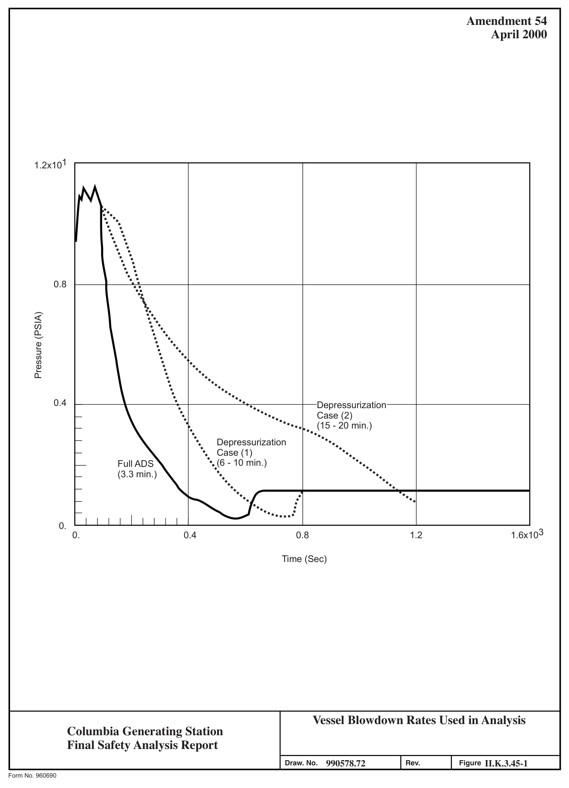

*figure on PDF page 545*

[Vector original (SVG, lossless): fig_page-545.svg](../figures/fig_page-545.svg)

<!-- labels/text on this figure page -->
Amendment 54 April 2000
1.2x101
...... . .
. .
. .
. .
. .
. .
. . . .
. .
. . . .
. .
. .
. .
...
0.8
Pressure (PSIA)
0.4 ······· ······· ... ... •• •• •• .. •• .. •• •• .. •• Depressurization Case (2)
(15 - 20 min.)
Depressurization Case (1)
(6 - 10 min.) Full ADS
(3.3 min.)
• ••
0.
1.6x103 0.
0.4 0.8
1.2
Time (Sec)
Vessel Blowdown Rates Used in Analysis Columbia Generating Station Final Safety Analysis Report 990578.72 II.K.3.45-1 Draw. No. Rev. Figure Form No. 960690

<!-- p.546 -->
III.D.1.1 Primary Coolant Sources Outside Containment

Position (Full Power License Requirement)

Applicants shall implement a program to reduce leakage from systems outside containment that would or could contain highly radioactive fluids during a serious transient or accident to aslow-as-practical levels. This program shall include the following:

a. Immediate Leak Reduction

1. Implement all practical leak reduction measures for all systems that could carry radioactive fluid outside of containment.

2. Measure actual leakage rates with system in operation and report them to the NRC.

b. Continuing Leak Reduction

1. Establish and implement a program of preventive maintenance to reduce leakage to as-low-as-practical levels. This program shall include periodic integrated leak tests at intervals not to exceed each refueling cycle.

Dated Requirement

Applicants shall submit the information requested in the "Clarification" section of this position at least 4 months prior to issuance of a fuel-loading license.

This requirement shall be implemented by applicants for operating license prior to issuance of a full-power license. See NUREG-0737, Section III.D.1.1.

Clarification

Applicants shall provide a summary description, together with initial leak-test results, of their program to reduce leakage from systems outside containment that would or could contain primary coolant or other highly radioactive fluids or gases during or following a serious transient or accident.

a. Systems that should be leak tested are as follows (any other plant system which has similar functions or postaccident characteristics even though not specified herein, should be included):

• Residual heat removal (RHR),

#### B.3-1
<!-- p.547 -->
• Containment spray recirculation,

• High pressure injection recirculation,

• Containment and primary coolant sampling,

• Reactor core isolation cooling,

• Makeup and letdown (PWRs only),

• Waste gas (includes headers and cover gas system outside of containment in addition to decay or storage system).

Include a list of systems containing radioactive materials which are excluded from program and provide justification for exclusion.

b. Testing of gaseous systems should include helium leak detection or equivalent testing methods.

c. Should consider program to reduce leakage potential release paths due to design and operator deficiencies as discussed in our letter to all operating nuclear power plants regarding North Anna and related incidents, dated October 17, 1979.

This requirement applies to all operating license applicants.

Columbia Generating Station Position

Columbia Generating Station has performed a systems design review and established criteria for a surveillance/preventive maintenance program to limit to as-low-as-practical, leakage from systems outside containment which could transport highly radioactive fluids during a serious transient or accident.

a. Systems Review

The systems for leak paths for primary coolant outside containment showed three potentially unisolated leak paths which could contain highly radioactive fluids during a serious accident or transient. These three leak paths originate at the reactor building sumps with a transport pathway to the waste collection tanks in the radwaste building. The three leak path lines have been addressed in a licensing technical change. Dual auto-isolation valves have been added to each of the three lines along with accompanying isolation logic.

#### B.3-2
<!-- p.548 -->
b. Leakage Monitoring

A leakage surveillance and preventive maintenance program* for those systems within secondary containment which could transport highly radioactive fluids in the case of a serious reactor transient or accident has the following features.

1. Designation of systems included within the leakage surveillance and preventive maintenance program:

(a) Residual Heat Removal,
(b) Reactor Core Isolation Cooling,
(c) High Pressure Core Spray,
(d) Low Pressure Core Spray,
(e) Primary Containment Atmospheric Control,
(f) Primary Containment Atmospheric Monitoring,
(g) Post Accident Sampling.

2. A system list which identifies the components to be inspected, the method of inspection or measurement, and the surveillance frequency.

3. Routine inspections by operators of visually accessible portions of designated systems during normal operating conditions or test mode.

4. Detailed leakage inspection and measurement defined for designated systems during initial test program and thereafter.

5. An aggressive preventive maintenance program with high priority assigned to leakage-related work or designated systems.

6. A review cycle for leakage-related work requests to evaluate possible modifications to keep leakage as low as is reasonably achievable.

III.D.3.3 Improved Inplant Iodine Instrumentation Under Accident Conditions

Position (NUREG-0737)

a. Each licensee shall provide equipment and associated training and procedures for accurately determining the airborne iodine concentration in areas within the facility where plant personnel may be present during an accident.

* This program takes exception for those systems which cannot be tested until startup due to required plant conditions. Program documentation will be available onsite for NRC I&E review.

#### LDCN-00-018, 01-00A
#### B.3-3
<!-- p.549 -->
b. Each applicant for a fuel-loading license to be issued prior to January 1, 1981 shall provide the equipment, training, and procedures necessary to accurately determine the presence of airborne radioiodine in areas within the plant where plant personnel may be present during an accident.

Clarification

Effective monitoring of increasing iodine levels in the buildings under accident conditions must include the use of portable instruments using sample media that will collect iodine selectively over xenon (e.g., silver ziolite) for the following reasons:

a. The physical size of the auxiliary and/or fuel handling building precludes locating stationary monitoring instrumentation at all areas where airborne iodine concentration data might be required.

b. Unanticipated isolated “hot spots” may occur in locations where no stationary monitoring instrumentation is located.

c. Unexpectedly high background radiation levels near stationary monitoring instrumentation after an accident may interfere with filter radiation readings.

d. The time required to retrieve samples after an accident may result in high personnel exposures if these filters are located in high-dose-rate areas.

After January 1, 1981, each applicant and licensee shall have the capability to remove the sampling cartridge to a low background, low contamination area for further analysis.
Normally, counting rooms in auxiliary buildings will not have sufficiently low backgrounds for such analyses following an accident. In the low background area, the sample should first be purged of any entrapped noble gases using nitrogen gas or clean air free of noble gases. The licensee shall have the capability to measure accurately the iodine concentrations present on these samples under accident conditions. There should be sufficient samplers to sample all vital areas.

For applicants with fuel loading dates prior to January 1, 1981, provide by fuel loading (until January 1, 1981) the capability to accurately detect the presence of iodine in the region of interest following an accident. This can be accomplished by using a portable or cart-mounted iodine sampler with attached single-channel analyzer (SCA). The SCA window should be calibrated to the 365 KeV of Iodine-131 using the SCA. This will give an initial conservative estimate of presence of iodine and can be used to determine if respiratory protection is required. Care must be taken to assure that the counting system is not saturated as a result of too much activity collected on the sampling cartridge.

#### B.3-4
<!-- p.550 -->
Columbia Generating Station Position

This italicized information is historical and was provided to support the application for an operating license. The FSAR contains descriptions for this instrumentation in the following sections: 7.5.2.2.3, 12.3.4.2, 12.3.4.4, 12.5.2.1, 12.5.3.5, and Emergency Plan Section 8.7.5.

Columbia Generating Station is responding to this position as follows: Four fixed, one mobile continuous air monitoring system, and one movable local alarming continuous air monitor are provided for air sampling in plant areas where personnel may be present during accident conditions. In addition, 10 low volume air sampling systems will be strategically located throughout the plant in frequently occupied areas to continuously draw air samples for subsequent analysis.

Grab samples will be obtained using varying volume air samplers that are both ac and dc powered.

Movable local alarming continuous air monitors are placed at predetermined plant locations for personnel protection and to substantiate the quality of the plant breathing atmosphere.
These monitors have local readouts (charts) and radioiodine sampling capabilities.

Energy Northwest is currently using activated charcoal cartridges for radioiodine analysis and is evaluating the attributes of silver zeolite. On completion of a satisfactory evaluation Energy Northwest will, where applicable, incorporate silver zeolite into its air sampling program. The charcoal cartridges are used in conjunction with a Ge (Li) gamma spectroscopy system located in a low background, low contamination area such as the radiochemistry lab in the near site facility. Prior to analysis, cartridges are purged in a fume hood using plant air, instrument air, bottled air, or bottled nitrogen which is stored onsite.

Station procedures are provided for obtaining and evaluating both routine and non-routine air samples. In addition to initial training provided for Health Physics/Chemistry personnel, periodic drills are conducted in accordance with the Emergency Plan.

This position has been accepted in the NRC Safety Evaluation Report, NUREG-0892, dated December 1982, Section 12.5.2.

#### B.3-5
<!-- p.551 -->

Appendix F

#### FIRE PROTECTION EVALUATION

#### TABLE OF CONTENTS

Section Page

F.1 INTRODUCTION ........................................................................ F.1-1

F.1.1 FIRE PROTECTION PROGRAM .................................................. F.1-2

F.1.2 BACKGROUND ....................................................................... F.1-3

F.2 FIRE PROTECTION SYSTEMS ...................................................... F.2-1

F.2.1 APPLICABLE INDUSTRY STANDARDS....................................... F.2-2

F.2.2 FIRE RESISTIVE CONSTRUCTION.............................................. F.2-3

F.2.2.1 Fire Area Boundary Features ...................................................... F.2-4

F.2.2.2 Raceway Fire Barriers .............................................................. F.2-5

F.2.2.3 Fireproof Coatings................................................................... F.2-5

F.2.2.4 Electrical Separation Barriers...................................................... F.2-6

F.2.2.5 Reactor Building ..................................................................... F.2-6

F.2.2.6 Radwaste/Control Building......................................................... F.2-7

F.2.2.7 Turbine Generator Building ........................................................ F.2-7

F.2.2.8 Diesel Generator Building .......................................................... F.2-8

F.2.2.9 Standby Service Water Pump Houses No. 1A and 1B ........................ F.2-9

F.2.2.10 Service Building .................................................................... F.2-9

F.2.2.11 Circulating Water Pump House and Chlorination Building ................. F.2-9

F.2.2.12 Cooling Towers..................................................................... F.2-9

F.2.2.13 Water Filtration Building 33...................................................... F.2-9

F.2.2.14 North Yard Transformers ......................................................... F.2-9

F.2.2.15 Technical Support Center ......................................................... F.2-9

F.2.2.16 Alternate Health Physics Building ............................................... F.2-9

F.2.2.17 Reactor Recirculation Pump Adjustable Speed Drive Building............. F.2-10

F.2.3 FIRE DETECTION AND ALARM SYSTEMS .................................. F.2-10

F.2.4 FIRE SUPPRESSION SYSTEMS................................................... F.2-11

F.2.4.1 Fire Protection Water Supplies .................................................... F.2-12

F.2.4.2 Wet Pipe Sprinkler Systems........................................................ F.2-14

F.2.4.3 Preaction Sprinkler Systems........................................................ F.2-15

F.2.4.4 Deluge Water Spray Systems ...................................................... F.2-15

F.2.4.5 Carbon Dioxide Fire Suppression Systems ...................................... F.2-16

F.2.4.6 Halon 1301 Fire Suppression Systems ........................................... F.2-17

F.2.4.7 Dry Chemical Fire Suppression Systems ........................................ F.2-17

#### LDCN-06-001, 09-022

F-i

<!-- p.552 -->

Appendix F

#### FIRE PROTECTION EVALUATION

TABLE OF CONTENTS (Continued)

Section Page

F.2.5 MANUAL FIRE FIGHTING EQUIPMENT...................................... F.2-17

F.2.5.1 Protective Clothing and Self-Contained Breathing Apparatus................ F.2-17

F.2.5.2 Yard Fire Hydrants and Hydrant Hose Equipment............................. F.2-18

F.2.5.3 Standpipes, Hose, and Foam Carts ............................................... F.2-18

F.2.5.4 Portable Extinguishers .............................................................. F.2-18

F.2.5.5 Smoke Removal ...................................................................... F.2-18

F.2.6 OPERATOR ACTION EQUIPMENT.............................................. F.2-19

F.2.6.1 Emergency Lighting ................................................................. F.2-19

F.2.6.2 Emergency Communications....................................................... F.2-19

F.2.7 INSPECTION AND TESTING...................................................... F.2-19

#### F.3 COMPLIANCE WITH FIRE PROTECTION REGULATORY

DOCUMENTS ............................................................................ F.3-1

F.4 FIRE HAZARDS ANALYSIS.......................................................... F.4-1

F.4.1 PLANT FIRE AREA ARRANGEMENT.......................................... F.4-1

F.4.2 DESIGN BASIS FIRE................................................................. F.4-2

F.4.2.1 Combustible Loading Assumptions ............................................... F.4-2

F.4.2.2 Combustible Loading Calculations Methodology............................... F.4-3

F.4.2.3 Fire Protection Engineering Evaluations......................................... F.4-4

F.4.3 POST-FIRE SAFE SHUTDOWN................................................... F.4-4

F.4.3.1 Normal Post-Fire Safe Shutdown Equipment ................................... F.4-9

F.4.3.2 Remote Post-Fire Safe Shutdown Equipment ................................... F.4-10

F.4.4 FIRE AREA ANALYSES ............................................................ F.4-11

F.4.4.1 Post-Fire Safe Shutdown............................................................ F.4-11

F.4.4.2 Control of Radioactive Release .................................................... F.4-12

F.4.4.3 Scope of Areas Evaluated in Fire Hazards Analysis........................... F.4-21

F.4.4.4 Detailed Fire Hazards Analysis by Fire Area................................... F.4-27

Fire Area DG-1 ...................................................................... F.4-27

Fire Area DG-2 ...................................................................... F.4-30

Fire Area DG-3 ...................................................................... F.4-33

Fire Area DG-4 ...................................................................... F.4-36

Fire Area DG-5 ...................................................................... F.4-39

Fire Area DG-6 ...................................................................... F.4-42

Fire Area DG-7 ...................................................................... F.4-45

F-ii

<!-- p.553 -->

Appendix F

#### FIRE PROTECTION EVALUATION

TABLE OF CONTENTS (Continued)

Section Page

Fire Area DG-8 ...................................................................... F.4-48

Fire Area DG-9 ...................................................................... F.4-51

Fire Area DG-10 ..................................................................... F.4-54

Fire Area R-1 ........................................................................ F.4-56

Fire Area R-2 ........................................................................ F.4-64

Fire Area R-3 ........................................................................ F.4-67

Fire Area R-4 ........................................................................ F.4-70

Fire Area R-5 ........................................................................ F.4-73

Fire Area R-6 ........................................................................ F.4-76

Fire Area R-7 ........................................................................ F.4-79

Fire Area R-8 ........................................................................ F.4-82

Fire Area R-9 ........................................................................ F.4-85

Fire Area R-10 ....................................................................... F.4-87

Fire Area R-11 ....................................................................... F.4-89

Fire Area R-12 ....................................................................... F.4-91

Fire Area R-15 ....................................................................... F.4-93

Fire Area R-18 ....................................................................... F.4-95

Fire Area R-21 ....................................................................... F.4-97

Fire Area M-9 ........................................................................ F.4-99

Fire Area M-21 ...................................................................... F.4-102

Fire Area M-27 ...................................................................... F.4-105

Fire Area RC-1 ...................................................................... F.4-111

Fire Area RC-2 ...................................................................... F.4-115

Fire Area RC-3 ...................................................................... F.4-118

Fire Area RC-4 ...................................................................... F.4-121

Fire Area RC-5 ...................................................................... F.4-124

Fire Area RC-6 ...................................................................... F.4-127

Fire Area RC-7 ...................................................................... F.4-129

Fire Area RC-8 ...................................................................... F.4-132

Fire Area RC-9 ...................................................................... F.4-134

Fire Area RC-10 ..................................................................... F.4-137

Fire Area RC-11 ..................................................................... F.4-140

Fire Area RC-12 ..................................................................... F.4-143

Fire Area RC-13 ..................................................................... F.4-146

F-iii

<!-- p.554 -->

Appendix F

#### FIRE PROTECTION EVALUATION

TABLE OF CONTENTS (Continued)

Section Page

Fire Area RC-14..................................................................... F.4-149

Fire Area RC-15..................................................................... F.4-152

Fire Area RC-16..................................................................... F.4-154

Fire Area RC-17..................................................................... F.4-156

Fire Area RC-18..................................................................... F.4-158

Fire Area RC-19..................................................................... F.4-160

Fire Area RC-20..................................................................... F.4-162

Fire Area SW-1 ...................................................................... F.4-165

Fire Area SW-2 ...................................................................... F.4-167

Fire Area TG-1 ...................................................................... F.4-169

Fire Area TG-3 ...................................................................... F.4-180

Fire Area TG-4 ...................................................................... F.4-182

Fire Area TG-6 ...................................................................... F.4-184

Fire Area TG-8 ...................................................................... F.4-187

Fire Area ASD....................................................................... F.4-189

#### F.5 ESSENTIAL FIRE PROTECTION SYSTEM OPERABILITY/TESTING

PROGRAM ................................................................................ F.5-1

F.6 FIRE PROTECTION ARRANGEMENT DRAWINGS ........................... F.6-1

F.7 FIRE PROTECTION PROGRAM REFERENCES ................................ F.7-1

#### F.7.1 REGULATORY DOCUMENTS/OTHER FSAR FIRE PROTECTION

COMMITMENTS...................................................................... F.7-1

F.7.1.1 Columbia Generating Station Regulatory Requirements ..................... F.7-1

F.7.1.2 Columbia Generating Station Commitments.................................... F.7-1

F.7.2 INDUSTRY GUIDANCE ............................................................ F.7-2

F.7.3 CALCULATIONS/TECHNICAL MEMOS....................................... F.7-4

F.7.4 APPLICABLE NRC SAFETY EVALUATION REPORTS.................... F.7-5

F.7.5 OTHER MISCELLANEOUS ........................................................ F.7-6

F.7.6 FIRE PROTECTION ENGINEERING EVALUATIONS ...................... F.7-8

F.7.7 FIRE PROTECTION REFERENCE DRAWINGS .............................. F.7-9

F.7.8 FIRE PROTECTION PROGRAM IMPLEMENTING PROCEDURES ..... F.7-10

#### LDCN-04-037, 08-003, 08-029, 09-022

F-iv

<!-- p.555 -->

Appendix F

#### FIRE PROTECTION EVALUATION

#### LIST OF TABLES

Number Title Page

F.2-1 Code Deviations ................................................................ F.2-21

F.3-1 Comparison with BTP 9.5-1 Appendix A ................................. F.3-3

F.3-2 Comparison with the Specific Commitments to 10 CFR 50

Appendix R ..................................................................... F.3-58

F.4-1 Required Post-Fire Safe Shutdown (PFSS) Equipment .................. F.4-15

F-v

<!-- p.556 -->
Appendix F

#### FIRE PROTECTION EVALUATION
#### LIST OF FIGURES
Number Title

F.6-1 Fire Area Boundary Plan - Ground Floor

F.6-2 Fire Area Boundary Plan - Mezzanine Floors

F.6-3 Fire Area Boundary Plan - Operating Floors

F.6-4 Fire Area Boundary Plan - Reactor Building Miscellaneous Elevations

F.6-5 Fire Area Boundary Plan - Miscellaneous Floors and Buildings

F.6-6 Zones of Limited Combustibles - Reactor Building

F.6-7 Fire Suppression System Plan - Elevations 437 ft 0 in., 441 ft 0 in., and Miscellaneous Floors

F.6-8 Fire Suppression System Plan - Elevations 467 ft 0 in., 471 ft 0 in., and Miscellaneous Floors

F.6-9 Fire Suppression System Plan - Elevations 501 ft 0 in. to 525 ft 0 in.

F.6-10 Fire Suppression System Plan - Reactor Building Miscellaneous Elevations

F.6-11 Fire Suppression System Plan - Miscellaneous Floors and Buildings

F.6-12 Post-Fire Safe Shutdown - Residual Heat Removal and Automatic Depressurization System Piping and Instrument Diagram

F.6-13 Post-Fire Safe Shutdown - Nuclear Boiler Instrumentation System Piping and Instrument Diagram

F.6-14 Post-Fire Safe Shutdown - Standby Service Water System Piping and Instrument Diagram

F.6-15 Post-Fire Safe Shutdown - Radwaste Building Heating, Ventilating, and Air Conditioning Piping and Instrument Diagram

F-vi

<!-- p.557 -->
Appendix F

#### FIRE PROTECTION EVALUATION
LIST OF FIGURES (Continued)

Number Title

F.6-16 Post-Fire Safe Shutdown - Reactor Building Heating, Ventilating, and Air Conditioning Piping and Instrument Diagram

F.6-17 Post-Fire Safe Shutdown - Standby Service Water Pumphouses and Diesel Generator Building Heating, Ventilating, and Air Conditioning Piping and Instrument Diagram

F.6-18 Access Egress for Post-Fire Safe Shutdown Activities – Ground, Mezzanine Floors

F.6-19 Access Egress for Post-Fire Safe Shutdown Activities - Operating Floor

F.6-20 Access Egress for Post-Fire Safe Shutdown Activities - Miscellaneous Reactor Building Floors

F.6-21 Fire Main Ring Header

F-vii

<!-- p.558 -->
Appendix F

#### FIRE PROTECTION EVALUATION
#### F.1 INTRODUCTION
The Fire Protection Evaluation summarizes the overall fire protection program (FPP) at Columbia Generating Station (CGS). The Fire Protection Evaluation describes those fire protection related organizational responsibilities, administrative and technical controls, fire suppression and detection systems, fire hazards analyses, and the post-fire safe shutdown methods, which comprise the FPP. Columbia Generating Station FPP performance goals include:

Defense-in-Depth The CGS FPP uses the concept of defense-in-depth to achieve the required degree of reactor safety. This concept entails the use of echelons of administrative controls, fire protection systems and features, and post-fire safe-shutdown capability to achieve the following objectives:

a. Prevent fires from starting.
b. Detect rapidly, control, and extinguish promptly those fires that do occur.
c. Provide protection for structures, systems, and components (SSC) important to safety so that a fire that is not promptly extinguished by the fire suppression activities will not prevent the safe shutdown of the plant.

Safety-Related Structures, Systems, and Components NRC General Design Criteria (GDC) 3 of Appendix A to 10 CFR Part 50 requires that the FPP protect SSCs important to safety from the effects of fire. However, the postfire loss of function of systems used to mitigate the consequences of design-basis accidents does not per se impact public safety. The FPP must protect all equipment important to safety; however, the need to limit fire damage to systems required to achieve and maintain post-fire safe-shutdown conditions is greater than the need to limit fire damage to those systems required to mitigate the consequences of design-basis accidents.

Post-Fire Safe-Shutdown The CGS FPP ensures that one success path of SSCs necessary for hot shutdown is free of fire damage. The reactor safety and performance goals for safe shutdown after a fire should ensure that the specified acceptable fuel design limits are not exceeded.
Section III.L of Appendix R to 10 CFR Part 50 is followed for post-fire reactor safety and performance goals for alternate remote shutdown.

#### F.1-1
<!-- p.559 -->
Prevention of Radiological Release The CGS FPP demonstrates that the plant will maintain the ability to minimize the potential for radioactive releases to the environment in the event of a fire. Fires are treated as anticipated operational occurrences as defined in Appendix A to 10 CFR Part 50.

The CGS structures that must satisfy the FPP are those buildings designated as “Plant Areas” in references F.7.8.b through F.7.8.f procedures.

#### F.1.1 FIRE PROTECTION PROGRAM
The approved fire protection program and the changes thereto are contained in this Appendix of the FSAR except for certain other sections of the FSAR included in the Fire Protection Program by Reference F.7.1.

Appendix F is divided into seven sections. This first section contains background information on the development of the fire protection program.

Section F.2 contains a description of the plant fire protection systems. The codes and standards considered and used in the design of the systems are listed. Deviations from code design commitments are identified.

Section F.3 presents point-by-point comparisons of the plant fire protection program to the guidelines of Branch Technical Position (BTP) APCSB 9.5-1 Appendix A, and with the specific commitments to 10 CFR 50, Appendix R, Section III.

Section F.4 describes the methods used to implement the post-fire safe shutdown protection commitments to 10 CFR 50, Appendix R. The selection of the post-fire shutdown equipment and the circuit analysis methods are also described in Section F.4. The fire hazards analysis for each fire area describes the respective area, combustible loading, fire protection features which may be used to mitigate the consequences of a potential fire, and the methods used to ensure post-fire safe shutdown capability.

Section F.5 references Licensee Controlled Specifications (LCS) 1.10 that contain the fire protection system operational conditions, compensatory measures, and testing requirements for the essential portions of the fire protection systems.

Section F.6 contains the fire protection arrangement drawings and Section F.7 lists the references.

#### F.1-2
<!-- p.560 -->
#### F.1.2 BACKGROUND
NRC General Design Criteria for Nuclear Power Plants, Appendix A of 10 CFR 50 establish the minimum requirements for the design of nuclear power plants. See FSAR Section 3.1.2.1.3 for the CGS comparison to GDC Criterion 3 for fire protection.

The construction permit for CGS was granted March 1973 and the design of the plant fire systems began in the following years. Section F.2.1 describes the code-of record edition of the committed fire codes followed for plant design. Section 1.2.2.12.11 provides a summary of the CGS fire protection systems.

Following the March 22, 1975 Browns Ferry Fire, BTP APCSB 9.5-1, Appendix A was issued. On September 30, 1976, Energy Northwest was requested to conduct an evaluation of the FPP at CGS using the guidelines in BTP APCSB 9.5-1 Appendix A. Since then, the comparison to BTP APCSB 9.5-1, Appendix A has been maintained current in FSAR Appendix F, Table F.3-1.

10 CFR 50, Appendix R and 10 CFR 50.48 became effective on February 17, 1981.

## 10 CFR 50, Appendix R added new expectations for the fire protection of safe shutdown
capability, emergency lighting, and lubricating oil collection systems for non-inerted containment reactor coolant pumps. Appendix R, Sections III.G/L, III.J, and III.O are

## 10 CFR 50.48 requirements for plants licensed to operate prior to January 1, 1979. Columbia
Generating Station received its operating license on December 20, 1983 and Appendix R is not an applicable regulation to CGS. In letter dated October 15, 1981, the NRC requested CGS submit a comparison to Appendix R that would be used as a guideline for review of fire protection requirements. In NRC Safety Evaluation Report (SER) dated March 1982 Section 9.5.1 indicated Energy Northwest agreed to conform to 10 CFR 50, Appendix R. The above paragraph discussion indicates Appendix R to 10 CFR 50 is a commitment for CGS and not an applicable regulatory requirement. Therefore, CGS is not an “Appendix R plant,” but does maintain a comparison to all the sections of Appendix R as “commitments” in FSAR Table F.3-2. Deviations to 10 CFR 50, Appendix R are documented in Table F.3-2.
A deviation to Appendix R, Sections III.G/L and III.J has a higher potential to impact the ability to achieve post-fire safe shutdown. Since CGS has an inerted primary containment, Appendix R, Section III.O is not applicable.

From 1982 to 1989, various NUREG-0892 NRC SERs for the CGS FPP were issued.
Section F.7.4 lists the SERs for the CGS FPP. These SERs compared CGS to the Standard Review Plan BTP CMEB 9.5.1 (which includes the combined guidelines of BTP 9.5-1, Appendix A and 10 CFR 50, Appendix R).

Generic Letters 86-10 and 88-12 provided guidance on moving the fire protection Technical Specifications into the FSAR and adopting the standard fire protection license condition. Each of these changes was approved in SER dated May 25, 1989 and incorporated into Facility

#### F.1-3
<!-- p.561 -->
Operating License (FOL) Amendment 67 (see Reference F.7.4.m). The fire protection system Technical Specifications was moved to FSAR F.5 but later moved to LCS 1.10.

Facility Operating License Amendment 67 modified FOL Condition 2.C.(14) such that the approved FPP (FSAR Amendment 39 and SERs) may be altered without prior NRC approval provided the change does not adversely impact the ability to achieve and maintain safe shut down in the event of fire. Based on the FOL Condition 2.C.(14) criteria and initial date of issuance, numerous FSAR changes have been made to Appendix F since FSAR Amendment 39. The FOL Condition 2.C.(14) “approved CGS FPP” is the current amendment of FSAR Appendix F and its referenced documents.

Based on the above, section F.7.1 lists the applicable FPP regulatory requirements and commitments.

#### F.1-4
<!-- p.562 -->
#### F.2 FIRE PROTECTION SYSTEMS
Fire protection is provided through a combination of active and passive features which function to detect, contain, and suppress potential fires. These features include:

a. Fire resistive construction

b. Fire detection and alarm systems

c. Fire suppression systems

1. Fire water supply system

2. Deluge water spray systems

3. Wet pipe sprinkler systems

4. Preaction sprinkler systems

5. Carbon dioxide systems

6. Halon 1301 systems

7. Dry chemical suppression systems

d. Manual fire fighting equipment

1. Protective clothing and self-contained breathing apparatus (SCBA)

2. Yard fire hydrants

3. Standpipes, hose, and foam carts

4. Portable extinguishers

5. Smoke removal

#### F.2-1
<!-- p.563 -->
e. Operator action equipment

1. Emergency lighting

2. Emergency communications

The design of the plant fire protection features is described below.

#### F.2.1 APPLICABLE INDUSTRY STANDARDS
The following industry standards are used, where applicable, in the design of the fire protection systems serving the reactor building, radwaste/control building, diesel generator building, turbine generator building, circulating water pump house, water filtration building 33, and transformer yard. Design-related differences between the installed plant configuration and industry standards are listed in Table F.2-1. See Section F.2.7 for inspection and testing.

a. NFPA 10 - 1975, Standard for Portable Fire Extinguishers;

b. NFPA 12 - 1973, Standard on Carbon Dioxide Extinguishing Systems;

c. NFPA 12A - 1973, Standard on Halogenated Fire Extinguishing Agent-Halon 1301;

d. NFPA 13 - 1975, Standard for the Installation of Sprinkler Systems;

e. NFPA 14 - 1974, Standard for the Installation of Standpipe and Hose Systems;

f. NFPA 15 - 1973, Standard for Water Spray Fixed Systems for Fire Protection;

g. NFPA 20 - 1974, Standard for the Installation of Centrifugal Fire Pumps;

h. NFPA 24 - 1973, Standard for Outside Protection;

i. NFPA 30 - 1973, Standard for Flammable and Combustible Liquids Code. See Table F.3-1 paragraph D.2.d for applicability;

j. NFPA 50A - 1973, Standard for Gaseous Hydrogen Systems at Consumer Sites.
See Table F.3-1 paragraph D.2.b for applicability;

k. NFPA 70 - 1975, National Electric Code. Used for the design of electrical equipment and wiring for the main control room cabinet Halon 1301 systems and for wiring of the fire detection and alarm initiating devices;

#### F.2-2
<!-- p.564 -->
l. NFPA 72A - 1975, Standard for the Installation, Maintenance and Use of Local Protective Signaling Systems for Watchman, Fire Alarm and Supervisory Service;

m. NFPA 72D - 1975, Standard for the Installation, Maintenance and Use of Proprietary Protective Signaling Systems for Guard, Fire Alarm, and Supervisory Service;

n. NFPA 72E - 1974, Standard for Automatic Fire Detectors;

o. NFPA 78 - 1975, Lightning Protection Code. See Table F.3-1 paragraph A.4 for applicability;

p. NFPA 80 - 1974, Standard for Fire Doors and Windows;

q. NEDO-10466-A, Power Generation Control Complex Design Criteria and Safety Evaluation. See Table F.3-1 paragraph E.4.a for applicability;

r. IEEE 383-1974, Standard for Type Test of Class 1E Electric Cables, Field Splices, and Connections for Nuclear Power Generating Stations. Where cable does not meet IEEE 383, NFPA 262-1990 or UL 910-1985 may be used. See Table F.3-1 paragraph D.3.f for further clarification;

s. Regulatory Guide 1.52, Revision 1, Design, Testing, and Maintenance Criteria for Atmosphere Cleanup System Air Filtration and Adsorption Units of Light-Water-Cooled Nuclear Power Plants. See Table F.3-1 paragraph D.4.d for applicability;

t. ANSI A21.4,-1974. See Table F.3-1 paragraph E.2.a for applicability;

u. NFPA 72-2013, National Fire Alarm and Signaling Code. See F.2.3 for applicability;

v. AMSE A.17.1 – 2010, Safety Code for Elevators. For Elevator Fire Protection Panel FP-CP-MT4; and

w. NFPA 72 – 2010, National Fire Alarm and Signaling Code. For Elevator Fire Protection Panel FP-CP-MT4.

Current editions of the above codes are used for modifications and additions to the plant fire protection systems when new facilities or systems are constructed or enhanced and defense-in-depth is warranted. In some cases, the guidance of more recent code editions may be followed which deviates from designs of the above code of record, without a corresponding Table F.2-1 discussion (when managed through administrative controls and maintained as a plant record).

#### LDCN-17-002, 15-063
#### F.2-3
<!-- p.565 -->
#### F.2.2 FIRE RESISTIVE CONSTRUCTION
Fire barriers and fire resistive construction prevent the spread of fire from one location to another. Fire resistance is provided in building construction through the use of noncombustible structural materials. Rated fire barriers further isolate certain high hazard areas and provide additional separation for those systems needed for post-fire safe shutdown.

Essential fire rated assemblies are those fire area boundary features which separate fire areas with redundant post-fire safe shutdown equipment/cables or those fire areas containing redundant post-fire safe shutdown cables where one division is protected by raceway fire barriers. The overall category of fire rated assemblies (see LCS 1.10.5) can be broken into subcategories of fire area boundary features, raceway fire barriers, and fireproof coatings.

Figures F.6-1 through F.6-5 show the fire area boundaries, barrier hourly fire ratings, and barrier classifications. Reference F.7.7.o is the raceway fire barrier drawings.

F.2.2.1 Fire Area Boundary Features

Structural fire barriers may be provided by wall, floor, or ceiling assemblies. The fire rating of structural fire barriers is described in Section F.4 fire hazards analysis. A concrete wall with a thickness of 6 in. or greater provides a 3-hr rating. Based on the construction of masonry fire barriers, the fire rating may vary from 2 to 3 hr. The fire resistance rating for structures is determined using information from the NFPA Fire Protection Handbook, vendor data, industry fire resistance directories, and/or engineering evaluation. The containment fire barrier is not a standard 3-hr rated assembly but is adequate to prevent fire propagation.

Fire doors, fire dampers, and fire rated penetration seals are typically designed with a fire rating equivalent to that of the structural barrier in which they are installed. The 2-hr barriers may have 1.5-hr rated doors and dampers.

Fire doors are installed to the guidelines of NFPA 80 - 1974, with exceptions contained in Table F.2-1. Non-fire rated specialty doors (air lock, flood, radiation shield, and blast doors)
located in fire barriers are installed based on equivalent door construction, as approved in Reference F.7.4.c.

Penetrations for ventilation systems through fire rated barriers are protected by fire dampers.
Some plant areas have 1.5-hr rated fire dampers in 3-hr barriers, as approved by Reference F.7.4.a. Certain fire damper assemblies consist of a 3-hr listed fire door as the guillotine or trap door, installed in unlisted frames or supports. The construction and installation of the frames and supports is similar to listed assemblies. Although the design has not been fire tested and listed as a fire damper assembly, it was approved by Reference F.7.4.f. As approved in Reference F.7.4.l, fire dampers are not drop tested under air flow conditions since administrative controls are present to shut down ventilation on confirmation of a fire. All fire dampers in rooms containing safety-related equipment are qualified to Seismic Category I.

#### F.2-4
<!-- p.566 -->
Conduit, piping, and cable penetrations are sealed where they pass through the barrier, except for some internal conduit seals where evaluation has shown no seal is required. Penetration seals provide a fire resistance equal to that of the barrier unless a fire protection evaluation has justified a lesser fire rating. Grouted penetrations are sealed with grout to the same thickness of the wall and are assumed not to degrade the rating of the penetrated fire barrier. The fire rating of nongrouted penetration seal designs is established by tests performed in accordance with Reference F.7.6.b. Qualification of fire-rated and pressure-rated penetration seals is contained in Reference F.7.6.a. Configuration control of penetration seals is maintained by Reference F.7.5.q.

The containment barrier and penetrations are nonstandard fire barriers not qualified by representative fire testing. See Section F.2.2.5 for more details.

F.2.2.2 Raceway Fire Barriers

Raceway fire barriers are used to prevent damage to designated circuits within a fire area in the event the redundant post-fire safe shutdown circuits are damaged by fire. Raceway fire barriers wraps are constructed of Darmatt KM-1, or 3M Interam E-50D/E54A.
Darmatt KM-1 raceway fire barriers are installed to 1 or 3-hr rated designs qualified by fire testing meeting Generic Letter 86-10 Supplement 1 acceptance criteria (Reference F.7.6.m).
3M Interam raceway fire barriers are installed to 3-hr rated designs qualified by fire testing meeting Generic Letter 86-10 acceptance criteria (Reference F.7.6.k). Structural steel supports and intervening steel members for raceway fire barriers are wrapped to the distance qualified by fire testing. Load bearing supports in 1-hr fire areas need not be protected to the structural barrier (Reference F.7.3.g). Reference F.7.4.f approved that unprotected commodities can be located above raceway fire barriers wraps.

A second category of raceway fire barriers is Whittaker mineral insulated (MI) fire rated cable.
MI fire rated cable is 3-hr rated in Fire Areas R-1 and TG-1, and credited as 1-hr rated in Fire Area RC-3 (Reference F.7.6.j). In 3-hr areas, the MI fire rated cable is routed to ensure the fire induced collapse of unprotected items does not adversely affect cable operability
(Reference F.7.7.o). The support designs limit the amount of zinc exposure and the potential for liquid metal embrittlement (Reference F.7.5.u and F.7.7.o).

F.2.2.3 Fireproof Coatings

Thermo-Lag 330-1 is used as a fire resistive coating on certain reactor building structural steel members supporting post-fire safe shutdown credited instrument tubing and tray support TS-5269 to protect Whittaker MI fire rated cable routed below (Reference F.7.6.l).

#### F.2-5
<!-- p.567 -->
F.2.2.4 Electrical Separation Barriers

Electrical separation barriers are present throughout the plant to limit internally generated fire damage to nearby redundant safety-related systems. See Section 8.3.1.4 for more detail.

Plant building construction is further described below. The Section F.4.4.4 fire hazards analysis for each fire area has additional building construction and fire rating details.

F.2.2.5 Reactor Building

Exterior walls, floors, and ceilings are reinforced concrete from the top of the foundation mat to the refueling floor level. The minimum thickness of reinforced-concrete walls is 1 ft. From the refueling level to the top of the roof, the exterior walls are framed with structural steel and are enclosed with insulated metal wall panels. The reactor building is separated from other plant buildings by 3-hr fire rated reinforced-concrete walls and nonrated steel airtight doors.
The building roof is a Factory Mutual Class I insulated steel roof deck.

Within the reactor building, Class 1E motor control centers are enclosed to provide separation from the general area hazards. Partial height concrete walls on the 471 ft, 501 ft, and 522 ft el. protect four Division 2 instrument racks. Fire barriers with nonrated steel flood doors separate the safety-related pump rooms below grade.

Primary containment is inerted during operation. There is no permanently installed fire protection equipment inside containment. Portable extinguishers and manual hoses are available for fire suppression when containment is deinerted for maintenance during plant outages.

The annular gap constructed between the metal shell and the primary containment vessel and the concrete biological shield wall, above 446 ft, is filled with a compressible insulating spacer system consisting of polyurethane flexible foam sheets butted at the joints and cemented directly to the primary containment shell, a jacket of premolded fiberglass reinforced polyester jacket panels, and epoxy flashing. The foam spacer is in a confined space, exposed to a minimal quantity of air through clearance around pipe penetrations. There is adequate spatial separation from the foam to the nearest combustible (electrical cable insulation) to reduce the possibility of a fire spreading into the foam liner. Mechanical penetrations within a 20-ft surface radius of Appendix R protected containment penetrations in Division 1 fire areas are 3-hr fire rated to ensure the combustible spacer/liner material does not ignite. Other containment mechanical penetrations have nonrated radiant energy refractory ceramic fiber seals. Fire spread in the annular gap would be very slow due to the limited space and oxygen deficient atmosphere. The metal vessel liner and the concrete bioshield wall would act as large heat sinks and further slow fire propagation. The use of refractory ceramic fiber seals was approved by Reference F.7.4.l.

#### F.2-6
<!-- p.568 -->
Stair and elevator shafts in the reactor building are constructed of noncombustible reinforced concrete. Air locks are constructed of reinforced concrete with steel airtight doors.

F.2.2.6 Radwaste/Control Building

The vital island section of the building consists of reinforced-concrete walls, floors, and ceilings from the top of the foundation mat up to and including the roof slab. The radwaste sections of the building are constructed of reinforced-concrete walls, floors, and ceilings at the lower levels and structural steel framing with reinforced-concrete floors and enclosure walls on insulated metal wall panels at the upper levels. The building roof is Factory Mutual Class I insulated steel roof deck.

The main control room walls are 3-hr rated reinforced concrete.

The main control room contains steel enclosed power generation control complex (PGCC)
units which are divisionally separated. Each unit consists of a false floor assembly, a vertical panel and/or benchboard panel, and a termination cabinet. All cables entering through the floor cable penetrations are sealed. The cables enter either directly into the false floor assembly to the control panels and terminate there or into an enclosed steel trough which extends to the termination cabinets. The remaining cables penetrating the control room floor behind the termination cabinets are compatible divisional cables routed in flexible metal conduit. Penetrations into the back of the panel assembly are fire stopped or sealed.

The remote shutdown room, the vital switchgear rooms and battery rooms, the reactor protection system rooms, and their respective mechanical equipment rooms are divisionally separated by 3-hr rated enclosures.

Stairs constructed of noncombustible material are enclosed in 2-hr minimum fire rated walls.
The elevator is enclosed in a reinforced-concrete shaft.

From grade level 441 ft to 460 ft, the west wall facing the alternate health physics building is 3-hr rated.

F.2.2.7 Turbine Generator Building

The turbine building is separated from all other areas of the plant by noncombustible reinforced masonry block and/or concrete construction with hollow metal or steel doors. The building roof is a Factory Mutual Class I insulated steel roof deck.

The exterior walls of the turbine building are reinforced concrete or structural steel covered by insulated metal panels. Within the area, reinforced-concrete walls contain the turbine, feedwater heaters, and condenser. At the operating floor level, the reinforced-concrete walls isolating the turbine continue for a height of 23 ft 6 in. From the top of this wall, the structure

#### F.2-7
<!-- p.569 -->
changes to structural steel covered with insulated metal panels up to the roof level. A section of the exterior north wall is also structural steel covered with insulated metal panels.
Equipment access areas at the grade, mezzanine, and operating levels are contained with reinforced-concrete masonry units and insulated metal panels.

Rated fire barriers are provided to isolate high hazard areas:

a. The turbine generator lube oil conditioning system room (containing reservoir, separator, transfer pump, etc.) is located within 3-hr fire rated reinforced-concrete and masonry block walls. The oil cooler heads are open to the 501 ft floor level but is protected by deluge system 55;

b. The turbine generator lube oil storage tanks are located within 3-hr fire rated reinforced-concrete and masonry block walls and fire doors;

c. The auxiliary boiler room is separated from adjacent areas by 3-hr fire rated reinforced-concrete and masonry block walls;

d. The hydrogen seal oil room is separated from adjacent areas by 3-hr fire rated reinforced-concrete and masonry block walls;

e. The makeup water pump house transformer vaults are separated from adjacent areas by 3-hr fire rated reinforced-concrete and masonry block walls;

f. See Figures F.6-1 and F.6-2 for turbine building north wall facing transformer yard fire rating; and

g. From grade level 441 ft to 501 ft, the west wall facing the adjustable speed drive
(ASD) building (Column D.3-H) is 3-hr fire rated.

Stairs of noncombustible material are enclosed in walls of 2-hr minimum rated construction.
The elevator is enclosed in a reinforced-concrete shaft.

F.2.2.8 Diesel Generator Building

Exterior walls, floors, and ceilings are reinforced concrete of varying thicknesses from the top of the foundation mat to the roof. The building is divided into separate compartments by reinforced-concrete walls. The walls separating the diesel compartments and the walls separating the diesel generator building from adjacent plant buildings are 3-hr fire rated. The exterior walls of the building are nonrated.

#### F.2-8
<!-- p.570 -->
F.2.2.9 Standby Service Water Pump Houses No. 1A and 1B

Exterior walls and roof are of nonrated reinforced-concrete construction. Floors are metal grating or reinforced concrete.

F.2.2.10 Service Building

The service building is separated from the turbine building and the reactor building by 3-hr rated reinforced-concrete walls.

F.2.2.11 Circulating Water Pump House and Chlorination Building

The building has a reinforced-concrete floor, insulated metal wall panels, and a metal roof deck over structural steel framing. The circulating water pump house and the chlorination sections of the building are separated by a reinforced-concrete masonry wall. The diesel fire pump fuel storage tank room is isolated by 2-hr rated walls.

F.2.2.12 Cooling Towers

The cooling towers are of noncombustible construction (except for fan shrouds, fan blades, fill material, and drift eliminators).

F.2.2.13 Water Filtration Building 33

The building has a reinforced-concrete floor, insulated metal wall panels, and metal roof deck over structural steel framing. All barriers are nonrated.

F.2.2.14 North Yard Transformers

The yard transformers are separated from the turbine building by 2-hr rated barriers and spatial separation. Fire barrier walls are installed between the main transformers E-TR-M1, E-TR-M2, E-TR-M3 and E-TR-M4. Other transformers are not separated by fire barriers.

F.2.2.15 Technical Support Center

The technical support center is separated from the radwaste building by 3-hr rated barriers.

F.2.2.16 Alternate Health Physics Building

The alternate health physics building is separated from the radwaste building and turbine building by 3-hr rated barriers.

#### F.2-9
<!-- p.571 -->
F.2.2.17 Reactor Recirculation Pump Adjustable Speed Drive Building

The reactor recirculation (RRC) pump ASD building has a reinforced-concrete floor, insulated wall panels, and a metal roof deck over structural steel framing. The building walls on the west and north side are 2-hr rated. The adjacent turbine building wall is 3-hr rated. The concrete barriers separating and to the north of the ASD transformers are 2-hr fire rated.

#### F.2.3 FIRE DETECTION AND ALARM SYSTEMS
The fire detection and alarm systems are designed to rapidly identify developing fire conditions. Signals from plant fire detection instruments and fire suppression system alarms are transmitted via a proprietary fire alarm system to a fire alarm panel in the main control room.

Standard and functional zone annunciation indicator lights are located on the fire control panel in the main control room. Standard zone annunciation results from the installed fire detection instruments. Functional zone annunciation derives from the activation of individual devices such as deluge system flow devices, wet pipe sprinkler system flow devices, preaction system flow devices and low pressure sensors, carbon dioxide flow devices, and fire pump status.
Some remote fire control panels and all main control room fire control panels have individual bells that sound automatically whenever their associated alarm devices are activated. There are no devices to automatically record incoming signals to the main control room. See Table F.2-1 for alternate recording methods.

Ionization, photoelectric, air duct ionization, thermal, ultraviolet fire detectors or incipient smoke detection are installed in hazard areas of the plant. Smoke detectors (ionization and photoelectric) are generally installed in areas containing moderate amounts of combustibles with no large combustible oil or gas hazards. Ionization detectors are not located in areas where the background radiation exceeds the manufacturer’s rating. The sensitivity of thermal detectors is based on the normal average air temperature in the area where they are located.
The incipient smoke detection system is located in the RW 467´ vital island where early warning is beneficial to fire safety. The incipient detectors draw a continuous flow of air through sampling ports into tubing spaced near the ceiling.

Manual fire alarm pull stations are generally located near exterior doorways and at each elevation of the main plant buildings in close proximity to the stairwells. Manual fire alarms are wired with other detection and alarm devices in appropriate fire detection zones.

Standard and functional alarms in the main control room do not initiate a plant-wide alarm signal. Depending on the fire condition, voice announcements over the public address system or emergency evacuation alarms may be used to warn plant personnel. A manual push button in the control room initiates a coded fire alarm radio signal to the DOE fire department dispatch center.

#### F.2-10
<!-- p.572 -->
The fire protection system wiring for alarm initiation, alarm signaling, and control room annunciation at the fire control panel is electrically supervised to prevent false fire alarms due to open or grounded wiring. The supervisory circuitry sounds a trouble alarm using a single buzzer on the fire control panel on detection of open circuits, short circuits, low water pressure, low air pressure, or other trouble condition.

Fire detection systems which actuate suppression systems in safety-related areas have Class A circuitry (as defined in NFPA 72D - 1975). Other fire detection system wiring is Class B.

The plant fire detection system is powered from a local power panel which is normally supplied from uninterruptible power. Backup power is supplied from onsite emergency diesel generators.

The fire control panel mounted in the main control room is designated Seismic Category IM;
all panel mounted equipment in this room is designated Seismic Category II. Other fire detection equipment, components, and accessories are designated Seismic Category II.

Portable detection systems may be used as a backup to fixed plant fire detection systems or as additional compensatory measures.

The fire detection system is designed in accordance with the guidelines of NFPA 72D - 1975 and NFPA 72E – 1974, except the incipient smoke detection system is designed in accordance with the guidelines of NFPA 72-2013. Differences between the installed plant configuration and the NFPA code sections are documented in Table F.2-1. Reference F.7.4.f approved deletion of fire detection in various plant areas.

The Radwaste elevator (MT-ELEV-4) fire detection zone is designed in accordance with the guidelines of ASME A.17.1 – 2010 and NFPA 72-2010. Detection is provided for every elevator car landing, the top of the elevator hoist way, and the equipment room. The system provides primary elevator recall, alternative elevator recall, and fire fighter emergency operation.

#### F.2.4 FIRE SUPPRESSION SYSTEMS
Automatic and manual suppression systems and manual fire fighting equipment are located within the plant as described below. The type of fire suppression provided for a particular plant area is based on consideration of the nature of the fire hazard in the area, the type of equipment protected, and the physical arrangement of the area. Fixed automatic suppression systems are installed to protect areas or equipment containing large quantities of combustibles, oils, or gases. Reference F.7.4.c approved the lack of fire suppression in various plant areas.
Plant areas with fire suppression coverage and type of suppressant are shown in Figures F.6-7 through F.6-11.

The fire protection system is designed such that inadvertent operation or failure of any component of the system will not impair the ability of engineered safety features to safely shut

#### LDCN-17-002, 15-055, 15-063
#### F.2-11
<!-- p.573 -->
down or isolate the reactor, or to limit the release of radioactivity to the environment in the event of an accident.

Fire protection system piping in Seismic Category I areas of the reactor building, the diesel generator building, the radwaste control building, and the reactor/radwaste corridors, required to be seismically supported/mounted, are designed to Seismic Category IM and Quality

Assurance Class II+. Fire protection system piping not required to be seismically supported/mounted are designed to Seismic Category II and Quality Assurance Class II.

F.2.4.1 Fire Protection Water Supplies

The fire protection water supply system consists of a primary fire water supply, a secondary fire water supply, and yard mains to distribute water to the yard hydrant isolation valves and building standpipes. The fire protection water supply system is shown schematically in Reference F.7.7.l and Figure F.6-21.

The primary water supply is drawn from the circulating water pump house basin. See Table F.3-1 section E.2.d for additional details.

The primary fire protection water supply consists of three fire pumps: two electric (FP-P-2A and FP-P-2B) and one diesel driven (FP-P-1), each of which have a design capacity of 2000 gpm at a total dynamic head of 298 ft. The primary fire pump discharge lines are piped so that each electric motor-driven pump discharges to the underground fire main loop (also referred to as fire main ring header).

Each of the three primary fire pumps is furnished with an automatic air release valve. In addition, the primary diesel-driven pump is furnished with a pressure relief valve and an open discharge cone back to the circulating water basin. Each electric motor-driven pump is furnished with a circulation relief valve. Three 10-in. fire protection branch lines have been provided (one for each fire pump) to a flow element, six-headed test header for fire pump testing. Fire protection water to the plant underground fire protection loop is supplied by two 12-in. fire protection main feed lines from the fire pump discharge.

The secondary water supply is drawn from a 400,000-gal embankment supported bladder tank
(FP-TK-110) with a dedicated water supply of 284,640 gal. The water supply is delivered to the fire main loop by diesel-driven fire pump (FP-P-110) located in the water filtration building. The diesel fire pump is rated at 2500 gpm at a total dynamic head of 323 ft. The secondary water supply connects to the fire loop through a 10-in. branch line.

A pressure maintenance jockey pump (primary water supply jockey pump (FP-P-3) or secondary water supply jockey pump (FP-P-111)) is normally running to maintain system

#### F.2-12
<!-- p.574 -->
pressure. Pressure control valves installed on the jockey pumps discharge limit system pressure to below 175 psig.

One or multiple fire pumps will start if the other running fire pumps cannot maintain system pressure. A drop in system pressure below 120 psig will cause motor-driven fire pump
(FP-P-2A) to automatically start. A second motor-driven pump (FP-P-2B) will start after a 10 second delay, if pressure drops to 110 psig. The primary diesel-driven pump (FP-P-1) will start after a 15 second delay (20 second delay for loss of controller power), if pressure drops to 110 psig. The secondary diesel-driven fire pump (FP-P-110) will start after a 30 second delay
(35 second delay for loss of controller power), if pressure drops to 100 psig. The above fire pump sequencing, along with reduced voltage soft start controllers and standpipe vacuum breakers, limit system pressure transients (Reference F.7.3.x).

The capacity of the fire water pumps is based on a maximum probable water system demand
(1872 gpm in the cable spreading room), 500 gpm for a hose stream, and standby pump capacity available. Each motor-driven fire pump controller and each diesel-driven fire pump controller contains automatic start controls and manual start/stop controls. Any fire pump can be started either locally or from the main control room. After a start, a fire pump can be stopped only locally at the pump controller. Fire pump start, failure to start, and loss of current to the motor-driven pumps is indicated in the control room. Diesel-driven fire pump alarms include fire pump start, fire pump failure to start, high jacket water temperature, low oil pressure, and engine overspeed.

In the event of electrical power failure to a diesel-driven fire pump controller, the associated diesel-driven fire pump will start automatically. Both motor-driven fire pumps are inoperative during loss of offsite power.

Since either water supply can provide the necessary water demand and the circulating water basin is not considered a tank, the primary and secondary water supplies need not be interconnected.

Mitigation of system water hammer, from actuation of suppression systems causing standpipe voiding, is accomplished by diesel fire pump sequencing, redundant vacuum breakers at various standpipes (see Section F.2.5.3), and check valve FP-V-26 on the RWB-1 standpipe.

Fire protection water is distributed through a 12-in. underground fire main to supply station hydrants, fire hose stations, and suppression systems. The looped arrangement of the fire protection system ensures continued flow to the remainder of the system when sections of the system are isolated for tests or repairs. Post indicator valves sectionalize the yard loop to increase the reliability of fire protection water supply in case of a fire main break.

#### F.2-13
<!-- p.575 -->
A series of 12-in. and one 8-in. branch lines lead from the underground fire main loop to various building standpipes. Each line contains an outside post indicator isolation valve. See Reference F.7.7.l for more detail.

A fire main is routed under the diesel generator building. This was approved according to Reference F.7.4.k.

Leakage in the fire protection underground is monitored by a flow totalizer on the bypass line of the detector check valve on the discharge line of the jockey pump in the circulating water pump house. Serious leaks or a rupture of the fire protection system piping could also be indicated by fire pump running alarms in the main control room with no concurrent fixed automatic or preaction fire protection system operating alarms, no detector fire alarms, and no report of any fire or use of fire hose.

The location of a fire main leak may be determined by visual observation. If no visual indications are present, the location of the leak could be determined by using the sectionalizing valves to isolate a section of the system and observing the flow meter gauge on the detector check valve. The leak would be indicated by a decrease in flow as the section is isolated.

The fire protection water supply system interfaces with other plant systems include: 1) the 480 V AC distribution system supplies power to fire pump motors FP-M-P/2A (E-SL-51) and FP- M-P/2B (E-SL-61), 2) the tower makeup (TMU) system provides water from the Columbia River to the circulating water (CW) system basin which is the primary fire protection water supply, 3) the potable water cold (PWC) system provides water from PWC-TK-100 to the FP- TK-110 bladder tank which is the secondary fire protection water supply, 4) the fire protection water supply system provides water for motor cooling for both plant service water (TSW)
pumps 1A and 1B (TSW-P-1A and TSW-P-1B) during initial TSW system startup and for bearing lubrication to TSW pump 1B (TSW-P-1B) during initial TSW system startup and 5) the fire water supply system provides a water sample to the dehalogenation system (CL-SKID-2)
when TSW is not in-service. The fire protection water supply system can provide water via fire hose connections to: 1) the control air system (CAS), service air (SA) system via the cooling jacket water (CJW) system as an emergency source of cooling in the event that TSW is lost; 2) the condensate (COND) system as an alternate injection system to the reactor pressure vessel, 3) the fuel pool cooling (FPC) system spent fuel pool as an emergency makeup source in the event that demineralized water(DW) and standby service water (SW) are lost.

The fire pump installation is designed in accordance with the guidelines of NFPA 20 - 1974.
Differences between the fire pump installation and the NFPA code sections are listed in Table F.2-1. The installation of the underground fire main is designed in accordance with the guidelines of NFPA 24 - 1973. Differences between the underground fire main installation and the NFPA code sections are listed in Table F.2-1.

#### LDCN-17-026, 19-011
#### F.2-14
<!-- p.576 -->
F.2.4.2 Wet Pipe Sprinkler Systems

Wet pipe sprinkler systems are installed to provide automatic fire suppression of general area hazards. Wet pipe sprinklers consist of closed sprinklers attached to piping which contains water under pressure at all times. System operation is initiated when the local temperature rise from a fire reaches the operating temperature of fusible link sprinkler heads. Water discharge allows the hinged clapper in the alarm check valve to open. Valve operation provides remote alarm/indication in the main control room.

Temperature ratings for automatic sprinkler heads are selected based on normal area temperatures and proximity to heat generating components.
Sprinkler system piping may be designed using pipe schedules or hydraulically calculated to provide a minimum design density according to the nature of the hazard protected. See Figures F.6-7 through F.6-11 for locations of wet pipe sprinkler systems.

The wet pipe sprinkler system installation in the main control room is designed in accordance with the guidelines of NFPA 13 - 1975. This is the only wet pipe sprinkler system which protects a safety-related area. Differences between the installed plant configuration and the NFPA code sections are listed in Table F.2-1.

F.2.4.3 Preaction Sprinkler Systems

Preaction systems are used in areas where inadvertent operation of the sprinklers could damage or cause outages of vital electrical equipment. Preaction systems are installed in the cable spreading room and cable chase in the radwaste building, the reactor/radwaste corridor, the diesel generator building, and the RRC pump ASD building.

The preaction systems have closed fusible link sprinkler heads. Downstream of the control valve, the preaction sprinkler piping is normally dry and pressurized with air to supervise piping system integrity. Low air system pressure, which could indicate damaged piping or sprinkler heads, is alarmed in the control room. The CAS system provides supervisory air for preaction systems, except P85 which has its own compressor. Fire detectors located in the protected area activate a solenoid valve to open the deluge valve, supplying water to fill and pressurize the sprinkler system piping. Pull stations are also provided to allow manual operation of the preaction system. Sprinkler flow is not initiated until the local temperature increases to the operating temperature of the closed fusible link sprinkler heads.

In the cable spreading room, cable chase, ASD building, and reactor/radwaste corridor smoke detectors are used to trip the preaction system. The diesel generator preaction systems are actuated by thermal detectors. Detector operation and preaction system flow devices alarm in the main control room.

#### F.2-15
<!-- p.577 -->
The preaction sprinkler systems installed in safety-related areas are designed in accordance with the guidelines of NFPA 15 - 1973. Differences between the installed plant configuration and the NFPA code sections are listed in Table F.2-1.

F.2.4.4 Deluge Water Spray Systems

Deluge water spray systems are used where fast response may be required to control or extinguish a fire. A deluge system employs open nozzles attached to a normally dry piping system. Fire detectors located in the hazard area activate a solenoid valve to open the deluge valve and initiate water flow. Electric heat actuating devices (HAD) indicate fire conditions by sensing an abnormally high temperature or an unusually rapid rise in temperature. Detector operation and deluge system waterflow devices alarm in the main control room.

Deluge water spray systems provide automatic fire protection for various locations in the turbine generator building where oil is stored or piped, for yard transformers, and for the reactor feed pump rooms in the turbine generator building. Spray nozzles near the transformer bushings are carefully placed to avoid flashovers at the bushings or to the piping.

Manually actuated deluge water spray systems are installed to protect charcoal filters in certain HVAC filter units. High temperature signals are used to alarm control room operators to potential fire conditions. The CAS system supplies air to the air operators of the SGT deluge valves.

Deluge water spray systems installed in safety-related plant areas are designed in accordance with the guidelines of NFPA 13 - 1975 and NFPA 15 - 1973. Differences between the installed plant configuration and the NFPA code sections are listed in Table F.2-1.

F.2.4.5 Carbon Dioxide Fire Suppression Systems

The low pressure carbon dioxide system automatically provides fire protection for the turbine generator exciter housing. A 1-in. manual carbon dioxide hose station, with reel and 100 ft of hose, is also provided for exciter housing protection on the turbine operating floor (501 ft).
The carbon dioxide storage tank also provides carbon dioxide for generator purging during startup and shutdown conditions. The capacity of the carbon dioxide unit is 6 tons. Interlocks are provided such that the generator purge system cannot draw down tank level below that needed for automatic fire protection of the exciter housing.

The carbon dioxide unit is located in the northwest corner of the 441 ft level of the turbine generator building. The low pressure carbon dioxide storage tank maintains liquid carbon dioxide at approximately 300 psig and 0°F by refrigeration. The refrigeration is accomplished by a compressor and refrigeration coil within the vessel. The carbon dioxide storage unit is electrically powered and automatically controlled and monitored by means of pressure

#### F.2-16
<!-- p.578 -->
switches. High or low carbon dioxide pressure causes a remote alarm and indication in the main control room.

Thermal detectors located in the generator exciter housing provide early warning alarm in the main control room allowing the operator to review and evaluate the problem prior to manual or automatic actuation of the system. Automatic operation of the carbon dioxide system is initiated when the temperature increases to the setpoint of the high temperature detector.
However, if a fire is noticed before the temperature detector actuates the system, the system can be manually actuated by a break glass station located near the carbon dioxide protected area. An automatic timer regulates the carbon dioxide discharge for both automatic and manual electric operation to provide even distribution of the discharge.

Actuation of the system alarms locally and remotely in the main control room. The local alarms consist of two separate alarm devices located near the protected area. One device sounds 20 sec before its associated carbon dioxide system is released and the other device sounds continuously during the duration of such release.

The carbon dioxide system is designed in accordance with the guidelines of NFPA 12 - 1973.
The carbon dioxide distribution system is shown schematically in Reference F.7.7.n.

F.2.4.6 Halon 1301 Fire Suppression Systems

Halon 1301 suppression systems are installed in normally occupied areas where the application of water would be inappropriate. Halon 1301 provides automatic fire protection for the main control room PGCC under floor areas.

Eighteen Halon 1301 systems are installed in the various main control room PGCC subfloor duct sections to discharge on activation of their associated thermal detector units. Each system is sized to provide a 20% Halon concentration for a minimum duration of 20 minutes. Cable penetrations into the PGCC are sealed to contain Halon discharge. Thermal detector operation also causes a local alarm and indication on the main control room fire control panel. Smoke detectors are located in each PGCC section to provide early warning alarm. Each system includes supervision features which actuate a trouble alarm and indication on the main control room fire control panel in case of a wiring or component failure.

The PGCC Halon suppression system is designed in accordance with the guidelines of NFPA 12A - 1973 and Reference F.7.5.j. See Section 8.3.1.4.3.6.2 and Figure 8.3-36 for more detail. The Halon system was approved according to Reference F.7.4.a.

F.2.4.7 Dry Chemical Fire Suppression Systems

Dry chemical suppression systems may be found installed in approved portable hazardous material storage buildings within the plant. These systems automatically actuate by melting of

#### F.2-17
<!-- p.579 -->
the fusible link(s) or manually by a local pull station. Columbia Generating Station is not committed to NFPA 17 compliance.

#### F.2.5 MANUAL FIRE FIGHTING EQUIPMENT
Manual fire fighting equipment includes protective clothing, SCBA, fire hydrants and hydrant hose equipment, standpipe and fire hose stations, AFFF foam carts, portable fire extinguishers, and smoke removal equipment.

F.2.5.1 Protective Clothing and Self-Contained Breathing Apparatus

Protective clothing and SCBAs are provided in designated locations for use by the plant fire brigade. The SCBA positive pressure masks are National Institute for Occupational Safety and Health (NIOSH) approved. At least a 1-hr supply of breathing air in extra bottles is located onsite for each required SCBA. See Table F.3-2 III.H for more details.

F.2.5.2 Yard Fire Hydrants and Hydrant Hose Equipment

Fire hydrants are provided at approximately 300 ft intervals along the fire main loop around the main plant buildings and at each standby service water pump house. A mobile fire response vehicle is equipped with the equivalent of three hose houses (see Table F.2-1). Fire hydrants adjacent to the transformers and the diesel generator building are strategically located as backup protection in the event of a large scale fire in these areas. Fire mains and hydrants are designed in accordance with NFPA 24 - 1973. Differences between the installed plant configuration and the NFPA code sections are listed in Table F.2-1.

F.2.5.3 Standpipes, Hose, and Foam Carts

Standpipe and hose connections provide a second line of defense for fires which may get beyond the extinguishing capabilities of hand fire extinguishers. Standpipes and hose racks are installed so that all safety-related areas are within 30 ft of the nozzle when 100 ft of 1.5-in.
hose is attached to the connection. The reactor building has 150 ft of 1.5-in. hose to reach all areas as approved in Reference F.7.4.d. Most standpipes are located in protected stairways.
Each standpipe contains an isolation valve, hose racks on each landing, takeoffs to sprinkler or other water fire protection systems where applicable, and a pressure gauge at the top of each standpipe. Two vacuum breakers are installed at the top of standpipes RB-1, RB-2, RWB-1, RWB-2, TGB-1, TGB-2, and TGB-3, but only a single vacuum breaker per standpipe is required to be functional. During a fire water system actuation, the vacuum breakers introduce an air bubble that mitigates potential pressure transients. Venting the small volume of trapped air would not hamper fire fighting activities. To ensure the availability of primary and secondary fire protection, the following standpipes have been interconnected: TGB-1 and TGB-2; TGB-3, TGB-5, and RWB-1; and DG-1 and the 12-in. branch line to RWB-1. Hose station locations are shown on Figures F.6-7 through F.6-11. Where large combustible liquid fire hazards exist, AFFF foam eductors/carts are present. Standpipes and hose are designed in

#### F.2-18
<!-- p.580 -->
accordance with NFPA 14 - 1974. Differences between the installed plant configuration and the NFPA code sections are listed in Table F.2-1.

F.2.5.4 Portable Extinguishers

Portable extinguishers are strategically located within the plant to provide plant personnel with a readily available means to extinguish a fire in its early stages. Halon 1211, dry chemical, foam/water AB and wheeled dry chemical extinguishers are used. Portable fire extinguishers are installed in accordance with NFPA 10 - 1975 based on the class and quantity of combustibles in that location.

F.2.5.5 Smoke Removal

Portable fans are available for smoke removal. Fixed smoke removal fans consist of WEA-FN-52 which purges the cable spreading room, cable chase, and remote shutdown room.
WEA-FN-7 is located on the radwaste building 507-ft roof and is used primarily for purging the main control room. Large portable fan REA-FN-16 can be connected to the reactor building HVAC exhaust at 471 ft and 572 ft. See Section 6.4 for control room actions and habitability during onsite and offsite fires. Smoke purging activities include monitoring to prevent an uncontrolled release.

#### F.2.6 OPERATOR ACTION EQUIPMENT
Equipment for credited operator actions consists of emergency lighting and communication equipment.

F.2.6.1 Emergency Lighting

Fire protection credited emergency lighting falls into two categories: (a) 1.5-hr battery-backed life safety lighting systems and diesel backed emergency AC lighting and (b) 8-hr Appendix R credited lighting consists of fixed 8-hr battery units, diesel backed normal-emergency AC lighting and portable 8-hr lanterns. See Section 9.5.3 and Figures F.6-18 through F.6-20 for more detail.

F.2.6.2 Emergency Communications

Private branch exchange (PBX) is used for some post-fire safe shutdown operator manual actions that require communication with the control room or the remote shutdown room, See Figures F.6-18 through F.6-20. The specific manual operator actions that require PBX communications are listed in Reference F.7.3.d. LCS 1.10.8 ensures the specific credited PBX phones remain functional. Fire brigade activities utilize either radio or PBX phones for communication with the control room or remote shutdown room. No single fire will disable

#### F.2-19
<!-- p.581 -->
fire brigade communications (Reference F.7.3.ff). See Section 9.5.2 for more detail on communications.

#### F.2.7 INSPECTION AND TESTING
Periodic inspection and testing of fire suppression water supply systems, essential spray and sprinkler systems, fire hose stations, yard fire hydrant and hydrant hose equipment, essential fire rated assemblies, fire detection instrumentation, PFSS lighting, and PFSS communications is in accordance with LCS 1.10. Periodic inspection and testing of carbon dioxide suppression system, Halon systems, dry-chemical suppression system, manual fire extinguishers, nonessential spray and sprinkler systems, and non-essential fire-rated assemblies is in accordance with either Section F.2.1 NFPA codes, insurer criteria, manufacturer recommendations, or applicable industry guidance as documented in the engineering evaluations per Section F.4.2.3.

Periodic testing is performed within the specified intervals with a maximum allowable extension not to exceed 25% of the interval. Periodic tests need not be performed on inoperable equipment. Testing which would require entry into high radiation areas is performed when radiation levels allow. However, there are some areas of CGS that remain high radiation areas at all times which will require an ALARA evaluation to determine the respective testing interval.

Inspections of the fire pump diesel engines will be conducted periodically in accordance with plant procedures prepared in conjunction with the manufacturer’s recommendations and Reference F.7.1.1.d.

FSAR Appendix A.2.1 describes the aging management program for various fire system scopes. This requires a condition monitoring program comprised of inspection and testing.

#### F.2-20
<!-- p.582 -->
Table F.2-1

Code Deviations

#### POSITION
#### CODE SECTION
#### NFPA 13-1975
3-9.3 Protection of Piping Against Damage 3-9.3 Protection of Piping Against Damage Where Subject to Earthquakes Where Subject to Earthquakes

3-9.3.3 Sleeves shall be provided around all piping 3-9.3.3 No design limitations exist to ensure extending through the walls, floors, annular gap is greater than 1 or 2 in.
platforms, and foundations.
Where piping penetrates a fire-rated barrier, penetration seals are installed in
(a) Minimum clearance between the pipe which the seal design accounts for pipe and sleeve shall not be less than 1 in.
movement. Piping in safety-related areas for pipes 1 in. through 3.5 in. and is seismically qualified.
2 in. for pipe sizes 4 in. and larger.

(b) The clearance between pipe and sleeve shall be filled with noncombustible flexible material such as mineral wool, fiberglass, or equivalent.

3-11 Joining of Pipes and Fittings 3-11 Joining of Pipes and Fittings

3-11.2.2 Sections of welded piping shall be joined 3-11.2.2 The control room sprinkler system as by means of screwed flanged or flexible installed used other design criteria gasketed joints or other approved fittings.
(seismic and flooding concerns) which required welding as the method of installation.

3-13 Valves 3-13 Valves

3-13.2.3 Valves controlling sprinkler systems, 3-13.2.3 Control valves are locked or sealed open except underground gate valves with and inspected periodically.
roadway boxes, shall be supervised open by one of the following methods:

(a) Central station, proprietary or remote station alarm service,
(b) Local alarm service which will cause the sounding of an audible alarm at a constantly attended point,
(c) Locking valves open,
(d) Sealing of valves and approved weekly recorded inspection when valves are located within fenced enclosures under the control of the owner.

#### F.2-21 LDCN-21-022
<!-- p.583 -->
Table F.2-1

Code Deviations (Continued)

#### CODE SECTION
#### POSITION
3-14 Hangers 3-14 Hangers

3-14.1.5 The components of hanger assemblies 3-14.1.5 Not all hangers are listed. For hangers which attach directly to building with special seismic requirements the structure, except for mild steel hangers hanger design is certified by a registered formed from rod, shall be listed.
professional engineer in accordance with Section 3-14.1.2.

3-16 Sprinkler Alarms 3-16 Sprinkler Alarms

3-16.2 Local waterflow alarms shall be provided 3-16.2 Columbia Generating Station (CGS)
on all sprinkler systems having more than sprinkler systems do not have local 20 sprinklers.
waterflow alarms. Each CGS suppression system has a proprietary protective alarm system that annunciates in the continuously manned control room. This will rapidly prompt manual suppression activities. On average, the plant has a low human occupancy. Thus, actuation of local alarms will have little effect since there is typically no one present to benefit from them.

3-16.3.1 The alarm apparatus for a wet-pipe 3-16.3.1 The UL Listing and FM Approval of the system shall consist of an approved alarm alarm check valve have been voided by check valve or other approved waterflow drilling a small hole through the alarm detecting alarm device with the necessary bypass check valve to prevent trapping attachments required to give an alarm.
excess system pressure. In addition, a second torsion spring has been installed on the alarm check valve clapper of some systems to help reseat the clapper and prevent false alarms. These changes have no adverse impact on the alarm check valve’s reliability or the system’s capability to suppress fires.

#### F.2-22 LDCN-05-029
<!-- p.584 -->
Table F.2-1

Code Deviations (Continued)

#### CODE SECTION
#### POSITION
4-4 Locations or Conditions Involving Special 4-4 Locations or Conditions Involving Consideration Special Consideration

4-4.20 Small Rooms. In small rooms such as 4-4.20 Small Rooms. Sprinkler heads are located a maximum distance of 7 ft 6 in.
rest rooms, toilets, closets, and offices from two walls as required by code. In with smooth ceilings, sprinklers may be the control room shift manager’s office, located a maximum distance of 7 ft 6 in.
there are two sprinklers in an area of from any two walls of this room approximately 250 ft2. Later revisions of providing the total area of the room this code (1985) allow sprinkler heads in divided by the number of sprinklers does small rooms to be located up to 9 ft from not exceed the limitation of 4-2.2.1 and one wall. The exception has been used 4-2.2.2. The maximum area of such a room is defined as 800 ft2 for Light in this room. The sprinklers are below Hazard and 520 ft2 for Ordinary Hazard the maximum spacing of 130 ft2 for occupancies.
ordinary hazard occupancy.

#### F.2-23
<!-- p.585 -->
Table F.2-1

Code Deviations (Continued)

#### CODE SECTION
#### POSITION
#### NFPA 14-1974
CHAPTER 1 – GENERAL INFORMATION CHAPTER 1 - GENERAL INFORMATION

## 14 Combined Systems
## 14 Combined Systems
145 Each outlet from a combined riser to the 145 The TGB-1 standpipe connection for deluge sprinkler system shall have an individual system #D55 is reduced from 10 in. to 4 in.
control valve of the same size as the outlet. before the control valve. The connection size is sufficient to provide the water supply required by the deluge system.

## 15 Approved Devices
## 15 Approved Devices
151 All devices and materials used in standpipe 151 Vacuum breakers installed at the top of standpipes RB-1, RB-2, RWB-1, RWB-2, systems shall be of approved type.
TGB-1, TGB-2, and TGB-3 are not UL or Note: NFPA 14-1996 section 2-6 requires FM approved, since none are available. The the valves to be listed.
vacuum breakers are constructed of approved materials. Each of the above standpipes has redundant vacuum breakers that will ensure reliability. The vacuum breakers mitigate fire water system pressure transients and help to ensure fire water system availability. Leakage failure of a vacuum breaker would not reduce the water supply below minimum flow rates and potential flooding is bounded by existing analysis.

The UL listed, cast iron isolation valves FP-V-29D (for standpipe riser RB-1) and FP-V-394 (for riser RB-2) were replaced by cast steel valves in 1998. The cast steel valves are not listed, but are approved. The cast steel valves are stronger, more ductile and resistant to yield fractures. The corrosion properties of the cast steel valves are acceptable. The presence of these stronger valves makes the two tallest CGS standpipe risers more resistant to water hammer induced valve ruptures.

#### F.2-24
<!-- p.586 -->
Table F.2-1

Code Deviations (Continued)

#### CODE SECTION
#### POSITION
## 21 Design Basis
## 21 Design Basis
218 An approved means of maintaining a positive 218 During system transients, pressure at the top pressure on all zones of standpipe systems of some standpipes may not maintain a shall be provided.
positive pressure. However, water hammer analysis shows the system pressure to remain within design limits (Reference F.7.3.x).

#### CHAPTER 3 - NUMBER AND LOCATION OF CHAPTER 3 - NUMBER AND LOCATION OF
#### STANDPIPES
#### STANDPIPES
## 32 Number of Standpipes
## 32 Number of Standpipes
321 The number of hose stations for Class I and 321 The reactor building requires 150 ft long Class III services in each building and in hoses to reach all areas. This was approved each section of a building divided by fire per Reference F.7.4.d. The radwaste walls shall be such that all portions of each building room C405 requires 250 ft of hose.
This is not a safety-related area of the plant.
story of the building are within 30 ft of a nozzle attached to not more than 100 ft of hose.

#### CHAPTER 4 - HOSE OUTLETS
#### CHAPTER 4 - HOSE OUTLETS
## 41 Location of Hose
## 41 Location of Hose
412 Hose outlets for Class I service should be 412 Hose stations are installed for Class III located in a stairway enclosure, and for service. Building standpipes were originally Class II service in the corridor or space provided with large hose outlets located in adjacent to the stairway enclosure and the stairways. Fire tactics have changed to connected through the wall to the standpipe. prefer smaller hose lines for plant fire For Class III service, the outlets for large suppression activities. Smaller hose lines hose should be located in a stairway are currently provided.
enclosure, and for small hose located in the corridor or space adjacent to the stairway enclosure.

413 Valves of approved indicating type shall be 413 Valves are not provided at the branch lines provided at the main riser for controlling to hose outlets at the main risers. The branch lines to hose outlets so that in the standpipe system is welded to increase its reliability under normal and fire conditions.
event that the branch is broken during the fire, the fire department may shut off this branch, conserving the water for their use.

#### F.2-25 LDCN-09-022
<!-- p.587 -->
Table F.2-1

Code Deviations (Continued)

#### CODE SECTION
#### POSITION
## 44 Hose Valves
## 44 Hose Valves
442 Where the static pressure at any standpipe 442 At certain hose stations, the static pressure outlet exceeds 100 lb/in.2, an approved at the hose outlet could exceed 100 psi.
device shall be installed at the outlet to Hose stations are provided for use only by reduce the pressure with required flow at the the plant fire brigade. The fire brigade is outlet to 100 lb/in.2 hands-on trained and drilled on the use of high pressure hose lines. Pressure reducing valves are not required.

451 Nozzles shall be of an approved type and 451 The Protek Model #379 fog nozzle is not have a discharge coefficient not exceeding UL Listed or FM Approved. Its 7.5.
construction is similar to the Protek Model #366 which is FM Approved. The Protek Model #379 was field tested during fire brigade training and was found to be an effective hose nozzle.

#### CHAPTER 5 - WATER SUPPLIES
#### CHAPTER 5 - WATER SUPPLIES
## 56 Fire Department Connections
## 56 Fire Department Connections
561 A connection through which the public fire 561 Fire department connections are not department can pump water into the provided. The capability exists for the Fire standpipe system makes a desirable auxiliary Department to draft from on-site water supply. One or more fire department storage and pump into the underground fire connections shall be provided for each protection water supply distribution system Class I or Class III standpipe system.
utilizing a fire hydrant.

#### F.2-26 LDCN-07-009
<!-- p.588 -->
Table F.2-1

Code Deviations (Continued)

#### CODE SECTION
#### POSITION
#### NFPA 15-1973
#### CHAPTER 2 - SYSTEM COMPONENTS CHAPTER 2 - SYSTEM COMPONENTS
2030 Spray Nozzles 2030 Spray Nozzles

2031 Care shall be taken in the application of 2031 Nozzles were selected based on nozzle types. Distance of “throw” or protection requirements. Strainers are location of nozzle from surface shall be not provided for all small orifice nozzle limited by the nozzle’s discharge systems.
characteristics (see 4070).

Care shall also be taken in the selection of nozzles to obtain waterways which are not easily obstructed by debris, sediment, sand, etc., in the water. Requirements for strainers and their placement are described in 2110 and 4110.

2040 Piping 2040 Piping

2042 Galvanized pipe shall be used except that; 2042 Exterior surface of piping is galvanized.
where corrosion of galvanized pipe may be caused by corrosive atmospheres or the water, or by additives to the water, other suitable coatings shall be provided.

2050 Fittings 2050 Fittings

2052 Rubber gasketed fittings subject to direct 2052 Rubber gaskets are used for flange fire exposure are generally not suitable.
connections at preaction system valves in Where necessary for piping flexibility, or the area protected by the preaction for locations subject to earthquake, system. The remainder of the piping explosion, or similar hazards, such joints are threaded connections. Pipe installations are acceptable. In such supports for these preaction systems are cases, special hanging or bracing may be designed and installed to Seismic necessary.
Category I requirements.

#### F.2-27
<!-- p.589 -->
Table F.2-1

Code Deviations (Continued)

#### CODE SECTION
#### POSITION
#### CHAPTER 4 - SYSTEM DESIGN AND
#### CHAPTER 4 - SYSTEM DESIGN AND
#### INSTALLATION
#### INSTALLATION
4020 Design Guides 4020 Design Guides

4021 Water spray systems shall conform to the 4021 The design of the systems has been applicable requirements of the following reviewed by the authority having Standards of the National Fire Protection jurisdiction and approved for insurance Association, except where otherwise purposes. CGS is not committed to meet specified herein:
all of the specified NFPA codes.

- Installation of Sprinkler Systems
(NFPA No 13 - 1973)
- Installation of Standpipe and Hose Systems (NFPA 14 - 1973)
- Wetting Agents (NFPA 18 - 1973)
- Installation of Centrifugal Fire Pump
(NFPA 20 - 1972)
- Water Tanks for Private Fire Protection (NFPA 22 - 1971)
- Outside Protection (NFPA 24 - 1973)
- Supervision of Valves
(NFPA 26 - 1958)
- National Electric Code
(NFPA 70 - 1971)
- Central Station Protective Signaling Systems (NFPA 71 - 1972)
- Local Protective Signaling Systems
(NFPA 72A - 1972)
- Auxiliary Protective Signaling Systems (NFPA 72B - 1972)
- Remote Station Protective Signaling Systems (NFPA 72C - 1972)
- Proprietary Protective Signaling Systems (NFPA 72D - 1973)
- Protection from Exposure Fires
(NFPA 80A - 1970)
- Indoor General Storage
(NFPA 231C - 1972)
- Rack Storage of Materials
(NFPA 231C - 1973)

Note: Components of the electrical portions of these protective systems, where installed in locations subject to hazardous vapors or dusts, shall be of types approved for use therein.

#### F.2-28
<!-- p.590 -->
Table F.2-1

Code Deviations (Continued)

#### CODE SECTION
#### POSITION
4030 Density and Application 4030 Density and Application

4032 (b) Nozzles shall be installed to impinge 4032 (b) A water spray density of 0.30 gpm/ft2 is provided in areas of on the areas of the source of the potential spill in the diesel generator fire, and where spills may travel or rooms. The diesel fuel piping and accumulate. The water application storage tanks are welded, Seismic rate on the provable surface of the Category I systems; thus a line break spill shall be at the rate of not less than 0.50 gpm/ft2.
and resulting fuel spill are unlikely.
The day tanks are in separate rooms which have an average density of approximately 0.90 gpm/ft2.

4052 Area Drainage 4052 Area Drainage

(a) Adequate provisions shall be made
(a) The RRC ASD transformer sumps to promptly and effectively dispose are not sized to contain the total of all liquids from the fire area contents of 10 minutes of deluge during operation of all systems in actuation, manual hose stream, and the fire area. Such provisions shall the contents of the transformer oil.
be adequate for:
The ASD transformers are not safety-related. Fire-rated barriers
(1) Water discharged from fixed separate the two transformers, the fire protection systems at transformers from the ASD maximum flow building, and the transformers from the turbine building. The grade
(2) Water likely to be discharged slopes away from the transformers by hose streams to a yard french drain.
(3) Surface water

(4) Cooling water normally discharged to the system

4063 Drain Valves. Readily accessible drains 4063 Drains are provided; however, not all shall be provided for low points in drains are readily accessible.
underground and aboveground piping.

4100 Hangers 4100 Hangers

4101 System piping shall be adequately 4101 Not all supports are protected by the supported. All supports in the fire area spray patterns. Failure of unprotected should be protected by the system. In supports is unlikely as the systems are any area where possibility of explosion supported to Seismic Category IM may be recognized, special care shall be requirements.
taken to support the piping from portions of the structure least liable to disruption.

#### F.2-29
<!-- p.591 -->
Table F.2-1

Code Deviations (Continued)

#### CODE SECTION
#### POSITION
4110 Strainers 4110 Strainers

4111 Main pipeline cleaners shall be provided 4111 The manually actuated deluge systems for all systems using nozzles with which protect the SGTs and control room waterways less than 3/8 in. and for any HVAC charcoal filter units have nozzles system where the water is likely to less than 3/8 in. but are not provided contain obstructive material.
with strainers. These interior systems are periodically tested with air to verify the nozzles are not obstructed.

#### CHAPTER 8 - AUTOMATIC DETECTION CHAPTER 8 - AUTOMATIC FIRE DETECTORS
#### EQUIPMENT
8050 RESPONSE TIME 8050 RESPONSE TIME

8051 The heat detection system shall be 8051 Response time of detectors is not checked designed to cause actuation of the special by plant procedures. Detectors are system water control valve within 20 sec checked for operation only. The heat under expected fire conditions. Under detection system does not have any test conditions when exposed to a artificial delays that would prevent the standard heart source, the system shall immediate activation of the system.
operate within 40 sec. These are to be Later editions of this code have removed considered as maximum response times the time limit and replaced it with this subject to the considerations described in intent only.
8011 and 8031.

#### F.2-30
<!-- p.592 -->
Table F.2-1

Code Deviations (Continued)

#### POSITION
#### CODE SECTION
#### NFPA 20-1974
#### CHAPTER 2 - GENERAL
CHAPTER 2 – GENERAL

2-8 Equipment Protection 2-8 Equipment Protection

2-8.6 Floors shall be pitched for adequate 2-8.6 The equipment is installed on concrete draining of escaping water or fuel away pedestals.
from critical equipment such as the pump, driver, controller, fuel tank, etc.

2-9 Discharge Pipe and Fittings

### 2.9 Discharge Pipe and Fittings
2-9.7 Protection of Piping Against Damage Due 2-9.7 Protection of Piping Against Damage to Movement Due to Movement

2-9.7.1 A clearance of not less than 1 in. 2-9.7.1 Not all penetrations are provided with a
(25.4 mm) shall be provided around pipes 1-in. annular clearance. Fire pump which pass through walls or floors.
discharge piping is designed to Seismic Category II requirements.

#### CHAPTER 6 - ELECTRIC DRIVE FOR PUMPS CHAPTER 6 - ELECTRIC DRIVE FOR PUMPS
6-3.3.2 The voltage at the motor shall not drop 6-3.3.2 The running voltage for FP-M-P/2A and FP-M-P/2B is acceptable when the more than five percent below the voltage system is fed from TR-S. However, rating of the motors when the pumps are when fed from TR-N, the normal being driven at rated output, pressure, running voltage drop is slightly more and speed, and when the lines between than 5% below rated voltage. Since the the power stations(s) and the motors are two NEMA Standard fire pump motors carrying their peak loads.
are rated to operate satisfactorily at 10% below rated voltage, this condition will not affect motor operability.

#### F.2-31 LDCN-16-049
<!-- p.593 -->
Table F.2-1

Code Deviations (Continued)

#### POSITION
#### CODE SECTION
#### CHAPTER 7 - ELECTRIC DRIVE CONTROLLERS CHAPTER 7 - ELECTRIC DRIVE CONTROLLERS
7-1.1 General 7-1.1 General

7-1.1.1 All controllers shall be specifically listed 7-1.1.1 Fire pump controllers FP-CP-2A and for fire pump service.
FP-CP-2B are UL listed for fire pump service. The controllers are reduced voltage type to provide a soft start to reduce pressure transients. Circuit failure of the new controllers would cause a hard start which could cause pressure transients in excess of that allowed. Therefore, the new controllers were modified to cause the pump to fail “off” in the remote occurrence of a circuit failure. This voids the UL listing.
Upon failure of a single electric fire pump, the other electric pump would be available. If both electric fire pumps were inoperable, there are two diesel fire pumps available. LCS 1.10.1 limits fire pump inoperability periods.

#### CHAPTER 8 - DIESEL ENGINE DRIVE CHAPTER 8 - DIESEL ENGINE DRIVE
8-2 Engines 8-2 Engines

8-2.2.1 Engines, after the corrections for altitude 8-2.2.1 After making the corrections, neither and ambient temperature specified in FP-ENG-1 or FP-ENG-110 provide 20% 8-2.2.2 and 8-2.2.3 below, shall have a greater horsepower. However, operating bare engine brake horsepower rating not experience shows the engines do have less than 20 percent greater than the sufficient horsepower to meet the maximum brake horsepower required to required water flow rates under any drive the pump at its rated revolutions per conditions of pump load.
minute.

#### F.2-32 LDCN-13-037
<!-- p.594 -->
Table F.2-1

Code Deviations (Continued)

#### CODE SECTION
#### POSITION
#### CHAPTER 9 - ENGINE DRIVE CONTROLLERS CHAPTER 9 - ENGINE DRIVE CONTROLLERS
9-1.3 Construction 9-1.3 Construction

9-1.3.4 Locked Cabinet. All switches required to 9-1.3.4 Locked Cabinet. Pump controller keep the controller in the “automatic” cabinets are not locked. Controllers are position shall be within locked cabinets supervised; “non-auto” alarms are having break glass panels.
monitored in the main control room.

#### F.2-33
<!-- p.595 -->
Table F.2-1

Code Deviations (Continued)

#### POSITION
#### CODE SECTION
#### NFPA 24-1973
#### CHAPTER 3 - VALVES
#### CHAPTER 3 - VALVES
## 36 Identifying and Securing
## 36 Identifying and Securing
3601 All control valves shall be plainly marked 3601 Yard control valves are labeled in indicating the section or portion accordance with the plant tagging controlled. To ensure that valves are kept procedures. Valves are locked in open, it is essential to provide central position and inspected periodically.
station proprietary valve supervisory service and/or to secure the valves in the open position using an acceptable type of seal which must be destroyed before the valve can be closed. Weekly recorded inspections shall be made.

#### CHAPTER 5 - HOSE HOUSES AND EQUIPMENT CHAPTER 5 - HOSE HOUSES AND EQUIPMENT
## 56 Equipment - General
## 56 Equipment - General
5601 Depending on local conditions and subject 5601 A mobile fire response vehicle is to approval of the authority having equipped with the equivalent equipment jurisdiction, each hose house should be of three hose houses. This includes:
equipped with:
600 ft. - 2.5-in. hose 2 - Underwriters’ play pipes 600 ft. - 1.5-in. hose 1 - pair play pipe brackets 3 - 2.5-in. adjustable fog nozzles 1 - fire axe 6 - 1.5-in. adjustable fog nozzles 1 - fire axe brackets 6 - hydrant wrenches 1 - crowbar 12 - coupling spanners 1 - extra hydrant wrench (in addition to 3 - 2.5-in. shut off valves wrench on hydrant)
3 - 2.5-in. x 1.5-in. x 1.5-in. wye valves 4 - coupling spanners 6 - 2.5-in. hose washers (spares)
2 - hose and ladder straps 6 - 1.5-in. hose washers (spares)
1 - Underwriter’s play pipe holder 3 - crowbars 2 - 2.5-in. hose washers (spares)

Play pipes, play pipe brackets, play pipe holders, fire axes, fire axe brackets, and hose/ladder straps are not necessary for fire fighting and are not required by

#### NFPA 24-2002.
#### F.2-34 LDCN-21-022
<!-- p.596 -->
Table F.2-1

Code Deviations (Continued)

#### CODE SECTION
#### POSITION
## 58 Nozzles
## 58 Nozzles
5801 Nozzles shall be approved type. 5801 The Protek Model #379 fog nozzle is not UL Listed or FM Approved. Its construction is similar to the Protek Model #366 which is FM Approved.
The Protek Model #379 was field tested during fire brigade training and was found to be an effective hose nozzle.

## 59 Domestic Service Use Prohibited 59 Domestic Service Use Prohibited
5901 The use of hydrants and hose for 5901 The use of hydrants for nonfire-related purposes other than fire or fire drills shall activities is controlled by plant be prohibited.
procedures under controlled conditions only.

#### CHAPTER 8 - UNDERGROUND PIPE AND CHAPTER 8 - UNDERGROUND PIPE AND
#### FITTINGS
#### FITTINGS
## 81 Selection of Pipe
## 81 Selection of Pipe
8101 Piping shall be approved asbestos cement, 8101 CGS has ductile iron, cast iron, and steel cast iron, ductile iron, reinforced pipe installed in the fire protection concrete, steel, or other approved pipe.
underground loop. The ductile and cast Steel pipe shall have minimum thickness iron piping is cement lined per of 0.250 in., and be coated and lined.
ANSI A21.4. The steel pipe installed in See paragraph 8301 for required coating the fire protection underground loop and lining.
system is not cement lined. Later editions of this code required only that steel pipe be coated (not lined).

## 83 Coating and Lining
## 83 Coating and Lining
8301 Where coating or lining or both are 8301 The exterior of underground fire required for pipe or fitting, the coating or protection piping is coated with lining or both shall be approved.
bitumastic enamel and coal tar. See paragraph 8101 above for discussion of Coating and Lining Standards. The interior coating.
following apply to the application of coating and linings:

- American Standard for Cement Mortar Lining for Cast-Iron Pipe and Fittings for Water, ANSI A21.4-1974, AWWA

#### C104-71.
#### F.2-35 LDCN-07-009
<!-- p.597 -->
Table F.2-1

Code Deviations (Continued)

#### CODE SECTION
#### POSITION
- AWWA Standard for Coal-Tar Enamel.Protective Coatings for Steel Water Pipe, AWWA C203-66.
- AWWA Standard for Cement-Mortar Protective Lining and Coating for Steel Water Pipe, AWWA C205-71.
- AWWA Standard for Cement-Mortar Lining of Water Pipe Lines in Place, Sizes 16 in. and Over, AWWA

#### C602-67.
#### CHAPTER 9 - RULES FOR LAYING PIPE CHAPTER 9 - RULES FOR LAYING PIPE
## 91 Depth of Cover
## 91 Depth of Cover
9101 The depth of cover over water pipes 9101 Certain piping in the warehouse area should be determined by the maximum does not have the required depth of depth of frost penetration in the locality cover. However, it was verified that the where the pipe is laid, and in those depth of bury is adequate for this locality locations where frost is not a factor, the
(Reference F.7.3.v).
depth of cover shall be not less than 2.5 ft to prevent mechanical injury. Pipe under driveways shall be buried a minimum of 3 ft and under railroad tracks a minimum 4 ft. Recommended depth of cover above the top of underground yard mains is indicated in Figure 91.

## 93 Protection Against Damage
## 93 Protection Against Damage
9301 Pipe should not be run under buildings or 9301 The routing of a fire main under the under heavy piles or iron, coal, etc.
diesel generator building was approved Where piping necessarily passes under a by the NRC in Reference F.7.4.k.
building, the foundation walls shall be arched over the pipe. See paragraph 3502.

[Paragraph 3502 ... It is also recommended that valves be installed to shut off sections of pipe under buildings.]

9302 Where riser is close to building 9302 See paragraph 9301 above.
foundations, underground fittings of proper design and type shall be used to avoid pipe joints being located in or under the foundations.

#### F.2-36
<!-- p.598 -->
Table F.2-1

Code Deviations (Continued)

#### CODE SECTION
#### POSITION
9303 Special care is necessary in running pipes 9303 See paragraph 9301 above.
under railroad tracks, under roads carrying heavy trucking, under large piles of iron, under building having heavy machinery liable to fall and under buildings containing hammers or other machinery or having heavy trucking which will subject the buried piping to shock or vibration. Where subject to such breakage, pipes should be run in a covered pipe trench or otherwise be properly guarded.

## 96 Anchoring Fire Mains
## 96 Anchoring Fire Mains
9605 Thrust blocks are satisfactory where soil 9605 Thrust blocks were not installed against is suitable. Table 9605 gives bearing undisturbed soil. Design drawings areas against undisturbed vertical well of specified a minimum area requirement in a trench in soil equivalent to sand and square feet of thrust block to be in gravel cemented with clay. For other contact with the trench wall.
soils, the values in the table should be Compression of soil behind the thrust multiplied by an appropriate factor.
blocks was used to obtain a high density equivalent to undisturbed soil.

#### TABLE 9605
#### AREA OF BEARING FACE OF
#### CONCRETE THRUST BLOCKS
Tees, Plugs, Pipe Size 1/4 bend 1/8 bend Caps, Hydrants
(in.) (ft2) (ft2) (ft2)

4 2 2 2 6 5 3 4 8 8 5 6 10 13 7 9 12 18 10 13 14 25 14 18 16 32 18 23

#### F.2-37
<!-- p.599 -->
Table F.2-1

Code Deviations (Continued)

#### CODE SECTION
#### POSITION
#### NFPA 30-1973
2343 Flammable or combustible liquid storage 2343 Diesel generator and HPCS day tanks tanks located inside of buildings shall be are not equipped with an automaticprovided with an automatic-closing heat closing heat actuated shutoff valve. The actuated valve.
day tank rooms are equipped with preaction sprinkler systems and are 3-hr rated. Piping from day tanks to diesels are routed primarily in floor trenches and have substantial construction
(Reference F.7.6.h).

#### F.2-38
<!-- p.600 -->
Table F.2-1

Code Deviations (Continued)

#### CODE SECTION
#### POSITION
#### NFPA 72D-1975
#### CHAPTER 1 - GENERAL
#### CHAPTER 1 - GENERAL
#### ARTICLE 120 - SYSTEM FACILITIES
#### ARTICLE 120 - SYSTEM FACILITIES
1210 System Operation 1210 System Operation

1211 The proprietary system shall be arranged 1211 The system receives but does not to receive and record all signals received automatically record all signals at the at its central supervising station and to fire control panel in the main control transmit to the fire department, or other room. The circuits are supervised. Fire location acceptable to the authority having alarms are manually logged. Logs are jurisdiction, indication of the building or retained as plant records. A manual group of buildings from which an alarm push button on the fire control panel is has been received. The transmitting used to transmit a radio fire alarm for means shall be reliable and use supervised outside fire department assistance.
circuits. Where permissible and deemed necessary, the means shall consist of a direct supervised circuit to the fire department or a municipal fire, alarm box, either ordinary or auxiliary type, within 50 ft of the central supervising station.

1212 Recording devices shall be designed and 1212 See paragraph 1211 above.
arranged to automatically provide a permanent record of the incoming signal and date and time of receipt.

#### F.2-39
<!-- p.601 -->
Table F.2-1

Code Deviations (Continued)

#### POSITION
#### CODE SECTION
#### ARTICLE 200 - GENERAL
#### ARTICLE 200 - GENERAL
2022 Equipment: All devices, combination of 2022 The use of refurbished fire alarm system devices, and equipment constructed and components is acceptable where the installed in conformity with this standard component has not been modified from shall be approved for the purposes for its original design as certified by the which they are intended.
refurbishing company and postmaintenance testing shows the device is fully functional. Under these limitations, the fire alarm system will still perform its design function.

Certain smoke detector and control panel module combinations are “approved” equipment. See Reference F.7.6.bb.

#### ARTICLE 210 - WIRING
#### ARTICLE 210 - WIRING
2110 The installation of wiring and equipment 2110 Article 760 of the 1978 edition of the shall be in accordance with Article 760, National Electric Code was used for the Fire Protective Signaling Systems of the installation of wiring and equipment for National Electrical Code, NFPA the protective signaling system.
No. 70 - 1975.

#### F.2-40 LDCN-15-055
<!-- p.602 -->
Table F.2-1

Code Deviations (Continued)

#### CODE SECTION
#### POSITION
#### ARTICLE 220 - POWER SUPPLY SOURCES ARTICLE 220 - POWER SUPPLY SOURCES
2224 A separate power supply, independent of 2224 The plant fire alarm panels do not the main power supply, shall be provided annunciate loss of ac power. Loss of ac for the operation of trouble signals. The power to the fire alarm equipment is secondary power supply may be used for annunciated on other panels located in this purpose.
the main control room.

2230 Power Supply for Remotely Located 2230 Power Supply for Remotely Located Control Equipment Control Equipment

2231 Additional power supplies when provided 2231 Each local fire control panel is provided for control units, transmitters, or other with a single power supply.
equipment, essential to system operation, located remote from the central supervising station, shall comprise a primary (main), secondary (standby), and a trouble power supply which shall meet the same requirements as for the central supervising station power supplies. See Paragraphs 2220 through 2224.

2240 Light and Power Services 2240 Light and Power Services

2243 An overcurrent protective device of 2243 Cabinets are not locked or sealed but are suitable current-carrying capacity and located in access controlled areas.
capable of interrupting the maximum short-circuit current to which it may be subjected shall be provided in each ungrounded conductor. The overcurrent protective device shall be enclosed in a locked or sealed cabinet located immediately adjacent to the point of connection to the light and power conductors.

#### F.2-41
<!-- p.603 -->
Table F.2-1

Code Deviations (Continued)

#### POSITION
#### CODE SECTION
#### CHAPTER 3 - TYPES OF SIGNALING SERVICES CHAPTER 3 - TYPES OF SIGNALING SERVICES
#### ARTICLE 340 - SPRINKLER SYSTEM
#### ARTICLE 340 - SPRINKLER SYSTEM
#### WATERFLOW ALARM AND SUPERVISORY WATERFLOW ALARM AND SUPERVISORY
#### SIGNAL SERVICE
#### SIGNAL SERVICE
3444 Water storage containers shall be 3444 Fire water is supplied from the supervised to obtain two separate and circulating water basin or the 400,000 gal distinctive signals, one indicating that the bladder tank. The levels are inspected required water level has been lowered or periodically.
increased and the other indicating restoration to the normal level.

a. A pressure tank supervisory attachment shall indicate both high and low level conditions. A signal shall be obtained when the water level is lowered or raised 3 in. from the required level.

b. A supervisory attachment for other than pressure tanks shall indicate a low level condition. A signal shall be obtained when the water level is lowered 12 in. from the required level.

3445 Water storage containers shall be 3445 Fire water is supplied from the supervised to obtain two separate and circulating water basin or the 400,000 gal distinctive signals, one indicating that the bladder tank. The water temperature is temperature of the water has been not supervised or alarmed. The lowered to 40°F, and the other indicating circulating water system is continuously restoration to proper temperature.
recirculated. The bladder tank is provided with a manually initiated recirculation pump to prevent freezing.

#### F.2-42 LDCN-21-022
<!-- p.604 -->
Table F.2-1

Code Deviations (Continued)

#### CODE SECTION
#### POSITION
#### ARTICLE 350 - AUTOMATIC SMOKE ALARM ARTICLE 350 - AUTOMATIC SMOKE ALARM
#### SERVICE
#### SERVICE
3540 Circuit Arrangement 3540 Circuit Arrangement

3541 A smoke detecting combination of a 3541 Class A wiring is used only on detection Class A Proprietary System shall be wiring activating suppression systems in capable of operating for a smoke alarm safety-related areas. All other circuits signal during a single break or a single are Class B wiring including connections ground fault condition of the circuit from local suppression panels to the fire wiring conductors (a) between the central control panel in the main control room.
supervising station and the smoke alarm The Class A wiring, where provided, signal transmitter and (b) between the meets the requirements of this code smoke alarm signal transmitter and the section.
smoke detector control unit, except as indicated in Paragraph 3542.

3542 The requirement of Paragraph 3541 does 3542 Class A wiring is used only on detection not apply to the circuits between the wiring activating suppression systems in smoke alarm signal transmitter and the safety-related areas. All other circuits smoke detector control unit if both of are Class B wiring including connections these units are located in a common from local suppression panels to the fire enclosure, or in adjacent enclosures not control panel in the main control room.
more than 3 ft apart and having the The Class A wiring, where provided, circuits between the enclosures run in meets the requirements of this code conduit.
section.

#### F.2-43
<!-- p.605 -->
Table F.2-1

Code Deviations (Continued)

#### POSITION
#### CODE SECTION
#### NFPA 72E-1974
#### CHAPTER 4 - SMOKE DETECTORS
#### CHAPTER 4 - SMOKE DETECTORS
4-4 Spacing 4-4 Spacing

4-4.2 Smooth Ceilings. On smooth ceilings, 4-4.2 Smooth Ceilings. Various plant locations with no forced air flow, spacing of 30 have smoke detectors that exceed the feet may be used as a guide. In all cases, manufacturers recommended spacing.
the manufacturer’s recommendations shall These deviations have been evaluated and be followed. Other spacing may be used are acceptable (Reference F.7.6.o).
depending on ceiling height, different conditions or response requirements.

4-4.5 High Ceilings 4-4.5 High Ceilings

4-4.5.2 For proper protection for buildings with 4-4.5.2 Smoke detectors are not installed at high ceilings, detectors shall be installed alternating levels on the ceilings.
alternately at two levels; one half at Intermediate level detectors are installed ceiling level, and the other held at least in the cable chase (radwaste control 3 ft below the ceiling. See building).
Figure A-4.5.4 of Appendix.

4-4.6 Beam Construction. Beams 8 in. or less 4-4.6 Beam Construction. Various plant in depth can be considered equivalent to a locations have smoke detectors that are smooth ceiling in view of the “spill over” close to beams and other large effect of smoke. In beam construction obstructions and have bays deeper than over 8 in. in depth, movement of heated 18 inches without a smoke detector.
air and smoke may be slowed by the These deviations have been evaluated and pocket or bay formed by the beams. In are acceptable (Reference F.7.6.o).
this case, spacing shall be reduced. If the beams exceed 18 in. in depth and are more than 8 ft on centers, each bay shall be treated as a separate area requiring at least one detector.

#### F.2-44 LDCN-19-033
<!-- p.606 -->
Table F.2-1

Code Deviations (Continued)

#### CODE SECTION
#### POSITION
#### NFPA 80-1974
1-5 Classifications and Types of Doors 1-5 Classification and Types of Doors

1-5.1.1 Only labeled doors shall be used. 1-5.1.1 CGS has various specialty doors in fire barriers which are not labeled for fire.
These doors are required to meet other design considerations associated with a nuclear facility. Specialty doors include flood, airtight, radiation shielding, lowand high-range blast and bullet resistance. These nonlabeled door types have been previously approved by the NRC (Reference F.7.4.c).

2-1 Swinging Doors with Builders Hardware 2-1 Swinging Doors with Builders Hardware

2-1.5.1 Only labeled steel door frames shall be 2-1.5.1 Only labeled hollow metal steel door used.
frames are used; however, where nonfactory frame holes are present, grout The requirements to be a labeled door may be installed inside the frame at the implies that there are no untested frame area of the frame defect. Grouted frames modifications, such as frame holes, which do not void the frame laboratory label.
void the label.

2-1.5.4 The clearance between the door and the 2-1.5.4 The clearance between the door and frame and between meeting edges of frame and between double doors may doors swinging in pairs shall not exceed exceed NFPA 80 dimensions by 1/8 in. The clearance between the bottom 0.125 in. Door bottom clearance can of the door and the floor surface shall not exceed NFPA 80 dimensions by 0.25 in.
exceed 0.75 in. regardless of the Industry fire testing has shown that existence of a raised sill or threshold.
similar construction fire doors meet a 3-hr fire rating with the above clearances. See Reference F.7.5.r.

2-1.7.4.5 A closing device shall be installed on 2-1.7.4.5 Various specialty fire doors are not every fire door except elevator and equipped with automatic closing devices.
power-operated dumbwaiter doors.
The presence and design of specialty doors has been previously approved by the NRC and ANI. See above. Note:
the complete list of NFPA 80-1974 deviations for specialty doors in fire barriers is not further listed here.

#### F.2-45
<!-- p.607 -->
Table F.2-1

Code Deviations (Continued)

#### CODE SECTION
#### POSITION
2-9 Access Doors 2-9 Access Doors

2-9.2.2 When installed in a vertical surface, 2-9.2.2 Fire doors R413 and R610 are elevated access doors shall be self-closing. This equipment access doors that are only shall be accomplished by use of a closer used for large equipment removal and are or by top hinging to provide gravity normally locked. Thus, periodic closing.
verification of self-closing is not performed.

4-1 General Care and Maintenance 4-1 General Care and Maintenance

4-1-3 Doors, shutters, and windows shall be 4-1.3 Fire doors D104, D105, and D107 may operable at all times. They shall be kept not always self-close due to differential closed and latched or arranged for pressure. These doors are equipped with automatic closing.
strobe lights and are monitored by security.

#### F.2-46
<!-- p.608 -->
#### F.3 COMPLIANCE WITH FIRE PROTECTION REGULATORY DOCUMENTS
Branch Technical Position (BTP) APCSB 9.5-1, Appendix A, Guidelines for Fire Protection for Nuclear Power Plants Docketed Prior to July 1, 1976, provides guidance on the preferred alternatives for fire protection design for nuclear power plants for which applications for construction permits were docketed prior to July 1, 1976. Table F.3-1 provides a comparison of the Columbia Generating Station (CGS) fire protection program to BTP APCSB 9.5-1 Appendix A. The comparison describes how the CGS fire protection program implements the BTP recommendations.

## 10 CFR 50 Appendix R, “Fire Protection Program for Nuclear Power Facilities Operating
Prior to January 1, 1979” provides guidance on various topics not addressed BTP APCSB 9.5-1 Appendix A including ensuring the ability to achieve and maintain post-fire safe shutdown. Table F.3-2 provides a comparison of the CGS fire protection program to

## 10 CFR 50 Appendix R and describes how the CGS fire protection program implements
alternatives to the Appendix R guidelines.

See Section F.1.2 for the regulatory significance of BTP APCSB 9.5-1 Appendix A and 10 CFR 50 Appendix R.

#### F.3-1
<!-- p.609 -->
Table F.3-1

Comparison with BTP 9.5-1 Appendix A

#### BTP 9.5-1 APPENDIX A
#### CGS FIRE PROTECTION PROGRAM
#### A. OVERALL REQUIREMENTS FOR A. OVERALL REQUIREMENTS FOR NUCLEAR
#### NUCLEAR PLANT FIRE PROTECTION PLANT FIRE PROTECTION PROGRAM
#### PROGRAM
A.1 Personnel A.1 Personnel

Responsibility for the overall fire protection program The Chief Nuclear Officer is the management official should be assigned to a designated person in the responsible for the adequacy of implementation and upper level of management. This person should effectiveness of the fire protection program at the retain ultimate responsibility even though formulation facility.
and assurance of program implementation is delegated. Such delegation of authority should be to The Plant Fire Marshal serves as the principal point of staff personnel prepared by training and experience in contact for the plant fire protection program. The fire protection and nuclear plant safety to provide a position responsibilities include ensuring that the fire balanced approach in directing the fire protection protection administrative controls for fire protection programs for nuclear power plants. The qualification system/component testing, maintenance, and remedial requirements for the fire protection engineer or actions are adequately implemented, monitoring plant consultant who will assist in the design and selection activities and plant condition for fire prevention and of equipment, inspect and test the completed physical combustible controls, and ensuring the plant fire aspects of the system, develop the fire protection brigade is adequately trained, staffed, and equipped.
program, and assist in the fire-fighting training for the operating plant should be stated. Subsequently, Energy Northwest staff includes an engineer meeting the FSAR should discuss the training and the the qualifications listed in Section 13.1.3.3.3. The updating provisions such as fire drills provided for qualified Fire Protection Engineer is delegated the maintaining the competence of the station responsibility for ensuring the technical adequacy of fire-fighting and operating crew, including personnel elements of the fire protection program. This responsible for maintaining and inspecting the fire responsibility is implemented through the review of proposed fire protection program changes, design protection equipment.
changes, and procedure changes. The qualified fire The fire protection staff should be responsible for protection engineer is also responsible for the assessment of the effectiveness of the fire protection a. coordination of building layout and systems programs in support of the Plant General Manager.
design with fire area requirements, including consideration of potential hazards associated with postulated design basis fires.

b. design and maintenance of fire detection, suppression, and extinguishing systems.

c. fire prevention activities.

d. training and manual fire-fighting activities of plant personnel and the fire brigade.

Note: NFPA 6 - Recommendations for Organization of Industrial Fire Loss Prevention, contains useful guidance for organization and operation of the entire fire loss prevention program.

#### F.3-3 LDCN-14-011
<!-- p.610 -->
November 1998

Table F.3-1

Comparison with BTP 9.5-1 Appendix A (Continued)

#### BTP 9.5-1 APPENDIX A
#### CGS FIRE PROTECTION PROGRAM
A.2 Design Basis A.2 Design Basis

The overall fire protection program should be based The overall fire protection program is based on upon evaluation of potential fire hazards throughout evaluation of potential fire hazards throughout the the plant and the effect of postulated design basis plant relative to maintaining the ability to safely shut fires related to maintaining ability to perform safety down the plant and minimize the releases of shutdown functions and minimize radioactive releases radioactivity to the environment. See Section F.4 for to the environment.
the Columbia Generating Station (CGS) fire hazards analysis.

A.3 Backup A.3 Backup

Total reliance should not be placed on a single Automatic fire suppression systems have been automatic fire suppression system. Appropriate installed in areas where there are significant fire backup fire suppression capability should be hazards. Automatic suppression systems are backed provided.
up by hose stations and portable fire extinguishers distributed throughout the plant.

A.4 Single Failure Criterion A.4 Single Failure Criterion

A single failure in the fire suppression system shall A combination of design features provides fire not impair both the primary and backup fire protection in the event of fire protection system suppression capability. For example, redundant fire component failures.
water pumps with independent power supplies and controls should be provided. Postulated fires or fire Malfunction Consequences protection system failures need not be considered concurrent with other plant accidents or the most Electric fire pump Second electric fire pump motor failure on separate power supply severe natural phenomena.

The effects of lightning strikes should be included in Electric fire pumps Two diesel fire pumps the overall plant fire protection program. fail due to loss of available - one 2000 gpm offsite power. and one 2500 gpm

Primary fire pumps are Water source low water level supplied from the circ
(no makeup) water pump house, second diesel fire pump is supplied from separate water supply.

Yard pipe rupture Isolate portion of main loop header using sectionalizing valves.

System pipe rupture Isolate using system isolation valve. Use backup hose from standpipe and/or hydrants.

#### F.3-4
<!-- p.611 -->
November 1998

Table F.3-1

Comparison with BTP 9.5-1 Appendix A (Continued)

#### BTP 9.5-1 APPENDIX A
#### CGS FIRE PROTECTION PROGRAM
System alarm check Use manual fire fighting valve fails to open equipment (hoses and portable extinguishers)

Detection system wire Trouble alarm in control short room

Loss of offsite power Detection system is to detection system provided with backup power from an uninterruptible power supply.

Fire dampers All fire dampers serving rooms containing safety-related equipment are qualified to Seismic Category I.

The plant is provided with redundant fire pumps which supply water to the fire water supply loop from two separate water supplies (see paragraph E.2.c.).

The fixed water suppression system and the backup fire hose station are connected to the same riser in the following safety-related areas:

a. Main control room emergency filter units
(with standpipe cross-connection),

b. Standby gas treatment filter units, and

c. Reactor building sump vent filter units

These combination systems are permitted under NFPA 14-1974. A pipe rupture coincident with a fire is not, however, considered credible as the pipe is a passive component.

Lightning rods and steel towers are used to minimize the potential for lightning-caused fires. The reactor building and stacks are equipped with a lightning protection system. Air terminals are installed and spaced along the roof in accordance with NFPA 78-1975. The vent stack lightning protection

#### F.3-5
<!-- p.612 -->
November 1998

Table F.3-1

Comparison with BTP 9.5-1 Appendix A (Continued)

#### BTP 9.5-1 APPENDIX A
#### CGS FIRE PROTECTION PROGRAM
mast, the communications and fire protection masts, and the air terminals are bonded to structural steel and/or heavy copper conductors which connect directly to the plant ground grid. The height of the reactor building and its installed air terminals provide zones of protection for the diesel generator building and the safety-related portions of the radwaste/control building. The metal wall panels of the turbine building are grounded directly to the structural steel, which in turn is bonded to the plant ground grid.

A.5 Fire Suppression Systems A.5 Fire Suppression Systems

Failure or inadvertent operation of the fire The safety-related areas which have fixed fire suppression system should not incapacitate suppression systems include the following:
safety-related systems or components. Fire suppression systems that are pressurized during a. The standby gas treatment (SGT) filter units normal plant operation should meet the guidelines in the reactor building are provided with specified in APCSB Branch Technical Position 3-1, manually activated water spray that is operated from the main control room.
“Protection Against Postulated Piping Failures in Fluid Systems Outside Containment.” b. The cable spreading room in the radwaste control building has an automatic preaction system.

c. The diesel generator building has an automatic preaction system installed to protect each diesel generator, day tank, and oil transfer pump room.

d. The main control room emergency filter units in the radwaste control building have manually actuated water spray systems within the units.

e. The radwaste control building cable chase and portions of the diesel generator corridor and the radwaste-reactor building corridor have an automatic preaction system.

f. The control room power generation control complex (PGCC) subfloor sections longitudinal cable ducts have automatic Halon 1301 systems.

#### F.3-6
<!-- p.613 -->
Table F.3-1

Comparison with BTP 9.5-1 Appendix A (Continued)

#### BTP 9.5-1 APPENDIX A
#### CGS FIRE PROTECTION PROGRAM
g. The control room office areas have automatic sprinkler protection.

The deluge spray systems for the SGT filter units and the control room emergency filter units are actuated by remote manual action to prevent inadvertent wetting. The redundant units are physically separated and would remain operable.

A failure or inadvertent operation of a preaction sprinkler system in the cable spreading room, cable chase, or in the diesel generator building would not incapacitate the safety-related systems as two actions would be required for water to be released: the feed mains and lines must be flooded and the sprinkler heads must be fused.

Failure or inadvertent operation of the PGCC Halon 1301 system does not incapacitate safety-related systems.

Fire suppression systems that are pressurized during normal plant operation meet the guidelines specified in BTP ASB 3-1. Potential flooding due to failure of the fire protection system piping has been included in plant flooding analyses.

A.6 Fuel Storage Areas A.6 Fuel Storage Areas

The fire protection program (plans, personnel, and The fire protection program for all fuel storage areas equipment) for buildings storing new reactor fuel and was fully operational when fuel was received at the for adjacent fire zones which could affect the fuel site.
storage zone should be fully operational before fuel is received on the site.

Schedule for implementation of modifications, if any, will be established on a case-by-case basis.

A.7 Fuel Loading A.7 Fuel Loading

The fire protection program for an entire reactor unit The fire protection programs for the entire power unit should be fully operational prior to initial fuel were fully operational prior to initial fuel loading.
loading in that reactor unit.

Schedule for implementation of modifications, if any, will be established on a case-by-case basis.

#### F.3-7 LDCN-98-078
<!-- p.614 -->
Table F.3-1

Comparison with BTP 9.5-1 Appendix A (Continued)

#### BTP 9.5-1 APPENDIX A
#### CGS FIRE PROTECTION PROGRAM
A.8 Multiple-Reactor Sites A.8 Multiple-Reactor Sites

On multiple-reactor sites where there are operating CGS is not a multiple-reactor site.
reactors and construction of remaining units is being completed, the fire protection program should provide continuing evaluation and include additional fire barriers, fire protection capability, and administrative controls necessary to protect the operating units from construction fire hazard. The superintendent of the operating plant should have the lead responsibility for site fire protection.

A.9 Simultaneous Fires A.9 Simultaneous Fires

Simultaneous fires in more than one reactor need not CGS is not a multiple reactor site.
be postulated, where separation requirements are met. A fire involving more than one reactor unit need not be postulated except for facilities shared between units.

#### B. ADMINISTRATIVE PROCEDURES, B. ADMINISTRATIVE PROCEDURES,
#### CONTROLS, AND FIRE BRIGADE
#### CONTROLS, AND FIRE BRIGADE
B.1 Administrative procedures consistent with B.1 Administrative procedures for maintaining the need for maintaining the performance of performance of fire protection systems and the fire protection system and personnel in personnel are provided.
nuclear power plants should be provided.

Guidance is contained in the following publications: The listed NFPA codes have been superseded.
The current equivalent NFPA codes may be NFPA 4 - Organization for Fire Services used as guidance.

NFPA 4A - Organization for Fire Department

NFPA 6 - Industrial Fire Loss Prevention

NFPA 7 - Management of Fire Emergencies

NFPA 8 - Management Responsibility for Effects of Fire on Operations

NFPA 27 - Private Fire Brigades

#### F.3-8
<!-- p.615 -->
Table F.3-1

Comparison with BTP 9.5-1 Appendix A (Continued)

#### BTP 9.5-1 APPENDIX A
#### CGS FIRE PROTECTION PROGRAM
B.2 Effective administrative measures should be B.2 Administrative procedures for housekeeping and implemented to prohibit bulk storage of fire protection control the introduction of combustible materials inside or adjacent to combustible materials into the plant.
safety-related buildings or systems during operation or maintenance periods.
Regulatory Guide 1.39, “Housekeeping Requirements for Water-Cooled Nuclear Power Plants,” provides guidance of housekeeping, including the disposal of combustible materials.
B.3 Normal and abnormal conditions or other B.3 Normal and abnormal conditions and other anticipated operations such as modifications anticipated operations and refueling activities are
(e.g., breaking fire stops, impairment of fire reviewed by management for appropriate special actions. Primary implementing procedures are detection and suppression systems) and refueling activities should be reviewed by listed in Section F.7.8. In particular:
appropriate levels of management for appropriate special actions and procedures a. Work involving ignition sources is done under controlled conditions and procedures such as fire watches or temporary fire governing such work will be reviewed and barriers implemented to assure adequate fire approved by persons trained and protection and reactor safety. In particular:
experienced in fire protection. Persons a. Work involving ignition sources such as performing and assisting in such work are welding and flame cutting should be trained and equipped to prevent and control done under closely controlled fires. Qualified personnel monitor the conditions. Procedures governing such work and act as fire watch.
work should be reviewed and approved b. Leak testing uses instrumentation or soapy by persons trained and experienced in water. Smoke detector testing may use fire protection. Persons performing and aerosol cans. Open flames or combustion directly assisting in such work should generated smoke are not permitted. be trained and equipped to prevent and combat fires. If this is not possible, a person qualified in fire protection should directly monitor the work and function as a fire watch.

b. Leak testing and similar procedures such as air flow determinations should use one of the commercially available aerosol techniques. Open flames or combustion generated smoke should not be permitted.

#### F.3-9
<!-- p.616 -->
Table F.3-1

Comparison with BTP 9.5-1 Appendix A (Continued)

#### BTP 9.5-1 APPENDIX A
#### CGS FIRE PROTECTION PROGRAM
c. Provisions have been made for controlling c. Use of combustible material, e.g., the use of combustible materials in HEPA and charcoal filters, dry ion safety-related areas. Use of wood in the exchange resins or other combustible permanent structure of buildings containing supplies, in safety-related areas should safety-related systems or equipment is not be controlled. Use of wood inside permitted except when suitable buildings containing safety-related non-combustible substitutes are not systems or equipment should be available. If wood is used only pressure permitted only when suitable impregnated fire retardant or fire retardant non-combustible substitutes are not coated wood is permitted. The use of available. If wood must be used, only minor amounts of transient untreated wood fire retardant treated wood (scaffolding, is not considered a significant hazard. For lay down blocks) should be permitted.
more than minor amounts in safety-related Such materials should be allowed into areas, additional compensating measures safety-related areas only when they are are implemented as necessary.
to be used immediately. Their possible and probable use should be considered d. Equipment or supplies shipped in untreated in the fire hazard analysis to determine combustible packaging containers may be the adequacy of the installed fire unpacked in safety-related areas if required protection systems.
for operating reasons. All combustible packing materials are removed from the area as soon as practicable after the unpacking.
B.4 Nuclear power plants are frequently located B.4 The plant is designed to be self-sufficient with in remote areas, at some distance from respect to fire-fighting activities. The plant fire public fire departments. Also, first response brigade is trained in fire-fighting procedures.
fire departments are often volunteer. Public Supplemental fire-fighting capability is available fire department response should be from the local fire department.
considered in the overall fire protection Interagency agreements delineate the program. However, the plant should be designed to be self-sufficient with respect to responsibilities and duties of the local fire fire fighting activities and rely on the public department during a coordinated response.
response only for supplemental or backup capability.
B.5 The need for good organization, training B.5 See the CGS Emergency Plan.
and equipping of fire brigades at nuclear power plant sites requires effective measures be implemented to assure proper discharge of these functions. The guidance in Regulatory Guide 1.101, “Emergency Planning of Nuclear Power Plants,” should be followed as applicable.

#### F.3-10 LDCN-11-006
<!-- p.617 -->
Table F.3-1

Comparison with BTP 9.5-1 Appendix A (Continued)

#### BTP 9.5-1 APPENDIX A
#### CGS FIRE PROTECTION PROGRAM
a. Successful fire-fighting requires testing Procedures have been prepared for the testing and maintenance of the fire protection and maintenance of the fire protection equipment, emergency lighting, and equipment, emergency lighting, and communication, as well as practice as communication equipment. Procedures list brigades for the people who must utilize responsibilities in connection with routine tests the equipment. A test plan that lists the and inspections of the fire detection and individuals and their responsibilities in protection systems. Procedures for connection with routine tests and compensatory measures are implemented when inspections of the fire detection and fire systems are impaired.
protection systems should be developed.
The test plan should contain the types, The plant fire brigade composition is described frequency and detailed procedures for in Section 13.1.2.3.4. The fire brigade testing. Procedures should also contain training requirements are described in instructions on maintaining fire Section 13.2.2.5.
protection during those periods when the fire protection system is impaired or during periods of plant maintenance, e.g., fire watches or temporary hose connections to water systems.

b. Basic training is a necessary element in effective fire fighting operation. In order for a fire brigade to operate effectively, it must operate as a team.
All members must know what their individual duties are. They must be familiar with the layout of the plant and equipment location and operation in order to permit effective firefighting operations during times when a particular area is filled with smoke or is insufficiently lighted. Such training can only be accomplished by conducting drills several times a year (at least quarterly) so that all members of the fire brigade have had the opportunity to train as a team, testing itself in the major areas of the plant.

The drills should include the simulated use of equipment in each area and should be preplanned and post-critiqued to establish the training objective of the drills and determine how well these objectives have been met. These drills should periodically (at least annually)
include local fire department

#### F.3-11
<!-- p.618 -->
Table F.3-1

Comparison with BTP 9.5-1 Appendix A (Continued)

#### BTP 9.5-1 APPENDIX A
#### CGS FIRE PROTECTION PROGRAM
participation where possible. Such drills also permit supervising personnel to evaluate the effectiveness of communications within the fire brigade and with the on-scene fire team leader, the reactor operator in the control room, and the offsite command post.

c. To have proper coverage during all phases of operation, members of each shift crew should be trained in fire protection. Training of the plant fire brigade should be coordinated with the local fire department so that responsibilities and duties are delineated in advance. This coordination should be part of the training course and implemented into the training of the local fire department staff. Local fire departments should be educated in the operational precautions when fighting fires on nuclear power plant sites.
Local fire departments should be made aware of the need for radioactive protection of personnel and the special hazards associated with a nuclear power plant site.

d. NFPA 27, “Private Fire Brigade,” should be followed in organization, training, and fire drills. This standard also is applicable for the inspection and maintenance of fire fighting equipment.
Among the standards referenced in this document, the following should be utilized: NFPA 194, “Standard for Screw Threads and Gaskets for Fire Hose Couplings,” NFPA 196, “Standards for Fire Hose,” NFPA 197, “Training Standard on Initial Fire Attacks,” NFPA 601, “Recommended Manual of Instructions and Duties for the Plant Watchman on Guard.” NFPA booklets and pamphlets listed on page 27-11 of Volume 8, 1971-72, are also applicable for good training references. In addition, courses in fire

#### F.3-12
<!-- p.619 -->
Table F.3-1

Comparison with BTP 9.5-1 Appendix A (Continued)

#### BTP 9.5-1 APPENDIX A
#### CGS FIRE PROTECTION PROGRAM
prevention and fire suppression which are recognized and/or sponsored by the fire protection industry should be utilized.

#### C. QUALITY ASSURANCE PROGRAM C. QUALITY ASSURANCE PROGRAM
C.1 Design Control and Procurement Document C.1 Design Control and Procurement Document Control Control

Measures should be established to assure that all At the time BTP APCSB 9.5-1 was issued, the basic design-related guidelines of the Branch Technical design of all fire protection equipment and systems had Position are included in design and procurement been completed. The established engineering documents and that deviations therefrom are procedures require the design and design changes to be controlled.
reviewed by cognizant personnel to ensure material, parts, and equipment specified will meet or exceed the design criteria. Design and design changes are incorporated into design and/or procurement documents which contain requirements that deviations be documented and controlled. Design and procurement activities are audited and reviewed on a scheduled and surveilled basis.

C.2 Instructions, Procedures, and Drawings C.2 Instructions, Procedures, and Drawings

Inspections, tests, administrative controls, fire drills, Specifications are prepared, when required, to define and training that govern the fire protection program design requirements. Instructions, procedures, and should be prescribed by documented instructions, drawings additionally define and implement fire procedures, or drawings and should be accomplished protection requirements. Contractors/suppliers are in accordance with these documents.
requested to provide instructions, procedures, or drawings as stipulated by contract/procurement documents. During plant operation, the fire protection program and those portions of the fire protection systems which are designated as essential fire protection systems (see LCS 1.10) are subject to the applicable portions of the CGS Operational Quality Assurance Program Description (OQAPD).

C.3 Control of Purchased Material, Equipment, C.3 Control of Purchased Material, Equipment, and and Services Services

Measures should be established to assure that Contractors/suppliers are required to provide inspection purchased material, equipment, and services conform and/or test documentation as stipulated by to the procurement documents.
contract/procurement documents.

Identification and traceability requirements are included in procurement documents as required. Source surveillance and/or receiving inspection will depend on the degree of design control applied.

#### F.3-13
<!-- p.620 -->
Table F.3-1

Comparison with BTP 9.5-1 Appendix A (Continued)

#### BTP 9.5-1 APPENDIX A
#### CGS FIRE PROTECTION PROGRAM
C.4 Inspection C.4 Inspection

A program for independent inspection of activities Purchase orders/contracts are reviewed to provide affecting fire protection should be established and applicable quality assurance requirements. Source executed by, or for, the organization performing the surveillance and/or receiving inspections are performed activity to verify conformance with documented depending on the degree of design control applied.
installation drawings and test procedures for Plant quality control or cognizant field engineering accomplishing the activities.
performs inspection/surveillance, as required, to ensure compliance with fire protection requirements.
C.5 Test and Test Control C.5 Test and Test Control

A test program should be established and During construction, contractors performing installation implemented to assure that testing is performed and and tests were required to perform inspections which verified by inspection and audit to demonstrate ensured system readiness were performed in accordance conformance with design and system readiness with approved procedures. Additionally, these requirements. The tests should be performed in contractors were subject to surveillance and/or audit for accordance with written test procedures; test results compliance to fire protection requirements.
should be properly evaluated and acted on.
Modifications to installations are required to be tested to ensure system readiness using approved procedures.

C.6 Inspection, Test, and Operating Status C.6 Inspection, Test, and Operating Status

Measures should be established to provide for the All items received are identified to ensure proper identification of items that have satisfactorily passed traceability and status. This traceability is sufficiently required tests and inspections.
ensured during installation and test. A system of tagging is used during operations to establish operating status or to prevent inadvertent operation.

C.7 Non-Conforming Items C.7 Non-Conforming Items

Measures should be established to control items that Inspection procedures require that items that do not do not conform to specified requirements to prevent conform to specified requirements be tagged and inadvertent use or installation.
segregated to prevent inadvertent installation.

C.8 Corrective Action C.8 Corrective Action

Measures should be established to assure that Those portions of the fire protection system which are conditions adverse to fire protection, such as failures, designated as essential fire protection systems (see LCS malfunctions, deficiencies, deviations, defective 1.10) are subject to the applicable portions of the CGS components, uncontrolled combustible material and OQAPD. Plant procedures require that conditions non-conformances are promptly identified, reported, adverse to fire protection, such as failures, and corrected.
malfunctions, deficiencies, deviations, defective components, uncontrolled combustible material, and nonconformances are promptly identified, reported, and corrected.

#### F.3-14
<!-- p.621 -->
Table F.3-1

Comparison with BTP 9.5-1 Appendix A (Continued)

#### BTP 9.5-1 APPENDIX A
#### CGS FIRE PROTECTION PROGRAM
C.9 Records C.9 Records

Records should be prepared and maintained to During design and construction, the quality assurance furnish evidence that the criteria enumerated above program required vendors and contractors to prepare are being met for activities affecting the fire and maintain documents indicating compliance with protection program.
quality assurance requirements. During operations, documents indicating compliance with quality assurance requirements are prepared in accordance with the applicable portions of the CGS OQAPD.
C.10 Audits C.10 Audits

Audits should be conducted and documented to verify During design and construction, a surveillance/audit compliance with the fire protection program program was implemented to include design and including design and procurement documents; procurement documents, instructions, procedures, and instructions; procedures and drawings; and drawings; inspection, and test activities. Procurement inspection and test activities.
documents were reviewed for application of source surveillance requirements. Site contractors were subject to surveillance/audit to ensure compliance to fire protection requirements.

Audits are performed in accordance with the OQAPD.

#### D. GENERAL GUIDELINES FOR PLANT D. GENERAL GUIDELINES FOR PLANT
#### PROTECTION
#### PROTECTION
D.1 Building Design D.1 Building Design

D.1.a Plant layouts should be arranged to: D.1.a Those portions of redundant systems which are required for post-fire safe shutdown are a. Isolate safety-related systems from protected in accordance with 10 CFR 50 unacceptable fire hazards, and Appendix R, Section III.G, as detailed in Section F.4.
b. Alternatives:
Safety-related equipment which is not required for post-fire safe shutdown is generally 1. redundant safety-related systems separated to minimize potential risk from a that are subject to damage from a single fire hazard. Cabling for the single fire hazard should be safety-related equipment which is not required protected by a combination of fire for post-fire safe shutdown is routed in retardant coatings and fire detection accordance with divisional electrical separation and suppression systems, or requirements (Section 8.3), not in accordance with Appendix R commitments, and could be 2. a separate system to perform the subject to damage from a single exposure fire. safety function should be provided.
Fire area boundaries serve to separate fire hazards from safety-related systems.

D.1.b In order to accomplish 1.(a) above, D.1.b In designing the plant, careful consideration has safety-related systems and fire hazards been given to equipment location, fire walls,

#### F.3-15 LDCN-11-006
<!-- p.622 -->
Table F.3-1

Comparison with BTP 9.5-1 Appendix A (Continued)

#### BTP 9.5-1 APPENDIX A
#### CGS FIRE PROTECTION PROGRAM
should be identified throughout the plant. barriers, material selection, and fire protection Therefore, a detailed fire hazard analysis system design. A fire hazards analysis is should be made. The fire hazards analysis included in Section F.4. Proposed plant should be reviewed and updated as modifications are evaluated for impact on the necessary.
validity of the fire hazards analysis.

Additional fire hazards analysis should be Revisions to the fire hazards analyses are performed as required.
done after any plant modification.

D.1.c For multiple reactor sites, cable spreading D.1.c CGS is not a multiple reactor site. The cable rooms should not be shared between spreading room is separated from other fire reactors. Each cable spreading room should areas by 3-hr barriers.
be separated from other areas of the plant by barriers (walls and floors) having a minimum fire resistance of three hr.
Cabling for redundant safety divisions should be separated by walls having three hour fire barriers.

D.1.d Interior wall and structural components, D.1.d Interior wall and structural components, thermal insulation materials and radiation thermal insulation materials on piping and HVAC duct, and some radiation shielding shielding materials and sound-proofing materials are noncombustible. Silicone should be non-combustible. Interior finishes should be non-combustible or listed impregnated tungsten and blanket radiation shielding are combustible, but are by a nationally recognized testing administratively controlled in Reference laboratory, such as Factory Mutual or Underwriters’ Laboratory, Inc. for flame F.7.8.e. Decontaminable coatings have flame spread, smoke and fuel contribution of 25 of spreads less than 25. Paint on concrete or less in its use configuration (ASTM E-84 masonry block is not considered a fire hazard.
Test, “Surface Burning Characteristics of Auxiliary rooms within the main control room and the north wall of the radwaste control room Building Materials”).
have plastic laminate faced wall panels. The Alternative guidance for constructed plants plastic laminate faced wall panels are UL listed is shown in Section E.3 “Cable Spreading for a flame spread of 25 and a smoke Room”.
developed rating of 40. The materials in these rooms are not, however, considered to present a significant fire hazard. The combustibility of Thermo-Lag 330-1 has been considered in the fire hazards analysis.

#### F.3-16 LDCN-16-012
<!-- p.623 -->
Table F.3-1

Comparison with BTP 9.5-1 Appendix A (Continued)

#### BTP 9.5-1 APPENDIX A
#### CGS FIRE PROTECTION PROGRAM
The combustible containment barrier spacer material is shielded from fire exposure by ceramic fiber in the annular gap of mechanical containment penetrations. See Section F.2.2.5 for more details.

Shielding material installed within access doors at certain penetrations in the primary containment sacrificial shield wall is under the trade name of “Permali.” Flame spread and smoke contribution are both under 25.

D.1.e Metal deck roof construction should be D.1.e All metal deck roof systems meet the noncombustible (see the building materials requirements of Factory Mutual Class I directory of the Underwriters’ Laboratory, insulated steel roof decks.
Inc.) or listed as Class I by Factory Manual System Approval Guide.
Where combustible material is used in metal deck roofing design, acceptable alternatives are (i) replace combustibles with non-combustible materials, (ii) provide an automatic sprinkler system, or (iii) provide ability to cover roof exterior and interior with adequate water volume and pressure.

D.1.f Suspended ceilings and their supports should D.1.f Suspended ceilings and their supports are of be of non-combustible construction.
noncombustible construction.
Concealed spaces should be devoid of combustibles.
Within the control room, there are no exposed combustibles in concealed spaces above the Adequate fire detection and suppression suspended ceilings. All electrical cable above systems should be provided where full the suspended ceiling is routed in conduit.
implementation is not practicable.
Cable trays are routed above the suspended ceilings of the 487-ft radwaste chemistry laboratory.
D.1.g High voltage - high amperage transformers D.1.g All high voltage transformers installed inside installed inside buildings containing safety safety-related building areas are cooled with related systems should be of the dry type or high flash point insulating fluid. The indoor insulated and cooled with non-combustible river makeup transformers are enclosed in 3-hr liquid.
barriers without automatic suppression. Fire Areas RC-8 and RC-14, containing the Safety related systems that are exposed to radwaste building 467-ft switchgear room flammable oil filled transformers should be transformers, are enclosed in 3-hr barriers protected from the effects of a fire by:
without automatic suppression.
(i) replacing with dry transformers or transformers that are insulated and

#### F.3-17
<!-- p.624 -->
Table F.3-1

Comparison with BTP 9.5-1 Appendix A (Continued)

#### BTP 9.5-1 APPENDIX A
#### CGS FIRE PROTECTION PROGRAM
cooled with non-combustible liquid; or

(ii) enclosing the transformer with a three-hour fire barrier and installing automatic water spray protection.

D.1.h Buildings containing safety related systems, D.1.h There are no oil-filled transformers located having openings in exterior walls closer than within 50 ft of the exterior wall of a 50 ft to flammable oil filled transformers safety-related building.
should be protected from the effects of a fire by:
The main step-up transformers, the normal auxiliary transformers, the startup auxiliary
(i) closing of the opening to have fire power transformers, and the backup auxiliary resistance equal to three hr power transformers are oil filled and located within 50 ft north of the turbine generator
(ii) constructing a three-hour barrier building. They are protected by deluge between the transformers and the wall sprinklers. The turbine generator building wall openings; or is 2-hr rated reinforced concrete and insulated metal panel with 1.5-hr fire-rated doors. Fire
(iii) closing the openings and providing the barrier walls are installed between the main capability to maintain a water curtain transformers E-TR-M1, E-TR-M2, E-TR-M3 in case of fire.
and E-TR-M4. There are no barriers between other north yard transformers.

Four additional oil-filled transformers are located in the cooling tower area.

The RRC pump ASD transformers are protected by deluge systems. The adjacent RRC pump ASD building wall is 2-hr rated and turbine building wall is 3-hr rated. A 2-hr barrier separates the divisional transformers.

D.1.i Floor drains, sized to remove expected fire D.1.i Floor drains for the turbine oil reservoir, fighting water flow, should be provided in turbine lube oil storage, and hydrogen seal oil those areas where fixed water fire rooms discharge into sumps.
suppression systems are installed. Drains should also be provided in other areas where There are no floor drains in the diesel hand hose lines may be used if such fire generator day tank rooms.
fighting water could cause unacceptable damage to equipment in the area.
The floor drain systems in areas where fixed Equipment should be installed on pedestals, fire protection systems are located are not sized or curbs should be provided as required to adequately to accept the large quantity of water contain water and direct it to floor drains. which could be discharged over a long period See NFPA 92M, “Waterproofing and of time. Flooding may be relieved through Draining of Floors.” Drains in areas open doorways.

#### F.3-18
<!-- p.625 -->
Table F.3-1

Comparison with BTP 9.5-1 Appendix A (Continued)

#### BTP 9.5-1 APPENDIX A
#### CGS FIRE PROTECTION PROGRAM
containing combustible liquids should have provisions for preventing the spread of the Potential actuation of fire protection systems fire throughout the drain system. Water has been evaluated to ensure that it would not drainage from areas which may contain adversely affect any safety-related equipment radioactivity should be sampled and by flooding. Most equipment has been analyzed before discharge to the installed on raised concrete pads or pedestals.
environment.
The NFPA 92M expectation for periodic In operating plants or plants under inspection of barriers for possible leak paths is construction, if accumulation of water from implemented for the fire/flood barriers the operation of new fire suppression addressed in Information Notice 88-60 (see systems does not create unacceptable Reference F.7.6.q).
consequences, drains need not be installed.
Water flowing down stairwells or into elevator shafts will not degrade safety-related equipment.

All drains empty into sumps which are divided into radioactive and nonradioactive sumps according to the areas served.

See FSAR 9.3.3.2.2 and FSAR 11.2.2.2.2 radioactive floor drain systems and FSAR 9.3.3.2.3 for nonradioactive floor drain system.

In all buildings where fixed fire suppression systems or hand hose stations are actuated and flooding does occur, water could ultimately flow into the basement area and cover the sumps and floor.

a. Areas where no or little radiation is present, the excessive quantity of water will dilute any possible contamination.
This water could be pumped into the yard by portable equipment after the fire is suppressed.

b. Areas where contaminated particles are prevalent, which have had flooding, must have the floor area monitored.

1. Non-contaminated water could be pumped into the yard.

#### F.3-19
<!-- p.626 -->
Table F.3-1

Comparison with BTP 9.5-1 Appendix A (Continued)

#### BTP 9.5-1 APPENDIX A
#### CGS FIRE PROTECTION PROGRAM
2. Contaminated water would be left in the basement until the sump can be reactivated to discharge the

water to the radwaste floor drain collection tank.

As indicated above, temporary flooding beyond the drainage system provided is possible if water is discharged for extended periods.

D.1.j Doors, walls, and ceilings enclosing D.1.j See Section F.2.2 and LCS 1.10.5 for a separate fire areas should have minimum description of building construction and fire fire rating of 3 hr. Penetrations in these fire rated assemblies.
barriers, including conduits and piping, should be sealed or closed to provide a fire resistance rating at least equal to that of the fire barrier itself. Door openings should be protected with equivalent rated doors, frames and hardware that have been tested and approved by a nationally recognized laboratory. Such doors should be normally closed and locked or alarmed with alarm and annunciation in the control room.
Penetrations for ventilation system should be protected by a standard “fire door damper” where required. Refer to NFPA 80, “Fire Doors and Windows.” The fire hazard in each area should be evaluated to determine barrier requirements. If barrier fire resistance cannot be made adequate, fire detection and suppression should be provided, such as:

(i) water curtain in case of fire

(ii) flame retardant coatings

(iii) additional fire barriers

D.2 Control of Combustibles D.2 Control of Combustibles

D.2.a Safety-related systems should be isolated or D.2.a Safety-related systems have been isolated or separated from combustible materials.
separated from combustible materials to the When this is not possible because of the extent possible. The emergency diesel nature of the safety system or the generator fuel oil day tanks are located in combustible material, special protection separate rooms with 3-hr fire-rated walls and

#### F.3-20
<!-- p.627 -->
Table F.3-1

Comparison with BTP 9.5-1 Appendix A (Continued)

#### BTP 9.5-1 APPENDIX A
#### CGS FIRE PROTECTION PROGRAM
should be provided to prevent a fire from 3-hr fire-rated door assemblies. The turbine defeating the safety system function. Such generator oil reservoir and coolers and protection may involve a combination of hydraulic control reservoir and coolers are automatic fire suppression, and construction separated from each other by fire-rated walls capable of withstanding and containing a fire and are protected by deluge sprinkler system.
that consumes all combustibles present.
The turbine-generator oil reservoir coolers are Examples of such combustible materials that open to the turbine-generator operating floor may not be separable from the remainder of but the opening is protected by a deluge its system are: (1) Emergency diesel sprinkler system. The feedwater pump rooms generator fuel oil day tanks, are not separated by fire barriers but are
(2) Turbine-generator oil and hydraulic protected by deluge systems. The reactor control fluid systems, (3) Reactor coolant recirculation pumps are not protected by an pump lube oil system.
automatic fire suppression system since the containment is inerted. Reactor recirculation, pump bearing temperature and oil level and containment temperature and pressure are monitored.

D.2.b Bulk gas storage (either compressed or D.2.b A separate building, remote from the main cryogenic), should not be permitted inside buildings of the plant, is provided for bulk structures housing safety-related equipment. storage of hydrogen bottles. The location is Storage of flammable gas such as hydrogen, north of the turbine generator building such should be located outdoors or in separate that a fire or explosion would not affect detached buildings so that a fire or explosion safety-related buildings or equipment. The will not adversely affect any safety related building is of noncombustible construction and systems or equipment. Refer to NFPA 50A, complies with NFPA Standard 50A (1973).
“Gaseous Hydrogen Systems.” Care should The storage facility consists of a three-sided be taken to locate high pressure gas storage elevated building with louvers to ensure proper containers with the long axis parallel to ventilation. All bottles are stored in a vertical building walls. This will minimize the position. The hydrogen supply piping is possibility of wall penetration in the event of installed inside a culvert to ensure proper a container failure. Use of compressed protection of the hydrogen line. All electrical gases (especially flammable and fuel gases) equipment within the hydrogen storage facility inside buildings should be controlled. Refer is rated for installation in a hazardous area to NFPA 5, “Industrial Fire Loss Class I, Division II, Group B. The hydrogen Prevention.” storage facility has an elaborate grounding system. These precautions minimize the occurrence of fires and explosions. The hydrogen gas supply system is shown in Figures 1.2-2 and 10.2-4.

The Hydrogen Water Chemistry (HWC)
Hydrogen Storage and Supply Facility (HSSF), a separate and remote facility, provides bulk storage of both liquid and gaseous hydrogen for hydrogen injection into the

#### F.3-21
<!-- p.628 -->
Table F.3-1

Comparison with BTP 9.5-1 Appendix A (Continued)

#### BTP 9.5-1 APPENDIX A
#### CGS FIRE PROTECTION PROGRAM
condensate/feedwater system to mitigate Intergranular Stress Corrosion Cracking
(IGSCC) in the internals of the reactor vessel.
The HSSF is located approximately 430 yards southeast of the Sewage Treatment Plant Blower and Laboratory Building (Building #24 on Figure 1.2-1). This outdoor non-safetyrelated facility meets the siting considerations of EPRI NP-5283-SR-A and is far removed from the main plant buildings, such that a fire or explosion at the HSSF would not affect plant safety-related buildings or equipment.

The HSSF is designed to comply with NFPA 30-2000, NFPA 50A-1999, NFPA 50B-1999, and NFPA 70-2002. The storage facility consists of a 14,000-gallon liquid hydrogen storage tank, two redundant liquid hydrogen pumps and ambient air vaporizers, six highpressure gas hydrogen storage tubes, a back-up hydrogen gas tube trailer assembly, a 1,500gallon liquid nitrogen storage tank, and two redundant ambient air nitrogen vaporizers for system purging. The HSSF is supplied from plant power, is designed for lightning protection, and the grounding grid is connected to the site grid. All electrical equipment installed in high hazardous areas meet the requirements of NFPA 70-2002.

In the yard area of the plant, the buried hydrogen supply line is encased in a guard pipe that provides mechanical protection and a means to monitor the pipe for leakage. The vent of the guard pipe is directed to a hydrogen detector outside the TG building. The hydrogen supply pipe is routed through the Turbine Generator Building 441' west end, which is not a safety-related plant area.

The HSSF isolation and monitoring devices alarm at the Remote Annunciator Panel, located in the plant chemistry lab (RW 487'). HSSF is equipped with UV/IR flame sensors that isolate the hydrogen supply and alarm at both the Remote Annunciator Panel and

#### F.3-22
<!-- p.629 -->
Table F.3-1

Comparison with BTP 9.5-1 Appendix A (Continued)

#### BTP 9.5-1 APPENDIX A
#### CGS FIRE PROTECTION PROGRAM
Control Room. The hydrogen supply lines are equipped with excess flow check valves to shut off the gas flow in the event of a pipe break. The hydrogen supply system incorporates hydrogen leak detectors at nonwelded pipe connections within Fire Area TG-1. The HWC system is automatically shut down upon receipt of a high-high hydrogen signal from these hydrogen leak detectors. These design features minimize the occurrence of fires and explosions.

Minimum amounts of compressed gases are permanently stored in safety-related buildings where the gases are required for system functioning. These are limited to the following:

- Nitrogen
- 2% hydrogen in argon
- 2% hydrogen in nitrogen
- 6% hydrogen in argon
- 2% oxygen in argon
- 6% oxygen in argon
- Freon
- 10% methane in argon
- Propane
- Helium
- Scott air pack bottles

With the exception of the air pack bottles, the compressed gases are stored in a vertical position and are seismically restrained. The air pack bottles are stored horizontally, but do not present a hazard to any safety-related equipment.

The other types of compressed gas bottles do not present explosive hazards. Temporary use of flammable and fuel compressed gases is controlled by plant procedures.

#### F.3-23 LDCN-21-022
<!-- p.630 -->
Table F.3-1

Comparison with BTP 9.5-1 Appendix A (Continued)

#### BTP 9.5-1 APPENDIX A
#### CGS FIRE PROTECTION PROGRAM
D.2.c The use of plastic materials should be D.2.c The use of plastic materials, in particular minimized. In particular, halogenated halogenated plastics, are minimized to the plastics such as polyvinyl chloride (PVC) extent practical. See response to paragraph and neoprene should be used only when D.3.f.
substitute non-combustible materials are not available. All plastic materials, including flame and fire retardant materials, will burn with an intensity and BTU production in a range similar to that of ordinary hydrocarbons. When burning, they produce heavy smoke that obscures visibility and can plug air filters, especially charcoal and HEPA. The halogenated plastics also release free chlorine and hydrogen chloride when burning, which are toxic to humans and corrosive to equipment.

D.2.d Storage of flammable liquids should, as a D.2.d Flammable liquids, as defined in minimum, comply with the requirements of NFPA 30-1973, are not used in plant NFPA 30, “Flammable and Combustible systems. The storage of combustible liquids Liquids Code.” in plant systems conforms to the requirements of NFPA 30-1973. See Table F.2-1 and item F.9 for approved NFPA 30 deviations.

Flammable/combustible liquids for incidental used in maintenance and operations are normally stored in accordance with NFPA 30. Exceptions may be authorized by special handling permits in accordance with plant procedures. Note that the storage restrictions within a fire area are implemented using the NFPA 30 definition of fire area(s) - not the fire area boundaries as defined for the purpose of post-fire safe shutdown analysis.

D.3 Electric Cable Construction, Cable Trays, D.3 Electric Cable Construction, Cable Trays, and Cable Penetrations and Cable Penetrations

D.3.a Only non-combustible material should be D.3.a All cable trays, covers, their supports, and used for cable tray construction.
hardware are constructed of non-combustible material.

D.3.b See section E3 for fire protection guidelines D.3.b See paragraph E.3 below.
for cable spreading rooms.

#### F.3-24
<!-- p.631 -->
Table F.3-1

Comparison with BTP 9.5-1 Appendix A (Continued)

#### BTP 9.5-1 APPENDIX A
#### CGS FIRE PROTECTION PROGRAM
D.3.c Automatic water sprinkler systems should be D.3.c Spacial separation or electrical separation provided for cable trays outside the cable barriers have been provided between spreading room. Cables should be designed redundant safety-related cable trays as to allow wetting down with deluge water described in Section 8.3. Fixed water without electrical faulting. Manual hose suppression systems for all such cable trays stations and portable hand extinguishers outside the cable spreading room are, should be provided as backup.
therefore, considered unnecessary.
Safety-related equipment in the vicinity of such cable trays, that does not itself require The cable spreading room and the cable chase water fire protection, but is subject to in the radwaste/control building and the unacceptable damage from sprinkler water radwaste-reactor building corridor, however, discharge, should be protected from contain redundant safety-related cables in sprinkler system operation or malfunction. trays and are located such that the heat resulting from a fire could not be dissipated.
When safety-related cables do not satisfy the Therefore, these areas are provided with provisions of Regulatory Guide 1.75, all automatic water sprinkler systems even where exposed cables should be covered with an the plant divisional separation guidelines are approved fire retardant coating and a fixed met.
automatic water fire suppression system should be provided.
Manual hose stations and portable extinguishers are available for backup. All hose stations are equipped with fog nozzles.
Use of these fog nozzles is not likely to cause unacceptable damage to any safety-related equipment when used by trained personnel in the prescribed manner.

2-½ in. hose monitors do have the capability to go solid stream and would not be used on interior energized electrical equipment fires.

D.3.d Cable and cable tray penetration of fire D.3.d Cable and cable tray penetrations in fire barriers (vertical and horizontal) should be barriers are sealed with a fire rating sealed to give protection at least equivalent equivalent to that of the penetrated area to that fire barrier. The design of fire unless fire protection evaluation has justified barriers for horizontal and vertical cable a lesser fire rating.
trays should, as a minimum, meet the requirements of ASTM E-119, “Fire Test of Nongrouted electrical penetration seals Building Construction and Materials,” designs through fire rated barriers are fire including the hose stream test.
rated based on the criteria established in Reference F.7.6.b (which uses the ASTM E-119 time temperature curve).

#### F.3-25
<!-- p.632 -->
Table F.3-1

Comparison with BTP 9.5-1 Appendix A (Continued)

#### BTP 9.5-1 APPENDIX A
#### CGS FIRE PROTECTION PROGRAM
Where installed penetration seals are deficient with respect to fire resistance, these seals may be protected by covering both sides with an approved fire retardant material. The adequacy of using such material should be demonstrated by suitable testing.

D.3.e Fire breaks should be provided as deemed D.3.e Thermo-Lag and Flamemastic coated cable necessary by the fire hazards analysis.
tray fire breaks have been abandoned in place Flame or flame retardant coatings may be (Reference F.7.6.e). Where long vertical used as a fire break for grouped electrical run trays breach nonrated barriers, silicone cables to limit spread of fire in cable foam seals which fill the entire blockout are ventings. Possible cable derating owing to maintained as fire breaks.
use of such coating materials must be considered during design.
Where coating materials are used on cables, derating of cables is considered in the design.

D.3.f Electric cable constructions should as a D.3.f All safety-related cabling meets the minimum pass the current IEEE No. 383 IEEE 383-1974 flame test requirements.
flame test. This does not imply that cables Generally, cabling within plant cable trays, passing this test will not require additional cable penetrations, and enclosures meets fire protection.
IEEE 383-1974 flame test requirements.
Certain lighting circuits and low energy For cable installation in operating plants and wiring within plant control panels, racks, and plants under construction that do not meet other electrical enclosures do not meet the the IEEE No. 383 flame test requirements, IEEE 383-1974 requirements. The use of all cables must be covered with an approved polyvinyl chloride (PVC) cabling is flame retardant coating and properly minimized.
derated.
Where IEEE 383 rated cable is not available for a particular application, cable procured to meet National Electric Code guidelines for fire resistance for plenum rated cabling using NFPA 262-1990, UL 910-985, or equivalent may be used.

D.3.g To the extent practical, cable construction D.3.g Cables are generally jacketed with a crossthat does not give off corrosive gases while linked polyolephin (XLPE) material which burning should be used. Applicable to new gives off as little corrosive gas as practical.
cable installations.
The use of polyvinyl chloride (PVC) cabling is minimized.

#### F.3-26
<!-- p.633 -->
Table F.3-1

Comparison with BTP 9.5-1 Appendix A (Continued)

#### BTP 9.5-1 APPENDIX A
#### CGS FIRE PROTECTION PROGRAM
D.3.h Cable trays, raceways, conduit, trenches, or D.3.h Cable trays, raceways, and conduits are used culverts should be used only for cables.
only for cables. There are no cable tunnels Miscellaneous storage should not be or culverts in the plant. There are no permitted, nor should piping for flammable provisions for miscellaneous storage in cable or combustible liquids or gases be installed areas, nor are flammable or combustible in these areas. Installed equipment in cable liquids or gases installed in these areas.
tunnels or culverts need not be removed if they present no hazard to the cable runs as determined by the fire hazards analysis.

D.3.i The design of cable tunnels, culverts and D.3.i There are no cable tunnels or culverts in the spreading rooms should provide for plant.
automatic or manual smoke venting as required to facilitate manual fire fighting Air from the cable spreading room normally capability.
passes into the cable chase through openings protected by 3-hr fire-rated dampers and then back to a ventilation unit. Smoke detectors spaced through both areas and a smoke detector, mounted in the ductwork, monitor the return air. On actuation of the detector, an alarm sounds in the control room. The control room operator can then shut down the ventilation unit.

As the cable spreading room and cable chase are each protected by an automatic preaction sprinkler system designed for cable tray fire extinguishment, a fire would be of limited duration. Smoke from a fire would be purged through the actuation of a fixed exhaust fan and ductwork and discharged directly to the atmosphere.

The use of fans and ducting to discharge smoke to the atmosphere would help maintain visibility in both the cable chase and the cable spreading room.

D.3.j Cables in the control room should be kept to D.3.j The main control room is composed mainly the minimum necessary for operation of the of a “panel assembly” system. Each “panel control room. All cables entering the assembly” consists of a termination cabinet, a control room should terminate there. Cables subfloor section (with enclosed, segregated should not be installed in floor trenches or ducts for cable routing), and a vertical panel culverts in the control room.
and/or benchboard assembly.

#### F.3-27
<!-- p.634 -->
Table F.3-1

Comparison with BTP 9.5-1 Appendix A (Continued)

#### BTP 9.5-1 APPENDIX A
#### CGS FIRE PROTECTION PROGRAM
Existing cabling installed in concealed floor A raised floor is provided for the entire and ceiling spaces should be protected with room. The “panel assembly” subfloor an automatic total flooding Halon system. sections comprise a major portion of this false floor. Panel assembly ducts, termination cabinet cable entrance/exit areas, and vertical panel and benchboard assembly cable entrance/exit areas are located beneath the false floor.

Most cables entering the room enter the termination cabinets directly. They are either terminated there or route directly to vertical panels or benchboards for termination. Some cables enter the false floor outside the “panel assemblies.” They then route either into the panel assemblies, or to other control room equipment not a part of the “panel assembly” system (lighting panels, relay panels, etc.).

A Halon extinguishing system is provided for the subfloor sections longitudinal cable ducts.
Seals for Halon containment are provided at the entrance and exit points to the ducts.

All penetrations into the main control room are provided with fire-rated seals.

Cables entering the false floor outside the “panel assemblies” are enclosed in rigid steel conduit, metallic flexible conduit (with the outer jacket removed), covered metal troughs, Haveg Siltemp tape, or suitable fire resistive cable as identified in NFPA 70 for under raised floors.

All cables in the suspended ceiling area are enclosed in conduit. For this reason, an automatic flooding system is not deemed necessary.

#### F.3-28
<!-- p.635 -->
Table F.3-1

Comparison with BTP 9.5-1 Appendix A (Continued)

#### BTP 9.5-1 APPENDIX A
#### CGS FIRE PROTECTION PROGRAM
D.4 Ventilation D.4 Ventilation

D.4.a The products of combustion that need to be D.4.a Products of combustion are removed from removed from a specific fire area should be specific areas by two methods, as follows:
evaluated to determine how they will be controlled. Smoke and corrosive gases a. Areas with direct duct connections to should generally be automatically discharged the exhaust system discharge directly to directly outside to a safe location. Smoke the atmosphere. These areas are:
and gases containing radioactive materials
1. Turbine generator building should be monitored in the fire area to a) Reactor feed pump rooms determine if release to the environment is b) Mechanical vacuum pump rooms within the permissible limits of the plant c) Auxiliary boiler room Technical Specifications.

The products of combustion which need to
2. Reactor building be removed from a specific fire area should a) LPCS pump room be evaluated to determine how they will be b) RHR pump rooms controlled.
c) RCIC pump room d) HPCS pump room e) CRD pump room

3. Diesel generator building a) Diesel oil day tank rooms b) Diesel generator rooms c) Diesel oil transfer pump rooms d) Air compressors and electrical equipment rooms

4. Circulation water pump house

b. Areas of the plant to which air is supplied and return air is routed to other areas of higher potential radioactivity prior to final exhaust are:

1. Turbine generator building
(a) Turbine oil reservoir and conditioner room
(b) H2 seal oil unit room
(c) Turbine lube oil storage room
(d) General area containing
(1) Service and instrument air compressors
(2) Condensate pumps
(3) Condensate booster pumps
(4) Turbine oil transfer lines
(5) Cables

#### F.3-29
<!-- p.636 -->
Table F.3-1

Comparison with BTP 9.5-1 Appendix A (Continued)

#### BTP 9.5-1 APPENDIX A
#### CGS FIRE PROTECTION PROGRAM
2. Reactor building general area containing
(a) SLC pumps
(b) Cables
(c) Standby gas treatment units
(d) Sump vent filter units

3. Radwaste building general area containing
(a) Exhaust air filter units
(b) Cables

Exhaust air from the reactor, radwaste, and turbine generator buildings is monitored to determine the quantity of radioactive material being released to the environment.

Smoke removal equipment, such as a fixed and a portable fan and flexible ducting are available in the radwaste/control and reactor buildings to aid in smoke removal. The basic air flow patterns were established by exhausting directly from potentially contaminated areas, as well as indirectly by inducing air from nonpotentially contaminated areas into shielded areas before discharging to the atmosphere. See Section F.2.5.5 for more details on smoke removal.

Fire dampers were provided in ducting and wall penetrations to protect areas containing large quantities of combustibles or redundant post-fire safe shutdown systems against the postulated fires according to the severity of the fire as determined by the fire loading in the hazards analysis.

The portable fan and ducting provide the latitude of allowing the existing fire barrier dampers to remain in a closed position while exhausting the impeding smoke from the fire area.

#### F.3-30
<!-- p.637 -->
Table F.3-1

Comparison with BTP 9.5-1 Appendix A (Continued)

#### BTP 9.5-1 APPENDIX A
#### CGS FIRE PROTECTION PROGRAM
D.4.b Any ventilation system designed to exhaust D.4.b All ventilation systems designed to exhaust smoke or corrosive gases should be smoke and corrosive gases are functioning evaluated to ensure that inadvertent during normal plant operation with the operation or single failures will not violate exception of the SGT units and the portable the controlled areas of the plant design.
smoke removal units. Standby fans are This requirement includes containment available for backup operation of the functions for protection of the public and ventilation systems in the reactor, radwaste, maintaining habitability for operations and turbine generator buildings. Inadvertent personnel.
operation or single failures of these units will not violate safety requirements for the plant personnel or the public.

D.4.c The power supply and controls for D.4.c The power supply and controls for mechanical ventilation systems should be mechanical ventilation systems have not run outside the fire area served by the always been run outside the fire areas served system.
by the system. The fire hazards analysis demonstrates that post-fire safe shutdown capability is not jeopardized by this cable routing.

D.4.d Fire suppression systems should be installed D.4.d Fire suppression systems have been installed to protect charcoal filters in accordance with in the safety-related standby gas treatment Regulatory Guide 1.52, “Design Testing filter unit, control room emergency filter and Maintenance Criteria for Atmospheric unit, and the reactor sump vent filter unit in Cleanup Air Filtration.” accordance with Regulatory Guide 1.52.
The offgas system charcoal units are contained in eight ASME, Section III, Class 3 coded vessels in the radwaste building. They are not protected by a fire suppression system. Valving, however, breaks the tanks down into groups that can be closed off to eliminate oxygen thereby extinguishing a fire. The probability of flame spread from the units is considered small and they are well separated from safety-related circuits and components.

D.4.e The fresh air supply intakes to areas D.4.e The fresh air supply intakes to areas containing safety related equipment or containing safety-related equipment or systems should be located remote from the systems are located with sufficient separation exhaust air outlets and smoke vents of other from exhaust air outlets and smoke vents to fire areas to minimize the possibility of minimize the possibility of contaminating the contaminating the intake air with the intake air with products of combustion.
products of combustion.

#### F.3-31
<!-- p.638 -->
Table F.3-1

Comparison with BTP 9.5-1 Appendix A (Continued)

#### BTP 9.5-1 APPENDIX A
#### CGS FIRE PROTECTION PROGRAM
D.4.f Stairwells should be designed to minimize D.4.f Enclosed fire rated stairwells and elevators smoke infiltration during a fire. Staircases provide either a 2-hr or 3-hr fire rating, with should serve as escape routes and access
1.5 hr minimum fire doors. See routes for fire fighting. Fire exit routes Figures F.6-1 through F.6-5. Door T207 to should be clearly marked. Stairwells, the service building roof is nonrated.
elevators and chutes should be enclosed in masonry towers with minimum fire rating of Enclosed fire rated stairwells are not three hr and automatic fire doors at least equipped with ventilation and would equal to the enclosure construction, at each effectively limit smoke infiltration. Elevators opening into the building. Elevators should are not typically used for egress during fire not be used during fire emergencies.
emergencies.

D.4.g Smoke and heat vents may be useful in D.4.g Provisions for smoke and heat relief are specific areas such as cable spreading rooms discussed in paragraphs D.3.i and D.4.a and diesel fuel oil storage areas and above. In areas where smoke and heat are switchgear rooms. When natural-convection removed by the normal ventilation systems, a ventilation is used, a minimum ratio of minimum of 300 cfm is provided for every 200 ft2 of floor area except in the following 1 sq. ft of venting area per 200 sq. ft of areas:
floor area should be provided. If forcedconvection ventilation is used, 300 CFM should be provided for every 200 sq. ft of floor area. See NFPA No. 204 for additional guidance on smoke control.
Supplementary Ventilation Ventilation Area per 200 ft2 Equipment

Safety-Related Areas

HPCS pump room 251 cfm Portable fan flex duct RHR-2A pump room 148 cfm Portable fan-flex-duct RHR-2B pump room 127 cfm Portable fan-flex-duct SGT-general area 207 cfm Portable fan-flex-duct D.O. transfer pump 278 cfm Portable room fan-flex-duct Cable spreading 24 cfma Fixed rooms fan-flex-duct Control room 0 cfm Fixed fan-flex duct Control bldg. mech. 0 cfm Fixed fan-flex duct equipment room duct Cable chase 205 cfm Fixed fan-flex duct

#### F.3-32
<!-- p.639 -->
Table F.3-1

Comparison with BTP 9.5-1 Appendix A (Continued)

#### BTP 9.5-1 APPENDIX A
#### CGS FIRE PROTECTION PROGRAM
Non-Safety-Related Areas

Turbine L.O. 277 cfm Portable fan-flex storage room duct TG operating floorb 274 cfm Portable fan-flex duct

a 1000 cfm purge air.
b Roof vents are not provided.

Portable and fixed fans with flexible ducting are provided to allow smoke removal from rooms in which additional ventilation is required.

D.4.h Self-contained breathing apparatus, using D.4.h Provisions have been made to ensure that full face positive pressure masks, approved adequate self-contained breathing apparatus by NIOSH (National Institute of
(SCBA) are available for fire fighting, Occupational Safety and Health - approval damage control personnel, and control room formerly given by the US Bureau of Mines) operating personnel. These units are should be provided for fire brigade, damage independent of respiratory protective control, and control room personnel.
equipment provided for general plant Control room personnel may be furnished activities. See Table F.3-2 of Section III.H breathing air by a manifold.
for more SCBA requirements.

D.4.i Where total flooding gas extinguishing D.4.i The total flooding Halon 1301 system for the systems are used, area intake and exhaust main control room PGCC ducts does not ventilation dampers should close upon require closure of any ventilation dampers to initiation of gas flow to maintain necessary maintain necessary gas concentration.
gas concentration. See NFPA 12, “Carbon Dioxide Systems,” and 12A, “Halon 1301 Systems.”

D.5 Lighting and Communication D.5 Lighting and Communication

D.5.a Fixed emergency lighting should consist of D.5.a Fixed emergency lighting for egress consists sealed beam units with individual 8-hour of 1.5-hr Life Safety and Appendix R 8-hr minimum battery power supplies.
emergency lights consisting of fixed emergency battery units, portable lanterns and diesel backed normal-emergency AC lights. Eight-hour portable lanterns are staged to perform post-fire safe shutdown manual actions outside the control room. See Section 9.5.3.2.4 for emergency lighting systems.

#### F.3-33 LDCN-18-021
<!-- p.640 -->
Table F.3-1

Comparison with BTP 9.5-1 Appendix A (Continued)

#### BTP 9.5-1 APPENDIX A
#### CGS FIRE PROTECTION PROGRAM
In critical areas, such as the Main Control Room, emergency lighting is installed and powered from the emergency buses which are supplied by the diesel generators.

All plant areas, which must be manned for post-fire safe shutdown and all associated access/egress routes, have been provided with adequate lighting such that any required operator actions can be accomplished.

The plant emergency lighting systems are further described in Section 9.5.3.

D.5.b Suitable sealed-beam battery powered D.5.b Suitable sealed-beam, battery-powered portable hand lights should be provided for portable hand lights have been provided.
emergency use.

D.5.c Fixed emergency communication should use D.5.c Voice powered head sets are provided throughout the plant at preset locations.
voice powered head sets at preselected locations.

D.5.d Fixed repeaters installed to permit use of D.5.d The in-plant radio repeater is located in Fire portable radio communication units should Area DG-10 which has fire detection and is isolated from major fire hazards by 3-hr fire be protected from exposure fire damage.
barriers. The fire brigade leader communicates with the fire brigade members using radios. The fire brigade leader communicates with the control room or the remote shutdown room using either radios or PBX phones.

Certain PBX phones are credited for post-fire safe shutdown activities. The specific actions that require PBX communications are listed in Reference F.7.3.d. See Sections F.2.6.2, 9.5.2 and LCS 1.10.8 for more detail.

The PBX communication system for post-fire safe shutdown credits the PBX battery
(E-B0-PBX) for 8 hours of operation following a loss of off-site power even though the system has a diesel generator backup.

#### F.3-34 LDCN-13-017
<!-- p.641 -->
Table F.3-1

Comparison with BTP 9.5-1 Appendix A (Continued)

#### BTP 9.5-1 APPENDIX A
#### CGS FIRE PROTECTION PROGRAM
#### E. FIRE DETECTION AND SUPPRESSION E. FIRE DETECTION AND SUPPRESSION
E.1 Fire Detection E.1 Fire Detection

E.1.a Fire detection systems should as a minimum E.1.a The fire detection system conforms to comply with NFPA 72D, “Standard for NFPA 72D for a Class B designation with Installation, Maintenance and Use of the following exceptions: detection circuits Proprietary Protective Signaling Systems.” that actuate fire suppression systems in Deviations from the requirements of safety-related areas are Class A. Incoming NFPA 72D should be identified and signals to the control room fire panel are justified.
manually recorded. CGS employs a pre-alarm detection system which sounds an alarm signal in the control room only. The control room operator manually sounds a building wide alarm over the public address system.

All signals to the control room are identified by zones which designate the building, floor, and cause of alarm. A manual push button radio fire alarm reporter is used to transmit an alarm to the offsite fire department.
Pre-alarm detectors are installed according to UL recommendations and spacing, except as justified in Table F.2-1.

Certain testing which would require entry into high radiation areas may not be performed during power operation. See Section F.2 for further discussion of the fire detection system.

E.1.b Fire detection system should give audible E.1.b Fire detection systems provide audible and and visual alarm and annunciation in the visual alarms in the control room.
control room. Local audible alarms should Plant-wide alarms and public address also sound at the location of the fire.
announcements are initiated by the main control room operator in accordance with emergency procedures.

E.1.c Fire alarms should be distinctive and E.1.c Fire alarms are distinctive and unique from unique. They should not be capable of being all other plant system alarms.
confused with any other plant system alarms.

E.1.d Fire detection and actuation systems should E.1.d Fire detection and actuation systems are be connected to the plant emergency power connected to power panels which are supply.
supplied by uninterruptible power supplies.

#### F.3-35
<!-- p.642 -->
Table F.3-1

Comparison with BTP 9.5-1 Appendix A (Continued)

#### BTP 9.5-1 APPENDIX A
#### CGS FIRE PROTECTION PROGRAM
E.2 Fire Protection Water Supply System E.2 Fire Protection Water Supply System

E.2.a An underground yard fire main loop should E.2.a The underground yard fire main circles the be installed to furnish anticipated fire water plant. NFPA 24-1973 was used as the design requirements, NFPA 24 - Standard for code. The fire main is constructed of 12-in.
Outside Protection - gives necessary ductile iron, cast iron, and steel pipe. The guidance for such installation. It references underground pipe, valves, and fittings have other design codes and standards developed an applied coating of bituminous material by such organizations as the American with a minimum thickness of 1 mil. The National Standards Institute (ANSI) and the interior coating on ductile iron and cast iron American Water Works Association piping conforms to the requirements of
(AWWA). Lined steel or cast iron pipe ANSI A21.4. All underground valves in the should be used to reduce internal fire main loop have post indicators for visual tuberculation. Such tuberculation deposits indication and to isolate portions of the fire in an unlined pipe over a period of years can main. The underground fire main is significantly reduce water flow through the periodically flushed.
combination of increased friction and reduced pipe diameter. Means for treating The fire protection water system is and flushing the systems should be independent of the domestic system.
provided. Approved visually indicating sectional control valves, such as post See F.2.4.1 for other plant system interfaces.
indicator valves, should be provided to isolate portions of the main for maintenance or repair without shutting off the entire system.

The fire main system piping should be separate from service or sanitary water system piping.

Visible location marking signs for underground valves is acceptable.
Alternative valve position indicators should also be provided.

For operating plants, fire main system piping that can be isolated from service or sanitary water system piping is acceptable.

#### F.3-36 LDCN-16-049
<!-- p.643 -->
Table F.3-1

Comparison with BTP 9.5-1 Appendix A (Continued)

#### BTP 9.5-1 APPENDIX A
#### CGS FIRE PROTECTION PROGRAM
E.2.b A common yard fire main loop may serve E.2.b CGS is not a multiple reactor site.
multi-unit nuclear power plant sites if cross-connected between units. Sectional control valves should permit maintaining independence of the individual loop around each unit. For such installations, common water supplies may also be utilized. The water supply should be sized for the largest single expected flow. For multiple reactor sites with widely separated plants
(approaching 1 mile or more), separate yard fire main loops should be used.

Sectionalized systems are acceptable.

E.2.c If pumps are required to meet system E.2.c Fire pumps are required to meet the fire pressure or flow requirements, a sufficient protection system pressure and flow number of pumps should be provided so that requirements. This system design has been 100% capacity will be available with one accepted by the insuring authority.
pump inactive (e.g., three 50% pumps or Three fire pumps, each with a flow rate of two 100% pumps). The connection to the 2000 gpm, are located in the circulating yard fire main loop from each fire pump water pump house and draw water from the should be widely separated, preferably circulating water pump house basin. This is located on opposite sides of the plant. Each the primary source of water for fire pump should have its own driver with protection. Two of the pumps are independent power supplies and control. At electrically driven and powered from separate least one pump (if not powered from the electrical buses. The third pump is powered emergency diesels) should be driven by by its own diesel engine. The three pumps nonelectrical means, preferably diesel are spatially separated with approximately engine. Pumps and drivers should be 23 ft between electric pumps and 30 ft located in rooms separated from the between the nearest electric driven pump and remaining pumps and equipment by a the diesel driven pump. The pump house minimum 3-hr fire wall. Alarms indicating hall is protected by a fixed sprinkler system.
pump running, driver availability, or failure The pumps and drivers are elevated above to start should be provided in the control the floor by concrete pedestals thus floor room.
drainage is not a concern. Each pump is capable of supplying 100% of the fire water Details of the fire pump installation should flow rate except under the following as a minimum conform to NFPA 20, conditions:
“Standard for the Installation of Centrifugal Fire Pumps.” a. Due to the complexity of cable tray routing in the cable chase and cable spreading rooms, two pumps are required to meet the fire water system design requirements, and

#### F.3-37
<!-- p.644 -->
Table F.3-1

Comparison with BTP 9.5-1 Appendix A (Continued)

#### BTP 9.5-1 APPENDIX A
#### CGS FIRE PROTECTION PROGRAM
b. The 100% pump flow rate capacity would be limited to the fixed system and two interior hoses. If exterior hoses are used, there would be a slight reduction in system and hose densities.

Two supply lines run parallel to each other from the circulating water pump house fire pumps to the south side of the plant fire water supply loop where they connect to the loop with a 10-ft separation.

A back up diesel-driven fire pump rated at 2500 gpm is provided and located in the filtration building. The pump draws water from a 400,000 gal bladder tank. It discharges into the north side of the plant fire water supply loop.

NFPA 20-1974 was used for design guidance in the fire pump installation. The fire pumps are UL listed and Factory Mutual approved.

Alarms indicating pump running and power failure malfunction are provided for each pump in the main control room.

E.2.d Two separate reliable water supplies should E.2.d Two separate reliable water supplies are be provided. If tanks are used, two 100% provided (see Figure F.6-21). The primary
(minimum of 300,000 gal each) system water supply is the circulating water pump capacity tanks should be installed. They house basin. The circulating water basin is should be so interconnected that pumps can not dedicated to fire protection, but is a take suction from either or both. However, reliable water volume (Reference F.7.3.dd).
a leak in one tank or its piping should not The water level in the basin is monitored and cause both tanks to drain. The main plant it provides 100% of the fire water supply as fire water supply capacity should be capable defined in paragraph E.2.e. Should the of refilling either tank in a minimum of quantity of water drop to a low level an 8 hr.
alarm signals the Control Room operator to initiate the makeup water pumps. Excluding Common tanks are permitted for fire and a loss-of-offsite power, an inexhaustible sanitary or service water storage. When this quantity of makeup water can be supplied to is done, however, minimum fire water the basin at the rate of 12,500 to 25,000 gpm storage requirements should be dedicated by from the cooling tower makeup water system means of a vertical standpipe for other water from the Columbia River. Water is returned services.
to the basin from the cooling towers by gravity feed. At the low level, the total

#### F.3-38
<!-- p.645 -->
Table F.3-1

Comparison with BTP 9.5-1 Appendix A (Continued)

#### BTP 9.5-1 APPENDIX A
#### CGS FIRE PROTECTION PROGRAM
water available to the fire pumps in the basin and its gravity fed tributary piping is greater than 300,000 gal.

A backup water supply is provided by a 400,000 gal bladder tank which provides 100% of the fire water supply as defined in paragraph E.2.e. It has a dedicated water supply of 284,640 gal. The bladder tank can be refilled in approximately 8 hr.

The primary water supply volume is at the circulating water pump house basin and the secondary water supply tank is FP-TK-110.
Figure F.6-21 shows the two fire water supplies are at opposite sides of the site.
Based on this large separation, interconnection of the two fire water supplies is not practical.

E.2.e The fire water supply (total capacity and E.2.e The requirement of 1000 gpm for manual flow rate) should be calculated on the basis hose streams has been reduced to 500 gpm by of the largest expected flow rate for a period BTP CMEB 9.5.1 (NUREG-0800). The fire of two hr, but not less than 300,000 gallons. protection system water supply is designed to This flow rate should be based meet the water flow demand assuming the
(conservatively) on 1000 gpm for manual shortest leg of the fire main loop is hose stream plus the greater of:
inoperable.

a. all sprinkler heads opened and flowing The required water supply of 284,640 gal is in the largest designed fire area; or based on a 2-hr flow period for the largest demand of a sprinkler system in a b. the largest open head deluge system(s) safety-related area of 2372 gpm (sprinkler operating.
demand for the cable spread room which includes 500 gpm for hose streams). See also paragraph E.2.d.

E.2.f Lakes or fresh water ponds of sufficient size E.2.f Two sources of water are provided for fire may qualify as sole source of water for fire protection. See paragraph E.2.d above. The protection, but require at least two intakes to fire water supply is independent of the the pump supply. When a common water ultimate heat sink.
supply is permitted for fire protection and the ultimate heat sink, the following should also be satisfied:

#### F.3-39
<!-- p.646 -->
Table F.3-1

Comparison with BTP 9.5-1 Appendix A (Continued)

#### BTP 9.5-1 APPENDIX A
#### CGS FIRE PROTECTION PROGRAM
a. The additional fire protection water requirements are designed into the total storage capacity; and

b. Failure of the fire protection system should not degrade the function of the ultimate heat sink.

E.2.g Outside manual hose installation should be E.2.g The yard fire main loop includes hydrants sufficient to reach any location with an installed approximately every 300 ft. Each effective hose stream. To accomplish this, hydrant has a post indicating control valve hydrants should be installed approximately (see Figure F.6-21). A mobile fire response every 250 feet on the yard main system.
vehicle is equipped with the equivalent of The lateral to each hydrant from the yard three hose houses (see Table F.2-1). This provides sufficient hose so that a single fire main should be controlled by a visually at any plant location can be reached by an indicating or key operated (curb) valve.
effective hose stream. A combination fog A hose house, equipped with hose and shut-off type hose nozzle is provided.
combination nozzle, and other auxiliary equipment recommended in NFPA 24, “Outside Protection,” should be provided as needed but at least every 1000 ft.
Threads are compatible with those used by Threads compatible with those used by local the local fire department.
fire departments should be provided on all hydrants, hose couplings and standpipe risers.

E.3.a Each automatic sprinkler system and manual E.3.a Each automatic sprinkler system does not hose station standpipe should have an have an independent connection to the fire independent connection to the plant main loop. Sectionalizing valves have been underground water main. Headers fed from installed in the yard loop to isolate each end are permitted inside buildings to impairments. Standpipes in the supply multiple sprinkler and standpipe radwaste/control and diesel generator systems. When provided, such headers are buildings have been interconnected with other considered an extension of the yard main standpipes so that a single failure would not system. The header arrangement should be impair systems protecting safety-related such that no single failure can impair both equipment. See paragraph A.4 above for the primary and backup fire protection further discussion of the single failure systems.
criterion.

Each sprinkler and standpipe system should Each sprinkler and standpipe system within be equipped with OS&Y (outside screw and the permanent plant island is controlled by an yoke) gate valve, or other approved shut off OS&Y gate valve or other approved shut-off valve, and water flow alarm. Safety related valve. Alarm type check or deluge valves equipment that does not itself require are installed as required in each sprinkler sprinkler water fire protection, but is subject system and cause an alarm in the control

#### F.3-40 LDCN-14-036
<!-- p.647 -->
Table F.3-1

Comparison with BTP 9.5-1 Appendix A (Continued)

#### BTP 9.5-1 APPENDIX A
#### CGS FIRE PROTECTION PROGRAM
to unacceptable damage if wetted by room on water flow. There are no flow sprinkler water discharge, should be alarms on hose station standpipes but the protected by water shields or baffles.
control room operator would be aware of a flow by the main fire pumps operating annunciators. There is no safety-related equipment that is subject to unacceptable damage if wetted by sprinkler water discharge.

Buildings in the plant industrial area with installed sprinkler systems are isolated from the yard main by post indicating valves.
These systems are alarmed to the Protected Area Access Security Control Center (SCC).

E.3.b All valves in the fire water systems should E.3.b Water supply control valves in the fire water be electrically supervised. The electrical system are locked open. Outside valves are supervision signal should indicate in the provided with post indicators.
control room and other appropriate command locations in the plant (see NFPA 26, “Supervision at Valves”).

When electrical supervision of fire Valves that control water to the fire protection valves is not practicable, an protection system are controlled as follows:
adequate management supervision program should be provided. Such a program should a. Valves larger than 2-in. are locked in the include locking valves open with strict key wide open position with non-breakable control; tamper proof seals; and periodic shackle locks, visual check of all valves.
b. Valves 2-in. and smaller controlling water supplies are sealed in the full open position,

c. Valves to sprinkler or deluge alarm lines are sealed in the open position, and

d. Valves that control water flow are checked periodically.

E.3.c Automatic sprinkler systems should as a E.3.c Installed sprinkler systems were designed minimum conform to requirements of using NFPA 13-1975 and NFPA 15-1973.
appropriate standards such as NFPA 13, Fire protection systems installed in “Standard for the Installation of Sprinkler safety-related areas have been specifically Systems”, and NFPA 15, “Standard for reviewed to identify deviations from the code Water Spray Fixed Systems.” requirements. See Section F.2.

#### F.3-41 LDCN-21-022
<!-- p.648 -->
Table F.3-1

Comparison with BTP 9.5-1 Appendix A (Continued)

#### BTP 9.5-1 APPENDIX A
#### CGS FIRE PROTECTION PROGRAM
E.3.d Interior manual hose installation should be E.3.d Standpipes and manual hose stations were able to reach any location with at least one designed using NFPA 14-1974. Hose effective hose stream. To accomplish this, stations are presently provided with 150 ft of standpipes with hose connections equipped 1.5-in. rubber lined fire hose with shutoff with a maximum of 75 ft of 1.5 in. woven type fog nozzle and are capable of reaching jacket lined fire hose and suitable nozzles any location with at least one effective hose should be provided in all buildings, stream in all building fire areas. The interior including containment, on all floors and manual hose installations provide hose should be spaced at not more than 100-ft connections equipped with a maximum of intervals. Individual standpipes should be of 100 ft of 1.5-in. fire hose in most at least 4-in. diameter for multiple hose safety-related areas. The reactor building connections and 2.5-in. diameter for single requires 150-ft hose lengths. The modified hose connections. These systems should arrangement allows any location that follow the requirements of NFPA No. 14 contains, or could present a fire exposure for sizing, spacing and pipe support hazard, to safety-related equipment to be requirements of NFPA No. 14 for sizing, reached with at least one effective hose spacing and pipe support requirements stream as defined in NFPA 14.
(NELPIA).

Hose stations should be located outside Hose stations are presently located inside entrances to normally unoccupied areas and enclosed stairways to the various fire areas of inside normally occupied areas. Standpipes all buildings.
serving hose stations in areas housing safety-related equipment should have shut All hose stations and their shutoff valves off valves and pressure reducing devices (if serving areas housing safety-related applicable) outside the area.
equipment are located outside of the area.

E.3.e The proper type of hose nozzles to be E.3.e Manual hose stations are equipped with all supplied to each area should be based on the fog nozzles for use with Class A, B, and C fire hazard analysis. The usual combination fires. Hose station fog nozzles (1.5-in.
spray/straight stream nozzle may cause diameter) do not have straight stream unacceptable mechanical damage (for capability and are electrically safe. Hose example, the delicate electronic equipment monitors (2.5-in. diameter) are available for in the control room) and be unsuitable.
use on large oil fires and have the capability Electrically safe nozzles should be provided to go straight stream, but would not be used at locations where electrical equipment or on energized electrical equipment or in cabling is located.
control rooms.

E.3.f Certain fires such as those involving E.3.f Portable AFFF foam units are staged in flammable liquids respond well to foam designated areas for fighting combustible suppression. Consideration should be given liquid fires. There is no bulk storage of to use of any of the available foams for such flammable liquids included in the plant specialized protection application. These design.
include the more common chemical and mechanical low expansion foams, high expansion foam and the relatively new aqueous film forming foam (AFFF).

#### F.3-42
<!-- p.649 -->
Table F.3-1

Comparison with BTP 9.5-1 Appendix A (Continued)

#### BTP 9.5-1 APPENDIX A
#### CGS FIRE PROTECTION PROGRAM
E.4 Halon Suppression Systems E.4 Halon Suppression Systems

The use of Halon fire extinguishing agents should as Halon 1301 extinguishing systems are installed in the a minimum comply with the requirements of control room PGCC subfloor sections longitudinal NFPA 12A and 12B, “Halogenated Fire cable ducts.
Extinguishing Agent Systems - Halon 1301 and Halon 1211.” Only UL of FM approved agents The systems comply with the requirements of NFPA should be used.
Standard 12A and GE Topical Report

#### NEDO 10466-A.
In addition to the guidelines of NFPA 12A and 12B, preventative maintenance and testing of the systems, The Halon system for the control room PGCC including check weighing of the Halon cylinders subfloor sections longitudinal cable ducts in Area 1 should be done at least quarterly.
consist of high pressure cylinders and necessary piping, nozzles, valves and detectors for suppressing Particular consideration should also be given to: fires in each of the sections. The Halon system will provide 20% concentration by volume for a 20-minute a. minimum required Halon concentration and duration in the subfloor section ducts.
soak time The Halon 1301 agent is considered noninjurious to b. toxicity of Halon room occupants when the design concentration of the gas for total flooding does not exceed 7% of room c. toxicity and corrosive characteristics of thermal volume. Halon discharges in the PGCC subfloor decomposition products of Halon only, not in the occupied areas of the control room.
A local alarm is installed to alert personnel prior to any discharge. It is considered that there will be no immediate adverse effects to sensitive electronic equipment due to thermal decomposition products of Halon 1301 under fire and nonfire conditions.

E.5 Carbon Dioxide Suppression Systems E.5 Carbon Dioxide Suppression Systems

The use of carbon dioxide extinguishing systems A low-pressure carbon dioxide extinguishing system is should as a minimum comply with the requirements installed in the exciter housing of the turbine of NFPA 12, “Carbon Dioxide Extinguishing generator. During outages when the exciter housing is accessible, the CO2 system is disarmed.
Systems.”

Particular consideration should be given to The system was designed using NFPA 12-1973 where applicable.
a. Minimum required CO2 concentration and soak time:

b. Toxicity of CO2;

c. Possibility of secondary thermal shock (cooling damage);

#### F.3-43
<!-- p.650 -->
Table F.3-1

Comparison with BTP 9.5-1 Appendix A (Continued)

#### BTP 9.5-1 APPENDIX A
#### CGS FIRE PROTECTION PROGRAM
d. Offsetting requirements for venting during CO2 injection to prevent overpressurization versus sealing to prevent loss of agent;

e. Design requirements from overpressurization;
and

f. Possibility and probability of CO2 systems being out-of-service because of personnel safety consideration. CO2 systems are disarmed whenever people are present in an area so protected. Areas entered frequently (even though duration time for any visit is short) have often been found with CO2 systems shut off.

E.6 Portable Extinguishers E.6 Portable Extinguishers

Fire extinguishers should be provided in accordance Dry chemical portable fire extinguishers are located with guidelines of NFPA 10 and 10A, “Portable Fire throughout CGS. Halon 1211 portable extinguishers Extinguishers, Installation, Maintenance and Use.” are also present in electronic equipment areas.
Dry chemical extinguishers should be installed with Portable extinguishers were selected using due consideration given to cleanup problems after use NFPA 10-1975.
and possible adverse effects on equipment installed in the area.

#### F. GUIDELINES FOR SPECIFIC PLANT AREAS F. GUIDELINES FOR SPECIFIC PLANT AREAS
F.1 Primary and Secondary Containment F.1 Primary and Secondary Containment

F.1.a Normal Operation F.1.a Normal Operation

Fire protection requirements for the primary The primary containment is inerted with and secondary containment areas should be nitrogen.
provided on the basis of specific identified hazards. For example:
In the secondary containment, manually actuated fire suppression systems have been a. Lubricating oil or hydraulic fluid provided for each charcoal filter bed and system for the primary coolant pumps roughing filter in the standby gas treatment unit and each charcoal filter bed in the sump b. Cable tray arrangements and cable vent filter unit. Operation of these systems penetrations will not compromise the operation of safety-related systems. Automatic fire

#### F.3-44
<!-- p.651 -->
Table F.3-1

Comparison with BTP 9.5-1 Appendix A (Continued)

#### BTP 9.5-1 APPENDIX A
#### CGS FIRE PROTECTION PROGRAM
c. Charcoal filters detection is provided throughout the secondary containment with annunciation in Fire suppression systems should be provided the control room. Detectors were selected based on the fire hazards analysis.
and located after evaluating the hazards involved.
Fixed fire suppression capability should be provided for hazards that could jeopardize safe plant shutdown. Automatic sprinklers are preferred. An acceptable alternate is automatic gas (Halon or CO2) for hazards identified as requiring fixed suppression protection.

An enclosure may be required to confine the agent if a gas system is used. Such enclosures should not adversely affect safe shutdown, or other operating equipment in containment.

Automatic fire suppression capability need not be provided in the primary containment atmospheres that are inerted during normal operation. However, special fire protection requirements during refueling and maintenance operations should be satisfied as provided below.

F.1.b Refueling and Maintenance F.1.b Refueling and Maintenance

Refueling and maintenance operations in Plant procedures establish fire protection containment may introduce additional controls during refueling and maintenance hazards such as contamination control operations.
materials, decontamination supplies, wood planking, temporary wiring, welding and Manual fire fighting capability is provided in flame cutting (with portable compressed fuel secondary containment by standpipes with gas supply). Possible fires would not hose stations and portable fire extinguishers necessarily be in the vicinity of fixed detection and suppression systems.
Adequate self-contained breathing apparatus is available for fire fighting. See Management procedures and controls Table F.3-2, paragraph III-H.
necessary to assure adequate fire protection are discussed in Section B.3.a of this table.

#### F.3-45
<!-- p.652 -->
Table F.3-1

Comparison with BTP 9.5-1 Appendix A (Continued)

#### BTP 9.5-1 APPENDIX A
#### CGS FIRE PROTECTION PROGRAM
In addition, manual fire fighting capability should be permanently installed in containment. Standpipes with hose stations, and portable fire extinguishers, should be installed at strategic locations throughout containment for any required manual fire fighting operations.

Equivalent protection from portable systems should be provided if it is impractical to install standpipes with hose stations.

Adequate self-contained breathing apparatus should be provided near the containment entrances for fire fighting and damage control personnel. These units should he independent of any breathing apparatus or air supply systems provided for general plant activities.

F.2 Control Room F.2 Control Room

The control room is essential to safe reactor The control room is separated from other areas of the operation. It must be protected against disabling fire plant by floor, walls, and ceiling having a minimum damage and should be separated from other areas of fire resistance rating of 3 hr. Access to the control the plant by floors, walls and roofs having minimum room is gained by passing through low range blast fire resistance ratings of 3 hr.
doors with construction equivalent to that of a 3-hr fire-rated door. The exit from the control room Control room cabinets and consoles are subject to consists of a door from the air lock to the stairwell damage from two distinct fire hazards:
which has a construction equivalent to that of a 1.5-hr fire-rated door, and a 1.5 hr rated doors from the a. Fire originating within a cabinet or console, and stairwell to adjacent areas.

b. Exposure fire involving combustibles in the The control room PGCC subfloor sections general room area.
longitudinal cable ducts are protected from fire by a total flooding Halon 1301 system. Portable Halon Manual fire fighting capability should be provided and dry chemical extinguishers are located inside the for both hazards. Hose stations and portable water control room and a standby hose station is provided and Halon extinguishers should be located in the adjacent to the control room for manual fighting of control room to eliminate the need for operators to fires in cabinets, consoles, and involving combustibles leave the control room. An additional hose piping in the general room area.
shut off valve and pressure reducing device should be installed outside the control room.
Fire detection in the PGCC cabinets and consoles is provided by smoke detectors. Fire detection in the Hose stations adjacent to the control room with PGCC subfloor sections longitudinal cable ducts is portable extinguishers in the control room are provided by smoke and thermal detectors. Alarm and acceptable.

#### F.3-46
<!-- p.653 -->
Table F.3-1

Comparison with BTP 9.5-1 Appendix A (Continued)

#### BTP 9.5-1 APPENDIX A
#### CGS FIRE PROTECTION PROGRAM
Nozzles that are compatible with the hazards and annunciation are provided in the control room. Fire equipment in the control room should be provided alarms in other parts of the plant are alarmed and for the manual hose station. The nozzles chosen annunciated in the control room.
should satisfy actual fire fighting needs, satisfy electrical safety and minimize physical damage to Adequate numbers of SCBA are provided for fire electrical equipment from hose stream impingement. fighting and damage control personnel. All penetration seals to the control room are pressure resistant. All Fire detection in the control room cabinets, and ventilation penetrations into the control room are consoles should be provided by smoke and heat protected by 3-hr fire-rated dampers.
detectors in each fire area. Alarm and annunciation should be provided in the control room. Fire alarms The control room ventilation intake is provided with in other parts of the plant should also be alarmed and smoke detection that alarms in the control room. The annunciated in the control room.
control room is also monitored by area smoke detectors. Smoke is prevented from entering the Breathing apparatus for control room operators control room from other areas due to the pressurization should be readily available. Control room floors, of the room by the ventilation system. Makeup air for ceiling, supporting structures, and walls, including the control room ventilation system is drawn through penetrations and doors, should be designed to a the outside air intake which is located approximately minimum fire rating of three hr. All penetration 87 ft above the ground. If smoke is observed entering seals should be air tight.
the intake, the control room operator has the option of drawing the makeup air through alternate intakes The control room ventilation intake should be remote from the main plant buildings.
provided with smoke detection capability to automatically alarm locally and isolate the control A fire in Fire Area RC-13 could close fire dampers room ventilation system to protect operators by which prevents control room pressurization and could preventing smoke from entering the control room.
allow some smoke infiltration into the control room.
A nearby range fire could result in diluted smoke at Manually operated venting of the control room each remote air intake. Significant smoke intake would should be available so that operators have the option actuate duct smoke detectors. If desired, operators can of venting for visibility. Manually operated close control room air intake valves, which would also ventilation systems are acceptable.
prevent control room pressurization. In either case, the control room operators can don staged SCBA or Cables should not be located in concealed floor and open control room doors and purge with smoke ceiling spaces. All cables that enter the control room removal fan WEA-FN-7. See section F.2.5.5.
should terminate in the control room. That is, no cabling should be simply routed through the control All cables in the suspended ceiling of the control room room from one area to another.
are in electric metallic tubing (EMT) type conduit. All cables in the raised floor extending beyond the PGCC If such concealed spaces are used, however, they cabinets are either enclosed in rigid steel conduit should have fixed automatic total flooding Halon covered metal troughs, flexible metal conduit (with the protection.
outer jacket removed), Haveg Siltemp tape, or suitable fire resistive cable as identified in NFPA 70 for under raised floors. There are no automatic fixed Halon systems other than those protecting the PGCC subfloor sections longitudinal cable ducts.

#### F.3-47
<!-- p.654 -->
Table F.3-1

Comparison with BTP 9.5-1 Appendix A (Continued)

#### BTP 9.5-1 APPENDIX A
#### CGS FIRE PROTECTION PROGRAM
F.3.a Cable Spreading Room F.3.a Cable Spreading Room

The preferred acceptable methods (for fire The cable spreading room is protected by a closed suppression) are:
head preaction sprinkler system designed to protect the overhead and to protect alternate open cable trays a. Automatic water system such as closed head horizontally every 10 ft of the cable tray. A large sprinklers, open head deluge, or open number of smoke detectors are installed to reduce directional spray nozzles. Deluge and open detection time. Cables have been designed to allow spray systems should have provisions for wetting without electrical fault. Inadvertent operation manual operation at a remote station; however, is prevented by the preaction system because either a there should also be provisions to preclude manual trip from a local manual pull station or an inadvertent operation. Location of sprinkler automatic trip from the ceiling mounted smoke heads of spray nozzles should consider cable detectors is required to actuate the deluge valve and tray sizing and arrangements to assure adequate flood the system with water. In addition sprinkler water coverage. Cables should be designed to heads must be heat actuated before water will flow allow wetting down with deluge water without from the system. The system has been designed electrical faulting. Open head deluge and open taking into consideration cable tray sizing and directional spray systems should be zoned so arrangements such that there is adequate water that a single failure will not deprive the entire coverage.
area of automatic fire suppression capability.
The use of foam is acceptable, provided it is of Dry chemical portable extinguishers are available a type capable of being delivered by a sprinkler inside and outside the cable spreading room.
or deluge system, such as an aqueous film A manual hose station is located immediately outside forming foam (AFFF).
one of the entrances. An additional hose can be extended from the next lower floor at the other b. Manual hoses and portable extinguishers should entrance.
be provided as backup.
The cable spreading room is separated from other c. Each cable spreading room of each unit should areas of the plant by walls having a minimum fire have divisional cable separation, and be resistance of 3 hr. There are two remote and separate separated from the other and the rest of the entrances to the room having doors with a 3-hr rating.
plant by a minimum 3-hr rated fire wall (see NFPA 251 or ASTM E-119 for fire test Generally, tray stacks are separated by 3-ft aisles and resistance rating).
aisle headroom is typically 8 ft; however, there are some tray crossover and support obstructions which d. At least two remote and separate entrances are hamper but do not preclude access.
provided to the room for access by fire brigade personnel; and Cables have been arranged to provide divisional separation in accordance with CGS electrical e. Aisle separation provided between tray stacks separation guidelines as described in Section 8.3.1.4.
should be at least 3 ft wide and 8 ft high.

#### F.3-48
<!-- p.655 -->
Table F.3-1

Comparison with BTP 9.5-1 Appendix A (Continued)

#### BTP 9.5-1 APPENDIX A
#### CGS FIRE PROTECTION PROGRAM
F.3.b Cable Spreading Room F.3.b Cable Spreading Room

For cable spreading rooms that do not provide The cable spreading room is designed to provide divisional cable separation of c, in addition to divisional separation as stated in paragraph F.3.a.
meeting a, b, d, and e (of paragraph F.3.a) above, the following should also be provided:

a. Divisional cable separation should meet the guidelines of Regulatory Guide 1.75, “Physical Independence of Electric Systems.”

b. All cabling should be covered with a suitable fire retardant coating.

c. As an alternate to a above, automatically initiated gas systems (Halon or CO2) may be used for primary fire suppression, provided a fixed water system is used as a backup.

d. Plants that cannot meet the guidelines of Regulatory Guide 1.75, in addition to meeting a, b, d and e above, an auxiliary shutdown system with all cabling independent of the cable spreading room should be provided.

F.4 Plant Computer Room F.4 Plant Computer Room

Safety-related computers should be separated from The plant computers are not safety related.
other areas of the plant by barriers having a minimum three-hour fire resistant rating. Automatic fire detection should be provided to alarm and annunciate in the control room and alarm locally.
Manual hose stations and portable water and Halon fire extinguishers should be provided.

F.5 Switchgear Rooms F.5 Switchgear Rooms

Switchgear rooms should be separated from the Safety-related switchgear rooms C206 and C208 have remainder of the plant by minimum three-hour rated been separated from the remainder of the plant by 3 hr fire barriers to the extent practicable. Automatic fire rated barriers. Duct penetrations serving the detection should alarm and annunciate in the control switchgear rooms are provided with 3 hr rated fire room and alarm locally. Fire hose stations and dampers. Cable penetrations are sealed. Automatic portable extinguishers should be readily available. smoke detectors are provided to alarm in the control room. Manual hose stations and Halon 1211 portable extinguishers are available.

#### F.3-49 LDCN-11-006
<!-- p.656 -->
Table F.3-1

Comparison with BTP 9.5-1 Appendix A (Continued)

#### BTP 9.5-1 APPENDIX A
#### CGS FIRE PROTECTION PROGRAM
Non-safety related switchgear in the SW portion of the turbine building 471’ is not enclosed by rated fire barriers, but has automatic smoke detection, manual hose stations, and dry chemical portable extinguishers

Acceptable protection for cables that pass through the Cable routing has been designed such that cables switchgear room is automatic water or gas agent either originate or terminate at the switchgear cabinets suppression. Such automatic suppression must and do not just “pass through” the room.
consider preventing unacceptable damage to electrical equipment and possible necessary containment of agent following discharge.

F.6 Remote Safety-Related Panels F.6 Remote Safety-Related Panels

The general area housing remote safety-related All areas housing remote safety-related panels are panels should be provided with automatic fire provided with smoke detectors which alarm and detectors that alarm locally and alarm and annunciate annunciate in the control room. Local alarms can be in the control room. Combustible materials should initiated from the control room. Halon 1211 portable be controlled and limited to those required for extinguishers and hose stations are available.
operation. Portable extinguishers and manual hose Combustible materials are controlled and limited to those required for operation.
stations should be provided.

F.7 Station Battery Rooms F.7 Station Battery Rooms

Battery rooms should be protected against fire Battery rooms are separated from each other and other explosions. Battery rooms should be separated from areas of the plant by walls with a minimum fire rating each other and other areas of the plant by barriers of 3 hr. Door assemblies are also 3-hr rated.
having a minimum fire rating of 3-hr inclusive of all Ventilation penetrations serving the battery rooms are penetrations and openings. See NFPA 69, “Standard protected by 1.5-hr fire rated dampers. This is in on Explosion Prevention Systems.” Ventilation excess of that required by the fire loading. Other systems in the battery rooms should be capable of penetrations serving the battery rooms are sealed.
maintaining the hydrogen concentration well below The ventilation systems serving the battery room will 2 vol. % hydrogen concentration. Standpipe and maintain the hydrogen concentration below 2%.
hose and portable extinguishers should be provided.
Halon 1211 portable extinguishers and hose stations are available to the battery rooms.
Alternatives:

a. Provide a total fire rated barrier enclosure of the battery room complex that exceeds the fire load contained in the room.

b. Reduce the fire load to be within the fire barrier capability of 1.5 hr.

or

c. Provide a remote manual actuated sprinkler system in each room and provide the 1.5-hr fire

#### F.3-50 LDCN-11-006
<!-- p.657 -->
Table F.3-1

Comparison with BTP 9.5-1 Appendix A (Continued)

#### BTP 9.5-1 APPENDIX A
#### CGS FIRE PROTECTION PROGRAM
barrier separation.

F.8 Turbine Lubrication and Control Oil Storage F.8 Turbine Lubrication and Control Oil Storage and Use Areas and Use Areas

A blank fire wall having a minimum resistance rating The turbine oil system is located in the turbine of 3 hr should separate all areas containing generator building, separate from all safety-related safety-related systems and equipment from the equipment by a minimum 3-hr fire-rated barrier turbine oil system.
and/or by spatial separation of at least 50 ft.
Components of the turbine oil system are protected by When a blank wall is not present, open head deluge deluge spray or wet sprinkler systems. The ceiling protection should be provided for the turbine oil opening in the turbine oil reservoir room is protected hazards and automatic open head water curtain by a deluge system.
protection should be provided for wall openings.

F.9 Diesel Generator Areas F.9 Diesel Generator Areas

Diesel generators should be separated from each The diesel generators are separated from each other other and other areas of the plant by fire barriers and other areas of the plant by walls and doors having having a minimum fire resistance rating of three hr. a minimum fire resistance rating of 3 hr, except at 472 ft 9 in. (see FHA for Fire Areas DG-2 or DG-3).
Automatic fire suppression such as AFFF foam, or sprinklers should be installed to combat any diesel Each diesel generator and day tank is protected by a generator or lubricating oil fires. Automatic fire preaction sprinkler system. Fire detectors are detection should be provided to alarm and annunciate provided for the diesel generator and day tanks which in the control room and alarm locally. Drainage for alarm and annunciate in the control room. Rooms fire fighting water and means for local manual with major radio equipment have smoke detection.
venting of smoke should be provided.
Means for automatic smoke venting in the diesel Day tanks with total capacity up to 1100 gal are generator rooms is accomplished through actuation of permitted in the diesel generator area under the the mechanical exhaust air system.
following conditions:
Water which would be emitted from the preaction or a. The day tank is located in a separate enclosure, manual hose systems would be carried away by the with a minimum fire resistance rating of floor drain system and through the exterior hinged three hr, including doors or penetrations. door flap to the yard.
These enclosures should be capable of containing the entire contents of the day tanks. Day tanks, each having a 3000-gal capacity, are The enclosure should be ventilated to avoid provided in separate enclosed areas. One tank is provided for each diesel generator. The day tank accumulation of oil fumes.
enclosures have a minimum fire resistance, including b. The enclosure should be protected by automatic doors, of 3 hr. Enclosure penetrations are sealed.
fire suppression systems such as AFFF or The day tank areas are vented to avoid the accumulation of oil fumes. The enclosures are sprinklers.
capable of containing the entire contents of the day tanks. No floor drains are provided in the day tank rooms.

#### F.3-51
<!-- p.658 -->
Table F.3-1

Comparison with BTP 9.5-1 Appendix A (Continued)

#### BTP 9.5-1 APPENDIX A
#### CGS FIRE PROTECTION PROGRAM
When day tanks cannot be separated from the diesel Although the total gallon capacity of the day tank generator one of the following should be provided for exceeds 1100 gal (based on the hourly consumption of the diesel generator area:
the tandem diesels), adequate structural, ventilation, and fire extinguishment features are provided.
a. Automatic open head deluge or open head spray nozzle system(s),

b. Automatic closed head sprinklers,

c. Automatic AFFF that is delivered by a sprinkler deluge or spray system,

d. Automatic gas system (Halon or CO2) may be used in lieu of foam or sprinklers to combat diesel generator and/or lubricating oil fires.

F.10 Diesel Fuel Oil Storage Areas F.10 Diesel Fuel Oil Storage Areas

Diesel fuel oil tanks with a capacity greater than The diesel oil storage tanks are buried in the yard 1100 gal should not be located inside the buildings except for the end portion of each tank containing the containing safety-related equipment. They should be transfer pump which extends under the diesel located at least 50 ft from any building containing generator building. Each transfer pump is housed in safety-related equipment, or if located within 50 ft, its own room and is separated from other parts of the they should be housed in a separate building with plant by a fire barrier with a minimum rating of 3 hr.
construction having a minimum fire resistance rating of 3 hr. Buried tanks are considered as meeting the Each pump room is vented mechanically to avoid 3-hr fire resistance requirements. See NFPA 30, accumulation of oil fumes. Automatic fire detection is “Flammable and Combustible Liquids Code,” for provided in each room to alarm and annunciate in the additional guidance.
control room. Each room is protected by a preaction sprinkler system.
When located in a separate building, the tank should be protected by an automatic fire suppression system such as AFFF or sprinklers.

Tanks, unless buried, should not be located directly above or below safety-related systems or equipment regardless of the fire rating of separating floors or ceilings.

#### F.3-52
<!-- p.659 -->
Table F.3-1

Comparison with BTP 9.5-1 Appendix A (Continued)

#### BTP 9.5-1 APPENDIX A
#### CGS FIRE PROTECTION PROGRAM
In operating plants where tanks are located directly above or below the diesel generators and cannot reasonably be moved, separating floor, and main structural members should, as a minimum, have fire resistance rating of three hr. Floors should be liquid tight to prevent leaking of possible oil spills from one level to another. Drains should be provided to remove possible oil spills and fire fighting water to a safe location.

One of the following acceptable methods of fire protection should also be provided:

a. Automatic open head deluge or open head spray nozzle system(s);

b. Automatic closed head sprinklers; or

c. Automatic AFFF that is delivered by a sprinkler system or spray system.

F.11 Safety-Related Pumps F.11 Safety-Related Pumps

Pump houses and rooms housing safety-related Safety-related pumps in the reactor building and in the pumps should be protected by automatic sprinkler standby service water pump houses are not protected protection unless a fire hazards analysis can by sprinklers. Early warning fire detection which demonstrate that a fire will not endanger other alarms and annunciates in the main control room is safety-related equipment required for safe plant installed in these areas. Portable fire extinguishers shutdown. Early warning fire detection should be and local hose stations are available. The fire hazards installed with alarm and annunciation locally and in analysis for these areas indicates that a fire will not the Control Room. Local hose stations and portable endanger post-fire safe shutdown capability.
extinguishers should also be provided.
The non-safety-related circulating water pumps and fire pumps in the circulating water pump house and the secondary diesel fire pump in the water filtration building are protected by automatic sprinkler systems.

F.12 New Fuel Area F.12 New Fuel Area

Hand portable extinguishers should be located within New fuel is temporarily stored in a storage rack on this area. Also, local hose stations should be located the 606-ft elevation of the reactor building. Manual outside but within hose reach of this area. Automatic hose stations and dry chemical fire extinguishers are fire detection should alarm and annunciate in the provided in the vicinity. Control room alarms are control room and alarm locally. Combustibles initiated by the automatic fire detection system. Local should be limited to a minimum in the new fuel area. audible alarms can be manually sounded from the The storage area should be provided with a drainage control room.
system to preclude accumulation of water.

#### F.3-53
<!-- p.660 -->
Table F.3-1

Comparison with BTP 9.5-1 Appendix A (Continued)

#### BTP 9.5-1 APPENDIX A
#### CGS FIRE PROTECTION PROGRAM
The storage configuration of new fuel should always be so maintained as to preclude criticality for any water density that might occur during fire water application.

F.13 Spent Fuel Pool Area F.13 Spent Fuel Pool Area

Protection for the spent fuel pool area should be Manual hose stations and dry chemical fire provided by local hose stations and portable extinguishers are provided in the vicinity of the spent extinguishers. Automatic fire detection should be fuel pool. Automatic fire detectors are provided provided to alarm and annunciate in the Control which alarm and annunciate in the control room.
Room and to alarm locally.
Local audible alarms can be manually sounded from the control room.

F.14 Radwaste Building F.14 Radwaste Building

The radwaste building should be separated from The radwaste building is separated from other areas of other areas of the plant by fire barriers having at the plant by fire barrier walls and door assemblies least three-hour ratings. Automatic sprinklers should which have fire ratings adequate for the fire loadings.
be used in all areas where combustible materials are All penetrations in the fire barrier walls are sealed.
located. Automatic fire detection should be provided Automatic sprinkler systems have been provided to to annunciate the alarm in the control room and protect the prefiltration in the radwaste building alarm locally. During a fire, the ventilation systems exhaust filter systems. In addition, automatic in these areas should be capable of being isolated. sprinkler protection has been provided over the Water should drain to liquid radwaste building combustible storage on the 467-ft and 487-ft sumps.
elevations of the building, and in the solid waste processing area on the 437-ft elevation. Fire detectors Acceptable alternative fire protection is automatic are installed in hazard areas to alarm and annunciate fire detection to alarm and annunciate in the control in the main control room. Manual hose stations and room, in addition to manual hose stations and portable extinguishers are also provided.
portable extinguishers consisting of hand held and large wheeled units.
Water from the fire suppression systems would be drained into the floor drain system which is then pumped into the floor drain collection tank.

F.15 Decontamination Areas F.15 Decontamination Areas

The decontamination areas should be protected by The principal decontamination area is located on the automatic sprinklers if flammable liquids are stored. 467-ft level of the radwaste building. A personnel Automatic fire detection should be provided to decontamination area is located on the 487-ft level of annunciate and alarm in the control room and alarm the radwaste building.
locally. The ventilation system should be capable of being isolated. Local hose stations and hand portable The decontamination areas are monitored by extinguishers should be provided as backup to the automatic fire detectors. The decontamination area on sprinkler system.
the 467-ft elevation is protected by an automatic sprinkler system. Each area has dry chemical portable extinguishers and manual hose stations

#### F.3-54
<!-- p.661 -->
Table F.3-1

Comparison with BTP 9.5-1 Appendix A (Continued)

#### BTP 9.5-1 APPENDIX A
#### CGS FIRE PROTECTION PROGRAM
provided. Flammable liquids are not stored in decontamination areas. Capability for isolation of the ventilation system is not considered necessary for fire control due to the nature of the combustible loading in the area.

F.16 Safety-Related Water Tanks F.16 Safety-Related Water Tanks

Storage tanks that supply water for safe shutdown Water for shutdown is supplied from the condensate should be protected from the effects of fire. Local storage tanks which are located in the transformer hose stations and portable extinguishers should be yard on the north side of the turbine generator provided. Portable extinguishers should be located in building. The tanks are separated from the yard area nearby hose houses. Combustible materials should by a wall approximately 18 ft high. Portable not be stored next to outdoor tanks. A minimum of extinguishers are provided in the turbine generator 50 ft of separation should be provided between building. Manual hose stations are available from the outdoor tanks and combustible materials where yard hydrants or the turbine generator building.
feasible.
The suppression pool in the reactor building supplies water for post-fire safe shutdown. Manual hose stations and portable extinguishers are provided in the building.

F.17 Cooling Towers F.17 Cooling Towers

Cooling towers should be of non-combustible The cooling towers are constructed of construction or so located that a fire will not non-combustible materials (except for fan shrouds, fan adversely affect any safety-related systems or blades, fill material, and drift eliminators). The equipment. Cooling towers should be of cooling towers are located remote from any non-combustible construction when the basins are safety-related buildings or equipment.
used for the ultimate heat sink or for the fire.
The cooling tower basins are not used for the ultimate Cooling towers of combustible construction, so heat sink. There is a separate reliable fire protection located that a fire in them could adversely affect water supply provided by a bladder tank remotely safety-related systems or equipment should be located away from the cooling towers.
protected with an open head deluge system installation with hydrants and hose houses strategically located.

F.18 Miscellaneous Areas F.18 Miscellaneous Areas

Miscellaneous areas such as records storage areas, Miscellaneous areas such as records storage areas, shops, warehouses, and auxiliary boiler rooms should shops, warehouses, and auxiliary boiler rooms are be so located that a fire or effects of a fire, including located such that a fire or the effects of a fire, smoke, will not adversely affect any safety-related including smoke, will not adversely affect any systems or equipment. Fuel oil tanks for auxiliary safety-related systems or equipment. The auxiliary boilers should be buried or provided with dikes to boiler fuel oil tank is buried in the yard.
contain the entire tank contents.

#### F.3-55
<!-- p.662 -->
Table F.3-1

Comparison with BTP 9.5-1 Appendix A (Continued)

#### BTP 9.5-1 APPENDIX A
#### CGS FIRE PROTECTION PROGRAM
#### G. SPECIAL PROTECTION GUIDELINES G. SPECIAL PROTECTION GUIDELINES
G.1 Welding and Cutting, Acetylene - Oxygen G.1 Welding and Cutting, Acetylene - Oxygen Fuel Gas Systems Fuel Gas Systems

This equipment is used in various areas throughout Bulk storage of flammable gases is in a special the plant. Storage locations should be chosen to structure well separated from plant structures. When permit fire protection by automatic sprinkler systems. not in use (to support of ongoing maintenance Local hose stations and portable equipment should be activities), flammable gas welding equipment is stored provided as backup. The requirements of NFPA 51 in designated areas which do not contain safe post-fire and 51B are applicable to these hazards. A permit shutdown systems.
system should be required to utilize this equipment.
Also refer to 2f herein.
A permit system is used for welding control and/or temporary storage of welding gases in all areas except for those specifically designated. Plant procedures call for protection or removal of combustibles, protection of equipment/cabling, and fire watch during and after the welding operation.

During normal plant operation, ordinary welding and cutting is done in designated welding areas, which may not have automatic suppression. However, manual suppression equipment is available.

G.2 Storage Areas for Dry Ion Exchange Resins G.2 Storage Areas for Dry Ion Exchange Resins

Dry ion exchange resins should not be stored near Bulk storage of dry ion exchange resins is located on essential safety-related systems. Dry unused resins 467 ft elevation of the radwaste building. There are should be protected by automatic wet pipe sprinkler no safety-related systems or equipment located in this installations. Detection by smoke and heat detectors area. Automatic sprinkler protection is provided.
should alarm and annunciate in the control room and Portable extinguishers and hose stations are available.
alarm locally. Local hose stations and portable Floor drains are provided for removal of fire fighting extinguishers should provide backup for these areas. water.
Storage areas of dry resin should have curbs and drains. Refer to NFPA 92M, “Waterproofing and Draining of Floors.”

G.3 Hazardous Chemicals G.3 Hazardous Chemicals

Hazardous chemicals should be stored and protected Hazardous chemicals are controlled in accordance in accordance with the recommendations of with plant procedures.
NFPA 49, “Hazardous Chemicals Data.” Chemicals storage areas should be well ventilated and protected against flooding conditions since some chemicals may react with water to produce ignition.

#### F.3-56 LDCN-11-006
<!-- p.663 -->
Table F.3-1

Comparison with BTP 9.5-1 Appendix A (Continued)

#### BTP 9.5-1 APPENDIX A
#### CGS FIRE PROTECTION PROGRAM
G.4 Materials Containing Radioactivity G.4 Materials Containing Radioactivity

Materials that collect and contain radioactivity such Spent resins are contained in metal vessels or as spent ion exchange resins, charcoal filters, and containers. HEPA and charcoal filters are disposed of HEPA filters should be stored in closed metal tanks on a routine basis such that no large accumulation or containers that are located in areas free from exists. After removal, the interior storage is in a ignition sources of combustibles. These materials controlled area where hose stations and fire should be protected from exposure to fires in extinguishers are readily available.
adjacent areas as well. Consideration should be given to requirements for removal of isotopic decay heat from entrained radioactive materials.

#### F.3-57
<!-- p.664 -->
Table F.3-2

Comparison with the Specific Commitments to 10 CFR 50 Appendix R

#### CGS FIRE PROTECTION PROGRAM
## 10 CFR 50 APPENDIX R SECTION
#### I. INTRODUCTION AND SCOPE
#### I. INTRODUCTION AND SCOPE
This appendix applies to licensed nuclear power Appendix R, Section I, is provided here for electric generating stations that were operating prior information only.
to January 1, 1979, except to the extent set forth in § 50.48(b) of this part. With respect to certain generic issues for such facilities it sets forth fire protection features required to satisfy Criterion 3 of Appendix A to this part.1

A Fire Protection Safety Evaluation Report that has been issued for each operating plant states how these guidelines were applied to each facility and identifies open fire protection issues that will be resolved when the facility satisfies the appropriate requirements of Appendix R to Part 50.

Criterion 3 of Appendix A to this part specifies that “Structures, systems, and components important to safety shall be designed and located to minimize, consistent with other safety requirements, the probability and effect of fires and explosions.”

When considering the effects of fire, those systems associated with achieving and maintaining safe shutdown conditions assume major importance to safety because damage to them can lead to core damage resulting from loss of coolant through boiloff.

The phrases “important to safety” or “safety-related” will be used throughout this Appendix R as applying to all safety functions. The phrase “safe shutdown” will be used throughout this appendix as applying to both hot and cold shutdown functions.

1 Clarification and guidance with respect to permissible alternatives to satisfy Appendix A to BTP 9.5-1 has been provided in four other NRC documents:

“Supplementary Guidance on Information Needed for Fire Protection Evaluation,” dated October 21, 1976;
“Sample Technical Specifications,” dated May 12, 1977;
“Nuclear Plant Fire Protection Functional Responsibilities, Administrative Control and Quality Assurance,” dated June 14, 1977;
“Manpower Requirements for Operating Reactors,” dated May 11, 1978.

#### F.3-58
<!-- p.665 -->
Table F.3-2

Comparison with the Specific Commitments to 10 CFR 50 Appendix R (Continued)

#### CGS FIRE PROTECTION PROGRAM
## 10 CFR 50 APPENDIX R SECTION
Because fire may affect safe shutdown systems and because the loss of function of systems used to mitigate the consequences of design basis accidents under post-fire conditions dose not per se impact public safety, the need to limit fire damage to systems desired to achieve and maintain safe shutdown conditions is greater than the need to limit fire damage to those systems required to mitigate the consequences of design basis accidents. Three levels of fire damage limits are established according to the safety functions of the structure, system, or component.

Safety Function Fire damage limits

Hot shutdown One train of equipment necessary to achieve hot shutdown from either the control room or emergency control station(s) must be maintained free of fire damage by a single fire, including an exposure fire.2

Cold shutdown Both trains of equipment necessary to achieve cold shutdown may be damaged by a single fire, but damage must be limited so that at least one train can be repaired or made operable within 72 hr using onsite capability.

Design basis Both trains of equipment accidents necessary for mitigation of consequences following design basis accidents may be damaged by a single exposure fire.

2Exposure fire - An exposure fire is a fire in a given area that involves either in situ or transient combustibles and is external to any structures, systems, or components located in or adjacent to that same area. The effects of such fire (e.g. smoke, heat, or ignition) can adversely affect those structures, systems, or components important to safety. Thus, a fire involving one train of safe shutdown equipment may constitute an exposure fire for the redundant train located in the same area and a fire involving combustibles other than either redundant train may constitute an exposure fire to both redundant trains located in the same area.

#### F.3-59
<!-- p.666 -->
Table F.3-2

Comparison with the Specific Commitments to 10 CFR 50 Appendix R (Continued)

#### CGS FIRE PROTECTION PROGRAM
## 10 CFR 50 APPENDIX R SECTION
The most stringent fire damage limit shall apply for those systems that fall into more than one category.
Redundant systems used to mitigate the consequences of other design basis accidents but not necessary for safe shutdown may be lost to a single exposure fire.
However, protection shall be provided so that a fire within only one such system will not damage the redundant system.

#### II. GENERAL REQUIREMENTS
#### II. GENERAL REQUIREMENTS
A. Fire Protection Program A. Fire Protection Program

A fire protection program shall be established at each The Columbia Generating Station (CGS) fire nuclear power plant. The program shall establish the protection program establishes the fire protection fire protection of structures, systems, and components policy for the protection of structures, systems, and important to safety at each plant and the procedures, components important to safety and describes the equipment, and personnel required to implement the plant procedures, equipment, and personnel required to implement the program at the plant site.
program at the plant site.

The fire protection program shall be under the The personnel assigned responsibilities for the fire direction of an individual who has been delegated protection program are described in Table F.3-1, authority commensurate with the responsibilities of Section A.1.
the position and who has available staff personnel knowledgeable in both fire protection and nuclear The fire protection program shall extend the concept of defense-in-depth to fire protection in fire areas safety.
important to safety, with the following objectives:
The fire protection program shall extend the concept of defense-in-depth to fire protection in fire areas - to prevent fires from starting;
important to safety, with the following objectives:
- to detect rapidly, control, and extinguish promptly those fires that do occur; and
- to prevent fires from starting;

- to provide protection for structures, systems,
- to detect rapidly, control, and extinguish and components important to safety so that a fire promptly those fires that do occur; and that is not promptly extinguished by the fire suppression activities will not prevent the safe
- to provide protection for structures, systems, and shutdown of the plant in the event of fire.
components important to safety so that a fire that is not promptly extinguished by the fire suppression activities will not prevent the safe shutdown of the plant.

#### F.3-60
<!-- p.667 -->
Table F.3-2

Comparison with the Specific Commitments to 10 CFR 50 Appendix R (Continued)

#### CGS FIRE PROTECTION PROGRAM
## 10 CFR 50 APPENDIX R SECTION
B. Fire Hazards Analysis B. Fire Hazards Analysis

A fire hazards analysis shall be performed by The CGS fire hazards analysis is provided in qualified fire protection and reactor systems engineers Section F.4.
to (1) consider potential in situ and transient fire hazards; (2) determine the consequences of fire in any location in the plant on the ability to safely shutdown the reactor or on the ability to minimize and control the release of radioactivity to the environment; and
(3) specify measures for fire prevention, fire detection, fire suppression, and fire containment and alternative shutdown capability as required for each fire area containing structures, systems, and components important to safety in accordance with NRC guidelines and regulations.

C. Fire Prevention Features C. Fire Prevention Features

Fire protection features shall meet the following Fire prevention features have been established at CGS general requirements for all areas that contain or as listed below:
present a fire hazard to structures, systems, or components important to safety.
1. The combustible loading calculation
(Reference F.7.3.b) identifies the in-situ and
1. In situ fire hazards shall be identified and the maximum expected transient fire loading suitable protection provided.
in each plant fire area. The combustible loading calculation results are an input to the
2. Transient fire hazards associated with normal fire hazards analysis.
operation, maintenance, repair, or modification activities shall be identified and eliminated 2. Plant procedures control the introduction of where possible. Those transient fire hazards combustible materials into the safety-related that can not be eliminated shall be controlled areas of the plant.
and suitable protection provided.
3. Fire detection systems, portable fire
3. Fire detection systems, portable extinguishers, extinguishers, and standpipe and hose and standpipe and hose stations shall be connections are installed.
installed.
4. Fire barriers or automatic suppression 4. Fire barriers or automatic suppression systems systems or both are installed for the or both shall be installed as necessary to protect protection of redundant post-fire safe redundant systems or components necessary for shutdown equipment as detailed in the fire safe shutdown.
hazards analysis.

5. A site fire brigade shall be established, trained, 5. The plant fire brigade has been established, and equipped and shall be on site at all times.
trained, and equipped. The fire brigade is maintained onsite at all times. The fire 6. Fire detection and suppression systems shall be brigade composition may be less than the designed, installed, maintained, and tested by minimum requirements for a period of time

#### F.3-61
<!-- p.668 -->
Table F.3-2

Comparison with the Specific Commitments to 10 CFR 50 Appendix R (Continued)

#### CGS FIRE PROTECTION PROGRAM
## 10 CFR 50 APPENDIX R SECTION
personnel properly qualified by experience and not to exceed 2 hr in order to accommodate training in fire protection systems.
unexpected absence provided immediate action is taken to fill the required position.
7. Surveillance procedures shall be established to ensure that fire barriers are in place and that fire 6. Fire detection and suppression systems are suppression systems and components are designed by qualified engineering personnel.
operable.
Maintenance and testing is performed by qualified plant maintenance and operations personnel in accordance with plant procedures.

7. Periodic testing procedures have been established to ensure that essential fire barriers are in place and that fire detection and suppression systems are operable.

D. Alternative or Dedicated Shutdown Capability D. Alternative or Dedicated Shutdown Capability

In areas where the fire protection features cannot Alternative shutdown capability is provided for use in ensure safe shutdown capability in the event of a fire the event of a fire in the main control room.
in that area, alternative or dedicated shutdown capability shall be provided.

#### III. SPECIFIC REQUIREMENTS
#### III. SPECIFIC REQUIREMENTS
A. Water Supplies for Fire Suppression Systems A. Water Supplies for Fire Suppression Systems

Two separate water supplies shall be provided to See Section F.2.4.1 and Table F.3-1 furnish necessary water volume and pressure to the (paragraphs E.2.a through E.2.g) for a description of fire main loop.
the fire protection system water supplies.

Each supply shall consist of a storage tank, pump, piping, and appropriate isolation and control valves.
Two separate redundant suctions in one or more intake structures from a large body or water (river, lake, etc.) will satisfy the requirement for two separated water storage tanks. These supplies shall be separated so that a failure of one supply will not result in a failure of the other supply.

Each supply of the fire water distribution system shall be capable of providing for a period of 2 hr the maximum expected water demands as determined by the fire hazards analysis for safety-related fire areas or other areas that present a fire exposure hazard to safety-related areas.

#### F.3-62
<!-- p.669 -->
Table F.3-2

Comparison with the Specific Commitments to 10 CFR 50 Appendix R (Continued)

#### CGS FIRE PROTECTION PROGRAM
## 10 CFR 50 APPENDIX R SECTION
When storage tanks are used for combined service water/fire water use the minimum volume for fire uses shall be ensured by means of dedicated tanks or by some physical means such as a vertical standpipe for other water service. Administrative controls including locks for tank outlet valves, are unacceptable as the only means to ensure minimum water volume.

Other water systems used as one of the two fire water supplies shall be permanently connected to the fire main system and shall be capable of automatic alignment to the fire main system. Pumps, controls, and power supplies in these systems shall satisfy the requirements for the main fire pumps. The use of other water systems for fire protection shall not be incompatible with their functions required for safe plant shutdown. Failure of the other system shall not degrade the fire main system.

B. Sectional Isolation Valves B. Sectional Isolation Valves

Sectional valves or key operated valves shall be See Section F.2.4.1 and Table F.3-1, installed in the fire main loop to permit isolation of paragraph E.2.a. for a description of the fire portions of the fire main loop for maintenance or protection system sectional isolation valves.
repair without interrupting the entire water supply.

C. Hydrant Isolation Valves C. Hydrant Isolation Valves

Valves shall be installed to permit isolation of outside See Section F.2.4.1 and Table F.3-1, hydrants from the fire main for maintenance or repair paragraph E.2.a. for a description of the fire without interrupting the water supply to automatic or protection system hydrant isolation valves.
manual fire suppression systems in any area containing or presenting a fire hazard to safety-related or safe shutdown equipment.

D. Manual Fire Suppression D. Manual Fire Suppression

Standpipe and hose systems shall be installed so that See Section F.2.5.3 and Table F.3-1, at least one effective hose stream will be able to reach paragraph E.2.g and E.3.d for a description of the any location that contains or presents an exposure fire hose standpipe system. Fire hose stations in the hazard to structures, systems, or components reactor building are adequate to reach drywell fire important to safety.
hazards.

#### F.3-63
<!-- p.670 -->
Table F.3-2

Comparison with the Specific Commitments to 10 CFR 50 Appendix R (Continued)

#### CGS FIRE PROTECTION PROGRAM
## 10 CFR 50 APPENDIX R SECTION
Access to permit effective functioning of the fire brigade shall be provided to all areas that contain or present an exposure fire hazard to structures, systems, or components important to safety.

Standpipe and hose stations shall be inside PWR containments and BWR containments that are not inerted. Standpipe and hose stations inside containment may be connected to a high quality water supply of sufficient quantity and pressure other than the fire main loop if plant specific features prevent extending the fire main supply inside containment.
For BWR drywells, standpipe and hose stations shall be placed outside the dry well with adequate lengths of hose to reach any location inside the dry well with an effective hose stream.

E. Hydrostatic Hose Tests E. Hydrostatic Hose Tests

Fire hose shall be hydrostatically tested at a pressure See LCS 1.10.3 for a description of fire system hose of 150 psi or 50 psi above maximum fire main hydrostatic testing.
pressure, whichever is greater. Hose stored in outside hose houses shall be tested annually. Interior standpipe hose shall be tested every 3 years.

F. Automatic Fire Detection F. Automatic Fire Detection

Automatic fire detection systems shall be installed in See Section F.2.3 and Table F.3-1, paragraphs E.1.a all areas of the plant that contain or present a hazard through E.1.d for a description of the fire detection to safe shutdown or safety-related systems or system.
components. These fire detection systems shall be capable of operating with or without offsite power.

G. Fire Protection of Safe Shutdown Capability G. Fire Protection of Safe Shutdown Capability

1. Fire protection features shall be provided for Fire protection of post-fire safe shutdown capability is structures, systems, and components important provided as detailed in the fire hazards analysis, to safe shutdown. These features shall be Section F.4.
capable of limiting fire damage so that:

a. One train of systems necessary to achieve and maintain hot shutdown conditions from either the control room or emergency control station(s) is free of fire damage;
and

#### F.3-64
<!-- p.671 -->
Table F.3-2

Comparison with the Specific Commitments to 10 CFR 50 Appendix R (Continued)

#### CGS FIRE PROTECTION PROGRAM
## 10 CFR 50 APPENDIX R SECTION
b. Systems necessary to achieve and maintain cold shutdown from either the control room or emergency control station(s) can be repaired within 72 hr.

2. Except as provided for in paragraph G.3 of this Deviations to section III.G.2 include the use of MI section, where cables or equipment, including fire-related cable (see Section F.2.2.2 and associated non-safety circuits that could prevent Reference F.7.6.j), use of operator manual actions
(see Section F.4.3.1 and Reference F.7.6.u) , and operation or cause maloperation due to hot shorts, open circuits, or shorts to ground of unprotected Division 2 instrument sensing lines redundant trains of systems necessary to achieve associated with MS-LT-26D (see Reference F.7.6.x).
and maintain hot shutdown conditions are located within the same fire area outside of primary containment, one of the following means of ensuring that one of the redundant trains is free of fire damage shall be provided.

a. Separation of cables and equipment and associated non-safety circuits of redundant trains by a fire barrier having a 3-hr rating.
Structural steel forming a part of or supporting such fire barriers shall be protected to provide fire resistance equivalent to that required of the barrier.

b. Separation of cables and equipment and associated non-safety circuits of redundant trains by a horizontal distance of more than 20 ft with no intervening fire hazards. In addition, fire detectors and an automatic fire suppression system shall be installed in the fire area.

c. Enclosure of cable and equipment and associated non-safety circuits of one redundant train in a fire barrier having a 1-hr fire rating. In addition, fire detectors and an automatic fire suppression system shall be installed in the fire area.

Inside noninerted containments one of the following fire protection means shall be provided:

#### F.3-65
<!-- p.672 -->
Table F.3-2

Comparison with the Specific Commitments to 10 CFR 50 Appendix R

#### CGS FIRE PROTECTION PROGRAM
## 10 CFR 50 APPENDIX R SECTION
d. Separation of cables and equipment and associated non-safety circuits of redundant trains by a horizontal distance of more than 20 ft with no intervening combustibles or fire hazards;

e. Installation of fire detectors and an automatic fire suppression system in the fire area; or

f. Separation of cables and equipment and associated non-safety circuits of redundant trains by a noncombustible radiant energy shield.

3. Alternative or dedicated shutdown capability and its associated circuits3 independent of cables, systems, or components in the area, room, or zone under consideration shall be provided:

a. Where the protection of system whose function is required for hot shutdown does not satisfy the requirement of paragraph G.2 of this section; or

b. Where redundant trains of system required for hot shutdown located in the same fire area may be subject to damage from fire suppression activities or from the rupture or inadvertent operation of the fire suppression systems.

In addition, fire detection and a fixed fire suppression system shall be installed in the area, room, or zone under consideration.

3 Alternative shutdown capability is provided by rerouting, relocating, or modification of existing systems;
dedicated shutdown capability is provided by installed new structures and systems for the function of post-fire shutdown.

#### F.3-66
<!-- p.673 -->
Table F.3-2

Comparison with the Specific Commitments to 10 CFR 50 Appendix R (Continued)

#### CGS FIRE PROTECTION PROGRAM
## 10 CFR 50 APPENDIX R SECTION
H. Fire Brigade H. Fire Brigade

A site fire brigade trained and equipped for fire The CGS plant complies with commitments related to fighting shall be established to ensure adequate post-fire safe shutdown plant equipment. The fire manual fire fighting capability for all areas of the brigade composition is specified in plant containing structures, systems, or components Section 13.1.2.3.4. See paragraph II.C.5 above and important to safety. The fire brigade shall be at least Table F.3-1, paragraphs B.2 through B.5.
five members on each shift. The brigade leader and at least two brigade members shall have sufficient training in or knowledge of plant safety-related systems to understand the effects of fire and fire suppressants on safe shutdown capability. The qualification of fire brigade members shall determine their ability to perform strenuous fire fighting activities. The shift supervisor shall not be a member of the fire brigade. The brigade leader shall be competent to assess the potential safety consequences of a fire and advise control room personnel. Such competence by the brigade leader may be evidenced by possession of an operator’s license or equivalent knowledge of plant safety-related systems.

The minimum equipment provided for the brigade shall consist of personal protective equipment such as turnout coats, boots, gloves, hard hats, emergency communication equipment, portable lights, portable ventilation equipment, and portable extinguishers.
Self-contained breathing apparatus using full-face positive pressure masks approved by National Institute for Occupational Safety and Health (NIOSH)
- approval formerly given by the U.S. Bureau of Mines) shall be provided for fire brigade damage control and control room personnel. At least 10 masks shall be available for fire brigade personnel.
Control room personnel may be furnished breathing air by a manifold system piped from a storage reservoir if practical. Service or rated operating life shall be a minimum of 0.5 hr for the self-contained units.

At least a 1-hr supply of breathing air in extra bottles CGS has a minimum of 10 SCBA units available for shall be located on the plant site for each unit of fire brigade use. The 1-hr plus 6-hr reserve air self-contained breathing apparatus. In addition, an supply is provided by charged SCBA bottles staged onsite 6-hr supply of reserve air shall be provided and onsite (see Reference F.7.6.r). The control room arranged to permit quick and complete replenishment SCBA air supply (for non-Appendix R fires) is

#### F.3-67
<!-- p.674 -->
Table F.3-2

Comparison with the Specific Commitments to 10 CFR 50 Appendix R (Continued)

#### CGS FIRE PROTECTION PROGRAM
## 10 CFR 50 APPENDIX R SECTION
t I of exhausted air supply bottles as they are returned. provided by bottles charged from the onsite SCBA If compressors are used as a source of breathing air, compressor (see Reference F.7.6.s) that is not only units approved for breathing air shall be used provided with offsite power.
and the compressors shall be operable assuming a loss of offsite power. Special care must be taken to locate the compressor in areas free of dust and contaminants.

I. Fire Brigade Training I. Fire Brigade Training

The fire brigade training program shall ensure that The CGS plant fire brigade training program is the capability to fight potential fires is established and described in Section 13.2.2.5. The requirements of maintained. The program shall consist of an initial this section were used as guidance in the development classroom instruction program followed by periodic of this program. See Table F.3-1, paragraph B.5.
classroom instruction, fire fighting practice, and fire drills.

1. Instruction

a. The initial classroom instruction shall include:

(1) Indoctrination of the plant fire fighting plan with specific identification of each individual’s responsibilities.

(2) Identification of the type and location of fire hazards and associated types of fires that could occur in the plant.

(3) The toxic and corrosive characteristics of expected products of combustion.

(4) Identification of the location of fire fighting equipment for each fire area and familiarization with the layout of the plant including access and egress routes to each area.

(5) The proper use of available fire fighting equipment and the correct method of fighting each type of fire. The types of fires covered should include fires in energized electrical equipment, fires in cables and cable trays, hydrogen fires, fires involving flammable and

#### F.3-68
<!-- p.675 -->
Table F.3-2

Comparison with the Specific Commitments to 10 CFR 50 Appendix R (Continued)

#### CGS FIRE PROTECTION PROGRAM
## 10 CFR 50 APPENDIX R SECTION
combustible liquids or hazardous process chemicals, fires resulting from construction or modifications (welding), and record file fires.

(6) The proper use of communication, lighting, ventilation, and emergency breathing equipment.

(7) The proper method for fighting fires inside buildings and confined spaces.

(8) The direction and coordination of the fire fighting activities (fire brigade leaders only).

(9) Detailed review of fire fighting strategies and procedures.

(10) Review of latest plant modifications and corresponding changes in fire fighting plans.

NOTE: Items (9) and (10) may be deleted from the training of no more than two of the non-operations personnel who may be assigned to the fire brigade.

b. The instruction shall be provided by See F.7.6.z for required instructor qualifications.
qualified individuals who are knowledgeable, experienced, and suitably trained in fighting the types of fires that could occur in the plant and in using the types of equipment available in the nuclear power plant.

c. Instruction shall be provided to all fire brigade members and fire brigade leaders.

d. Regular planned meetings shall be held at least every 3 months for all brigade members to review changes in the fire protection program and other subjects as necessary.

e. Periodic refresher training sessions shall be held to repeat the classroom instruction program for all brigade members over a

#### F.3-69
<!-- p.676 -->
Table F.3-2

Comparison with the Specific Commitments to 10 CFR 50 Appendix R (Continued)

#### CGS FIRE PROTECTION PROGRAM
## 10 CFR 50 APPENDIX R SECTION
2-year period. These sessions may be concurrent with the regular planned meetings.

2. Practice

Practice sessions shall be held for each shift fire brigade on the proper method of fighting the various types of fires that could occur in a nuclear power plant. These sessions shall provide brigade members with experience in actual fire extinguishment and the use of emergency breathing apparatus under strenuous conditions encountered in fire fighting. These practice sessions shall be provided at least once per year for each fire brigade member.

3. Drills

a. Fire brigade drills shall be performed in the plant so that the fire brigade can practice as a team.

b. Drills shall be performed at regular intervals not to exceed 3 months for each shift fire brigade. Each fire brigade member should participate in each drill, but must participate in at least two drills per year.

A sufficient number of these drills, but not less that one for each shift fire brigade per year, shall be unannounced to determine the fire fighting readiness of the plant fire brigade, brigade leader, and fire protection systems and equipment. Persons planning and authorizing an unannounced drill shall ensure that the responding shift fire brigade members are not aware that a drill is being planned until it is begun. Unannounced drills shall not be scheduled closer than 4 weeks.

At least one drill per year shall be performed on a “back shift” for each shift fire brigade.

#### F.3-70
<!-- p.677 -->
Table F.3-2

Comparison with the Specific Commitments to 10 CFR 50 Appendix R (Continued)

#### CGS FIRE PROTECTION PROGRAM
## 10 CFR 50 APPENDIX R SECTION
c. The drills shall be preplanned to establish the training objectives of the drill and shall be critiqued to determine how well the training objectives have been met.
Unannounced drills shall be planned and critiqued by members of the management staff responsible for plant safety and fire protection. Performance deficiencies of a fire brigade or of individual fire brigade members shall be remedied by scheduling additional training for the brigade members. Unsatisfactory drill performance shall be followed by a repeat drill within 30 days.

d. At 3-year intervals, a randomly selected unannounced drill shall be critiqued by qualified individuals independent of the licensee’s staff. A copy of the written report from such individuals shall be available for NRC review.

e. Drills shall as a minimum include the following:

(1) Assessment of fire alarm effectiveness.

(2) Assessment of each brigade member’s knowledge of his or her role in the fire fighting strategy for the area assumed to contain the fire.
Assessment of the brigade member’s conformance with established plant fire fighting procedures and use of fire fighting equipment, including self-contained breathing apparatus, communication equipment, and ventilation equipment to the extent practicable.

(3) The simulated use of fire fighting equipment required to cope with the situation and type of fire selected for

#### F.3-71
<!-- p.678 -->
Table F.3-2

Comparison with the Specific Commitments to 10 CFR 50 Appendix R (Continued)

#### CGS FIRE PROTECTION PROGRAM
## 10 CFR 50 APPENDIX R SECTION
the drill. The area and type of fire chosen for the drill should differ from those used in the previous drill so that brigade members are trained in fighting fires in various plant areas.
The situation selected should simulate the size and arrangement of a fire that could reasonably occur in the area selected, allowing for fire development due to the time required to respond, to obtain equipment, and organize for the fire, assuming loss of automatic suppression capability.

(4) Assessment of brigade leader’s direction of the fire fighting effort as to thoroughness, accuracy, and effectiveness.

4. Records

Individual records of training provided to each fire brigade member, including drill critiques, shall be maintained for at least 3 years to ensure that each member receives training in all parts of the training program. These records of training shall be available for NRC review.
Retraining or broadened training for fire fighting within buildings shall be scheduled for all those brigade members whose performance records show deficiencies.

J. Emergency Lighting J. Emergency Lighting

Emergency lighting units with at least an 8-hr battery Emergency lighting is provided as detailed in power supply shall be provided in all areas needed for Section 9.5.3.
operation of safe shutdown equipment and in access and egress routes thereto.

K. Administrative Controls K. Administrative Controls

Administrative controls shall be established to The CGS plant complies with these commitments minimize fire hazards in areas containing structures, through implementation of the procedures of systems, and components important to safety. These Reference F.7.8 which contain the program administrative controls. See Table F.3-1, controls shall establish procedures to:
paragraphs B.1 through B.5.

#### F.3-72
<!-- p.679 -->
Table F.3-2

Comparison with the Specific Commitments to 10 CFR 50 Appendix R (Continued)

#### CGS FIRE PROTECTION PROGRAM
## 10 CFR 50 APPENDIX R SECTION
1. Govern the handling and limitation of the use of ordinary combustible materials, combustible and flammable gases and liquids, high efficiency particulate air and charcoal filters, dry ion exchange resins, or other combustible supplies in safety-related areas.

2. Prohibit the storage of combustibles in safety-related areas or establish designated storage areas with appropriate fire protection.

3. Govern the handling of and limit transient fire loads such as combustible and flammable liquids, wood and plastic products, or other combustible materials in buildings containing safety-related systems or equipment during all phases of operating, and especially during maintenance, modification, or refueling operations.

4. Designate the onsite staff member responsible for the in plant fire protection review of proposed work activities to identify potential transient fire hazards and specify required additional fire protection in the work activity procedure.

5. Govern the use of ignition sources by use of a Ignition source permit extensions are strictly flame permit system to control operations. A controlled during plant operating conditions.
separate permit shall be issued for each area where work is to be done. If work continues over more than one shift, the permit shall be valid for not more than 24 hr when the plant is operating or for the duration of a particular job when the plant is shutdown.

6. Control the removal from the area of all waste, debris, scrap, oil spills, or other combustibles resulting from the work activity immediately following completion of the activity, or at the end of each work shift, whichever comes first.

Maintain the periodic housekeeping inspections to ensure continued compliance with these administrative controls.

#### F.3-73
<!-- p.680 -->
Table F.3-2

Comparison with the Specific Commitments to 10 CFR 50 Appendix R (Continued)

#### CGS FIRE PROTECTION PROGRAM
## 10 CFR 50 APPENDIX R SECTION
8. Control the use of specific combustibles in Minor amounts of untreated wood are allowed to safety-related areas. All wood used in account for necessary tools and equipment used safety-related areas during maintenance, within plant areas.
modification, or refueling operations (such as laydown blocks or scaffolding) shall be treated with a flame retardant. Equipment or supplies
(such as new fuel) shipped in untreated combustible packing containers may be unpacked in safety-related areas if required for valid operating reasons. However, all combustible materials shall be removed from the area immediately following the unpacking.
Such transient combustible material, unless stored in approved containers, shall not be left unattended during lunch breaks, shift changes, or other similar periods. Loose combustible packing material such as wood or paper excelsior, or polyethylene sheeting shall be placed in metal containers with tight-fitting self-closing metal covers.

9. Control actions to be taken by an individual discovering a fire, for example, notification of control room, attempt to extinguish fire, and actuation of local fire suppression systems.

10. Control actions to be taken by the control room operator to determine the need for brigade assistance on report of a fire or receipt of alarm on control room annunciator panel, for example, announcing location of fire over PA system, sounding fire alarms, and notifying the shift supervisor and the fire brigade leader of the type, size, and location of the fire.

11. Control the actions to be taken by the fire brigade after notification by the control room operator of a fire, for example, assembling in a determined location, receiving directions from the fire brigade leader, and discharging specific fire fighting responsibilities including selection and transportation of fire fighting equipment to fire location, selection of protective equipment, operating instructions for use of fire suppression systems, and use of preplanned strategies for fighting fires in specific areas.

#### F.3-74
<!-- p.681 -->
Table F.3-2

Comparison with the Specific Commitments to 10 CFR 50 Appendix R (Continued)

#### CGS FIRE PROTECTION PROGRAM
## 10 CFR 50 APPENDIX R SECTION
12. Define the strategies for fighting fires in all safety-related areas presenting a hazard to safety-related equipment. These strategies shall designate:

a. Fire hazards in each area covered by the specific prefire plans.

b. Fire extinguishants best suited for controlling the fires associated with the fire hazards in that area and the nearest location of these extinguishants.

c. Most favorable direction from which to attack a fire in each area in view of the ventilation direction, access hallways, stairs, and doors that are most likely to be free of fire, and the best station or elevation for fighting the fire. All access and egress routes that involve locked doors should be specifically identified in the procedure with the appropriate precautions and methods for access specified.

d. Plant systems that should be managed to reduce the damage potential during a local fire and the location of local and remote controls for such management (e.g. any hydraulic or electrical systems in the zone covered by the specific fire fighting procedure that could increase the hazards in the area because of overpressurization or electrical hazards).

e. Vital heat-sensitive system components that need to be kept cool while fighting a local fire. Particularly hazardous combustibles that need cooling should be designated.

f. Organization of fire fighting brigades and the assignment of special duties according to job title so that all fire fighting functions are covered by any complete shift personnel complement. These duties include command control of the brigade,

#### F.3-75
<!-- p.682 -->
Table F.3-2

Comparison with the Specific Commitments to 10 CFR 50 Appendix R (Continued)

#### CGS FIRE PROTECTION PROGRAM
## 10 CFR 50 APPENDIX R SECTION
transporting fire suppression and support equipment to the fire scenes, applying the extinguishant to the fire, communication with the control room, and coordination with outside fire departments.

g. Potential radiological and toxic hazards in fire zones.

h. Ventilation system operation that ensures desired plant air distribution when ventilation flow is modified for fire containment or smoke clearing operations.

i. Operations requiring control room and shift engineer coordination or authorization.

j. Instructions for plant operators and general plant personnel during fire.

L. Alternative and Dedicated Shutdown Capability L. Alternative and Dedicated Shutdown Capability

1. Alternative or dedicated shutdown capability Alternative shutdown capability is provided for use in provided for a specific fire area shall be able to the event of a main control room fire. CGS does not
(a) achieve and maintain subcritical reactivity utilize dedicated shutdown capability. Sections F.4.3 conditions in the reactor, (b) maintain reactor and F.4.4 address post-fire safe shutdown coolant inventory, (c) achieve and maintain hot assumptions and methodology. See Section F.4.3.2 standby4 conditions for a PWR (hot shutdown for the remote post-fire safe shutdown system and for a BWR); (d) achieve cold shutdown Table F.4-1 for equipment credited for remote conditions thereafter. During the post-fire post-fire safe shutdown.
shutdown, the reactor coolant system process variables shall be maintained within those predicted for a loss of normal ac power, and the fission product boundary integrity shall not be affected; i.e. there shall be no fuel clad damage, rupture of any primary coolant boundary, or rupture of the containment boundary.

2. The performance goals for the shutdown functions shall be:

4 As defined in the Standard Technical Specifications.

#### F.3-76
<!-- p.683 -->
Table F.3-2

Comparison with the Specific Commitments to 10 CFR 50 Appendix R (Continued)

#### CGS FIRE PROTECTION PROGRAM
## 10 CFR 50 APPENDIX R SECTION
a. The reactivity control function shall be capable of achieving and maintaining cold shutdown reactivity conditions.

b. The reactor coolant makeup function shall be capable of maintaining the reactor coolant level above the top of the core for BWRs and within the level indication in the pressurizer for PWRs.

c. The reactor heat removal function shall be capable or achieving and maintaining decay heat removal.

d. The process monitoring function shall be capable of providing direct readings of the process variables necessary to perform and control the above functions.

e. The supporting functions shall be capable of providing the process cooling, lubrication, etc., necessary to permit the operation of the equipment used for safe shutdown functions.

3. The shutdown capability for specific fire areas may be unique for each such area, or it may be one unique combination of systems for all such areas. In either case, the alternative shutdown capability shall be independent of the specific fire area(s) and shall accommodated post-fire conditions where offsite power is available and where offsite power is not available for 72 hr.
Procedures shall be in effect to implement this capability.

4. If the capability to achieve and maintain cold shutdown will not be available because of fire damage, the equipment and systems comprising the means to achieve and maintain the hot standby or hot shutdown condition shall be capable of maintaining such conditions until cold shutdown can be achieved. If such equipment and systems will not be capable of being powered by both onsite and offsite electric

#### F.3-77
<!-- p.684 -->
Table F.3-2

Comparison with the Specific Commitments to 10 CFR 50 Appendix R (Continued)

#### CGS FIRE PROTECTION PROGRAM
## 10 CFR 50 APPENDIX R SECTION
power systems because of fire damage, an independent onsite power system shall be provided. The number of operating shift personnel, exclusive of fire brigade members, required to operate such equipment and systems shall be onsite at all times.

5. Equipment and systems comprising the means to achieve and maintain cold shutdown shall not be damaged by fire, or the fire damage to such equipment and systems shall be limited so that the systems can be made operable and cold shutdown can be achieved within 72 hr.
Materials for such repairs shall be readily available onsite and procedures shall be in effect to implement such repairs. If such equipment and systems used prior to 72 hr after the fire will not be capable of being powered by both onsite and offsite electric power systems because of fire damage, an independent onsite power system shall be provided. Equipment and systems used after 72 hr may be powered by offsite power only.

6. Shutdown system installed to ensure post-fire shutdown capability need not be designed to meet Seismic Category I criteria, single failure criteria, or other design basis accident criteria, except where required for other reasons, e.g.
because of interface with or impact on existing safety system, or because of adverse valve actions due to fire damage.

7. The safe shutdown equipment and systems for each fire area shall be known to be isolated from associated non-safety circuits in the fire area so that hot shorts, open circuits or shorts to ground in the associated circuits will not prevent operation of the safe shutdown equipment. The separation and barriers between trays and conduits containing associated circuits of one safe shutdown division and trays and conduits containing associated circuits or safe shutdown

#### F.3-78
<!-- p.685 -->
Table F.3-2

Comparison with the Specific Commitments to 10 CFR 50 Appendix R (Continued)

#### CGS FIRE PROTECTION PROGRAM
## 10 CFR 50 APPENDIX R SECTION
cables from the redundant division, or the isolation of the associated circuits such that a postulated fire involving associated circuits will not prevent safe shutdown.5

M. Fire Barrier Cable Penetration Seal Qualification M. Fire Barrier Cable Penetration Seal Qualification

Penetration seal designs shall use only CGS complies with this commitment except that noncombustible materials and shall be qualified by silicone foam is combustible. See Section F.2.2 for a tests that are comparable to tests used to rate fire discussion of penetration seal qualification.
barriers. The acceptance criteria for the test shall include:

N. Fire Doors N. Fire Doors

Fire doors shall be self-closing or provided with See Section F.2.2.1 and LCS 1.10.5 for a discussion closing mechanisms and shall be inspected of fire doors.
semiannually to verify that automatic hold-open, release, and closing mechanisms and latches are operable.

One of the following measures shall be provided to ensure they will protect the opening as required in case of fire:

1. Fire doors shall be kept closed and electrically supervised at a continuously manned location;

2. Fire doors shall be locked closed and inspected weekly to verify that the doors are in the closed position;

3. Fire doors shall be provided with automatic hold-open and release mechanisms and inspected daily to verify that doorways are free of obstructions; or

4. Fire doors shall be kept closed and inspected daily to verify that they are in the closed position.

5 An acceptable method of complying with this alternative would be to meet Regulatory Guide 1.75 position 4 related to associated circuits and IEEE Standard 384-1974 (Section 4.5) where trays from redundant safety divisions are so protected that postulated fires affect trays from only one safety division.

#### F.3-79
<!-- p.686 -->
Table F.3-2

Comparison with the Specific Commitments to 10 CFR 50 Appendix R (Continued)

#### CGS FIRE PROTECTION PROGRAM
## 10 CFR 50 APPENDIX R SECTION
The fire brigade leader shall have ready access to keys for any locked fire doors.

Areas protected by automatic total flooding has suppression systems shall have electrically supervised self-closing fire doors or shall satisfy option 1 above.

O. Oil Collection System for Reactor Coolant Pump O. Oil Collection System for Reactor Coolant Pump

The reactor coolant pump shall be equipped with an The CGS plant has a nitrogen inerted containment oil collection system if the containment is not inerted and therefore this does not apply to CGS.
during normal operation. The oil collection system shall be so designed, engineered, and installed that failure will not lead to fire during normal or design basis accident conditions and that there is reasonable assurance that the system will withstand the safe shutdown earthquake.6

6 See Regulatory Guide 1.29 - “Seismic Design Classification,” Paragraph C.2.

#### F.3-80
<!-- p.687 -->
#### F.4 FIRE HAZARDS ANALYSIS
The fire hazards analysis determines the adequacy of the fire protection features to prevent and mitigate the consequences of a postulated fire. A fire hazards analysis is performed for each fire area within the reactor building, the radwaste control building, the diesel generator building, the standby service water pump houses, reactor recirculation system (RRC) pump adjustable speed drive (ASD) building, and the turbine generator building.

The fire hazards analysis identifies the potential fire consequences based on consideration of the design basis fire, the location of post-fire safe shutdown equipment and cabling located within the area, the construction of the fire area, and the available fire protection systems.
Potential fire consequences are evaluated to:

 Ensure the capability to achieve and maintain safe shutdown,  Prevent radioactive release to ensure the health and safety of the public,  Ensure safe egress for employees, and  Provide for plant property protection.

The ability of the plant to attain and maintain post-fire safe shutdown is evaluated against the following:

 10 CFR 50 Appendix A, General Design Criterion 3, Fire Protection,

 10 CFR 50 Appendix R, Section III.G, Fire Protection of Safe Shutdown Capability,

 10 CFR 50 Appendix R, Section III.J, Emergency Lighting, and

 10 CFR 50 Appendix R, Section III.L, Alternative and Dedicated Shutdown Capability.

Clarification on the above was obtained from various generic letters (Reference F.7.2.f).

The methodology used to perform the fire hazards analyses is detailed below.

#### F.4.1 PLANT FIRE AREA ARRANGEMENT
The plant buildings are divided into fire areas generally based on the location of equipment needed for safe post-fire shutdown and on the construction of the building walls, floor, and ceiling assemblies. A fire area is that portion of a building or plant site which is separated from other areas by barriers which are sufficient to withstand the fire hazards associated with the area and which will protect important equipment outside the area from a fire within the

#### F.4-1
<!-- p.688 -->
April 2000

area. Section F.4.4.3 provides a listing and description of the plant fire areas. Drawings which show the arrangement of the plant fire areas are contained in Section F.6.

#### F.4.2 DESIGN BASIS FIRE
The fire hazards analysis uses the concept of a “design basis fire” to estimate the magnitude and severity of a potential fire. Design basis fires are those postulated to result from the combustion of the exposed combustibles within the fire area, assuming that no manual or automatic fire fighting has been initiated. The effects of the design basis fire are evaluated to ensure the adequacy of the fire area boundaries and to evaluate the potential effects of the fire on plant equipment located within the area. The combustible loading for each fire area is contained in calculation FP-02-85-03.

The combustible loading value is intended to provide an approximate estimate of the probable maximum fire severity. The combustible load concept does not account for factors such as ceiling height, ventilation, combustible concentrations, or storage methods which may significantly affect actual fire growth. The combustible load is usually conservative as it assumes total combustion whereas more accurate methods account for residue and incomplete combustion. The combustible load provides a conservative, relative measure of expected fire severity in each plant fire area. This conservatism in the combustible loading calculation generally accounts for combustibles which are not specifically included in the area fire loading.

F.4.2.1 Combustible Loading Assumptions

To calculate the area combustible loading, the major sources of combustibles within each plant fire area are identified. The entire weight of cable insulation in cable trays (covered or open)
is included in the combustible loading. Cables inside conduits and within fire rated raceway barriers are not considered in the overall area combustible loading calculation. Enclosures or electrical panels are expected to prevent the electrical cabling from significantly contributing to the general area fire hazard. The only exception is cabling inside main control room electrical panels which is included in the combustible loading calculation. Cabling within the main control room power generation control complex (PGCC) underfloor raceways is excluded due to the protective steel enclosures and Halon protection.

Similarly, oil or grease in totally enclosed bearing housings in which the oil or grease is not pressurized or recirculated (such as the grease inside a motor operator) is not included in the combustible load calculations. Flammable/combustible liquids stored inside listed storage cabinets are also not considered to contribute to the general area fire hazard.

The transient combustible loading is generally included in the area combustible loading calculation by adding a value of 7,496,500 Btu (corresponding to a 55-gal drum of oil) to the heat release for the fire area. Certain fire areas may have larger or smaller transient fire

#### F.4-2
<!-- p.689 -->
loadings due to fire area location and use. The transient combustible value for the fire area is assumed to represent a bounding value of the potential transient fire loading and is not expected to exactly correlate with plant walkdown data.

Floor covering materials are considered combustible if they represent an unusual hazard
(wood, plastic or rubberized floor coverings and carpeting).

F.4.2.2 Combustible Loading Calculations Methodology

The combustible loading values were developed as follows:

a. First, the major sources of combustibles (oil, electrical cable, charcoal, and storage) are identified. Data from plant equipment manuals is used when available to verify the oil and charcoal quantities. The amount of electrical cable within each area is obtained from electrical raceway information.
Quantities of other materials were estimated during plant walkdowns.

b. Second, the heat release from each combustible is multiplied by its heat of combustion yielding the heat released. The lower heat of combustion value is used as the combustion products remain gaseous under fire conditions. This value represents a ‘maximum’ heat release as incomplete oxidation or partial burning in an actual fire would reduce the heat release. See Reference F.7.3.b for a list of material heat of combustion values (Btu/lb).

c. Next, the gross floor area (the floor area within the inside perimeter of the outside walls of the building with no deduction for interior walls, columns, or other features) of the fire area is calculated using dimensions taken from (or scaled from) plant drawings.

d. The total heat released (Btu) from the in-situ combustible materials in the fire area is totaled with the assumed heat release due to transient fire loading. This value is divided by the gross floor area (ft2) yielding the fire loading for the fire area in Btu/ft2.

e. The expected duration of the fire may be estimated from the combustible loading calculation by dividing the fire loading in the fire area by 80,000 Btu/ft2. This value corresponds to a 1-hr fire loading (Reference F.7.2.j).

#### F.4-3
<!-- p.690 -->
f. The Section F.4.4.4 detailed Fire Hazards Analysis (FHA) does not list the specific combustible loading in Btu/ft2 or expected fire duration. The detailed combustible loading analysis is in calculation FP-02-85-03 (Reference F.7.3.b).
The detailed FHA, Section F.4.4.4, lists the relative fire area hazard severity as follows:

Low = 0 to 80,000 Btu/ft2 Medium = between 80,000 and 160,000 Btu/ft2 = above 160,000 Btu/ft2 High

The above is based on NFPA (Reference F.7.2.j) with additional conservative margin.

F.4.2.3 Fire Protection Engineering Evaluations

In accordance with the guidance of Generic Letter 86-10, fire protection engineering evaluations may be performed to assess the adequacy of alternatives to prescriptive fire protection guidance documents. Examples include deviations to NFPA codes, partial area suppression or detection, less than 3-hr barriers, etc., and typically involve a comparison of the hazards to the fire protection features. Fire protection engineering evaluations deviating from NRC committed guidance documents should be prepared/approved by a qualified fire protection engineer, meet Standard License Condition 2.c(14) and be maintained on file for NRC review.

#### F.4.3 POST-FIRE SAFE SHUTDOWN
The systems and equipment which are designated as post-fire safe shutdown equipment represent the minimum equipment which is necessary to bring the plant to a safe cold shutdown condition in the event of a fire in any area of the plant. Only that portion of post-fire safe shutdown equipment which is expected to be free of fire damage is credited for post-fire safe shutdown, although other plant systems and equipment could also be available for use after a fire.

The development of the post-fire safe shutdown equipment list is based on the following:

• The post-fire safe shutdown systems must be capable of accommodating conditions where offsite power is available or where offsite power is not available for 72 hr.

• Fires are not postulated to occur simultaneously with other plant accidents or design basis events such as a loss-of-coolant accident (LOCA), an operating basis earthquake, or a safe shutdown earthquake.

#### F.4-4
<!-- p.691 -->
 Single failure (including operator error) is not considered (i.e., only a single shutdown train is required to mitigate a design basis fire). For example, a single failure of a remote shutdown transfer switch is not considered in the analysis of the remote shutdown system.

 All plant equipment is functional (not in test, maintenance, or out of service) at the time of fire.

 The post-fire safe shutdown systems need not be designed to cope with other plant accidents such as pipe breaks or stuck valves, except those portions of the systems which interface with or impact existing safety systems.

 The safe shutdown capability should not be adversely affected by a fire which results in the loss of all automatic function from unprotected circuits located in the area in conjunction with worst case spurious actuations or signals resulting from a fire.

 Fail safe circuits (electrical divisions 4, 5, 6, and 7) are designed to fail in a safe manner if subjected to fire damage. For example, reactor scram, once initiated, cannot be overridden as a consequence of fire.

 Alternative shutdown systems used in the event of a main control room fire must meet the commitments to 10 CFR 50, Appendix R Section III.L, with the exception of the following:

Section III.L.1 requires that “during post-fire shutdown, the reactor coolant system process variables be maintained within those predicted for a loss of normal ac power.” The Columbia Generating Station (CGS) analysis is based on maintaining reactor parameters within those values predicted for the existing Chapter 15 transient analyses. Spurious signals are considered one at a time, and are evaluated to determine whether the signal could indirectly or directly affect safe shutdown capability (Reference F.7.5.c).

 Three phase power feeders are assumed not to fail in such a manner as to reconnect to an adjacent three phase power feeder and cause an electrically isolated motor to operate except for those supplying power to high-to-low pressure interface valves.

 Due to low fire loading and the large size of Fire Area R-1 or available fire suppression and detection systems in Fire Areas TG-1, Zone TG-12, and RC-3, the failure of Seismic Category I supports and steel raceways in such a manner that cross circuiting of cables between raceways or loss of safe shutdown equipment from falling debris is not considered to be credible.

#### F.4-5
<!-- p.692 -->
 Failure of nonseismically supported electrical components of lighting, communication, fire protection, and security systems have been evaluated to ensure post-fire safe shutdown components in Seismic Category I areas are not affected.

 Stainless steel instrument sensing lines and their supports have been analyzed to ensure that the lines will not fail as a result of the temperature increases resulting from potential fire conditions in the vicinity of the lines. See section F.4.4.4 Fire area R-1 section 8.a. for more details.

 A properly coordinated circuit protective device (fuse, breaker, etc.) will isolate any downstream fault that results from a design basis fire even if the protective device is in the fire area.

 The emergency or abnormal response procedures allow the operator sufficient information to determine which equipment is available for post-fire shutdown in the event of a fire outside the main control room.

 There are no actions (repairs) taken by plant staff to bring back into service a piece of equipment which has failed due to fire conditions and is necessary for safe post-fire shutdown.

To provide the capability to safely shut down with or without offsite power available, post-fire shutdown is accomplished using the suppression pool for reactor inventory and depressurization (Reference F.7.3.c).

Post-fire safe shutdown may be initiated by a manual reactor scram or by an automatic scram resulting from a loss of offsite power with the accompanying loss of normal feedwater. The negative reactivity available due to control rod insertion upon scram will maintain subcriticality from event initiation to cold shutdown. The high pressure systems (e.g., HPCS or RCIC) are assumed to be unavailable for post-fire shutdown.

The main steam isolation valves (MSIVs) are closed manually or automatically by a loss of the grid. Vessel isolation occurs as the water level decreases and no high pressure makeup systems are available. Upon isolation, the vessel pressure increases resulting in the safety/relief valve (SRV) opening and discharging steam to the suppression pool. Manual operation of the automatic depressurization system (ADS) SRVs is initiated to rapidly depressurize the vessel and allow initiation of residual heat removal system in its alternative cooling mode. The automatic features of the systems such as the RHR logic circuitry or auto synchronizing of the diesel generator are not credited for post-fire safe shutdown.

#### F.4-6
<!-- p.693 -->
At least five SRVs and one residual heat removal loop are available for post-fire shutdown for a fire in any area. In the event of a main control room fire, at least five SRVs are available
(three SRV controls are provided on each remote shutdown panel). Depressurization is accomplished using five SRVs as a minimum, as prescribed in the Emergency Operating Procedures (EOPs). GE analysis shows that peak clad temperature and reactor pressure vessel
(RPV) water level remain acceptable for a blowdown initiated when wide range water level instrument indicates TAF (-150 in. including loop inaccuracies) (Reference F.7.3.c). TAF is shown to be reached at approximately 22 minutes after main steam line isolation, if no low pressure system injection occurs. (Reference F.7.3.gg).

The RHR system is used in its alternate shutdown cooling mode to remove decay heat and maintain the suppression pool temperature below limits. Cooling water to the RHR system is supplied by the service water system.

Instrumentation for reactor vessel water level, reactor vessel pressure, suppression pool temperature, and suppression pool water level are used for process monitoring during post-fire shutdown.

Ventilation systems for the main control room, remote shutdown room, vital switchgear rooms, cable spreading room/cable chase, safe shutdown pump rooms, and MCC rooms in the reactor building are evaluated to ensure they remain available to support post-fire shutdown where required.

See Figures F.6-12 through F.6-17 and Reference F.7.7.q for post-fire safe shutdown one-line and P&ID drawings. See Figures F.6-18 through F.6-20 for post-fire safe shutdown credited lighting and communication components.

High to low pressure interfaces are valves whose spurious opening could result in a loss of RPV/reactor coolant system inventory and, due to the lower pressure rating on the downstream piping, an interfacing LOCA outside of Primary Containment (Reference F.7.3.k).

#### F.4-7
<!-- p.694 -->
This page is left intentionally blank.

#### F.4-8
<!-- p.695 -->
F.4.3.1 Normal Post-Fire Safe Shutdown Equipment

One train of the normal post-fire safe shutdown equipment is used to bring the plant to a safe cold shutdown condition from the main control room. The normal post-fire safe shutdown systems consist of two redundant trains (Division 1 and Division 2) as follows:

The Division 2 post-fire safe shutdown system consists of equipment and cabling of the following systems:

RHR B (alternate shutdown cooling mode Division 2), SW B (Division 2), ADS/MSRV (Division 2), Supporting heating, ventilating, and air-conditioning (HVAC) systems (Division 2), System status monitoring instrumentation (Division 2), MSIVs (Division 2), and Supporting electrical power, DG and battery (Division 2).

The Division 1 post-fire safe shutdown system consists of equipment and cabling of the following systems:

RHR A (alternate shutdown cooling mode, Division 1), SW A (Division 1), ADS/MSRV (Division 1), Supporting HVAC systems (Division 1), System status monitoring instrumentation (Division 1), MSIVs (Division 1), and Supporting electrical power including DG and battery (Division 1).

The automatic features of these systems, such as the RHR logic circuitry or auto-synchronizing of the diesel generator are not credited. Only those instruments which are designated as post-fire safe shutdown equipment have been evaluated to ensure their availability in the event of fire.

Normal shutdown operator manual actions are identified and evaluated in the Reference F.7.3.d. Reference F.7.6.u identifies which normal shutdown manual operator actions are a 10 CFR 50 Appendix R III.G.2 deviation and documents their feasibility and reliability.

#### F.4-9
<!-- p.696 -->
The normal post-fire safe shutdown equipment is listed in Table F.4-1.

F.4.3.2 Remote Post-Fire Safe Shutdown Equipment

In the event of a main control room fire, selected portions of the Division 1 and Division 2 post-fire safe shutdown systems are used to shut down the reactor from outside the control room. Necessary instrumentation and controls for three Division 1 and three Division 2 SRVs, Division 2 RHR, Division 2 service water, and supporting power and ventilation systems are located on the remote shutdown and other local panels. Manual transfer switches isolate the controls for certain components from the main control room.

The only operator actions which are credited prior to evacuation are manual reactor scram and MSIV closure. Prior to control room evacuation, the operators will request Security to unlock security doors required for remote shutdown and announce the reactor scram and control room evacuation. If time is available, prior to control room evacuation, the operators will also perform the following actions:

 Manually initiate reactor core isolation cooling (RCIC),  Start SW loop A and B,  Trip the main generator, and  Transfer SM-7 and SM-8 to the backup transformer.

The MSIVs and the reactor protection system (RPS) are fail safe systems which are routed in grounded raceways to ensure that loss of power resulting from a fire will fail these circuits to a safe condition.

Following evacuation of the control room, the operators

 Transfer control away from the control room to the remote shutdown and other local panels,

 Start standby service water pump to provide cooling water to the diesel generator,

 Start diesel generator 2,

 Initiate RHR in the alternate shutdown cooling mode (injection of suppression pool water directly into the reactor) when the reactor pressure is reduced below the RHR pump design operating pressure,

 Operate a minimum of five SRVs using the controls at the remote and alternate remote shutdown panels when RPV level reaches -150 in. indicated.

#### F.4-10
<!-- p.697 -->
Reference F.7.3.d lists all remote shutdown operator manual actions.

Indication for the following parameters is located on the remote shutdown panels:

Reactor water level, Reactor pressure, Suppression pool water level, Suppression pool water temperature, Residual heat removal pump flow, and Standby service water pump discharge pressure.

The Division 2 diesel generator supplied emergency lighting in the remote shutdown areas at el. 467 ft of the radwaste building has been evaluated to ensure the lighting will remain available in the event of a control room fire.

The remote post-fire shutdown system thus consists of the following:

RHR B (Division 2), SW B (Division 2), ADS/MSRV (Division 1 and Division 2), Supporting HVAC systems (Division 2), System status monitoring instrumentation, and Supporting power train including DG-2 and Division 1 and Division 2 battery.

The automatic features of these systems, such as the RHR logic circuitry or auto-synchronizing of the diesel generator are not credited. Only those instruments which are designated as post-fire safe shutdown equipment been evaluated to ensure their availability in the event of fire.

Controls and instrumentation for the RCIC system are located on the remote shutdown panel.
However, the RCIC system and the high-pressure core spray (HPCS) system have not been protected from the effects of a control room fire.

The major components for remote post-fire safe shutdown are listed in Table F.4-1.

#### F.4.4 FIRE AREA ANALYSES
F.4.4.1 Post-Fire Safe Shutdown

The potential consequences of fire damage are analyzed by evaluating the post-fire safe shutdown equipment by fire area. Post-fire safe shutdown equipment in the fire area is assumed damaged by the postulated fire, unless the equivalent level of fire protection specified

#### F.4-11
<!-- p.698 -->
by Appendix R, Section III.G is provided or the configuration is within the basis of an approved deviation.

For fire areas outside the main control room, the equipment/cabling within the area is reviewed to ensure that redundant post-fire shutdown systems remain available. First, the area is assigned as Division 1 or Division 2 based on the train of post-fire safe shutdown equipment which would be lost due to a fire in the area. Any cabling or equipment of the redundant division (which is credited for operation of post-fire safe shutdown) which is located within the area is then identified. Equipment and cabling within the main control room is evaluated to ensure that a fire will not prevent remote shutdown.

Potential multiple high impedance faults are evaluated in Reference F.7.3.ee per the Reference F.7.2.w base case. Safe shutdown power supplies that do not meet the base case are credible and are addressed in Reference F.7.3.d.

Any spurious signal cables (those cables which could cause a malfunction if compromised by a hot short, open circuit, or short to ground) which could affect the post-fire safe shutdown are analyzed to identify the potential effects of fire on post-fire safe shutdown capability. Only one spurious actuation alone, with the effects of that actuation, are assumed to occur at a time for remote shutdown (Reference F.7.4.j). For normal shutdown, multiple spurious operations
(MSO) is assumed per Reference F.7.2.x.

The adequacy of the construction of the fire area boundaries is evaluated as part of the fire hazards analysis by a comparison of the area fire hazards to the active and passive fire protection features and specific post-fire safe shutdown requirements.

The fire hazards analysis for certain areas is unique:

U-1. A fire hazards analysis is performed for primary containment (Fire Area R-2);
however, the post-fire safe shutdown capability is not specifically evaluated as primary containment is inerted during power operation;

U-2. The main control room (Fire Area RC-10) is analyzed to ensure the remote shutdown system will remain available;

F.4.4.2 Control of Radioactive Release

A fire induced radioactive release to the environment can occur via one of the following mechanisms:

a. Inadvertent primary coolant release to the environment,

b. Inadvertent radwaste system release to the environment,

c. Contaminated smoke due to the combustion of radioactive material, and

#### F.4-12
<!-- p.699 -->
d. Contaminated water produced as a product of fire suppression in areas containing radioactive material.

Normal plant operating procedures provide guidance for ensuring that appropriate design features are used to monitor and control the release of radioactivity to the environment which may occur as the result of a fire or fire fighting activities. Specific design features to be used will be determined at the time of the fire by health physics personnel and the Environmental Field Team, as necessary. The design features provided along with fire brigade training will ensure that any release of radiation due to fire will be controlled and monitored.

Reactor coolant system integrity is among several functional requirements necessary to achieve safe shutdown. Equipment necessary to meet these functional requirements has been identified and analyzed.

The liquid waste management system is discussed in Section 11.2. The system is designed to process potentially radioactive liquids from fire suppression activities in a manner which limits radiation exposure and controls the release of potentially radioactive material.

In the reactor building, turbine building, and radwaste building, contaminated liquid resulting from fire suppression activities in contaminated areas is routed through floor drains to the liquid waste management system. The HVAC exhaust vents in these buildings are provided with radiation monitors and can be isolated to limit the spread of smoke. In addition, procedural controls and fire brigade training stress the need to control and minimize the potential release of fire suppression water and smoke. Environmental field teams would be used as needed to monitor releases from the turbine generator, reactor, or radwaste buildings due to a significant fire.

#### F.4-13
<!-- p.700 -->
Table F.4-1

Required Post-Fire Safe Shutdown (PFSS) Equipment List of Primary Components

#### ADS/SRV SYSTEM
#### DIVISION 1 PFSS
#### DIVISION 2 PFSS REMOTE SHUTDOWN
EPN EPN

#### EPN FIRE AREA FIRE AREA FIRE AREA
#### MS-SPV-3DA R-2 MS-SPV-3DB R-2 MS-SPV-3DA R-2
#### MS-SPV-4AA R-2 MS-SPV-4AB R-2 MS-SPV-4AB R-2
#### MS-SPV-4BA R-2 MS-SPV-4BB R-2 MS-SPV-4BB R-2
#### MS-SPV-4CA R-2 MS-SPV-4CB R-2 MS-SPV-4CB R-2
#### MS-SPV-5BA R-2 MS-SPV-5BB R-2 MS-SPV-5BA R-2
#### MS-SPV-5CA R-2 MS-SPV-5CB R-2 MS-SPV-5CA R-2
#### HI-LO PRESSURE INTERFACE
#### DIVISION 1 PFSS
#### DIVISION 2 PFSS REMOTE SHUTDOWN
EPN EPN

#### EPN FIRE AREA FIRE AREA FIRE AREA
#### MS-V-2 R-2 MS-V-1 R-2 N/A N/A
#### RCIC-V-45 R-6 N/A N/A N/A N/A
#### RHR-V-8 R-1 RHR-V-9 R-2 RHR-V-9 R-2
#### RHR-V-53A R-1 RHR-V-53B R-1 RHR-V-53B R-1
#### RHR-V-123A R-2 RHR-V-123B R-2 RHR-V-123B R-2
#### RWCU-FCV-33 R-1 N/A N/A N/A N/A
#### RWCU-V-34 R-1 N/A N/A N/A N/A
#### RWCU-V-35 R-1 N/A N/A N/A N/A
#### HVAC SYSTEM
#### DIVISION 1 PFSS
#### DIVISION 2 PFSS REMOTE SHUTDOWN
EPN EPN

#### EPN FIRE AREA FIRE AREA FIRE AREA
#### DEA-FN-11 DG-2 DEA-FN-21 DG-3 DEA-FN-21 DG-3
#### DEA-FN-12 DG-2 DEA-FN-22 DG-3 DEA-FN-22 DG-3
#### DMA-FN-11 DG-2 DMA-FN-21 DG-3 DMA-FN-21 DG-3
#### DMA-FN-12 DG-2 DMA-FN-22 DG-3 DMA-FN-22 DG-3
#### PRA-FN-1A SW-1 PRA-FN-1B SW-2 PRA-FN-1B SW-2
#### RRA-FN-2 R-5 RRA-FN-3 R-4 RRA-FN-3 R-4
#### RRA-FN-11 R-1 N/A N/A N/A N/A
#### RRA-FN-13 R-1 N/A N/A N/A N/A
#### WMA-AD-51A1 RC-11 WMA-AD-51B1 RC-12 N/A N/A
#### N/A N/A WMA-AD-52/1 RC-12 N/A N/A
#### N/A N/A WMA-AD-52/2 RC-12 N/A N/A
#### WMA-EHC-7A RC-5
#### WMA-EHC-8 RC-6 WMA-EHC-8 RC-6
#### WMA-EHC-7B RC-5
#### WMA-FN-51A RC-11 WMA-FN-51B RC-12 N/A N/A
#### F.4-15 LDCN-13-037
<!-- p.701 -->
Table F.4-1

Required Post-Fire Safe Shutdown (PFSS) Equipment List of Primary Components

#### HVAC SYSTEM
#### DIVISION 1 PFSS
#### DIVISION 2 PFSS REMOTE SHUTDOWN
EPN EPN

#### EPN FIRE AREA FIRE AREA FIRE AREA
#### WMA-FN-52A RC-11 WMA-FN-52B RC-12 WMA-FN-52B RC-12
#### WMA-FN-53A RC-11 WMA-FN-53B RC-12 WMA-FN-53B RC-12
#### CCH-CR-1A RC-13 CCH-CR-1B RC-13 N/A N/A
#### CCH-P-1A RC-13 CCH-P-1B RC-13 N/A N/A
#### MECHANICAL EQUIPMENT
#### DIVISION 1 PFSS
#### DIVISION 2 PFSS REMOTE SHUTDOWN
EPN EPN

#### EPN FIRE AREA FIRE AREA FIRE AREA
#### RHR-RO-5A R-5 RHR-RO-5B R-4 RHR-RO-5B R-4
#### N/A N/A RHR-V-19 R-4 RHR-V-19 R-4
#### RHR-V-31A R-5 RHR-V-31B R-4 RHR-V-31B R-4
#### RHR-V-41A R-2 RHR-V-41B R-2 RHR-V-41B R-2
#### RHR-V-50A R-2 RHR-V-50B R-2 RHR-V-50B R-2
#### RHR-V-84A R-5 RHR-V-84B R-4 RHR-V-84B R-4
#### N/A N/A RHR-V-89 R-4 RHR-V-89 R-4
#### RHR-V-731 R-5 RHR-V-732 R-4 N/A N/A
#### SW-V-1A SW-1 SW-V-1B SW-2 SW-V-1B SW-2
#### SW-V-224A RC-11 SW-V-224B RC-12 N/A N/A
#### SW-V-225A RC-11 SW-V-225B RC-12 N/A N/A
#### SW-V-227A RC-11 SW-V-227B RC-12 N/A N/A
#### SW-V-822A RC-11 SW-V-822B RC-12 N/A N/A
#### SW-V-823A RC-11 SW-V-823B RC-12 N/A N/A
#### MSIV SYSTEM
#### DIVISION 1 PFSS
#### DIVISION 2 PFSS REMOTE SHUTDOWN
EPN EPN

#### EPN FIRE AREA FIRE AREA FIRE AREA
#### MS-V-28A TG-1 MS-V-22A R-2 MS-V-22A R-2
#### MS-V-28B TG-1 MS-V-22B R-2 MS-V-22B R-2
#### MS-V-28C TG-1 MS-V-22C R-2 MS-V-22C R-2
#### MS-V-28D TG-1 MS-V-22D R-2 MS-V-22D R-2
#### PFSS INSTRUMENTATION
#### DIVISION 1 PFSS
#### DIVISION 2 PFSS REMOTE SHUTDOWN
EPN EPN

#### EPN FIRE AREA FIRE AREA FIRE AREA
#### CMS-LR-3 RC-10 CMS-LR-4 RC-10 CMS-LI-2R RC-9
#### CMS-TR-5 RC-10 CMS-TR-6 RC-10 CMS-TI-43R RC-9
#### MS-LI-10 RC-9
#### MS-LR/PR-623A RC-10 MS-LR/PR-623B RC-10
#### MS-PI-2 RC-9
#### F.4-16 LDCN-17-032
<!-- p.702 -->
Table F.4-1

Required Post-Fire Safe Shutdown (PFSS) Equipment List of Primary Components

#### PFSS INSTRUMENTATION
#### DIVISION 1 PFSS
#### DIVISION 2 PFSS REMOTE SHUTDOWN
#### EPN FIRE AREA EPN FIRE AREA EPN FIRE AREA
#### N/A N/A N/A N/A RHR-FT-1 M-21
#### RHR-FI-603A RC-10 RHR-FI-603B RC-10 RHR-FI-5 RC-9
#### SW-FI-9A RC-10 SW-FI-9B RC-10 SW-PI-32BR RC-9
#### N/A N/A MS-SPV-126D M-27 N/A N/A
#### POWER DISTRIBUTION
#### DIVISION 1 PFSS
#### DIVISION 2 PFSS REMOTE SHUTDOWN
EPN EPN

#### EPN FIRE AREA FIRE AREA FIRE AREA
#### DG-GEN-DG1 DG-2 DG-GEN-DG2 DG-3 DG-GEN-DG2 DG-3
#### DO-P-1A DG-4 DO-P-1B DG-5 DO-P-1B DG-5
#### DO-P-4A1 DG-2 DO-P-4B1 DG-3 DO-P-4B1 DG-3
#### DO-P-4A2 DG-2 DO-P-4B2 DG-3 DO-P-4B2 DG-3
#### DO-TK-1A DG-4 DO-TK-1B DG-5 DO-TK-1B DG-5
#### DO-TK-3A DG-8 DO-TK-3B DG-9 DO-TK-3B DG-9
#### DSA-AR-1A DG-2 DSA-AR-1B DG-3 DSA-AR-1B DG-3
#### E-SM-DG1/7 DG-2 E-SM-DG2/8 DG-3 E-SM-DG2/8 DG-3
#### E-SM-7 RC-14 E-SM-8 RC-8 E-SM-8 RC-8
#### E-SL-71 RC-14 N/A N/A N/A N/A
#### E-SL-73 RC-14 E-SL-83 RC-8 E-SL-83 RC-8
#### RHR SYSTEM
#### DIVISION 1 PFSS
#### DIVISION 2 PFSS REMOTE SHUTDOWN
EPN EPN

#### EPN FIRE AREA FIRE AREA FIRE AREA
#### RHR-FCV-64A R-5 RHR-FCV-64B R-4 RHR-FCV-64B R-4
#### RHR-P-2A R-5 RHR-P-2B R-4 RHR-P-2B R-4
#### RHR-V-3A R-5 RHR-V-3B R-4 RHR-V-3B R-4
#### RHR-V-4A R-5 RHR-V-4B R-4 RHR-V-4B R-4
#### RHR-V-6A R-5 RHR-V-6B R-4 RHR-V-6B R-4
#### RHR-V-16A R-1 RHR-V-16B R-1 RHR-V-16B R-1
#### RHR-V-17A R-1 RHR-V-17B R-1 N/A N/A
#### N/A N/A RHR-V-23 R-4 N/A N/A
#### F.4-17 LDCN-12-033, 13-047
<!-- p.703 -->
Table F.4-1

Required Post-Fire Safe Shutdown (PFSS) Equipment List of Primary Components

#### RHR SYSTEM
#### DIVISION 1 PFSS
#### DIVISION 2 PFSS REMOTE SHUTDOWN
EPN EPN

#### EPN FIRE AREA FIRE AREA FIRE AREA
#### RHR-V-24A R-1 RHR-V-24B R-4 RHR-V-24B R-4
#### RHR-V-27A R-1 RHR-V-27B R-4 RHR-V-27B R-4
#### N/A N/A RHR-V-40 R-4 N/A N/A
#### RHR-V-42A R-1 RHR-V-42B R-21 RHR-V-42B R-21
#### RHR-V-48A R-5 RHR-V-48B R-4 RHR-V-48B R-4
#### N/A N/A RHR-V-49 R-4 RHR-V-49 R-4
#### RHR-V-68A R-5 RHR-V-68B R-4 RHR-V-68B R-4
#### RHR-V-73A R-5 RHR-V-73B R-4 N/A N/A
#### RHR-V-74A R-5 RHR-V-74B R-4 N/A N/A
#### N/A N/A RHR-V-115 R-4 RHR-V-115 R-4
#### N/A N/A RHR-V-116 R-4 RHR-V-116 R-4
#### N/A N/A RHR-V-182 R-4 RHR-V-182 R-4
#### SW SYSTEM
#### DIVISION 1 PFSS
#### DIVISION 2 PFSS REMOTE SHUTDOWN
EPN EPN

#### EPN FIRE AREA FIRE AREA FIRE AREA
#### SW-P-1A SW-1 SW-P-1B SW-2 SW-P-1B SW-2
#### SW-TCV-11A RC-11 SW-TCV-11B RC-12 N/A N/A
#### SW-V-2A SW-1 SW-V-2B SW-2 SW-V-2B SW-2
#### SW-V-12A SW-1 SW-V-12B SW-2 SW-V-12B SW-2
#### SW-V-75A R-5 SW-V-75B R-1 N/A N/A
#### N/A N/A SW-V-187A R-1 SW-V-187A R-1
#### N/A N/A SW-V-188A R-1 SW-V-188A R-1
#### SW-V-187B R-1 SW-V-187B R-1 SW-V-187B R-1
#### SW-V-188B R-1 SW-V-188B R-1 SW-V-188B R-1
#### AUXILIARY POWER DISTRIBUTION EQUIPMENT
#### DIVISION 1 PFSS
#### DIVISION 2 PFSS REMOTE SHUTDOWN
EPN EPN

#### EPN FIRE AREA FIRE AREA FIRE AREA
#### E-B1-1 RC-5 E-B1-2 RC-6 E-B1-2 RC-6
#### E-C1-1A RC-4 E-C1-2A RC-7 E-C1-2A RC-7
#### E-C1-1B RC-4 E-C1-2B RC-7 E-C1-2B RC-7
#### E-PNL-C1/1 RC-4 E-PNL-C1/2 RC-7 E-PNL-C1/2 RC-7
#### E-IN-3A RC-4 E-IN-2A RC-7 N/A N/A
#### E-IN-3B RC-4 E-IN-2B RC-7 N/A N/A
#### F.4-18 LDCN-12-028
<!-- p.704 -->
Table F.4-1

Required Post-Fire Safe Shutdown (PFSS) Equipment (Continued)
List of Primary Components

#### AUXILIARY POWER DISTRIBUTION EQUIPMENT
#### DIVISION 1 PFSS
#### DIVISION 2 PFSS REMOTE SHUTDOWN
EPN EPN

#### EPN FIRE AREA FIRE AREA FIRE AREA
#### E-DISC-MC7F/3A1 RC-11 E-DISC-8F4B1 RC-12 N/A N/A
#### E-DP-S1/1 RC-4 E-DP-S1/2 RC-7 E-DP-S1/2 RC-7
#### E-DP-S1/1A RC-10 E-DP-S1/2A RC-10 N/A N/A
#### E-DP-S1/1F RC-14 E-DP-S1/2D RC-9 E-DP-S1/2D RC-9
#### E-DP-S1/1E DG-2 E-DP-S1/2E DG-3 E-DP-S1/2E DG-3
#### E-ELP-7FD RC-10 E-ELP-8FD RC-10 N/A N/A
#### E-ELP-7FDA RC-10 E-ELP-8FDA RC-10 N/A N/A
#### E-MC-S1/1D RC-4 E-MC-S1/2D RC-7 E-MC-S1/2D RC-7
#### E-MC-7A RC-4 E-MC-8A RC-7 E-MC-8A RC-7
#### E-MC-7AA DG-2 E-MC-8AA DG-3 E-MC-8AA DG-3
#### E-MC-7B R-1 E-MC-8B R-18 E-MC-8B R-18
#### E-MC-7BA R-1 E-MC-8BA R-18 E-MC-8BA R-18
#### E-MC-7BB R-1 E-MC-8BB R-4 E-MC-8BB R-4
#### E-MC-7F RC-11 E-MC-8F RC-12 E-MC-8F RC-12
#### E-PP-7A RC-4 E-PP-8A RC-7 E-PP-8A RC-7
#### E-PP-7AA RC-10 E-PP-8AA RC-10 N/A N/A
#### E-PP-7AAA DG-2 E-PP-8AAA DG-3 E-PP-8AAA DG-3
#### E-PP-7AB SW-1 E-PP-8AB SW-2 E-PP-8AB SW-2
#### E-PP-7AE R-1 E-PP-8AF RC-9 E-PP-8AF RC-9
#### E-PP-7AG SW-1 E-PP-8AG SW-2 E-PP-8AG SW-2
#### E-PP-7FA RC-11 E-PP-8FA RC-12 N/A N/A
#### E-PNL-IN/3 RC-4 E-PNL-IN/2 RC-7 N/A N/A
#### E-TR-7A RC-4 E-TR-8A RC-7 E-TR-8A RC-7
#### E-TR-7AAA DG-2 E-TR-8AAA DG-3 E-TR-8AAA DG-3
#### E-TR-7AF SW-1 E-TR-8AF SW-2 E-TR-8AF SW-2
#### E-TR-7/71 RC-14 N/A N/A E-TR-8/83 RC-8
#### E-TR-7/73 RC-14 E-TR-8/83 RC-8 E-TR-8/83 RC-8
#### E-TR-7AF/1 SW-1 E-TR-8AF/1 SW-2 E-TR-8AF/1 SW-2
#### E-TR-7AAA/1 DG-2 E-TR-8AAA/1 DG-3 E-TR-8AAA/1 DG-3
#### E-SM-7/75/2 RC-14 E-TR-8A/2 RC-9 E-TR-8A/2 RC-9
#### E-TR-7FD RC-10 E-TR-8FD RC-10 E-B1-1 RC-5
#### E-TR-7A/1 RC-4 RHR-DISC-V/9 RC-7 E-DP-S1/1 RC-4
#### N/A N/A N/A N/A E-DP-S1/1F RC-14
#### F.4-19
<!-- p.705 -->
Table F.4-1

Required Post-Fire Safe Shutdown (PFSS) Equipment List of Primary Components

#### AUXILIARY EQUIPMENT
#### DIVISION 1 PFSS
#### DIVISION 2 PFSS REMOTE SHUTDOWN
#### EPN FIRE AREA EPN FIRE AREA EPN FIRE AREA
#### DELETED DELETED DELETED DELETED N/A N/A
#### E-IR-21 SW-1 N/A N/A E-CP-ARS RC-14
#### E-IR-P004 R-1 E-IR-22 SW-2 E-IR-22 SW-2
#### E-IR-P018 R-1 E-IR-P021 M-21 N/A N/A
#### RCC-V-130 R-1 E-IR-P027 M-27 N/A N/A
#### E-IR-66 R-1 N/A N/A N/A N/A
#### E-CNTR- RC-5 E-CNTR-WMA/EHC/8 RC-6 E-CNTR-WMA/EHC/8 RC-6
#### WMA/EHC/7A
#### E-CNTR- RC-5 RWCU-V-32 R-1 RWCU-V-32 R-1
#### WMA/EHC/7B
#### WMA-FD-57 RC-11 SW-42-7BB6A R-1 SW-42-7BB6A R-1
#### WMA-RMS-FN/53B RC-10 SW-42-7BA7A R-1 SW-42-7BA7A R-1
#### SW-42-8BB6A R-4 SW-42-8BB6A R-4 SW-42-8BB6A R-4
#### SW-42-8BA10C R-18 SW-42-8BA10C R-18 SW-42-8BA10C R-18
#### F.4-20 LDCN-16-008
<!-- p.706 -->
F.4.4.3 Scope of Areas Evaluated in Fire Hazards Analysis

Fire areas included in the fire hazards analysis are those plant areas within the primary plant structure and those remote buildings with credited post-fire safe shutdown equipment. See the following table for the listing of evaluated fire areas. The fire area boundaries are shown as fire rated barriers on Figures F.6-1 through F.6-5.

The outdoor yard area is not analyzed as a fire area in the F.4 fire hazards analysis for the following reasons:

 The yard has underground duct banks with post-fire safe shutdown cables that route from the Diesel and Radwaste buildings to the Service Water Pump houses. Each duct bank is a separate electrical division. Each divisional duct bank has at least one manhole. The manholes have spatial separation.
Therefore, post-fire safe shutdown can be achieved in the event of a fire in a single duct bank,

 Remote buildings credited in the fire protection program (service water pump house 1 and 2, circulating water pump house, water filtration building 33) with nonrated barriers are sufficiently separated from each other and from the plant that a single exposure fire would not spread to more than one building,

 The Hydrogen Storage and Supply Facility (HSSF) is located approximately 0.6 miles southeast of the plant and stores approximately 9800 pounds of liquid and gaseous hydrogen. This separation ensures a fire or explosion at the HSSF has no impact on the operability of systems credited for post-fire safe shutdown
(References F.7.3.bb, F.7.3.cc, and F.7.5.t). The Hydrogen Water Chemistry
(HWC) system is not safety-related,

 Where nearby exposure hazards exist, plant buildings have rated fire barriers.
See Sections F.2.2.14 through F.2.2.17, and

 Yard fire hazards are not postulated to impair the yard fire protection water supply system.

 The DG building south exterior wall is not fire rated and the HVAC air intake is not equipped with fire dampers. To ensure a yard fire does not spread to multiple DG fire areas, the exterior concrete pad is sloped to drain combustible liquids away from the building. Administrative control of transient combustibles ensures excessive amounts of combustibles are not stored within 10 feet of the DG building exterior. Yard structures and DG-4 are not placed within 50 feet of the non-rated south DG barrier.

#### F.4-21
<!-- p.707 -->
The fire protection water supply buildings (circulating water pump house and water filtration building 33) are not analyzed as fire areas in the F.4 fire hazards analysis for the following reasons:

 They do not contain any post-fire safe shutdown equipment, other than the fire pumps,

 The water supply system has a sufficient capacity to provide the maximum water demand from either the primary or secondary supply,

 The redundant water supply buildings are sufficiently separated that a single exposure fire would not spread between the subject buildings, and

 The redundant water supply buildings are remote and would not be an exposure hazard to the plant.

The general service building (GSB) was originally considered in the fire hazards analysis.
However, the GSB is not analyzed in the fire hazards analysis for the following reasons:

 The building does not contain any credited post-fire safe shutdown,

 The only safety-related equipment in the building are two motor-operated auxiliary steam isolation valves (AS-V-68A/68B) at 458 ft Column K.4-3.2.
The isolation of the auxiliary steam system is a safety-related function since it is a potential high energy line break (HELB) source to the reactor building which could affect the qualified life of safety-related equipment. Since a GSB fire would not cause a HELB and a reactor building HELB need not be considered concurrent with a fire, the GSB area of the safety-related valves does not warrant a fire hazards analysis,

 The building is entirely isolated from the turbine and reactor building by 3-hr barriers, and

 Although GSB sprinkler and detection system alarms annunciate in the control room and use plant power, their inoperability has no impact on post-fire safe shutdown.

Building 25 (PAAP) is not analyzed in the fire hazards analysis for the following reasons:

 The building does not contain any components necessary for post-fire safe shutdown except for communication equipment. For a design basis fire in building 25, the communication system is not required.

#### F.4-22
<!-- p.708 -->
 There are no safety related components is this building. The only connections to the plant distribution power system are made through manual disconnect switches that are normally open.

 The building is separated from the plant buildings by the yard and fire rated barriers.

The following is a listing of the fire areas and their post-fire safe shutdown code.

Diesel generator building - HPCS diesel generator room

## 1 DG-1
Diesel generator building - Diesel generator 1A room

## 1 DG-2
Diesel generator building - Diesel generator 1B room

## 2 DG-3
Diesel generator building - DG 1A diesel oil tank pump room

## 1 DG-4
Diesel generator building - DG 1B diesel oil tank pump room

## 2 DG-5
Diesel generator building - HPCS diesel oil tank pump room # DG-6 Diesel generator building - HPCS diesel day tank room # DG-7 Diesel generator building - DG 1A diesel day tank room

## 1 DG-8
Diesel generator building - DG 1B diesel day tank room

## 2 DG-9
Diesel generator building - Deluge valve equipment room # DG-10 Reactor building - General equipment area

## 1 R-1
Reactor building - Primary containment

#### U R-2
Reactor building - HPCS pump room # R-3 Reactor building - RHR B pump room, pipe chase, pipe tunnels,

## 2 R-4
H2 recombiner MCC room, heat exchanger rooms, and south valve rooms Reactor building - RHR A pump room, pipe chase, pipe tunnels, heat 1 R-5 exchanger rooms Reactor building - RCIC pump room

## 2 R-6
Reactor building - RHR pump room

## 1 R-7
Reactor building - LPCS pump room

## 1 R-8
Reactor building - Stair A6 # R-9 Reactor building - Elevator No. 2 # R-10 Reactor building - Stair A5 # R-11 Reactor building - Elevator No. 1 # R-12 Reactor building - 422 ft lobby outside of stair A5 # R-15 Reactor building - MCC room Division 2

## 2 R-18
Reactor building - South valve room

## 2 R-21
Reactor building - Instrument rack E-IR-P009 enclosure

## 2 M-9
Reactor building - Instrument rack E-IR-P021 enclosure

## 2 M-21
Reactor building - Instrument rack E-IR-P027 enclosure

## 2 M-27
Radwaste control building - Radwaste general nonvital equipment area 2 RC-1 Radwaste control building - Cable spreading room

## 1 RC-2
#### F.4-23
<!-- p.709 -->
Radwaste control building - Cable chase

## 1 RC-3
Radwaste control building - Electrical equipment room No. 1

## 1 RC-4
Radwaste control building - Battery room No. 1

## 1 RC-5
Radwaste control building - Battery room No. 2

## 2 RC-6
Radwaste control building - Electrical equipment room No. 2

## 2 RC-7
Radwaste control building - Switchgear room No. 2

## 2 RC-8
Radwaste control building - Remote shutdown room

## 2 RC-9
Radwaste control building - Main control room

#### U RC-10
Radwaste control building - Unit A - air-conditioning room

## 1 RC-11
Radwaste control building - Unit B - air-conditioning room

## 2 RC-12
Radwaste control building - Communications room, instrument shop, 2 RC-13 chiller area, and HVAC chase Radwaste control building - Switchgear room No. 1

## 1 RC-14
Radwaste control building - Stair A8 and room C100 # RC-15 Radwaste control building - Stair A7 # RC-16 Radwaste control building - Elevator No. 4 and room C504 # RC-17 Radwaste control building - Stair A13 # RC-18 Radwaste control building - Corridor C205

## 2 RC-19
Radwaste control building - PASS area/pipe chase

## 1 RC-20
Reactor recirculation pump ASD building # ASD Standby service water pump house 1A

## 1 SW-1
Standby service water pump house 1B

## 2 SW-2
## 2 TG-1
Turbine generator building - General equipment area # Turbine oil storage room Fire zone TG-2 # Auxiliary boiler room Fire zone TG-5 # Hydrogen seal oil room Fire zone TG-7 # Turbine oil reservoir room Fire zone TG-9 # West transformer vault Fire zone TG-10 # East transformer vault Fire zone TG-11 441 ft southern corridors Fire zone TG-12 2 Turbine generator building – Stair A1 # TG-3 Turbine generator building – Elevator No. 3 # TG-4 Turbine generator building – Stair A3 # TG-6 Turbine generator building – Stair A4 # TG-8

#### F.4-24
<!-- p.710 -->
#### LEGEND
Plant Fire Area Identification

The prefix of the fire area number corresponds to the building in which the fire area is located as follows:

ASD Reactor recirculation pump ASD building DG Diesel generator building M Instrument Rack room R Reactor building RC Radwaste/control building S Service building SW Standby service water pump house(s)
TG Turbine generator building

See Figures F.6-1 through F.6-5 for fire area locations.

Explanation of Codes

# This code indicates that this fire area does not contain equipment or cables for either division of post-fire safe shutdown equipment.

## 1 This code indicates that this fire area contains Division 1 post-fire safe shutdown
equipment or cables that are exposed to the fire and not protected. Division 1 fire areas that contain Division 2 post-fire safe shutdown equipment or cables are required to be protected or justified.

## 2 This code indicates that this fire area contains Division 2 post-fire safe shutdown
equipment or cables that are exposed to the fire and not protected. Division 2 fire areas that contain Division 1 post-fire safe shutdown equipment or cables are required to be protected or justified.

U This code indicates that this fire area has been uniquely analyzed for post-fire safe shutdown. Refer to the fire hazards analysis methodology in Section F.4.4.

#### F.4-25
<!-- p.711 -->
#### F.4.4.4 REDACTED
#### F.4-27
<!-- p.712 -->
#### F.4-28
<!-- p.713 -->
#### F.4-29
<!-- p.714 -->
#### F.4-30
<!-- p.715 -->
#### F.4-31
<!-- p.716 -->
#### F.4-32
<!-- p.717 -->
#### F.4-33
<!-- p.718 -->
#### F.4-34
<!-- p.719 -->
#### F.4-35
<!-- p.720 -->
#### F.4-36
<!-- p.721 -->
#### F.4-37
<!-- p.722 -->
#### F.4-38
<!-- p.723 -->
#### F.4-39
<!-- p.724 -->
#### F.4-40
<!-- p.725 -->
#### F.4-41
<!-- p.726 -->
#### F.4-42
<!-- p.727 -->
#### F.4-43
<!-- p.728 -->
#### F.4-44
<!-- p.729 -->
#### F.4-45
<!-- p.730 -->
#### F.4-46
<!-- p.731 -->
#### F.4-47
<!-- p.732 -->
#### F.4-48
<!-- p.733 -->
#### F.4-49
<!-- p.734 -->
#### F.4-50
<!-- p.735 -->
#### F.4-51
<!-- p.736 -->
#### F.4-52
<!-- p.737 -->
#### F.4-53
<!-- p.738 -->
#### F.4-54
<!-- p.739 -->
#### F.4-55
<!-- p.740 -->
#### F.4-56
<!-- p.741 -->
#### F.4-57
<!-- p.742 -->
#### F.4-58
<!-- p.743 -->
#### F.4-59
<!-- p.744 -->
#### F.4-60
<!-- p.745 -->
#### F.4-61
<!-- p.746 -->
#### F.4-62
<!-- p.747 -->
#### F.4-63
#### LDCN-13-017, 14-016
<!-- p.748 -->
F.4-63a

<!-- p.749 -->
#### F.4-64
<!-- p.750 -->
#### F.4-65
<!-- p.751 -->
#### F.4-66
<!-- p.752 -->
#### F.4-67
<!-- p.753 -->
#### F.4-68
<!-- p.754 -->
#### F.4-69
<!-- p.755 -->
#### F.4-70
<!-- p.756 -->
#### F.4-71
<!-- p.757 -->
#### F.4-72
<!-- p.758 -->
#### F.4-73
<!-- p.759 -->
#### F.4-74
<!-- p.760 -->
#### F.4-75
<!-- p.761 -->
#### F.4-76
<!-- p.762 -->
#### F.4-77
<!-- p.763 -->
#### F.4-78
<!-- p.764 -->
#### F.4-79
<!-- p.765 -->
#### F.4-80
<!-- p.766 -->
#### F.4-81
<!-- p.767 -->
#### F.4-82
<!-- p.768 -->
#### F.4-83
<!-- p.769 -->
#### F.4-84
<!-- p.770 -->
#### F.4-85
<!-- p.771 -->
#### F.4-86
<!-- p.772 -->
#### F.4-87
<!-- p.773 -->
#### F.4-88
<!-- p.774 -->
#### F.4-89
<!-- p.775 -->
#### F.4-90
<!-- p.776 -->
#### F.4-91
<!-- p.777 -->
#### F.4-92
<!-- p.778 -->
#### F.4-93
<!-- p.779 -->
#### F.4-94
<!-- p.780 -->
#### F.4-95
<!-- p.781 -->
#### F.4-96
<!-- p.782 -->
#### F.4-97
<!-- p.783 -->
#### F.4-98
<!-- p.784 -->
#### F.4-99
<!-- p.785 -->
#### F.4-100
<!-- p.786 -->
#### F.4-101
<!-- p.787 -->
#### F.4-102
<!-- p.788 -->
#### F.4-103
<!-- p.789 -->
#### F.4-104
<!-- p.790 -->
#### F.4-105
<!-- p.791 -->
#### F.4-106
<!-- p.792 -->
#### F.4-107
<!-- p.793 -->
.

#### F.4-108
<!-- p.794 -->
#### F.4-109
<!-- p.795 -->
#### F.4-110
<!-- p.796 -->
#### F.4-111
<!-- p.797 -->
#### F.4-112
<!-- p.798 -->
#### F.4-113
<!-- p.799 -->
#### F.4-114
<!-- p.800 -->
#### F.4-115
<!-- p.801 -->
#### F.4-116
<!-- p.802 -->
#### F.4-117
<!-- p.803 -->
#### F.4-118
<!-- p.804 -->
#### F.4-119
#### LDCN-06-001, 09-008
<!-- p.805 -->
#### F.4-120
<!-- p.806 -->
#### F.4-121
<!-- p.807 -->
#### F.4-122
#### LDCN-18-009, 17-002
<!-- p.808 -->
#### F.4-123
<!-- p.809 -->
#### F.4-124
<!-- p.810 -->
#### F.4-125
#### LDCN-18-009, 17-002
<!-- p.811 -->
#### F.4-126
<!-- p.812 -->
#### F.4-127
<!-- p.813 -->
#### F.4-128
<!-- p.814 -->
#### F.4-129
<!-- p.815 -->
#### F.4-130
<!-- p.816 -->
#### F.4-131
<!-- p.817 -->
#### F.4-132
<!-- p.818 -->
#### F.4-133
<!-- p.819 -->
#### F.4-134
<!-- p.820 -->
#### F.4-135
<!-- p.821 -->
#### F.4-136
<!-- p.822 -->
#### F.4-137
<!-- p.823 -->
#### F.4-138
<!-- p.824 -->
#### F.4-139
<!-- p.825 -->
#### F.4-140
<!-- p.826 -->
-

#### F.4-141
<!-- p.827 -->
#### F.4-142
<!-- p.828 -->
#### F.4-143
<!-- p.829 -->
#### F.4-144
<!-- p.830 -->
#### F.4-145
<!-- p.831 -->
#### F.4-146
<!-- p.832 -->
#### F.4-147
<!-- p.833 -->
#### F.4-148
<!-- p.834 -->
#### F.4-149
<!-- p.835 -->
#### F.4-150
#### LDCN-18-009, 17-002
<!-- p.836 -->
#### F.4-151
<!-- p.837 -->
#### F.4-152
<!-- p.838 -->
#### F.4-153
<!-- p.839 -->
#### F.4-154
<!-- p.840 -->
#### F.4-155
<!-- p.841 -->
#### F.4-156
<!-- p.842 -->
#### F.4-157
<!-- p.843 -->
#### F.4-158
<!-- p.844 -->
#### F.4-159
<!-- p.845 -->
#### F.4-160
<!-- p.846 -->
#### F.4-161
<!-- p.847 -->
#### F.4-162
<!-- p.848 -->
#### F.4-163
<!-- p.849 -->
#### F.4-164
<!-- p.850 -->
#### F.4-165
<!-- p.851 -->
#### F.4-166
<!-- p.852 -->
#### F.4-167
<!-- p.853 -->
#### F.4-168
<!-- p.854 -->
#### F.4-169
<!-- p.855 -->
#### F.4-170
<!-- p.856 -->
<!-- p.857 -->
#### F.4-172
<!-- p.858 -->
#### F.4-173
<!-- p.859 -->
#### F.4-174
<!-- p.860 -->
#### F.4-175
<!-- p.861 -->
#### F.4-176
<!-- p.862 -->
#### F.4-177
<!-- p.863 -->
#### F.4-178
<!-- p.864 -->
#### F.4-179
<!-- p.865 -->
#### F.4-180
<!-- p.866 -->
#### F.4-181
<!-- p.867 -->
#### F.4-182
<!-- p.868 -->
#### F.4-183
<!-- p.869 -->
#### F.4-184
<!-- p.870 -->
#### F.4-185
<!-- p.871 -->
#### F.4-186
<!-- p.872 -->
#### F.4-187
<!-- p.873 -->
#### F.4-188
<!-- p.874 -->
#### F.4-189
<!-- p.875 -->
#### F.4-190
<!-- p.876 -->
#### F.4-191
<!-- p.877 -->
#### F.5 ESSENTIAL FIRE PROTECTION SYSTEM OPERABILITY/TESTING PROGRAM
The operability requirements, compensatory actions, and testing requirements for the essential fire protection systems are located in Licensee Controlled Specification (LCS) 1.10, Fire Protection.

#### F.5-1
<!-- p.878 -->
#### F.6 FIRE PROTECTION ARRANGEMENT DRAWINGS
F.6-1 Fire Area Boundary Plan - Ground Floor

F.6-2 Fire Area Boundary Plan - Mezzanine Floors

F.6-3 Fire Area Boundary Plan - Operating Floor

F.6-4 Fire Area Boundary Plan - Reactor Building Miscellaneous Elevations

F.6-5 Fire Area Boundary Plan - Miscellaneous Floors and Buildings

F.6-6 Zones of Limited Combustibles, Reactor Building

F.6-7 Fire Suppression System Plan 437’, 441’

F.6-8 Fire Suppression System Plan 467’, 471’

F.6-9 Fire Suppression System Plan 501’, 525’

F.6-10 Fire Suppression System Plan, Reactor Building, Miscellaneous Elevations

F.6-11 Fire Suppression System Plan, Miscellaneous, Floors and Buildings

F.6-12 Post Fire Safe Shutdown - Residual Heat Removal and Automatic Depressurization Systems Piping and Instrument Diagram

F.6-13 Post Fire Safe Shutdown - Nuclear Boiler Instrumentation System Piping and Instrument Diagram

F.6-14 Post Fire Safe Shutdown - Standby Service Water System Piping and Instrument Diagram

F.6-15 Post Fire Safe Shutdown - Radwaste Building Heating, Ventilating, and Air Conditioning Piping and Instrument Diagram

F.6-16 Post Fire Safe Shutdown - Reactor Building Heating, Ventilating, and Air Conditioning Piping and Instrument Diagram

F.6-17 Post Fire Safe Shutdown - Standby Service Water Pumphouses and Diesel Generator Building Heating, Ventilating, and Air Conditioning Piping and Instrument Diagram

F.6-18 Access Egress for Post-Fire Safe Shutdown Activities - Ground / Mezzanine Floors

#### F.6-1
<!-- p.879 -->
F.6-19 Access Egress for Post-Fire Safe Shutdown Activities - Operating Floor

F.6-20 Access Egress for Post-Fire Safe Shutdown Activities - Miscellaneous Reactor Building Floors

F.6-21 Fire Main Ring Header

#### F.6-2
<!-- p.880 -->
#### F.7 FIRE PROTECTION PROGRAM REFERENCES
#### F.7.1 REGULATORY DOCUMENTS/OTHER FSAR FIRE PROTECTION
#### COMMITMENTS
F.7.1.1 Columbia Generating Station Regulatory Requirements

a. 10 CFR 50.48, Fire Protection

b. 10 CFR 50, Appendix A, General Design Criterion 3, Fire Protection

c. Facility Operating License (FOL) Condition 2.C.(14), Fire Protection Program

d. 40 CFR 63 Subpart ZZZZ, National Emissions Standards for Hazardous Air Pollutants for Stationary Reciprocating Internal Combustion Engines, Table
2.d(4), Emergency Stationary CI RICE and Black Start Stationary CI RICE.

F.7.1.2 Columbia Generating Station Commitments

a. Branch Technical Position (BTP) Auxiliary Power Conversion Systems Branch
(APCSB) 9.5-1, Appendix A, Guidelines for Fire Protection for Nuclear Power Plants Docketed Prior to July 1, 1976 (see Table F.3-1)

b. 10 CFR 50 Appendix R, Fire Protection Program for Nuclear Power Facilities Operating Prior to January 1, 1979 (see Table F.3-2)

c. FSAR Appendix F Fire Protection Evaluation

d. Section 1.2.2.12.11, Fire Protection System

e. Section 3.1.2.1.3, Criterion 3 - Fire Protection

f. Section 8.3.1.4, Independence of Redundant Systems

g. Section 9.5.2, Communication Systems

h. Section 9.5.3, Plant Lighting Systems

i. Sections 13.1.2.3.4 and 13.2.2.5, Fire Brigade

j. Section 13.1.3.3.3, Fire Protection Engineer

k. Licensee Controlled Specification 1.10, Fire Protection

l. Emergency Plan

m. Operational Quality Assurance Program Description (OQAPD) which commits to Regulatory Guide 1.189 (April 2001), Section 1.7.10, “Audits”

n. Section A.2.1, Aging Management Programs

#### F.7-1
<!-- p.881 -->
#### F.7.2 INDUSTRY GUIDANCE
a. Regulatory Guide 1.189, Fire Protection for Nuclear Power Plants

b. BTP Chemical Engineering Branch (CMEB) 9.5-1 Guidelines for Fire Protection for Nuclear Power Plants, Revision 2, July 1, 1981

c. NUREG 0800 Standard Review Plan, Section 9.5.1, Fire Protection Program, Revision 3, July 1981

d. BTP ASB 3-1, Rev. 1, 1981, Protection Against Postulated Piping Failures in Fluid Systems Outside Containment (attached to SRP 3.6.1)

e. NRC Inspection and Enforcement Manual, Inspection Procedure 64100, Post-Fire Safe Shutdown, Emergency Lighting and Oil Collection, Inspection Procedure 64704, Fire Protection/Prevention Program

f. NRC Generic Letters (GL), applicable sections of: GL 77-02, GL dated 9/7/79, GL 81-04, GL 81-12, GL dated 4/7/82, GL 82-21, GL 83-33, GL 85-01, GL 86-10, GL 86-10 Supplement 1, GL 88-12, GL 88-20 Supplement 4, GL 92-08, GL 92-08 Supplement 1, GL 93-06

g. NRC Information Notices (IN), applicable sections of: IN 80-05, IN 80-11,

#### IN 82-28, IN 83-41, IN 83-69, IN 84-09, IN 84-16, IN 84-34, IN 84-57,
#### IN 84-92, IN 85-09, IN 85-85, IN 86-17, IN 86-35, IN 87-14, IN 87-50,
IN 88-04, IN 88-04 Supplement 1, IN 88-05, IN 88-05, IN 88-56, IN 88-60,

#### IN 88-64, IN 89-52, IN 89-63, IN 90-23, IN 91-17, IN 91-47, IN 91-77,
#### IN 91-79, IN 92-18, IN 92-28, IN 92-46, IN 92-52, IN 92-55, IN 92-82,
#### IN 93-40, IN 93-41, IN 94-12, IN 94-22, IN 94-26, IN 94-28, IN 94-31,
IN 94-35, IN 94-58, IN 94-86, IN 94-86 Supplement 1, IN 95-27, IN 95-33, IN 95-36, IN 95-36 Supplement 1, IN 95-48, IN 95-49, IN 95-49 Supplement 1, IN 95-52, IN 95-52 Supplement 1, IN 97-01, IN 97-37,

#### IN 97-59, IN 97-70, IN 97-72, IN 97-73, IN 97-82, IN 98-31, IN 99-05,
#### IN 99-07, IN 99-17
h. NRC Policy Paper, Secretary of Commission (SECY), applicable sections of:
SECY-81-114, SECY-82-268, SECY-83-269, SECY-85-306 and 306B,

#### SECY-93-143, SECY-93-232, SECY-94-090, SECY-94-127, SECY-95-034,
#### SECY-96-134, SECY-96-146, SECY-97-127, SECY-98-058, SECY-98-230,
#### SECY-99-140, SECY-99-152, SECY-99-182, SECY-99-204
i. National Fire Protection Association (NFPA) Codes. See Section F.2.1 for major committed codes.

#### F.7-2
<!-- p.882 -->
j. Fire Protection Handbook, National Fire Protection Association, Boston, Massachusetts

k. Underwriters Laboratories (UL) listings from UL Building Materials Directory and UL Fire Resistance Directory (current editions)

l. ASTM E 84-1981, Standard Test Method for Surface Burning Characteristics of Building Materials

m. ASTM E 119-1988, Fire Test of Building Construction and Materials

n. ASTM E 136-1982, Standard Test Method for Behavior of Materials in a Vertical Tube Furnace at 750C

o. UL 910-1985, Test Method for Fire and Smoke Characteristics of Electrical and Fiber Optic Cables Used in Air Handling Spaces

p. Factory Mutual Approval Guide (current editions)

q. IEEE 383-1974, Standard for Type Test of Class 1E Electric Cables, Field Splices, and Connections for Nuclear Power Generating Stations

r. Regulatory Guide 1.52, Revision 1, Design, Testing, and Maintenance Criteria for Atmosphere Cleanup System Air Filtration and Adsorption Units of Light-Water-Cooled Nuclear Plants

s. ANSI A21.4, Cement-Mortar Lining for Cast-Iron and Ductile-Iron Pipe Fittings for Water

t. ASME Boiler and Pressure Vessel Code, Section III, Rules for the Construction of Nuclear Power Plant Components

u. Nuclear Electric Insurance Limited, Members Manual, Chapter 7, Primary Property Loss Control Programs

v. Washington Administrative Code (WAC)

w. NEI 00-01, Revision 1, Guidance for Post-Fire Safe Shutdown Circuit Analysis, Appendix B.2, Justification for the Elimination of Multiple High Impedance

x. NEI 00-01, Revision 2, Guidance for Post-Fire Safe Shutdown Circuit Analysis, Section 4 and Appendix G; as endorsed by Regulatory Guide 1.189 Revision 2

#### F.7-3
<!-- p.883 -->
#### F.7.3 CALCULATIONS/TECHNICAL MEMOS
a. CE-02-90-39, Fire Resistance Rating of Hollow Concrete Block

b. FP-02-85-03, Combustible Loading Calculation

c. CVI 981-01,3, “GE14 Fuel Design Cycle-Independent Analyses for Energy Northwest Columbia Generating Station”

d. NE-02-85-19, Revised Appendix R Safe Shutdown Analysis

e. NE-02-84-17, Bio-Shield Penetration Analysis for Fire Protection

f. NE-02-86-23, Temperature Response of Structural Components to Appendix R Fire

g. NE-02-86-39, Evaluation of Structural Supports for One Hour Fire Barriers

h. DELETED

i. DELETED

j. DELETED

k. NE-02-94-35, Post-fire Safe Shutdown System Impacts

l. FP Flooding calculations: ME-02-02-23, ME-02-02-32, ME-02-02-40,

#### ME-02-02-41, ME-02-02-43
m. HVAC/Room Heatup PFSS Calculations ME-02-99-06, ME-02-99-18, and ME-02-99-22, and CVI 1097-01,1.

n. B&R 2.05.01, Calculation for Battery and Battery Charger 250 V DC and

## 24 V DC
o. B&R 2.06.20, Calc for Cable Ampacity Verification for Conduit and Tray

p. B&R 7.10.12, Calculation For FP of Instrument Tubing

q. TM-1308, Evaluation of Potential Plant Transients Due to Postulated

## 10 CFR 50 Appendix R Fire
#### F.7-4
<!-- p.884 -->
r. TM-2007, Reactor Building Instrument Rack Fire Hazards Analysis

s. TM-2043, Augmented Quality Requirements

t. TM-2075, Mitigation of Radiological Releases from a Fire

u. TM-2103, Leakage Requirements of Penetration Seals

v. ME-02-89-11, Calculation of Frost Protection of Warehouse Complex Fire Mains

w. ME-02-98-15, Evaluation of Fire Protection System for Water Hammer Effects

x. ME-02-99-05, Fire Protection System Water Hammer Analysis with Vacuum Breakers and Soft Start Electric Pumps

y. E/I-02-01-01, Sizing Calculation for the Plant PBX Telephone System Replacement Battery (VRLA type cells).

z. ENW-CGS-FHA-02, SL-5573, Columbia Generating Station Independent Spent Fuel Storage Installation Fire Hazards Analysis

aa. ENW-CGS-FHA-01, ISFSI Fire Hazards Calculation

bb. CE-02-03-19, ABS Consulting Report 1192510-R-002, “Frequency Estimation of Hydrogen Line and Hydrogen Storage Tank Explosions.”

cc. CE-02-03-20, ABS Consulting Report 1192510-C-001, “HSSF Energetic Events Analysis."

dd. TM-1235, Appendix R Dedicated Volume of Water for Fire Protection

ee. TM-2161, Technical Evaluation of High Impedance Faults in Accordance with NEI 00-01 Revision 1

ff. NE-02-13-02, Hazards Analysis – Radio Obsolescence Project

gg. CVI 981-01, 134 “GNF2 Fuel Design Cycle-Independent Analyses for Energy Northwest Columbia Generating Station”

#### F.7.4 APPLICABLE NRC SAFETY EVALUATION REPORTS
a. NUREG-0892, Safety Evaluation Report Related to the Operation of WPPSS Nuclear Project No. 2, March 1982

#### LDCN-16-049, 15-024
#### F.7-5
<!-- p.885 -->
b. NUREG-0892, Safety Evaluation Report Related to the Operation of WPPSS Nuclear Project No. 2, Supplement 1, August 1982 c. Fire Protection Supplemental Safety Evaluation Report - WPPSS Nuclear Project No. 2, dated December 27, 1982

d. Fire Protection Supplemental Safety Evaluation Report - WPPSS Nuclear Project No. 2, dated March 17, 1983

e. NUREG 0892, Safety Evaluation Report Related to the Operation of WPPSS Nuclear Project No. 2, Supplement No. 3, May 1983

f. NUREG 0892, Safety Evaluation Report Related to the Operation of WPPSS Nuclear Project No. 2, Supplement No. 4, December 1983

g. Letter GI2-84-100, dated August 24, 1986, Supplemental Safety Evaluation

h. Letter GI2-86-020, dated March 14, 1986, Safety Evaluation Report Washington Nuclear Project No. 2 Appendix R Requirements - Noncompliance

i. Letter GI2-86-0089, R. M. Bernero to D. F. Kirsh, dated December 4, 1986, Evaluation of WNP-2 Fire Protection Analysis, with attached Safety Evaluation Report

j. Letter LI2-87-025, dated November 11, 1987, Fire Protection Safety Evaluation Report - FSAR Amendment No. 37, Washington Nuclear Project Number 2
(WNP-2)

k. Letter GI2-89-042, dated May 12, 1989, Safety Evaluation-Report Input WNP-2: Underground Fire Main Analysis

l. Letter GI2-89-048, dated May 22, 1989, Safety Evaluation by the Office of Nuclear Reactor Regulation, Evaluating Implementing Details of the Approved Fire Protection Program, Washington Public Power Supply System Nuclear Project No. 2

m. Letter GI2-89-051, dated May 25, 1989, Issuance of Amendment No. 67 to Facility Operating License No. NPF-21 - WPPSS Nuclear Project No. 2.
[includes new Fire Protection License Condition 2.c.(14)]

#### F.7.5 OTHER MISCELLANEOUS
a. Letter GO2-82-396, dated April 22, 1982, Subject: Nuclear Plant No. 2 Response to SER on FSAR Section 9.5.1 Fire Protection Program

#### F.7-6
<!-- p.886 -->
b. Letter GO2-83-243, dated March 21, 1983, Subject: Fire Protection Safe Shutdown Analysis

c. Letter GO2-86-613, dated June 30, 1986, Subject: Nuclear Plant No. 2, Operating License NPF-21, WNP-2 Fire Protection Program, Request for Additional Information

d. Letter GO2-88-006, dated January 6, 1988, Subject: WNP-2 Fire Protection Reevaluation Status Report

e. Letter GO2-88-008, dated January 11, 1988, Subject: Nuclear Plant No. 2 Fire Protection and Safety Shutdown Capability, Response to Safety Evaluation Report

f. Letter GO2-88-090, dated April 15, 1988, Subject: Nuclear Plant No. 2 Fire Protection and Safety Shutdown Capability, Response to Safety Evaluation Report, Supplemental Information

g. Letter GO2-88-155, dated July 15, 1988, Subject: Nuclear Plant No. 2 Fire Protection and Safety Shutdown Capability, Response to Safety Evaluation Report, Supplemental Information

h. Letter GO2-88-222, dated October 28, 1988, Subject: Nuclear Plant No. 2 Fire Protection and Safety Shutdown Capability, Response to Safety Evaluation Report (Revised Response)

i. Letter GO2-88-256, dated November 30, 1988, Subject: Nuclear Plant No. 2, Operating License NPF-21, Fire Protection Reevaluation Report - Status Report

j. GE Topical Report NEDO-10466-A, Power Generation Control Complex Design Criteria and Safety Evaluation (same as March 1978 NEDO-10466 referenced in SER)

k. DELETED

l. DELETED

m. Design Specification Division 200, Section 209, Post Fire Safe Shutdown
(PFSS) Analysis Requirements

n. Engineering Standards Manual EES-1, Cable and Raceway Penetration Schedule
(CARPS), EDISON/SAFE Database.

#### F.7-7
<!-- p.887 -->
o. Engineering Standards Manual EES-5, General Fuse Selection Criteria

p. PFSS Fire Wrap Database

q. Penetration Seal Tracking System (PSTS) Database

r. Warnock Hersey International Fire Test File WHI-0495-0799 and 0800, Report of the Fire Endurance and Hose Stream Testing of Fire Rated Door Assembly Installed with Excessive Clearances, WNP-2 QA Vault Reel 502, Location 1-69

s. GE Topical Report, NEDE-24988-P, Analysis of Generic BWR Safety/Relief Valve Operability Test Results, October 1981

t. Electric Power Research Institute (EPRI), Guidelines for Permanent BWR Hydrogen Water Chemistry Installations – 1987 Revision, NP-5283-SR-A, September 1987.

u. INPO OE18226, Test Failure of Meggitt Safety System Inc. Cable, dated March 16, 2006.

#### F.7.6 FIRE PROTECTION ENGINEERING EVALUATIONS
a. Fire Protection File (FPF) 1.1 Items 13 through 61, Overall Qualification of Penetration Seals

b. FPF 1.1 Item 12, Penetration Seal Fire Test Review Acceptance Criteria

c. FPF 1.1 Item 16, Internal Conduit Sealing Criteria

d. FPF 1.5 Item 2, Consolidation of Fire Areas R-17 and R-19 with Fire Area R-4

e. FPF 1.7 Item 19, Evaluation of WNP-2 Vertical Cable Tray Fire Breaks

f. FPF 1.5 Item 3, Evaluation of Fire Area Boundary Between Fire Area DG-2 and DG-3

g. FPF 1.5 Item 4, Thermo-Lag Coated Wall and Blind Corridor

h. FPF 3.2 Item 3, Emergency Diesel Fuel Flash Point

i. FPF 1.1 Item 56, GL 86-10 Evaluation - Seal R206-5052

#### F.7-8
<!-- p.888 -->
j. FPF 1.11 Item 2, Qualification of Whittaker MI Cable as a 3-hr Raceway Fire Barrier

FPF 1.2.2 Item 1, Analysis of 3M Fire Barrier Wrap – Conduit 2ADS-32-2 k.

FPF 1.12 Item 2, Qualification of Thermo-Lag 330-1 as a Steel Fireproof l.
Coating

FPF 1.2.3 Item 2, Qualification of Darmatt KM-1 Raceway Fire Barriers m.

FPF 3.22 Item 2, Thermo-Lag Resolution - Impact of Changes to Fire Area n.
PFSS Divisions

FPF 2.1 Item 34, Compliance With NFPA 72E-1974 Smoke Detector Placement o.

FPF 2.6 Item 30, Adequacy of DG Building Heat Collectors and Water Spray p.
Nozzles Remote From Ceiling

FPF 1.1 Item 40, Re-Analysis of NRC Information Notice 88-60 q.

r. FPF 2.13 Item 13, Fire Brigade Equipment

FPF 2.10 Item 30, Control Room Habitability Smoke Intrusion Analysis s.

FPF 3.2 Item 2, Main Control Room Carpet Addition t.

FPF 4.1 Item 2, Normal Shutdown Manual Action Feasibility Review u.

FPF 3.7 Item 44, Scope of Augmented, OQAPD, and Essential Fire Protection v.
Systems

FPF 2.15 Item 1, Reanalysis of Columbia Fire System Surveillance w.

FPF 1.12 Item 24, Fire-Induced Boiling of Fluid in Instrument Tube Sensing x.
Lines

FPF 1.13 Item 2, Flexible Steel Conduit/Siltemp Fire Resistance Evaluation y.

z. FPF 3.6 Item 3, Fire Brigade Trainer Qualifications

aa. FPF 1.12 Item 25, Qualification of Instrument Tube supports

bb. FPF 2.1 Item 50, Fire Alarm Component Test Evaluation

#### F.7.7 FIRE PROTECTION REFERENCE DRAWINGS
a. FM892-1, Fire Area Boundary Plan - Ground Floor

#### F.7-9
<!-- p.889 -->
b. FM892-2, Fire Area Boundary Plan - Mezzanine Floors

c. FM892-3, Fire Area Boundary Plan - Operating Floor

d. FM892-4, Fire Area Boundary Plan - Reactor Building Miscellaneous Elevations

e. FM892-5, Fire Area Boundary Plan - Miscellaneous Floors and Buildings

f. FM892-6, Zones of Limited Combustibles, Reactor Building

g. FM892-7, Fire Suppression System Plan 437’, 441’

h. FM892-8, Fire Suppression System Plan 467’, 471’

i. FM892-9, Fire Suppression System Plan 501’, 525’

j. FM892-10, Fire Suppression System Plan, Reactor Building, Miscellaneous Elevations

k. FM892-11, Fire Suppression System Plan, Miscellaneous, Floors and Buildings

l. M515-1, M515-4, and M515-5, Flow Diagram - Fire Protection System

m. M515-2, Flow Diagram - Fire Protection System - Details

n. M515-3, Flow Diagram - Fire Protection System - CO2 Distribution

o. E948, Raceway Fire Barrier Location Drawings

p. D-DM-100, Darmatt KM-1 Installation Details

q. PFSS One-Lines and PFSS System P&IDs

r. M932-1 and M932-2, Fire Main Ring Header

s. FM892-12, Access-Egress for PFSS Activities – 437’, 441’, 467’, 471’, and Miscellaneous Floors

t. FM892-13, Access-Egress for PFSS Activities – Operating Floor Plan at 501’ and 525’

u. FM892-14, Access-Egress for PFSS Activities – Reactor Building Miscellaneous Plans

#### F.7-10
<!-- p.890 -->
#### F.7.8 FIRE PROTECTION PROGRAM IMPLEMENTING PROCEDURES
a. Site-Wide Procedure (SWP), SWP-FPP-01, Nuclear Fire Protection Program

b. PPM 1.3.10, Plant Fire Protection Program Implementation, includes

1. Emergency response capability (Fire Brigade)
2. Fire response and reporting
3. Surveillance, inspection, and testing 4. Safe shutdown capability 5. Miscellaneous use of fire system water 6. Miscellaneous Fire Protection Requirements 7. B5b Program Responsibilities 8. Fire Loss Prevention 9. Use of Fire PSA

c. PPM 1.3.10A, Control of Ignition Sources

d. PPM 1.3.10B, Active Fire System Operability and Impairment Control

e. PPM 1.3.10C, Control of Combustibles

f. PPM 1.3.57, Barrier Impairment

g. ABN-FIRE, Fire

h. ABN-CR-EVAC, Control Room Evacuation and Remote Cooldown

i. PPM 15 Volume Series Inspection, Test, and Surveillance Procedures

j. Industrial Safety Program Manual, Chapter 10, “Fire Protection and Life Safety”

k. Fire Protection Program Manual

l. ENG-PRG-03, License Renew Implementation

#### F.7-11
<!-- p.891 -->

April 2000

Appendix I

#### LICENSING REVIEW GROUP ISSUES

#### TABLE OF CONTENTS

Section Page

I.1 INTRODUCTION .......................................................................... I.1-1

#### I.2 CONTAINMENT SYSTEMS BRANCH

CSB-1 STEAM BYPASS OF THE SUPPRESSION POOL ........................ I.2-1

CSB-2 POOL DYNAMIC LOCA AND SRV LOADS ............................... I.2-1

CSB-3 CONTAINMENT PURGE SYSTEM .......................................... I.2-2

CSB-4 COMBUSTIBLE GAS CONTROL ............................................ I.2-2

CSB-5 CONTAINMENT LEAKAGE TESTING...................................... I.2-2

#### I.3 CORE PERFORMANCE BRANCH

CPB-1 LOAD ASSESSMENT OF FUEL ASSEMBLY COMPONENTS.......... I.3-1

CPB-2 WATERSIDE CORROSION ................................................... I.3-1

CPB-3 CHANNEL BOX WEAR ........................................................ I.3-2

CPB-4 FUEL CLADDING, SWELLING, AND RUPTURE MODELS........... I.3-2

CPB-5 FISSION GAS RELEASE....................................................... I.3-3

CPB-6 STABILITY ANALYSIS ......................................................... I.3-3

CPB-7 CHANNEL BOX DEFLECTION.............................................. I.3-4

#### I.4 INSTRUMENTATION AND CONTROL SYSTEMS BRANCH

ICSB-1 PHYSICAL SEPARATION AND ELECTRICAL ISOLATION........... I.4-1

ICSB-2 ANTICIPATED TRANSIENT WITHOUT SCRAM (ATWS).............. I.4-1

ICSB-3 TEST TECHNIQUES .......................................................... I.4-2

ICSB-4 SAFETY SYSTEM SETPOINTS .............................................. I.4-2

ICSB-5 DRAWINGS ..................................................................... I.4-3

ICSB-6 RCIC CLASSIFICATION ..................................................... I.4-3

ICSB-7 SAFETY-RELATED DISPLAY ............................................... I.4-3

ICSB-8 ROD BLOCK MONITOR ..................................................... I.4-4

ICSB-9 MSIV LEAKAGE CONTROL SYSTEM ..................................... I.4-5

I-i

<!-- p.892 -->

Appendix I

#### LICENSING REVIEW GROUP ISSUES

TABLE OF CONTENTS (Continued)

Section Page

#### I.5 MATERIALS ENGINEERING BRANCH

#### MTEB-1 PRESERVICE AND INSERVICE INSPECTION OF

CLASS 1, 2, AND 3 COMPONENTS PER 10 CFR 50.55a(g)....... I.5-1

MTEB-2 EXEMPTIONS FROM APPENDIX G AND H TO 10 CFR 50 ....... I.5-1

MTEB-3 EXEMPTIONS FROM APPENDIX G AND H TO 10 CFR 50 ....... I.5-1

MTEB-4 REACTOR TESTING AND COOLDOWN LIMITS..................... I.5-2

MTEB-5 GENERAL DESIGN CRITERION 51..................................... I.5-2

#### I.6 MECHANICAL ENGINEERING BRANCH

#### MEB-1 ASYMMETRICAL LOCA AND SSE AND ANNULUS

#### PRESSURIZATION LOADS ON REACTOR VESSEL

INTERNALS AND SUPPORTS .............................................. I.6-1

MEB-2 PREOPERATIONAL VIBRATION ASSURANCE PROGRAM.......... I.6-5

#### MEB-3 DYNAMIC RESPONSE COMBINATION USING THE SRSS

TECHNIQUE ................................................................... I.6-5

MEB-4 OBE PLUS SRV FATIGUE ANALYSIS..................................... I.6-9

#### MEB-5 STRESS CORROSION CRACKING OF STAINLESS STEEL

COMPONENTS - DESIGN MODIFICATION............................. I.6-9

MEB-6 PUMP AND VALVE OPERABILITY ASSURANCE PROGRAM....... I.6-10

MEB-7 BOLTED CONNECTIONS FOR SUPPORTS ............................. I.6-11

MEB-8 PUMP AND VALVE INSERVICE TEST PER 10 CFR 50.55a(g)...... I.6-17

#### MEB-9 REVIEW OF IN SITU TEST PROGRAM OF THE

SAFETY/RELIEF VALVE ..................................................... I.6-17

MEB-10 CRACKING OF JET PUMP HOLD-DOWN BEAMS.................... I.6-18

MEB-11 CONTROL ROD DRIVE RETURN LINE .................................. I.6-18

MEB-12 CONFIRMATORY PIPING ANALYSIS..................................... I.6-19

#### I.7 POWER SYSTEMS BRANCH

PSB-1 LOW OR DEGRADED GRID VOLTAGE.................................. I.7-1

PSB-2 TEST RESULTS FOR THE DIESEL GENERATORS .................... I.7-1

PSB-3 CONTAINMENT ELECTRICAL PENETRATIONS....................... I.7-2

PSB-4 ADEQUACY OF THE 120 V AC RPS POWER SUPPLY ............... I.7-3

I-ii

<!-- p.893 -->

November 1998

Appendix I

#### LICENSING REVIEW GROUP ISSUES

TABLE OF CONTENTS (Continued)

Section Page

PSB-5 THERMAL OVERLOAD MARGIN.......................................... I.7-3

PSB-6 RELIABILITY OF DIESEL GENERATOR ................................. I.7-4

PSB-7 PERIODIC DIESEL GENERATOR TESTING ............................ I.7-5

#### I.8 REACTOR SYSTEMS BRANCH

RSB-1 INTERNALLY GENERATED MISSILES ................................... I.8-1

RSB-2 CONTROL ROD SYSTEM.................................................... I.8-1

RSB-3 SAFETY/RELIEF VALVES ................................................... I.8-2

RSB-4 TRIP OF RECIRCULATION PUMPS TO MITIGATE ATWS .......... I.8-2

RSB-5 DETECTION OF INTERSYSTEM LEAKAGE............................. I.8-3

RSB-6 REACTOR CORE ISOLATION COOLING PUMP SUCTION ......... I.8-3

#### RSB-7 SHUTDOWN UNINTENTIONALLY OF THE REACTOR CORE

ISOLATION COOLING SYSTEM ........................................... I.8-3

RSB-8 RHR ALTERNATE SHUTDOWN DEMONSTRATION .................. I.8-4

#### RSB-9 CATEGORIZATION OF VALVES WHICH ISOLATE RHR

FROM REACTOR COOLANT SYSTEM.................................... I.8-4

RSB-10 AVAILABLE NET POSITIVE SUCTION HEAD .......................... I.8-4

RSB-11 ASSURANCE OF FILLED ECCS LINE .................................... I.8-5

RSB-12 OPERABILITY OF ADS ...................................................... I.8-6

#### RSB-13 LEAKAGE RATE TESTING OF VALVES USED TO ISOLATE

REACTOR COOLANT SYSTEM............................................. I.8-6

RSB-14 OPERABILITY OF ECCS PUMPS.......................................... I.8-6

RSB-15 ADDITIONAL LOCA BREAK SPECTRUM ............................... I.8-7

RSB-16 LOCA ANALYSIS .............................................................. I.8-8

#### RSB-17 OPERATOR ACTION, ANALYSIS OF CRACK IN THE

RHR LINE....................................................................... I.8-9

#### RSB-18 LOCA ANALYSIS - DIVERSION OF LOW PRESSURE

COOLANT INJECTION SYSTEM........................................... I.8-12

RSB-19 FAILURE OF FEEDWATER HEATER..................................... I.8-14

#### RSB-20 USE OF NONRELIABLE EQUIPMENT IN ANTICIPATED

OPERATIONAL TRANSIENTS .............................................. I.8-14

#### RSB-21 USE OF NON-SAFETY GRADE EQUIPMENT IN SHAFT

SEIZURE ACCIDENT......................................................... I.8-14

RSB-22 ATWS............................................................................. I.8-15

I-iii

<!-- p.894 -->

November 1998

Appendix I

#### LICENSING REVIEW GROUP ISSUES

TABLE OF CONTENTS (Continued)

Section Page

RSB-23 PEACH BOTTOM TURBINE TRIP TESTS................................ I.8-16

RSB-24 MCPR............................................................................ I.8-16

RSB-25 GEXL CORRELATION........................................................ I.8-17

RSB-26 STABILITY EVALUATION ................................................... I.8-17

RSB-27 SCRAM DISCHARGE VOLUME............................................ I.8-17

RSB-28 SRV SURVEILLANCE......................................................... I.8-18

I-iv

<!-- p.895 -->
May 2001

Appendix I

#### LICENSING REVIEW GROUP ISSUES
#### LIST OF TABLES
Number Title Page

MEB-1-1 Load Combination and Acceptance Criteria for ASME Code

Class 1, 2, and 3 NSSS Piping and Equipment ........................... I.6-3

I-v

<!-- p.896 -->
November 1998

Appendix I

#### LICENSING REVIEW GROUP ISSUES
#### LIST OF FIGURES
Number Title

I.8-1 Vessel Pressure Versus Time for a Crack in the RHR Line

I.8-2 Water Level Versus Time for a Crack in the RHR Line

I.8-3 Peak Cladding Temperature Versus Time for a Crack in the RHR Line

I.8-4 HTC at PCT Node Versus Time for a Crack in the RHR Line

I-vi

<!-- p.897 -->
April 2000

#### I.1 INTRODUCTION
The italicized information is historical and was provided to support the application for an operating license.

The Licensing Review Group (LRG) was formed in April 1980 to provide a vehicle for expediting the licensing process for General Electric (GE) boiling water reactors (BWR). The group was made up of six utilities, GE, and the consulting firm of KMC. Membership was at both the executive and technical level.

All applicants were in the near-term operating license (NTOL) stage of the licensing process.
The basis of establishing the LRG consisted of the fact that most issues for NTOL BWR plants are identical or very similar. It was felt that this common ground could be used advantageously in the NRC review process. The NRC assigned a Project Licensing Manager to interface with the LRG.

All utilities represented in the LRG are identified below. The plants indicated are ordered chronologically in the licensing process, with LaSalle County-1 being the first for which NRC issued a Safety Evaluation Report (SER).

Plant Utility

LaSalle County-1 Commonwealth Edison Company

Zimmer Cincinnati Gas and Electric Company

Shoreham Long Island Lighting Company

Susquehanna-1 Pennsylvania Power and Light Company

Fermi-2 Detroit Edison Company

Columbia Generating Station Energy Northwest

The LRG worked on a lead plant concept with LaSalle County-1 acting as the lead plant.
Subsequent to the issuance of the SER for LaSalle, NRC issued SERs for Zimmer, Shoreham, Susquehanna, and Fermi (refer to References 1 through 5).

Interface with staff from various branches of NRC identified issues for the specific branches.
Often, the issues consisted of a question or questions previously developed by NRC. Whenever possible, a common position on the issue was developed which was applicable to all plants. In some cases, however, uniqueness of design or other variables precluded a common position.

#### I.1-1
<!-- p.898 -->
November 1998

Plant unique positions were then developed. This appendix is for Columbia Generating Station, but uses common positions when applicable.

The order of presentation for an issue is as follows: The issue is presented, then the details of the issue follow under the “Question” heading. The response is then given. The numbers in parentheses (e.g., 5.4.4, 6.2) reference the applicable sections in the FSAR. Applicable questions are referenced as appropriate since in many instances the issue was previously addressed in a Columbia Generating Station question response.

References:

1. U.S. Nuclear Regulatory Commission (NRC), NUREG-0519, “Safety Evaluation Report by the Office of Nuclear Reactor Regulation in the Matter of Commonwealth Edison Company, LaSalle County Station, Units No. 1 and 2,” Dockets No. 50-373/374.

2. NRC, NUREG-0528, Supplement No. 1, “SER by the Office of Nuclear Reactor Regulation, NRC, in the Matter of Cincinnati Gas and Electric Company, William H. Zimmer Nuclear Power Station, Unit 1,” Docket No. 50-358.

3. NRC, Office of Nuclear Reactor Regulation, NUREG-0420, “SER Related to the Operations of Shoreham Nuclear Power Station, Unit No. 1, Docket No. 50-322, Long Island Lighting Company,” April 1981.

4. NRC, Office of Nuclear Reactor Regulation, NUREG-0776, “SER Related Operation of Susquehanna Steam Electric Station, Units 1 and 2, Dockets No. 50-387 and 50-388, Pennsylvania Power and Light Company, Allegheny Electric Cooperative, Inc.,” April 1981.

5. NRC, Office of Nuclear Reactor Regulation, NUREG-0798, “SER Related to the Operation of Enrico Fermi Atomic Power Plant, Unit No. 2, Docket No. 50-341, Detroit Edison Company et al.,” July 1981.

#### I.1-2
<!-- p.899 -->
November 1998

#### I.2 CONTAINMENT SYSTEMS BRANCH
ISSUE: CSB-1 STEAM BYPASS OF THE SUPPRESSION POOL
(6.2.1.1)

Question:

The applicant approach to suppression pool bypass is not consistent with Branch Technical Position CSB 6-5. The applicant must commit to perform a low power surveillance leakage test of the containment at each refueling outage.

Response:

The response to above stated concern is provided in response to Question 031.070.

ISSUE: CSB-2 POOL DYNAMIC LOCA AND SRV LOADS

Question:

The staff has completed its review of the short-term program and developed acceptance criteria. We require that the applicant commit to our acceptance criteria or justify any exceptions taken.

Response:

NRC acceptance criteria as well as the supplements thereto are being reviewed and adhered to where possible. Where exceptions are taken, such as in the case of SRV load definition (see Reference 1), or chugging load definition (see Reference 2), these exceptions are being discussed and reviewed with the staff.

References:

1. “SRV Loads - Improved Definition and Application Methodology for Mark II Containments” (submitted in August 1980).

2. “Chugging Loads - Revised Definition and Application Methodology for -Mark II Containments” (based on 4TCO Test Results) (submitted in July 1981).

#### I.2-1
<!-- p.900 -->
November 1998

ISSUE: CSB-3 CONTAINMENT PURGE SYSTEM

Question:

A 2-inch vent line exists in the purge system to bleed off excess primary containment pressure during operation. We require the applicant to evaluate this 2-inch bypass purge system in light of the criteria of Branch Technical Position CSB 6-4.

Response:

The 2-inch bypass valves, used for pressure control during operation, are located in parallel with each purge system exhaust valve. These 2 inch-150# globe valves meet all the design requirements of the containment isolation system. They are designed to the same pressure/temperature ratings of the containment and purge valves and are designed to close within 4 sec against the 45 psig containment design pressure. All four bypass valves can be remotely operated from the control room, are designed to close an F, A, and Z isolation signals and are being operationally qualified against applicable seismic and hydrodynamic loads.

ISSUE: CSB-4 COMBUSTIBLE GAS CONTROL
(6.2.5)

#### DELETED
ISSUE: CSB-5 CONTAINMENT LEAKAGE TESTING

#### DELETED
#### I.2-2
<!-- p.901 -->
April 2000

#### I.3 CORE PERFORMANCE BRANCH
ISSUE: CPB-1 LOAD ASSESSMENT OF FUEL ASSEMBLY COMPONENTS

Question:

The proposed addition of Appendix A to SRP 4.2 provides guidance for the analysis of fuel assembly components and acceptance criteria for fuel assembly response to externally applied forces. The applicant’s fuel assembly capability should be assessed accordingly.

Response:

General Electric has completed development of fuel assembly loads modeling and results acceptance criteria both deemed to be in accordance with the requirements of Appendix A to SRP 4.2. The LRG lead plant (LaSalle) has been evaluated accordingly with acceptable results, which were forwarded to the NRC June 8, 1981. A similar analysis will be performed for Columbia Generating Station (CGS).

ISSUE: CPB-2 WATERSIDE CORROSION

Question:

The applicant has not addressed the potential for fuel corrosion failure similar to that which occurred at the Vermont Yankee plant.

Response:

As indicated in the General Electric presentation given to the NRC in December 1979, the failures appeared to be associated with a metallic incursion in the feedwater. This event has occurred only once in the BWR operating history and is unlikely to reoccur.

Subsequent to this event, General Electric provided an operation recommendation for corrosion product control which should preclude this type of event at CGS. Energy Northwest plans to employ those General Electric operating recommendations which have been proven to be effective at several operating BWR plants for maintaining water quality parameters at or below GE’s water quality specification limits.

References:

1. Letter from R. E. Engel (GE) to M. Tokar (NRC), MFN-172-80, “Corrosion Product Control”, dated October 3, 1980.

#### I.3-1
<!-- p.902 -->
November 1998

ISSUE: CPB-3 CHANNEL BOX WEAR

Question:

Provide more detailed and specific information on the Channel Box Wear concern as applicable to the CGS design.

Response:

General Electric observed wear on the water rods in 8 x 8R fuel assemblies in the fall of 1979.
In the referenced letter it was concluded that the observed wear does not affect the functionality of the water rods in the bundle or plant safety.

Since the observed wear General Electric has modified the 8 x 8R water rod design. To improve the margin of reliability of the 8 x 8R fuel design, a modification to the water rod and spacer positioning/water rod has been developed. This modified design has shorter water rod and spacer positioning/water rod lower end plugs, and modified expansion springs on the upper end plugs. These changes have been shown to be effective by successful operation of the short shank 8 x 8 fuel design and from extensive flow-induced vibration testing. This modified water rod concept is being installed on new fuel, such as for CGS, as a prudent means of assuring increased margin of fuel reliability. Thus, the modification does not constitute an unreviewed safety question to CGS based on the criteria given in 10 CFR 50.59.

Reference:

1. Letter, J. S. Charnley (GE) to T. A. Ippolito (NRC), “Water Rod Lower End Plug Inspection Results,” dated July 28, 1980.

ISSUE: CPB-4 FUEL CLADDING, SWELLING, AND RUPTURE MODELS

Question:

The applicant has not provided information to assure that for the fuel cladding in a LOCA “the degree of swelling and incidence of rupture are not underestimated” as required by Appendix K of 10 CFR 50.46. The procedures proposed in NUREG-0630 introduce additional conservatism and should be utilized to perform supplemental calculations to the current ECCS analyses.

Response:

General Electric recently transmitted supplemental calculations to the NRC, “Fuel Swell and Rupture Model - Experimental Data Review and Sensitivity Studies,” May 15, 1981. This

#### I.3-2
<!-- p.903 -->
November 1998

document contains a discussion of the first stress and circumferential strain data applicable to the BWR, and presents results from the sensitivity studies performed comparing the NUREG-0630 models with the current GE models.

Hoop stress versus rupture temperature sensitivity studies were performed using a combination of the two curves (adjusted GE stress curve and NUREG-0630). These studies resulted in a change in PCT of ±10°F. Even though this PCT impact is small, GE proposes to review the current stress model to incorporate the adjusted curve. Implementation of the adjusted curve will be coincidental with implementation of the complete LOCA model improvement package.
Also, the document shows that NUREG-0630 perforation strain versus temperature curve is not applicable to BWR fuel and that substitution of a bounding NUREG-0630 curve into the current GE ECCS analysis has negligible effect on the peak clad temperature (PCT). Based on this, it is maintained that the current GE strain model is valid for the BWR and should continue to be used for ECCS calculations at CGS.

Reference:

1. Letter, R. H. Buchholz (GE) to L. S. Rubenstein (NRC), “General Electric Fuel Clad Swelling and Rupture Model,” dated May 15, 1981.

ISSUE: CPB-5 FISSION GAS RELEASE

Question:

Provide more detailed and specific information on the Fission Gas Release concern as applicable to the CGS design.

Response:

The effects of high burnups and subsequent fission gas release on fuel thermal-mechanical design analyses was addressed in the proprietary General Electric presentation to the NRC on Extended Burnups, March 24, 1981. Burnups to 50 GWd/MT are considered in the stress analyses documented in NEDE-24011-PA. This analysis is applicable to CGS fuel.

ISSUE: CPB-6 STABILITY ANALYSIS

Question:

Please refer to NRC Question 221.009 for this question.

#### I.3-3
<!-- p.904 -->
April 2000

Response:

Please refer to the response to NRC Question 221.009.

ISSUE: CPB-7 CHANNEL BOX DEFLECTION

Question:

The applicant has not referenced General Electric Licensing Topical Report NEDE-21354-P which describes the fuel channel design. Of specific concern is the commitment to control rod driveline friction testing recommended in Section 4.4.2 of NEDE-21354-P.

Response:

To resolve the channel box deflection issue, Energy Northwest has initiated a channel management program for CGS. The elements of this program include:

a. Compiling complete operating history records for each channel. Data to be collected include channel location, orientation of welded sides, exposure, and control history.

b. Compiling complete analytical history records for each channel including fast fluence (>1 MeV) , and flux gradient history.

c. Measurement of post-operation channel box deflection.

Energy Northwest is planning to measure channel box deflection after each refueling outage for selected channels which are discharged to the spent fuel pool. The reuse of discharged channels will be determined based upon these measurements as compared to predetermined criteria. Other items which will be addressed in this program include development of channel manufacturing history data and analytical, predictive capability.

The Channel Management Program has already resulted in some potential improvement in channel operation. Data from Commonwealth Edison measurements which recently became available indicate that major channel bow may be a strong function of channel manufacturing history rather than location of the channel within the core. Their data indicate that prime candidates for channel bow are manufactured from two pieces of stock material not from the same original material batch. Also, Commonwealth Edison channels which experienced major bow, in many cases, were never on the core periphery.

Based on this information, Energy Northwest has identified which of the CGS channels are manufactured from mismatched halves (75 out of 764) and we have set up special plans to

#### I.3-4
<!-- p.905 -->
April 2000

manage the use of these channels to minimize potential channel bow. These measures include taking advantage of core locations which are not adjacent to control blades and, in addition, identification of locations of minimal exposure and fast flux tilt.

In addition to the above channel management program, Energy Northwest is proposing to take a number of operational actions to monitor channel distortion in the core. Prior to startup after each reload, scram time testing and rod notch testing will be performed. For rods which fail the above test, the pressure test described in NEDE-21534-P (4.4.2) will then be performed.

#### I.3-5
<!-- p.906 -->
#### I.4 INSTRUMENTATION AND CONTROL SYSTEMS BRANCH
ISSUE: ICSB-1 PHYSICAL SEPARATION AND ELECTRICAL ISOLATION
(7.1.4, 7.2.3, and 7.6.3)

Question:

In the applicant’s design, Class 1E instrumentation do not adhere to adequate separation criteria, have not been qualified, and do not adhere to separation of Class 1E to non-Class 1E instrumentation.

Response:

Columbia Generating Station (CGS) Class 1E instrumentation has been reevaluation to the requirements NUREG-0588, Category II, as described in the Equipment Qualification Report referenced in 3.11. Class 1E instrumentation is adequately separated as described in the response to Question 031.100 and as additionally agreed to in CGS docket letter GO2-81-146, dated June 18, 1981.

ISSUE: ICSB-2 ANTICIPATED TRANSIENT WITHOUT SCRAM
(ATWS)

Question:

We require that the applicant agrees to implement plant modifications on a scheduled basis in conformance with the Commission’s final resolution of ATWS. In the event that LaSalle starts operation before necessary plant modifications are implemented, we require some interim actions be taken by LaSalle in order to reduce, further, the risk from ATWS events.

The applicant will be required to:

a. Develop emergency procedures to train operators to recognize an ATWS event, including consideration of scram indicators, rod position indicators, flux monitors, vessel level and pressure indicators, relief valve and isolation valve indicators, and containment temperature, pressure, and radiation indicators.

b. Train operators to take action in the event of an ATWS including consideration of immediately manual scramming the reactor by using the manual scram buttons followed by changing rod scram switches to the scram position, stripping the feeder breakers on the reactor protection system power distribution buses, opening the scram discharge volume drain valve, prompt actuation of the

#### I.4-1
<!-- p.907 -->
standby liquid control system, and prompt placement of the RHR in the pool cooling mode to reduce the severity of the containment conditions.

Response:

See the response to RSB-22.

ISSUE: ICSB-3 TEST TECHNIQUES
(7.1.4)

Question:

In order to perform routine surveillance testing, it is necessary for the applicant to pull fuses.
We consider that this design does not satisfy the requirements of IEEE Standard 279-1971, Paragraphs 4.11 and 4.20.

Response:

The responses to Questions 031.039 and 031.061 address this issue. Part (b) of the response to Question 031.039 is repeated below:

“In no instance will it be necessary during testing... to either lift leads or remove fuses.”

ISSUE: ICSB-4 SAFETY SYSTEM SETPOINTS
(7.1.4)

Question:

The range of Class 1E system sensors may be exceeded in the worst case combination of setpoint and accuracy.

Response:

a. All calculated setpoints (taking into account drift) will be within sensor range and will be in accord with Technical Specification Limits.

b. Certain setpoints are dependent upon actual plant location or operation (i.e., background radiation) and can only be determined at a later date. If an incompatibility exists with regard to sensor range the instrument will be replaced. This position applies for all instruments where conflicts are detected.

#### I.4-2
<!-- p.908 -->
November 1998

ISSUE: ICSB-5 DRAWINGS

Question:

The one line drawings and schematics contradict the functional control drawings and system description which are provided in the FSAR. Furthermore, contact utilization charts contradict the actual schematics.

Response:

The contradiction between the drawings and the system descriptions has been eliminated as the result of a major effort spent in rewriting Chapter 7 with this concern in mind. With regard to inconsistencies between the functional control diagrams and schematics, all FSAR drawings and those listed in Chapter 1.7 are updated and distributed every 6 months.

ISSUE: ICSB-6 RCIC CLASSIFICATION

Question:

Refer to Question 031.015 and LRG Issue RSB-6.

Response:

Refer to responses to Question 031.015 and LRG Issue RSB-6.

ISSUE: ICSB-7 SAFETY-RELATED DISPLAY
(7.5)

Question:

The design of the safe shutdown indication does not satisfy the requirements of IEEE Standard 279-1971, Paragraph 4.10.

Response:

CGS safety-related display instrumentation will be designed to comply with the requirements of Regulatory Guide 1.97, Revision 2. Section 7.5 has been amended to discuss the degree of conformance for CGS for each indication applicable as described in Regulatory Guide 1.97 and IEEE Standard 279-1971.

#### I.4-3
<!-- p.909 -->
November 1998

ISSUE: ICSB-8 ROD BLOCK MONITOR
(7.6)

Question:

The applicant does not agree that the rod block monitor is a protection system.

Response:

The NRC has conducted an extensive review of the RMCS including refueling interlocks RBM, RWM, RSCS on various dockets. Plants with open items having similar designs will be conformed to the Zimmer design (i.e., the resolution will be reviewed and resolution bases if applicable will be incorporated).

The Zimmer design review has been completed and the issue resolved. This closure basis will be relied upon. CGS system is similar to the design proposed for the Zimmer plant as delineated below:

a. The four flow monitors are interconnected by armored cable and shield cables and there are open spaces around the cables which penetrate fire barriers between redundant channels.

b. Both rod block monitor channels are connected by data buses which are enclosed in a metal shield and run along the top of the cabinet.

c. The wiring of the rod block monitor bypass switch satisfies the CGS separation criteria.

d. The rod block monitor is a modified design and contains multiplexing circuitry which interfaces with the new reactor manual control system.

Items a, b, and c have been verified at CGS site as to their existence. The NRC met with General Electric on Item d. and the staff has approved the current design and transient analysis with the addition of periodic technical specification testing to assure system operability.* CGS will include a surveillance requirement in the Technical Specification for the rod block monitor.

* A GE/NRC generic meeting was held in Bethesda on January 22, 1981 to discuss the new reactor manual control system utilized on most NTOL plants. The NRC has been concerned for many years about the appropriateness of utilizing the RBM (not fully safety grade) in transient mitigation.

#### I.4-4
<!-- p.910 -->
November 1998

ISSUE: ICSB-9 MSIV LEAKAGE CONTROL SYSTEM

Question:

We identified a single failure to the MSIV leakage control system which could lead to possible failure of the system during testing or operation.

Response:

Please see the revised response to Question 031.076.

#### I.4-5
<!-- p.911 -->
November 1998

#### I.5 MATERIALS ENGINEERING BRANCH
ISSUE: MTEB-1 PRESERVICE AND INSERVICE INSPECTION OF CLASS 1, 2, AND 3 COMPONENTS PER 10 CFR 50.55a(g)

Question:

Preservice and inservice inspection of Class 1, 2, and 3 components have not been submitted.

Response:

The response to the above stated concern is provided in the response to Question 121.010.

ISSUE: MTEB-2 EXEMPTIONS FROM APPENDIX G AND H TO 10 CFR 50

#### MTEB-3 (5.1.4) (5.3.2) (5.3.3)
Question:

The Columbia Generating Station (CGS) reactor vessel does not meet the specific requirements of Appendix G and H to 10 CFR 50. Identify and justify your exemptions.

Response:

CGS, as a member of the Licensing Review Group (LRG), has submitted information of fracture toughness and surveillance program requirements to show compliance with Appendix G and H to 10 CFR 50. This submittal (Reference 1) was similar to that which has been approved by the NRC for the preceding LRG members (LaSalle County, Susquehanna, Shoreham, Zimmer, and Fermi-2).

Reference:

1. Letter GO2-81-532, G. D. Bouchey to A. Schwencer, “Appendix G and H Information, Responses to Materials Engineering Branch - Component Integrity Section,” dated December 18, 1981.

#### I.5-1
<!-- p.912 -->
November 1998

ISSUE: MTEB-4 REACTOR TESTING AND COOLDOWN LIMITS
(5.3)

Question:

Insufficient information has been submitted for us to assess that the methods used to provide stress intensity values, are equivalent to those obtained from Appendix G of ASME Code;
clarification and justification of the methods used to construct the operating pressure temperature limits should be provided.

Response:

CGS has provided information to show compliance with the methods of Appendix G of Section III of the ASME Boiler and Pressure Code (Summer 1972 Addenda). Compliance with Appendix G for this vessel is to provide operating limitations on pressure and temperature based on fracture toughness. These operating limits assure that a margin of safety against a nonductile failure of this vessel is the same as that for a vessel built to the Summer 1972 Addenda.

The specific temperature limits for operation when the core is critical are based on an approved modification to 10 CFR 50, Appendix G, Paragraph IV.A.2.c. The approved modification and justification for it is given in GE Licensing Topical Report NEDO-21778-A
(Reference 1).

See Reference 1 to MEB-2 and MEB-3.

Reference:

1. Letter to Dr. G. G. Sherwood (GE) from Olan V. Parr (NRC), “Review of General Electric Topical Report, Transient Pressure Rises Affecting Fracture Toughness Requirements for Boiling Water Reactors,” November 13, 1978 (see GE Transmittal

#### T-1727).
ISSUE: MTEB-5 GENERAL DESIGN CRITERION 51

Question:

The applicant must demonstrate that the primary containment pressure boundary at CGS meets the requirements of General Design Criterion 51 of 10 CFR 50.

#### I.5-2
<!-- p.913 -->
November 1998

Response:

GDC-51 requires that under operating, maintenance, testing, and postulated accident conditions (1) the ferritic materials of the containment pressure boundary behave in a non-brittle manner and (2) the probability of rapidly propagating fracture is minimized.

The CGS containment system includes a ferritic steel primary containment vessel and head enclosed by a reinforced concrete shield structure. The ferritic materials of the containment pressure boundary that were considered in the evaluation for compliance to GDC-51 are those that have been applied in the fabrication of the containment vessel and head, equipment hatch, personnel lock, and penetrations and components of the fluid system including valves required to isolate the system. These components are the parts of the containment system that are not backed by concrete and must sustain loads during the performance of the containment function under the conditions cited by GDC-51.

CGS containment pressure boundary is comprised of ASME Code Class I, Class 2, and MC components. Based upon the review performed by the NRC, it was determined that the fracture toughness requirements in ASME Code Editions and Addenda typical of those used in the design of the CGS containment may not ensure compliance with GDC-51 for all areas of the containment pressure boundary. The basis for this decision was that the fracture toughness criteria that had been applied in construction differ in Code classifications and Code Edition and Addenda. Therefore, the Class I, Class 2, and Class MC components of the CGS containment pressure boundary were reviewed according to the fracture toughness requirements of the Summer 1977 Addenda of Section III for Class 2 components and fracture toughness data presented in NUREG-0577, “Potential for Low Fracture Toughness and Lamellar Tearing of PWR Steam Generator and Reactor Coolant Pump Supports.”

Based on review of the available fracture toughness data and material fabrication histories, and the use of correlations between metallurgical characteristics and material fracture toughness, it was concluded that the ferritic materials in the CGS containment pressure boundary meet the fracture toughness requirements that are specified for Class 2 components by the 1977 Addenda of Section III of the ASME Code. Compliance with these Code requirements provide reasonable assurance that the CGS reactor containment pressure boundary materials will behave in a non-brittle manner, that the probability of rapidly propagating fracture will be minimized, and that the requirements of GDC-51 are satisfied.

#### I.5-3
<!-- p.914 -->
November 1998

#### I.6 MECHANICAL ENGINEERING BRANCH
ISSUE: MEB-1 ASYMMETRICAL LOCA AND SSE AND ANNULUS

#### PRESSURIZATION LOADS ON REACTOR VESSEL INTERNALS
#### AND SUPPORTS
(3.9.2)

Question:

Document your reevaluation of the safety-related systems and components based upon the load combinations, response combination methodology, and acceptance criteria required by us as presented at our meeting of December 12, 1978. (Reference letter dated September 18, 1978.)

Response:

This issue was discussed at the Mechanical Engineering Branch (MEB) Safety Evaluation Report (SER) meeting held September 29 through October 1, 1981, for Columbia Generating Station (CGS). Load combinations and acceptance criteria are provided in the responses to the MEB SER questions 23 and 25, presented at that meeting (see Table MEB-1-1). Results of the reevaluation will be provided in the New Loads update of 3.9, to be provided in a future amendment.

#### I.6-1
<!-- p.915 -->
May 2001

Table MEB-1-1

Load Combination and Acceptance Criteria for ASME Code Class 1, 2, and 3 NSSS Piping and Equipment

Load Combination Design Basis Evaluation Basis (Service Level)

N + SRV(ALL)
Upset Upset
(B)

N + OBE Upset Upset
(B)

N + OBE + SRV(ALL)
Emergency Upset
(B)

N + SSE + SRV(ALL)
Faulted Faulted*
(D)

N + SBA + SRV Emergency Emergency* (C)

N + IBA + SRV Faulted Faulted*
(D)

N + SBA + SRV(ADS)
Emergency Emergency* (C)

N + SBA + OBE + SRV(ADS) Faulted Faulted*
(D)

N + IBA + OBE + SRV(ADS) Faulted Faulted*
(D)

N + SBA/IBA + SSE + SRV(ADS) Faulted Faulted*
(D)

**N + LOCA + SSE Faulted Faulted*
(D)

#### LOAD DEFINITION LEGEND
Normal (N) - Normal and/or abnormal loads depending on acceptance criteria.

OBE - Operational basis earthquake loads.

SSE - Safe shutdown earthquake loads.

SRV - Safety/relief valve discharge induced loads from two adjacent valves (one valve actuated when adjacent valve is cycling).

SRVALL - The loads induced by actuation of all safety/relief valves which activate within milliseconds of each other (e.g., turbine trip operational transient).

#### I.6-3
<!-- p.916 -->
May 2001

Table MEB-1-1 (Continued)

SRVADS - The loads induced by the actuation of safety/relief valves associated with automatic depressurization system which activate within milliseconds of each other during the postulated small or intermediate size pipe rupture.

LOCA - The loss-of-coolant accident associated with the postulated pipe rupture of large pipes (e.g., main steam, feedwater, recirculation piping).

LOCA1 - Pool swell drag/fallout loads on piping and components located between the main vent discharge outlet and the suppression pool water upper surface.

LOCA2 - Pool swell impact loads on piping and components located above the suppression pool water upper surface.

LOCA3 - Oscillating pressure induced loads on submerged piping and components during condensation oscillations.

LOCA4 - Building motion induced loads from chugging.

LOCA5 - Building motion induced loads from main vent air clearing.

LOCA6 - Vertical and horizontal loads on main vent piping.

LOCA7 - Annulus pressurization loads.

SBA - The abnormal transients associated with a small break accident.

IBA - The abnormal transients associated with an intermediate break accident.

* All ASME Code Class 1, 2, and 3 piping systems which are required to function for safe shutdown under the postulated events shall meet the requirements of NRC’s “Interim Technical Position Function Capability of Passive Components” - by MEB.

** The most limiting case combination among LOCA1 through LOCA7.

#### I.6-4
<!-- p.917 -->
November 1998

ISSUE: MEB-2 PREOPERATIONAL VIBRATION ASSURANCE PROGRAM
(3.9.2, 3.9.5)

Question:

Additional information is required concerning the basis for the allowable vibration amplitude derived and clarification of the use of twice this allowable is acceptable.

Response:

This item has been closed by MEB prior to LRG review. It is not documented in lead plant or subsequent plant SERs. For additional information see responses to Questions 110.022, 110.023, and 110.024.

ISSUE: MEB-3 DYNAMIC RESPONSE COMBINATION USING THE SRSS

#### TECHNIQUE
Question:

We are studying the problem of utilizing the square-root-of-the-sum-of-the-squares (SRSS) for determining responses other than LOCA and SSE as you have used. By not utilizing the absolute sum method, the review may be extended if we do not agree that the SRSS methodology is applicable.

Response:

The response to this issue was provided during the Mechanical Engineering Branch meeting for CGS, September 29 through October 1, 1981. (See Attachment 1.)

#### I.6-5
<!-- p.918 -->
November 1998

#### ATTACHMENT 1
Question No. 26
(3.9.3.1)

The methods of combining responses to all of the loads requested in (a) above is required. Our position in this issue for Mark II plants is outlined in NUREG-0484, Revision 1, “Methodology for Combining Dynamic Responses”. However, since the primary containment for the CGS plant is a free-standing steel pressure vessel and the plant is in a higher seismic zone, the staff will require that the criteria in Section 4 of NUREG-0484, Revision 1, “Criteria for Combination of Dynamic Responses Other Than Those of SSE and LOCA,” be satisfied if the square-root-of-the-sum-of-the-squares method of combining these responses is used.
(Reference Regulatory Position E (2) in the enclosure to a letter from J. R. Miller, NRC, to Dr. G. G. Sherwood, GE, “Review of General Electric Topical Report NEDE-24010-P,” dated June 19, 1980.) The conclusions of NUREG-0484, Revision 1, are based on the studies performed by GE in NEDE-24010-P and BNL in NUREG/CR-1330. The applicant must demonstrate that an SRSS combination of dynamic responses achieves the 84% nonexceedance probability level because of the difference in containment and seismic level which were not included in the earlier studies.

Response:

When a seismic response from a high seismic input, like that from Hanford, is combined with another dynamic response (e.g., SRV discharge loads), depending on the relative magnitudes of the two responses being combined, the shape of the cumulative distribution function (CDF)
of the combined response will change. If the maximum magnitude of one of the responses is very large compared to the other response being combined, the CDF curve will almost be vertical and it is immaterial if these two responses are combined using the SRSS or the Absolute Sum (ABS) rule. However, if the maximum magnitudes of the two responses are about equal, use of SRSS vs. ABS rule to combine the responses will cause significant difference in the combined response. In addition, in this case, the CDF curve will be more like S-shaped with the non-exceedance probability (NEP) of SRSS being close to 84%. In the generic Mark II study, examples from both such cases were considered with more examples from the case with responses of comparable magnitudes. This study showed that all these Mark II cases meet the requirements of NUREG-0484. Hence the GE Topical Report NEDE-24010-P, “Technical Bases for the Use of SRSS Method for Combining Dynamic Loads for Mark II Plants,” is also applicable to CGS with high seismic input.

#### I.6-7
<!-- p.919 -->
November 1998

The impact of the free-standing steel primary containment is discussed in the areas as follows:

a. Vessel and Internals

Vessel and internals are not attached to and not affected by the steel containment.

b. Piping Systems and Floor Mounted Equipment

The dynamic input to these components at their containment support locations may be affected by the steel containment response to the dynamic loads under consideration and hence, may be different from that obtained from concrete containment. However, the frequencies contributing to the responses of major structures and components in both types of plants will not be significantly different but will fall into the same general range.

The structural frequencies will only determine the magnitude of amplification or attenuation of the response. For multi-frequency random-type dynamic loads, the components of input loads whose frequencies coincide with the structural natural frequencies will be amplified and these components will dominate the response. Although the predominant response of a particular structural component may vary somewhat in frequency between the concrete and steel containment configuration, the variances are expected to be small for the range of frequencies of interest for major structures because of the similarities in systems, types of structural configurations, construction materials, and massiveness of buildings. Therefore, key characteristics of the responses (duration of strong response motion and number of peaks) are primarily determined by the input component loads to the structure, and because of the similarity of the dynamic nature of the input loads due to earthquake, SRV, and LOCA for both types of containment, their structural responses will have similar dynamic characteristics.
Hence, the response of the mechanical components and piping systems supported from the two types of containments will also be similar. Hence, the use of SRSS combinations for combining the dynamic responses for the CGS application will be demonstrated to meet the 84% non-exceedance probability level.

#### I.6-8
<!-- p.920 -->
November 1998

ISSUE: MEB-4 OBE PLUS SRV FATIGUE ANALYSIS

Question:

Clarify your consideration of the cyclic loadings due to the operating basis earthquake (OBE)
and safety/relief valve actuation in your NSSS fatigue analysis.

Response:

For the NSSS piping, 50 peak OBE cycles are used. For other NSSS equipment and components, a generic study serves as the basis for 10 peak OBE cycles. As shown in Reference 1, 10 peak OBE cycles can envelope the cumulative fatigue damage of hundreds of less severe earthquake cycles. Section 3.9 of the FSAR was revised to reflect this position.

The methodologies used to evaluate the fatigue effects due to combined SRV and OBE loads are documented in Reference 2. In the fatigue analysis of NSSS equipment, piping, reactor pressure vessel, and RPV internal components, the actual calculated loads due to OBE and SRV are combined to show compliance with upset limits of fatigue.

References:

1. Letter from R. Artigas to R. Bosnak, “Number of OBE Fatigue Cycles in the BWR NSSS Design,” September 17, 1981.

2. Letter from R. B. Johnson to R. Bosnak, “GE Position on Fatigue Analysis,” June 29, 1981.

ISSUE: MEB-5 STRESS CORROSION CRACKING OF STAINLESS STEEL

#### COMPONENTS - DESIGN MODIFICATION
Question:

You are requested to review all ASME Code Class 1, 2, and 3 pressure boundary piping, safe ends and fitting material, including weld metal at your facility to determine if the material selection, processing guidelines, or inspection requirements set forth in NUREG-0313, Revision 1, “Technical Report on Material Selection and Processing Guidelines for BWR Coolant Pressure Boundary Piping,” are satisfied.

Response:

The response to the above stated concern is provided in the response to NUREG-0313, Revision 1, which was submitted to the NRC September 2, 1981, via GO2-81-268,

#### I.6-9
<!-- p.921 -->
November 1998

G. D. Bouchey to A. Schwencer, “Hardship Exemption Request for Implementation of NUREG-0313, Revision 1.”

ISSUE: MEB-6 PUMP AND VALVE OPERABILITY ASSURANCE PROGRAM
(3.9.3.2)

Question:

Additional information has been requested regarding your analytical and testing methods for your pump and valve operability assurance program.

Response:

a. Pumps

In addition to the tests called for in the FSAR, active safety-related pumps have been analyzed to find the natural frequencies of the pump. When these frequencies were above the ZPA of the seismic floor response spectra, static analyses were performed on the pumps. When the analyses established that the resultant stresses in the pumps were below allowables and the deflections under these loads were less than clearances between moving parts, operability was established. No pumps have been identified which need to have additional testing or analysis to establish operability.

b. Valves

In addition to the tests mentioned in the response to Question 110.032, seismic analyses have been and are being performed on the active safety-related valves which were not prototypically tested. The tests, along with the analysis showing clearance at critical points, demonstrate operability under normal plus SSE loading.

Where the analyses do not show clearances, the valves are being retested as part of the requalification program. If the test and/or analyses did not include hydrodynamic loads where applicable, the valves are being retested or reanalyzed using the proper loading as part of the requalification program.

Where valve accelerations resulting from piping analyses are not yet known, the peak acceleration for frequencies over 8 hz on the 0.005 damping floor response spectra is used as input acceleration for valve analysis and testing. The acceptability of this criteria are being established by comparing piping analysis accelerations to these peaks. The test reports, analyses, and requalification

#### I.6-10
<!-- p.922 -->
November 1998

plans were made available and audited by the NRC-SQRT (Seismic Qualification Review Team) and NRC-PVORT (Pump and Valve Operability Review Team)
during November 1982.

ISSUE: MEB-7 BOLTED CONNECTIONS FOR SUPPORTS
(3.9.3)

Question:

You have not provided the allowable limits for buckling for the reactor vessel support skirt subjected to faulted conditions. In addition, we requested information concerning the design of support bolts and bolted connections.

Response:

The responses to Questions 24 (Attachment 1) and 42 (Attachment 2) from the CGS draft SER respond to this issue.

#### I.6-11
<!-- p.923 -->
November 1998

#### ATTACHMENT 1
Question No. 24
(3.9.3.1)

Several references are made in Table 3.9.2(a) through 3.9.2(ac) to allowable stresses for bolting. Specifically, what loading combinations and allowable stress limits are used for bolting for (a) equipment anchorage, (b) component supports, and (c) flange connections.
Where are these limits defined?

Response:

a. Floor Mounted Equipment

1. Equipment Anchorage Bolting

The floor anchored mechanical equipment (pumps, heat exchangers, and RCIC turbine) in GE’s scope of supply are mounted on a concrete floor or a steel structure. The design of concrete anchor bolts for the equipment mounted on concrete floor, and the responsibility to prescribe and meet the necessary codes and stress limits are in the AE’s scope of supply. The design of attachment bolts for the equipment mounted on steel structure, and the responsibility to prescribe and meet the necessary codes and stress limits are also in the AE’s scope of supply. GE works with the interface limit of 10,000 psi in tension or shear for the only purpose of sizing bolt holes in the equipment base, based on the required nominal size and number of bolts for maximum loads.

2. Component Support Bolting

(a) RWCU Pump

The support bolting of this non-safety essential pump is designed for the effects of pipe load and SSE load to the requirements of the ASME code, Section III, Appendix XVII. The stress limits of 0.41Sy for tension and 0.15Sy for shear are used.

#### I.6-13
<!-- p.924 -->
November 1998

(b) RCIC Turbine

The pump-to-base plate bolting is designed as follows:

(1) Normal Plus Upset

a) Primary membrane:

1.0S

b) Primary membrane plus bending:

1.5S,where S is the allowable stress limit per the ASME Code Section III, Appendix I, Table 1-7.3.

(2) Emergency or Faulted

Stresses shall be less than 1.2 times the allowable limits for “Normal plus Upset” given above.

(c) Flanged Connection Bolting

There are no flange type connections in component supports.

b. Piping Supports and Pipe Mounted Equipment (Valves and Pump) Supports

The supports are hanger and snubber type (including clamps) linear standard components as defined by the ASME Code Section III, Subsection NF. The bolts used in these supports meet criteria of NF-3280 for Service Levels A and B and NF-3230 for Service Levels C and D. (Note: NF-3280 is applicable to bolting for Service Levels A and B. NF-3230 is applicable to linear supports; it refers to Appendix VII which is applicable to bolting for Service Levels C and D.)

#### I.6-14
<!-- p.925 -->
November 1998

#### ATTACHMENT 2
Question No. 42
(3.9.3.4)

The applicant’s response to NRC Question 110.029 is not completely acceptable.
Paragraph 3.9.3.4 implies that the reactor vessel support skirt was designed to an allowable compressive load of 0.8 material yield stress. It is not clear how the applicant’s design would meet the staff’s acceptable allowable load of two-thirds of critical buckling load. In addition, the applicant has assumed the critical buckling stress as the material yield stress at temperature. Provide basis for this assumption.

Response:

This issue was addressed and approved by the NRC on the Susquehanna DSER docket.

Refer to the response to Susquehanna DSER 3.9.3-6. A similar response is provided as follows:

Per GE design specification, the permissible compressive load on the reactor vessel support skirt cylinder (plate and shell type component support) was limited to 90% of the load which produces yield stress, divided by the safety factor for the condition being evaluated. The effects of fabrication and operational eccentricity was included. The safety factor for faulted conditions was 1.125.

An analysis of reactor pressure vessel support skirt buckling for faulted conditions shows that the support skirt has the capability to meet ASME Code Section III, Paragraph F-1370(c)
faulted condition limits of 0.67 times the critical buckling strength of the support at temperature assuming that the critical buckling stress limit corresponds to the material yield stress at temperature. The faulted condition analyzed included the compressive loads due to the design basis maximum earthquake, the overturning moments and shears due to the jet reaction load resulting from a severed pipe, and the compressive effects on the support skirt due to the thermal and pressure expansion of the reactor vessel. The expected maximum earthquake loads for the Hanford 2 reactor vessel support skirt are less than 50% of the maximum design basis loads used in the buckling analysis described; therefore, the expected faulted loads are well below the critical buckling limits of Paragraph F-1370(c) for this reactor vessel support skirt. The expected earthquake loads for this reactor were determined using the seismic dynamic analysis methods described in Section 3.7.

Based on currently defined faulted condition loads including annulus pressurization and SSE loads, the maximum compressive stress in the support skirt for axial and bending loads is less than the upset condition allowables determined by the methods of NB-3133.6 of the ASME Code. This assures satisfactory margin against buckling for the faulted condition loads.

#### I.6-15
<!-- p.926 -->
November 1998

ISSUE: MEB-8 PUMP AND VALVE INSERVICE TEST PER 10 CFR 50.55a(g)

Question:

You have not submitted your proposed program for the inservice testing of pumps and valves as required by 10 CFR 50.55a(g).

Response:

The CGS pump and valve inservice test program plant was submitted to the NRC via letter GO2-81-322, G. D. Bouchey to A. Schwencer, “Pump and Valve Test Program Plan,” dated October 1, 1981.

ISSUE: MEB-9 REVIEW OF IN SITU TEST PROGRAM OF THE

#### SAFETY/RELIEF VALVE
Question:

No specific question identified for this issue.

Response:

Extensive in-plant SRV actuation test programs have been implemented at Caorso (Italy) and Tokai-2 (Japan), two BWR plants with Mark II containment configuration and equipped with x-quenchers of a design essentially identical to those used in CGS. Test results from the above programs, which are available to the NRC, have been used to develop an improved SRV discharge load definition for specific application to CGS (see Report, “SRV Loads, Improved Definition for Mark II Containments, Proprietary Section”) and to confirm that the difference between bulk pool temperature and local pool temperature at the quencher discharge is within the value assumed in the suppression pool temperature transient analysis for CGS. As stated in Reference 3, implementation of additional SRV tests to measure or confirm the adequacy of the SRV load definition is unnecessary, but an in-plant test to measure local to bulk pool temperature difference will be performed.

References:

1. Letter GO2-80-172, D. L. Renberger to B. J. Youngblood, “Submittal of SRV Report,” dated August 8, 1980.

2. Letter, J. J. Verderber to B. J. Youngblood, “Submittal of Proprietary SRV Report,” dated August 27, 1980.

#### I.6-17
<!-- p.927 -->
April 2000

3. Letter GO2-81-524, G. D. Bouchey to A. Schwencer, “Suppression Pool Temperature Transient Analysis and In-Plant SRV Test,” dated December 15, 1981.

ISSUE: MEB-10 CRACKING OF JET PUMP HOLD-DOWN BEAMS

Question:

Additional information is required concerning the actions being taken by the licensee to preclude cracking of the jet pump hold-down beams.

Response:

As discussed in response to IE Bulletin 80-07, CGS will comply with the GE generic resolution.
Since the jet pump hold-down beams have already been installed, CGS will reduce the beam preload from 30 kips to 25 kips which is expected to increase beam operating time to crack initiation at the 2.5% probability level to a range of 19 to 40 years. Also, during operation, periodic inspections will be conducted as part of our overall in-service inspection program.
Inspection frequencies will be developed in the future based on lead plant inspection results and the results of future testing at General Electric. (See Reference 1.)

References:

1. Letter, G. D. Bouchey to R. L. Tedesco, GO2-80-279, “Cracking of BWR Jet Pump Hold Down Beams,” dated December 4, 1980.

ISSUE: MEB-11 CONTROL ROD DRIVE RETURN LINE

Question:

We have not completed our review of GE Topical Report NEDE-21821-2A addressing reactor feedwater nozzle/sparger design modification for cracks nor have we completed GE’s generic modification to the control rod drive return nozzle. This may require additional request for information.

Response:

Energy Northwest’s response to NUREG-0619, “BWR Feedwater Nozzle and Control Rod Drive Line Nozzle Cracking,” has been completed. The current status of our position on the CRD cracking problem is as follows:

#### I.6-18
<!-- p.928 -->
November 1998

a. CRD return line has been cut and capped as allowed by NUREG-0619, page 31.

b. CRD return line has been rerouted through redundant equalizing valves to the exhaust water header.

c. The control rod drive preoperational test will demonstrate that the system is fully operational and that all components including the hydraulic drive mechanisms, pumps, and flow control valves function properly. The CRD system will be configured with the modifications noted in the NRC concern.

d. In order to assure satisfactory system operation with the single failure of an equalizing valve, the proposed design modification will include the addition of two equalizing valves installed in a parallel configuration. The failure of either valve will not impair CRD operation for any foreseen operating or accident condition.

e. There will be no increased potential for carbon steel corrosion products to be deposited in the drives. All lines in the CGS hydraulic system after the drive water filters are made of stainless steel.

f. The NRC requested GE by letter of January 28, 1980, to recalculate the makeup flow capacity for the 251-inch BWR-5 without the CRD return line. This generic information has been provided by letter of May 2, 1980, from R. L. Gridley, GE, to D. G. Eisenhut, NRC, concurrently with this docketed response for LaSalle. The results indicate that the 251-inch BWR-5 CRD system without a return line (capped Nozzle 10) can achieve a vessel makeup flow in excess of its calculated boiloff rate of 180 gpm. This confirms the same boiloff rate as previously documented in a March 14, 1979, submittal from GE.
Furthermore, since the CRD system is not designed to perform an ECCS function, the additional testing to demonstrate the required return flow capacity to the vessel is not warranted.

ISSUE: MEB-12 CONFIRMATORY PIPING ANALYSIS

Question:

This item is comprised of two issues:

a. The NRC requires piping system data for the purpose of running confirmatory stress calculations to assure compliance with IE Bulletin 79-14.b.

#### I.6-19
<!-- p.929 -->
b. Documentation of the preoperational vibration test program for all ASME, Section III, Class 1, 2, and 3 high energy piping systems and all Seismic Category I portions of moderate and high energy piping systems.

Response:

a. A summary of CGS inspection program and the design control measures utilized to assure an adequate design for the Seismic Category I piping systems are contained in a letter from D. L. Renberger to R. H. Engelken,” WPPSS Nuclear Project No. 2, IE Bulletin 79-14,” dated September 7, 1979 (Reference 1).
Presently, CGS has an established program to develop as-built drawings documenting the final configuration of the piping systems together with their supports. The preparation of the as-built drawings is currently underway and these as-built drawings will provide the basis for the final design assessment of the piping systems. However, in order for NRC to proceed with the confirmatory piping analysis and to verify the compliance of the design data with the as-built configuration, Reference 3 provided the necessary piping design data as requested in Reference 2.

b. The preoperational/startup piping vibration program includes all Class 1, 2, and 3 high energy piping systems inside Seismic Category I structures or those portions of high energy systems whose failures could adversely affect the functioning of safety-related structures, systems, or components. The program also includes all Seismic Category I portions of moderate energy piping systems outside containment.

All systems contained in the preoperational/startup vibration program, as documented in Section 14.2, are operated at rated flow and the piping system is either visually inspected or monitored for steady state vibration by remote readout transducers. If during this initial system operation visual observation indicated that piping vibration is significant, measurements are made with a hand-held vibrograph. The results will then be reviewed by the appropriate engineering group to determine the acceptability of the measured vibration values. For the main steam, recirculation, feedwater, RCIC, and SRV discharging piping, the measured vibration is compared against test acceptance criteria. The results are also reviewed by the responsible piping design organization to confirm proper system performance. Documentation of the test results and engineering evaluation performed on them becomes a part of the Startup Test Program files. A summary report is generated and would be available for NRC review following commercial operation.

#### I.6-20
<!-- p.930 -->
November 1998

References:

1. Letter from D. L. Renberger to R. H. Engelken, “WPPSS Nuclear Project No. 2, IE Bulletin 79-14,” dated September 7, 1979, GO2-79-156.

2. Letter from R. L. Tedesco to R. L. Ferguson, “Confirmatory Piping Analysis for WNP-2,” dated June 22, 1981.

3. Letter G. D. Bouchey to L. J. Auge (Manager, Energy Technology Center), dated September 9, 1981, GO2-81-279.

#### I.6-21
<!-- p.931 -->
November 1998

#### I.7 POWER SYSTEMS BRANCH
ISSUE: PSB-1 LOW OR DEGRADED GRID VOLTAGE

Question:

The electrical system does not meet our requirements for protection under low or degraded voltage conditions.

Response:

NRC requirements for protection under low or degraded voltage conditions are detailed in Question 040.036 which references revised 8.3.1.1.1 and 8.3.1.2.4.3.

ISSUE: PSB-2 TEST RESULTS FOR THE DIESEL GENERATORS
(8.3.2)

Question:

Test results for the diesel generators to indicate margin have not been submitted.

Response:

PSB-2 identifies two margin tests to be accomplished during the preoperational testing of the diesels. The first, a “steady-state margin test,” involves loading the unit in excess of the total design accident loads to demonstrate some margin over the total design requirements. The other test, a “start-load margin test,” involves applying a step function load in excess of the largest motor to demonstrate the start-load capability of the set with some margin.

Preoperational testing of Columbia Generating Station (CGS) emergency diesels will include subjecting the diesels to 100% rated load as well as loading the units to their two-hour rating, both of which are larger than the combined design accident loads.

During the loss of power tests, occurring during the preoperational testing phase, a test will be made to demonstrate the start-load capability of the units over that which is required. This test involves loading the diesel generator to 100% design load and dropping the largest motor on the associated bus. This motor will then be restarted. This test demonstrates the diesel generator unit has the capability to start the largest motor on its respective bus while concurrently feeding the rest of the bus loads and still remain within the voltage and frequency requirements of Regulatory Guide 1.9.

#### I.7-1
<!-- p.932 -->
November 1998

The HPCS diesel generator will not be required to fulfill the requirements of Regulatory Guide 1.9, with respect to the voltage and frequency drop, during this particular test as clarified in 8.3.1.2.1.4. Preoperational test results will be available for NRC review during the normal inspection enforcement period.

ISSUE: PSB-3 CONTAINMENT ELECTRICAL PENETRATIONS

Question:

The reactor electrical penetrations do not conform to Regulatory Guide 1.63 and test results do not demonstrate that the electrical penetrations can maintain their integrity for maximum fault current.

Response:

NRC concerns regarding electrical penetration capability under maximum fault (short circuit)
conditions are expressed in LaSalle FSAR Question 040.106. That question addresses the effect upon containment integrity of fault current i2t, assuming failure of the circuit primary protective overcurrent device.

LaSalle’s response took credit for the fusing properties of cable external to the penetration conductors to provide overcurrent protection backup to the primary overcurrent device. The response reflected a common Licensing Review Group (LRG) position.

The LaSalle SER rejects the LRG position, advising that credit cannot be given for assumed equipment failure (cable fusing). It mandates that fault current protection devices (circuit breakers and/or fuses) to backup the primary over-current protective devices be provided as required to limit fault current surges to levels less than those for which the penetrations are qualified.

NRC concerns in this area are addressed to CGS in Questions 040.031 and 040.035. These questions were not as explicit regarding the NRC concern as was the question addressed to LaSalle. The CGS response to Question 040.035 predated much of the NRC/LaSalle dialogue and requires revision.

The original response to Question 040.034 provided data indicating the capability of penetration primary overcurrent protective devices to clear faults before penetration i2t capability is exceeded.

Additional analysis has been performed to determine the maximum i2t available at electrical penetrations for the case of failure of the circuit primary protective devices to function, which requires the backup overcurrent protective device to clear the fault. Where the analysis

#### I.7-2
<!-- p.933 -->
demonstrates that penetration i2t capability is exceeded, a second overcurrent protective device has been added in series with the circuit primary overcurrent protective device.

The responses to Question 040.034 and 040.035 have been revised to reflect the results of this analysis.

ISSUE: PSB-4 ADEQUACY OF THE 120 V AC RPS POWER SUPPLY
(8.3.1.1.6)

Question:

The applicant committed to the generic resolution, or to expedite their license, will commit to the surveillance requirements which were applied to Hatch-2.

Response:

Energy Northwest is committed to implement, prior to fuel loading, the RPS MG set design modification developed by General Electric for generic application. The FSAR has been revised to reflect the design modification.

ISSUE: PSB-5 THERMAL OVERLOAD MARGIN

Question:

We require the applicant to provide the detailed analysis and/or criteria which was used to select setpoints for the thermal overload protection devices for valve motors in safety systems and the details as to how these devices will be tested.

Response:

Motor thermal overloads for Class 1E motor-operated valves (MOVs) are chosen two sizes larger than those which would be required based upon normal full load running current. The resultant overload protection (approximately 140% of motor full load current) permits MOVs to operate for extended periods of time at moderate overloads; tripping occurs just prior to motor damage.

Class 1E motor control centers are located in environmentally controlled rooms such that overload ambient temperature variation is not a significant factor.

Initial testing of overload heaters serving safety-related MOVs is performed by Energy Northwest during the Test and Startup Program. This testing is accomplished by injecting a

#### I.7-3
<!-- p.934 -->
April 2000

test current through the overload device, thus, simulating an overcurrent of the motor operator and verifying that the device stops valve travel by deenergizing the motor starter and/or alarms at the appropriate alarm panel, as applicable. Acceptance criteria for these tests are derived by manufacturers’ curves for the devices or applicable codes and standards where available.

Periodic surveillance testing of thermal overloads serving safety-related MOVs will be in accordance with the CGS technical specifications. A representative sample of at least 25% will be tested at least once per 18 months, such that all will be tested once per six years. The test itself will be essentially the same as that described above.

ISSUE: PSB-6 RELIABILITY OF DIESEL GENERATOR

Question:

No specific question identified for this issue.

Response:

The reliability of starting and accepting design load in the required time was fully demonstrated for the Div. 1 and Div. 2 D-Gs by the successful completion of the 300 Start Qualification Test performed on D-G Unit 1 in accordance with NRC BTP-EICSB-2 prior to shipment. The reliability of the HPCS D-G has been verified by a prototype test on an eventually identical unit. See Reference 4.

In response to other concerns on the reliability of all the D-G units, see the responses to, Questions 040.080 through 040.089.

The HPCS D-G (Div. 3) has been given preoperational tests to demonstrate the reliability of starting and accepting design load in the required time, and that the system has adequate margin in all respects, such as starting time, accelerating time, engine torque, and long-term carrying capability.

The 300 Start Qualification Test Report for D-G Unit 1 is available for the NRC’s review at the plant site. See Reference 2.

The HPCS D-G (Div. 3) Site Preoperational Test Report is available to the NRC for review at the plant site. See Reference 3.

References:

1. NRC Branch Technical Position EICSB-2

#### I.7-4
<!-- p.935 -->
November 1998

2. Prototype 300 Start Qualification Test Report, B&R File No. 53-00-7014 and 53-00-7015.

3. HPCS D-G Acceptance Test, PT-7.2-A

4. GE Document No. NEDO-10905-3, Licensing Topical Report-High-Pressure Core Spray System Power Supply Unit.

ISSUE: PSB-7 PERIODIC DIESEL GENERATOR TESTING

Question:

Diesel generator testing once every 18 months is required by Regulatory Guide 1.108.

Response:

The Technical Specifications for CGS comply with Regulatory Guide 1.108 requirements for testing the diesel generators on 18-month intervals. In addition, a test has been included to verify that after an interruption of onsite power the loads are shed from the emergency buses and that subsequent loading of the onsite sources is through the load sequencer. See the response to Question 040.037.

#### I.7-5
<!-- p.936 -->
#### I.8 REACTOR SYSTEMS BRANCH
ISSUE: RSB-1 INTERNALLY GENERATED MISSILES
(3.5.1)

Question:

The applicant has not supplied the information to show that all safety-related systems and components within the containment, including the containment, are protected from missiles.

With regard to missiles sizes of concern, what is the valve size below which, if failure should occur in a high pressure system, damage to other components within the primary containment would not be significant? State criteria used to determine this size. Identify all valves in the primary containment larger than this size and identify the missile protection provided for each valve (either physical location or barrier).

Response

All safety-related systems and components at Columbia Generating Station (CGS) are protected from credible plant. A response identifying criteria and methodology and the final results for inside and outside containment in the third quarter of 1982 (letter no. GO2-82-672).

Valve parts are not postulated as credible missile sources if double retention features exist or bonnet bolting is shown to have high margins of safety. All valves in our plant were evaluated on this basis and it was concluded that valves are not credible missile sources.

ISSUE: RSB-2 CONTROL ROD SYSTEM
(4.6.2)

Question:

As a result of eliminating the control rod drive system return line, we are reviewing generically with regard to the impact on control rod drive system performance. Consequently, we require the applicant to submit system performance data directly applicable to CGS and will require the applicant to conform to the conclusion of the generic study as applicable to CGS.

Response:

See the response to MEB-11.

See also the revised response to Question 211.019.

#### I.8-1
<!-- p.937 -->
November 1998

References:

1. Letter, G. G. Sherwood (GE) to E. G. Case (NRC), “Control Rod Drive (CRD) Return Line Removal,” dated January 27, 1978.

2. Letters, G. G. Sherwood (GE) to V. Stello (NRC) and R. J. Mattson (NRC), “Control Rod Drive (CRD) Return Line Removal,” dated July 14, 1978.

3. Letters, G. G. Sherwood (GE) to V. Stello (NRC) and R. J. Mattson (NRC), “Control Rod Drive (CRD) Return Line Removal,” dated February 22, 1979.

ISSUE: RSB-3 SAFETY/RELIEF VALVES
(5.2.2 and 6.3.2)

Question:

Additional information is required both for qualification test and operating experience with the applicant’s safety/relief valves.

Response:

The response to the above stated concern is provided in the revised response to Question 211.051. Also refer to response to Question 211.209.

ISSUE: RSB-4 TRIP OF RECIRCULATlON PUMPS TO MITIGATE ATWS
(5.2.2)

Question:

We require reperformance of the overpressure analysis to consider the effect of the ATWS RPT.

Response:

Section 5.2.2 was revised as part of the ODYN analysis which has been submitted to the NRC.

This section incorporates the confirmatory analysis of the overpressure protection report including the ATWS recirculation pump trip. Also see revised response 15.8 and response to Question 211.049.

#### I.8-2
<!-- p.938 -->
November 1998

ISSUE: RSB-5 DETECTION OF INTERSYSTEM LEAKAGE
(5.2.5)

Question:

We requested that the applicant show how it intends to detect leakage from the reactor coolant systems into both the low pressure coolant injection (3 trains) and low pressure core spray systems as required by Regulatory Guide 1.45.

Response:

Intersystem leakage will be detected by pressure instrumentation with control room readout in accordance with Regulatory Guide 1.45. The response to CGS FSAR Question 211.009 provides information on this issue.

ISSUE: RSB-6 REACTOR CORE ISOLATION COOLING PUMP SUCTION

Question:

The applicant must supply further information to determine whether the RCIC pump suction has to be automatically switched from the condensate storage tank to the suppression pool in the event of a safe shutdown earthquake and concomitant failure of the condensate storage tank.

Response:

As stated in the response to Question 211.046, an automatic safety-grade switchover to a Seismic Category I supply (suppression pool) has been provided. A description of the automatic switchover has been provided in the response to Question 211.146.

ISSUE: RSB-7 SHUTDOWN UNINTENTIONALLY OF THE REACTOR CORE

#### ISOLATION COOLING SYSTEM
Question:

Show how the design of the RCIC protection system prevents unintentional shutdown of the system, when the system is required, because of spurious ambient temperature signals from areas in and around the system (especially in the RCIC pump room)

#### I.8-3
<!-- p.939 -->
November 1998

Response:

See the revised response to Question 211.010.

ISSUE: RSB-8 RHR ALTERNATE SHUTDOWN DEMONSTRATION

Question:

The applicant must perform tests to show that flow through the safety/relief valves is adequate to provide the necessary fluid relief required consistent with the analyses reported in Section 15.2.9 of the FSAR.

Response:

Refer to the revised response to Question 211.025. Also, NUREG-O737, Item II D.1 is related to Issue RSB-8. A discussion on NUREG-O737 items is contained in Appendix B.

ISSUE: RSB-9 CATEGORIZATION OF VALVES WHICH ISOLATE RHR FROM

#### REACTOR COOLANT SYSTEM
(5.4.2)

Question:

We require that the valves which serve to isolate the residual heat removal system from the reactor coolant system be classified Category A/C in accordance with the provisions of Section XI of the ASME code.

Response:

Please refer to RSB-13.

ISSUE: RSB-10 AVAILABLE NET POSITIVE SUCTION HEAD

Question:

The applicant must verify that the suction lines in the suppression pool leading to the ECCS pumps are designed to preclude adverse vortex formation and air injection which could effect pumps performance.

#### I.8-4
<!-- p.940 -->
November 1998

Response:

All ECCS suction lines in the suppression pool have been designed with large diameter piping
(24 inches) to reduce inlet velocity. In the worst conceivable case, where there is a leak from an ECCS pump suction line into the largest of the ECCS pump rooms, the water level in the suppression pool is calculated to equalize at elevation 455’-9”. In the calculation, no credit is taken for makeup to the suppression pool nor for pumping water leaking into the affected room/ suppression pool. The RCIC pump suction is an 8-inch pipe. The submergence of the top edge of the suction piping with suppression pool water level at 455 ft-9 in. is as follows:

Penetrations Depth (C.L.) Submergence

RHR Loop “A” (X-35)
447’-0” 7.8’ “B” (X-32)
447’-0” 7.8’ “C” (X-36)
447’-7” 7.2’ LPCS
(X-34)
447’-7” 7.2’ HPCS
(X-31)
438’-9” 16.0’ RCIC
(X-33)
452’-0”
3.4’

The minimum depth at which vortex formation at the suction inlets will be prevented is:

Flow Rate (max) Velocity Submergence

RHR 8000 gpm 5.674 fps
2.41’ LPCS 7800 gpm 5.533 fps
2.35’ HPCS 7175 gpm 5.089 fps
2.16’ RCIC 600 gpm
3.295 fps 0.84’

The RCIC pump suction will have 2.5 ft of submergence. The inlet to each of the ECCS lines is at least 5 ft deeper than required to preclude vortexing, and therefore, vortex formation is not considered a problem.

See also the response to Question 211.062 for further information.

ISSUE: RSB-11 ASSURANCE OF FILLED ECCS LINE
(6.3.2)

Question:

Instrumentation is not sufficiently sensitive to detect voids at the top of ECCS pipe lines. The applicant must provide adequate instrumentation to assure filled ECCS lines.

#### I.8-5
<!-- p.941 -->
November 1998

Response:

Filled ECCS lines are assured by:

a. Jockey pump system on same division as system being filled, b. Pressure switch on pump discharge with control room annunciation, c. Technical Specification surveillance - upon high point vents to check for air.

See also the response to Question 211.079 for additional information.

ISSUE: RSB-12 OPERABILITY OF ADS

Question:

Show that the air supply to the ADS is sufficient for the extended operating time required and is assured by reliability data that the ADS will function as required.

Response:

Safety-related backup to the CIA system is provided by redundant, independent nitrogen gas bottle banks. Upon loss of CIA, the system will be automatically isolated as the backup nitrogen supply is automatically fed into the system. The nitrogen bottle supply is sized for a 30-day supply to the seven ADS valves. The nitrogen supply can farther be backed up by a portable auxiliary nitrogen supply (if necessary) which can be connected outside the reactor building. Please refer to Section 9.3.1.2.2 and the responses to Questions 031.121 and 211.048.

ISSUE: RSB-13 LEAKAGE RATE TESTING OF VALVES USED TO

#### ISOLATE REACTOR COOLANT SYSTEM
(5.3.2)

#### DELETED
ISSUE: RSB-14 OPERABILITY OF ECCS PUMPS
(6.3.2)

Question:

The applicant must provide assurance that the ECCS pumps can function for an extended time
(maintenance free) under the most limiting post-LOCA conditions.

#### I.8-6
<!-- p.942 -->
November 1998

Response:

This issue has been closed on Zimmer, Shoreham, and LaSalle dockets on the basis of information presented in response to NRC questions. Similar information has been provided on the rest of the dockets. The response to CGS Question 211.072 has been revised to include the latest information available.

NUREG-0737 Task II.B.2 is related to the issue discussed above and is addressed in Appendix B of the FSAR. The shielding evaluation referred to in Appendix B will show that the ECCS pumps will operate for the accident duration (assumed to be six months), using the source terms from II.B.2.

ISSUE: RSB-15 ADDITIONAL LOCA BREAK SPECTRUM
(6.3)

Question:

The staff does not concur that the Zimmer LOCA analysis is an appropriate break spectrum for CGS because of: 1) higher power level in CGS, 2) different fuel assembly design in CGS, and 3) higher PCTs predicted for CGS.

The staff requires that the applicant provide the following LOCA analyses to complete the break spectrum:

a. One additional recirculation line break with a CD coefficient 0.6 times the DBA, using the large break model analysis.

b. One additional recirculation line break (0.02 ft2) using the small break model analysis.

Response:

This issue has been closed on the LaSalle docket on the basis of information presented in response to NRC questions. Similar information has been provided in the revised response to CGS FSAR Question 211.068.

#### I.8-7
<!-- p.943 -->
November 1998

ISSUE: RSB-16 LOCA ANALYSIS
(6.3.4)

Question:

You have analyzed the effect on the DBA-LOCA of instantaneous closure of the flow control valve (FCV) in the unbroken loops. This overly conservative result indicated an increase in peak clad temperature (PCT) of 300°F which, if added to the DBA-L0CA PCT, would be in excess of the maximum PCT criterion of 10 CFR 50.46.

Response:

The response to this issue was provided in Amendment No. 11 as a response to Question 211.083. The response to this question is summarized and expanded upon below.

FCV closure in the unbroken loop is not expected to occur during the LOCA event. However, even if the FCV were signaled to close for some unlikely reason (LOCA plus two failures:
failure of drywell high pressure signal such that FCV lockup does not occur, and failure of FCV controls), backup electronic velocity-limiters are included in the recirculation control system to limit FCV velocity to 10 ± 1% actuator stroke rate. Additional multiple specific component failures in these limiters must occur to cause full closure of the FCV at velocities in excess of this value. The combined probability of occurrence of these specific failure modes during LOCA is less than 10-6 per year. Accordingly, the electronically limited rate of 10 ± 1% of FCV actuator stroke/rate is considered a realistic yet conservative closure rate.

Using approved standard licensing models, ECCS analyses were performed to determine the effect (sensitivity) on peak cladding temperature from FCV closure at the 11% per second rate.
The calculated maximum peak temperature increase was ≤45°F for CGS. This contrasts markedly with the approximate 300°F rise in cladding temperature associated with an arbitrary assumption of instant closure of the FCV, as was cited on another BWR/5 docket.

Thus, the peak cladding temperature effect is concluded to be very small. The probability of FCV fast closure simultaneously with a LOCA is extremely remote. Accordingly, fast FCV closure in conjunction with the DBA-LOCA is not expected to occur and need not be compared to the maximum PCT criterion of 10 CFR 50.46.

#### I.8-8
<!-- p.944 -->
November 1998

ISSUE: RSB-17 OPERATOR ACTION, ANALYSIS OF CRACK IN THE RHR LINE
(6.3.4)

Question:

Provide the following information related to pipe breaks or leaks in high or moderate energy lines outside containment associated with the RHR system when the plant is in a shutdown cooling mode.

a. Provide the discharge rate from pipe breaks for the systems outside containment used to maintain core cooling. This valve should be consistent with the requirements of SRP 3.6.1 and BTP APCSB 3-1.

b. Determine the time frame available for recovery based on these discharge rates and their effect on core cooling.

c. Describe the alarms available to alert the operator to the event, the recovery procedures to be utilized by the operator, and the time available for operator action.

A single failure criterion consistent with SRP 3.6.1 and BTP ABCSB 3-1 should be applied in the evaluation of the recovery procedures utilized.

Response:

a. The RHR system is a low pressure system, and all of the piping outside of the primary coolant pressure boundary is classified as “moderate energy” piping and, according to the NRC standards cited, only cracks (i.e., not breaks) are considered in moderate energy piping. Reactor vessel pressure must be decreased to below 135 psig before the RHR system can be connected to the reactor vessel. The largest suction pipe is 24 in. Schedule 40 pipe. A crack in this pipe corresponding to the maximum crack size would produce a flow rate of 1443 gpm, with no allowance for flow reduction due to two-phase flow. This is the maximum possible in any RHR system pipe. A crack of this magnitude would be detected by the leak detection system or area radiation detectors and sump alarms. Isolation of the reactor would occur by operator action, or automatically from the leak detection system or from the reactor protection system on Level 3 reactor water level.

b. If a break should occur in one RHR shutdown cooling loop outside the containment during shutdown, the following action is taken upon detection and isolation. The main steam isolation valves will be reopened and reactor excess

#### I.8-9
<!-- p.945 -->
November 1998

steam will blow down to the main condenser until the shutdown cooling process via the other RHR loop is established. Time: less than 1 hour.

The redundant shutdown cooling loop components are also not assumed to fail under the cited NRC requirements of BTP APCSB 3-1.

If the pipe crack should occur in the common manifold supplying both redundant loops, the isolation mechanism is the same as before, but recovery would require reversion to the alternate shutdown configuration discussed in Section 15.2.9. In this configuration, vessel water is circulated from the suppression pool to the RHR heat exchanger to the vessel with return to the suppression pool via the ADS discharge lines. Time: less than 1 hour.

If the pipe crack should occur in the RHR service water piping, sump alarms would result in operator isolation of that loop and establishment of cooling in the redundant shutdown loop. Time: less than 1 hour.

In evaluating the above analysis, the following is also offered. If the main condenser vacuum has been lost and the MSIVs are already closed prior to the crack occurrence, reestablishment of condenser vacuum, MSIV reopening, vessel inventory control, and restart of steam dump to the main condenser is possible in about 2 hours. Vessel inventory can be controlled by overflow through the reactor water cleanup system if too high, and by use of feedwater pumps or HPCS/LPCS/LPCI if too low. Vessel pressure is controlled by manual operation of safety/relief valves on MSIV closure as required.

c. The alarms available have been described in the response to part (a) and part
(b) of this question. The recovery procedures to be utilized by the operator, and the time available for operator action are provided below.

A special analysis was made by a hypothesized crack in the BWR suction line outside of primary containment during operation in the shutdown cooling mode.
This analysis was performed with the standard GE LOCA models. For this event, the realistic or actual system conditions are as follows:

No high pressure systems are available for water inventory restoration, i.e., no feedwater, no HPCS, and no RCIC, but the reactor water level is at normal elevation at the start of this event. Vessel pressure is less than 150 psia and the MSIVs are closed at the start of this event. The decay heat is approximately 1% of rated power, i.e., approximately 4 hours have elapsed subsequent to reactor scram or shutdown.

#### I.8-10
<!-- p.946 -->
November 1998

For a conservative solution to this hypothetical event, the following sequence of events and conditions were assumed to exist or ensue from the hypothesized crack in the suction line:

a. Crack occurs in the RHR lines water; level decreases to reactor vessel Level 3;
then RHR isolation commences and is completed 40 seconds later.

b. System pressure rises as a result of the isolation to where the vessel pressure reaches the SRV setpoint, thus causing them to open, blow down, and reclose.

c. Inventory depletion results from blowdown and from leakage out of these cracked lines.

d. The operator manually actuates ADS to reduce vessel pressure to where the low pressure ECCS can replenish the water inventory.

e. Water level is restored to within normal limits to protect the core from over temperature.

Results are presented in Figures I.8-1 through I.8-4 for a bounding calculation of this event.
The standard Appendix K assumptions were used along with these conservative initial conditions.

a. The timing index was started at the RHR isolation (when Level 3 was attained)
to neglect the time for the level to fall from normal water level to Level 3 (about 2 minutes).

b. An initial pressure of 1055 psia was assumed to neglect the pressure rise time from the 150 psia (pressure permissive for shutdown cooling) upon completion of the RHR isolation to the 1055 pressure attainment. This results in increased mass loss during the 40-second isolation period due to greater driving pressure.
It also decreases the time increment needed for pressure to attain the relief valve setpoint.

c. The analysis assumes that scram occurs coincident with the start of the timing instead of 4 hours earlier. This assumption maximizes the peak clad temperature and steam production during the transient thus driving more fluid from the vessel and prolonging the blowdown phase.

d. Only one LPCS and one LPCI loop were assumed to be available throughout the event. Operator action does not include possible diversion of the other two LPCI loops from the RHR mode.

#### I.8-11
<!-- p.947 -->
November 1998

e. The crack area used in the analysis is defined consistently with the MEB 3-1 guidance for crack size. This crack area is consistent with FSAR postulates.

Results from this conservative analysis show that more than 20 minutes are available for the operator to depressurize the vessel. Once the system pressure is below the LPCI or LPCS shutoff head, the reactor water level is restored to normal limits very rapidly. The maximum clad temperature is much less than the arbitrary 2200°F limitation.

ISSUE: RSB-18 LOCA ANALYSIS - DIVERSION OF LOW PRESSURE COOLANT

#### INJECTION SYSTEM
(6.3.4)

Question:

The issue is... “If low pressure coolant injection diversion prior to ten minutes is allowed by design, then procedural restrictions alone are not sufficient unless analyses are submitted which show compliance with 10 CFR 5O.46 for diversion earlier than ten minutes.”

Response:

Analyses of BWR performance following a small break LOCA and LOCA mitigation under degraded conditions have been performed by General Electric as a part of the BWR Owners’ Group program. Analyses bases, assumptions, and conclusions are discussed in GE report NEDO-24708A, Revision 1, December 1980, entitled, “Additional Information Required for NRC Staff Generic Report on Boiling Water Reactors.” Reference is made to 3.1.1 (Small Break LOCA) and 3.5.2 (Inadequate Core Cooling). It should be noted that these analyses were performed utilizing “realistic” assumptions as defined in 3.1.1.2 and 3.5.2.4. The conclusion, 3.5.2.1.8, summarizes the capability of the BWR to maintain adequate core cooling, even under severely degraded conditions resulting from multiple failures and operator errors, following a loss of inventory either through a pipe break or through the safety relief/valve.

Based on the first group of analyses presented, it was concluded that for any plant and any loss of inventory event, the ability of ADS and one low pressure ECC system provides adequate core cooling if no high pressure injection is available. These analyses covered the case of multiple mechanical or electrical failures and operator errors that might have caused the failure of the system, assumed to be unavailable.

The second set of analyses addressed the condition of the vessel being at high pressure with a low water level. It was shown that operator actions either to initiate high pressure systems or to depressurize the vessel and initiate at least one low pressure system, terminate this condition

#### I.8-12
<!-- p.948 -->
November 1998

and assure adequate core cooling. The analyses showed that even for such severely degraded transients, there is sufficient time for operator action to mitigate the consequences.

The third set of analyses addressed the condition of the vessel being at low pressure with a low water level but with the low pressure systems not injecting. It was shown that operator actions either to start the low pressure systems injecting into the vessel or to initiate the high pressure systems, terminate this condition and assure adequate core cooling.

For all analyses, it was shown that the process variable information available to the operator in the control room is sufficient to adequately warn of an inventory threatening event and to present the information the operator needs to assure that appropriate actions are taken to maintain adequate core cooling. The control room indications will not mislead the operator when taking corrective actions. Even under the extremely degraded conditions considered in these analyses, the BWR requires only the most basic operator actions to mitigate the consequences of an inventory threatening event.

If the operator were to divert LPCI prior to ten minutes post-LOCA, such an action would be considered an operator error. Since the current ECCS performance evaluation already assumes the accident, a loss of offsite power and a worst active single failure, an additional operator error is considered to be an additional Appendix K assumption. It is therefore appropriate that the “realistic” assumption analyses be considered for this situation as stated in the conclusion in NEDO-24708A “for any plant and any loss of inventory event, the adequate availability of ADS and one low pressure ECC system provides adequate core cooling...”

This analysis is deemed acceptable to provide satisfactory assurance of acceptable event consequences, in consideration of the equipment failures and operator errors assumed.

To resolve the concern of the NRC staff that premature diversion of low pressure coolant injection (LPCI) flow to containment sprays could adversely effect core cooling, the CGS symptom based emergency procedures will be carefully constructed to caution the operator against such diversion unless “adequate core cooling is assured.” These procedures, which were developed with the assistance of the BWR Owners’ Group and reviewed and accepted by the NRC staff, clearly identify LPCI diversion as secondary to the core cooling requirements except in those instances, outside the plant design envelope, which involve multiple failures and for which maintenance of containment integrity is required to minimize risk to the environment.

#### I.8-13
<!-- p.949 -->
November 1998

ISSUE: RSB-19 FAILURE OF FEEDWATER HEATER
(15.1)

Question:

The applicant’s analysis for the failure of the feedwater heater indicates that the temperature drop is no greater than 100°F. At a domestic boiling water reactor an actual feedwater temperature occurred which demonstrated a temperature difference of 150°F. The applicant must justify the decrease in temperature drop used for this event or recalculate the transient by using a justified temperature decrease to assure conformance with applicable criteria.

Response:

Refer to revised response to Question 211.087.

ISSUE: RSB-20 USE OF NONRELIABLE EQUIPMENT IN ANTICIPATED

#### OPERATIONAL TRANSIENTS
(15.1)

Question:

In analyzing anticipated operational transients, the applicant took credit for equipment which has not been shown to be reliable. Our position is that this equipment be identified in the technical specifications with regard to availability, setpoints, and surveillance testing. The applicant must submit its plan for implementing this requirement along with any system modification that may be required to fulfill the requirement.

Response:

The response to the above stated concern is provided in response to Questions 211.085, 211.086, and 211.155.

ISSUE: RSB-21 USE OF NON-SAFETY GRADE EQUIPMENT IN SHAFT SEIZURE

#### ACCIDENT
(15.3)

Question:

The applicant included the use of non-safety grade equipment in his analysis for shaft seizure and shaft break accidents. We require that these accidents be reanalyzed without allowance for the use of non-safety grade equipment.

#### I.8-14
<!-- p.950 -->
November 1998

Response:

The response to the above stated concern is provided in the revised response to Question 211.092. Questions 211.185 and 211.211 also reference this concern.

ISSUE: RSB-22 ATWS
(15.2.1)

Question:

We require that the applicant agrees to implement plant modifications on a scheduled basis in conformance with the Commission’s final resolution of ATWS. In the event that LaSalle starts operation before necessary plant modifications are implemented, we require some interim actions be taken by LaSalle in order to further reduce the risk from ATWS events. The applicant will be required to:

a. Develop emergency procedures to train operators to recognize an ATWS event, including consideration of scram indicators, rod position indicators, flux monitors, vessel level and pressure indicators, relief valve and isolation valve indicators, and containment temperature, pressure, and radiation indicators.

b. Train operators to take action in the event of an ATWS including consideration of immediately manual scramming the reactor by using the manual scram buttons followed by changing rod scram switches to the scram position, stripping the feeder breakers on the reactor protection system power distribution buses, opening the scram discharge volume drain valve, prompt actuation of the standby liquid control system, and prompt placement of the RHR in the pool cooling mode to reduce the severity of the containment conditions.

Response:

See 1.5.1.1.2 for a discussion of CGS modifications which addresses compliance to the final ATWS rule. The required procedure development and operator training were accomplished prior to fuel load.

#### I.8-15
<!-- p.951 -->
November 1998

ISSUE: RSB-23 PEACH BOTTOM TURBINE TRIP TESTS
(4.4.1, 4.4.2)

Question:

These tests have been evaluated and assessed using the ODYN computer code.

Response:

The NRC has completed their review of the ODYN Code. See the Safety Evaluation Report letter of November 4, 1980.

Also, see Chapters 4 and 15. The appropriate sections of these chapters have been revised utilizing results of re-analysis of required transients using the ODYN Code. See the revised response to Question 211.049.

Refer also to RSB-4.

ISSUE: RSB-24 MCPR
(4.4.1, 4.4.2, 15.1)

Question:

After completion of over-pressure analysis, the minimum critical power ratio must be recalculated taking into consideration the turbine trip without bypass event.

The transient of generator load rejection without bypass results in an MCPR equal to 1.02 which is below the safety limit of 1.06. The applicant classified this event an infrequent occurrence which would allow some fuel damage. We do not concur with this classification for this event, and we require that the operating limit be modified to satisfy the MCPR limit of
1.06.

Response:

The response to the above stated concern is provided in revised response to Question 211.084.

#### I.8-16
<!-- p.952 -->
November 1998

ISSUE: RSB-25 GEXL CORRELATION

Question:

Although we conclude that the GEXL correlation is acceptable for initial core load, we are concerned that GEXL correlation may not be conservative for reload operation.

Response:

Columbia Generating Station will use the applicable correlation to predict the onset of transition boiling for all reloads.

ISSUE: RSB-26 STABILITY EVALUATION

Question:

Please refer to NRC Question 221.009 for this question.

Response:

Please refer to the response to NRC Question 221.009.

ISSUE: RSB-27 SCRAM DISCHARGE VOLUME

Question:

The applicant should assess, reevaluate, and possibly modify the present scram system in light of the incident at Browns Ferry 3, where a manual scram failed to insert all control rods.

Response:

The CGS scram discharge volume (SDV) design has been evaluated against the NRC generic study “BWR Scram Discharge System Safety Evaluation” of December 1, 1980. The results of this evaluation indicated that the current CGS scram discharge system design was acceptable with implementation of some minor modifications. A summary of the evaluation results and the required modifications are provided below.

a. Hydraulic Coupling - The current SDV design provides two separate scram discharge volume headers, with an integral instrumented volume (IV) at the end of each header. This design configuration ensures a direct hydraulic couple between the SDVs and IVs.

#### I.8-17
<!-- p.953 -->
November 1998

b. Instrumentation - The existing level sensors (six total) are all of one design, i.e., float type (magnetrol) level switches. To meet the specified requirements, six additional diverse level sensors will be added to provide full redundancy for level monitoring and scram initiation. In addition, all level instrumentation will be relocated and repiped directly to the IVs rather than being connected to the vent and drain lines.

c. Vent and Drain Lines - The CGS design incorporates an independent vent and drain system for the SDV. The scram discharge headers are presently vented directly to the reactor building atmosphere and the system drain is piped directly from the bottom of the IVs to the building’s radioactive drain system. A second vent valve and drain valve will be added to provide redundant SDV isolation during a reactor scram.

d. Surveillance Testing - Additional surveillance test procedures will be implemented to ensure operability of the level instruments, vent and drain isolation valves, as well as the overall system.

Please refer to response to Question 010.041.

ISSUE: RSB-28 SRV SURVEILLANCE

Question:

A safety/relief valve surveillance program should be developed to record operating and maintenance experience to facilitate identification of generic safety/relief valve problems.

Response:

CGS will develop a surveillance program for safety/relief valves similar to that being developed by the BWR Owners’ Group submitted to the NRC by letter GO2-81-563, G. D. Bouchey to A. Schwencer, “LRG Appendix I,” dated December 30, 1981.

The CGS safety/relief valve surveillance program will be available for onsite review.

#### I.8-18
<!-- p.954 -->
Amendment 53 November 1998

During Shutdown Cooling (1LPCI + 1LPCS + ADS)
## 1.2 SRV's Actuated Vessel Pressure

ADS Actuated Vessel Pressure (PSIA) x 103 0.8

0.4

0.4 0.8
1.2
## 1.6 Time (Sec) x 103

Vessel Pressure Versus Time for a Crack Columbia Generating Station in the RHR Line Final Safety Analysis Report 970187.15

#### I.8-1
Figure Draw. No. Rev.
Form No. 960690

<!-- p.955 -->
Amendment 53 November 1998

During Shutdown Cooling (1LPCI + 1LPCS + ADS)

Water Level Inside Shroud

Top of Active Fuel

Bottom of Active Fuel 40

Water Level (Ft)
ADS Actuated 20

Low-Pressure System Injection

0 0.4 0.8
1.2
## 1.6 Time (Sec) x 103

Water Level Versus Time for a Crack Columbia Generating Station in the RHR Line Final Safety Analysis Report 970187.16

#### I.8-2
Figure Draw. No. Rev.
Form No. 960690

<!-- p.956 -->
Amendment 53 November 1998

During Shutdown Cooling (1LPCI + 1LPCS + ADS)

Peak Cladding Temperature (°F) x 103 I 2 Peak Cladding Temperature

PCT Limit (2200°F)

1

0 0.4 0.8
1.2
## 1.6 Time (Sec) x 103

Peak Cladding Temperature Versus Time for a Columbia Generating Station Crack in the RHR Line Final Safety Analysis Report 970187.17

#### I.8-3
Figure Draw. No. Rev.
Form No. 960690

<!-- p.957 -->
Amendment 53 November 1998

During Shutdown Cooling (1LPCI + 1LPCS + ADS)
100,000 ,-- / Convective HTC Heat transfer Coefficient (BTU/Hr-Ft2-°F)
10,000

1000 ,--

- 100
-
- 10

#### I I 1 0.4 0.8
1.2
## 1.6 Time (Sec) x 103

HTC at PCT Node Versus Time for a Crack Columbia Generating Station in the RHR Line Final Safety Analysis Report

#### I I 970187.18 I.8-4
Figure Draw. No. Rev.
Form No. 960690

<!-- p.958 -->
April 2000

Appendix J

#### SHIELDING EVALUATION REPORT
Burns and Roe, Inc., performed the analysis of radiation levels occurring inside primary containment, assembled, edited, reviewed, and approved this technical report for Energy Northwest.

EDS Nuclear Incorporated performed the analysis of radiation levels occurring in the reactor building secondary containment under subcontract to Burns and Roe, Inc. Later revisions have been issued by Energy Northwest to incorporate plant changes.

Energy Northwest performed the analysis of radiation levels occurring in areas outside the reactor building secondary containment.

J-i

<!-- p.959 -->

November 1998

Appendix J

#### SHIELDING EVALUATION REPORT

#### TABLE OF CONTENTS

Section Page

SUMMARY........................................................................................ J-xv

ABSTRACT........................................................................................ J-xvi

J.1 INTRODUCTION.......................................................................... J.1-1

J.2 REQUIREMENTS ......................................................................... J.2-1

J.2.1 SHIELDING EVALUATION REGULATORY REQUIREMENTS ........... J.2-1

J.2.1.1 Accident Analysis Requirements.................................................... J.2-2

J.2.1.2 Source Term Assumptions ........................................................... J.2-2

J.2.1.3 Vital Area Access Requirements.................................................... J.2-3

J.2.1.4 Systems Containing the Sources .................................................... J.2-4

J.2.1.5 Safety-Related Equipment (C1E/SRM) ............................................ J.2-4

J.2.2 SHIELDING EVALUATION TASK DESCRIPTION............................ J.2-4

#### J.2.3 SHIELDING EVALUATION ITEM DELETED FROM

SHIELDING ANALYSIS CONSIDERATION .................................... J.2-5

J.3 ANALYTICAL METHODOLOGY..................................................... J.3-1

J.3.1 ACCIDENT SCENARIO............................................................... J.3-1

J.3.2 CONTAMINATED SYSTEMS ....................................................... J.3-1

J.3.2.1 Systems Included for Primary Containment Analysis ........................... J.3-2

J.3.2.2 Systems Included for Secondary Containment Analysis ........................ J.3-2

J.3.2.3 Systems Excluded...................................................................... J.3-3

J.3.3 SOURCE TERM ASSUMPTIONS ................................................... J.3-3

J.3.4 TIME PERIOD CONSIDERED FOR STUDY..................................... J.3-4

J.4 ACCESS AND OCCUPANCY OF VITAL AREAS ................................ J.4-1

J.4.1 DOSE RATES OUTSIDE THE REACTOR BUILDING ........................ J.4-1

#### J.4.2 VITAL AREAS AND ACCESS ROUTES OUTSIDE THE

REACTOR BUILDING................................................................. J.4-2

#### J.4.3 VITAL AREAS AND ACCESS ROUTES INSIDE THE

REACTOR BUILDING ................................................................ J.4-2

J.5 METHODS .................................................................................. J.5-1

J.5.1 THE USE OF COMPUTER CODES ................................................ J.5-1

J.5.2 SOURCE TERM DEVELOPMENT FOR PRIMARY CONTAINMENT .... J.5-2

J-iii

<!-- p.960 -->

April 2000

Appendix J

#### SHIELDING EVALUATION REPORT

TABLE OF CONTENTS (Continued)

Section Page

#### J.5.3 SOURCE TERM DEVELOPMENT FOR SECONDARY

CONTAINMENT........................................................................ J.5-2

J.5.3.1 Parametric Studies for Direct Piping Dose in Secondary Containment ..... J.5-3

J.5.3.2 Dose Rate and Cumulative Dose Calculation Procedure........................ J.5-3

J.5.3.2.1 Calculation of Airborne Gamma Doses Inside Secondary

Containment.......................................................................... J.5-4

J.5.3.2.2 Procedure for the Calculation of Radiation Zone Dose in

Secondary Containment ............................................................ J.5-5

J.5.3.3 Calculation of Radiation Doses Due to Special Systems and

Components Inside Secondary Containment...................................... J.5-6

J.5.3.3.1 Source Term Assumptions in Secondary Containment ....................... J.5-6

J.5.3.3.2 Secondary Containment Analysis Method ...................................... J.5-8

J.5.3.3.3 Calculation of Radiation Doses Inside Secondary Containment on

Generic Mechanical Equipment .................................................. J.5-8

#### J.5.4 SOURCE TERM DEVELOPMENT FOR C1E/SRM EQUIPMENT

OUTSIDE THE REACTOR BUILDING ........................................... J.5-9

J.5.5 METHODOLOGY OF BETA DOSE ANALYSIS ................................ J.5-9

J.6 RESULTS.................................................................................... J.6-1

J.6.1 PRIMARY CONTAINMENT RADIATION RESULTS ......................... J.6-1

J.6.2 SECONDARY CONTAINMENT RADIATION RESULTS .................... J.6-2

#### J.6.3 RADIATION RESULTS IN THE VITAL AREAS AND ACCESS

ROUTES................................................................................... J.6-3

J.7 REFERENCES.............................................................................. J.7-1

#### ATTACHMENTS

J.A UNISOLATED LEAKING BUILDING PATH REPORT.......................... J.A-1

#### J.B SOURCE TERM DEVELOPMENT AND PARAMETRIC STUDIES

FOR SECONDARY CONTAINMENT................................................ J.B-1

#### J.B.1 RADIOACTIVE SOURCE TERMS IN SECONDARY CONTAINMENT .. J.B-1

J.B.2 AIRBORNE DOSE IN SECONDARY CONTAINMENT....................... J.B-2

J-iv

<!-- p.961 -->

November 1998

Appendix J

#### SHIELDING EVALUATION REPORT

TABLE OF CONTENTS (Continued)

Section Page

J.B.3 PARAMETRIC STUDIES FOR DIRECT PIPING DOSE....................... J.B-12

J.B.3.1 Functional Dependence of Various Parameters on Secondary

Containment Dose Rates ............................................................ J.B-13

J.B.3.2 Parametric Study Procedures ....................................................... J.B-14

J.B.3.3 Direct Dose Parametric Study Results Inside Secondary Containment...... J.B-14

J.B.3.4 Correction Factor Method of Determining Direct Doses in Secondary

Containment ........................................................................... J.B-15

#### J.C PROCEDURE FOR THE CALCULATION OF SECONDARY

CONTAINMENT RADIATION ZONE GAMMA DOSES........................ J.C-1

J.C.1 INTRODUCTION ....................................................................... J.C-1

J.C.2 DEFINITION OF TERMS............................................................. J.C-2

J.C.3 ASSUMPTIONS, APPROXIMATIONS, AND LIMITATIONS ............... J.C-4

J.C.3.1 Basic Assumptions to be Used in the Analysis .................................. J.C-4

J.C.3.1.1 Assumptions Used in the Calculation of Airborne Dose Rate Inside

Secondary Containment ........................................................... J.C-5

J.C.3.1.2 Assumptions Used for the Calculation of Shine or Streaming Dose

From Primary Containment ...................................................... J.C-6

J.C.3.1.3 Assumptions and Approximations Used in the Calculation of Direct

Doses ................................................................................. J.C-6

J.C.3.2 Limitations............................................................................. J.C-7

#### J.C.4 PROCEDURES FOR THE CALCULATION OF SECONDARY

CONTAINMENT RADIATION ZONE DOSES .................................. J.C-8

J.C.4.1 Procedure A: Radiation Zone Dose Calculation ............................... J.C-8

J.C.4.2 Procedure B: Airborne Dose Calculation in Secondary Containment ...... J.C-8

J.C.4.3 Procedure C: Primary Containment Shine Dose Calculation ................ J.C-9

J.C.4.4 Procedure D: Direct Dose Calculation........................................... J.C-9

J.C.4.5 Procedure E: QAD-P5A Modeling Procedure.................................. J.C-11

J.C.4.6 Procedure F: Streaming Dose Calculation ..................................... J.C-12

J.D CALCULATION OF THE RADIATION ............................................. J.D-1

#### J.D.1 DESCRIPTION OF THE STANDBY GAS TREATMENT SYSTEM

FILTERS .................................................................................. J.D-1

#### J.D.2 CALCULATION OF TIME-DEPENDENT FILTER ACTIVITY

CONCENTRATION .................................................................... J.D-2

J-v

<!-- p.962 -->

November 1998

Appendix J

#### SHIELDING EVALUATION REPORT

TABLE OF CONTENTS (Continued)

Section Page

#### J.D.3 CALCULATION OF RADIATION DOSE FROM THE STANDBY GAS

TREATMENT SYSTEM FILTER ................................................... J.D-7

J.E BETA DOSE CALCULATION METHOD ........................................... J.E-1

J.F PRIMARY CONTAINMENT ANALYSES .......................................... J.F-1

J.F.1 STATEMENT OF PROBLEM........................................................ J.F-1

J.F.2 BASIC APPROACH .................................................................... J.F-1

J.F.3 DRYWELL ............................................................................... J.F-2

J.F.3.1 Sources ................................................................................. J.F-2

J.F.3.1.1 Reactor (Normal Operation - Drywell)......................................... J.F-3

J.F.3.1.2 Systems (Normal Operation - Drywell) ........................................ J.F-4

J.F.3.1.3 System (Post-Loss-of-Coolant Accident) - Drywell .......................... J.F-4

J.F.3.1.4 Airborne - Drywell................................................................. J.F-5

J.F.3.1.5 Plateout - Drywell.................................................................. J.F-5

J.F.3.1.6 Wetwell - Drywell ................................................................. J.F-6

J.F.4 WETWELL ............................................................................... J.F-6

J.F.4.1 Sources ................................................................................. J.F-7

J.F.4.1.1 Airborne - Wetwell ................................................................ J.F-7

J.F.4.1.2 Plateout - Wetwell.................................................................. J.F-8

J.F.4.1.3 Suppression Pool - Wetwell ...................................................... J.F-8

J.F.5 QAD-CG MODEL....................................................................... J.F-8

J.F.6 CODES .................................................................................... J.F-9

J.F.6.1 FSPROD ............................................................................... J.F-9

J.F.6.2 ORIGEN2.............................................................................. J.F-10

J.F.6.3 QAD-BR ............................................................................... J.F-10

J.F.6.4 QAD-CG ............................................................................... J.F-10

J.F.6.5 KAP-V.................................................................................. J.F-10

J.F.6.6 ANISN.................................................................................. J.F-10

J.G BETA DOSE CONTRIBUTION IN PRIMARY CONTAINMENT.............. J.G-1

J-vi

<!-- p.963 -->

November 1998

Appendix J

#### SHIELDING EVALUATION REPORT

TABLE OF CONTENTS (Continued)

Section Page

#### J.H VITAL AREAS AND ACCESS ROUTES ANALYZED FOR

POST-LOSS-OF-COOLANT ACCIDENT OPERATIONS........................ J.H-1

#### J.H.1 SOURCE OF RADIOACTIVITY TO THE REACTOR BUILDING

ELEVATED VENT ..................................................................... J.H-1

J.H.1.1 Reactor Building Air Discharge Rate ............................................. J.H-1

J.H.2 POSTACCIDENT DESIGN DOSE (PADD) ....................................... J.H-2

J.H.2.1 Assumptions Used in χ/Q Calculation Methodology........................... J.H-3

J.H.2.2 Integrated Activity Equations Used in this Analysis............................ J.H-4

J-vii

<!-- p.964 -->

November 1998

Appendix J

#### SHIELDING EVALUATION REPORT

#### LIST OF TABLES

Number Title Page

J.3-1 Distribution of Fission Products in the Worst Post-Loss-of-Coolant Accident Situation for Areas Inside Containment Depressurized

Reactor Coolant System ....................................................... J.3-5

J.3-2 Distribution of Fission Products in the Worst Post-Loss-of-Coolant Accident Situation for Areas Inside Containment Pressurized

Reactor Coolant System ....................................................... J.3-6

J.3-3 Distribution of Fission Products in the Worst Post-Loss-of-Coolant

Accident Situation for Areas Outside Containment ....................... J.3-7

J.3-4 System Operation and Source Term Assumptions ........................ J.3-8

J.5-1 Generic Mechanical Equipment .............................................. J.5-11

J.6-1 Six-Month Total Integrated Dose (Loss-of-Coolant Accident)
to Areas Containing C1E Equipment Outside the

Reactor Building ................................................................ J.6-5

J.6-2 Vital Areas and Access Route List of Radiation Exposure to Personnel During the Required Post-Loss-of-Coolant Accident

Operations........................................................................ J.6-6

J.A-1 System Flow Diagrams Employed to Perform the Review .............. J.A-3

J.B-1 Gamma Energy Concentration (photons/sec-cm3) in

Liquid-Containing Systems.................................................... J.B-17

J.B-2 Comparison of Direct Dose Rate Results................................... J.B-18

J.C-l Diameter Correction Factor (FD) for Targets in Contact With the

Source Piping.................................................................... J.C-13

J.D-1 Direct Gamma Dose Rate and Integrated Dose Results for Targets

in the Standby Gas Treatment System Room .............................. J.D-9

J-viii

<!-- p.965 -->

November 1998

Appendix J

#### SHIELDING EVALUATION REPORT

LIST OF TABLES (Continued)

Number Title Page

J.E-1 Dose Rate Reduction Factors for the Post-Loss-of-Coolant

Accident Beta Energy Groups at Finite Volumes ......................... J.E-5

J.F-1 Integrated Dose in Drywell ................................................... J.F-11

J.F-2 Integrated Dose in Wetwell ................................................... J.F-12

J.F-3 Approximate Dose Rate Reduction Factor Versus Distance from

Core Mid-Plane for Reactor Integrated Dose .............................. J.F-13

J.F-4 Suppression Pool and System (Loss-of-Coolant Accident)
Liquid Source Terms 0-6 Month Average After

Loss-of-Coolant Accident ..................................................... J.F-14

J.F-5 Airborne Source Terms 0-6 Month Average After

Loss-of-Coolant Accident ..................................................... J.F-15

J.F-6 Drywell Plateout Source Terms 0-6 Month Average After

Loss-of-Coolant Accident ..................................................... J.F-16

J.F-7 Time Mesh Spacing Used in Source Calculations (Minutes)............ J.F-17

J.F-8 Source Energy Group Structure .............................................. J.F-18

J.G-1 Dose Rate Reduction Factors for the Post-Loss-of-Coolant

Accident Beta Energy Groups at Finite Volumes ......................... J.G-5

J.H-1 Post-Loss-of-Coolant Accident χ/Q Values Used for Calculations

of Integrated Doses Outside the Reactor Building ........................ J.H-9

J-ix

<!-- p.966 -->
Appendix J

#### SHIELDING EVALUATION REPORT
#### LIST OF FIGURES
Number Title

J.5-1 Dose Model Liquid Source

J.5-2 Sixth Month Integrated Fluid Contact Dose for MS, RCIC (Steam) System, and MSLC System Upstream of the Header

J.5-3 Sixth Month Integrated Fluid Contact Dose for Pipes Containing Liquid Source Term (RHR, HPCS, LPCS, RCIC Liquid Systems)

J.6-1 Forty-Year Integrated Dose - Turbine Generator Building (El. 441 ft 0 in.)
(Sheets 1 and 2)

J.6-2 Forty-Year Integrated Dose - Turbine Generator Building (El. 471 ft 0 in.)
(Sheets 1 and 2)

J.6-3 Forty-Year Integrated Dose - Turbine Generator Building (El. 501 ft 0 in.)
(Sheets 1 and 2)

J.6-4 Forty-Year Integrated Dose - Radwaste Building (El. 437 ft 0 in.)

J.6-5 Forty-Year Integrated Dose - Radwaste Building (El. 467 ft 0 in.)

J.6-6 Forty-Year Integrated Dose - Radwaste Building (El. 484 ft 0 in.)

J.6-7 Forty-Year Integrated Dose - Radwaste Building (El. 501 ft 0 in.)

J.6-8 Vital Areas and Access Routes - Radwaste Building (El. 437 ft 0 in.)

J.6-9 Vital Areas and Access Routes - Radwaste Building (El. 467 ft 0 in.)

J.6-10 Vital Areas and Access Routes - Radwaste Building (El. 484 ft 0 in.)

J.6-11 Vital Areas and Access Routes - Radwaste Building (E1. 501 ft 0 in.)

J.6-12 Vital Areas and Access Routes - Diesel Generator Building (El. 441 ft 0 in.)

J.6-13 Vital Areas and Access Routes

J-x

<!-- p.967 -->
Appendix J

#### SHIELDING EVALUATION REPORT
LIST OF FIGURES (Continued)

Number Title

J.6-14 Vital Areas and Access Routes - Post-LOCA Sampling (Roof)

J.6-15 Vital Area and Access Routes - Technical Support Center (El. 437 ft 0 in.)

J.6-16 Vital Area and Access Routes to Reactor Building Railroad Bay
(El. 441 ft 0 in.)

J.6-17 Vital Areas and Access Routes - Reactor Building (El. 471 ft 0 in. and 501 ft 0 in.)

J.6-18 Vital Areas and Access Routes - Reactor Building (El. 522 ft 0 in. and 548 ft 0 in.)

J.B-1 Model of the Primary and Secondary Containment

J.B-2 Time-Dependent Gamma Dose Rate for a Semi-Infinite Cloud of Fission Products at Secondary Containment Concentrations

J.B-3 Illustration of Parameters Used in the Shielding Equation

J.B-4 Standard Gamma Dose Rate Curve for Liquid Containing Systems (RCIC Liquid System and RHR System)

J.B-5 Standard Integrated Gamma Dose Curve for Pipes in Liquid Containing Systems
(RCIC Liquid System and RHR System)

J.B-6 Standard Gamma Dose Rate Curve for Pipes in the RCIC Steam System and MSIV-LCS Steam System Before the Header

J.B-7 Standard Integrated Gamma Dose Curve for Pipes in the RCIC Steam System and MSIV-LCS Steam System Before the Header

J.B-8 Standard Gamma Dose Rate Curve for Pipes in the MSIV-LCS Steam System After the Header

J-xi

<!-- p.968 -->
Appendix J

#### SHIELDING EVALUATION REPORT
LIST OF FIGURES (Continued)

Number Title

J.B-9 Standard Integrated Gamma Dose Curve for Pipes in the MSIV-LCS Steam System After the Header

J.B-10 Deleted

J.B-11 Deleted

J.B-12 Radial Distance Correction Factor for Liquid Sources

J.B-13 Pipe Length Correction Factor for Liquid Sources

J.B-14 Pipe Diameter Correction Factor for Liquid Sources

J.B-15 Radial Distance Correction Factor for Gaseous Sources

J.B-16 Pipe Length Correction Factor for Gaseous Sources

J.B-17 Pipe Diameter Correction Factor for Gaseous Sources

J.B-18 Parameters Used for the Calculation of Length Correction Factor

J.C-1 Calculation of Length Correction Factor

J.C-2 Procedure A: Procedure for Calculating Radiation Zone Doses

J.C-3 Procedure B: Procedure for Calculating Airborne Gamma Dose Rate and Integrated Doses

J.C-4 Procedure C: Procedure for the Calculation of Containment Shine Dose

J.C-5 Procedure D: Procedure for the Calculation of Direct Dose Rate and Integrated Dose

J.C-6 Time-Dependent Gamma Dose Rate for a Semi-Infinite Cloud of Fission Products at Secondary Containment Concentrations

J-xii

<!-- p.969 -->
Appendix J

#### SHIELDING EVALUATION REPORT
LIST OF FIGURES (Continued)

Number Title

J.C-7 Time-Dependent, Integrated Gamma Dose Rate for a Semi-Infinite Cloud of Fission Products at Secondary Containment Concentrations (0.5%/Day Primary Containment Leakage Rate)

J.C-8 Gamma Dose Rate at a Target 8 ft Away from Standard Pipe

J.C-9 Gamma Integrated Dose at a Target 8 ft Away from Standard Pipe

J.C-10 Pipe Diameter Correction Factor

J.C-11 Radial Distance Correction Factor

J.C-12 Pipe Length Correction Factor

J.C-13 Dose Rate Versus Concrete Shield - Thickness for Standard Pipe (8 in. Sch 40)

J.C-14 Pipe Diameter Correction Factor for Targets Located Axially in Line with Source Piping

J.C-15 Distance Correction Factor for Targets Located Axially in Line with Source Piping

J.D-1 Standby Gas Treatment Filter

J.D-2 Geometry of Prefilters and HEPA Filters

J.D-3 Geometry of Charcoal Filters

J.E-1 Total Integrated Beta Cloud Airborne Dose as a Function of Size

J.E-2 Integrated Beta Infinite Airborne Dose for the Reactor Building

J.F-1 Geometry Examples

J.F-2 Basic QAD-CG Drywell Model

J-xiii

<!-- p.970 -->
Appendix J

#### SHIELDING EVALUATION REPORT
LIST OF FIGURES (Continued)

Number Title

J.F-3 Isometric of Drywell Model

J.F-4 Isometric of El. 513 ft 6 in. to 520 ft 6 in.

J.F-5 Plan at El. 499 ft 6 in.

J.F-6 Plan at El. 506 ft 6 in.

J.F-7 Plan at El. 513 ft 6 in.

J.F-8 Plan at El. 520 ft 6 in.

J.F-9 Plan at El. 527 ft 6 in.

J.G-1 Total Integrated Beta Cloud Airborne Dose in Primary Containment as a Function of Size

J.G-2 Integrated Beta Infinite Airborne Dose for Primary Containment

J-xiv

<!-- p.971 -->
#### SUMMARY
The Three Mile Island (TMI-2) accident has generated a concern that during an accident in which significant core damage occurs, the postaccident operations requiring the use of systems containing contaminated fluid may induce abnormally high radiation doses to safety-related equipment and components which make it difficult to operate the systems. The NRC initially addressed this concern with NUREG-0578 and NUREG-0737 and recommended a design review to evaluate the functional capability of safety-related equipment and radiation exposure to personnel during the postulated post-LOCA operations.

Radiation levels have been determined for all areas containing safety-related equipment, vital areas, and access routes which are required for the postulated post-LOCA operation.

Radiation levels determined for safety-related equipment inside primary containment. The analysis included the shadow shielding effect of installed equipment and the effect of iodine plateout were used to more accurately calculate the radiation levels inside containment.

Radiation levels were determined for safety-related equipment. The radiation source term leaking into secondary containment was reduced by the loss of halogens to plateout inside primary containment.

Radiation levels calculated for safety-related equipment outside secondary containment are reported in Table J.6-1.

Figures J.6-8 through J.6-18 identify the vital areas which require personnel access on either a continuous or infrequent basis during post-LOCA operations.

Safety-related equipment will either be qualified for the radiation level it functions in, or it will be relocated to a radiation zone it is qualified for, or it will be replaced with comparable equipment which is qualified for the particular radiation level that has been determined.

Vital areas and access routes were evaluated for post-LOCA operations and are reported in Table J.6-2 and Figures J.6-8 through J.6-18. All areas and access routes are in compliance with NUREG-0737.

J-xv

<!-- p.972 -->
#### ABSTRACT
This report presents a radiation shielding design review of the equipment and systems of the Energy Northwest Columbia Generating Station. The original report was prepared in September 1982. The equipment and systems are evaluated on the basis of a postulated accident which in addition to normal plant radiation levels during its 40-year life may contain highly radioactive fluids. This design review recommended by the NRC (NUREG-0578 and NUREG-0737) evaluates the functional capability of safety-related equipment and personnel radiation exposure during the postaccident operations.

This design review evaluates the postaccident radiation conditions for personnel located in vital areas (areas which require access or occupancy during the post-LOCA scenario) on either a continuous or infrequent basis.

The postulated loss-of-coolant accident (LOCA) scenarios and the operations of the safety-related systems were reviewed. Radioactive sources contained within each system were developed. Radiation levels were calculated at safety-related equipment locations, as well as at selected locations outside the reactor building to which access may be required for postaccident operations.

In accordance with 10 CFR 54.21(c)(1)(iii), the EQ Program will be used to manage the effects of aging on the intended functions of the components associated with EQ time-limited aging analyses (TLAA) for the period of extended operation because equipment will be replaced prior to reaching the end of its qualified life. Reanalysis addresses attributes of analytical methods, data collection and reduction methods, underlying assumptions, acceptance criteria, and corrective actions if acceptance criteria are not met. Reanalysis of aging evaluations to extend the qualification of components is performed on a routine basis pursuant to 10 CFR 50.49(e) as part of the Columbia EQ Program. As such, this change applies to any information based on a 40-year assumption in this appendix.

J-xvi

<!-- p.973 -->
November 1998

#### J.1 INTRODUCTION
This report presents a detailed description of the results and the review of plant shielding and radiation environmental conditions for equipment and systems which may be used in postaccident operations for Columbia Generating Station (CGS). The review was initiated in response to Section 2.1.6.b of NUREG-0578, “TMI-2 Lessons Learned Task Force Status Report and Short-Term Recommendation,” and to Part II.B.2 of NUREG-0660, “NRC Action Plan Developed as a Result of the TMI-2 Accident.”

The design review determined the postaccident radiation environmental conditions for equipment required for postaccident operations inside the primary containment, inside the secondary containment, and outside the secondary containment.

The 6-month total postaccident radiation dose rate as a function of time and the integrated dose were calculated at safety-related equipment locations inside the CGS reactor building, inside primary containment, and at selected locations (vital areas) outside the reactor building.

Section J.2 discusses the regulatory requirements on which this report is based and provides a description of the tasks performed for this shielding evaluation.

Section J.3 provides the systems review and source term assumptions used as input for the definition of the postaccident radiological environment.

Section J.4 discusses the work performed during this project relating to safety-related equipment located outside of the reactor building and the access and occupancy of vital areas.
This consists of the calculation of dose rates outside the reactor building.

Section J.5 discusses the methods of calculation including the use of computer codes, identifying the parameters that have a significant effect on the radiation dose rates, and the dose rate and cumulative dose calculation procedure.

Section J.6 presents a summary of the results.

#### J.1-1
<!-- p.974 -->
November 1998

#### J.2 REQUIREMENTS
General Design Criterion 4 (10 CFR 50 Appendix A) requires that systems and components important to safety be designed to accommodate the environmental conditions associated with accidents. The Three Mile Island (TMI-2) accident has generated a concern that during an accident in which significant core damage occurs, the postaccident operations requiring the use of systems containing contaminated fluid may induce abnormally high radiation doses to safety-related equipment and components which may make it difficult to operate the systems.
The NRC Lessons Learned Task Force initially addressed this concern in Section 2.1.6.b of NUREG-0578 (Reference J.7-1) and recommended a design review be performed on such systems so that the functional capability of safety-related equipment located in close proximity to the resulting high radiation field will not be unduly degraded.

Described in this section is a discussion of the current regulatory requirements and guidelines used.

#### J.2.1 SHIELDING EVALUATION REGULATORY REQUIREMENTS
NUREG-0578 Section 2.1.6.b requires that each licensee perform a radiation and shielding design review of the spaces around systems that may, as a result of an accident, contain highly radioactive materials. The scope of the review includes the following:

a. Identification of the locations of vital areas and safety-related equipment,

b. Evaluation of the radiation level at each location, and

c. Provision for adequate access to vital areas and assurances of postaccident equipment operation through design changes, increased permanent or temporary shielding, or postaccident procedural controls.

To perform this review, the NRC has provided guidance in the following documents
(“documents of record”):

a. NUREG-0578, Section 2.1.6.b, Reference J.7-1,

b. NUREG-0588, Revision 1, Section 1.4, Reference J.7-2,

c. NUREG-0660, Section II.B.2, Reference J.7-3,

d. Clarification Letter to NUREG-0578, dated September 5, 1980, Section II.B.2, Reference J.7-4,

e. NUREG-0737, Section II.B.2, Reference J.7-5,

#### J.2-1
<!-- p.975 -->
November 1998

f. IE Bulletin No. 79-01B, Reference J.7-6, and

g.. IE Bulletin 79-01B, Supplement 2, dated September 30, 1980, Reference J.7-7.

The regulatory requirements in the above mentioned documents are summarized in the following sections.

J.2.1.1 Accident Analysis Requirements

The postaccident radiation environment should be based on the most severe design basis accidents (DBA) during or following which equipment must remain functional. This includes the consideration of the entire spectrum of loss-of-coolant accident (LOCA) events which can lead to a degraded core condition. These accident conditions include the following:

a. Loss-of-coolant accident events which completely depressurize the primary system, and

b. Loss-of-coolant accident events in which the primary system may not be depressurized.

J.2.1.2 Source Term Assumptions

The radioactive source terms for the postulated accident conditions as described in Section J.2.1.1 should be equivalent to the source terms recommended in Regulatory Guides 1.3 and 1.7 and Standard Review Plan Section 15.6.5. The source term assumptions consistent with current licensing requirements used for equipment qualification and access evaluations are summarized as follows:

a. The fission product fractions assumed to be released from the fuel rods during a LOCA are the following:

Noble gases 100% Halogens 50% Remaining fission products 1%

For the analyses, 50% of the halogens and 1% of the solids were assumed to be diluted into the suppression pool and liquid carrying systems. The halogens were also assumed to be in the airborne source while iodines were assumed in the plateout source. Thus, some care is necessary in summing calculated doses to prevent double counting of the sources. The post-LOCA source contribution from liquid and plateout sources are analyzed separately and the worst dose is

#### J.2-2
<!-- p.976 -->
April 2000

tabulated for that evaluation rather than the sum of both doses. Thus, double counting of the fission product fractions is eliminated where possible;

b. The above release is assumed to occur and be distributed instantaneously at the start of the accident. The plateout is assumed to occur over an effective time of 5 hr after the accident;

c. Until depressurized, liquid in the reactor coolant system (RCS) and other systems which are not isolated from the core and which contain the reactor coolant at the start of the LOCA contain 100% noble gases, 50% halogens, and 1% of the remaining fission products. These radioactive materials are mixed homogeneously in a volume no greater than the RCS liquid space;

d. Liquid in the suppression pool and any system not isolated from the core at the start of the LOCA, and containing only liquid from a depressurized source, is assumed to contain 50% halogens and 1% of the remaining fission products.
These radioactive materials are diluted homogeneously in a volume no greater than the combined volumes of the suppression pool and the RCS liquid space;

e. The primary containment atmosphere and systems which are not isolated from the primary containment atmosphere at the start of the LOCA are assumed to contain at least 100% noble gases and 50% halogens initially. These radioactive materials are diluted homogeneously in a volume no greater than the combined volumes of the drywell and suppression pool air spaces; and

f. Primary containment plateout source term is obtained by allowing the airborne halogens released (50%) to plateout on primary containment surfaces in accordance with the guidelines presented in NUREG/CR-0009 until the airborne elemental iodine concentration is decreased by a factor of 200.

g. Until the reactor vessel is depressurized, gases in the steam lines and any other vapor-containing lines not isolated from the core at the start of the LOCA are assumed to contain at least 100% noble gases and 25% halogens. These are diluted uniformly in a volume no greater than the RCS steam space and adjoining unisolated steam lines.

J.2.1.3 Vital Area Access Requirements

As defined in NUREG-0737 (Reference J.7-5), a vital area is an area which will or may require occupancy to permit an operator to help in the mitigation of an accident or perform postaccident operations. The accident scenarios discussed in Section J.2.1.1 and the source term assumptions in Section J.2.1.2 are used for the evaluation of vital area access and occupancy. The total radiation exposure to personnel in vital areas should not be in excess of

#### J.2-3
<!-- p.977 -->
April 2000

5 rem whole body, or its equivalent, to any part of the body, for the duration of the accident.
For areas requiring continuous occupancy (e.g., the control room, onsite technical support center, etc.), the dose rate criteria limits the total radiation exposure to less than 15 mrem/hr
(averaged over 30 days).

J.2.1.4 Systems Containing the Sources

Systems considered in the shielding review are those systems that could have the potential of containing a high level of radioactivity postaccident. For those systems connected directly to the RCS or to the primary containment atmosphere and not isolated at the start of the accident, the radioactivity is assumed to be instantaneously mixed within the unisolated parts of the system.

J.2.1.5 Safety-Related Equipment (C1E/SRM)

The safety-related (C1E/SRM) equipment list contains all equipment necessary to mitigate the consequences of an accident, bring the plant to a safe shutdown condition, and provide long-term cooling capability. This list includes equipment located inside as well as outside the primary containment.

#### J.2.2 SHIELDING EVALUATION TASK DESCRIPTION
The shielding evaluation tasks which have been completed to date are as follows:

a. Review all accident scenarios and accident conditions that could result in a limiting radiation environment for all the pieces of safety-related equipment on the C1E/SRM (safety-related) list that are located in the reactor building;

b. Identify systems and components that could potentially contain radioactive materials postaccident;

c. Generate source term assumptions based on regulatory requirements discussed in Section J.2.1;

d. Calculate accident radiation service conditions for the safety-related equipment located inside the reactor building;

e. Calculate gamma dose rates at selected locations outside the reactor building due to radioactive sources inside the reactor building;

f. Identify vital areas and equipment to evaluate the access to and occupancy of the vital areas in accordance with the requirements listed in Section J.2.1;

#### J.2-4
<!-- p.978 -->
May 2001

g. Conduct a primary containment analysis of LOCA events in which the RCS may not depressurize (or may repressurize) with a degraded core condition. The primary containment radiation environment was determined with the use of 100% noble gases, 50% halogens, and 1% of the remaining fission products for the period of time during which the activity is isolated to the RCS;

h. Calculate the radiation dose to safety-related equipment in the reactor building from post-LOCA airborne radiation and from normal piping sources inside primary containment streaming through the bioshield wall penetrations; and

i. The safety-related equipment list contains all equipment required to “mitigate” the consequences of an accident, bring the plant to a safe shutdown condition, and provide long-term cooling capability. The completeness of the safetyrelated equipment list has been verified.

#### J.2.3 SHIELDING EVALUATION ITEM DELETED FROM SHIELDING ANALYSIS
#### CONSIDERATION
Columbia Generating Station has addressed all the issues needed to comply with the NUREG-660 II.B.2 position except as follows: Columbia Generating Station takes exception to the portion of the task that specifies that a review of “safety-related” equipment which may be degraded by radiation during postaccident operation be provided for a non-LOCA, high-energy line break source term. The pipe break/missile analysis described in Sections 3.5 and 3.6 addresses nonmechanistic pipe breaks inside and outside containment. These pipe breaks do not lead mechanistically to a radiation release due to fuel failures beyond those allowed in normal operation. Hence, the source term identified and applied outside containment is entirely hypothetical and would be a new design basis beyond the scope of current regulations.

#### J.2-5
<!-- p.979 -->
November 1998

#### J.3 ANALYTICAL METHODOLOGY
To develop the method used in the calculation of radiation doses, a review of all the postulated accident scenarios and system operations were performed. Source term assumptions were developed based on the results of accident analysis and system review, as well as the regulatory guidelines described in Section J.2.1. The systems and components inside the reactor building that have the potential of becoming contaminated during or following the accident were identified.

The following subsections describe these activities in greater detail. Section J.3.1 describes the accident scenario chosen for this analysis. Section J.3.2 identifies all the contaminated systems. Section J.3.3 describes the source term assumptions generated for each contaminated system. Section J.3.4 identifies the time period considered for this study.

#### J.3.1 ACCIDENT SCENARIO
The accident analyses consistent with FSAR Chapter 15 for small- and large-break loss-ofcoolant accidents (LOCAs) were considered. The entire spectrum of LOCA conditions that could result in a degraded core configuration was reviewed and it was concluded that there is no single accident scenario that could result in a limiting radiation environment for all the safety-related equipment located in the reactor building. Therefore, the accident scenario chosen here is based on a nonmechanistic LOCA in which core damage is experienced at the beginning of the accident. Primary containment isolation is assumed to be achieved prior to radioactivity transport.

A review of the postaccident operation of the C1E/SRM (safety-related) systems was conducted. The result of this review indicated that the worst-case accident for the steam supply system (highest source term) was the pressurized reactor coolant system (RCS). For the liquid systems [the emergency core cooling system (ECCS), the residual heat removal
(RHR), and the reactor core isolation cooling (RCIC) systems], as well as the primary containment atmosphere and primary containment atmosphere control (CAC) system, the worst-case accident is the depressurized reactor coolant system with the post-LOCA core release functions dispersed within the primary containment.

#### J.3.2 CONTAMINATED SYSTEMS
To perform the radiation dose calculations, it was necessary to identify the systems which would or could contain highly radioactive materials during the postaccident period. Systems required to operate during the postaccident period are as follows:

a. Systems necessary to mitigate the consequences of a large- or small-break

#### LOCA,
#### J.3-1
<!-- p.980 -->
b. Portions of systems that are in communication with systems containing radioactive liquids or gases, and

c. Defined by the NRC as being required, such as the gaseous radwaste system
(see Section J.3.2.3).

J.3.2.1 Systems Included for Primary Containment Analysis

The following systems were considered:

a. High-pressure core spray (HPCS),

b. Low-pressure core spray (LPCS),

c. RHR,

d. RCIC,

e. Floor drains and equipment drains (FDR-EDR),

f. Reactor water cleanup (RWCU),

g. Main steam (MS),

h. Reactor recirculation (RRC),

i. Sample lines (PSR),

j. Automatic depressurization system (ADS), and

k. Low-pressure coolant injection (LPCI) function of the RHR system after depressurization.

J.3.2.2 Systems Included for Secondary Containment Analysis

The following systems were considered:

a. RCIC, b. RHR, c. LPCI, d. LPCS, e. HPCS, f. MS, up to second isolation valve,

#### J.3-2
<!-- p.981 -->
g. MS line isolation valve-leakage control system (MSIV-LCS), h. Primary containment, i. Secondary containment atmosphere, and j. Standby gas treatment (SGT).

The following systems were also considered due to their potential to affect isolation valves or extend the primary containment source terms into secondary containment.

a. Containment atmosphere monitoring (CMS),

b. Containment supply purge (CSP),

c. Containment exhaust purge (CEP),

d. Blank penetrations,

e. Personnel access doors into the wetwell and drywell,

f. Instrumentation penetrations, and

g. All post-LOCA inboard and outboard isolation valves and their connected piping sources.

J.3.2.3 Systems Excluded

All systems required to mitigate the consequences of an accident have been included. Of those systems recommended for consideration in regulatory documents, one system (gaseous radwaste) has been excluded.

The gaseous radwaste is isolated by the primary containment and reactor vessel isolation control system and will not receive contaminated gas unless operation is manually initiated.
The Columbia Generating Station (CGS) operating and accident procedures do not take credit for nor anticipate using this system. Since CGS philosophy is based on containment of the core releases within the primary containment, this system will not be required and was, therefore, excluded from consideration.

#### J.3.3 SOURCE TERM ASSUMPTIONS
Regulatory requirements specify that source terms equivalent to those recommended in Regulatory Guides 1.3 and 1.7 and Standard Review Plan Section 15.6.5 be used in the LOCA accident analysis. Additional guidance is given in NUREG-0588 (Reference J.7-2) and NUREG-0737 (Reference J.7-5) and is documented in Section J.2.1. Source term assumptions were generated based on the review of the operation of the safety systems. Because a

#### J.3-3
<!-- p.982 -->
nonmechanistic LOCA scenario was chosen for this analysis, the worst contaminated situation for the fluid contained within each system was conservatively assumed. Tables J.3-1, J.3-2, and J.3-3 list the assumptions involved in the distribution of fission products used in this analysis. These assumptions are consistent with the regulatory requirements discussed in Section J.2.1.

A review of the operation of each of the systems discussed in Section J.3.2 was also conducted. This review identified the source of contaminated fluid contained within each system postaccident. Using the source term assumptions discussed in Tables J.3-1, J.3-2, and J.3-3, together with the results of this system review, the limiting source term (activity divided by dilution factor) was determined for each system. Table J.3-4 is a summary of the system operations and source term assumptions developed for each contaminated system identified in Section J.3.2.

#### J.3.4 TIME PERIOD CONSIDERED FOR STUDY
All systems were conservatively assumed to become contaminated at the start of the accident and remain contaminated until the integrated radiation dose reached it asymptotic value. It was noted that the integrated dose becomes nearly asymptotic to a constant value beyond about 6 months. Therefore, 6 months is the time period chosen for accident dose qualification in this report.

#### J.3-4
<!-- p.983 -->
November 1998

Table J.3-1

Distribution of Fission Products in the Worst Post-Loss-of-Coolant Accident Situation for Areas Inside Containment Depressurized Reactor Coolant System

Primary Containment a Suppression Pool and Reactor Air and Steam Space Coolant System Water Volume Dilution Dilution Volume c Fission Products Fraction b Volume c Fractionb

Noble gases 100% Drywell air plus 0% Suppression pool water and RCS water volume

50% d,e Suppression 50% Halogens pool

Particulates 0% Air 1%

a A uniform distribution between drywell and suppression pool atmosphere has been assumed.

b Expressed in percentage (%) of total core inventory at end-of-life conditions (1000 days at 3556 MWt).

c Represents the total volume in which the fraction of core fission products is assumed to be homogeneously mixed.

d In calculating the radiation dose at a particular location, it is not necessary to assume that all source distribution assumptions are conservative simultaneously. Instead, a set of mutually compatible assumptions will be used which gives the maximum dose for the location being considered. The post-LOCA source contributors are used to calculate independent doses for each contributor. The worst dose is tabulated for that system rather than the sum of all contributors (i.e., 50% halogens airborne and 50% halogens in the water). Thus double counting of the fission product fractions is eliminated.

e First order iodine plateout occurs during the first 5-6 hr of the post-LOCA time frame when the elemental halogen concentration is reduced by a factor of 200. This methodology is in accordance with NUREG/CR-0009. Of the halogens released, 95.5% is available for plateout.
Virtually all of the available halogens plateout within the initial 5 hr after the accident
(0.5% remain airborne).

#### J.3-5
<!-- p.984 -->
November 1998

Table J.3-2

Distribution of Fission Products in the Worst Post-Loss-of-Coolant Accident Situation for Areas Inside Containment Pressurized Reactor Coolant Systema

Suppression Pool Reactor Coolant Drywell Air Water Volume System Water Reactor Coolant System Steam Spacea Spacea and Air Spacea Volumea

Dilution Fission Dilution Volumec products Fractionb Fractionb Fractionb Volumec Fractionb 100%e Noble gases 0% 0% 100%d RCS water Normal volumee RCS steam spacef

Halogens 0% 0% 50%g 25%

Particulates 0% 0% 1% 0%

a The reactor coolant system will remain pressurized for a short period of time (17 hr) and then will be depressurized.
b Expressed in percentage (%) of total core inventory at end-of-life conditions (1000 days at 3556 MWt).
c Represents the total volume in which the fraction of core fission products is assumed to be homogeneously mixed.
d The 100% of noble gases, present during the 17 hr of the pressurized RCS during a LOCA, are homogeneously mixed in the water and steam dilution volumes identified.
e The dilution volume is the RCS water volume plus the RWCU lines up to the isolation valves, RHR lines to the isolation valves, and the RRC lines during the 17 hr of the pressurized RCS scenario.
f The dilution volume is the normal RCS steam space plus the MS lines up to the isolation valves during the 17 hr of the pressurized RCS scenario.
g In calculating the radiation dose at a particular location, it is not necessary to assume that all source distribution assumptions are conservative simultaneously. Instead, a set of mutually compatible assumptions will be used which gives the maximum dose for the location being considered. The post-LOCA source contributors are used to calculate independent doses for each contributor. The worst dose is tabulated for that system rather than the sum of all contributors (i.e., 50% halogens airborne and 50% halogens in the water). Thus double counting of the fission product fractions is eliminated.

#### J.3-6
<!-- p.985 -->
May 2001

Table J.3-3

Distribution of Fission Products in the Worst Post-Loss-of-Coolant Accident Situation for Areas Outside Containment

Reactor Coolant Reactor Coolant Primary Containment Suppression Pool System Steam System Water Volumea Air Space Water Volume Spacea

Dilution Fission Dilution Dilution Dilution Volumec Products Fractionb Volumec Fractionb Volumec Fractionb Volumec Fractionb

Noble gases 100% Drywell 0% Suppression 100% Normal 100% RCS pool water plus RCS water

Halogens 50%d Air plus 50%e 25% RCS 50% Water

Particulates 0% Suppression 1% 0% Steam 1% Volume pool air space

a Based on pressurized reactor coolant system.

b Expressed in percentage (%) of total core at end-of-life conditions (1000 days at 3556 MWt).

c Represents the total volume in which the fraction of core fission products is assumed to be homogeneously mixed.

d 95% of the halogens released from the core are assumed to plateout within approximately 5 hr as allowed by NUREG/CR-0009. The plateout dose was considered in the total calculation of radiation dose to equipment inside primary containment.

e In calculating the radiation dose at a particular location, it is not necessary to assume that all source distribution assumptions are simultaneously conservative. Instead, a set of mutually compatible assumptions will be used which gives the maximum dose for the location being considered. The post-LOCA source contributions are used to calculate independent doses for each contributor. The worst dose is tabulated for that system rather than the sum of total contributors (i.e., 50% halogens airborne and 50% halogens in the water). Thus double counting of the fission of product fractions is eliminated.

#### J.3-7
<!-- p.986 -->
November 1998

Table J.3-4

System Operation and Source Term Assumptions

Source Term System Operation Postaccident Contaminated Space Assumptions

(1)
HPCS Suction from condensate storage tank Suppression pool and/or suppression pool and discharge to the reactor vessel.

LPCS Suction from suppression pool and Suppression pool
(1)
discharge to the reactor vessel.

LPCI Suction from suppression pool and Suppression pool
(1)
discharge to the core.

(2)
(6) Steam bleed-off from reactor steam RCS steam space RCIC steam space is used to drive the RCIC system turbine, and exhausts into the suppression pool.

RCIC liquid Suction from condensate storage tank Suppression pool
(1)
system or suppression pool and discharge to the reactor vessel.

RHR system (1) Shutdown cooling mode - suction RCS liquid space Note a from reactor recirculation system suction line and discharge into the reactor recirculation discharge line.

(2) Alternate shutdown cooling mode - Suppression pool
(1)
suction from suppression pool and Note b discharge to core recirculates and cools the water in the suppression pool.

(3) Containment spray cooling mode - Suppression pool
(1)
suction from suppression pool and discharge into the drywell and suppression pool.

(4) Reactor steam condensing mode. System mode deleted from plant

#### J.3-8
<!-- p.987 -->
Table J.3-4

System Operation and Source Term Assumptions (Continued)

Source Term System Operation Postaccident Contaminated Space Assumptions

Main steam Stagnant steam from the reactor vessel RCS steam space
(2)
supply (MS) terminates at the second MSIV.

MSIV-LCS Steam bleed-off from main steam line, RCS steam space
(2)
(MSLC) diluted, and discharged into the SGTS.
Note c

SGT filters Process the halogens from primary Primary containment (3)
(SGTS) containment leakage and MSIV-LCS. and secondary containment atmosphere

Primary Primary containment is isolated Primary containment (4)
containment postaccident.
atmosphere
(PCN)

Suppression pool liquid (1)
Suppression The primary function of the pool suppression pool is to contain and condense the blowdown from the RCS postaccident.

Secondary The primary function of the secondary Primary containment (5)
containment containment is to contain all the atmosphere
(SCN) leakage from the primary containment postaccident.

Sample lines Actuated to obtain primary containment Primary containment (2)
atmosphere samples per NUREG-0737 atmosphere
(Reference J.7-5).

Sample lines Actuated to obtain liquid samples per RCS liquid space
(1)

#### NUREG-0737.
(1)
Reactor water Reactor water cleanup system isolated RCS liquid cleanup during post-LOCA. Liquid up to the
(RWCU) second isolation valve is considered contaminated.

Reactor Suction from RRC system suction line RRC liquid; RCS
(1)
recirculation and discharge into the reactor liquid
(RRC) recirculation discharge line.

(1)
Floor drains and Liquid from ruptured pipes or leaky RCS liquid equipment seals discharged into the suppression drains pool.
(FDR/EDR)

#### J.3-9
<!-- p.988 -->
Table J.3-4

System Operation and Source Term Assumptions (Continued)

Source Term System Operation Postaccident Contaminated Space Assumptions

(2)
Automatic Automatic or manual depressurization RCS steam depressurization of the reactor vessel by blowdown of system (ADS) the RCS into the suppression pool.

(1)
Automatic Alternate shutdown cooling mode with Suppression pool depressurization reflood of reactor vessel and discharge system (ADS) into suppression pool.

Containment Continues to monitor primary Isolation of primary (4)
monitoring containment atmosphere conditions. containment into system (CMS)
secondary containment

Containment Isolated - no action required. Isolation of primary (4)
supply purge containment into
(CSP)
secondary containment

Containment Isolated - no action required. Isolation of primary (4)
exhaust purge containment into
(CEP)
secondary containment

Blank None Isolation of primary (4)
penetrations containment into secondary containment

Personnel access None Isolation of primary (4)
doors to primary containment into containment secondary containment

Instrumentation None Isolation of primary (4)
penetrations containment into secondary containment

All post-LOCA As defined per Columbia Generating Isolation valves and Note d inboard and Station system requirements post- their connected piping which extends into outboard LOCA secondary containment isolation valves

Source Term Assumptions

(1) 50% halogens and 1% solid fission products diluted with suppression pool water plus RCS water.
(2) 100% noble gases and 25% halogens diluted with the RCS steam space.

#### J.3-10
<!-- p.989 -->
Table J.3-4

System Operation and Source Term Assumptions (Continued)

(3) 50% halogens leaked from the primary containment is assumed to be deposited in the SGT filters at the rate of 0.67% per day. See Section J.5.3.3.1 for justification.
100% noble gases pass through also but are not absorbed.

(4) 100% noble gases and 50% halogens diluted with the primary containment air space.
First order iodine plateout (0-95% elemental iodine) inside primary containment was considered.

(5) Assumptions involved in the calculation of source terms for secondary containment atmosphere are discussed in Section J.5.3.2.1.

(6) Based on a pressurized reactor coolant system.

a According to accident mitigation procedures, this mode of operation is not used after a degraded core condition is identified.

b Full discussion of source term assumptions for alternate shutdown cooling are presented in Section J.5.3.3.1.

c For the portion of system after the distribution header, credit is taken for dilution by clean air. See Section J.5.3.3.1 for justification.

d For all isolated systems the source term for the isolation valves will be primary containment atmosphere unless the penetration is filled with water that remains during the post-LOCA scenario. All penetrations and their associated isolation valves which contain a flowing fluid during post-LOCA operations are analyzed with the post-LOCA source term of that flowing fluid.

#### J.3-11
<!-- p.990 -->
November 1998

#### J.4 ACCESS AND OCCUPANCY OF VITAL AREAS
NUREG-0578 initiated the requirement for a design review to identify the location of vital areas in which personnel occupancy may be unduly limited by the radiation fields during postaccident operations. It required that each licensee provide adequate access to vital areas through design changes, increased permanent or temporary shielding, or postaccident procedural controls. NUREG-0737 further makes the point that the purpose of this design review is to determine what actions can be taken over the short-term to reduce radiation levels and increase the capability of operators to control and mitigate the consequences of an accident.

This shielding evaluation includes the calculation of gamma dose rates at selected locations outside the reactor building due to radioactive sources inside. The radioactive source terms obtained from ORIGEN computer calculations coupled with recommendations from Regulatory Guide 1.109 were the basis for the assumptions used in evaluating vital areas and access routes outside the reactor building.

#### J.4.1 DOSE RATES OUTSIDE THE REACTOR BUILDING
An analysis was conducted to determine the dose rates at selected locations outside the reactor building for personnel access purposes. The radiation level in the various areas outside the reactor building is defined by the following three radioactive sources:

a. Direct gamma ray dose from radioactive piping located inside the reactor building and attenuated through the walls of the reactor building,

b. Gamma shine dose from airborne activity inside the reactor building, and

c. Gamma dose from airborne activity outside the reactor building.

Radiation levels outside the reactor building were determined by the zone dose method as discussed in Section J.5.4. Representative zones were chosen at selected locations outside the reactor building such as ground level outside the railroad bay, sampling room, etc. The worst point in a zone was chosen to be the point directly outside the reactor building wall, at a height of 6 ft above floor elevation, at a lateral point determined by inspection to receive the highest dose along that wall.

The zones outside the reactor building are indicated by the letters Y and Z in the various elevations. The shine dose contribution to areas outside the reactor building (Zones Y and Z)
were included in the dose calculations shown in Figures J.6-11 through J.6-18.

Attachment J.H presents the methodology used to calculate the radiation doses for the various vital areas.

#### J.4-1
<!-- p.991 -->
November 1998

#### J.4.2 VITAL AREAS AND ACCESS ROUTES OUTSIDE THE REACTOR BUILDING
Radiation calculated for the access routes were based on the assumption that no individual would be in an access route longer than 30 minutes for the first 8 hr after the postulated LOCA before reaching the vital area of interest.

The assumption was also made that no individual would occupy an infrequent occupied vital area longer than 30 minutes for the first 8 hr after the postulated LOCA.

All integrated radiation doses calculated for time spent in the access routes and vital areas were less than the guidelines presented in NUREG-0737.

#### J.4.3 VITAL AREAS AND ACCESS ROUTES INSIDE THE REACTOR BUILDING
Analysis has been completed to take credit for a vital area in the reactor building railroad bay and on the west side of the 522-ft el. The analysis of reactor building zones is discussed in Section J.5.3. The access route to the reactor building is discussed in Sections J.4.1 and J.4.2.
See Section J.6.3 for a description of the access to the 522-ft el. of the reactor building.

#### J.4-2
<!-- p.992 -->
November 1998

#### J.5 METHODS
Due to the large number of C1E/SRM components in primary containment, it was decided to calculate the worst point dose from each of the major sources in the drywell and wetwell, and then sum the doses for a conservative estimate of the total integrated dose.

The secondary containment radiation dose assessment portion of the shielding evaluation was initiated by dividing the reactor building into radiation zones. Because of the large number of radioactive piping and safety-related equipment in the building, the division of the various regions of the secondary containment into radiation zones permits a precise, detailed calculation of the total integrated dose at the “worst target” location. The methods for performing the calculations are discussed in detail in the following sections.

The radiation dose assessment of safety-related equipment outside of the reactor building was done by calculating the radiation dose of each vital area where safety-related equipment was located. The assumptions and methodology used to perform these calculations are discussed in detail in the following sections and in Attachment J.H.

#### J.5.1 THE USE OF COMPUTER CODES
The two computer codes used in the primary containment shielding evaluation were ORIGEN2 and QAD-CG. Descriptions of the two codes are found in References J.7-8, J.7-9, J.7-10, and J.7-17. ORIGEN2 was used to compute the radioactive source terms (inside containment)
used by QAD-CG to calculate the radiation doses from piping and various pieces of equipment.

The three computer codes used in the original secondary containment radiation shielding review were ORIGEN, SCAP-BR, and QAD-P5A. Descriptions of the codes are found in References J.7-10, J.7-11, and J.7-18. ORIGEN computes the radioactive source terms used by QAD-P5A to compute the radiation from piping and other source configurations to pieces of equipment. SCAP-BR computes the radiation dose contribution to safety-related equipment in the reactor building from primary containment airborne radiation streaming through the bioshield wall penetrations.

ORIGEN and ORIGEN2 are fission product source term codes which solve the equations of radioactive growth and decay for large numbers of isotopes. The codes have been used to calculate the radioactivity of fission products and fuel materials that were assumed to be released from the reactor core during the postulated loss-of-coolant accident (LOCA) to become the primary containment source terms for the dose rate calculations. SCAP-BR is similar to QAD-CG with the added capability to determine the radiation dose contribution due to scattering.

#### J.5-1
<!-- p.993 -->
November 1998

#### J.5.2 SOURCE TERM DEVELOPMENT FOR PRIMARY CONTAINMENT
The radiation level at any given location inside the primary containment of Columbia Generating Station (CGS) following the postulated LOCA such as that described in Section J.3.1 is determined from the following major source contributors:

a. Gamma ray dose from airborne radioactive sources suspended in the drywell and wetwell inside primary containment (airborne gamma dose),

b. Gamma ray dose from piping and/or equipment containing contaminated fluids which are recirculated inside primary containment (direct gamma dose),

c. Gamma and beta ray dose from iodines plated out inside primary containment
(iodine plateout), and

d. Beta ray dose emitted by airborne radioactive sources suspended in the drywell and wetwell inside primary containment (airborne beta dose).

The initial phase of this analysis was concerned with the determination of radioactive source terms for the liquids and gases inside primary containment. The ORIGEN2 computer code was used for this calculation. The fission product inventory at the end of fuel life (1000 days irradiation at a power level of 3556 MWt) was assumed to be available for release immediately following the accident. The release fractions and resulting concentrations of noble gases, halogens, and other fission products in the gaseous and liquid fluids were computed.
A detailed description of the analysis including the assumptions used is provided in Attachment J.F.

#### J.5.3 SOURCE TERM DEVELOPMENT FOR SECONDARY CONTAINMENT
The radiation level at a given location inside the secondary containment of CGS following an accident such as that described in Section J.3.1 is defined by the following major source contributors:

a. Gamma ray dose from airborne radioactive sources inside secondary containment (airborne gamma dose),

b. Gamma ray dose from radioactive sources suspended in the drywell and the wetwell inside primary containment (containment shine dose),

c. Gamma ray dose from piping and/or equipment containing contaminated fluids which are recirculated inside the reactor building (direct gamma dose),

#### J.5-2
<!-- p.994 -->
November 1998

d. Beta ray dose emitted by airborne radioactive sources inside secondary containment (airborne beta dose), and

e. Gamma ray dose from liquid piping and airborne radioactive sources inside primary containment which stream through bioshield wall penetrations into secondary containment (bioshield penetration streaming dose).

The initial phase of this analysis was concerned with the definition of radioactive source terms for the liquid and gas containing systems. The ORIGEN computer code was used for this calculation. The fission products at the end of fuel life (1000 days irradiation at a power level of 3556 MWt) were assumed to be available for release immediately following the accident.
The released fractions of noble gases, halogens, and other fission products to the gaseous and liquid sources were computed. Subsequent fission product depletion and daughter product generation were then calculated for 20 time periods, covering a total period of 1 year.
A detailed description of the analysis, including the assumptions used, as well as results of the source terms, is found in Attachment J.B and Reference J.7-12.

J.5.3.1 Parametric Studies for Direct Piping Dose in Secondary Containment

The purpose of the parametric study was to identify the parameters which have a significant effect on the radiation dose rates inside secondary containment. The computer code QAD-P5A was used to develop a correlation scheme for the significant parameters such that a simplified procedure for calculating radiation dose rates for complex source and receptor geometries can be developed. The dose rate at a target distance of 8 ft radially outwards from the centerline of an 8-in. schedule 40 pipe, infinitely long (standard pipe), was first calculated and defined as the standard dose rate. The results of this parametric study were then correlated as a set of correction factors to the standard dose rate. A simplified procedure was developed to calculate the dose rates and cumulate doses for complicated source-target configurations by using these correction factors. The development of these correction factors and the result of the parametric study inside secondary containment is discussed in Attachment J.B.

J.5.3.2 Dose Rate and Cumulative Dose Calculation Procedure

The results of the source term calculations and those of the parametric study were used to generate and cumulate doses for complicated source target configurations inside secondary containment. The following steps were taken to define the radiation service conditions for the pieces of safety-related equipment:

a. Based on the accident scenarios, contaminated systems, and assumptions defined in Section J.3, the radioactive source terms for liquid-containing and gas-containing systems were developed;

#### J.5-3
<!-- p.995 -->
April 2000

b. Radiation zones were selected and the radiation zone boundaries were carefully defined based on shield wall locations, contaminated piping locations, and locations of safety-related C1E/SRM equipment;

c. The radiation environment in each secondary containment zone (zone dose) was calculated (see Attachment J.B for the procedure). A zone dose is the radiation dose (gamma) that bounds the magnitude of dose received by all the pieces of safety-related C1E/SRM equipment located within that zone;

d. The zone dose as calculated in step c was used, as a first cut, to qualify all the pieces of safety-related C1E/SRM equipment located within that zone; and

e. For the pieces of safety-related C1E/SRM equipment that could not be qualified for the conservative radiation environment calculated in step c, the integrated dose for that piece of equipment was redefined based on a more realistic and refined approach.

J.5.3.2.1 Calculation of Airborne Gamma Doses Inside Secondary Containment

The time-dependent post-LOCA activity levels as calculated by the ORIGEN computer code were used as input for the calculation of the airborne gamma dose rates and integrated doses inside the cubicles in the secondary containment. The assumptions used in this analysis are as follows:

a. Activity that leaks into the secondary containment is homogeneously mixed with the secondary containment atmosphere prior to its removal from the atmosphere through the standby gas treatment system (SGTS);

b. The SGTS flow rate of 2430 scfm was assumed to be the flow rate of the effluent air. This is equivalent to one reactor building air change per day;

c. Air that leaks out of the primary containment flows directly and totally into the secondary containment. Bypass leakage was not considered;

d. Geometric factors were used to convert the semi-infinite cloud gamma dose to a finite gamma dose; and

e. Primary containment leakage rate of 0.5 wt %/day was considered.

Justifications of the above assumptions are stated in Attachment J.B. The equations that were used for the gamma dose calculations are described in Attachment J.B. Primary containment airborne beta dose results are discussed in Attachment J.G.

#### J.5-4
<!-- p.996 -->
November 1998

J.5.3.2.2 Procedure for the Calculation of Radiation Zone Dose in Secondary Containment

As discussed previously, the gamma radiation level at a given location inside the secondary containment of CGS following a LOCA is determined for four types of radioactive source distributions:

a. Fission products suspended in the atmosphere of the secondary containment
(airborne gamma dose),

b. Gamma irradiation from the primary containment (shine dose),

c. Direct gamma irradiation from the radioactive fluid contained inside recirculating pipes (direct dose), and

d. Gamma ray dose from liquid piping and airborne radioactive sources inside primary containment which stream through bioshield wall penetrations into secondary containment (bioshield penetration streaming dose).

The dose contributed by each of these sources is determined by the location of the equipment, the time-dependent distribution of the source, and the effects of shielding.

A step-by-step procedure for calculating radioactive zone doses is shown in Attachment J.C.
The methods presented in that procedure make it possible to calculate the worst case gamma dose from the above-mentioned source contributors inside radiation zones of the secondary containment. In general, this procedure for determining zone doses consists of a correction factor method for calculating direct dose rates.

As discussed in Attachment J.B, the correction factor method for calculating dose rates provides a convenient and fairly precise way of determining direct dose rates due to generic pipe segments. For radioactive fluid contained within components of geometry other than generic pipe segments, such as residual heat removal (RHR) heat exchangers, SGTS filters, hydrogen recombiners, etc., special QAD-P5A computer modeling was performed to calculate the gamma dose contribution due to those systems. A brief description of the guidelines used in modeling special components is found in Attachment J.B.

An evaluation of beta dose is necessary for qualification of safety-related equipment that is beta sensitive and not adequately protected against beta radiation. The beta dose analysis for secondary containment is presented in Section J.5.5. Beta dose is discussed in more detail in Attachment J.D as related to secondary containment radiation contributors.

#### J.5-5
<!-- p.997 -->
J.5.3.3 Calculation of Radiation Doses Due to Special Systems and Components Inside Secondary Containment

As discussed in Attachments J.B and J.C, the correction factor method for calculating gamma dose rates and integrated doses is involved with the application of the dose correction factors
(pipe diameter, pipe length, and radial distance correction factors) to a standard dose rate curve. A standard dose is defined as the gamma radiation measured at a target distance of 8 ft and emitted by radioactive sources contained within the suppression pool liquid and recirculated within infinitely long 8-in. schedule 40 piping. The systems that contain such radioactive fluids are the reactor coolant system, high-pressure core spray, low-pressure core spray, and residual heat removal systems. Other systems which contain fluids of different source terms and dilutions are considered special sources. The systems that need to be considered for special sources are the following:

a. Standby gas treatment system filters, b. Main steam system, and c. Main steam isolation valve leakage control system (MSIV-LCS).

J.5.3.3.1 Source Term Assumptions in Secondary Containment

The assumptions for the calculations of source terms inside secondary containment for special source systems are listed as follows:

Standby Gas Treatment System Filters

a. The SGTS filters will be loaded by halogens at the rate of 0.67% primary containment free volume per day. This consists of 0.5% per day of primary containment leakage and 0.17% per day of leakage due to the MSIV-LCS system. No holdup of this activity in the secondary containment is assumed;

b. The released halogen fraction is 50% of the core halogen inventory. This halogen fraction is assumed to be composed of 95.5% elemental, 2% organic, and 2.5% particulate halogens; and

c. The particulate halogens are assumed to be homogeneously distributed within the prefilters and the particulate filters, while the elemental and organic halogens are assumed to be homogeneously distributed within the charcoal filters.

Assumption a is consistent with the assumptions used in the accident analysis
(Reference J.7-13 and Section J.3.1).

#### J.5-6
<!-- p.998 -->
Assumption b is the NRC recommended assumption for the distribution of halogen inventory
(Reference J.7-14).

Assumption c is necessary because the time-dependent distribution of activity within a filter is unknown. The homogeneous assumption, therefore, is considered appropriate and conservative for zone dose assessment.

Containment Atmosphere Control System

The function of the CAC system was to process the primary containment atmosphere to remove oxygen after a LOCA accident. Therefore, this system was assumed to be filled with gaseous source containing 2.5% halogens and 100% noble gases diluted with the primary containment free volume, although it is now deactivated.

Main Steam System

The main steam lines are located inside and outside the primary containment; they include the main steam lines in the steam tunnel and the RCIC turbine supply and exhaust lines. The radioactive source term for this system is assumed to be composed of 100% noble gases and 25% halogens, distributed throughout the reactor coolant system (RCS) steam space.

Alternate (Suppression Pool) Shutdown Cooling

To prevent failure of the RHR pumps due to excessive radiation exposure, the alternate shutdown cooling mode is the only allowable mode for shutdown cooling once a degraded core condition has been identified.

A small pipe-break accident will take approximately 6 hr to depressurize from 1000 psi to 150 psi through automatic depressurization system (ADS) valve actuations. Once a degraded core is identified and the reactor is sufficiently depressurized, within 17 hr after the accident, the ADS valves actuation will be maintained to dilute the primary coolant source concentration with the suppression pool since the alternate shutdown cooling mode will be used for decay heat removal.

For the large pipe-break accident the primary coolant source concentration will be diluted by the water in the suppression pool due to blowdown of the vessel through the large break or automatic actuation of the ADS valves. Once the vessel has been depressurized the water level in the vessel will be maintained with the emergency core cooling system while decay heat is removed by suppression pool cooling.

Thus, in all degraded core scenarios the primary coolant is diluted with the suppression pool prior to initiating the suppression pool shutdown cooling mode.

#### J.5-7
<!-- p.999 -->
Main Steam Isolation Valve Leakage Control System

The MSIV-LCS system is a vacuum-type system which collects leakage between and downstream of the closed isolation valves and then releases it to the atmosphere through the SGTS. Leakage through the valve stems (maximum leakage of 11.5 scfh as described in Reference J.7-15) is directed to a distribution header or low-pressure manifold where clean air is brought in to dilute the contaminated steam before exhausting to the SGTS filter unit at a rated flow rate of 50 scfm. Thus the source term in the portion of piping system before the distribution header is conservatively assumed to be the same as that of the main steam system.
For the portion of the piping after the header, credit is taken for the dilution by the clean air.
This assumption is consistent with that recommended in Reference J.7-16.

J.5.3.3.2 Secondary Containment Analysis Method

The correction factor method is used for the calculation of the direct dose contribution due to the piping systems described in Section J.5.3.3, with the exception of the SGTS filter system.
A description of the analysis of the SGTS filter is documented in Attachment J.D. Generic piping dose rate and integrated dose (dose at a target distance of 8 ft away from the centerline of an infinitely long 8-in. schedule 40 pipe) for each system were developed using the source term assumptions discussed in Section J.5.3.1 and are shown in Attachment J.B. Parametric studies were also performed to investigate the variation of dose rates due to pipe diameter, pipe length, and target distance for pipe segments containing source terms. The gaseous source term correction factors derived as a result of this parametric study (described in Attachment J.B), together with the generic dose rate curves generated for each system, were used to calculate the direct gamma dose contribution on a target.

J.5.3.3.3 Calculation of Radiation Doses Inside Secondary Containment on Generic Mechanical Equipment

Table J.5-1 is a sample list of generic mechanical equipment that are on the safety-related equipment list. For conservatism, the direct dose on the containment pieces of generic mechanical equipment is assumed to be the fluid contact dose. Figure J.5-1 is an illustration of the point where the direct dose is calculated on a piping segment.

The secondary containment source term assumptions developed in Section J.5.3 are used for the calculation of radioactive source terms for different systems, and the fluid contact dose was calculated using QAD-P5A by following the guidelines set forth in Attachment J.C.
Figures J.5-2 through J.5-3 are 6-month integrated fluid contact doses versus pipe diameter.

These curves are intended to give conservative, upper-bound direct gamma dose estimates for the qualification of the pieces of generic mechanical equipment and components in the various systems. To use these curves to calculate the direct doses on generic mechanical equipment, the following steps should be taken.

#### J.5-8
<!-- p.1000 -->
May 2001

a. Identify the system on which the equipment or component is located,

b. Identify the diameter of the contaminated pipe on which the equipment is located, and

c. The 6-month integrated dose for that piece of equipment or component can be determined by reading the appropriate curve.

#### J.5.4 SOURCE TERM DEVELOPMENT FOR C1E/SRM EQUIPMENT OUTSIDE THE
#### REACTOR BUILDING
The radiation level at any given location outside the reactor building following the postulated LOCA as described in Section J.3.1 is determined from the following major source contributors:

a. Direct gamma dose from radioactive piping located inside the reactor building and attenuated through the walls of the reactor building,

b. Gamma shine dose from airborne activity inside the reactor building, and

c. Gamma ray dose from airborne activity outside the reactor building.

A detailed description of the method of analysis, including the assumptions used, as well as results of the source terms is found in Attachment J.H.

#### J.5.5 METHODOLOGY OF BETA DOSE ANALYSIS
The finite source volume used for the beta dose analysis in secondary containment is a sphere surrounded by a shell of sufficient thickness to stop all outside beta particles from entering the source volume. This finite spherical source volume is conservative for any generalized source shape (the dose at the center of the sphere is higher than the dose at any point of any generalized source shape of equal total volume). A discussion of this beta analysis methodology is presented in Attachment J.D.

#### J.5-9
<!-- p.1001 -->
November 1998

Table J.5-1

Generic Mechanical Equipment

Valve packing Lubricants Seals Expansion joints Pressure relief valve Flow element Rupture disk Gasket material Conductivity element Valve Strainers Steam traps Filters (piping)
Temperature elements Tanks Moisture separators Evaporator Heat exchanger Air washer (scrubber)
Pumps

#### J.5-11
<!-- p.1002 -->
Amendment 53 November 1998

Target Location

►I I.
105cm

Dose Model Liquid Source Columbia Generating Station Final Safety Analysis Report 970187.23

#### J.5-1
Draw. No.
Rev. Figure Form No. 960690

<!-- p.1003 -->
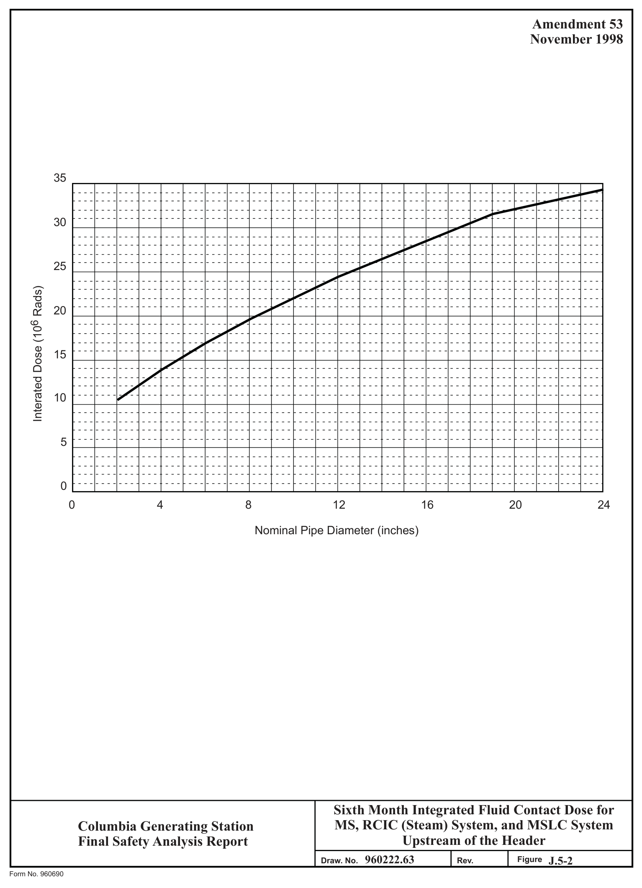

*figure on PDF page 1003*

[Vector original (SVG, lossless): fig_page-1003.svg](../figures/fig_page-1003.svg)

<!-- labels/text on this figure page -->
Amendment 53 November 1998
35
30
25
Interated Dose (106 Rads)
20
---------- --- ,_ ---------- 15 = = = = = = =V~ = = = = = = = = = = = = = 10
5
0 0 4 8 12 16 20 24
Nominal Pipe Diameter (inches)
Sixth Month Integrated Fluid Contact Dose for MS, RCIC (Steam) System, and MSLC System Columbia Generating Station Upstream of the Header Final Safety Analysis Report I I 960222.63 J.5-2 Draw. No. Rev. Figure Form No. 960690

<!-- p.1004 -->
Amendment 53 November 1998

14

13
--- :::/:::::::
=~/ ::::::::::
12 Integrated Dose (106 Rads)
11 ========== ==- ii!":= ========== = = = = = = = = = ;_~ = = = = = = = = = = = = = 10

9
- - - --/- - - - - - - - : / '=~ ~ : : : : : : - 8 ,-__ ---------- ~~~~~~~~~~ J 7

6

5 0 4 8 12 16 20 24

Nominal Pipe Diameter (inches)

Sixth Month Integrated Fluid Contact Dose for Pipes Containing Liquid Source Term (RHR, Columbia Generating Station HPCS, LPCS, RCIC Liquid Systems)
Final Safety Analysis Report I I 960222.61 J.5-3 Draw. No. Rev. Figure Form No. 960690

<!-- p.1005 -->
November 1998

#### J.6 RESULTS
All loss-of-coolant accident (LOCA) scenarios and accident conditions that could result in a limiting radiation environment for all the Columbia Generating Station (CGS) safety-related equipment on the C1E* list were reviewed and analyzed accordingly. Shielding (shield doors)
was constructed for zones 522D, 572N, 572D, and 572H due to the radiation exposure of safety-related equipment in these zones.

In addition a shield wall was designed and installed on the southeast portion of the 501 ft el.
against the bioshield wall to protect C1E* equipment from RRC piping radiation sources
(normal operation) which stream through penetrations X-100A, X-105A, and X-100B.

The completeness of the safety-related equipment list has been verified. The safety-related equipment list contains all equipment required to “mitigate the consequences of an accident, bring the plant to safe shutdown conditions and provide long-term cooling capability.”

Systems that could potentially contain radioactive material during and following the accident have been identified as listed in Sections J.3.2.1 and J.3.2.2.

The accident radiation doses indicated in Section J.6.1 and Table J.6-1 generated as a result of this analysis, are intended solely for the purpose of the qualification of safety-related equipment.

#### J.6.1 PRIMARY CONTAINMENT RADIATION RESULTS
Due to the large number of safety-related components it was deemed impractical to calculate the integrated dose to each piece of equipment. Therefore, the worst point dose from each of the major sources in the drywell and wetwell was calculated, and then summed for a conservative estimate of the total integrated dose. The dose sum of the worst-case source contributors in the drywell is 7.6 x 107 rads, but 7.4 x 107 rads is used as the worst-case dose for the equipment qualification program. All of the worst-case contributors cannot be present for a particular accident. Thus, the largest worst-case dose is calculated for the depressurized reactor coolant system. The worst-case dose is applied to safety-related equipment with an elevation within 5 ft of core midplane. Safety-related equipment in the drywell outside this elevation span is assigned a dose of 7.0 x 107 rads. In the wetwell, the maximum gamma dose above the suppression pool is 9.5 x 107 rads (see Section J.F.3 for discussion on photon energy and anticipated dose reduction of the above results). These results include the contributions from all major gamma sources within primary containment during normal operation as well as the 6-month period contribution following a postulated LOCA.
Tables J.F-1 and J.F-2 give a breakdown of the integrated dose contribution from each of the

* Environmental qualification (EQ) of safety-related mechanical (SRM) equipment has been eliminated from the overall CGS EQ program.

#### J.6-1
<!-- p.1006 -->
November 1998

major gamma sources to the drywell and the wetwell. The 40-year integrated gamma doses due to normal operation are taken from Reference J.7-20.

This methodology for determining a worst-case dose for equipment in the drywell is not valid for the region inside the sacrificial shield wall or under the reactor pressure vessel. A pointspecific radiation dose calculation is required for all components present in either of these two regions.

Specific calculations have been performed for equipment that was evaluated individually for total integrated dose. Results of these calculations are summarized in Reference J.7-26.

In accordance with Section 1.4(8) of Reference J.7-2, only the gamma dose need be considered for “shielded components.” Since beta radiation is so readily attenuated, virtually any enclosure of sensitive components will be sufficient to classify the component as “shielded.” A review of all safety-related equipment located inside primary containment determined that most C1E* equipment is sufficiently shielded against beta radiation. Thus, the beta dose contribution is excluded from the total integrated radiation doses compiled for equipment qualification purposes unless a beta-sensitive component is not adequately protected from the airborne beta environment. When required to include beta dose contributions, a finite source volume is used. The source volume is a sphere surrounded by a shell of sufficient thickness to stop all beta particles from entering the source volume. This finite spherical source volume is conservative for any generalized source volume shape (the dose at the center of the sphere is higher than the dose at any point of any generalized source shape of equal total volume).
A discussion of the results is presented in Attachment J.G.

#### J.6.2 SECONDARY CONTAINMENT RADIATION RESULTS
The integrated direct gamma dose (40 years and 6 months LOCA - direct gamma, gamma shine, and airborne gamma) was evaluated for the worst target of all C1E* equipment in each zone and is used for qualification of all the other C1E* equipment in that zone. The 40-year integrated gamma doses (Figures J.6-1 through J.6-10) are taken from References J.7-20 and J.7-21. The direct gamma dose contribution outside primary containment due to sources inside the primary containment was investigated. Safety-related equipment located in the direct shine path through the penetrations was evaluated in Reference J.7-23. All post-LOCA radiation dose contributions to safety-related equipment from streaming through the bioshield wall penetrations were included in the radiation doses. Evaluation of bioshield wall penetrations identified radiation dose problems associated with some of those penetrations (Reference J.7-24). The post-LOCA evaluation of safety-related equipment assumed the C1E* equipment was shielded for 40-year normal operations. To adequately protect C1E* equipment a concrete wall was designed and installed for penetrations X-100A, X-105A, and X-100B. The

* Environmental qualification (EQ) of safety-related mechanical (SRM) equipment has been eliminated from the overall CGS EQ program.

#### J.6-2
<!-- p.1007 -->
remaining penetrations evaluated (Reference J.7-25) were surveyed during plant startup to confirm radiation analysis calculations.

Airborne beta doses outside containment were evaluated in accordance with the methodology described in Section J.5.5 and Attachment J.D. The beta dose contribution is excluded from the total integrated radiation doses compiled for equipment qualification purposes unless a beta sensitive component is not adequately protected from the airborne beta environment.

#### J.6.3 RADIATION RESULTS IN THE VITAL AREAS AND ACCESS ROUTES
Figures J.6-8 through J.6-16 present the vital areas and access routes located outside the reactor building. Figures J.6-17 and J.6-18 present the vital areas and access routes located inside the reactor building. The doses indicated on each figure are also the 6-month LOCA integrated gamma doses to be used for C1E* (safety-related) equipment qualification purposes.
Table J.6-1 also presents a summary of the 6-month LOCA integrated gamma doses on all C1E* equipment located in vital areas.

Figures J.6-17 and J.6-18 show the access route in the reactor building for operation of SW-V-75AA and SW-V-75BB, the manual isolation valves for the service water to fuel pool cooling makeup water supply.

Radiation levels of vital areas and access routes were determined at selected locations outside the reactor building due to radioactive sources inside the reactor building and release of radiation activity from the reactor building elevated vent. The vital areas and access routes analyzed are consistent with those discussed in NUREG-0737, Item II.B.2 (Reference J.7-5).
The radiation levels determined for the vital areas and access routes identified in Figures J.6-8 through J.6-18 are summarized in Table J.6-1. All of the vital areas and access routes have radiation levels less than the guidelines presented in NUREG-0737.

The total dose received at a vital area during a post-LOCA scenario is obtained by summing the exposure dose enroute to the vital area and the radiation dose at the vital area. These doses are listed in Table J.6-2.

The analysis completed for vital areas and access routes assumed that except for the reactor building railroad bay and on the west side of the 522-ft el. there would be no access to equipment or areas located within the reactor building during the post-LOCA scenario. The exceptions are shown in Figures J.6-17 and J.6-18 and Table J.6-2. Access to the reactor building railroad bay for 3 hr is allowed to provide the ability to fill or exchange N2 bottles.
The entry to the west side of the 522-ft el. is to allow SW-V-75AA and/or SW-V-75BB to be opened (see Section 9.1.3.2.3). These valves are readily accessible and the entire opening

* Environmental qualification (EQ) of safety-related mechanical (SRM) equipment has been eliminated from the overall EQ program.

#### J.6-3
<!-- p.1008 -->
□ evolution for one of these valves would take 2.17 minutes and could be performed at 9.7 hr I with the resulting exposure of 3.8 rem. Under worst-case conditions, at least one of these □ valves would need to be opened by 10 hr. Once a manual valve is opened, the spent fuel pool level can be controlled with the motor-operated valve from the main control room.

#### J.6-4
<!-- p.1009 -->
November 1998

Table J.6-1

Six-Month Total Integrated Dose (Loss-of-Coolant Accident) to Areas Containing C1E Equipment Outside the Reactor Building

Radiation Levela Direct Gamma Shine +Airborne Gamma (rads)
Vital Area Description

Control room (el. 501 ft)
0.21

Technical support center 0.21

Sale area (el. 487 ft)
6.5

Nitrogen supply to ADS accumulators (el. 437 ft)
3.9

Standby service water pump valves
1.7

Remote shutdown room (el. 467 ft)
3.9

Switchgear room 1 (el. 467 ft)
3.9

Switchgear room 2 (el. 467 ft)
3.9

Radwaste control room (el. 467 ft)
3.9

Battery racks, dc battery chargers, two motor control centers (MCCs) (el. 467 ft)
3.9

Three MCCs and three switchgears (el. 437 ft)
3.9

Direct current battery charger and rack (el. 437 ft)
3.9

Diesel oil tanks (el. 437 ft)
3.9

Solid radwaste control panel and decontamination station control panel (el. 437 ft)
3.9

a Volume correction factors for a semi-infinite cloud were applied to the control room and technical support center. If the volume correction factors were to be applied to all areas, the integrated dose would be reduced by a minimum of fivefold.

#### J.6-5
<!-- p.1010 -->
Table J.6-2

Vital Areas and Access Route List of Radiation Exposure to Personnel During the Required Post-Loss-of-Coolant Accident Operations

Radiation Exposure

Gamma Whole Body Thyroids Beta Skin Vital Area Description
(rem) (rem)a) (rads)

Control room (el. 501 ft)b 0.21 0.21c 0.95

Technical support centerb 0.21 0.21c 0.95

Security centerb
3.1 13.4d 4.8

Auxiliary security centerb
1.7
2.7

Sample analysis area (EOC)b 0.0013 - -

Standby service water pump valves 0.3 0.94d 0.46
(cooling ponds)e

All infrequently occupied vital areas inside the 0.13f 1.6d 0.48 radwaste and diesel generator buildingsb

Sampler for elevated release duct (roof turbine 2.5 8.0d 3.8 building)e

Reactor building railroad bay (N2 bottles)g 0.4 - - D Reactor building 522-ft el. (SW-V-75AA 3.8 - and/or SW-V-75BBh

Postaccident sample area (el. 487 ft)e 0.36 3.2d 0.96

Access Routes

All access routes inside the radwaste and 0.13f 1.6d 0.48 diesel generator buildingse

All access routesi outside the radwaste and 0.53 1.6d 0.8 diesel generator buildingse

#### J.6-6
<!-- p.1011 -->
Table J.6-2

Vital Areas and Access Route List of Radiation Exposure to Personnel During the Required Post-Loss-of-Coolant Accident Operations (Continued)

a If self-contained respiratory equipment (SCBA) is used, the thyroid dose will essentially equal the whole-body dose.

b Area of continuous occupancy.

c Assumes self-contained respiratory equipment was used by personnel during 0-3 hr post-LOCA situation.

d No respiratory equipment was assumed.

e Area occupied 0.5 hr at times after 1 hr into the LOCA.

f A volume correction factor for the semi-infinite cloud was included in the calculation.

g Assumes entry after 12 days post-LOCA for 3-hr occupancy with respiratory equipment for railroad bay portion of reactor building only.

h Assumes entry after 9.0 hr post-LOCA for a 2.17-minute evolution to open SW-V-75AA or SW-V-75BB with respiratory equipment and in full PC gear following access routes shown in Figures J.6-17 and J.6-18. The 2.17 minutes consists of a 1.83-minute transit (1.5 minutes in 522K and 0.33 minutes in 522H) and a 0.33-minute occupancy time in 522H.

i Extremely conservative analysis since the plume of airborne radioactivity cannot simultaneously cover all access routes.

#### J.6-7
<!-- p.1012 -->
#### J.7 REFERENCES
J.7-1 NUREG-0578, “TMI Lessons Learned Task Force Status Report and Short-Term Recommendations.”

J.7-2 NUREG-0588, Rev. 1, “Interim Staff Position on Environmental Qualification of Safety-Related Electrical Equipment.”

J.7-3 NUREG-0660, “NRC Action Plan Developed as a Result of the TMI-2 Accident.”

J.7-4 Clarification letter to NUREG-0578, September 5, 1980.

J.7-5 NUREG-0737, “Clarification of TMI Action Plant Requirements.”

J.7-6 IE Bulletin No. 79-01B, “Environmental Qualification of Class 1E Equipment.”

J.7-7 Supplement No. 2 to IE Bulletin 79-01B, September 30, 1980.

J.7-8 Oak Ridge National Laboratory, “ORIGEN2, Isotope Generation and Depletion Code - Matrix Exponential Method,” ORNL Report No. CCC-371.

J.7-9 J. F. Perkins, U.S. Army Missile Command, Redstone Arsenal, Alabama, Report No. RR-TR-63-11 (July, 1963).

J.7-10 Oak Ridge National Laboratory, “Modifications of the Point-Kernel QAD-P5A,” ORNL-4181, July 1968.

J.7-11 Oak Ridge National Laboratory, “ORIGEN-79, Isotope Generation and Depletion Code - Matrix Exponential Method,” ORNL Report No. CCC-217.

J.7-12 EDS Report No. 01-0740-1138, Revision 0, “Source Term Report,” December 1980.

J.7-13 Columbia Generating Station FSAR, Section 15.6.5.5.1.1, Amendment 27, November 1982.

J.7-14 Regulatory Guide 1.3 “Assumptions Used for Evaluating the Potential Radiological Consequences of a Loss-of-Coolant Accident for Boiling Water Reactors,” Revision 2, June 1974.

J.7-15 Columbia Generating Station FSAR, Sections 6.7.2 and 6.7.3.

#### J.7-1
<!-- p.1013 -->
J.7-16 Standard Review Plan, Section 15.6.5, “Loss of Coolant Accidents Resulting From Spectrum of Postulated Piping Breaks Within the Reactor Coolant Pressure Boundary.”

J.7-17 Oak Ridge National Laboratory, “QAD-CG, A Combinitorial Geometry Version of QAD-P5A, A Point-Kernal Code,” ORNL Report No. CCC-307.

J.7-18 Byoun, Yoon and Babel, Paul J., “Description of Computer Program
(SCAP-BR),” User’s Manual.

J.7-19 Impell Calculation #0740-004-019, “Fluid Contact Dose Calculation.”

J.7-20 Letter BRWP-81-288, dated July 29, 1981, “Forty-Year Integrated Dose for Radiation Zones in the Reactor Building.”

J.7-21 Letter BRWP-RO-81-181, dated September 29, 1981, “Forty-Year Integrated Dose for Radwaste and Turbine Buildings.”

J.7-22 Burns and Roe calculation 5.01.78.

J.7-23 Burns and Roe calculation 5.01.030, “Total Accident Integrated Dose to Equipment in the Reactor Building From Primary Containment Penetration Streaming.”

J.7-24 Letter BWRP-RO-82-186, dated June 18, 1982, “Bioshield Wall Penetrations with Unresolved Shielding Concerns.”

J.7-25 Burns and Roe Technical Memorandum, TM-1295, “Bioshield Wall Penetration Shielding Requirements,” dated April 6, 1983.

J.7-26 Calculation 1140-006-CLIST, “C1E/SRM Containment List.”

J.7-27 Letter EDSWP-81-015, dated February 18, 1981, “SGTS Filter Modeling Assumption.”

J.7-28 Murphy and Campe “Nuclear Power Plants Control Room Ventilation System Design,” 13th AEC Air Cleaning Conference.

J.7-29 Letter EDSWP-80-031, “Shielding Design Input Data.”

J.7-30 Theodore Rockwell III, “Reactor Shielding Design Manual,” U.S. AEC, TID-7004, March 1956.

#### J.7-2
<!-- p.1014 -->
November 1998

J.7-31 David A. Slade “Meteorology and Atomic Energy,” U.S. AEC, July 1968.

J.7-32 Record of Conversation, D. A. Wert to J. A. Ogawa, dated September 22, 1980, “Shielding Source Term.”

J.7-33 Letter BREDS-RO-81-17 dated December 11, 1981, A. N. Kugler to E. A. Daugherty.

J.7-34 NUREG/CR-009, Technical Basis for Models of Spray Washout of Airborne Contaminants in Containment Vessels, October 1978.

J.7-35 Columbia Generating Station FSAR, Amendment 11, Table 6.2-12.

J.7-36 Columbia Generating Station FSAR, Table 6.2-1.

J.7-37 Not used

J.7-38 EDS Nuclear Inc., Calculation 0740-004-004, Rev. 0.

J.7-39 EDS Nuclear Inc., Calculation 0740-004-006, Rev. 0.

J.7-40 Columbia Generating Station FSAR, Section 15.6.5.

J.7-41 Standard Review Plan, Section 6.5.3, “Fission Product Control Systems,” Nuclear Regulatory Commission, June 1975.

J.7-42 Columbia Generating Station FSAR, Section 6.2, Table 6.2-2.

J.7-43 Columbia Generating Station FSAR, Section 6.2, Table 6.2-11.

J.7-44 WPBR-R0081-143, Holmberg to Forrest, “Plant Shielding Analysis - WNP-2,” August 8, 1981.

J.7-45 Burns and Roe calculation 5.01.59, “Primary Containment 6 Month Accident Source Terms ORIGEN2.”

J.7-46 Burns and Roe calculation 5.01.60, “Six Month Accident Integrated Dose in Primary Containment - Depressurized Case - QAD-CG.”

J.7-47 Burns and Roe calculation 5.01.62, “Dose Rate for 26” Main Steam Lines Inside Primary Containment.”

#### J.7-3
<!-- p.1015 -->
November 1998

J.7-48 Burns and Roe calculation 5.01.63, “RWCU Piping Sources in Containment
(Normal Operations).”

J.7-49 Burns and Roe calculation 5.01.64, “RWCU, RRC, and RHR Lines in Containment (Shielding - Normal Operation).”

J.7-50 Burns and Roe calculation 5.01.69, “Total Integrated Dose, Accident & Operation, from Systems and Primary Containment Atmosphere to Safety Related Equipment Located EDS - Pressurized Case.”

J.7-51 Burns and Roe calculation 5.01.74, “Six Month Accident Integrated Dose in Primary Containment -Depressurized Case - QAD.”

J.7-52 Burns and Roe calculation 5.01.75, “Accident Integrated Dose for Systems - Depressurized Case.”

J.7-53 Burns and Roe calculation 5.01.76, “Total Integrated Dose, Accident & Operation, to Safety-Related Equipment in Containment Located by EDS Due to Systems.”

J.7-54 Burns and Roe calculation 5.01.77, “Total Integrated Dose, Accident & Operation, from Systems and Primary Containment Atmosphere to Safety-Related Equipment in Containment Located by EDS - Depressurized Case.”

J.7-55 Burns and Roe calculation 5.01.20, “WPPSS Sacrificial and Bioshield Calculations.”

J.7-56 Burns and Roe calculation 5.45.07, “Post-LOCA MSIV Leakage Calculation.”

J.7-57 Calculation 0740-004-VLIST, “Reactor Building SRM Active Valve, Pump, Fan, and Turbine List.”

J.7-58 0740-073-001 Parameter Penetration Study.

J.7-59 Ianni, P. W., “Effectiveness of Core Standby Cooling Systems for General Electric Boiling Water Reactors,” APED-5458, March 1968.

J.7-60 “Design and Performance of General Electric Boiling Water Reactor Main Steam Line Isolation Valves,” APED-5750, General Electric Company, Atomic Power Equipment Department, March 1969.

#### J.7-4
<!-- p.1016 -->
November 1998

J.7-61 “Power Uprate with Extended Load Line Limit Safety Analysis for WNP-2,” NEDC-32141P, General Electric Company.

J.7-62 “General Evaluations of General Electric Boiling Water Reactor Power Uprate - Volume 1,” NEDC-31984P, General Electric Company.

#### J.7-5
<!-- p.1017 -->
November 1998

Attachment J.A

#### UNISOLATED LEAKING BUILDING PATH REPORT
A basic assumption to the plant shielding analysis is that the reactor isolates such that there is no radiation leakage path to the outside. A leakage path investigation was done verifying the above assumption. While performing this investigation, the total number of lines (69)
penetrating the RB boundary, the associated system components and interface systems were reviewed.

The assumption eliminating the consideration of leakage is consistent with NUREG-0737, Clarification 2. This investigation assumed that containment isolation occurred prior to the egress of highly radioactive fluids. Additionally, it assumed that all safety-related equipment was available, and that all safety systems were pressurized. Therefore, at any interface, such as a heat exchanger, no potential leakage was considered if the nonradioactive system was at a higher pressure than the radioactive system. This investigation has not considered leakage from equipment seals, closed valves, or pipe rupture, except in the evaluation of the equipment and floor drain systems. The systems considered are tabulated by drawing number in Table J.A-1.

#### J.A-1
<!-- p.1018 -->
November 1998

Table J.A-1

System Flow Diagrams Employed to Perform The Review

Drawing Number Revision Drawing Number Revision M501 10 M536 12 M502 17 M537 25 M503 5 M538 9 M504 25 M539 28 M505 14 M540 15 M506 23 M541 13 M507 27 M542 4 M508 25 M543 17 M509 10 M544 10 M510 30 M545 15 M511 15 M546 10 M512 8 M547 9 M513 33 M548 14 M514 13B M549 14A M515 17C M550 9 M516 20 M551 8 M517 25 M552 12 M518 14 M553 10 M519 18 M554 11 M520 15 M555 7 M521 20 M556 10 M522 6 M557 4 M523 29 M607 Sheet 1 7 M524 19 M607 Sheet 2 5 M525 19 M607 Sheet 3 3 M526 25 M527 18 M528 15 M529 21 M530 18 M531 24 M532 20 M533 Sheet 1 1 M533 Sheet 2 1 M533 Sheet 3 1 M534 16 M535 Sheet 1 26 M535 Sheet 2 21

#### J.A-3
<!-- p.1019 -->
November 1998

Attachment J.B

#### SOURCE TERM DEVELOPMENT AND PARAMETRIC STUDIES
#### FOR SECONDARY CONTAINMENT
The major tools used in the development of source terms and parametric studies inside secondary containment were the ORIGEN and QAD-P5A computer codes. Descriptions of the codes are in References J.7-11 and J.7-10. ORIGEN was used to compute the activities and energies of fission products released from the reactor core. The output of ORIGEN [the time-dependent energies and activity of radioactive fission products following loss-of-coolant accident (LOCA)] was used as input to QAD-P5A to calculate the airborne, shine, and direct doses for standard geometrics as well as the basis of direct dose parametric studies.

#### J.B.1 RADIOACTIVE SOURCE TERMS IN SECONDARY CONTAINMENT
The ORIGEN computer code (Reference J.7-11) was used to calculate the radioactive source terms inside secondary containment for liquid-containing and gas-containing systems. The fission products at the end of fuel life were assumed to be available for release immediately following the accident. The concentrations of noble gases, halogens, and other fission products released to the gaseous and liquid sources were computed. Subsequent fission product decay and daughter product generation were then calculated for 20 time periods, covering a total period of 1 year.

The assumptions used in determining the initial distribution and leakage of radioactivity in the primary containment air and liquid space are as follows:

a. 100% of the noble gases and 50% of the halogens are distributed homogeneously within the primary containment free volume immediately following the postulated accident;

b. 50% of the halogens and 1% of the remaining fission products in the core are mixed instantaneously and homogeneously with the primary containment liquid space. The primary containment liquid space is defined as the sum of the suppression pool liquid and the reactor coolant system (RCS) liquid; and

c. The fission products available for release are defined as the total inventory generated in the equilibrium core after 1000 days at reactor power of 3556 MWt.

Assumptions a and b are NRC recommended assumptions for defining radioactivity release fractions for the qualification of safety-related equipment (Reference J.7-2) and are detailed in References J.7-32 and J.7-34.

#### J.B-1
<!-- p.1020 -->
November 1998

Assumption c represents the maximum burnup level in the core and the fission products at the end of fuel life prior to radioactivity release and is conservative.

Table J.B-1 shows the gamma activity concentration at selected time periods for the liquid-containing system. The results of Table J.B-1 were used as input in the dose parametric study. Due to rapid decay of the high-energy isotopes, the average gamma energy for the gas-containing system varies from 0.8 MeV at the beginning of the accident to 0.3 MeV at 1 year after the accident.

#### J.B.2 AIRBORNE DOSE IN SECONDARY CONTAINMENT
The time-dependent post-LOCA activity levels as calculated by the ORIGEN computer code were used as input in the calculation of the airborne beta and gamma dose rates and integrated doses inside the cubicles in the secondary containment. The assumptions used in this analysis are as follows:

a. Activity that leaks into the secondary containment is homogeneously mixed with the secondary containment atmosphere prior to its removal from the atmosphere through the standby gas treatment system (SGTS). This is consistent with the NRC-recommended assumptions used for calculation of doses inside primary containment (Reference J.7-2 and J.7-34);

b. An SGTS flow rate of 2430 scfm was assumed to be the flow rate of the effluent air. This is the designed minimum accident flow rate
(Reference J.7-35) based on one reactor building airchange per day;

c. Air that leaks out of the primary containment flows directly and totally into the secondary containment. Bypass leakage is not considered. This is conservative when considering dose in the secondary containment, since it maximizes the buildup of radioactivity in the secondary containment;

d. Geometric factors are used to convert the semi-infinite cloud gamma dose to a finite gamma dose. This assumption is used in Reference J.7-28, and is based on an average gamma ray energy of 0.733 MeV. The effect of time dependence of average gamma ray energies has been proven to be negligible; and

e. Primary containment activity leakage rate is 0.5%/day. This is consistent with the assumptions established in Reference J.7-29.

#### J.B-2
<!-- p.1021 -->
November 1998

A model of the primary and secondary containment atmosphere is shown in Figure J.B-1. The activity concentration of a certain isotope inside the containment is changing due to the following three mechanisms:

a. Transport of activity due to air leakage,

b. Depletion of activity due to radioactive decay and plateout of elemental halogens inside primary containment, and

c. Increases in activity levels due to daughter product generation from fission product decay.

According to References J.7-2 and J.7-34, plateout may be modeled by an expotential removal process:

= − λ A t A ( ) ( ) exp ( 0 t )
p

Where λ is the removal constant due to plateout.
p

The first step in this calculation is to model the decay and transport of the airborne radionuclides.

General airborne activity balance in containment:

d
-dt C V ( ) = − Q C − λ C V − λ C V + Σ λ C V li l 1 l i li 1 pi li 1 j j lj 1 (J.B-1)
i

leakage decay plateout growth

where

C = concentration of isotope "i" 1i Q = leakage rate from primary containment 1 V = volume of primary containment 1 iλ = radioactive decay constant of isotope "i" λ = plateout removal constant of isotope "i" pi

The term ∑λ reflects the growth of a given nuclide as the result of decay of parent C V j j 1i 1 nuclides.

The original release of nuclides consists only of halogens and noble gases. Since fission products are neutron-rich, decay of fission products proceeds toward higher atomic numbers.

#### J.B-3
<!-- p.1022 -->
November 1998

In this manner, halogens will decay into noble gases, and then to higher atomic-numbered elements. Since the decay chain reaches a stable isotope after only a few decays, it can be seen that upon release of these airborne nuclides, the halogens have no significant airborne parent nuclides. This term may be neglected in the case of halogens.

Case 1 - Containment Halogens

Elemental iodine undergo plateout (Reference J.7-34) so equation (J.B-1) becomes:

d
(J.B-2) C V dt (C V ) = - Q C - λ C V - λ 1i 1 1i i 1i 1 pi 1i 1 1

Solving (J.B-2) with the initial condition;

at t = 0,

C = C (0), 1i 1i   C (t) = C (0) exp (- Q
(J.B-3)  1 + λ + λ  t)
1i 1i i pi V 1

Particulate and organic iodine are assumed unaffected by plateout (Reference J.7-34).

Equations (J.B-3) for particulate and organic iodine may then be shown to be

−  Q
(J.B-4) C (t) = C (0) exp (  1 + λ  t)
1i 1i i V 1

One can note, at this point, that all three iodine species have factors of

C (0) exp ( - λ t)
1i i

in the equations. This term may be defined as

(J.B-5)
S (t) = C (0) exp ( - λ t) V i 1i i 1

iS (t) is seen to be the total activity released into the system as a result of decay. Si(t) is independent of the transport of the nuclides. The following definitions will be made.

#### J.B-4
<!-- p.1023 -->
November 1998

ef = fraction of total iodine that are elemental pf = fraction of total iodine that are particulate of = fraction of total iodine that are organic

Equations (J.B-3) and (J.B-4) can be combined to get

 Q t/ V S (t)  [ ] xp − iH C (t) = f exp (- λ t) + (f + f ) e  (J.B-6)
 1iH e p o p 1 1 V 1

where

(t) = total iodine concentration in primary containment C 1iH S (t) = total iodine activity iH λ = plateout constant for elemental iodine p

At this point, Reference J.7-2 allows only a factor of 200 reduction for elemental iodine plateout effects.

So when

t) = 1
(J.B-7)
exp(- λ 200 , then λ becomes zero.
p p

t = Ln (200)
Defining:
p λ p

Equation (J.B-6) may be rewritten as

(t) = S (t)
[ ] iH f (t)
(J.B-8) C e xp - Q t/ V 1iH 1 1 H V 1

Where fH(t) is defined as

≤ (a) f (t) = f exp (- λ t) + f + f t t
(J.B-9)
H e p p o p

≥ (b) f (t) = (f / 200) + f + f t t H e p o p

Case 2 - Containment Noble Gases

Noble gases do not undergo plateout. Daughter products are also conservatively assumed to act as noble gases. Equation (J.B-1) for noble gases becomes

#### J.B-5
<!-- p.1024 -->
November 1998

d
(J.B-10) C V
-- dt (C V ) = - Q C - λ C V + ∑ λ 1i 1 1i i 1i 1 j 1 j 1 1 j

Integrating equation (J.B-10) gives

[ ] [ ]
(J.B-11)
C (t) = e xp -Q t/ V exp - λ t (B + f (t))
1i 1 i 1 i

where

[ ] ∫∑ − λ f (t) = λ C e xp Q / V 1 + i dt
(J.B-12)
1 i j j ij

and B is a constant to be determined.

All daughter products of plated-out iodine are conservatively assumed to be re-released into the containment atmosphere as if the iodine were airborne. For the first isotope in a series (no parent nuclide), j = 0 and fo(t) = 0.

Since C1j(t) has the same form as C1i(t), equation (J.B-12) becomes

λ λ dt
( - ) t ∫∑
(J.B-13) f (t) = λ (B + f (t)) e i j i j j j

Equation (J.B-13) shows that the only dependence on Q1/V1 is that carried over from the parent isotope is fn(t). Since fo(t) is independent of Q1/V1, fi(t) is independent of Q1/V1.
Equation (J.B-11) can thus be rewritten as

C (t) = e Q V
-( / ) t
(J.B-14) 1 S (t) / V 1 1i i 1

where [ ] −λ
(J.B-15) S (t) = e xp it (B + if (t)) V i 1

It can be seen that Si(t) is the solution to equation (J.B-10) without the leakage term. Si(t) is the activity for the total inventory of nuclides released from the reactor core. Si(t) values are determined by the use of ORIGEN. Si(t) includes radioactive decay and daughter product growth.

#### J.B-6
<!-- p.1025 -->
November 1998

For a general airborne activity balance in the reactor building (secondary containment):

d ∑ dt (C V ) = + Q C - Q C - λ C V + λ C V 2 i 2 i 1i 2 2 i i 2 i 2 j j 2 j 2

(J.B-16)
leakage leakage decay growth in out where

C2i = concentration of isotope "i" in the reactor building Q2 = leakage rate from reactor building V2 = volume of the reactor building

Plateout inside secondary containment is conservatively neglected.

Case 3 - Iodine Inside the Reactor Building

As in Case 1, the growth term of equation (J.B-16) is negligible. Equation (J.B-16) can be integrated to give

 B + Q  C (t) = e Q V iλ Q V λ
-( / + ) t
( / + )t ∫ V e 1 C (t) dt  (J.B-17) 2 2 2 2 i  2 i 1i 2

From equation (J.B-8), C1i(t) is substituted into (J.B-17)

Q C (t) = Be Q V iλ Q V λ
( / + )t
-( / + )t ∫ + 1 e exp (Q / V + λ )t 2 2 2 2 i 2 i 2 i 2 V 2

(S (t) e - 1 Q t/ V f (t)) dt 1 iH
(J.B-18) H V 1

Substituting equation (J.B-5) into (J.B-18) results in

i) t + Q ] [
(t) = Bexp -( Q / V + λ 1 C (0) e xp C 2 2 2 i 1 i
(J.B-19) V 2
- ( 2 Q / V + λ i) t 2

[ ] ∫ exp (Q / V - Q / V ) t f ( ) t dt 2 1 2 1 H

fH(t) is a complex function of time (equation J.B-9). C2i(t) must be solved in a series of solutions to equation (J.B-19).

#### J.B-7
<!-- p.1026 -->
November 1998

For simplification, the following factors are defined

x = Q V - Q 2 1 V 2 1

λ y = x p

Equation (J.B-19) becomes

Q 1 (t) = Bexp - ( 2 Q / V + λ i) t + V V S (t) e xp -( 2 Q / V + λ i) t C 2 2 2 i iH
(J.B-20) 2 1 ∫ xt ( ) t e f dt H

Integrating (J.B-20) for 0 ≤ t ≤ tp with the initial condition; C2i(0) = 0 gives

(For S (t) = S (0) e - iλ t ):
iH iH

f + f Q -Q t/ V (f [ ] [ ] y e e xp - λ t + p o ) (J.B-21)
C (t) = V V S (t) (e 1 xp 2 i iH p 1 1 x 1 2

y + f + f −e -Q t/ V (f p o e ))
2 x 2

Defining

− y + f + f f e p o (J.B-21) becomes (for 0 ≤ t ≤ tp): (J.B-22) K = ( );
1 x

   Q  f [ t + f + f ] [ ] [ ] p o  C (t) = (t)  y e xp - λ  e xp -Q t / V + K e xp -Q t / V 1  e

#### V V S
2 i iH 1 1 2 1 2 p x   1 2

And (for t ³ tp):
(J.B-23)

Q [ ] [ ]

## 1 C (t) = Bexp -(Q / V + λ )t + V V S (t)e xp -Q / V t
2 i 2 i iH 2 2 2 1 2 e ( f e ∫ xt 200 + f + f ) dt p o

#### J.B-8
<!-- p.1027 -->
November 1998

Solving (J.B-23) gives
(J.B-24)

Q [ ] [ ] C (t) = Bexp − (Q / V + λ )t + 1 (t)e xp -Q / V t V V S 2 i 2 2 i iH 2 2 1 2
(f / 200 + f + f e o p )e xt x

At t = tp (from J.B-22) ):
(J.B-25)

 [ ] + (f  e K e xp -(Q / V ) t y e - λ t  2 2 p p p  1 Q  1  C (t ) = V V S (t )
2 i p iH p  + (f + f [ ]  o p 1 2
-Q t / V  ))e xp  1 p 1   x

1 [ ] By definition of tp [eq. (J.B-7)]: exp - λ t = p p 200

Combining (J.B-24) and (J.B-25) at t = tp gives
(J.B-26)

[ ] Q [ ] Bexp -(Q / V + λ )t = 1 (t ) e xp -(Q / V )t V V S 2 2 i p iH p 2 2 p 1 2
(K + f 200 (1 y - 1 e xt x) e p)
1

and

Q 1 =
(J.B-27) B V V S ( ) 0 K iH 2 1 2

where

200 (1 y - 1 K = K + f e x) e p xt
(J.B-28)
2 1

So (J.B-24) becomes (for tp ≤ t)

Q V V S (t) (K e Q V + (f / 200 + f + f Q - t/ 1 1
- t/ e o p C (t) = 1 )e (J.B-29) 2 2 2 i iH 2 x 1 2

Equations (J.B-22) and (J.B-29) may be combined to form a general solution as follows:

C (t) = S (t) F (t) / V
(J.B-30)
2 i iH 2 H 2

#### J.B-9
<!-- p.1028 -->
November 1998

where (for 0 ≤ t ≤ tp)

+ f + f F (t) = Q + (f [ ] [ ] [ ] e λ p o (K e xp - Q t/ V y e xp - t ) e xp - Q t/ V )
1 2 H 1 2 2 p 1 1 x V 1

for (t ≥ tp)
(J.B-31)

+ (f / 200 + f + f
(t) = Q [ ] [ ] e o p 1 (K e xp - Q t/ V ) e xp - Q t/ V )
F 2 H 2 2 1 2 1 x V 1

Case 4: Noble Gases Inside the Reactor Building

Equation (J.B-16) for noble gases may be rewritten as

d
(J.B-32) C dt (C ) - (Q / V ) C - (Q / V + λ ) C + ∑ λ 2i 2 1i 2 i 2i j 2 j 1 2 j

Integrating (J.B-32) gives
(J.B-33)

( Q [ ] [ ] 1 ∑ C (t) e xp (Q / V + λ ) t B + e xp (Q / V + λ )t C (t) + λ C (t)) dt = ∫ 2 i 2 2 i 2 2 i 1 i j j 2 j V 2

C1i(t) is found from equation (J.B-14) to be

[ ] C (t) = e xp -(Q / V )t 1i 1 1 S (t) / V i 1

Si(t) cannot be found analytically; hence equation (J.B-33) cannot be found analytically through this method. However, in deriving equation (J.B-14), it was shown that if all parent nuclides are transported identically, then the solution of equations consisting of transport and radioactive decay can be separated. Since the halogens are not transported in the same manner as noble gases, this is not strictly true. However, the assumption of daughter growth as if the halogens were transported will be conservative, due to the nonconsideration of the physical holdup in primary to secondary leakage of daughters of halogens.

Equation (J.B-14) may be rewritten as

V C (t) = S (t) F (t)
(J.B-34)
1N 1 1i iN

#### J.B-10
<!-- p.1029 -->
November 1998

where

[ ]
(J.B-35)
F (t) = e xp -Q t/ V 1N 1 1

SiN(t) is the noble gas total activity term, as before. F1N(t) is the fraction of that activity remaining in primary containment.

Equation (J.B-16) may be modified to show the fractions of activity, rather than total isotopic activity, in secondary containment to give

) = Q - Q d
(J.B-36) 2 N dt (F V F 1 V F 2

## 2 N 1N
1 2

Integrating equation (J.B-36) with initial conditions:

at t=0, F2N = 0; gives

(t) = Q [ ] [ ] xp
(J.B-37) F V x (e 1 xp -Q t/ V - e -Q t/ V )
2 N 1 1 2 2 1

C2i(t) is then found from

C2i(t) = SiN(t) F2N(t)/V2
(J.B-38)

λp is found in Reference J.7-2 to be determined

λp = KgA1/V1
(J.B-39)

Kg is conservatively assumed to be equal to 0.05 cm/sec (Reference J.7-34).

A1 is the surface area inside the drywell = 3.2x107cm2 (Reference J.7-33).

V1 =5.68x109cm3 (Reference J.7-36)

λp = 1.01 hr-1

To calculate the airborne gamma dose rate inside the secondary containment, the method as described in Reference J.7-28 is used:

n ∑
(J.B-40) D = 0.25E i (C noble gas + C halogen)
γ∞ 2 i 2 i γ i=1

#### J.B-11
<!-- p.1030 -->
November 1998

γ ∞ D = D
(J.B-41)
γ GF

1173

#### V 0.338
(J.B-42)
GF =

where

= semi-infinite gamma cloud dose rate (rads/sec) D γ∞

iγ = average gamma energy of the isotope (MeV) E

C2i = activity concentration inside secondary containment (Ci/m3)

GF = geometric factor used to scale the semi-infinite gamma cloud dose to a finite cloud dose

V = volume of the finite cloud (ft3)

By taking Si(t) from ORIGEN output and using equations (J.B-31) and (J.B-37) to calculate F2(t), the total gamma dose in secondary containment can be computed by using equations
(J.B-40) through (J.B-42).

The airborne semi-infinite cloud gamma dose rates are shown in Figure J.B-2. As can be observed from the figures, the gamma doses inside secondary containment reach their peaks at around three days after the accident, and decay slowly thereafter due to the depletion of radioactivity by radioactive decay and removal through the SGTS.

The geometric factor in equation (J.B-42) is developed in Reference J.7-28 for average gamma energies of 0.733 MeV. There has been a concern that this geometric factor may vary appreciably with time due to the faster decay rate of the high energy isotopes. The average gamma energy during various time periods following the accident were computed and the results show that the average gamma energy varies from 0.3 MeV to 0.8 MeV. As discussed in Reference J.7-31, the geometric factor changes by less than 5% within that energy range. It is therefore concluded that the change in the geometric factors with time is negligible, and that equation (J.B-42) can be used to calculate the finite cloud gamma dose inside the secondary containment.

#### J.B.3 PARAMETRIC STUDIES FOR DIRECT PIPING DOSE
The purpose of the parametric study was to identify the parameters which have a significant affect on the radiation dose rates. The computer code QAD-P5A was used to develop a

#### J.B-12
<!-- p.1031 -->
November 1998

correlation scheme for the significant parameters such that a simplified procedure for calculating radiation dose rates for complex source and receptor geometries can be developed.
The dose rate at a target distance of 8 ft radially outwards from the centerline of an 8-in. schedule 40 pipe, infinitely long (standard pipe) was first calculated and defined as the standard dose rate. A parametric study was then performed to investigate the effects of the variation of parameters such as pipe length, pipe diameter, shield thickness, and target locations on the dose rate. The results of this parametric study were then correlated as a set of correction factors to the standard dose rate. A simplified procedure was developed to calculate the dose rates and cumulate doses for the multitude of source-target configurations by using these correction factors.

J.B.3.1 Functional Dependence of Various Parameters on Secondary Containment Dose Rates

The gamma ray energy flux from a line source "SL" to a detector point "P" (see Figure J.B-3)
is shown in Reference J.7-30 as

BS L θ θ φ ∫ 1 θ θ ∫ 2 = r exp - 1 b Sec d - exp - 1 b Sec d θ θ
(J.B-43)
0 4 π where

φ = uncollided gamma ray flux (photons/cm2 - sec)
b1 = total attentuation through shield SL = source strength of line source (photons/cm sec)
B = buildup factor θ = angle subtended by the length of the line source (see Figure J.B-3)

The source strength "SL" is a function of the volume of liquid inside the pipe segments, which is also a function of the diameter and volume of the pipe. The angles "θ1" and "θ2" are also functions of "a/r" and "b/r,” respectively (see Figure J.B-18 for definition of "a/r" and "b/r" respectively). Therefore, the functional dependence of gamma ray dose rates on the various parameters can be represented by the following equation:

[ ] φ = φ ∗ ∗ ∗ F (a/ r,b ) + F (b/ r,b )
(JB-44) F F o D R L 1 L 1

where

φo = base gamma ray flux for standard pipe FD = pipe diameter correction factor FR = radial distance correction factor FL = (a/r, b1) = pipe length correction factor

#### J.B-13
<!-- p.1032 -->
November 1998

J.B.3.2 Parametric Study Procedures

The procedure for performing this parametric study is documented as follows:

a. Calculate the dose rate at a target distance of 8 ft from the centerline of an 8-in.
schedule 40 pipe infinitely long (standard pipe);

b. Perform parametric studies on the variation of dose rates with

1. Radial distance from the pipe centerline,
2. Length of the pipe,
3. Nominal pipe diameter, 4. Time, and 5. Axial position along the pipe;

c. Correlate the results of the parametric study by a set of geometric correction factors;

d. Develop a procedure for calculating dose rates by using the correction factors;
and

e. Verify the correlation scheme by calculating the dose rates at different target locations due to source piping of varied geometries through the use of QAD-P5A computer code, and compare the results to those obtained by using the procedure developed in step d.

J.B.3.3 Direct Dose Parametric Study Results Inside Secondary Containment

The standard pipe gamma dose rate and integrated dose curves for the different systems having different source term assumptions (defined in Section J.5.3.2) are shown in Figures J.B-4 through J.B-11. The various correction factors were calculated by the following correlation.

FR(r) = Dose rate at a radial distance "r" from an infinitely long 8-in. sch 40 pipe Dose rate at a radial distance of 8 ft from an infinitely long 8-in. sch 40 pipe

FL(l) = Dose rate at a radial distance of 8 ft from an 8-in. sch 40 pipe of length "2l" Dose rate at a radial distance of 8 ft from an infinitely long 8-in. sch 40 pipe

FD(d) = Dose rate at a radial distance of 8 ft from an infinitely long sch 40 pipe of nominal diameter "d" Dose rate at a radial distance of 8 ft from an infinitely long 8-in. sch 40 pipe

The above mentioned correction factors for liquid system source terms are shown in Figures J.B-12, J.B-13, and J.B-14. The correction factor curves for gaseous source terms are shown in Figures J.B-15, J.B-16, and J.B-17.

#### J.B-14
<!-- p.1033 -->
November 1998

J.B.3.4 Correction Factor Method of Determining Direct Doses in Secondary Containment

Using the parametric curves from Section J.B.3.3, one obtains dose rates at varied radial distances (between 2 ft to 40 ft) from varied pipe diameters (between 2 in. to 24 in.) of varied lengths (between 2 ft to infinity) at any given time period within 1 year. The step-by-step procedure for calculating direct dose is as follows:

a. Identify a/r, b/r parameters and obtain pipe length correction factor FL from Figure J.B-13 or J.B-16, depending on the system being considered. (See Figure J.B-18 for definition of "a/r" and "b/r");

b. Obtain the standard dose rate from the standard dose rate curve for time "t" desired;

c. Obtain the pipe diameter correction factor FD(d);

d. Obtain radial distance correction factor FR(r); and

e. The dose rate for the given pipe segment can be computed by

Dose Rate = (Standard Dose Rate) (FR)(FD)(FL).

Table J.B-2 compares the results for dose rate of 17 different pipe geometry and target locations as calculated using the correction factor method to those calculated by using the computer code QAD-P5A. It was observed that the biggest difference in results between the two methods is less than 10%. It is concluded that the correction factor method is adequate for calculating direct dose.

#### J.B-15
<!-- p.1034 -->
November 1998

2.82E+07 4.58E+07 3.39E+05 7.17E+06 1.02E+07 2.10E+05 8.50E+05 5.84E+05 8.09E+04 2.03E+04 3.55E+03 2.86E+03
2.01E-01 9.71E-04 9.71E-04 9.71E-04 9.67E-04 9.59E-04 9.29E-04 8.88E-04 8.50E-04 8.17E-04 7.92E-04 7.67E-04 5.25

1.43E+00 3.66E-01 1.55E-03 1.55E-03 1.54E-03 1.54E-03 1.53E-03 1.48E-03 1.41E-03 1.35E-03 1.30E-03 1.26E-03 1.22E-03 4.70

3.26E-03 3.26E-03 3.26E-03 3.26E-03 3.22E-03 3.12E-03 2.98E-03 2.86E-03 2.75E-03 2.66E-03 2.57E-03 4.22

Gamma Energy Concentration (photons/sec-cm3) in Liquid-Containing Systems
3.61E+07 1.90E+07 2.42E+07 1.03E+07 1.62E+07 7.34E+06 9.17E+06 5.25E+06 2.60E+06 2.17E+06 3.74E+05 1.58E+05 2.35E+04 6.17E+01 6.29E+01 5.17E-03 3.56E+01 5.17E-03 3.46E+01 5.13E-03 3.31E+01 4.96E-03 3.13E+01 4.71E-03 2.96E+01 4.54E-03 2.80E+01 4.38E-03 2.64E+01 4.21E-03 2.50E+01 4.08E-03
3.70

3.25

1.33E+08 4.88E+07 1.55E+07 8.21E+06 3.36E+06 3.61E+05 9.04E+03 1.30E+03 1.10E+03 1.09E+03 1.05E+03 9.92E+02 9.38E+02 8.88E+02 8.38E+02 7.92E+02
## 2.75 Gamma Energy (MeV)
1.00E+08 4.54E+07 1.99E+07 1.30E+07 7.71E+06 2.77E+06 7.71E+05 6.17E+05 5.71E+05 4.29E+05 1.48E+05 3.94E+04 1.75E+04 1.26E+04 1.11E+04 1.04E+04 Table J.B-1
2.38

1.28E+08 1.25E+08 1.22E+08 1.14E+08 1.01E+08 7.75E+07 3.88E+07 8.84E+06 9.34E+05 5.71E+05 2.67E+05 1.49E+05 1.14E+05 1.00E+05 9.17E+04 8.50E+04
1.99

1.63E+09 6.17E+08 5.63E+08 5.00E+08 3.84E+08 2.28E+08 1.05E+08 3.73E+07 1.91E+07 1.36E+07 4.38E+06 1.03E+06 3.60E+05 2.19E+05 1.83E+05 1.69E+05
1.55

2.33E+09 2.03E+09 1.85E+09 1.69E+09 1.41E+09 9.92E+08 5.00E+08 1.39E+08 1.79E+07 4.58E+06 1.73E+06 9.29E+05 7.13E+05 6.25E+05 5.79E+05 5.42E+05
1.10

7.25E+09 7.17E+09 6.92E+09 6.21E+09 4.75E+09 2.65E+09 1.29E+09 7.17E+08 2.71E+08 1.22E+08 6.46E+07 4.42E+07 3.45E+07 2.77E+07 2.27E+07 1.89E+07 0.63

1.32E+09 1.17E+09 1.06E+09 9.71E+08 8.84E+08 8.50E+08 9.04E+08 8.09E+08 5.54E+08 3.16E+08 5.42E+07 8.17E+06 3.99E+06 3.25E+06 2.90E+06 2.64E+06 0.30

120 days 150 days 180 days 30 days 60 days 90 days 20 min 0 min 2 min 6 min 1 day 3 days 9 days Time 1 hr 3 hr 9 hr

#### J.B-17
<!-- p.1035 -->
November 1998

Difference
-4.23 0.75
-1.1 +1.0 +5.0 -4.5 -8.2 8.9 2.3 3.2 -5.8 1.5 -5.5 -9.3 2.7 -3.0 -7.9
(%)

0.0123 0.146 0.124 Computer 5.32 1.21 4.93 1.73 (rad/hr)
Results 53.3 16.1 80.4 110.0 24.4 71.4 479 539 7396 280 Dose Rate Results Factor Method Correction 0.0126 0.159 0.128
(rad/hr)
5.36 1.14 4.66 1.57 72.5 52.7 15.3 77.0 105.0 22.4 484 554 7617 258

Comparison of Direct Dose Rate Results 0.0333 0.0333 0.0333 Time After Accident
(hr)
24 24 24 24 24 24 720 720 720 720 720 720 720 720

Table J.B-2 548.6
(cm)
230 80 150 230 80 150 100 100 1600 900 800 50 50 50 150 150 b

Target Location Target Location and Pipe Geometry
-243.8
(cm)
570 720 650 570 720 650 600 600 -900 200 -400 350 350 350 450 450 a

548.6 91.4 1006.8 548.6 391.4 1066.8 100.0 1066.8 1066.8 1066.8 609.6 1066.8 304.8 121.9 1005.8
(cm)
100 100 r

Length Pipe (cm) 800 800 800 800 800 800 700 700 700 700 400 400 400 400 600 600 600

Diameter
(cm) Pipe 6 6 6 8 8 8 2 2 2 2 12 12 12 12 10 10 10

#### J.B-18
<!-- p.1036 -->
Amendment 53 November 1998

--
- Q2 ~ Qin C2i(t)
.4 I ~ Standby Gas Q1 Treatment System V1 C1i
(t)
~ V2 Secondary \ Containment Primary Containment

Q2 = Air Leakage Rate from Secondary Containment (m3/sec)
Q1 = Air In-leakage Rate from Primary Containment (m3/sec)
V2 = Volume of Secondary Containment (m3)
V1 = Volume of Primary Containment (m3)
i = Nuclide Index C2i(t) = Activity Concentration in Secondary Containment (Ci/m3)
C1i(t) = Activity Concentration in Primary Containment (Ci/m3)
Qin = Clean Air In-leakage Rate (m3/sec)

Model of the Primary and Secondary Containment Columbia Generating Station Final Safety Analysis Report I I 970187.24

#### J.B-1
Draw. No.
Rev. Figure Form No. 960690

<!-- p.1037 -->
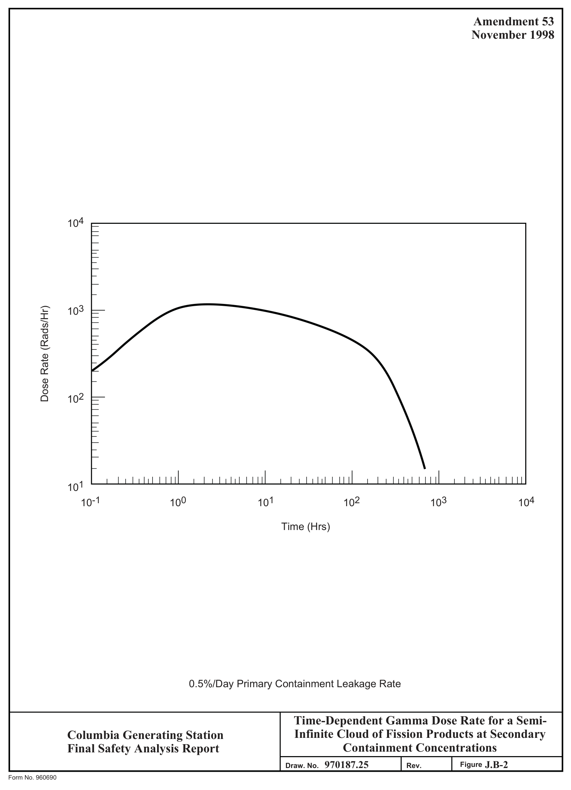

*figure on PDF page 1037*

[Vector original (SVG, lossless): fig_page-1037.svg](../figures/fig_page-1037.svg)

<!-- labels/text on this figure page -->
Amendment 53 November 1998
104
103 Dose Rate (Rads/Hr)
102
101 10-1 100 101 102 103 104
Time (Hrs)
0.5%/Day Primary Containment Leakage Rate
Time-Dependent Gamma Dose Rate for a Semi- Infinite Cloud of Fission Products at Secondary Columbia Generating Station Containment Concentrations Final Safety Analysis Report 970187.25
J.B-2
Draw. No.
Rev. Figure Form No. 960690

<!-- p.1038 -->
Amendment 53 November 1998

r

#### T ----------------
a
------,.
01 P ,,,,,
- ,,,,, ,,,,, Target ,,,,, 02 ,,,,, Location ,,,,,

,,,,, ,,,,, ,,,,, b ,,,,, ,,,,, ,,,,, ,,,,, ,,,,, ,,,,, ,,,,, ,,,,, ,,,,, ,,,,, ,,,,, ,,,,, ,,,,, ,,,,, ,,,,,

Line Source

bi = ∑µ i t i i

Illustration of Parameters Used in the Columbia Generating Station Shielding Equation Final Safety Analysis Report 970187.26

#### J.B-3
Draw. No.
Rev. Figure Form No. 960690

<!-- p.1039 -->

*figure on PDF page 1039*

[Vector original (SVG, lossless): fig_page-1039.svg](../figures/fig_page-1039.svg)

<!-- labels/text on this figure page -->
Amendment 53 November 1998
104
103 Standard Dose Rate (Rads/Hr)
102
101
100 10-2 10-1 100 101 102 103 104
Time After Accident (Hrs)
Standard Gamma Dose Rate Curve for Liquid Containing Systems Columbia Generating Station
(RCIC Liquid System and RHR System) Final Safety Analysis Report 970187.27
J.B-4
Draw. No.
Rev. Figure Form No. 960690

<!-- p.1040 -->
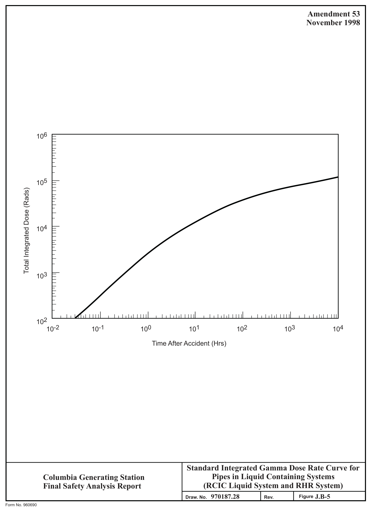

*figure on PDF page 1040*

[Vector original (SVG, lossless): fig_page-1040_2.svg](../figures/fig_page-1040_2.svg)

<!-- labels/text on this figure page -->
Amendment 53 November 1998
106
105 Total Integrated Dose (Rads)
104
103
102 10-2 10-1 100 101 102 103 104
Time After Accident (Hrs)
Standard Integrated Gamma Dose Rate Curve for Pipes in Liquid Containing Systems Columbia Generating Station
(RCIC Liquid System and RHR System)
Final Safety Analysis Report 970187.28
J.B-5
Draw. No.
Rev. Figure Form No. 960690

<!-- p.1041 -->
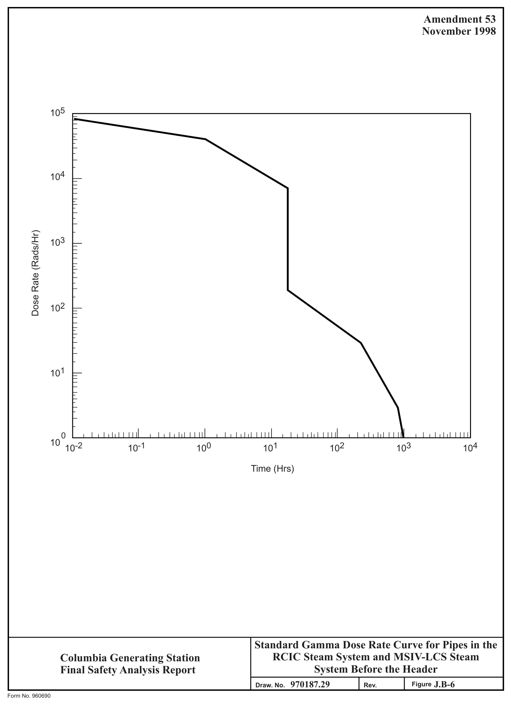

*figure on PDF page 1041*

[Vector original (SVG, lossless): fig_page-1041.svg](../figures/fig_page-1041.svg)

<!-- labels/text on this figure page -->
Amendment 53 November 1998
105
104
Dose Rate (Rads/Hr)
103
102
101
0 10 10-2 10-1 100 101 102 103 104
Time (Hrs)
Standard Gamma Dose Rate Curve for Pipes in the RCIC Steam System and MSIV-LCS Steam Columbia Generating Station System Before the Header Final Safety Analysis Report 970187.29
J.B-6
Draw. No.
Rev. Figure Form No. 960690

<!-- p.1042 -->
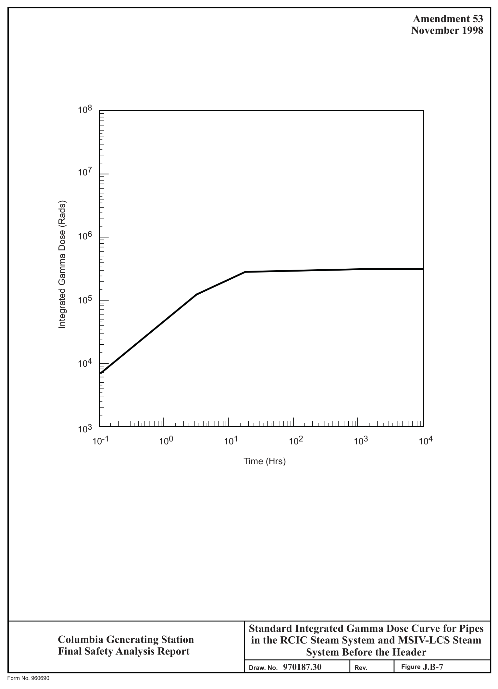

*figure on PDF page 1042*

[Vector original (SVG, lossless): fig_page-1042.svg](../figures/fig_page-1042.svg)

<!-- labels/text on this figure page -->
Amendment 53 November 1998
108
107
Integrated Gamma Dose (Rads)
106
105
104
103 10-1 100 101 102 103 104
Time (Hrs)
Standard Integrated Gamma Dose Curve for Pipes Columbia Generating Station in the RCIC Steam System and MSIV-LCS Steam Final Safety Analysis Report System Before the Header 970187.30
J.B-7
Draw. No.
Rev. Figure Form No. 960690

<!-- p.1043 -->
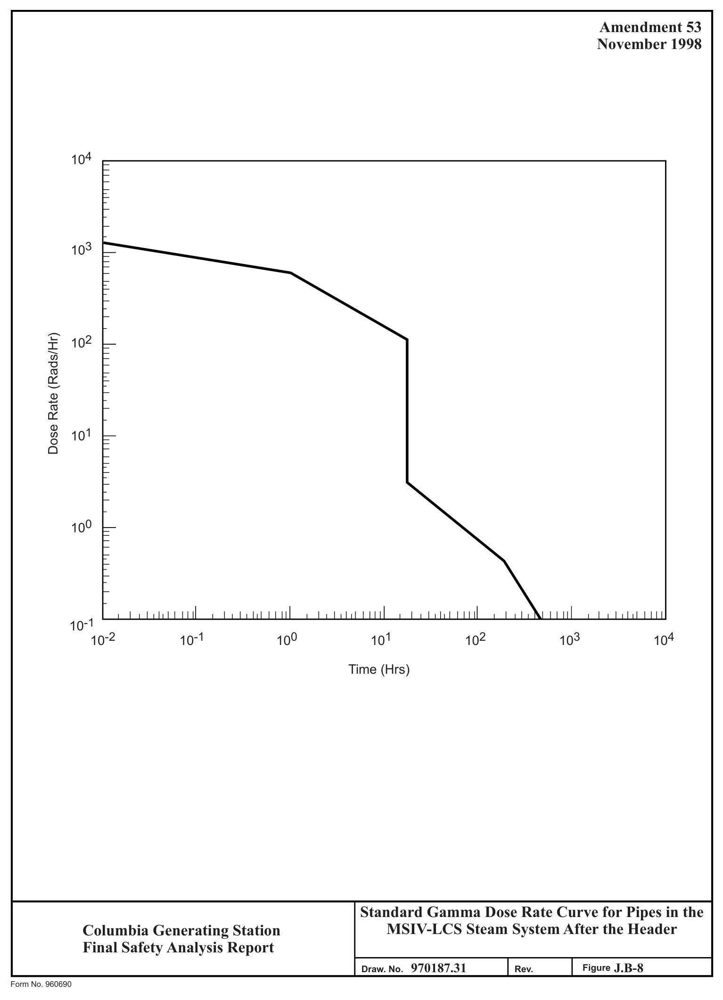

*figure on PDF page 1043*

[Vector original (SVG, lossless): fig_page-1043.svg](../figures/fig_page-1043.svg)

<!-- labels/text on this figure page -->
Amendment 53 November 1998
104
103
102 Dose Rate (Rads/Hr)
101
100
10-1 10-2 10-1 100 101 102 103 104
Time (Hrs)
Standard Gamma Dose Rate Curve for Pipes in the MSIV-LCS Steam System After the Header Columbia Generating Station Final Safety Analysis Report 970187.31
J.B-8
Draw. No.
Rev. Figure Form No. 960690

<!-- p.1044 -->
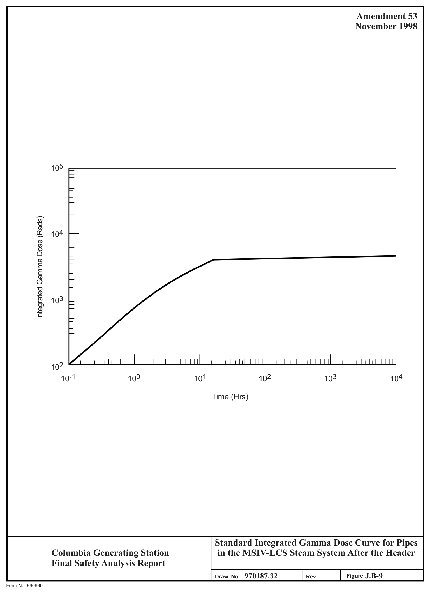

*figure on PDF page 1044*

[Vector original (SVG, lossless): fig_page-1044.svg](../figures/fig_page-1044.svg)

<!-- labels/text on this figure page -->
Amendment 53 November 1998
105
Integrated Gamma Dose (Rads)
104
103
102 10-1 100 101 102 103 104
Time (Hrs)
Standard Integrated Gamma Dose Curve for Pipes in the MSIV-LCS Steam System After the Header Columbia Generating Station Final Safety Analysis Report 970187.32
J.B-9
Draw. No.
Rev. Figure Form No. 960690

<!-- p.1045 -->
Amendment 59 December 2007

#### Deleted
Columbia Generating Station Final Safety Analysis Report I I 970187.33 J.B-10 Figure Draw. No.
Rev.
Form No. 960690FH

<!-- p.1046 -->
Amendment 59 December 2007

#### Deleted
Columbia Generating Station Final Safety Analysis Report I I 970187.34 J.B-11 Figure Draw. No.
Rev.
Form No. 960690FH

<!-- p.1047 -->
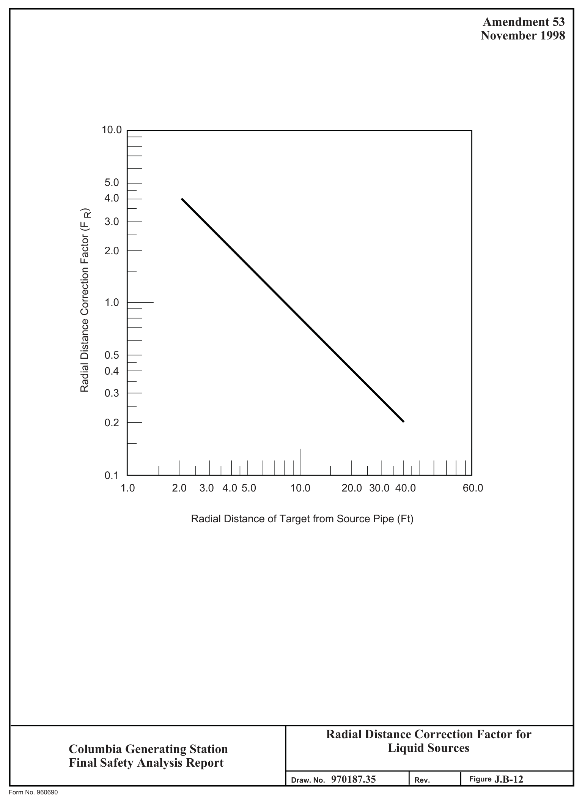

*figure on PDF page 1047*

[Vector original (SVG, lossless): fig_page-1047.svg](../figures/fig_page-1047.svg)

<!-- labels/text on this figure page -->
Amendment 53 November 1998
10.0
5.0 4.0 Radial Distance Correction Factor (F R)
3.0
2.0
1.0
0.5 0.4
0.3
0.2
0.1
1.0 2.0 3.0 4.0 5.0 10.0 20.0 30.0 40.0 60.0
Radial Distance of Target from Source Pipe (Ft)
Radial Distance Correction Factor for Liquid Sources Columbia Generating Station Final Safety Analysis Report 970187.35
J.B-12
Draw. No.
Rev. Figure Form No. 960690

<!-- p.1048 -->
Amendment 53 November 1998

1.0

Pipe Length Correction Factor FL

0.1

0.03 0.1
1.0 10.0 20.0

L/r (Dimensionless)

Pipe Length Correction Factor for Liquid Sources Columbia Generating Station Final Safety Analysis Report 970187.36

#### J.B-13
Draw. No.
Rev. Figure Form No. 960690

<!-- p.1049 -->
Amendment 53 November 1998

3.2

3.0

2.8

2.6

2.4

2.2

## 2.0 Pipe Diameter Correction Factor
1.8

1.6

FD
1.4

1.2

1.0

0.8

0.6

0.4

0.2

0.0 2 4 6 8 10 12 14 16 18 20 22 24 Pipe Diameter (Inches)

Pipe Diameter Correction Factor for Liquid Sources Columbia Generating Station Final Safety Analysis Report 970187.37

#### J.B-14
Draw. No.
Rev. Figure Form No. 960690

<!-- p.1050 -->
Amendment 53 November 1998

10.0 9.0 8.0 7.0 6.0 5.0 4.0

## 3.0 Radial Distance Correction Factor
2.0

## 1.0 FR 9.0 8.0 7.0 6.0 0.5 0.4

0.3

0.2

0.1
1.0 2.0 3.0 4.0 5.0 10.0 20.0 30.0 40.0 50.0

Radial Distance of Target from Source Piping (Ft)

Radial Distance Correction Factor for Gaseous Sources Columbia Generating Station Final Safety Analysis Report 970187.38

#### J.B-15
Draw. No.
Rev. Figure Form No. 960690

<!-- p.1051 -->
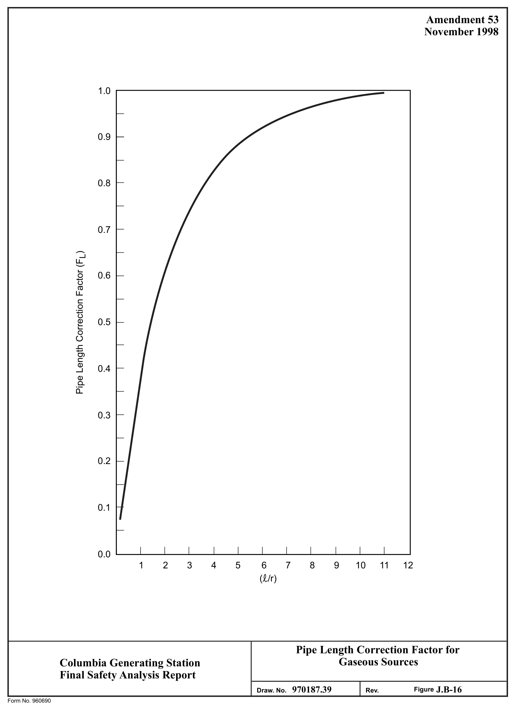

*figure on PDF page 1051*

[Vector original (SVG, lossless): fig_page-1051_2.svg](../figures/fig_page-1051_2.svg)

<!-- labels/text on this figure page -->
Amendment 53 November 1998
1.0
0.9
0.8
0.7
Pipe Length Correction Factor (FL)
0.6
0.5
0.4
0.3
0.2
0.1
0.0 1 2 3 4 5 6 7 8 9 10 11 12
( /r)
Pipe Length Correction Factor for Gaseous Sources Columbia Generating Station Final Safety Analysis Report 970187.39 J.B-16 Figure Draw. No.
Rev.
Form No. 960690

<!-- p.1052 -->
Amendment 53 November 1998

2.4

2.2

2.0

## 1.8 Pipe Diameter Correction Factor (FD)
1.6

1.4

1.2

1.0

0.8

0.6

0.4

0.2

0.0 2 4 6 8 10 12 Normal Pipe Diameter (Inches)

Pipe Diameter Correction Factor for Gaseous Sources Columbia Generating Station Final Safety Analysis Report 970187.40

#### J.B-17
Draw. No.
Rev. Figure Form No. 960690

<!-- p.1053 -->
Amendment 58 December 2005

Configuration 1 ,-
--, a I b I
-t-
-t
- - Source Pipe L •.
r

2a 2b FL = FL ( r ) – FL ( r )
Target 2

Configuration 2 r- -i b a ·I I - l
- I - - Source Pipe

r 2a 2b FL = FL ( r ) + FL ( r )
2
•· Target

Parameters Used for the Calculation of Length Columbia Generating Station Correction Factor Final Safety Analysis Report I I 970187.50 J.B-18 Figure Draw. No.
Rev.
Form No. 960690FH

<!-- p.1054 -->
November 1998

Attachment J.C

#### PROCEDURE FOR THE CALCULATION OF SECONDARY
#### CONTAINMENT RADIATION ZONE GAMMA DOSES
#### J.C.1 INTRODUCTION
Three Mile Island Lessons Learned Short Term Recommendations (NUREG-0578)
Section 2.1.6.b, requires all nuclear power plant licensees to calculate post-loss-of-coolant accident (LOCA) environmental conditions for all safety-related equipment. This procedure is specifically concerned with the definition of the postaccident radiological environments in the secondary containment of Columbia Generating Station (CGS), a BWR.

The assumptions used in this procedure are based on a nonmechanistic LOCA scenario in which core damage is experienced at the beginning of the accident and primary containment isolation is achieved prior to radiation transport.

The radiation level at a given location inside the secondary containment of CGS during and following such an accident is defined by the following major source contributors.

Airborne gamma dose Gamma ray dose from airborne radioactive sources inside secondary containment

Containment shine dose Gamma ray dose from radioactive sources suspended in the drywell and the wetwell inside primary containment

Direct gamma dose Gamma ray dose from piping containing recirculating radioactive fluids

Bioshield penetration Gamma ray dose from liquid piping and airborne streaming dose radioactive sources inside primary containment which stream through bioshield wall penetrations into secondary containment

The methods presented in this procedure make it possible to calculate the worst-case gamma ray dose due to the above mentioned source of contributors inside radiation zones (see Section J.C.2 for the definition of radiation zones) of the secondary containment of CGS. The radiation zone dose calculated by using this procedure is applicable solely for the purpose of environmental qualification of safety-related equipment.

The following sections of this procedure describe the nomenclature, assumptions, and methods used in calculating radiation dose rates and cumulative doses. Section J.C.2 defines the terms and nomenclature found in this procedure. The assumptions and approximation used in

#### J.C-1
<!-- p.1055 -->
November 1998

developing the dose rate calculation method, as well as limitations to this method, are stated in Section J.C.3. Section J.C.4 provides a step-by-step procedure for determining the worst-case gamma dose rate and cumulative dose inside a particular radiation zone. The calculation of airborne beta dose is defined in a separate calculation procedure and is not included in this procedure (see Attachment J.E).

#### J.C.2 DEFINITION OF TERMS
This section contains the definition of the terms and symbols as used in this procedure:

CIND: Cumulative integrated dose
(rads) Cumulative dose due to exposure to the decaying radioactive sources.

Da: Airborne gamma dose rate
(rads/hr) Gamma dose rate resulting from radioisotopes suspended in the atmosphere of the secondary containment.

Dd: Direct dose rate
(rads/hr) Gamma dose rate resulting from the radioactive fluid contained inside recirculating pipes.

Ds: Shine dose rate
(rads/hr) Gamma dose rate in the secondary containment resulting from radioisotopes suspended and deposited inside primary containment.

DB: Bioshield penetration streaming dose
(rads/hr) Gamma dose rate contributed by the liquid piping and airborne radioactive sources inside primary containment which stream through the bioshield wall.

Dt: Total gamma dose rate
(rads/hr) Gamma dose rate contributed by the sum of airborne, direct, and shine from penetrations into secondary containment.

Dt = Da + Dd + Ds + DB

GF: Geometric factor Scaling factor used to convert semi-infinite airborne gamma dose to finite dose inside enclosed air spaces.

Da , ∞ a = D GF

#### J.C-2
<!-- p.1056 -->
November 1998

1173 = (Reference J.7-39) GF 0 338 .
V

FL: Length conversion factor A scaling factor dependent on the source pipe segment length and spatial orientation relative to a target (see Figure J.C-1 for the calculation of this factor). FL is used to convert the standard dose to the dose emitted by a pipe segment of finite length.

FD: Diameter conversion factor A scaling factor dependent on the source pipe diameter. FD is used to convert the standard dose to the dose emitted by a pipe of specified diameter.

FR: Radial distance conversion factor A scaling factor dependent on the radial distance of the target from the source piping. FR is used to convert the standard dose to the dose at a target of specified radial distance from the source piping.

Ft: Total dose contribution correction factor A scaling factor used to convert the standard dose to the dose at a target from a pipe segment of specified geometry and orientation.

Ft = FD ∗ FR ∗ FL

Fs: Sum of dose contribution correction factor A scaling factor used to convert the standard dose to the radiation zone dose due to all the significant pipe sources in the zone.

n F S = ∑ Fti i = l

Radiation zone: A region in the secondary containment defined to be such that gamma radiation calculated in the zone bounds the magnitude of dose received by the pieces of safety-related equipment located in that zone.

Source term: The total radiated gamma energy associated with a specified quantity of radioactive material released from the reactor as the result of a postulated accident.

#### J.C-3
<!-- p.1057 -->
November 1998

Special sources: Radioactive source of such geometry or concentration that cannot be approximated by pipe segments of diameters 2 in. through 24 in. and containing contaminated liquid of activity concentration established in Section J.C.3.1. This can be a heat exchanger, standby gas treatment filter, pump, etc.

Standard dose: Gamma dose at a target having a radial distance of 8 ft from the centerline of an infinitely long, 8-in.- diameter schedule 40 pipe.

Target: The point in space chosen to represent the location of an object for which a dose rate and/or cumulative dose is being calculated.

Worst case target: Location of the piece of safety-related equipment inside a radiation zone which will experience the highest gamma dose among all the pieces of safety-related equipment in that zone.

#### J.C.3 ASSUMPTIONS, APPROXIMATIONS, AND LIMITATIONS
J.C.3.1 Basic Assumptions to be Used in the Analysis

Gamma doses and dose rates inside radiation zones will be determined for four types of radioactive source distribution:

Major Source Contributors

Airborne gamma dose Isotopes suspended in the atmosphere of the secondary containment

Shine dose Gamma irradiation from the primary containment

Direct dose Direct gamma irradiation from the radioactive fluid contained inside recirculating pipes

Streaming dose Gamma irradiation from liquid piping sources inside primary containment and primary containment atmosphere streaming through bioshield wall penetrations

The dose contributed by each of these sources is determined by the location of the equipment, the time dependent distribution of the source, and the effects of shielding.

#### J.C-4
<!-- p.1058 -->
November 1998

The assumptions used in determining the initial distribution and leakage of radioactivity in the primary containment are as follows:

a. 100% of the noble gases and 50% of the halogens initially in the reactor core will be distributed homogeneously within the primary containment free volume immediately following the postulated accident. Plateout of 95% of the elemental iodines is allowed to occur in accordance with Reference J.7-34;

b. 50% of the halogens and 1% of the remaining fission products in the core will be mixed homogeneously with the primary containment liquid space instantaneously. The primary containment liquid space is defined as the sum of the suppression pool liquid and the reactor coolant system (RCS) liquid.
Assumptions a and b are NRC-recommended assumptions for defining radioactivity release fractions for the qualification of safety-related equipment
(Reference J.7-2) and are consistent with the accident analysis
(Reference J.7-13);

c. The core fission product source term is defined as the total product generated in the core after 1000 days at a reactor power of 3556 MWt. This represents the maximum burnup level in the core prior to radioactivity release and is conservative; and

d. Primary containment leakage of 0.50% volume/day was considered and is consistent with the assumptions established in Reference J.7-13.

J.C.3.1.1 Assumptions Used in the Calculation of Airborne Dose Rate Inside Secondary Containment

a. Activity that leaks into the secondary containment is homogeneously mixed with the secondary containment atmosphere prior to its removal from the atmosphere by the standby gas treatment system (SGTS) exhaust fans. This is consistent with the NRC-recommended assumptions used for calculation of doses inside primary containment (Reference J.7-2);

b. The SGTS flow rate of 2430 scfm is assumed to be the flow rate of the effluent air and is based on one reactor building air change per day;

c. Air that leaks out of the primary containment flows directly into the secondary containment. Bypass leakage is not considered. This is conservative when considering dosage in the secondary containment, since it maximizes the buildup of radioactivity in the secondary containment; and

#### J.C-5
<!-- p.1059 -->
November 1998

d. Geometric factors provide a good approximation to convert the semi-infinite cloud dose to a finite cloud dose and is based on the results presented in Reference J.7-28 and based on average gamma ray energy of 0.733 MeV. The effect of variation of this parameter due to difference in gamma ray energies have been proven to be negligible (see Attachment J.B for justification).

J.C.3.1.2 Assumptions Used for the Calculation of Shine or Streaming Dose From Primary Containment

a. No depletion of activity due to leakage is assumed to maximize the source activity and is conservative;

b. The airborne source is assumed to be uniformly distributed in the drywell and in the wetwell air space. The effect of the plateout of iodine is not considered in secondary containment;

c. Activity in the wetwell water volume is assumed to be uniformly distributed in the sump water. Assumptions b and c are based on the plateout modeling and source term assumption contained within References J.7-2 and J.7-34;

d. The dosage at a point inside the region closest to the source is considered to be representative of the gamma dose in the region which maximizes the gamma ray dose at the region and is conservative; and

e. The liquid piping sources inside primary containment are assumed to be uniformly distributed in the RCS for the first 17 hr post-LOCA. The liquid piping sources inside primary containment are assumed to be uniformly distributed in the RCS plus the suppression pool after the first 17 hr post-LOCA. This is consistent with the CGS operations procedure to depressurize and utilize the alternate shutdown cooling mode within 17 hr post- LOCA once a degraded core condition is identified.

J.C.3.1.3 Assumptions and Approximations Used in the Calculation of Direct Doses

a. No valve leakage is assumed, which is consistent with Reference J.7-5, Item II.B.2, Clarification (2);

b. Schedule 40 piping is assumed, which is a conservative simplification of the calculation process. Because the majority of the pipe segments considered are schedule 40 piping, and because increases in pipe schedule can only decrease the dose rate at the targets, this approximation is considered to be conservative and appropriate;

#### J.C-6
<!-- p.1060 -->
November 1998

c. Heat exchangers and pumps can be approximated as pipe systems. The volume of radioactive liquid in the component and its length are used to determine an equivalent volume of liquid. This is a crude approximation for dose rates contributed by complex geometries. Because the pump and heat exchanger walls are thicker than the pipe walls of schedule 40 piping, this assumption is conservative; and

d. Radioactive piping with diameters 2-1/2 in. or less was not modeled unless it was determined that such a pipe was a major source contributor. A major source contributor is defined as the only radioactive pipe in a target area or the radioactive pipe of closest proximity to the target. This is made because the dose contributions due to pipe segments of diameter less than 2-1/2 in. are generally negligible, unless they are major source contributors.

J.C.3.2 Limitations

The following limitations apply to the use of this procedure for the calculation of radiation zone doses.

a. This procedure is only applicable to the calculation of radiation zone gamma doses in the secondary containment of CGS;

b. The assumptions stated in Section J.C.3.1 are basic to the methodology used in this procedure. Changes in any of the assumptions will affect the accuracy of the results generated using this procedure;

c. The calculation of direct doses using the generic curves in this procedure is limited to liquid sources in schedule 40 pipe segments or equivalent pipe segments with nominal pipe diameters ranging from 2 in. to 24 in. Any deviation from these pipe geometries should be modeled as special cases.
Note: Schedule 40 piping is used because the majority of the pipe segments to be considered are standard pipes (schedule 40). Increases in the pipe schedule only introduces conservatism in the results;

d. The results for direct dose calculated using the generic curves were found to be accurate to within 10% (see Reference J.7-39 for error study); and

e. Source piping located 40 ft or further from the target is generally an insignificant dose contributor. If its contribution is not found to be negligible, it should be considered as a special source.

#### J.C-7
<!-- p.1061 -->
November 1998

#### J.C.4 PROCEDURES FOR THE CALCULATION OF SECONDARY CONTAINMENT
#### RADIATION ZONE DOSES
This procedure describes the method used in calculating the gamma radiation doses inside radiation zones. For equipment located inside a zone, the following four sources contribute to the total dose level.

a. Airborne dose (gamma), b. Direct gamma dose from sources within pipes, c. Direct gamma shine dose from drywell and wetwell, and d. Gamma streaming dose from drywell and wetwell.

A step-by-step procedure is discussed in the following sections for the calculation of the maximum total gamma dose and dose rates for each zone.

J.C.4.1 Procedure A: Radiation Zone Dose Calculation

The first step in preparing a zone dose calculation is to identify all the parameters to be used.
This includes the identification of all the potential sources and targets, both inside and outside the zone, and the identification of the dimensions of the zone. Figure J.C-2 is a step-by-step flowchart of the calculation procedure. When identifying sources outside the zone, sources at the upper and lower elevations in the review process are included. A conservative dose estimate is used to determine whether a source outside a zone is a significant contributor. For example, if the closest pipe segment in the zone is a few feet away from a target, then the dose estimate will show that a pipe segment outside the room at 30 ft is insignificant by comparison.
Conversely, if a target is located near a wall with several pipes on the other side of a wall, then those pipes may become significant source contributors and are included in the final evaluation for the target.

J.C.4.2 Procedure B: Airborne Dose Calculation in Secondary Containment

Because the semi-infinite airborne dose and dose rates are already calculated and shown in Figures J.C-6 and J.C-7, the only calculation involved in determining the airborne dose is the conversion of the semi-infinite cloud dose at reactor building concentrations to a finite cloud dose inside the cubicles in which the radiation zones are defined. The first step in this calculation is to determine the volume which defines the air space (or zone) of interest. An enclosed air space is defined as a cubicle, at least 95% shielded by concrete (or equivalent shielding) at least 1 ft thick.

To convert a semi-infinite cloud dose (calculated in Reference J.7-38) to a finite cloud dose, a geometric factor is used.

#### J.C-8
<!-- p.1062 -->
November 1998

D ( ) t = a , ∞ D ( ) t
(J.4-1)
a GF

= 1173
(J.4-2)
where GF (Reference J.7-39)
0 338 .
V

GF = geometric factor (dimensionless)
volume of the enclosed air space (ft3) V =

Similarly,

CIND ( ) t ∞ CIND ( ) t = a ,
(J.4-3)
a GF

Figure J.C-3 is a step-by-step flowchart of the procedure for calculating airborne gamma doses.

J.C.4.3 Procedure C: Primary Containment Shine Dose Calculation

Containment shine doses are calculated using the QAD-P5A computer code. Guidelines for preparing input parameters are documented in Procedure E and Reference J.7-10. The modeling procedure and the accuracy of the results are highly dependent on the geometry to be modeled, specification of the source volume, and the selection of a buildup factor.
Figure J.C-4 is a step-by-step procedure for calculating containment shine doses.

J.C.4.4 Procedure D: Direct Dose Calculation

The first step in the direct dose calculation (from Reference J.7-39) is the identification of the “worst-case” target. Normally, the worst-case target is the piece of equipment that is closest to the major source piping and can be selected by inspection. However, if situations arise such that the worst-case target cannot be chosen by simple inspection, order-of-magnitude calculations are performed for each potential worst-case target in the zone. These calculations are illustrated in Steps 3a through 3c of Figure J.C-5.

The next step is to identify special sources. Special sources are defined as source geometries that cannot be represented by liquid pipe segments between 2 and 24 in. in diameter. Example special sources are SGTS filters, reactor core isolation cooling (RCIC) steam pipe, turbines, and heat exchangers larger than 24-in. diameter. Other components such as pumps and small heat exchangers should be modeled as pipes. The pipe cross-sectional area is calculated by dividing the total fluid volume by the effective length of the component.

#### J.C-9
<!-- p.1063 -->
November 1998

The contribution due to sources with shield walls is investigated next. Figure J.C-13 is used for this evaluation. If these sources are determined to be significant contributors, special QAD-P5A modeling procedures as described in Procedure E are followed.

It is unlikely that all sources under consideration will contribute significantly to the dose at a specific target. If all source contributions were to be calculated, the time involved in performing the calculation would be unnecessarily long without making a substantial improvement in the accuracy of the results.

Hence, as the sources are being identified, good judgment is used to distinguish between sources which contribute significantly to the target dose and those sources which do not.

An insignificant source is determined by comparing its dose contribution to the source making the largest dose contribution. The comparison is facilitated by arranging sources in decreasing order of importance and assigning rank numbers to the sources. The largest dose contributor is given a ranking number of 1. The largest dose contributor is determined by inspection of the sketches and drawings being used. The largest dose contributor is generally the longest segment with the largest pipe diameter and the least amount of intervening shielding between the target and source. All sources which are in the radiation zone and have been assumed to be insignificant contributors are listed as such to indicate that those sources have been considered.

Equations Used in the Calculation of Dose Rates

The following procedure is followed for the calculation of correction of dose rates factors of dose rates (Step 9 through Step 12 of Figure J.C-5):

a. Identify the radial distance of the pipe segment from the target; read FR from Figure J.C-11.

If the target is in contact with the source piping, read FD from Table J.C-1 and set FR and FL equal to 1.

(Note: dose rate is not a function of pipe length and radial distance.)

If the target is geometrically in line with the source pipe segment, as shown in configuration 3 of Figure J.C-1, set FL=1 and read FD and FR from Figures J.C-14 and J.C-15, respectively.

(Note: FL is defined here because dose rate is not sensitive to pipe length variation.)

b. Identify the pipe diameter; read FD from Figure J.C-10.

#### J.C-10
<!-- p.1064 -->
November 1998

c. Determine FL from Figure J.C-12; use equations in Figure J.C-1 to calculate this factor.

d. The total dose contribution factor for a given pipe segment (I) is given as

Ft(I) = FD(I) ∗ FR(I) ∗ FL(I)

e. When all the significant contributions have been calculated, sum the total dose contribution factors.
n ∑ = F F ( ) I s t = n 1

f. To determine if a source is negligible, the following test should be performed:

When N source segments are being considered and the dose contribution of ranking I is less than 1/10 of the dose rate calculated from the largest source divided by (N-I), the sources remaining should not contribute more than 10% to the total source contribution. This level of accuracy should be adequate for most calculations.

The total integrated direct dose and dose rate can be calculated.

DD(t) = DDo(t) • Fs + DD(t)
(Special Sources)

CINDD(t) = CINDDo(t) • Fs + DD(t)
(Special Sources)

where DDo(t) and CINDDo(t) are dose rates and cumulative doses for standard pipe segments and are found on Figures J.C-8 and J.C-9.

J.C.4.5 Procedure E: QAD-P5A Modeling Procedure

Direct dose contribution due to special sources and/or sources with shield walls should be calculated using the QAD-P5A computer code. This computer code is three-dimensional and calculates dose rates at specified target locations from radioactive volume, line, and point sources. Attenuation due to shield materials, if applicable, is also applied.

The accuracy of the results is highly affected by the manner by which the source volume is divided, and the position of the target relative to the source point. Therefore, a sensitivity study on the specification of the source volume should be performed. This can be achieved by

#### J.C-11
<!-- p.1065 -->
November 1998

increasing the number of source volume divisions until the dose rate results converge to within 5%.

Another factor to be considered is the specification of the buildup factor. As a general rule, aluminum buildup factor should be used when concrete shield is encountered, and iron energy buildup factor should be used when considering attenuation through steel shield.

J.C.4.6 Procedure F: Streaming Dose Calculation

Containment streaming doses through the bioshield wall penetrations are calculated using the SCAP-BR and QAD-CG computer codes. The modeling procedure and the accuracy of the results are highly dependent on the geometry to be modeled, specification of the source volume, and the selection of a buildup factor.

#### J.C-12
<!-- p.1066 -->
November 1998

Table J.C-1

Diameter Correction Factor (FD) for Targets in Contact With the Source Piping

Nominal Pipe Diameter Pipe Diameter Correction Factor
(in.)
(FD)
2 18.4

4 24.4

6 54.6

8 33.3

10 35.3

12 35.3

14 35.5

16 33.7

20 32.0

24 29.6

#### J.C-13
<!-- p.1067 -->
Amendment 53 November 1998 Configuration 1 E---j
-1/ a b Source Piping Ii 3-
- - 1

#### _J_L
I r

- 2a - 2b FL = FL ( r ) – FL ( r )
Target 2

Configuration 2 r-- ~1 ..
; I a b Source Piping
--+-
- - -

I I I r

#### I ...
2a 2b I FL = FL ( r ) + FL ( r ) - - I 2 I _j Target

Configuration 3

Source Piping / Target
-7
-~ -I r-- ----, - r

FL = 1

Calculation of Length Correction Factor Columbia Generating Station Final Safety Analysis Report I I 970187.51

#### J.C-1
Draw. No.
Rev. Figure Form No. 960690

<!-- p.1068 -->
Amendment 53 Start November 1998 t Identify Dimensions of Zone Step 1

#### t
Locate Targets Inside Step 2 Zone on the Zone Sketch

#### t
Identify All Dose Contributing Sources Inside Step 3 Zone and Locate on Zone Sketch

#### t
Identify All Possible Dose Step 4 Contributing Sources Outside Zone t Calculate Airborne Gamma Step 5 Dose Rate and Integrated Dose (Refer to Procedure B)
t Calculated Shine and Streaming Step 6 Gamma Dose Rate and Integrated Dose (Refer to Procedure C)

#### t
Calculate Direct Dose Step 7 Gamma Dose Rate and Integrated Dose (Procedure D)
t Calculate Total Gamma Dose and Dose Rate Step 8 Dt = Da + Dd + Ds + DB CINDt = CINDa + CINDd + CINDs + CINDB t Step 9 Complete Table 1

#### t
Step 10 PLCT Total Dose Rate and Integrated Dose

#### t
Problem Completed

Procedure A: Procedure for Calculating Radiation Columbia Generating Station Zone Doses Final Safety Analysis Report 970187.52

#### J.C-2
Draw. No.
Rev. Figure Form No. 960690

<!-- p.1069 -->
Amendment 53 November 1998

From Step 5 of Procedure A

Identify Shield Wall Step 1 Thickness and Vent Openings Surrounding Zone

Is Criteria for No Identify Dimensions of the Enclosed Air Space Step 2 Enclosed Air Space Step 2A Satisfied?
in which the Zone is Located

Yes

Calculate Volume of Step 3 Enclosed Air Space

Calculate Geometric Factor Step 4 GF = 1173

#### V0.338
Using Figures (6) and (7)
Calculate Airborne Gamma Dose Rate and Integrated Step 5 Dose Da (t) + Da∞ (t)
GF CINDa (t) = CINDa,∞ (t)
GF

Return to Step 6 Step 5 of Procedure A

Procedure B: Procedure for Calculating Airborne Columbia Generating Station Gamma Dose Rate and Integrated Doses Final Safety Analysis Report 970187.53

#### J.C-3
Draw. No.
Rev. Figure Form No. 960690

<!-- p.1070 -->
Amendment 53 November 1998

( ' From Step 6 of Procedure A Select Point Inside Zone which is Expected to have Step 1 the Highest Shine Dose + Model the Primary Containment, Pertinent Reactor Building Step 2 Walls and Floors According to the Schemes Established in Procedure E ' Discretize the Airborne and Sump Sources Inside Step 3 Containment + Perform Sensitivity Study on Specification of Volume Source Step 4 Points until ' Results Converge to within 5%

Run QAD-P5A to Establish Step 5 the Time Dependent Shine Dose + Return to Step 6 of Procedure A

Procedure C: Procedure for Calculation of Columbia Generating Station Containment Shine Dose Final Safety Analysis Report I I 970187.54

#### J.C-4
Draw. No.
Rev. Figure Form No. 960690

<!-- p.1071 -->
Amendment 53 November 1998 From Step 7 of Procedure A

From the Sketch Generated in Step 3 of Procedure A and Taking into Consideration Step 1 all Significant Sources Outside the Zone, Identify the "Worst" Target(s).

M = # Worst Targets Can a Selected, Evaluate, for each No "Worst" Target be Step 2 Step 3A Target, the Order of Selected by Importance of the Sources and Inspection?
Complete Table 2 for each Target.
Yes

Following the Guidelines of Evaluate Sources; Identify by Step 4 through Step 12, Inspection their Order of Step 3 Roughly Calculate Total Dose Importance, (I), and Complete Step 3B Contribution Correction Table 2.
Factors for each Target.

Is contribution Compare Total Dose for each No due to Sources Outside Zone Target and Select the Worst Important? Use Figure J.C-13 Step 3C Target.
for this Evaluation.
Step 4

Yes

Calculate Dose Rate for Sources Outside Zone Step 5
(Refer to Procedure E)

Is Dose No Contribution due to Special Sources Significant?
Step 6

Yes

Calculate Dose Contribution due to Special Sources, Step 7 Refer to Procedure E for this Calculation.

For N Pipe Segments inside Step 8 Zone, Set I = 1

For the ITH Pipe Segment, S1, of Step 9 Order of Importance "I", Calculate
(I), FR (I) and FL (I) by using Table 2 FD and Figures J.C-10, 11 and 12. (note)

Calculate Total Dose Contribution Correction Factor Step 10 Ft(I) = FD (I) * FR(I) * FL(I)

Sum up all Dose Contribution Correction Factors Step 11 Fs = Fs + Ft(I)

No Ft(I) < 0.1 (Ft(1) / (n – I)) SET I = I +1

Step 12

Yes

Calculate Time Dependent Direct Dose Rate and Step 13 Note: If Target is in contact with the Source, Integrated Dose by Summing Read FD from Table 3, and Set FR and FL Equal to All Dose Contribution.
1. If Target is in line with the Axis of the Pipe Segment, as shown in Configuation 3 of Figure J.C-1, Set FL = 1 and Read FD and FR from Figures J.C-14 Return to and J.C-15 respectively.
Step 7 of Procedure A

Procedure D: Procedure for Calculation of Direct Dose Rate and Integrated Dose Columbia Generating Station Final Safety Analysis Report 970187.55

#### J.C-5
Draw. No.
Rev. Figure Form No. 960690

<!-- p.1072 -->

*figure on PDF page 1072*

[Vector original (SVG, lossless): fig_page-1072_2.svg](../figures/fig_page-1072_2.svg)

<!-- labels/text on this figure page -->
Amendment 53 November 1998
104
103 Dose Rate (Rads/Hr)
102
101 10-1 100 101 102 103 104
Time (Hrs)
0.5%/Day Primary Containment Leakage Rate
Time-Dependent Gamma Dose Rate for a Semi- Infinite Cloud of Fission Products at Secondary Columbia Generating Station Containment Concentrations Final Safety Analysis Report 970187.56
J.C-6
Draw. No.
Rev. Figure Form No. 960690

<!-- p.1073 -->
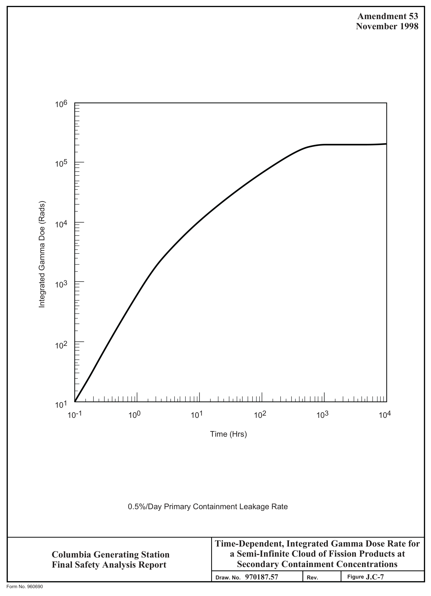

*figure on PDF page 1073*

[Vector original (SVG, lossless): fig_page-1073_2.svg](../figures/fig_page-1073_2.svg)

<!-- labels/text on this figure page -->
Amendment 53 November 1998
106
105
Integrated Gamma Doe (Rads)
104
103
102
101 10-1 100 101 102 103 104
Time (Hrs)
0.5%/Day Primary Containment Leakage Rate
Time-Dependent, Integrated Gamma Dose Rate for a Semi-Infinite Cloud of Fission Products at Columbia Generating Station Secondary Containment Concentrations Final Safety Analysis Report 970187.57
J.C-7
Draw. No.
Rev. Figure Form No. 960690

<!-- p.1074 -->
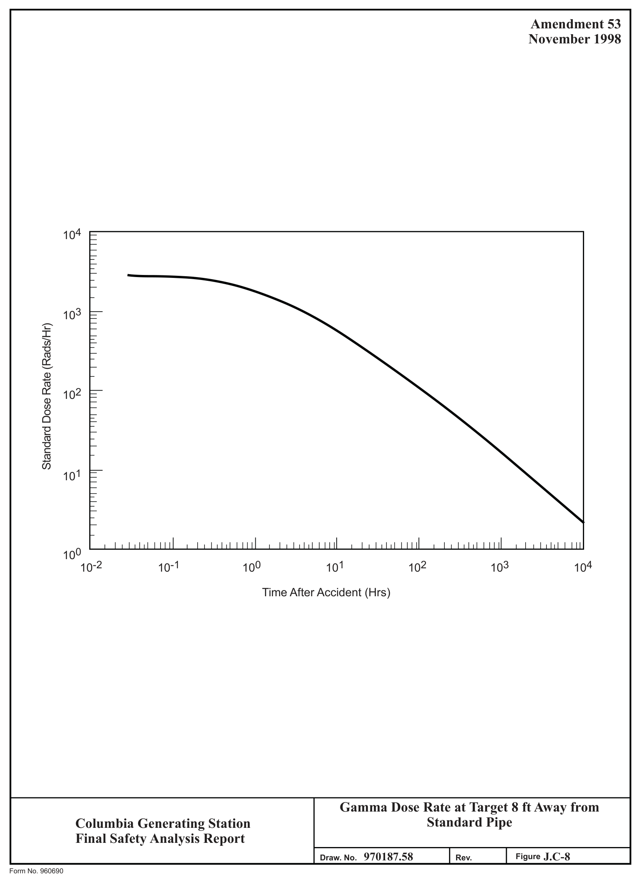

*figure on PDF page 1074*

[Vector original (SVG, lossless): fig_page-1074_2.svg](../figures/fig_page-1074_2.svg)

<!-- labels/text on this figure page -->
Amendment 53 November 1998
104
103 Standard Dose Rate (Rads/Hr)
102
101
100 10-2 10-1 100 101 102 103 104
Time After Accident (Hrs)
Gamma Dose Rate at Target 8 ft Away from Standard Pipe Columbia Generating Station Final Safety Analysis Report 970187.58
J.C-8
Draw. No.
Rev. Figure Form No. 960690

<!-- p.1075 -->
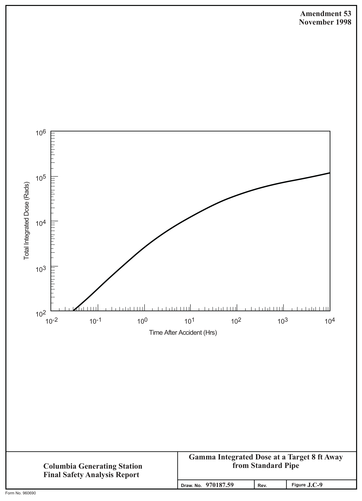

*figure on PDF page 1075*

[Vector original (SVG, lossless): fig_page-1075_2.svg](../figures/fig_page-1075_2.svg)

<!-- labels/text on this figure page -->
Amendment 53 November 1998
106
105 Total Integrated Dose (Rads)
104
103
102 10-2 10-1 100 101 102 103 104 Time After Accident (Hrs)
Gamma Integrated Dose at a Target 8 ft Away from Standard Pipe Columbia Generating Station Final Safety Analysis Report 970187.59
J.C-9
Draw. No.
Rev. Figure Form No. 960690

<!-- p.1076 -->
Amendment 53 November 1998

3.2

3.0

2.8

2.6

2.4

## 2.2 Pipe Diameter Correction Factor (F D)
2.0

1.8

1.6

1.4

1.2

1.0

0.8

0.6

0.4

0.2

0.0 2 4 6 8 10 12 14 16 18 20 22 24 Pipe Diameter (Inches)

Pipe Diameter Correction Factor Columbia Generating Station Final Safety Analysis Report 970187.60

#### J.C-10
Draw. No.
Rev. Figure Form No. 960690

<!-- p.1077 -->
Amendment 53 November 1998

101

Radial Distance Correction Factor (F R)
100

10-1 100 101 6x101

Radial Distance of Target from Source Pipe (Ft)

Radial Distance Correction Factor Columbia Generating Station Final Safety Analysis Report 970187.61

#### J.C-11
Draw. No.
Rev. Figure Form No. 960690

<!-- p.1078 -->
Amendment 53 November 1998

100

Pipe Length Correction Factor (FL)

3x10-2 10-1 100 101 2x101 L/r (dimensionless)

Pipe Length Correction Factor Columbia Generating Station Final Safety Analysis Report 970187.62

#### J.C-12
Draw. No.
Rev. Figure Form No. 960690

<!-- p.1079 -->
Amendment 53 November 1998

100

Dose Rate at Target Distance of 8 ft. (Rads/hr)
10.0

1.0

0.2 0
1.0
2.0
3.0

Shield Thickness (ft)

Note: This Figure is to be used for estimation purposes only.
Refer to Procedure E for calculating Dose rates outside shield walls

Dose Rate Versus Concrete Shield-Thickness for Standard Pipe (8 in. Sch 40) Columbia Generating Station Final Safety Analysis Report 970187.63

#### J.C-13
Draw. No.
Rev. Figure Form No. 960690

<!-- p.1080 -->
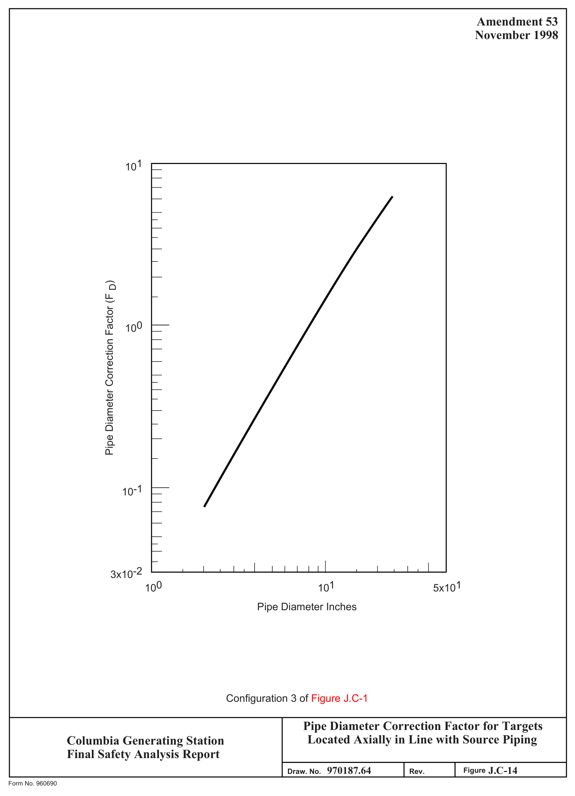

*figure on PDF page 1080*

[Vector original (SVG, lossless): fig_page-1080.svg](../figures/fig_page-1080.svg)

<!-- labels/text on this figure page -->
Amendment 53 November 1998
101
Pipe Diameter Correction Factor (F D)
100
10-1
3x10-2 100 101 5x101 Pipe Diameter Inches
Configuration 3 of Figure J.C-1
Pipe Diameter Correction Factor for Targets Located Axially in Line with Source Piping Columbia Generating Station Final Safety Analysis Report 970187.64
J.C-14
Draw. No.
Rev. Figure Form No. 960690

<!-- p.1081 -->
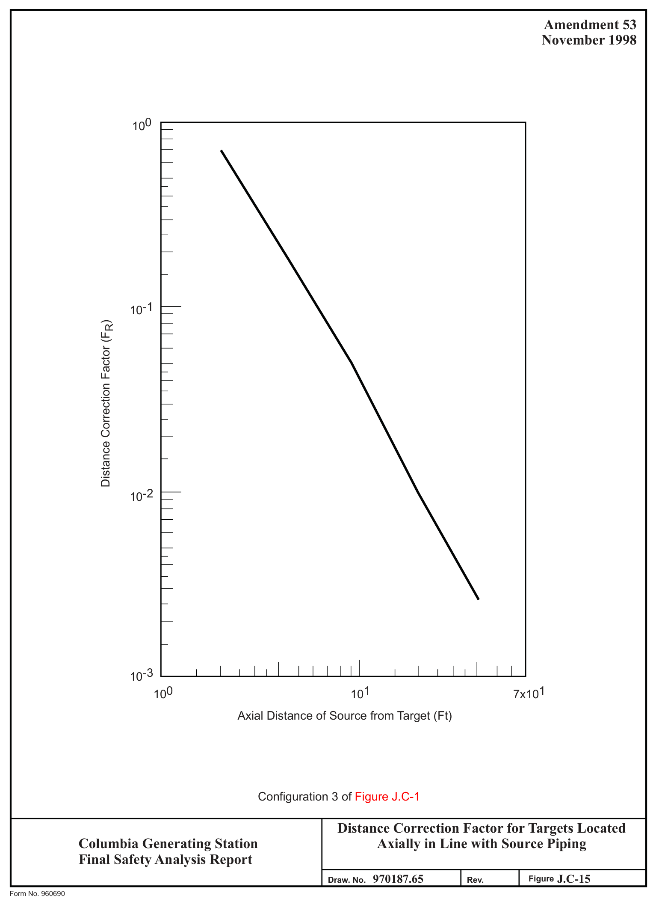

*figure on PDF page 1081*

[Vector original (SVG, lossless): fig_page-1081.svg](../figures/fig_page-1081.svg)

<!-- labels/text on this figure page -->
Amendment 53 November 1998
100
10-1 Distance Correction Factor (FR)
10-2
10-3 100 101 7x101 Axial Distance of Source from Target (Ft)
Configuration 3 of Figure J.C-1
Distance Correction Factor for Targets Located Axially in Line with Source Piping Columbia Generating Station Final Safety Analysis Report 970187.65
J.C-15
Draw. No.
Rev. Figure Form No. 960690

<!-- p.1082 -->
November 1998

Attachment J.D

#### CALCULATION OF THE RADIATION
The standby gas treatment system (SGTS) filters are located in the reactor building (el. 572 ft)
and function to process the radioactive contaminated gaseous effluent from the primary and secondary containment. In the event of a loss-of-coolant accident (LOCA) in the primary containment the SGTS will be actuated. The gaseous contaminants that leak out of the primary containment will be filtered by the SGTS. It will adsorb the iodines in the charcoal filters and the particulates in the prefilters and high-efficiency particulate air (HEPA) filters. Plateout in the primary containment of the iodines released from the core was considered in the radiation assessment of the SGTS. Depending on the radioactive source distribution and the primary containment leakage rate, the radioactive iodine concentration in the filters will be increasing with time as more and more is deposited on the filters. Main steam isolation valve (MSIV)
leakage is also considered in the radiation dose calculations.

The purpose of this study was to evaluate the time dependent gamma radiation level for safety-related equipment located near the SGTS filters and in adjacent rooms post-LOCA.

The time-dependent activity concentration in each of the filters is first calculated. The time and energy-dependent gamma activity levels on the SGTS filters is developed by a combination of computer runs and hand calculations and is used as input to the QAD-P5A computer code to calculate the gamma radiation levels for the pieces of safety-related equipment located in the room. A discussion of the analysis follows.

#### J.D.1 DESCRIPTION OF THE STANDBY GAS TREATMENT SYSTEM FILTERS
Figure J.D-1 is a drawing of the SGTS filter train. The SGTS consists of two fully redundant filter trains, each of which consists of the following components in series:

a. A demister to remove entrained water particles in the incoming air stream;

b. Two banks of electrical coil heaters designed to limit the humidity of the incoming air to 70% at design flow during post-LOCA conditions;

c. A bank of prefilters to remove large particles from the airstream (Figure J.D-2);

d. A bank of HEPA filters to remove the remaining particulates from the airstream
(Figure J.D-2);

#### J.D-1
<!-- p.1083 -->
November 1998

e. Two 4-in. deep beds of charcoal adsorber filters, arranged as shown in Figure J.D-1, are designed to capture the elemental and organic halogens from the airstream. The dimensions of the charcoal filters are shown in Figure J.D-3;
and

f. A second bank of HEPA filters, identical to that described in item d above. The function of this second HEPA filter bank is to capture contaminated charcoal dust which may escape from the charcoal filters.

Both SGTS filter units are located in reactor building el. 572 and are automatically actuated and become fully operational within 34 sec of the event of any of the following three isolation signals:

a. High radiation in the reactor building ventilation exhaust duct, b. High drywell pressure, and c. Low water level in the reactor vessel.

#### J.D.2 CALCULATION OF TIME-DEPENDENT FILTER ACTIVITY
#### CONCENTRATION
The analysis of the time-dependent transport of the radioactivity from the primary containment to the SGTS filters and the activity concentration on each filter is based on the following assumptions:

a. The SGTS filters are assumed to be loaded by iodine at a rate based on atmospheric leakage from primary containment of 0.67 wt %/day. This is composed of 0.5% direct from primary containment leakage and 0.17% via the MSIV. This is based on the primary containment rated leakage flow rate and the calculated MSIV leakage (Reference J.7-40). The containment rated leakage flow rate is 0.5%/day. The MSIV leakage was originally determined to be 0.23%/day, but a reevaluation has resulted in a revision of the MSIV leakage to 0.17%/day as referenced in J.7-40. Since the revision resulted in a lower value the original analysis with MSIV leakage of 0.23%/day is conservative. Thus, the radiation zone calculations were not revised to reflect the MSIV leakage of 0.17%/day since the original analysis was conservative;

b. Straight exhaust through the filters, with no mixing or holdup in the secondary containment atmosphere, is assumed based on an NRC recommended assumption for the analysis for fission product control systems
(Reference J.7-41);

#### J.D-2
<!-- p.1084 -->
November 1998

c. The elemental iodine in primary containment plateout on primary containment surfaces until one part in 200 of the elemental iodine remain airborne (0.5% of the total iodine). This is consistent with Reference J.7-14;

d. The released halogen fraction is 50% of the core inventory. This halogen fraction is assumed to be composed of 95.5% elemental, 2% organic, and
2.5% particulate iodines. This is consistent with Reference J.7-14;

e. The particulate halogens will be homogeneously distributed within the prefilters and the HEPA filters, while the elemental and organic iodines will be homogeneously distributed within the two charcoal filters of the filter train.
This is conservative and necessary because the time-dependent collection of iodines in the filters has not been defined. The homogenous assumption is reasonable; and

f. Leakage past the MSIVs discharges directly to the inlet of the operating SGTS filter unit. Therefore, it bypasses the secondary containment volume. This is conservative and necessary because the time dependent collection of iodines in the filters has not been defined. The homogenous assumption is reasonable.

The time- and energy-dependent gamma activity concentration in the SGTS filters was first investigated as discussed in Section J.5.3.3. This analysis was performed by a combination of computer analysis and hand calculations. The activity concentration of a halogen isotope inside a SGTS filter is changing with time due to the following three mechanisms:

a. Transport of activity from the primary containment and deposition of the filters due to air leakage,

b. Depletion of activity due to radioactive decay and plateout of elemental halogens inside primary containment, and

c. Increases in activity levels due to daughter fission product generation from radioactive decay of other isotopes.

The activity balance on the SGTS filters can be described by (from equation J.B-16, Attachment J.B)

d
(J.D-1)
-- dt (A ) = Q C (t) - A + A j i 1 1i i i j j

leakage - decay + growth in

#### J.D-3
<!-- p.1085 -->
November 1998

where

Ai = activity (iodine) deposited on the SGT filters C1i(t) = airborne concentration of iodine isotope “i” Q1 = flow rate (volume) from the primary containment

As in Attachment J.B (equation J.B-1, J.B-2) the growth term is negligible.

C1i(t) is given by equation J.B-8 of Attachment J.B as

C1i(t) = (SiH(t)/V1) fH(t) exp (-Q1t/V1)
(J.D-2)

V1 is the volume of primary containment

fH(t) is defined by

≤ f (t) = f e p + f + f where t - λ t t
(J.D-3)
H e p o p

f (t) = ( f e 200) + f + f where t ≥ t H p o p

Integrating (J.D-2) gives the following, where B is a constant to be determined:

∫ A (t) = Be i + e i e i Q C (t) dt - λ t - λ t λ t
(J.D-4)
i 1 li

C1i(t) is substituted into (J.D-4) from (J.D-2) to give

- λ t A (t) = Be i + e i
( )
λ − - λ t Q S (t) f (t) e Q V / t dt ∫
(J.D-5)
i iH H 1 i 1 1 V 1

Substituting the definition of SiH(t) from equation J.B-5 of Attachment J.B, where A1i(0) is the original activity in primary containment

(S (t)) = C (0) e i V = A (0) e i - λ t - λ t iH li 1 li

= Be i + A (0) e i Q [ ]
(J.D-6) A (t) - t - t V f (t) e -(Q / V ) dt λ λ ∫ 1 xp t i li

#### H 1 1
1

fH(t) consists of three chemical species: organic, particulate, and elemental iodine.
Equation (J.D-6) must be solved for each species, so the species will be separated at this point:

θ o(t) = fo

#### J.D-4
<!-- p.1086 -->
November 1998

θ p(t) = fp
(J.D-7)

θ
- λ t ≤ ≤ e (t) = f e p 0 t tp e
(t) = f ≤ 200 where t t θ e p e

fH(t) = θ o(t) + θ p(t) + θ e(t)

To clarify the solution of (J.D-6), the following definitions are made:

X = - λ p -q q = Q 1 V 1

Since θe(t) has step-function changes, solutions to (J.D-6) require a series solution - one for both of the time bands:

0 ≤ tp ≤∞

Organic Iodines

Equation (J.D-6) for all times t becomes

-qt A (t) = Be i + A (0) q f e i e
(J.D-8)
- λ t
- λ t i li o -q

At t=0, Ai=0, so

λ [ ]
(J.D-9)
A (t) = + f A (0) e i 1- e - t -qt i o l i

Since

A1i(0)e-λit = SiH(t)

from equation J.B-5 (from Attachment J.B), we define

Ai(t) = SiH(t) φo(t)
(J.D-10)

#### J.D-5
<!-- p.1087 -->
November 1998

where

φ (t) = + f (1- e ) -q t o o

φo(t) = fraction of organic halogens on the SGTS filters

Particulate Iodines

Particulate halogens are obtained in the same manner as organic halogens. The only difference is that fo is replaced by fp.

Elemental Iodines

For 0 ≤ t ≤ tp, equation (J.D-6) becomes

(J.D-11)
A (t) = Be i + A (0) e i q (e p f ) e - λ t - λ t - λ t -qt dt i li e

since at t = 0, Ai = 0

A (t) = q f
(J.D-12) t x A (0) e i (e -l) e - λ xt i li

For tp ≤ t, equation (J.D-6) becomes

A (t) = Be i + A (0) e i q ( f λ λ ∫ e
(J.D-13) - t - t 200) e -qt dt i li

Integrating, with initial condition of t = tp

A = qf x A (0)e i p (e e - λ t -1) xt p i li

 x t q  [ ] [ ] − A (t) = f A (0) e xp λ x (e xt t p - 1) + 200q (e -qt t p - e ) -qt (J.D-14)
  i e li i

The activity on the SGTS filter may then be generally described by

Ai(t) = SiH(t) φ(t)
(J.D-15)

where φ(t) is the fraction of released iodines located on the filters and is defined by

φ(t) = φo(t) + φp(t) + φe(t)
(J.D-16)

#### J.D-6
<!-- p.1088 -->
November 1998

where

φ (t) = f (1- e -q t )
o o φ (t) = f (1- e -q t )
p p

F q ≤ ≤  x (e -1) xt (For 0 t t )
e p  e(t) =  F q  x  x (e p ) + xt 200 q (e p -qt -qt ) ( or t F ≤ t)
  e p -1 -e

#### J.D.3 CALCULATION OF RADIATION DOSE FROM THE STANDBY GAS
#### TREATMENT SYSTEM FILTER
After the activity concentration in each filter segment is determined, the gamma radiation dose for safety-related equipment located in the SGTS filter room is determined by the use of computer code QAD-P5A (Reference J.7-10). The QAD-P5A modeling procedure as described in Attachment J.C is followed for this analysis. The following modeling assumptions were used:

a. Self-shielding of the filters is conservatively neglected because the density of the charcoal dust or the wire mesh (prefilter and HEPA filters) in the filters is low.
Neglecting the self-shielding effect of the filters will not add too much conservatism to the results; and

b. Shielding due to the sheet metal filter housing is conservatively neglected due to computer code stability considerations. The shielding effect of the thin sheet metal filter housing is negligible.

One zone and four subzones were evaluated for the SGTS system and the five C1E/SRM components evaluated are

a. SGT-DV-1A3, b. FPC-LIS-1A, c. SGT-EHO-1B1, d. SGT-MO-5B1, and e. SGT-TE-6A1/7A1.

These targets are evaluated according to their proximity to the SGTS filters.

#### J.D-7
<!-- p.1089 -->
November 1998

The time-dependent, gamma ray activity concentration as calculated using the method described in Section J.D.2 was used as input to the QAD-P5A model described in Attachment J.C. The dose rate results of this analysis were integrated numerically to give time-dependent, integrated doses. Table J.D-1 shows the direct gamma dose rate and integrated results for each of the five targets.

#### J.D-8
<!-- p.1090 -->
November 1998

Integrated 2.5E+03 1.4E+05 5.8E+05 1.6E+06 3.1E+06 6.3E+06 1.4E+07 3.4E+07 4.4E+07 4.6E+07 4.6E+07 Dose (rad)
SGT-TE-6Al/7A1 4.8E+04 2.3E+05 2.1E+05 1.2E+05 7.7E+04 5.4E+04 5.5E+04 2.5E+04 3.3E+03 3.3E+02
2.3E-01
(rad/hr)
Dose Rate

Integrated 5.0E+01 2.6E+03 1.2E+04 3.3E+04 6.6E+04 1.4E+05 3.3E+05 8.1E+05 1.1E+06 1.1E+06 1.1E+06 Dose (rad)
for Targets in the Standby Gas Treatment System Room SGT-MO-5B1 Direct Gamma Dose Rate and Integrated Dose Results 9.9E+02 4.7E+03 4.4E+03 2.6E+03 1.7E+03 1.3E+03 1.3E+03 6.1E+02 8.1E+01 8.2E+00
1.0E-02
(rad/hr)
Dose Rate

Table J.D-1 Integrated 1.4E+01 7.3E+02 3.3E+03 9.3E+03 1.9E+04 4.0E+04 9.5E+04 2.4E+05 3.1E+05 3.2E+05 3.2E+05 Dose (rad)

#### SGT-EHO-1B1
2.7E+02 1.3E+03 1.2E+03 7.6E+02 5.1E+02 3.8E+02 3.9E+02 1.7E+02 2.3E+01 2.5E+00 6.4E-03 (rad/hr)
Dose Rate

Integrated 4.3E+01 2.3E+03 1.0E+04 2.9E+04 5.8E+04 1.2E+05 3.0E+05 7.5E+05 9.8E+05 1.0E+06 1.0E+06 Dose (rad)

#### FPC-LIS-1A
8.6E+02 4.1E+03 3.8E+03 2.3E+03 1.6E+03 1.2E+03 1.2E+03 5.7E+02 7.6E+01 7.7E+00
1.0E-02
(rad/hr)
Dose Rate

Time 1440 2160 4320 (hr)
216 720 0 1 3 9 24 72

#### J.D-9
<!-- p.1091 -->
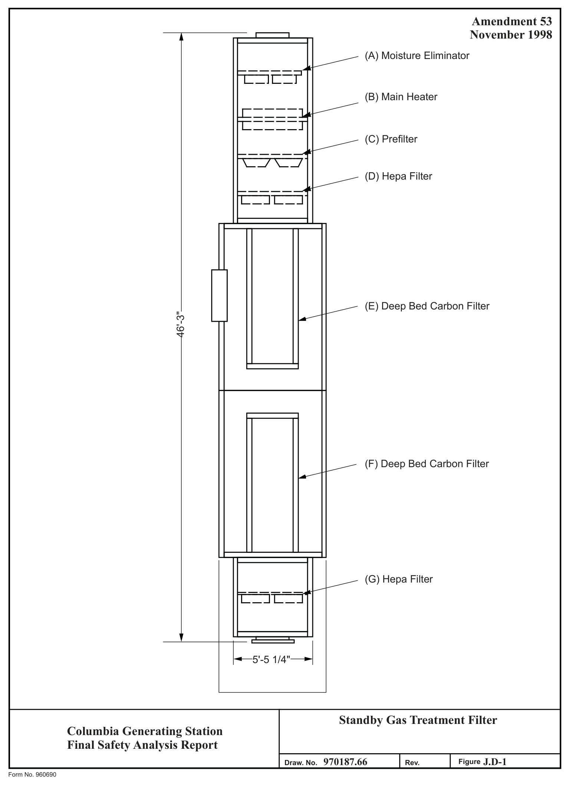

*figure on PDF page 1091*

[Vector original (SVG, lossless): fig_page-1091.svg](../figures/fig_page-1091.svg)

<!-- labels/text on this figure page -->
Amendment 53 November 1998
(A) Moisture Eliminator ~
-----.:::r"' L_JC=J
(B) Main Heater ,----1~
-.-- - - -r .,.1._ ____ ' ~---- _____ _.., ~
(C) Prefilter _____ _.., ~ \__/ \__/.
(D) Hepa Filter L _ _JL_J
(E) Deep Bed Carbon Filter 46'-3"
(F) Deep Bed Carbon Filter
(G) Hepa Filter
5'-5 1/4"
Standby Gas Treatment Filter Columbia Generating Station Final Safety Analysis Report 970187.66
J.D-1
Draw. No.
Rev. Figure Form No. 960690

<!-- p.1092 -->
Amendment 53 November 1998

Four Filters

24" r Note A
-·1-J 24"

Note A: Prefilter 8" HEPA Filter 11 1/2 "

Geometry of Prefilters and HEPA Filters Columbia Generating Station Final Safety Analysis Report 970187.67

#### J.D-2
Draw. No.
Rev. Figure Form No. 960690

<!-- p.1093 -->
Amendment 53 November 1998

4" (typ)

42"

120"

63"

Not to Scale

Geometry of Charcoal Filters Columbia Generating Station Final Safety Analysis Report 970187.68

#### J.D-3
Draw. No.
Rev. Figure Form No. 960690

<!-- p.1094 -->
November 1998

Attachment J.E

#### BETA DOSE CALCULATION METHOD
The source volume used for the beta dose analysis in secondary containment is a sphere surrounded by a shell of sufficient thickness to stop all outside beta particles from entering the source volume. This spherical source volume is conservative for any generalized source volume shape. The dose at the center of the sphere is higher than the dose at any point of any generalized source of equal total volume.

The assumptions used in this analysis are as follows:

a. Atmosphere inside the equipment casing is identical to the atmosphere in the reactor building which is conservative because there will be some actual delay in transport of the gaseous fission products into the equipment;

b. The initial beta source term used was 100% of core noble gases and 50% of core halogens based on NUREG-0588, Revision 1 and NUREG-CR/0009
(References J.7-29 and J.7-34);

c. Daughter products of the airborne noble gases and halogens are included in the calculation of the airborne dose. This is conservative and was required by the use of ORIGEN2 as a source code (Reference J.7-8);

d. Plateout of halogens inside primary containment was utilized as allowed in accordance with Reference J.7-34. The dose contribution of fission products plated out on equipment casings was neglected. This is based on the NRC recommended assumptions (Reference J.7-34). The deletion of dose contributions from fission products plated out on equipment casings is acceptable, since equipment surface areas are small relative to the available containment surface area. In addition, the beta radiation emitted from plated out fission products would be absorbed in the equipment casing and, hence, would not affect internal components;

e. The primary to secondary leak rate is 0.5% of primary containment, wt %/day is consistent with the assumptions established in Reference J.7-2;

f. The standby gas treatment system (SGTS) operates at the minimum flow of 2430 scfm based on the SGTS flow rate assumption of one reactor building air change per day;

#### J.E-1
<!-- p.1095 -->
November 1998

g. Primary to secondary leakage is homogeneously mixed in the secondary containment atmosphere consistent with the NRC-recommended assumptions used for the calculation of doses inside primary containment (Reference J.7-2);

h. No halogen plateout in the secondary containment was assumed; and

i. A spherical volume and equipment casing will be used which is conservative.

The beta dose to equipment is dependent on the internal volume size of the piece of equipment.
The beta dose is determined through the use of any energy dependent geometry factor and a ratio of the internal equipment volume to an infinite cloud. The beta dose contribution is excluded from the total integrated radiation doses shown on the radiation zone maps and tables for the C1E* equipment in the reactor building. If determination of a beta dose contribution to a C1E* component is required then a calculation to determine the internal volume size and perhaps the angle of incidence of the beta cloud to the sensitive component is performed. The results of the beta calculation are then included in the equipment qualification files for that beta sensitive equipment.

The beta calculation is determined by the airborne dose at the center of the spherical source as a function of the volume of the sphere.

The variation of beta dose rate from a typical beta energy distribution in a one-dimensional absorbing medium can be approximated by the formula:

D(X) = A exp (-µEX)
(J.E-1)

where

D(X) = dose at a point X A = constant X = position in the material µE = a parameter that depends on beta energy

This relationship holds approximately up to the point where all beta particles are absorbed.
This point is called the range of the beta particles. The range of a beta particle is dependent upon the energy of the beta particle and is denoted rE.

Both of the parameters µE and rE may be determined by empirical formulas given below, based on the maximum energy of the beta particles, and approximately independent of the absorbing medium.

* Environmental qualification (EQ) of safety-related mechanical equipment has been eliminated from the overall Columbia Generating Station EQ program (SRM).

#### J.E-2
<!-- p.1096 -->
November 1998

µE = 17ρ (Emax)-1.14
(J.E-2)

rE (0.412/ρ) En for 0.01 ≤ E ≤ 3 =
(J.E-3)

(0.530E- 0.106)/ρ for 2.3 ≤ E ≤ 20 =
(J.E-4)

ρ is material density (in g/cm3)
E is energy of beta particle (in MeV)
µE is in cm-1 rE is in cm n is 1.265 - .0954 LnE

The dose at a given point from a single beta source is now transformed into a dose from a uniform concentration of airborne sources which extend from radius zero to radius r. K is a constant.

D(r) = K(1 - exp (µEr))
(J.E-5)

This relationship is valid for r ≤ rE. At r ≤ rE, none of the beta particles originating beyond rE reach the target point. Hence, at this radius, an effective infinite medium for airborne beta radiation has been reached. The dose from a volume such that r ≥ rE is equal to the dose from an infinite volume, which is denoted D∞.

The dose as a function of volume radius is thus found to be given by the dual relation:

( 1 − exp ( − µ r ))
(J.E-6)
E D r ( ) = D ∞ 0 < < r r E
( 1 − exp( − µ r ))
E E This relation may be transformed to a function of volume by noting that V = 4 πr3/3.

Since µE and rE vary for each beta energy, this equation cannot be solved analytically for the case of a mixture of many beta energies - which is the case at hand. However, since D∞ for each beta energy is known (from the calculation of the semi-infinite source), DE(v) for each beta energy at a given volume may be determined. All contributions to the total dose at a given volume are then added together.

The volumes evaluated in this analysis were 103, 104, 105, and 106 cm3. Table J.E-1 summarizes the semi-infinite volume for each beta energy group. Table J.E-1 also indicates the beta dose reduction factor for each of the beta energy groups at the finite beta volumes of interest. A plot of the integrated 6-month doses for these finite beta volumes is shown in Figure J.E-1. These results reflect the reduction in beta air dose from the semi-infinite

#### J.E-3
<!-- p.1097 -->
November 1998

medium air dose to a finite volume medium air dose. The integrated beta infinite airborne dose for the reactor building as a function of time post-loss-of-coolant accident (LOCA) is shown in Figure J.E-2.

#### J.E-4
<!-- p.1098 -->
November 1998

Table J.E-1

Dose Rate Reduction Factors for the Post-Loss-of-Coolant Accident Beta Energy Groups at Finite Volumes

D(V)
Doo for Volumes Energy 105 cm3 106 cm3 Group VE 103 cm3 104 cm3
(MeV) (cm3)

0.02 - 0.10 120.0 1.0 1.0 1.0 1.0 4.08 x 105 0.10 - 0.20 0.486 0.763 0.960 1.0 0.20 - 0.40 8.58 x 106 0.260 0.478 0.755 0.955 0.40 - 0.70 1.36 x 108 0.127 0.254 0.468 0.744 0.70 - 1.0 1.04 x 109 0.0695 0.144 0.284 0.513
1.0 - 1.3 3.46 x 109 0.0467 0.0979 0.199 0.380 8.18 x 109 1.3 - 1.6 0.0348 0.0735 0.152 0.299
1.6 - 2.0 1.59 x 1010 0.0276 0.0585 0.122 0.244
2.0 - 2.5 3.20 x 1010 0.0215 0.0457 0.0960 0.195
2.5 - 3.0 6.47 x 1010 0.0167 0.0356 0.0752 0.155

#### J.E-5
<!-- p.1099 -->
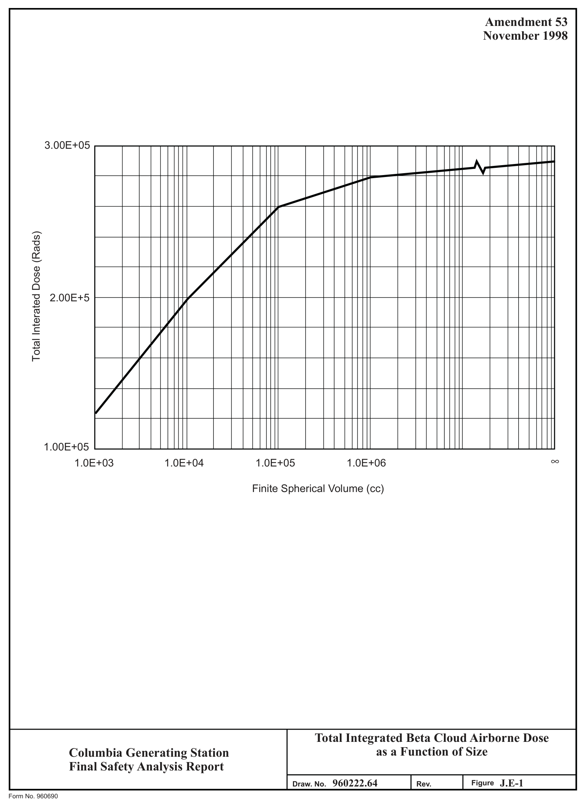

*figure on PDF page 1099*

[Vector original (SVG, lossless): fig_page-1099.svg](../figures/fig_page-1099.svg)

<!-- labels/text on this figure page -->
Amendment 53 November 1998
3.00E+05 __ ..
y ~ -i--
---- ,. ~~ ~,. Total Interated Dose (Rads)
/ /'
2.00E+5 i I 1,/" I ~/ V
1.00E+05 ∞
1.0E+03 1.0E+04 1.0E+05 1.0E+06
Finite Spherical Volume (cc)
Total Integrated Beta Cloud Airborne Dose as a Function of Size Columbia Generating Station Final Safety Analysis Report I 960222.64
J.E-1
Draw. No.
Rev. Figure Form No. 960690

<!-- p.1100 -->
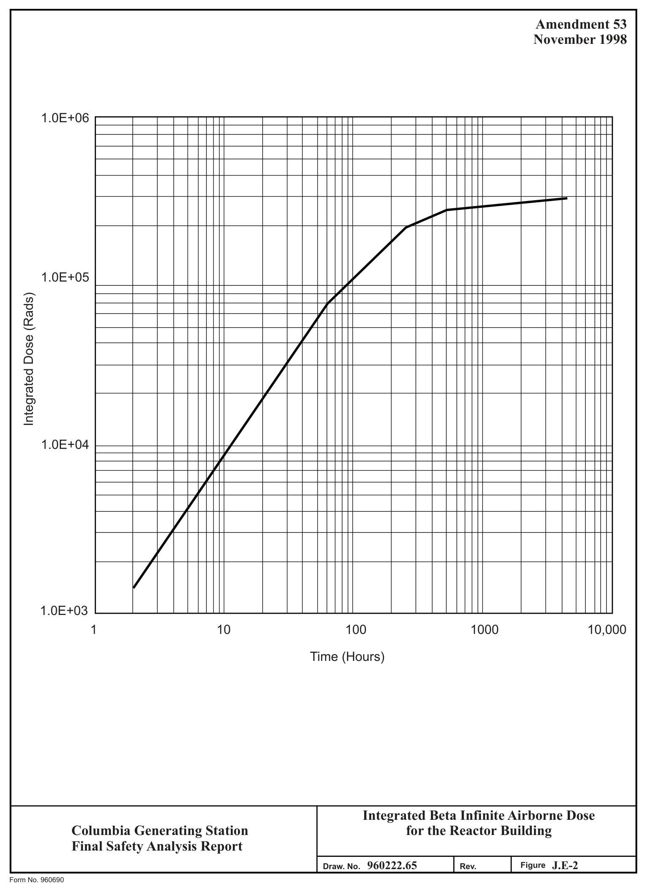

*figure on PDF page 1100*

[Vector original (SVG, lossless): fig_page-1100.svg](../figures/fig_page-1100.svg)

<!-- labels/text on this figure page -->
Amendment 53 November 1998
1.0E+06
.,,,,,,. ,,,, V /
1.0E+05 , ...
Integrated Dose (Rads)
~ ," ' I I I 1·
1.0E+04 I
'I I I I ,/ I
1.0E+03 1 10 100 1000 10,000
Time (Hours)
Integrated Beta Infinite Airborne Dose for the Reactor Building Columbia Generating Station Final Safety Analysis Report I I 960222.65
J.E-2
Draw. No.
Rev. Figure Form No. 960690

<!-- p.1101 -->
November 1998

Attachment J.F

#### PRIMARY CONTAINMENT ANALYSES
#### J.F.1 STATEMENT OF PROBLEM
It is required by NRC regulations (NUREG-0737 and NUREG-0588, References J.7-5 and J.7-2) that safety-related equipment be qualified to withstand the radiation environment in which they are located for the 40 years of normal plant operation plus for the 6 months following a postulated design basis loss-of-coolant accident (LOCA). This attachment presents a summary of the evaluation of the radiation environment inside the primary containment of Columbia Generating Station (CGS) during normal plant operation and for the 6 months following the postulated LOCA. This attachment also calculates the maximum integrated dose due to those radiation sources.

#### J.F.2 BASIC APPROACH
NUREG-0737 offers two approaches for evaluating the qualification of equipment within primary containment; pressurized versus depressurized reactor coolant system, with the more conservative to be considered the base case. Both cases assume the same source (100% noble gas, 50% halogens, and l% particulates of the core inventory). The difference between the two is that in the pressurized case, the source is assumed to remain in the reactor coolant system for the first 17 hr (Reference J.7-44) after the accident and then is assumed to be released into the primary containment. In the depressurized case, there is assumed to be an instantaneous release of 100% of the core noble gases and 50% of the core halogens to the free volume of the primary containment (Reference J.7-45). It is also assumed that 50% of the core halogens and 1% of the core solids are released to the reactor coolant and the suppression pool. This causes some double counting of halogens and hence some conservatism, since only 50% of the core halogens need ever be considered for release after a LOCA.

Both scenarios, the pressurized and depressurized were evaluated and it was determined that for CGS the depressurized case results in higher integrated doses (References J.7-46, J.7-50, and J.7-54). Therefore, it was considered to be the base case.

Due to the large number of C1E* components inside primary containment, it was deemed impractical (from both scheduling and cost considerations) to calculate the integrated dose to each piece of equipment. Therefore, it was decided to calculate the worst point dose from each of the major sources in the drywell and wetwell, and then to sum these for a conservative estimate of the total integrated dose. This methodology for determining a worst-case dose for equipment in the drywell is not valid for the region inside the sacrificial shield wall or under

* Environmental qualification (EQ) of safety-related mechanical equipment has been eliminated from the overall CGS EQ program (SRM).

#### J.F-1
<!-- p.1102 -->
November 1998

the reactor pressure vessel. A point-specific radiation dose calculation is required for all components present in either of these two regions.

#### J.F.3 DRYWELL
The integrated dose from each of the major sources to the drywell is tabulated in Table J.F-1.
All values are the maximum dose for each source considered. Since the maximum dose does not occur at the same location or the same time from all sources, it is not appropriate to sum them to obtain the total integrated dose. All of the maximum doses calculated cannot be present for a particular accident. The highest dose (7.4 x 107) is calculated for a depressurized reactor coolant system.

This dose is conservative since all of the source contributors summed do not have the maximum dose at the same location. If it were determined that certain pieces of equipment could not withstand the maximum dose, a more detailed calculation would unquestionably result in an integrated dose of lower than 7.4 x 107 rads. A lower bound for the more detailed calculation would be about 107 rads.

One major factor regarding the airborne contribution needs to be addressed here to understand the results in Tables J.F-1 and J.F-2. Of the total airborne contribution (3.5 x 107 rads)
slightly over 50% of it is due to photons which have an energy of less than 0.045 MeV. These photons are readily attenuated. As such, virtually any amount of shielding will result in a reduction by a factor of approximately two in the total airborne dose. Such an example is the smallest size conduit used in containment which has a wall thickness of 0.179 in.

This is not the only conservatism in the calculation; however, it is the most noteworthy. The following section addresses the individual contributors, assumptions, sources, models, etc., used to calculate the integrated dose.

J.F.3.1 Sources

There are six major radiation sources to the equipment in the drywell. Two of these sources are present during normal operation and four sources are present after a LOCA. They are

Normal Ops Sources

Rx Core Normal Ops Neutrons emanating directly from the reactor core and the resultant capture gammas.

#### J.F-2
<!-- p.1103 -->
November 1998

Systems Normal Ops The following systems are the main sources of radiation during normal plant operation:

a. Residual heat removal (RHR) system, b. Reactor water cleanup (RWCU) system, c. Main steam (MS) system, and d. Reactor recirculation (RRC) system.

Systems Post-LOCA In addition to the systems considered under normal operation, (except for the MS) the following systems were also considered post-LOCA:

a. High-pressure core spray (HPCS), b. Low-pressure core spray (LPCS), and c. Reactor core isolation cooling (RCIC).

Airborne Post-LOCA Airborne radiation from radionuclides (noble gases and halogens) which are postulated to be released into the primary containment atmosphere following a LOCA.

Plateout Post-LOCA Plateout on surfaces within containment. This consists of radioactive iodines which are initially airborne and subsequently plateout
(Reference J.7-34).

Wetwell Post-LOCA The radionuclides contained within the wetwell as a result of the blowdown after the accident.

J.F.3.1.1 Reactor (Normal Operation - Drywell)

There exists a general radiation field inside primary containment due to normal plant operation. Part of this field is due to neutron leakage from the reactor core. A fraction of those neutrons penetrate the reactor vessel into the reactor cavity. Some will traverse vertically while others will penetrate the sacrificial shield wall. In addition, secondary gammas will be generated from neutron interaction with materials along their path.

ANISN, a one-dimensional discrete ordinates computer code was used to calculate the transport of these neutrons, and the generation of secondary gamma rays (Reference J.7-55).

#### J.F-3
<!-- p.1104 -->
November 1998

The total neutron and gamma dose rates outside the sacrificial shield wall at core mid-plane are calculated to be

a. 5.7 rad/hr neutron, and b. 50 rad/hr gamma

An estimate was made to determine the axial variation of the dose rate based on geometric and material attenuation factors. The approximate dose rate reduction factors are shown in Table J.F-3 as a function of distance from the core mid-plane.

J.F.3.1.2 Systems (Normal Operation - Drywell)

During normal operation, a radiation field exists within containment due in part to radioactivity contained within the piping inside primary containment.

The single major source within the piping is 16N [produced by the (n,p) 16O 16N reaction within the core]. The dose from other sources such as fission products, corrosion products, etc., are too small compared to 16N to be considered.

Calculations were done to determine the dose rate to which equipment was exposed. The results indicated that the dose rate ranged from a high of 35 rad/hr to a low of 0.36 rad/hr.
These calculations were performed with KAP-V and QAD-BR. They took into account the following systems: RHR, RWCU, MS, and RRC (References J.7-47, J.7-48, and J.7-49).
The 16N source used was 40 µCi/g (FSAR Table 11.1-4) maximum. This is the source strength of the 16N in the coolant exiting the reactor. Based on this initial source, the source strength for the pipes of the systems considered was evaluated, and the dose calculations were then performed.

J.F.3.1.3 System (Post-Loss-of-Coolant Accident) - Drywell

The dose rate calculations for systems post-LOCA were performed using a method similar to that used for the systems under normal operation with two exceptions. The first was that in addition to the RHR, RWCU, and RRC systems, the HPCS, LPCS, and RCIC systems were also included. The second exception was that a different source was used (References J.7-48 and J.7-49). After a LOCA, the predominant source past the first minute or so is the assumed fission product release from the core. The 16N inventory, with a 7.1-sec half-life decays away in less than a minute once the (n,p) 16O 16N reaction stops occurring (after the reactor shuts down).

For the base case, i.e., the depressurized case, it was assumed that 50% of the core halogens and 1% of the core solids were released and distributed within the suppression pool and the reactor coolant systems (References J.7-51, J.7-52, and J.7-53). As noble gases were produced by the radioactive decay of the halogens, they were discounted on the premise that

#### J.F-4
<!-- p.1105 -->
November 1998

they would be released from the liquid to the gas rapidly. The released inventory is then decayed for 37 discrete time intervals out to 6 months (these are given in Table J.F-7). An average source strength is then calculated for the 6-month period. The source strength is given in Table J.F-4.

J.F.3.1.4 Airborne - Drywell

A nonmechanistic accident scenario was postulated in calculating the airborne source. It was assumed that after 1000 days of operation at 3556 MWt (105% of core power), 100% of the noble gases and 50% of the halogens contained within the reactor core are instantaneously released. After the release, no additional contribution of either noble gases or halogens is considered. Also, plateout of halogens is considered (see Section J.F.3.1.5). The average airborne source strength is given in Table J.F-5.

The above source is calculated via the ORIGEN2 computer code. After the source strength was determined, the dose rate was calculated using the QAD-CG computer code. Details of the model and the calculation are discussed in Section J.F.5. The value for the airborne contribution presented in Table J.F-1 represents the dose rate at a point within the drywell which is predominantly surrounded by air. This point was chosen because of the absence of structural steel, piping, etc., surrounding the dose point. This would result in an upper limit dose rate which could be expected to occur in the drywell.

The effect of the shielding afforded by the structural steel, piping, etc. (i.e., “shadow shielding”), within containment was considered. Advantage was taken of “shadow shielding” when considering the contribution of the more distant airborne sources (References J.7-48 and J.7-49). This significantly reduces the dose rate compared to the case where “shadow shielding” is not employed. See Section J.F.5 for modeling of “shadow shielding.”

J.F.3.1.5 Plateout - Drywell

The basis for determining the plateout source is 50% iodine inventory released after 1000 days irradiation at a power level of 3556 MWt. However, the plateout source is only those iodines which are removed from the airborne source and assumed to plateout on the surfaces within containment. As such, plateout removes sources from the airborne source, and this was accounted for in the calculations. It was assumed, however, that the noble gases generated by the decay of the plated out halogens (I → Xe and BR → KR) are instantaneously released and are mixed within the free volume of the drywell. In this manner, both the airborne and plateout sources are determined with no “double counting” of nuclides. The plateout source is given in Table J.F-6.

When the halogens are initially released, not all of them are considered available to plateout.
Of the halogens released, 2.0% are in the form of organic compounds, and 2.5% are in the form of particulates (Reference J.7-2); and both of these forms are assumed not to plateout.

#### J.F-5
<!-- p.1106 -->
November 1998

The remaining 95.5% are considered to be in an elemental state of which one-two hundredth remain airborne and the rest plateout. Therefore, no more than 95% of the released halogens can ever plateout. The plateout was assumed to occur with an effective deposition velocity of 0.05 cm/sec. This translated into an effective half-life of 1.01 hr-l (References J.7-34 and J.7-45). Given this half-life, the limit of a reduction of a factor of 200 is attained in slightly over 5 hr. After that time, the percentage of plated out halogens remains constant at 95%.

The dose calculations were performed with the computer code QAD-CG, incorporating a model similar to that used for the airborne dose. See Section J.F.5 for discussion of model and calculations.

Initial calculations were performed with the total plateout being distributed over: (1) the drywell lateral surface, top, and bottom; (2) inner, outer and top surfaces of the sacrificial shield wall; and (3) heat reflector of pressure vessel surface. Given this distribution area, the maximum dose rate calculated was 7.04 x l03 rad/hr. However, when the remaining surface areas within containment (i.e., equipment, piping, structural steel, etc.) were considered, the area over which the source would be plated out increased sevenfold. A counter-balancing effect to this reduction in plated out concentration was that the source would be more universally distributed around any given receiver. It was estimated that the net effect would reduce the calculated maximum dose rate by a factor of approximately three.

It is noted that the energy spectrum for the plateout source is significantly harder than that of the airborne. As such, the comments in Section J.F.3 regarding low energy photons are not completely applicable.

J.F.3.1.6 Wetwell - Drywell

The wetwell was also considered as a source to the drywell. However, due to distance, self-attenuation, and the available shielding from the 2-ft-thick diaphragm floor, its contribution to the drywell was negligible.

It was assumed that 50% of the halogens and 1% of the particulates from the core were entrained in the water in the suppression pool. This is the same source used for the systems post-LOCA. The air space volume above the suppression pool was assumed to have the same volumetric source strength as the drywell air space. These are conservative premises since only a total of 50% of the core halogens are assumed to be released after the accident.

#### J.F.4 WETWELL
The results for the wetwell are given in Table J.F-2. Doses were calculated for detector points both within the suppression pool as well as in the free volume above it using QAD-CG, applying the same modeling techniques as was used in the drywell.

#### J.F-6
<!-- p.1107 -->
November 1998

With regard to the airborne contribution, the volumetric source strength is the same as the drywell airborne source and the comments in Section J.F.3.1 regarding the low-energy photons applicability to the wetwell.

There does exist some double counting of nuclides in the wetwell analysis. The airborne source is 100% noble gases and 50% halogens, released into the containment (wetwell and drywell) free volume. For the suppression pools the source is 50% halogens and 1% particulates. Since only 50% of the total core halogens are assumed to be released after an accident, they are double counted (the effect is small, however, because of the shielding offered by the suppression pool water.) Another conservatism in the airborne source in the wetwell is that, since the path for the wetwell airborne sources is via the downcomers and then up through the suppression pool, some halogens are expected to be entrained in the water during this transfer (this was not considered in the calculation.) The result would have been a smaller airborne source and in turn a smaller dose.

J.F.4.1 Sources

There are three sources of radiation to the equipment in the wetwell, all of which are present only after an accident.

a. Airborne

The airborne source is present as a result of the initial blowdown into the suppression pool via the downcomers,

b. Plateout

Plateout of halogens onto the surfaces in the wetwell (i.e., containment, downcomers, etc.), and

c. Suppression Pool

The radionuclides contained within the suppression pool as a result of the blowdown after the accident.

J.F.4.1.1 Airborne - Wetwell

The airborne source, on a specific volume basis, is equal to the airborne source in the drywell
(i.e., 100% noble gas and 50% halogen released into the total primary containment immediately following a LOCA). However, the amount of “shadow shielding” within the wetwell is much less than in the drywell. Hence, the contribution from sources further away is greater. This factor accounts for the increased dose rate in the wetwell with respect to the

#### J.F-7
<!-- p.1108 -->
November 1998

drywell (due to airborne sources). Dose calculations in the wetwell were done in similar manner as for the drywell (i.e., using QAD-CG).

J.F.4.1.2 Plateout - Wetwell

As in the drywell, the source of the plateout in the wetwell is the halogens. However, the area available for plateout is smaller in the wetwell than the drywell. This results in a dose rate in the wetwell slightly more than double that in the drywell.

J.F.4.1.3 Suppression Pool - Wetwell

The source in the suppression pool was assumed to be 50% of the halogens and 1% of the particulates instantaneously released from the core into the pool and the reactor coolant system.
It is further assumed that as noble gases are produced by the decay of the halogens (I→Xe and Bγ→Kγ), they “bubble out” of the pool, hence they are not considered a source term. Dose rates both in the suppression pool as well as in the wetwell free volume were calculated using

#### QAD-CG.
#### J.F.5 QAD-CG MODEL
The QAD-CG computer program was used to calculate dose rates for both the airborne source as well as the plateout. In both cases, i.e., airborne and plateout, similar modeling techniques were used. This section defines the modeling used in both calculations (with only the drywell used for illustrative purposes).

The QAD-CG computer code makes use of a geometry package, which allows the user to model a calculation with the use of predetermined geometric bodies. The user defines a set of geometric “bodies” (boxes, truncated cones, spheres, cylinders, etc.) and using these “bodies,” the user defines “zones” by intersection or forming unions of them to build the shapes desired in a manner analogous to “intersections” and “unions” when one deals with sets. The model is done three-dimensionally thereby allowing the user considerable flexibility.
These “zones” are then what constitute the computer model. The parts of “bodies” that are not used have no effect on the model.

As an example, a dumbbell could be defined as the union of three “bodies”: two spheres and a long, thin cylinder between them (see Figure J.F-1). Likewise, a hemisphere could be formed by intersection of a sphere with a box (see Figure J.F-1). In this manner, a complex model can be defined.

In our case, the basic model was defined as a truncated cone (approximating the containment shell) and two cylinders (approximating the sacrificial shield wall and the reactor vessel).
Figure J.F-2 illustrates this in a sectional view. The free volume of the drywell was compartmentalized into cubes, 7 ft on a side. These cubes were formed by intersection of a

#### J.F-8
<!-- p.1109 -->
November 1998

series of tall rectangles, which are 7 ft on a side in cross-section, with cylinders at 7-ft high intervals. Each 7-ft high cylinder constitutes the elevational boundaries of what is referred to as a “layer” below. Combining these “bodies” appropriately one winds up with a truncated cone (containment) with two cylinders (i.e., sacrificial wall and reactor vessel) and the remainder of the volume forced with cubes (except on the boundary of the cone or cylinders).
Figure J.F-3 illustrates this model, while Figure J.F-4 illustrates how the layer from el. 513 ft 6 in. to el. 520 ft 6 in. is modeled.

All major structures, pipes (6 in. and above), hangers, etc., within the drywell were then located, and the mass of steel in each cubicle determined. These were translated into average densities such that each cube had an average density assigned to it. These are illustrated on Figures J.F-5 to J.F-9 for the lower five layers; for the purpose of clarity, the densities shown are much cruder than the 41 used in the code. In those cubicles which are noted to have zero density, the density of air was assumed.

In Figures J.F-7 to J.F-9 a large void (air only) exists in the southwest (fourth) quadrant in layers 3 and 4. It was in this region that the airborne dose rate was calculated. This region provides us with a volume which is large enough so that the “shadow shielding” (smearing discrete shielding within a cubicle into an average density in the cubicle) beyond its boundary is justified.

Several runs were made using this model with various source volumes. Three runs were made placing the source terms within the elevational boundaries of layers 3, 4, and 5, respectively, and another run was made by placing the source from the lower elevational boundary of layer 1 up to the upper elevational boundary of layer 2. It was noted that >95% of the total dose contribution from these five layers came equally from layers 3 and 4. In other words, the further away the source layer, the smaller the contribution. Also, shadowing shielding in layers 1 and 2 provided sufficient attenuation as to make the contribution to the total dose negligible. The same is true also for all layers above layer 5.

Plateout was calculated in a similar manner, increasing the source until successive contributions became negligible. For the plateout, the dose point was taken near the sacrificial shield wall. Other points were also considered, but the dose rate near the sacrificial shield wall was found to be the maximum. Again, the dose point was taken between layers 3 and 4 to maximize the dose rate.

#### J.F.6 CODES
#### J.F.6.1 FSPROD
FSPROD is a computer program which calculates the inventory and activity of radioactive fission products, produced from the thermal fission of 235U, as a function of fission rate and decay time after fission. The program is used in establishing the gross and specific gamma and

#### J.F-9
<!-- p.1110 -->
November 1998

beta activity of those fission products. The calculation incorporates 123 fission product nuclides and is based on Perkins and King data.

#### J.F.6.2 ORIGEN2
ORIGEN2 is a point depletion and decay computer code for use in simulating nuclear fuel cycles and calculating the nuclide composition of materials contained therein. The code represents a revision and update of the original ORIGEN computer code. The general function of the ORIGEN2 computer code is to calculate the nuclides present in various nuclear materials by determining the buildup and depletion of nuclides during irradiation and decay. The code can also account for reprocessing (i.e., chemical separation) and continuous feed, removal, and accumulation of nuclear materials.

#### J.F.6.3 QAD-BR
QAD-BR is a point kernal computer code designed to evaluate gamma penetration of various shield configurations. It is a modification of QAD-P5A; i.e., it has no capability for neutron calculations. The program provides an estimate of the uncollided and collided gamma flux, dose rate, energy deposition, and other quantities which result from a point-by-point representation of volume-distribution source of radiation.

#### J.F.6.4 QAD-CG
QAD-CG is also a modification of the QAD-P5A computer program. It is similar to QAD-BR in application with the major difference being in the geometry description. QAD-CG makes use of a combinatorial geometry package originally developed for MORSE. It is one of the more versatile geometry packages to be available in the QAD family of computer codes.

#### J.F.6.5 KAP-V
KAP-V is a hybrid of the QAD computer code. Analytically, it is identical to QAD as it is a point kernal code. The major differences are changes in input allowing more flexibility in running successive cases. It also has internal libraries for attenuation and buildup data which can be used by default for convenience.

#### J.F.6.6 ANISN
ANISN is a one-dimensional Sn transport code with anisotropic scattering. It allows for the solution of the transport equation for neutrons and photons using the discrete ordinate method.

#### J.F-10
<!-- p.1111 -->
Table J.F-1a

Integrated Dose in Drywell

Maximum Average Doseb Dose Rateb Exposure
(rad/hr)
(rad)
Time Source
1.6 x 107 5.6 x 101 32 yearsc Reactor

9.9 x 106
3.5 x 101 32 yearsc Systems - normal

3.2 x 106 Systems - LOCA
--- 6 months

3.7 x 107 Airborne
--- 6 months

1.0 x 107 Plateout
--- 6 months

<4.5 x 104 Suppression pool
--- 6 months

a Not valid for regions inside the sacrificial shield wall or under the reactor pressure vessel (a point specific radiation calculation is required for components in these two regions).

b Maximum dose rate from individual contributors does not necessarily occur at the same location or for the same accident.

c (40-year plant life) x (0.8) availability to account for down time.

#### J.F-11
<!-- p.1112 -->
November 1998

Table J.F-2

Integrated Dose in Wetwell

Maximum Average Dose Ratea Dosea Exposure
(rad/hr)
(rad)
Time Source

Dose above suppression pool

1.8 x 104 8.2 x 107 Airborne 6 months

2.0 x 102 9.1 x 105 6 months Suppression pool

2.7 x 103
1.2 x 107 Plateout 6 months

Dose within suppression pool

2.9 x 102
1.4 x 106 Airborne 6 months

5.5 x 102
2.5 x 106 Suppression pool 6 months

a Maximum dose rate from individual contributors does not necessarily occur at the same location.

#### J.F-12
<!-- p.1113 -->
November 1998

Table J.F-3

Approximate Dose Rate Reduction Factor Versus Distance from Core Mid-Plane for Reactor Integrated Dose

Distance Reduction
(ft)
Factor

0
1.0

5 0.5

10 0.02

1 x 10-5 15

#### J.F-13
<!-- p.1114 -->
November 1998

Table J.F-4

Suppression Pool and System
(Loss-of-Coolant Accident) Liquid Source Terms 0-6 Month Average After Loss-of-Coolant Accident MeV/cm3-seca MeV MeV/sec 0.015
1.8E+14 4.4E+4 0.025
3.5E+14 8.5E+4 0.0375 4.8E+14
1.2E+5 0.0575
1.4E+14
3.5E+4 0.085 5.8E+14
1.4E+5

0.125
2.2E+15 5.3E+5 0.225 4.0E+15 9.6E+5 0.375 4.8E+16
1.2E+7 0.575 5.5E+16
1.3E+7 0.85 7.2E+16
1.7E+7

1.25
1.5E+16
3.7E+6
1.75
1.8E+16 4.3E+6
2.25
2.1E+15 5.1E+5
2.75 9.1E+14
2.2E+5
3.5
1.1E+14
2.6E+4 5.0 7.4E+13
1.8E+4

a Volume considered was that of the suppression pool plus that of the reactor coolant system.

#### J.F-14
<!-- p.1115 -->
November 1998

Table J.F-5

Airborne Source Terms 0-6 Month Average After Loss-Of-Coolant Accident MeV/cm3-seca MeV MeV/sec 0.015
2.5E+14
2.5E+4 0.025
2.1E+14
2.1E+4 0.0375 6.9E+15 7.1E+5 0.0575
3.0E+13
3.0E+3 0.085
1.4E+16
1.4E+6 0.125
3.7E+13
3.8E+3 0.225 4.4E+15 4.5E+5 0.375
3.0E+15
3.1E+5 0.575 4.0E+15 4.1E+5 0.85
3.2E+15
3.2E+5
1.25
3.4E+15
3.5E+5
1.75
2.6E+15
2.7E+5
2.25
3.9E+15 4.0E+5
2.75 6.7E+14 6.9E+4
3.5
2.1E+14
2.2E+4 5.0 9.5E+13 9.7E+3

a Volume considered was total; i.e., drywell plus wetwell free volume.

#### J.F-15
<!-- p.1116 -->
November 1998

Table J.F-6

Drywell Plateout Source Terms 0-6 Month Average After Loss-Of-Coolant Accident MeV/cm3-seca MeV MeV/sec 0.015
3.6E+13 6.3E+5 0.025
1.8E+14
3.2E+6 0.0375 5.4E+13 9.5E+5 0.0575
2.0E+13
3.6E+5 0.085
3.2E+14 5.7E+6 0.125
1.9E+13
3.4E+5 0.225
2.8E+15 4.9E+7 0.375 4.4E+16 7.7E+8 0.575
2.4E+16 4.2E+8 0.85 7.6E+15
1.3E+8
1.25 9.6E+15
1.7E+8
1.75
3.4E+15 5.9E+7
2.25 5.2E+14 9.2E+6
2.75 7.3E+12
1.3E+5
3.5
1.3E+13
2.3E+5 5.0
2.9E+11 5.1E+3

a These values should be reduced by a factor of seven when all structural, component and equipment surfaces in containment are considered.

#### J.F-16
<!-- p.1117 -->
November 1998

Table J.F-7

Time Mesh Spacing Used in Source Calculations
(Minutes)

0 640 28800 20 800 36000 40 960 43200 60 1120 57600 80 1280 72000 100 1440 86400 120 2160 108000 180 2880 129600 240 3600 151200 300 4320 172800 360 5040 216000 420 5740 259200 480 14400

#### J.F-17
<!-- p.1118 -->
November 1998

Table J.F-8

Source Energy Group Structure

Lower Boundary Upper Boundary Average Energy
(MeV)
(MeV)
(MeV)

0.00 0.02 0.015

0.02 0.03 0.025

0.03 0.045 0.0375

0.045 0.07 0.0575

0.07 0.10 0.085

0.10 0.15 0.125

0.15 0.30 0.225

0.30 0.45 0.375

0.45 0.70 0.575

0.70
1.0 0.85

1.0
1.5
1.25

1.5
2.0
1.75

2.0
2.5
2.25

2.5
3.0
2.75

3.0 4.0
3.5

4.0 6.0 5.0

#### J.F-18
<!-- p.1119 -->
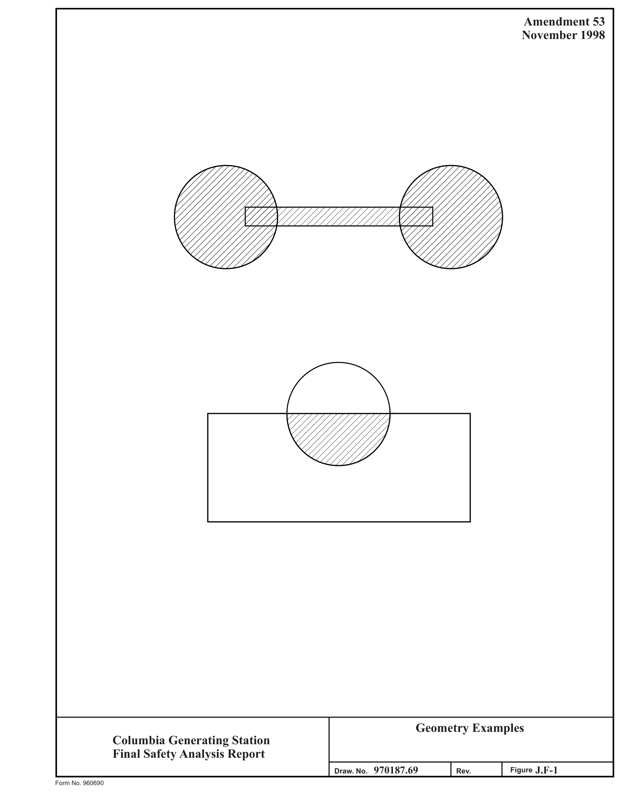

*figure on PDF page 1119*

[Vector original (SVG, lossless): fig_page-1119_2.svg](../figures/fig_page-1119_2.svg)

<!-- labels/text on this figure page -->
Amendment 53 November 1998
Geometry Examples Columbia Generating Station Final Safety Analysis Report 970187.69
J.F-1
Draw. No.
Rev. Figure Form No. 960690

<!-- p.1120 -->
Amendment 53 November 1998

Basic QAD-CG Drywell Model Columbia Generating Station Final Safety Analysis Report 970187.70

#### J.F-2
Draw. No.
Rev. Figure Form No. 960690

<!-- p.1121 -->
Amendment 53 November 1998

Isometric of Drywell Model Columbia Generating Station Final Safety Analysis Report 970187.71

#### J.F-3
Draw. No.
Rev. Figure Form No. 960690

<!-- p.1122 -->
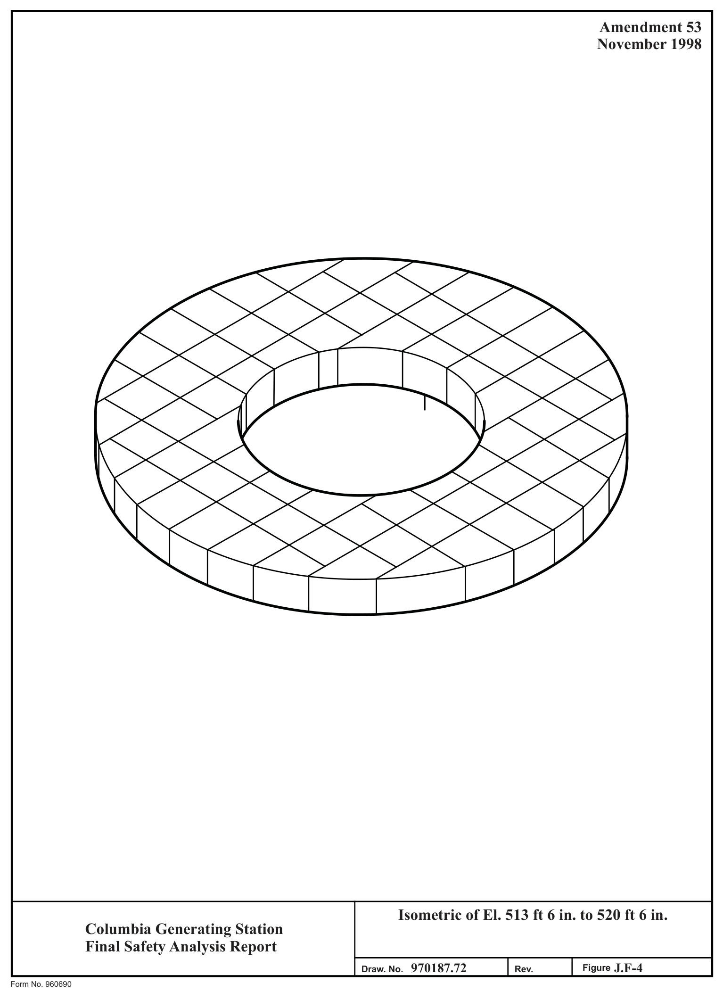

*figure on PDF page 1122*

[Vector original (SVG, lossless): fig_page-1122_2.svg](../figures/fig_page-1122_2.svg)

<!-- labels/text on this figure page -->
Amendment 53 November 1998
Isometric of El. 513 ft 6 in. to 520 ft 6 in.
Columbia Generating Station Final Safety Analysis Report 970187.72
J.F-4
Draw. No.
Rev. Figure Form No. 960690

<!-- p.1123 -->
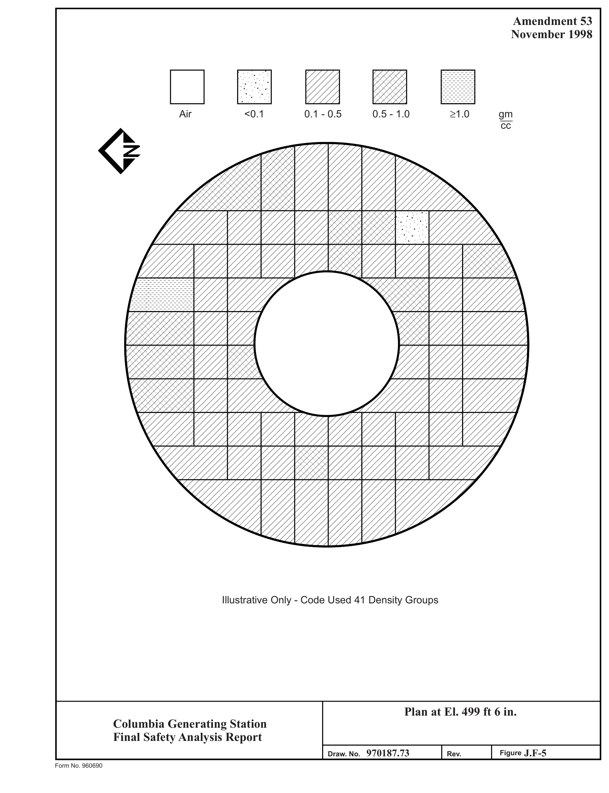

*figure on PDF page 1123*

[Vector original (SVG, lossless): fig_page-1123_2.svg](../figures/fig_page-1123_2.svg)

<!-- labels/text on this figure page -->
Amendment 53 November 1998
Air <0.1 0.1 - 0.5 0.5 - 1.0 ≥1.0 gm cc
Illustrative Only - Code Used 41 Density Groups
Plan at El. 499 ft 6 in.
Columbia Generating Station Final Safety Analysis Report 970187.73
J.F-5
Draw. No.
Rev. Figure Form No. 960690

<!-- p.1124 -->
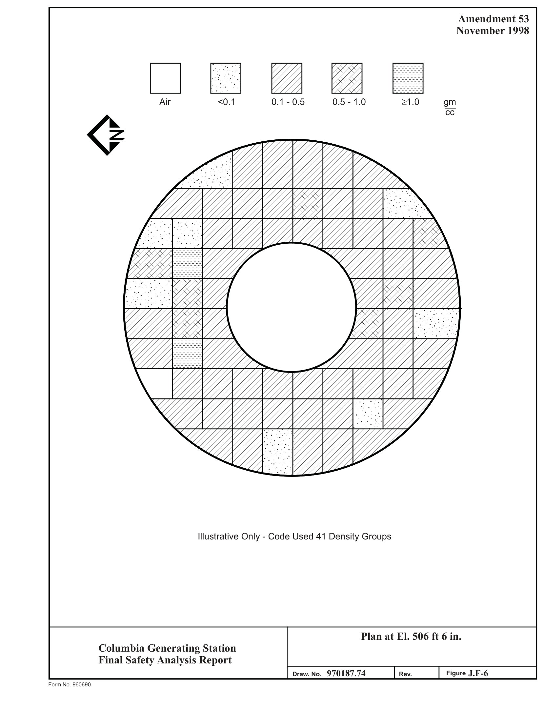

*figure on PDF page 1124*

[Vector original (SVG, lossless): fig_page-1124_2.svg](../figures/fig_page-1124_2.svg)

<!-- labels/text on this figure page -->
_·_:_:-;:_.:_:· □ eg Amendment 53 □ [] November 1998
:::::::::: ■ =~II~I
: ·. -~ .... · .... ~ . . . .
: : :: : :: : :: : :: : : =============== . ·. ·. ·. ·. . -_-_-_-_-_-_-_- Air <0.1 0.1 - 0.5 0.5 - 1.0 ≥1.0 gm cc
Illustrative Only - Code Used 41 Density Groups
Plan at El. 506 ft 6 in.
Columbia Generating Station Final Safety Analysis Report 970187.74
J.F-6
Draw. No.
Rev. Figure Form No. 960690

<!-- p.1125 -->
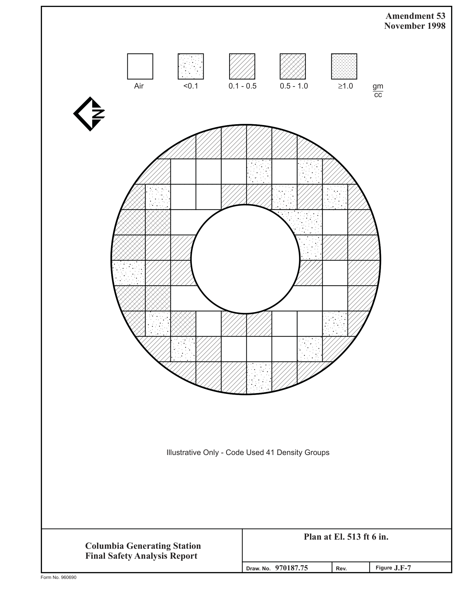

*figure on PDF page 1125*

[Vector original (SVG, lossless): fig_page-1125_2.svg](../figures/fig_page-1125_2.svg)

<!-- labels/text on this figure page -->
Amendment 53 November 1998 □ EJ ·:·,:·.'._ ... _:_: ~:
•:•::•:••::.::•• rrr~ □ ml ■ -============= :-:-:-:-:- ·.· >.:::
. . . .
.
_-_-_-_-_-_-_- . ·. ·. ·. ·. ·.
Air <0.1 0.1 - 0.5 0.5 - 1.0 ≥1.0 gm cc
Illustrative Only - Code Used 41 Density Groups
Plan at El. 513 ft 6 in.
Columbia Generating Station Final Safety Analysis Report 970187.75
J.F-7
Draw. No.
Rev. Figure Form No. 960690

<!-- p.1126 -->
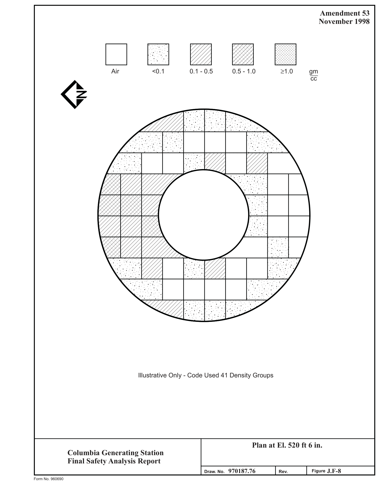

*figure on PDF page 1126*

[Vector original (SVG, lossless): fig_page-1126.svg](../figures/fig_page-1126.svg)

<!-- labels/text on this figure page -->
Amendment 53 November 1998 □ EJ ·:·,:·.'.· . •.:.: ~:
•:•::•:••::.::•• rrr~~ □ §ffl:-::-: ■ -============= .·.· >.:::
:-::-::-:
. . .
.
. ·. ·. ·. ·. ·. ------- Air <0.1 0.1 - 0.5 0.5 - 1.0 ≥1.0 gm cc
Illustrative Only - Code Used 41 Density Groups
Plan at El. 520 ft 6 in.
Columbia Generating Station Final Safety Analysis Report 970187.76
J.F-8
Draw. No.
Rev. Figure Form No. 960690

<!-- p.1127 -->
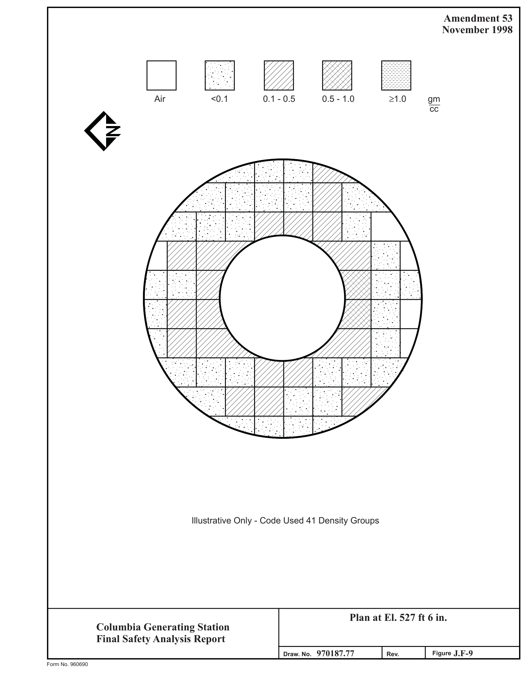

*figure on PDF page 1127*

[Vector original (SVG, lossless): fig_page-1127.svg](../figures/fig_page-1127.svg)

<!-- labels/text on this figure page -->
Amendment 53 November 1998
Air <0.1 0.1 - 0.5 0.5 - 1.0 ≥1.0 gm cc
Illustrative Only - Code Used 41 Density Groups
Plan at El. 527 ft 6 in.
Columbia Generating Station Final Safety Analysis Report 970187.77
J.F-9
Draw. No.
Rev. Figure Form No. 960690

<!-- p.1128 -->
November 1998

Attachment J.G

#### BETA DOSE CONTRIBUTION IN PRIMARY CONTAINMENT
The source volume used for the beta dose analysis in primary containment is a sphere surrounded by a shell of sufficient thickness to stop all outside beta particles from entering the source volume. This spherical source volume is conservative for any generalized source volume shape (the dose at the center of the sphere is higher than the dose at any point of any generalized source of equal total volume).

The assumptions used in the analysis are as follows:

a. Atmosphere inside the equipment casing is identical to the atmosphere in primary containment. This is conservative because there will actually be some delay in transport of the gaseous fission products into the equipment;

b. The initial beta source term used was 100% of core noble gases and 50% of core halogens (References J.7-2 and J.7-34);

c. Daughter products of the airborne noble gases and halogens are included in the calculation of the airborne dose which is conservative and was required by the use of ORIGEN2 as a source code (Reference J.7-8);

d. Plateout of halogens inside primary containment was utilized as allowed per Reference J.7-34. The dose contribution of fission products plated out on equipment casings was neglected. The deletion of dose contributions from fission products plated out on equipment casings is acceptable, since equipment surface areas are small relative to the available containment surface area. In addition, the betas emitted from plated out fission products would be absorbed in the equipment casing and, hence, would not affect internal components;

e. No primary to secondary containment leakage is assumed since it maximizes the beta source concentration in primary containment;

f. Activity is assumed to be uniformly distributed throughout the containment free volume which is reasonable, considering the mixing effects of the loss-ofcoolant accident (LOCA) blowdown and the operation of the drywell fan coolers; and

g. A spherical volume representing the equipment casing will be used.

The beta dose to equipment is dependent on the internal volume size of the piece of equipment.
The beta dose is determined through the use of an energy dependent geometry factor and a

#### J.G-1
<!-- p.1129 -->
November 1998

ratio of the internal equipment volume to an infinite cloud. The beta dose contribution is excluded from the worst case total integrated gamma doses of primary containment shown in Section J.6.1 and Tables J.F-1 and J.F-2. The beta dose contribution is also excluded from the value, pump, and fan tables for C1E/SRM equipment in a primary containment environment.

The discussion and development of beta dose rate variation due to beta energy distribution in a one-dimensional absorbing medium is also valid for primary containment analysis.

Thus, the dose as a function of volume radius is given by the dual relation:

− − µ [ 1 exp( r )] = ∞ ≤≤ D r ( ) D E 0 r r − − µ E [ 1 exp( r )] E E

This relation may be transformed to a function of volume by noting that V = 4 π r3/3.

Since µE and rE vary for each beta energy, this equation cannot be solved analytically from the case of a mixture of many beta energies, which is the case at hand. However, since D∞ for each beta energy is known (from the calculation of the semi-infinite source), DE(v) for each beta energy at a given volume may be determined. All contributions to the total dose at a given volume are then added together.

The volumes evaluated in this analysis were 103, 104, 105, and 106 cm3. Table J.G-1 summarizes the semi-infinite volume for each beta energy group. Table J.G-1 also indicates the beta dose reduction factor for each of the beta energy groups at the finite beta volumes of interest. A plot of the integrated post-LOCA doses for these finite beta volumes is shown in Figure J.G-1. These results reflect the reduction in beta air dose from the semi-infinite medium air dose to a finite volume air dose.

The integrated beta infinite airborne dose for the primary containment as a function of time post-LOCA is shown in Figure J.G-2.

The absorbed beta dose within a physical target is not always equal to the beta dose at a mathematical point in air at the surface of that piece of equipment. The beta ionization energy
(dose) deposited on the surface of a solid object is distributed in a thin surface layer to a depth equal to the beta range in the material. The relative material penetration of the different beta energy groups is used to provide a total integrated LOCA dose as a function of material depth.

Finite volume beta dose reduction factors were determined for each of the 10 beta energy groups. These factors are used to provide total integrated LOCA dose as a function of material penetration to reduce volume exposure.

#### J.G-2
<!-- p.1130 -->
November 1998

Thus, the integrated dose values (Figure J.G-1) can be used as the absorbed material dose with a standard order of magnitude for reduction for material beyond 0.030-in. thickness or a dose reduction versus thickness based on the range of beta penetration within the material can be calculated.

#### J.G-3
<!-- p.1131 -->
November 1998

Table J.G-1

Dose Rate Reduction Factors for the Post-Loss-of-Coolant Accident Beta Energy Groups at Finite Volumes

D(V)
D∞ for Volumes Energy Group 105 cm3 106 cm3 103 cm3 VE (cm3)
104 cm3
(MeV)

0.02 - 0.10 120.0 1.0
1.0
1.0
1.0 0.10 - 0.20 4.08 x 105 0.486 0.763 0.960 1.0 8.58 x 106 0.20 - 0.40 0.260 0.478 0.755 0.955 0.40 - 0.70 1.36 x 108 0.127 0.254 0.468 0.744 0.70 - 1.0 1.04 x 109 0.0695 0.144 0.284 0.513
1.0 - 1.3 3.46 x 109 0.0467 0.0979 0.199 0.380
1.3 - 1.6 8.18 x 109 0.0348 0.0735 0.152 0.299
1.59 x 1010 1.6 - 2.0 0.0276 0.0585 0.122 0.244
2.0 - 2.5 3.20 x 1010 0.0215 0.0457 0.0960 0.195
2.5 - 3.0 6.47 x 1010 0.0167 0.0356 0.0752 0.155

#### J.G-5
<!-- p.1132 -->
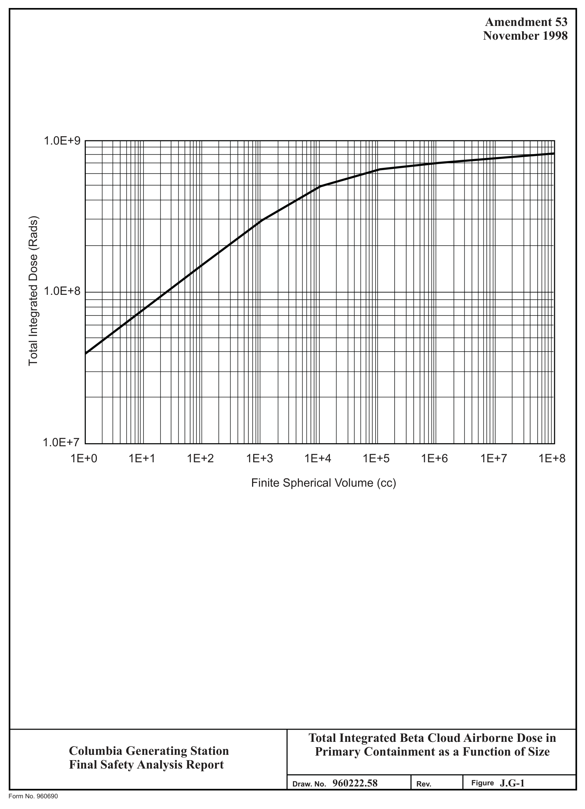

*figure on PDF page 1132*

[Vector original (SVG, lossless): fig_page-1132.svg](../figures/fig_page-1132.svg)

<!-- labels/text on this figure page -->
Amendment 53 November 1998
1.0E+9
-------- ~~ ,/ ~,..
Total Integrated Dose (Rads)
- I,~ v" .. , ~ - ~~
1.0E+8
~ .J~ /
1.0E+7 1E+0 1E+1 1E+2 1E+3 1E+4 1E+5 1E+6 1E+7 1E+8
Finite Spherical Volume (cc)
Total Integrated Beta Cloud Airborne Dose in Columbia Generating Station Primary Containment as a Function of Size Final Safety Analysis Report I 960222.58
J.G-1
Draw. No.
Rev. Figure Form No. 960690

<!-- p.1133 -->
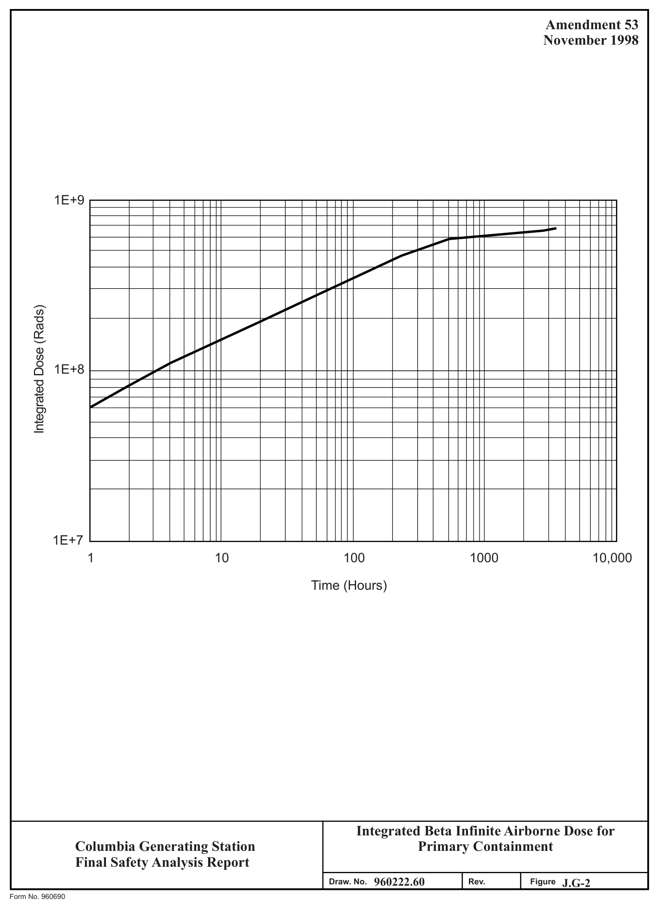

*figure on PDF page 1133*

[Vector original (SVG, lossless): fig_page-1133.svg](../figures/fig_page-1133.svg)

<!-- labels/text on this figure page -->
Amendment 53 November 1998
1E+9
-......
,JI' ,,,,-
.... .. v-
.., ....
~ Integrated Dose (Rads)
~
..... /
~ .., ,,,_,,,.
-- 1E+8
..,,,,,, ~
1E+7 1 10 100 1000 10,000
Time (Hours)
Integrated Beta Infinite Airborne Dose for Primary Containment Columbia Generating Station Final Safety Analysis Report I I 960222.60 J.G-2 Draw. No. Rev. Figure Form No. 960690

<!-- p.1134 -->
November 1998

Attachment J.H

#### VITAL AREAS AND ACCESS ROUTES ANALYZED FOR
#### POST-LOSS-OF-COOLANT-ACCIDENT OPERATIONS
This attachment represents the methodology and assumptions used to determine the integrated dose to equipment and personnel for vital areas and access routes outside the reactor building during post-loss-of-coolant accident (LOCA) operations. The source term is the reactor building elevated vent with gaseous effluents being filtered by the standby gas treatment system (SGTS) prior to discharge to the atmosphere.

#### J.H.1 SOURCE OF RADIOACTIVITY TO THE REACTOR BUILDING ELEVATED
VENT

Two contributions were considered as the source of the radioactivity to the reactor building elevated vent:

a. Leakage from the drywell to the reactor building and discharged via the SGTS to the reactor building elevated vent was assumed at a rate of

0.5%/day = 2.1E-4/hr, and

b. Leakage from the assumed leaks on the main steam isolation valves (MSIVs) in the main steam tunnel was assumed at a rate of

0.17%/day = 7.1E-5/hr (Reference J.7-56)

Thus, the total leakage rate of activity from the primary system is assumed to be

0.67%/day = 2.8E-4/hr.

J.H.1.1 Reactor Building Air Discharge Rate

All radioactivity considered outside the reactor building is assumed to discharge via the reactor building elevated vent.

The removal rate of the reactor building ventilation can be determined as follows:

Removal rate = SGTS discharge rate Reactor building volume

SGTS discharge flow = 2430 ft3/minute

#### J.H-1
<!-- p.1135 -->
November 1998

Reactor building volume = 3.5E+6 ft3

Thus, the removal rate is as follows representing one volume change per day:

( 2430 ft 3 /min)( 60 min/ hr )
Removal rate = + 3 3 5 . E 6 ft

Removal rate = 4.2E-2/hr

This removal rate was used in the determination of radiation levels outside the reactor building.

#### J.H.2 POSTACCIDENT DESIGN DOSE (PADD)
A small computer program (PADD) was written to complete the calculations for the 18 nuclides over various time periods and sum the results. The equation used to determine the dose is as follows:

) = DF(j) (Q TF Q χ * + Q 2 1 j j
(J.H-1) Dose( rad * )
3600 1 where

Doseji = Rads from jth nuclide for the ith time period.

= Gamma dose factors for semi-infinite cloud Rad * m 3 DFj for jth nuclide.
Ci * hr

χ /Q1 = sec/m3 for gaseous releases from the reactor building vent to the atmosphere for the ith time period.

RF = Removal fraction of activity via the standby gas treatment.

TF = 0.01 for particulates and iodines (99% efficiency or RF).

TF = 1.0 for noble gases (FSAR Section 6.5).

Q1j = Integrated activity of jth nuclide over ith time period that was released via leaks in the MSIVs (curies/hour).

Q2j = Integrated activity of jth nuclide over the ith time period that was released via leakage from the primary to secondary containment (curies/hour).

#### J.H-2
<!-- p.1136 -->
November 1998

3600 = Conversion from hours to seconds.

Assumptions Used in χ/Q Calculation Methodology J.H.2.1

The following equation from "Meteorology and Atomic Energy" (Reference J.7-31) was used to determine the χ/Q values shown in Table J.H-1.

#### S ) V
(J.H-2)
Dilution = 2.22(M) (3.16 + 0.1 2 mean 1 2 / (Aex) V ex

= FB (building wake factor)

M = 1 if intake and exhaust same elevation

M = 2 if intake and exhaust separated by one floor

M = 4 if intake is in building wake cavity

S = shortest intake exhaust arc length

Aex = exhaust area

Vmean = mean approach flow

Vex = mean exhaust flow

The intake was assumed to be for category F weather conditions with a Vmean = 1 meter/sec.

1 Then χ/Q = R F R B

FB = building wake factor

RR = release rate from reactor building vent (m3/sec)

Concentration in reactor vent

CV = Q/RR

where

Q = curies/sec released

#### J.H-3
<!-- p.1137 -->
November 1998

Concentration at intake CI = CV/FB

Q(χ/Q) CI also =

Therefore:

Q C = C V χ F = Q( / Q) = ( F R )
i B B R

1 χ ( / Q) = (F )(R ) = total dilution factor (D ).
F B R

An F class stability was assumed for atmosphere conditions and 5% meteorology was then applied for time periods from 0 to 180 days. The dilution factors decrease by the following ratios for the time periods indicated.

Time (hr) 0-2 2-8 8-24 24-96 96-4320 Ratio 1.0 0.35 0.04 0.02 0.01

The dilution factors were multiplied by the 5% meteorology ratios to determine the actual χ/Q values used in these computations as presented in Table J.H-1.

J.H.2.2 Integrated Activity Equations Used in this Analysis

The time dependent activity of each nuclide being released from the MSIV was analyzed as follows:

dA1 0 .0067 λ
(J.H-3) dt = PA e (- + )t o 24

where

P = Fractional leak from MSIV per hour (7.1 E-5/hr)

Ao = Initial activity of jth nuclide in primary containment at t = 0 hr

Thus, the activity concentration over a time period of t1 to t2 is

− λ + −  ( 2 8 . E 4 ) t  t ∫ Q = 2 PA e   1 o t 1 or

#### J.H-4
<!-- p.1138 -->
November 1998

[ ] PA
-( λ + 2.8E- 4) t1 - -( + 2.8E- 4) t 2 λ o
(J.H-4) e e Q = + 2.8E- 4)
1 λ (

The integrated activity concentration from the primary to secondary containment leakage, Q2, was calculated as follows:

dA 2 λ
(J.H-5) dt = KA - L C - A 1 2 2 2

where

K = Fractional leak rate from primary containment

0 005 .
= = 21 . E − 4 hr − 1 24 hr

A = Activity in primary containment 0

- ( + 0.0067   λ = A e xp ) t   o 24

A1 = Initial activity (Ci) at t = 0

0.0067 = Leakage removal rate from primary containment per hour 24 = 2.8E-4 hr-1

L2 = Discharge rate from reactor building vent via standby gas treatment = 2430 ft3/min (60 min/hr)

= 1.46E+5 ft3/hr

C2 = Activity concentration in secondary containment

A2 = Curies in secondary containment

V2 = Volume in secondary containment

Rearranging

dA 2 L 2 [ ] λ λ = kA e o xp -( + 2.8E- 4)t - A 2 - A2 dt V 2

#### J.H-5
<!-- p.1139 -->
November 1998

or
(J.H-5A)

= kA e - 1F t - ( L 2 λ dA 2 + ) A2 o V 2 kA e - F t -   dA 2 = 1 F A2 dt o   2

where

L 2 λ F = +

## 2 V 2
λ F = ( + 2.8E- 4)
1

′ A2 = kA - F A2 1 2

′ A 2 + F = r(t)
A 2 2

(J.H-6)
r(t) = kA e -F t 1 o

solving

  ( kA o A2 = e -F t F - F ) e (F -F )t + C 2   2 1 2 1

at t=o, A2 = o
(J.H-7)

c = −0 .005Ao

Thus,

A (t) = .005 A e 0 - t λ (1- e -(.0042)t )
2 o

L 2 A (t)

## 2 Q 2 = or
(J.H-8)
V 2

Q 2 = 1.45 E+ 5ft / hr 3 [ ] 0 .005 A e - jt λ (1- e ) -C2 t o 3.5 E+ 6 ft 3

where C2 = 0.042
(J.H-9)

#### J.H-6
<!-- p.1140 -->
November 1998

thus,

Q2 = 2.11E- 4 A e (1- e ) - jt λ -C2 t o

To determine the integrated concentration:

[ ] ∫ Q2(t) = 2.1E- A 4 e λ - e λ dt t - t -( + C2)t 2 o t 1
(J.H-10)

Solving,

(e - e ) [ ] -C2t -C t 1 2 2
(J.H-11)
Q 2 = 2.1E- 4 A e - t λ - e - t λ 1 2 o λ + C 2

The values of Q1 and Q2 are substituted in for each nuclide and each time period. Then using equation (J.H-1), the dose commitment for each nuclide and each time period may be calculated. These results are presented in Section J.6.3.

#### J.H-7
<!-- p.1141 -->
November 1998

Table J.H-1

Post-Loss-of-Coolant Accident χ/Q Valuesa Used for Calculations of Integrated Doses Outside the Reactor Building

Time (hr)

Area 0-2 2-8 8-24 24-96 96-4320

(180 days)

2.lE-4b Security center 7.35E-5 8.4E-6 4.2E-6 2.1E-6

Auxiliary security center
1.2E-4 4.2E-5 4.8E-6 2.4E-6 1.2E-6

Sample analysis area (end of cycle) 2.6E-4 9.1E-5 1.0E-5 5.0E-6 2.5E-6

Nitrogen supply to accumulators 2.6E-4 9.1E-5 1.0E-5 5.0E-6 2.5E-6

Standby service water pump valves 1.2E-4 4.2E-5 4.8E-6 2.4E-6 1.2E-6

Remote shutdown room
2.6E-4 9.1E-5 1.0E-5 5.0E-6 2.5E-6

Switchgear room 1
2.6E-4 9.1E-5 1.0E-5 5.0E-6 2.5E-6

Switchgear room 2
2.6E-4 9.1E-5 1.0E-5 5.0E-6 2.5E-6

Radwaste control room
2.6E-4 9.1E-5 1.0E-5 5.0E-6 2.5E-6 Battery racks Direct current battery charger Motor control center
2.6E-4 9.1E-5 1.0E-5 5.0E-6 2.5E-6 Three motor control centers/ Three switchgears Direct current battery charger and rack 2.6E-4 9.1E-5 1.0E-5 5.0E-6 2.5E-6

Diesel oil tanks
2.6E-4 9.1E-5 1.0E-5 5.0E-6 2.5E-6

Solid radwaste control panel
2.6E-4 9.1E-5 1.0E-5 5.0E-6 2.5E-6 Sample of elevated release duct 8.0E-4 2.8E-4 3.2E-5 1.6E-5 8.0E-6

The standby service water pump valves are approximately 700 ft from the release point. This distance is too great to calculate a dilution based solely on a building wake factor. However, the conservative assumption will be made that the dilution at the valves is the same as at the auxiliary guard house which is only 420 ft.

a These values are based on an MSIV leak rate of 0.22%/day not the 0.17%/day previously listed. The results are acceptable and conservative for a leak rate of 0.17%/day.

b Read as 2.1 x 10-4 etc.

#### J.H-9
