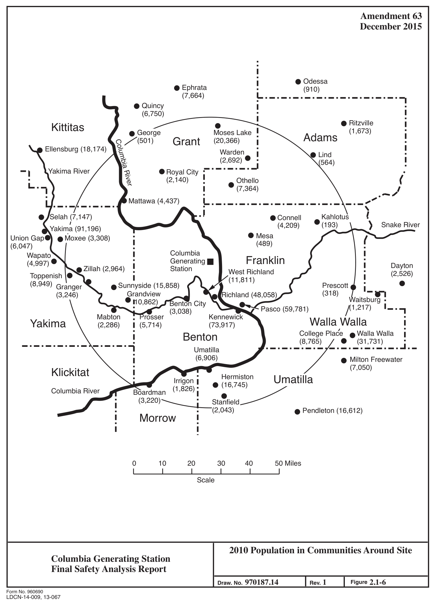
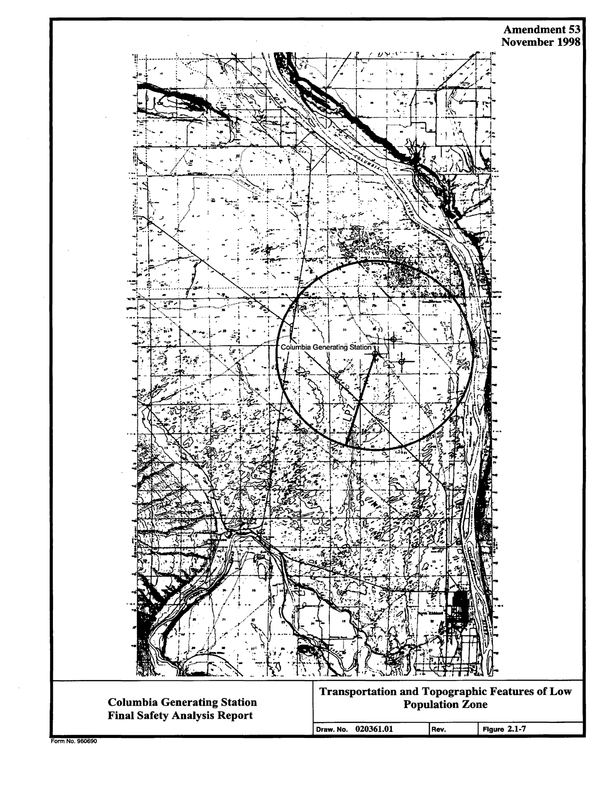

# 2.1 GEOGRAPHY AND DEMOGRAPHY

> Columbia Generating Station FSAR — Chapter 02: Site Characteristics
> Source: `02_chapter-402-659.pdf`, PDF pages 15–31 (of 258)
> Amendment 67 compilation (individual pages carry varying amendment dates)

---
<!-- p.15 -->
Chapter 2

#### SITE CHARACTERISTICS
### 2.1 GEOGRAPHY AND DEMOGRAPHY
#### 2.1.1 SITE LOCATION AND DESCRIPTION
##### 2.1.1.1 Specification of Location
Columbia Generating Station (CGS) is located in the southeast area of the U.S. Department of Energy’s (DOE) Hanford Site in Benton County, Washington. The site is approximately 3 miles west of the Columbia River at River Mile 352, approximately 10 miles north of north Richland, 18 miles northwest of Pasco, and 21 miles northwest of Kennewick (Figures 2.1-1 and 2.1-2).

The reactor is located at 46° 28’ 18” north latitude and 119° 19’ 58” west longitude. The approximate Universal Transverse Mercator coordinates are 5,148,840 meters north and 320,930 meters east.

##### 2.1.1.2 Site Area Map
The CGS site area is that real estate over which Energy Northwest has the legal right to control access. It is the area enclosed by the exclusion area boundary plus the plant property lines as shown in Figure 3-1 of the Offsite Dose Calculation Manual (ODCM). The property line and nearby industrial facilities are shown in Figure 2.1-3. Industrial facilities located in the site area are the H. J. Ashe Substation and Energy Northwest’s Nuclear Projects 1 and 4 (WNP-4 was terminated in January 1982, and WNP-1 was terminated in May 1994). Highway and railway facilities located within the site area are shown in Figure 2.1-3. The relative locations of the plant structures are shown in Figure 1.2-1.

The boundary of the exclusion area is a circle with its center at the reactor and a radius of 1950 m. Ownership and control of the land outside the CGS property line but within the site exclusion area are discussed in Section 2.1.2.

The site is situated near the middle of the relatively flat, essentially featureless plain, which is best described as a shrub steppe with sagebrush interspersed with perennial native and introduced annual grasses extending in a northerly, westerly, and southerly direction for several miles. The plain is characterized by slight topographic relief of approximately 20 ft across the plant site.

The dominant topographic features in the area are the Rattlesnake Hills, 13 to 15 miles west southwest, 3200 ft above the elevation of the plant site; Gable Mountain, approximately

<!-- p.16 -->
10 miles northwest of the site and about 670 ft above the site grade; and the steep river cut bluffs forming the east bank of the Columbia River, approximately 3.5 miles east of the site
(Figure 2.1-1).

##### 2.1.1.3 Boundaries for Establishing Effluent Release Limits
The boundary for establishing effluent release limits (unrestricted area boundary as defined in

## 10 CFR Part 20) is the site area boundary as shown in the ODCM, Figure 3-1. The site area
is the area enclosed by the exclusion area boundary and the plant property lines that fall outside the exclusion area. All area within the site area boundary is considered a controlled area as defined by 10 CFR 20.1003.

A number of restricted areas (as defined in 10 CFR 20.1003) are associated with CGS. The primary CGS restricted area is located within the plant security fence which also is the boundary of the protected area (as defined in 10 CFR 73.2). This is shown as the double fence line in Figure 1.2-1. Unescorted access to the protected area is controlled by CGS security staff. Other restricted areas include the Independent Spent Fuel Storage Installation, stormwater ponds, Plant Support Facility calibration laboratory, Warehouse No. 5, the cooling tower sediment disposal area, and Building 167 on the WNP-4 site. Access to these secondary restricted areas is controlled by locks and fences. Temporary restricted areas may be established and removed as dictated by activities at CGS.

#### 2.1.2 EXCLUSION AREA AUTHORITY AND CONTROL
##### 2.1.2.1 Authority
Energy Northwest leased 1089 acres from the DOE, within the DOE Hanford Site, to be used for CGS. A letter from the DOE Richland Operations office to the Managing Director of Energy Northwest (Reference 2.1-1) advises that the DOE has the authority to sell or lease land on the Hanford Site and the letter further states

This Authority is contained in Section 120 of the Atomic Energy Community Act of 1955, as amended, and Section 161g of the Atomic Energy Act of 1954, as amended. There is also general federal disposal authority available under the Federal Property Administrative Services Act of 1949, as amended.

The 1950-m radius exclusion area extends beyond the CGS property lines and overlaps DOE lands as well as the additional land leased by Energy Northwest for the construction of the WNP-1 and WNP-4 projects (see Figure 2.1-3 and ODCM Figure 3-1). All land outside the Energy Northwest leased property but within the exclusion area is managed by the DOE. l I In recognition of the requirement specified in 10 CFR 100.3(a) [Now 100.3] that a licensee have control over access to the exclusion area, the following terms have been incorporated as Article 7 of the site property lease agreement between Energy Northwest and the DOE (as modified in 1975):

<!-- p.17 -->
Notwithstanding any provisions of this lease to the contrary, the Administration [Energy Research and Development Administration -- now DOE] agrees that the Supply System [now Energy Northwest] has the authority to determine all activities within the exclusion area within the meaning of 10 CFR Section 100.3(a) [Now 100.3], including the authority to remove a personnel and property from the area. The Supply System agrees that it will exercise such authority in a manner so as not to preclude the Administration from undertaking any action or activity within the exclusion area that is permissible under the provisions of 10 CFR Section 100.3(a) [Now 100.3]. As used herein, the term “exclusion area” includes both the leased and nonleased portions of the exclusion area.

Therefore, any actions such as public access and actions concerning mineral rights and easements taken within the exclusion area but outside the leased property are under the control of the DOE with the provision that Energy Northwest has the legal right to control access of individuals to the exclusion area if necessary. All rail shipments on the track which traverses the property (Figure 2.1-3) are also under control of the DOE and are also subject to the above provision and controls imposed by Energy Northwest Security.

The only paved roads that traverse the exclusion area of CGS are the CGS, WNP-1, and WNP-4 facility access roads shown in Figure 2.1-3. Access by land from outside of the Hanford Site to the plant site is over DOE roads. Travel within the exclusion area on the access roads will be under the authority of Energy Northwest.

In the event that evacuation or other control of the exclusion area should become necessary, appropriate notice will be given to the DOE-Richland Operations Office for control of non-Energy Northwest originated activities.

The above provisions provide the necessary assurance that the exclusion area is properly controlled. If Energy Northwest should decide that an easement would be useful in ensuring continued control, there is a provision in Article 5(b) of the lease as follows:

Subject to the provisions of Section 161g of the Atomic Energy Act of 1954, as amended, the Commission has authority to grant easements for rights-ofway for roads, transmission lines and for any other purpose, and agrees to negotiate with Energy Northwest for such rights-of-way over the Hanford Operations Area as are necessary to service the Leased Premises.

Pursuant to this provision Energy Northwest could obtain an easement over the exclusion area in question from the DOE, which would ensure that no permanent structures or other activities inconsistent with the exclusion area would be carried on therein.

<!-- p.18 -->
##### 2.1.2.2 Control of Activities Unrelated to Plant Operation
In accordance with, and as defined by 10 CFR 100.3, Energy Northwest has the authority to determine all activities within the exclusion area, including the authority to remove all personnel and property from the area. The following activities unrelated to plant operation are permitted within the exclusion area:

###### 2.1.2.2.1 Industrial Development Complex
Energy-Northwest is conducting site restoration and economic development (such as leasing of excess facilities for office space and manufacturing) activities at the WNP-1 and WNP-4 sites
(the WNP-1 and WNP-4 sites are also leased from the DOE and controlled by Energy Northwest). The number of personnel at the WNP-1 and WNP-4 sites varies. However, coordination of activities within the exclusion area is under the control of Energy Northwest and the CGS emergency plan. This includes notification and evacuation considerations in the event of an emergency at CGS.

2.1.2.2.2 618-11 (Wye) Waste Burial Ground

The 618-11 site is a DOE waste burial ground, encompassing an eight-acre parcel directly adjacent to Energy Northwest leased land (see Figure 2.1-3) and located wholly within the CGS exclusion area. All 618-11 site activities are controlled by DOE in accordance with 10 CFR Chapter III. DOE has responsibility for the 618-11 site in accordance with 10 CFR 830.204. The soil overburden covering the caissons and vertical pipe units at the 618-11 site is identified as a passive design feature that serves a mitigative function. Existing soil overburden shall not be removed.

Following non-intrusive surveillance and characterization activities, the site was returned to inactive status.

##### 2.1.2.3 Arrangements for Traffic Control
The only roads within the exclusion area are the Energy Northwest access roads. These roads are normally used only by employees and visitors associated with the CGS, WNP-1, and WNP-4 facilities, DOE, and DOE contractors. The security force, with offsite assistance as required, controls traffic during emergencies.

##### 2.1.2.4 Abandonment or Relocation of Roads
There were no public roads transversing the exclusion area that had to be abandoned or relocated as a result of the construction of CGS.

<!-- p.19 -->
#### 2.1.3 POPULATION DISTRIBUTION
Table 2.1-1 presents the compass sector population estimates for 1980 and the forecasts for the same compass sectors by decade from 1990 to 2030.* Cumulative totals are also shown in Table 2.1-1. This table may be keyed to Figures 2.1-4 and 2.1-5, which show the sectors and major population centers within 10 and 50 miles of the site. As can be seen in Figure 2.1-6, population centers, within 50 miles of the site include the Tri-Cities area of Richland, Pasco, and Kennewick; Moses Lake; Hermiston; and the communities lying along the Yakima River from Prosser to Toppenish. Figure 2.1-4 shows that there are no towns located within 10 miles of the site, with the exception of a small part of Richland.

The 1990 to 2030 forecasts presented here (Reference 2.1-2) are based on

a. 1979 population figures provided by the Washington State Office of Financial Management,

b. Benton and Franklin County Traffic Analysis Zone population distributions,

c. Computed annual average area growth rates from 1975 through 1979 which were utilized to obtain the total 1980 population estimated for each area, and

d. County forecasts prepared by the Bonneville Power Administration.
(References 2.1-3 and 2.1-4).

Table 2.1-2 presents the compass sector population estimates for 2010 based on U.S. Census Bureau data (Reference 2.1-5). See also Figures 2.1-4 and 2.1-5.

##### 2.1.3.1 Population Within Ten Miles
An estimated 3000 people live within 10 miles of the site. The nearest inhabitants occupy farms which are located east of Columbia River and are thinly spread over five compass sectors. There are no permanent inhabitants located within 3 miles of the site.

No significant changes in land use within five miles are anticipated. The Hanford Site is expected to remain dedicated primarily to industrial use without private residences. No change in the use of the land east of the Columbia River is expected since it currently is irrigated to

* Population estimates out to 50 miles were derived to serve the licensing requirements of WNP-1, CGS, and WNP-4. Therefore, estimates were made relative to the centroid of the triangle formed by the three reactors. This point is located 2800 ft east of CGS and has coordinates longitude 119º 19’ 18” west, latitude 46° 28’ 19” north. This shift does not affect the overall accuracy or applicability of the population distribution projections.

<!-- p.20 -->
about the maximum amount practicable. The primary increase in population within the 10-mile radius is expected to be in the area south and south-southeast of the plant (see Figure 2.1-4).

##### 2.1.3.2 Population Between Ten and Fifty Miles
As indicated in Table 2.1-2, about 450,000 people were estimated to be living within a 50-mile radius of CGS in 2010. Projections for the 10-50 mile region are shown in Table 2.1-1 which is based on earlier (1979-1980) population counts.

##### 2.1.3.3 Transient Population
The transient population consists of agricultural workers needed for harvesting crops produced in the region, industrial and construction workers, and sportsmen engaged in hunting, fishing, and boating. A description of the transient population is discussed in Section 5.6 of the CGS Emergency Plan.

##### 2.1.3.4 Low Population Zone
The low population zone (LPZ) [see 10 CFR 100.3(b)] for CGS is defined as all land within a 3-mile radius of the reactor. This LPZ was selected on the basis that it is not expected to have a large population in the future and that effective protective measures could be established. As shown in Table 2.1-2, no permanent residents are located within a 3-mile radius of the reactor, and none are anticipated in the future.

There are no public facilities or institutions such as schools and hospitals within a 3-mile radius of the plant. The transportation facilities and topographic features of the LPZ are shown in Figure 2.1-7.

##### 2.1.3.5 Population Center
The nearest population center is the City of Richland, 12 miles to the south.

##### 2.1.3.6 Population Density
In 2000, the population densities within the 10, 20, and 30-mile radii were 9, 96, and 73 people per square miles, respectively. In 2030, the densities out to the same distances are estimated to be 13, 123, and 84, respectively, based on the projections in Table 2.1-1.

<!-- p.21 -->
#### 2.1.4 REFERENCES
2.1-1 Letter from Atomic Energy Commission, Richland Operations Office, to Managing Director of the Supply System, Washington Public Power Supply System, Subject: Appendix 2P, November 25, 1970.

2.1-2 Yandon, K. E., Projections and Distributions of Populations Within a 50-Mile Radius of Washington Public Power Supply System Nuclear Projects Nos. 1, 2, and 4 by Compass Direction and Radii Intervals, 1970-2030, October 1980.

2.1-3 Bonneville Power Administration, U.S. Department of Energy, Washington, Subject: Population, Employment and Household Projections to 2000 by County, July 1979.

2.1-4 Bonneville Power Administration, U.S. Department of Energy, Oregon Population, Employment and Household Projections to 2000 by County.

2.1-5 Washington State Office of Financial Management, Forecasting Division (2012).
Small Area Estimate Program: Census Block Groups [SAEP_ColGenFac_Sectors_2000-2012.xls]. Via communication with M.
Mohrman, Washington Office of Financial Management, July 2013; Oregon Population Data Estimates 2010 provided by Portland State University, Population Research Center, C. Rynerson, in collaboration with the M.
Mohrman at Washington State Office of Financial Management, March 2014.

<!-- p.22 -->
0 0 86 150 214 278 290 290 378 550 804 1006 1299 1688 2298 2648 3198 4118 4147 4147 4601 5053 5722 6696 7315 7972 14599 95333 147055 149243 153676 154936 154936 154936 154936 154936 Cumulative Total 2030 0 0 86 64 64 64 12 0 88 172 254 202 293 389 610 350 550 920 29 0 454 452 669 974 619 657 6627 80734 51722 2188 4433 1260 0 0 0 0 Number

Cumulative 0 0 55 118 181 244 255 255 342 512 764 964 1254 1639 2243 2590 3134 4045 4073 4073 4522 4969 5631 6595 7208 7858 14419 94351 145559 147725 152114 153362 153362 153362 153362 153362 Total 2020 Projected Population Distribution by Compass Sector and Distance from the Site 0 0 55 63 63 63 11 0 87 170 252 200 290 385 604 347 544 911 28 0 449 447 662 964 613 650 6561 79932 51208 2166 4389 1248 0 0 0 0 Number

0 0 52 112 172 232 243 243 326 488 728 918 1194 1560 2135 2465 2983 3850 3877 3877 4304 4730 4360 6277 6860 7478 13720 89763 138480 140541 144716 145904 145904 145904 145904 145904 Cumulative Total 2010 Number 0 0 52 60 60 60 11 0 83 162 240 190 276 366 575 330 518 867 27 0 427 426 630 917 583 618 6242 76043 48717 2061 4175 1188 0 0 0 0

Cumulative 0 0 48 104 160 216 225 225 302 454 678 855 1112 1453 1989 2297 2780 3589 3614 3614 40112 4409 4997 5852 6396 6972 12793 83710 129144 131066 134960 136068 136068 136068 136068 136068 Total Table 2.1-1 2000 0 0 48 56 56 56 9 0 77 152 224 177 257 341 536 308 483 809 25 0 398 397 588 855 544 576 5821 70917 45434 1922 894 1108 0 0 0 0 Number

Cumulative 0 0 35 78 121 164 170 170 228 354 552 709 909 1185 1591 1844 2116 2651 2676 2676 3047 3418 3980 4815 5294 5724 10945 74428 112100 113872 117469 118517 118517 118517 118517 118517 Total 1990 0 0 35 43 43 43 6 0 58 126 198 157 200 276 406 253 272 535 25 0 371 371 562 835 479 430 5221 63483 37672 1772 3597 1048 0 0 0 0 Number

0 0 10 32 54 76 80 80 106 189 344 458 593 761 951 996 1046 1281 1306 1306 1638 1966 2365 3157 3618 3810 7965 57143 86086 87678 90784 91734 91734 91734 91734 91734 Cumulative Total 1980 Number 0 0 10 22 22 22 4 0 26 83 155 114 135 168 190 45 50 235 25 0 332 328 399 792 461 192 4155 49178 28943 1592 3106 950 0 0 0 0

#### WSW-NNW
Direction (compass segment)

#### SSE-NNW
#### N-NNE
#### WSW WNW NNW
#### ENE NNE ENE SSW NNE ENE SSW ESE ESE SSE ESE SSE
#### NW SW SW
#### NE SE
All NE SE NE SE

#### W N N
#### E S E S E

Cumulative Distance
(miles)
10-20 5-10 0-3 3-5

<!-- p.23 -->
157275 165385 167974 170007 170257 170605 178275 220729 221838 223461 232269 234442 236068 236406 236461 236710 237993 242529 243379 243919 244081 244289 244855 245942 253192 253794 254688 285353 290217 292015 292967 295128 319684 320959 322410 322837 323142 324237 Cumulative Total 2030 2339 8110 2589 2033 250 348 7670 42454 1109 1623 8808 2173 1626 338 55 249 1283 4536 850 540 162 208 566 1087 7250 602 894 30665 4864 1798 952 2161 24556 1275 1451 427 305 1095 Number

Cumulative 155678 163707 166270 168283 168531 168875 176469 218501 219599 221206 229926 232077 233687 234021 234075 234321 235591 240081 240927 241462 241622 241827 242387 243463 250635 251231 252116 282478 287294 289074 290016 292156 316468 317731 319168 319591 319893 320976 Projected Population Distribution by Compass Sector and Distance from the Site (Continued)
Total 2020 2316 8029 2563 2013 248 344 7594 42032 1098 1607 8720 2151 1610 334 54 246 1270 4490 846 535 160 205 560 1076 7172 596 885 30362 4816 1780 942 2140 24312 1263 1437 423 302 1083 Number

148107 155745 158183 160098 160334 160661 167886 206873 207918 209447 217743 219789 221321 221639 221690 221924 223132 227403 228202 228711 228863 229058 229591 230615 237442 238009 238851 267684 272266 273959 274855 276891 300021 301223 302590 302992 303279 304309 Cumulative Total 2010 Number 2203 7638 2438 1915 236 327 7225 38987 1045 1529 8296 2046 1532 318 51 234 1208 4271 799 509 152 195 533 1023 6828 567 842 28833 4582 1693 896 2036 23130 1202 1367 402 287 1030

Cumulative 138123 145246 147520 149306 149526 149831 156569 192929 193904 195330 203067 204975 206404 206701 206749 206967 208094 212077 212822 213297 213438 213620 214117 215072 221440 221969 222755 249645 253918 255497 256333 258232 279804 280925 282200 282575 282843 283804 Total Table 2.1-1 2000 2055 7123 2274 1786 220 305 6738 36360 975 1426 7737 1908 1429 297 48 218 1127 3983 745 475 141 182 497 955 6368 529 786 26890 4273 1579 836 1899 21572 1121 1275 375 268 961 Number

Cumulative 120354 126841 129015 130775 130969 131209 137721 170280 170958 172176 179323 181122 182447 182727 182771 182971 184065 187728 188528 188975 189111 189287 189771 190615 196268 196692 197353 222082 226031 227490 228260 229998 249728 250747 251886 252129 252387 253312 Total 1990 1837 6487 2174 1760 194 240 6512 32559 678 1218 7147 1799 1325 280 44 200 1096 3663 800 447 136 176 484 844 5653 424 661 24729 3949 1459 770 1738 19730 1019 1139 243 258 925 Number

93235 98994 101009 102726 102877 103030 109168 133284 133471 134346 140511 142137 143328 143513 143553 143735 144715 147913 148563 148984 149112 149279 149743 150335 155015 155271 155744 177615 181193 182592 183295 184870 202742 203635 204561 204774 205015 205879 Cumulative Total 1980 Number 1501 5759 2015 1717 151 153 6138 24116 187 875 6165 1626 1191 185 40 182 980 3198 650 421 128 167 464 592 4680 256 473 21871 3578 1399 703 1575 17872 893 926 213 241 864

Direction (compass segment)

#### WNW NNW
#### WSW WNW NNW WSW
#### NNE ENE
#### NNE ENE SSW
#### NNE ENE SSW
ESE

#### ESE SSE NW
#### ESE SSE NW
#### SW NE
SW NE

#### NE SE
SE

#### W N N N
#### W E E S E S

Cumulative Distance
(miles) 20-30 40-50 30-40

<!-- p.24 -->
326910 329269 349427 352855 353396 354495 379742 382068 383098 383828 Cumulative Total 2030 2673 2359 20158 3428 541 1099 25247 2326 1030 730 Number

Cumulative 323622 325958 345916 349265 349800 350888 375884 378187 379207 379930 Projected Population Distribution by Compass Sector and Distance from the Site (Continued)
Total 2020 2646 2336 19958 3349 535 1088 24996 2303 1020 723 Number

306827 309049 328036 331222 331731 332766 356546 358737 359707 360395 Cumulative Total 2010 Number 2518 2222 18987 3186 509 1035 23780 2191 970 688

Cumulative 286153 288225 305933 308905 309381 310346 332525 334568 335473 336115 Total Table 2.1-1 2000 2349 2072 17708 2972 476 965 22176 2043 905 642 Number

Cumulative 25557 257477 273883 276778 277221 278113 298594 300497 301356 301943 Total 1990 2245 1920 16406 2895 443 892 20481 1903 859 587 Number

207963 209703 226243 228853 229274 230083 248598 250340 251152 251684 Cumulative Total 1980 Number 2084 1740 16540 2610 421 809 18515 1742 812 532

Direction (compass segment)

#### WNW WSW NNW
#### SSW SSE
#### NW SW
SE W S

40-50 (cont.)
Cumulative Distance
(miles)

<!-- p.25 -->
Population 136 742 1699 934 680 513 16219 95379 38669 7516 1232 11 0 1 0 166751 37171 782 705 164 48 188 1415 310 30053 5441 217 4428 22691 26 619 1622 448383 2010

Direction (compass segment)

#### NW - W TOTAL
#### TOTAL
#### WNW WSW NNW WSW NNW
WNW

#### NNE ENE SSW
#### NNE ENE SSW
#### ESE SSE
#### ESE SSE
#### NW SW SW
NE

#### NE SE SE
W N

#### N E S S
E 2010 Population Distribution by Compass Sector and Distance from the Site Distance
(miles)
10-20 10-20 10-20 10-20 10-20 10-20 10-20 10-20 10-20 10-20 10-20 10-20 10-20 10-20 10-20 40-50 40-50 40-50 40-50 40-50 40-50 40-50 40-50 40-50 40-50 40-50 40-50 40-50 40-50 40-50 40-50 0-20 0-50

Population 16 78 248 213 298 308 588 239 376 548 16 0 1 3020 1138 3802 210 302 121 686 343 201 8330 236 1552 41107 934 6111 2478 3870 342503 2010 Table 2.1-2

#### WSW-NW
Direction (compass segment)

#### TOTAL
#### TOTAL
#### WNW NNW WSW NNW
#### NNE ENE SSW
#### NNE ENE SSW
ESE

#### ESE SSE SSE
#### NW SW SW NE NE SE SE W N E

#### N E S S
Distance
(miles)
30-40 30-40 30-40 30-40 30-40 30-40 30-40 30-40 30-40 30-40 30-40 30-40 30-40 30-40 30-40 30-40 5-10 5-10 5-10 5-10 5-10 5-10 5-10 5-10 5-10 5-10 5-10 5-10 5-10 0-10 0-40

Table based on April 2010 Census Bureau counts.
Population 0 0 0 1 0 0 1 18 19 27 25 0 0 91 1098 13285 1237 3638 53 509 18611 50050 1710 131 11225 1475 50 205 611 443 271082 2010

#### SSE-NNW
Direction (compass segment)

#### SE-NNW
#### TOTAL
#### TOTAL
#### WNW WSW NNW
#### NNE ENE SSW
#### ALL NNE ENE NNE ENE
#### ESE SSE
#### ESE ESE NW SW NE NE SE W SE E

#### E N E S
Distance
(miles)
20-30 20-30 20-30 20-30 20-30 20-30 20-30 20-30 20-30 20-30 20-30 20-30 20-30 20-30 20-30 20-30 0-30 0-3 3-4 3-4 3-4 3-4 3-4 4-5 4-5 4-5 4-5 4-5 4-5 4-5 0-5

#### LDCN-14-009, 13-067
<!-- p.26 -->
Form No. 960690 Roza Canal Black Canyon Prosser Ranch Spring Cr Ranch 694 Christensen W A H L U K E S L O P E 840 Bros Dam Pumping UNION PACIFIC Station Gravel pit Substa Prosser Prosser North 243 Tower Radio NATIONAL WILDLIFE REFUGE Spring 24 Mattawa 750 Kelly Gulch 221 Whitstrand

#### BENTON CO
Sunnyside Canal

## 24 Spring Benson
Snipes Creek

Ranch Ranch Gibbon

#### SADDLE MOUNTAIN
RATTLESNAKE HILLS Tank Water Chaffee Tower 82 Radio McWhorter 12 1356

#### H A N F O R D R E S E R V A T I O N
Coyote Rapids WT

#### CABLE BUTTE
Roza Canal Towers elevator WT COLD CREEK VALLEY elevator Grain Observatory Grain Chandler Butte Grain elevator Chandler Corral Canyon Tanks Water Water Tank Iowa Flats CABLE MOUNTAIN KiBe Route 11A Grain elevator

#### GRANT CO
Benton City 240

#### YAKIMA RIVER
Hanford Ditch Webber Canyon Kiona

#### RED MOUNTAIN
Island Locke Route 4 South Goose Hill

#### UNION PACIFIC
224 Hanford Route 10 South Harrington Dam Horn Rapids White Bluffs

#### BURLINGTON
Route 2 South Pumping Station Fast Flux Facility Test US Government RR 12 Candy Mtn.

## 20 MILES
## 10 MILES Horn Rapids Rd. Badger
FFTF Richland 5 MILES N Power Plant Loop Canyon West Badger Route 4 South Saddle Gap Columbia Canal Generating NORTHERN

#### BADGER MOUNTAIN
Columbia 182 Station Richland Mountain Vista Rd 391 Kinder- 82 Richland Savage Gravel VanGieson Care Island pit Wooded Island Stevens Dr.
Substa Canal Ash Columbia Rd. Hollingsworth Rd.
George Washinton Way

#### RINGOLD FLAT
Cooton Basin Hill Rd. Bellflower Rd.
Big River W. Sagemoor Rd. wood Glenwood Glenwood R 170 Fir Way 521 View View Vista Island Island Columbia Esquatzel Tank Water Vista Point WT Mathews Country Markum Haven Edwin Corner Air Force Sta Auburn Rd.
Ranch Franklin Co Irr Can 182 Russell Rd. 82 Taylor Flats Rd.
W. Juniper Rd. W. Klamath Rd. KENNEWICK Othello Ranch WT West Fir Rd. N. Belleview N. Rd 68 Potholes Christian Pasco West Selph Landing Rd. W. Sagemoor Rd. Country Ironwood Rd. Rd.
Diversion Potholes Canal Elm Rd. Tower 14 Alder Rd Radio Birch Rd.
Tower Radio N. Belleview Dogwood East Basin City Water Tank N. Coulee Rd. Rd.
770 Canal Basin City Tri-Cities Cedar Channel 170 Airport Lakes Eagle 407 Glade North Rd.
MOUNTAIN JACKASS Eltopia Rd.
Stevens Ranch Glade North Rd.

## 12 Gravel
Juniper Rd.
Sheffield Rd. pit Glade 395 Fir Rd.
Olympia Dr. Columbia Canal State Park State Park Sacajawea Sacajawea Ranch Tank Water

#### P A R A D I S E F L A T S ESQUATZEL COULEE
Finley Pasco Pond Clark Scooteney Reservoir Hedges Hathaway Eltopia Lake Camp 800 Substa Quarry 17 Hi Burbank Shano Sandpit 17 Mesa WASHTUCNA COULEE

#### FRANKLIN CO UNION PACIFIC
Canal Radio Tower Tower Radio 12 Substa Pipeline Gravel pit

#### SNAKE RIVER
Gravel pit

#### RYE GRASS COULEE
#### SMITH CANYON
Frischnecht 395 T Lake

#### MCNARY NATIONAL WILDLIFE REFUGE WALLA
Cactus Water Tank I 260 Humorist

#### TRAINING SURVIVAL
JUNIPER Tank Water FOREST

#### I Final Safety Analysis Report Columbia Generating Station AREA
Ice Harbor OLD MAID Dam I 124 I

5

5

Powerline Pipeline Railroad Light Duty Road Medium Duty Road Heavy Duty Road 0 0

#### LEGEND
5

Boundary Park or Reservation Sandpit or Gravelpit Radio Tower, Well Populated Places Latitude/Longitude 5

D 10 r a w .
N SCALE o .

0 0 0 -t- 9 Iii 80N 260 395 15 9 0

## 10 General Area, 0 - 20 Miles
Emergency Center Interstate Route State Route Federal Route Marker Landing Area Landplane Airport 3 0
2.6 0

20

R e v .

15 25

Figure Amendment 55

## 30 Kilometers
## 1.2 May 2001
- 1

## 20 Statute Miles
<!-- p.27 -->
Form No. 960690 45°45' 46°00' 46°15' Latitude 46°30' 46°45' 47°00'

BURLINGTON Moxee City Firing Center AAF Squaw Tit 5 Wapato RATTLESNAKE HILLS Emergency Planning Zone N 50 Mile Ingestion Exposure Columbia Generating Station Donald W Yakima I R Hdqrs Cem Fire station Moxee Canal 5 97 Windmill

#### TOPPENISH NWR
Moxee Canal Range Central East Kittitas Cleveland Sawyer ELEPHANT MOUNTAIN Cem KITTITAS 12 WSW

#### CANYON WNW
North Branch Canal Trail Creek Cemetery Toppenish Creek 82

#### HEMBRE MTN
#### HILLS
Badger Cr Wippe Pumping Station H O R S E H E A V E N H I L L S 97

#### BADGER POCKET
Caribou Creek Toppenish Creek Wapity Slough 22 NORTHERN Buena Pumping station SPRING GULCH 0 0 Bickleton Water

#### BIG HORN CANYON
Toppenish Kittitas Microwave Tower KITTITAS CO Cemetery Selah Creek

#### MOXEE VALLEY
Gap Badger

#### BOYLSTON MOUNTAINS JOHNSON CANYON WHISKEY DICK WOOD GULCH
Observation post 120°15' Zillah 410 Windmill MTN 120°15' Radio Tower

#### R A T T L E S N A K E H I L L S Y A K I M A R I D G E
Station Pumping Ranch 5 Satus No. 2 Pump Canal Granger

#### U M T A N U M R I D G E
Boylston KLICKITAT CO 223 Poison Spring Airway Beacon Radio Station ZILLAH PEAK Ranch McDonald Springs 5 STEGEMAN CANYON Ranch Pine Creek Pumping Station Bluelight 10 Brushy Creek

#### C E N T E R F I R I N G Y A K I M A
Satus SCHNEBLY COULEE Windmill Liberty Labor Camp Granger Farm Quarantine YAKIMA CO Hanson Creek Station Plant Windmill HULT BUTTE Skookumchuck SPRING CANYON Pumping Station Creek Leslie Creek

#### SCALE
Ranch Glade Creek

#### TOPPENISH SNIPES MOUNTAIN
#### SAND RIDGE
#### MIDDLE CANYON NWR
SW Windmill Cem Rock Spring 15 Ranch Ranch Emerald BURLINGTON Cottonwood Creek High Top RYEGRASS COULEE PARK NW Hepner Junction Hepner Junction ALDER RIDGE Outlook Johnson Cr 10

#### ROCKY COULEE DOUTY CANYON
Rattlesnake TULE CANYON

#### CORRAL CANYON ALKALI CANYON SADDLE MOUNTAINS
## 12 Cem
Spring Ranch Coyote Canyon Ranch MOUNTAIN RYEGRASS Sunnyside Canal Black Rock Spring Lone Star Spring

## 82 Pumping Station
#### SOURDOUGH CANYON
Ranch 20 Lake Giffen BLACK ROCK Tower Radio VALLEY Grange FOREST PARK Ranch PETRIFIED GINKGO 120°00' Cem Tower LAVA Sunnyside WT Creek Indian Reservation pit Sixprong BABCOCK BENCH CRESCENT BAR CRESCENT BAR 120°00' 15 ALDER RIDGE Mabton Cem Ranch Springs Facility Radio Ranch Gravel Lozier R A T T L E S N A K E H I L L S Alder Creek 25 Frenchman POTHOLES COULEE Glade Creek Cairn Hope Peak Springs BABCOCK RIDGE pit Yakima Lake Oleys BURLINGTON Grandview Sunnyside Stan Coffin Mabton West Canal 764 Wanapum Dam 10 Lake 22 Beacon Lichty 241 24 Sand Hollow Grain elevator Spring Ranch

#### DEAD CANYON
Campbell Beverly COLUMBIA RIVER Station Pumping Horsethief Pt Schwana 30 Kilometers BUTTE

## 14 GOLGOTHA BUTTE
Priest Rapids

#### HORSE HEAVEN HILLS GRANDVIEW
Sentinel Gap

## 90 Mabton Siphon Lake 570 Desert CNWR
Spring Sulfur Coyote Canyon Bryon Dam Priest Rapids Mattawa Sentinel Bluffs 84

## 20 Statute Miles
SADDLE MOUNTAINS 30 Emerson Nipple CNWR West Canal Cold Creek Boardman Sulfur Cr 390 Tanks Water Butte Crow Spring Ranch Spring Maiden Ranch Dry Cr McKinley 281 WT George Grain elevator Grain elevator

#### F R E N C H M A N H I L L S
Black Canyon

#### BURLINGTON
694 Prosser

## 10 Roza Canal
CNWR IMPACT AREA Spring Cr Ranch Ranch CNWR LARSON AFB Christensen

## 90 Moore Canyon
W A H L U K E S L O P E 840 Bros SENTINEL MOUNTAIN Dam UNION PACIFIC Station Pumping Gravel pit Substa Prosser Prosser North 243 SSW CANOE RIDGE 119°45' 283 Boardman Tower Radio 119°45' UMATILLA NATIONAL WILDLIFE REFUGE CNWR

#### NATIONAL WILDLIFE REFUGE
Spring NNW East Branch

## 24 BOMBING BOARDMAN Mattawa Tank Water CNWR
Glade Creek

#### RANGE LAKE UMATILLA
750 East Branch Glade Cr 221 Kelly Gulch Grain elevator Whitstrand ELECTRIFIED Sunnyside Canal BENTON CO

#### MORROW CO
Pipeline CNWR 24 Spring Benson Snipes Creek PATERSON Smyrna Red Rock Ranch RATTLESNAKE HILLS Tank Water SADDLE MOUNTAIN SMYRNA BENCH Ranch Ranch Gibbon Winchester Wasteway 26 Chaffee Tower 82 Radio Lower Crab Creek CNWR Paterson McWhorter City Royal 12 1356 H A N F O R D R E S E R V A T I O N 221 Coyote Rapids

#### FINLEY BUTTES
Frenchman Hills 84

#### CABLE BUTTE
Coulee pit elevator Grain WT COLD CREEK VALLEY Towers Lake 730 Gravel Roza Canal WT elevator elevator Grain Chandler Butte Observatory NATURAL CORRAL Christensen RIDGE Grain Grain elevator 30 elevator Grain Chandler Corral Canyon

#### WAHATIS CNWR 1150
PEAK Ranch

#### UNION PACIFIC
Gravel pit GRANT CO West Extension Irrigation Canal Tanks Water SAND DUNES Carter Canyon Iowa Flats Tank Water Disposal Plant 14 Route 11A CABLE MOUNTAIN SADDLE MOUNTAINS Ranch Camp THE POTHOLES 119°30' Grain elevator 119°30' Irrigon Grain elev Tower Water Longitude 240 F R E N C H M A N H I L L S Benton City

#### UMATILLA ORDNANCE
Hanford Ditch Webber Canyon YAKIMA RIVER

#### HIAWATHA VALLEY
Kiona Cem Ranch

#### RED MOUNTAIN
Island Locke Route 4 South Corfu Ordnance DEPOT Moses Lake Sky Ranch Goose Hill

#### UNION PACIFIC 224
Grain elevator CNWR Water tower COYOTE COULEE Hanford

#### FOURMILE CANYON
Ranch BING CANYON Route 10 South ROYAL SLOPE 1100

#### SAND HILLS
elevator Grain Harrington Dam Horn Rapids

#### BUTTE WARD
White Bluffs

#### BURLINGTON
Route 2 South Umatilla Army Depot POTHOLES RESERVOIR Station Pumping State Park Mae Potholes Candy Mtn.
Fast Flux Route 4 South US Government RR Facility Test 12 Royal Lake Westland

#### Horn Rapids Rd. SITE
Badger Canyon Plymouth Taunton Badger West Richland

#### HERMISTON BUTTE
Horn Parker Hermiston N S 395 HORSE HEAVEN HILLS Saddle Gap Columbia Canal Goose Lake Upper Goose 207 Gravel Wells Young 182

#### NORTHERN BADGER MOUNTAIN
## 82 Big Well
#### HERMISTON BUTTE
Lake Larson Air Force Base Hinkle 391 Mountain Vista Rd Substation Straub Canyon pit Richland Wooded Island

## 82 Richland
Shiner Lake Savage SAND DUNES Horn Pelican Horn Lewis 32 395 Power City SILLUSI BUTTE Williams Wells Gravel VanGieson Island ELECTRIFIED WILDLIFE REFUGE O'Sullivan Dam McNary Dam pit 1186 NATIONAL COLUMBIA Substa Stevens Dr.
Umatilla River UMATILLA BUTTE McNary Taylor Canyon Water Canal McDonald Siding Ash Columbia Rd. Hollingsworth Rd.
George Washinton Way CHICAGO MILWAUKEE ST PAUL AND PACIFIC Moses Lake Spring Coyote

#### RINGOLD FLAT
Hunt Ditch 17 119°15' 119°15' Taylor Flat Bellflower Rd. Basin Hill Rd.
W. Sagemoor Rd. Cootonwood Hermiston State Pipeline Glenwood Glenwood R 170 Fir Way Longitude 395 730 521 Vista View View Island Island Moses Lake Bofer Canyon Columbia Soda Lake 90 Refinery Rocky Coulee Wasteway 1200 Amon Vista Point Esquatzel WT Mathews Morgan Lake

#### STATE PARK
Windmill HAT ROCK Radio Franklin Co Irr Can Water Corner Auburn Rd. Ranch Air Force Sta Echo Tower Well Stanfield 395 182 Taylor Flats Rd. Tank Russell Rd. 207 82 W. Juniper Rd. W. Klamath Rd. Ranch Othello elevator MOUNTAIN JACKASS Sielen Siding Grain WT KENNEWICK Underground BUTTE JOHNSON N. Rd 68 Selph Landing Rd. W. Sagemoor Rd. N. Belleview Potholes Gravel pit aqueduct West Fir Rd.
Pasco West Diversion Rd. Ironwood Rd. 84

#### L A K E W A L L U L A
#### FOURMILE GAP
Wheeler Tank Four Canyon Radio Dogwood N. Belleview Basin City Tower Radio 14 Tower Alder Rd Birch Rd. Potholes Canal Elm Rd.

#### LIND COULEE
Water East Tank N. Coulee Rd. Rd.
Windmill 770 Othello Taggars

## 30 UNION PACIFIC
Canal 1149 395 10 MI COLD SPRINGS RUSH CANYON Radio Towers Bassett Junction Basin City Tri-Cities Channel Cedar 170 Lakes Eagle NWR 407 Airport Kent Farms Reservoir Springs JACKASS Eltopia Rd.
Wells Cress MOUNTAIN Glade North Rd.
1155 17 Cold 37 Switzler Canyon Ranch ROCKY COULEE STAGE GULCH Grain elevator 12 Gravel Glade North Rd. Juniper Rd. Sheffield Rd. New Warden Siding Ritell Raugust Station pit Glade Grain elevator

#### NORTHERN PACIFIC 395
1145 Othello elevator 1265 Fir Rd.
Grain Windmill Windmill Springs Bowden State Park State Park Sacajawea Sacajawea Ranch Olympia Dr.
Columbia Canal Tiflis Tank Water P A R A D I S E F L A T S BURLINGTON ESQUATZEL COULEE Pond Clark LIND COULEE WEBER COULEE Station Laing Reservoir Scooteney

#### DESPAIN GULCH 50 Miles Switzler Canyon Nine Canyon Pasco
260 Finley Hedges 730 Underground Eltopia Hathaway Lake Camp Warden aqueduct NORTHERN Bruce 800 Substa Quarry Low

#### COLD SPRINGS CANYON
Ruff Grain elevator The Butte 17 CHICAGO MILWAUKEE ST PAUL AND PACIFIC Sandpit 17 Shano 119°00'

#### JUNIPER CANYON
Burbank Grain Elevator Grain elevator

#### L A K E W A L L U L A
119°00' Mesa WASHTUCNA COULEE FRANKLIN CO Grain elevators UNION PACIFIC Radio Tower Canal Tower Radio

## 12 Substa Pipeline
To Pendleton pit Gravel Gravel SNAKE RIVER pit

#### BURLINGTON NORTHERN
Holdman

#### R SSE Y 20 MI
#### NORTHERN PACIFIC WT E
#### SMITH CANYON 395 G
NNE MCNARY NATIONAL A Cactus 395 T Lake Frischnecht R WILDLIFE REFUGE Tank Water SURVIVAL TRAINING AREA S S MISSOURI GULCH

#### SOUTH FORK COLD SPRINGS CANYON
LIND COULEE Franz Ranch 260 C UNION PACIFIC Humorist Tank Water O Schrag Station NORTH FORK COLD SPRINGS CANYON WASHINGTON 12 Tank Water U L

#### STAGE GULCH MIDDLE FORK COLD SPRINGS CANYON
#### JUNIPER FOREST E
Pipeline LEGEND E OLD MAID OREGON Wallula 124 Pendleton Ice Harbor Dam 1493 Roxboro SOUTH FORK JUNIPER CANYON Tank Water Grain Elevator Levey WT Corners Five RYE GRASS FLAT COULEE

#### Connell NORTH FORK JUNIPER CANYON 60 Miles
Junction Compressor Zanger Powerline Pipeline Railroad Light Duty Road Medium Duty Road Heavy Duty Road BURLINGTON NORTHERN UMATILLA CO Station Hatton PROVIDENCE COULEE 540 260 WASHTUCNA COULEE Connell City DUNNIGAN 925 Cunningham 37 Slater Tank Water Beatrice ADAMS CO 10 pit Gravel Walla Walla River Rattlesnake FARRIER COULEE Reese Pipeline 395 HATTON COULEE Redd

#### COULEE
Grain elevators Grain elevator VANSYCLE CANYON Servia Nine Mile Canyon 118°45' Grain elevator Grain elevator BOWERS COULEE Lake Sacajawea 118°45' Can 12 30 MI Page Cunningham Canyon Providence BURLINGTON NORTHERN WARM SPRINGS CANYON elevator Grain Snake River pit Sulfur Lake Boundary Park or Reservation Sandpit or Gravelpit Radio Tower, Well Populated Places Latitude/Longitude Michigan Prairie Gardena BURLINGTON NORTHERN Grain Elevator HARDESTY 21

Elevator Grain Grain elevator 21 elevator elevator COULEE Grain Grain Touchet Old RR grade Hatch Gravel pit Lind elevator 1349 Watson 26 pit Tower Radio Grain E U R E K A F L A T Grain elevator Greasewood Creek Dryland Experiment Walker UNION PACIFIC Farrington Windmill Pine Creek Grain elevator Eurica 21 80N 260 395 Grain elevator Walla Walla River Woodward Canyon Grain elevator pit Scott Grain 1491 Lind NE elev Lowden SAND HILLS COULEE Pipeline Interstate Route State Route Federal Route Marker Landing Area Landplane Airport SE 884 Pent Grain elevator Webber Canyon Quarry 395 WALLA WALLA CO Winnett Canyon Walker Canyon 930114.50 Mi Pine

#### PAHA COULEE
Devils Canyon Burlingame Ditch Aug 1998 Lower Monumental Kahlotus R A T T L E S N A K E F L A T elevator Elwood 40 MI Grain elevator Grain Lamar 813 Lower Monumental Dam Dry Creek Dry Lake LIND COULEE Athena Whitman Station Grain elevator Lake Kahlotus Paha 118°30' Dry Cr Magallon Dewald 45°45' Station 1880 118°30' Umapine Grain elevator Siding Climax Pipeline Meter Walla Walla Valley elevator Grain Baumann Farm Harder Harsha Oregon Sky Ranch McElroy Lake 1600 WHITMAN Grain elevator NHS MISSION Sudbury Pizarro Grain elevator Fisher Ranch Weston Dry Hollow

## 90 Clyde 1521 1800 Ritzville
Martin Skookum 357 Substa 10 College Grain elevator Place Hadley elevator Grain 260 WT Can Farm BURLINGTON NORTHERN 204 WT 124 Winnett Canyon 261 260 Substa Ayer 11 11 261 elevator ENE Milton-Freewater 850 Page Grain Ritzville NORTHERN PACIFIC Ennis Washtucna 261 ESE Ralston 850 ranch Sky Walla Walla River Ranch Final Safety Analysis Report Columbia Generating Station View Pleasant Davin Prescott Grove Valley

## 50 MI Bowlus Grain elevator WALLA WALLA Badger Hollow Farm Ranch RECREATION AREA
Badger Hollow Hill

#### PALOUSE FALLS
#### SPRING VALLEY
Rattlesnake Gravel Lake pit 261 Hillcrest FIELDS GULCH E

Latitude 46°30' 47°00' 46°15' 46°00' 46°45'

Draw. No.
## 990306.60 General Area, 0 - 50 Miles Rev.

Figure Amendment 55
2.1-2 May 2001

<!-- p.28 -->
Amendment 55 May 2001 Ranch White Bluffs Camp Lake Coyote Rapids Ranch Mountain Vista Rd Hanford Ditch Hollingsworth Rd.

#### CABLE MOUNTAIN
Columbia Rd.
Basin City

#### CABLE BUTTE
Basin Hill Rd.
170 Basin City Bellflower Rd.
Route 11A Hanford Sheffield Rd.
770

W. Klamath Rd.
Ash Glade North Rd. Olympia Dr.
R 170 Russell Rd.
Savage Towers Water Island W. Juniper Rd.
Tank Juniper Rd. RINGOLD FLAT Clark Ironwood Rd.
US Government RR Route 4 South Pond H A N F O R D R E S E R V A T I O N Route 2 South Ranch Glenwood Ranch N. Belleview Rd. N. Belleview Auburn Rd. Rd. COLD CREEK VALLEY Columbia Generating Glenwood N. Coulee Rd.
N Power Station Plant Loop Eltopia Rd.
Mathews Fast Flux Corner Eltopia Fir Way West Fir Rd. Fir Rd.

#### BENTON CO
Test Route 4 South Edwin Facility

#### RATTLESNAKE
Wooded Elm Rd. Markum Route 10 South Potholes Canal ESQUATZEL COULEE 240 FFTF Island JACKASS Water

#### HILLS
MOUNTAIN Tank Dogwood Country Water Big River Tanks Haven Country Radio WT Cedar Cooton W. Sagemoor Rd. Christian Tower wood Stevens Dr. 5 MILES Observatory Glade North Rd.
W. Sagemoor Rd.
Horn Rapids Iowa Flats Dam WT Taylor Flats Rd.
Water Birch Rd.
Tank Horn Rapids Rd.

#### YAKIMA RIVER
Esquatzel Alder Rd Channel Kinder- Diversion George Washinton Way Care Harrington Glade Corral Canyon WT Selph Landing Rd.

## 10 MILES
Pumping

#### UNION PACIFIC
Richland Station West 391 McWhorter Roza Canal 395 RED MOUNTAIN Richland 1356 Gravel VanGieson pit N. Rd 68 Richland KiBe Columbia Canal Tri-Cities 182 Benton City 224 Chaffee Airport 12 Columbia Chandler 407 Point Franklin Co Irr Can Candy Mtn.
Chandler Butte Radio Kiona 82 Island 12 12 Island Tower Goose Hill 182 Gravel View View Pasco West Stevens pit BURLINGTON Grain elevator

#### BADGER MOUNTAIN
Webber Canyon Vista Pasco 521 Substa KENNEWICK Sacajawea Sacajawea Vista Grain State Park State Park Badger 82 elevator Grain elevator

#### WT 20 MILES
14 Canal

#### NORTHERN
5 0 5 10

Scale in Miles Project Area Map - 10 Mile Radius Columbia Generating Station Final Safety Analysis Report 9 9 0 3 0 1.6 0
1.2 - 4 D r a w . N o . R e v . Figure Form No. 960690

<!-- p.29 -->
Form No. 960690 45°45' 46°00' 46°15' Latitude 46°30' 46°45' 47°00' ""l""I BURLINGTON Moxee City Firing Center AAF Squaw Tit RATTLESNAKE HILLS 5 Wapato W Emergency Planning Zone N 50 Mile Ingestion Exposure Columbia Generating Station Yakima I R Hdqrs Donald Cem Fire station Moxee Canal 5 97 Windmill

#### TOPPENISH NWR
Range Central Cleveland Sawyer ELEPHANT MOUNTAIN Moxee Canal KITTITAS East Kittitas

## 12 Cem CANYON
WSW North Branch Canal Trail Creek Cemetery 82 WNW Toppenish Creek

#### HEMBRE MTN
#### HILLS H O R S E H E A V E N H I L L S
Badger Cr Wippe Pumping Station 97 BADGER POCKET Toppenish Creek Wapity Slough 22 Caribou Creek

#### NORTHERN
#### SPRING GULCH 0
Bickleton Water Buena Pumping station 0

#### BIG HORN CANYON
Toppenish Kittitas Microwave Tower Cemetery Selah Creek Badger KITTITAS CO

#### MOXEE VALLEY
Gap

#### BOYLSTON MOUNTAINS JOHNSON CANYON WOOD GULCH WHISKEY DICK
Observation post 120°15' Zillah 410 Windmill MTN Radio Tower 120°15'

#### R A T T L E S N A K E H I L L S
Station Pumping Y A K I M A R I D G E U M T A N U M R I D G E Granger

## 5 Ranch
Satus No. 2 Pump Canal Boylston 223 Airway Beacon Radio Station ZILLAH PEAK Poison Spring

#### KLICKITAT CO
Ranch McDonald Springs 5

#### STEGEMAN CANYON
Ranch Pine Creek Pumping Station Bluelight

#### Y A K I M A
Brushy Creek 10 Satus Labor Camp Granger Farm Quarantine YAKIMA CO C E N T E R F I R I N G SCHNEBLY COULEE Liberty Station Plant Hanson Creek Windmill Windmill HULT BUTTE Skookumchuck SPRING CANYON Pumping Station Creek Leslie Creek

#### SCALE
Ranch Glade Creek

#### TOPPENISH SNIPES MOUNTAIN
#### SAND RIDGE
#### MIDDLE CANYON
NWR SW Windmill Rock Spring I I' Cem 15 Ranch Cottonwood Creek

#### BURLINGTON
Emerald High Top RYEGRASS COULEE PARK NW Hepner Junction Hepner Junction ALDER RIDGE Outlook Johnson Cr

## 10 Ranch
ROCKY COULEE DOUTY CANYON Rattlesnake TULE CANYON Cem CORRAL CANYON ALKALI CANYON

#### SADDLE MOUNTAINS
## 12 Ranch
Spring Ranch Coyote Canyon Pumping Station MOUNTAIN RYEGRASS 82 Sunnyside Canal Black Rock Spring SOURDOUGH CANYON Lone Star Spring Lake Giffen Tower Radio BLACK ROCK Ranch 20

#### VALLEY
FOREST PARK Ranch Grange PETRIFIED GINKGO Cem Tower 120°00' LAVA Sunnyside WT BABCOCK BENCH CRESCENT BAR CRESCENT BAR 120°00' 15 ALDER RIDGE Mabton Indian Reservation pit Facility Radio Cem Ranch Creek Sixprong Springs Lozier R A T T L E S N A K E H I L L S Ranch Gravel Yakima Lake Oleys BURLINGTON Alder Creek 25 Frenchman POTHOLES COULEE Glade Creek pit Cairn Hope Peak Springs BABCOCK RIDGE Grandview Sunnyside Stan Coffin Mabton West Canal 10 764 Lake Lichty 241 24 Wanapum Dam Beacon DEAD CANYON 22 Sand Hollow Grain elevator Spring Campbell Ranch COLUMBIA RIVER Station Pumping Beverly

#### GRANDVIEW
Horsethief Pt Schwana

## 14 GOLGOTHA BUTTE
Priest Rapids Sentinel Gap Spring Sulfur

#### HORSE HEAVEN HILLS BUTTE
I I I 30 Kilometers 90 Lake 570 Desert CNWR Sentinel Bluffs Coyote Canyon Bryon Mabton Siphon Dam Priest Rapids Mattawa 84

## 20 Statute Miles
SADDLE MOUNTAINS 30 Emerson Nipple CNWR West Canal Boardman Sulfur Cr Cold Creek 390 Butte Crow Tanks Water Spring Maiden Ranch 281 Ranch Dry Cr WT Spring McKinley George Grain elevator Grain elevator F R E N C H M A N H I L L S Black Canyon Prosser 694

#### BURLINGTON
## 10 Roza Canal
#### CNWR CNWR IMPACT AREA LARSON AFB
Spring Cr Ranch Ranch Christensen

## 90 Moore Canyon
W A H L U K E S L O P E 840 Bros SENTINEL MOUNTAIN UNION PACIFIC Station Gravel Dam Pumping Substa Prosser pit Prosser North 243 119°45' SSW CANOE RIDGE 283 Boardman Tower Radio 119°45' CNWR

#### NATIONAL WILDLIFE REFUGE
Spring

#### UMATILLA NATIONAL WILDLIFE REFUGE
NNW East Branch 24 Glade Creek Tank Water CNWR RANGE BOMBING

#### BOARDMAN
Mattawa

#### LAKE UMATILLA
750 Kelly Gulch East Branch Glade Cr 221 Grain elevator Whitstrand MORROW CO Sunnyside Canal

#### ELECTRIFIED
#### BENTON CO
#### I I' I
Pipeline CNWR Spring Benson 24 Snipes Creek

#### PATERSON
Smyrna Red Rock Ranch Ranch Gibbon RATTLESNAKE HILLS Tank Water SADDLE MOUNTAIN SMYRNA BENCH Ranch Winchester Wasteway 26 Chaffee 82 Tower Radio Lower Crab Creek CNWR Paterson McWhorter City Royal 12 1356 H A N F O R D R E S E R V A T I O N Coyote Rapids 221

#### FINLEY BUTTES
Frenchman Hills 84 WT Coulee 730 Gravel elevator Roza Canal COLD CREEK VALLEY Towers CABLE BUTTE Observatory WT elevator pit elevator Grain NATURAL CORRAL Lake 30 Grain Grain Grain elevator Chandler Butte Christensen RIDGE elevator Chandler Corral Canyon

#### WAHATIS CNWR 1150
Grain PEAK Gravel Ranch

#### UNION PACIFIC
pit GRANT CO Tanks Water West Extension Irrigation Canal SAND DUNES Carter Canyon Tank Water Iowa Flats Disposal Plant 14 Route 11A CABLE MOUNTAIN SADDLE MOUNTAINS Ranch THE POTHOLES 119°30' Grain elevator Camp 119°30' Irrigon Grain elev Tower Water Benton City Longitude UMATILLA ORDNANCE 240 F R E N C H M A N H I L L S

#### YAKIMA RIVER
Hanford Ditch Webber Canyon HIAWATHA VALLEY Ranch Kiona Cem Ordnance DEPOT

#### RED MOUNTAIN
Island Locke Route 4 South Corfu Moses Lake Sky Ranch Goose Hill

#### UNION PACIFIC 224
Grain elevator CNWR Water tower Hanford COYOTE COULEE

#### FOURMILE CANYON BING CANYON
1100 elevator ROYAL SLOPE Ranch SAND HILLS BUTTE WARD Grain Harrington Route 10 South Dam Horn Rapids White Bluffs

#### BURLINGTON
Route 2 South Pumping Umatilla Army Depot State Park POTHOLES RESERVOIR Mae Station Fast Flux Route 4 South Potholes Candy Mtn. 12 Facility US Government RR Test Royal Lake Westland Horn Rapids Rd. Plymouth Badger Canyon Taunton HERMISTON BUTTE Badger Richland West Horn Parker N S Hermiston 395 HORSE HEAVEN HILLS Saddle Gap I' Columbia Canal Generating Goose Lake Upper Goose Columbia

## 82 Big Well Gravel Young NORTHERN BADGER MOUNTAIN
#### HERMISTON BUTTE 207
Station Straub Canyon pit Wells 182 Lake Hinkle Substation Richland Wooded Island Larson Air Force Base Mountain Vista Rd Pelican 395 Power City SILLUSI BUTTE Williams Wells Gravel VanGieson Island Savage ELECTRIFIED WILDLIFE REFUGE SAND DUNES Horn Horn Lewis

## 82 Richland 391
Shiner Lake

## 32 McNary Dam
O'Sullivan Dam pit 1186 UMATILLA BUTTE Taylor Canyon NATIONAL COLUMBIA Umatilla River McNary Stevens Dr. Canal Substa Water McDonald Siding Ash George Washinton Way CHICAGO MILWAUKEE ST PAUL AND PACIFIC Hunt Ditch Spring Coyote 17 Moses Lake RINGOLD FLAT Columbia Rd. Hollingsworth Rd.
119°15' I' I Bellflower Rd. Basin Hill Rd.
Cootonwood Taylor Flat 119°15' W. Sagemoor Rd. Glenwood R 170 Hermiston State Pipeline 521 Vista View View Island Island Fir Way Glenwood Bofer Canyon Longitude 395 730 Moses Lake Rocky Coulee Wasteway Soda Lake 90 Refinery 1200 Vista Point Columbia Esquatzel WT Mathews Morgan Lake Echo HAT ROCK Tower Radio Corner Auburn Rd. Air Force Sta Well Amon

#### STATE PARK
Windmill Franklin Co Irr Can Tank Water Ranch Stanfield 207 395 82 Taylor Flats Rd. Russell Rd.
182 W. Juniper Rd. W. Klamath Rd. Ranch Othello elevator WT KENNEWICK MOUNTAIN Sielen Siding JOHNSON Grain N. Rd 68 West Fir Rd. N. Belleview Potholes JACKASS Underground BUTTE aqueduct Gravel pit Pasco West Selph Landing Rd. W. Sagemoor Rd. Rd. Ironwood Rd.
Diversion Potholes Canal Elm Rd.

## 84 FOURMILE GAP L A K E W A L L U L A
Wheeler Four Canyon Tower Radio 14 Tower Radio Alder Rd Birch Rd. Dogwood N. Belleview LIND COULEE Tank N. Coulee Rd. Rd. Basin City Tank Water East 30 UNION PACIFIC 770 Taggars Windmill Canal Othello 1149 395 Basin City 10 MI COLD SPRINGS RUSH CANYON Radio Towers Bassett Junction Airport Tri-Cities Channel Cedar 170 Lakes Eagle NWR 407 Glade North Rd.
Kent Farms Reservoir Springs Wells Cress MOUNTAIN JACKASS Eltopia Rd. 17 1155 Cold Switzler Canyon Ranch 12 Gravel Glade North Rd. Juniper Rd.
Siding Ritell ROCKY COULEE

#### STAGE GULCH 37
New Warden NORTHERN PACIFIC Raugust Station Sheffield Rd.
pit Glade Grain elevator Grain elevator 111 111 111 I 111 11 1111 1111 I 11 11 11 111 11 I 395 1145 Othello 1265 Fir Rd. Olympia Dr. elevator Grain Windmill Windmill Springs Bowden Columbia Canal State Park State Park Sacajawea Sacajawea Ranch Tiflis Tank Water

#### P A R A D I S E F L A T S
#### BURLINGTON
#### ESQUATZEL COULEE
LIND COULEE WEBER COULEE Station Laing DESPAIN GULCH Switzler Canyon Nine Canyon Pasco Pond Clark Reservoir Scooteney 260 Hedges 730 Finley Underground Eltopia Hathaway Camp NORTHERN Bruce Warden aqueduct 800 Lake Substa Quarry Low COLD SPRINGS CANYON The Butte Ruff Grain elevator 17 CHICAGO MILWAUKEE ST PAUL AND PACIFIC

#### JUNIPER CANYON
Burbank Grain elevator Shano Grain Elevator Sandpit 17 119°00' 119°00' L A K E W A L L U L A Mesa WASHTUCNA COULEE

#### FRANKLIN CO
#### UNION PACIFIC
Canal Grain elevators 12 Substa Radio Tower Tower Radio Pipeline Gravel To Pendleton pit Gravel SNAKE RIVER pit

#### BURLINGTON NORTHERN
Holdman R Y

#### NORTHERN PACIFIC WT E
SSE SMITH CANYON 20 MI 395 G T Lake Frischnecht NNE 395 Cactus R A

#### WILDLIFE REFUGE MCNARY NATIONAL
#### SOUTH FORK COLD SPRINGS CANYON
SURVIVAL TRAINING AREA S MISSOURI GULCH Humorist Tank Water S LIND COULEE Franz Ranch UNION PACIFIC Tank Water C 260

#### O STAGE GULCH MIDDLE FORK COLD SPRINGS CANYON NORTH FORK COLD SPRINGS CANYON WASHINGTON 12 U
Schrag Station Wallula Tank Water

#### JUNIPER FOREST L E
Pipeline LEGEND OREGON 124 E OLD MAID Pendleton 1493 Ice Harbor Dam Roxboro SOUTH FORK JUNIPER CANYON Tank Water Grain Elevator WT Levey Corners Five RYE GRASS FLAT COULEE Connell NORTH FORK JUNIPER CANYON Powerline Pipeline Railroad Light Duty Road Medium Duty Road Heavy Duty Road Compressor Junction Zanger BURLINGTON NORTHERN UMATILLA CO Station Hatton PROVIDENCE COULEE 540 WASHTUCNA COULEE Connell City

#### DUNNIGAN 260 37 925
Cunningham

## 10 Slater Tank Water
pit Gravel Beatrice ADAMS CO Walla Walla River Rattlesnake FARRIER COULEE Reese Pipeline 395 HATTON COULEE COULEE Redd Grain elevators Grain elevator VANSYCLE CANYON Nine Mile Canyon Servia 118°45'

#### BOWERS COULEE
Grain elevator Grain elevator Lake Sacajawea 118°45' Can 12 30 MI Page Providence Cunningham Canyon

#### BURLINGTON NORTHERN
#### WARM SPRINGS CANYON
elevator Snake River pit Grain Sulfur Lake Boundary Park or Reservation Sandpit or Gravelpit Radio Tower, Well Populated Places Latitude/Longitude Grain Elevator HARDESTY Michigan Prairie

## 21 Gardena BURLINGTON NORTHERN
Elevator elevator Grain COULEE Grain elevator 21 Grain elevator Grain Touchet Old RR grade Hatch Gravel pit 1349 Watson pit Lind elevator Grain 26 Tower Radio E U R E K A F L A T Grain elevator Dryland Experiment Pine Creek Greasewood Creek Walker UNION PACIFIC Farrington Windmill Grain elevator Eurica 21 0 80N 0 0 395 @ .,. Grain elevator Walla Walla River Woodward Canyon pit 260 Grain elevator Scott Lowden elev Grain 1491 Lind NE SAND HILLS COULEE Pipeline SE Interstate Route State Route Federal Route Marker Landing Area Landplane Airport 884 Pent Quarry Grain elevator Webber Canyon 395 WALLA WALLA CO 930114.50 Mi Pine Walker Canyon PAHA COULEE Burlingame Ditch Winnett Canyon Devils Canyon Aug 1998 Lower Monumental Kahlotus Elwood

#### R A T T L E S N A K E F L A T
## 40 MI Lamar
Grain elevator elevator Grain 813 Lower Monumental Dam Dry Creek Dry Lake Athena Whitman Station Lake Kahlotus LIND COULEE Paha 118°30' Grain elevator Dry Cr Magallon 1880 Dewald 118°30' Umapine Grain elevator Siding Climax Station Meter 45°45' Harder elevator Grain Baumann Farm Pipeline Walla Walla Valley Harsha McElroy Lake Oregon Sky Ranch 1600 Pizarro Grain elevator NHS Grain elevator MISSION WHITMAN Sudbury Fisher Ranch Weston Dry Hollow Clyde

## 90 Ritzville
Martin 1521 1800 Skookum Substa 357 10 elevator Grain elevator Place College 260 Hadley Grain Can WT Farm BURLINGTON NORTHERN 204 WT 124 Winnett Canyon 261 260 Substa Ayer 261 11 11 elevator Grain ENE Ritzville NORTHERN PACIFIC Milton-Freewater 850 Page Ennis Washtucna 850 Sky ESE ranch 261 Ralston Walla Walla River Ranch View Pleasant Davin Prescott Grove Valley Final Safety Analysis Report Columbia Generating Station Badger Hollow Farm 50 MI Ranch Grain elevator WALLA WALLA

#### RECREATION AREA SPRING VALLEY PALOUSE FALLS
Badger Hollow Hill Bowlus Rattlesnake Gravel Lake pit 261 Hillcrest E FIELDS GULCH Latitude 46°30' 47°00' 46°15' 46°00' 46°45'

Draw. No.
Project Area Map - 50 Mile Radius 990306.50

Rev.

Figure Amendment 55
2.1-5 May 2001

<!-- p.30 -->

*figure on PDF page 30*

[Vector original (SVG, lossless): fig_page-30.svg](../figures/fig_page-30.svg)

<!-- labels/text on this figure page -->
Amendment 63 December 2015
•
• Odessa Ephrata
(910)
(7,664)
~--■-■-■-■-■-■-■-■-■-■-■, Quincy I
(6,750)
•
• ■ Ritzville Kittitas
(1,673) George Moses Lake Adams Grant
(20,366)
(501)
Columbia River
• Ellensburg (18,174)
Warden Lind
(2,692) •
(564)
:--■-■-■-■J Yakima River Royal City
•
(2,140)
Othello
(7,364)
Mattawa (4,437)
~--■-■-■-■-■-■-■-■-■-■-
•
• Selah (7,147)
Connell Kahlotus
(4,209) (193) Snake River Yakima (91,196)
Mesa Union Gap Moxee (3,308)
(489)
(6,047)
Columbia Wapato Franklin Generating
(4,997)
Dayton Zillah (2,964) Station West Richland
(2,526)
Toppenish
(11,811)
(8,949) Granger Sunnyside (15,858)
Prescott
(318) (3,246) Grandview Richland (48,058)
Waitsburg 10,862)
•-·, Benton City I ■
(1,217) Pasco (59,781)
(3,038)
Mabton Prosser Kennewick Walla Walla Yakima
(2,286) (5,714) (73,917)
College Place Walla Walla Benton
(8,765) (31,731)
Umatilla
(6,906)
Milton Freewater
(7,050) Klickitat
• Hermiston Umatilla Irrigon
(16,745)
(1,826) e ./ Columbia River Boardman I
(3,220) ~ Stanfield ~ •
(2,043)
Pendleton (16,612)
Morrow
0 10 20 30 40 50 Miles
Scale
2010 Population in Communities Around Site Columbia Generating Station Final Safety Analysis Report 970187.14 1 2.1-6 Figure Draw. No. Rev.
Form No. 960690
LDCN-14-009, 13-067

<!-- p.31 -->

*figure on PDF page 31*

<!-- labels/text on this figure page -->
Amendment 53 November 1998 t f ~;
>·-~t1~~
....... _
.1 - ···- .... _,_." __ ~... i
-I ,.._...,. .. ·-.
L--• ,-, =~ .. t··, ."' : j_.
-i -t~F-··:
·-:=1 __ t .. ·~ . .,
-~~- ·' -- ' •. • 1·~~-... ~
•••I• ';- •;.~ •-.,, t-::"~':-:-::-"-:::"l"''!:':::o?--!-1' --r-•.'• ~t~
./" J._ ..... ;
Transportation and Topographic Features of Low Columbia Generating Station Population Zone Final Safety Analysis Report Draw. No. 020361.01 Figure 2.1-7 Rev.
Form No. 960690

