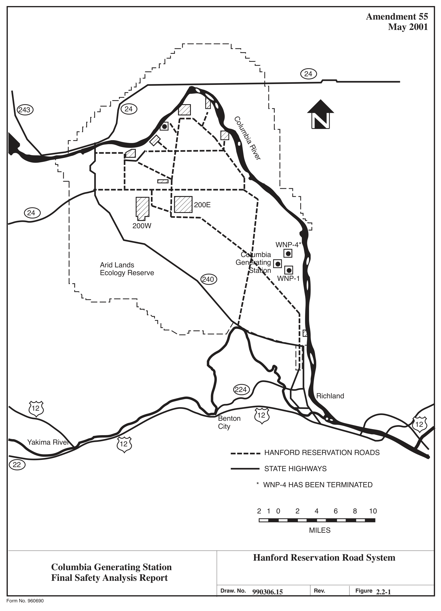
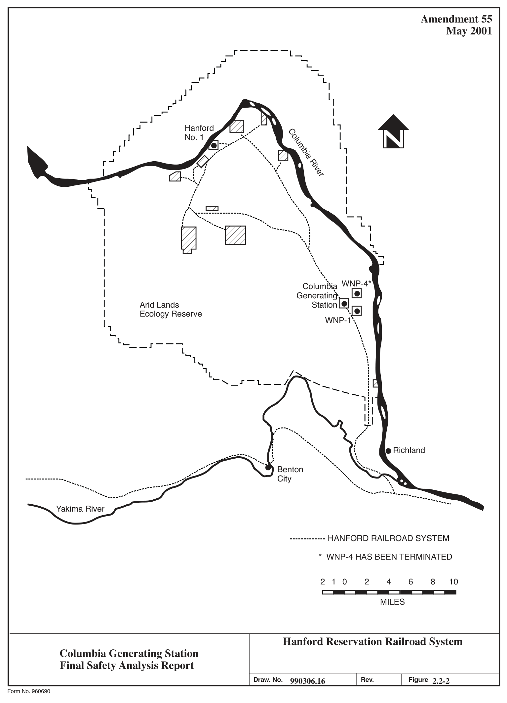
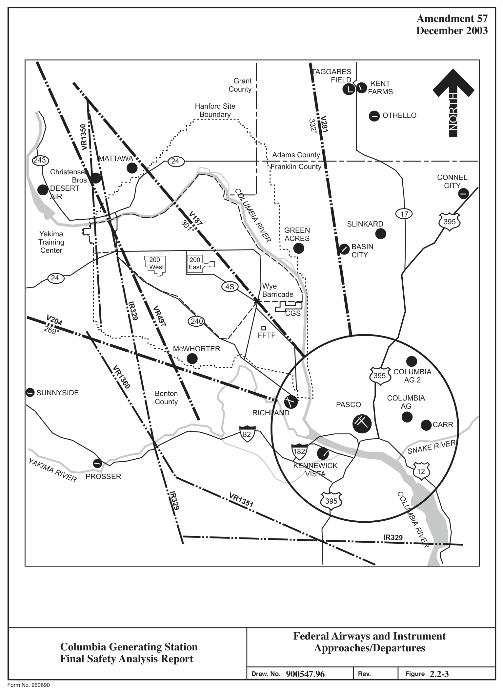

# 2.2 Nearby Industrial, Transportation, And Military Facilities

> Columbia Generating Station FSAR — Chapter 02: Site Characteristics
> Source: `02_chapter-402-659.pdf`, PDF pages 32–50 (of 258)
> Amendment 67 compilation (individual pages carry varying amendment dates)

---
<!-- p.32 -->
### 2.2 NEARBY INDUSTRIAL, TRANSPORTATION, AND MILITARY FACILITIES
This section describes the industrial, transportation, and military installations and operations in the vicinity of the site which may have a potential effect on the safe operation of Columbia Generating Station (CGS).

#### 2.2.1 LOCATION AND ROUTES
There are no military bases, missile sites, manufacturing plants, chemical plants, commercial chemical storage facilities, or airports within a 5-mile radius of the site. A security barrier completely surrounds the station and its major supporting facilities to keep unauthorized vehicles a safe distance from critical structures.

According to the Richland Operations Office of the Department of Energy (DOE)
(Reference 2.2-1), there are no plans for petrochemical storage facilities, airports, oil and gas pipelines, or petrochemical tank farms on the Hanford Site. Plans for modifications to or new radiological material treatment or storage facilities are discussed in Section 2.2.2.

As shown in Figure 2.1-3, the following facilities are located at or near the CGS site:

 Energy Northwest Plant Engineering Center,  H. J. Ashe Substation,  DOE Fast Flux Test Facility (FFTF),  WNP-1 and WNP-4 sites,  DOE 618-11 (Wye) radioactive waste burial ground,  Permanent meteorological tower,  Independent Spent Fuel Storage Installation (ISFSI), and  Hydrogen Storage and Supply Facility.

Other facilities that are located within a 5-mile radius of the site include:

 The Plant Support Facility/Emergency Operation Facility which is located 0.75 miles southwest of CGS on Energy Northwest property,

 The Benton Substation which is located 3 miles east-southeast of CGS on DOE property,

 The Laser Interferometer Gravitational-Wave Observatory (LIGO) which is located approximately 3.3 miles west-southwest of CGS on DOE property, and

 The DOE 618-10 (300 North) radioactive waste burial ground which is located approximately 3.5 miles south of CGS on DOE property.

<!-- p.33 -->
Transportation needs of CGS can be met by existing barge, rail, and highway facilities.
Barges of up to 3000 tons capacity can be accommodated on the Columbia River within the Hanford Site. A barge unloading facility 9 miles south of the plant was used for delivery of large construction items for the DOE FFTF and Energy Northwest nuclear projects. These materials were transported by truck or rail to the construction sites from the Port of Benton landing.

The CGS site is serviced by a two-lane paved access road connected to Hanford Site Route 4, which is a paved four-lane major artery located 1.6 miles west of the station. Route 4 is part of the DOE road system. The DOE-owned road system connects the areas of the Hanford Site with paved two-lane and four-lane primary roads, secondary gravel roads, and unimproved roads. State Highway 240 traverses the Hanford Site from the southeast to the northwest. The highway passes within about 7 miles of CGS in the southwest quadrant. The highway connects into State Highway 24, which goes west to Yakima, Washington, and across the Vernita Bridge on the Columbia River 22 miles to the northwest (see Figure 2.2-1).

The Hanford Site (DOE) railroad system (see Figure 2.2-2) connects with commercial rail systems in Richland and Kennewick, Washington. Railroad operations that pass through CGS property are restricted to only those trains that have been authorized by Energy Northwest Security. The rail line is physically blocked at the two points where the plant vehicle barrier crosses the tracks.

Heavy barge traffic north of the Port of Benton dock is not feasible because the river channel is too shallow and the current is too swift. The environmental impact and economic cost of constructing a new barge slip at some upstream location and channeling the river cannot presently be justified with the availability of land transportation between the Port of Benton facility and the Hanford Site.

Making the Columbia River navigable for barges from north of Richland to Wenatchee would result in barge traffic past the CGS site at River Mile 352. However, this situation would not likely occur. Locks or other lift facilities would have to be constructed at the Priest Rapids, I Wanapum, and Rock Island Dams. Furthermore, in 2000, a presidential executive order created the Hanford Reach National Monument, protecting the 51-mile Hanford Reach of the Columbia River (Reference 2.2-2). The protected area includes a ¼-mile-wide corridor on the west side of the river in the vicinity of CGS.

Airports, military facilities, low-level Federal airways, and airport instrument approaches in the vicinity of CGS are discussed in Section 3.5.1.6 and shown in Figure 2.2-3.

An explosives and ordinance test site operated by Pacific Northwest National Laboratory approximately 13 miles northwest of the site was abandoned in mid-1975 (Reference 2.2-3).
Explosives for operations such as quarrying or seismic studies on the Hanford Site are brought to the blasting site as needed and unused quantities are removed. Normally the only explosives

#### LDCN-01-055, 03-023
<!-- p.34 -->
stored on the Hanford Site are small arms ammunition for use by the security patrols. A small arms firing range used for training by the DOE security patrol is located 8 miles due south of the plant (Reference 2.2-3). Another range, used by Energy Northwest security personnel, is located on Energy Northwest lease property.

#### 2.2.2 DESCRIPTIONS
##### 2.2.2.1 Description of Facilities
Energy Northwest’s Plant Engineering Center is located west of the CGS turbine generator building as shown in Figure 1.2-1. It is a two-story, 100,000 ft2 facility designed to house approximately 470 CGS plant staff personnel.

The H. J. Ashe Substation is located approximately 0.5 mile north of CGS and is operated by the Bonneville Power Administration as part of its transmission system.

The Energy Northwest permanent meteorological tower is located less than 0.5 mile west of the plant site. The tower is automated so that the only personnel at the tower are those required to make adjustments to the instruments or to perform repairs to the system. There are no permanent personnel at the facility.

The ISFSI is located immediately north-northwest of the plant. Confinement of all radioactive materials at the ISFSI is provided by the required use of NRC certified spent fuel storage casks listed in 10 CFR 72.214. The ISFSI storage cask system consists of an inner stainless steel multi-purpose canister (MPC) and an outer storage overpack. The MPC contains the spent fuel. It is a welded pressure vessel with no bolted closure or mechanical seals. Primary closure welds are examined and leakage tested to ensure their integrity. The MPC redundant closures are designed to maintain confinement integrity during normal conditions of storage, and off-normal and postulated accident conditions. The outer storage overpack is fabricated from concrete and structural steel components that are classified as important to safety. A fully loaded spent fuel storage cask weighs approximately 185 tons. The spent fuel loaded storage casks are located within the Energy Northwest ISFSI protected area which is surrounded by a fence and topped with barbed wire. The ISFSI access gates are locked except when in use.

The Hydrogen Storage and Supply Facility is located 0.6 miles south-southeast of the plant site. The facility is part of a hydrogen water chemistry system to prevent and mitigate intergranular stress corrosion cracking in reactor internal structures and piping welds. The facility consists of a fenced gravel yard with concrete pads constructed to accommodate a liquid hydrogen tank, nitrogen tank, gaseous hydrogen tubes, and all supporting piping and equipment necessary to supply CGS with gaseous hydrogen. The liquid and compressed gases are delivered to the facility by truck.

<!-- p.35 -->
Within the exclusion area radius of 1950 m is Energy Northwest’s 1250-MWe WNP-1 project.
Construction of the PWR plant, located 1500 m (4925 ft) east-southeast of CGS, was suspended in April 1982. In May 1994 the Energy Northwest Board of Directors voted to terminate WNP-1. The construction of twin unit WNP-4, located 1250 m (4100 ft)
east-northeast of CGS, was terminated in January 1982. These projects have a separate access road that ties into the Hanford Site Route 4, 1.6 miles south of the CGS access road. Support activities at either the WNP-1 or WNP-4 sites do not interfere with operation of CGS. These may include activities associated with site restoration and economic development (such as leasing of excess facilities for office space and manufacturing). Within the exclusion area, Energy Northwest has the authority to determine all activities within the meaning of 10 CFR 100.3(a), including the authority to remove all personnel and property from the area.

The Laser Interferometer Gravitational-Wave Observatory (LIGO) is located approximately 3.3 miles west-southwest from the plant site. The mission of this research facility is to observe gravitational waves of cosmic origin. The facility houses laser interferometers, consisting of mirrors suspended at each of the corners of an L-shaped vacuum system measuring 2.5 miles on a side. The materials and activities at this facility do not impact the operation of CGS.

As discussed in Section 2.1.1 and shown in Figure 2.1-1, CGS is located on the DOE Hanford Site. In reviewing the plant site and the vicinity for potential external hazards or hazardous material, the Hanford facilities currently operating, recently operating, or with the potential for operating were screened. The facilities discussed below are those believed to pose the most risk to the safe operations of CGS. The safety analysis reports and accident analysis prepared for those facilities were reviewed to determine possible hazards. No accidents evaluated present a physical challenge to the CGS buildings. Releases with the potential to impact the operation of CGS were radioactive particulate that would be effectively mitigated within General Design Criterion (GDC) 19 limits by the control room high-efficiency particulate air
(HEPA) filters. Considered but not included were the 200 East Burial Grounds, the Critical Mass Laboratory, the Liquid Effluent Retention Facility, and the Effluent Treatment Facility in the 200 East Area. In the 200 West Area, the T Plant, U Plant, Reduction-Oxidation Plant, and the 222-S Laboratory were considered but not included. These facilities have insufficient radiological or toxicological inventories in a dispersible form to represent a risk to CGS operation. The specific facilities included are discussed in Table 2.2-1.

<!-- p.36 -->
Three DOE facilities are located within a 5-mile radius of the plant site. These are the Fast Flux Test Facility (FFTF) and two radioactive waste burial grounds. The specific hazards associated with these facilities are summarized in Table 2.2-1 and the specific activities are listed below:

 The FFTF is a deactivated sodium cooled breeder reactor located approximately 3 miles southwest of CGS. All fuel has been removed and shipped to the Idaho National Laboratory. All sodium has been removed, solidified, and is stored on-site. The facility has been placed in a long-term, low-cost surveillance and maintenance condition.

 The 618-10 (300 North) Waste Burial Ground is approximately 3.5 miles south of CGS. DOE has initiated remediation activities at the site.

 The 618-11 (Wye) Waste Burial Ground is directly west of CGS, outside of Energy Northwest leased land, but within its 1950-meter exclusion area radius and security perimeter. The site received low- to high-activity waste, fission products, some plutonium-contaminated waste, and non-radiological hazardous waste from March 1962 to December 1967 from the Hanford 300 Area. The waste is buried in 3 trenches,

## 50 Vertical Pipe Units (VPUs), and four caissons. The site was covered with an
overburden of soil when it was closed. The surface was stabilized in 1982 with an additional 2 ft of soil. Since surface stabilization, activities at the site have been limited to monitoring and surveillance. DOE completed non-intrusive surveillance and characterization activities at the site in 2011 to obtain data information and information for planning remediation activities.

The DOE 300, 200 East, and 200 West Areas are located within a 10-mile radius of the site.
The current waste management activities (storage, disposal, and treatment) conducted in these areas are discussed in Table 2.2-1. The 300 Area is approximately 7 miles southeast of CGS.
The only hazard presented to CGS from this site is from the spent nuclear fuel and other radioactive material stored there. There is an unknown quantity of miscellaneous reactor fuel material in the 300 Area. This quantity is not publicly available information.

The DOE 200 East and 200 West Areas are approximately 10 miles northwest of CGS.
Originally these facilities were constructed to support the extraction of weapons grade plutonium for the defense program. However, as the Hanford mission has changed from production to environmental cleanup, so has the purpose of the facilities discussed. This change in mission has, in some cases, resulted in a change in the hazards presented to CGS plant site and personnel.

<!-- p.37 -->
A private (non-DOE) low-level radioactive waste disposal area is adjacent to 200 East Area.
There are also plans to build private waste vitrification facilities adjacent to 200 East. These facilities are also discussed in Table 2.2-1.

Several plutonium production reactor facilities are located approximately 20 miles northnorthwest of CGS. All of the reactors were water cooled, graphite moderated. The last operating reactor, the N Reactor, was permanently shut down in 1991. The N Reactor also provided steam for the Energy Northwest Hanford Generating Station until 1987. The fuel has been removed from the reactors for storage or treatment. The current activities at these reactor sites are also discussed in Table 2.2-1.

The nearest petroleum product storage tanks are located 22 miles southeast of the site:
approximately 23 million gal capacity at the Chevron Pipeline Company and approximately 20 million gal capacity at the Tidewater Barge Lines.

##### 2.2.2.2 Description of Products and Materials
The existing Hanford Site railroad track (owned by the DOE and operated by a private contractor in support of the Hanford Operations), and the CGS, the WNP-1, WNP-4, and the FFTF railroad spurs all run within the exclusion area of the plant site. Shipments of large quantities of hazardous materials on this track that existed during initial licensing of CGS are no longer made (Reference 2.2-4).

The DOE has no plans for railroad shipments of explosives in the foreseeable future. However the DOE’s Richland Operations Office has agreed to notify Energy Northwest prior to transporting any explosive shipments of more than 1800 lb past CGS (Reference 2.2-5).
Energy Northwest will provide an analysis to the NRC of the potential consequences prior to the start of such shipping (Reference 2.2-6).

Hazardous material is also transported on Hanford Route 4 by DOE. Chlorine is the only material of concern transported on Route 4 with the potential for impacting CGS operation.
Section 6.4.4.2.1 provides additional information on control room habitability assessments for CGS.

The Yakima Training Center, a sub-installation of Fort Lewis, is 30 miles northwest of the site. The center consists of 327,000 acres. The center provides training facilities and logistical support and it is used for firing of all types of ordnance, both in a direct mode and by indirect artillery and mortars. Weapons to 155mm are fired. This type firing occurs frequently. Other types of live ordnance use at the center include aerial delivery by high performance aircraft of ordnance to include 2,000-lb bombs, helicopter weapons which include automatic weapons and

<!-- p.38 -->
2.75-in. folding fin rockets, and anti-aircraft missiles. These latter activities are significant as to occurrence. The majority of the ordnance impacts a 20,000-acre area which is generally located in the central portion of the center. All activities are confined to the geographical limits of the center and/or its restricted air space unless special arrangements are made with affected agencies. Mechanized units (i.e., tanks and armored personnel carriers) from Fort Lewis and reserve components conduct extensive maneuvers on all accessible areas of the Training Center and use specially designed ranges to practice firing their weapons. Infantry and engineer units that support the mechanized units also train at the center. Training activity is greatest from March to November. War games sometimes involve troop and equipment deployment at the Richland Airport and along Highway 243 west of Vernita Bridge.
Helicopters may fly near the Hanford Site, or military vehicles may travel over Highway 240
(Reference 2.2-7).

##### 2.2.2.3 Pipelines
There are no commercial oil or gas pipelines in the vicinity of CGS. The nearest major natural gas transmission pipeline to the site is about 12 miles. A 20-in. gas transmission line of the Northwest Pipeline Corporation is located east and essentially parallel to U.S. Highway 395 between Pasco and Ritzville, Washington. A second pipeline system consisting of parallel 36-in. and 42-in. lines, owned by Pacific Gas Transmission Company, passes through Wallula, approximately 24 miles from the site (Reference 2.2-8). These distances eliminate any potential hazard to plant operations due to a natural gas fire or explosion. The Energy Northwest Hydrogen Storage and Supply Facility is located 0.6 miles south-southeast of the plant and is connected to the plant with a 2-in NPS gas pipeline. The pipeline runs north from the facility approximately 400 ft east of the plant and then turns and runs west approximately 400 feet north of the plant then south approximately 200 ft west of the plant to its connection point on the west side of the Turbine Building. Fire and explosion risks to the plant involving this pipeline are discussed in Appendix F and Section 3.5.1.5.

##### 2.2.2.4 Waterways
Makeup water inlet structures are located in the Columbia River 315 ft from the shoreline at low river flow (36,000 cfs; el. 341.73 ft) at river mile 351.75.

A significant amount of Columbia River barge traffic moves as far upstream as the Ports of Pasco and Kennewick. Also, a docking facility established by the Port of Benton in North Richland (approximately 9 miles downstream of the CGS site) is accessible by barges with a maximum 16 ft of draft (normally 2500 to 3000 tons). The first use of this facility was in April 1973 when the FFTF reactor vessel was off-loaded. Traffic to the North Richland dock is very infrequent in comparison to that in Pasco and Kennewick due to the lack of large industrial concerns in the region between Richland and Priest Rapids Dam. This facility is most often used to off-load dismantled nuclear components. On several occasions in the past,

<!-- p.39 -->
lightly loaded barges have transported material to the vicinity of the Hanford Site. This required maintenance of an adequate flow from Priest Rapids Dam during the transit period.

##### 2.2.2.5 Airports
Two commercial airports are within 20 miles of CGS. The closest is Richland Airport 11 miles south of the plant. This general aviation airport has two 4000-ft runways, one with a 010/190 orientation and the other with a 070/250 orientation. Visual flight rule landings are standard for Federal Aviation Administration (FAA) non-control-tower airports.

The Tri-Cities Airport 17 miles southeast near Pasco is the largest airport within 40 miles.
The FAA operates the air traffic tower and airport radar approval control facility. The airport has two 7700-ft crossing runways with 120/300 and 030/210 orientations. The latter has a 4430-ft parallel runway. Runway 30 has a very high frequency omnirange (VOR) instrument approach and Runway 21R has an instrument landing system and is an instrument approach runway.

Information relative to the flight paths and activity at these two commercial airports, the Yakima Training Center, and the nearby private airstrips is discussed in Section 3.5.1.6.

##### 2.2.2.6 Projection of Industrial Growth
There is no projected growth of waterway traffic nor plans for oil and gas pipelines within 10 miles of CGS.

#### 2.2.3 EVALUATION OF POTENTIAL ACCIDENTS
##### 2.2.3.1 Determination of Design Basis Events
Energy Northwest has investigated the resistance of plant structures to explosions. The reactor building is a reinforced-concrete structure up to the refueling floor and is designed to withstand the worst probable combination of wind velocity and associated pressure drop due to a design basis tornado. A differential pressure of 3 psi between the exterior and interior of the building is also considered in the design. At its nearest point, the railroad is 510 ft from the reactor building.

From the above criteria, it has been determined that the reactor building can resist an explosion of 20,000 lb of dynamite on a railway car 510 ft from the reactor building. The performance of the reactor building structure for this blast loading condition will be similar to that for the

<!-- p.40 -->
original design basis tornado loading condition based on the 3 psi differential pressure used in the original tornado analysis.

In the unlikely event of an explosion or fire on the railroad affecting the 115-kV shutdown power supply, the 230-kV power supply or the diesel generators would fulfill that function.

It is extremely unlikely that an explosion or fire on the mainline railroad would compromise the safe shutdown of the facility. As noted in Section 2.2.2.2, DOE has no plans to ship explosives on the railroad, and the agency will notify Energy Northwest prior to the shipment of explosives in a quantity greater than 1800 lb. Energy Northwest Security controls access to the rails that pass near the plant. The only explosives on the Hanford Site are small arms munitions. As described in Section 2.2.2.2, this represents no hazard to the operation of CGS.
I The Yakima Training Center does not endanger the site. Hydrogen gas stored in the gas bottle storage building and in a trailer parked adjacent to the gas bottle storage building will not pose any fire or explosion problem because of the light weight properties and dispersal qualities of the gas and the distances (approximately 400 ft) between the storage areas and any I safety-related equipment. Hydrogen gas stored at the Hydrogen Storage and Supply Facility
(HSSF) and transported to the plant by pipeline does not pose a significant fire or explosion risk to the plant as discussed in Appendix F and Section 3.5.1.5. Habitability considerations for the control room and quantities of hydrogen gas stored in/adjacent to the gas bottle storage building and at the HSSF are discussed in Section 6.4.4.2.3.

Table 2.2-1 summarizes the potential events at the Hanford Site facilities that could present a radiological or chemical hazard or hazardous situation to the continued safe operation of CGS.
The cesium and strontium capsules stored at the Waste Encapsulation and Storage Facility
(WESF), the fuel stored at the K Basins, and the high level waste stored in the tank farms present contributions to risk at CGS due to presence of 137Cs, 90Sr, and 241Am. However, based on consideration of the radionuclide inventory at risk, the ability to transport this inventory, and the proximity of the storage facility, the risk is dominated by the inventory stored at WESF. The probability of the loss of cooling in the capsule storage pool is extremely low, but the potential dose to unprotected CGS personnel due to the release is significant. Any required evacuations would be performed as discussed in the Emergency Plan. The design basis accident at WESF would not result in a condition at CGS which would challenge the criteria established in 10 CFR 100.

In each event evaluated, the radiological dose resulting from particulate releases would be adequately filtered by the control room HEPA filters, mitigating any challenge to the habitability of the control room. None of the facilities present a chemical exposure risk to CGS. Radiological exposures for postulated events on the Hanford Site are characterized by the contribution from gaseous radionuclides because of the short half-life of 131I and because the other noble gases were released during the spent fuel processing.

<!-- p.41 -->
The Yakima Training Center, discussed in Section 2.2.2.2, is used for military maneuvers and weapons training and is the only significant military activity in the vicinity of the Hanford Site.
I The only weapon currently in use at the Yakima Training Center known to present a hazard to the Hanford Site is the multiple launch rocket system (MLRS). With a range in excess of I 25 miles, the MLRS could potentially impact the CGS site. However, the MLRS is only fired from the perimeter of the Yakima Training Center into a centrally located impact zone and is only fired with dummy warheads. Given this information, additional safety features, and the administrative controls in place at the Yakima Training Center, a weapons accident having an impact on CGS is very improbable.

As stated in Section 2.2.2.1, confinement of all radioactive materials at the ISFSI is provided by the required use of NRC certified spent fuel storage casks listed in 10 CFR 72.214.
Pursuant to the 10 CFR 72.212 report, evaluations performed in support of the ISFSI have demonstrated the reactor site-specific parameters are bounded by the safety analysis for the generically approved cask. Accordingly, activities associated with the facility do not adversely impact operation of CGS (Reference 2.2-10).

Brush fires have occurred on the Hanford Site and have presented no potential hazard to existing facilities. Areas adjacent to CGS major buildings and auxiliary facilities are maintained to prevent weed growth by landscaping, gravel, ground cover, and weed control spraying. The Hydrogen Storage and Supply Facility (HSSF) is landscaped with gravel beyond the perimeter of the site, exceeding the code required clearance distance, to keep the area free from dry vegetation and combustible materials. These or similar methods of weed control minimize brush fire hazards to CGS facilities.

The potential effects of fires that involve materials used in the operation of the plant are discussed in Appendix F.

The formation of unconfined vapor clouds caused by the accidental release of flammable or toxic liquids or vapors stored at the plant site is discussed in Section 6.4 and addressed by the Emergency Plan.

The non-safety-related makeup water intake consists of two sets of paired perforated pipe sections. One set is capable of supplying the full makeup water requirements of the plant.
Extreme low river flow (36,000 cfs) will provide about 0.5 ft of water over the top of the intake pipes. The probability of damage to both sets of intakes as a result of a pleasure boat or barge accident is extremely remote given the infrequency of both extreme low flows and large boat and barge traffic. In the unlikely event that such an accident might occur, destruction of the makeup water intake structure would be comparable in effect to loss of offsite power to the makeup water pumps. The Seismic Category I spray ponds provide for 30-day cooling without makeup. This is ample time to restore makeup from either the river or wells.

<!-- p.42 -->
There are no upstream industrial facilities for which waterborne deliveries of significant quantities of petroleum products, corrosive chemicals, or other hazardous materials are expected. Fuel oil, diesel oil, acids, and caustics are stored at the N-Reactor site. The oil storage facilities are protected by dikes, and the chemical storage facilities are far enough from the river to avoid direct discharge. Thus, there is no possible hazard to the plant due to spillage of such materials into the river. There are no upstream releases which may be corrosive, cryogenic, or coagulant.

##### 2.2.3.2 Effects of Design Basis Events
As discussed in Section 2.2.3.1, the activities of nearby industrial, transportation, and military facilities will have no adverse effect on the plant.

#### 2.2.4 REFERENCES
2.2-1 Holmes, D. B., Energy Northwest, personal communication with Steve Burnam, Site Infrastructure Division, Department of Energy, July 31, 1998.

2.2-2 Presidential Proclamation 7319, Establishment of the Hanford Reach National Monument, 65 FR 37253, June 9, 2000.

2.2-3 Chasse, J. P., Energy Northwest, personal communication with B. J. Rokkan, Safeguards and Security Division, DOE, Richland Operations Office, December 6, 1977.

2.2-4 Note, D. A. Marsh, Westinghouse Hanford, to D. E. Larson, Supply System, dated January 22, 1993.

2.2-5 Memorandum, C. A. Hansen, Assistant Manager for Waste Management, DOE-RL to Alice Q. Murphy et al., 98-WPD-032, February 20, 1998.

2.2-6 NUREG 0892, Safety Evaluation Report Related to the Operation of WPPSS Nuclear Project No. 2, Section 2.2.1, March 1982.

2.2-7 Arbuckle, J. D., Energy Northwest, personal communication with J. Reddick, Executive Officer, Yakima Training Center, July 29, 2003.

2.2-8 Hosler, A. G., Contact with Local Organizations to Support CSB SAR Chapter 1 (Memo 042AGH.96 to Canister Storage Building Report File), Science Applications International Corporation, May 6, 1998.

<!-- p.43 -->
2.2-9 Deleted.

2.2-10 Energy Northwest, Independent Spent Fuel Storage Installation 10 CFR 72.212 Evaluation, Docket Number 72-35, Revision 1, September 2002.

<!-- p.44 -->
passive design feature.
Ground is credited for project controls. The reducing releases and by distance (>5 km) Waste Burial Ground 618-11 Waste Burial effectively mitigated effectively mitigated effectively mitigated Impact on CGS Particulate release, Particulate release, covering the VPUs by credited 618-11 and caissons in the Particulate release, postulated for this is designated as a soil overburden No missiles are by distance event.

concentration of 4.6 x 10-3 mg/m3 at 24-hr dose at 4.5 mi = 0.26 mrem less than 0.1 rem; beryllium oxide explosion: control room doses are 100 m from 618-11 site boundary Caisson penetration with fire and 1) 180,000 lb sodium spill - 2-hr Caisson penetration with fire — dose at 1.5 mi = 0.015 mrem, Design Basis Event unmitigated dose at 5 km = 10.2 mrem Hanford Site Nuclear Facilities hazardous materials bounded Cs-137, Sr-90, and Pu-239 inventories, primarily Table 2.2-1 Activated solid sodium and non-radiological Hazard Radioactive waste Radioactive waste by beryllium

wastes buried in caissons or wastes and non-radiological high-level solid radioactive hazardous materials buried high-level solid radioactive Deactivated sodium cooled Disposal site with broad Disposal site with broad Description spectrum of low- to spectrum of low- to in caissons or pipe breeder reactor pipe

Categorization for the 618-10 Maintenance Plan for FFTF, Burial Ground Remediation, Waste Burial Grounds Basis for Interim Operation, Rev.
DOE 618-11 (Wye) Waste Rev. 0, DOE/RL-2009-26 DOE 618-10 (300 North)
Ref: 618-10 and 618-11 Rev.2, February 2011, Fast Flux Test Facility Ref: Surveillance and Waste Burial Ground Ref: Final Hazard Facility Burial Ground 1, WCH-183

#### WCH-390
(FFTF)

<!-- p.45 -->
mitigated by distance mitigated by distance effectively mitigated Impact on CGS Particulate release, Particulate release, Particulate release by distance

24-hr dose of 0.31 rem @12,500 m Flooding cell 291-B HEPA filters - Design basis earthquake, dose @ 8-hr dose of 15.2 rem @550 m 0.368 rem max. public dose Design Basis Event 100 m - 1.9 rem; 12 km - Design basis earthquake, 7.4 x 10-4 rem Hanford Site Nuclear Facilities (Continued)
interstitial and pooled liquids SSTs contain combinations Stored SNM, and residual inventories on cell filters plutonium contamination DSTs contain liquid and of sludge, saltcake, and slurry waste with small Table 2.2-1
(137Cs, 90Sr, and 241Am) Residual plutonium and uranium contamination Residual radionuclide Hazard amounts of sludge

149 single shell tanks (SST) Associated support facility:
chemical wastes storage in Process to remove cesium and mixed waste handling and 28 double shell tanks stabilization, radioactive Currently shut down, in deactivated, currently in SNM, reactive material
(DST) in 12 tank farms Receipt and storage of Mixed radioactive and decommissioning and Description and strontium from maintenance mode radioactive waste, 242-A-Evaporator surveillance and decontamination preparation for Ref: Tank Waste Remediation Plant Final Safety Analysis Plutonium Finishing Plant Ref: Plutonium Finishing System (TWRS) Facilities Tank Waste Remediation (PUREX). PUREX End System Basis for Interim

#### WHC-SD-CP-SAR-021
#### HNF-SD-WM-BIO-00,
Operation (BIO) 1997, State Basis for Interim HNF-SD-CP-15B-004 Ref: B Plant Basis for Plutonium-Uranium Interim Operation, Facility HNF-SD-BIO-003 Extraction Facility Operation, 1997, March 6, 1997, Report, 1995, Revision 0 B Plant
(Draft)
(PFP)

<!-- p.46 -->
potential evacuation of exposure mitigated by accordance with the HEPA filter system HEPA filter system HEPA filter system accordance with the accordance with the would protect CGS would protect CGS Impact on CGS would protect CGS limits of GDC 19 limits of GDC 19 limits of GDC 19 other personnel Control room HEPA filters; control room control room operators, in operators, in operators, in control room None

an accident. Releases are projected accident. Releases are projected to limit to less than 5 rem/event in an limit to less than 5 rem/event in an accident. Releases are projected to limit to less than 25 rem/event in Capsule rupture following loss of water from storage pool - 24 hr Requirements for authorization Requirements for authorization Requirements for authorization Design Basis Event to be airborne particulate. exposure to public, 9 rem be airborne particulate.
be airborne particulate No credible event Hanford Site Nuclear Facilities (Continued)
High level radioactive waste water-filled cooling basin 2100 metric tons of spent monitored as required by Low-level buried waste, strontium fluoride salts, Table 2.2-1 fuel, from production Cesium chloride and double-walled metal containers stored in Hazard encapsulated in Spray release NRC license reactors

Buried storage of low-level from MCOs in preparation for interim storage at CSB radioactive waste in lined cesium and strontium has multi-canister overpacks Storage of spent nuclear drying to remove water Conversion process for Vitrify low level, high fuel (SNF) from the K level, and transuranic Draining and vacuum Description Basins in sealed mixed waste containers
(MCO)
halted

for Interim Operation, 1997, Low-Level Waste Disposal Ref: Waste Encapsulation System- Project (TWRS-P) (private facilities, proposed H. J. Hatch, Flour Daniel and Storage Facility Basis Canister Storage Building H. J. Hatch, Flour Daniel Tank Waste Remediation for construction in 2000) Waste Encapsulation and Storage Facility (WESF)
Ref: DOE/RL-96-0006

#### HNF-SD-WM-BIO-002
Cold Vacuum Drying Ref: Letter; DOE to Hanford, 28 May 97 Ref: Letter; DOE to Hanford, 28 May 97 Facility Facility (CVDS)
Site (Private)
(CSB)

<!-- p.47 -->
Impact on CGS None None None None

fuel. (Bounding event; but transfer transfer cask containing reactor Dropping and overturning of a is administratively prohibited)
Design Basis Event No credible event No credible event No credible event Hanford Site Nuclear Facilities (Continued)
falls and electric shock. No falls and electric shock. No falls and electric shock. No Approximately 2100 metric The onsite hazards involve personnel injury, primarily ton inventory of irradiated The onsite hazards involve personnel injury, primarily The onsite hazards involve personnel injury, primarily Table 2.2-1 significant offsite risks significant offsite risks significant offsite risks Hazard reactor fuel

graphite-moderated reactors graphite-moderated reactors graphite-moderated reactor Single-pass, water-cooled, Single-pass, water-cooled, Storage basins for spent decontamination and with fuel assemblies Description fuel, some severely decommissioning A pressure tube, water-cooled, removed for degraded

N reactor (shutdown since Reactors (shutdown since K East and West reactors Vol. 1. and BHI-00866, B, C, D, DR, F, and H K East and West Basins
(shutdown since 1971)
Ref: WHC-EP-0619, Ref: WHC-EP-0619, Ref: WHC-EP-0619, Ref: WHC-EP-0619, 1987) and N Basin Facility Vol. 1. Vol. 1. Vol. 1.
Rev 0 1969)

<!-- p.48 -->

*figure on PDF page 48*

[Vector original (SVG, lossless): fig_page-48.svg](../figures/fig_page-48.svg)

<!-- labels/text on this figure page -->
Amendment 55 May 2001 _r-----L- ...1 ...I L.
r- rJ 0 24
I I
I, 24 243
I Columbia River I, I I I I I I
200E 24 I I 200W I I WNP-4* I Columbia I Generating I Arid Lands Station I Ecology Reserve
WNP-1 240
1,
....
t._ r--- L ...
--
1..., 7L
..... ,_r-t __ /.
224 Richland 12 12 Benton
12 City
Yakima River 12
HANFORD RESERVATION ROADS
22
STATE HIGHWAYS
------ * WNP-4 HAS BEEN TERMINATED
2 1 0 2 4 6 8 10
MILES
Hanford Reservation Road System Columbia Generating Station Final Safety Analysis Report Draw. No. 990306.15 Rev. Figure 2.2-1 Form No. 960690

<!-- p.49 -->

*figure on PDF page 49*

[Vector original (SVG, lossless): fig_page-49.svg](../figures/fig_page-49.svg)

<!-- labels/text on this figure page -->
Amendment 55 May 2001 _r---- ..J L..
J..J _r-r LI
'1 I ..
I, Hanford Columbia River ~,,,'
I No. 1 .......................
., .. --
.. .... .
....
I, ,,,..
,• ~
••• • I
• , rZl
--- ' : ' I ' I f .. # ., \ -• , 1 V I ;
\ •
• : I , \ , L.
I I \ I :"•· IZZJ 7
f •:-::::::::_-~----------------- •• .......
I
.................... \
\ : . ' ..
-- I ' I .., I ·1... ..
I .J \ I
.. \ ....
I WNP-4*
Columbia ....... [ii
I Generating
ti
I Arid Lands Station I Ecology Reserve
WNP-1
I,
....
t .... __ r---
L
- 1 !1 ' l:1 l:1 ~ ,' ,' ( Richland
•·. ·-..........
Benton
------------·-.... ............
City ·-·--
--------········----· --· ---· Yakima River
HANFORD RAILROAD SYSTEM
* WNP-4 HAS BEEN TERMINATED - ----- 2 1 0 2 4 6 8 10
MILES
Hanford Reservation Railroad System Columbia Generating Station Final Safety Analysis Report Draw. No. 990306.16 Rev. Figure 2.2-2 Form No. 960690

<!-- p.50 -->

*figure on PDF page 50*

[Vector original (SVG, lossless): fig_page-50.svg](../figures/fig_page-50.svg)

<!-- labels/text on this figure page -->
Amendment 57 December 2003
TAGGARES
FIELD Grant KENT County
FARMS
NORTH
Hanford Site Boundary
OTHELLO
V281 332°
VR1350
Adams County
MATTAWA 243
24 Franklin County Christensen
CONNEL
Bros.
CITY
DESERT
COLUMBIA RIVER
AIR
V187 17 395 301 SLINKARD GREEN ° Yakima
ACRES
Training
BASIN
Center CITY 200 200 West East 24 Wye 4S Barricade
IR329
VR497
CGS V204 240 269° FFTF
McWHORTER
VR1360
COLUMBIA
395 AG 2
SUNNYSIDE
Benton
••
COLUMBIA
County
PASCO AG
RICHLAND
CARR 82
182 ·,
KENNEWICK
.. ......
12 \
VISTA
PROSSER
IR329 ............................ . VR1351
395
• \ ··-
-··-··-
IR329
Federal Airways and Instrument Columbia Generating Station Approaches/Departures Final Safety Analysis Report 900547.96
2.2-3 Draw. No.
Rev. Figure Form No. 960690

