# 2.3 METEOROLOGY

> Columbia Generating Station FSAR — Chapter 02: Site Characteristics
> Source: `02_chapter-402-659.pdf`, PDF pages 51–190 (of 258)
> Amendment 67 compilation (individual pages carry varying amendment dates)

---
<!-- p.51 -->

### 2.3 METEOROLOGY
The italicized information, including associated tables and figures, is historical and was provided to support the application for an operating license.

#### 2.3.1 REGIONAL CLIMATOLOGY*
##### 2.3.1.1 General Climate
The site is located in a mid-latitude semi-arid (steppe) climatic region in the Lower Columbia Basin which is the lowest elevation of any part of central Washington. A major factor influencing this climatological region is its location in the continent, well away from the windward coast and protected to the west by the 4,000 to 7,000-ft average elevation Cascade Mountains. Dominant air masses affecting the region are of maritime polar origin as modified by the presence of these mountains. Modified continental tropical and polar air masses also periodically affect the climate. In winter, there is a succession of cyclones as the westerlies and the polar front prevail in these latitudes. The mountain barriers commonly induce these storms to occlude by delaying air mass movement. Fewer frontal passages occur during the summer months since subtropical oceanic high cells reach their highest latitudes thereby diverting cyclonic storms poleward. Along the eastern margin of the Pacific anticyclone, an out-flow of stable subsiding air brings distinctly drier conditions to the North American Pacific coast.

The regional temperatures, precipitation, and winds are greatly affected by the presence of the mountain barriers. The Rocky Mountains and ranges in Southern British Columbia are effective in protecting the inland basin from the more severe winter storms and associated cold polar air masses moving southward across Canada. Occasionally, an outbreak of cold air will pass through the Basin and result in low temperatures or a damaging spring or fall frost.
Maritime polar air traveling eastward from the coastal zone cools as it rises along the western slope of the Cascade Range. These orographic effects cause heavy precipitation on the windward and light precipitation on the leeward slopes. The prevailing westerly. winds are normally strongest during winter and spring due to the presence of cyclonic scale disturbances and associated frontal activity. During those months, foehn or chinook winds (a warm dry

* This section is based on records kept at the Hanford Meteorology Station (14 miles northwest of the site, elevation 733 ft MSL) from 1945 to 1980 (2) and 100-N area sites (1) (supplemented with precipitation and temperature data taken by U.S. Weather Bureau cooperative observers at a site about 25 miles north of the present station location during the period from 1912 to 1944 (2,3) and regional climatological data gathered during the period from 1931 to 1960). (4)
Other references are as indicated.

<!-- p.52 -->

wind on the lee side of a mountain range; the warmth and dryness of the air is due to adiabatic compression upon descending the mountain slopes) occur whenever cyclonic circulation is sufficiently strong and deep to force air completely across the cascades in a short period of time. At other times during the winter, warm front occlusions can force moist air over the Cascade Range. The mixing of this moist air with relatively cooler air in the Basin results in considerable cloudiness and fog. The percent of possible sunshine ranges from 20 to 30 percent in winter, 50 to 60 percent in spring and fall, and 80 to 85 percent in mid-summer.

Because the site is in the rain shadow of these mountains, annual average precipitation decreases from about 100 inches near the summit of the Cascades to about 6 or 7 inches in the Basin. Approximately 70 percent of the annual total precipitation occurs from November through April and about 10 percent occurs during July through September. Rainfall amounts are normally light in the summer and gradually increase in late fall, reaching a peak of about one inch each month in midwinter due to cyclonic storm and frontal activity. Rainfall amounts decrease in Spring, increase somewhat in June, and again sharply decrease in July. During mid-summer, it is not uncommon to have 3- to 6-week periods with trace rainfall. There are only two occurrences per year of 24-hour amounts of 0.50 inch or more, while occurrences of 24-hour amounts of 1.00 inch or more number only four in the entire 25 years of record (1946 to 1970). One of these was the record storm of October 1 through 2, 1957, in which rainfall totaled 1.08 inches in three hours, 1.68 inches in six hours, and 1.88 inches in twelve hours.
At the other extreme, there have been 81 consecutive days without measurable rain
(June 22 through September 10, 1967), 139 days with only 0.18 inch (June 22 through November 7, 1967), and 172 days with only 0.32 inch (February 24 through August 13, 1968).

About 45 percent of all precipitation during the months of December, January, and February is in the form of snow. Regional annual total snowfall amounts have ranged from less than 1/2 inch in 1957 to 1958 to 56.1 inches for the winter of 1992-1993; the annual average total is about 14 inches.

Snow rarely remains on the ground longer than two to four weeks or reaches a depth at any time in excess of four to six inches, as rapid melting, which often contributes to local stream flooding, can occur from rain or Chinook winds. The record greatest depth of 24.5 inches occurred in February 1916.

Thunderstorms have been observed in the area in every month except November. Although severe ones are rare, lightning strikes have occasionally ignited grass fires which burned thousands of acres of the Hanford Reservation and resulted subsequently in considerable wind erosion of soil. The most notable of these occurrences were in August 1961, July 1963, and July 1970, and August 1984.

The continental-type climate not only affects precipitation in the Basin but also results in wide ranges and variations in annual temperature conditions. While the regional annual average temperature is about 53°F, the coldest month, January, has a mean of about 29°F; the

<!-- p.53 -->

warmest month, July, has a mean of about 76°F. Although the presence of the cascades contributes to the wide differences in monthly average temperatures, other mountain ranges shield the area from many of the arctic surges, and half of all winters are free of temperatures as low as 0°F. However, six winters in 58 of record have contributed a total of 16 days with temperatures of -20°F or below; and in January to February 1950, there were four consecutive such days. There are ten days of record when even the maximum temperature failed to rise above zero. At the other extreme, in the winter of 1925 to 1926, the lowest temperature all season was +22°F.

Although winter minima have varied from -27°F to +22°F, summer maxima have varied only from 100°F to 115°F. However, there is considerable variation in the frequency of such maxima. In 1954, for example, there was only one day with a maximum as high as 100°F. On the other hand, there have been two summers (1938 and 1967) when the temperature went to 100°F or above for 11 consecutive days.

Although temperatures reach 90°F or above on about 56 days a year, there are only about seven annual occurrences of overnight minima 70°F or above. The usual cool nights are a result of gravity winds.

The channeling of air by the Cascade Mountains and surrounding terrain produces a prevailing WNW and NW regional flow. Local topographic features can cause other channeling effects and formation of local diurnal wind circulation systems which produce a greater degree of variability in winds at locations within the Basin. For example, the Columbia Generating Station (CGS) site experiences a bimodal wind direction distribution from approximately south and also northwest; at the Hanford Meteorological Station (HMS) about 14 miles northwest, the direction distribution displays a single peak at approximately WNW to NW (refer to 2.3.2).

Drainage (gravity) winds channeled by topographic features produce a marked effect on diurnal range of wind speed and cause the highest monthly average speeds of about 9 mph to occur during the summer months. In July, for example, hourly average speeds range from a low of 5.2 mph from 9 to 10 a.m. to a high of 13.0 mph from 9 to 10 p.m. In contrast, the corresponding speeds in January are 5.5 and 6.3 mph. These warm season diurnal winds, resulting from relatively cold air draining from the Cascade Mountains, occur in response to pressure gradients created between surface-heated warm, dry basin air and cooler air situated over the mountains and coastal region. This favors an outbreak of stronger winds during the afternoon and evening hours. Although the gravity wind occurs with regularity in summer, it is never strong unless reinforced by frontal activity. In June, the month of highest average speed, there are fewer instances of hourly averages exceeding 31 mph than in December, the month of lowest average speed. A complete summary of the monthly averages and extremes of climatic elements at the Hanford Reservation appears in Table 2.3-1.

<!-- p.54 -->

##### 2.3.1.2 Regional Meteorological Conditions for Design and Operating Bases
###### 2.3.1.2.1 Severe Weather Phenomena
2.3.1.2.1.1 Heavy Rain, Snow, and Ice. Glaze is a coating of ice, generally clear and smooth, but with some air pockets. It is formed on exposed objects by the freezing of super-cooled drizzle or rain drops. Glaze is denser, harder, and more transparent than either rime or hoar frost. Although the record shows an average of seven glaze days per year, many of these cause little or no inconvenience to the public. Two outstanding exceptions occurred on February 11 to 12, 1954, and on November 23 to 24, 1970. There was serious disruption to Hanford traffic in each instance although there was no known damage to transmission lines. In each instance, rising temperatures soon melted the ice.

Precipitation frequency (rain and snow), intensity, and quantity statistics are presented in Figures 2.3-1 and 2.3-2 and Tables 2.3-2 and 2.3-3. For the winter of 1992-93, the following snowfall records were set: greatest winter snowfall (56.1 inches); most days with greater than 1, 6, and 12 inches on the ground (71, 41, and 9, respectively); and greatest 24-hour snowfall
(10.2 inches) on February 18 and 19. Probable maximum precipitation is given in 2.4.3.1.

2.3.1.2.1.2 Thunderstorms and Hail. Thunderstorms may occur during any month of the year at Hanford. A thunderstorm day is one in which thunder is heard. If a thunderstorm should begin in late evening and last past midnight, it is counted as two thunderstorm days even though only one storm event occurred. Similarly, should there be two or more distinct thunderstorms in a day - and this sometimes happens - it is counted as a single thunderstorm day. The table below shows the monthly frequency of thunderstorms.

HMS THUNDERSTORM DAYS: 1945-1970

#### J F M A M J J A S O N D SUM
Total 0 1 7 18 53 64 46 54 24 5 0 0 272 Average 0 # # 1 2 3 2 2 1 # 0 0 11 % of 0 # 3 7 19 23 17 20 9 2 0 0 100 Total # = Less than 0.5

Although the table above shows 0 for the months of November through January, a thunderstorm occurred at HMS on December 22, 1971. In Richland, one occurred on January 18, 1953. However, the thunderstorm season essentially includes only the months of April through September. Although the average is eleven days per year, the number has varied from three to twenty-three. In June 1948, there were eight thunderstorm days during the month; and this record was repeated in August 1953. The records show that cold fronts probably constitute the greatest single cause of thunderstorms at HMS. During the years of 1947 to 1955, 43 percent of all thunderstorm days during the months of May through August

<!-- p.55 -->

were directly associated with cold frontal passages. On several occasions (notably on August 7, 1953), lightning has struck the HMS tower.

Peak gust data are not available for the 50-, 200-, and 400- ft levels prior to 1952. Of the 185 thunderstorm days occurring during the period of 1952 to 1970, the speed classification of peak gusts on these days is as follows:

Number of Cases % of Total mph 50 ft 200 ft 400 ft 50 ft 200 ft 400 ft < 21 18 9 5 10 5 3 21 -30 75 45 42 40 24 23 31 -40 63 80 73 34 43 39 41 -50 23 34 46 12 19 25 51 -60 4 11 12 2 6 8 61 -70 1 4 5 1 2 3 > 70 1 2 2 1 1 1 185 185 185 100 100 100

Precipitation was not measured during 1945 and 1946 in which 26 thunderstorm days occurred. During the period of 1947 to 1970, 246 thunderstorm days were recorded. The daily precipitation distribution during these days was as follows:

Amount - Inches Number of Cases % of Total None or trace 110 45 0.01 - 0.10 87 35 0.11 - 0.25 29 12 0.26 - 0.50 15 6 > 0.50 5 2 246 100

Precipitation intensities are defined in Reference 2.3-5.

The record for rainfall intensity during a thunderstorm is 0.55 inch in 20 minutes (1.65 inches per hour) on June 12, 1969. This storm included hailstones of 1/4-inch diameter.

Hail was reported on fourteen, or 5 percent, of the total thunderstorm days. Blowing dust or dust was reported on sixteen thunderstorm days and both hail and blowing dust or dust on six days.

Hail is a rare phenomenon at Hanford. For all years of record, hail has not occurred more than twice in any year. Of the 272 thunderstorm days from 1945 to 1970, hail was reported on fourteen or 5 percent of these days. Hail was also reported on two days without occurrence

<!-- p.56 -->

of either a cold frontal passage or a thunderstorm on the same day. The distribution by months of days on which hail occurred is as follows:

J F M A M J J A S O N D Total

#### I I I I I I I I I I I I I I
Number 0 1 1 4 2 1 2 2 1 0 0 0 14 % of Total 0 7 7 30 14 7 14 14 7 0 0 0 100

Where size was reported, all except two reports indicated sizes in the 0.2- to 0.3-inch range.
The exceptions were May 26, 1954, and July 1, 1955, when the size reported was 0.4 inch.

There is no known case of local damage from hail.

###### 2.3.1.2.1.3 Tornadoes

The State of Washington experiences, on the average, less than one tornado each year. Within a one hundred mile radius of the site, only fourteen tornadoes have been reported since 1916.
These tornadoes are listed in Table 2.3-4. Of these fourteen recorded tornadoes, only five had any damage associated with them. A more extensive survey of tornadoes in the three northwestern states (Washington, Oregon, and Idaho) was performed by Fujita (6). His results indicate that tornadoes and hailstorms in this area occur primarily in “alleys”. The locations of these “alleys” are shown in Figure 2.3-3 along with locations of tornadoes which have been recorded in the tri-state area during the twenty-year period from 1950 to 1969.

Jaech (7) has analyzed the data of Fujita (6) to determine the probability of a tornado striking the Jersey Nuclear Company Fuel Facility (now Siemens Power Corporation), which is located about eight miles from the site. His analysis estimates the probability of occurrence of a tornado in the vicinity of the Exxon site as six chances in a million during any given year or about one chance in four thousand during a forty-year plant life.

The peak tornado wind velocity estimated for the site is 214 mph (Reference 2.3-7). This includes an estimated maximum rotational and translational wind velocities (at a 95-percent confidence level). Daubek (Reference 2.3-8) estimates the maximum translational velocity to be 30 mph. The maximum pressure drop in the center of the tornado relative to the environment is estimated to be up to 1.5 psi (Reference 2.3-6).

These values are equal to or less than those tornado parameters listed for a Class III region
(which includes the site location) in Regulatory Guide 1.76, issued April 1974. Prior to the issuance of this guide, CGS was designed to withstand some of the most stringent NRC tornado criteria presented for a site located within a Class I region.

<!-- p.57 -->
A comparison between criteria used for CGS and those applicable to Class I and III regions are given below:

Design Basis Tornado Characteristics

Maximum Wind Rotational Translational Speed (mph)
Speed (mph) Speed (mph) Maximum Minimum Class I Region 360 290 70 5 Class III Region 240 190 50 5 CGS 360 300 60
-

Radius of Maximum Pressure Drop Rate of Pressure Rotational Speed (ft) (psi) Drop (psi/sec)
Class I Region 150
3.0
## 2.0 Class III Region 150
1.5 0.6 CGS 264 - 880
3.0
1.0

Wind and tornado loading criteria used in the CGS structural design are discussed in Section 3.3.

2.3.1.2.1.4 Strong Winds. The Hanford region experiences high wind speeds due to squall lines, frontal passages, strong pressure gradients and thunderstorms. The Hanford Reservation has experienced only one recorded tornado (June 1948) and has not been known to be affected by typhoons. No complete statistics are readily available which present frequency of occurrence of high winds produced or accompanied by a particular meteorological event.
However, the highest winds produced by any cause are tabulated for HMS in Tables 2.3-5 and
2.3-6. Figure 2.3-4 indicates the return probability of any peak wind gust, again due to any cause.

The speed-direction summary (Table 2.3-6) shows that daily peak gusts of at least 40 mph have occurred from all but four of the sixteen compass points indicated. The SW octant, however, accounts for 65 percent of such cases. The SSW octant accounts for 83 percent of daily peak gusts of 50 mph or over and 100 percent of those 60 mph or over. Since WNW and NW are the most frequently observed directions at HMS, they account for almost half of all daily peak gusts. However, less than 3 percent of these are at speeds of 40 mph or more. By contrast, 23 percent of daily peak gusts from the SSW and SW attain this speed. Although the winter season has a lower average wind speed than any other, it also has the greatest frequency of days with peak gusts 40 mph or over (10 percent). This compares with 8 percent for spring, 7 percent for fall, and 5 percent for summer. However, reflecting the frequent periods of stagnation in winter, this season also has the highest frequency of days with peak gusts under

Peak wind gust data associated with thunderstorm activity are given in 2.3.1.2.1.2.

<!-- p.58 -->

10 mph (16 percent). This compares with 10 percent for fall and 1 percent for spring. In summer, such days are virtually non-existent with only one being tabulated in 1,102 days of record. About 60 percent of the days from May through August experience drainage winds of at least 13 mph from the west direction for at least two hours daily during the period of 1600 to 2400 PST.

The annual extreme fastest mile of wind speed* for a given region has been commonly used as the best available measure of wind for design purposes (Reference 2.3-9). The standard reference speed level is normally chosen at the 30-ft elevation, and wind speed is assumed to vary with the one-seventh power of height.

All CGS structures have been designed to withstand a basic wind (fastest mile) velocity, including gusts of 100 mph at an elevation of 30 ft above the site grade. This design speed value is conservative for the CGS site since the 100 year return period peak gust as shown in Figure 2.3-4 at HMS is 86 mph at an elevation of 50 ft (as given in Tables 2.3-5 and 2.3-6 at that level peak gusts have not exceeded 80 mph during the period 1945 to present). The 100 year return period fastest mile of wind would be less than 86 mph since by definition gust velocity divided by an appropriate gust factor provides the velocity of the fastest mile of wind.
Although not recorded in historical records the 100 year fastest mile of wind can be expected to be in the range of 66 to 78 mph. These values are based on the application of gust factors of 1.3 and 1.1 (Reference 2.3-10) for gusts of one and 10 sec durations** respectively to the estimated historical value of 86 mph.

2.3.1.2.1.5 High Air Pollution Potential (APP) and Dust Storm Potential. Larson (11) has concluded that “consideration of the general weather parameters indicates a significantly high average annual APP over southeastern Washington.” Holzworth (12) has estimated that the mean maximum January mixing depth in the Hanford area is about 250 meters, which is nearly the lowest in the contiguous United States, and for July about 2,000 meters. Hosler (13) has indicated a significantly high frequency of low-level inversion in winter over this area - on the order of 43 percent with bases below 150 meters. The occurrence of very stable and moderately stable conditions between the surface and 60 meters in winter at the Hanford Meteorology Tower is 66.5 percent.

Stagnation is defined by Huschke (14) as “the persistence of a given volume of air over a region, permitting an abnormal buildup of pollutants from sources within the region”.
Defining the establishment of stagnation as an uninterrupted period of daily average wind speed of 5.0 miles per hour or less and/or a peak gust of 15 miles per hour or less, Jenne (15)

* Fastest mile of wind is generally defined as either the fastest speed associated with 1 mile of passing wind or fastest observed 1 minute wind speed.
** According to Huschke (Glossary of Meteorology, 1959), the duration of a gust is usually less than 20 seconds.

<!-- p.59 -->

compiled a 15-year summary of Hanford stagnation periods covering the months of November through February (1947-48 through 1961-62).

Both of the two most notable Hanford stagnation periods experienced during this time occurred in November and December 1952. The first period was from November 15 to December 3
(19 days). Then, after five days of ventilation, stagnation set in again December 9 and lasted through December 28 (20 days). Average wind speeds during the two periods were respectively, 2.6 and 2.9 miles per hour. Eleven days during the first period and eight during the second had peak gusts under 10 miles per hour. One day during the first period and two during the second had average speeds less than 1.0 miles per hour with peak “gusts” of 4 miles per hour. There were 13 days of fog in each period.

Although stagnation lasting for 20 days can be expected only one season in twenty, a 10-day stagnation period can be expected every other season. Only one season in three will fail to produce a stagnation period of at least eight days.

Air quality in the Hanford area, in terms of sulfur dioxide, nitrogen dioxide, and suspended particulates, is routinely measured by the Hanford Environmental Health Foundation. (18,29)

For the year 1971, SO2 measurement in Richland averaged less than 0.02 ppm. At other sampling stations, the concentrations were below the detection limit of 0.01 ppm. In 1974, all 24 hour sequential samples of SO2 measured in the vicinity of Richland, North Richland, and Hanford 300 Area had concentrations below the detection limit of 0.005 ppm which is 25% of the annual average ambient air standard of 0.02 ppm. The 1971 and 1974 measurements for NO2 and suspended particulates are shown below:

Air Quality Measurements-Annual Averages for 1971 and 1974 (18, 29* )
(these data are based on 24 hour integrated samples)

NO2
(pom)
No. of Location Samples Max. Min.
Avg.
Richland (747 49 6.8 0.06 0.86 Building)
0.019 <.001 0.005 Opposite 170 Richland
(Hobkirk Ranch) ( 78)
(0.022) (0.001) (0.006)
Opposite N. 157
3.0 <.001 0.024 Richland

* Concentrations in parentheses are for 1974.
** High value due to a local dust storm.

<!-- p.60 -->

(Gilliam Ranch) (130)
(0.020) (0.001) (0.006)
Opposite 300 170 0.025 0.001 0.005 Area
(Sullivan Ranch) ( 77)
(0.014) (0.001) (0.005)
Ringold 166 0.028 0.001 0.006
(Keys Ranch)
White Bluffs 149 0.028 0.001 0.006
(McLane Ranch)

Suspended Particulate
(µg/m+3)
No. of Location Samples Max. Min.
Avg.
Richland (747 Building) 42 440 25 120
(572)** (125) ( 8)
( 57)
Opposite Richland
-
-
-
-
(Hobkirk Ranch)
Opposite N. Richland
-
-
-
-
(Gilliam Ranch)
Opposite 300 Area
-
-
-
-
(Sullivan Ranch)
Ringold
-
-
-
-
(Keys Ranch)
White Bluffs
-
-
-
-
(McLane Ranch)

The major cause of air pollution in the Hanford area is dust occurring during windy periods.
The most significant sources are cultivated fields in the surrounding area. A limited amount of information is available regarding atmospheric dust loading in the Hanford area. Hilst and Nickola (16) conducted limited dust investigations over a range of wind speeds and to heights of 400 feet in the Hanford area. A portion of their findings is presented in Figure 2.3-5.
Other investigations which have been made in the Hanford area and reported by Sehmel and Lloyd (17) demonstrate the dependence of airborne concentrations on wind speed as shown in Figure 2.3-6.

Measurements of the particulate burden in air at a specific observation point in the 200 Areas at Hanford showed values of around 100 micrograms per cubic meter of air when the wind was less than 8 mph. The particulate content increased when higher winds were present, averaging 1,000 micrograms per cubic meter with winds of 12 mph, and 3,000 micrograms per cubic meter with winds of 16 mph.

Additional considerations regarding the August 11, 1955 and January 11, 1972 dust storms shown in Figures 2.3-5 and 2.3-6 and other climatological dust storm characteristics at Hanford are contained in the following paragraphs.

<!-- p.61 -->

###### 2.3.1.2.1.5.1 Evaluation of August 11, 1955 and January 11, 1972 Dust Storms at Hanford.
The wind speeds at 1.25 ft., 50 ft. and 400 ft. heights for the August 11, 1955 observation period were 14, 24, 31 mph respectively. Figure 2.3-5 represents atypical conditions for the site region. The case was originally selected for study as a situation with considerable airborne dust conditions compared to average conditions.

A Hanford climatological summary of dust storms is given in Table 2.3-40 for 1953-1970 (30).
Dust dependence on wind speed and direction (50 ft.) at the Hanford Meteorological Station is given in Table 2.3-41 for the same period (30). Approximate values of dust concentrations are computed based on an empirical relationship using visibility observations (31). The relationship is 56 = C6 v1.25 mg / m 3

where V is horizontal visibility in km. This is based on data from the Great Plains with visibilities 7 to 9 miles and wind speeds greater than 12 mph. Hourly weather observations at the Hanford Meteorological Station were used as input criteria to define a wind resuspension or dust storm period. Hours satisfying dust storm criteria at Hanford (1953-1970) had either visibilities less than 7 miles and dust reported, or visibilities between 7-14 miles, wind speeds greater than 5.8 m/s, and relative humidities less than 70%. Since the above empirical concentration - visibility relationship was based on observed dust concentrations at approximately 5-6 feet above the surface, any measured dust data should be interpolated to that height when comparing the measurements to the calculated 1953-1970 results of Table 2.3-41. (30)

The frequency of the hourly data satisfying the dust storm criteria at Hanford is given in Table 2.3-42. (30)

The August 11, 1955 dust storm has an interpolated 5-ft value of 17 mg/m3 compared with the climatological average of about 7 mg/m3. Further inspection of the climatological values in Table 2.3-41, supports a conclusion that the storm is an example of the more severe type of dust storm that occurs in this region.

Care must be taken in interpretation of Tables 2.3-40 to 2.3-42 to allow for certain limitations.
Estimates based on visibilities and/or wind speeds outside the range used in formulation of Equation 1 are of unknown reliability. The average visibilities within each wind speed class were within the range of empirical validity except for the high wind cases. Another source of errors is the fact that the visibility observations are taken at specific times and are not hourly averages. Considering these limitations Tables 2.3-40 to 2.3-42 may be taken to represent overall aspects of the Hanford dust storm climatology. Individual values must be considered approximate estimates - particularly those based on only a few data points.

<!-- p.62 -->

The extreme value in Table 2.3-41 in the 53 to 66 mph class (988 mg/m3) represents a single observation of 0-1/16 miles visibility for a few minutes. Typically at the onset of a dust storm very low visibilities with high winds occur for a few minutes. The very limited visibility and high winds for such a period were coded for the data for that hour. The station log reveals that five minutes after the onset of this dust storm, the winds had dropped to 37 mph and visibility was 3/8 mile. The phenomenon was generated by a thunderstorm passing close to the station. Hence, the extreme value in Table 2.3-41 represents an occurrence of very short duration which was the onset of a dust storm that had a duration of about one hour.
Qualitative observation indicates that this is not an atypical scenario. Over the 40 minute duration of the storm, the average calculated average dust concentration was 60 mg/m3. It should be noted, however, that the onset concentration (988 mg/m3) is of unknown validity because it is calculated from a visibility value for which the empirical model has not been validated.

The visibility during the January 11, 1972 storm was initially less than one mile, changing to four miles during the last half hour of the reported episode. The January 11, 1972 dust storm had winds at 50’ WSW in the range 31 to 43 mph. Wind storms with peak gusts recorded at 50’ on the Hanford Tower during this period have a three to four year return period at Hanford.

Actual particulate loading depends on other factors such as surface conditions and atmospheric stability. Hence, the wind gust return period does not necessarily apply to particulate loading although it is reasonable to assume the return period is not less than that for wind.

Detailed estimates of the particulate size and total mass concentrations cannot be accurately made for the January 11, 1972 dust storm as a result of the lack of any particle size distribution data. In addition, only one height of mass concentration datum (189 mg/m3 at 0.2m) was made in the steep gradient region of the vertical profile. An indication of size distribution and mass loading profiles can be obtained from other data collected at Hanford.
Sehmel (32) reports an April 1972 storm which has mass loadings near the surface which are similar to the January 11, 1972 storm. Although adjacent meteorological observations are not available for this episode, the fact that the mass loadings at the lower levels are of the same order as the January 11, 1972 dust storm provides a basis for comparison of the storms. The April 1972 storm has well documented mass loading profiles as a function of particle size. The table shown below contains the profiles of airborne soil concentrations as a function of particle diameter for the dust storm. These are based on optical measurements for smaller particles
(.16 to 5 µm) at 0.9m and, impacter-cowl measurements for larger particles (1 to 230 µm) at the indicated heights. The mass loading is dominated by the larger particle data.

<!-- p.63 -->

Soil Mass Loading for the April 1972 Dust Storm (mg/m 3)

Particle Height (m)
Diameter µm) 0.3 1.0 2.0 3.0 10. 32. Range ( 0.9 - 5.0 0.21 0.11 * * 0.058 .0038 5 - 20 0.83 0.28 0.26 .25 0.070 .0056 20 - 60 14. 4.4 2.9 1.5 .81 .29 60 - 240 220. 6.6 2.8 1.3 .19 .11 Total 235 11.4 ∼6.0 ~3.1 1.13 0.41

Comparison of the dust loading of 6.0 mg/m3 at 2 meters with the climatological summaries in Tables 2.3-41 and 2.3-42 indicates that this is a typical dust storm for the region.

The particle size distribution for the August 11, 1955 storm is shown in the following table for comparison.

Airborne Dust Loadings of Particles Greater Than 0.9µ For August 11, 1955 Dust Storm (mg/m3)

Particle Height (m)
Diameter Range (µm) 0.38 2.0 15.2 30.5 0.9 - 5.0 0.015 0.012 0.012 0.0079 5 - 20 0.39 0.32 0.23 0.17 20 - 60 3.1 2.2
1.1 0.77 60 - 240 18. 12.0 2.3 0.78 Total 22. 14.5 3.7 1.7

The April 1972 dust storm has higher mass loadings near the surface in all size ranges. The August 11, 1955 dust storm had higher dust loadings above 1 to 2 m heights in the ranges greater than 5µ diameter. One interpretation of these profiles is that the 1972 storm had a source nearby and the 1955 data represents advection of airborne dust from more remote sources (33).

2.3.1.2.1.5.2 Hanford Dust Storm Climatology for Design and Operating Bases. The Hanford climatological study of dust storms for 1953-1970 (30) (discussed in the previous subsection) was re-examined for the purpose of establishing the “worst case” dust storm which may have occurred during that period (33). The worst case dust storm, i.e., that storm which had the largest calculated time integrated dust loading (mg-hr/m3), is considered to be

* No value in reference.

<!-- p.64 -->
April 2000

160 mg-hr/m2, duration of 18 hr, and average dust loading of 8.9 mg/m3 at a height of 5 to 6 ft. The design basis dust storm is bounded by a postulated volcanic ashfall event (see Section 2.5.1.2.6) in the evaluation of the design and performance of HVAC systems and diesel generators. Results of this worst case dust storm investigation are listed below. As mentioned above, these loadings would apply for a height of 5 to 6 feet above the ground.

Detailed Estimates of the Dust Loadings for the Six Worst Storms Based on Surface Observations of the Hanford Meteorology Station, 1953-1970

Total Dust Actual Average Dust Storm Loading Duration Loading
(mg-hr/m3)
(mg/m3)
Number
(hr)
40* 1 0.67 60 2 100
1.0 100 3 160 18** 8.9 4 44
2.6 17 5 90
3.1 29 6 80 7 11

The worst storm of these was storm No. 3. While it was also shown in this study that once a given dust storm terminated, there existed a 5% probability that another one would occur within 10 hours and a 50% probability that another one would occur within 30 days, none of the above six worst case dust storms had occurred within 30 days of each other. Most had occurred in different years during the 1953-1970 study period.

The dust loading for storm No. 3 is conservative in terms of its being considered as the worst case storm for use in plant design evaluations. As a result of the shorter storm durations of the measured August 11, 1955, January 11, 1972, and April 1972 dust storms, their time integrated dust loadings at 5-6 feet above the ground are not worse than that computed for storm No. 3 (33).

###### 2.3.1.2.2 Design Snow Load
The American National Standards Institute (ANSI) in “Building Code Requirements for minimum Design Loads in Buildings and other Structures” (19) provides weights of 100-year return period ground level snow packs for the site region. The ANSI (Reference 2.3-19) value

* Value is less than actual dust loading as a result of less than 1 hour duration.
** The detailed investigation yielded 18 hours as opposed to a range of 1-16 hours given in Table 2.3-40 of 2.3.1.2.1.5.1 for the range in duration of dust storms using the same 1953- 1970 data.

<!-- p.65 -->

of 20 lb/ft2 was used as the design snow load for all CGS structures.* Assuming a specific gravity of 0.1 or snow density 6.24 lb/ft3, this design value corresponds to a snow depth of
3.2 ft. The above snow load is conservative for the site as snow depth seldom exceeds six inches, and the greatest depth of 24.5 inches was recorded in February 1916. (4) The weight of the 48-hour probable maximum winter precipitation can be determined from the data presented in Table 2.3-3. Since the greatest snowfall in 24 hours was 10.2 inches
(February 1993) and a record depth of approximately 12 inches lasted four days
(December 1964) these depths would correspond to snow loads of 5.3 and 6.24 lb/ft2 respectively.

###### 2.3.1.2.3 Meteorological Data Used for Evaluation of Ultimate Heat Sink
The ultimate heat sink is evaluated in Section 9.2.5.

The meteorological data presented in Figure 2.3-7 and Tables 2.3-1, 2.3-5, and 2.3-7a-7h was used to evaluate the performance of the CGS spray ponds in 9.2.5 with respect to (1) maximum evaporation and drift loss and (2) minimum water cooling. In accordance with Regulatory Guide 1.27, Rev. 1 “Ultimate Heat Sink for Nuclear Power Plants”, the worst one-day and 30-day periods of meteorological record which resulted in minimum heat transfer to the atmosphere were established. The worst recorded 30-day period (30-day average) of maximum difference between dry-bulb and dewpoint temperature and highest simultaneously recorded wind speeds which resulted in the maximum evaporation and drift loss were also established.

Climatological moisture and temperature data presented as a function of time of day for each month in Figure 2.3-7, and wind statistics given in Table 2.3-5 were used to establish the maximum initial pond temperature for the ultimate heat sink analyses in 9.2.5. It was determined in 9.2.5 using these meteorological data, solar radiation formulas contained in ASHRAE Handbook of Fundamentals, and techniques outlined in the John Hopkins University Report “Cooling Water Studies” (Edison Electric Institute Research Report No. 5, Project RP-49, November 1969) that the month of July contained the worst average meteorological data which resulted in the maximum initial pond temperature.

The worst day meteorological data was considered to be the given combination of meteorological parameters in a particular consecutive twenty-four hour period which resulted in the worst pond thermal performance. The following recorded episodes of extreme wet bulb temperatures experienced at the CGS and/or HMS sites were evaluated in 9.2.5 to establish the worst pond thermal performance:

1) August 7-9, 1972 at CGS and HMS, presented in Table 2.3-7a (20),

* Ice loading is included in this CGS estimate.

<!-- p.66 -->
2) July 4-12, 1975 at CGS, presented in Tables 2.3-7b to 2.3-7e from the onsite FSAR meteorological monitoring program,

3) August 4, 1961 at HMS, presented in Table 2.3-7f (21).

The meteorological conditions which occurred on July 10, 1975 at CGS resulted in the worst pond thermal performance as determined in 9.2.5.

The following worst month meteorological data were used in 9.2.5 to establish the second through thirtieth day worst pond thermal performance and worst 30-day drift loss and evaporation (Reference 2.3-21):

a) July 9 - August 8, 1961 at HMS, presented in Table 2.3-7a (minimum heat transfer)

b) July 2 - August 1, 1960 at HMS, presented in Table 2.3-7h (maximum evaporation and drift loss)

Diurnal variations in dry bulb and wet bulb temperatures for both 30-day periods assumed that the hourly temperature variation approximated a sine wave of one cycle in 24 hours
(Reference 2.3-21). The average wind speeds during both 30-day periods was approximately 5.5 mph. The root mean square average of the hourly wind speed data for the 30-day mass loss period is 6.91 mph.

For conservatism in the thermal analysis, the worst day data for thermal performance was assumed to repeat in the analysis until pond temperature peaked (three days repetition). For conservatism in the mass loss analysis, an upper bound curve was fit to the drift loss data taken during spray pond testing. The drift loss value was obtained from this curve. See 9.2.5 for details.

#### 2.3.2 LOCAL METEOROLOGY
##### 2.3.2.1 Data Comparisons
The local meteorology prior to CGS plant operation at the CGS site can be described from FSAR meteorological data procured during the period April 1, 1974 to March 31, 1976 from the permanent onsite 7-ft and 245-ft meteorological towers. Data collected from the 245-ft CGS tower had been used for the short-term (accident) and long-term (routine) diffusion estimates. Onsite meteorological data were also obtained from a temporary 23-ft tower which commenced operation in April 1972 for the purpose of determining optimum cooling tower geometric orientation for performance during high wet bulb periods. The 23-ft meteorological tower data were also used with other regional data to establish the potential impact of proposed mechanical draft cooling tower atmospheric releases in the vicinity of CGS

<!-- p.67 -->
(Reference 2.3-22). The permanent tower data have been compared where appropriate and possible, with simultaneously recorded and historical data obtained from the Hanford Meteorological Station (HMS) for the purpose of documenting the representativeness of the two years of onsite meteorological measurements. For the months of April through August 1974, comparisons have also been made with data from the onsite temporary tower; this tower and instrumentation were dismantled in September 1974. Monthly and annual average comparisons between simultaneously recorded and historical data for all the aforementioned meteorological tower sites have indicated that agreement between the data sources is reasonably good.

When comparing sources of data, it should be recognized that at any given time, significant differences can exist between the reported meteorological conditions at the CGS and HMS sites
(see, for example, Table 2.3-7a). Differences in the frequencies of occurrence of various meteorological conditions at a given site can also exist from year to year or from one elevation to another elevation at a site for coincident observation times. Any discrepancies between summarized data sources can also be attributed (in addition to site separation and instrument height above ground) to differences in types and accuracies of instrumentation used and procedures considered for acquiring, processing, and analyzing raw meteorological data.
Details regarding the onsite meteorological measurement program are presented in 2.3.3.

For the following data comparisons, the following definitions are used:

CGS∗ Data obtained from the permanent 7’ and 245’ towers at the CGS site;
summarized here for April 1, 1974 - March 31, 1976.

CGS (temp). Data obtained from the temporary 23’ tower at the CGS site; summarized here for April 1, 1974 - August 31, 1975.

HMS:
Data obtained from the Hanford Meteorological Station; used here for April 1, 1974 - March 31, 1976.

HMS (hist): Data obtained from the Hanford meteorology tower at the Hanford Meteorological Station, used here for various periods identified in the data comparison listings. The source is AEC Research and Development Report “Climatography of the Hanford Area”, June 1972, BNWL-1605.

Wind Variable: At CGS an hour of data which contains less than 15 minutes of any one direction sector; at Hanford, the same but for 20 minutes.

∗Data obtained at the 33 foot (10 meter) elevation is presented since these data have been subsequently used in the site diffusion studies for postulated ground-level release cases.

<!-- p.68 -->
Wind Calm: At CGS, an hour of data for which the average speed is 0.22 miles per hour or less; at Hanford, average speed less than 1 mph (as decided by weather observer, corresponds to no motion of strip-chart recorded pen).

Sense of Delta T: Positive values imply relative stability, negative values imply relative instability.

The first annual cycle of CGS onsite meteorological data which covered the period April 1, 1974 through March 31, 1975 has been presented in detail. Local meteorological data collected during the second annual cycle (April 1, 1975 through March 31, 1976) generally portrayed the same characteristics as indicated by comparison with the first annual cycle data.
Except for the high wet bulb episode experienced at CGS during July 1975 (refer to 2.3.1.2.3 and 2.3.2.3), no monitored onsite data proved to be more severe in terms of the design and operation of CGS than those data presented in 2.3.1.2. Hence, only the second annual cycle monthly averages have been presented in Table 2.3-8a which summarizes the two years of monitored on-site data with concurrently measured and historical HMS data. Any significant differences noted between first and second annual cycle onsite data and concurrently measured CGS and HMS data are discussed in 2.3.2.1. Otherwise, conclusions stated herein for the first annual cycle of data similarly apply to the second annual cycle data. It is observed in Table 2.3-8a that any year to year differences in the summarized monthly mean meteorological data at tend to parallel the differences in the means summarized for the HMS site for corresponding months during the two year monitoring period.

Summaries of joint frequency distributions of wind direction and wind speed by atmospheric stability class and results from accident and routine diffusion estimates for both annual cycles of CGS onsite meteorological data are presented in subsequent sections.

Magnetic tape files of the two years of hourly onsite data have been transmitted to the NRC.

###### 2.3.2.1.1 Winds
Table 2.3-8b presents monthly and annual CGS joint wind speed and direction data for the first annual cycle of monitoring. Similar data for the HMS site are given in Table 2.3-9. The CGS data presented in the above tables were collected at an elevation of 33 feet above local grade for the one year period of record whereas the HMS historical data were collected at an elevation of 50 feet above local grade during the period 1955 through 1970 (HMS is approximately 280 feet higher in elevation than the CGS site). Additional wind direction frequency statistics are presented in Table 2.3-10.

The CGS 33 ft and CGS (temp) 23 ft wind direction data given in Table 2.3-10 have similar distributions of direction frequency and show a bimodal wind direction distribution from approximately South and also Northwest. These distributions differ from that given for the HMS site where the direction distribution displays a single peak at approximately West

<!-- p.69 -->
Northwest to Northwest. Further, the wind direction distribution at the CGS site is much more uniform around the compass than it is at the HMS site. The differences in these distributions may be attributed to the influence of terrain features, causing variability of air flow at the CGS site. This conclusion is strengthened by the observation that the CGS monthly wind frequency distributions are similar through-out the period of data acquisition.

Tables 2.3-11 and 2.3-12 provide the 20 longest occurrences of wind direction persistence at CGS for an elevation of 33 feet. Table 2.3-11 shows persistence in one (22.5 degree) sector while Table 2.3-12 shows persistence within two (45 degrees) adjoining sectors; the corresponding stability class distributions and average wind speed within each stability class are also provided.

It is noted that the majority of the periods of high direction persistence at CGS are associated with unstable, neutral, and moderately stable atmospheric conditions and moderate to strong wind speeds. These represent relatively good diffusion conditions. Table 2.3-12a summarizes the longest persistences of wind direction in one and two sectors at CGS measured during the first and second annual cycles. The annual frequency and duration of episodes of high wind direction persistence at CGS depend upon the frequency and intensity of weather systems which result in regional large scale gradient flow. For example, during the first annual cycle, the longest persistence in one and two sectors lasted 14 hours (NW) and 26 hours (NW, NNW)
respectively. During the second annual cycle, the longest persistence in one and two sectors lasted 33 hours (NNE) and 35 hours (N, NNE) respectively. Whereas the longest persistence in one sector during the first annual cycle lasted 14 hours, the duration of the first three longest persistences in one sector during the second annual cycle (33 hours from NNE, 20 hours from SSW, and 16 hours from NW) exceeded that longest duration.

Table 2.3-13 presents monthly frequency distributions and averages of wind speed measured at the CGS and HMS sites. Considering site separation, elevation of sensors, and instrumentation and procedural differences, the CGS wind data appear meteorologically reasonable and demonstrate consistency among data sources.

###### 2.3.2.1.2 Moisture and Temperature
Diurnal variation and averages of dry-bulb, wet-bulb, and dew-point temperatures for the first annual cycle of monitoring at the CGS and HMS sites are given in Tables 2.3-14 to 2.3-16.
Tables 2.3-17 to 2.3-19 present frequency distributions of dry-bulb, wet-bulb, and dewpoint temperatures, summarized for the first year of CGS site observations. Table 2.3-20 contains additional climatological summaries of monthly normals and extreme values of temperature and humidity measured at HMS.

Considering the 280 ft difference between the CGS and HMS sites and assuming a dry adiabatic lapse rate of 5.48°F/1000 ft, one can expect a temperature difference of about 1.5°F between the dry-bulb temperature data measured at both sites.

<!-- p.70 -->
Higher monthly average wet-bulb and dewpoint temperatures occurred at CGS since the CGS site experienced air of slightly higher moisture content than the HMS site. The higher moisture content may be attributed to Columbia River proximity and irrigation of the fields in the vicinity of CGS. This conclusion is strengthened by the fact that moisture enhancement at CGS was at a minimum for the months of January, February, and March during the first annual cycle of CGS site observations.

During the second annual cycle of monitoring, it was observed that the CGS site experienced air of essentially the same moisture content as did the HMS site. The absence of the moisture enhancement at CGS, which was noted during the first annual cycle, may be attributed to reduced evaporation from the proximate river and irrigated fields. The periodic occurrences
(during the second annual cycle) of cooler dry-bulb temperatures and precipitation deficits when high dry-bulb temperatures prevailed may have resulted in reduced evaporation.

###### 2.3.2.1.3 Monthly Precipitation
Diurnal variation of precipitation intensity at CGS and monthly total precipitation at CGS and HMS for the first annual cycle of monitoring are given in Table 2.3-21. Frequency of occurrence of precipitation intensity data from April 1974 through March 1975 at CGS are presented in Table 2.3-22. Frequency of occurrence of wind speed and direction versus precipitation intensity for the same year of data is given in Table 2.3-22a. The data show that the CGS site experienced less precipitation than did the HMS site. The difference can be attributed to site separation and the incidence of precipitation falling in the form of showers of quite limited spatial extent. The precipitation deficit at CGS may also result from a rain shadow effect from Rattlesnake Mountain. A precipitation gradient is known to exist along the slope of this terrain feature.

###### 2.3.2.1.4 Fog
Fog data are unavailable for the site. Although fog has been observed in every month of the year at HMS, it is essentially a seasonal phenomenon with 95 percent of it observed during the months of November through February. Inclusion of March and October fog would increase this percentage to 99.7. Tables 2.3-23 and 24 summarize the duration and persistence statistics for fog occurrences at HMS. Because of the relative proximity of the site to the Columbia River, it is expected that the frequency of occurrence, intensity and duration of fog would be somewhat greater than these data indicate (refer also to 2.3.2.1.5).

Most fog in the Hanford region is of the radiation type and hence occurs mostly in conjunction with light wind, inversion or stable atmospheric conditions. The occurrence of fog at the site can therefore be considered as one visual indicator of poor atmospheric diffusion conditions.
Advection and frontal fogs occur occasionally at both HMS and the Tri-City stations of Richland and Pasco. In addition, at Richland and Pasco, there are occasional occurrences of

<!-- p.71 -->
steam fog from the Columbia River. These are not usually deep and many would be classified as ground fog.

Statistics on fog persistence are limited to those at HMS. Although most dense (visibility 1/4 mile or less) fogs do not last longer than 3 hours, a few run for much longer periods as shown in Table 2.3-23. After a period of fog, there frequently follows a period of atmospheric stagnation with a low stratus overcast and light winds. Such conditions may persist for many days.

###### 2.3.2.1.5 Stability Summaries
For the purposes of comparison, the t ∆ (temperature difference) and sigma theta (standard deviation of the horizontal wind direction fluctuations) stability classifications which are used in diffusion studies at Hanford are given below with the t ∆“Pasquill” and sigma theta classes identified in NRC Regulatory Guide 1.23:

#### REGULATORY GUIDE 1.23
∆t/∆Z Sigma* Pasquill Class Theta
(°F/200 FT)
Extremely unstable A Less than -2.1 25.0 Moderately unstable B -2.1 to -1.9 20.0 Slightly unstable C -1.9 to -1.6 15.0 Neutral D -1.6 to -0.6 10.0 Slightly stable E -0.6 to 1.6 5.0 Moderately stable F 1.6 to 4.4
## 2.5 Extremely stable G greater than 4.4 1.7

#### HANFORD RESERVATION CLASSIFICATION
∆t/∆Z Sigma Theta Groupings** Pasquill Class
(Degrees)
(°F/200 FT)
Very unstable Less than -2.5 greater than 22.5 Unstable
-2.5 to -1.5 25.5 to 17.5 17.5 to 12.5

* Period of 15 minutes to 1 hour.
** Note that these sigma theta groupings do not necessarily correspond to any particular Hanford Stability Class on the left, i.e., there can be a maximum of 35 group combinations of ∆t/∆Z and sigma theta although some combinations are unlikely to occur.

<!-- p.72 -->
Neutral
-1.5 to 0.5 12.5 to 7.5 7.5 to 3.75 Moderately Stable 0.5 to 3.5
3.75 to 2.1 Very Stable greater than 3.5 less than 2.1

Joint frequency distributions of wind speed and direction by atmospheric stability class
(temperature difference and sigma theta combinations) for the first and second annual cycles of monitoring are presented in Section 2.3.3. Percent frequency of occurrence of stability (∆t distribution) at CGS and HMS are given in Table 2.3-25. Although the heights over which ∆t was measured are similar for both sites, it is observed in Table 2.3-25 that CGS experiences air of greater thermal stability than HMS. This discrepancy between site stabilities may be accounted for because of terrain differences. The CGS site serves as a drainage basin for relatively cool air (especially at night), resulting in strong thermal low-level stratification and the formation of persistent temperature inversions. This conclusion is strengthened by the observation that the difference between the sites is much more pronounced during July, August, September and October than during all other months. It is during these months that pooling of relatively cool air is at a maximum due, partly, to minimum cloudiness and therefore, enhanced nocturnal cooling occurs at the ground. It is noted in Table 2.3-25 that the percent frequencies of stability types for both annual cycles of monitoring at CGS are very similar.

Frequencies of occurrence of ∆t and sigma theta versus time of day for the first year of onsite meteorological measurements are given in Table 2.3-26 and 2.3-27. Although frequency of occurrence and duration of inversion conditions were not analyzed for the site, stagnation and inversion information contained in 2.3.1.2.1.5 and 2.3.2.1.5 for HMS should be representative for the site (except for the fact that the above data indicates that CGS experiences a greater frequency of surface-based inversions than does HMS). Figure 2.3-8 shows probabilities of inversion persistence at HMS from 1952-1969 (2).

##### 2.3.2.2 Potential Influence of the Plant and Its Facilities on Local Meteorology
The shapes and sizes of the buildings erected on the plant site will produce a disturbed air flow which alters the initial distribution pattern and diffusion rates of plant release airborne contaminants. In the diffusion calculations this effect is considered.

Electrical power generation by steam turbines requires dissipation of large quantities of low grade thermal energy. Waste heat produced from the operation of CGS is dissipated by means of six circular mechanical draft cooling towers. These evaporative cooling towers release waste heat directly to the atmosphere in the form of sensible and latent heat. An extended visible plume consisting of liquid water droplets can occur principally during the winter months when periods of cold weather and high relative humidity prevail. Fogging is defined as occurring if visible plumes intersect the ground, buildings, or other elevated structures.

<!-- p.73 -->
Fog occurs naturally in this region, and any cooling tower fog is an extension of the naturally occurring phenomenon. When air temperatures of 0°C or lower prevail, the additional potential exists for icing on these surfaces. At times, small cumulus clouds could form above or remote from the plant, depending on the atmospheric temperature and moisture conditions in the first several thousand feet above the cooling towers. No significant environmental or atmospheric impacts arising from CGS cooling tower operation have been observed or are foreseen based on dispersion meteorological studies performed by Battelle Northwest Laboratories (Reference 2.3-22). Details covering potential environmental impacts arising from CGS cooling tower operation are given in the CGS Environmental Report.

##### 2.3.2.3 Local Meteorological Conditions for Design and Operating Bases
The regional long term meteorological conditions provided in Section 2.3.1.2 are applicable for use in establishing the plant design and station operating bases. Except for the high wet bulb episode experienced at CGS during July 1975 (refer to 2.3.1.2.3), none of the local short term meteorological data presented in 2.3.2.1 proved to be more severe in terms of the design and operation of CGS than those presented in 2.3.1.2. Data collected since January 1, 1984 form the revised long-term design and operating basis for dispersion calculation.

##### 2.3.2.4 Topographic Description
As shown in Figures 2.1-1 and 2.1-2, the plant is located at a grade elevation of 441 feet MSL in a basin area formed by the Saddle Mountains to the northwest, bluffs and hills rising to about 900 feet MSL to the north and east, the Horse Heaven Hills to the south and the Rattlesnake Hills and Yakima, Umtanum and Manastach ridges to the west. Topographic cross-sections plotted out to 10 kilometers by sector from the plant are given in Figure 2.3-9.
Except for the cliffs toward the east across the Columbia River, the region within this circumference is basically flat and featureless and slopes gradually toward the Columbia River.
Additional details regarding the regional topography and geology are given in 2.5. The effects of regional topography on local meteorology are discussed in 2.3.1.1, 2.3.2.1.1 and 2.3.2.1.5.
The need to consider plume height relative to land elevations has been obviated by the assumption of a ground-level release for the accident and routine station release cases which are presented in 2.3.4 and 2.3.5.

#### 2.3.3 ONSITE METEOROLOGICAL MEASUREMENT PROGRAM
The permanent onsite meteorological data collection system in use since January 23, 1974 consisted of a 240 ft main tower, an auxiliary seven ft instrument mast, sensors with associated

<!-- p.74 -->
April 2000

electronics and recording devices, and a meteorological shelter.∗ A 23 ft onsite temporary tower was also used during the period April 1, 1972 through August 31, 1974.

The Battelle Memorial Institute, Pacific Northwest Laboratories, had been conducting a continuing two year program of acquisition, processing, and analysis of meteorological data for Energy Northwest Columbia Generating Station in a contractual arrangement with Burns and Roe, Inc.

The first and second annual cycles of reliable meteorological data were collected during the periods April 1, 1974 through March 31, 1975 and April 1, 1975 through March 31, 1976, respectively. The accuracy of these data had been established primarily through calibrations conducted at quarterly intervals as required through a formal program of quality assurance.
The data were examined for meteorological reasonableness, after corrections were applied per the calibration Reports, through computer edit programs. No data were found to be unreasonable. The annual summaries were compared with the monthly summaries and all were found to be consistent. The computer summarization programs (identical for monthly and annual purposes) were tested at quarterly intervals by application to dummy data per the quality assurance program. (23) The computer calculation programs for x/Q were similarly tested. Comparisons between CGS meteorological data and concurrently measured and historical HMS data have been presented in 2.3.2.1.

##### 2.3.3.1 Permanent Onsite Meteorological Tower and Instrumentation Characteristics
The meteorological tower, which is located approximately 2,500 feet west of the CGS plant site with its base at 455’ MSL, consists of a 240 ft high primary tower with a five ft mast extending above it. The primary tower is triangular in shape and of open lattice construction to minimize tower interference with meteorological measurements. Wind and temperature measurements were made at the top of the mast and at the 33 ft level. The dewpoint temperature was measured at the 33 ft level. At the lower level the instruments were mounted on an eight ft horizontal boom extending southwest of the tower. Wind and temperature measurements were also made at the top of a seven ft mast which was located approximately 80 feet southwest of the 245 ft tower.

Wind speed measurements were made using conventional cup anemometers (Climet Instruments, Model 011-1 Wind Speed Transmitter) which have a response threshold of about 0.6 mph and a distance constant of less than five feet. Over a calibrated range of 0.6 to 90 mph the accuracy of these instruments is ± 1% or 0.15 mph (whichever is greater).

∗Data collection on the 240 foot and seven foot towers was terminated on June 1, 1976 subsequent to the collection of two years of reliable tower data ending March 31, 1976, required for the CGS FSAR. Data collection on the Primary and backup towers began on July 1, 1984.

<!-- p.75 -->

Wind direction measurements were made using lightweight vanes (Climet Instruments, Model 012-10 Wind Direction Transmitter).

The response threshold of these vanes is about 0.75 mph, and their damping ratio and distance constant are approximately 0.4 and 3.3 feet, respectively. Dual potentiometers in the Wind Direction Transmitter produce an electrical signal covering 540° in azimuth with an accuracy of ±3°. In addition, electronics had been included to provide signals which were proportional to the standard deviation of the wind direction fluctuations at each level.

Temperature instrumentation had been installed to provide measurements of both the ambient air temperature at the 245, 33 and 7 ft levels, as well as the temperature differences between these levels. The ambient air temperature and the temperature difference measurement systems were independent of each other to provide for reliability. Atmospheric stability delta - T classes were determined solely on the basis of the data from the electronic differencing bridge and not by subtracting the ambient air temperature measurements. All temperature measurements for both systems were made in aspirated radiation shields (Climet Instruments Model 016-1 or -2) using platinum resistance temperature detectors (Rosemount Engineering Co., Model 104 MB6ABCA). These instruments provided an ambient temperature range from
-30°F to ±130°F and a temperature difference range of ±15°F. The accuracy of the instruments is ±.09°F in the measurement of temperatures and ±0.18°F in the measurement of temperature differences.

The dewpoint temperature was measured at the 33 ft level of the tower using a lithium chloride dewpoint sensor (Climet Instruments, Model 015-12) housed in an aspirated radiation shield
(Climet Instruments Model 016-2). Precipitation was measured at ground level using a tipping bucket rain gage (Meteorology Research Incorporated, Model 302) located about 40 feet west of the main tower. This instrument is accurate to within 1% at rainfall rates up to 3 in./hr and has a resolution of 0.01 in. The instrument building provided a semi-controlled environment near the tower to house the instrument electronics and record the data. Analog strip chart and digital magnetic tape recorders were used to provide redundant data recording capability. The primary data recording system was a seven-track digital magnetic tape recorder (Kennedy, Model 1600) which used 1/2 inch tape. Logarithmically time-averaged wind speed, wind direction, temperature, temperature difference and dewpoint temperature signals were recorded at five minute intervals. The time constant of the averaging process was five to ten minutes. The standard deviation of wind direction fluctuations during the preceding five minutes at each level and the total precipitation were recorded along with the wind and temperature information. All data, except the wind direction standard deviations, were also recorded on strip charts which provided a backup data record to enhance data retrievability.
In addition, since the strip charts contained an essentially instantaneous record of the signal from each instrument, they provided a rapid means of identifying instrument malfunctions and were useful in system calibration. These strip charts and magnetic tapes were changed weekly.

<!-- p.76 -->
In summary, the total system accuracies for the measured meteorological parameters meet or exceed the following specifications:

air temperature ±0.5°C

temperature difference ±0.2°C

humidity (dew point) ±2.8°C

±0.5 mph from 0.5 to 5 mph, ±10% of wind speed reading above 5 mph per RG 1.97, Rev. 3.

wind direction ±5°

These are verified by the end-to-end calibrations. Data recovery was better than 90%.

##### 2.3.3.2 Quality Assurance Program
To ensure the quality of the meteorological data collected by the monitoring system, an extensive quality assurance program had been instituted. This program covered all phases of meteorological monitoring from the initial instrument acquisition through the analysis of data.
Periodic checks and calibration of the instrument systems and individual components had been instituted. These periodic checks ranged from daily inspection of the strip charts to semiannual calibration of the complete system. All checks, calibrations and maintenance were fully documented, including traceability of test and calibration equipment to the National Bureau of Standards where necessary. Once collected, the data were protected from loss to the maximum extent possible; the digital tapes were examined to identify possible instrumentation malfunctions; and the data were then copied onto two master tapes. The original weekly tape and one master tape were stored in vaults for safekeeping while the second master tape was used in the preparation of data summaries. Finally, to ensure proper operation of computer hardware and software, all computer programs used to summarize or analyze the data were checked quarterly using a standard data input. The computer output from these tests was then saved to document computer operation.

The various phases of the quality assurance program pertaining to the two years of permanent onsite meteorological monitoring and data processing are discussed in the following subsections.

###### 2.3.3.2.1 Data Recovery During April 1, 1974 - March 31, 1976
The meteorological data acquisition system was put into operation during January 1974.
Outages in the digital system precluded an initiation date for the acquisition of reliable data prior to April 1, 1974 because the processing of an inordinate amount of data from strip charts

<!-- p.77 -->
would have been required. The data utilized in the production of the monthly and annual summaries have been obtained exclusively with the primary data recording equipment
(magnetic tape digital system) since August 1, 1974.

Recourse to data recorded on strip charts was required at times prior to August 1974 to assure, as viewed at the time, a recovery rate of 90% representative data as required by Nuclear Regulatory Guide 1.23. The percentages of monthly data read from strip charts is listed below:

April 1974 - 23.3%

May 1974 - 8.3%

June 1974 - 49.5% (W/S 33’ - 59.1%)

July 1974 - 1.6%

From routine and anticipated causes (system maintenance and calibration) modest data losses were experienced on the order of 2% and 1.2% for the first and second annual cycles of onsite data collection respectively. A comparable amount, for some of the meteorological quantities, was caused by circumstances beyond Battelle’s control (power outages, delay in receipt of spare parts, etc.). The percentages of missing annual data for various meteorological quantities are listed below:

April 1, 1974- April 1, 1975 March 31, 1975 March 31, 1976 Wind Speed 33’ 4.0%
2.7% Wind Direction 33’ 4.0%
1.5% Dry Bulb Temperature 33’
2.5%
1.2% Wet Bulb, Dewpoint Temperature 33’ 2.7%
1.2% Differential Temperature 33’ - 245’ 3.1%
1.5%

These percentages are representative of missing data for all meteorological quantities except precipitation. During the first annual cycle of monitoring, data recovery for precipitation was 100%. Precipitation data recovery was complete during the second annual cycle of monitoring, except possibly during December 1975 when a sand plug was discovered in the rain gauge funnel. As a result, it was estimated that less than 0.1 inch of precipitation was not recorded during that month. For the first annual cycle of monitoring, the data recovery rate was 96% or better for all meteorological quantities; this rata was 97% or better during the second annual cycle of monitoring.

<!-- p.78 -->

###### 2.3.3.2.2 Maintenance and Calibration
Assurance of quality data rests primarily with the calibrations performed at quarterly intervals and reported for July and October 1974; January, April, July and October 1975; and January and April 1976.

All evidence to date obtained through formal calibrations and routine daily and weekly inspection had demonstrated that the meteorological system remained electronically stable in terms of obtaining data of sufficient quality to meet the requirements in Regulatory Guide 1.23.
The calibration corrections required are tabulated in the response to NRC question 6.4 on the FER. The calibrations established any system inaccuracies by comparisons to standards.
These inaccuracies were corrected by appropriately adjusting the data at the data processing stage as opposed to adjusting the system electronics. The calibrations before and after each calibration period were used to determine if corrections were required to account for drift or if offset had occurred. No drift corrections were required. The offsets were discussed in the FER response. For corrections that were not constant throughout the range of a given parameter, a calibration table or curve was used to correct the data. Calibration corrections were applied as part of the computer programs used to edit and translate the data from the original raw-data tapes to a master file of hourly values.

###### 2.3.3.2.3 Data Processing and Analysis
For the two years (1974-1976) of onsite FSAR meteorological monitoring at CGS, all data
(magnetic tape and strip chart where required) were run through computer edit programs. No data were found to be unreasonable except for known causes as documented in Nonconformance Reports. Data corrections, per the Calibration Reports, were applied in the computer programs. Summarization of data has been accomplished only at such times as calibration information was available to bracket in time the acquired data.

The data for each hour is represented by an average of the data for the last 30 minutes in the hour. The averaging period of 30 minutes was selected for consistency with 1) the data used to formulate the Hanford Diffusion Model used for routine and accident dose calculations, 2) the recommendations in Regulatory Guide 1.23, and 3) computational economy. The only exception was wind direction which was averaged over one-hour to facilitate the formulation of wind direction persistence summaries.

One thirty-minute period per hour is considered adequate for climatological summaries consisting of averages of many hours. In addition, x/Qs based on thirty-minute averages will be conservative for estimates of the one-hour averages. All data products were based on these “hourly” averages.

Wet bulb from the permanent tower was obtained from standard psychrometric formulas presented in the Smithsonian Meteorological Tables, 1971 issue.

<!-- p.79 -->
The above descriptions relate to data collected and used in FSAR submittals through Amendment #36. Data collection and processing since July 1, 1983 is described in 2.3.3.2.4.
The Kennedy Tape Recorder has been replaced with a floppy disk recorder for increased reliability.

In several of the monthly summary reports, the computer programs as applied to dummy data have been compiled as called for in the Quality Assurance Manual (Reference 2.3-23) for the purpose of documenting proper programming and proper computer performance.

These computer computations have been verified with hand calculations made with the dummy data. The computational programs for x/Q were similarly tested.

###### 2.3.3.2.4 Meteorological Monitoring Program During Plant Operation
The meteorological tower, which is located approximately 2500 ft west of the CGS plant site with its base at 455 ft msl consists of a 240-ft high primary tower with a 5-ft mast extending above it. This tower is triangular in shape and of open lattice construction to minimize tower interference with meteorological measurements. Wind and temperature measurements are made at the top of the mast and at the 33-ft elevation by duplicate sets of instruments. One set of instruments is the primary measurement system and the other set constitutes the backup instrumentation. The lower elevation wind speed/direction instruments are mounted on a horizontal boom, extending southwest of the tower.

Wind speed and wind direction measurements are made with a single instrument package that combines a wind speed propeller on the leading (upwind) end of the instrument and a wind direction vane, or tail, on the opposite end. Wind speed measurement range is 0.5 to 90 mph with a threshold sensitivity of about 1 mph. The wind direction measurements are made by the wind passing over the wind vane portion of the instrument. In addition, electronic modules process the data from these instruments and provide output data which is proportional to the standard deviation of the wind direction fluctuations over 15 minutes.

Temperature instrumentation provides measurements of the ambient air temperature at the 245 and 33-ft elevations. Temperature measurements are made in aspirated radiation shields using platinum RTDs. These instruments provide an ambient temperature range from -50°F to +150°F. Each set of RTDs (one from 33 ft level and one from 245 ft level) are calibrated together in the same temperature bath and electronic modules process the data from these instruments to provide a temperature difference range of ±15°F.

The relative humidity is measured at the 33-ft elevation of the tower using an intercap sensor with a range of 0 to 100% RH housed in an aspirated radiation shield. Precipitation is measured at ground level using a tipping bucket rain gauge located about 40-ft west of the main tower. The barometric pressure is measured by a pressure transmitter located inside the

<!-- p.80 -->
Met Tower building. The Met Tower building provides a semi-controlled environment near the tower to house the instrument electronics. Signal conditioning is provided in the Met Tower by two GE FANUC PLC controllers, one for the primary instrumentation and one for the backup instrumentation. The primary controller feeds data to the Supervisory System and the PDIS via the LAN. The backup controller feeds data only to the PDIS via the LAN.
Information will be available to all locations for both the primary and backup instruments on the LAN. The backup system does not provide data for the barometric pressure or the rain gauge. Wind speed, wind direction, temperature, temperature difference and relative humidity signals are averaged by the controllers using a 15 minute time constant device before sending the information to the control room. In the control room are three recorders which record 245-ft and 33-ft wind speed, wind direction, delta temperature, and ambient temperature at 33-ft elevation. The system accuracies for the measured meteorological parameters are demonstrated to meet or exceed the following specifications by performance of instrument loop calibrations:

Air temperature ±0.5°C (±0.9°F)
Temperature difference ±0.2°C (±0.36°F)
Humidity (dew point) ±2.8°C (±5.0°F)
Wind speed ±0.50 mph from 0.5 to 5 mph, ±10% of reading above 5 mph per RG 1.97, Rev. 3.
Wind direction ±5.0°

This data is processed by the Supervisory System which forms the primary communication vehicle for the meteorological system. The supervisory system located at the meteorological tower building and the control room digitizes and multiplexes the data to the control room where it is restored to analog format and sent to recorders and the PPCRS, as required, on a real-time basis. The data input to the supervisory system is 15-minute average analog values.
Longer period averages will also be computed for trend analysis and report generation. These data are routed to satisfy display and processing requirements of the onsite technical support centers (TSC) and the emergency operations facility (EOF). The primary meteorological tower data is stored by the plant data acquisition system. Instrument calibrations and maintenance procedures meet the data recovery and system accuracy requirements of Regulatory Guide 1.23 except as noted above.

The Emergency Dose Projection system provides redundant data communication paths with remote access and redundant power sources as required for routine or emergency preparedness support. The near real time access to both the primary and backup meteorology systems, via the supervisory system or the LAN, thus satisfies the emergency preparedness requirements of Regulatory Guide 1.23.

These two systems are designed to meet or exceed data unavailability statements of Regulatory Guide 1.23. If offsite meteorological data is needed, data can be obtained from a network of meteorological towers located on the Hanford Site using methods described in the Emergency

<!-- p.81 -->
Preparedness Plan. The accuracy, calibration, and reliability of all data not directly controllable by Energy Northwest is determined by the private/governmental controlling agency.

##### 2.3.3.3 Other Meteorological Measurement Programs Considered for the Data Comparisons
###### 2.3.3.3.1 CGS Temporary Tower
A temporary 23-ft onsite tower was used during the period April 1, 1972, through August 31, 1974, to obtain data input for CGS environmental studies and to provide a comparative overlap with the initially measured permanent tower data.

The temporary tower was located in the vicinity of the permanent towers with its base at approximately 448 ft msl. Wind data from the temporary tower were obtained at the 23-ft level while temperature data were acquired at the 3-ft level. Wet bulb data from the temporary tower were established from techniques and data contained in the U.S. Department of Commerce, Weather Bureau Office Document, Relative Humidity and Dewpoint Table. As a special quality assurance program was not initiated for the temporary tower installation, it is not possible to assert that this tower’s data complied with the requirements contained in Regulatory Guide 1.23.

###### 2.3.3.3.2 Hanford Meteorological Station
The Hanford Site maintains a network of meteorological towers, which can be accessed for data by telephone or electronic form.

##### 2.3.3.4 Joint Stability - Wind Frequency Summaries
Joint frequencies of wind direction and wind speed by atmospheric stability class (sigma theta by t classes), collected at the 33 ft level of the permanent tower during the period from January 1, 1984 to December 31, 1989 are presented in Table 2.3-28A.

The sigma theta/t stability classification approach (see 2.3.2.1.5) has been used by Battelle to maintain consistency with the longer term HMS data to which existing data is compared and to satisfy the data requirements of the Hanford Diffusion Model (HDM) the HDM requires joint measurements of sigma theta and t for the more restrictive stable diffusion cases and utilizes the Sutton method with locally derived parameters for neutral and unstable cases (21). The HDM differs from the standard NRC diffusion models as a result of the incorporation of empirically derived diffusion coefficients based on historical experiments performed at Hanford. As a result of the extensive experimental data that were used in deriving the HDM, itis appropriate to consider this model when performing diffusion analysis at the Hanford Reservation.

<!-- p.82 -->
In 2.3.2.1, comparisons between measured CGS onsite data and simultaneously recorded and historical HMS data illustrated the following differences between sites:

a. The CGS site experienced a small air moisture enhancement during the first annual cycle of monitoring. During the second annual cycle, the CGS site experienced air of essentially the same moisture content as did the HMS site.

b. The CGS site experiences a biomodal wind direction distribution from approximately south and also northwest. At HMS, the direction distribution displays a single peak at approximately west northwest to northwest.

c. The CGS site experiences air of greater thermal stability than does HMS.

Reasons for these differences were given in 2.3.2.1.

#### 2.3.4 SHORT TERM DIFFUSION ESTIMATES
##### 2.3.4.1 Objective
In this section brief descriptions of the sources, the receptors, and the methodologies used to calculate the air dispersion factors, χ/Q, for the Exclusion Area Boundary (EAB), the Low Population Zone (LPZ), and the control room are presented.

##### 2.3.4.2 Exclusion Area Boundary
The EAB is located at a distance of 1950 m (approximately 1.2 miles) from the site. The χ/Qs were calculated using site-specific meteorological data from 1996 to 1999, (Reference 2.3-38).
The Joint Frequency Distributions (JFDs), Table 2.3-28, were used as an input to the computer code PAVAN, (Reference 2.3-25) and the χ/Q results are presented in Table 2.3-37.

The χ/Q values at the EAB are calculated for each hour of data. The cumulative probability distribution of these values are determined for each of the wind direction sectors.
Two distributions are calculated, Pasquill-Gifford (P-G) with meander sigmas and desert sigmas (includes meander). The distributions represent the annual probabilities that the given χ/Q values will be exceeded in each wind direction sector at the exclusion area distance.
Table 2.3-34 incorporates the P-G meander effect and Table 2.3-33 has desert sigmas. From each of the sixteen sector distributions, the χ/Q value which is exceeded 0.5 percent of the total time was selected. This value was selected based on the percentage of total observations rather than the percentage of observations that the wind direction is within the appropriate sector. These 16 sector χ/Q values are given in Tables 2.3-33 through 2.3-34. The highest of these sixteen values is defined as the maximum sector χ/Q value.

<!-- p.83 -->
##### 2.3.4.3 Low Population Zone
The LPZ is located at a distance of 4827 m (approximately 3 miles) from the site. The χ/Qs were calculated using site specific meteorological data from 1996 to 1999, (Reference 2.3-38), the JFDs, Table 2.3-28, were used as an input to the computer code PAVAN,
(Reference 2.3-25) and the χ/Q results are presented in Table 2.3-37.

The sector χ/Q values at the LPZ have been estimated for various fixed time intervals of a 30-day period. These time intervals are 0 - 2 hours, 2 - 8 hours, 8 - 24 hours, and 1 - 30 days.
The estimates for these time periods are made by interpolation on a log-log plot of the two-hour and annual average values as described by Regulatory Guide 1.145. These interpolations are carried out for the value which is exceeded 5 percent of the time, and 0.5 percent of the time. The interpolations are displayed in Tables 2.3-35 (Desert) through
2.3-36 (P-G, meander). For these interpolations the 2-hour values are assumed equivalent to the 1-hour values. These depictions and interpolation schemes are identical to those specified in Regulatory Guide 1.145.

##### 2.3.4.4 Control Room
The control room air dispersion factors χ/Q were calculated using the 1996 to 1999 sitespecific hourly meteorological data, (Reference 2.3-37). The meteorological data and the input parameters were used as input to the computer code ARCON96, (Reference 2.3-36), and the χ/Q results are presented in Table 2.3-37.

##### 2.3.4.5 Description of Sources
There are 4 sources at CGS that could release radioactivity to the environment following an accident. These sources are described below:

a. The roofline source is a vent (short stack) on top of the reactor building at a height of 70 m (approximately 229 ft) above the ground through which routine releases take place. Following an accident, the exhaust air from the reactor building passes through the SGT filtration system before exiting through the roofline stack. This source is treated as a ground level point source in the χ/Q calculations.

b. The reactor building railroad bay doors are located at the ground level on the eastside wall of the reactor building. It is assumed that some leakage to the environment takes place through these doors.

c. The reactor building walls from the 606 ft level to the 670 ft level (top of reactor building) are made of metal sheets and therefore they are assumed to be

<!-- p.84 -->
a diffuse source capable of leaking radioactive materials to the atmosphere, this source is also treated as a ground level release source.

d. The Turbine Building Exhaust System (TBES) is a set of four circular vents
(short stacks) located on top of the radwaste building roof. Air from the turbine building is exhausted to the atmosphere through these 4 vents.

##### 2.3.4.6 Control Room Intakes
There are three intakes at CGS which draw air into the control room during normal operation as well as post accident. A description of these intakes is given below:

a. Local intake point: The local intake point is a vent located on the west side of the radwaste building wall at an elevation of 527 ft (26.5 m above the ground).

b. Remote intakes: there are two ground level remote intake points which are approximately 180 degrees from each other. One remote intake is located to the north-west side of the turbine building and is labeled remote-1, the other is located to the south-east side of the reactor building and is labeled remote-2.

##### 2.3.4.7 Calculations
Formulations for calculating short term χ/Q values have been developed for licensing of nuclear power plants and are described in Regulatory Guide 1.145, (Reference 2.3-26)
“Atmospheric Dispersion Models for Potential Accident Consequence Assessments at Nuclear Power Plants.” For the CGS configuration, it is assumed that accidental releases are made at ground level. This assumption provides a conservative estimate of downwind χ/Q values.
NRC code PAVAN (Reference 2.3-25) is used to produce dispersion estimates with the desert sigma option enabled.

Based on the guidance given in Regulatory Guide 1.145 the χ/Q values are calculated using three separate equations. The particular equation which is used depends upon the existing meteorological conditions. The equations are:

1
(1) χ / Q = U ( πσyσz A / 2 ) + 10

1
(2) χ / Q = U ( 3 πσyσz )
10

1
(3) χ / Q = U πΣyσz 10

<!-- p.85 -->
Where χ/Q is relative concentration (sec/m3)

π is 3.14159

U10 is the wind speed at the 10 meter level (m/sec)

σy is the horizontal desert diffusion parameter (m) determined from downwind distance and stability category.

σz is the vertical desert diffusion parameter (m) determined from downwind distance and stability category.

ΣY represents plume meander and building wake effects (m) and is a function of stability category, wind speed, and downwind distance.

A is the smallest vertical plane cross-sectional area of the reactor building (m2).

During neutral or stable atmospheric stability conditions, the results of all three equations are used to determine dosages. The values from Equations (1) and (2) are compared and the larger is selected. This value is compared with that computed in Equation 3 and the lower value is selected as the appropriate χ/Q value.

During all other meteorological conditions (unstable and/or wind speeds of 6 m/sec or more), only equations (1) and (2) are considered. The appropriate χ/Q value is the larger of the two.

Values of σY and σz, the horizontal and vertical diffusion parameters are taken from Regulatory Guide 1.145 for the applicable stability category and downwind distance. For extremely stable condition (Category G), the following equations are applied:

σY(G) = 2/3 σY(F)

σz(G) = 3/5 σz(F)

#### 2.3.5 LONG-TERM (ROUTINE) DIFFUSION ESTIMATES
##### 2.3.5.1 Objectives
The joint wind direction and wind speed by atmospheric stability class data presented in Subsection 2.3.3 was used to assess annual average normalized concentrations, X/Q, for 16 radial sectors extending from the site boundary to a distance of 50 miles from the source.
Tables 2.3-38 provides X/Q and D/Q concentrations for a mix mode release assuming desert

<!-- p.86 -->
sigmas no decay, no plume depletion, recirculation, and a building wake (building height - 70.4 m). D/Q is normalized deposition.

##### 2.3.5.2 Calculations
The calculational techniques used are consistent with the guidance provided in Regulatory Guide 1.111 “Methods for Estimating Atmospheric Transport and Dispersions of Gaseous Effluents in Routine Releases from Light-Water-Cooled Reactors”. The joint frequency data presented in Subsection 2.3.3 were used in conjunction with the following equation to obtain X/Q values at appropriate downwind distance in each of the 16 sectors.
I ⎡ ⎤ 2 − h
( ) 2 032 . Σ f exp e R x ⎣⎢ ⎦⎥ ij ij 2 2 ( ) x fx κ σ Χ ( , ) x κ zj = 1 2 / ⎡ ⎤ Q 05 . D 2
( ) 2 ( ) xu x σ x + ⎣⎢ ⎦⎥ i zj π Where:

Χ( , ) x κ = average effluent concentration in Ci/m3 normalized by source release rate Q
(Ci/sec) at distance x and direction k.

x = downwind distance from release point.

ui = midpoint value of ith wind speed class.

he = effective plume height.

σzj(x) = vertical standard desert deviation of effluent spread at distance x for the jth stability class.

Rfx = factor to account for air recirculation and stagnation.

fijk = joint probability of the ith wind speed class, jth stability, class, and kth wind direction.

π = 3.1416

D = maximum building height of adjacent buildings (D = 70.4 m)

<!-- p.87 -->
The building wake correction Equation 1 must not reduce the X/Q estimate by more than a factor of 3 or

⎛ 2 ⎞ 0 5 . D
( ) 2 2 ⎝⎜ σ xj ( ) x + ---- ⎠⎟ 1 / 2 ≤ 3 σ zj x ( ) 1 / 2 π

Equation 1 assumes a long-term continuous release whose effluent is distributed evenly across a 22.5° sector. The release was assumed to be ground level (i.e., he = 0 in Equation 1).
Computer code X0QD0Q, with the Desert sigma option enabled described in NUREG-0324, was used to make two sets of calculations.

The nearest residences where maximum individual doses with single sector contributions occur at distances of 4.0 miles ENE (Ringold) and 4.2 miles ESE (Taylor Flats) of CGS. The annual average χ/Q values for these locations are calculated in Table 2.3-38c, 38f and 39c, 39f. The Columbia bluffs rise to an elevation of 878 ft just south of Taylor Flat. If it is considered that the low level sigma Z is less than 100 m out to 6 km for the P-G stability classes D-G, which are prevalent most of the winters and that low-level winds deflect either north or south near the bluffs (Reference 2.3-2), it is estimated that the total doses for these locations may be once again as large due to contributions of favorably oriented wind sectors.

The total dose in the channeling area of the Columbia River should include contributions from four other sectors with deflected winds and other channeling effects. The individual doses in that location could be twice as large as for the single sector, constant wind computations. The drift from the cooling towers should remove some of the effluent and deposit it on the site with the salts and counteract the bluff effect. The mechanical draft cooling towers should entrain part of the effluent, lift it with the plume and thus also make the χ/Q values over-predictive.
Reasons for these differences were given in Subsection 2.3.2.1.

The results reported by Start and Wendell (“Regional Effluent Dispersion Calculation Considering spatial and Temporal Meteorological Variation,” Preprint volume, Symposium on Atmospheric Diffusion and Air Pollution of the American Meteorological Society, September 9-13, 1974) indicate an average value at these distances of about 0.65 and a minimum single point value of about 1.75. If these factors are multiplied by the fraction of plume remaining at the distances in question, about 0.75, to account for the conservatism of the nondepleting model used to arrive at the dose estimates provided in 5.2 of the CGS Environmental Report, it is found that the most critical dose of 9.2 mrem to a child’s thyroid
(at Taylor Flat) is still within the 10 CFR Part 50 Appendix I design objective limit of 15 mrem.
For example, 1.75 x 0.75 x 9.2 = 12.1 mrem. This value would still be conservative because the above recirculation factors do not account for the existence of a bluff line immediately downwind of Taylor Flat which will under the more stable conditions turn the plume before it reaches Taylor Flat. This effect would further reduce the effective recirculation factor.

<!-- p.88 -->
At the nearest point of the nearest population center, about 9 miles, the average recirculation factor value from Start and Wendell, 1974, appears to be about 0.3 with the maximum single point value about 0.8. In addition to this effect, the effect of topographic channeling has been evaluated by conservatively hypothesizing that under stable conditions that winds blowing anywhere from the east to west (through north) sector might end up in the four sectors containing the majority of the population, SE through WSW (Pasco through Benton City).
Including the effects due to channeling results in an estimated maximum factor of approximately 1.6. Applying the factors for recirculation and fraction of plume remaining after deposition results in a maximum effective factor of (1.6 x 0.8 x 0.67 = 0.86) less than one.

It therefore appears reasonable to conclude that the methodology employed to estimate doses is sufficiently conservative for the subject site to ensure that the doses to individuals and the general population have not been substantially underestimated due to the inherent assumptions.

#### 2.3.6 REFERENCES
2.3-1 Baker, D. A., Diffusion Climatology on the 100-N Area, Hanford Washington, Douglas United Nuclear Company, DUN-7841, Richland, Washington, January 1972.

2.3-2 Stone, W. A., et al. Climatography of the Hanford Area, Battelle Pacific Northwest Laboratories, BNWL-1605, Richland, Washington, June 1972.

2.3-3 Stone, W. A. Meteorological Instrumentation of the Hanford Area, General Electric, Hanford Atomic Products Operation, HW-62455, Richland, Washington, March 1964.

2.3-4 Phillips, E., Tri-City Area, Kennewick-Pasco-Richland, Washington Narrative Climatological Summary, Climatography of the United States No. 20-45, U.S. Department of Commerce and Economic Development.

2.3-5 Federal Meteorological Handbook No. 1, Surface Observations, U.S. Government Printing Office, January 1970.

2.3-6 Fujita, T., Estimate of Maximum Wind Speed of Tornadoes in Three Northwestern States, SMRP Research Paper No. 92, University of Chicago, December 1970.

2.3-7 Jaech, J. L., Statistical Analysis of Tornado Data for the Three Northwestern States, Jersey Nuclear Company, Richland, Washington, December 1970.

<!-- p.89 -->
2.3-8 Daubek, H. G., Tornado History and a Discussion of the Tornado Warning System, Battelle Memorial Institute, Pacific Northwest Laboratories Report to Jersey Nuclear Company, Richland, Washington, December 1970.

2.3-9 Thom, H. C. S., “New Distribution of Extreme Winds in the United States,” Journal for the Structural Division, ASCE, ST-7, July 1968, pp 1787-1801.

2.3-10 ASCE Task Committee Report, Wind Forces on Structures, Paper No. 3269, Vol. 126, 1961.

2.3-11 Larson, L. B., Air Pollution Potential Over Southeastern Washington, U.S. Weather Bureau, Walla Walla, Washington, May 1970 (unpublished Presentation).

2.3-12 Holzworth, G. C., “Estimates of Mean Maximum Depths in the Contiguous United States,” Monthly Weather Review, Vol. 92, pp 235-242, May 1964.

2.3-13 Hosler, C. R., “Low-Level Inversion Frequency in the Contiguous United States,” Monthly Weather Review, Vol. 89, pp 319-339, September 1961.

2.3-14 Huschke, R. E., ed., Glossary of Terms Frequently Used in Air Pollution, American Meteorological Society, Boston, Massachusetts, January 1968.

2.3-15 Jenne, D. E., Frequency Analysis of Some Climatological Extremes at Hanford, General Electric, Hanford Atomic Products Operation, Richland, Washington, April 1963.

2.3-16 Hilst, G. R., and Nickola, P. W., “On Wind Erosion of Small Particles,” Bulletin of the American Meteorological Society, Vol. 40, pp 73-77, February 1959.

2.3-17 Sehmel, G. A., and Lloyd, F. D., Airborne Dust Concentrations, Pacific Northwest Laboratories Annual Report for 1971 to the USAEC Division of Biology and Medicine, Vol. II, Part 1, Atmospheric Sciences, Battelle Pacific Northwest Laboratories, BNWL-1651, Richland, Washington, December 1972.

2.3-18 Bramson, P. E., and Corley, J. P. Environmental Surveillance at Hanford for CY-1971, Battelle Northwest Laboratories, BNWL-1683, Richland, Washington, August 1972.

2.3-19 ANSI A58, 1-1972, “Building Code Requirements for Minimum Design Loads in Buildings and Other Structures,” American National Standards Institute, 1972.

<!-- p.90 -->
2.3-20 Simpson, C. L., Computer Printouts of Meteorological Data from the HMS and Hanford No. 2 Sites, March 1-August 31, 1972, BNWL, September 1972.

2.3-21 PSAR WPPSS Nuclear Project No. 1, August 1974 (Docket No. 50-460).

2.3-22 Droppo, J. G. et al., Atmospheric Effects of Circular Mechanical Draft Cooling Towers at Washington Public Power Supply System Nuclear Power Plant Number Two, Final Report to Burns and Roe, Inc., November 1976.

2.3-23 Quality Assurance Program for the Acquisition, Processing, and Analysis of Meteorological Data for Washington Public Power Supply System Nuclear Project No. 2, Battelle Pacific Northwest Laboratories, Richland, Washington, April 1974.

2.3-24 Regulatory Guide 1.70, Rev. 3, Standard Format and Content of Safety Analysis Reports For Nuclear Power Plants, November 1978.

2.3-25 T. J. Bander, “PAVAN: An Atmospheric Dispersion Program for Evaluating Design Basis Accidental Releases of Radioactive Materials from Nuclear Power Stations,” NUREG/CR-2858 (November 1982).

2.3-26 U.S. Nuclear Regulatory Commission, 1979: Regulatory Guide 1.145, “Atmospheric Dispersion Models for Potential Accident Consequence Assessments at Nuclear Power Plants,” USNRC Office of Standards Development, Wash., D.C.

2.3-27 Gifford, F. A., 1975: Atmospheric Dispersion Models for Environmental Pollution Applications. Lectures on Air Pollution and Environmental Impact Analyses, American Meteorological Society, pp. 35-38.

2.3-28 PSAR WPPSS Nuclear Project No. 2, February 1973.

2.3-29 Fix, J. J., Environmental Surveillance at Hanford for CY-1974, Battelle Northwest Laboratories, BNWL-1910, Richland, Washington, April 1975.

2.3-30 Orgill, M. M., G. A. Sehmel, and T. J. Bander, 1974: “Regional Wind Resuspension of Dust,” Pacific Northwest Laboratory Annual Report for 1973, to the USAEC Division of Biomedical and Environmental Research, Part 3, Atmospheric Sciences, BNWL-1850, pp. 214-219.

2.3-31 Hagen, L. J. and N. P. Woodruff, 1973: “Air Pollution from Duststorms in the Great Plains,” Atmos. Environ., 7, pp. 323-332.

<!-- p.91 -->
2.3-32 Sehmel, G. A., 1976: “The Influence of Soil Insertion on Atmospheric Particle Size Distributions,” Pacific Northwest Laboratory Annual Report to ERDA Division of Biomedical and Environmental Research, Part 3, Atmospheric Sciences, BNWL-200, pp. 99-101.

2.3-33 A. Brandstetter of BNL to J. J. Verderber of Burns and Roe Inc., entitled “Hanford Duststorm Climatology Environmental Studies for CGS,” and dated December 2, 1977.

2.3-34 U.S. Atomic Energy Commission, 1972: Regulatory Guide 1.23, Onsite Meteorological Programs.

2.3-35 Briggs, G. A., 1973: “Diffusion Estimation for Small Emissions in Environmental Research Laboratory,” Air Resources Atmos. Turbc. and Diffusion Lab. 1973 Annual Report, ATDL-106, USDOC-NOAA.

2.3-36 NUREG-6331, “Atmospheric Relative Concentrations in Building Wakes,” Revision 1, May 1997, ARCON96 RSICC Computer Code Collection November CCC-664.

2.3-37 Calculation NE-02-03-14, “Control Room χ/Q Using ARCON96 with 1996- 1999 Meteorological Data.”

2.3-38 Calculation NE-02-03-16, “Calculation of the EAB and LPZ χ/Q Using PAVAN with 1996-1999 Meteorological Data.”

<!-- p.92 -->

(1915-16) (1957-58) (1958+) (1968+) (1978+)
(1933-34) (1948-49)
(1929) (1947) (1955) (1958) (1980) (1963) (1978) (1950) (1976) (1957) (1978) (1967) (1949) (1973) (1980)

#### AND YEAR OR SEASON OF OCCURRENCE
#### EXTREME AVERAGES OR TOTALS
1945-1980 RELATIVE HUMIDITY AVERAGE (%)
11.45 56.2 50.2 41.1 24.2 58.2 48.0 78.2 70.2 56.6 49.5 2.99 43.6 58.9 49.4 0.3 8.3 6.3 6.6 5.1 390 324 1912-1980 TEMPERATURE AVERAGES (°F)
1945-1980 WIND SPEED AVERAGE (MPH) 1912-1980 PRECIPITATION TOTALS (IN.)

#### AVERAGE DAILY TOTAL (LANGLEYS)
(SUNRISE TO SUNSET, SCALE 0-10) SNOW, ICE PELLETS (SLEET) 1945-1980 SKY COVER AVERAGES

#### HIGHEST SPRING (M-A-M) HIGHEST WINTER (D-J-F) HIGHEST SUMMER (J-J-A)
1953-1980 SOLAR RADIATION

#### HIGHEST FALL (S-O-N) GREATEST SEASONAL
#### GREATEST ANNUAL
#### HIGHEST ANNUAL HIGHEST ANNUAL HIGHEST ANNUAL HIGHEST ANNUAL LOWEST ANNUAL LOWEST WINTER
#### HIGHEST ANNUAL LOWEST SUMMER
#### LEAST SEASONAL LOWEST ANNUAL LOWEST ANNUAL LOWEST ANNUAL
#### LOWEST SPRING
#### LEAST ANNUAL
#### LEAST ANNUAL
LOWEST FALL YEAR Feb 1969 1916 1957 ------ ------ ------ ------ ------ ------ 1973 1978 1964 1916

12.0 24.5 2.3 1.5 9.1 12.1 24.5 SNOW, ICE PELLETS (SLEET) MAXIMUM DEPTH 0 0 0 0 0 0 1968+ 1954 1916 1957 1960 ------ ------ ------ ------ 1973 1978 1965 1916 YEAR Feb

7.1 18.0 2.2 1.5 8.3 5.4 18.0 MAX. IN 24 HOURS T T 0 0 0 0

1968+ YEAR 1950 1916 1951 1960 ------ ------ ------ ------ 1973 1955 1964 1916 Feb

#### MONTHLY 23.4 26.0 4.2 1.5 12.7 19.1 26.0
#### T T 0 0 0 0
(Based on all Available Records to and Including the Year 1980)
1976+ PRECIPITATION (INCHES) MAXIMUM 1976 1979 1974 1962 1965 1972 1959 1957 1974 1969 1973 1973 Dec YEAR 1912–1980 TOTALS 5.3 2.3 0.3 1.4 3.9 13.2 1953-1980 EXTREME +ALSO ON EARLIER YEARS MEAN MONTHLY T T 0 0 0 0 T

#### DAILY TOTALS
16 21 44 75 67 112 118 107 61 33 14 9 9 Averages and Extremes of Climatic Elements at Hanford LOWEST MONTHLY YEAR 1948 1916 1949 1980 1972 1934 1942 1977 1947 1957 1966 1958 1957 Oct 1969 1958 1968 1972 1977 1971 1974 1957 1970 1973 1971 1972 May 1977 SOLAR RADIATION (LANGLEYS)* YEAR * CALORIES/cm2 1.91
1.08 1.24 0.59 0.58 1.39 1.50 1.25 0.89 0.82 1.91 0.78 1.00

#### MAX. IN 24 HOURS
277 422 542 704 838 821 808 721 591 434 295 196 838 HIGHEST MONTHLY 1942+ 1933+ 1939+ 1955+ 1976+ 1917+ 1976+ 1976+ 1955+ YEAR 1977 1967 1931 1919 Aug 1979+ 1980+ 1980+ 1978 1980 1978 1963 1980 1980 1955 1968 1977 1975 Dec YEAR 0.08 0.11 1953-1980 AVERAGES

#### MINIMUM MONTHLY T 0 0 0 0 0 0 T 0 T 0
78 128 293 374 472 537 588 475 326 216 97 57 57 DAILY TOTALS LOWEST MONTHLY YEAR 1970 1940 1957 1969 1972 1950 1966 1977 1947 1957 1926 1931 1940 Feb 1973 1970 1965 1973 1970 1960 1973 1955 1975 1976 1957 1970 1973 YEAR July
2.47 3.08 1.86 1.22 2.03 2.92 0.81 1.36 1.34 2.72 3.05 2.53 3.08

#### MAXIMUM MONTHLY
#### HIGHEST MONTHLY 136 238 388 535 634 698 714 613 463 303 180 116 714
0.92 0.60 0.37 0.39 0.48 0.54 0.15 0.24 0.31 0.56 0.85 0.89 6.30

#### MEAN MONTHLY
#### MONTHLY 116 194 335 469 569 627 650 548 415 262 130 89 367
Table 2.3-1 1978+ 1977+ 1978+ YEAR ------ ------ ------ 1962 1980 1963 1964 1970 ------ ------ Apr

#### COOLING 1960-1980 TOTALS
YEAR 1949 1964 1965 1951 1945 1961 1953 1955 1975 1952 1957 1978 Aug 1955

#### PAGE 1 OF 2
#### SKY COVER (SCALE 0-10)
(SUNRISE TO SUNSET)
0 0 0 0 3 57 232 171 27 0 0 0 0 1946-1980 AVERAGES MINIMUM MONTHLY

#### LOWEST MONTHLY 4.3 5.9 4.9 3.7 4.5 2.8 0.9 0.6 1.4 3.9 6.2 6.4 0.6
------ ------ ------ 1977 1971 1969 1960 1967 1967 1971 ------ ------ July 1960 YEAR 1977+ 1978 1980 1978 1963 1950 1976 1968 1978 1975 1972 1962 1980 Feb YEAR DEGREE DAYS (BASE 65°F) DEGREE DAYS (BASE 65°F)
0 0 0 24 94 310 518 508 216 10 0 0 518 MAXIMUM MONTHLY

#### HIGHEST MONTHLY 9.2 9.3 8.5 8.1 7.7 7.0 4.7 5.9 6.7 8.0 9.1 9.2 9.3
0 0 0 2 43 183 384 323 102 2 0 0 1039 MEAN MONTHLY 7.9 7.6 6.8 6.4 5.9 5.3 2.9 3.4 4.1 5.8 7.7 8.1 6.0 MONTHLY

1975+ 1979+ 1979+ 1979+ 1953 1958 1947 1977 1947 1938 1952 1954 1957 Aug 1965+ 1964+ 1962+ 1952+ 1976+ YEAR YEAR 1963 1962 1954 1953 1951 1951 1972 July 1951 HEATING 1945-1980 TOTALS 1946-1980 EXTREMES 694 576 476 253 36 3 0 0 10 200 567 822 0 MINIMUM MONTHLY

#### LOWEST 13 14 12 9 7 10 6 7 10 10 16 26 6
#### YEAR 1950 1956 1955 1955 1977 1953 1955 1960 1972 1946 1955 1964 1950
1980+ 1980+ 1979+ 1978+ 1978+ 1977+ 1972+ 1978+ 1980+ 1980+ 1980+ 1980+ Jan 1972 YEAR Dec 1640 1147 794 522 258 90 22 32 179 479 1008 1224 1640 RELATIVE HUMIDITY (%)

#### MAXIMUM MONTHLY
100 100 100 100 100 100 100 100 100 100 100 100 HIGHEST 99 1104 781 638 381 156 35 4 6 70 376 758 990 5299 MEAN MONTHLY 1963 1967 1965 1966 1966 1949 1959 1967 1974 1952 1976 1968 1959 July YEAR

1934 1950 1955 1935 1954 1933 1979 1918 1926 1935 1955 1919 1919 YEAR Dec 60.0 54.0 44.0 36.9 31.2 30.0 21.9 24.5 33.2 42.5 62.8 69.0 21.9 1946-1980 AVERAGES

#### DAILY MINIMUM
#### LOWEST MONTHLY
#### RECORD LOWEST -23 -23 6 12 23 33 39 40 25 6 -1 -27 -27
1961+ 1945+ 1959+ 1960 1963 1950 1963 1948 1950 1955 1976 1977 1962 1979 1950 Dec 1950 YEAR YEAR 1971 1932 1942 1956 1956 1924 1925 1955 1975 July 1925 1912-1980 EXTREMES 88.8 86.9 65.9 64.5 61.9 53.5 40.5 47.8 55.5 74.2 88.7 90.5 90.5

#### RECORD HIGHEST 53 55 54 60 70 81 82 81 72 60 52 56 82
#### HIGHEST MONTHLY
1950+ YEAR 1950 1950 1960 1945 1918 1966 1966 1920 1934 1935 1955 1919 Feb 76.4 70.7 55.9 46.9 43.0 39.7 32.2 35.6 41.6 56.8 73.6 80.0 54.3 MEAN

#### DAILY MAXIMUM
1972 1971 1956 1972 1948 1957 1979 1961 1953 1950 1949 1955 1972 YEAR Jan

#### RECORD LOWEST -2 -3 24 41 49 55 59 63 52 31 14 -3 -3
TEMPERATURE (°F)

#### PEAK GUSTS
1936+ 1976+

#### WSW YEAR 1971 1924 1960 1934 1912 1939 1961 1933 1975 1980
#### SSW SSW SSW SSW SSW DIRECTION SW SW SW SW SW SW SW
July 1939

#### SPEED 80 65 70 73 71 72 69 66 65 63 64 71 80
#### RECORD HIGHEST 72 71 83 95 103 110 115 113 102 90 75 69 115
1950 1929 1955 1955 1933 1953 1963 1964 1926 1930 1955 1919 1950 1955 1963 1958 1958 1957 1950+ 1955 1956 1957 1952 1956 1963+ 1956 YEAR Jan YEAR Nov WIND (mph)
12.1 21.4 39.4 47.5 56.6 63.0 72.4 69.8 58.8 48.8 31.3 18.5 12.1

#### LOWEST MONTHLY
#### LOWEST MONTHLY 3.1 4.6 5.9 7.4 5.8 7.7 6.8 6.0 5.4 4.4 2.9 3.9 2.9
1912-1980 AVERAGES 1945-1980 AVERAGES 1953 1958 1926 1934 1947 1922 1960 1967 1967 1952 1954 1957 1960 July 1977+ 1972+ 1965+ 1972+ 1972 1976 1949 1963 1946 1961 1946 1977 1968 YEAR YEAR Apr 42.5 44.5 49.8 59.6 68.8 75.4 81.8 81.5 71.7 59.0 46.0 38.5 81.8 HIGHEST MONTHLY

#### HIGHEST MONTHLY 10.3 10.8 10.7 11.1 10.5 10.7 9.6 9.1 9.2 9.1 8.2 8.3 11.1
29.3 36.3 45.1 53.1 61.7 69.3 76.4 74.3 65.2 53.0 39.8 32.7 53.0

#### MONTHLY
#### MEAN MONTHLY SPEEDS 6.4 7.1 8.5 9.0 8.9 9.2 8.7 8.0 7.5 6.6 6.1 6.1 7.7
21.9 27.3 33.7 40.0 47.8 55.3 61.0 59.2 50.8 40.6 31.3 26.0 41.2

#### DAILY MINIMUM
#### DIRECTION WNW WNW WNW WNW WNW WNW WNW WNW WNW
36.6 45.4 56.5 66.2 75.5 83.2 91.8 89.3 79.6 65.4 48.4 39.4 64.8 DAILY MAXIMUM

#### PREVAILING NW NW NW NW
Mar May June Aug Sept Nov Year Mar May June Aug Sept Nov Year Jan Feb Apr July Oct Dec Jan Feb Apr July Oct Dec

<!-- p.93 -->

1978-79+ 1950-51 1948-49 1955-56 1976-77 1976-77 1955-56 1937-38 1916-17 1957-58 1949-50 1976-77 1940+ 1960 1977 1978 1966 1948 1949 1950 1965 1961 1978 1980 1942 1954

#### CLOUDY (9-10 TENTHS SKY COVER, SR TO SS)
#### CLEAR (0-3 TENTHS SKY COVER, SR TO SS)
141 75 23 121 80 193 85 3 42 9 39 10 15 0 GREASTEST SEASONAL (1946-80) 40 0 41 10 85 29 32 1 53 1 18 0 NUMBER OF DAYS MAX. TEMPERATURE 100 OR ABOVE HEAVY FOG (VIS. 1/4 MILE OR LESS) PRECIPITATION 0.10 INCH OR MORE MAX. TEMPERATURE 90 OR ABOVE MAX. TEMPERATURE 32 OR BELOW

#### GREATEST SEASONAL (1945-80) GREATEST SEASONAL (1946-80) 3 IN. OR MORE SNOW ON GROUND
GREATEST SEASONAL (1912-80) MIN. TEMPERATURE 32 OR BELOW GREATEST SEASONAL (1912-80) GREATEST SEASONAL (1912-80) MIN. TEMPERATURE 0 OR BELOW GREATEST ANNUAL (1954-80) GREATEST ANNUAL (1954-80) GREATEST ANNUAL (1945-80) GREATEST ANNUAL (1946-80) PEAK GUST 40 MPH OR GREATER GREATEST ANNUAL (1945-80) GREATEST ANNUAL (1912-80) GREATEST ANNUAL (1912-80)

#### LEAST SEASONAL (1945-80) LEAST SEASONAL (1946-80) LEAST SEASONAL (1946-80)
#### LEAST SEASONAL (1912-80) LEAST SEASONAL (1912-80) LEAST SEASONAL (1912-80)
LEAST ANNUAL (1954-80) LEAST ANNUAL (1954-80) LEAST ANNUAL (1945-80) LEAST ANNUAL (1946-80) LEAST ANNUAL (1945-80) LEAST ANNUAL (1912-80) LEAST ANNUAL (1912-80)

#### SNOW 1.0 INCH OR MORE
#### THUNDERSTORMS
(Based on all Available Records to and Including the Year 1980) (Continued)
1977+ 1980+ 1980+ 1980+

#### YEAR ------ ------ ------ ------ ------ ------ ------ ------ ------ MIN. TEMP 0 OR BELOW
#### LEAST MONTHLYY 0 0 0 0 0 0 0 0 0 0 0 0 0
1955+ 1950+ 1950 1929 ------ ------ ------ ------ ------ ------ ------ ------ 1919 YEAR Jan GREATEST MONTHLY 14 14 14 Averages and Extremes of Climatic Elements at Hanford 9 0 0 0 0 0 0 0 0 1 MEAN MONTHLY 2 1 0 0 0 0 0 0 0 0 # 1 4 1977+ 1979+ 1980+ 1980+ 1980+ 1976+
------ ------ ------ ------ ------ ------ ------ YEAR 1968+ 1974+ 1980+ 1980+ 1962+ 1953 1958 ------ ------ ------ 1949 1933 ------

#### MIN. TEMP. 32 OR BELOW YEAR
### 1.0 INCH OR MORE
#### LEAST MONTHLY 0 0 0 0 0 0 0 0 0 0 0 0 0
#### LEAST MONTHLY 14 SNOW
9 5 6 0 0 0 0 0 0 0 4 0 1975+ 1957+ 1950 ------ ------ ------ ------ ------ ------ 1973 1955 1964 1950 YEAR Jan 1980+ 1944+ 1944+ 1933+ 1978+ 1980+ 1935 1938 ------ ------ ------ 1916 1936 YEAR Jan GREATEST MONTHLY 10 4 2 0 0 0 0 0 0 1 6 6 10 OBSERVATIONS FROM 1912 TO 1944 WERE BY UNITED STATES WEATHER BUREAU COOPERATIVE OBSERVERS AT A SITE ABOUT 10 MILES ENE OF

#### GREATEST MONTHLY 31 28 25 15 12 30 31 31 MEAN MONTHLY 3 0 0 0 4
2 1 # 0 0 0 0 0 0 1 1 2 6

115 1977+ 1979+ 1980+ 1977+ 1979+ 1979+ 1980+ 1980+ 1978+ 1978+ 1976+ 1976+ 1980+ MEAN MONTHLY 27 21 15 5 # 0 0 0 # 5 17 25 MAINTAINED ON A 24 HOUR-A-DAY BASIS BY THREE DIFFERENT PRESENT LOCATION 25 MILES NW OF RICHLAND, WASHINGTON YEAR Aug LATITUDE 46°34’N; LONGITUDE 119°36’W, ELEVATION 733 FEET

#### PRESENT LOCATION. SINCE 1944, OBSERVATIONS HAVE BEEN
NUMBER OF DAYS (1912 – 1980)
1967+ 1976+ 1980+ 1980+ 1976+ 1974+

### 0.10 INCH OR MORE
#### PRECIPITATION LEAST MONTHLY
MAX. TEMP. 32 OR BELOW YEAR ------ ------ ------ ------ ------ ------ ------ 0 0 0 0 0 0 0 0 0 0 0 0 0

#### LOCATION AND HISTORY
Table 2.3-1 1980+ 1980+ 1974+ 1976+ 1977+ 1970 1957 1948 1950 1950 1973 1964 1973 LEAST MONTHLY 0 0 0 0 0 0 0 0 0 0 0 0 0 YEAR Nov NUMBER OF DAYS (1945–1980) *

#### PAGE 2 OF 2
#### GREATEST MONTHLY 8 5 8 5 4 8 3 4 5 8 10 9 10
YEAR 1979 1956 1960 ------ ------ ------ ------ ------ ------ 1935 1955 1914 1979 Jan

#### MEAN MONTHLY 3 2 2 1 2 2 1 1 1 2 3 3 23
#### GREATEST MONTLY 30 15 2 0 0 0 0 0 0 2 15 19 30
1980+ 1980+ 1980+ 1980+ 1980+ 1980+ 1978+ 1968+ YEAR 1949 1977 ------ 1960 ------ MEAN MONTHLY 11 24 3 # 0 0 0 0 0 0 # 2 8
(VIS. 1/4 MI. OR LESS)
1980+ 1980+ 1963+ 1980+ 1980+ 0 0 0 0 0 0 0 0 0 0 0 2 0

#### LEAST MONTHLY
#### MAX. TEMP 100 OR ABOVE YEAR ------ ------ ------ ------ ------ ------ ------ ------ HEAVY FOG
1975+ YEAR 1976 1963 1951 1958 1971 ------ 1959 1977 1980 1965 1950 Dec 1950 LEAST MONTHLY 0 0 0 0 0 0 0 0 0 0 0 0 0

#### DOE CONTRACTORS.
#### GREATEST MONTHLY 15 11 5 1 1 1 0 1 1 7 13 17 17
1966+ 1971+ 1955+ 1971+ YEAR ------ ------ ------ ------ 1970 1942 ------ ------ ------ July MONTHLY MEAN 6 3 1 # # # 0 # # 1 6 8 25

#### GREATEST MONTHLY 0 0 0 0 1 9 16 16 2 0 0 0 16
1980+ 1980+ 1977+ 1977+ 1963+ 1973+ 1974+ 1976+ 1980+ 1980+

#### YEAR ------ ------ ------
#### MEAN MONTHLY
13 0 0 0 0 # 2 7 4 # 0 0 0

#### THUNDERSTORMS
#### LEAST MONTHLY 0 0 0 0 0 0 0 0 0 0 0 0 0
1980+ 1980+ 1980+ 1977+ 1980+

#### YEAR ------ ------ ------ 1963 1948 ------ ------ ------ MAX. TEMP 90 OR ABOVE
1972+ 1969+ 1979+ 1972+ 1972+ YEAR ------ 1956 1975 1953 1959 1976 ------ 1971 June

#### LEAST MONTHLY 0 0 0 0 0 0 8 7 0 0 0 0 0
#### GREATEST MONTHLY 0 1 1 3 7 8 7 8 4 2 0 1 8
1940+ YEAR ------ ------ ------ 1926 1924 1941 1915 1938 1933 ------ ------ July 1941 MEAN MONTHLY 0 # # 1 2 2 2 2 1 # 0 # 10

1979+ 1979+ 1969+ 1969+ GREATEST MONTHLY 0 0 0 4 11 20 29 29 16 1 0 0 29 1963 1964 1956 1958 1967 1975 1970 1961 1978 YEAR Aug MEAN MONTHLY 20 18 55 0 0 0 # 3 9 5 # 0 0

#### LEAST MONTHLY 17 12 9 6 6 5 0 0 1 9 15 17 0
REFERENCE NOTES * PRECIPITATION OBSERVATIONS NOT CLOUDY 1979+ 1978+ 1979+ 1980+ 1977+ 1980+ 1980+ 1979+ 1979+ 1969+

#### PEAK GUST 40 MPH OR GREATER
YEAR 1978 1977 ------ 1980+ 1979+ 1977+ 1980+ 1973+ 1978+ 1978 1977 1976 1968 1977 1973 1962 YEAR Jan

#### LEAST MONTHLY 0 0 0 0 0 0 0 0 0 0 0 0 0
+ ALSO ON EARLIER YEARS

#### GREATEST MONTHLY 28 26 23 21 19 15 12 13 16 22 25 28 28
#### NUMBER OF DAYS (1954-1980)
1971+ 1979+ 1973+ 1957+ YEAR 1972 1976 1956 1972 1973 1951 1946 1967 1972 MEAN MONTHLY 5 6 8 NUMBER OF DAYS (1945-1980) Jan 22 19 17 15 12 10 14 21 23 172

#### BEGUN UNTIL 1946
5 5 8 9 11 10 7 7 7 7 5 5 86 GREATEST MONTHLY 11 10 9 7 6 6 4 5 4 8 5 8 11 PTLY # LESS THAN 1/2 CLDY MEAN

#### MEAN MONTHLY
25 3 2 3 3 2 2 1 1 1 2 2 3 1955+ 1980+ 1978+ 1972+ 1976+ 1973+ 1980+ 1980+ YEAR 1963 1977 1978 1978 1975 Feb 1977+ 1978+ 1980+ 1980+ 3” OR MORE SNOW ON GND.
------ ------ ------ ------ ------ ------ ------ ------ ------ YEAR 0 0 1 1 1 5 13 9 6 1 1 1 0 LEAST MONTHLY

#### LEAST MONTHLY 0 0 0 0 0 0 0 0 0 0 0 0 0
#### CLEAR
1968+ 1979+ 1980+ 1963 1962 1973 1961 1960 1955 1975 1957 1978 1955 YEAR Aug YEAR 1969 1950 ------ ------ ------ ------ ------ ------ ------ ------ 1978 1955 1969 Jan 7 9 12 12 14 21 26 30 27 14 10 9 30

#### GREATEST MONTHLY
#### GREATEST MONTHLY 23 16 0 0 0 0 0 0 0 0 12 14 23
106 MEAN MONTHLY 3 4 6 6 8 10 19 18 15 10 4 3 MEAN MONTHLY 5 3 0 0 0 0 0 0 0 0 1 2 11

Sept Sept Feb Mar Apr May June July Aug Nov Dec Year Feb Mar Apr May June July Aug Nov Dec Year Jan Oct Jan Oct

<!-- p.94 -->

## 24 HRS
0.030 0.044 0.053 0.065 0.074 0.083 0.094 0.103 0.112 0.55 inch occurred during a 20-minute period from 1835 to 1855 PST. An additional 0.01 inch occurred between 1855 and * No records have been kept for time periods of less than 60 minutes. However, the rain gage chart for 6-12-69 shows that

## 12 HRS
0.052 0.079 0.098 0.121 0.138 0.156 0.177 0.195 0.212 Intensity (Inches per Hour)
Average Return Period (R) and Existing Record (ER) for Various Precipitation Amounts and

## 6 HRS
0.08 0.13 0.16 0.20 0.23 0.27 0.30 0.33 0.37 Time Period

## 3 HRS
0.12 0.18 0.22 0.28 0.32 0.36 0.41 0.44 0.48

## 2 HRS
(Based on Extreme Value Analysis of 1947-1969 Records)
0.15 0.24 0.30 0.37 0.42 0.48 0.55 0.61 0.67 Intensity During Specified Time Periods at Hanford

#### MIN 60
0.26 0.40 0.50 0.62 0.72 0.81 0.93 1.02 1.11

#### MIN 20 0.49 0.72
1.1 1.4 1.6 1.8 2.0 2.2 2.4

Table 2.3-2

## 24 HRS
0.72 1.06 1.28 1.56 1.77 1.99 2.26 2.47 2.68 1910 to account for the record 60-minute amount of 0.59 inch.

## 12 HRS
0.62 0.95 1.17 1.45 1.66 1.87 2.13 2.34 2.55

Amount (Inches) 6 HRS 0.48 0.77 0.96 1.21 1.40 1.59 1.82 2.00 2.20 Time Period

## 3 HRS
0.36 0.55 0.67 0.83 0.96 1.07 1.22 1.33 1.45

## 2 HRS
0.30 0.48 0.59 0.74 0.85 0.96 1.11 1.22 1.33

#### MIN 0.26 0.40 0.50 0.62 0.72 0.81 0.93 1.02 1.11
60

#### MIN 0.16 0.24 0.37 0.47 0.53 0.60 0.68 0.73 0.80 20
(YEARS)
1000 100 250 500 10 25 50 R 2 5

<!-- p.95 -->

(Dec 1964) 12.1 (Jan. 1954) 7.1
(1955-56) 54 (1949-50) 38 (1949-50) 23
(1964-65) 4 Season 26 21 11 5 #

(1957+) 2.2
(1957) 2.3
(1951) 3 Mar 14 # 0 0 0 0 0 0

(1969) 12.0 (1969) 10.0
(1969+) 8 (1959) 5.2
(1950) 17 (1950) 16 Feb 29 5 3 1 0 0

(1954) 7.1 Miscellaneous Snowfall Statistics
(1969) 31 (1969) 23 (1965) 23
(1969) 1 48 10 Jan 5 3 #
(1946 Through 1970)
Table 2.3-3
(1964+) 17 (1946) 5.1 (1964) 12.1
(1955) 4.8 (1965) 5.4
(1955) 14 (1964) 12
(1964) 4 Dec 46 5 2 1 #

(1955) 11 (1955) 10 Nov 14 0 0 1 1 0 0

+ Denotes also in earlier years
(1957) 0.3 (1957) 0.3 ( ) Denotes year of occurrence Denotes less than 1/2 day Oct 2 0 0 0 0 0 0 0 0 with depth at 0400 PST Record greatest number of days Average % of water equivalent Average number of days with Record greatest depth Greatest in 24 hours depth at 0400 PST of all precipitation #

12" or more 12" or more 1" or more 3" or more 1" or more 3" or more 6" or more 6" or more

<!-- p.96 -->

Table 2.3-4

Tornado History Within 100 Miles of CGS

Date Location

June 26, 1916 Walla Walla, Washington

April 15, 1925 Condon, Oregon

September 2, 1936 Walla Walla, Washington

May 20, 1948 Yakima, Washington

May 29, 1948 Yakima, Washington

June 11, 1948 Ephrata, Washington

June 16, 1948 Hanford Reservation

May 9, 1956 Kennewick, Washington

April 12, 1957 Ione, Oregon

April 30, 1957 Yakima, Washington

May 6, 1957 Harrington, Washington

April 24, 1958 Walla Walla, Washington

June 26, 1958 Wallula Junction, Washington

March 14, 1966 Little Goose Dam, Washington

Note: No major damage or loss of life was associated with any of the tornadoes.

<!-- p.97 -->

Table 2.3-5

Monthly and Annual Prevailing Directions, Average Speeds, and Peak Gusts: 1945-1970 at HMS
(50 ft level)

Peak Gust Prev Avg Highest Lowest Month Den Speed Avg Year Avg Year Speed Den Year Jan NW 6.4 9.6* 1953 3.1 1955 65** S 1967

Feb NW 7.0 9.4 1961 4.6 1963 63 SW 1965

Mar WNW 8.4 10.7 1964 5.9 1958 70 SW 1956

Apr WNW 9.0 11.1 1959 7.4 1958 60 WSW 1969

May WNW 8.8 10.5 1965+ 5.8 1957 71 SSW 1943

June WNW 9.2 10.7 1949 7.7 1950+ 72 SW 1957

July WNW 8.6 9.6 1963 6.8 1955 55 WSW 1963

Aug WNW 8.0 9.1 1946 6.0 1956 66 SW 1961

Sept WNW 7.5 9.2 1961 5.4 1957 65 SSW 1953

Oct WNW 6.7 9.1 1946 4.4 1952 63 SSW 1950

Nov NW 6.2 7.9 1945 2.9 1956 64 SSW 1949

Dec NW 6.0 8.3 1968 3.9 1963+ 71 SW 1955

Year WNW 7.6 8.3 1968+ 6.3 1957 72** SW June 1957

* The average speed for January, 1972, was 10.3 mph

** On January 11, 1972, a new all-time record peak gust of 80 mph was established

<!-- p.98 -->

Date of Occurrence ** Nov. 3, 1958 L Nov. 4, 1958 L Aug. 29, 1947 Dec. 23, 1957 May 27, 1947 May 26, 1948 July 10, 1951 June 11, 1950 July 19, 1953 April 6, 1952 Dec. 4, 1952 Extreme High and Feb. 5, 1948 June 2, 1958 June 5, 1957 Date

mph 47 38 37 44 26 53 52 58 71 72 58 52 50 49

Total 2.6 2.5 1.2 1.2 0.6 3.1 3.2 3.3 5.2 10.2 8.1 5.9 24.6 23.8

over 0.1 70 or Speed and Direction of Daily Peak Gusts* 0 0 0 0 0 # 0 0 0 0 0 0 0

60-69 0.1 0.1 0 0 0 0 0 0 0 # 0 0 0 0

50-59 Table 2.3-6 0.2 0.4 0.4 0.2 0 0 0 0 0 # # # # 0

Speed Class (mph)
40-49 0.1 0.1 0.3 0.8 1.7 1.1 0.3 0.6 0.8 0 0 # 0 #

30-39 0.2 0.2 0.1 0.1 0.1 0.7 1.4 3.4 2.4 1.0 5.4 5.1 0 #

20-29 1.3 1.0 0.3 0.2 0.1 0.4 0.5 1.0 1.5 3.6 2.7 2.1 8.0 6.8

10-19 0.8 1.0 0.6 0.7 0.4 2.0 1.8 0.8 0.9 0.7 1.5 2.2 9.6 9.6

Under 0.2 0.3 0.2 0.2 0.1 0.7 0.7 0.3 0.1 0.2 0.2 0.3 1.0 1.5 10

Direction

#### WNW WSW
#### NNE ENE
SSW

#### ESE SSE
#### NW SW
#### NE SE W E S

<!-- p.99 -->

* Based on 12 years of observations (1947–58). Tabular values under speed classes denote percent of all daily observations ** A new record was set on January 11, 1972, when a peak gust of 80 mph was recorded at the 50 foot level at the Hanford Date of Occurrence ** Aug. 27, 1951 Extreme High and May 8, 1955 Date Meteorology Station. Reference Document BNWL-1640 “The Hanford Wind Storm of January 11, 1972.” dated
---

mph 38 46 ---

Total 1.5 3.0 100.0 Speed and Direction of Daily Peak Gusts* (Continued)
0.1 70 or over 0 0

60-69 0.2 0 0

February 1972, issued by Battelle Pacific Northwest Laboratories.
50-59 Table 2.3-6
1.2 0 0

Speed Class (mph)
40-49 0.1 5.9 0

30-39 0.2 20.3 #

L Denotes the latest of several occurrences.
20-29 31.2 0.3 1.4

10-19 34.5 0.8 1.1

made during the period. # Denotes less than .05%.
Under 0.4 0.2 6.6 10

Summary Direction NNW N

<!-- p.100 -->

Table 2.3-7a

CGS and HMS Hourly Meteorological Data, August 7-9, 1972
(Ultimate Heat Sink Studies)

CGS Site HMS Tower Site Day/Hour Wind Direction Wind Speed Dry Bulb Relative Humidity Wet Bulb Wind Direction Wind Speed Dry Bulb Wet Bulb
(degrees) (mph) (°F) (percent) (°F) (degrees) (mph) (°F) (°F)

Elevation 23 feet 23 feet 3 feet 3 feet 3 feet 50 feet 7 feet 7 feet 7 feet 7/1 30 5 76 35 60 220 6 78 57 7/2 50 5 72 36 58 270 6 76 56 7/3 160 5 71 44 59 300 5 78 57 7/4 80 5 69 48 58 270 5 74 54 7/5 50 5 65 51 55 180 4 72 55 7/6 70 4 61 64 54 110 2 67 53 7/7 100 5 61 64 54 300 1 76 57 7/8 70 4 59 68 53 320 5 81 60 7/9 70 4 67 66 59 320 3 85 61 7/10 100 5 77 54 65 Variable 1 92 64 7/11 130 5 85 46 69 40 3 93 64 7/12 140 5 91 38 71 Variable 3 98 66 7/13 360 6 96 35 73 90 5 102 68 7/14 80 8 99 32 74 110 5 104 68 7/15 110 8 102 30 76 90 4 105 69 7/16 110 9 106 28 77 Variable 4 107 69 7/17 90 9 107 25 77 90 8 108 69 7/18 60 9 108 24 77 90 8 106 68 7/19 50 12 106 23 75 110 7 103 67 7/20 50 12 106 23 75 90 8 97 64 7/21 40 8 103 22 73 130 7 90 62 7/22 60 6 96 22 69 220 6 84 60 7/23 100 5 89 26 66 300 8 82 58 7/24 30 4 85 34 66 270 5 81 58

8/1 360 6 79 36 63 270 4 78 57 8/2 130 5 72 39 58 270 4 77 57 8/3 40 5 70 42 58 200 4 78 57 8/4 20 7 71 46 59 240 1 71 53 8/5 40 6 71 46 59 200 4 70 53 8/6 80 5 67 46 56 300 5 69 53 8/7 100 5 65 52 55 320 5 79 60 8/8 140 4 62 54 53 20 3 85 63 8/9 130 5 67 56 57 140 2 87 63 8/10 130 5 77 53 64 110 3 91 65 8/11 120 7 85 46 69 110 4 93 65 8/12 70 7 90 40 71 60 4 97 67 8/13 70 6 95 37 73 90 4 103 69 8/14 40 6 98 34 74 90 4 104 69 8/15 60 7 101 32 76 130 4 106 70 8/16 70 7 104 30 77 110 6 108 70 8/17 30 8 106 28 77 220 10 108 70 8/18 30 8 108 27 78 270 16 106 68 8/19 90 8 106 26 77 300 20 102 70 8/20 110 8 106 25 76 300 21 96 66 8/21 320 19 108 26 78 300 21 91 66 8/22 320 21 100 26 73 300 22 90 63 8/23 320 15 95 28 71 300 16 87 64 8/24 320 15 91 28 68 270 16 85 63

9/1 320 17 90 32 69 270 9 83 63 9/2 320 10 89 32 68 240 6 82 61 9/3 180 7 84 34 65 300 7 78 60 9/4 Variable 5 77 35 61 240 6 80 62 9/5 150 6 72 46 60 270 11 82 63 9/6 140 5 70 54 59 240 10 82 63 9/7 160 5 71 57 61 240 8 82 63 9/8 200 7 68 58 59 220 6 87 65 9/9 190 7 73 60 63 240 10 89 65 9/10 200 8 81 56 68 320 9 94 65 9/11 180 6 89 50 72 320 6 96 66 9/12 170 5 94 44 74 220 5 99 67 9/13 190 7 98 38 76 220 10 101 68 9/14 200 10 100 34 76 220 15 101 67 9/15 160 8 100 30 74 220 15 101 67 9/16 300 13 102 30 76 240 13 103 68 9/17 250 13 104 28 76 300 16 102 68 9/18 300 17 104 26 75 300 20 97 67 9/19 310 14 104 27 76 300 20 93 65 9/20 320 20 102 26 74 300 17 88 63 9/21 320 22 96 27 71 300 16 83 61 9/22 320 17 93 29 70 300 18 80 60 9/23 320 13 87 30 66 300 19 79 60 9/24 320 16 84 30 64 300 14 78 60

<!-- p.101 -->

Table 2.3-7b

CGS Hourly Meteorological Data, July 4-12, 1975 (33 ft Level)
(Ultimate Heat Sink Studies)

Wind Speed Dry Bulb Dewpoint Wet Bulb Day/Hour mph °F °F °F

4/1 3.56 66.13 53.17 58.41 4/2 3.66 64.91 54.85 58.86 4/3 1.71 64.16 53.92 58.07 4/4 4.88 62.69 53.41 57.22 4/5 2.96 61.87 53.57 56.99 4/6 2.76 65.60 55.20 59.30 4/7 5.21 72.51 55.95 62.22 4/8 3.33 77.12 54.84 63.26 4/9 6.02 81.71 55.52 65.16 4/10 5.97 83.95 57.71 67.00 4/11 12.36 90.00 55.57 67.88 4/12 9.67 94.48 57.09 69.99 4/13 9.55 97.15 57.97 71.21 4/14 8.89 99.57 58.00 71.93 4/15 6.28 102.37 56.77 72.17 4/16 5.85 103.49 54.77 71.63 4/17 6.13 104.27 52.40 70.88 4/18 3.55 104.77 51.20 70.56 4/19 3.41 103.68 49.57 69.61 4/20 5.64 95.64 59.28 71.39 4/21 3.88 91.49 57.55 69.30 4/22 3.61 86.72 56.56 67.32 4/23 3.97 83.92 58.68 67.50 4/24 4.81 79.60 57.84 65.66

5/1 4.96 76.83 57.17 64.37 5/2 3.90 74.83 55.47 62.79 5/3 3.30 71.68 55.41 61.64 5/4 6.61 70.93 54.56 60.92 5/5 6.06 71.15 55.57 61.54 5/6 5.00 72.99 55.89 62.36 5/7 5.28 77.84 57.41 64.84 5/8 2.94 81.95 58.51 66.78 5/9 4.87 87.01 57.89 68.07 5/10 8.24 92.11 56.24 68.85 5/11 5.82 96.69 54.80 69.61 5/12 5.69 98.96 57.68 71.60 5/13 6.13 100.80 60.27 73.36 5/14 4.74 103.79 54.99 71.81 5/15 7.52 105.36 54.77 72.18 5/16 6.43 105.81 55.09 72.44 5/17 4.65 104.53 53.25 71.31 5/18 6.93 103.48 52.80 70.80 5/19 6.48 101.04 57.15 71.97 5/20 6.79 96.64 57.79 70.97 5/21 5.25 93.63 57.23 69.80 5/22 6.05 89.23 56.43 68.05 5/23 3.95 87.41 57.25 67.88 5/24 6.34 83.80 58.84 67.55

6/1 2.68 81.71 59.17 67.05 6/2 6.15 79.55 59.15 66.33 6/3 4.87 76.13 59.73 65.54 6/4 6.08 73.41 59.47 64.49 6/5 5.55 72.83 59.39 64.24 6/6 2.14 74.56 61.28 65.91 6/7 2.35 80.99 63.33 69.16 6/8 4.21 85.01 61.95 69.61 6/9 2.96 86.61 63.65 71.04 6/10 5.10 89.49 61.49 70.70 6/11 13.07 86.75 62.85 70.63 6/12 12.58 83.84 63.47 70.10 6/13 6.00 87.87 60.85 69.87 6/14 4.56 88.69 61.47 70.45 6/15 5.09 91.49 60.59 70.83 6/16 6.27 94.56 59.57 71.21 6/17 9.89 92.59 60.03 70.87

<!-- p.102 -->

Table 2.3-7c

CGS Hourly Meteorological Data, July 4-12, 1975 (33 ft Level)*
(Ultimate Heat Sink Studies)

Wind Speed Dry Bulb Dewpoint Wet Bulb Day/Hour mph °F °F °F

6/18 7.70 93.44 59.81 71.00 6/19 3.03 92.59 59.17 70.43 6/20 5.58 90.53 59.57 70.02 6/21 12.41 87.60 60.93 69.83 6/22 8.22 82.43 58.69 67.03 6/23 3.64 79.72 56.40 64.94 6/24 3.82 79.49 55.65 64.48

7/1 8.39 75.23 54.69 62.52 7/2 7.41 73.55 54.69 61.94 7/3 8.64 72.88 53.95 61.31 7/4 7.31 72.67 53.68 61.10 7/5 7.31 71.28 53.36 60.43 7/6 8.75 74.37 55.44 62.61 7/7 10.86 76.77 57.23 64.38 7/8 8.77 79.63 58.96 66.26 7/9 10.34 83.07 59.71 67.77 7/10 12.46 86.32 60.35 69.13 7/11 9.95 89.15 61.49 70.60 7/12 10.70 90.61 60.37 70.45 7/13 6.33 92.80 59.71 70.76 7/14 3.98 95.65 59.57 71.53 7/15 8.95 95.01 58.67 70.90 7/16 12.70 96.85 59.31 71.76 7/17 5.17 96.51 59.49 71.75 7/18 3.60 97.15 58.72 71.56 7/19 8.61 96.40 57.76 70.88 7/20 5.68 91.52 58.85 69.94 7/21 4.75 86.08 61.33 69.58 7/22 4.06 84.35 55.89 66.22 7/23 8.93 81.39 59.31 67.02 7/24 16.32 81.47 60.35 67.62

8/1 10.89 80.08 58.21 66.01 8/2 10.13 79.65 56.69 65.07 8/3 11.19 78.05 55.33 63.83 8/4 9.25 76.72 54.43 62.91 8/5 8.42 74.67 54.53 62.25 8/6 8.80 76.45 55.55 63.40 8/7 14.06 79.23 56.88 65.03 8/8 13.55 80.37 57.60 65.79 8/9 M M M M 8/10 M M M M 8/11 M M M M 8/12 M M M M 8/13 M M M M 8/14 M M M M 8/15 M M M M 8/16 5.38 101.23 59.09 72.92 8/17 5.44 102.03 58.00 72.64 8/18 3.66 102.16 56.56 72.02 8/19 3.50 100.85 55.28 71.07 8/20 6.68 97.09 56.61 70.54 8/21 7.28 92.64 56.40 69.09 8/22 9.70 89.25 55.25 67.49 8/23 9.48 87.49 53.71 66.21 8/24 6.22 83.73 54.29 65.24

*M – Missing data

<!-- p.103 -->

Table 2.3-7d

CGS Hourly Meteorological Data, July 4-12, 1975 (33 ft Level)*
(Ultimate Heat Sink Studies)

Wind Speed Dry Bulb Dewpoint Wet Bulb Day/Hour mph °F °F °F

9/1 7.99 81.52 55.81 65.25 9/2 5.26 79.12 56.45 64.76 9/3 3.95 74.91 58.32 64.35 9/4 4.58 73.12 58.69 63.94 9/5 3.78 72.37 57.92 63.25 9/6 4.00 75.28 59.49 65.12 9/7 4.67 79.79 60.16 66.98 9/8 9.88 83.38 60.06 68.06 9/9 12.03 85.49 60.00 68.69 9/10 10.18 88.13 61.28 70.18 9/11 8.76 92.13 62.85 72.20 9/12 5.78 95.52 64.40 74.02 9/13 7.10 99.49 63.17 74.46 9/14 4.77 102.61 62.72 75.01 9/15 5.17 106.40 58.77 74.23 9/16 5.12 108.03 55.28 73.15 9/17 3.24 109.47 55.49 73.65 9/18 6.10 109.15 53.07 72.58 9/19 6.18 107.44 52.35 71.79 9/20 7.80 101.47 57.87 72.42 9/21 13.30 99.31 53.15 69.69 9/22 25.82 94.16 61.36 72.01 9/23 17.04 94.61 59.49 71.19 9/24 11.05 92.37 57.57 69.58

10/1 8.36 90.91 58.03 69.35 10/2 12.16 85.92 59.17 68.39 10/3 9.19 84.24 57.28 66.88 10/4 5.08 80.61 56.21 65.14 10/5 1.56 80.24 58.48 66.21 10/6 6.53 78.27 59.55 66.15 10/7 7.10 83.25 62.99 69.65 10/8 4.15 86.77 62.91 70.67 10/9 3.89 90.64 61.09 70.83 10/10 5.12 92.64 62.00 71.90 10/11 3.77 95.23 63.36 73.38 10/12 5.74 98.32 62.40 73.73 10/13 5.89 100.91 59.41 72.98 10/14 5.27 103.09 59.39 73.58 10/15 5.30 105.20 58.91 73.96 10/16 5.90 105.71 56.00 72.80 10/17 9.37 104.93 54.11 71.78 10/18 12.21 102.48 55.88 71.81 10/19 8.55 101.15 56.05 71.50 10/20 5.54 98.27 56.13 70.68 10/21 4.26 96.21 56.59 70.27 10/22 3.14 90.72 60.53 70.57 10/23 7.36 91.33 57.68 69.31 10/24 12.76 91.49 60.48 70.77

11/1 7.86 89.61 61.65 70.83 11/2 12.03 86.81 62.03 70.20 11/3 14.22 88.56 61.48 70.42 11/4 6.62 87.60 59.81 69.25 11/5 8.70 85.47 60.11 68.74 11/6 7.13 85.28 60.37 68.82 11/7 12.45 82.37 61.23 68.39 11/8 M M M M 11/9 10.14 83.96 62.40 69.53 11/10 12.86 83.57 62.53 69.49 11/11 14.68 82.51 63.97 70.00

*M – Missing data

<!-- p.104 -->

Table 2.3-7e

CGS Hourly Meteorological Data, July 4-12, 1975 (33 ft Level)*
(Ultimate Heat Sink Studies)

Wind Speed Dry Bulb Dewpoint Wet Bulb °F °F °F Day/Hour mph

11/12 13.48 84.13 64.96 71.06 11/13 11.16 87.73 62.91 70.96 11/14 11.36 87.76 63.12 71.08 11/15 8.17 89.92 61.81 71.00 11/16 4.60 94.72 59.97 71.46 11/17 4.39 96.19 59.89 71.85 11/18 4.27 96.16 58.85 71.33 11/19 11.57 89.28 64.05 72.05 11/20 9.70 84.99 61.07 69.10 11/21 8.24 83.01 60.69 68.28 11/22 6.89 82.00 61.09 68.20 11/23 10.12 81.97 59.39 67.25 11/24 10.69 78.83 57.81 65.38

12/1 10.37 77.65 57.01 64.57 12/2 7.69 76.64 56.85 64.14 12/3 3.17 75.87 56.32 63.59 12/4 2.34 75.71 56.99 63.89 12/5 5.74 73.92 58.64 64.18 12/6 6.75 70.51 56.51 61.81 12/7 6.57 73.07 57.71 63.38 12/8 4.62 76.88 59.63 65.73 12/9 4.23 79.71 60.93 67.38 12/10 4.51 82.69 61.44 68.61 12/11 5.53 84.13 61.01 68.81 12/12 5.53 86.43 61.65 69.86 12/13 5.93 88.75 62.40 70.98 12/14 6.81 90.69 62.93 71.85 12/15 10.87 91.31 61.73 71.37 12/16 12.07 87.20 60.19 69.32 12/17 15.02 86.96 62.24 70.36 12/18 12.21 87.39 61.36 70.00 12/19 15.39 83.63 62.45 69.46 12/20 13.48 81.47 60.80 67.87 12/21 8.45 81.76 58.77 66.86 12/22 7.23 81.36 54.43 64.51 12/23 9.74 79.41 44.32 59.39 12/24 5.68 77.73 43.97 58.63

<!-- p.105 -->

Table 2.3-7f

## 24 Hour HMS Meteorological Profile for August 4, 1961
Hour Dry Bulb Temp Wet Bulb Temp Dew Pt Wind (mph)
°F °F °F °F

0 82.0 61.0 45.0 4 1 84.0 62.0 46.0 5 2 86.0 63.0 48.0 5 3 85.0 63.0 49.0 5 4 85.0 63.0 48.0 5 5 85.0 62.0 46.0 3 6 86.0 61.0 43.0 8 7 91.0 63.0 42.0 7 8 92.0 63.0 42.0 6 9 96.0 64.0 41.0 6 10 99.0 65.0 42.0 7 11 103.0 67.0 44.0 6 12 107.0 69.0 45.0 6 13 110.0 70.0 46.0 5 14 112.0 71.0 48.0 6 15 112.0 71.0 48.0 5 16 113.0 72.0 49.0 5 17 110.0 70.0 45.0 8 18 108.0 68.0 43.0 14 19 100.0 66.0 45.0 19 20 98.0 66.0 45.0 20 21 96.0 66.0 46.0 18 22 94.0 65.0 46.0 16 23 93.0 64.0 45.0 12

## 24 Hour Average:
Dry Bulb = 96.96 °F Wet Bulb = 65.62 °F Dew Point = 45.29 °F Wind = 8.37 mph

<!-- p.106 -->

Table 2.3-7g

Diurnal Variation in Dry Bulb and Wet Bulb Temperature for Use in Analyzing Second Through Thirtieth Day Pond Thermal Performance (Based On July 9 - August 8, 1961 Hourly Hanford Meteorological Station Data)

Dry Bulb (°F)
Wet Bulb (°F)
Hour

70.2 56.5 1 68.8 56.0 2 68.3 55.8 3 68.8 56.0 4 70.2 56.5 5 72.5 57.3 6 75.6 58.4 7 79.0 59.6 8 82.8 61.0 9 86.6 62.3 10 90.1 63.6 11 93.1 64.7 12 95.4 65.5 13 96.8 66.0 14 97.3 66.2 15 96.8 66.0 16 95.4 65.5 17 93.1 64.7 18 90.1 63.6 19 86.6 62.3 20 82.8 61.0 21 79.0 59.6 22 23 75.6 58.4 72.5 57.3 24

Daily Average 82.8 ± 14.5°F 61.0 ± 5.2°F and Variation

<!-- p.107 -->

Table 2.3-7h

Diurnal Variation in Dry Bulb and Wet Bulb Temperature for Use in Analyzing First Through Thirtieth Day Maximum Mass Loss
(Based On July 2 - August 1, 1960 Hourly Hanford Meteorological Station Data)

Dry Bulb (°F)
Wet Bulb (°F)
Hour

69.4 53.3 1 67.8 52.6 2 67.3 52.4 3 67.8 52.6 4 69.4 53.3 5 71.9 54.3 6 75.1 55.7 7 78.9 57.3 8 82.9 59.0 9 86.9 60.7 10 90.7 62.3 11 93.9 63.7 12 96.4 64.7 13 98.0 65.4 14 98.5 65.6 15 98.0 65.4 16 96.4 64.7 17 93.9 63.7 18 90.7 62.3 19 86.9 60.7 20 82.9 59.0 21 78.9 57.3 22 23 75.1 55.7 71.9 54.3 24

Daily Average 82.9 ± 15.6°F 59.0 ± 6.6°F and Variation

<!-- p.108 -->

52.1 52.3 45.3 45.0 38.2 37.2 NW 7.2 7.1 .74 .87 '75 October WNW S WNW 53.2 45.4 36.9 6.7 .61 51.7 52.0 43.8 42.0 35.0 31.0 NW '74 .10 .21 4.8 5.6

66.2 67.9 52.0 52.0 39.5 38.2 '75 5.7 6.8 0.0 .03 N/A September N 67.0 52.6 39.5 NW 7.5 .30 Summary of CGS Onsite Meteorological Data Collected During the First and Second Annual 66.9 68.3 52.6 52.0 39.9 38.9 NW '74 .06 .01 6.5 7.1 N

70.3 71.2 55.7 56.0 44.2 44.6 1.17 1.16

#### WNW N/A
Cycles as Compared to Corresponding Hanford Meteorological Station Data '75 7.9 9.0 August S WNW 75.3 57.3 42.8 .21 8.0 Trace 74.7 76.3 58.0 57.0 45.6 43.2 '74 0.0 6.8 7.5 S

#### WNW N/A 7.6 8.5 78.7 80.0 61.5 62.0 50.2 50.1 .09 .32
(Historical HMS Data Indicated for Each Month) '75

#### S WNW
77.5 57.9 42.3 8.6 .16 July 73.6 74.8 57.4 56.3 44.9 41.0 '74 .45 .71 7.2 8.1 S

#### N/A 10.5 66.1 67.3 52.7 54.0 40.8 42.4 NW
'75 .46 .14 9.3 WNW June 69.9 54.5 41.2 9.2 .66 Table 2.3-8a

#### WNW WNW
72.5 73.3 56.0 54.5 43.0 38.2 '74 .06 .12 8.5 9.0

59.6 60.7 48.2 49.0 36.9 38.6

#### NW N/A
'75 .47 .38 8.7 9.6 WNW May 61.8 49.1 36.0 .50 8.8 WNW SSW 57.4 57.9 47.2 46.5 36.6 34.0 '74 .44 .28 8.4 9.0

47.6 48.4 39.7 40.0 29.8 30.0 SSW '75 N/A 8.0 9.0 .53 .42 WNW April 52.5 42.8 30.4 .44 9.0

#### WNW WNW
10.3 52.2 52.5 44.7 43.9 36.6 33.3 '74 .55 .46 9.8

33' HMS (hist) 1946-1970 Mean Total Mean Dew Point Temp. (°F)
HMS (hist) 50' (1955-1970) HMS (hist) 50' (1955-1970) Mean Wet Bulb Temp. (°F) Mean Dry Bulb Temp. (°F)
Total Precipitation (inches) HMS (hist) 3' (1950-1970) HMS (hist) 3' (1950-1970) HMS (hist) 3' (1950-1970)
Prevailing Wind Direction Site and Sensor Elevation Mean Wind Speed (mph)
CGS N/A - Not Available 50' 33' 50' 33' 33' 33' 3' 3' 3'

#### HMS HMS HMS HMS HMS HMS CGS CGS CGS CGS CGS
1. 2. 3. 4. 5. 6.

<!-- p.109 -->

Second Annual '75– '76

#### N/A 10.1 52.1 52.6 NW 43.4 43.6 34.8 34.8 4.54 5.87
## 7.8 Cycle 53.5 ('50 – '70) 43.8 ('50 – '70) 33.8 ('50 – '70) 6.53 ('46 – '70) NW ('55 –'70)
7.6 ('55 – '70)
March April '74– First Annual '75 Cycle

#### N/A NW
53.1 53.4 44.3 43.4 35.9 33.4 4.92 6.21 7.2 9.1 Summary of CGS Onsite Meteorological Data Collected During the First and Second Annual March April

SSW 40.8 40.6 34.4 35.0 24.8 25.0 Cycles as Compared to Corresponding Hanford Meteorological Station Data NW

#### SW 9.1 9.6
.16 .23 '76 March WNW 44.0 37.3 27.3 .38 8.4

#### WNW NNW
(Historical HMS Data Indicated for Each Month) (Continued)
41.9 42.0 36.2 36.0 27.9 26.0 .52 .33 8.7 8.9 '75

#### SSW NW 10.4 10.8 37.7 37.3 32.9 33.0 25.4 25.5
SW .11 .36 '76 February 37.5 33.6 27.4 NW .58 7.0 33.8 33.6 30.9 31.0 26.5 25.5

#### NW NW
.67 .98 '75 7.8 7.5

#### NW NW
32.4 31.5 30.6 30.0 28.1 27.6 .08 .56 '76 5.0 4.9 January Table 2.3-8a 30.3 27.9 23.2 .97

#### NW 6.4
#### NNW 32.3 32.0 30.0 30.0 26.3 26.0 1.43 NW SW .93 6.4 6.4 '75

#### NW NW
34.2 34.5 31.9 32.0 28.9 28.1 .03 .70 7.1 7.2 '75 December 33.4 31.2 27.5 6.0 NW .81 36.8 35.7 34.5 33.0 31.4 29.2 NW .67 .97 6.4 5.9 '74 S

NW 39.5 39.3 35.5 35.0 30.6 30.0 7.8 7.7 .70 .60 November '75 S 40.1 36.4 31.1 NW .80 6.2 SSW 42.1 42.1 39.3 38.0 36.3 33.9 NW .56 .71 '74 5.8 5.5

HMS (hist) 1946-1970 Mean Total 5. Mean Dew Point Temp. (°F)
HMS (hist) 50' (1955-1970) HMS (hist) 50' (1955-1970) 4. Mean Wet Bulb Temp. (°F) 3. Mean Dry Bulb Temp. (°F)
6. Total Precipitation (inches)
HMS (hist) 3' (1950-1970) HMS (hist) 3' (1950-1970) HMS (hist) 3' (1950-1970)
Prevailing Wind Direction Site and Sensor Elevation
2. Mean Wind Speed (mph)
N/A - Not Available 33' 50' 33' 50' 33' 33' 33' 3' 3' 3'

#### HMS HMS HMS HMS CGS HMS CGS CGS CGS CGS
HMS CGS
1.

<!-- p.110 -->

Table 2.3-8b

Frequency of Occurrence of Wind Direction Versus Speed for CGS 33-ft Level (1974-1975)

#### APRIL
#### SPEED CLASS (MPH)
#### CALM 1-3 4-7 8-12 13-18 19-24 25-UP UNKNO TOTAL
#### NNE 0 5 8 6 0 0 0 0 19
#### NE 0 2 15 4 0 0 0 1 22
#### ENE 0 1 2 0 0 0 0 0 3
#### E 0 3 3 0 0 0 0 0 6
#### ESE 0 6 4 1 0 0 0 0 11
#### SE 0 4 12 6 1 0 0 0 23
#### SSE 0 4 26 21 0 0 0 3 54
#### S 0 8 18 19 12 0 0 7 64
#### SSW 0 4 16 29 30 2 0 13 94
#### SW 0 4 18 9 15 4 0 6 56
#### WSW 0 3 10 12 5 3 1 7 41
#### W 0 3 14 16 17 4 1 8 63
#### WNW 0 7 19 26 40 21 8 2 123
#### NW 0 5 23 15 9 11 3 1 67
#### NNW 0 5 17 5 1 0 0 2 30
#### N 0 3 14 5 1 0 0 0 23
#### VAR 0 2 5 0 0 0 0 0 7
#### CALM 0 0 0 0 0 0 0 0 0
#### UNKNO 0 0 0 0 0 0 0 14 14
#### TOTAL 0 69 224 176 131 45 13 64 720
MAY

#### SPEED CLASS (MPH)
#### CALM 1-3 4-7 8-12 13-18 19-24 25-UP UNKNO TOTAL
#### NNE 0 5 11 0 0 0 0 0 16
#### NE 0 7 3 3 0 0 0 0 13
#### ENE 0 1 6 2 0 0 0 0 9
#### E 0 8 6 0 0 0 0 0 14
#### ESE 0 6 9 0 0 0 0 0 15
#### SE 0 1 16 1 0 0 0 0 18
#### SSE 0 9 38 13 0 0 0 0 60
#### S 0 10 27 45 10 0 0 0 92
#### SSW 0 5 30 49 16 4 2 0 106
#### SW 0 3 15 18 13 3 0 0 52
#### WSW 0 6 19 30 13 1 0 0 69
#### W 0 3 23 35 13 5 0 0 79
#### WNW 0 11 24 34 17 10 0 0 96
#### NW 0 4 14 10 13 4 2 0 47
#### NNW 0 3 13 7 0 0 0 0 23
#### N 0 4 7 1 0 0 0 0 12
#### VAR 0 7 8 0 0 0 0 0 15
#### CALM 0 0 0 0 0 0 0 0 0
#### UNKNO 0 0 0 0 0 0 0 8 8
#### TOTAL 0 93 269 248 95 27 4 8 744
JUNE

#### SPEED CLASS (MPH)
#### CALM 1-3 4-7 8-12 13-18 19-24 25-UP UNKNO TOTAL
#### NNE 0 5 12 1 0 0 0 0 18
#### NE 0 7 9 4 0 0 0 1 21
#### ENE 0 6 16 9 0 0 0 0 31
#### E 0 3 14 7 0 0 0 0 24
#### ESE 0 4 16 6 0 0 0 0 26
#### SE 0 4 23 10 0 0 0 0 37
#### SSE 0 7 34 11 0 0 0 0 52
#### S 0 4 20 18 10 2 0 1 55
#### SSW 0 6 20 12 12 1 0 0 51
#### SW 0 3 11 6 4 5 0 0 29
#### WSW 0 3 15 5 3 1 1 0 28
#### W 0 2 18 14 13 2 3 0 52
#### WNW 0 2 24 19 10 10 2 0 67
#### NW 0 3 15 20 8 5 2 0 53
#### NNW 0 6 17 3 0 0 0 0 26
#### N 0 6 11 1 0 0 0 0 18
#### VAR 0 0 4 0 1 0 0 0 5
#### CALM 0 0 0 0 0 0 0 0 0
#### UNKNO 0 10 38 26 9 0 0 44 127
#### TOTAL 0 81 317 172 70 26 8 46 720
<!-- p.111 -->

Table 2.3-8b

Frequency of Occurrence of Wind Direction Versus Speed for CGS 33-ft Level (1974-1975) (Continued)

JULY

#### SPEED CLASS (MPH)
#### CALM 1-3 4-7 8-12 13-18 19-24 25-UP UNKNO TOTAL
#### NNE 0 3 13 2 0 0 0 0 18
#### NE 0 11 12 1 0 0 0 0 24
#### ENE 0 3 9 6 0 0 0 0 18
#### E 0 10 14 6 0 0 0 0 30
#### ESE 0 6 18 1 0 0 0 0 25
#### SE 0 10 26 4 0 0 0 0 40
#### SSE 0 3 37 16 1 0 0 0 57
#### S 0 6 27 32 5 0 0 0 70
#### SSW 0 9 16 18 9 2 0 0 54
#### SW 0 7 22 14 6 0 1 0 50
#### WSW 0 6 12 11 3 1 2 0 35
#### W 0 7 14 19 9 0 0 0 49
#### WNW 0 5 18 18 17 5 0 0 63
#### NW 0 11 18 21 13 4 0 0 67
#### NNW 0 10 25 4 2 0 0 0 41
#### N 0 8 22 5 0 0 0 0 35
#### VAR 0 5 24 3 0 0 0 0 32
#### CALM 0 0 0 0 0 0 0 0 0
#### UNKNO 0 0 0 0 0 0 0 36 36
#### TOTAL 0 120 327 181 65 12 3 36 744
#### AUGUST
#### SPEED CLASS (MPH)
#### CALM 1-3 4-7 8-12 13-18 19-24 25-UP UNKNO TOTAL
#### NNE 0 16 21 11 0 0 0 0 48
#### NE 0 12 19 6 3 2 0 0 42
#### ENE 0 9 6 0 0 0 0 0 15
#### E 0 10 4 4 0 0 0 0 18
#### ESE 0 12 9 0 0 0 0 0 21
#### SE 0 6 25 1 0 0 0 0 32
#### SSE 0 8 39 16 0 0 0 0 63
#### S 0 7 33 28 4 3 0 0 75
#### SSW 0 11 24 17 13 1 0 0 66
#### SW 0 8 16 8 0 1 0 0 33
#### WSW 0 9 18 1 0 0 0 0 28
#### W 0 4 13 6 3 0 0 0 26
#### WNW 0 8 19 13 22 10 1 0 73
#### NW 0 12 27 12 8 8 0 0 67
#### NNW 0 4 35 10 0 0 0 0 49
#### N 0 15 32 10 0 0 0 0 57
#### VAR 0 12 5 1 0 0 0 0 18
#### CALM 0 0 0 0 0 0 0 0 0
#### UNKNO 0 0 0 0 0 0 0 13 13
#### TOTAL 0 163 345 144 53 25 1 13 744
#### SEPTEMBER
#### SPEED CLASS (MPH)
#### CALM 1-3 4-7 8-12 13-18 19-24 25-UP UNKNO TOTAL
#### NNE 0 19 29 10 11 0 0 0 69
#### NE 0 21 11 5 2 0 0 0 39
#### ENE 0 20 20 0 0 0 0 0 40
#### E 0 17 7 0 0 0 0 0 24
#### ESE 0 15 11 1 0 0 0 0 27
#### SE 0 7 11 3 0 0 0 0 21
#### SSE 0 1 13 7 0 0 0 0 21
#### S 0 8 22 25 4 0 0 0 59
#### SSW 0 5 18 11 3 1 0 0 38
#### SW 0 12 11 3 3 0 0 0 29
#### WSW 0 8 5 3 1 0 0 0 17
#### W 0 12 10 10 4 0 0 0 36
#### WNW 0 9 12 17 12 5 1 0 56
#### NW 0 9 19 24 8 4 1 0 65
#### NNW 0 12 29 14 3 0 1 0 59
#### N 0 15 38 28 12 0 0 0 93
#### VAR 0 10 8 1 0 0 0 0 19
#### CALM 0 0 0 0 0 0 0 0 0
#### UNKNO 0 0 0 0 0 0 0 8 8
#### TOTAL 0 200 274 162 63 10 3 8 720
<!-- p.112 -->

Table 2.3-8b

Frequency of Occurrence of Wind Direction Versus Speed for CGS 33-ft Level (1974-1975) (Continued)

#### OCTOBER
#### SPEED CLASS(MPH)
#### CALM 1-3 4-7 8-12 13-18 19-24 25-UP UNKNO TOTAL
#### NNE 0 26 15 1 0 0 0 0 42
#### NE 0 26 17 0 0 0 0 0 43
#### ENE 0 26 22 1 0 0 0 0 49
#### E 0 20 4 0 0 0 0 0 24
#### ESE 0 15 2 0 0 0 0 0 17
#### SE 0 15 19 2 0 0 0 0 36
#### SSE 0 16 21 8 0 0 0 0 45
#### S 0 13 25 13 0 0 0 0 51
#### SSW 0 15 21 6 0 0 0 0 42
#### SW 0 12 13 1 0 0 0 0 26
#### WSW 0 15 11 2 0 0 0 0 28
#### W 0 12 9 10 5 1 0 0 37
#### WNW 0 21 11 15 11 6 0 0 64
#### NW 0 17 17 12 7 0 0 0 53
#### NNW 0 29 20 9 2 0 0 0 60
#### N 0 37 24 3 0 0 0 0 64
#### VAR 0 16 4 0 0 0 0 0 20
#### CALM 1 0 0 0 0 0 0 0 1
#### UNKNO 0 0 0 0 0 0 0 42 42
#### TOTAL 1 331 255 83 25 7 0 42 744
#### NOVEMBER
#### SPEED CLASS(MPH)
#### CALM 1-3 4-7 8-12 13-18 19-24 25-UP UNKNO TOTAL
#### NNE 0 18 14 4 0 0 0 2 38
#### NE 0 10 13 2 0 0 0 1 26
#### ENE 0 13 10 7 0 0 0 1 31
#### E 0 6 2 0 0 0 0 0 8
#### ESE 0 12 3 0 0 0 0 0 15
#### SE 0 14 13 7 0 0 0 0 34
#### SSE 0 7 28 15 3 0 0 0 53
#### S 0 12 29 29 5 0 0 0 75
#### SSW 0 11 32 14 19 1 0 0 77
#### SW 0 12 20 6 8 4 0 0 50
#### WSW 0 9 6 5 2 2 0 0 24
#### W 0 12 14 3 1 2 0 3 35
#### WNW 0 22 14 7 5 1 0 2 51
#### NW 0 27 34 12 0 1 0 1 75
#### NNW 0 24 34 2 0 0 0 0 60
#### N 0 30 17 3 0 0 0 0 50
#### VAR 0 11 2 0 0 0 0 0 13
#### CALM 0 0 0 0 0 0 0 0 0
#### UNKNO 0 0 0 0 0 0 0 5 5
#### TOTAL 0 250 285 116 43 11 0 15 720
#### DECEMBER
#### SPEED CLASS(MPH)
#### CALM 1-3 4-7 8-12 13-18 19-24 25-UP UNKNO TOTAL
#### NNE 0 12 3 2 0 0 0 0 17
#### NE 0 9 5 2 0 0 0 0 16
#### ENE 0 5 4 0 0 0 0 0 9
#### E 0 6 1 0 0 0 0 0 7
#### ESE 0 8 1 1 0 0 0 0 10
#### SE 0 9 6 5 1 0 0 0 21
#### SSE 0 5 26 25 3 1 0 0 60
#### S 0 11 39 35 14 1 0 0 100
#### SSW 0 14 23 29 9 4 3 0 82
#### SW 0 14 11 9 2 0 0 0 36
#### WSW 0 16 17 6 3 2 1 0 45
#### W 0 20 15 7 3 3 4 0 52
#### WNW 0 27 25 21 6 1 1 0 81
#### NW 0 17 59 11 3 0 0 1 91
#### NNW 0 29 27 6 0 0 0 0 62
#### N 0 21 12 0 1 0 0 0 34
#### VAR 0 8 3 1 0 0 0 0 12
#### CALM 0 0 0 0 0 0 0 0 0
#### UNKNO 0 0 0 0 0 0 0 9 9
#### TOTAL 0 231 277 160 45 12 9 10 744
<!-- p.113 -->

Table 2.3-8b

Frequency of Occurrence of Wind Direction Versus Speed for CGS 33-ft Level (1974-1975) (Continued)

#### JANUARY
#### SPEED CLASS(MPH)
#### CALM 1-3 4-7 8-12 13-18 19-24 25-UP UNKNO TOTAL
#### NNE 0 11 17 6 0 0 0 0 34
#### NE 0 13 11 4 0 0 0 0 28
#### ENE 0 10 12 5 0 0 0 6 33
#### E 0 5 10 1 0 0 0 2 18
#### ESE 0 15 5 2 0 0 0 1 23
#### SE 0 10 14 1 0 1 0 1 27
#### SSE 0 13 17 15 2 1 0 0 48
#### S 0 10 14 16 6 0 0 0 46
#### SSW 0 6 18 10 15 3 0 0 52
#### SW 0 15 14 5 7 4 2 1 48
#### WSW 0 13 16 4 3 6 3 0 45
#### W 0 8 8 8 4 0 0 0 28
#### WNW 0 23 14 13 0 0 0 1 51
#### NW 0 20 37 19 3 0 0 10 89
#### NNW 0 29 47 22 0 0 0 4 102
#### N 0 11 17 15 0 0 0 1 44
#### VAR 0 7 3 1 0 0 0 0 11
#### CALM 0 0 0 0 0 0 0 0 0
#### UNKNO 0 0 0 0 0 0 0 17 17
#### TOTAL 0 219 274 147 40 15 5 44 744
#### FEBRUARY
#### SPEED CLASS(MPH)
#### CALM 1-3 4-7 8-12 13-18 19-24 25-UP UNKNO TOTAL
#### NNE 0 15 15 2 0 0 0 0 32
#### NE 0 8 8 0 0 0 0 0 16
#### ENE 0 5 8 0 0 0 0 0 13
#### E 0 4 2 0 0 0 0 0 6
#### ESE 0 5 5 1 0 0 0 0 11
#### SE 0 6 10 3 1 0 0 0 20
#### SSE 0 14 20 13 4 1 0 0 52
#### S 0 14 11 18 8 2 0 0 53
#### SSW 0 9 8 10 9 18 1 0 55
#### SW 0 4 9 3 9 4 4 0 33
#### WSW 0 9 7 3 7 4 1 0 31
#### W 0 4 11 6 1 1 1 0 24
#### WNW 0 7 14 9 2 2 1 0 35
#### NW 0 12 54 45 10 3 2 0 126
#### NNW 0 14 45 24 14 0 0 0 97
#### N 0 16 19 19 1 0 0 0 55
#### VAR 0 5 2 1 0 0 0 0 8
#### CALM 0 0 0 0 0 0 0 0 0
#### UNKNO 0 0 0 0 0 0 0 5 5
#### TOTAL 0 151 248 157 66 35 10 5 672
#### MARCH
#### SPEED CLASS(MPH)
#### CALM 1-3 4-7 8-12 13-18 19-24 25-UP UNKNO TOTAL
#### NNE 0 6 8 5 2 0 0 0 21
#### NE 0 5 4 1 0 0 0 0 10
#### ENE 0 4 4 1 0 0 0 0 9
#### E 0 6 2 2 0 0 0 0 10
#### ESE 0 9 5 1 0 0 0 0 15
#### SE 0 2 6 7 3 0 0 0 18
#### SSE 0 5 24 22 3 0 0 0 54
#### S 0 3 28 35 13 0 0 0 79
#### SSW 0 1 15 24 16 6 0 0 62
#### SW 0 5 9 14 31 14 0 0 73
#### WSW 0 4 7 12 8 6 0 0 37
#### W 0 1 12 2 0 1 0 0 16
#### WNW 0 6 21 19 2 0 4 0 52
#### NW 0 13 32 27 6 1 4 0 83
#### NNW 0 9 37 23 12 5 0 0 86
#### N 0 11 18 6 9 0 0 0 44
#### VAR 0 7 5 0 0 0 0 0 12
#### CALM 0 0 0 0 0 0 0 0 0
#### UNKNO 0 0 0 0 0 0 0 63 63
#### TOTAL 0 97 237 201 105 33 8 63 744
<!-- p.114 -->

Table 2.3-8b

Frequency of Occurrence of Wind Direction Versus Speed for CGS 33-ft Level (1974-1975) (Continued)

#### ANNUAL
#### SPEED CLASS (MPH)
#### CALM 1-3 4-7 8-12 13-18 19-24 25-UP UNKNO TOTAL
#### NNE 0 141 166 50 13 0 0 2 372
#### NE 0 131 127 32 5 2 0 3 300
#### ENE 0 103 119 31 0 0 0 7 260
#### E 0 98 69 20 0 0 0 2 189
#### ESE 0 113 88 14 0 0 0 1 216
#### SE 0 88 181 50 6 1 0 1 327
#### SSE 0 92 323 182 16 3 0 3 619
#### S 0 106 293 313 91 8 0 8 819
#### SSW 0 96 241 229 151 43 6 13 779
#### SW 0 99 169 96 98 39 7 7 515
#### WSW 0 101 143 94 48 26 9 7 428
#### W 0 88 161 136 73 19 9 11 497
#### WNW 0 148 215 211 144 71 18 5 812
#### NW 0 150 349 228 88 41 14 13 883
#### NNW 0 174 346 129 34 5 1 6 695
#### N 0 177 231 96 24 0 0 1 529
#### VAR 0 90 73 8 1 0 0 0 172
#### CALM 1 0 0 0 0 0 0 0 1
#### UNKNO 0 10 38 26 9 0 0 264 347
#### TOTAL 0 2005 3332 1945 801 258 64 354 8760
<!-- p.115 -->

#### SPEED
#### SPEED
AVG 4.5 6.3 3.8 3.3 3.0 3.3 4.0 5.2 6.6 10.5 12.6 10.5 7.8 8.3 7.3 4.8 1.8 7.1 AVG 5.5 6.8 5.3 5.2 5.0 4.5 5.2 6.8 6.7 9.6 12.7 11.4 8.8 11.0 11.0 5.8 2.7 9.1

#### TOTAL
#### TOTAL
4.2 3.3 3.2 1.9 2.3 2.0 3.1 2.5 3.2 4.7 9.5 11.3 11.9 16.5 14.2 3.6 2.1 0.5 100.0 4.8 4.5 3.5 1.9 2.0 2.1 3.4 2.6 2.9 4.2 7.4 7.4 9.3 15.5 18.4 5.7 1.5 2.4 100.0

46 46

39-46 39-46 # # #

32-38 32-38 0.1 0.1 0.1 0.1 0.1 0.3 0.2 # #

#### SPEED CLASS (MPH)
#### SPEED CLASS (MPH)
Percentage Frequency Distribution of 50-ft Wind Direction Versus Speed 25-31 25-31 0.1 0.1 0.2 0.5 0.3 0.1 0.1 0.1 0.1 0.6 0.4 0.1 0.3 0.4 1.5 1.9 FEBRUARY # # # #

#### APRIL
19-24 19-24 0.1 0.1 0.5 1.1 0.5 0.2 0.3 0.2 0.1 0.1 0.4 1.6 1.1 0.5 1.3 1.5 3.0 6.6 # # # # # # #

13-18 13-18 0.2 0.4 0.2 0.1 0.2 0.3 0.6 1.8 1.4 1.1 1.5 1.5 0.1 0.3 0.3 0.2 0.1 0.1 0.2 0.3 0.9 2.1 2.5 1.7 4.2 3.2 0.2 16.3 9.4 # DENOTES LESS THAN 0.05% # DENOTES LESS THAN 0.05% # # 8-12 8-12 0.4 0.8 0.2 0.1 0.1 0.3 0.4 0.4 0.8 1.3 2.1 2.9 6.8 6.4 0.8 23.8 0.7 0.6 0.4 0.2 0.5 0.2 0.5 0.8 0.7 1.1 2.1 3.8 4.3 6.0 4.2 0.6 26.7 # #

31.6 4-7 31.0 4-7 1.6 1.3 1.2 1.0 1.0 1.0 1.5 1.0 1.4 1.5 2.3 2.6 4.2 3.9 3.7 1.9 0.5
1.6 1.3 0.9 0.6 0.7 0.7 1.1 0.8 0.7 1.0 1.6 2.1 3.4 4.9 6.9 2.5 0.2

at HMS (1955-1970)
0-3 2.6 1.8 2.2 1.3 1.3 1.3 1.9 1.2 1.3 1.0 1.0 0.9 1.6 1.9 3.3 2.3 1.3 2.4 0-3 30.6 1.6 1.0 1.4 0.6 0.8 0.8 1.0 0.5 0.7 0.7 0.7 0.8 1.1 0.8 1.2 0.9 1.6 0.5 16.7 Table 2.3-9

#### DIRECTION
#### DIRECTION
#### TOTAL CALM CALM
#### TOTAL
WNW

#### WNW WSW NNW WSW NNW
#### NNE ENE SSW VAR
#### NNE ENE SSW VAR ESE
#### ESE SSE NW
#### SSE NW
#### NE SE SW
#### NE SE SW
W

#### W N E S N E S
#### SPEED
#### SPEED AVG AVG
5.4 6.8 4.8 5.0 4.2 4.4 5.0 7.1 7.4 12.1 13.5 11.7 8.2 9.5 8.9 5.6 2.1 8.6 4.3 4.6 4.4 3.0 3.0 3.4 4.0 5.4 7.7 11.5 10.7 8.9 6.3 7.1 6.9 4.2 1.8 6.2

#### TOTAL
#### TOTAL
100.0 4.9 4.5 3.5 1.6 1.9 2.4 3.7 2.8 3.7 5.3 9.8 10.4 9.6 14.4 13.7 5.1 1.5 0.7 100.0 4.7 3.4 2.9 1.9 2.4 2.8 4.8 2.9 3.6 4.8 6.8 6.0 6.1 14.0 19.3 6.5 1.4 5.4

46 46 #

39-46 39-46 # # # #

32-38 32-38 0.1 0.1 0.1 0.2 0.2 0.5 0.2 # #

#### SPEED CLASS (MPH)
#### SPEED CLASS (MPH)
25-31 25-31 0.1 0.3 0.3 0.2 0.3 0.8 0.4 0.1 0.1 0.1 1.8 0.9 # # # # # JANUARY # # # #

#### MARCH
19-24 19-24 0.2 0.1 0.1 0.1 0.2 0.6 0.7 0.4 0.1 0.1 0.1 0.2 0.7 1.5 1.0 0.2 0.8 0.6 5.1 2.6 # # # # # # # # # # # # # DENOTES LESS THAN 0.05% # DENOTES LESS THAN 0.05% 13-18 13-18 0.3 0.1 0.1 0.1 0.2 0.1 0.5 1.0 1.6 0.8 10.6 0.9 1.2 0.1 7.6 0.2 0.6 0.2 0.1 0.1 0.3 0.4 1.2 2.5 2.5 1.2 2.2 1.8 0.2 13.5 # # # #

19.6 8-12 8-12 26.1 1.0 0.9 0.3 0.1 0.2 0.2 0.5 0.8 0.7 1.1 2.0 3.0 3.1 5.8 5.3 1.1 0.2 0.4 0.2 0.1 0.1 0.2 0.4 0.3 0.4 0.6 1.4 1.7 1.3 5.1 6.6 0.6 #

30.1 32.6 4-7 1.2 0.8 0.7 0.5 0.6 0.7 1.5 0.8 0.9 1.0 1.4 1.5 2.3 5.6 7.8 2.8 0.1 4-7
1.8 1.6 1.2 0.8 0.8 1.1 1.7 1.1 1.4 1.3 2.0 2.5 3.9 4.4 4.4 2.4 0.2

19.9 0-3 38.7 0-3 1.9 1.4 1.7 0.7 0.9 1.0 1.4 0.6 1.0 0.6 0.8 0.8 1.1 1.1 1.5 1.4 1.3 0.7
2.8 2.0 1.8 1.3 1.8 1.8 2.7 1.6 1.4 1.2 1.4 1.4 1.8 2.4 3.6 3.0 1.3 5.4

#### DIRECTION
#### DIRECTION
#### TOTAL
#### TOTAL CALM CALM
#### WSW WNW NNW
#### WSW WNW NNW NNE VAR NNE VAR ENE
#### ENE ESE SSE SSW
#### ESE SSE SSW
#### NE SW NW
#### NE SW NW SE SE
W

#### W E S E S
N N

<!-- p.116 -->

SPEED AVG SPEED 6.0 7.1 7.5 6.5 5.6 5.0 5.2 5.8 5.5 7.3 8.8 9.7 8.8 12.1 13.0 6.3 3.4 9.3 AVG 5.0 5.1 4.4 4.3 4.5 4.7 4.8 5.5 4.8 6.6 8.1 8.5 7.5 10.6 11.8 5.4 3.0 7.9

#### TOTAL
#### TOTAL
4.0 3.6 3.6 1.9 2.1 2.2 2.7 2.1 2.7 2.9 6.5 8.6 11.1 19.7 19.0 3.5 3.3 0.3 100.0 4.3 3.4 3.3 1.9 2.4 2.7 3.4 2.4 2.5 3.2 6.4 8.6 11.2 18.2 17.4 3.9 4.1 0.6 100.0

46 46

39-46 39-46

# 32-38 32-38 # # # #

0.9 Percentage Frequency Distribution of 50-ft Wind Direction Versus Speed SPEED CLASS (MPH) SPEED CLASS (MPH)
1.2 25-31 25-31 0.1 0.1 0.2 0.5 0.1 0.4 0.7 # # # # # #

#### AUGUST
JUNE 19-24 4.0 6.7 19-24 0.1 0.2 0.1 1.3 2.3 0.1 0.1 0.3 0.4 0.3 2.1 3.4 # # # # # # # # #

13-18 13-18 12.1 0.2 0.4 0.5 0.1 0.1 0.1 0.2 1.0 1.5 1.6 6.2 5.4 0.1 0.1 0.1 0.1 0.2 0.8 1.4 0.7 4.1 4.5 0.1 17.4 # DENOTES LESS THAN 0.05% # DENOTES LESS THAN 0.05% # # # # # # # #

28.0 25.7 8-12 8-12 0.4 0.5 0.3 0.1 0.2 0.3 0.5 0.6 0.3 0.7 1.6 2.9 4.1 7.6 5.1 0.5 0.9 0.8 0.8 0.4 0.3 0.3 0.4 0.4 0.3 0.7 2.0 3.5 4.4 6.9 5.1 0.8 # at HMS (1955-1970) (Continued)
38.3 34.7 4-7 4-7 2.0 1.8 1.4 1.0 1.3 1.3 1.6 1.1 1.7 1.5 2.5 2.5 4.1 3.5 3.7 2.0 1.7 2.5 1.8 1.6 1.1 1.3 1.6 1.8 1.1 1.4 1.6 2.7 3.2 5.1 4.1 3.8 2.3 1.3

0-3 0.9 0.6 0.8 0.4 0.5 0.6 0.7 0.5 0.6 0.4 0.7 0.6 0.7 0.6 0.7 0.6 1.6 0.3 11.8 0-3 1.3 1.0 1.3 0.7 0.9 0.8 1.1 0.7 0.8 0.6 1.0 0.9 1.3 0.9 1.2 1.0 2.8 0.6 18.9 Table 2.3-9

#### DIRECTION
#### DIRECTION
#### TOTAL CALM
#### CALM WNW WNW
#### WSW NNW NNE ENE SSW VAR NNE ENE SSW VAR
#### WSW NNW
#### ESE SSE NW
#### ESE SSE NW
#### NE SE SW
#### NE SE SW
#### W N E S N E S
W

#### SPEED
#### SPEED AVG AVG
5.7 6.7 6.4 5.0 4.7 4.6 5.4 6.4 5.6 7.4 9.6 10.1 8.3 11.2 12.0 5.5 3.2 8.7 5.3 6.0 5.7 5.0 4.9 4.9 4.9 5.6 5.3 6.5 9.1 9.5 7.7 11.2 12.4 5.8 3.3 8.6

## 100.0 TOTAL

#### TOTAL 3.9 3.0 3.7 2.3 2.4 2.2 3.2 2.7 2.9 3.3 6.4 9.8 11.4 18.0 17.2 3.6 3.2 0.6
4.4 3.8 3.7 1.9 2.5 2.3 2.9 1.8 2.5 2.5 6.3 8.5 9.9 19.4 18.9 3.6 4.4 0.4 100.0

46 46

39-46 39-46 # 32-38 32-38 # # # # # #

#### SPEED CLASS (MPH)
#### SPEED CLASS (MPH)
25-31 25-31 0.1 0.2 0.2 0.5 5.9 1.0
1.0 0.1 0.2 0.2 0.5 # # # # # #

#### JULY MAY
19-24 19-24 0.1 0.1 0.5 0.7 0.2 1.7 2.6 5.7 # # # 0.4 0.4 0.1 1.8 3.0 # # # # # # DENOTES LESS THAN 0.05% # DENOTES LESS THAN 0.05% 15.1 14.1 13-18 13-18 0.1 0.3 0.1 0.1 0.1 0.2 0.1 0.4 1.1 1.8 1.6 4.7 4.4 0.1 0.1 0.2 0.2 0.1 0.2 1.0 1.4 0.9 4.8 5.1 0.1 # # # # # #

27.9 26.1 8-12 8-12 0.9 0.7 1.0 0.3 0.3 0.3 0.6 0.6 0.5 0.8 1.7 3.5 4.4 6.7 4.9 0.7 0.6 0.8 0.5 0.2 0.3 0.3 0.3 0.4 0.2 0.5 1.7 2.8 3.5 7.7 5.6 0.7 # #

33.4 37.8 4-7 4-7 2.6 2.1 2.1 1.2 1.5 1.3 1.7 1.0 1.5 1.3 2.3 3.0 4.4 4.2 3.8 2.0 1.8
1.7 1.4 1.5 1.1 1.2 1.0 1.5 1.3 1.7 1.3 2.4 2.7 4.0 3.9 3.6 1.8 1.3

16.5 15.0 0-3 0-3
1.2 0.6 1.0 0.8 0.9 0.9 1.0 0.6 0.6 0.7 0.6 0.9 1.2 0.8 1.2 1.0 1.9 0.6
1.1 0.7 0.9 0.5 0.7 0.7 0.9 0.4 0.7 0.5 0.8 0.7 1.0 0.7 0.9 0.8 2.6 0.4

#### DIRECTION
#### DIRECTION
#### TOTAL CALM CALM
#### TOTAL
#### WSW WNW NNW
#### WSW WNW NNW NNE VAR NNE VAR ENE
#### ENE ESE SSE SSW
#### ESE SSE SSW
#### NE SW NW
#### NE SW NW SE SE
W

#### W E S E S
N N

<!-- p.117 -->

SPEED 3.9 3.9 3.5 3.6 3.1 3.6 4.2 5.7 6.7 9.7 11.3 9.5 7.1 8.1. 8.0 4.7 1.8 6.7 SPEED 3.5 3.6 2.6 2.4 2.9 3.6 3.6 4.7 6.7 11.1 11.8 8.6 6.0 6.9 6.7 4.3 1.7 5.9 AVG AVG

#### TOTAL
#### TOTAL
4.8 3.6 3.5 2.2 2.8 3.3 5.1 3.3 3.5 4.5 7.3 9.1 10.7 13.2 12.9 5.3 1.7 2.7 100.0 4.2 2.4 2.2 2.0 2.3 2.9 4.3 3.4 3.6 4.4 7.0 6.7 6.9 14.8 18.2 6.3 1.6 6.8 100.0

# 46 46 #

# 39-46 39-46 #

# # #

0.2 # 32-38 32-38 0.1 0.1 # # # # # #

Percentage Frequency Distribution of 50-ft Wind Direction Versus Speed

#### SPEED CLASS (MPH) 25-31 25-31
#### SPEED CLASS (MPH)
0.2 0.4 0.1 0.1 0.8 0.1 0.4 0.5 0.1 1.1 # # # # # #

#### DECEMBER
#### OCTOBER
19-24 19-24 0.2 0.5 1.0 0.6 0.1 0.4 0.4 3.2 0.1 0.2 0.5 1.0 0.4 0.1 0.1 0.1 2.5 # # # # # # #

13-18 13-18 0.1 0.1 0.1 0.1 0.1 0.3 0.7 1.4 1.6 0.7 1.4 1.6 0.1 8.3 0.2 0.1 0.1 0.2 0.4 0.8 1.4 1.1 0.5 0.8 1.0 0.1 6.7 # DENOTES LESS THAN 0.05% # # DENOTES LESS THAN 0.05% # # # 8-12 8-12 0.4 0.3 0.2 0.1 0.1 0.1 0.6 0.7 0.5 0.7 1.5 3.0 3.6 5.0 4.0 0.6 21.4 0.3 0.2 0.1 0.2 0.4 0.2 0.4 0.6 1.2 1.7 1.5 5.3 6.0 0.9 19.0 # # # at HMS (1955-1970) (Continued)
29.1 1.7 1.1 0.8 0.7 0.9 1.4 1.9 1.5 1.4 1.4 2.0 2.8 4.6 4.7 4.4 2.5 0.1 33.9 1.0 0.6 0.5 0.5 0.6 0.7 1.2 1.2 0.8 0.7 1.3 1.8 2.7 5.7 7.3 2.4 0.1 4-7 4-7

0-3 2.6 2.1 2.4 1.4 1.8 1.8 2.5 1.0 1.1 1.0 1.0 1.0 1.7 1.7 2.4 2.1 1.6 2.7 31.9 0-3 2.7 1.6 1.7 1.5 1.6 1.9 2.6 1.7 1.7 1.3 1.5 1.6 2.1 2.9 3.8 2.9 1.5 6.8 41.4 Table 2.3-9

#### DIRECTION DIRECTION
#### TOTAL TOTAL CALM
#### WNW WNW WSW NNW
CALM

#### NNE ENE ESE SSW VAR NNE
#### WSW NNW
#### SSE SW NW ESE SSE NW NE
#### ENE SSW VAR
#### SE NE SW W SE
#### N E S N
W E S

#### SPEED
#### AVG 5.3 6.4 5.6 3.9 3.7 4.1 4.6 5.3 5.2 7.0 9.9 9.4 7.6 9.8 10.5 5.7 2.6 7.5
#### AVG SPEED
4.0 4.0 2.8 2.5 2.6 3.1 3.9 5.3 6.8 9.9 10.5 9.1 6.8 7.5 6.6 4.6 1.6 6.1

#### TOTAL
#### TOTAL
5.5 4.8 4.6 2.4 2.9 2.9 3.9 2.8 2.6 3.3 6.0 8.7 11.1 14.7 14.8 5.0 2.6 1.2 100.0 4.6 3.5 2.5 2.2 2.5 3.1 4.3 3.3 4.2 5.3 7.3 7.1 8.2 13.4 15.1 7.0 1.5 4.7 100.0

46 46

39-46 39-46 # # #

0.2 32-38 32-38 0.1 0.1 # # # # #

#### SPEED CLASS (MPH) SPEED CLASS (MPH)
0.9 25-31 25-31 0.2 0.3 0.1 0.1 0.1 0.1 0.9 0.1 0.3 0.1 0.1 0.1 0.2 NOVEMBER

#### SEPTEMBER
# # # # #

4.0 19-24 19-24 0.1 0.3 0.7 0.8 0.4 0.1 0.3 0.1 2.8 0.1 0.1 0.1 0.5 0.6 0.3 0.9 1.4 # # # # # DENOTES LESS THAN 0.05% # DENOTES LESS THAN 0.05% 13-18 13-18 11.0 0.2 0.2 0.1 0.2 0.5 0.9 1.5 1.3 0.6 1.0 0.7 0.2 7.4 0.3 0.4 0.3 0.1 0.1 0.1 0.2 1.0 1.3 0.8 2.9 3.3 0.2 # # #

23.8 8-12 8-12 0.4 0.4 0.1 0.1 0.3 0.4 0.5 0.8 1.4 1.9 1.9 4.9 4.7 1.0 18.8 0.9 1.0 0.6 0.1 0.2 0.2 0.4 0.5 0.3 0.5 1.3 2.7 3.7 5.6 4.9 0.9 # #

4-7 2.4 1.8 1.8 0.9 1.1 1.5 2.1 1.3 1.3 1.6 2.1 3.0 4.9 4.0 3.6 2.6 0.6 36.6 4-7 1.3 0.7 0.5 0.4 0.6 1.0 1.4 1.2 1.2 1.2 1.6 2.1 3.4 4.6 5.9 2.8 0.1 30.0

39.7 0-3 23.5 0-3 2.7 2.2 1.9 1.8 1.9 2.0 2.5 1.4 1.7 1.4 1.6 1.3 2.1 2.5 3.6 3.0 1.4 4.7
1.9 1.5 1.8 1.3 1.6 1.2 1.4 0.9 0.9 0.8 0.8 1.0 1.3 1.2 1.4 1.3 2.0 1.2

#### DIRECTION
#### DIRECTION
#### TOTAL CALM CALM
#### TOTAL
#### WSW WNW NNW
#### WSW WNW NNW NNE VAR NNE VAR ENE
#### ENE ESE SSE SSW
#### ESE SSE SSW
#### NE SW NW
#### NE SW NW SE SE
W

#### W E S E S
N N

<!-- p.118 -->

#### SPEED
#### AVG 4.9 5.7 4.9 4.1 3.9 4.0 4.5 5.7 6.4 9.5 10.9 9.9 7.7 9.7 9.6 5.1 2.7 7.6

#### TOTAL
Percentage Frequency Distribution of 50-ft Wind Direction Versus Speed 4.6 3.7 3.4 2.0 2.4 2.5 3.7 2.0 3.0 4.0 7.2 8.5 9.7 16.0 16.6 4.9 2.4 2.2 100.0

46 # #

39-46 # # # # #

at HMS (1955-1970) (Continued)
32-38 0.1 0.1 # # # # # #

#### COMPOSITE OF ALL MONTHS
25-31 0.2 0.3 0.2 0.1 0.3 1.1 Table 2.3-9

#### SPEED CLASS (MPH)
# # # # # # # # #

19-24 0.1 0.3 0.8 0.5 0.2 0.9 1.3 4.1 # # # # # # # # #

13-18 0.2 0.3 0.2 0.1 0.1 0.2 0.6 1.4 1.6 1.0 2.9 2.8 0.1 11.5 # # # # DENOTES LESS THAN 0.05% 8-12 0.6 0.6 0.4 0.2 0.2 0.2 0.4 0.5 0.4 0.7 1.6 2.7 3.2 6.1 5.2 0.8 23.8 #

4-7 1.8 1.4 1.2 0.8 1.0 1.1 1.6 1.1 1.3 1.3 2.0 2.5 3.9 4.5 4.9 2.3 0.7 33.4

0-3 2.0 1.4 1.6 1.0 1.2 1.2 1.6 0.9 1.0 0.9 1.0 1.0 1.4 1.5 2.1 1.7 1.7 2.2 25.4

#### DIRECTION
#### TOTAL
CALM

#### WSW WNW NNW
#### VAR ENE
NNE SSW

#### ESE SSE
#### NW SW NE SE W

#### N E S
<!-- p.119 -->

CALM 0.00 0.00 0.42 0.00 0.13 0.67 0.00 0.00 0.42 0.00 0.13 0.00 0.00 0.40 0.81 0.00 0.00 2.64 0.13 0.27 4.57 0.4 0.6 0.4 0.4 0.6 1.2 2.7

#### ABLE VARI-
0.97 3.19 1.67 2.02 6.05 3.90 0.69 7.50 5.56 4.30 6.99 8.33 2.42 4.30 6.18 2.64 9.17 3.06 2.69 8.20 1.48
2.1 3.2 3.3 4.4 4.2 2.6 1.8

* For some months, when concurrent measurements are not available for all sites shown; previous year data is given.
7.66 3.49 4.97 4.4 12.92 8.47 4.03 5.6 8.60 3.23 2.82 4.7
3.19 2.92 1.53 1.61 1.48 1.88 2.50 2.22 2.36 4.70 3.76 2.42

#### N 4.2 3.9 3.9 4.5
#### NNW 4.17 2.36 2.78
3.09 2.55 1.75 3.61 4.72 4.72 5.51 5.78 2.96 6.59 7.12 5.65 8.19 7.08 7.22 8.06 4.97 4.84
3.7 3.6 3.5 3.5 3.9 4.9 5.4

17.08 13.31 19.58 12.50 11.96 16.13 15.97 11.42 NW 9.31 7.50 6.32 5.24 7.36 9.01 9.01 8.74 9.03 6.94 7.12 6.85 14.3 17.2 10.0 18.9 18.9 17.4 14.8 12.9

#### WNW 17.08 16.11 22.08 12.90 21.24 24.03 16.53
16.80 15.28 14.78 16.6 8.06 18.1 9.31 8.47 5.65 9.81 7.39 7.78 7.36 8.60 7.12 10.0 19.6 19.5 18.3 14.7 13.2

10.28 13.19 10.62 14.25 12.90 10.62 8.75 8.20 7.22 4.86 6.25 6.59 4.30 3.49 2.69 5.00 3.75 6.81 4.97 4.84 9.27 Percent Frequency of Occurrence of Wind Direction 11.8 11.4 11.2 11.3 11.0 10.7 W 9.9

#### WSW 15.28 14.92
12.50 11.16 5.69 4.72 9.27 7.53 3.89 3.61 7.22 4.70 3.76 3.76 2.42 7.12 2.36 2.36 8.61 3.76 1.75 11.2 9.8 8.5 8.4 8.6 8.8 9.2

10.89 SW 7.78 4.31 6.81 6.99 6.32 8.47 4.03 5.42 4.44 6.72 3.36 5.11 4.44 3.49 3.36 4.03 4.72 4.58 3.49 5.51 9.5 6.4 6.5 6.3 6.4 6.0 7.4 at the Hanford Reservation*

#### WIND DIRECTION
13.06 14.25

### 10.22 SSW 6.11 3.61 9.14 4.70 7.08 6.53 3.06 7.26 2.96 8.87 5.51 3.49 5.28 5.28 3.61 5.65 7.53 5.65
4.7 3.3 3.0 2.5 3.2 3.4 4.5 Table 2.3-10 10.42 12.37 11.83 10.08 10.62 11.96 8.89 1.81 2.15 7.64 6.67 2.36 9.41 9.14 3.76 2.96 8.19 8.47 2.92 6.85 3.23

#### S 3.2 2.8 2.6 2.5 2.5 2.8 3.5
10.48 SSE 7.50 6.81 2.50 8.06 8.20 1.75 7.22 7.78 2.64 7.66 8.60 2.69 8.47 2.55 2.92 7.92 2.64 6.05 9.68 2.96
2.5 2.7 2.1 1.9 2.4 2.7 3.4

3.19 4.72 2.64 2.42 4.57 1.88 5.14 7.50 4.03 5.38 5.78 3.76 4.30 5.38 2.55 2.92 5.42 2.50 4.84 6.85 3.63 SE
3.1 3.3 2.8 2.9 3.4 3.9 5.1

ESE 1.53 3.75 1.94 2.02 2.28 3.36 3.61 7.22 3.75 3.36 5.51 3.90 2.82 3.76 2.69 3.75 3.75 2.50 2.28 3.63 3.23
2.0 2.2 2.2 2.3 2.7 2.8 3.3

0.83 1.81 1.53 1.88 2.82 1.75 3.33 4.44 2.50 4.03 3.09 2.55 2.42 4.03 2.42 3.33 4.86 3.75 3.23 4.30 1.75

#### E 2.3 2.4 2.2 2.5 2.4 2.9 2.8
ENE 0.42 1.11 1.25 1.21 0.94 0.81 4.31 3.75 2.22 2.42 3.49 2.96 2.02 4.03 2.55 5.56 3.61 1.67 6.59 2.69 2.15
2.0 2.3 2.0 2.0 2.0 2.4 2.3

3.06 3.61 2.36 1.75 2.69 1.34 2.92 4.72 2.92 3.23 4.30 1.88 5.65 8.87 3.49 5.42 6.11 4.86 5.78 4.70 3.76 NE
3.2 3.7 3.7 3.8 2.9 4.6 3.6

NNE 2.64 2.64 1.53 2.15 0.94 1.88 2.50 3.06 1.94 2.42 3.63 2.82 6.45 6.72 5.65 9.58 4.72 7.36 5.65 3.76 2.42
3.2 3.1 3.6 3.8 3.4 4.9 3.5

#### MONTH/YEAR/SITE/ELEVATION
September (1955-1970) HMS (hist) 50' October (1955-1970) HMS (hist) 50' August (1955-1970) HMS (hist) 50' April (1955-1970) HMS (hist) 50' May (1955-1970) HMS (hist) 50' June (1955-1970) HMS (hist) 50' July (1955-1970) HMS (hist) 50' 10/73 CGS (temp) 23' 4/74 CGS (temp) 23' 5/74 CGS (temp) 23' 6/74 CGS (temp) 23' 7/74 CGS (temp) 23' 8/74 CGS (temp) 23' 9/73 CGS (temp) 23' 10/73 HMS 50' 10/74 CGS 33' 4/74 CGS 33' 4/74 HMS 50' 5/74 CGS 33' 5/74 HMS 50' 6/74 CGS 33' 6/74 HMS 50' 7/74 CGS 33' 7/74 HMS 50' 8/74 HMS 50' 9/73 HMS 50' 8/74 CGS 33' 9/74 CGS 33'

<!-- p.120 -->

CALM 0.00 0.28 5.42 0.00 0.67 6.59 0.00 1.61 4.70 0.00 0.19 1.79 0.00 1.08 0.40 0.01 4.6 6.8 5.4 2.4 0.7 2.2

#### ABLE VARI-
1.81 3.61 0.56 1.61 7.93 2.15 1.48 4.70 1.21 1.19 8.93 2.23 1.61 9.41 2.82 1.96
1.4 1.6 1.4 1.5 1.5 2.4

* For some months, when concurrent measurements are not available for all sites shown; previous year data is given.
6.94 2.92 4.44 4.57 2.82 1.75 5.91 1.88 3.09 8.18 1.34 2.38 5.91 3.23 2.82 6.04 N 4.6 4.2 4.6 5.0 5.1 4.5

NNW 8.33 3.75 5.97 8.33 4.84 4.57 13.71 3.49 4.30 14.43 2.38 4.91 11.56 4.57 5.65 7.93 7.0 6.3 6.4 5.8 5.0 4.9

#### NW 10.42 8.06 19.31 12.23 10.48 20.02 11.96 6.32 9.81 18.76 5.65 10.71 11.16 6.72 13.04 10.08
15.1 18.2 19.5 18.4 13.7 16.6

WNW 7.08 16.25 13.89 10.89 9.41 13.84 6.85 5.51 7.53 5.21 8.33 10.12 6.99 6.72 11.16 9.27 13.4 14.8 14.2 15.4 14.4 16.0

W 4.86 5.69 5.42 6.99 4.30 9.54 3.76 3.23 7.66 3.57 5.21 10.86 2.15 5.65 9.01 5.67 Percent Frequency of Occurrence of Wind Direction 8.4 6.9 6.1 9.3 9.6 9.8 WSW
3.33 2.22 4.86 6.05 2.02 8.20 6.05 3.23 13.04 4.61 7.14 12.95 4.97 4.84 10.75 4.89 at the Hanford Reservation* (Continued)
7.1 6.8 6.0 7.4 10.4 8.5

#### SW 6.94 2.22 7.50 4.84 3.09 7.12 6.45 8.20 16.67 4.91 6.25 10.57 9.81 7.66 15.05 5.88
7.4 7.1 6.7 7.5 9.9 7.2

#### SSW 10.69 5.42 6.25 11.02 5.24 4.70 6.99 17.34 5.24 8.18 13.39 8.63 8.33 10.08 7.12
8.89 5.2 4.4 4.9 4.2 5.4 4.1

#### WIND DIRECTION
Table 2.3-10 10.42 8.19 5.00 13.44 10.62 4.30 6.18 13.17 4.03 7.89 13.54 5.36 10.62 10.08 4.30 9.35

#### S 4.2 3.5 3.6 2.9 3.8 3.2
#### SSE 7.36 9.72 3.06 8.06 9.95 3.49 6.45 7.12 4.03 7.74 9.08 2.83 7.26 6.72 3.76 7.07
3.3 3.4 3.1 2.7 2.8 2.8

4.72 8.19 6.11 2.82 7.53 3.49 3.63 4.97 4.57 2.98 7.44 4.46 2.42 6.59 4.84 3.73 SE 4.4 4.2 4.7 3.4 3.7 3.7

#### ESE 2.08 4.44 3.61 1.34 3.76 2.28 3.09 3.09 2.55 1.64 4.32 4.17 2.02 1.61 1.21 2.47
3.1 2.8 2.8 2.2 2.3 2.6

1.11 1.53 1.81 0.94 2.82 2.28 2.42 1.88 1.34 0.89 1.64 1.19 1.34 2.82 1.61 2.16 E
2.5 2.3 2.4 2.1 2.0 2.4

#### ENE 4.31 1.81 1.81 1.21 2.28 2.15 4.44 1.08 2.02 1.93 1.34 2.08 1.21 2.02 2.02 2.97
2.3 1.9 1.9 1.9 1.7 2.0

#### NE 3.61 4.86 1.67 2.15 5.38 1.48 3.76 1.88 3.09 2.38 1.79 2.68 1.34 2.55 2.69 3.42
2.6 2.3 2.9 3.5 3.5 3.4

#### NNE 5.28 2.22 3.33 2.28 2.28 2.02 4.57 2.28 2.69 4.76 1.04 2.08 2.82 1.61 1.75 4.25
3.4 2.5 3.4 4.4 4.5 3.7

MONTH/YEAR/SITE/ELEVATION November (1955-1970) HMS (hist) 50' December (1955-1970) HMS (hist) 50' February (1955-1970) HMS (hist) 50' January (1955-1970) HMS (hist) 50' March (1955-1970) HMS (hist) 50' April 1974-March 1975 CGS 33' 1955-1970 HMS (hist) 50' 11/73 CGS (temp) 23' 12/73 CGS (temp) 23' 1/74 CGS (temp) 23' 2/74 CGS (temp) 23' 3/74 CGS (temp) 23' 11/73 HMS 50' 12/73 HMS 50' 11/74 CGS 33' 12/74 CGS 33' 1/75 CGS 33' 1/74 HMS 50' 2/75 CGS 33' 2/74 HMS 50' 3/75 CGS 33' 3/74 HMS 50'

<!-- p.121 -->

Table 2.3-11

Persistence of Wind Direction in One Sector (22.5 Degrees)
from 4/74 through 3/75 at 33-ft Level
(Stability Based On Temperature Difference)

#### DATE STARTED WIND DIR HOURS OF HOURS EACH STABILITY AVERAGE SPEED
#### DAY HOUR
#### PERSISTENCE
(MPH)

400 22 NW 14

## 0 V UNS
.00

## 0 UNSTA
.00

## 3 NEUTR
10.30

## 11 M STA
11.08

## 0 V STA
.00

## 0 UNKNO
.00

171 10 S 10

## 1 V UNS
16.00

## 7 UNSTA
18.14

## 2 NEUTR
15.00

## 0 M STA
.00

## 0 V STA
.00

## 0 UNKNO
.00

295 15 NNW 10

## 0 V UNS
.00

## 1 UNSTA
19.57

## 2 NEUTR
21.18

## 7 M STA
9.98

## 0 V STA
.00

## 0 UNKNO
.00

327 14 NW 10

## 0 V UNS
.00

## 0 UNSTA
.00

## 5 NEUTR
3.81

## 5 M STA
4.06

## 0 V STA
.00

## 0 UNKNO
.00

425 6 NNW 10

## 0 V UNS
.00

## 1 UNSTA
5.53

## 7 NEUTR
5.84

## 2 M STA
6.81

## 0 V STA
.00

## 0 UNKNO
.00

134 7 SSW 9

## 0 V UNS
.00

## 1 UNSTA
23.78

## 8 NEUTR
19.54

## 0 M STA
.00

## 0 V STA
.00

## 0 UNKNO
.00

219 17 WNW 9

## 0 V UNS
.00

## 2 UNSTA
17.34

## 2 NEUTR
22.97

## 5 M STA
16.69

## 0 V STA
.00

393 2 NW 9

## 0 V UNS
.00 .00

## 0 UNSTA
## 9 NEUTR #999.0 (missing data)
## 0 M STA
.00

## 0 V STA
.00

## 0 UNKNO
.00

.00 404 2 NNW 9

## 0 V UNS
.00

## 0 UNSTA
## 1 NEUTR
13.63

## 8 M STA
11.18

## 0 V STA
.00

## 0 UNKNO
.00

<!-- p.122 -->

Table 2.3-11

Persistence of Wind Direction in One Sector (22.5 Degrees) from 4/74 through 3/75 at 33-ft Level (Continued)
(Stability Based on Temperature Difference)

#### DATE STARTED WIND DIR HOURS OF HOURS EACH STABILITY AVERAGE SPEED
#### DAY HOUR
#### PERSISTENCE
(MPH)

407 5 SSW 9

## 0 V UNS
.00

## 0 UNSTA
.00

## 2 NEUTR
17.20

## 7 M STA
20.64

## 0 V STA
.00

## 0 UNKNO
.00

102 13 WNW 8

## 0 V UNS
.00

## 5 UNSTA
16.67

## 1 NEUTR
19.07

## 2 M STA
16.91

## 0 V STA
.00

## 0 UNKNO
.00

.00 132 13 WNW 8

## 0 V UNS
22.17

## 6 UNSTA
22.06

## 1 NEUTR
17.06

## 1 M STA
.00

## 0 V STA
.00

## 0 UNKNO
.00 244 11 NNE 8

## 0 V UNS
15.35

## 7 UNSTA
12.87

## 1 NEUTR
.00

## 0 M STA
.00

## 0 V STA
.00

## 0 UNKNO
.00 271 16 NW 8

## 0 V UNS
18.52

## 1 UNSTA
16.92

## 2 NEUTR
11.63

## 5 M STA
.00

## 0 V STA
.00

## 0 UNKNO
.00

## 0 V UNS
8 363 10 S .00

## 0 UNSTA
13.70

## 5 NEUTR
13.80

## 3 M STA
.00

## 0 V STA
.00

## 0 UNKNO
.00

## 0 V UNS
8 396 21 NW .00

## 0 UNSTA
9.10

## 4 NEUTR
8.16

## 4 M STA
.00

## 0 V STA
## 0 UNKNO
.00 .00 8

## 0 V UNS
401 12 NNW .00

## 0 UNSTA
12.80

## 5 NEUTR
## 3 M STA
11.49 .00

## 0 V STA
## 0 UNKNO
.00

.00 402 6 N 8

## 0 V UNS
## 0 UNSTA
.00 9.04

## 7 NEUTR
9.99

## 1 M STA
.00

## 0 V STA
## 0 UNKNO
.00

426 14 SW 8

## 0 V UNS
.00 18.58

## 2 UNSTA
16.88

## 3 NEUTR
15.28

## 3 V STA
## 0 V STA
.00 .00

## 0 UNKNO
430 8 NNW 8

## 0 V UNS
.00

## 6 UNSTA
10.54

## 1 NEUTR
10.68

## 1 M STA
7.82

## 0 V STA
.00

## 0 UNKNO
.00

<!-- p.123 -->

Table 2.3-12

Persistence of Wind Direction in Two Sectors (45 Degrees)
from 4.74 through 3/75 at CGS for 33-ft Level
(Stability Based on Temperature Difference)

#### DATE STARTED WIND DIRECTIONS HOURS OF HOURS EACH STABILITY AVERAGE SPEED (MPH)
#### DAY HOUR
#### PERSISTENCE
.00 400 22 NW NNW 26

## 0 V UNS
.00

## 0 UNSTA
11.80

## 8 NEUTR
11.05

## 15 M STA
6.23

## 3 V STA
.00

## 0 UNKNO
.00

## 0 V UNS
379 12 NW NNW 23 .00

## 0 UNSTA
3.73

## 6 NEUTR
3.78

## 17 M STA
## 0 V STA
.00

## 0 UNKNO
.00

399 23 NW NNW 22

## 0 V UNS
.00

## 0 UNSTA
.00

## 7 NEUTR
15.79

## 15 M STA
12.65

## 0 V STA
.00

## 0 UNKNO
.00

424 21 NW NNW 20

## 0 V UNS
.00

## 2 UNSTA
4.20

## 8 NEUTR
5.88

## 10 M STA
7.18

## 0 V STA
.00

## 0 UNKNO
.00

102 1 NNW NW 19

## 0 V UNS
.00

## 8 UNSTA
18.20

## 2 NEUTR
28.03

## 9 M STA
21.20

## 0 V STA
.00

## 0 UNKNO
.00

400 17 WNW NW 19

## 0 V UNS
.00

## 0 UNSTA
.00

## 3 NEUTR
10.30

## 16 M STA
11.44

## 0 V STA
.00

## 0 UNKNO
.00

244 5 N NNE 18

## 0 V UNS
.00

## 7 UNSTA
15.35

## 7 NEUTR
15.01

## 4 M STA
9.66

## 0 V STA
.00

## 0 UNKNO
.00

404 2 NNW N 18

## 0 V UNS
.00

## 0 UNSTA
.00

## 9 NEUTR
11.56

## 9 M STA
10.83

## 0 V STA
.00

## 0 UNKNO
.00

431 10 NW NNW 18

## 0 V UNS
.00

## 5 UNSTA
17.79

## 5 NEUTR
17.77

## 8 M STA
8.45

## 0 V STA
.00

## 0 UNKNO
.00

171 3 S SSW 17

## 1 V UNS
16.00

## 8 UNSTA
18.37

## 5 NEUTR
16.60

## 3 M STA
13.33

## 0 V STA
.00

## 0 UNKNO
.00

224 17 NNW NW 17

## 0 V UNS
.00

## 4 UNSTA
10.07

## 3 NEUTR
14.39

## 10 M STA
12.00

## 0 V STA
.00

## 0 UNKNO
.00

<!-- p.124 -->

Table 2.3-12

Persistence of Wind Direction in Two Sectors (45 Degrees) from 4.74 through 3/75 at CGS for 33-ft Level (Continued)
(Stability Based on Temperature Difference)

#### DATE STARTED WIND DIRECTIONS HOURS OF HOURS EACH STABILITY AVERAGE SPEED
#### DAY HOUR
#### PERSISTENCE
(MPH)

401 21 NNW N 17

## 0 V UNS
.00

## 0 UNSTA
.00

## 7 NEUTR
9.04

## 3 M STA
8.95

## 7 V STA
6.78

## 0 UNKNO
.00

406 21 SSW SW 17

## 0 V UNS
.00

## 0 UNSTA
.00

## 2 NEUTR
17.20

## 15 M STA
21.52

## 0 V STA
.00

## 0 UNKNO
.00

438 1 SSE S 17

## 0 V UNS
.00

## 2 UNSTA
7.67

## 2 NEUTR
5.47

## 7 M STA
7.21

## 6 V STA
8.80

## 0 UNKNO
.00

396 17 WNW NW 16

## 0 V UNS
.00

## 0 UNSTA
.00

## 10 NEUTR
8.80

## 6 M STA
7.94

## 0 V STA
.00

## 0 UNKNO
.00

423 8 NW NNW 16

## 0 V UNS
.00

## 0 UNSTA
.00

## 10 NEUTR
7.61

## 6 M STA
5.58

## 0 V STA
.00

## 0 UNKNO
.00

98 11 WNW NW 15

## 0 V UNS
.00

## 3 UNSTA
15.67

## 4 NEUTR
14.00

## 8 M STA
11.62

## 0 V STA
.00

## 0 UNKNO
.00

253 15 WNW NW 15

## 0 V UNS
.00

## 0 UNSTA
.00

## 2 NEUTR
16.41

## 9 M STA
11.59

## 4 V STA
7.27

## 0 UNKNO
.00

293 11 W WNW 15

## 0 V UNS
.00

## 4 UNSTA
16.25 18.27

## 3 NEUTR
9.39

## 8 M STA
## 0 V STA
.00 .00

## 0 UNKNO
355 6 WSW W 15

## 0 V UNS
.00

## 0 UNSTA
.00 25.65

## 7 NEUTR
15.14

## 8 M STA
## 0 V STA
.00

## 0 UNKNO
.00

<!-- p.125 -->

#### AVERAGE
#### SPEED
#### WIND .00 30.22 29.04 23.15 .00 .00 .00 30.22 29.04 21.84 .00 .00
#### UNKNO
#### UNKNO
#### UNSTA NEUTR UNSTA NEUTR
#### V UNS M STA V UNS M STA V STA V STA
#### STABILITY
#### OF EACH
Longest Persistence of Wind Direction in One (22.5 Degrees) and Two (45 Degrees) Sectors

#### HOURS
0 3 10 20 0 0 0 3 10 22 0 0

(April ’75 – March ’76)
Second Annual Cycle PERSISTENCE

#### HOURS OF
33 35

During First and Second Annual Cycles at 33-ft Level
(Stability Based on Temperature Difference)

#### DIRECTION
#### NNE NNE N, WIND

MONTH February January Table 2.3-12a

#### AVERAGE
#### SPEED
#### WIND .00 .00 10.30 11.08 .00 .00 .00 .00 11.86 11.05 6.23 .00

#### UNKNO
#### UNKNO
#### UNSTA NEUTR UNSTA NEUTR STABILITY
#### V UNS M STA V STA V UNS M STA V STA
#### OF EACH
#### HOURS
0 0 3 11 0 0 0 0 8 15 3 0

#### PERSISTENCE
(April ’74 – March ’75)
First Annual Cycle HOURS OF 14 26

#### DIRECTION
#### NW, NNW
NW WIND

#### MONTH
January January

<!-- p.126 -->

Average Speed (mph)
9.8 8.7 10.3 9.0 8.4 7.9 9.0 8.8 8.5 6.9 9.0 9.2 7.2 6.4 8.1 8.6 6.8 6.0 7.5 8.0 6.5 6.2 7.1 7.5

(1) For some months, when, concurrent measurements are not available for all sites shown; previous year data is given.
25-Up 1.81 0.42 3.06 0.54 0.67 0.40 1.11 0.56 1.11 0.40 0.00 0.00 0.13 0.00 0.54 0.42 0.00 0.42
2.2 1.1 1.4 1.0 0.8 0.8

19-24 6.25 4.72 7.64 3.63 2.55 5.38 3.61 3.06 7.64 1.61 1.21 4.57 3.36 1.21 5.11 1.39 1.25 3.19 6.6 6.0 6.8 5.8 4.2 4.1

13-18 18.19 17.78 19.72 12.77 11.96 18.15 9.72 9.03 15.69 8.74 8.06 13.44 7.12 6.85 7.53 8.75 7.50 8.75 16.2 15.1 17.4 14.2 12.3 10.9 Percent Frequency of Occurrence of Wind Speed at the Hanford Reservation (1)
24.17 23.47 33.33 33.33 28.23 32.66 23.89 18.06 26.11 24.33 19.89 27.28 19.35 17.20 26.21 22.50 22.50 28.33 8-12 26.6 27.9 28.1 26.2 25.6 23.8 Wind Speed Range, mph (2)
Table 2.3-13
(2) HMS (hist) 50' calm values are included in the 1-3 mph range group.
31.11 37.50 26.11 36.16 38.17 30.11 44.03 47.64 35.42 43.95 45.30 38.44 46.37 46.24 43.28 38.06 42.08 36.25 4-7 31.6 33.3 34.6 37.8 38.2 36.8

9.58 13.19 9.72 12.50 14.11 12.63 11.25 21.67 13.61 16.13 25.40 16.26 21.91 27.82 16.53 27.78 26.67 20.42 1-3 16.8 16.6 11.7 15.0 18.9 23.6

Calm 0.00 0.00 0.42 0.00 0.13 0.67 0.00 0.00 0.42 0.00 0.13 0.00 0.00 0.40 0.81 0.00 0.00 2.64

September (1955-1970) HMS (hist) 50' August (1955-1970) HMS (hist) 50' Month/Year/Site/Elevations April (1955-1970) HMS (hist) 50' May (1955-1970) HMS (hist) 50' June (1955-1970) HMS (hist) 50' July (1955-1970) HMS (hist) 50' 4/74 CGS (temp) 23' 5/74 CGS (temp) 23' 6/74 CGS (temp) 23' 7/74 CGS (temp) 23' 8/74 CGS (temp) 23' 9/73 CGS (temp) 23' 4/74 HMS 50' 5/74 HMS 50' 6/74 HMS 50' 7/74 HMS 50' 8/74 HMS 50' 9/73 HMS 50' 4/74 CGS 33' 5/74 CGS 33' 6/74 CGS 33' 7/74 CGS 33' 8/74 CGS 33' 9/74 CGS 33'

<!-- p.127 -->

Average Speed (mph)
4.8 6.2 6.7 6.7 5.8 7.1 7.5 6.2 6.4 5.7 6.7 6.0 6.4 8.7 9.3 6.4 7.8 7.6 8.0 7.0 8.7 7.8 9.1 8.4 7.2 7.6

25-Up 0.00 0.00 0.54 0.00 0.00 2.08 1.21 0.27 0.40 0.67 3.90 5.51 1.49 1.34 0.60 1.08 3.36 2.82 0.73
1.0 1.1 1.3 1.2 1.7 2.4 1.4

19-24 0.94 2.15 3.23 1.53 2.36 5.28 1.61 1.21 3.09 2.02 7.80 7.66 5.21 4.46 4.61 4.44 3.36 7.66 2.95
3.3 2.7 2.5 2.7 3.2 5.4 4.4

13-18 3.36 8.87 7.53 5.97 7.78 6.81 6.05 8.74 9.95 5.38 16.40 13.31 9.82 15.03 15.63 14.11 12.77 13.04 9.14 Percent Frequency of Occurrence of Wind Speed 8.3 7.5 6.7 7.6 9.3 13.5 11.6 at the Hanford Reservation (1) (Continued)
11.16 16.80 23.39 16.11 21.53 26.67 21.51 15.86 23.79 19.76 15.46 21.24 23.36 22.17 23.66 27.02 18.68 25.81 22.20 8-12 21.3 18.9 18.9 19.5 23.9 26.1 23.9

Table 2.3-13 34.27 40.99 34.95 39.58 37.08 33.89 37.23 31.72 31.05 36.83 24.46 26.48 36.90 29.17 33.63 31.85 31.32 33.33 38.04 4-7 34.0 30.1 29.2 30.2 31.0 32.6 33.3

44.49 30.91 25.81 34.72 17.92 19.86 31.05 41.53 25.13 29.44 29.97 21.10 22.47 26.64 20.09 13.04 28.90 16.94 22.89 1-3 32.1 39.7 41.4 38.8 30.8 20.0 25.4

Calm 0.13 0.27 4.57 0.00 0.28 5.42 0.00 0.67 6.59 0.00 2.02 4.70 0.00 1.19 1.79 0.00 1.08 0.40 0.01

November (1955-1970) HMS (hist) 50' December (1955-1970) HMS (hist) 50' February (1955-1970) HMS (hist) 50' October (1955-1970) RMS (hist) 50' January (1955-1970) HMS (hist) 50' March (1955-1970) HMS (hist) 50' April 1974 – March 1975 CGS 33' Month/Year/Site/Elevation 1955-1970 HMS (hist) 50' 10/73 CGS (temp) 23' 11/73 CGS (temp) 23' 12/73 CGS (temp) 23' 1/74 CGS (temp) 23' 2/74 CGS (temp) 23' 3/74 CGS (temp) 23' 10/73 HMS 50' 11/73 HMS 50' 12/73 HMS 50' 10/74 CGS 33' 11/74 CGS 33' 12/74 CGS 33' 1/74 HMS 50' 2/74 HMS 50' 3/74 HMS 50' 1/75 CGS 33' 2/75 CGS 33' 3/75 CGS 33'

<!-- p.128 -->

Annual Average Not Computed
(April 1974 – March 1975)
47.9 46.9 45.9 45.1 44.3 44.4 45.8 48.4 51.2 54.3 56.2 58.4 60.1 61.6 62.4 62.3 61.7 60.4 57.7 55.2 53.3 51.7 50.2 49.0 53.1 53.1 53.4

March
(45.4) 1975 37.5 36.6 35.9 35.0 34.9 34.7 35.1 37.4 40.6 42.9 45.2 46.9 48.6 49.4 50.3 50.8 50.0 47.9 44.9 42.7 41.2 40.1 39.2 38.1 41.9 42.2 42.0 44.0 Diurnal Variation of 33-ft Elevation Dry Bulb Temperature (°F) at CGS and Monthly Average February
(40.7) 1975 30.6 30.5 30.1 30.2 30.1 29.8 29.6 29.3 31.3 33.9 35.6 37.6 38.6 39.3 39.7 39.5 38.7 36.8 35.3 34.4 33.8 32.8 32.4 31.6 33.8 33.9 33.6 37.5 *For some months, when concurrent measurements are not available for all sites shown, former year data is given in parentheses.
January
(29.0)
1975 30.9 30.8 30.4 30.6 30.1 30.0 29.4 29.5 30.3 31.7 33.0 34.9 35.7 36.5 37.2 36.7 35.2 33.9 32.9 32.1 31.5 31.1 31.0 30.8 32.3 32.2 32.0 30.3

December Dry Bulb Temperature (°F) at the Hanford Reservation
(37.8) 1974 35.3 35.3 35.1 35.0 34.9 34.1 33.8 33.8 34.4 35.8 37.9 39.6 41.0 41.7 41.5 40.5 38.8 37.7 36.8 36.8 36.8 36.1 35.2 35.1 36.8 36.1 35.7 33.4

November
(39.7)
1974 40.3 40.1 39.6 39.5 39.0 38.7 38.3 38.3 39.9 41.6 43.8 45.4 46.7 47.4 47.6 46.9 45.0 43.5 42.7 42.1 41.6 41.0 40.2 40.0 42.1 41.9 42.1 40.1

October
(51.2) 1974 45.6 44.7 43.3 42.6 41.3 40.8 40.4 43.4 48.3 52.7 56.4 59.5 62.0 63.7 64.8 65.1 63.7 60.0 56.4 53.5 51.3 49.4 48.2 46.4 51.7 50.6 52.0 53.2 Table 2.3-14 Month/Year September
(65.0)
58.2 57.1 56.3 55.3 54.1 53.0 53.9 58.9 64.8 68.6 72.0 75.2 77.8 79.8 81.0 81.6 81.2 78.4 73.6 69.4 67.1 64.5 62.3 60.4 66.9 66.3 68.3 67.0 1974

August 1974 66.8 64.6 63.0 61.2 60.0 59.6 63.6 68.8 72.9 76.4 79.1 81.6 84.0 86.2 87.5 88.4 88.4 87.1 83.7 79.6 75.7 73.6 71.0 69.0 74.7 75.0 76.3 76.3 75.3

1974 66.5 64.5 62.2 60.8 59.7 61.0 65.3 69.3 73.0 75.1 77.3 79.4 81.3 83.2 84.7 85.2 85.2 84.7 82.7 78.7 75.5 73.0 70.8 68.9 73.6 74.3 75.3 74.8 77.5 July

1974 63.7 62.1 60.3 58.1 57.5 59.6 63.8 68.0 72.7 75.3 78.0 80.5 82.3 83.8 85.1 84.6 85.1 84.1 81.9 77.8 73.7 70.7 68.0 66.0 72.5 73.0 74.2 73.3 69.9 June

51.0 49.8 48.3 46.9 45.8 47.0 50.9 54.4 56.8 59.0 61.3 63.1 64.9 66.3 67.5 67.7 67.4 66.2 63.9 60.3 57.7 56.0 54.2 52.7 57.4 58.3 59.6 57.9 61.8 May 1974

April 1974 46.7 46.1 44.9 44.4 43.3 43.6 45.3 49.2 51.8 54.2 56.2 57.9 59.3 60.5 60.9 60.9 60.3 58.8 56.1 53.6 51.8 50.3 48.9 47.7 52.2 52.7 53.3 52.5 52.5

Monthly Average Dry Bulb Temperature (°F)* (Site, Elevation)
Hour 1950-1970 HMS 01 02 03 04 05 06 07 08 09 10 11 12 13 14 15 16 17 18 19 20 21 22 23 24 CGS (temp) 3'

#### CGS 33' HMS 3'
(hist) 3' CGS 7'

<!-- p.129 -->

Annual Average Not Calculated March 1975) (April 1974 – 41.8 41.4 40.9 40.6 40.2 40.3 41.0 42.3 43.8 45.3 46.1 47.0 47.7 48.2 48.4 48.3 48.0 47.2 46.2 45.2 44.3 43.5 42.8 42.3 44.3 43.4

March
(39.3) 1975 34.0 33.4 32.9 32.3 32.2 32.1 32.4 34.3 36.1 37.1 38.3 39.0 39.5 40.0 40.4 40.6 40.1 39.2 37.8 36.8 35.9 35.2 34.6 34.0 36.2 36.0 37.3 Diurnal Variation of 33-ft Elevation Wet Bulb Temperature (°F) at CGS and Monthly Average February
(36.6) 1975 28.9 28.7 28.5 28.4 28.3 28.0 27.8 27.6 29.5 31.2 32.1 33.2 33.9 34.2 34.5 34.4 34.0 32.9 32.0 31.4 31.1 30.5 30.3 29.6 30.9 31.0 33.6 *For some months, when concurrent measurements are not available for all sites shown, former year data is given in parentheses.
January
(26.4) 1975 29.0 29.0 28.7 28.9 28.5 28.4 27.9 27.8 28.4 29.6 30.6 31.8 32.3 32.8 33.2 32.9 31.9 30.9 30.4 29.7 29.4 29.0 29.0 28.8 30.0 30.0 27.9

December Wet Bulb Temperature (°F) at the Hanford Reservation
(36.4) 1974 33.5 33.6 33.5 33.4 33.2 32.7 32.4 32.2 32.6 34.0 35.4 36.4 37.3 37.6 37.6 36.9 35.8 35.1 34.4 34.4 34.4 34.1 33.5 33.5 34.5 33.0 31.2

November
(37.8) 1974 38.0 38.0 37.6 37.6 37.3 37.1 36.8 36.9 38.2 39.3 40.8 41.6 42.3 42.6 42.8 42.4 41.4 40.5 40.0 39.6 39.0 38.5 37.8 37.7 39.3 38.0 36.4

October
(45.5)
1974 40.7 40.1 39.3 38.9 38.0 37.8 37.5 39.5 42.7 44.9 46.7 48.0 49.1 49.7 50.2 50.3 49.8 48.4 46.4 44.8 43.4 42.4 41.8 41.1 43.8 42.0 45.4 Table 2.3-15 Month/Year September
(54.6)
55..4 49.1 48.6 48.0 47.6 47.0 46.4 47.1 49.7 52.6 54.2 56.5 57.4 57.9 58.2 58.3 58.0 57.0 55.4 53.6 52.4 51.4 50.5 49.7 52.6 52.0 52.6 1974

August 1974 54.9 54.1 53.5 52.8 52.5 52.3 54.5 56.8 58.2 59.7 60.6 61.2 61.7 62.2 62.4 62.6 62.6 62.0 60.9 59.6 58.0 57.3 56.6 55.8 58.0 62.6 57.0 57.3

July 1974 54.7 54.1 53.1 52.6 52.3 53.4 55.4 56.9 57.9 58.5 59.0 59.7 60.2 60.4 60.9 61.1 61.0 60.8 60.1 59.0 58.0 57.2 56.2 55.6 57.4 61.0 56.3 57.9

June 1974 52.1 51.6 50.9 50.1 50.0 51.2 53.3 54.9 56.8 57.7 58.8 59.6 60.0 60.3 60.7 60.1 60.5 60.3 59.6 58.4 56.5 54.9 54.1 53.1 56.0 60.0 54.5 54.5

May 1974 44.4 43.8 43.3 42.6 41.9 42.7 44.9 46.1 47.5 48.1 49.1 49.7 50.3 50.7 51.0 50.9 50.8 50.4 49.7 48.5 47.4 46.6 45.8 45.1 47.2 49.8 46.5 49.1

April 1974 41.9 41.5 40.9 40.7 40.2 40.5 41.9 44.2 45.5 46.6 47.1 47.8 48.2 48.6 48.7 48.6 48.5 48.0 46.8 45.8 44.8 43.8 43.1 42.5 44.7 45.9 43.9 42.8

Bulb Temperature (°F)* Monthly Average Wet
(Site, Elevation)
Hour 1950-1970 HMS 01 02 03 04 05 06 07 08 09 10 11 12 13 14 15 16 17 18 19 20 21 22 23 24 CGS (temp) 3'

#### CGS 33' HMS 3'
(hist) 3'

<!-- p.130 -->

Annual Average March 1975) Diurnal Variation of 33 ft Elevation Dew Point Temperature (°F) at CGS and Monthly Average Dew Point Temperature (°F) at (April 1974 – 35.8 35.9 35.9 36.0 35.9 36.1 36.3 36.5 36.8 37.1 36.8 36.5 36.1 35.7 35.5 35.2 35.2 35.4 35.5 35.7 35.6 35.4 35.6 35.6 35.9 33.4

March 1975 28.6 28.6 28.3 28.4 28.4 28.2 28.5 30.0 29.6 28.8 28.3 27.6 27.2 26.6 26.3 26.3 25.9 26.7 27.6 28.3 28.3 27.9 27.9 27.9 27.9 26.0 27.3

February 1975 26.1 26.0 25.9 25.4 25.4 25.2 24.9 24.9 26.8 27.1 26.9 26.8 27.0 27.0 27.0 27.2 27.2 27.1 27.2 27.1 27.2 27.1 27.2 26.6 26.5 25.5 27.4

January 1975 26.0 26.1 25.9 26.0 26.0 25.8 25.5 25.1 25.4 26.4 26.9 27.0 27.2 27.5 27.4 27.4 27.0 26.4 25.9 26.0 25.8 25.6 25.6 26.3 26.0 23.2

December 1974 31.2 31.4 31.4 31.4 31.0 30.8 30.5 30.0 30.3 31.7 32.2 32.3 32.5 32.1 32.4 32.1 31.8 31.5 31.1 31.0 31.3 31.2 31.1 31.2 31.4 29.2 27.5

November 1974 35.4 35.5 35.4 35.6 35.4 35.3 35.1 35.2 36.4 36.7 37.4 37.5 37.4 37.3 37.7 37.4 37.4 37.1 37.0 36.7 36.2 35.5 35.1 35.0 36.3 33.9 31.1

the Hanford Reservation October 1974 35.0 34.6 34.4 34.6 34.0 34.2 34.0 35.0 36.3 36.3 36.2 36.0 35.6 35.3 35.1 35.1 35.5 36.1 35.3 34.8 34.0 33.8 34.2 34.7 35.0 31.0 36.9 Table 2.3-16 Month/Year September 1974 40.5 40.6 39.9 40.1 40.1 39.8 40.4 41.0 41.8 41.7 41.4 40.9 40.4 39.7 39.4 39.0 38.5 38.6 39.4 39.2 38.8 38.9 39.2 39.5 39.9 38.9 39.5

August 1974 45.4 45.6 45.8 45.9 46.3 46.4 47.3 47.8 47.3 47.7 47.4 46.7 46.0 45.3 44.5 44.0 44.0 43.7 44.1 44.5 44.4 44.6 45.2 45.3 45.6 43.2 42.8

1974 45.1 45.4 45.5 45.7 46.2 47.2 47.5 47.5 46.7 46.0 45.7 45.3 44.4 43.3 43.1 43.1 42.7 42.9 42.6 43.5 44.4 44.7 44.5 44.9 44.9 41.0 42.3 July

1974 42.0 42.5 42.7 43.1 43.3 44.1 44.6 44.3 44.4 44.2 44.2 43.8 43.3 42.6 42.3 41.5 41.9 42.4 42.8 43.5 42.7 41.7 42.4 42.1 43.0 38.2 41.2 June

May 1974 37.3 37.5 37.8 37.9 37.7 38.1 38.6 37.3 37.8 37.2 36.7 36.2 35.5 35.1 34.6 34.0 34.1 34.5 35.2 36.3 36.6 36.8 37.1 37.1 36.6 34.0 36.0

April 1974 36.5 36.5 36.6 36.8 36.7 37.0 38.3 38.8 38.8 38.8 37.8 37.3 36.8 36.4 35.9 35.8 36.0 36.6 37.0 37.3 37.1 36.8 36.7 36.6 36.6 33.3 30.4

Point Temperature (°F) Monthly Average Dew
(Site/Elevation)
1950-1970 HMS Hour 01 02 03 04 05 06 07 08 09 10 11 12 13 14 15 16 17 18 19 20 21 22 23 24

#### CGS 33' HMS 3'
(hist) 3'

<!-- p.131 -->
April 2000

TOTAL 0 0 0 0 0 0 0 5 69 208 416 759 852 929 919 792 692 613 611 515 391 302 231 151 77 11 0 0 217 8760

24 0 0 0 0 0 0 0 1 2 10 20 45 38 46 39 35 29 26 35 20 12 4 0 0 0 0 0 0 3 365 Frequency of Occurrence, Dry Bulb Temperature (°F) Versus Time of Day from 4/74 through 3/75 for 33-ft Level 23 0 0 0 0 0 0 0 1 3 9 13 47 40 43 37 32 29 28 24 30 20 5 1 0 0 0 0 0 3 365

22 0 0 0 9 11 40 45 33 39 34 26 33 23 26 23 14 2 0 0 0 0 0 3 365 0 0 0 0 1 3

21 0 0 0 0 0 0 0 0 3 9 9 41 34 38 34 40 27 21 29 23 27 19 8 0 0 0 0 0 3 365

20 0 0 0 0 0 0 0 0 2 9 8 37 35 35 29 41 27 19 27 30 17 22 16 8 0 0 0 0 3 365

19 0 0 0 0 0 0 0 0 1 7 10 29 37 35 33 26 31 21 25 16 31 16 23 13 7 1 0 0 3 365

18 0 0 0 0 0 0 0 0 1 6 11 19 32 34 36 23 30 23 17 29 19 27 19 18 13 2 0 0 6 365

17 0 0 0 0 0 0 0 0 1 4 9 20 28 26 41 25 24 24 24 25 21 22 26 20 16 3 0 0 6 365

16 0 0 0 0 0 0 0 0 1 3 8 14 26 34 29 39 21 24 24 27 24 17 30 21 14 3 0 0 6 365

15 0 0 0 0 0 0 0 0 1 3 9 11 23 36 29 36 25 24 26 26 26 20 31 16 14 2 0 0 7 365

14 0 0 0 0 0 0 0 0 1 3 9 14 21 37 29 33 30 22 32 24 22 34 17 20 9 0 0 0 8 365 Table 2.3-17 13 0 0 0 0 0 0 0 0 1 4 9 12 32 28 34 32 33 22 27 27 20 37 12 20 3 0 0 0 12 365 TIME OF DAY 12 0 0 0 0 0 0 0 0 2 4 9 21 30 31 32 32 34 27 19 26 37 18 19 9 1 0 0 0 14 365

11 0 0 0 0 0 0 0 0 3 5 13 25 31 28 35 33 33 20 25 31 29 15 16 5 0 0 0 0 18 365

10 0 0 0 0 0 0 0 0 3 7 17 26 27 28 37 35 24 20 31 33 18 15 10 1 0 0 0 0 33 365

9 0 0 0 0 0 0 0 0 4 10 25 26 24 35 38 34 17 24 30 18 16 16 1 0 0 0 0 0 47 365

8 0 0 0 0 0 0 0 0 8 14 27 31 39 36 38 28 30 28 28 22 17 1 0 0 0 0 0 0 18 365

7 0 0 0 0 0 0 0 0 7 17 28 41 46 45 42 28 34 28 25 18 2 0 0 0 0 0 0 0 4 365

6 0 0 0 0 0 0 0 0 5 13 37 41 44 57 43 38 28 30 23 2 0 0 0 0 0 0 0 0 4 365

5 0 0 0 0 0 0 0 0 7 14 30 42 48 57 48 31 33 29 20 2 0 0 0 0 0 0 0 0 4 365

4 0 0 0 0 0 0 0 0 3 13 29 44 46 54 46 40 31 32 21 3 0 0 0 0 0 0 0 0 3 365

3 0 0 0 0 0 0 0 0 3 13 27 43 45 48 48 34 32 32 25 11 1 0 0 0 0 0 0 0 3 365

2 0 0 0 0 0 0 0 1 2 11 26 46 39 45 52 30 33 29 26 20 2 0 0 0 0 0 0 0 3 365

1 0 0 0 0 0 0 0 1 2 11 22 44 42 40 51 33 31 27 25 26 7 0 0 0 0 0 0 0 3 365

-20 -15 -10 -5 0 5 10 15 20 25 30 35 40 45 50 55 60 65 70 75 80 85 90 95 100 105 110

#### UNKNO
#### TOTAL
-20 -15 -10 -5 0 5 10 15 20 25 30 35 40 45 50 55 60 65 70 75 80 85 90 95 100 105 110

<!-- p.132 -->
April 2000

#### TOTAL 0 0 0 0 0 0 0 25 88 251 597 968 1220 1336 1178 1124 974 601 164 0 0 0 234 8760
24 0 0 0 0 0 0 0 2 1 12 39 44 49 65 52 44 44 9 0 0 0 0 4 365 Frequency of Occurrence, Wet Bulb Temperature (°F) Versus Time of Day from 4/74 through 3/75 for 33-ft Level 23 0 0 0 0 0 0 0 2 2 9 35 47 56 57 44 49 48 11 1 0 0 0 4 365

22 0 0 0 0 0 0 0 2 2 10 26 55 44 56 52 48 46 19 1 0 0 0 4 365

21 0 0 0 0 0 0 0 1 4 8 23 47 48 62 43 55 45 22 4 0 0 0 3 365

20 0 0 0 0 0 0 0 1 3 9 18 48 46 50 55 49 39 35 9 0 0 0 3 365

19 0 0 0 0 0 0 0 1 1 10 18 41 48 48 52 42 46 41 14 0 0 0 3 365

18 0 0 0 0 0 0 0 1 1 8 14 35 52 44 49 43 51 44 17 0 0 0 6 365

17 0 0 0 0 0 0 0 0 2 7 11 31 50 48 47 51 44 45 23 0 0 0 6 365

16 0 0 0 0 0 0 0 0 2 5 10 28 50 51 48 51 46 44 24 0 0 0 6 365

15 0 0 0 0 0 0 0 0 2 6 7 24 51 51 52 52 47 45 21 0 0 0 7 365

14 0 0 0 0 0 0 0 0 3 6 7 26 49 53 50 49 52 47 15 0 0 0 8 365 Table 2.3-18

#### TIME OF DAY 13 0 0 0 0 0 0 0 0 3 6 7 33 50 45 52 49 50 46 12 0 0 0 12 365
12 0 0 0 0 0 0 0 0 3 6 10 43 39 50 54 44 50 43 8 0 0 0 15 365

11 0 0 0 0 0 0 0 1 3 8 14 39 45 52 51 39 49 39 6 0 0 0 19 365

10 0 0 0 0 0 0 0 1 3 8 24 33 41 51 49 42 38 33 5 0 0 0 37 365

9 0 0 0 0 0 0 0 1 5 9 30 32 44 52 39 43 36 23 3 0 0 0 48 365

8 0 0 0 0 0 0 0 2 8 15 34 37 51 55 47 39 41 18 0 0 0 0 18 365

7 0 0 0 0 0 0 0 1 9 18 41 42 60 53 51 38 39 8 0 0 0 0 5 365

6 0 0 0 0 0 0 0 1 8 16 43 45 67 56 47 51 23 3 0 0 0 0 5 365

5 0 0 0 0 0 0 0 1 9 14 41 50 60 61 51 51 18 4 0 0 0 0 5 365

4 0 0 0 0 0 0 0 1 7 14 42 47 57 65 54 48 23 3 0 0 0 0 4 365

3 0 0 0 0 0 0 0 2 4 18 35 46 58 65 52 49 27 5 0 0 0 0 4 365

2 0 0 0 0 0 0 0 2 2 15 33 51 51 73 44 50 33 6 1 0 0 0 4 365

1 0 0 0 0 0 0 0 2 1 14 35 44 54 73 43 48 39 8 0 0 0 0 4 365

-20 -15 -10 -5 0 5 10 15 20 25 30 35 40 45 50 55 60 65 70 75 80

#### UNKNO TOTAL
-20 -15 -10 -5 0 5 10 15 20 25 30 35 40 45 50 55 60 65 70 75 80

<!-- p.133 -->
April 2000

#### TOTAL 0 0 0 0 0 0 10 40 77 284 564 1112 1571 1991 1626 934 238 71 13 0 0 0 0 229 8760 0 0 0
24 0 0 0 0 0 0 0 0 0 0 1 3 13 28 48 73 78 67 40 6 4 0 0 0 0 0 4 365

23 0 0 0 0 0 0 0 0 0 0 1 2 16 24 49 70 88 65 35 7 3 1 0 0 0 0 4 365

22 0 0 0 0 0 0 0 0 0 0 1 2 13 30 43 76 91 62 33 8 1 1 0 0 0 0 4 365 Frequency of Occurrence, Dew Point Temperature (°F) Versus Time of Day from 4/74 21 0 0 0 0 0 0 0 0 0 0 1 2 12 26 45 76 91 68 28 6 4 1 0 0 0 0 3 365

20 0 0 0 0 0 0 0 0 0 0 1 4 10 25 47 73 88 70 30 10 3 1 0 0 0 0 3 365

19 0 0 0 0 0 0 0 0 0 0 1 5 11 22 47 76 86 74 27 10 3 0 0 0 0 0 3 365

0 2 4 13 24 45 0 0 0 0 0 6 18 0 0 0 0 0 0 0 0 0 74 86 71 24 9 3 365

17 0 0 0 0 0 0 0 0 0 1 2 3 11 28 49 66 92 69 29 6 3 0 0 0 0 0 6 365

16 0 0 0 0 0 0 0 0 0 1 2 4 10 26 49 66 90 73 30 7 1 0 0 0 0 0 6 365

15 0 0 0 0 0 0 0 0 0 1 3 3 11 25 48 66 78 78 38 6 1 0 0 0 0 0 7 365 through 3/75 for 33-ft Level 14 0 0 0 0 0 0 0 0 0 1 3 2 11 23 47 69 80 73 40 6 2 0 0 0 0 0 8 365 Table 2.3-19 13 0 0 0 0 0 0 0 0 0 1 1 4 11 20 48 59 90 67 42 8 3 0 0 0 0 0 11 365 TIME OF DAY 12 0 0 0 0 0 0 0 0 0 1 3 3 10 20 44 56 89 66 47 9 3 0 0 0 0 0 14 365

11 0 0 0 0 0 0 0 0 0 1 2 3 7 21 44 53 87 56 54 15 4 0 0 0 0 0 18 365

10 0 0 0 0 0 0 0 0 0 1 1 4 5 18 48 45 74 65 48 15 5 0 0 0 0 0 36 365

9 0 0 0 0 0 0 0 0 0 1 1 3 8 17 48 47 70 56 47 16 4 0 0 0 0 0 47 365

8 0 0 0 0 0 0 0 0 0 1 1 2 16 22 48 48 81 59 44 20 4 1 0 0 0 0 18 365

7 0 0 0 0 0 0 0 0 0 0 2 3 16 23 46 60 78 64 42 21 4 1 0 0 0 0 5 365

6 0 0 0 0 0 0 0 0 0 0 3 2 16 23 44 68 77 66 46 11 2 2 0 0 0 0 5 365

5 0 0 0 0 0 0 0 0 0 0 2 4 13 28 43 65 81 65 48 6 4 1 0 0 0 0 5 365

4 0 0 0 0 0 0 0 0 0 0 2 4 13 22 46 67 77 73 44 10 2 1 0 0 0 0 4 365

3 0 0 0 0 0 0 0 0 0 0 1 5 12 24 44 74 74 73 42 9 2 1 0 0 0 0 4 365

2 0 0 0 0 0 0 0 0 0 0 2 2 14 22 47 70 77 77 38 8 3 1 0 0 0 0 4 365

1 0 0 0 0 0 0 0 0 0 0 1 4 12 23 45 74 86 67 38 7 3 1 0 0 0 0 4 365

-40 -35 -30 -25 -20 -15 -10 -5 0 5 10 15 20 25 30 35 40 45 50 55 60 65 70 75 80

#### UNKNO TOTAL
-40 -35 -30 -25 -20 -15 -10 -5 0 5 10 15 20 25 30 35 40 45 50 55 60 65 70 75 80

<!-- p.134 -->

1955+ 1950+ YEAR 1953 1958 1955 1967 1958 1955 56.3 51.0 46.5 41.8 37.7 31.5 53.5 43.8 53.8 33.8 58 49

DEC 38.8 1953 26.5 1964 35.8 1966 25.0 1964 1950 1968 34.3 1950 21.0 1951 33.4 31.2 80.8 27.5 90 69

1963+ NOV 1954 1955 1954 1955 1956 1954 1959 40.1 36.4 72.6 31.1 45.8 32.3 42.3 29.6 38.3 24.0 80 64 Monthly Averages of Psychrometric Data Based on Period of Record (1950-1970)
1952 1968 1962 1970 1962 1952 1962 1970 OCT 59.1 50.3 47.7 42.4 43.5 32.1 53.2 45.4 57.7 36.9 74 42

SEPT 72.0 1967 61.6 1970 56.5 1963 48.3 1970 1969 1952 45.4 1963 33.8 1970 67.0 52.6 39.9 39.5 55 34

1967 1964 1961 1964 1968 1967 1961 1955 75.3 57.3 34.9 42.8 MONTHLY AVERAGE EXTREMES 82.5 70.6 61.1 54.9 46.9 38.4 AUG 44 24

1960 1963 1958 1954 1955 1959 1958 1959 JULY 82.8 73.2 61.2 55.6 46.6 35.4 *Although not included in these tables, an average of 63% was recorded in 1948 77.5 57.9 31.5 42.3 40 22

#### AVERAGES
Table 2.3-20 1969 1953 1958 1954 1950 1960 1958 1954 75.5 64.2 58.6 51.4 47.5 37.5 JUNE 69.9 54.5 39.4 41.2 54 34

1962+ MAY 61.8 49.1 41.8 36.0 1958 1962 1958 1959 1966 1957 1964 68.7 57.2 54.6 45.4 43.8 30.4 *52 31

1956 1955 1962 1955 1963 1966 1963 1955 APR 56.2 48.3 45.1 39.3 37.1 26.2 52.5 42.8 46.4 30.4 64 37

1965+ MAR 1968 1955 1963 1955 1950 1965 1961 44.0 37.3 55.0 27.3 48.7 39.6 40.8 32.9 34.0 20.8 66 44

1958 1956 1958 1956 1963 1967 1958 1956 FEB 37.5 33.6 69.7 27.4 44.0 25.8 40.7 23.4 36.7 17.3 87 54

+Also in Earlier Years 1953 1950 1953 1950 1960 1963 1953 1950 43.0 12.9 39.3 12.4 34.4

#### JAN 30.3 27.9 76.0 23.2
6.5 89 60

#### DEWPOINT DRY BULB WET BULB
#### REL HUM.
#### HIGHEST HIGHEST HIGHEST HIGHEST LOWEST LOWEST LOWEST LOWEST
#### YEAR YEAR YEAR YEAR YEAR YEAR YEAR YEAR
#### DEWPOINT DRY BULB WET BULB
#### REL HUM.
<!-- p.135 -->

AVERAGE FOR HOUR (APRIL 1974 – MARCH 1975) 0.071 0.029 0.026 0.018 0.030 0.045 0.026 0.029 0.039 0.036 0.034 0.022 0.032 0.024 0.033 0.029 0.038 0.026 0.034 0.032 0.040 0.021 0.040 0.038 4.92 6.21 6.53

#### MARCH
0.040 0.000 0.000 0.000 0.000 0.000 0.016 0.048 0.032 0.024 0.028 0.024 0.024 0.000 0.000 0.000 0.000 0.000 0.000 0.048 0.088 0.000 0.016 0.080 1975 0.52 0.33 0.38

#### FEBRUARY
0.032 0.032 0.000 0.000 0.000 0.000 0.016 0.024 0.016 0.072 0.040 0.016 0.016 0.000 0.000 0.024 0.064 0.036 0.000 0.024 0.016 0.000 0.020 0.032 1975 0.67 0.98 0.58 Diurnal Variation of Precipitation Intensity (Inches/Hour) at CGS and Monthly Total

#### JANUARY
0.000 0.000 0.020 0.016 0.064 0.072 0.020 0.024 0.024 0.000 0.056 0.024 0.036 0.024 0.032 0.048 0.040 0.032 0.032 0.020 0.024 0.016 0.048 0.024 1975 0.93 1.43 0.97

#### DECEMBER
0.016 0.040 0.032 0.020 0.020 0.016 0.016 0.000 0.000 0.000 0.000 0.024 0.056 0.020 0.036 0.024 0.032 0.000 0.040 0.000 0.032 0.000 0.024 0.048 1974 0.67 0.97 0.81 Precipitation (Inches) at the Hanford Reservation

#### NOVEMBER
1974 0.000 0.016 0.000 0.000 0.000 0.000 0.016 0.024 0.056 0.024 0.000 0.000 0.000 0.000 0.032 0.036 0.040 0.028 0.052 0.028 0.000 0.000 0.000 0.000 0.56 0.71 0.80

#### OCTOBER
0.000 0.000 0.000 0.000 0.000 0.000 0.000 0.000 0.000 0.000 0.000 0.000 0.000 0.000 0.000 0.000 0.000 0.016 0.000 0.064 0.000 0.000 0.000 0.016 1974 0.10 0.21 0.61 Table 2.3-21

#### SEPTEMBER
0.000 0.000 0.000 0.000 0.000 0.000 0.000 0.000 0.000 0.000 0.000 0.000 0.000 0.000 0.064 0.000 0.000 0.000 0.000 0.000 0.000 0.000 0.000 0.000 1974 0.06 0.01 0.30

#### AUGUST
1974 0.000 0.000 0.000 0.000 0.000 0.000 0.000 0.000 0.000 0.000 0.000 0.000 0.000 0.000 0.000 0.000 0.000 0.000 0.000 0.000 0.000 0.000 0.000 0.000 trace 0.00 0.21

JULY 0.168 0.040 0.032 0.016 0.000 0.016 0.032 0.000 0.000 0.000 0.016 0.000 0.000 0.000 0.000 0.016 0.056 0.000 0.024 0.000 0.000 0.000 0.032 0.000 1974 0.45 0.71 0.16

JUNE 1974 0.000 0.000 0.000 0.000 0.000 0.000 0.000 0.000 0.000 0.000 0.000 0.000 0.000 0.024 0.032 0.000 0.000 0.000 0.000 0.000 0.000 0.000 0.000 0.000 0.06 0.12 0.66

MAY 0.136 0.016 0.000 0.000 0.032 0.048 0.072 0.000 0.088 0.000 0.000 0.000 0.000 0.000 0.000 0.000 0.000 0.000 0.000 0.000 0.000 0.000 0.000 0.048 1974 0.44 0.28 0.50

#### APRIL
1974 0.000 0.000 0.016 0.000 0.016 0.000 0.000 0.000 0.000 0.000 0.000 0.000 0.024 0.032 0.016 0.016 0.024 0.016 0.020 0.000 0.000 0.032 0.080 0.036 0.55 0.46 0.44

#### MONTHLY TOTAL PRECIPITATION
HMS (hist) 1946-1970 Mean Total
(INCHES)
#### HOUR 01 02 03 04 05 06 07 08 09 10 11 12 13 14 15 16 17 18 19 20 21 22 23 24

#### HMS CGS
<!-- p.136 -->

#### TOTAL 149 21 3 0 0
24 10 1 0 0 0

23 8 2 0 0 0

22 3 0 0 0 0 Frequency of Occurrence, Precipitation (Inches/Hour) Versus Time of Day 21 4 1 0 0 0

20 8 1 0 0 0

19 7 1 0 0 0

18 8 1 0 0 0

17 9 2 0 0 0 from 4/74 through 3/75 at CGS 16 7 0 0 0 0

Table 2.3-22 15 8 2 0 0 0 Time of Day 14 6 0 0 0 0

13 6 1 0 0 0

12 5 0 0 0 0

11 5 1 0 0 0

10 4 1 0 0 0

9 6 2 0 0 0

8 5 0 0 0 0

7 8 1 0 0 0

6 5 1 1 0 0

5 5 1 0 0 0

4 4 0 0 0 0

3 7 0 0 0 0

2 5 0 0 0 0

1 6 2 2 0 6

016 050 100 250 500

<!-- p.137 -->

Table 2.3-22a

Annual Frequency of Occurrence of Wind Direction and Wind Speed Versus Precipitation Intensity

FREQUENCY OF OCCURRENCE, WIND DIRECTION VS SPEED FROM 4/74 THROUGH 3/75 AT WPPSS2 FOR 33 FOOT LEVEL

#### RAIN INTENSITY GREATER THAN OR EQUAL .016 INCHES PER HOUR
#### SPEED CLASS (MPH)
#### CALM 1-3 4-7 8-12 13-18 19-24 25-UP UNKNO TOTAL
#### NNE 0 2 2 0 0 0 0 0 4
#### NE 0 2 3 0 0 0 0 0 5
#### ENE 0 2 1 0 0 0 0 0 3
#### E 0 1 4 0 0 0 0 0 5
#### ESE 0 7 2 0 0 0 0 0 9
#### SE 0 1 1 2 1 0 0 0 5
#### SSE 0 4 6 4 4 1 0 0 21
#### S 0 3 3 5 0 0 0 0 11
#### SSW 0 3 3 4 3 1 0 0 14
#### SW 0 1 3 4 1 0 0 0 9
#### WSW 0 1 2 1 0 1 0 0 5
#### W 0 0 3 2 0 0 1 0 6
#### WNW 0 0 5 7 0 0 0 0 12
#### NW 0 5 10 5 1 0 0 0 21
#### NNW 0 2 10 2 0 0 0 0 14
#### N 0 0 1 0 0 0 0 0 1
#### VAR 0 2 1 0 0 0 0 0 3
#### CALM 0 0 0 0 0 0 0 0 0
#### UNKNO 0 0 0 0 0 0 0 1 1
#### TOTAL 0 36 60 36 10 3 1 1 149
FREQUENCY OF OCCURRENCE, WIND DIRECTION VS SPEED FROM 4/74 THROUGH 3/75 AT WPPSS2 FOR 33 FOOT LEVEL

#### RAIN INTENSITY GREATER THAN OR EQUAL .050 INCHES PER HOUR
#### SPEED CLASS (MPH)
#### CALM 1-3 4-7 8-12 13-18 19-24 25-UP UNKNO TOTAL
#### NNE 0 1 1 0 0 0 0 0 2
#### NE 0 1 0 0 0 0 0 0 1
#### ENE 0 0 0 0 0 0 0 0 0
#### E 0 0 0 0 0 0 0 0 0
#### ESE 0 0 0 0 0 0 0 0 0
#### SE 0 0 0 1 0 0 0 0 1
#### SSE 0 0 0 3 2 0 0 0 5
#### S 0 0 0 0 0 0 0 0 0
#### SSW 0 0 0 2 0 0 0 0 2
#### SW 0 0 0 0 0 0 0 0 0
#### WSW 0 0 0 1 0 0 0 0 1
#### W 0 0 0 1 0 0 0 0 1
#### WNW 0 0 2 0 0 0 0 0 2
#### NW 0 0 1 3 0 0 0 0 4
#### NNW 0 0 1 1 0 0 0 0 2
#### N 0 0 0 0 0 0 0 0 0
#### VAR 0 0 0 0 0 0 0 0 0
#### CALM 0 0 0 0 0 0 0 0 0
#### UNKNO 0 0 0 0 0 0 0 0 0
#### TOTAL 0 2 5 12 2 0 0 0 21
FREQUENCY OF OCCURRENCE, WIND DIRECTION VS SPEED FROM 4/74 THROUGH 3/75 AT WPPSS2 FOR 33 FOOT LEVEL

#### RAIN INTENSITY GREATER THAN OR EQUAL .100 INCHES PER HOUR
#### SPEED CLASS (MPH)
#### CALM 1-3 4-7 8-12 13-18 19-24 25-UP UNKNO TOTAL
#### NNE 0 0 0 0 0 0 0 0 0
#### NE 0 0 0 0 0 0 0 0 0
#### ENE 0 0 0 0 0 0 0 0 0
#### E 0 0 0 0 0 0 0 0 0
#### ESE 0 0 0 0 0 0 0 0 0
#### SE 0 0 0 0 1 0 0 0 0
#### SSE 0 0 0 0 0 0 0 0 1
#### S 0 0 0 0 0 0 0 0 0
#### SSW 0 0 0 0 0 0 0 0 0
#### SW 0 0 0 0 0 0 0 0 0
#### WSW 0 0 0 0 0 0 0 0 0
#### W 0 0 0 0 0 0 0 0 0
#### WNW 0 0 1 0 0 0 0 0 1
#### NW 0 0 0 0 0 0 0 0 0
#### NNW 0 0 0 1 0 0 0 0 1
#### N 0 0 0 0 0 0 0 0 0
#### VAR 0 0 0 0 0 0 0 0 0
#### CALM 0 0 0 0 0 0 0 0 0
#### UNKNO 0 0 0 0 0 0 0 0 0
#### TOTAL 0 0 1 1 1 0 0 0 3
<!-- p.138 -->

Table 2.3-22a

Annual Frequency of Occurrence of Wind Direction and Wind Speed Versus Precipitation Intensity (Continued)

FREQUENCY OF OCCURRENCE, WIND DIRECTION VS SPEED FROM 4/74 THROUGH 3/75 AT WPPSS2 FOR 33 FOOT LEVEL

#### RAIN INTENSITY GREATER THAN OR EQUAL .250 INCHES PER HOUR
#### SPEED CLASS (MPH)
#### CALM 1-3 4-7 8-12 13-18 19-24 25-UP UNKNO TOTAL
#### NNE 0 0 0 0 0 0 0 0 0
#### NE 0 0 0 0 0 0 0 0 0
#### ENE 0 0 0 0 0 0 0 0 0
#### E 0 0 0 0 0 0 0 0 0
#### ESE 0 0 0 0 0 0 0 0 0
#### SE 0 0 0 0 0 0 0 0 0
#### SSE 0 0 0 0 0 0 0 0 0
#### S 0 0 0 0 0 0 0 0 0
#### SSW 0 0 0 0 0 0 0 0 0
#### SW 0 0 0 0 0 0 0 0 0
#### WSW 0 0 0 0 0 0 0 0 0
#### W 0 0 0 0 0 0 0 0 0
#### WNW 0 0 0 0 0 0 0 0 0
#### NW 0 0 0 0 0 0 0 0 0
#### NNW 0 0 0 0 0 0 0 0 0
#### N 0 0 0 0 0 0 0 0 0
#### VAR 0 0 0 0 0 0 0 0 0
#### CALM 0 0 0 0 0 0 0 0 0
#### UNKNO 0 0 0 0 0 0 0 0 0
#### TOTAL 0 0 0 0 0 0 0 0 0
FREQUENCY OF OCCURRENCE, WIND DIRECTION VS SPEED FROM 4/74 THROUGH 3/75 AT WPPSS2 FOR 33 FOOT LEVEL

#### RAIN INTENSITY GREATER THAN OR EQUAL .500 INCHES PER HOUR
#### SPEED CLASS (MPH)
#### CALM 1-3 4-7 8-12 13-18 19-24 25-UP UNKNO TOTAL
#### NNE 0 0 0 0 0 0 0 0 0
#### NE 0 0 0 0 0 0 0 0 0
#### ENE 0 0 0 0 0 0 0 0 0
#### E 0 0 0 0 0 0 0 0 0
#### ESE 0 0 0 0 0 0 0 0 0
#### SE 0 0 0 0 0 0 0 0 0
#### SSE 0 0 0 0 0 0 0 0 0
#### S 0 0 0 0 0 0 0 0 0
#### SSW 0 0 0 0 0 0 0 0 0
#### SW 0 0 0 0 0 0 0 0 0
#### WSW 0 0 0 0 0 0 0 0 0
#### W 0 0 0 0 0 0 0 0 0
#### WNW 0 0 0 0 0 0 0 0 0
#### NW 0 0 0 0 0 0 0 0 0
#### NNW 0 0 0 0 0 0 0 0 0
#### N 0 0 0 0 0 0 0 0 0
#### VAR 0 0 0 0 0 0 0 0 0
#### CALM 0 0 0 0 0 0 0 0 0
#### UNKNO 0 0 0 0 0 0 0 0 0
#### TOTAL 0 0 0 0 0 0 0 0 0
<!-- p.139 -->

(10)
15.0 16.7 5.0 1.6 0.7 1.4 15.8 20.6 47.0 47.0 Greatest No.
DF of Hours of Persistence 0 0 0

(9)
58.1 58.0 12.2 2.8 2.7 0.5 0.7 0.7 2.6 39.0 65.4 72.3 72.3 AF

(8)
Least
1.3 24.3 0 0 0 0 0 0 0 0 0 0 0 No. of Hours Statistic on Fog at the Hanford Meteorology Station (Based on 1945-1970 Data)*
(7)
Greatest 52.4 86.7 7.8 1.8 1.6 1.0 3.2 35.2 71.4 119.8 201.5 Dense Fog (viz 1/4 Mile or Less)
0 0

20.4 12.7 1.8 0.1 0.1 0.1 3.1 21.1 42.0 101.4 Avg 10. DF denotes dense fog (viz 1/4 mile or less). Records for persistence of dense fog did not begin until 1953.
0 0 #

Least
(6)
0 0 0 0 0 0 0 0 0 0 0 2 2

No. of Days
(5)
Greatest *Summation for the year does not necessarily reflect the summation of individual months.
14 11 5 1 1 0 0 1 1 6 13 17 42 Table 2.3-23 Avg 6 3 1 # # 0 0 # # 1 5 8 24

(4)
Least 147.7
3. Greatest number of hours in a season -- occurred in 1964-65 7. Greatest number of hours in a season -- occurred in 1962-63 1.0 6.5
1. Greatest number of days in a season -- occurred in 1969-70 5. Greatest number of days in a season -- occurred in 1950-51 0 0 0 0 0 0 0 0 0 0 4. Least number of hours in a season -- occurred in 1948-49 8. Least number of hours in a season -- occurred in 1948-49
2. Least number of days in a season -- occurred in 1948-49 6. Least number of days in a season -- occurred in 1948-49 No. of Hours
(3) Greatest 193.4 206.2 20.6 2.8 2.7 0.5 0.7 1.0 5.5 63.6 148.0 193.8 462.5 All Fog (viz 0-6 Miles)
68.3 36.4 4.4 0.3 0.3 0.3 7.6 55.4 105.4 278.4 Avg # # #

9. AF denotes all fog (viz 0-6 miles)
(2)
Least 0 0 0 0 0 0 0 0 0 0 1 2 22

No. of Days Greatest
(1)
19 20 6 1 3 1 1 1 1 9 14 20 57 Less than 1/2 Avg 9 6 1 # # # # # # 2 8 12 33

M M

#### N D F A A S O Y
#### J J J
#

<!-- p.140 -->
Table 2.3-24

Percent Frequency Distribution of Wind Speeds During Hourly Observations of Fog at Pasco (1966-1970) and at HMS (1960-1970)

Speed Class*

Station Calm 1-3 4-7 8-12 12 Total

#### HMS(1)
29 44 25 2 0 100

Pasco(2)
61 8 24 6 1 100

* Speed classes are in units of mph for HMS, and in units of knots for Pasco.

(1) Statistics for HMS are only for hourly observations of fog restricting visibility to 1/2 mile or less.

(2) Statistics for Pasco are for all hourly observations of fog (visibility 0-6 miles).

<!-- p.141 -->

Greater Than 3.5 Very Stable 12.36 3.19 4.61 8.06 1.88 4.22 5.42 3.19 2.95 14.11 3.09 3.84 25.54 7.66 4.74 35.14 16.67 9.05 38.98 17.47 10.06 14.44 5.83 7.30 18.15 11.02 7.74

Moderately Stable
-0.5 to +3.5 Percent Frequency of Occurrence of Stability (∆T Distribution)
43.33 40.83 39.19 35.89 32.39 34.71 30.42 31.39 31.45 27.02 30.51 33.42 23.79 33.74 37.65 21.25 33.06 40.89 25.81 41.26 48.87 52.22 57.22 53.37 56.18 60.89 50.98

(1)∆t at CGS is computed from 33 to 245 foot levels; at HMS, ∆t is computed from 50 to 250 foot level.
t Range (°F/200 ft)
at the Hanford Reservation (1)
-1.5 to -0.5 Neutral 27.78 26.94 30.22 30.51 26.34 30.18 17.36 24.72 30.75 25.81 28.90 27.69 20.83 18.28 26.55 20.83 17.64 25.11 18.15 17.74 27.03 28.06 30.42 31.74 22.72 22.72 36.53 Table 2.3-25
-2.5 to -1.5 Unstable 15.69 25.28 20.88 23.39 33.20 22.56 35.42 33.33 26.25 28.23 30.78 26.31 28.09 32.12 23.73 21.67 25.69 19.90 14.38 20.16 11.82 4.58 5.00 6.82 1.75 5.24 4.35

Less Than -2.5 Very Unstable 0.14 3.61 5.10 0.27 6.18 8.33 1.25 7.36 8.60 0.00 6.72 8.74 0.00 8.20 7.33 0.00 6.94 5.05 0.00 3.36 2.23 0.00 0.00 0.76 0.00 0.13 0.40

SEPTEMBER 1955-1970 HMS (hist)
NOVEMBER 1955-1970 HMS (hist) DECEMBER 1955-1970 HMS (hist)
OCTOBER 1955-1970 HMS (hist)
AUGUST 1955-1970 HMS (hist)
APRIL 1955-1970 HMS (hist)
MAY 1955-1970 HMS (hist) JUNE 1955-1970 HMS (hist) JULY 1955-1970 HMS (hist) Month/Year/Site 10/74 HMS 11/74 HMS 12/74 HMS 10/74 CGS 11/74 CGS 12/74 CGS 4/74 HMS 5/74 HMS 6/74 HMS 7/74 HMS 8/74 HMS 9/74 HMS 4/74 CGS 5/74 CGS 6/74 CGS 7/74 CGS 8/74 CGS 9/74 CGS

<!-- p.142 -->

Greater Than 3.5 Very Stable 10.62 5.11 7.91 10.57 7.14 8.90 11.96 6.05 6.61 17.17 6.49 17.51

Moderately Stable
-0.5 to +3.5 Percent Frequency of Occurrence of Stability (∆T Distribution)
53.90 59.54 52.23 49.40 51.19 52.05 42.07 47.04 45.25 38.21 41.84 37.20

at the Hanford Reservation (1) (Continued)
(1)∆t at CGS is computed from 33 to 245 foot levels; at HMS, ∆t is computed from 50 to 250 foot level.
t Range (°F/200 ft)
-1.5 to -0.5 30.51 29.30 34.78 30.51 26.93 28.24 17.34 26.34 28.22 24.25 29.80 21.85 Neutral Table 2.3-25
-2.5 to -1.5 Unstable
2.55 5.65 4.73 8.78 14.43 9.29 20.03 19.09 15.84 17.17 16.04 21.31

Very Unstable Less Than -2.5 0.00 0.13 0.34 0.00 0.30 1.51 0.13 1.48 3.49 0.14 4.32 0.59

FEBRUARY 1955-1970 HMS (hist)
JANUARY 1955-1970 HMS (hist)
1/74 HMS (1975 Not Available) 2/74 HMS (1975 Not Available) 3/74 HMS (1975 Not Available) MARCH 1955-1970 HMS (hist)
April 1974 - March 1975 CGS Month/Year/Site 1955-1970 HMS (hist)
March 1976 CGS April 1975 - 1/75 CGS 2/75 CGS 3/75 CGS

<!-- p.143 -->

## 24 TOTAL 12 1504 2124 3347 1504 269 8760
.883
2.685 365 365 365 365 365 365 365 365 365 365 365 365 365 365 365 365 365 365 365 365 365 365 365 365 18 0 0 85 156 203 236 235 242 238 225 116 6
2.383 18 7 23 0 0 95 102
2.228 21 7 22 0 0
2.144

## 33 Frequency of Occurrence ∆T (°F/200 ft) Versus Time of Day from 4/74 through 3/75
21 0 0 91 6
1.656 52 20 0 0 71 6 .762 19 0 1 97 137 134 150 168 158 123 123 145 168 181 167 111 41 9
-.155 18 0 27 8 7

-.835 90 6 17 2 1

-1.240 42 0 6 at CGS between 245 and 33 ft Levels 16 1 98 137 156 175 213 217 196 148 15 2 14 1 7
-1.441 14
-1.502 14 1 1 9 Average for Hour Table 2.3-26 Time of Day 14 1 12 13 2
-1.521 16 1 13 -1.432 12 2

20 1 17 11 3
-1.303 40 5 33 10 0
-1.104 76 9 48 9 0
-.654 43 216 202 193 197 187 188 177 131 36 18 8 0 .243 84 3 4 7 0

1.499 0 37 124 141 148 143 150 133 7 6 0

2.714 5 0 0 18 10
3.227 4 0 0 16 9
3.261 3 0 0 16 8

3.226 2 0 0 16 6
3.008 1 0 0 17 8
2.899

#### UNKNO
#### TOTAL
#### LT-2.5 GE-2.5 LT-1.5 GE-1.5 LT-0.5 GE-0.5 LT-3.5 GE-3.5
<!-- p.144 -->

#### TOTAL 2550 790 1205 2354 1365 87 69 340 8760
22.384 20.997 24 98 41 41 88 77 6 5 9 365 365 365 365 365 365 365 365 365 365 365 365 365 365 365 365 365 365 365 365 365 365 365 365 20.985 23 107 27 47 98 68 5 4 9 18.667 22 88 26 51 96 86 8 2 8 17.978 21 79 36 43 94 107 144 151 113 112 105 90 5 5 8 Frequency of Occurrence, Sigma (°) Versus Time of Day from 4/74 through 3/75 14.656 20 51 28 39 92 121 112 8 7 8 15.285 19 52 21 34 13 3 8

14.198 18 44 20 36 11 0 11

17.011 17 62 32 50 65 1 0 11

21.895 16 109 39 59 39 1 0 11 27.136 15 137 46 50 27 0 0 11 at CGS for 33 ft Level 28.298 14 153 36 60 80 23 0 0 13 Average for Hour Table 2.3-27 Time of Day 28.874 13 152 33 68 83 13 0 0 16 27.768 12 152 44 55 79 17 0 0 18 28.124 11 144 70 71 19 1 0 21 39

27.390 10 139 35 58 79 18 0 0 36

9 124 32 46 81 31 0 0 51 27.378 23.031 8 117 29 48 97 112 114 31 0 2 24 7 96 34 54 58 1 0 10 21.730 22.421 6 112 32 47 56 6 5 10 5 104 33 52 94 62 4 5 11 22.794 23.575 4 104 38 52 74 75 5 7 10 3 105 32 54 87 64 7 8 8 22.506 2 110 33 48 91 61 5 8 9 22.406 1 111 30 43 104 60 0 8 9 23.638

#### UNKNO
#### LT 12.5
#### TOTAL GE22.5
#### LT22.5 GE17.5 LT17.5 GE12.5 GE3.75 LT3.75
#### GE7.5 LT7.5 GE2.1 LT2.1
<!-- p.145 -->
TOTAL .348 1.223 2.497 1.811 1.410 1.018 .578 .705 .212 .095 .006 .000 TOTAL .092 .278 .629 .670 .569 .424 .234 .307 .092 .070 .000 .000 9.90
3.36

NNW NNW .024 .085 .269 .171 .085 .098 .054 .035 .000 .003 .003 .000 .012 .038 .063 .070 .032 .025 .009 .013 .000 .000 .000 .000 .83 .26

NW NW .022 .079 .155 .085 .060 .013 .016 .019 .013 .009 .000 .000 .008 .025 .038 .028 .038 .016 .013 .006 .003 .000 .000 .000 .47 .18

WNW .020 .070 .098 .054 .016 .019 .019 .035 .019 .022 .000 .000 WNW .003 .009 .025 .022 .022 .019 .022 .016 .006 .013 .000 .000 .37 .16

W .013 .047 .095 .028 .035 .025 .016 .028 .022 .009 .000 .000 W .004 .013 .028 .016 .019 .019 .028 .032 .003 .013 .000 .000 .32 .17

#### ATMOSPHERIC STABILITY CLASS B
.016 .057 .063 .054 .038 .025 .013 .041 .025 .009 .000 .000 .003 .009 .028 .016 .019 .013 .000 .006 .013 .000 .000 .000 Joint Frequency Distribution of Wind Speed and Direction WSW WSW .34 .11

#### ATMOSPHERIC STABILITY CLASS A
.013 .044 .098 .073 .076 .073 .035 .066 .035 .003 .000 .000 .003 .009 .051 .032 .022 .032 .016 .051 .025 .025 .000 .000 SW SW .52 .27

WIND SENSORS HEIGHT: 10.0 METER PROGRAM: PAVAN, 10/76, 8/79 REVISION, IMPLEMENTATION OF REGULATORY GUIDE 1.145, REVISION 1 SSW .017 .060 .155 .107 .107 .117 .079 .092 .016 .006 .003 .000 SSW .005 .016 .057 .025 .047 .047 .041 .060 .025 .013 .000 .000 .76 .34

#### METEOROLOGICAL INSTRUMENTATION
DELTA-T HEIGHTS: 10 - 75 METERS S .024 .085 .224 .209 .180 .196 .180 .196 .063 .022 .000 .000 S .005 .016 .070 .095 .076 .092 .047 .066 .009 .000 .000 .000
1.38 .48 Table 2.3-28 SOURCE OF DATA: CGS ONSITE MET DATA TAKEN FROM FRAMATOME JFD FILES FOR 96-99 SSE .014 .051 .180 .247 .262 .114 .047 .022 .006 .003 .000 .000 SSE .006 .019 .025 .076 .085 .051 .019 .013 .003 .000 .000 .000 .95 .30

SE .025 .088 .247 .158 .139 .070 .019 .003 .000 .000 .000 .000 SE .006 .019 .038 .063 .038 .009 .006 .009 .000 .000 .000 .000 .75 .19

ESE .022 .079 .123 .095 .028 .013 .003 .000 .000 .000 .000 .000 ESE .005 .016 .035 .016 .022 .006 .000 .000 .000 .000 .000 .000 .36 .10

#### JOINT FREQUENCY DISTRIBUTION OF WIND SPEED AND DIRECTION
#### JOINT FREQUENCY DISTRIBUTION OF WIND SPEED AND DIRECTION
E .024 .085 .095 .032 .016 .013 .000 .000 .000 .000 .000 .000 E .007 .022 .019 .009 .006 .000 .000 .000 .000 .000 .000 .000 .26 .06

ENE .021 .073 .114 .035 .022 .006 .003 .000 .000 .000 .000 .000 ENE .005 .016 .013 .013 .006 .003 .003 .009 .000 .000 .000 .000 .27 .07 PLANT NAME: COLUMBIA GENERATING STATION TYPE OF RELEASE: GROUND LEVEL RELEASE NE .027 .095 .161 .130 .060 .035 .016 .032 .006 .000 .000 .000 NE .001 .003 .035 .047 .032 .025 .003 .006 .000 .000 .000 .000 .56 .15

NNE NNE .035 .123 .190 .145 .117 .088 .028 .057 .003 .006 .000 .000 .008 .025 .041 .057 .057 .032 .006 .006 .000 .006 .000 .000 .79 .24

DATA PERIOD: JFD 1996-1999 N .029 .101 .231 .190 .168 .114 .051 .079 .003 .000 .000 .000 N .007 .022 .063 .085 .047 .035 .019 .013 .003 .000 .000 .000 .96 .29

#### RELEASE
#### RELEASE
#### WIND SPEED (M/S)
#### WIND SPEED (M/S)
.42 1.01 2.03 3.02 4.00 5.03 6.01 8.02 10.04 13.03 18.04 44.70 .42 1.01 2.03 3.02 4.00 5.03 6.01 8.02 10.04 13.03 18.04 44.70

#### TOWER
#### TOWER TOTAL
TOTAL .42 1.01 2.03 3.02 4.00 5.03 6.01 8.02 10.04 13.03 18.04 44.70 .42 1.01 2.03 3.02 4.00 5.03 6.01 8.02 10.04 13.03 18.04 44.70

<!-- p.146 -->
TOTAL .088 .256 .613 .759 .553 .480 .316 .345 .209 .070 .000 .000 TOTAL .363 1.489 3.581 3.742 3.312 2.547 1.729 2.035 1.027 .449 .079 .000 20.35
3.69

NNW NNW .007 .019 .054 .079 .051 .035 .022 .028 .003 .003 .000 .000 .031 .126 .405 .455 .408 .265 .149 .155 .047 .009 .009 .000
2.06 .30

NW NW .003 .009 .051 .054 .022 .022 .013 .009 .022 .000 .000 .000 .028 .114 .471 .468 .414 .310 .231 .161 .088 .051 .006 .000
2.34 .21

WNW .003 .009 .028 .038 .009 .022 .022 .016 .028 .025 .000 .000 WNW .030 .123 .158 .202 .202 .149 .171 .326 .161 .057 .006 .000
1.59 .20

W .003 .009 .022 .028 .025 .022 .022 .032 .013 .003 .000 .000 W .027 .111 .158 .092 .101 .126 .092 .107 .057 .016 .006 .000 Joint Frequency Distribution of Wind Speed and Direction (Continued)
.89 .18

#### ATMOSPHERIC STABILITY CLASS D
#### ATMOSPHERIC STABILITY CLASS C
.003 .009 .044 .019 .022 .035 .016 .028 .044 .003 .000 .000 .019 .079 .123 .149 .079 .054 .082 .155 .133 .035 .000 .000 WSW WSW .91 .22

.031 .126 .136 .168 .161 .142 .107 .202 .142 .101 .016 .000 SW .008 .022 .028 .028 .044 .047 .022 .054 .041 .009 .000 .000 SW
1.33 .30

SSW .008 .022 .057 .044 .044 .047 .057 .063 .032 .019 .000 .000 SSW .015 .060 .243 .212 .205 .281 .240 .370 .215 .120 .022 .000
1.98 .39

S .007 .019 .044 .082 .092 .063 .063 .047 .019 .006 .000 .000 S .025 .101 .322 .338 .398 .326 .228 .335 .123 .041 .006 .000
2.24 .44 Table 2.3-28 SSE .002 .006 .047 .098 .076 .057 .035 .016 .000 .000 .000 .000 SSE .018 .073 .322 .401 .395 .303 .136 .120 .009 .000 .000 .000
1.78 .34

SE .005 .016 .025 .063 .035 .022 .003 .016 .000 .000 .000 .000 SE .021 .085 .205 .193 .218 .133 .051 .013 .003 .000 .000 .000 .92 .19

ESE .004 .013 .009 .003 .013 .006 .000 .000 .000 .000 .000 .000 ESE .010 .041 .101 .092 .082 .022 .016 .003 .000 .000 .000 .000 .37 .05 JOINT FREQUENCY DISTRIBUTION OF WIND SPEED AND DIRECTION JOINT FREQUENCY DISTRIBUTION OF WIND SPEED AND DIRECTION E .003 .009 .019 .022 .006 .000 .000 .000 .000 .000 .000 .000 E .012 .051 .117 .073 .057 .016 .000 .000 .000 .000 .000 .000 .33 .06

ENE .005 .016 .013 .028 .003 .000 .000 .000 .000 .000 .000 .000 ENE .018 .073 .104 .079 .060 .019 .000 .006 .000 .000 .000 .000 .36 .07

.009 .025 .035 .035 .009 .016 .009 .006 .000 .000 .000 .000 .020 .082 .168 .171 .126 .107 .051 .013 .019 .013 .006 .000 NE NE .78 .14

NNE NNE .011 .032 .060 .057 .047 .035 .009 .006 .006 .000 .000 .000 .025 .101 .215 .231 .186 .101 .047 .038 .025 .003 .000 .000 .97 .26

N .007 .019 .076 .079 .054 .051 .022 .022 .000 .000 .000 .000 N .035 .142 .332 .420 .218 .193 .130 .032 .003 .003 .000 .000
1.51 .33

#### RELEASE
#### RELEASE
#### WIND SPEED (M/S)
.42 1.01 2.03 3.02 4.00 5.03 6.01 8.02 10.04 13.03 18.04 44.70 .42 1.01 2.03 3.02 4.00 5.03 6.01 8.02 10.04 13.03 18.04 44.70

#### TOWER
#### TOWER TOTAL
TOTAL .42 1.01 2.03 3.02 4.00 5.03 6.01 8.02 10.04 13.03 18.04 44.70 .42 1.01 2.03 3.02 4.00 5.03 6.01 8.02 10.04 13.03 18.04 44.70

<!-- p.147 -->
TOTAL .607 2.342 5.332 5.022 4.320 3.436 2.592 2.813 1.147 .392 .054 .000 .759 2.765 5.954 4.558 3.195 1.583 .629 .386 .070 .025 .000 .000

#### TOTAL 28.06
19.92

NNW .045 .174 .676 .540 .414 .234 .107 .180 .066 .013 .000 .000 .072 .262 .670 .528 .177 .073 .013 .013 .000 .000 .000 .000 NNW
2.45
1.81

NW .066 .253 .651 .762 .610 .487 .389 .354 .098 .032 .000 .000 .083 .303 .733 .512 .442 .161 .063 .006 .000 .000 .000 .000 NW
3.70
2.31

WNW .074 .284 .446 .480 .455 .509 .442 .477 .202 .063 .006 .000 WNW .070 .256 .442 .319 .326 .171 .088 .044 .000 .000 .000 .000
3.44
1.72

W .051 .196 .310 .256 .272 .136 .136 .130 .038 .019 .000 .000 W .065 .237 .322 .164 .142 .101 .051 .006 .003 .000 .000 .000 Joint Frequency Distribution of Wind Speed and Direction (Continued)
1.54
1.09

#### ATMOSPHERIC STABILITY CLASS E
#### ATMOSPHERIC STABILITY CLASS F
WSW .043 .164 .307 .218 .142 .107 .104 .120 .038 .019 .000 .000 .057 .209 .265 .183 .088 .051 .016 .016 .000 .003 .000 .000 WSW
1.26 .89

SW .045 .174 .281 .228 .199 .164 .199 .224 .196 .082 .016 .000 SW .049 .177 .303 .205 .117 .051 .032 .032 .003 .006 .000 .000
1.81 .97

SSW .043 .168 .392 .288 .196 .250 .316 .518 .348 .133 .025 .000 SSW .041 .149 .455 .389 .288 .120 .107 .085 .047 .009 .000 .000
2.68
1.69

S .051 .196 .490 .484 .484 .553 .430 .424 .076 .025 .006 .000 S .055 .202 .629 .733 .578 .297 .130 .104 .009 .006 .000 .000
3.22
2.75 Table 2.3-28 SSE .029 .111 .411 .544 .670 .525 .288 .224 .009 .000 .000 .000 SSE .035 .126 .512 .604 .582 .414 .092 .066 .006 .000 .000 .000
2.81
2.44

SE .025 .095 .247 .288 .348 .247 .101 .070 .003 .000 .000 .000 SE .020 .073 .209 .174 .269 .111 .028 .013 .000 .000 .000 .000
1.42 .90

ESE .013 .051 .098 .063 .079 .038 .006 .000 .000 .000 .000 .000 ESE .014 .051 .076 .032 .013 .006 .000 .000 .000 .000 .000 .000 .35 .19 JOINT FREQUENCY DISTRIBUTION OF WIND SPEED AND DIRECTION JOINT FREQUENCY DISTRIBUTION OF WIND SPEED AND DIRECTION E .018 .070 .070 .060 .016 .000 .000 .003 .000 .000 .000 .000 E .016 .057 .044 .025 .006 .000 .000 .000 .000 .000 .000 .000 .24 .15

ENE .021 .082 .095 .085 .025 .028 .016 .003 .000 .000 .000 .000 ENE .016 .057 .095 .051 .032 .009 .000 .000 .000 .000 .000 .000 .36 .26

.019 .073 .199 .171 .145 .047 .009 .019 .022 .003 .000 .000 .037 .136 .221 .126 .070 .009 .000 .000 .000 .000 .000 .000 NE NE .71 .60

NNE .029 .111 .291 .250 .104 .032 .013 .041 .041 .000 .000 .000 .055 .199 .446 .205 .025 .003 .000 .000 .000 .000 .000 .000 NNE .91 .93

N .037 .142 .370 .307 .161 .079 .035 .025 .009 .003 .000 .000 N .075 .272 .531 .307 .041 .006 .009 .000 .000 .000 .000 .000
1.17
1.24

#### RELEASE
#### RELEASE
#### WIND SPEED (M/S)
#### WIND SPEED (M/S)
.42 1.01 2.03 3.02 4.00 5.03 6.01 8.02 10.04 13.03 18.04 44.70 .42 1.01 2.03 3.02 4.00 5.03 6.01 8.02 10.04 13.03 18.04 44.70

#### TOWER TOTAL
#### TOWER
TOTAL .42 1.01 2.03 3.02 4.00 5.03 6.01 8.02 10.04 13.03 18.04 44.70 .42 1.01 2.03 3.02 4.00 5.03 6.01 8.02 10.04 13.03 18.04 44.70

<!-- p.148 -->
#### NNW 9.5
#### TOTAL 1.046 3.066 5.648 3.123 1.365 .338 .092 .019 .009 .003 .003 .000
14.71

#### NW 10.9
#### NNW .134 .392 .796 .405 .101 .003 .000 .000 .000 .000 .000 .000
1.83

#### WNW 8.3
#### NW .094 .275 .667 .395 .221 .019 .006 .000 .000 .000 .000 .000
1.68

#### W 4.7
#### WNW .071 .209 .307 .139 .044 .016 .000 .000 .000 .000 .000 .000
.79

#### WSW 4.2 44.704
.00

#### W .067 .196 .171 .047 .041 .016 .000 .000 .000 .000 .000 .000
Joint Frequency Distribution of Wind Speed and Direction (Continued)
.54

#### ATMOSPHERIC STABILITY CLASS G
#### SW 5.8 18.038
.14

#### WSW .061 .180 .120 .051 .019 .013 .003 .000 .000 .000 .000 .000
.45

#### SSW 8.7 13.031
1.10 .067 .196 .237 .082 .047 .000 .000 .000 .000 .000 .003 .000 SW .63

#### S 12.1 10.036
2.77

#### SSW .047 .139 .335 .155 .111 .025 .019 .003 .000 .003 .000 .000
.84

#### SSE 10.2 8.024
6.61

#### S .059 .174 .408 .496 .313 .085 .028 .009 .006 .000 .000 .000
## 1.58 Table 2.3-28

#### SE 4.8 6.013
6.17

#### SSE .054 .158 .357 .493 .307 .136 .032 .006 .003 .000 .000 .000
1.55

#### ESE 1.5 5.029
9.83

#### SE .027 .079 .139 .114 .028 .009 .000 .000 .000 .000 .000 .000
.40

#### E 1.2 4.001
14.73 10.0 METERS.

#### ESE .022 .063 .019 .000 .000 .000 .000 .000 .000 .000 .000 .000
.10 OVERALL WIND SPEED FREQUENCY AS MEASURED ON THE TOWER:

#### JOINT FREQUENCY DISTRIBUTION OF WIND SPEED AND DIRECTION
### 3.018 ENE 1.7
## 19.68 BUILDING CROSS-SECTIONAL AREA: 2861.00 SQUARE METERS

#### E .020 .060 .019 .003 .003 .000 .000 .000 .000 .000 .000 .000
.11

### 10.00 METERS
THE FIVE-PERCENT-FOR-THE-ENTIRE-SITE χ/Q IS LIMITING.

### 2.034 NE 3.8
### 24.25 WIND SPEED CORRECTED TO THE RELEASE HEIGHT OF
#### ENE .030 .088 .092 .044 .019 .006 .003 .000 .000 .000 .000 .000
.28 0.50

#### NNE 5.6 1.006
11.42

#### NE .068 .199 .335 .180 .060 .009 .000 .000 .000 .000 .000 .000
BUILDING AND RELEASE CHARACTERISTICS:
.85

#### OVERALL WIND DIRECTION FREQUENCY
.425

#### N 7.1 3.30
### 10.0 METERS NNE
.111 .326 .787 .237 .025 .000 .000 .000 .000 .000 .000 .000
## 1.49 MIXING VOLUME COEFFICIENT:

#### N .113 .332 .860 .281 .025 .000 .000 .000 .000 .000 .000 .000
## 1.61 WIND SPEED FREQUENCY:
MAX. WIND SPEED (M/S):

#### WIND MEASURED AT
#### RELEASE
#### WIND SPEED (M/S)
RELEASE HEIGHT: WIND DIRECTION:
.42 1.01 2.03 3.02 4.00 5.03 6.01 8.02 10.04 13.03 18.04 44.70 FREQUENCY:

#### TOWER
#### TOTAL .42 1.01 2.03 3.02 4.00 5.03 6.01 8.02 10.04 13.03 18.04 44.70
<!-- p.149 -->
#### TOTAL 0.036 1.850 4.322 1.646 1.211 0.050 0.002 TOTAL 0.009 0.559 1.318 0.482 0.374 0.016 0.000
2.76 9.12

NNW

#### NNW 0.005 0.231 0.410 0.086 0.016 0.002 0.000 0.000 0.043 0.136 0.038 0.011 0.000 0.000
0.23 0.75

NW

#### NW 0.005 0.197 0.299 0.111 0.075 0.000 0.000 0.002 0.059 0.095 0.016 0.018 0.000 0.000
0.19 0.69

#### WNW 0.002 0.129 0.181 0.081 0.104 0.000 0.000 WNW 0.000 0.038 0.059 0.048 0.072 0.005 0.000
0.22 0.50

#### W 0.000 0.118 0.136 0.054 0.054 0.007 0.000 W 0.000 0.054 0.057 0.016 0.020 0.000 0.000
0.15 0.37

#### ATMOSPHERIC STABILITY CLASS B
0.002 0.127 0.211 0.109 0.125 0.000 0.000 0.002 0.036 0.066 0.045 0.063 0.009 0.000 Joint Frequency Distribution of Wind Speed and Direction WSW WSW 0.22 0.57

#### ATMOSPHERIC STABILITY CLASS A
0.005 0.100 0.235 0.138 0.213 0.032 0.000 0.000 0.018 0.063 0.041 0.043 0.000 0.000 SW SW 0.17 0.72

WIND SENSORS HEIGHT: 10.0 METER

#### SSW 0.000 0.115 0.312 0.231 0.294 0.009 0.002 SSW 0.002 0.050 0.111 0.104 0.072 0.002 0.000
0.96 0.34

#### METEOROLOGICAL INSTRUMENTATION
#### S 0.005 0.131 0.613 0.389 0.186 0.000 0.000 S 0.000 0.041 0.190 0.070 0.045 0.000 0.000
1.32 0.35 Table 2.3-28A DELTA-T HEIGHTS: 245FT, 33FT PROGRAM: PAVAN, 10/76, 8/79 REVISION, IMPLEMENTATION OF REGULATORY GUIDE 1.145

#### SSE 0.005 0.138 0.573 0.168 0.034 0.000 0.000 SSE 0.000 0.061 0.172 0.043 0.007 0.000 0.000
0.92 0.28

#### SE 0.000 0.084 0.226 0.041 0.005 0.000 0.000 SE 0.000 0.027 0.111 0.014 0.002 0.000 0.000
0.36 0.15

#### ESE 0.000 0.063 0.125 0.005 0.002 0.000 0.000 ESE 0.002 0.020 0.041 0.005 0.000 0.000 0.000
0.19 0.07

#### JOINT FREQUENCY DISTRIBUTION OF WIND SPEED AND DIRECTION
#### JOINT FREQUENCY DISTRIBUTION OF WIND SPEED AND DIRECTION
COMMENTS: DATA PROCESSED UNDER-THE SUPPLY SYSTEM QA SOURCE OF DATA: ANNUAL MET DATA COLLECTION 1984-1989

#### E 0.002 0.038 0.057 0.005 0.000 0.000 0.000 E 0.000 0.007 0.007 0.002 0.000 0.000 0.000
0.10 0.02

#### ENE 0.000 0.016 0.025 0.002 0.000 0.000 0.000 ENE 0.000 0.007 0.009 0.000 0.000 0.000 0.000
0.04 0.02 DATA PERIOD: 1984-1989, AVERAGE HOURLY DATA PLANT NAME: COLUMBIA GENERATING STATION

#### NE 0.002 0.072 0.140 0.052 0.014 0.000 0.000 NE 0.000 0.014 0.029 0.007 0.002 0.000 0.000
0.28 0.05

TYPE OF RELEASE: GROUND LVL RLS NNE

#### NNE 0.002 0.102 0.319 0.079 0.061 0.000 0.000 0.000 0.045 0.061 0.016 0.000 0.000 0.000
0.56 0.12

#### N 0.002 0.188 0.460 0.095 0.029 0.000 0.000 N 0.000 0.038 0.111 0.018 0.016 0.000 0.000
0.77 0.18

#### RELEASE
#### RELEASE
#### WIND SPEED (M/S)
#### WIND SPEED (M/S)
0.27 1.34 3.13 5.36 8.05 10.73 11.18 0.27 1.34 3.13 5.36 8.05 10.73 11.18

#### TOWER
#### TOWER TOTAL
#### TOTAL 0.27 1.34 3.13 5.36 8.05 10.73 11.18 0.27 1.34 3.13 5.36 8.05 10.73 11.18
<!-- p.150 -->
TOTAL 0.011 1.041 2.019 0.860 0.548 0.018 0.007 TOTAL 0.120 4.874 8.152 3.176 2.381 0.115 0.020 18.84 4.50

NNW

#### NNW 0.000 0.109 0.179 0.029 0.023 0.000 0.000 0.014 0.534 0.996 0.263 0.170 0.009 0.000
1.99 0.34

NW

#### NW 0.000 0.088 0.170 0.045 0.063 0.000 0.000 0.011 0.559 0.894 0.240 0.213 0.020 0.005
1.94 0.37

#### WNW 0.005 0.100 0.120 0.041 0.091 0.005 0.000 WNW 0.016 0.448 0.586 0.349 0.387 0.032 0.007
1.82 0.36

#### W 0.000 0.075 0.102 0.075 0.045 0.000 0.002 W 0.005 0.355 0.407 0.231 0.177 0.005 0.002
Joint Frequency Distribution of Wind Speed and Direction (Continued)
1.18 0.30

#### ATMOSPHERIC STABILITY CLASS D
#### ATMOSPHERIC STABILITY CLASS C
0.016 0.333 0.340 0.201 0.226 0.005 0.002 WSW WSW 0.002 0.066 0.136 0.095 0.068 0.007 0.000
1.12 0.37

0.002 0.263 0.414 0.290 0.283 0.011 0.005 SW SW 0.000 0.079 0.115 0.100 0.054 0.002 0.000
1.27 0.35

#### SSW 0.002 0.059 0.161 0.106 0.052 0.005 0.000 SSW 0.011 0.283 0.627 0.475 0.387 0.032 0.000
1.82 0.38

#### S 0.000 0.070 0.188 0.154 0.086 0.000 0.000 S 0.002 0.337 0.885 0.414 0.220 0.002 0.000
1.86 0.50 Table 2.3-28A

#### SSE 0.000 0.102 0.238 0.079 0.020 0.000 0.000 SSE 0.005 0.287 0.847 0.244 0.068 0.000 0.000
1.45 0.44

#### SE 0.000 0.043 0.143 0.023 0.000 0.000 0.000 SE 0.005 0.213 0.441 0.072 0.032 0.000 0.000
0.76 0.21

#### ESE 0.000 0.027 0.059 0.009 0.007 0.000 0.000 ESE 0.002 0.204 0.231 0.048 0.007 0.000 0.000
0.49 0.10 JOINT FREQUENCY DISTRIBUTION OF WIND SPEED AND DIRECTION JOINT FREQUENCY DISTRIBUTION OF WIND SPEED AND DIRECTION

#### E 0.000 0.020 0.034 0.002 0.002 0.000 0.005 E 0.000 0.093 0.140 0.016 0.011 0.000 0.000
0.26 0.06

#### ENE 0.000 0.029 0.032 0.000 0.000 0.000 0.000 ENE 0.002 0.081 0.095 0.002 0.011 0.000 0.000
0.19 0.06

0.005 0.147 0.238 0.038 0.029 0.000 0.000 NE NE 0.002 0.020 0.070 0.014 0.000 0.000 0.000 0.46 0.11

NNE

#### NNE 0.000 0.059 0.097 0.027 0.005 0.000 0.000 0.011 0.267 0.387 0.081 0.052 0.000 0.000
0.80 0.19

#### N 0.000 0.095 0.177 0.061 0.032 0.000 0.000 N 0.014 0.469 0.623 0.211 0.109 0.000 0.000
1.42 0.36

#### RELEASE
#### RELEASE
#### WIND SPEED (M/S)
0.27 1.34 3.13 5.36 8.05 10.73 11.18 0.27 1.34 3.13 5.36 8.05 10.73 11.18

#### TOWER
#### TOWER TOTAL
#### TOTAL 0.27 1.34 3.13 5.36 8.05 10.73 11.18 0.27 1.34 3.13 5.36 8.05 10.73 11.18
<!-- p.151 -->
#### TOTAL 0.326 9.997 15.627 4.611 2.911 0.120 0.014
0.251 8.498 9.128 1.284 0.405 0.011 0.036 TOTAL 33.61 19.61

NNW

#### NNW 0.043 1.050 1.410 0.310 0.152 0.000 0.000 0.023 1.021 0.747 0.025 0.000 0.000 0.014
2.97
1.83

NW

#### NW 0.034 1.184 1.813 0.496 0.303 0.007 0.000 0.014 1.050 1.148 0.113 0.045 0.000 0.018
3.84
2.39

#### WNW 0.054 1.035 1.648 0.706 0.480 0.016 0.000 WNW 0.034 0.772 0.815 0.195 0.050 0.000 0.000
3.94
1.87

W 0.014 0.786 0.998 0.441 0.235 0.011 0.000 W 0.029 0.552 0.405 0.088 0.018 0.000 0.000 Joint Frequency Distribution of Wind Speed and Direction (Continued)
2.49
1.09

#### ATMOSPHERIC STABILITY CLASS E
#### ATMOSPHERIC STABILITY CLASS F
WSW

#### WSW 0.009 0.718 0.810 0.274 0.177 0.002 0.011 0.020 0.494 0.432 0.034 0.023 0.000 0.000
2.00
1.00

0.036 0.616 0.912 0.369 0.292 0.016 0.000 0.027 0.537 0.430 0.070 0.020 0.002 0.000 SW SW
2.24
1.09

#### SSW 0.020 0.700 1.252 0.580 0.552 0.059 0.002 SSW 0.011 0.557 0.643 0.179 0.052 0.005 0.005
3.16
1.45

#### S 0.011 0.738 1.684 0.632 0.396 0.009 0.000 S 0.018 0.629 1.320 0.242 0.079 0.000 0.000
3.47
## 2.29 Table 2.3-28A

#### SSE 0.020 0.521 1.720 0.392 0.170 0.000 0.000 SSE 0.009 0.550 1.288 0.240 0.079 0.005 0.000
2.82
2.17

#### SE 0.011 0.421 0.840 0.127 0.054 0.000 0.000 SE 0.007 0.333 0.573 0.066 0.036 0.000 0.000
1.45
1.01

#### ESE 0.020 0.285 0.412 0.018 0.000 0.000 0.000 ESE 0.009 0.190 0.152 0.005 0.000 0.000 0.000
0.74 0.36 JOINT FREQUENCY DISTRIBUTION OF WIND SPEED AND DIRECTION JOINT FREQUENCY DISTRIBUTION OF WIND SPEED AND DIRECTION

#### E 0.000 0.154 0.168 0.011 0.002 0.000 0.000 E 0.005 0.100 0.070 0.005 0.000 0.000 0.000
0.34 0.18

#### ENE 0.014 0.134 0.158 0.034 0.000 0.000 0.000 ENE 0.014 0.131 0.104 0.009 0.000 0.000 0.000
0.34 0.26

0.014 0.328 0.494 0.027 0.005 0.000 0.000 0.005 0.278 0.285 0.009 0.002 0.000 0.000 NE NE 0.87 0.58

NNE

#### NNE 0.009 0.521 0.552 0.070 0.050 0.000 0.000 0.011 0.552 0.274 0.005 0.000 0.000 0.000
1.20 0.84

#### N 0.016 0.808 0.754 0.125 0.043 0.000 0.000 N 0.016 0.752 0.441 0.000 0.000 0.000 0.000
1.75
1.21

#### RELEASE
#### RELEASE
#### WIND SPEED (M/S)
#### WIND SPEED (M/S)
0.27 1.34 3.13 5.36 8.05 10.73 11.18 0.27 1.34 3.13 5.36 8.05 10.73 11.18

#### TOWER
#### TOWER TOTAL
#### TOTAL 0.27 1.34 3.13 5.36 8.05 10.73 11.18 0.27 1.34 3.13 5.36 8.05 10.73 11.18
<!-- p.152 -->
#### NNW 9.4
#### TOTAL 0.183 6.257 4.670 0.258 0.054 0.016 0.125
11.56

#### NW 10.6
#### NNW 0.027 0.822 0.450 0.000 0.000 0.000 0.007
1.31

#### WNW 9.5
#### NW 0.020 0.654 0.453 0.018 0.000 0.000 0.000
1.15

#### W 6.0
#### WNW 0.009 0.473 0.267 0.020 0.005 0.000 0.000
0.77

#### WSW 5.7
#### W 0.007 0.299 0.115 0.005 0.000 0.000 0.000
Joint Frequency Distribution of Wind Speed and Direction (Continued)
0.43

#### ATMOSPHERIC STABILITY CLASS G
#### SW 6.3
#### WSW 0.014 0.287 0.104 0.005 0.002 0.000 0.000
#### SSW 8.8
0.41

0.016 0.267 0.174 0.011 0.000 0.000 0.000 SW

#### S 10.9
0.47

#### SSW 0.014 0.310 0.310 0.014 0.007 0.005 0.000
#### SSE 9.4 0.66
#### S 0.009 0.392 0.645 0.050 0.011 0.011 0.000
#### SE 11.176 1.12 4.5
## 0.20 Table 2.3-28A 0.007 0.385 0.869 0.075 0.014 0.000 0.000 SSE
1.35

#### ESE 2.1 10.729
0.35

#### SE 0.014 0.213 0.272 0.011 0.000 0.000 0.000
0.51

#### E 1.1 8.047
7.88 10.0 METERS.

#### ESE 0.011 0.111 0.059 0.007 0.000 0.000 0.000
0.19

### 5.364 ENE
### 1.2 OVERALL WIND SPEED FREQUENCY AS MEASURED ON THE TOWER: 12.32
#### JOINT FREQUENCY DISTRIBUTION OF WIND SPEED AND DIRECTION
BUILDING CROSS-SECTIONAL AREA: 2766.00 SQUARE METERS

#### E 0.005 0.091 0.023 0.000 0.000 0.000 0.000
0.12
3.129 10.00 METERS NE 3.0 45.23 THE FIVE-PERCENT-FOR-THE-ENTIRE-SITE /Q IS LIMITING.

#### WIND SPEED CORRECTED TO THE RELEASE HEIGHT OF
#### ENE 0.005 0.174 0.084 0.005 0.000 0.000 0.023
0.29

#### NNE 4.7 1.341
33.08 0.50

#### NE 0.007 0.303 0.240 0.029 0.005 0.000 0.032
BUILDING AND RELEASE CHARACTERISTICS:
0.62 0.268

#### N 6.9 0.94
#### OVERALL WIND DIRECTION FREQUENCY
### 10.0 METERS NNE
0.005 0.686 0.292 0.002 0.009 0.000 0.032
## 1.03 MIXING VOLUME COEFFICIENT:

#### N 0.016 0.790 0.312 0.007 0.002 0.000 0.032
## 1.16 WIND SPEED FREQUENCY:
MAX. WIND SPEED (M/S):

#### WIND MEASURED AT
#### RELEASE
#### WIND SPEED (M/S)
WIND DIRECTION: RELEASE HEIGHT:
10.73 11.18 0.27 1.34 3.13 5.36 8.05 FREQUENCY:

#### TOWER
#### TOTAL 0.27 1.34 3.13 5.36 8.05 10.73 11.18
<!-- p.153 -->

#### TABLE 2.3-29
#### THROUGH
#### TABLE 2.3-32
#### DELETED
<!-- p.154 -->
#### DOWWIND SECTOR S SSW SW WSW W WNW NW NNW N NNE NE ENE E ESE SE SSE
HOURS PER YEAR MAX 0-2 HR é/Q IS EXCEEDED 38.6 389.5 22.0 10.4 7.6 7.5 10.0 20.3 23.5 17.9 23.8 22.7 25.1 27.9 34.5 43.7 724.9 IN SECTOR ANNUAL AVERAGE 1.17E-05 1.05E-05 6.20E-06 2.62E-06 1.67E-06 1.72E-06 3.67E-06 8.64E-06 9.87E-06 6.73E-06 6.46E-06 5.66E-06 6.50E-06 8.41E-06 1.24E-05 1.36E-05 TOTAL HOURS AROUND SITE: 1.36E-05 1.36E-05 PROGRAM: PAVAN, 10/76, 8/79 REVISION, IMPLEMENTATION OF REGULATORY GUIDE 1.145, REVISION 1 Exclusion Area Boundary Accident é/Q Desert Sigmas

#### METEOROLOGICAL INSTRUMENTATION
WIND SENSORS HEIGHT: 10.0 METERS DELTA-T HEIGHTS: 10 - 75 METERS SOURCE OF DATA: CGS ONSITE MET DATA TAKEN FROM FRAMATOME JFD FILES FOR 96-99 RELATIVE CONCENTRATION (é/Q) VALUES (SEC/CUBIC METER) 2.71E-05 2.48E-05 1.55E-05 6.88E-06 4.09E-06 4.29E-06 9.39E-06 1.97E-05 2.23E-05 1.62E-05 1.62E-05 1.46E-05 1.65E-05 2.04E-05 2.77E-05 3.07E-05 4-30 DAYS
3.01E-05 3.01E-05 Table 2.3-33 1-4 DAYS 5.39E-05 5.00E-05 3.27E-05 1.51E-05 8.52E-06 9.06E-06 2.02E-05 3.87E-05 4.32E-05 3.31E-05 3.44E-05 3.16E-05 3.53E-05 4.20E-05 5.34E-05 5.98E-05 5.76E-05 5.76E-05

#### AVERAGING TIME
#### VERSUS
9.06E-05 8-24 HOURS 8.69E-05 8.16E-05 5.51E-05 2.63E-05 1.42E-05 1.53E-05 3.45E-05 6.20E-05 6.86E-05 5.45E-05 5.81E-05 5.41E-05 6.00E-05 6.94E-05 8.44E-05 9.52E-05 9.06E-05 THE FIVE-PERCENT-FOR-THE-ENTIRE-SITE é/Q IS LIMITING.
COMMENTS: input file: P96-99-F.inp output file: P96-99-F.out 0-8 HOURS
1.08E-04 1.02E-04 7.01E-05 3.38E-05 1.80E-05 1.94E-05 4.41E-05 7.70E-05 8.49E-05 6.85E-05 7.40E-05 6.94E-05 7.65E-05 8.76E-05 1.04E-04 1.18E-04 1.12E-04 1.12E-04 TYPE OF RELEASE: GROUND LEVEL RELEASE
1.68E-04 1.61E-04 1.13E-04 5.62E-05 2.88E-05 3.14E-05 7.22E-05 1.19E-04 1.30E-04 1.09E-04 1.20E-04 1.14E-04 1.25E-04 1.39E-04 1.59E-04 1.81E-04 1.81E-04 1.69E-04 1.69E-04 0-2 HOURS DATA PERIOD: JFD 1996-1999

#### DISTANCE (METERS)
1950. 1950. 1950. 1950. 1950. 1950. 1950. 1950. 1950. 1950. 1950. 1950. 1950. 1950. 1950. 1950. 1950.
PLANT NAME: CGS

#### DOWNWIND
MAX é/Q

#### SITE LIMIT
#### S SSW SW WSW W WNW NW NNW N NNE NE ENE E ESE SE SSE
#### SRP 2.3.4
#### SECTOR
<!-- p.155 -->
Table 2.3-33a

Exclusion Area Boundary /Q Values Desert Sigmas w/ Meander

Direction 0.5% Level(a) 5% Level(b)
From Site (10-4 sec/m3) (10-4 sec/m3)

S
1.68
2.04 SSW
1.61
2.26 SW
1.13
## 2.13 WSW 0.562
## 2.20 W 0.288
## 2.19 WNW 0.314
## 1.93 NW 0.722
1.17 NNW
1.19
1.18 N
1.30
1.17 NNE
1.09
1.18 NE
1.20
1.74 ENE
1.14
2.03 E
1.25
2.00 ESE
1.39
1.58 SE
1.59
1.52 SSE
1.81
1.86

(a) Exceeded 0.5% of the total time.

(b) Exceeded 5% of the time that wind blows into the individual sector.

<!-- p.156 -->
#### DOWWIND SECTOR S SSW SW WSW W WNW NW NNW N NNE NE ENE E ESE SE SSE
HOURS PER YEAR MAX 0-2 HR é/Q IS EXCEEDED IN SECTOR 43.7 702.8 38.9 385.6 21.0 8.6 6.1 6.3 9.2 22.8 25.5 17.2 19.9 18.9 20.7 23.2 35.2

4.59E-06 TOTAL HOURS AROUND SITE: 4.63E-06 4.63E-06 ANNUAL AVERAGE
3.82E-06 3.23E-06 2.01E-06 9.65E-07 6.80E-07 6.87E-07 1.57E-06 3.24E-06 3.81E-06 2.67E-06 2.44E-06 2.14E-06 2.47E-06 3.37E-06 4.63E-06 PROGRAM: PAVAN, 10/76, 8/79 REVISION, IMPLEMENTATION OF REGULATORY GUIDE 1.145, REVISION 1 10.0 METERS

#### METEOROLOGICAL INSTRUMENTATION
Exclusion Area Boundary Accident é/Q P-G Sigmas DELTA-T HEIGHTS: 10 - 75 METERS SOURCE OF DATA: CGS ONSITE MET DATA TAKEN FROM FRAMATOME JFD FILES FOR 96-99 RELATIVE CONCENTRATION (é/Q) VALUES (SEC/CUBIC METER)
1.45E-05 1.70E-05 1.43E-05 4-30 DAYS
1.25E-05 1.10E-05 7.20E-06 3.45E-06 2.12E-06 2.22E-06 5.29E-06 1.04E-05 1.18E-05 8.56E-06 8.07E-06 7.19E-06 8.18E-06 1.05E-05 1.41E-05 WIND SENSORS HEIGHT:
Table 2.3-34
3.72E-05 4.91E-05 3.59E-05 1-4 DAYS
3.32E-05 3.01E-05 2.04E-05 9.75E-06 5.39E-06 5.80E-06 1.43E-05 2.68E-05 2.97E-05 2.22E-05 2.15E-05 1.94E-05 2.17E-05 2.65E-05 3.51E-05

#### AVERAGING TIME
#### VERSUS
8-24 HOURS 7.16E-05 1.03E-04 6.82E-05 6.53E-05 6.06E-05 4.21E-05 2.01E-05 1.03E-05 1.13E-05 2.85E-05 5.20E-05 5.65E-05 4.31E-05 4.24E-05 3.87E-05 4.29E-05 5.07E-05 6.61E-05 THE FIVE-PERCENT-FOR-THE-ENTIRE-SITE é/Q IS LIMITING.
COMMENTS: input file: P96-99-F.inp output file: P96-99-F.out 0-8 HOURS 9.68E-05 1.45E-04 9.16E-05 8.92E-05 8.36E-05 5.89E-05 2.81E-05 1.39E-05 1.54E-05 3.92E-05 7.05E-05 7.60E-05 5.86E-05 5.81E-05 5.32E-05 5.87E-05 6.83E-05 8.86E-05 TYPE OF RELEASE: GROUND LEVEL RELEASE 0-2 HOURS
1.77E-04 1.77E-04 2.86E-04 1.65E-04
1.67E-04 1.59E-04 1.15E-04 5.48E-05 2.52E-05 2.85E-05 7.40E-05 1.30E-04 1.38E-04 1.08E-04 1.09E-04 1.01E-04 1.10E-04 1.24E-04 1.59E-04 DATA PERIOD: JFD 1996-1999

#### DISTANCE (METERS)
1950. 1950.
1950. 1950. 1950. 1950. 1950. 1950. 1950. 1950. 1950. 1950. 1950. 1950. 1950. 1950. 1950.
PLANT NAME: CGS

#### DOWNWIND
MAX é/Q

#### SITE LIMIT S SSW SW WSW W WNW NW NNW N NNE NE ENE E ESE SE SSE
#### SRP 2.3.4
#### SECTOR
<!-- p.157 -->
Table 2.3-34a

Exclusion Area Boundary /Q Values Pasquill-Gifford Sigmar w/ Meander and Building Wake Credit

Direction 0.5% Level(a) 5% Level(b)
From Site (10-4 sec/m3) (10-4 sec/m3)

S
1.67
1.99 SSW
1.59
2.18 SW
1.15
## 2.02 WSW 0.548
## 1.96 W 0.252
## 1.93 WNW 0.285
## 1.71 NW 0.740
1.14 NNW
1.30
1.29 N
1.38
1.25 NNE
1.08
1.17 NE
1.09
1.53 ENE
1.01
1.80 E
1.10
1.77 ESE
1.24
1.38 SE
1.59
1.52 SSE
1.77
1.82

(a) Exceeded 0.5% of the total time.

(b) Exceeded 5% of the time that wind blows into the individual sector.

<!-- p.158 -->
#### DOWNWIND SECTOR
#### S SSW SW WSW W WNW NW NNW N NNE NE ENE E ESE SE SSE
HOURS PER YEAR MAX 0-2 HR é/Q IS EXCEEDED IN SECTOR 39.1 364.8 22.2 9.8 7.0 7.2 9.1 18.0 21.1 16.7 22.7 21.6 23.7 25.3 33.4 43.7 685.7 ANNUAL AVERAGE 2.20E-06 1.99E-06 1.17E-06 4.85E-07 3.02E-07 3.11E-07 6.61E-07 1.59E-06 1.80E-06 1.23E-06 1.19E-06 1.04E-06 1.19E-06 1.54E-06 2.29E-06 2.55E-06 TOTAL HOURS AROUND SITE: 2.55E-06 2.55E-06 PROGRAM: PAVAN, 10/76, 8/79 REVISION, IMPLEMENTATION OF REGULATORY GUIDE 1.145, REVISION 1 METEOROLOGICAL INSTRUMENTATION WIND SENSORS HEIGHT: 10.0 METERS Low Population Zone Accident é/Q Desert Sigmas DELTA-T HEIGHTS: 10 - 75 METERS SOURCE OF DATA: CGS ONSITE MET DATA TAKEN FROM FRAMATOME JFD FILES FOR 96-99 RELATIVE CONCENTRATION (é/Q) VALUES (SEC/CUBIC METER)
4-30 DAYS 6.92E-06 6.36E-06 3.94E-06 1.61E-06 8.46E-07 8.96E-07 2.19E-06 4.78E-06 5.38E-06 3.95E-06 3.98E-06 3.53E-06 4.02E-06 4.94E-06 6.91E-06 7.81E-06 7.54E-06 7.54E-06 Table 2.3-35 1-4 DAYS 1.76E-05 1.64E-05 1.06E-05 4.28E-06 1.97E-06 2.13E-06 5.81E-06 1.17E-05 1.31E-05 1.03E-05 1.07E-05 9.60E-06 1.09E-05 1.28E-05 1.70E-05 1.95E-05 1.83E-05 1.83E-05

#### AVERAGING TIME
#### VERSUS
8-24 HOURS 3.39E-05 3.19E-05 2.12E-05 8.48E-06 3.54E-06 3.89E-06 1.15E-05 2.20E-05 2.45E-05 1.99E-05 2.12E-05 1.93E-05 2.17E-05 2.50E-05 3.20E-05 3.69E-05 3.39E-05 3.39E-05 THE FIVE-PERCENT-FOR-THE-ENTIRE-SITE é/Q IS LIMITING.
COMMENTS: input file: P96-99-F.inp output file: P96-99-F.out 0-8 HOURS 4.58E-05 4.33E-05 2.92E-05 1.16E-05 4.64E-06 5.13E-06 1.57E-05 2.93E-05 3.26E-05 2.71E-05 2.92E-05 2.66E-05 2.99E-05 3.39E-05 4.27E-05 4.95E-05 4.51E-05 4.51E-05 TYPE OF RELEASE: GROUND LEVEL RELEASE 0-2 HOURS 8.35E-05 7.96E-05 5.52E-05 2.18E-05 7.98E-06 8.94E-06 2.94E-05 5.22E-05 5.78E-05 5.01E-05 5.49E-05 5.04E-05 5.66E-05 6.26E-05 7.62E-05 8.91E-05 8.91E-05 7.96E-05 7.96E-05 DATA PERIOD: JFD 1996-1999

#### DISTANCE (METERS)
4827. 4827. 4827. 4827. 4827. 4827. 4827. 4827. 4827. 4827. 4827. 4827. 4827. 4827. 4827. 4827. 4827.
PLANT NAME: CGS

#### DOWNWIND
MAX é/Q

#### SITE LIMIT S SSW SW WSW W WNW NW NNW N NNE NE ENE E ESE SE SSE
#### SRP 2.3.4
#### SECTOR
<!-- p.159 -->
#### DOWNWIND SECTOR S SSW SW WSW W WNW NW NNW N NNE NE ENE E ESE SE SSE
EXCEEDED IN SECTOR HOURS PER YEAR MAX 0-2 HR é/Q IS 38.9 379.7 20.9 9.2 6.5 6.7 9.1 21.4 24.0 16.8 21.1 20.1 22.1 23.6 34.6 43.7 698.5 ANNUAL AVERAGE 6.01E-07 5.08E-07 3.16E-07 1.50E-07 1.06E-07 1.07E-07 2.46E-07 5.13E-07 6.05E-07 4.21E-07 3.84E-07 3.40E-07 3.94E-07 5.36E-07 7.35E-07 7.24E-07 TOTAL HOURS AROUND SITE: 7.35E-07 7.35E-07 PROGRAM: PAVAN, 10/76, 8/79 REVISION, IMPLEMENTATION OF REGULATORY GUIDE 1.145, REVISION 1 METEOROLOGICAL INSTRUMENTATION WIND SENSORS HEIGHT: 10.0 METERS DELTA-T HEIGHTS: 10 - 75 METERS Low Population Zone Accident é/Q P-G Sigmas SOURCE OF DATA: CGS ONSITE MET DATA TAKEN FROM FRAMATOME JFD FILES FOR 96-99 RELATIVE CONCENTRATION (é/Q) VALUES (SEC/CUBIC METER)
4-30 DAYS 2.77E-06 2.43E-06 1.57E-06 7.19E-07 4.19E-07 4.38E-07 1.14E-06 2.25E-06 2.58E-06 1.87E-06 1.78E-06 1.59E-06 1.82E-06 2.32E-06 3.12E-06 3.21E-06 3.61E-06 3.16E-06 Table 2.3-36 1-4 DAYS 9.64E-06 8.74E-06 5.85E-06 2.59E-06 1.29E-06 1.39E-06 3.97E-06 7.56E-06 8.42E-06 6.32E-06 6.22E-06 5.62E-06 6.37E-06 7.71E-06 1.02E-05 1.08E-05 1.33E-05 1.04E-05

#### AVERAGING TIME
#### VERSUS
8-24 HOURS 2.30E-05 2.13E-05 1.46E-05 6.31E-06 2.83E-06 3.10E-06 9.49E-06 1.76E-05 1.92E-05 1.48E-05 1.49E-05 1.35E-05 1.52E-05 1.78E-05 2.31E-05 2.53E-05 3.28E-05 2.39E-05 THE FIVE-PERCENT-FOR-THE-ENTIRE-SITE é/Q IS LIMITING.
COMMENTS: input file: P96-99-F.inp output file: P96-99-F.out 0-8 HOURS
3.43E-05 3.21E-05 2.22E-05 9.52E-06 4.05E-06 4.48E-06 1.42E-05 2.59E-05 2.81E-05 2.18E-05 2.23E-05 2.03E-05 2.28E-05 2.61E-05 3.38E-05 3.74E-05 4.99E-05 3.50E-05 TYPE OF RELEASE: GROUND LEVEL RELEASE 0-2 HOURS 7.65E-05 7.30E-05 5.16E-05 2.17E-05 8.35E-06 9.39E-06 3.16E-05 5.63E-05 6.01E-05 4.77E-05 4.98E-05 4.56E-05 5.08E-05 5.64E-05 7.21E-05 8.17E-05 8.17E-05 1.15E-04 7.53E-05 DATA PERIOD: JFD 1996-1999

#### DISTANCE (METERS)
4827. 4827. 4827. 4827. 4827. 4827. 4827. 4827. 4827. 4827. 4827. 4827. 4827. 4827. 4827. 4827. 4827.
PLANT NAME: CGS

#### DOWNWIND
MAX é/Q

#### SITE LIMIT
#### S SSW SW WSW W WNW NW NNW N NNE NE ENE E ESE SE SSE
#### SRP 2.3.4
#### SECTOR
<!-- p.160 -->
1.81E-04

#### EAB(2)
4.95E-05 4.95E-05 3.69E-05 1.95E-05 7.81E-06

#### LPZ(2)
Control Room, Exclusion Area Boundary and Low Population Zone é/Qs (S/m3)
Building 4.70E-03 2.00E-03 1.03E-03 8.01E-04 7.69E-04 Turbine

RBW SC Leakage 8.69E-04 4.40E-04 1.75E-04 1.38E-04 1.10E-04 Unfiltered Bay doors Leakage Railway 5.34E-04 1.97E-04 8.41E-05 7.26E-05 7.00E-05 SC

Table 2.3-37 Roofline 6.95E-04 3.36E-04 1.28E-04 9.72E-05 7.69E-05 SGT Control Room(1)
Turbine Building 8.81E-04 3.75E-04 1.93E-04 1.50E-04 1.44E-04 EAB = Exclusion Area Boundary SC = Secondary Containment RBW SC SGT = Standby Gas Treatment Leakage 1.99E-04 1.44E-04 5.73E-05 5.00E-05 4.18E-05 RBW = Reactor Building Wall LPZ = Low Population Zone Filtered Bay doors

### 9.83 E-05
Railway Leakage 3.65E-04 2.89E-04 1.18E-04 8.61E-05 SC

Reference 2.3-37 Reference 2.3-38 Roofline 1.43E-04 1.05E-04 4.14E-05 3.52E-05 3.03E-05 SGT

4 - 30 days 8 - 24 hrs 1 - 4 days 0 - 2 hrs 2 - 8 hrs NOTE:
(1) (2)

<!-- p.161 -->

5.121E-08 4.097E-08 2.227E-08 1.209E-08 6.841E-09 1.222E-08 2.314E-08 4.390E-08 4.314E-08 3.193E-08 2.810E-08 2.670E-08 2.736E-08 4.282E-08 5.757E-08 6.405E-08
1.031E-06 8.058E-07 4.497E-07 2.439E-07 1.431E-07 2.667E-07 4.917E-07 9.193E-07 9.305E-07 7.045E-07 6.216E-07 5.881E-07 6.185E-07 9.644E-07 1.241E-06 1.323E-06 50.000 4.500

5.789E-08 4.628E-08 2.518E-08 1.368E-08 7.744E-09 1.386E-08 2.621E-08 4.927E-08 4.892E-08 3.623E-08 3.189E-08 3.029E-08 3.108E-08 4.863E-08 6.527E-08 7.248E-08
1.246E-06 9.718E-07 5.432E-07 2.945E-07 1.733E-07 3.237E-07 5.955E-07 1.112E-06 1.128E-06 8.551E-07 7.543E-07 7.136E-07 7.514E-07 1.172E-06 1.503E-06 1.600E-06 45.000 4.000

6.641E-08 5.304E-08 2.889E-08 1.570E-08 8.897E-09 1.595E-08 3.014E-08 5.714E-08 5.630E-08 4.172E-08 3.675E-08 3.489E-08 3.584E-08 5.607E-08 7.511E-08 8.325E-08
1.551E-06 1.208E-06 6.766E-07 3.666E-07 2.164E-07 4.053E-07 7.440E-07 1.388E-06 1.409E-06 1.071E-06 9.443E-07 8.935E-07 9.420E-07 1.469E-06 1.879E-06 1.995E-06 40.000
3.500

7.760E-08 6.191E-08 3.376E-08 1.835E-08 1.041E-08 1.870E-08 3.532E-08 6.692E-08 6.604E-08 4.898E-08 4.316E-08 4.095E-08 4.214E-08 6.590E-08 8.809E-08 9.740E-08 2.013E-06 1.565E-06 8.781E-07 4.753E-07 2.817E-07 5.293E-07 9.689E-07 1.805E-06 1.836E-06 1.399E-06 1.233E-06 1.167E-06 1.232E-06 1.920E-06 2.449E-06 2.593E-06 35.000
3.000 CGS Calculation, Terrain Features, Desert Sigmas DISTANCE IN MILES FROM THE SITE 2.767E-06 2.146E-06 1.207E-06 6.527E-07 3.886E-07 7.331E-07 1.337E-06 2.487E-06 2.536E-06 1.937E-06 1.706E-06 1.615E-06 1.708E-06 2.662E-06 3.383E-06 3.569E-06 9.290E-08 7.402E-08 4.042E-08 2.197E-08 1.249E-08 2.249E-08 4.242E-08 8.032E-08 7.940E-08 5.895E-08 5.196E-08 4.929E-08 5.080E-08 7.942E-08 1.059E-07 1.168E-07

#### DISTANCE IN MILES FROM THE SITE
30.000
2.500

4.144E-06 3.204E-06 1.808E-06 9.761E-07 5.849E-07 1.109E-06 2.014E-06 3.738E-06 3.821E-06 2.930E-06 2.578E-06 2.442E-06 2.585E-06 4.029E-06 5.097E-06 5.358E-06 1.150E-07 9.147E-08 5.005E-08 2.721E-08 1.550E-08 2.799E-08 5.272E-08 9.973E-08 9.881E-08 7.345E-08 6.478E-08 6.141E-08 6.343E-08 9.912E-08 1.317E-07 1.448E-07 Table 2.3-38a 25.000
2.000

7.145E-06 5.502E-06 3.117E-06 1.679E-06 1.015E-06 1.936E-06 3.496E-06 6.471E-06 6.639E-06 5.115E-06 4.493E-06 4.260E-06 4.517E-06 7.040E-06 8.853E-06 9.262E-06 1.494E-07 1.186E-07 6.504E-08 3.536E-08 2.021E-08 3.662E-08 6.883E-08 1.301E-07 1.292E-07 9.622E-08 8.490E-08 8.045E-08 8.330E-08 1.301E-07 1.722E-07 1.886E-07 20.000 1.500

1.612E-05 1.234E-05 7.028E-06 3.769E-06 2.314E-06 4.450E-06 7.962E-06 1.468E-05 1.514E-05 1.174E-05 1.029E-05 9.773E-06 1.038E-05 1.617E-05 2.016E-05 2.097E-05 2.095E-07 1.658E-07 9.121E-08 4.960E-08 2.846E-08 5.184E-08 9.714E-08 1.832E-07 1.827E-07 1.364E-07 1.204E-07 1.140E-07 1.184E-07 1.849E-07 2.435E-07 2.653E-07 15.000 1.000

#### CORRECTED USING STANDARD OPEN TERRAIN FACTORS
2.943E-05 2.243E-05 1.282E-05 6.851E-06 4.257E-06 8.233E-06 1.463E-05 2.691E-05 2.783E-05 2.171E-05 1.896E-05 1.805E-05 1.917E-05 2.986E-05 3.703E-05 3.835E-05 3.377E-07 2.662E-07 1.471E-07 7.994E-08 4.618E-08 8.474E-08 1.580E-07 2.973E-07 2.979E-07 2.234E-07 1.972E-07 1.866E-07 1.947E-07 3.038E-07 3.970E-07 4.294E-07 10.000 0.750

#### ANNUAL AVERAGE CHI/Q (SEC/METER CUBED)
#### ANNUAL AVERAGE CHI/Q (SEC/METER CUBED)
#### CGS TURBINE AND RADWASTE BLDGS
4.880E-05 3.691E-05 2.119E-05 1.129E-05 7.139E-06 1.390E-05 2.452E-05 4.499E-05 4.680E-05 3.669E-05 3.196E-05 3.053E-05 3.243E-05 5.040E-05 6.203E-05 6.378E-05 4.911E-07 3.859E-07 2.140E-07 1.162E-07 6.750E-08 1.245E-07 2.313E-07 4.434E-07 4.368E-07 3.285E-07 2.900E-07 2.744E-07 2.872E-07 4.479E-07 5.821E-07 6.263E-07 0.500 7.500

#### NO DECAY, UNDEPLETED
1.170E-04 8.738E-05 5.041E-05 2.672E-05 1.743E-05 3.424E-05 5.972E-05 1.094E-04 1.148E-04 9.052E-05 7.851E-05 7.545E-05 8.001E-05 1.238E-04 1.508E-04 1.535E-04 8.745E-07 6.840E-07 3.812E-07 2.068E-07 1.211E-07 2.252E-07 4.159E-07 7.782E-07 7.867E-07 5.948E-07 5.248E-07 4.965E-07 5.217E-07 8.135E-07 1.049E-06 1.120E-06 0.250 5.000

#### SECTOR
#### SECTOR
S SSW SW WSW W WNW NW NNW N NNE NE ENE E ESE SE SSE S SSW SW WSW W WNW NW NNW N NNE NE ENE E ESE SE SSE

<!-- p.162 -->

5.794E-08 4.631E-08 2.520E-08 1.369E-08 7.751E-09 1.387E-08 2.624E-08 4.976E-08 4.897E-08 3.626E-08 3.193E-08 3.032E-08 3.111E-08 4.868E-08 6.534E-08 7.255E-08 40-50

7.771E-08 6.199E-08 3.381E-08 1.837E-08 1.043E-08 1.873E-08 3.538E-08 6.703E-08 6.615E-08 4.906E-08 4.323E-08 4.103E-08 4.221E-08 6.602E-08 8.823E-08 9.755E-08 30-40

1.153E-07 9.172E-08 5.019E-08 2.729E-08 1.555E-08 2.809E-08 5.290E-08 1.001E-07 9.915E-08 7.372E-08 6.502E-08 6.164E-08 6.368E-08 9.951E-08 1.322E-07 1.453E-07 20-30

2.113E-07 1.671E-07 9.199E-08 5.001E-08 2.873E-08 5.239E-08 9.809E-08 1.849E-07 1.845E-07 1.379E-07 1.217E-07 1.152E-07 1.198E-07 1.870E-07 2.459E-07 2.677E-07 10-20 CGS Calculation, Terrain Features, Desert Sigmas

#### SEGMENT BOUNDARIES IN MILES FROM THE SITE
5.081E-07 3.989E-07 2.214E-07 1.202E-07 6.994E-08 1.292E-07 2.397E-07 4.498E-07 4.528E-07 3.410E-07 3.009E-07 2.848E-07 2.982E-07 4.651E-07 6.035E-07 6.485E-07 5-10

Table 2.3-38b
1.037E-06 8.099E-07 4.521E-07 2.451E-07 1.439E-07 2.682E-07 4.944E-07 9.242E-07 9.356E-07 7.085E-07 6.251E-07 5.914E-07 6.221E-07 9.699E-07 1.247E-06 1.330E-06 4-5

1.567E-06 1.220E-06 6.834E-07 3.702E-07 2.186E-07 4.096E-07 7.517E-07 1.402E-06 1.424E-06 1.082E-06 9.543E-07 9.030E-07 9.521E-07 1.484E-06 1.899E-06 2.015E-06 3-4

#### CHI/Q (SEC/METER CUBED) FOR EACH SEGMENT
2.832E-06 2.195E-06 1.236E-06 6.680E-07 3.982E-07 7.518E-07 1.370E-06 2.548E-06 2.599E-06 1.986E-06 1.749E-06 1.656E-06 1.751E-06 2.730E-06 3.466E-06 3.656E-06 2-3

#### CGS TURBINE AND RADWASTE BLDGS
7.806E-06 6.000E-06 3.404E-06 1.831E-06 1.113E-06 2.127E-06 3.830E-06 7.081E-06 7.275E-06 5.617E-06 4.929E-06 4.677E-06 4.961E-06 7.730E-06 9.967E-06 1.013E-05 1-2

#### NO DECAY, UNDEPLETED
2.782E-05 2.117E-05 1.211E-05 6.468E-06 4.034E-06 7.812E-06 1.386E-05 2.549E-05 2.640E-05 2.061E-05 1.800E-05 1.715E-05 1.821E-05 2.834E-05 3.509E-05 3.628E-05 .5-1

#### DIRECTION FROM SITE
#### S SSW SW WSW W WNW NW NNW N NNE NE ENE E ESE SE SSE
<!-- p.163 -->

(PER SQ.METER)
2.6E-10 7.0E-10 6.6E-10 6.3E-10 6.0E-10 5.7E-10 5.4E-10 5.1E-10 1.3E-09 1.2E-09 1.1E-09 1.0E-09 9.6E-10 9.0E-10 8.4E-10 6.0E-11 4.9E-10 6.0E-10 3.7E-10 5.1E-10 8.4E-07 1.3E-10 1.7E-10 3.7E-10 7.9E-09 5.5E-09 3.5E-09 1.4E-09 1.3E-09 2.5E-09 5.2E-09 1.1E-08 1.3E-08 1.0E-08 7.3E-09 6.7E-09 7.0E-09 1.1E-08 1.2E-08 1.1E-08 D/Q

(SEC/CUB.METER) 8.000 DAY DECAY 5.1E-07 9.3E-07 8.9E-07 8.5E-07 8.1E-07 7.8E-07 7.5E-07 7.2E-07 1.5E-06 1.4E-06 1.3E-06 1.3E-06 1.2E-06 1.1E-06 1.1E-06 1.5E-07 8.3E-07 8.1E-07 5.2E-07 5.7E-07 4.0E-04 2.8E-07 3.5E-07 5.0E-07 9.4E-06 7.2E-06 4.1E-06 2.2E-06 1.3E-06 2.6E-06 4.6E-06 8.5E-06 8.8E-06 6.8E-06 5.9E-06 5.6E-06 6.0E-06 9.3E-06 1.2E-05 1.2E-05

#### DEPLETED
X/Q

6.8E-07 1.2E-06 1.1E-06 1.1E-06 1.0E-06 1.0E-06 9.6E-07 9.2E-07 1.9E-06 1.8E-06 1.7E-06 1.6E-06 1.5E-06 1.4E-06 1.4E-06 2.1E-07 1.1E-06 1.0E-06 6.5E-07 7.3E-07 4.1E-04 3.9E-07 4.7E-07 6.3E-07 1.1E-05 8.3E-06 4.7E-06 2.5E-06 1.5E-06 2.9E-06 5.3E-06 9.8E-06 1.0E-05 7.8E-06 6.8E-06 6.5E-06 6.9E-06 1.1E-05 1.3E-05 1.4E-05
(SEC/CUB.METER) 2.260 DAY DECAY

#### UNDEPLETED
CGS Calculation, Terrain Features, Desert Sigmas X/Q

(SEC/CUB.METER)
UNDEPLETED 7.2E-07 1.2E-06 1.2E-06 1.1E-06 1.1E-06 1.0E-06 1.0E-06 9.6E-07 1.9E-06 1.8E-06 1.7E-06 1.6E-06 1.5E-06 1.5E-06 1.4E-06 2.4E-07 1.1E-06 1.1E-06 6.9E-07 7.6E-07 4.1E-04 4.2E-07 5.1E-07 6.7E-07 1.1E-05 8.4E-06 4.8E-06 2.6E-06 1.6E-06 3.0E-06 5.4E-06 9.9E-06 1.0E-05 7.9E-06 6.9E-06 6.6E-06 7.0E-06 1.1E-05 1.4E-05 1.4E-05

#### NO DECAY
X/Q Table 2.3-38c
(METERS) 10298. 6275. 6436. 6597. 6758. 6919. 7080. 7241. 4827. 4988. 5159. 5310. 5471. 5632. 5792. 24135. 7723. 6758. 6597. 6918. 160. 15437. 13346. 6919. 1950. 1950. 1950. 1950. 1950. 1950. 1950. 1950. 1950. 1950. 1950. 1950. 1950. 1950. 1950. 1950.

#### DISTANCE
CGS TURBINE AND RADWASTE BLDGS – SPECIFIC POINTS OF INTEREST
(MILES)
15.00 6.40 3.90 4.00 4.10 4.20 4.30 4.40 4.50 3.00 3.10 3.21 3.30 3.40 3.50 3.60 4.80 4.20 4.10 4.30 0.10 9.59 8.29 4.30 1.21 1.21 1.21 1.21 1.21 1.21 1.21 1.21 1.21 1.21 1.21 1.21 1.21 1.21 1.21 1.21

#### DIRECTION FROM SITE
SE ESE ESE ESE ESE ESE ESE ESE ESE ESE ESE ESE ESE ESE ESE SE SE ESE ENE NNE ESE SE SE NE S SSW SW WSW W WNW NW NNW N NNE NE ENE E ESE SE SSE

PROTECTED ARE PROTECTED ARE PROTECTED ARE PROTECTED ARE PROTECTED ARE PROTECTED ARE PROTECTED ARE PROTECTED ARE PROTECTED ARE PROTECTED ARE PROTECTED ARE PROTECTED ARE PROTECTED ARE PROTECTED ARE PROTECTED ARE PROTECTED ARE EAB (1950 M) EAB (1950 M) EAB (1950 M) EAB (1950 M) EAB (1950 M) EAB (1950 M) EAB (1950 M) EAB (1950 M) EAB (1950 M) EAB (1950 M) EAB (1950 M) EAB (1950 M) EAB (1950 M) EAB (1950 M) EAB (1950 M) EAB (1950 M)

#### LOCATION
#### LPZ (4828) LPZ (4828) LPZ (4828) LPZ (4828) LPZ (4828) LPZ (4828) LPZ (4828) LPZ (4828)
#### TYPE OF
#### RELEASE
ID

#### A A A A A A A A A A A A A A A A A A A A A A A A A A A A A A A A A A A A A A A A
<!-- p.164 -->

3.085E-08 1.996E-08 2.000E-08 8.868E-09 8.362E-09 1.781E-08 1.931E-08 4.183E-08 4.113E-08 4.297E-08 8.482E-08 8.387E-07 8.662E-07 1.356E-06 6.314E-07 4.227E-08 7.915E-08 6.433E-08 3.446E-08 1.856E-08 1.034E-08 1.805E-08 3.437E-08 6.544E-08 6.278E-08 4.625E-08 4.035E-08 3.855E-08 3.862E-08 6.099E-08 8.452E-08 9.728E-08 50.000 4.500

3.450E-08 2.223E-08 2.229E-08 9.892E-09 9.460E-09 1.990E-08 2.133E-08 3.913E-08 4.585E-08 3.965E-08 4.490E-08 1.019E-06 1.054E-06 1.650E-06 7.638E-07 4.674E-08 8.938E-08 7.259E-08 3.891E-08 2.096E-08 1.169E-08 2.042E-08 3.888E-08 7.401E-08 7.108E-08 5.238E-08 4.572E-08 4.367E-08 4.380E-08 6.915E-08 9.568E-08 1.099E-07 45.000 4.000

3.955E-08 2.537E-08 2.518E-08 1.120E-08 1.088E-08 2.256E-08 2.409E-08 4.477E-08 5.232E-08 4.498E-08 4.067E-08 1.128E-06 1.325E-06 1.950E-06 2.207E-07 5.287E-08 1.024E-07 8.309E-08 4.458E-08 2.402E-08 1.341E-08 2.346E-08 4.463E-08 8.493E-08 8.168E-08 6.022E-08 5.259E-08 5.021E-08 5.043E-08 7.958E-08 1.099E-07 1.261E-07 40.000
3.500

4.723E-08 3.012E-08 2.901E-08 1.300E-08 1.283E-08 2.619E-08 2.826E-08 5.335E-08 6.206E-08 5.308E-08 3.883E-08 5.692E-07 6.426E-07 1.026E-06 1.046E-07 6.216E-08 1.195E-07 9.686E-08 5.202E-08 2.804E-08 1.567E-08 2.746E-08 5.221E-08 9.930E-08 9.564E-08 7.055E-08 6.164E-08 5.884E-08 5.918E-08 9.334E-08 1.287E-07 1.473E-07 35.000 CGS Calculation, Terrain Features, Desert Sigmas 3.000 DISTANCE IN MILES FROM THE SITE 6.007E-08 3.809E-08 3.227E-08 1.473E-08 1.476E-08 2.952E-08 3.530E-08 6.783E-08 7.839E-08 6.677E-08 4.829E-08 3.667E-07 4.232E-07 6.623E-07 1.150E-07 7.782E-08 1.428E-07 1.156E-07 6.218E-08 3.353E-08 1.876E-08 3.294E-08 6.258E-08 1.190E-07 1.148E-07 8.473E-08 7.408E-08 7.067E-08 7.121E-08 1.123E-07 1.544E-07 1.762E-07

#### DISTANCE IN MILES FROM THE SITE
30.000
2.500

Table 2.3-38d 8.546E-08 5.399E-08 3.986E-08 1.857E-08 1.888E-08 3.697E-08 4.940E-08 9.701E-08 1.113E-07 9.422E-08 6.758E-08 3.180E-07 3.702E-07 5.635E-07 1.394E-07 1.089E-07 1.764E-07 1.427E-07 7.682E-08 4.145E-08 2.323E-08 4.089E-08 7.760E-08 1.474E-07 1.425E-07 1.053E-07 9.214E-08 8.786E-08 8.872E-08 1.398E-07 1.916E-07 2.181E-07 25.000
2.000

1.417E-07 8.972E-08 5.986E-08 2.801E-08 2.883E-08 5.532E-08 8.155E-08 1.649E-07 1.877E-07 1.577E-07 1.123E-07 2.809E-07 3.184E-07 4.778E-07 2.045E-07 1.780E-07 2.287E-07 1.846E-07 9.960E-08 5.376E-08 3.020E-08 5.333E-08 1.011E-07 1.919E-07 1.860E-07 1.376E-07 1.205E-07 1.148E-07 1.163E-07 1.830E-07 2.499E-07 2.834E-07 20.000 1.500

2.855E-07 1.836E-07 1.175E-07 5.258E-08 5.380E-08 1.017E-07 1.670E-07 3.550E-07 4.031E-07 3.353E-07 2.340E-07 3.229E-07 3.390E-07 4.987E-07 3.846E-07 3.498E-07 3.200E-07 2.576E-07 1.393E-07 7.526E-08 4.242E-08 7.524E-08 1.423E-07 2.697E-07 2.625E-07 1.945E-07 1.705E-07 1.623E-07 1.650E-07 2.594E-07 3.525E-07 3.975E-07 15.000 1.000

#### CORRECTED USING STANDARD OPEN TERRAIN FACTORS
4.459E-07 2.917E-07 1.853E-07 7.694E-08 7.682E-08 1.476E-07 2.641E-07 5.856E-07 6.762E-07 5.603E-07 3.787E-07 4.710E-07 4.747E-07 6.975E-07 5.775E-07 5.291E-07 1.577E-08 1.027E-08 6.195E-08 2.853E-08 3.627E-09 1.269E-08 1.283E-08 2.199E-08 4.276E-07 3.178E-07 2.789E-07 2.653E-07 2.710E-07 1.652E-07 2.034E-07 2.261E-08

#### ANNUAL AVERAGE CHI/Q (SEC/METER CUBED)
#### ANNUAL AVERAGE CHI/Q (SEC/METER CUBED)
10.000 0.750

5.147E-07 3.460E-07 2.226E-07 7.983E-08 7.360E-08 1.508E-07 3.020E-07 7.233E-07 8.905E-07 7.337E-07 4.702E-07 5.305E-07 5.031E-07 7.571E-07 6.348E-07 5.728E-07 2.023E-08 1.646E-08 1.472E-08 6.624E-09 4.948E-09 1.203E-08 1.734E-08 2.990E-08 4.858E-08 4.163E-07 4.104E-07 3.901E-07 4.000E-07 6.275E-07 2.974E-07 3.642E-08 0.500 7.500

#### NO DECAY, UNDEPLETED
3.983E-07 3.015E-07 2.241E-07 9.654E-08 3.448E-08 7.411E-08 2.513E-07 7.930E-07 1.124E-06 1.049E-06 6.008E-07 4.892E-07 5.015E-07 9.120E-07 6.666E-07 4.473E-07 2.814E-08 1.825E-08 1.814E-08 8.058E-09 7.499E-09 1.613E-08 1.778E-08 4.509E-08 3.754E-08 4.676E-08 2.656E-07 7.075E-07 7.296E-07 1.143E-06 5.345E-07 3.896E-08 CGS REACTOR BLDG 0.250 5.000

#### SECTOR
#### SECTOR
S SSW SW WSW W WNW NW NNW N NNE NE ENE E ESE SE SSE S SSW SW WSW W WNW NW NNW N NNE NE ENE E ESE SE SSE

<!-- p.165 -->

8.944E-08 7.264E-08 3.894E-08 2.098E-08 1.170E-08 2.044E-08 3.891E-08 7.407E-08 7.115E-08 5.243E-08 4.576E-08 4.371E-08 4.385E-08 6.922E-08 9.576E-08 1.100E-07 40-50

1.196E-07 9.698E-08 5.209E-08 2.808E-08 1.569E-08 2.750E-08 5.228E-08 9.945E-08 9.579E-08 7.066E-08 6.174E-08 5.893E-08 5.928E-08 9.350E-08 1.289E-07 1.475E-07 30-40

1.769E-07 1.431E-07 7.704E-08 4.156E-08 2.330E-08 4.103E-08 7.785E-08 1.479E-07 1.430E-07 1.057E-07 9.247E-08 8.817E-08 8.906E-08 1.403E-07 1.923E-07 2.188E-07 20-30

2.118E-07 1.702E-07 1.045E-07 5.532E-08 2.837E-08 5.160E-08 9.519E-08 1.801E-07 2.652E-07 1.966E-07 1.723E-07 1.641E-07 1.669E-07 2.045E-07 2.738E-07 2.635E-07 10-20 CGS Calculation, Terrain Features, Desert Sigmas

#### SEGMENT BOUNDARIES IN MILES FROM THE SITE
2.000E-08 1.411E-08 3.647E-08 1.668E-08 4.928E-09 1.324E-08 1.543E-08 2.976E-08 2.146E-07 2.904E-07 3.198E-07 4.052E-07 4.159E-07 5.365E-07 3.083E-07 3.085E-08 5-10

Table 2.3-38e
3.093E-08 2.000E-08 1.999E-08 8.872E-09 8.368E-09 1.781E-08 1.934E-08 4.224E-08 4.120E-08 4.339E-08 1.400E-07 8.436E-07 8.714E-07 1.364E-06 6.347E-07 4.237E-08 4-5

3.982E-08 2.553E-08 2.517E-08 1.122E-08 1.090E-08 2.258E-08 2.423E-08 4.507E-08 5.264E-08 4.526E-08 4.175E-08 9.267E-07 1.027E-06 1.572E-06 3.944E-07 5.319E-08 3-4

#### CHI/Q (SEC/METER CUBED) FOR EACH SEGMENT
6.171E-08 3.914E-08 3.299E-08 1.506E-08 1.509E-08 3.018E-08 3.624E-08 6.982E-08 8.063E-08 6.861E-08 4.965E-08 4.347E-07 4.968E-07 7.813E-07 1.174E-07 7.985E-08 2-3

1.486E-07 9.471E-08 6.378E-08 2.927E-08 2.996E-08 5.746E-08 8.625E-08 1.770E-07 2.016E-07 1.690E-07 1.195E-07 3.067E-07 3.460E-07 5.205E-07 2.156E-07 1.855E-07 1-2

#### NO DECAY, UNDEPLETED
3.899E-07 2.557E-07 1.635E-07 6.676E-08 6.588E-08 1.279E-07 2.294E-07 5.137E-07 6.024E-07 4.988E-07 3.347E-07 4.184E-07 4.207E-07 6.224E-07 5.045E-07 4.591E-07 .5-1

#### CGS REACTOR BLDG
#### DIRECTION FROM SITE
#### S SSW SW WSW W WNW NW NNW N NNE NE ENE E ESE SE SSE
<!-- p.166 -->

(PER SQ.METER)
3.2E-10 7.0E-10 6.6E-10 6.4E-10 6.0E-10 5.7E-10 5.5E-10 5.2E-10 1.2E-09 1.2E-09 1.1E-09 1.0E-09 9.4E-10 8.9E-10 8.3E-10 7.6E-11 5.9E-10 6.0E-10 3.8E-10 1.8E-10 4.0E-08 1.6E-10 2.0E-10 1.3E-10 1.6E-09 1.0E-09 5.7E-10 1.9E-10 2.4E-10 4.8E.10 9.0E-10 2.0E-09 2.8E-09 2.5E-09 1.8E-09 1.8E-09 1.5E-09 2.4E-09 2.0E-09 1.9E-09 D/Q

(SEC/CUB.METER) 8.000 DAY DECAY

#### DEPLETED
3.4E-07 1.3E-06 1.3E-06 1.2E-06 1.2E-06 1.1E-06 1.1E-06 1.0E-06 8.1E-07 9.6E-07 1.2E-06 1.5E-06 1.5E-06 1.4E-06 1.4E-06 2.9E-07 5.5E-07 1.2E-06 7.7E-07 3.9E-08 3.1E-06 1.9E-07 2.4E-07 6.6E-08 1.8E-07 1.2E-07 7.6E-08 3.6E-08 3.7E-08 7.0E-08 1.1E-07 2.2E-07 2.5E-07 2.1E-07 1.5E-07 2.6E-07 2.9E-07 4.3E-07 2.6E-07 2.3E-07 X/Q

(SEC/CUB.METER) 2.260 DAY DECAY 3.5E-07 1.6E-06 1.6E-06 1.5E-06 1.5E-06 1.4E-06 1.3E-06 1.3E-06 9.9E-07 1.2E-06 1.5E-06 1.8E-06 1.8E-06 1.8E-06 1.7E-06 3.1E-07 5.5E-07 1.5E-06 9.3E-07 4.1E-08 3.1E-06 2.0E-07 2.5E-07 6.6E-08 1.9E-07 1.2E-07 7.9E-08 3.8E-08 3.7E-08 7.1E-08 1.1E-07 2.3E-07 2.6E-07 2.2E-07 1.6E-07 2.7E-07 2.9E-07 4.4E-07 2.7E-07 2.4E-07

#### UNDEPLETED
CGS Calculation, Terrain Features, Desert Sigmas X/Q

(SEC/CUB.METER)

#### UNDEPLETED
NO DECAY 3.7E-07 1.7E-06 1.7E-06 1.6E-06 1.5E-06 1.5E-06 1.4E-06 1.4E-06 1.0E-06 1.2E-06 1.5E-06 1.8E-06 1.9E-06 1.8E-06 1.8E-06 3.5E-07 5.7E-07 1.5E-06 9.8E-07 4.1E-08 3.1E-06 2.1E-07 2.6E-07 6.8E-08 1.9E-07 1.2E-07 7.9E-08 3.8E-08 3.8E-08 7.2E-08 1.1E-07 2.3E-07 2.6E-07 2.2E-07 1.6E-07 2.7E-07 2.9E-07 4.4E-07 2.7E-07 2.4E-07 X/Q Table 2.3-38f
(METERS)
10298. 6275. 6436. 6597. 6758. 6919. 7080. 7241. 4827. 4988. 5159. 5310. 5471. 5632. 5792. 24135. 7723. 6758. 6597. 6918. 160. 15437. 13346. 6919. 1950. 1950. 1950. 1950. 1950. 1950. 1950. 1950. 1950. 1950. 1950. 1950. 1950. 1950. 1950. 1950.

#### DISTANCE
(MILES)
6.40 3.90 4.00 4.10 4.20 4.30 4.40 4.50 3.00 3.10 3.21 3.30 3.40 3.50 3.60 15.00 4.80 4.20 4.10 4.30 0.10 9.59 8.29 4.30 1.21 1.21 1.21 1.21 1.21 1.21 1.21 1.21 1.21 1.21 1.21 1.21 1.21 1.21 1.21 1.21

#### CGS REACTOR BLDG, SPECIFIC POINTS OF INTEREST
#### DIRECTION FROM SITE
SE ESE ESE ESE ESE ESE ESE ESE ESE ESE ESE ESE ESE ESE ESE SE SE ESE ENE NNE ESE SE SE NE S SSW SW WSW W WNW NW NNW N NNE NE ENE E ESE SE SSE

PROTECTED ARE PROTECTED ARE PROTECTED ARE PROTECTED ARE PROTECTED ARE PROTECTED ARE PROTECTED ARE PROTECTED ARE PROTECTED ARE PROTECTED ARE PROTECTED ARE PROTECTED ARE PROTECTED ARE PROTECTED ARE PROTECTED ARE PROTECTED ARE EAB (1950 M) EAB (1950 M) EAB (1950 M) EAB (1950 M) EAB (1950 M) EAB (1950 M) EAB (1950 M) EAB (1950 M) EAB (1950 M) EAB (1950 M) EAB (1950 M) EAB (1950 M) EAB (1950 M) EAB (1950 M) EAB (1950 M) EAB (1950 M)

#### LOCATION
#### LPZ (4828) LPZ (4828) LPZ (4828) LPZ (4828) LPZ (4828) LPZ (4828) LPZ (4828) LPZ (4828)
#### TYPE OF
#### RELEASE
#### ID B B B B B B B B B B B B B B B B B B B B B B B B B B B B B B B B B B B B B B B B
<!-- p.167 -->

TABLE 39 (a through f)

#### DELETED
<!-- p.168 -->

Table 2.3-40

Frequency of Wind Resuspension Periods at Hanford (1953-1970)

Total Dust Hours 476

Total Dust Days 142

Number of Dust Storms 150

Average Dust Hr/Yr.
26.4

Average Dust Days/Yr.
7.9

Average Dust Storms Per Year 8.3

Range in Duration of Dust Storms (hr.)

Average Duration of Dust Storms (hr.)
3.2

## 6.77 Average Dust Storm Concentration
(from Table 2) mg/m3

<!-- p.169 -->

OVERALL AVERAGE .00 1.78 7.17 2.95 19.40 7.67 3.54 2.39 2.08 2.77 3.81 4.77 3.84 2.48 2.78 2.71 6.77

64-UP .00 .00 .00 .00 .00 .00 .00 .00 .00 .00 .00 .00 .00 .00 .00 .00 .00

988.88* 55-63 .00 .00 .00 .00 .00 .00 .00 .00 .00 .00 .00 .00 .00 .00 .00 988.88

47-54 .00 .00 .00 .00 .00 .00 .00 .00 .00 .00 .00 .00 .00 .00 .00 .00 .00 Dust Concentration Dependency on Wind Speed and *VISIBILITY 0 TO 1/16 MILE DUE TO ONE-HOUR DUSTSTORM

#### WIND SPEED CLASS (MPH)
Direction at Hanford 1953-1970 Predicted 39-46 .00 .00 .00 4.13 13.87 48.31 .00 4.13 .00 .00 .00 .00 .00 .00 .00 .00 22.22 Concentration From Visibility, mg/m3 **WEIGHTED AVERAGE BASED ON TABLE 2.3-42 32-38 .00 .00 15.92 3.86 8.83 12.95 2.71 3.29 2.23 .00 .00 7.83 .00 .00 .00 .00 8.57 Table 2.3-41 25-31 .00 1.25 5.70 2.21 2.75 4.13 5.37 1.99 1.98 .00 12.99 7.04 2.81 .00 2.71 .00 3.71

19-24 .00 1.38 1.38 1.62 3.54 4.96 2.89 1.77 1.50 4.80 5.06 6.08 4.54 2.19 3.60 .00 4.15

13-18 .00 .00 2.71 1.62 2.48 6.34 1.81 1.83 2.64 2.58 2.58 3.50 3.41 3.38 3.05 2.44
3.15

8-12 .00 .00 7.83 .00 2.71 1.74 1.74 3.49 1.88 2.60 2.92 3.38 4.60 .00 3.29 .00 3.00 .00 NO DATA .00 .00 .00 .00 .00 .00 1.74 .00 3.29 2.02 3.29 1.74 4.38 .00 .00 2.71 2.84 4-7

.00 .00 .00 .00 .00 .00 .00 .00 .00 .00 .00 .00 .00 .00 .00 .00 .00 1-3

OVERALL** DIRECTION

#### SE SSE S SSW SW WSW W WNW NW NNW N NNE NE ENE E ESE AVERAGE
WIND

<!-- p.170 -->

#### TOTAL HOURS 0 3 11 33 74 81 18 29 21 18 58 66 44 9 10 1 476
64-UP 0 0 0 0 0 0 0 0 0 0 0 0 0 0 0 0 0

55-63 0 0 0 0 1 0 0 0 0 0 0 0 0 0 0 0 1

Hours With (1) Visibility 7 Mile and Dust Reported or (2) Visibility 47-54 7 to 14 Miles, Windspeed 5.8 M/Sec: RH 70% Dust Assumed Hours Satisfying Dust Storm Criteria at Hanford (1953-1970)
0 0 0 0 0 0 0 0 0 0 0 0 0 0 0 0 0

#### WIND SPEED CLASS (MPH)
39-46 0 0 0 2 6 4 0 1 0 0 0 0 0 0 0 0 13

32-38 0 0 3 13 26 13 1 1 2 0 0 1 0 0 0 0 60

Table 2.3-42 25-31 0 1 3 11 24 39 7 6 5 2 1 7 5 0 1 0 110

19-24 0 1 1 3 13 17 5 11 3 2 10 23 15 6 2 0 112

13-18 0 1 3 4 3 7 3 5 4 6 34 31 19 3 6 0 129

8-12 0 0 1 0 1 1 1 5 6 8 12 3 3 0 1 0 42

4-7 0 0 0 0 0 0 1 0 1 2 1 1 2 0 0 1 9

1-3 0 0 0 0 0 0 0 0 0 0 0 0 0 0 0 0 0

#### DIRECTION
#### TOTAL HOURS
WIND

#### SE SSE S SSW SW WSW W WNW NW NNW N NNE NE ENE E ESE
<!-- p.171 -->
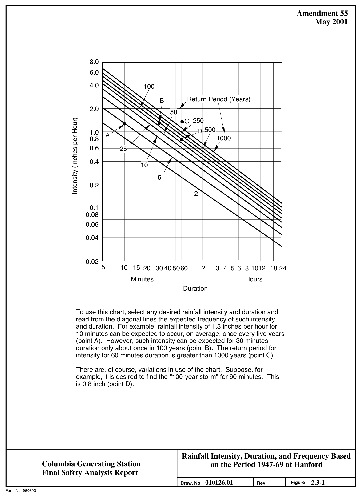

*figure on PDF page 171*

[Vector original (SVG, lossless): fig_page-171.svg](../figures/fig_page-171.svg)

<!-- labels/text on this figure page -->
Amendment 55 May 2001
8.0 6.0 4.0 100 Return Period (Years) B
2.0 50 250 C Intensity (Inches per Hour)
500 D
1.0 A 1000 0.8 0.6 25 0.4 10 5 0.2 2 0.1 0.08 0.06 0.04
0.02 5 10 15 20 30 40 50 60 2 3 4 5 6 8 1012 18 24 Minutes Hours Duration
To use this chart, select any desired rainfall intensity and duration and read from the diagonal lines the expected frequency of such intensity and duration. For example, rainfall intensity of 1.3 inches per hour for 10 minutes can be expected to occur, on average, once every five years
(point A). However, such intensity can be expected for 30 minutes duration only about once in 100 years (point B). The return period for intensity for 60 minutes duration is greater than 1000 years (point C).
There are, of course, variations in use of the chart. Suppose, for example, it is desired to find the "100-year storm" for 60 minutes. This is 0.8 inch (point D).
Rainfall Intensity, Duration, and Frequency Based Columbia Generating Station on the Period 1947-69 at Hanford Final Safety Analysis Report 010126.01
2.3-1 Draw. No.
Rev. Figure Form No. 960690

<!-- p.172 -->
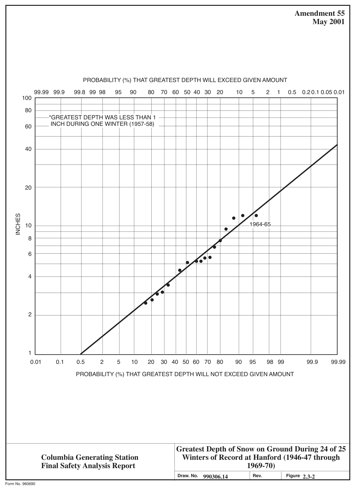

*figure on PDF page 172*

[Vector original (SVG, lossless): fig_page-172.svg](../figures/fig_page-172.svg)

<!-- labels/text on this figure page -->
Amendment 55 May 2001
PROBABILITY (%) THAT GREATEST DEPTH WILL EXCEED GIVEN AMOUNT 99.99 99.9 99.8 99 98 95 90 80 70 60 50 40 30 20 10 5 2 1 0.5 0.2 0.1 0.05 0.01 100 80 *GREATEST DEPTH WAS LESS THAN 1
INCH DURING ONE WINTER (1957-58)
60
40
20
INCHES
1964-65 10
8
6
4
2
1 0.01 0.1 0.5 2 5 10 20 30 40 50 60 70 80 90 95 98 99 99.9 99.99 PROBABILITY (%) THAT GREATEST DEPTH WILL NOT EXCEED GIVEN AMOUNT
Greatest Depth of Snow on Ground During 24 of 25 Winters of Record at Hanford (1946-47 through Columbia Generating Station 1969-70)
Final Safety Analysis Report Draw. No. 990306.14 Rev. Figure 2.3-2 Form No. 960690

<!-- p.173 -->
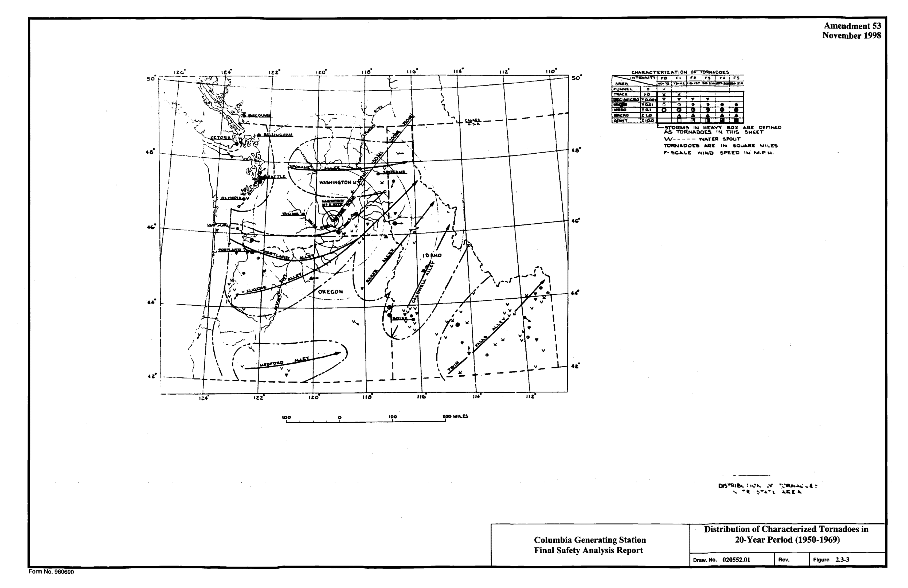

*figure on PDF page 173*

<!-- labels/text on this figure page -->
Amendment 53 November 1998
---L -- I 2.z.• 1r..o• 12.c.·
.... so·
~~,~~
--·-·----
-- \
- I 1 , ....
- - -
• •• -,· •""'"' - I 1 ; ; • ... . ' -,. & :
..
5T'0SU"'~ IM M'E"'IIY &011 A.IU'. D'EF'IH-£O
• •• ~---.i~-"""'"4' - .• "'5 TORMJ.00£5 1N TI41S. !:aHltET r---- VV • - - - - WATP ~POUT n,,-,..,i.gc,Q NIE IM. SOI.I ... RE ,_.,1..1:'!:, F• 'Jac;.""I..E: Wlllot0 SP£EC llo& M.P. 1-4.
, 'v ' -f lt , y . ~ ' .,,.
~
• • ., \'1{ " ~ ·...------ , __ ,l• / r
-~ I ... , y 1 ' y • - f-• j __ ___.._ ..
\ /' "' )I 'II / I I i • lit ( , I J \ : v \I I
- - -
-\- -
- ..,_ I •z.·
• ... v.-o"e v .1_ - - \ ~+ ~
-----L ., .. ,..
!
--- ------
"" 11•· IZ.Z. IZ.0 11e
100 IOOMII-U 100 0
01!.~1& ! ,.:-.... -· ·~'ah~ .... ~
... •-:t-~•.i..•\. -~~,,
Distribution of Characterized Tornadoes in 20-Year Period (1950-1969)
Columbia Generating Station Final Safety Analysis Report Draw. No. 020552.01 Rev. Figure 2.3-3
Fonn No. 960690

<!-- p.174 -->
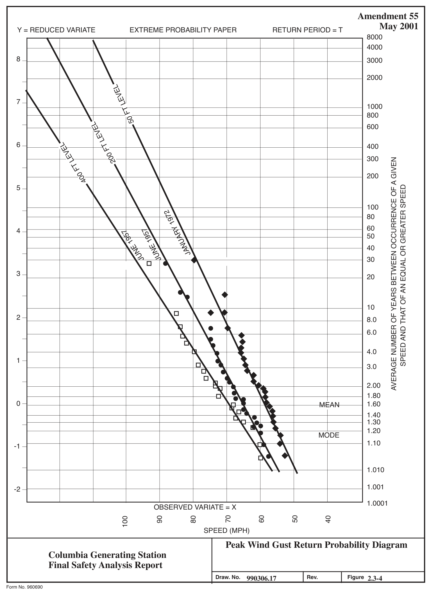

*figure on PDF page 174*

[Vector original (SVG, lossless): fig_page-174.svg](../figures/fig_page-174.svg)

<!-- labels/text on this figure page -->
Amendment 55 May 2001 Y = REDUCED VARIATE EXTREME PROBABILITY PAPER RETURN PERIOD = T 8000 \ \ 4000 \ \ 8 3000 \ \ \ 2000 \ -
50 FT LEVEL
-\ 7 1000 ' '\. \.
800 ..
' 200 FT LEVEL - 600 \ \ 6 - 400 FT LEVEL 400 \ \ 300 AVERAGE NUMBER OF YEARS BETWEEN OCCURRENCE OF A GIVEN \
- 200 ' \ \ \ 5 -
SPEED AND THAT OF AN EQUAL OR GREATER SPEED
\ 100 \. \. \ -
JANUARY 1972
80 \. \ \ 60 " 4 JUNE 1957 JUNE 1957 ' ' - \. \ 50 \ 40 \.
\
l 30 \□ \ \ \ ,\ \◄ 3
- 20
- 10 ~ ' \J \ \.□ ♦ ~ ◄ ' - 2
- 8.0 ~ \• 6.0
- ~ 4.0 ~\ '\ 1 ~•, ~ ~
-
3.0
-:!{. & ,~
-
2.00 ~ ..
-~ 11>..!"'~
1.80 0 - , ,,~~ ~ MEAN 1.60 8{cA ~-'~ , ~► I
1.40
1.30 ,,
- ◄ ~
1.20 ~ !
MODE '
1.10
-1 - .
-
1.010 ~
1.001
-2
1.0001 OBSERVED VARIATE = X 70 60 50 100 90 80 40
SPEED (MPH)
Peak Wind Gust Return Probability Diagram Columbia Generating Station Final Safety Analysis Report Draw. No. 990306.17 Rev. Figure 2.3-4 Form No. 960690

<!-- p.175 -->
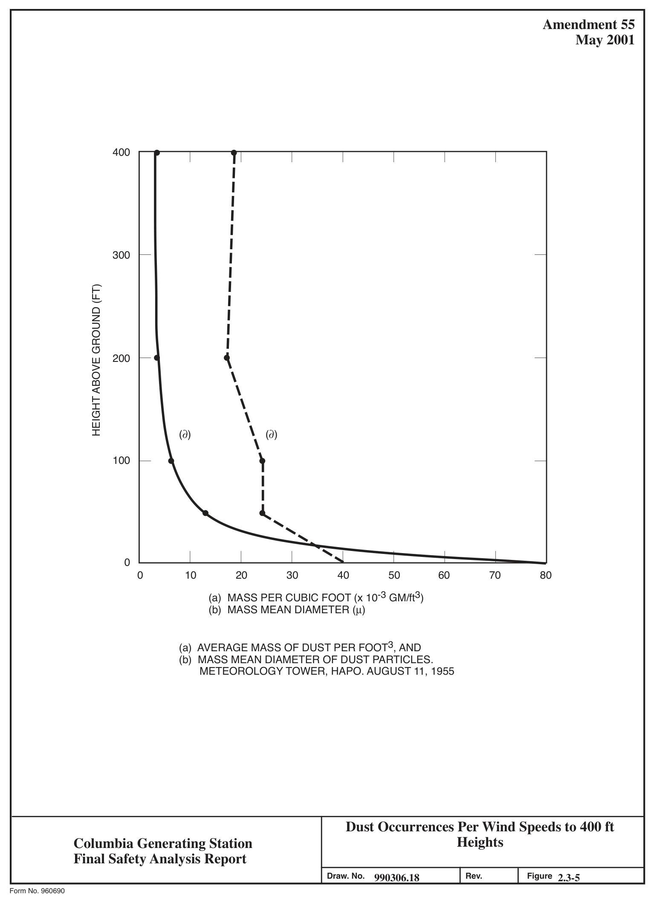

*figure on PDF page 175*

[Vector original (SVG, lossless): fig_page-175.svg](../figures/fig_page-175.svg)

<!-- labels/text on this figure page -->
Amendment 55 May 2001
400 I I I I I I 300 I I I
HEIGHT ABOVE GROUND (FT)
I I I I \ 200 \ \ \ \ \
(∂)
(∂) \ ' 100 I
I ,, ',
0 0 10 20 30 40 50 60 70 80
(a) MASS PER CUBIC FOOT (x 10-3 GM/ft3)
(b) MASS MEAN DIAMETER (µ)
(a) AVERAGE MASS OF DUST PER FOOT3, AND
(b) MASS MEAN DIAMETER OF DUST PARTICLES.
METEOROLOGY TOWER, HAPO. AUGUST 11, 1955
Dust Occurrences Per Wind Speeds to 400 ft Heights Columbia Generating Station Final Safety Analysis Report Draw. No. 990306.18 Rev. Figure 2.3-5 Form No. 960690

<!-- p.176 -->
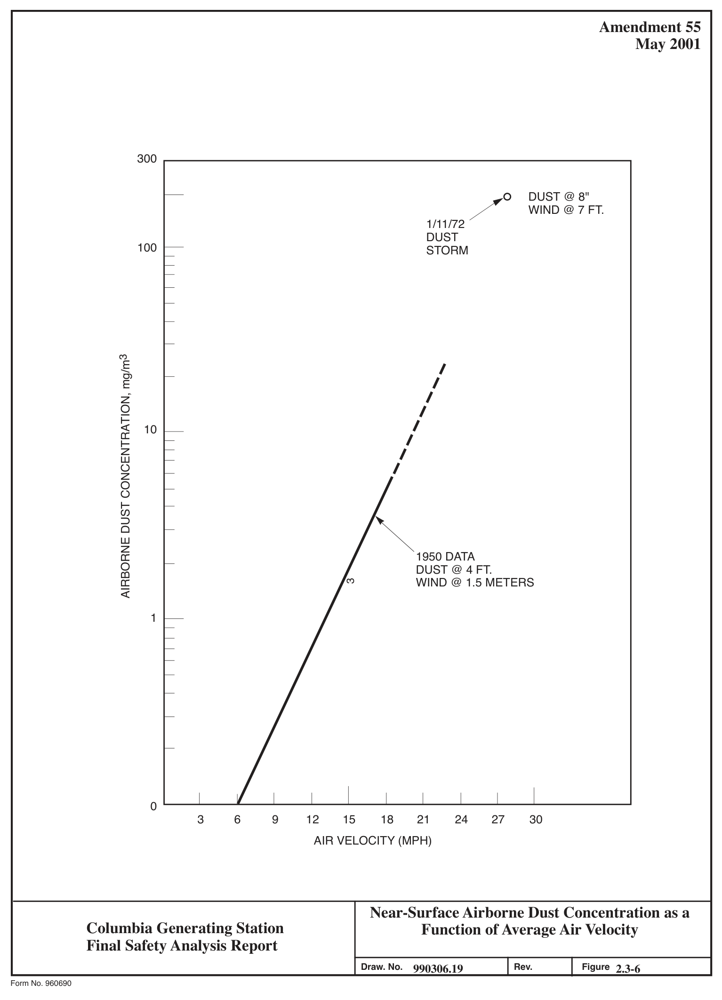

*figure on PDF page 176*

[Vector original (SVG, lossless): fig_page-176.svg](../figures/fig_page-176.svg)

<!-- labels/text on this figure page -->
Amendment 55 May 2001
300
DUST @ 8" WIND @ 7 FT.
1/11/72 DUST 100
STORM
AIRBORNE DUST CONCENTRATION, mg/m3 I I I I I 10 I I I
1950 DATA DUST @ 4 FT.
WIND @ 1.5 METERS 3
1
0 3 6 9 12 15 18 21 24 27 30
AIR VELOCITY (MPH)
Near-Surface Airborne Dust Concentration as a Columbia Generating Station Function of Average Air Velocity Final Safety Analysis Report Draw. No. 990306.19 Rev. Figure 2.3-6 Form No. 960690

<!-- p.177 -->
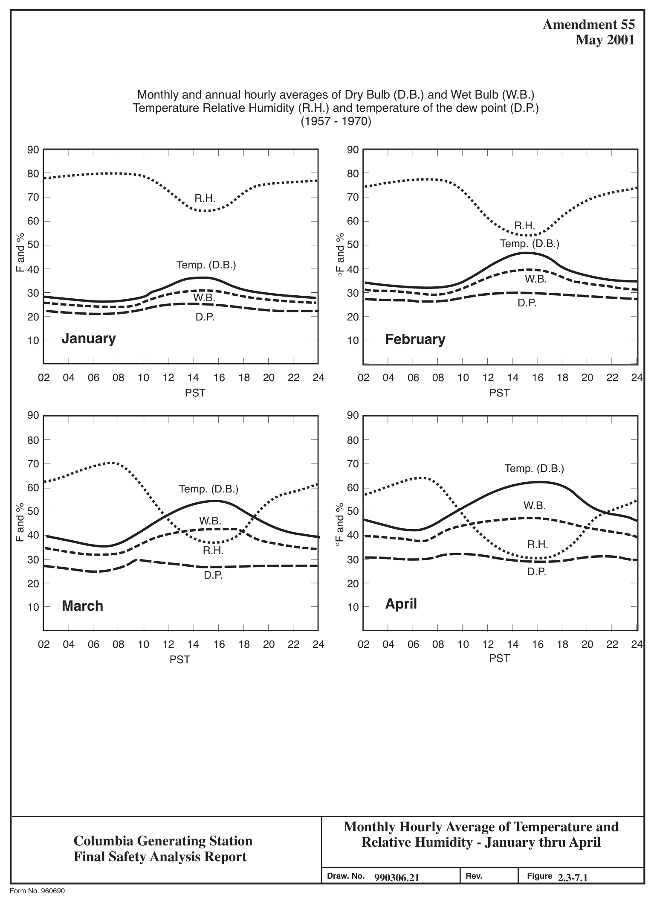

*figure on PDF page 177*

[Vector original (SVG, lossless): fig_page-177.svg](../figures/fig_page-177.svg)

<!-- labels/text on this figure page -->
Amendment 55 May 2001
Monthly and annual hourly averages of Dry Bulb (D.B.) and Wet Bulb (W.B.)
Temperature Relative Humidity (R.H.) and temperature of the dew point (D.P.)
(1957 - 1970)
90 90
80 80 ···••••••••••••••••••· •• ••♦• ····•••••••••••••••· •• ·•..
···••• -
•••••• •••••••• ♦ R.H. ••♦• 70 70
•• •• •••••••• ••
••••••
••
• •••
•• •• 60 60
•• •• R.H.
••••····••• °F and % 50 50 F and %
-- Temp. (D.B.)
-- ------
--
----
------ ------- Temp. (D.B.)
40 40
...... ----------~~~~---~~ ----- ------- ... _
--- ----- W.B.
------ ------- 30 30 W.B.
D.P.
---------■
-----------~----- 20 D.P.
20 January February 10 10
02 04 06 08 10 12 14 16 18 20 22 24 02 04 06 08 10 12 14 16 18 20 22 24 PST PST 90 90
80 80 ..
....
70 70 Temp. (D.B.)
··••••••••· ···••••••••· ••• ♦ 60 ♦• 60 Temp. (D.B.)
••• ♦ •• •••
•• ••• ••••
-- W.B.
F and % 50 °F and % 50 .. ' -J~------,.· ...
--- ------ -- ,, __ _ ••••••• ------ W.B.
♦ •• -------- ♦ ---
--------- 40 40 ____ , R.H.
R.H.
30 30 D.P.
D.P.
20 20 April March 10 10
02 04 06 08 10 12 14 16 18 20 22 24 02 04 06 08 10 12 14 16 18 20 22 24 PST PST
Monthly Hourly Average of Temperature and Columbia Generating Station Relative Humidity - January thru April Final Safety Analysis Report Draw. No. 990306.21 Rev. Figure 2.3-7.1 Form No. 960690

<!-- p.178 -->
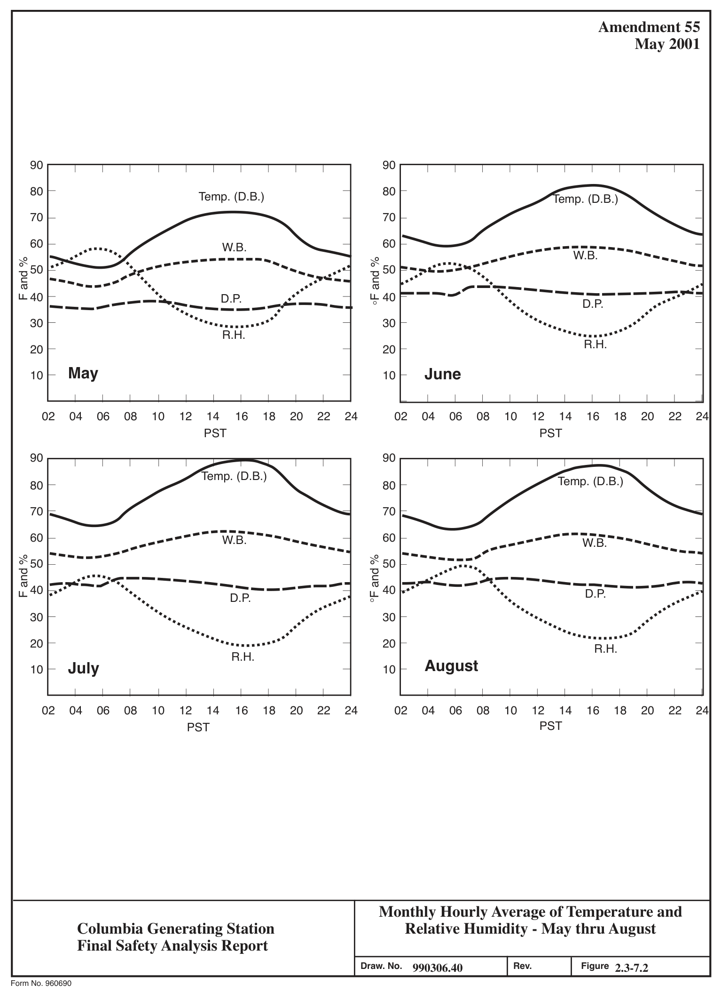

*figure on PDF page 178*

[Vector original (SVG, lossless): fig_page-178.svg](../figures/fig_page-178.svg)

<!-- labels/text on this figure page -->
Amendment 55 May 2001
90 90
80 80 Temp. (D.B.)
Temp. (D.B.)
70 70
......
-----
----- ... .. ------.. --- ---------...
-- 60 60
----------- W.B.
W.B.
-- __ ..,,,.,--::------------.
°F and % 50 50 F and %
-~~~~~-~- H-
•• •• ··-----........ -
··-- ---~ •• ••
•-------' ••♦ ...:·
••
••
• 40 40 ---:...~ D.P.
D.P. •♦•
•••
• •• •••• -
•• •♦• •• 30 30
••••
••• ••
••••••···••••• R.H.
•••••······•••• R.H.
20 20 May June 10 10
02 04 06 08 10 12 14 16 18 20 22 24 02 04 06 08 10 12 14 16 18 20 22 24 PST PST 90 90 Temp. (D.B.)
Temp. (D.B.)
80 80
70 70
--------
------ -------- ------- -
--------
--
-------- ________ ,, 60
--------- 60 W.B.
W.B.
.. ----
.... ~---~
----------- ·••••• ---------- F and % 50 ······~---- °F and % 50
-: .... -, ....
40 40
• ••
••• D.P.
•••• .... D.P. ..•· • • •••
••
• ••
••
••
• •••
••••
•• ••··· .. • •• 30 30
••••• ••••
••••••······•••• 20 20
•••••····••••• R.H.
R.H.
August July 10 10
02 04 06 08 10 12 14 16 18 20 22 24 02 04 06 08 10 12 14 16 18 20 22 24 PST PST
Monthly Hourly Average of Temperature and Relative Humidity - May thru August Columbia Generating Station Final Safety Analysis Report Draw. No. 990306.40 Rev. Figure 2.3-7.2 Form No. 960690

<!-- p.179 -->
Amendment 55 May 2001

Monthly and annual hourly averages of Dry Bulb (D.B.) and Wet Bulb (W.B.) Temperature Relative Humidity (R.H.) and temperature of the dew point (D.P.)
(1957-1970)

90 90

80 ....

80 Temp. (D.B.) 70 70 ··••• ·• .
•♦• Temp. (D.B.) •••• R.H. •
•• ••• ♦ ----
---- --- 60 60 . • ,- ··••
•• .. -
-----------
-~-----, . W.B.
:,,,, W.B. F and % °F and %

.... .

······ 50
••
• 50
•
---- ----- ,----------- ·~--------... ♦ .
---- __..--.. -------•·---- ..
-------- ••········• ♦ ♦--- _, 40 40 .,:"' -- •• •• -----I!!!!!!
D.P.
••
•• D.P.

......

••• •• 30 ••••• •••• 30 R.H.
20 20 September October 10 10

02 04 06 08 10 12 14 16 18 20 22 24 02 04 06 08 10 12 14 16 18 20 22 24 PST PST

90 90 .. ·•••••••••••··
••••••••••••••••••••••••

···········••!....

80 80
•• . .. ••
••••·······••• ...
•.
•• •• ····· ♦ 70 70 ••••••• •••••••
• •• R.H.
•• •• R.H. •••••••
•• •• •• ♦ 60 60 Temp. (D.B.)
F and % °F and % 50 50
------- Temp. (D.B.)
40 40 W.B.
------------=---------------
-------

#### W.B. D.P. --
----------- 30 30 D.P.
20 20 December November 10 10

02 04 06 08 10 12 14 16 18 20 22 24 02 04 06 08 10 12 14 16 18 20 22 24

#### PST PST
Monthly Hourly Average of Temperature and Columbia Generating Station Relative Humidity - September thru December Final Safety Analysis Report Draw. No. 990306.22 Rev. Figure 2.3-7.3 Form No. 960690

<!-- p.180 -->
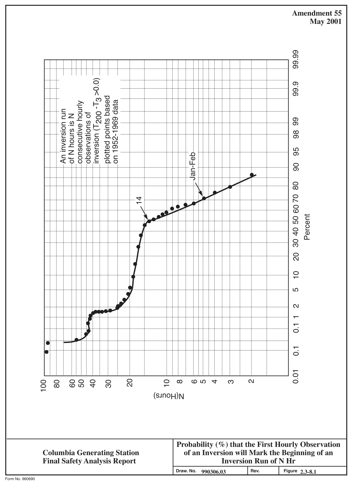

*figure on PDF page 180*

[Vector original (SVG, lossless): fig_page-180.svg](../figures/fig_page-180.svg)

<!-- labels/text on this figure page -->
Amendment 55 May 2001
99.99
I I I I I I I I I
~ ~- inversion (T200 -T3 >0.0)
99.9 ,-,___
~ ~plotted points based on 1952-1969 data consecutive hourly ~ ~- An inversion run observations of of N hours is N ,-,___ 98 99 ,-,___
,-,___ 95 Jan-Feb 90 ~ ,,,,, a- ,,,J ~ ,
-..
\ 20 30 40 50 60 70 80
• 4 ,j .....,,.
14
..__,- .......
\ Percent r ., 1 10 ' I ;
5
,_ 2 I • 0.1 1 I .. I, ,_ 1• 0.1 ~
0.01 2 100 80 30 8 6 5 4 3 60 50 40 20 10 N(Hours)
Probability (%) that the First Hourly Observation of an Inversion will Mark the Beginning of an Columbia Generating Station Inversion Run of N Hr Final Safety Analysis Report Draw. No. 990306.03 Rev. Figure 2.3-8.1 I I Form No. 960690

<!-- p.181 -->
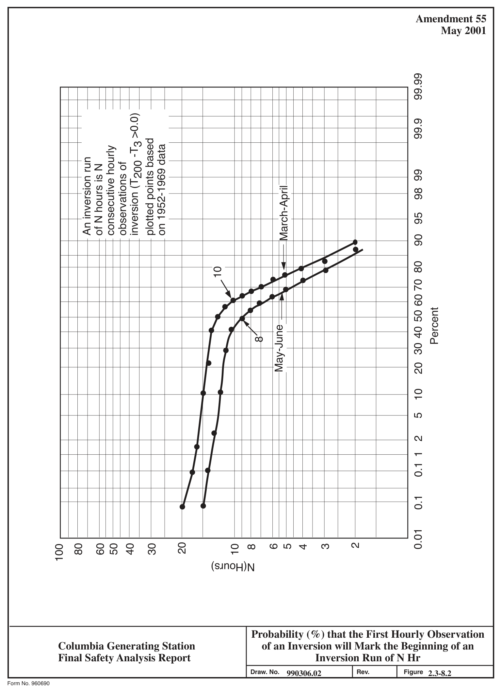

*figure on PDF page 181*

[Vector original (SVG, lossless): fig_page-181.svg](../figures/fig_page-181.svg)

<!-- labels/text on this figure page -->
Amendment 55 May 2001
99.99
--- I I I I I I I I I inversion (T200 -T3 >0.0)
99.9
--f- f---
plotted points based
--on 1952-1969 data consecutive hourly An inversion run --observations of of N hours is N 98 99 March-April f- f---
95 f- f---
i,.,-1 ..... ,,
,,,., - ~- 90
..,.......--; ~
I
...... ..
20 30 40 50 60 70 80 ., ~ 10 \.. ...,~ ,..- .,) r"" \ ...ti"' ,,..
~ ~ Percent ,[. I" May-June r I ,, ' 8
t
10 5 • 2
I 0.1 1 j I I 0.1
•• 4
0.01 2 100 10 8 6 5 4 3 80 60 50 40 30 20 N(Hours)
Probability (%) that the First Hourly Observation of an Inversion will Mark the Beginning of an Columbia Generating Station Inversion Run of N Hr Final Safety Analysis Report Draw. No. 990306.02 Rev. Figure 2.3-8.2 I I Form No. 960690

<!-- p.182 -->
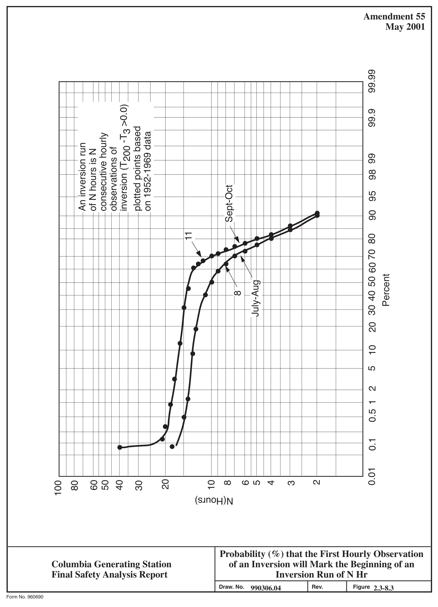

*figure on PDF page 182*

[Vector original (SVG, lossless): fig_page-182.svg](../figures/fig_page-182.svg)

<!-- labels/text on this figure page -->
Amendment 55 May 2001
99.99
I I I I I I I I I
--- inversion (T200 -T3 >0.0)
99.9
---
--plotted points based on 1952-1969 data consecutive hourly An inversion run --observations of of N hours is N 98 99
---
---
Sept-Oct 95 ---
• 90 ~ p ~ _..
.,..~ ,. ,...
\ 11 c..
20 30 40 50 60 70 80 \ u~ ~ ~ _,,,,,,,, ~ ( ' I ,. '\ ,. J \ \ Percent July-Aug I\ I r 8 - ' J r
• 10
5
4 2 J ,, 0.5 1
4 ...
.A I j
0.1 ~
0.01 20 100 80 60 50 40 30 10 8 6 5 4 3 2 N(Hours)
Probability (%) that the First Hourly Observation of an Inversion will Mark the Beginning of an Columbia Generating Station Inversion Run of N Hr Final Safety Analysis Report I I Draw. No. 990306.04 Rev. Figure 2.3-8.3 Form No. 960690

<!-- p.183 -->
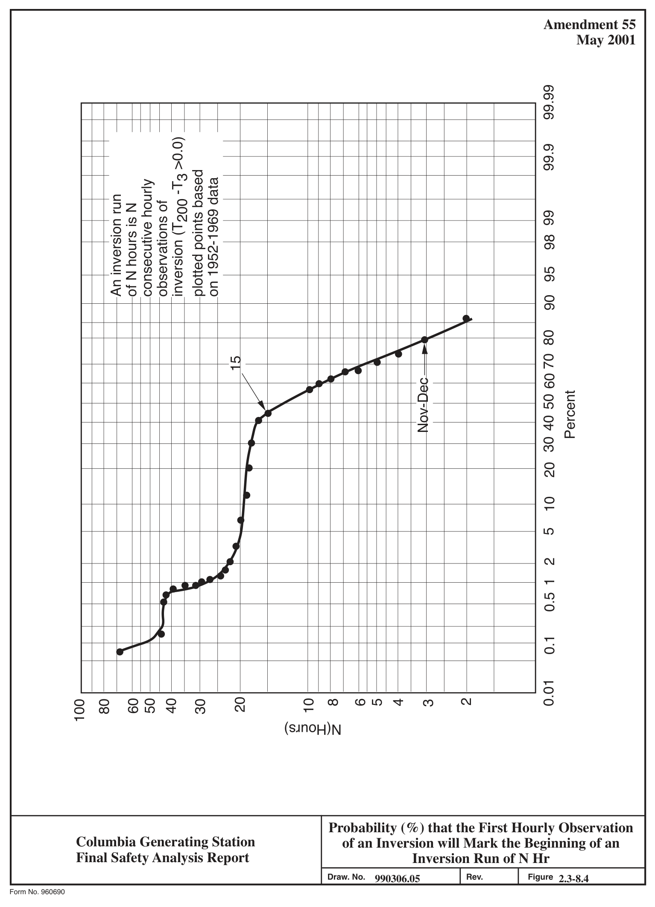

*figure on PDF page 183*

[Vector original (SVG, lossless): fig_page-183.svg](../figures/fig_page-183.svg)

<!-- labels/text on this figure page -->
Amendment 55 May 2001
99.99
I I I I I I I I I
inversion (T200 -T3 >0.0) f-f-- 99.9 f- f--
plotted points based f->-on 1952-1969 data consecutive hourly An inversion run f-f-observations of of N hours is N 98 99 f- f--
f- f--
95 f- f-- ...
90
~ ~ 20 30 40 50 60 70 80
..... lit' ....
(' ~
• 15 ,j~ ~ I\ \ / r Nov-Dec .,
~ ,.....
Percent I ..
Ill 10 ,...,,, , • 5 J
p..,i ...
2
0.5 1 .,.. ...
I.I '
0.1
0.01 20 100 80 60 50 40 30 10 8 6 5 4 3 2 N(Hours)
Probability (%) that the First Hourly Observation Columbia Generating Station of an Inversion will Mark the Beginning of an Final Safety Analysis Report Inversion Run of N Hr I I Draw. No. 990306.05 Rev. Figure 2.3-8.4 Form No. 960690

<!-- p.184 -->
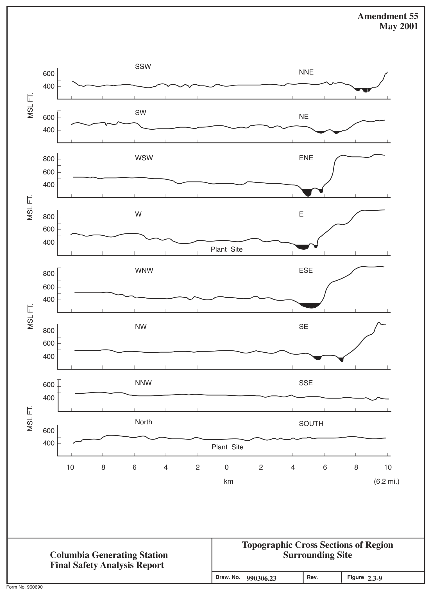

*figure on PDF page 184*

[Vector original (SVG, lossless): fig_page-184.svg](../figures/fig_page-184.svg)

<!-- labels/text on this figure page -->
Amendment 55 May 2001
SSW NNE 600 ~ 400
MSL FT.
SW NE 600 ~ J - 400 !
ENE 800
WSW ' I 600
---- ' ! -- 400
MSL FT.
!
E W 800 600 400 Plant Site !
ESE WNW 800 600 400
MSL FT.
!
SE NW 800 600 400
---
-
SSE 600
NNW ~
...._,_
400
MSL FT.
North
SOUTH
~ 600 400 Plant Site
10 8 6 4 2 0 2 4 6 8 10 km
(6.2 mi.)
Topographic Cross Sections of Region Surrounding Site Columbia Generating Station Final Safety Analysis Report Draw. No. 990306.23 Rev. Figure 2.3-9 Form No. 960690

<!-- p.185 -->
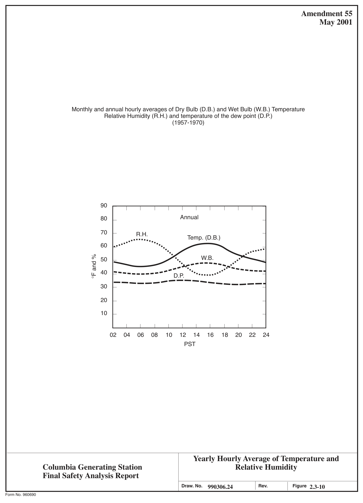

*figure on PDF page 185*

[Vector original (SVG, lossless): fig_page-185.svg](../figures/fig_page-185.svg)

<!-- labels/text on this figure page -->
Amendment 55 May 2001
Monthly and annual hourly averages of Dry Bulb (D.B.) and Wet Bulb (W.B.) Temperature Relative Humidity (R.H.) and temperature of the dew point (D.P.)
(1957-1970)
90 Annual 80 ... 70 R.H.
Temp. (D.B.)
··••••••••••·· . . •• ·•.
60
--- ..
~-------.... .
W.B. °F and % 50 ..:,.-... _____ _ ••♦ ------------ •••
•••·······•• ------------------- 40 D.P.
30
20
10
02 04 06 08 10 12 14 16 18 20 22 24 PST
Yearly Hourly Average of Temperature and Relative Humidity Columbia Generating Station Final Safety Analysis Report Draw. No. 990306.24 Rev. Figure 2.3-10 Form No. 960690

<!-- p.186 -->
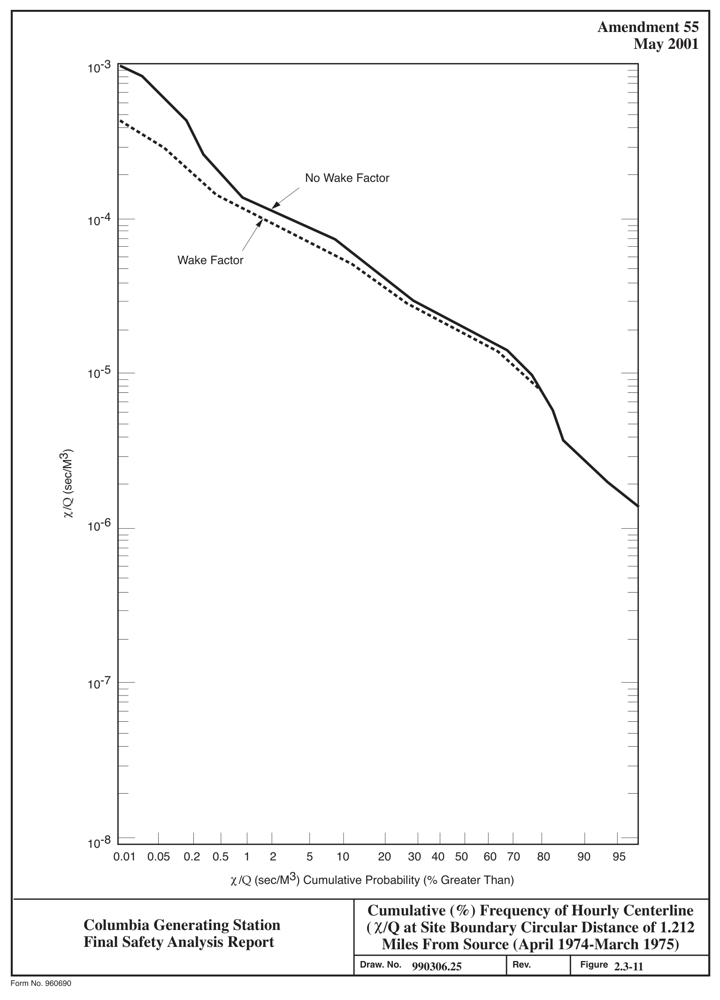

*figure on PDF page 186*

[Vector original (SVG, lossless): fig_page-186.svg](../figures/fig_page-186.svg)

<!-- labels/text on this figure page -->
Amendment 55 May 2001 10-3
No Wake Factor
10-4
Wake Factor
10-5
/Q (sec/M3)
χ 10-6
10-7
10-8 0.01 0.05 0.2 0.5 1 2 5 10 20 30 40 50 60 70 80 90 95 /Q (sec/M3) Cumulative Probability (% Greater Than)
χ
Cumulative (%) Frequency of Hourly Centerline Columbia Generating Station
( /Q at Site Boundary Circular Distance of 1.212 χ Final Safety Analysis Report Miles From Source (April 1974-March 1975)
Draw. No. 990306.25 Rev. Figure 2.3-11 Form No. 960690

<!-- p.187 -->
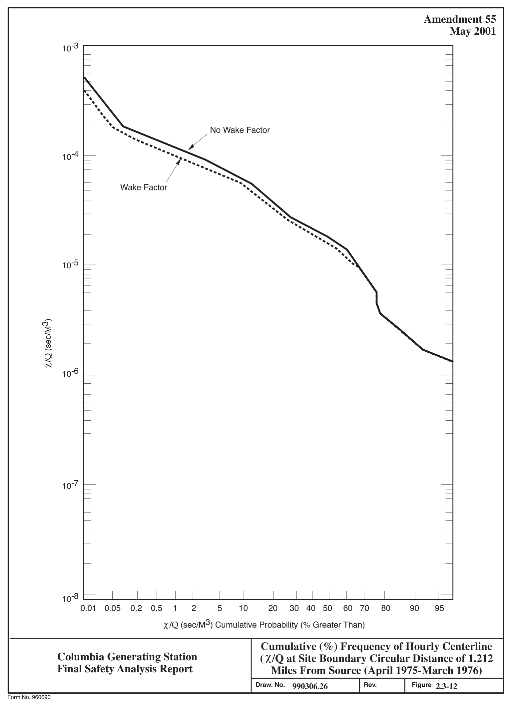

*figure on PDF page 187*

[Vector original (SVG, lossless): fig_page-187.svg](../figures/fig_page-187.svg)

<!-- labels/text on this figure page -->
Amendment 55 May 2001 10-3
No Wake Factor
10-4
Wake Factor
10-5
/Q (sec/M3)
χ 10-6
10-7
10-8 0.01 0.05 0.2 0.5 1 2 5 10 20 30 40 50 60 70 80 90 95 /Q (sec/M3) Cumulative Probability (% Greater Than)
χ
Cumulative (%) Frequency of Hourly Centerline Columbia Generating Station
( /Q at Site Boundary Circular Distance of 1.212 χ Final Safety Analysis Report Miles From Source (April 1975-March 1976)
Draw. No. 990306.26 Rev. Figure 2.3-12 Form No. 960690

<!-- p.188 -->
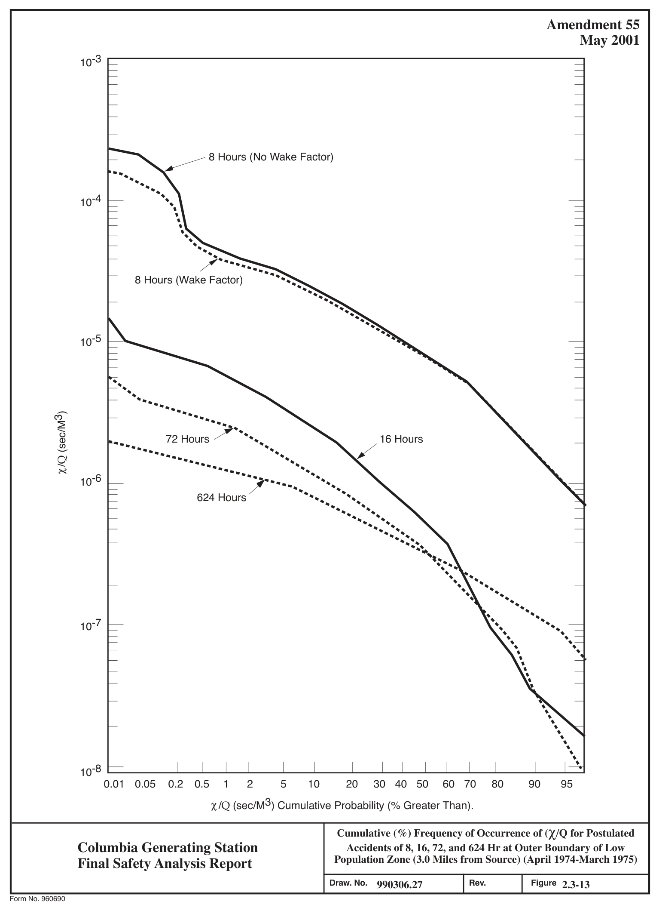

*figure on PDF page 188*

[Vector original (SVG, lossless): fig_page-188.svg](../figures/fig_page-188.svg)

<!-- labels/text on this figure page -->
Amendment 55 May 2001 10-3
8 Hours (No Wake Factor)
10-4
8 Hours (Wake Factor)
10-5
/Q (sec/M3)
72 Hours
16 Hours
χ 10-6 624 Hours
10-7
10-8 0.01 0.05 0.2 0.5 1 2 5 10 20 30 40 50 60 70 80 90 95 /Q (sec/M3) Cumulative Probability (% Greater Than).
χ
Cumulative (%) Frequency of Occurrence of (χ/Q for Postulated Columbia Generating Station Accidents of 8, 16, 72, and 624 Hr at Outer Boundary of Low Population Zone (3.0 Miles from Source) (April 1974-March 1975)
Final Safety Analysis Report Draw. No. 990306.27 Rev. Figure 2.3-13 Form No. 960690

<!-- p.189 -->
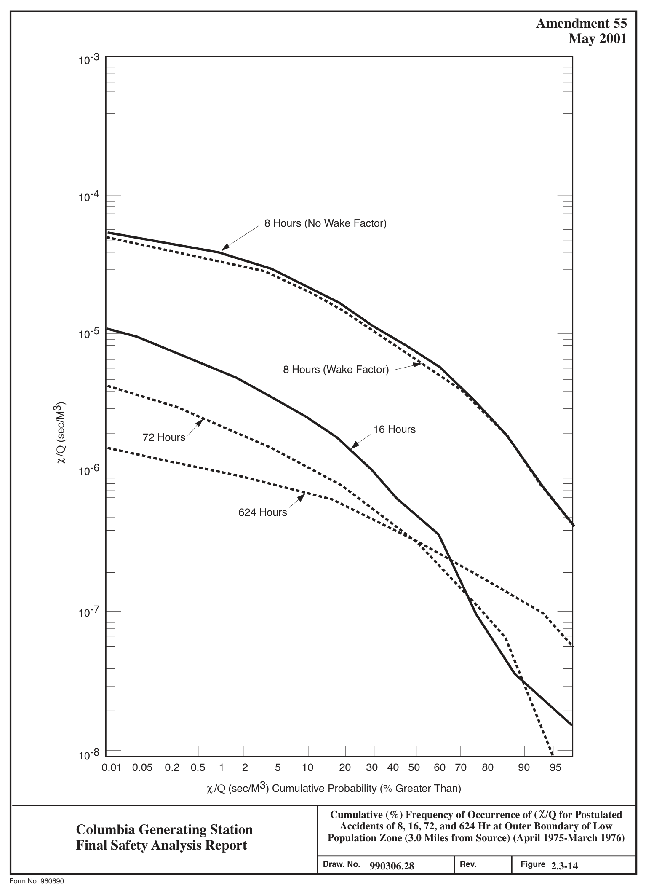

*figure on PDF page 189*

[Vector original (SVG, lossless): fig_page-189.svg](../figures/fig_page-189.svg)

<!-- labels/text on this figure page -->
Amendment 55 May 2001 10-3
10-4
8 Hours (No Wake Factor)
•••••••••••········
10-5
8 Hours (Wake Factor)
/Q (sec/M3)
16 Hours
72 Hours
χ 10-6
624 Hours
10-7
10-8 0.01 0.05 0.2 0.5 1 2 5 10 20 30 40 50 60 70 80 90 95 /Q (sec/M3) Cumulative Probability (% Greater Than)
χ
Cumulative (%) Frequency of Occurrence of ( /Q for Postulated χ Accidents of 8, 16, 72, and 624 Hr at Outer Boundary of Low Columbia Generating Station Population Zone (3.0 Miles from Source) (April 1975-March 1976)
Final Safety Analysis Report Draw. No. 990306.28 Rev. Figure 2.3-14 Form No. 960690

<!-- p.190 -->
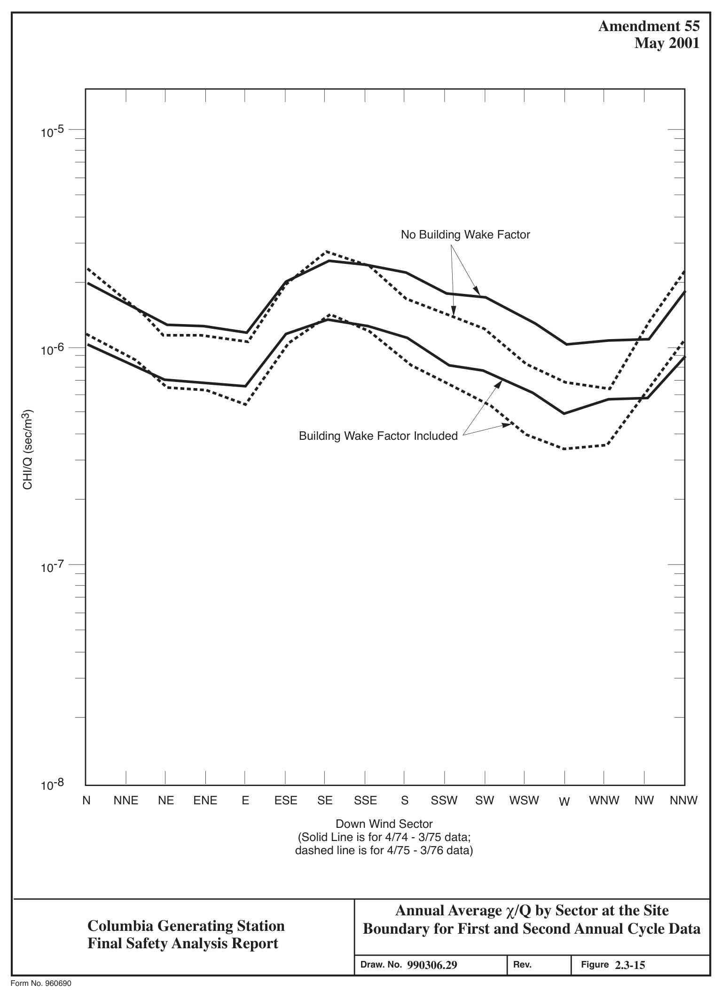

*figure on PDF page 190*

[Vector original (SVG, lossless): fig_page-190.svg](../figures/fig_page-190.svg)

<!-- labels/text on this figure page -->
Amendment 55 May 2001
10-5
No Building Wake Factor
••••••••·· 10-6
CHI/Q (sec/m3)
Building Wake Factor Included
10-7
10-8
N NNE NE ENE E ESE SE SSE S SSW SW WSW W WNW NW NNW
Down Wind Sector
(Solid Line is for 4/74 - 3/75 data;
dashed line is for 4/75 - 3/76 data)
Annual Average χ/Q by Sector at the Site Columbia Generating Station Boundary for First and Second Annual Cycle Data Final Safety Analysis Report 990306.29
2.3-15 Draw. No. Rev. Figure Form No. 960690

