# 2.4 HYDROLOGY ENGINEERING

> Columbia Generating Station FSAR — Chapter 02: Site Characteristics
> Source: `02_chapter-402-659.pdf`, PDF pages 191–256 (of 258)
> Amendment 67 compilation (individual pages carry varying amendment dates)

---
<!-- p.191 -->
### 2.4 HYDROLOGY ENGINEERING
The italicized information is historical and was provided to support the application for an operating license.

#### 2.4.1 HYDROLOGIC DESCRIPTION
##### 2.4.1.1 Site and Facilities
Columbia Generating Station (CGS) is located in the Hanford Site within Benton County, Washington, approximately 3 miles west of the Columbia River at river mile (RM) 352, 10 miles north of Richland and 45 miles downstream from Grant County PUD Priest Rapids Dam.
The site coordinates are approximately 46° 28’ North Latitude and 119° 20’ West Longitude.

The Columbia River is the predominant hydrologic feature of the area and provides principal drainage for the surrounding area. The riverbed is clearly marked in the terrain and at the proximity of the site the river flows between high banks. The Columbia River approximate riverbed elevation is 328 ft above mean sea level (msl); the ground elevation at the site is approximately 440 ft. Another hydrologic feature of the area is the Yakima River, which at its closest approach flows within 8 miles of the plant site. The river system is shown in the hydrographic map, Figure 2.4-1. Figures 2.1-1 and 2.1-2 show the major hydrologic features of the area.

All Seismic Category I structures are located above maximum postulated flood elevations. For flood elevations refer to Sections 2.4.3 and 2.4.4.

Water for cooling tower makeup water and other plant requirements is withdrawn from the Columbia River. The intake system is designed for a maximum capacity of 25,000 gpm
(55.7 cfs). The non-safety-related makeup water intake system is approximately 3 miles east of the plant and is made up of two offshore perforated pipe inlets, two lead-in pipes, and pump house structure.

A topographic map and contour map of the region surrounding the site are shown in Figures 2.4-2 and 2.4-3. The natural drainage features of the surrounding area have not been changed by the construction of CGS.

##### 2.4.1.2 Hydrosphere
The Columbia River, the largest river flowing into the Pacific Ocean from North America, is one of this world’s greatest sources of hydroelectric power. Its annual discharge of 18,000,000 acre ft (1 acre-ft = 43,560 ft3) is exceeded in the North American continent only by the Mississippi, Mackenzie and St. Lawrence Rivers.

<!-- p.192 -->
November 1998

The Columbia River drains an area of approximately 258,000 square miles, lying to the west of the Continental Divide in the northwestern part of the U.S. (85%) and southwestern part of Canada (15%). Major tributaries are the Kootenay, Snake, Pend Oreille, Spokane, Okanogan, Yakima, and Willamette Rivers.

In determining the Standard Project Flood (SPF) the drainage area was divided into subbasins.
These subbasins can be grouped into six general areas with similar hydrometeorological characteristics.

The six areas are: (1) upper Columbia, which includes the drainage of the area in Canada and the northern part of the United States above Chief Joseph Dam; (2) Middle Columbia, which includes the area between Pasco and Chief Joseph Dam; (3) Upper and Middle Snake River;
(4) Lower Snake River, the area between Weiser and Ice Harbor Dam; (5) Lower Columbia, including the area between Bonneville Dam and Pasco; (6) the Columbia below Bonneville Dam, including the Willamette River.

The river basin has five outstanding physical features: the Rocky Mountain System, the Columbia Plateau, the Columbia River Gorge, the Cascade Range and Puget Trough.

The Rocky Mountain System is the major range with elevations from 2000 to over 12,000 ft.
There are permanent glaciers and extensive snow fields at higher elevations and deep valleys that provide the principal drainage for the head-waters of the Columbia, Kootenay and other rivers.

The Columbia Plateau is a great, generally treeless, semiarid plateau covering over 100,000 square miles in the central portion of the basin. This plateau is in an area between the Cascade Range and the Rocky Mountains. The plateau was formed by successive flows of lava and filled to a general thickness of approximately 4000 ft. The Columbia River flows 1214 miles from its source in Columbia Lake (el. 2700 ft) in British Columbia, near the crest of the Rockies, to the Pacific Ocean at Astoria, Oregon. It sweeps around the north and northwesterly sides of the Columbia Plateau to central Washington to be joined by the Snake River. The Columbia River flows directly across the axis of the Cascades in a narrow gorge to the Pacific.

The Columbia Gorge is the gateway from the Pacific Ocean to the intermountain Columbia Plateau. Tide flows 140 miles up-river. For most of its length the river flows in deep valleys and canyons.

High flows occur in late spring and early summer with melting of snow on the mountainous watershed. Low flows occur in autumn and winter.

The Columbia River has been regulated by dams and reservoirs over the past 35 years.
A large portion of the main stream and major tributaries is developed to meet various

<!-- p.193 -->
functional requirements, such as flood control, hydroelectric power, irrigation, municipal and industrial supply, etc. The regulation of Columbia River floods is accomplished by use of reservoir storage space provided primarily for irrigation or for hydroelectric power utilization.
The volume of usable reservoir storage space is on the order of 20% to 25%.

There are seven dams upstream and four dams downstream of the site on the main stream of the Columbia River within the U.S. These dams are listed in Table 2.4-1. The Columbia River flow in the reach of CGS is controlled by regulation of the upstream reservoir projects, which have a total usable storage capacity of approximately 35 million acre-ft. Some control of flow in the immediate vicinity of the site is by regulation of the nearest upstream hydroelectric projects, Priest Rapids Dam, at RM 397, containing about 45,000 acre-ft of active storage, and Wanapum Dam, at RM 415, containing about 161,000 acre-ft of active storage. Some minimal effect on the river flow in the vicinity of the site is caused by McNary Dam, at RM 292, approximately 60 RM downstream from the site area.

Flows in the Columbia River during the summer, fall, and winter vary from a low of 36,000 ft3/sec to as much as 160,000 ft3/sec. During spring runoff high flows ranging from 250,000 ft3/sec to 450,000 ft3/sec have been recorded. The average annual flow is 120,000 ft3/sec; during low flow periods flows may average about 60,000 ft3/sec (see Figure 2.4-4).

The Grand Coulee and Bonneville dams were put into operation prior to World War II and several dams were built after the war. The four downstream dams include large locks to permit the passage of river vessels. Several of the dams provide emergency floodwater storage. Grand Coulee, the largest and most complex of the dams, augments the low winter flows for the entire system from its 9,402,000 acre-ft of available storage (of which approximately 5,100,000 acre-ft is active storage) and also pumps water to the Columbia River Irrigation Project.

The river channel near the CGS site varies between 400 and 600 yards in width for low water and normal high water level, respectively. The depth varies from about 25 ft to 45 ft for normal high water and flood high water levels, respectively. Velocities vary from 3 ft/sec to over 11 ft/sec depending on section and flow. Average water temperature is 51°F.
Temperatures may reach a low of 32°F and a high of 68°F. (See Table 2.4-2 and Figure 2.4-4.)

A list of water usage downstream of CGS, obtained from records of the Department of Ecology, State of Washington, for water rights as of February 1980, is presented in Table 2.4-3. The closest municipal surface water user is the City of Richland with an intake approximately 12 miles downstream. The location of local groundwater users is discussed in Section 2.4.13.2.

<!-- p.194 -->
#### 2.4.2 FLOODS
##### 2.4.2.1 Flood History
Floods in the Columbia River Basin are grouped as:

a. The interior basin east of the Cascades, caused by melting snowpack and occurring from May through June;

b. The Willamette and other basins, west of the Cascades, caused by direct runoff from intense winter rain occasionally augmented by snowmelt.

There is some overlapping effect within these two groupings. At certain elevations, basins in the interior Columbia drainage area occasionally have significant flood flows resulting from winter rain or snowmelt. These are local floods and do not usually contribute sufficient flow to cause flooding of the main Columbia River. Major floods in the Columbia River Basin result from rapid spring melting of the snowpack over a wide area, generally augmented by rain or by above-normal precipitation in May, accompanied by a major chinook wind which causes rapid area temperature rise. The annual spring snowmelt flood of the main interior basin is characterized by relatively uniform distribution over the basin. The snowfall and individual snow storms may vary, but the integration of all storms over the winter period smoothes the irregularities, with the result that the distribution of the flood runoff is reasonably constant from year to year.

The maximum historical flood of record is that of June 7, 1894, which resulted from a combination of hydrometeorologic conditions, including heavy snowpack and rapid melt plus rainfall. The peak discharge at CGS was 740,000 ft3/sec for the Columbia River, as estimated from high water marks at Wenatchee, Washington (Reference 2.4-1). The largest recent flood, occurring in 1948, had an observed peak discharge of 690,000 ft3/sec at Hanford. These floods were spring floods resulting from the melt of a large snowpack combined with the spring rains (Reference 2.4-2). Water surface profiles for the Columbia River in the vicinity of the site as derived by the Corps of Engineers (Reference 2.4-2) are given in Figure 2.4-5.

The plant site is located approximately three miles west of the Columbia River at RM 352 with reactor floor elevation of 441 ft msl, which is 68 ft above the water level estimated for the largest historical flood (approximately 373 ft msl). There is no record of flooding in the immediate site area.

##### 2.4.2.2 Flood Design Considerations
Flood protection of safety-related components is based on the highest calculated flood water level including wave effects, resulting from intense local precipitation. Several different probable maximum events were considered, including the Corps of Engineers design-project

<!-- p.195 -->
flood considered to be “the most severe reasonably possible.” Wave action caused by storm winds, the effects of failure of upstream dam surge flooding, and ice flooding were also considered.

The results of these analyses (described in Section 2.4.3) indicate that the CGS site is safe from floods and that no flood protection measures are required. The Hydrogen Storage and Supply Facility located 0.6 miles south-southeast of the plant is subject to flooding due to the PMP flood discussed in Section 2.4.3.1. Equipment storing liquid and gaseous hydrogen has been analyzed for the effects of this flood (Section 2.4.2.3). As discussed in sections that follow, plant safety-related structures are located above high water elevations associated with Columbia River flooding (Sections 2.4.2.1 and 2.4.3), intense local precipitation
(Sections 2.4.3.5 and 2.4.3.6), and upriver dam failures (Section 2.4.4).

##### 2.4.2.3 Effects of Local Intense Precipitation
Intense local summer thunder storms can produce short duration rains which have the potential for causing serious flood. Winter precipitation may occur as rain or snow and would be less intense than the worst summer thunderstorm. The probable maximum precipitation (PMP)
event for the CGS site has been determined using the methodology developed by the U.S. Weather Bureau and reported in Hydrometeorological Report No. 43, “Probable Maximum Precipitation, Northwest States” (Reference 2.4-3).

The plant area slopes easterly to a broad channel which is adequate to store and drain the PMP. Construction contours of the site are shown in Figure 2.4-28. The reactor building and the spray ponds are located at elevations that are safe from the effect of any flood resulting from the maximum precipitation event.

Winter precipitation may occur as rain or snow. The winter season snowfall has ranged from less than 0.5 in. to a maximum of 12 in. in December 1964. There is no ice accumulation at the site.

To accommodate surface drainage during severe climatic conditions such as rainfall and rapid I snow melts, a system of catch basins and dry wells is provided with inlet elevations a minimum I of 6 in. lower than the nearest road and a minimum of 12 in. lower than the finished floor elevation of the nearest building(s).

Runoff from the PMP event is accommodated by designing the roadways such that the high point of the road is 6 in. to 1 ft below the finished floor elevation of the adjacent safety-related I building(s). Runoff from this event is from the northwest to the southeast across the site plateau to the low area southeast of the plant site. The general plant site is nominally 9 ft above the maximum calculated water surface elevation resulting from the postulated PMP
(Section 2.4.3.3). Therefore, the site grading precludes the potential flooding of safety-related structures. The Hydrogen Storage and Supply Facility is subject to the PMP event flooding.

<!-- p.196 -->
The elevation of the facility is 420 ft msl and the PMP flood level is 431.1 ft msl
(Section 2.4.3.5). See Section 10.4.10 for more discussion.

Roofs of buildings are designed to take, with adequate drainage, any instantaneous or local intense precipitation. Discharge from roof drains is carried by means of a storm sewer system to a manhole located southeast of the reactor building. From that point a pipeline with a northeast alignment transfers the discharge to lined evaporation ponds about 1500 ft away from the plant site.

The roofs of safety-related buildings (diesel generator building, radwaste/control building, standby service water pump house) are concrete beam and slab construction except the high roof of the reactor building, which is metal deck on steel framing. The minimum roof slope for all structures is 1/8 in. per ft for adequate drainage and the roof areas are encompassed by curbs or parapet walls up to 3 ft 6 in. high. Roof plans, including details of roof drains and overflow scuppers, are provided in Figure 2.4-6. Assuming that the roof drains are completely blocked during the PMP event, overflow scuppers limit the depth of water to within the design load carrying capability of the roofs. Those safety-related structures that do not have this relief capability structurally can carry the entire PMP accumulations.

#### 2.4.3 PROBABLE MAXIMUM FLOOD ON STREAMS AND RIVERS
Analyses for probable maximum flood (PMF) and SPF on the Columbia River
(Reference 2.4-2) are consistent with the requirements of Regulatory Guide 1.59, Revision 2.
The SPF for the Mid-Columbia Reach of the highly developed and regulated Columbia River is defined as 570,000 ft3/sec (Reference 2.4-4). The unregulated SPF for the same reach is 740,000 ft3/sec. The unregulated PMF at the site is estimated to be 1,600,000 ft3/sec
(References 2.4-2, 2.4-4, and 2.4-5).

Adjustment of the flood profiles for the Hanford region reported in Reference 2.4-4, results in a regulated PMF of 1,440,000 ft3/sec and a water level of 390 ft at the Seismic Category II makeup water structure. This structure is not designed to function throughout the PMF but is designed for the SPF (unregulated) of 740,000 ft3/sec.

Although assumed to exist for the purpose of flood hydrograph calculations, Ben Franklin Dam is not a federally authorized project. As originally planned it would have been a low head dam with only a negligible effect on extreme flood flows (Reference 2.4-6).

The design basis flood for the CGS site area results from the PMP event on the adjacent drainage basin and not from flooding of the Columbia River.

<!-- p.197 -->
##### 2.4.3.1 Probable Maximum Precipitation
The PMP event which was presented in the CGS PSAR was subsequently reevaluated in the preparation of the PSAR for WPPSS Nuclear Project No. 1 (Docket 50-460). The analysis presented here is consistent with the latter document.

Precipitation in the vicinity of the site has been classified by the U.S. Weather Bureau, Reference 2.4-3, as convergence precipitation, orographic precipitation, and thunderstorm precipitation. The methodology for predicting the total amount of precipitation from each of these events, as given in Reference 2.4-3, requires the adding together of the convergence PMP and the orographic PMP to obtain a single precipitation for a general storm. A separate analysis is then required for thunderstorms. Thunderstorms in the vicinity of the site can be locally very intense for short periods of time and hence, have the potential for causing serious flooding. The PMP for both a general storm and a thunderstorm were analyzed as given in Chapters 6 and 5, respectively, of Reference 2.4-3 for a 38.5 mile2 basin at the site. This basin is shown in Figure 2.4-8 and is described in Section 2.4.3.3. The calculated general storm PMP results in a 24-hr and 48-hr precipitation of 7.9 in. and 10.1 in., respectively.
A thunderstorm PMP yields 9.2 in. in a 6-hr period. Therefore, the thunderstorm is considerably more severe. The thunderstorm PMP hydrograph is

Time Rain
(hr)
(in.)
1 0.6 2
1.6 3 5.2 4 0.9 5 0.5 6 0.4

Total 9.2

##### 2.4.3.2 Precipitation Losses
Infiltration losses have been estimated in the vicinity of the sites as 1.5 in./hr
(Reference 2.4-7). However, for the analysis below, an average antecedent moisture condition
(Condition II as defined in Reference 2.4-8) was assumed. As explained in the following section, the 60-minute retention loss rate is 0.15 in./hr.

##### 2.4.3.3 Runoff and Stream Course Models
The drainage basin common to the reactor building and spray ponds is shown in Figure 2.4-8.
The entire area drains to a broad channel that extends in a north-south direction for about 7 miles, and ranges from about 2000 ft to over a mile wide. All plant structures are located on

<!-- p.198 -->
high ground to the west of the channel. At a point about 2.8 miles south of the reactor site, the four-lane Department of Energy (DOE) highway crosses the drainage basin. The area above this section is 33.2 miles2.

To evaluate the effect of the PMP event on the plant area, the peak discharge at the highway crossing, 2.8 miles downstream of the plant, was calculated using the U.S. Bureau of Reclamation procedure for computing design floods on ungauged basins from thunderstorm rainfall in the western U.S. (Reference 2.4-8). Important assumptions used in the triangular hydrograph procedure of Reference 2.4-8 are

a. Hydrologic soil group B,

Land use and treatment class - poor pasture or range, b.

c. Thunderstorm cover-index is brush-sage-grass combination with 50% or less cover density, and

Thunderstorm minimum 15-minute retention loss rate of 0.06 in./15 minutes d.
and 60-minute retention loss rate of 0.15 in./hr.

Additionally, no credit was taken in the hydrograph analysis for potential storage in the stream channel or upstream sub-basins.

The time of concentration, Tc, for the watershed above the highway crossing was computed to be 7.5 hr. The PMF hydrograph is shown in Figure 2.4-7 for the 33.2 mile2 drainage basin.
A peak discharge of 21,400 ft3/sec was determined.

Based on this PMF, an upstream water surface profile was determined using the Corps of Engineers HEC Standard-Step Procedure (Reference 2.4-9). A total of eleven cross sections were used (seven downstream, one at the plant, and three upstream as shown in Figure 2.4-3).
Details of the channel cross sections are shown in Figure 2.4-9. The Manning roughness coefficient was conservatively taken as n=0.035 in the main channel sections, and n=0.05 in the overbank areas.

Using the computational procedure of Reference 2.4-9, it was determined that the channel restrictions at cross sections 5 and 7 (Figure 2.4-3) do not control the flow. The stillwater elevation at the plant site (cross section 8) was determined to be 431.1 ft msl. The water surface profile is shown in Figure 2.4-10.

##### 2.4.3.4 Probable Maximum Flood Flow
The PMF runoff hydrograph produced by the PMP at cross section 1 (Figure 2.4-3) is shown in Figure 2.4-7. The peak discharge at this location is 21,400 ft3/sec.

<!-- p.199 -->
##### 2.4.3.5 Water Level Determinations
As discussed in Section 2.4.3.3, the water elevation of a flood at the plant site generated by the PMP event is 431.1 ft msl. This flood condition has a higher estimated elevation than any flood of the Columbia River.

##### 2.4.3.6 Coincident Wind Wave Activity
Procedures published by the Corps of Engineers (References 2.4-10 and 2.4-11 were used to determine the wind wave activity. The effective fetch for the predominant July wind direction
(north) is 3450 ft (0.65 miles). The effective fetch diagram is shown in Figure 2.4-11. The calculated extreme 2-year over water wind for the north-to-south direction, based on area data, is 63.5 mph. This wind results in a maximum wave height of 4.0 ft, with the assumption of a water depth of 12 ft (the average depth in cross sections 8, 9, and 10). The other potential wind directions ENE and ESE were evaluated but found to be less severe.

The wind setup has been computed to be 0.3 ft, and the maximum wave runup is 1.9 ft on a smooth, 1 on 8 slope of compacted naturally occurring sands and gravels. Therefore, the design water surface elevation is 433.3 ft msl. This is less than the east spray pond overflow weir at elevation of 434.5 ft msl.

#### 2.4.4 POTENTIAL DAM FAILURES, SEISMICALLY INDUCED
Analyses of floods resulting from potential dam failures were investigated by the Corps of Engineers for the Columbia River. These studies are consistent with Regulatory Guide 1.59, Revision 2. The flood resulting from the breaching of Grand Coulee Dam is considered in lieu of a seismically induced flood.

In 1951, the Seattle District Corps of Engineers made a confidential study (now declassified) to determine artificial flood hydrographs and the flood profile in the Columbia River Valley resulting from breaching the Grand Coulee Dam by enemy attack. The studies covered a spectrum of conditions in terms of breach openings and hydrologic conditions that might prevail at the time of attack. A postulated seismic failure of Grand Coulee Dam could result in displacement of part of the structure, but it would still act as a restriction or weir and minimize the hydraulic failure. For this reason, the explosion-induced artificial flood represents an upper limit to seismically induced failures. The failure of Grand Coulee Dam would initiate a catastrophic flood, which would be augmented by the failure of the earth portions of downstream dams and subsequent release of the storage pools. Figure 2.4-5 shows water surface profiles for RM 323 to RM 358 for various river flows, including Artificial Flood No. 1. This flood provides a “limiting case” assessment of the conservatism of CGS elevation. This flood would have an outfall peak of 8,800,000 ft3/sec at Grand Coulee Dam at the moment of breaching and a peak discharge at RM 338 (Richland) of 4,800,000 ft3/sec.

<!-- p.200 -->
A base flow of 50,000 ft3/sec was assumed above the mouth of the Snake for this flood
(Reference 2.4-12).

An arbitrarily assumed dramatic failure of Arrow and/or Mica Dams in Canada could result in greater releases of storage in terms of volume than that from the Grand Coulee Dam, but the effects of such postulated releases are mitigated by a combination of valley storage and critical
(flow limiting) valley cross sections. The Corps of Engineers states (Reference 2.4-13) that the river channel restrictions at Trail, British Columbia, would restrict river flow to about
3.1 x 106 cfs, regardless of the postulated dam failure. A major failure upstream would result in this maximum flow for many days causing overtopping of Grand Coulee Dam. An analysis by the Bureau of Reclamation (Reference 2.4-14) concluded that overtopping which might result from the failure of upstream dams will not cause failure of either the Grand Coulee Dam or the Forebay Dam.

Various studies (References 2.4-12, 2.4-15, 2.4-16 and 2.4-17) made by the Corps of Engineers, and others, since 1951 have considered that breaching of Grand Coulee Dam would represent the worst catastrophic event for downstream Columbia River occupants.
Although these studies bear no relationship to flooding from natural causes, they have been used as the basis for a very conservative, limiting case approach.

Figure 2.4-5 shows water surface profiles for RM 323 to RM 395 for artificial and real stage flows, one of which corresponds to Artificial Flood No. 1 noted earlier, which has been established (Reference 2.4-18) as conservative (limiting case) criteria for Columbia River flooding. Since the base flow used to develop these curves was 50,000 ft3/sec, an additional 570,000 ft3/sec is added to account for simultaneous occurrence of the regulated SPF.

##### 2.4.4.1 Dam Failure Permutations
The effect of potential dam failure on the water levels at the site is determined using the following assumptions:

a. The Columbia River is at flood stage, with a SPF (570,000 ft3/sec regulated);

b. The reservoirs in each storage pool are full;

c. A massive hydraulic failure occurs at Grand Coulee Dam, releasing 8,800,000 ft3/sec;

d. Following the above assumed failure, all downstream dams between CGS site and Grand Coulee Dam suffer some degree of failure and release their storage reservoirs to the flood. [The result of a stability analysis (Reference 2.4-15)
showed that all mass concrete portions of the dams will resist sliding and overturning with the possible exception of part of Rock Island Dam.];

<!-- p.201 -->
e. The explosion-induced failure of Grand Coulee Dam represents a more severe failure than any seismic event because of the failure mechanism;

f. Failure of Arrow and/or Mica Dam could result in greater release of storage volume than Grand Coulee Dam; however, the peak flow is limited to 3,100,000 ft3/sec due to channel restrictions at Trail, British Columbia; and

g. Overtopping of Grand Coulee Dam would occur with failure of Arrow and/or Mica Dams in Canada. The failure of Grand Coulee, as a result of overtopping, is not considered to be a credible event in view of its concrete construction and rock abutments.

##### 2.4.4.2 Unsteady Flow Analysis of Potential Dam Failures
The flood hydrographs developed by the Corps of Engineers are based on the results of extensive studies of the physical characteristics of the flood route (References 2.4-12 and
2.4-15). Subsequent studies made by the Corps of Engineers verify these results
(Reference 2.4-17). Water levels following such a flood would depend on the status of reservoir storage upstream from Grand Coulee Dam but, without regulation of some dams, would approximate the natural seasonal flow conditions.

##### 2.4.4.3 Water Level at Plant Site
The water elevations associated with limiting case flood (LCF) levels are shown in Figure 2.4-5. RM 350 provides the control for backwater flow to the plant area which is sheltered by higher ground east of WNP-1 and WNP-4.

Elevation at RM 350 (dam breach flood = 422 ft msl 4,800,000 ft3/sec plus SPF, 570,000 ft3/sec)

Allowance for simultaneous wind and wave action + 2 ft Elevation: 424 ft msl=LCF

An adequate margin exists between the resultant flood elevation and the plant elevation of 441 ft msl.

#### 2.4.5 PROBABLE MAXIMUM SURGE AND SEICHE FLOODING
The location of the CGS site is not close to any water body which experiences seiche flooding.
Thus the site is not vulnerable to such flooding.

<!-- p.202 -->
#### 2.4.6 PROBABLE MAXIMUM TSUNAMI FLOODING
The location of the CGS site is in south-central Washington and it is not adjacent to any coastal area. It is not, therefore, vulnerable to tsunami flooding.

#### 2.4.7 ICE EFFECTS
Historically, the Columbia River has never experienced complete flow stoppage or significant flooding due to ice blockage. Periodic ice blocking has caused reduced flows and limited flooding for only relatively short periods of time. The most significant icing in recent recorded history occurred during the winter of 1936-37 prior to the construction of the upstream regulating dams. A relatively thick sheet of ice formed across the river. The minimum flow recorded near the Priest Rapids Dam site during this winter was 20,000 cfs.
However, the ice forming on the river was caused primarily by the low flow rather than the reverse. The deltaic mouths of many of the tributaries to the Columbia River are frequently blocked by ice causing backup of flood waters. No instance of complete stoppage is known to have occurred.

Ice blockage is most likely to occur when water temperatures are already low, when flows are small, and when a significant cold spell occurs. With the completion of Grand Coulee and other dams on the Columbia River main stream, the seasonal temperature and flow cycles have drastically changed. These changes will further aid to reduce the intensity and timing of the conditions which may contribute to potential ice blockage and flooding situations. Also average river flow rates, during the winter months, have been increased significantly. The water temperatures have shown a shift in time such that the peak temperatures occur 30-45 days later than formerly. In addition, the low extreme temperatures measured have risen over the years.

The long term trends of temperatures in the Columbia River been studied (Reference 2.4-19)
using a 37 year record of measured temperatures. The trends for the maximum, average and minimum temperatures are shown in Figure 2.4-12. The erection of dams on the upper Columbia River has caused the extreme high and low river temperatures measured at Rock Island Dam (Columbia RM 453, 101 miles above the CGS site) to converge toward the average. Winter water temperatures are considerably warmer and summer temperatures cooler with a slightly lowered average of less than 1°F occurring during the 37 years.

On the basis of these studies and the recorded observation of 25 years of operation of the Hanford plutonium production plants, it is concluded that the potential for ice blockage or the combination of blockage and flooding behind ice dams is so low as to be considered insignificant. The erection of Mica, Arrow, and Libby Dams in the Columbia River Basin headwaters is expected to further raise winter water flows and also to increase winter water temperatures somewhat.

<!-- p.203 -->
In any event, ice flooding will not effect the capability to shut down the reactor in a safe and orderly manner. Also, the daily fluctuating stage of the river at the intake location will discourage formation of sheet ice as well as ice jams. Ice flows, should they occur, will normally pass over intake structure due to relatively high winter discharge in the river.

#### 2.4.8 COOLING WATER CANALS AND RESERVOIRS
There are no cooling water canals. The two spray ponds located southeast of the reactor building designed as Seismic Category I structures, have reinforced concrete side walls, and reinforced concrete base mats at el. 420 ft msl. The finished grade at the spray ponds is approximately at el. 434 ft msl and have top of wall elevations of 435 ft msl. The spray ponds are the ultimate heat sink for normal reactor cooldown and for emergency cooling.

The spray ponds are a part of the standby service water system which is discussed in Section 9.2.7. See also Section 2.4.11.6.

During normal reactor operation, the cooling water necessary for the plant is supplied from the cooling tower basins.

#### 2.4.9 CHANNEL DIVERSIONS
The Columbia River flow in the Hanford reach is controlled to a large extent by regulation of the upstream reservoir projects. The riverbed in the vicinity of the site is well defined and it is very unlikely that the riverbed would be diverted from its present location by natural causes.
Any possible effect on water supply to the makeup water pump house from riverbed changes would come from extremely slow changes which can be corrected if and when they occur.

As discussed in Section 2.4.7, the river has not frozen over in Hanford reach during at least the past 25 years, and icing on the river has not been a problem at pump house or outfall structures associated with the plutonium production plants.

#### 2.4.10 FLOODING PROTECTION REQUIREMENTS
The design considerations of safety-related facilities to withstand floods and flood waves are described in Section 2.4.2.2. The PMF is discussed in Section 2.4.3.

All safety-related facilities are housed in Seismic Category I structures protected from flooding and designed to withstand the static and dynamic forces of all postulated floods. Flood considerations are described in Section 3.4 and the design of Seismic Category I structures, for all conditions including flood, is described in Section 3.8.

In the event of a flood at the site, it will be possible to place the plant in a safe shutdown condition.

<!-- p.204 -->
All non-safety-related facilities with the exception of the makeup water pump house, are above the LCF elevation. The flooding of the makeup water pump house would not affect I safety-related equipment and would not affect the safe shutdown of the plant. The approximate finished grade at all Seismic Category I structures except the spray ponds is at elevation I 440 ft msl. The finished grade of the spray ponds is 434 ft msl.

The PMF elevation of the Columbia River (described in Section 2.4.3), at the site, is estimated to be 390 ft msl.

Seismic Category I structures are designed to withstand the static and dynamic forces which could result from a flood due to a breach of Grand Coulee Dam. Since this represents the LCF, the structures are also considered secure against the forces due to the lower PMF.

The access openings to all seismic Category I structures are located well above all flood water elevations, including that due to wind and wave action.

#### 2.4.11 LOW WATER CONSIDERATIONS
As described in Section 2.4.1.1, plant water needs are supplied through an intake structure in the Columbia River. The top of the makeup water intake screens (at RM 352) are set below the water surface elevation that would be associated with the minimum allowable flow
(36,000 cfs) at the federally licensed Priest Rapids Dam (at RM 397). Water levels at the CGS intake are not influenced by backwater from the downstream McNary Dam (RM 292). The Columbia River Basin upstream of CGS has in excess of 35 million acre-ft of usable reservoir storage capacity. Because of this storage and highly regulated river flows, it is improbable that flows below the licensed minimum will occur. Based on data for 1961 through 1994, 7-day low flow with a recurrence interval of 100 years has been estimated at 44,500 cfs.

Even if some event (e.g., very severe drought) caused the makeup water system to be inoperable, the loss of water would not compromise the safe shutdown of the plant. As is discussed in Sections 9.2.5 and 9.2.7, shutdown cooling water is supplied by the ultimate heat sink which contains a 30-day supply of water in two spray ponds. The only scenario in which the makeup water pump house is called on to supply water in an emergency situation is when a tornado removes a significant quantity of spray pond water (see Section 9.2.5.3). Therefore, the low river water condition is not a situation requiring safety-related features and procedures.

##### 2.4.11.1 Low Flow in Streams
Reservoir projects on the Columbia River Basin upstream of the proposed site have a total usable storage capacity in excess of 35 million acre-ft. This capacity is sufficient to maintain a flow in the Columbia River, at the proximity of CGS, of 36,000 ft3/sec for over 1 year with absolutely no inflow from other sources. Because of this regulation, the anticipated minimum

<!-- p.205 -->
and maximum monthly mean flow rates will be 60,000 and 260,000 ft3/sec in the vicinity of the site. It is improbable that minimum flows below that administratively set for dam operation
(36,000 ft3/sec) will occur due to drought conditions. Columbia River storage measurements have been extrapolated down to 25,000 cfs and are shown in Figure 2.4-13. The river elevation at RM 352, site of the CGS makeup water pump house, is 341.73 ft msl and has a corresponding flow of 36,000 ft3/sec.

##### 2.4.11.2 Low Water Resulting From Surges, Seiches, or Tsunami
There exists no possibility of low water conditions resulting from meteorological or geoseismic generated surges, seiches, or tsunami unless such natural phenomena effected rapid closure of the Priest Rapids Dam, which is located 45 miles upstream from the proposed site. Rapid closure of the dam would cause a negative surge to be generated downstream.

A complete stoppage of flow is an unlikely event because of the redundant equipment and operational procedure in place at the dam. Provisions to guard against an accidental shut off of Priest Rapids Dam include:

a. A gate actuation button in the control room of the Dam which is used to maintain at least minimum licensed flow from the facility in the event of one or more turbine shutdowns.

b. Independent motors on each gate which have redundant wiring and power supplies.

c. Electrical heating on four of the gates to prevent ice buildup which might interfere with gate operation.

d. Multiple offsite power sources in addition to an on-site diesel generator power backup for gate operation.

In the event of a rapid and complete stoppage of flow over Priest Rapids Dam the effect of the negative surge would pass the site in a few hours. Since the Priest Rapids Dam is a run of the river dam with low storage capacity, it is unlikely that its closure can restrict the Columbia River flow for a significant period of time before being topped.

##### 2.4.11.3 Historical Low Water
Historical records of the U.S. Geological Survey gauging station (RM 394.5) located 2.6 miles downstream from Priest Rapids Dam show low daily averaged flows of 20,000 ft3/sec
(January 31, 1937) and low monthly averaged flows of 20,900 ft3/sec (February 1937). An instantaneous low flow of 4120 ft3/sec occurred February 10, 1932, due to activities connected with dam regulation of the river near Wenatchee, Washington, before construction of Priest

<!-- p.206 -->
Rapids Dam. After completion of the Dam in 1956, the minimum flow rate of the Columbia River at RM 352, approximate location of the CGS makeup water pump house site, is 36,000 ft3/sec. The flow is maintained by the Grant County PUD as operator of the Priest Rapids Dam (RM 397) under FPC license which states:

“The licenses shall so regulate the flow from the Project 2114 that it will not result in flows of less than 36,000 cfs of water at the Hanford Works of the Atomic Energy Commission except when conditions are beyond the licensee’s control.”

In eighteen years of operation the flow has not dropped below the specified minimum.

The annual average flow of the Columbia River below Priest Rapids Dam is in the range of 115,000 cfs. The effect of use of upstream water for irrigation development on the stream flow has been taken into account and the modified mean monthly discharge variations for the period 1928-58 are shown in Table 2.4-4 and Figure 2.4-14. The discharge for the base period of 1929-58 was adjusted to reflect 1970 levels of water utilization, including water consumption due to activities of flood control, power generation and irrigation. Figure 2.4-15 shows the exceedance frequency for annual low flows for the period 1929 through 1958 with 1970 conditions measured at the gauging station (RM 394.5) immediately below Priest Rapids Dam.
Because of the flow regulation on the Columbia River, the anticipated minimum and maximum monthly mean flow rates will approximate 60,000 and 260,000 cfs in the vicinity of the CGS site. The variations of the river flow in this reach are due not only to seasonal fluctuations, but also to the daily regulation of the power producing Priest Rapids Dam. Flow rates during the late summer, fall and winter may vary from a low of 36,000 cfs to 160,000 cfs each day.

The dependable yield for flows in the Columbia River below Priest Rapids Dam for periods of one year through 10 years, as well as the 30-year period 1929-58 is illustrated in Table 2.4-5.
The flow duration curve resulting from a plot of Table 2.4-4 is shown by Figure 2.4-14
(Reference 2.4-20). This figure illustrates the percentage of time equaled or exceeded for different amounts of flows below Priest Rapids Dam on a monthly and on an annual basis.

##### 2.4.11.4 Future Controls
Flows in the Columbia River at Hanford are required to be maintained above 36,000 ft3/sec.
This is the licensed minimum flow of Priest Rapids Dam and, as such, is a parameter closely monitored and controlled by the Grant County PUD. The State of Washington has administratively set higher average daily minimum flows (greater than 40,000 ft3/sec) and will attempt to have the FERC licenses for the dams modified to insure the minimums
(Reference 2.4-21).

<!-- p.207 -->
##### 2.4.11.5 Plant Requirements
All cooling water is supplied to the plant cooling towers via the circulating water system, the plant service water system, or the standby service water system described in Sections 9.2.1.2 and 10.4.5. In the event of an incident rendering the cooling towers inoperative, cooling water is supplied from the spray ponds by the standby service water system, described in Section 9.2.7. These are closed loop systems and the only water loss is through evaporative cooling.

Makeup to the plant cooling towers and spray ponds comes from the Columbia River. Should this capability be lost, the cooling load is taken over by the spray ponds. These ponds have sufficient capacity to provide shutdown cooling water for 30 days without makeup. Other sources of water are available to provide makeup after the initial 30-day period (see Section 9.2.5). Therefore, variation in river flow will not have any adverse affect on the capability to shut down the reactor in a safe and orderly manner.

##### 2.4.11.6 Heat Sink Dependability Requirements
At the minimum river flow of 36,000 ft3/sec described in Section 2.4.11.3, there is still sufficient submergence at the makeup water pumps to provide full makeup water requirements at full power operation. Sump level indication and low level alarms are provided in the main I control room. Should the sump water elevation fall below the minimum submergence level for the makeup pumps, due either to low river flow or blocked inlets, the plant would be shut down if the situation could not be readily corrected with the safety-related standby service water coming from the spray ponds.

Section 9.2.5 discusses the design bases used in designing the two spray ponds which serve as the ultimate heat sink for CGS. Design of the CGS ultimate heat sink is in compliance with the guidelines presented in Regulatory Guide 1.27 Rev. 1, “Ultimate Heat Sink for Nuclear Power Plants,” dated March 1974. The CGS spray ponds serve as the suction source and discharge point for the standby service water system. This system is discussed in Section 9.2.7 and identifies the uses and quantities of water drawn from the ultimate heat sink.

#### 2.4.12 DISPERSION, DILUTION, AND TRAVEL TIMES OF ACCIDENTAL
#### RELEASES OF LIQUID EFFLUENTS IN SURFACE WATERS
Small amounts of liquid radioactive wastes, processed within the plant and containing traces of radioactive nuclides, are discharged ultimately to the Columbia River via the plant blowdown line as discussed in Section 11.2.2.2.6 (see Figure 2.4-16). In the vicinity of CGS, the Columbia River is wide, relatively shallow, and fast flowing. Field measurements have shown river velocities near the CGS discharge to be about 3 ft/sec for minimum flows
(Reference 2.4-22) and 4.5 ft/sec for average flows (Reference 2.4-23). At the point of discharge the river is about 5 ft deep at minimum flow. Based on a dye dispersion study
(Reference 2.4-22), the local eddy diffusivity at low flow has been conservatively estimated to

<!-- p.208 -->
be 4 ft2/sec (Reference 2.4-24). With a combination of minimum river flow and maximum blowdown, it is estimated that an effluent would be diluted by a factor of about 60 at a distance of 300 ft and a factor of 200 at 3000 ft. Dilution factors and travel times for calculating doses to downstream water users are discussed in the CGS Offsite Dose Calculation Manual (ODCM).

Downstream surface water users are listed in Section 2.4.1.2. The travel time to the nearest withdrawal which could be affected by an accidental release is approximately 1 hr. At that point a radioactive release would be essentially completely mixed with the river resulting in a dilution factor of 1:200,000. It is concluded that water users are sufficiently removed from the release point, and the Columbia River is sufficiently dispersive to preclude adverse impacts due to accidental releases. The dispersion characteristics of the river and the effects of routine releases are discussed in Sections 5.1 and 5.2 of the Environmental Report - Operating License Stage.

#### 2.4.13 GROUNDWATER
##### 2.4.13.1 Description and Onsite Use
Subsurface soil conditions, across the site, have been classified as follows:

a. Loose to medium dense, fine to coarse sand with scattered gravel (glaciofluvial sediments).

b. Very dense, sandy gravel with interbedded sandy and silty layers (Ringold Formation, Middle Member).

c. Very dense, interbedded layers of sandy gravel silt and soft sandstone (Ringold Formation, Lower Member).

d. Basalt bedrock which forms the bedrock beneath the area.

The lithologic character and water bearing properties of the geologic units occurring in the Hanford region are summarized in Table 2.4-6. In general, groundwater in the surficial sediments occurs unconfined, although locally confined zones exist. Water in the basalt bedrock occurs mainly under confined conditions. Occasionally, the lower zone of the Ringold Formation occurs as a confined aquifer, separated from the overlying unconfined aquifer by thick clay beds which possess a distinct hydraulic potential.

The unconfined aquifer consists of both glaciofluvial sand and gravel deposits and the Ringold silts, clays, and gravels. Since these materials are very heterogeneous, often greater lithologic differences occur within a given bed than between beds. In the vicinity of CGS the water table is below the top of the Ringold Formation (see Figures 2.5-64 and 2.5-65). The unconfined

<!-- p.209 -->
aquifer bottom is the basalt bedrock in some areas and silt/clay zones of the Ringold Formation in other areas. Clearly the bottom of the unconfined aquifer is not a continuous lithologic surface.

The Hanford Reservation contains over 2200 wells constructed from pre-Hanford work days to the present). Approximately 600 of these wells are used for groundwater monitoring
(Reference 2.4-25). Figure 2.4-17 identifies the well locations in the Hanford Reservation as of September 1975. Figure 2.4-18 shows the December 1975 groundwater contour map. In general, the groundwater gradient resulting from groundwater flowing under the Reservation is the highest in the southwestern area toward Rattlesnake Mountain, and slopes toward the Hanford 200 Areas near the center of the reservation. From the 200 Areas the general slope in the gradient is toward northeast and southeast.

A groundwater contour map based on the potential construction of the Ben Franklin Dam at approximately RM 348 is illustrated by Figure 2.4-19. The CGS design basis groundwater level is based on the possible construction of the Ben Franklin Dam and is taken to be 420 ft msl, whereas the most recent study indicates that the water table would be about 405 ft msl (Reference 2.4-26). The feasibility of constructing Ben Franklin Hydroelectric Dam has been extensively studied. Its proposal was strongly contested by local groups and individuals concerned with environmental protection and preservation. Additionally, the matter of the impact such a facility would have on the DOE Hanford Reservation was believed by some to preclude its construction. Finally, the cost/benefit ratio was believed by many to be too low to make the project viable. The combination of the unresolved impediments to the project has effectively, though not conclusively, relegated it to a very low priority status.
Planning studies for the project by the Corps of Engineers were suspended in 1969 and reinitiated in October 1979 as part of the development of a management plan for the Hanford reach. The most recent studies were terminated in November 1981.

Impermeable groundwater boundaries are the Rattlesnake Hills, Yakima Ridge, and Umtanum Ridge on the west and southwest sides of the Hanford Reservation. Gable Mountain and Gable Butte also impede the groundwater flow, as well as other small areas of basalt outcrop above the water table. The Yakima River recharges the unconfined aquifer along its reach from horn Rapids to Richland. The Columbia River forms a hydraulic potential boundary which is a discharge boundary for the aquifer. The major source of natural recharge is precipitation on Rattlesnake Hills, Yakima Ridge, and Umtanum Ridge.

Minor changes would be expected in the groundwater elevations during the summer months because of the charging stage of the Columbia River, which historically reaches peak flood stage in June. Because CGS is located about three miles from the river and because of the permeability characteristics and enormous volume of the Ringold Formation, there is a substantial time lag in changing water levels. For the same reasons, the range in water table fluctuations is very small.

<!-- p.210 -->
Natural recharge due to precipitation over the lowlands of the Hanford Reservation is not measurable as the evaporation potential during the summer months greatly exceeds total precipitation. Data on migration of moisture from natural precipitation in deep soils (below 30 ft) show movement rates less than 1/2-in./yr at one measurement site (References 2.4-27,
2.4-28 and 2.4-29). The major artificial recharge of ground water to the unconfined aquifer occurs near the Hanford 200 East and 200 West Areas. The large volume of process water
(1.35 x 1011 gal) discharged to ground during 1944-1973 has caused the formation of significant groundwater mounds in the water table (Figures 2.4-20 and 2.4-26). Other local groundwater mounds formerly existed along the Columbia River. The present Hanford 100-N Area mound is the only one of these remaining. A minor recharge mound also exists at the Hanford 300 Area.

The unconfined aquifer is characterized by its hydraulic conductivity, the storage coefficient, and the effective porosity. The hydraulic conductivity relates the water flow quantity to the hydraulic potential gradient, while the effective porosity gives the fraction of porous media volume that is available to transmit ground water flow. The storage coefficient relates a change in the water table elevation to a change in the volume of water contained in the aquifer per unit horizontal area. In the limit of no delayed yield, the storage coefficient is equal to the effective porosity of the soil through which the water table moves. These parameters vary widely over the Hanford Reservation.

Qualitatively the hydraulic conductivity, storage coefficient, and effective porosity distributions are a function of the different geologic formations in the unconfined aquifer. Ancestral Columbia River channels which incised in the Ringold Formation are now filled with more permeable glaciofluvial sediments. These channels have been identified extending eastward along the northern and southern flanks of Gable Mountain and extending southeastward from the 200 East Area to the Columbia River (see Figure 2.4-21). These permeable channels are reflected in the groundwater flow pattern of the region.

Quantitative measurements of the hydraulic conductivity of the unconfined aquifer have been made on the Hanford Reservation using a variety of techniques: pumping tests, specific capacity tests, and tracer tests. The most common method has been the pumping tests. Values obtained for the Ringold Formation range between 10 to 650 ft/day with a median of about 130 ft/day. In sharp contrast are the very large hydraulic conductivities of glaciofluvial sediments, ranging from 1,200 to 12,000 ft/day (Reference 2.4-30).

The storage coefficient is much more difficult to measure in the field and estimates are, therefore, less common. For the unconfined aquifer, estimates of the storage coefficient have ranged from 0.01 to 0.1 (Reference 2.4-30). An areal estimate of 0.11 has been provided for the 200 West Area based on the growth of groundwater mounds (References 2.4-30 and
2.4-31). The median specific yield (effective porosity) has been estimated by various researchers at Hanford to range from 4.8% to 11%; most commonly it is assumed to be 10%
(Reference 2.4-32).

<!-- p.211 -->
The unconfined groundwater aquifer is characterized by the contour map of the hydraulic potential or water table. The map for December 1975 appears in Figure 2.4-18. The depth to the water table varies greatly from place to place, depending chiefly on local topography which ranges from less than 1 to more than 300 ft below the land surface. Beneath most of the Hanford 200 Area disposal sites the depth of the water table averages about 250 ft. The current estimate of the maximum saturated thickness of the unconfined aquifer is approximately 230 ft.

The chemical quality of the groundwater in the unconfined aquifer is measured at seven locations. Sodium, calcium, and sulfate ions are measured as well as pH. Chromium and fluoride ions associated with fuel manufacturing operations are analyzed from Hanford 300 Area wells. Nitrate ion, which is a waste product from the manufacturing and chemical separation operations, is monitored over the entire Hanford Reservation. Annual maps of the nitrate ion concentration near the surface of the unconfined aquifer are published
(Reference 2.4-33). The map showing nitrate concentration for December 1975 appears in Figure 2.4-22.

The radiological status of the groundwater near the surface of the unconfined aquifer is monitored regularly (Reference 2.4-34) and reported annually. Plots of gross beta (ruthenium)
plumes and the tritium plumes are shown in Figures 2.4-23 and 2.4-24 for December 1975
(Reference 2.4-33). Since the nitrate ion is not adsorbed in the soil it can be used as a tracer for groundwater movement. The extent of movement of waste water containing radionuclides can thus be plotted. Respective tritium and nitrate ion concentrations under the CGS site are currently ranging from 30 to 300 pci/ml and 4.5 to 45 mg/l depending on the sampling location. Concentration guide for drinking water is 3,000 pci/ml for tritium and the recommended drinking water standard is 10 mg/l for nitrate ions. Gross beta concentrations do not extend to the site.

From the research that has been done to date, it appears that there are a number of confined aquifers underlying the Hanford Reservation. Relatively impermeable confining beds commonly include the individual basalt flows and the silts and clays of the lower part of the Ringold Formation.

Within the basalt sequence, groundwater is transmitted primarily in the interflow zones, either in sedimentary beds or in the scoria and breccia zones forming the tops and bottoms of the flows (References 2.4-35 and 2.4-36). Basalt flows in the Pasco Basin have been eroded particularly in the anticlinal ridges. In some locations the basalts are highly jointed and contain breccia, pillow and plagonite complexes through which groundwater can move.
Consequently, hydraulic potential differences between water bearing zones in the upper part of the basalt sequence are small over hundreds of feet of depth. The lowermost Ringold Formation silts and clays are of variable thickness. Distinct hydraulic potential differences have been observed between aquifers below the silts and clays and the unconfined aquifer.

<!-- p.212 -->
Groundwater flow in the uppermost confined aquifer is also to the southeast with possible discharge into the Columbia River somewhere below Lake Wallula. However, the flow rates are regarded as quite small due to the low transmissivity range of this water bearing zone.
Groundwater in the lower confined aquifers does not appear to cross the major anticlinal divides that define the Pasco Basin.

The piezometric or hydraulic potential map for the confined zones above the basalt
(Figure 2.4-25) was based on measurements made in 1970. In general, the hydraulic potential observed in the confined aquifer zones above the basalt is greater than in the overlying unconfined aquifer. The main exception is in the vicinity of the Hanford 200 Area recharge mounds which have raised the potential in the unconfined aquifer.

One recharge area that has been identified is from the Yakima River at Horn Rapids. The piezometric map in Figure 2.4-25 also suggests recharge from the upper Cold Creek Valley with flow toward a potential trough under the Columbia River. The Columbia Basin Irrigation Project to the northeast and east, and the Columbia River behind Priest Rapids and Wanapum Dams to the northwest are other probable recharge sites in both these areas the basalt is exposed and is covered by perennially saturated unconsolidated deposits. A site of possible minor recharge exists adjacent to Gable Butte and Gable Mountain anticline near the center of the Reservation.

Only 90 wells on the Hanford Reservation have been drilled to basalt. Thus data on the confined aquifers in the basalt flows are limited and more would have to be gathered to fully characterize the confined aquifers.

The plant is located on glaciofluvial outwash sands and gravels which are about 50 ft thick.
Below this layer occurs very dense gravel. Sandy gravel occurs in a sequence approximately 200 ft thick which is assumed to be the middle member of the Ringold Formation. The lower member of the Ringold Formation consists of a very compact, interbedded gravel, sand, silt, and clay and extends down to a depth of about 500-525 ft. Basaltic bedrock underlies the lower Ringold member, at approximately 550 ft depth.

The water table is about 60 ft below the ground surface level at CGS. The water table elevation is about 378 +4 ft msl and appears to be stable. The effective bottom of the
unconfined aquifer is assumed to be at about 220-260 ft msl at the top of the lower Ringold Formation. Groundwater potentials from the lower Ringold and from the basalt water bearing zones are about 25 ft higher than that of the unconfined aquifer. Test borings down to 925 ft reveal there are water bearing zones in the lower basalt flows and sedimentary interbeds at CGS. Piezometric level in basalt is 10 ft above unconfined water table and hence artesian.

Under the CGS site the unconfined groundwater is moving easterly toward the Columbia River, the nearest discharge boundary. Studies of the uppermost confined aquifer indicate that the

<!-- p.213 -->
potential gradients at the proposed site are oriented in the same general direct ion as those of the unconfined aquifer.

Three water supply wells are located on the site. Two shallow wells were constructed in the unconfined aquifer (at approximately 240 ft deep) and a third well penetrates a confined aquifer in the underlying basalt flows (at approximately 695 ft deep). Normal water supply is from the river, and the deep well is maintained in the standby mode to provide supplemental makeup water for the potable and demineralized water system as needed. Pumping capability is about 250 gpm. The two shallow wells were used during construction.

##### 2.4.13.2 Sources
Regional use of the unconfined aquifer occurs at two nearby locations. The first is at the DOE’s 400 Area located about 3 miles southwest of the CGS site as shown in Figure 2.1-3.
Groundwater to this construction site is supplied from two wells and is used for sanitary and operation purposes. Maximum expected usage rate is between 2 million and 2.5 million gal/month. No data is available on drawdown tests performed on the FFTF water supply wells 699-SO-7 and SO-8. The second location of ground water use is the WNP-1/4 site about 1 mile east of CGS. Water is drawn from two wells for sanitary and potable water requirements. Usage rate is approximately 250,000 gal/month.

The two onsite wells which drew from the unconfined aquifer (699-13-1A and 1B) are 234 and 244 ft deep. Drawdown tests for each well showed 22 and 91 ft of drawdown respectively, at pumping rates of 250 gpm and test durations of about 25 hr. These wells are no longer used.
The third well (695 ft deep) is sealed from the unconfined aquifer and draws from confined water in the basalt. Drawdown on this well was 163 ft at a pumping rate of 275 gpm with a test duration of 25 hr.

Water table contours in the vicinity of CGS can be seen in Figure 2.4-26. The aquifer is assumed to be isotropic, therefore, flow occurs along instantaneous streamlines perpendicular to the equipotential contours. The groundwater flow is toward the discharge boundary at the Columbia River to the east of the site. The hydraulic potential gradient in this area is about 8-10 ft/mile in the unconfined aquifer. As described in Section 2.4.13.1, recharge and discharge of riverbank storage occur along the Columbia River with daily fluctuations superimposed on the seasonal variations in river stage. Hydrographs of wells in the vicinity of the plant site (Figure 2.4-27) show that riverbank storage is not detectable even in years of extreme spring runoff at the two wells that are about one mile from the riverbank. Thus no seasonal reversability of the gradients driving the groundwater flow occurs. In other areas of the Hanford Reservation, the seasonal fluctuations of groundwater levels from riverbank recharge can be detected 3-4 miles inland from the riverbank.

During early studies of groundwater in the area (References 2.4-37 and 2.4-31) little information was obtained on specific features at the plant site. The water table for 1944

<!-- p.214 -->
(pre-Hanford Work conditions) was interpolated using 1948-1952 observation well data
(Figure 2.4-20) and showed a water table elevation of about 370 ft msl under the site. The potential gradient was interpolated (References 2.4-31 and 2.4-38) to be about 5-6 ft per mile toward the Columbia River.

The earliest wells in the vicinity (699-2-3 and 17-5) were drilled in 1950. Their hydrographs, presented in Figure 2.4-27, show the gradual rise of the water table to approximately 15 ft above pre-Hanford Operations elevations. The peak rise in 1972 for well 699-2-3 shown on Figure 2.4-27 is believed to be a measurement error. Other wells were drilled in 1958, 1961, 1962 and 1966. Their hydrographs appear in Figure 2.4-27. Wells 669-14-E6-T and -20-E5T also show the gradual rise of the water table at their respective locations. Smaller apparent water table changes at the site between 1944- 1974 (see 2.4.13.1 and Figure 2.4-27, well 699-14-E6-T and 699-20-E5-T) indicated a zone of relatively lower hydraulic conductivity in this area.

Well 699-9-E2 is a deep well perforated in both the unconfined and lower confined aquifer zones. Its historical hydrograph (Figure 2.4-27) reflects a composite of confined and unconfined potentials with discontinuities caused by sanding in an subsequent maintenance operations. The 1962 peak of the hydrograph of well 699-20-E12 (Figure 2.4-27) is due to the influence of the high confined aquifer potential before the installation of piezometer tubes in this deep well. The 1972 peak, could be bank recharge from the high river stage of that year but the lack of previous response to river stage makes the measurement suspicious.
Well 699-10-E12, also located within one mile of the river, does not show seasonal bank recharge (Figure 2.4-27). Over the past two years, a decrease in the rate of rise is evident.

Soil test borings and water supply wells drilled in conjunction with the CGS construction site, confirmed the present contouring interpretation of the water table. Recent data from boring at WNP-1 and WNP-4 are not reflected in the water table maps shown in Figures 2.4-18, 2.4-19,
2.4-26, and 2.4-25.

The historical well hydrographs for the uppermost confined aquifer in the vicinity of the plant site are given in Figure 2.4-27. Well number 699-20-E12-P shows a rather rapid rise of the confined aquifer potential in 1962-65. It has been postulated that this rise reflects recharge to the confined zones from irrigation across the river in the Columbia Basin Irrigation Project.
The hydraulic potential in the uppermost confined aquifer near the plant site is presently about 390 ft msl, which is about 25 ft higher than the potential of the overlying unconfined aquifer.

The effects of the groundwater withdrawal at the site have been estimated to be local. No drawdown has been detected in the nearest observation wells, numbers 699-17-5 and 699-9-E2. The latter well is perforated over multiple aquifers so it does not give a representative measurement of the water table elevation. The radius of influence (defined to be the radius at which a 0.1 ft drawdown exists) of the CGS wells has been estimated to be about 3500-4500 ft. This is based on the ten months of high rate of withdrawal during compaction

<!-- p.215 -->
operations taking into account the ambient water table gradient. The subsequent reduction in withdrawal flow rate to 25% of the early value would shrink the radius of influence considerably.

There is no groundwater recharge area within the influence of the plant. The 60-ft depth from the land surface to the water table and the arid condition of sediments above the water table make it virtually impossible to detect any recharge from precipitation over this area.

##### 2.4.13.3 Accidental Effects
An evaluation of a possible radioactive liquid release is postulated due to the rupture of a 700-gal decontamination solution concentrator waste tank within the radwaste building (see Figure 11.2-1). The released effluent was then assumed to reach the soil environment outside the building and to percolate to the water table unimpeded. On entering the groundwater, the postulated radwaste release is dispersed, sorbed, decayed, and diluted along the potential groundwater pathway from the plant towards the Columbia River.

In the unconfined (water table) aquifer, there are no down gradient groundwater users between CGS and the Columbia River. However, the construction water needs at WNP-1/4 are supplied by the two deep wells that withdraw groundwater from the uppermost confined aquifer downgradient from the CGS radwaste building. During operation of WNP-1/4, these wells will be maintained in a standby mode. The uppermost screens in these wells are about 240 ft below the ground surface in the lower Ringold Formation. The effective bottom of the unconfined aquifer is generally assumed to be at the top of the lower Ringold Formation or about 200 ft below the surface. Thus, in all likelihood, any liquid radioactive spill to the groundwater beneath the CGS radwaste building would travel through the unconfined aquifer towards the Columbia River. However, for conservatism, analyses of postulated radionuclide movement assume that the WNP-1/4 wells draw from the unconfined aquifer. The remainder of this subsection provides estimates of travel times of critical radionuclides to move from the postulated spill to receptors and the corresponding concentration reduction factors.

For an assumed one-dimensional groundwater movement, the groundwater travel time, t, is the path length, L, divided by the groundwater velocity (seepage velocity), u. The groundwater velocity is the Darcy (apparent) velocity divided by the effective porosity, u = Ki/ne, where K is the lateral permeability (hydraulic conductivity) of the aquifer, i is the hydraulic gradient, and ne is the effective porosity of the aquifer material.

For computational purposes, a conservative value for lateral permeability of 500 ft/day was selected to represent the unconfined aquifer located in the Ringold Formation beneath CGS
(see Figure 2.4-21). From 2.4.13.1, effective porosity is taken 0.10. From Figure 2.4-26, the gradient in the water table aquifer between the plant and the Columbia River is about 8 or 9 ft/mile, and is taken conservatively as 10 ft/mile.

<!-- p.216 -->
Using the above parameter values, groundwater velocities were computed to be 10 ft/day.
With path lengths of 3.4 miles to the river and 1.0 mile to the WNP-1/4 wells, the respective travel times are estimated to be 5.2 years and 1.5 years.

Generally, the critical radionuclides of concern for a postulated liquid radwaste spill are 3H, 90Sr, and 137Cs. These three radionuclides are fairly representative in terms of sorption characteristics, of those found in liquid radwaste tanks, since tritium does not sorb onto soil particles at all, strontium is an intermediate sorber, and cesium strongly sorbs to soil particles.
The half-life of tritium is 12.3 years, whereas those of 90Sr and 137Cs are 29.0 and 30.1 years, respectively.

The travel time, ti, for a particular radionuclide moving through groundwater depends upon the velocity, ui, of the radionuclide

ti = l/ui

where the radionuclide velocity is

ui = rfu

in which rf is the velocity reduction factor attributable to sorption

ρ b r = 1/1+ -- n k f d

In this equation, ρ b is the bulk density of the aquifer material, n is the total porosity, and Kd is the equilibrium distribution coefficient for a particular radionuclide. The bulk density and total porosity are further related physically as

b = Rs (1 - n)

where Rs is the real specific gravity or particle density of the solid particles in the aquifer media.

The particle density, Rs, for Hanford soils is usually taken to be constant at 2.65 gm/cm3,
(Reference 2.4-39). The bulk density ρ b, of Hanford soils has been determined to range from about 1.5 gm/cm3 to about 1.75 gm/cm3, with a median value of about 1.65 gm/cm3,
(Reference 2.4-40). For the median value of bulk density, the corresponding total porosity is about 0.377.

<!-- p.217 -->
Using the above value for bulk density and total porosity, radionuclide travel time, ti, through the groundwater beneath WNP-1/4 can be expressed as

ti = (1 + 4.4 Kd) t

The following summarizes radionuclide travel times (in years) to the WNP-1/4 wells (1.0 miles)
and to the Columbia River (3.4 miles):

Nuclide Half-life, years Kd ti @ 1.0 miles ti @ 3.4 miles 3H 12.3 0
1.5 5.2 90Sr 29.0 10 67.0 230.0 137Cs 30.1 100 660.0 2300.0

The radionuclide concentration at the point of water use will be determined by the amount of decay, dispersion, and sorption on the aquifer media. The minimum concentration reduction factor, CRFmin, along the centerline of the contaminant plume from an instantaneous point source is given by (Reference 2.4-41)

1/2 ) / 3 2
( 4 πt (K K K ) = C x y z o CRF = min C 2V

for an effluent volume, V, with a specific gravity of 1.0 and an initial concentration, Co, released to soil with dispersion coefficients, Kx, Ky, Kz, in the x, y, and z directions, respectively. This expression neglects the phenomena of sorption and decay which will be considered later.

It is generally accepted that the dispersion coefficients are proportional to groundwater velocity for unidirectional flow, i.e.,

= α K u x y z , , x y z , ,

where ∝x,y,z, are constants called dispersivities which are a function of the nonhomogeneity of the material. The range in dispersivities in homogeneous granular aquifers may approach 1000 cm (33 ft) (Reference 2.4-42). Substituting this relationship into the above expression for concentration reduction, and noting that travel time is determined by path length and velocity, results in

3/2 1/2 π ∝∝∝
(4 L) ( )
x y z CRF min = 2V

For the conservative condition of αx = αy = αz = 1.0, then

<!-- p.218 -->
3/2 π = (4 L)
CRF min 2V

The concentration reduction factors at the WNP-1/4 wells and at the bank of the Columbia River, due only to dispersion, are 9.1 x 104 and 5.7 x 105, respectively, for the 700-gal concentrated waste tank. When sorption and decay are included, the concentration reduction is given by (Reference 2.4-42)

1/2
(4 L)3 / 2 ( π ∝∝∝ ) λ ti x y z e CRF = 2V

in which λ is the radionuclide decay constant defined in terms of the half-life, T1/2, of a particular radionuclide as

λ = 1n 2 T1/2

The concentration reduction factor can be expressed as

λ CRF = CRF (e t )
min i

The exponential term accounts for the effects of sorption and decay. The only effect of sorption on concentration reduction is to increase the travel time, thus allowing more time for decay.
Concentration reduction factors (CRF) for the radionuclides listed were calculated for path lengths of 1.0 mile (to WNP-1/4 wells) and 3.4 miles (to Columbia River):

Nuclide CRF (1.0 mile)
CRF (3.4 mile)

3H
1.0 x 105 7.7 x 105 90Sr 4.5 x 105
1.8 x 108 137Cs
3.7 x 1011 5.8 x 1928

The above factors, derived through the application of conservative parameters, are used in Section 15.7.3 to evaluate concentrations offsite. The consideration of the WNP-1/4 wells is especially conservative. Groundwater contamination from the 200 Areas which reached CGS over six years ago (see Section 2.4.13.1) has not been detected at WNP-1/4. This substantiates that the WNP-1/4 wells do not draw from the unconfined aquifer or, alternatively, the hydraulic conductivities are much less than assumed.

<!-- p.219 -->
It should also be noted that if Ben Franklin Dam were ever constructed, the concentration reduction factors at the river bank would be even larger than those noted above. This would be true, because the groundwater gradient (thus, the groundwater velocity) would be decreased as shown in Figure 2.4-19.

##### 2.4.13.4 Monitoring or Safeguard Requirements
Plant water systems result in releases to the ground at a number of locations. Sanitary wastewater is routed to a central treatment system comprised of lined aeration lagoons and stabilization ponds. This treatment plant also receives wastes from the Plant Support Facility, WNP-1 and WNP-4, and the DOE’s 400 Area. Periodically the treated effluent is discharged to percolation beds.

As discussed in Section 2.4.2.3, the storm water drainage system discharges to lined ponds northeast of the plant (see additional description in Section 9.3.3.2.3.1). Such sources as water treatment filter backwashes, heating, ventilating, and air conditioning (HVAC) air wash units, and some building sumps and floor drains (see Section 9.3.3.2.3) also contribute to flow in the storm water system. Periodic testing and flushing of the fire protection system and cleaning of the cooling towers and standby service water ponds result in localized discharges of water to the ground.

Monitoring of groundwater and plant-related discharges to ground is performed as described in the ODCM.

##### 2.4.13.5 Design Bases for Subsurface Hydrostatic Loadings
CGS does not employ permanent dewatering systems. Site groundwater conditions are presented in Section 2.5.4.6 and the design bases for subsurface hydrostatic loadings are given in Section 3.4.

The design-basis groundwater elevation used for subsurface hydrostatic loadings is 420 ft msl and was predicated on the possible future construction of Ben Franklin Dam at RM 348. As noted in Section 2.4.13.1, planning for the dam has been terminated. The same section notes that the water table beneath CGS would rise to less than 405 ft msl if the dam were to be completed. The actual water table beneath the project is about 385 ft msl (see Sections 2.4.13.1 and 2.5.4.6). The design-basis groundwater level is adequate to account for seepage from the ultimate heat sink spray ponds or the rupture of any Seismic Category I or nonseismic pipe. As discussed in Section 3.8.4.1.5, the two, 250-ft2 reinforced-concrete spray ponds are designed to Seismic Category I requirements and are designed to mitigate any possible water leakage. The bottom of the spray ponds are at 417 ft msl and the ponds are designed for external hydrostatic loading to 420 ft msl. The maximum combined leakage from the two ponds during the initial filling sequences was 120 gpm. It may be inferred from previous studies (Reference 2.4-7) that continued leakage cannot affect the groundwater level

<!-- p.220 -->
beneath the ponds or other safety-related structures, the closest of which (500+ ft away) is the diesel generator building with a foundation at 434 ft msl. These early CGS hydrologic studies evaluated the effect of cooling pond leakage and cooling tower blowdown at the project site.
Equivalent leakage/discharge rates used in these studies were very much greater than leakage from the spray ponds. For example, the continuous discharge of 2700 gpm of cooling tower blowdown to the depression just east of CGS was estimated to raise the water table about 20 ft beneath the point of discharge (Reference 2.4-7). Based on these previous studies, it can be concluded that the minimal amount of spray pond leakage will have no influence on the design-basis groundwater elevation of 420 ft msl.

With respect to a pipe break, the 144-in. circulating water system pipe on the discharge side of the condenser would produce the maximum release of water. The maximum quantity of water released from such a rupture is 199,180 ft3. This discharge would have a negligible (less than 1 in.) and temporary effect on the groundwater level. Failure of the pipe at its closest proximity to a safety-related building may result in temporary saturation of the backfill. This material has been recompacted to a minimum relative density of 75% and an average relative density of 85%. As discussed in Section 2.5.4.8, these densities are not susceptible to liquefaction for motions associated with the safe shutdown earthquake, and as discussed in Section 2.5.4.10, temporary saturation would not significantly reduce the bearing capacity of the densely compacted backfill. A continuous but undetected leak from any major pipe would not influence the groundwater level enough to affect plant structures. This may be deduced from the time factors and water table rises predicted from a number of scenarios in the above mentioned hydrologic studies (Reference 2.4-7).

#### 2.4.14 TECHNICAL SPECIFICATIONS AND EMERGENCY OPERATION
#### REQUIREMENTS
The worst hydrological condition, as discussed in this section, is a flood caused by a postulated PMP event. This flood does not create an adverse hydrological condition on safety-related equipment. Emergency flood protection procedures are therefore unnecessary.

#### 2.4.15 REFERENCES
2.4-1 Woods, V. W., “A Summary of Columbia River Hydrographic Information Pertinent to Hanford Works - 1894 to 1954,” HW-30347, February 24, 1954.

2.4-2 Memorandum Report Columbia River Basin Lower Columbia River Standard Project Flood and Probable Maximum Flood, U.S. Army Engineers, North Pacific Division, Portland, OR, September 1969.

2.4-3 “Probable Maximum Precipitation,” Hydrometeorological Report No. 43, U.S. Weather Bureau (now NOAA), Northwest States, 1966.

<!-- p.221 -->
2.4-4 Corps of Engineers, North Pacific Division, letter to V. C. St. Clair, Atomic Energy Commission, Richland Office, November 2, 1970.

2.4-5 Corps of Engineers, North Pacific Division, letter to M. J. Hroncich, Burns and Roe Inc., February 7, 1972.

2.4-6 Corps of Engineers, North Pacific Division, letter to M. J. Hroncich, Burns and Roe Inc., February 14, 1972.

2.4-7 Final Report on Hydrology Studies of the WNP-2 Site, July 1971, and Addendum I to Final Report on Hydrology Studies of the WNP-2 Site, by Battelle Northwest, Richland, WA, to Burns and Roe Inc., July 1971.

2.4-8 Design of Small Dams, U.S. Bureau of Reclamation, 1977.

2.4-9 “Water Surface Profiles,” Vol. 6 Hydrologic Engineering Methods for Water Resources Development, U.S. Army Corps of Engineers, Hydrologic Engineering Center, July 1975.

2.4-10 Shore Protection Manual, U.S. Army Corps of Engineers, Coastal Engineering Research Center, 1975.

2.4-11 “Wave Runup and Wind Setup on Reservoir Embankments,” Engineering Technical Letter No. 1110-2-221, Department of the Army, Corps of Engineers, November 29, 1976.

2.4-12 Artificial Flood Possibilities on the Columbia River, Corps of Engineers, Washington District, Washington, DC, November 20, 1951.

2.4-13 Rockwood, D. M, letter to R. Chitwood, “Preliminary Estimate of Upstream Dam Failure Effects,” June 21, 1972.

2.4-14 Arthur, H. G., letter to J. J. Stein, “Behavior of Grand Coulee Dam and Forebay Dam When Subjected to Overtopping,” August 1, 1972.

2.4-15 Artificial Flood Considerations for Columbia River Dams, Corps of Engineers, U.S. Army Engineer District, Seattle, WA, August 1963.

2.4-16 Eugene Isaacson, Calculations of Severe Floods in a Developed River, January 1965.

<!-- p.222 -->
2.4-17 Artificial Flood Considerations for Columbia River Below Chief Joseph Dam to Richland, Washington, U.S. Army, Corps of Engineers North Pacific Division, Portland, OR, January 1968.

2.4-18 Safety Evaluation by the Division of Reactor Licensing, U.S. Atomic Energy Commission in the matter of Portland General Electric Company, Pacific Power and Light Company, City of Eugene, OR, Trojan Nuclear Plant, Docket No. 50-344, pp. 11-12.

2.4-19 Jaske, R. T., and Synoground, M. O., “Effect of Hanford Plant Operation on the Temperature of the Columbia River, 1964-Present,” BNWL-1345, Battelle, Pacific Northwest Laboratories, Richland, WA, November 1970.

2.4-20 “Columbia North Pacific Region Water Resources Appendix V,” Volume 1, March 1969.

2.4-21 Columbia River Instream Resource Protection Program, Department of Ecology, Olympia, WA, June 1980, pp. 61-67.

2.4-22 Vertical Mixing Characteristics of the Columbia River at RM 351.75, WNP No. 2, Battelle Pacific Laboratories, Richland, WA, March 16, 1972.

2.4-23 Preoperational Environmental Monitoring Studies Near WNP-1, 2, and 4 August 1978 Through March 1980, WPPSS Columbia River Ecology Studies Vol. 7, Beack Consultants, Inc., Portland, OR, June 1980.

2.4-24 Kannberg, L. D., Mathematical Modeling of the WNP-1/2/4 Cooling Tower Blowdown Plumes, Battelle Pacific Northwest Laboratories, Richland, WA, March 1980.

2.4-25 McGhan, V. L., and Damschen, D. W., Hanford Wells, PNL-2894, Battelle Pacific Northwest Laboratories, Richland, WA, May 1979.

2.4-26 Harty, Harold, “The Effects of Ben Franklin Dam on the Hanford Site,” PNL-2821, Battelle, Pacific Northwest Laboratories, Richland, WA, April 1979.

2.4-27 Bierschenk, W. H., “Aquifer Characteristics and Ground Water Movement at Hanford,” HW-60601, June 9, 1959.

2.4-28 Bierschenk, W. H., “Hydraulic Characteristics of Hanford Aquifers,” HW-48916, March 3, 1957.

<!-- p.223 -->
2.4-29 Honstead, J. F., McConiga, M. W., and Raymond, J. R., “Gable Mountain Ground Water Tests,” HW-34532, January 21, 1955.

2.4-30 Gephart, R. E., Spane, F. A., Leonhart, L. S., Palombo, D. A., Strait, S. R., “Pasco Basin Hydrology”, Hydrologic Studies within the Columbia Plateau, Washington - An Integration of Current Knowledge, (RNO-BWI-ST-5), by Rockwell Hanford Operations, Richland, WA, October 1979.

2.4-31 Newcomb, R. C., Strand, J. R. and Frank, F. J., “Geology and Ground Water Characteristics of the Hanford Reservation of the U.S. Atomic Energy Commission,” Professional Paper # 717, USGS., Washington, 1972.

2.4-32 Cole, C. R., and Reisenauer, A. E., “Variable Thickness Transient Model Assumptions and Boundary Conditions,” Battelle Pacific Northwest Laboratories, Richland, WA, August 1974.

2.4-33 Environmental Monitoring Report on the Status of Groundwater Beneath the Hanford Site, January- December 1975, BNWL-2034, Battelle, Pacific Northwest Laboratories, Richland, WA, January 1977.

2.4-34 Bramson, O. P. E., and Corley, J. P., “Hanford Environmental Surveillance Routine Program,” Master Schedule -CY 1973, BNWL-B-234, Battelle, Pacific Northwest Laboratories, Richland, WA, December 1972.

2.4-35 Newcomb, R. C., “Some Preliminary Notes on Ground Water in the Columbia Basalt,” Northwest Sciences, Vol. 33, 1, 1959, pp. 1-18.

2.4-36 LaSala, A. M., Jr., Doty, G. C., and Pearson, F. S., “A Preliminary Evaluation of Regional Ground Water Flow in South-Central Washington,” USGS Open File Report, January 1973.

2.4-37 Parker, G. G., and Piper, A. M., “Geologic and Hydrologic Features of the Richland Area, WA, Relevant to Disposal of Waste at the Hanford -Directed Operations of the Atomic Energy Commission,” Interior Report 1, USGS Report to Atomic Energy Commission, 101 pages, 5 Illus., 1949.

2.4-38 Kipp, K. L., and Mudd, R. D., “Selected Water Table Contour Maps for the Well Hydrographs and Hanford Reservation, 1944-1973,” BNWL-1797, Battelle, Pacific Northwest Laboratories, Richland, WA.

2.4-39 Serne, R. J., Routson, R. C., and Cochran, D. A., “Experimental Methods for Obtaining PERCOL Model Input and Verification Data,” BNWL-1721, Battelle Pacific Northwest Laboratories, Richland, WA, 1973, p. 24.

<!-- p.224 -->
2.4-40 Rouston, R. C., and Serne, R. J., “Experimental Support Studies for the PERCOL and Transport Models,” BNWL-1719, Battelle Pacific Northwest Laboratories, Richland, WA, 1972, pp. 37, B-1, and B-2.

2.4-41 Carslaw, H. S., and Jaeger, J. C., Conduction of Heat in Solids, Oxford University Press, London, England, 1959.

2.4-42 Codell, R. B., and Schreiher, D. L., “NRC Models for Evaluating the Transport of Radionuclides in Groundwater,” Proceedings of the Symposium on Management of Low Level Radioactive Waste, Pergamon Press, 1979, pp. 1193-1212.

<!-- p.225 -->
November 1998

Table 2.4-1

Major Columbia River Basin Dams

River Miles Usable Storage Location Dams River from Site 103 ac-ft

Upstream Mica Columbia (Can)
666 12,000

Duncan Duncan 1,400

Arrow Columbia (Can)
429 7,090

Libby Kootenai 642 5,000

Hungry Horse South Fork Flathead 3,160

Kerr Clark Fork 1,219

Albeni Falls Pend Oreille 483 1,153

Grand Coulee Columbia 245 5,200

Chief Joseph Columbia 193
--

Wells Columbia 164 117

Chelan Chelan 152 677

Rocky Reach Columbia 122 120

Rock Island Columbia 101
-- 389a Wanapum Columbia 64 170a Priest Rapids Columbia 45

Downstream McNary Columbia 60

John Day Columbia 136

The Dalles Columbia 160

Bonneville Columbia 206

a Storage not available for flood regulation.

<!-- p.226 -->
November 1998

Table 2.4-2

Columbia River Temperatures Near Columbia Generating Station

#### MONTHLY AVERAGE WATER TEMPERATURE,
IN °C, AT RICHLAND, WA

Annual Year Jan Feb Mar Apr May Jun Jul Aug Sep Oct Nov Dec Average 1965 6.1 5.4 6.3 9.1 11.0 14.2 17.3 19.8 18.5 16.4 12.6 8.4 12.1 1966 6.9 6.2 6.8 10.3 12.1 13.5 16.2 18.8 19.4 15.6 12.6 9.5 12.2 1967 7.4 7.0 6.6 8.8 12.0 13.9 17.0 20.2 19.4 16.1 12.0 7.8 12.4 1968 5.7 5.0 6.0 8.8 12.8 14.3 17.0 18.7 18.3 15.0 11.4 7.4 11.7 1969 2.7 1.9 4.3 8.0 11.4 15.3 17.9 19.3 18.6 15.2 11.7 7.0 11.1 1970 5.3 4.9 5.7 7.9 11.7 15.4 19.0 19.9 17.5 14.9 10.6 5.9 11.6 1971 4.2 3.4 3.8 7.0 11.1 12.9 16.4 19.5 17.8 15.0 10.7 6.2 10.7 1972 3.3 2.2 3.7 7.0 11.0 13.3 15.5 18.1 16.9 14.0 10.5 6.1 10.1 1973 3.2 3.0 4.7 7.8 12.9 15.6 18.3 19.6 18.3 15.0 9.9 7.6 11.3 1974 3.2 3.2 5.2 8.2 11.3 13.7 17.4 19.4 18.8 15.4 11.5 7.9 11.3 Average 4.7 4.2 5.3 8.3 11.7 14.2 17.2 19.3 18.4 15.3 11.4 7.4 11.4 1965-1974 Minimum 0.2 0.7 2.4 5.1 8.6 11.2 14.2 17.3 14.6 11.1 7.7 2.4 -- Daily Maximum 8.3 8.3 8.6 12.8 15.0 17.7 20.4 21.5 21.1 18.5 15.9 11.3 -- Daily Records since June 1964.

#### MONTHLY AVERAGE WATER TEMPERATURE,
IN °C, AT PRIEST RAPIDS DAM, WA

1961 5.4 4.7 4.7 7.4 10.4 13.7 17.3 18.9 17.8 14.9 10.4 6.6 11.0 1962 4.1 3.6 3.6 6.5 10.0 13.7 16.1 17.4 17.1 14.8 11.9 8.9 10.6 1963 5.3 3.8 4.6 6.5 10.4 14.0 16.6 18.4 18.3 16.3 11.9 7.7 11.2 1964 5.5 4.6 4.7 7.2 9.7 12.8 15.3 17.1 16.3 14.6 10.8 6.3 10.4 1965 4.4 3.3 4.1 6.6 10.0 13.3 16.1 18.4 17.3 15.3 11.9 7.8 10.7 1966 4.8 4.1 4.5 7.8 10.6 12.4 15.3 17.5 17.5 14.6 11.6 8.4 10.8 1967 5.9 5.7 5.0 6.8 10.1 13.3 16.1 18.5 18.2 15.4 11.3 7.2 11.1 1968 4.6 3.3 4.6 7.1 11.1 13.4 16.1 17.5 17.2 14.2 10.9 6.8 10.6 1969 2.4 1.5 3.4 7.2 10.8 14.6 17.1 18.2 17.7 14.8 11.5 7.6 10.6 1970 4.3 4.1 4.8 6.8 10.9 14.8 18.0 19.2 17.5 15.2 10.6 6.2 11.0 1971 4.0 3.5 3.6 6.6 10.7 12.6 15.3 18.4 17.2 15.2 11.3 6.8 10.4 1972 3.6 1.9 4.0 7.2 10.6 12.9 15.2 17.3 16.8 15.4 11.3 7.3 10.3 1973 2.3 2.9 4.8 7.7 12.5 15.4 17.6 18.8 17.8 15.2 10.3 7.7 11.1 1974 4.0 3.0 4.9 7.7 10.8 13.6 17.2 18.7 18.4 15.5 11.8 8.6 11.2 Average 4.0 3.3 4.4 7.2 10.8 13.6 16.4 18.3 17.6 15.1 11.3 7.4 10.8 1965-1974 Minimum 0.3 0.3 2.2 4.3 7.5 10.6 13.1 16.6 15.3 12.2 7.7 2.3 -- Daily Maximum 7.6 6.2 6.9 10.1 14.6 17.1 19.3 20.2 20.0 18.7 14.4 10.5 -- Daily Records since August 1960. Recorded values adjusted by computer-simulation to compensate for measurement errors and missing data.

<!-- p.227 -->
May 2001

Table 2.4-3

Downstream Surface Water Users

Approximate Location of Diversion Miles Quantity Type Usea Name Township Range Section Downstream (cfs)
Energy Northwest 11 28 2 -- 90 IN Peter Kewit and Sons 11 28 2 -- 1 I L. L. Bailey 11 28 24 4 2 I H. D. Loyd 11 28 24 4 0.99 D,I Central Premix Concrete Company 11 28 27 4 2 IN Battelle Memorial Institute 10 28 14 8 4.4 I University of Washington 10 28 23 9 1.75 I City of Richland 10 28 24 9 0.67 D City of Richland 10 28 25 12 31 D City of Richland 10 28 25 12 23.25 D City of Richland 10 28 25 12 31 D City of Richland 10 28 35 12 93 D E. C. Watts 9 28 1 13 0.31 D,I H. S. Petty 9 28 1 13 0.48 I N. H. and M. E. Ketchersid 9 28 1 13 1.66 I G. C. Walkley 9 28 1 13 2.32 I R. T. Justesen, et al.
9 28 12 15 2.54 I Central Premix Concrete Company 9 28 12 15 1.10 IN City of Richland 9 28 13 17 2.0 I Benton County 9 29 28 19 1.0 I City of Kennewick 9 30 31 23 55.7 D City of Pasco 9 30 31 23 35.0 D F. J. Henckel 8 30 14 27 0.015 I Allied Chemical 8 30 14 27 3.55 IN Chevron Chemical 8 30 23 28 3.77 IN Chevron Chemical 8 30 23 28 40 IN Phillips Pacific Chemical Company 8 30 24 28 82 IN Phillips Pacific Chemical Company 8 30 24 28 20 IN Boise Cascade Corporation 7 31 10 34 24.5 IN L. D. Hoyte, et al.
7 31 14 35 179.8 I D. Howe 7 31 23 36 6.4 I Crawford and Sons 6 30 27 47 32.8 I Barbarosa Farms 6 30 27 47 20 I Crawford and Sons 6 30 27 47 7.6 I Rainier National Bank 6 30 27 47 9.4 I Anderson and Coffin 5 29 5 49 242 I Horse Heaven Farms 5 29 6 50 82 I Horse Heaven Farms 5 29 6 50 550 I Horse Heaven Farms 5 29 6 50 290 I Anderson and Coffin 5 29 6 50 242 I

a D - Domestic or municipal uses I - Irrigation and other agricultural uses IN - Industrial Includes only those water rights for which a permit or certificate has been issued

<!-- p.228 -->
November 1998

Table 2.4-4

Mean Discharges in CFS of Columbia River Below Priest Rapids Dam, Modified to 1970 Conditions

Water Year Oct. Nov. Dec. Jan. Feb. Mar. Apr. May June July Aug. Sept. Annual 1928 224000 109900 90900 1929 82300 78400 101100 103000 108000 72600 85200 62000 71300 87600 97000 94300 86900 1930 87900 89800 102700 93500 90700 83100 72500 81700 90200 98800 97600 92700 90100

1931 86800 89600 100000 82200 90800 88400 74500 81700 104000 102200 99400 85800 90400 1932 87400 88700 102000 95000 109200 77800 90700 157500 156700 74600 97800 90600 102300 1933 89600 69700 102700 128800 167100 97900 118900 185900 196600 180300 121900 100200 130000 1934 100600 104200 128000 139600 203400 196700 243100 221200 168800 104500 100000 101000 150900 1935 82000 72400 109200 132100 132000 111300 117600 147500 156900 131100 99300 96900 115700

1936 90200 86200 107900 119400 79800 80400 81500 160500 123300 83400 93200 89400 99600 1937 87600 87500 105400 96600 100600 84400 63500 70400 76900 87800 102500 91500 87900 1938 89300 83100 88700 111000 124100 86800 110700 142400 146800 154100 90400 89200 109700 1939 83400 77100 91700 127200 90400 83000 108500 100000 112400 95500 96900 90800 96400 1940 85800 85400 90500 133200 98000 89200 110700 89700 101700 94100 96000 91600 97200

1941 84300 79600 92500 99400 92200 87900 137400 76900 73200 84000 91500 88700 90600 1942 96000 82700 91400 114100 119000 84600 115900 105300 148400 101400 102000 88300 104100 1943 87900 65800 86800 105600 150600 116000 132400 202600 134300 147700 101300 88900 118300 1944 81300 77200 96800 99300 110600 78700 88200 88000 69100 81200 94600 84400 87400 1945 90100 90900 103600 88500 94000 86500 77800 112800 67800 88800 99300 87400 90600

1946 86200 85700 92500 95600 117700 90800 112200 178100 170900 134500 94400 91100 112500 1947 79600 81300 93100 116000 137800 135200 155900 184400 163400 136300 89900 85500 121500 1948 94700 96000 113900 113200 202800 166700 137700 193400 257600 194700 122900 101900 149600 1949 88000 83600 97700 126000 114000 80000 123000 166400 181600 82700 92200 87800 110200 1950 79000 69500 106800 123300 155200 145400 136400 197500 200200 211900 114800 96200 136400

1951 91800 87900 102600 115400 223400 186200 195600 188800 171300 174300 110300 91700 144900 1952 94200 98800 112200 126500 155200 113300 134600 172400 135800 145100 88700 85900 121900 1953 85500 83900 103900 95500 124800 87800 98700 174000 168300 141400 99000 89200 112700 1954 83600 89800 110300 122100 153600 135200 124200 191200 224900 228400 163600 114400 145100 1955 98700 103400 126600 132400 143900 102700 110500 104300 181800 193300 111900 91000 125000

1956 95700 94500 97000 108100 206500 200600 173500 245800 212600 200400 103600 90700 152400 1957 87400 82900 109400 132100 145100 101200 113600 182700 176500 120900 89000 86900 119000 1958 77500 75200 83300 120200 123700 107300 125000 172800 172900 Mean 87800 84700 101700 113200 132100 108600 119000 147900 147200 132800 102400 91800 114100

<!-- p.229 -->
November 1998

Table 2.4-5

Dependable Yield, Columbia River Below Priest Rapids Dam, Washington

Consecutive Years of Lowest Mean Flow Percent of 1929-1958 Lowest Mean Flow Inclusive Years
(cfs)
Mean

1 1937 86,600 75.9

2 1930-31 89,900 78.8

3 1929-31 92,900 81.4

4 1929-32 95,800 84.0

5 1937-41 96,400 84.5

6 1937-42 97,300 85.3

7 1936-42 98,400 86.2

8 1937-44 99,000 86.8

9 1937-45 97,900 85.8

10 1936-45 98,600 86.4

11 1929-58 114,100 100.0

<!-- p.230 -->
November 1998

Table 2.4-6

Major Geologic Units in the Hanford Region and Their Water-Bearing Properties

System Series Geologic Unit Material Water-Bearing Properties

Fluviatile and Sands and gravels Where below the water glaciofluviatile sediments occurring chiefly as glacial table, such deposits have and the Touchet outwash. Unconsolidated, very high permeability formation tending toward coarseness and are capable of storing and angularity of grains, vast amounts of water.
(0-200 ft thick) essentially free of fines. Highest permeability value determined was 12,000 ft/day.

Pleistocene Palouse soil Wind deposited silt. Occurs everywhere above the water table.

Quaternary Ringold formation Well-bedded lacustrine Has relatively low silts and sands and local permeability; values
(200-1200 ft thick) beds of clay and gravel. range from 1 to Poorly sorted, locally 200 ft/day. Storage semi-consolidated or capacity correspondingly cemented. Generally low. In very minor part, divided into the lower a few beds of gravel and “blue clay” portion which sand are sufficiently contains considerable sand clean that permeability is and gravel, the middle moderately large; on the conglomerate portion, and other hand, some beds of the upper silts and fine silty clay or clay are sand portion.
essentially impermeable.

Miocene Columbia River basalt Basaltic lavas with Rocks are generally and series interbedded sedimentary dense except for Pliocene rocks, considerably numerous shrink-age
(10,000 ft thick) deformed. Underlie the cracks, interflow scoria unconsolidated sediments. zones, and interbedded sediments. Permeability of rocks is small (e.g., 0.002 to 9 ft/day) but transmissivity of a thick section may be considerable (70 to 700 ft2/day)

<!-- p.231 -->
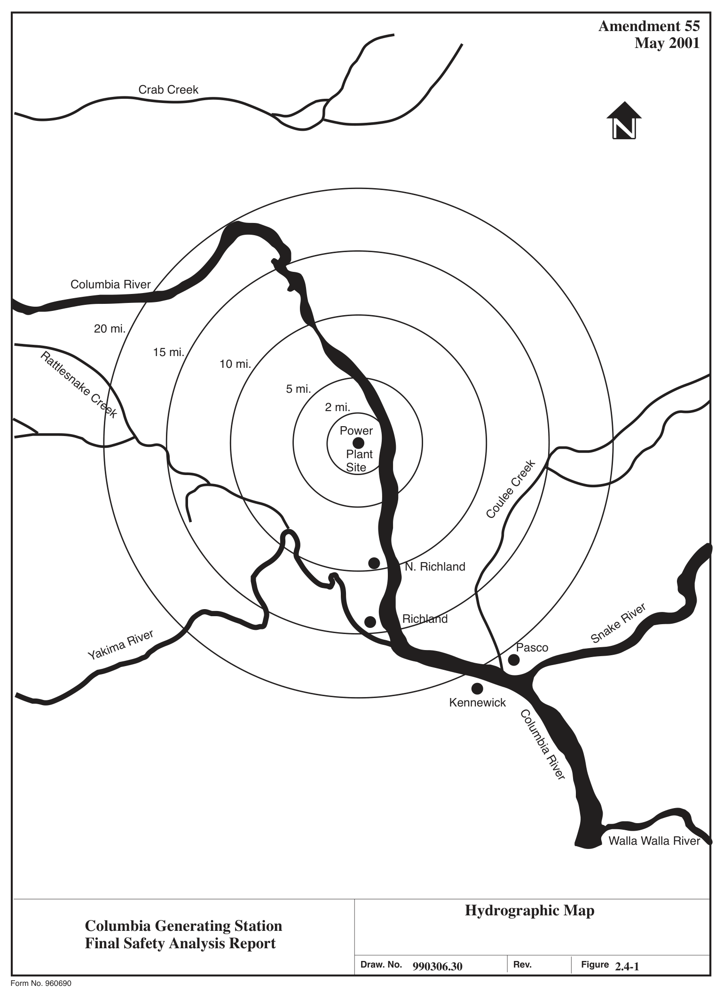

*figure on PDF page 231*

[Vector original (SVG, lossless): fig_page-231.svg](../figures/fig_page-231.svg)

<!-- labels/text on this figure page -->
Amendment 55 May 2001
Crab Creek
Columbia River
20 mi.
15 mi.
Rattlesnake Creek 10 mi.
5 mi.
2 mi.
Power Plant Coulee Creek Site
N. Richland
Snake River Richland Yakima River Pasco
Kennewick Columbia River
Walla Walla River
Hydrographic Map Columbia Generating Station Final Safety Analysis Report Draw. No. 990306.30 Rev. Figure 2.4-1 Form No. 960690

<!-- p.232 -->
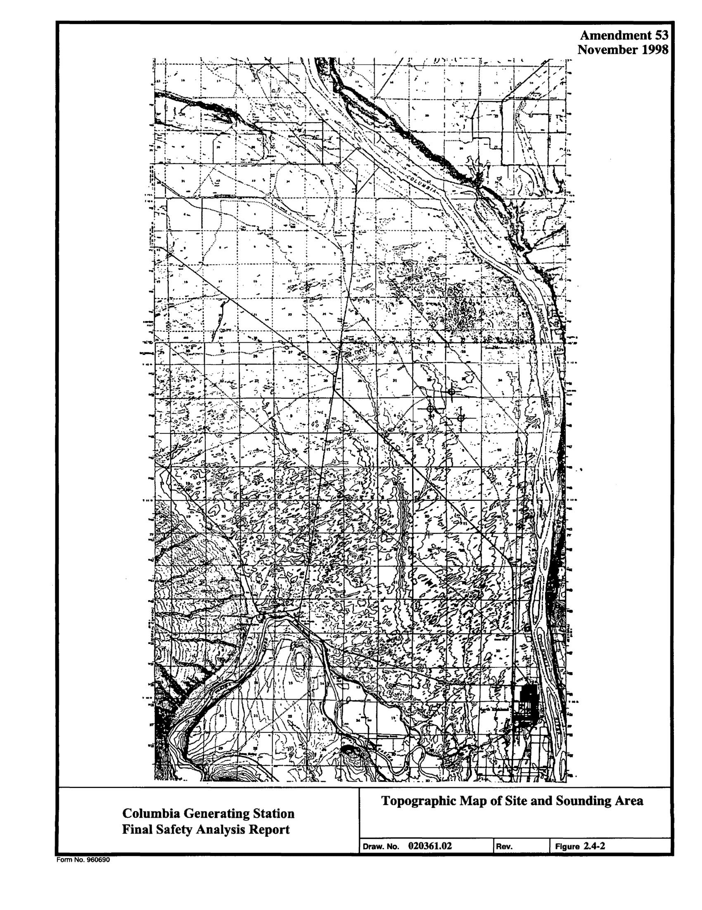

*figure on PDF page 232*

<!-- labels/text on this figure page -->
Amendment 53 , ~ .• • 1 ~~--J~. ~ ,i'-'--.. ""'77--t--c-)f!. November 1998 ~-·t·:·.~·-·t<t~-.
. --~-£...'L:..~_:.::.._- li.. ,
•...
~ :
I ,.-
~
Topographic Map of Site and Sounding Area Columbia Generating Station Final Safety Analysis Report Draw. No. 020361.02 Figure 2.4-2 Rev.
Form No. 960690

<!-- p.233 -->
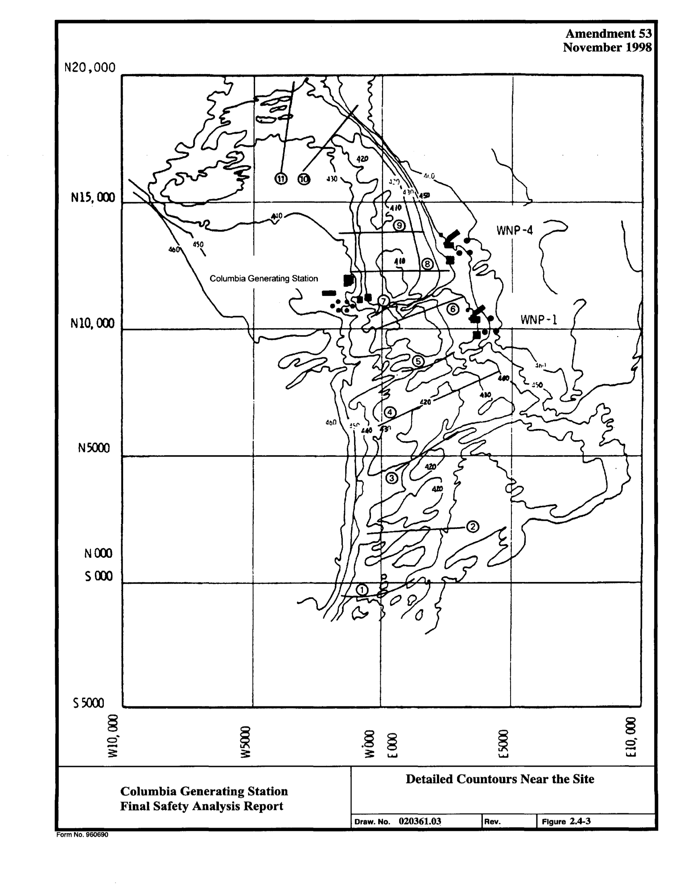

*figure on PDF page 233*

<!-- labels/text on this figure page -->
Amendment 53 November 1998
N20,000
WNP-4
NSOOJ
NCXXl S<XX>
_j_ ___ __J 55000§ ____ _,_ ___ _L ___ ;
3:
Detailed Countours Near the Site Columbia Generating Station Final Safety Analysis Report Draw. No. 020361.0~ Figure 2.4-3 Rev.
Form No. 960690

<!-- p.234 -->
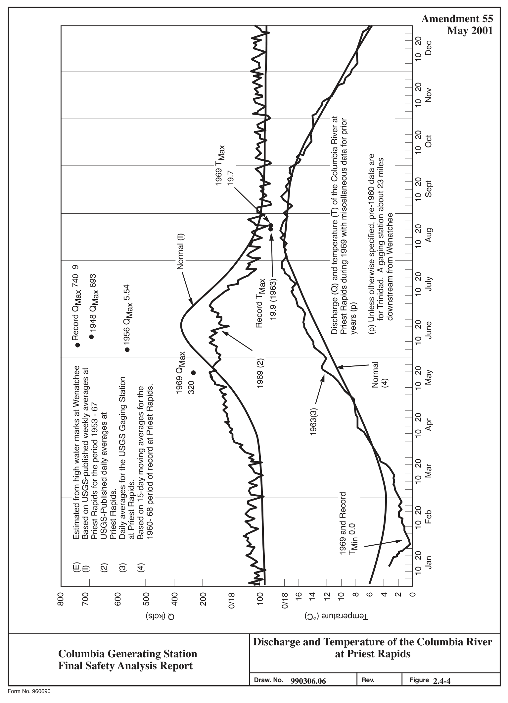

*figure on PDF page 234*

[Vector original (SVG, lossless): fig_page-234.svg](../figures/fig_page-234.svg)

<!-- labels/text on this figure page -->
Amendment 55 May 2001 20 Dec 10
20 Nov 10
Discharge (Q) and temperature (T) of the Columbia River at Priest Rapids during 1969 with miscellaneous data for prior 10 20 Oct 1969 TMax
(p) Unless otherwise specified, pre-1960 data are for Trinidad. A gaging station about 23 miles 19.7 10 20 Sept
downstream from Wenatchee 10 20 Aug Normal (I)
Record QMax 740 9 10 20 1948 QMax 693 July 19.9 (1963) Record TMax 1956 QMax 5.54 years (p)
20 June
•
• 10
• 1969 QMax 1969 (2)
Normal Estimated from high water marks at Wenatchee 10 20 Based on USGS-published weekly averages at May Daily averages for the USGS Gaging Station
(4)
320 1960- 68 period of record at Priest Rapids. Based on 15-day moving averages for the Priest Rapids for the period 1953 - 67 1963(3)
USGS-Published daily averages at 20 Apr 10
20 Mar 10 at Priest Rapids.
Priest Rapids.
1969 and Record 10 20 Feb TMin 0.0 10 20 Jan
(E) (2) (3) (4)
(I)
800 700 600 500 400 200 0/18 100 0/18 16 14 12 10 8 6 4 2 0 Q (kcfs)
Temperature (°C)
Discharge and Temperature of the Columbia River at Priest Rapids Columbia Generating Station Final Safety Analysis Report Draw. No. 990306.06 Rev. Figure 2.4-4 Form No. 960690

<!-- p.235 -->
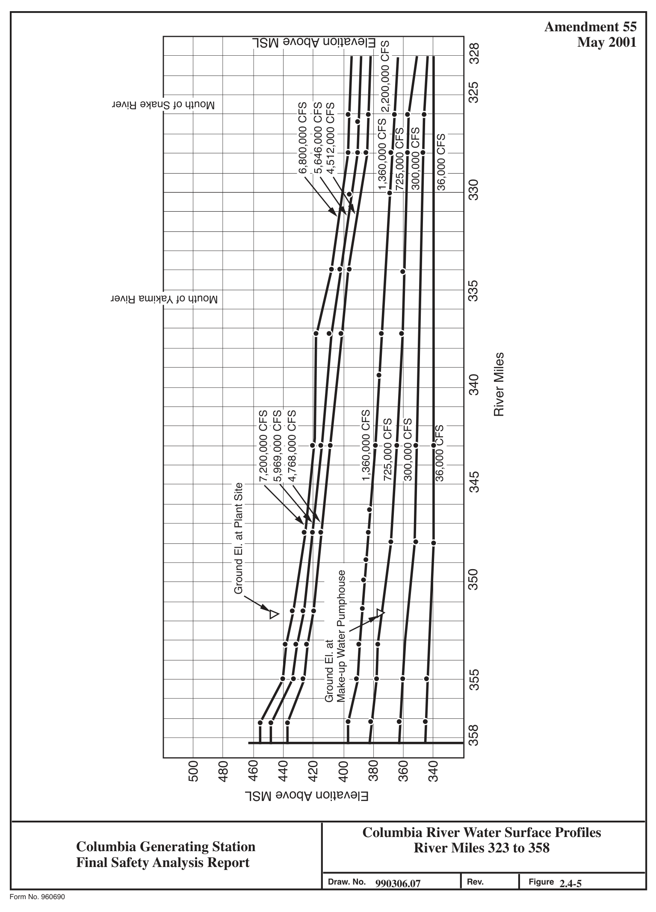

*figure on PDF page 235*

[Vector original (SVG, lossless): fig_page-235.svg](../figures/fig_page-235.svg)

<!-- labels/text on this figure page -->
, Amendment 55 May 2001 Elevation Above MSL 2,200,000 CFS 328 325 Mouth of Snake River
6,800,000 CFS 5,646,000 CFS 4,512,000 CFS I LI 11 ~ -
I---+---+----+----+-- - - •- 1-e f-----•- J-••--+----------1 -;-;-;- .. •-
1,360,000 CFS 300,000 CFS 725,000 CFS 36,000 CFS I-----------+----+---+-------+-- - \ \~~-I ~ -
- - '\. \ ~· .
I----+---+----+----+-- " 330
;-; · ~d
• 335 Mouth of Yakima River I • • •
• • I I • River Miles 340
7,200,000 CFS 5,969,000 CFS 4,768,000 CFS 1,360,000 CFS 725,000 CFS 300,000 CFS 36,000 CFS
-•-•-•-- •- •- •-• - I
' I 345 Ground El. at Plant Site ; :
I 1 ;-s---r-•- '
_J
350 Make-up Water Pumphouse ,•--+----+----+--+---------1----------1 j I / ' 1J i ; ; ; i Ground El. at
I I _I _J_!_•-•~
355 1--------+-----+---------+--i'lJ-~ I ' II I
i i i
358
500 480 460 440 420 400 380 360 340 Elevation Above MSL
Columbia River Water Surface Profiles Columbia Generating Station River Miles 323 to 358 Final Safety Analysis Report Draw. No. 990306.07 Rev. Figure 2.4-5 Form No. 960690

<!-- p.236 -->
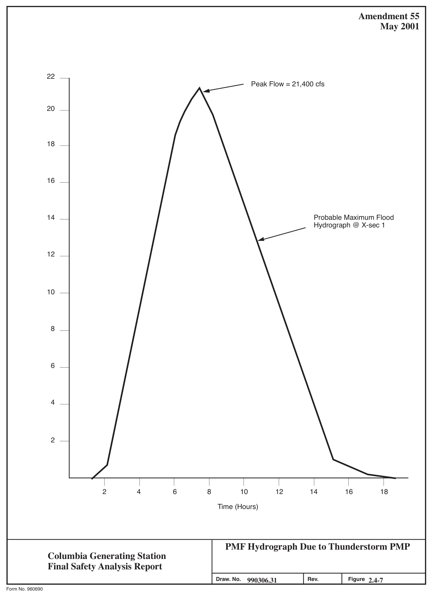

*figure on PDF page 236*

[Vector original (SVG, lossless): fig_page-236.svg](../figures/fig_page-236.svg)

<!-- labels/text on this figure page -->
Amendment 55 May 2001
22 Peak Flow = 21,400 cfs
20
18
16
Probable Maximum Flood 14 Hydrograph @ X-sec 1
12
10
8
6
4
2
2 4 6 8 10 12 14 16 18 Time (Hours)
PMF Hydrograph Due to Thunderstorm PMP Columbia Generating Station Final Safety Analysis Report Draw. No. 990306.31 Rev. Figure 2.4-7 Form No. 960690

<!-- p.237 -->
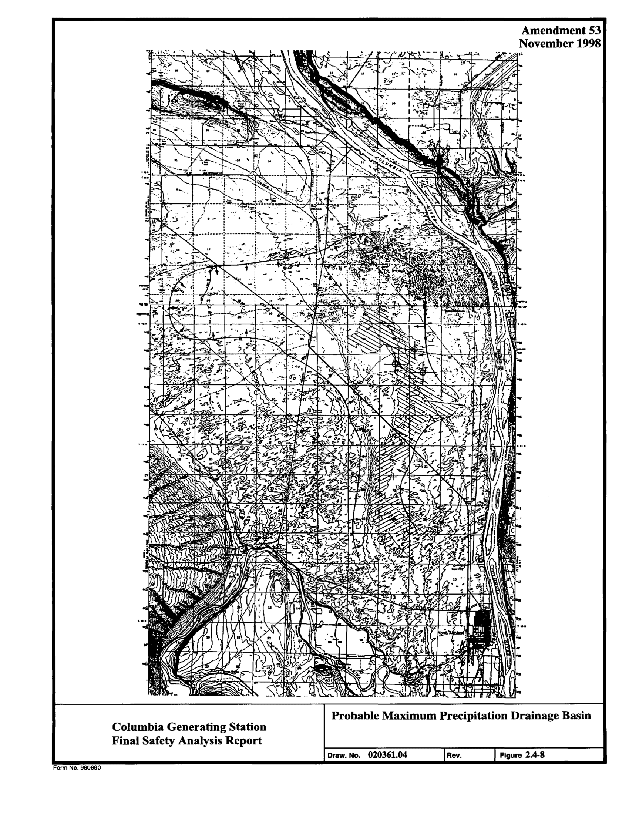

*figure on PDF page 237*

<!-- labels/text on this figure page -->
Amendment 53 November 1998
Probable Maximum Precipitation Drainage Basin Columbia Generating Station Final Safety Analysis Report Draw. No. 020361.04 Figure 2.4-8 Rev.
Form No. 960690

<!-- p.238 -->
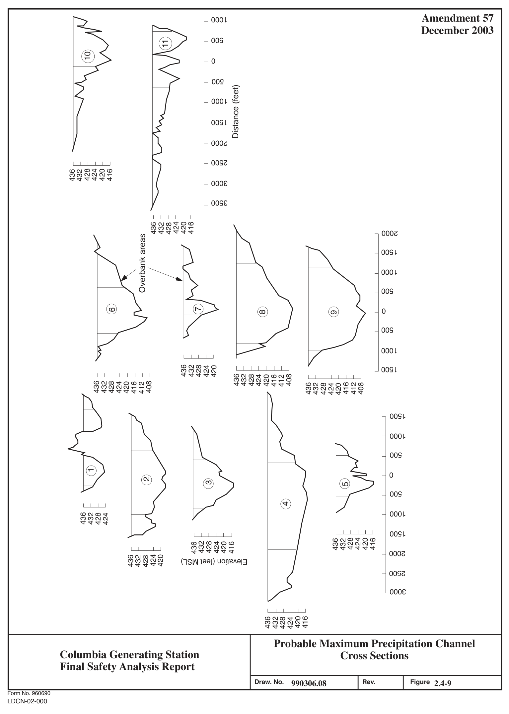

*figure on PDF page 238*

[Vector original (SVG, lossless): fig_page-238.svg](../figures/fig_page-238.svg)

<!-- labels/text on this figure page -->
Amendment 57 1000 December 2003 500 11 10 0
500 Distance (feet)
1000
1500
2000
2500 428 424 436 432 420 416 3000
3500
436 432 428 424 420 416 2000 Overbank areas 1500
1000
500
0 7 6 8 9
500
1000
1500 432 428 424 420 436 436 408 I I I I I I I 432 428 424 420 416 412 436 432 428 424 408 420 416 412 436 432 428 424 420 416 412 408
1500
1000
500
1 0 2 3 5 500 4
L.L.LJ
1000 436 432 428 424 1500 436 428 424 420 416 432 436 432 428 424 420 416 2000 436 432 424 420 428 Elevation (feet MSL)
2500
3000
I I I I I I
436 432 428 424 420 416 Probable Maximum Precipitation Channel Columbia Generating Station Cross Sections Final Safety Analysis Report Draw. No. 990306.08 Rev. Figure 2.4-9 Form No. 960690
LDCN-02-000

<!-- p.239 -->
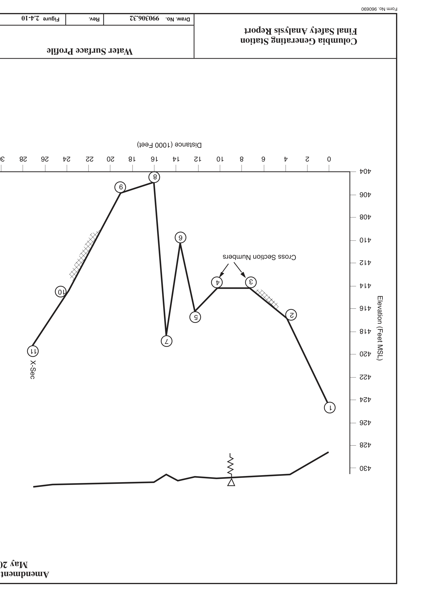

*figure on PDF page 239*

[Vector original (SVG, lossless): fig_page-239.svg](../figures/fig_page-239.svg)

<!-- labels/text on this figure page -->
Amendment 55 May 2001
- /'---- 1 / 430
428
426 1 424
422 X-Sec Elevation (Feet MSL) 420 11 7 418 5 2 416
10 414 4 3
412 Cross Section Numbers
410 6
408
406 9 8 404 0 2 4 6 8 10 12 14 16 18 20 22 24 26 28 30 Distance (1000 Feet)
Water Surface Profile Columbia Generating Station Final Safety Analysis Report Draw. No. 990306.32 Rev. Figure 2.4-10 Form No. 960690

<!-- p.240 -->
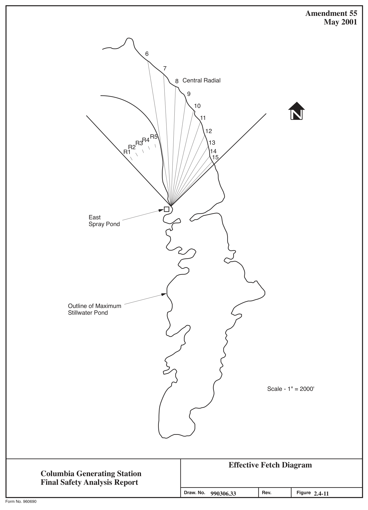

*figure on PDF page 240*

[Vector original (SVG, lossless): fig_page-240.svg](../figures/fig_page-240.svg)

<!-- labels/text on this figure page -->
Amendment 55 May 2001
6
7
8 Central Radial
9 10 11
12
R1R2R3R4R5
13 14 15
East Spray Pond
Outline of Maximum Stillwater Pond
Scale - 1" = 2000'
Effective Fetch Diagram Columbia Generating Station Final Safety Analysis Report Draw. No. 990306.33 Rev. Figure 2.4-11 Form No. 960690

<!-- p.241 -->
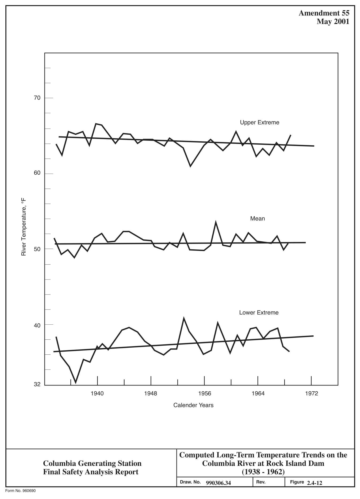

*figure on PDF page 241*

[Vector original (SVG, lossless): fig_page-241.svg](../figures/fig_page-241.svg)

<!-- labels/text on this figure page -->
Amendment 55 May 2001
70
Upper Extreme
60
River Temperature, °F Mean
50
Lower Extreme
40
32 1940 1948 1956 1964 1972 Calender Years
Computed Long-Term Temperature Trends on the Columbia River at Rock Island Dam Columbia Generating Station
(1938 - 1962)
Final Safety Analysis Report Draw. No. 990306.34 Rev. Figure 2.4-12 Form No. 960690

<!-- p.242 -->
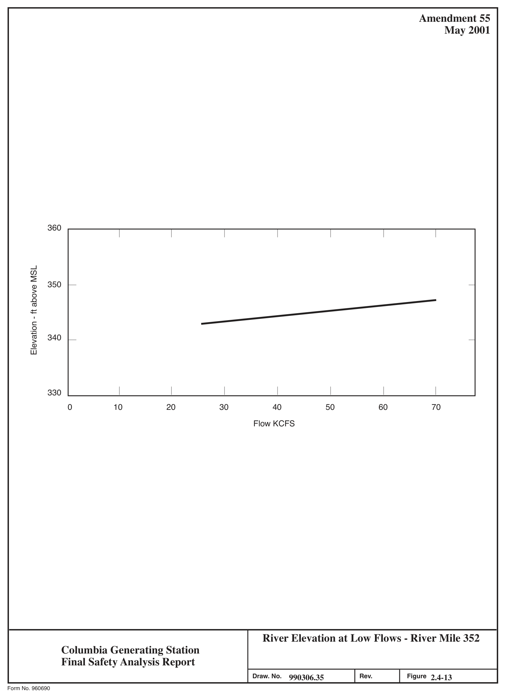

*figure on PDF page 242*

[Vector original (SVG, lossless): fig_page-242.svg](../figures/fig_page-242.svg)

<!-- labels/text on this figure page -->
Amendment 55 May 2001
360
I I I I I I I
Elevation - ft above MSL 350
-
-
-
- 340
-
-
I I I I I I I 330
0 10 20 30 40 50 60 70 Flow KCFS
River Elevation at Low Flows - River Mile 352 Columbia Generating Station Final Safety Analysis Report I I Draw. No. 990306.35 Rev. Figure 2.4-13 Form No. 960690

<!-- p.243 -->
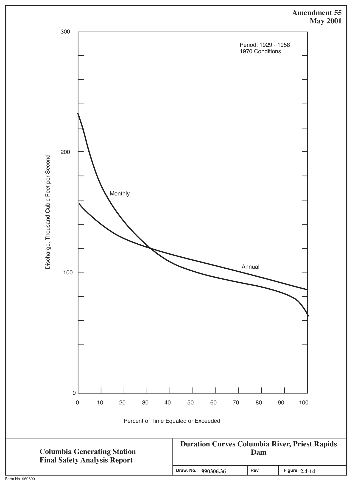

*figure on PDF page 243*

[Vector original (SVG, lossless): fig_page-243.svg](../figures/fig_page-243.svg)

<!-- labels/text on this figure page -->
Amendment 55 May 2001 300
Period: 1929 - 1958 1970 Conditions
200 Discharge, Thousand Cubic Feet per Second Monthly
Annual 100
0 0 10 20 30 40 50 60 70 80 90 100
Percent of Time Equaled or Exceeded
Duration Curves Columbia River, Priest Rapids Columbia Generating Station Dam Final Safety Analysis Report Draw. No. 990306.36 Rev. Figure 2.4-14 Form No. 960690

<!-- p.244 -->
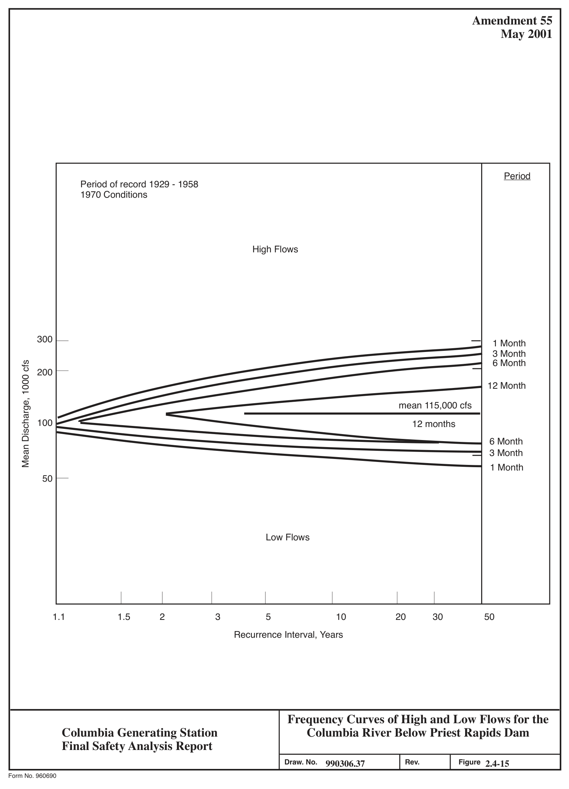

*figure on PDF page 244*

[Vector original (SVG, lossless): fig_page-244.svg](../figures/fig_page-244.svg)

<!-- labels/text on this figure page -->
Amendment 55 May 2001
Period Period of record 1929 - 1958 1970 Conditions
High Flows
300
1 Month
3 Month
6 Month
Mean Discharge, 1000 cfs 200
12 Month
mean 115,000 cfs 100 12 months
6 Month
3 Month
1 Month
50
Low Flows
1.1 1.5 2 3 5 10 20 30 50 Recurrence Interval, Years
Frequency Curves of High and Low Flows for the Columbia River Below Priest Rapids Dam Columbia Generating Station Final Safety Analysis Report Draw. No. 990306.37 Rev. Figure 2.4-15 Form No. 960690

<!-- p.245 -->
Amendment 53 November 1998

c~:~ ... -.--~-f\:~"···; •. _r ·-. ~'-- };.;_~r· - ~::· .. _._ .,·· . . _·;• l _. J -•;~:t::
•• -~ .LJ r: , • ..~ .. --~ /~

-~ u • ... _, .... :'.'.:~--

"-:£2,~::: ~,-:.,,!-;-;._?_··-,·.;.L;~;-i:_:f-'_--'-+-~--:L-~--,,~~-"i;I-.
t • .

---- .......... -~ .. -- .. -. - ~ .. -.

... :
'

........ _

I N

.... .,...,

• ··.:.~ .... -._ .. \·: !l

___ \;
. , .. _ .:--~... _ __ ·- ·~-:'-.-- ;-..~-r . .:
:·'

• .... --.

\ '•· .

..........

' ' ' .. ,. ~ \

~ '•r:,, ' ' ' ' ' .. / _;::-ct\, ":' ' .
. .

~ ....

... .. ,-:::;.·"' ,-~- .

•·• . !,:• ... .... /

•,

.. ,

Osanene I.
I'•.,._ ""'11,,.,._. l.ih-"••••"•'• HANFORD RESERVATION\• WELL LOC•TION IIAP (

'~- ·,
•;• ~ \'..,

,...,,__,._ ............... .,...

~.9!!.:..

z,.,._. ........ _.... ... PMtlMlbt' _ .. ...,.._~-- 1711 Wb.l HlaAIM,r

WIU wtTN .. ZOMHI• ■ ..... c.-.---.,

Wfll tD Mt•U WITM NZOMUIIII ,IAll--w:i&M---, ..........

• .,.. _.._ .. ,oo.N. aoo 1..100,w . -PAYIIDlltOAD
••••oun IIOAD

.,l(IJOO ......... lecatloM.

..••. ••1u10AO POWI• UIIIII
• tH•CI ,._._.,11JAJAII OUIPIGI'

Monitoring Well Locations (September 1975)
Columbia Generating Station Final Safety Analysis Report Agunt 2.4-17 Draw. No. 020361.0S Rav.
Form No. 960690

<!-- p.246 -->
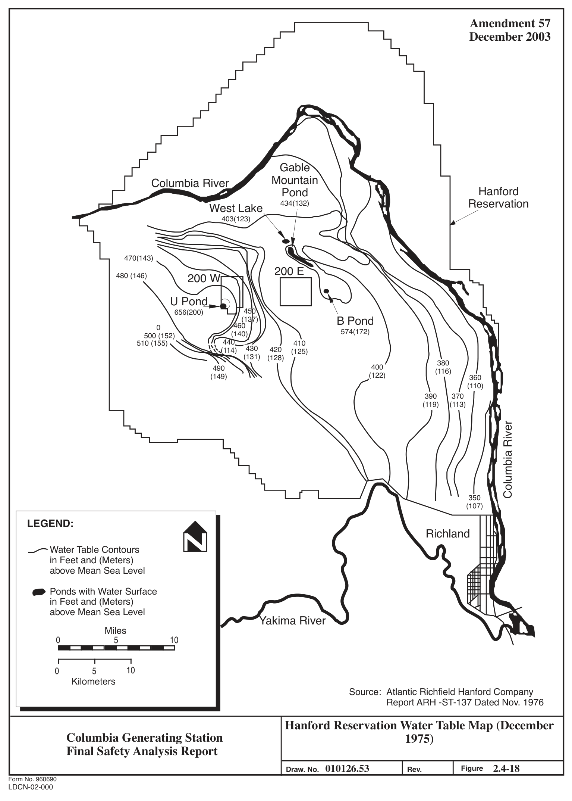

*figure on PDF page 246*

[Vector original (SVG, lossless): fig_page-246.svg](../figures/fig_page-246.svg)

<!-- labels/text on this figure page -->
Amendment 57 December 2003
Gable Mountain Columbia River Hanford Pond Reservation West Lake 434(132)
403(123)
470(143)
200 E 200 W 480 (146)
U Pond 656(200) 450 B Pond (137)
460 0 574(172) (140)
500 (152)
510 (155) 440 410 430 420 (114)
(125)
(131) (128)
380 400 490
(116)
(122)
(149)
360
(110)
390 370
(119) (113)
Columbia River 350
(107)
LEGEND:
Richland Water Table Contours in Feet and (Meters)
above Mean Sea Level
Ponds with Water Surface in Feet and (Meters)
above Mean Sea Level Yakima River Miles 0 5 10
10 0 5 Kilometers Source: Atlantic Richfield Hanford Company Report ARH -ST-137 Dated Nov. 1976 Hanford Reservation Water Table Map (December Columbia Generating Station 1975)
Final Safety Analysis Report 010126.53
2.4-18 Figure Draw. No. Rev.
Form No. 960690
LDCN-02-000

<!-- p.247 -->
Amendment 53 November 1998 + N I

Form No. 960690

<!-- p.248 -->
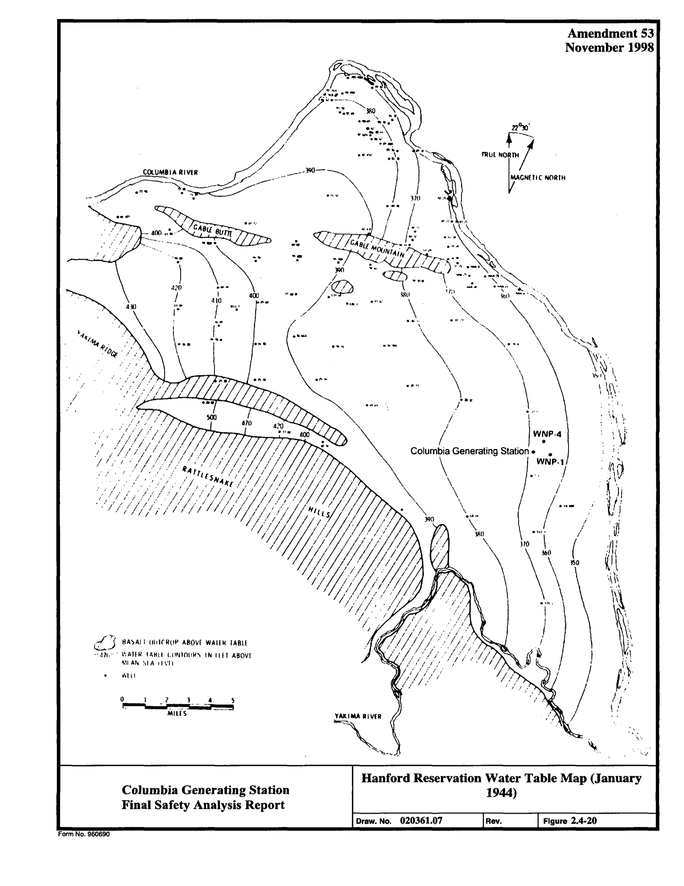

*figure on PDF page 248*

<!-- labels/text on this figure page -->
Amendment 53 November 1998
r-- n°lo'
l'IIUl IIIORTH / ~'"''"'"
/ I I / i 1·· ; '\_l;
W~P-4 ' Ji Columbia Generating Station • •
WNP-1
\ \ I / ·--- I \ \ ·\· I /
18\\ ll\O .,\ {:
..... \
I J .-1).,_ HA}AI I 1JlllfROI' A80V£ WAIi H IABL[ ~ ··,llv. l'1AIIW 1~"11 ttlNIOI!~~ IN 1111 A80V[ ~11 Ar,, ~I A I I VI I iilll
Hanford Reservation Water Table Map (January Columbia Generating Station 1944)
Final Safety Analysis Report Dr-. No. 020361.07 Rev. Figure 2.4-20 Form No. 960690

<!-- p.249 -->
Amendment 53 November 1998

..:....;...;~:5,~liit.:~~:=.~::--· _ ... --a;i,,.._·ia:~~il:IQj';~.:....

c;:q!!_,NT•~ " . J • ··":-"";)/_ ".;,., ••
- --~ :
COUNTY t" ~- • I'·'.~,•. '•,<1)3·. ·:'f{i:'• \
-'' _, ... .+, .,.
I ,\ . -.) ! I '(I' ,,. ••

-· ~--- _.J:._ .• .':~: ,, .~/~ .......

;· , i ,~ :· , :- - ~fy-2··.
_( •. , - ·- ,., • '.: \~·-'ff::~- \' ,,,V,// .',· • 51,0 .·..
-...\r;1, _'I.:

.....

' 'i ,,/

' I~•:''//' • ••• ..... ··

;.

:-+.,~f.,..,-!-" ;~~•~-~;:,,• • -~ "-'-:1"-,r_.= ·• '1) t,

-:--"'T"""C,,......_=

:~· •, ,.dr ~ ,;,j,1¥."'.:\, :~

b:,,,. .... ,f,00-- ~~~~-

--~ .. ~-_;,~r~·~;~~'.-- -~.. , _;;
'.~~===~~L
-:){}[ \{~.?: ,, •. 1 7--=,,.,J!!!l!ryQ, • • -~--~ I\ f .
"--"""'~1'M4"4i&~~~ rfz-;:·.·: •. :· _· ~=r-- . .
~~-<:~ .. { r - -.
~
•
(7 i
•. -~-- ! ~~-

~~~~~~,.....L-~i

.
!
!
i :\t-=- r•:· .. ,· ..

_,1)5• -{~

' . . ingStation

.. ,., {i1 ;ti ;,;. ..

• ., -~~ ), .,,· t····-··

I .... I

:
' /!_ ,_ . -~---· •. I, •:.,

.. ' ......

·,r.\ • ••

-~
-- i t :· '/ l '

N

-~~'Ric~l~~~•- •• •. , • ,·-. . ~ '0 'lb .
~: 1,,.£?-,t.,

·--~ ' :'I'...... .... . ..

#### HYDRAULIC CONDUCTIVITY ISOPETHS IN FEET PER DAY

SOURCE: PLATE III-5 FROM REFERENCE 2.4-39 Hydraulic Conductivities in the Unconfined Aquifer Columbia Generating Station Final Safety Analysis Report Figure 2.4-21 Draw. No. 020361.08 Rev.
Fonn No. 960690

<!-- p.250 -->
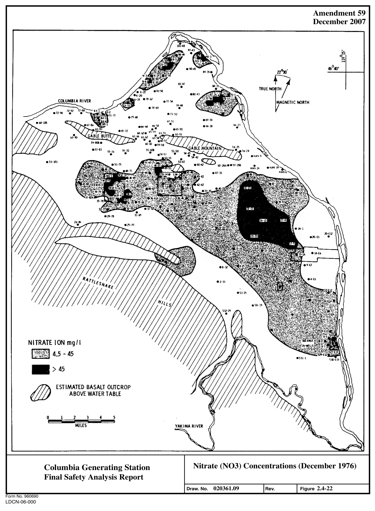

*figure on PDF page 250*

<!-- labels/text on this figure page -->
Amendment 59 December 2007
•
•~l~lO e 11-o.1
•"·'° A RIVER CotUMBI ·I
en•• 11-01 • 11;,u 1 er>-a1
NITRATE ION mg/I 4.5 - 45 .. >45
ALT OUTCROP
EST IMATEV£D BWA;TER TABLE ABO
MJL1S
Nitrate (NO3) Concentrations (December 1976) Columbia Generating Station Final Safety Analysis Report 020361.09
2.4-22 Draw. No.
Rev. Figure Form No. 960690
LDCN-06-000

<!-- p.251 -->
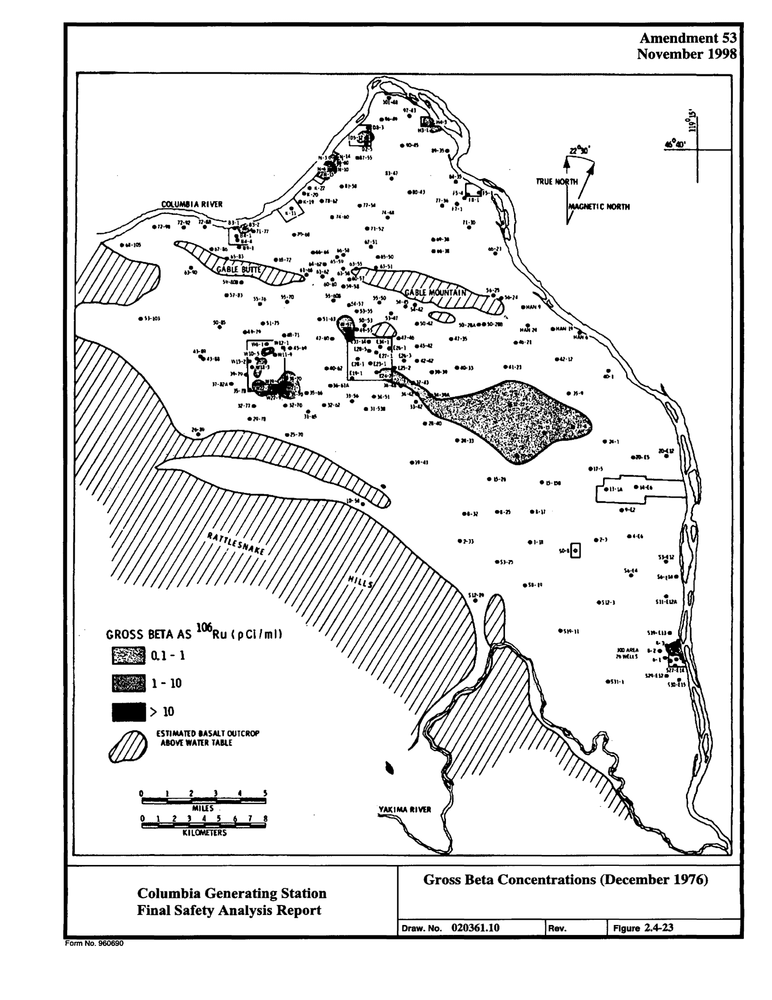

*figure on PDF page 251*

<!-- labels/text on this figure page -->
Amendment 53 November 1998
eJMIII ,. ... •
COI.UMIIA RIVER
.
... . . .. .
eu .... .... 119'1 11911 H· •
•n·tl ·I ll•ff .,.II • '
M•III • .,,~,, ,o!Nt
•'1·6J ew-u M·AA••to-11111
• .,,JI
.
., . .,.
-~-It
•1-1'1 H•II ••-11
.....
•1-n
••EJ
•SJ-n
ell-II
GROSS BETA AS l06Ru ( pCl/mll
- 0.1-1
-1-10
->10 /JJ'J. ESTIMATrD IASAI.T OUTCROP
(UU
AIOVE WATUI TABLE
s 2 0
MILES
2 ' 4 5 6 0 8 Kl LOMETlllS
Gross Beta Concentrations (December 1976)
Columbia Generating Station Final Safety Analysis Report Draw. No. 020361.10 Figure 2.4-23 Rev.
Form No. 960690

<!-- p.252 -->
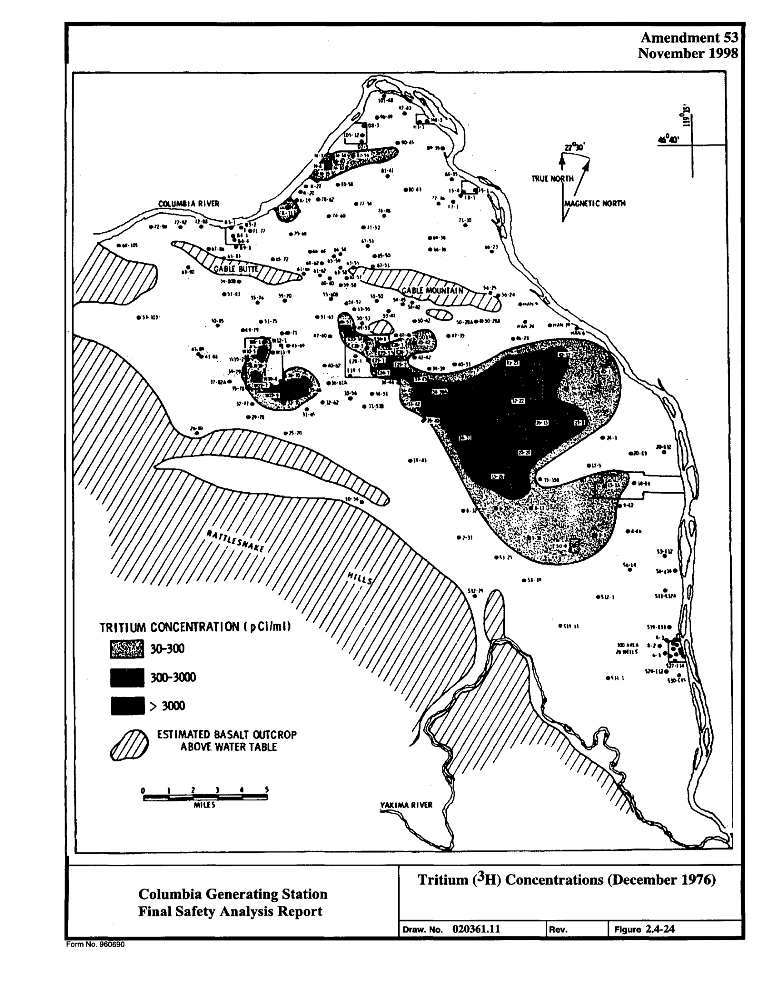

*figure on PDF page 252*

<!-- labels/text on this figure page -->
Amendment 53 November 1998
n,,,9
•••n· • ·•·~
COI.UMIIA RIYEII
•·l• • 11•11 .,. .,. .• VTICNORllt ' .. ,
•ll·• 11;,'1 .JJ.U U-1~,•~,I 11 ·•
... n I fllM ,,,. ...u ...
wo, •n·• \"ii'•
TRITIUM CONCENTRATION ( pCllml)
- 30-300
-300-3(XX)
->3000
(I/J)
ESTIMATED BASALT OUTCROP
ABOVE WATER TABLE
• s 0 2 MIUS
Tritium (3H) Concentrations (December 1976)
Columbia Generating Station Final Safety Analysis Report Figure 2.4-24 Rev.
Draw. No. 020361.11 Form No. 960690

<!-- p.253 -->
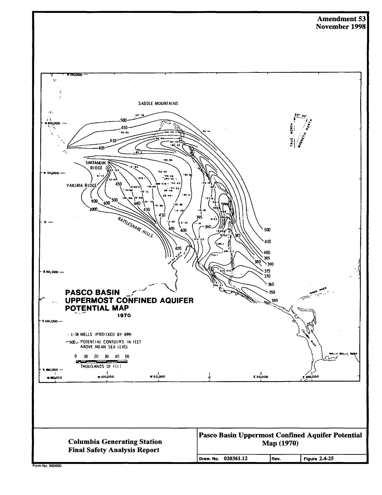

*figure on PDF page 253*

<!-- labels/text on this figure page -->
Amendment 53 November 1998
SADDLE MOUNTAINS
o-
···ff'
S&0,000-
<
-'\_ ( --- PASCO BASIN _,~--✓ ,,
UPPERMOST CONFINED AQUIFER
POTENTIAL MAP
1970
SI00,000-
• 1-18 WfLLS IPRHIX[D BY 6991 ~sro- POTENTIAi CON!Ol/RS IN f[[T ABOVE MEAN S[A t[VEl
0 JO 20 30 40 50
W _ ---7 THOUSANDS Of 11 l:
5 l!I0,000 ~ I
I I I
w,oopoo £ 60,DOO WISl,000 0
Pasco Basin Uppermost Confined Aquifer Potential Columbia Generating Station Map (1970)
Final Safety Analysis Report Draw. No. 020361.12 Figure 2.4-25 Rev.
Form No. 960690

<!-- p.254 -->
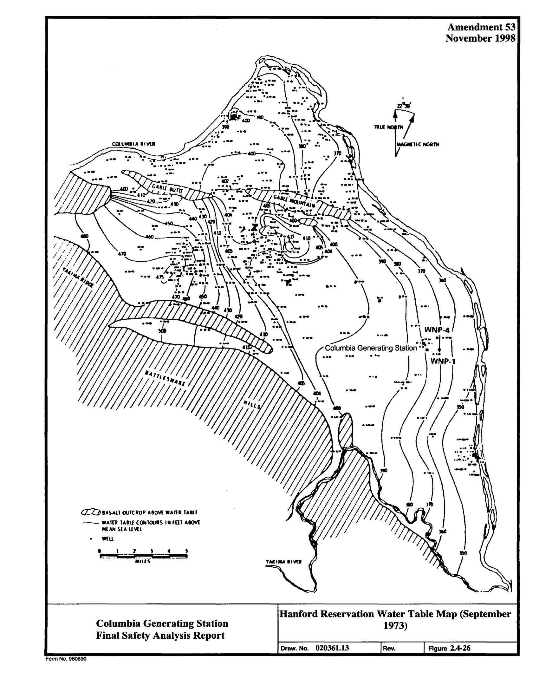

*figure on PDF page 254*

<!-- labels/text on this figure page -->
Amendment 53 November 1998
.
11"'-'
m~tz"-N
~IAS.111.1 OUlCIIOP AIOV'I WAIH TAIU
- WATO TAIU COMT<IJIIS Ill fnT A.:1111 MUii SlA Ulofl
• Wl'.U
1
Hanford Reservation Water Table Map (September Columbia Generating Station 1973)
Final Safety Analysis Report Draw. No. 020361.13 Figure 2.4-26 Rev.
Form No. 960690

<!-- p.255 -->
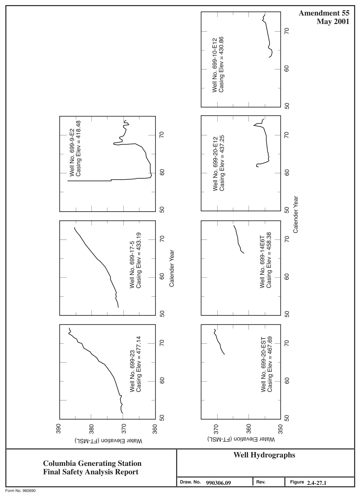

*figure on PDF page 255*

[Vector original (SVG, lossless): fig_page-255.svg](../figures/fig_page-255.svg)

<!-- labels/text on this figure page -->
Amendment 55 May 2001 70 Casing Elev = 430.86 Well No. 699-10-E12 60
50
Casing Elev = 418.48 Well No. 699-9-E2 70 70 Casing Elev = 437.25 Well No. 699-20-E12 60 60
Calender Year 50 50
I I
Casing Elev = 458.38 Casing Elev = 433.19 Well No. 699-14E6T 70 70 Well No. 699-17-5 Calender Year 60 60
f-
I I 50
50 I I
\ Casing Elev = 477.14 Well No. 699-20-EST Casing Elev = 467.69 70 70
Well No. 699-23 60 60
50 50 390 380 370 360 370 360 350 Water Elevation (FT-MSL)
Water Elevation (FT-MSL)
Well Hydrographs Columbia Generating Station Final Safety Analysis Report Draw. No. 990306.09 Rev. Figure 2.4-27.1 Form No. 960690

<!-- p.256 -->
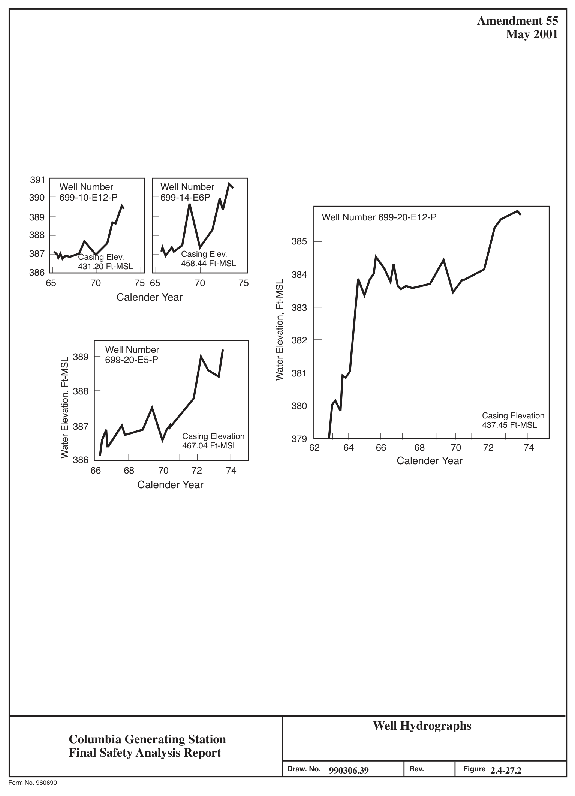

*figure on PDF page 256*

[Vector original (SVG, lossless): fig_page-256.svg](../figures/fig_page-256.svg)

<!-- labels/text on this figure page -->
Amendment 55 May 2001
391 Well Number Well Number 390 699-10-E12-P 699-14-E6P 389 Well Number 699-20-E12-P 388 385 387 Casing Elev.
Casing Elev.
458.44 Ft-MSL 431.20 Ft-MSL 386 384 65 70 75 65 70 75 Water Elevation, Ft-MSL Calender Year 383
382 Well Number 389 699-20-E5-P Water Elevation, Ft-MSL 381 388 380 Casing Elevation 437.45 Ft-MSL 387 Casing Elevation 379 467.04 Ft-MSL 62 64 66 68 70 72 74 Calender Year 386 66 68 70 72 74 Calender Year
Well Hydrographs Columbia Generating Station Final Safety Analysis Report Draw. No. 990306.39 Rev. Figure 2.4-27.2 Form No. 960690

