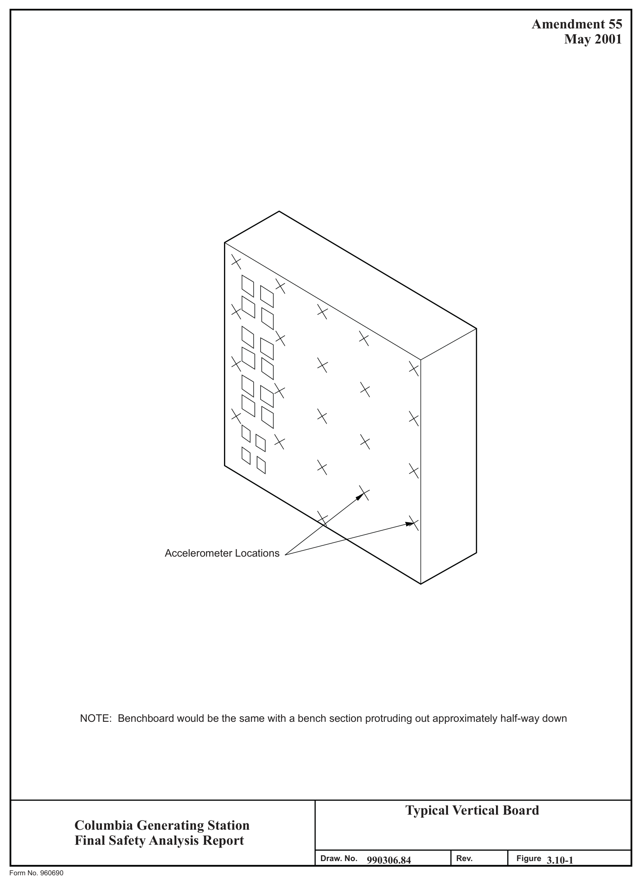
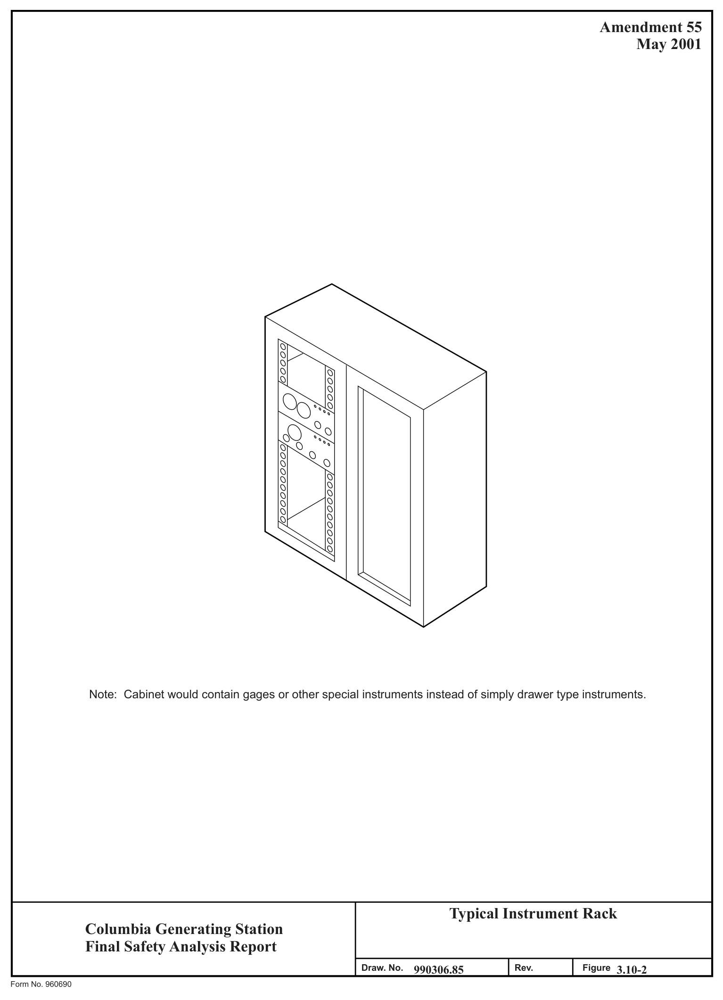
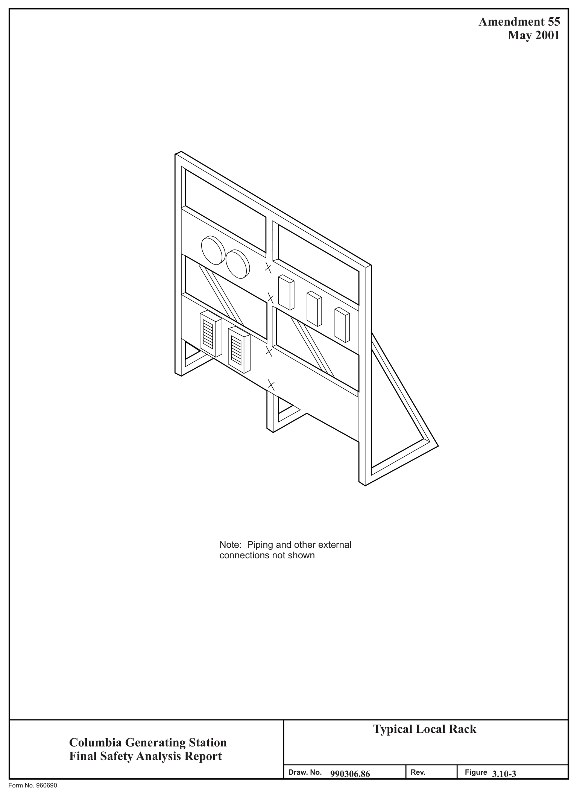
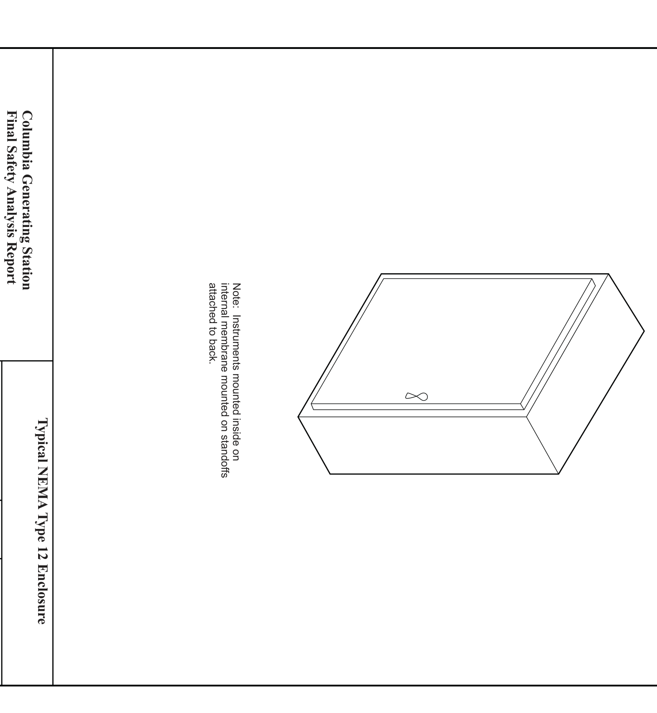
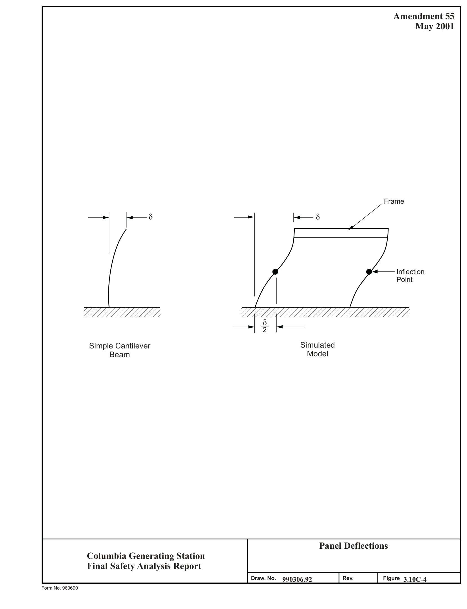

# 3.10 Seismic And Dynamic Qualification Of Safety-Related

> Columbia Generating Station FSAR — Chapter 03: Design of Structures, Components, Equipment and Systems
> Source: `03_chapter-660-1910.pdf`, PDF pages 859–907 (of 1251)
> Amendment 67 compilation (individual pages carry varying amendment dates)

---
<!-- p.859 -->
April 2000

### 3.10 SEISMIC AND DYNAMIC QUALIFICATION OF SAFETY-RELATED
#### INSTRUMENTATION AND ELECTRICAL EQUIPMENT
#### 3.10.1 SEISMIC AND DYNAMIC QUALIFICATION CRITERIA
##### 3.10.1.1 Safety-Related Equipment Identification
The Master Equipment List (MEL) is a computerized database of CGS equipment identification numbers and related information. The Safety Related Mechanical (SRM) list is a subset of MEL which contains all of the mechanical (nonelectrical) equipment which is in engineered safety features and reactor protection systems. The seismic and dynamic qualification of SRM equipment is discussed in Section 3.9.2.2. The equipment on the C1E list, also a subset of MEL, and the equipment necessary for the operators to follow the course of an accident
(Regulatory Guide 1.97) are addressed in Section 3.10. The C1E list also includes equipment supporting structures (cabinets, racks, etc.). Class 1E is defined per IEEE 323-1974 as the safety classification of the electric equipment and systems that are essential to emergency reactor shutdown, containment isolation, reactor core cooling, and containment and reactor heat removal, or otherwise are essential in preventing significant release of radioactive material to the environment.

All parameters required to perform the qualification evaluation have been determined, including normal and accident operational requirements, operating data, and manufacturer’s data. The location of the equipment has been verified by plant walk down or by plant records, to ensure the appropriateness of the required response spectra (RRS).

The C1E list in the MEL includes the Qualification Information and Documentation (QID) file number.

The QID file contains the following information:

a. The name of the company or organization which prepared the qualification report,

b. The report identification number and date,

c. The complete report (if the reports were proprietary and not released to Energy Northwest, audits were conducted, and summary reports prepared from the audit),

d. Required input loads or applicable required and test response spectra for the equipment,

e. Normal and accident operational requirements of the equipment,

<!-- p.860 -->
April 2000

f. The identification of whether the equipment is subject to fatigue due to hydrodynamic loading, and

g. The building location for each piece of equipment.

##### 3.10.1.2 Criteria for Acceptability
The original equipment seismic qualification requirement for CGS was described in the Preliminary Safety Analysis Report (PSAR). These requirements specified that the nuclear steam supply system (NSSS) and balance-of-plant (BOP) equipment be designed and tested to good industry practices. IEEE 344-1971 represented the established industry practices at that time and equipment purchases were made to those requirements.

In March 1979 Energy Northwest was notified that the NRC would review CGS equipment seismic qualification to upgraded criteria. This criteria was defined as IEEE 344-1975 as supplemented by Regulatory Guides 1.100 and 1.92 and NUREG-0800, Standard Review Plan
(SRP) Sections 3.9.2 and 3.10. A complete review (reevaluation) of the seismic/ hydrodynamic load basis, along with reevaluation of past equipment qualification I documentation, was performed. Energy Northwest undertook an equipment requalification program to ensure all Class 1E equipment would perform their safety functions during the seismic/hydrodynamic loading conditions postulated to occur at CGS. This program included

a. Identification of Class 1E equipment, b. Definition of seismic and hydrodynamic loads, c. Collection of seismic qualification documentation to current criteria, d. Reevaluation of the seismic qualification documentation to current criteria, e. Identification of document deficiencies, and f. Correction of identified deficiencies.

The NRC staff assembled a Seismic Qualification Review Team (SQRT) and conducted a site audit of the qualification program and equipment installation.

All C1E instrumentation and electrical equipment was designed to withstand the effects of the safe shutdown earthquake (SSE) described in Section 3.7.1.

The safety-related (Class 1E) instrumentation and electrical equipment were reevaluated to ensure performance of their safety function during and after operating basis earthquakes
(OBEs), SSE, and/or the hydrodynamic loads which result from a loss-of-coolant accident
(LOCA) or other design-basis event.

<!-- p.861 -->

Suppression pool hydrodynamic loads were developed for the CGS plant and are discussed in the “Plant Design Assessment for SRV and LOCA Loads,” Revision 3 (see Appendix 3A).
The safety/relief valve (SRV) building responses are appropriately combined with OBE, SSE, intermediate break accident (IBA), and design-basis accident (DBA) building responses to provide the basis for evaluating acceptability of Class 1E electrical and safety-related mechanical equipment originally qualified to seismic only dynamic loading. Detailed reevaluation of each component of Seismic Category I equipment was performed by comparison of original qualification RRS with revised seismic plus hydrodynamic RRS to demonstrate satisfactory qualification of the equipment. When such comparisons were not sufficient, other means of evaluating the original qualification against the new dynamic load combinations are used.

Hydrodynamic loads were limited to equipment located within containment or pipe-mounted equipment located between containment and the first equivalent six-way anchor outside containment. For that equipment, the hydrodynamic response spectra was added by squareroot-of-the-sum-of-the-squares (SRSS) to the response due to the SSE computed using the finite element soil-structure interaction analysis to determine adequacy. The use of SRSS methodology for combining response to dynamic loads was justified in Reference 3.10-1. In regard to the load combination SRV1 + SSE + DBA, CGS plant design adequacy assessments for Class 1E electrical equipment were performed on the generic basis established by the BWR Mark II Owner’s Group for this load combination.

The equipment affected by hydrodynamic loads were identified and an evaluation documented in the QID files. A list of the equipment was included in the CGS Dynamic Qualification Report (Reference 3.10-2).

The equipment located in other buildings was reevaluated for the motion caused by the SSE.
That motion is defined by the lumped-mass model analysis described in Section 3.7.2.

The reevaluation was based on IEEE 344-1975, as supplemented by Regulatory Guide 1.100 and SRP Section 3.10. There are four exceptions to the use of these criteria:

a. Interim criteria was established to reevaluate equipment mounted on piping systems whose analyses was not completed. The interim criteria was to use the peak of the applicable 0.5% damping floor response spectrum about 8 Hz as input acceleration for analysis or for sine dwell testing. The piping systems were designed, in turn, not to respond to frequencies less than 8 Hz. The as-built piping analyses were subsequently completed using the damping values specified in Regulatory Guide 1.61 or the criteria in ASME Code Case N411.
The computed accelerations of the equipment were compared to the interim acceleration criteria to verify that the interim criteria was conservative;

<!-- p.862 -->

b. Equipment which was qualified by testing using single frequency motion was reevaluated using the following criteria to establish its adequacy;

1. If the equipment was rigid [no resonant frequency below the zero period acceleration (ZPA) of the applicable response spectra] the test input acceleration must be greater than the acceleration corresponding to the ZPA of the response spectrum of the mounting point of the equipment;

2. If the equipment had only one natural frequency, the response acceleration to the test motion must be calculated at the appropriate damping ratio. To account for cross coupling, the required response acceleration was calculated by multiplying the acceleration corresponding to the equipment’s natural frequency found on the applicable response spectrum by the square root of 2 (1.41). If test response acceleration exceeded the required response acceleration, the test motion was considered adequate for requalification of the equipment;

3. If the equipment had multiple resonant frequencies, it was tested at each of them. The response to each test was calculated at each resonant frequency. That is, the response to a test at one frequency was calculated at that frequency and at all other resonant frequencies. The responses were then combined using the SRSS method. The test motion was considered adequate if the SRSS of the response accelerations to every test was greater than 1.4 times the SRSS of the accelerations found at the resonant frequencies on the applicable response spectrum;

4. If the equipment had closely spaced modes, the criteria of (3), above, was used except the responses to the closely spaced modes were combined by the absolute sum rather than SRSS;

c. For equipment which was panel, rack, or duct mounted, the maximum transmissibility of the mounting system was found by a combination of testing and analysis. The ZPA of the applicable response spectrum was then multiplied by this transmissibility to find the required acceleration for the equipment. Test accelerations of the equipment were then compared with the calculated required acceleration to establish qualification of the equipment; and

d. IEEE 344-1975 references IEEE 323-1974. Section 6.3.5 of IEEE 323-1974 recommends thermal and radiation aging before vibration testing. It has not been shown that normal service condition environmental aging reduces equipment’s ability to withstand a seismic event.

<!-- p.863 -->
The Electric Power Institute (EPRI) conducted testing to confirm that aging has insignificant effects on the ability of electrical and electronic equipment to survive a seismic event. That work is documented in EPRI NP-3326 and

#### NP-5024.
Documentation demonstrating qualification for each item is assembled in QID files. These files provide the details of the qualification method utilized in demonstrating the equipment’s adequacy to function when exposed to seismic/hydrodynamic vibrational input. See Section 3.10.2 for a discussion on methods.

###### 3.10.1.2.1 Cable Tray and Conduit Supports
Regardless of cable tray or conduit function, all supports located in Seismic Category I structures are designed to Seismic Category I requirements, with the exception of supports for field routed trays and conduits containing cabling for the communication system and all ac lighting outside of the main control room. All supports are qualified by dynamic analysis using appropriate seismic response spectra. The design considers both dead loads (loads which do not change magnitude and/or position), live loads (loads which do change magnitude and/or position), and SSE acceleration loads. Tray and conduit cable loadings (lb/ft) are accounted for in support design, based on maximum permissible raceway loading for the types of cable utilized.

Routing of trays and conduits containing cabling for the communication system and all ac lighting outside of the main control room were reviewed or inspected prior to February 1993 to ensure that failure of the support system cannot result in these trays and conduits having an impact on Class 1E equipment.

In February 1993, the installation procedure was changed to ensure future installations of conduit are aligned with engineering standards which define Seismic Category I areas of the plant. Installation requirements are accomplished by using Seismic Category II over I supports and appropriate span lengths.

###### 3.10.1.2.2 Decision Criteria (Original Construction Permit Basis)
###### 3.10.1.2.2.1 Structurally Simple Equipment. See Section 3.7.2.1.9.

3.10.1.2.2.2 Structurally Complex Equipment. Class 1E equipment determined to be structurally complex such that it cannot be described by a simple model may also be qualified by analysis. The equivalent SSE horizontal loads (plus hydrodynamic loads where applicable)
are determined using a dynamic model analysis of the equipment represented as a multidegree of freedom system. Horizontal floor response spectra for the particular equipment location and appropriate damping coefficients are used as input to determine the horizontal equipment response. A similar procedure is used to determine the vertical equipment response.

<!-- p.864 -->
3.10.1.2.2.3 Optional Dynamic Testing. In lieu of calculations and analyses, vibration testing of Class 1E equipment is an acceptable method of demonstrating the capability of equipment furnished to meet seismic loading requirements given by the applicable floor response spectra.
Test data furnished are either data acquired by testing equipment specifically for CGS or data acquired from previously tested comparable equipment. Dynamic tests were performed in accordance with IEEE 344-1971. (See Section 3.10.1.2.3 for reevaluation to

#### IEEE 344-1975.)
3.10.1.2.2.4 Mandatory Dynamic Testing. When potential failure of Class 1E equipment cannot be evaluated structurally (e.g., opening or closing of electrical circuits), then vibration tests are required to demonstrate seismic adequacy. No analytical procedures are considered acceptable in these instances.

3.10.1.2.2.5 Combined Test-Analysis. Where Class 1E equipment cannot be practically qualified by either analysis or testing alone (due to equipment size, complexity, etc.), a combination test and analysis is required to demonstrate seismic capability. The combination test and analysis were performed in accordance with IEEE 344-1971. (See Section 3.10.1.2.3 for reevaluation to IEEE 344-1975.)

###### 3.10.1.2.3 Reevaluation of Original Seismic Qualification
Section 3.10.1.2.2 describes the decision criteria employed in the selection of the qualification method used in the initial equipment specification. As discussed in Section 3.10.1.2, a reevaluation of the original qualification basis and methods employed was required by the NRC. This section discusses the reevaluation decision criteria.

3.10.1.2.3.1 Reevaluation Decision Criteria. The basis and method of qualification for each equipment item was reviewed to determine its adequacy to meet IEEE 344-1975. In addition, requalification to hydrodynamic load conditions was assessed.

Original qualification of the equipment generally is in the following categories:

a. Existing documentation fully satisfied existing new loads and criteria.
Requalification consists of the preparation of appropriate comparative and certification documents;

b. New dynamic loads or criteria impact the previous qualified status of a component. Requalification can be completed by providing additional analysis for that component to supplement the original testing or analysis;

<!-- p.865 -->

c. Previous qualification method is not applicable to load criteria now prescribed.
For example, a static analysis may have been performed where a dynamic analysis would now be appropriate. Requalification would require proper analysis, test or a combination thereof; and

d. Qualifying documentation consisted of certificates of conformance. In some cases certificates of conformance did not exist because of equipment relocations or modified safety class determinations. Often, qualifying documentation could be purchased from the manufacturer. If not, requalification would consist of performing proper analysis, test, or a combination thereof.

Qualification procedure methods vary with the nature and load criteria of the equipment and consist of static techniques, dynamic analysis, or test procedures. The following describes these methods.

3.10.1.2.3.2 Static Analysis. Static analysis was allowed for rigid equipment; that is, equipment whose natural frequency is above the ZPA of applicable response spectra. Rigid equipment items are analyzed by static methods which determine forces and moments resulting from center of gravity loading of a lumped mass acted on by the resultant acceleration from multidirectional earthquake motions. Conventional analysis determined stresses and/or deflections at all critical sectional areas, mounting attachment points, and anchor bolts. All stress level findings were additive to operational loads. Structural integrity was established by comparison of stress levels with prescribed codes or manufacturers’ acceptance criteria.
Selection of acceleration coefficients was based on response spectra at the equipment item mounting location.

Static analysis methods were particularly suited to equipment for which structural integrity is the primary criterion for qualification. Application of static analysis required adequate demonstration that the equipment could be realistically represented by the simple model and that the method produced conservative findings.

3.10.1.2.3.3 Dynamic Analysis. Dynamic analysis methods employed a mathematical model accurately representing the structural mass and stiffness distribution with sufficient degrees of freedom to determine dynamic response to cyclic loadings. These methods were employed when equipment could not be characterized as relatively simple or when interactive effects had to be included in the demonstration of adequacy. Dynamic analysis was also used to qualify equipment for which static analysis methods were too conservative.

Detailed dynamic analyses are accomplished with the use of sophisticated computer programs, such as STRUDL, ANSYS, and STARDYNE. The programs require development of a mathematical model that describes the mass and stiffness properties of the equipment. This involves preparation of model geometry, material constants, section properties, boundary conditions, and applied loads for input into the selected computer program. Standard Review

<!-- p.866 -->

Plan Section 3.9.2 modeling guidance is applied. As with static analysis, the results are combined with all other loads acting on or within the equipment item. The use of twice the peak values of the SSE/OBE seismic response spectra to compensate for the inability to realistically model structurally complex equipment was not used in the reevaluation.

3.10.1.2.3.4 Demonstration of Operability By Analysis. Where the function of a component could be demonstrated by analysis alone, analysis was often chosen as the cost-effective method for qualifying mechanical equipment and electric motors.

Where structural failure was the only known related failure mode, the allowables and rules of Section III of the ASME Boiler and Pressure Vessel (B&PV) Code were used for pressure retaining ASME materials. For nonpressure boundary materials either the rules and allowables of the AISC Code were used or the ASME Code allowables were extended to nonpressure retaining parts. For ANSI B31.1 components, the allowables and rules of ANSI B31.1 were used. For components which must produce mechanical motion after the faulted condition, the allowables were limited to emergency values for faulted loads. Where the listed codes do not apply (e.g., electric motors), good engineering practice was used to ensure stresses were within the working stress of the material with suitable safety factors.

For some components, operability was established by ensuring parts that have relative motion do not come into contact with each other. The manufacturer’s drawings were obtained for those components and the minimum clearances were determined. In order to qualify these components, a deflection analysis was performed at peak load which showed that the parts did not come into contact. Also, it was shown that stress limits were not exceeded.

The damping values used in the analyses were those specified in Regulatory Guide 1.61 unless another was justified and documented.

In the analyses performed, horizontal and vertical loads are assumed to occur simultaneously in the most unfavorable combinations. Normal operating loads are also combined with the I accident loads to produce the most severe stress combination. The “no loss of function” stresses are limited to 90% of the materials minimum yield strength with an SSE added to hydrodynamic loads and the normal operating loads.

3.10.1.2.3.5 Consideration of Fatigue. A fatigue reevaluation was performed for all components for which hydrodynamic loads are significant. To be qualified by analysis the stress levels and number of cycles at that stress are calculated. Then using the methods of ASME Section NB-3222.4, a cumulative damage fraction is calculated. That damage fraction cannot equal or exceed 1.0 for the component to be considered qualified.

3.10.1.2.3.6 Testing Methods. Qualification by testing was required when complex or active equipment could not be efficiently modeled to correctly predict response. The methods employed were laboratory tests conducted to simulated service conditions and in-situ tests conducted in the installed configuration.

<!-- p.867 -->

Dynamic tests are performed to a test response spectrum (TRS) which envelops and closely resembles RRS over the critical frequency range. Equipment was tested to simulated inservice load conditions whenever practical and are appropriately justified when not applied.
Operability was verified during and/or after the testing as applicable to the equipment being evaluated. The test specimens were checked for spurious operation during testing. If there were spurious operations, it was determined that they had no detrimental effects on the safety function of the equipment. Spurious operation of relays (e.g., contact chatter) was limited to 2 msec maximum, per IEEE 501-1978 unless it had been demonstrated that the spurious action found would not affect the safety function of the component as applied in its safety system.

Multiple frequency, multiple axis testing was used to qualify most of the Class 1E electrical equipment. This testing was performed according to IEEE 344-1975. The equipment was operated before, during, or after the test as required by the system safety function. No functional or structural failure was allowed.

Single frequency input motion, such as sine beats, was allowed when (a) the characteristics of the seismic input motion indicated that the motion was dominated by one frequency, (b) the anticipated response of the equipment was adequately represented by one mode, or (c) the test input motion had sufficient intensity and duration to excite all modes to the required amplitudes, such that the testing response spectra envelop the corresponding response spectra of the individual modes.

Some equipment was previously qualified to IEEE 344-1971 using single frequency testing.
The NRC required that justification be supplied for use of single frequency single axis qualification where the component could respond to multiple modes. These criteria were seldom used to qualify CGS equipment. Justification for those particular cases was made available to the NRC SQRT reviewers during an audit in January 1983 and resolved.

Several in-situ test approaches were used to complete qualification. These may be grouped into tests that verify accuracy of the analytical model, verify rigidity, justify reducing stress analysis conservatism, and demonstrate operability under simulated load conditions. This latter test, more appropriately called an in-situ static load test, simulates seismic deflections by means of an appropriately directed static force application. Operability is exhibited before, during, and after application of the deflecting load. Another type of in-situ test was used to qualify components attached to the high-pressure core spray (HPCS) system diesel generator.
Large reciprocating engines produce starting and running vibrations to attached components I much greater than that received due to seismic acceleration. If it was determined that the acceleration to the component under actual running operation exceeded the calculated input due to seismic effects by a factor of 3, the component was accepted as having sufficient seismic adequacy.

<!-- p.868 -->
April 2000

3.10.1.2.3.7 Combination of Testing and Analysis. Most qualification of equipment employs a combination of testing and analysis. Sections 3.10.2 and 3.10.3 provide examples of typical equipment qualifications that used this methodology.

#### 3.10.2 METHODS AND PROCEDURES FOR QUALIFYING INSTRUMENTATION
#### AND ELECTRICAL EQUIPMENT
##### 3.10.2.1 Methods For Qualifying Nuclear Steam Supply System Equipment (Excluding
Motors and Valve-Mounted Equipment)

a. Procedures - GE-supplied Seismic Category I equipment meets the requirements that the seismic qualification should demonstrate the capability to perform the required function during and after the SSE and other postulated events. Both analysis and testing were used, but most equipment was tested. Analysis was primarily used to determine the adequacy of mechanical strength (mounting bolts, etc.) after operating capability was established by testing;

1. Analysis - GE-supplied Safety Class 1E equipment, performing primarily a mechanical safety function (pressure boundary devices, etc.), was analyzed since the passive nature of their critical safety role usually made testing impractical. Analytical methods described in Section 3.10.1.2.3 and sanctioned by IEEE 344-1971 were utilized in such cases;

2. Testing - GE-supplied Safety Class 1E equipment, having primarily an active electrical safety function, was tested in compliance with IEEE 344-1971, and reevaluated per Section 3.10.1.2.3. Supplemental test data meeting IEEE 344-1975 was obtained when single frequency testing could not be justified; and

b. Documentation - Documentation used to seismically qualify GE-supplied Safety Class 1E equipment is in accordance with the requirements of IEEE 344-1975.
The documentation is maintained in a permanent file by Energy Northwest or GE and is available for audit.

##### 3.10.2.2 Methods For Qualifying Balance-of-Plant Equipment
Suppliers of Seismic Category I equipment such as batteries and racks, instrument racks, control consoles, electrical distribution equipment, etc., are required to demonstrate that their components or systems do not suffer loss of function during or after SSE or OBE seismic loading. Tests or analysis are performed in accordance with the criteria described in Section 3.10.1.2.3 and IEEE Standard 344-1975. The magnitude of the SSE and OBE loadings which each component experiences is determined by its location within the plant.
The response spectra for the various plant locations are included in each equipment’s QID file

<!-- p.869 -->
November 1998 t J and a comparison of the equipment’s qualification and capability is made to the RRS to document its adequacy.

##### 3.10.2.3 General Electric-Supplied Equipment Seismic Analyses and/or Testing Procedures
###### 3.10.2.3.1 Testing Procedures for Qualifying Equipment (Excluding Motors and
Valve-Mounted Equipment)

The testing procedure for qualifying electrical equipment and instrumentation (excluding motors and valve-mounted equipment) required that the devices be mounted on the vibration machine table the same way it was to be installed in the plant. The device was tested in the operating states that it would experience in performing its safety functions and these states were monitored before, during, and after the test to ensure proper function and absence of spurious reactions. In the case of a relay, both energized and deenergized states and normally open and normally closed contact configurations were tested if the relay were used in those configurations in its safety functions.

The initial seismic qualification of GE-supplied electrical equipment was based on single frequency “continuous” testing in which the applied vibration was a sinusoidal table motion at a fixed peak acceleration and a discrete frequency at any given time. Each frequency and acceleration combination was maintained for about 30 sec except when a resonance search was made (see IEEE 344-1971). The vibratory excitation was applied in three orthogonal axes individually with the axes chosen as those coincident with the most probable mounting configuration.

The first step was to search for resonances in each device. This was done since resonances cause amplification of the input vibration and are the most likely cause of malfunction or spurious operation. The resonance search was usually run at low acceleration levels (0.2g) to avoid destroying the test sample in case a severe resonance was encountered. The search was made from 0.25 Hz to 33 Hz in accordance with IEEE 344-1971 for a test period of no less than 7 minutes; if the device was large enough, the vibrations were monitored by accelerometers placed at critical locations from which resonances were determined by comparing the acceleration level with that at the table of the vibration machine. Usually, the devices were either too small for an accelerometer, had their critical parts in an inaccessible location, or had critical parts that would be adversely affected by the mounting of an accelerometer. In these cases, the resonances were detected visually (strobe light), by audible observation, or by performance.

Following the frequency scan and resonance determination, the devices were tested to determine their malfunction limit. The malfunction limit test was run at each resonant frequency as determined by the frequency scan. In this test, the acceleration level was gradually increased until either the device malfunctioned or the limit of the vibration machine was reached. If no resonances were detected (as was usually the case), the device was

<!-- p.870 -->

considered to be rigid (all parts move in unison) and the malfunction limit was therefore independent of frequency. To achieve maximum acceleration from the vibration machine, rigid devices were malfunction tested at the upper test frequency (33 Hz,) since that allowed the maximum acceleration to be obtained from deflection-limited machines.

Under the reevaluation program described in Section 3.10.1.2.3, the adequacy of the single frequency, single axis testing was reviewed. Supplemental test data, both on full cabinet assemblies and components, were obtained that utilized multifrequency biaxial input motion in accordance with IEEE 344-1975. A complete review of the control room panels and local instrument panels was performed and qualification upgrade to IEEE 344-1975 was achieved
(see Section 3.10.3.1).

###### 3.10.2.3.2 Qualification Procedures for Motors
Seismic qualification of the emergency core cooling system (ECCS) motors is discussed in Section 3.9.2.2.2.7 in conjunction with the ECCS pump and motor assembly.

###### 3.10.2.3.3 Qualification Procedures for Valve-Mounted Equipment
The piping analyses established the response spectra, power spectral density function or time history characteristics, and developed a horizontal and a vertical acceleration for the pipe-mounted equipment. Pipe-mounted valves are normally furnished with a natural frequency greater than or equal to 33 Hz. Amplification of the seismic/hydrodynamic motion through the valve yoke structure was considered in the valve operator qualification. Class 1E motor-operated valve actuators were qualified per IEEE 382-1972, which invokes IEEE 344-1971 for dynamic qualification.

Three methods were used to demonstrate operability of the full valve assembly: (a) testing per IEEE 344-1975 criteria of representative samples that included the valve, yoke structure, valve operator, and associated limit switches and solenoids (if air operated), (b) testing of the complete valve assembly, using the in-situ static load test method, and (c) analysis of the valve assembly where the input load was small enough such that only minor deflections of the valve assembly occur and it could be demonstrated that critical parts would not bind up under maximum postulated loads. Section 3.9.2.2.1 provides additional detail on these last two methods.

The main steam SRVs, including the electrical components mounted on the valve, were subject to a dynamic seismic test. This testing is described in Sections 3.9.2.2.2.14 and 3.9.3.2.4.2.

##### 3.10.2.4 Balance-of-Plant Equipment Analyses and/or Testing Procedures
Descriptions of the various acceptable analyses and/or test procedures, as well as criteria for determining which procedures are applicable to the particular units of equipment or systems, are described in Section 3.10.1.2 and in the reevaluation and upgrade program described in Section 3.10.1.2.3.

<!-- p.871 -->

Seismic qualification by analysis followed the procedures described in Section 3.10.1.2.2.
Most electrical equipment was qualified by test.

Seismic qualification by testing followed the procedures described in Sections 3.10.1.2.2.3 and
3.10.1.2.2.4 as follows: the specimen is fastened to a test table in a configuration simulating inservice mounting. Generally, a low level resonant search is made, followed by the OBE and SSE tests. Input excitations such as continuous single frequency sinusoidal motions, sine beat motions, are acceptable if justification as discussed in Section 3.10.1.2.3.6 is established.
Random motions are used primarily to qualify the equipment. Each horizontal axis is excited separately, then simultaneously with the vertical axis, unless otherwise justified. Where applicable, voltage and current outputs are monitored. Seismic qualification by a combination of test and analysis (where applicable) was performed under the procedures described in Section 3.10.1.2.2.5. Combined test/analysis procedures were often used for large assemblies such as panels, racks, large reciprocating equipment, and large air handling units. Under this procedure, the supporting structure may be analyzed for adequacy and amplification factors and the components tested to the amplified values. Extension of a test on a prototype unit often required additional analysis to extend its results to a family of equipment of similar designs from that manufacturer.

#### 3.10.3 METHODS AND PROCEDURES OF ANALYSIS OR TESTING OF SUPPORTS
#### FOR INSTRUMENTATION AND ELECTRICAL EQUIPMENT
##### 3.10.3.1 Nuclear Steam Supply System Equipment (Other Than Motors and Valve-Mounted
Equipment)

The Class 1E equipment supplied by GE is used in many systems on many different plants under widely varying seismic requirements. The seismic qualification tests were performed at all frequencies from 5 Hz to 33 Hz (the required qualification range was 0.25 Hz to 33 Hz but since test facility capability usually limited the lower frequency test to 5 Hz, a combination of test and analysis was used to ensure there were no untested lower resonances). A sample analysis is located in Appendix 3.10C.

Some GE-supplied support structures that contain Class 1E devices were qualified by analysis.
A procedure of such analysis is discussed in Appendix 3.10A. Analysis was used for passive mechanical devices and was also used in combination with testing for larger assemblies containing Class 1E devices. For instance, a test might have been run to determine if there were natural frequencies in the equipment within the critical seismic frequency range (see IEEE 344-1975). If the equipment was determined to be free of natural frequencies, then it was assumed to be rigid and a static analysis was performed. A sample static analysis is discussed in Appendix 3.10B (see IEEE 344-1975). If it had natural frequencies in the critical frequency range, then calculations of transmissibility and responses to varying input accelerations were determined to see if Class 1E devices mounted in the assembly would operate without malfunctioning.

<!-- p.872 -->

In general, the testing of Class 1E equipment was accomplished using the following procedure.
Assemblies (i.e., control panels) containing devices which have had seismic malfunction limits established were tested by mounting the assembly on the table of a vibration machine in the manner it was to be mounted when in use. The vibration testing was performed by running a low level resonance search. The assemblies were tested in the three major orthogonal axes.
The resonance search was run in the same manner as described for devices (see Section 3.10.2.3.1).

If resonances were present, a transmissibility between the input and the location of each Seismic Category I device was determined by measuring the accelerations throughout the structure and calculating the magnification between it and the input. Once known, the transmissibilities could be used analytically to determine the response at any Seismic Category I device location for any given input. It was assumed that the transmissibilities were linear as a function of acceleration even though they actually decrease as acceleration is increased. Therefore, the assumption is conservative.

Since control panels and racks constitute the majority of Class 1E electric assemblies supplied by GE, seismic qualification testing of these will be discussed in more detail. The four generic panel types considered include vertical boards, instrument racks, local racks, and National Electrical Manufacturers Association (NEMA) type 12 enclosures. One or more of each type was tested using the above procedures. Figures 3.10-1 through 3.10-4 illustrate the four basic panel types referenced above and show typical accelerometer locations.

For each of the control room panels and local instrument racks a transmissibility map was established by testing, analysis, or similarity with tested panel bench boards. Required acceleration levels were established for zones within the panels.

Class 1E electrical device locations were determined through design review of panel drawings and plant inspections. Required acceleration levels were then established for each device within the panel. Then this required level was compared to the level the device received during full level assembly tests or individual device tests to ensure devices received sufficient testing to demonstrate their adequacy in their installed locations.

##### 3.10.3.2 Balance-of-Plant Supports
Battery racks, instrument racks, cabinets, panels, and cable trays were originally specified to be qualified in accordance with IEEE 344-1971. Response spectra for all locations where the equipment is to be mounted were specified to the vendor. Subsequently, all original qualification programs were reviewed and reevaluated using IEEE 344-1975.

Cable trays, raceways, and support systems were furnished and installed by the electrical contractor in accordance with specified criteria and qualification procedures. A complete set of floor response spectra was provided to the contractor who was required to perform an analysis of the raceways and supports. This included trays and conduits, horizontal shelf members, vertical support members, internal bracing members, lateral or longitudinal

<!-- p.873 -->
April 2000

supports, and all connections. The contractor determined seismic forces based on specified levels of acceleration and frequency for each building and elevation. Maximum tray and conduit loading, minimum structural properties, as well as specified maximum spacing of supports and stress limits, are specified to the vendor. Limitations are also placed on stresses in supports to steel and to concrete. The contractor was required to submit all calculations of the seismic analysis and design for review and approval to demonstrate qualification.

#### 3.10.4 OPERATING LICENSE REVIEW
This section discusses Energy Northwest’s Seismic/Hydrodynamic Equipment Qualifications Program Results. This program has established seismic/hydrodynamic vibratory service conditions and detailed documentation of the qualification of safety-related electrical equipment, all contained in the QID files. The results of the reevaluation program and the NRC’s audit of the adequacy of the qualification methods and results of the reevaluation program are also discussed.

##### 3.10.4.1 Establishment of Service Conditions
The original service condition basis, which was seismic and operational loads has been augmented with vibrational loads due to event-induced loads, including SRV discharge, small break accident (SBA), IBA, and DBA as applicable. These loads include chugging, pool swell, drag loads, annulus pressurization, etc. These hydrodynamic loads have been established and factored into the load definition for safety-related equipment.

Energy Northwest has submitted analyses justifying the combination methodology and the plant areas affected by the loads to the NRC. The load basis for dynamic qualification of electrical equipment was reviewed and accepted by the NRC. Sections 3.7 and 3.9 provide the details of the methodology used and the load results. NUREG-0892 Supplement 1 and Supplement 4 discuss the NRC acceptance of the CGS hydrodynamic loads. Service I conditions which include load definition and levels, and normal and accident operating conditions, are established for each safety-related electrical equipment and are contained in QID files.

##### 3.10.4.2 Establishment of Qualification Information and Documentation Files
The QID files provide the details of the qualification method and results for each equipment item on the safety-related electrical equipment list. These files are the centralized collection and evaluation location for the documentation that demonstrates the equipment’s qualification.
Each item on the safety-related equipment list references this central file and qualification information is easily retrievable.

Included in these files is a comparison of the dynamic service conditions and the qualification levels. Test reports, analyses, qualification summary checklists, and data to verify installation similarity to qualified conditions are also included in the QID files.

<!-- p.874 -->
The QID files are generally arranged by manufacturer and model type. Special files have also been established for complex assemblies such as control panels and local instrument racks.

##### 3.10.4.3 Seismic Qualification Review Team Results of the Operating License
Review by NRC

The NRC’s evaluation of Energy Northwest’s program for qualification of safety-related electrical and mechanical equipment for seismic and dynamic loads consisted of (a) a determination of the acceptability of the procedures used, standards followed, and the completeness of the program in general, and (b) an audit of selected equipment items to develop the basis for the NRC’s judgment on the completeness and adequacy of the implementation of the entire seismic and dynamic qualification program. The SQRT consisted of NRC staff members and personnel from the Idaho National Engineering Laboratory (INEL, EG&G). The SQRT reviewed the equipment dynamic qualification information contained in FSAR Sections 3.9.2 and 3.10 to determine the extent to which the qualification of equipment as installed meets the current licensing criteria as described in IEEE 344-1975, Regulatory Guides 1.92 and 1.100, and SRP Section 3.10. Conformance with these criteria was required to satisfy the applicable portions of General Design Criteria (GDC) 1, 2, 4, 14, and 30, as well as Appendix B to 10 CFR 50 and Appendix A to 10 CFR 100. A representative sample of safety-related electric and mechanical equipment as well as instrumentation, included in both NSSS and BOP scopes, was selected for the audit. The plant site visit consisted of field observations of the actual, final equipment configuration and its installation. This was immediately followed by a review of the corresponding test and/or analysis documents maintained in Energy Northwest’s central files (QID). Observing the field installation of the equipment was required to verify and validate equipment modeling used in the qualification program.

On the basis of this audit, both generic and plant-specific concerns relating to the seismic and dynamic qualification of equipment were identified. In subsequent submittals, Energy Northwest developed acceptable approaches to address and resolve the audit generic findings.

Adverse effects (loss of unit function) on Class 1E equipment caused by seismic-induced spurious actuation of non-Class 1E instrumentation and electrical equipment were considered.
The scope included both direct causes (i.e., equipment damage, automatic shutdown) and indirect causes (manual shutdown) and it was determined that Class 1E equipment would not be adversely affected. The loss of offsite power is not a factor since outside standby power sources are not affected.

All of the issues were resolved before the plant exceeded 5% of rated power. Energy Northwest also provided additional information relative to the specific findings and clarified the details of qualification for the pieces of equipment in question, including the air operators for the purge and vent valves.

<!-- p.875 -->
##### 3.10.4.4 Pump and Valve Operability Review Team Audit Results of the Operating
License Review by NRC

To ensure that Energy Northwest provided an adequate program for qualifying safety-related pumps and valves to operate under normal and accident conditions, the NRC staff performed a two-step review. First, the NRC reviewed FSAR Section 3.9.3.2, the description of Energy Northwest’s pump and valve operability assurance program, and compared it to SRP Section 3.10. Second, the Pump and Valve Operability Review Team (PVORT) conducted an onsite audit of a small representative sample of safety-related pumps and valves supporting documentation.

The onsite audit included:

a. A plant inspection to observe the as-built configuration and installation of the equipment,

b. A discussion of the system in which the pump and valve are located,

c. Examination of the normal and accident conditions under which the component must operate, and

d. A review of the qualification documentation (stress reports, test reports, etc).

The two-step review was performed to determine the extent to which the qualification of equipment, as installed, meets the current licensing criteria as described in SRP Section 3.10 and conformance with GDC 1, 2, 4, 14, and 30 and Appendix B to 10 CFR 50.

#### 3.10.5 ESTABLISHMENT OF OPERATIONAL PHASE SEISMIC QUALIFICATION
#### PROGRAM
The operational phase program for maintaining qualification of the equipment and the ongoing process of ensuring that qualified equipment is selected for plant design changes is described in the following.

Energy Northwest has established an operational phase seismic qualification program. This program is integrated with design changes to Columbia Generating Station to ensure compliance with the criteria as described in IEEE 344-1975, Regulatory Guide 1.100, 1.92, and SRP Section 3.10. Conformance to these criteria as clarified in Sections 1.8.2 and 1.8.3 ensures continuing adequacy to meet the applicable portions of GDC 1, 2, 4, 14, and 30, Appendix B to 10 CFR 50, and Appendix A to 10 CFR 100.

The operational phase qualification program is applicable for all design changes that add, modify, or delete safety-related equipment.

<!-- p.876 -->
Design control procedures establish a special qualification review as part of the design change package preparation. Adequacy of the equipment selected to be added to the plant in the design change is assessed and documented to an “as designed” qualification status. Special procurement requirements are detailed for the purchase order. During and after installation, inspections are conducted by Quality Control to ensure that critical attributes of the final installation conforms to the design package. Documentation of qualification is established in the QID files.

For design changes that modify or reclassify existing plant equipment or support structures for safety-related equipment, a special review is also required similar to the above preprocurement review. Documentation of qualification is established in QID files.

For design changes that delete existing plant equipment or downgrade its safety-related status, a special review is also conducted. Modification of the QID file is considered optional under the program. Component model or part changes that do not affect the function or capability of a component are not considered design changes. Substitutions that have a potential to affect dynamic qualification are evaluated and if necessary qualification is documented in the QID files prior to approval of the substitution.

Design control procedures also require the safety-related equipment list in the MEL to be kept current with actual plant configuration as part of the operational phase program. Thus, the link with the plant equipment configuration and qualification documentation (QID files) is maintained throughout plant life.

#### 3.10.6 REFERENCES
3.10-1 Letter from Supply System to NRC, Subject: “Applicability of the Use of the Square Root of the Sum of the Squares Method for Combining Peak Dynamic Responses to Dynamic Loads for WNP-2” (GO2-83-090).

3.10-2 J.L. Sullivan and D.A. Armstrong, “WNP-2 Dynamic Qualification Report for Safety-Related Equipment,” Engineering Report, Vols. I and II, October 5, 1982 (historical).

<!-- p.877 -->

*figure on PDF page 877*

[Vector original (SVG, lossless): fig_page-877.svg](../figures/fig_page-877.svg)

<!-- labels/text on this figure page -->
Amendment 55 May 2001
Accelerometer Locations
NOTE: Benchboard would be the same with a bench section protruding out approximately half-way down
Typical Vertical Board Columbia Generating Station Final Safety Analysis Report Draw. No. 990306.84 Rev. Figure 3.10-1 Form No. 960690

<!-- p.878 -->

*figure on PDF page 878*

[Vector original (SVG, lossless): fig_page-878.svg](../figures/fig_page-878.svg)

<!-- labels/text on this figure page -->
Amendment 55 May 2001
Note: Cabinet would contain gages or other special instruments instead of simply drawer type instruments.
Typical Instrument Rack Columbia Generating Station Final Safety Analysis Report Draw. No. 990306.85 Rev. Figure 3.10-2 Form No. 960690

<!-- p.879 -->

*figure on PDF page 879*

[Vector original (SVG, lossless): fig_page-879.svg](../figures/fig_page-879.svg)

<!-- labels/text on this figure page -->
Amendment 55 May 2001
Note: Piping and other external connections not shown
Typical Local Rack Columbia Generating Station Final Safety Analysis Report Draw. No. 990306.86 Rev. Figure 3.10-3 Form No. 960690

<!-- p.880 -->

*figure on PDF page 880*

[Vector original (SVG, lossless): fig_page-880.svg](../figures/fig_page-880.svg)

<!-- labels/text on this figure page -->
Amendment 55 May 2001
C><)
Note: Instruments mounted inside on internal membrane mounted on standoffs attached to back.
Typical NEMA Type 12 Enclosure Columbia Generating Station Final Safety Analysis Report Draw. No. 990306.87 Rev. Figure 3.10-4 Form No. 960690

<!-- p.881 -->

#### APPENDIX 3.10A

#### DYNAMIC ANALYSIS BY RESPONSE SPECTRUM METHOD

#### FOR NUCLEAR STEAM SUPPLY SYSTEM EQUIPMENT

The italicized information is historical and was provided to support the application for an operating license.

Appendix 3.10A

#### DYNAMIC ANALYSIS BY RESPONSE SPECTRUM METHOD

#### FOR NUCLEAR STEAM SUPPLY SYSTEM EQUIPMENT

#### TABLE OF CONTENTS

3.10A DYNAMIC ANALYSIS BY RESPONSE SPECTRUM

#### METHOD FOR NUCLEAR STEAM SUPPLY SYSTEM

EQUIPMENT ................................................................3.10A-2

3.10A.1 UNCOUPLING THE EQUATION OF MOTION ......................3.10A-2

3.10A.1.1 Method........................................................................3.10A-2

3.10A.1.2 Assumptions..................................................................3.10A-3

3.10A.2 MAXIMUM PHYSICAL DISPLACEMENT AND

MAXIMUM LOAD RESPONSE ..........................................3.10A-3

3.10A.3 MAXIMUM ACCELERATIONS...........................................3.10A-5

3.10A-1

<!-- p.882 -->

Appendix 3.10A

3.10A DYNAMIC ANALYSIS BY RESPONSE SPECTRUM METHOD FOR NSSS

#### EQUIPMENT
3.10A.1 UNCOUPLING THE EQUATION OF MOTION

3.10A.1.1 Method

The system stiffness and mass matrices are generated using standard techniques. A seismic analysis is performed using the following equations of motion and procedure to uncouple these equations:

The equations of motion in matrix form are as follows:

(&& &&) & + + M X Y C X + K X = 0
(1)

where

M = mass matrix, n x n (this includes the hydrodynamic mass)

X = column vector of displacement relative to ground* (n x 1)

C = damping matrix (n x n)

K = stiffness matrix (n x n)

Y = column vector of ground accelerations (n x 1)

. = first derivative with respect to time

. . = second derivative with respect to time

It should be noted that for equipment containing fluid, a hydrodynamic mass coupling exists between real structural masses. This hydrodynamic mass appears as diagonal and off-diagonal terms in the mass matrix. The overall system stiffness matrix K is determined by either the matrix force method or the matrix displacement method. The resulting stiffness matrix is similar.

Removing the driving-point acceleration vector to the right side of equation (1), the equation reduces to the classical form:

&& && && M X + C X + K X = -MY
(2)

3.10A-2

<!-- p.883 -->

In order to uncouple equation (2), we set:

X = φq
(3)

Equation (2) then becomes

φ + φ + φ = − && M q C q K q MY
(4)

Pre-multiplying (4) by φT, the transpose of φ, and performing the coordinate transformation described in (4) such that f is defined by the following orthogonality conditions:

φT Mφ = I
(5)

TK = 2 φ φ ω
(6)

where I is an identify matrix (Nxn) and ω² is a diagonal matrix of the eigenvalues. Then (4)
becomes

T T T T && φ M q φ && + φ C q φ & + φ K q φ = − φ MY
(7)

T 2 q T && && q + φ C q φ & = ω = − φ MY
(8)

3.10A.1.2 Assumptions

The above procedure for uncoupling the equation of motion by using the modal matrix of the undamped system assumes that damping in the system is small. It will further be assumed that the damping matrix C is such that φ+TCφ is a diagonal matrix. The elements of this diagonal-matrix are the modal damping values.

3.10A.2 MAXIMUM PHYSICAL DISPLACEMENT AND MAXIMUM LOAD RESPONSE

With the assumptions of 3.10A.1.2, equation (8) may be written in the following uncoupled form:

2 && && & q + 2 β ω q & + ω q = S U i i i i i i g

i = 1, 2, --- n
(9)

3.10A-3

<!-- p.884 -->

where

φ     x 1 i 1 i     φ x  2 i   2 i   .    .
    = φ = x . i .
  i       . .
    .
.
        φ x     ni ni

The maximum physical displacement for each mass is then taken to the square root of the sums of the squares of each of the maximum displacement responses for each mode, i.e.,

1 2 / =   n =∑ = 2, ..., m ( X )max imum  xij  , i 1 , 2   j 1

where (X) maximum is the column vector of maximum displacements. Similarly, the maximum load response for the i+th mode is found from

= β L X ji j i L   1 i   L  2 i   .  = L   ji .
    .
  L   mi

where

βj is the stress matrix for element j, j=1, ... m

m = total number of elements.

where

βi = damping ratio for the i+th mode expressed as percent of critical damping

ωi = ith natural angular frequency of the system

Si = modal participation factor the ith mode = -φit MD

3.10A-4

<!-- p.885 -->

Ug = ground or floor acceleration time history

φit = transpose of the ith mode shape

D = earthquake direction vector

The response is calculated using the response spectra specified for the location of the input to the analytical model. The analytical procedure is described briefly in the following paragraphs.

The system of one-degree-of-freedom equations represented by equation (8) or (9) can be solved by the response spectrum method. With this method, the maximum modal response for each natural frequency of interest is found from the applicable response spectra. Response spectrum curves are essentially plots of the maximum responses of single-degrees-of freedom systems described by equation (9) with Si = 1.0 as a function of their natural frequencies.

Having found the maximum modal displacements q, i = 1...m, the maximum physical displacement for the i+th mode is given by:

Xi = φi Si qi

The maximum load response is taken to be the square root of the sums of the squares of each of the maximum responses for each mode, i.e.,

1 2 / =   n =∑ L = ( L )max imum 2 , j 1 , 2,..., m   ji j i 1

where (L) maximum is the column vector of maximum loads.

3.10A.3 MAXIMUM ACCELERATIONS

The accelerations for each mode are determined by multiplying the displacements vector for that mode (Xi) by the natural frequency (ωi²) of that mode.

Ai = Xi ωi²

The maximum accelerations are then determined by

1 2 / =  n  =∑ Ai2
( A )max imum   i 1

3.10A-5

<!-- p.886 -->

Appendix 3.10B

#### SAMPLE SEISMIC STATIC ANALYSIS FOR

#### NUCLEAR STEAM SUPPLY SYSTEM EQUIPMENT

#### TABLE OF CONTENTS

3.10B.1 STATIC SEISMIC ANALYSIS OF STANDARD

ENCLOSURES.............................................................3.10B-4

3.10B.2 ASSUMPTIONS AND EQUATIONS FOR THE

#### CALCULATION OF MAXIMUM NORMAL AND SHEAR

STRESSES IN ENCLOSURE MOUNTING BOLTS..................3.10B-4

3.10B.3 VERIFICATION OF MOUNTING BOLT SEISMIC

WITHSTAND CAPABILITY .............................................3.10B-8

3.10B.3.1 Purpose .....................................................................3.10B-8

3.10B.3.2 Scope ........................................................................3.10B-8

3.10B.3.3 Discussion ..................................................................3.10B-8

3.10B.3.4 Conclusion..................................................................3.10B-11

3.10B.4 REFERENCES .............................................................3.10B-11

3.10B-1

<!-- p.887 -->
Appendix 3.10B

#### SAMPLE SEISMIC STATIC ANALYSIS FOR
#### NUCLEAR STEAM SUPPLY SYSTEM EQUIPMENT
#### LIST OF TABLES
Number Title Page

3.10B-1 Standard Enclosures
3.10B-12

3.10B-2

<!-- p.888 -->

Appendix 3.10B

#### SAMPLE SEISMIC STATIC ANALYSIS FOR
#### NUCLEAR STEAM SUPPLY SYSTEM EQUIPMENT
#### LIST OF FIGURES
Number Title

3.10B-1 Maximum Safe Weight Per Bolt For Standard Enclosure as a Function of the Height of the Center of Gravity

3.10B-3

<!-- p.889 -->

Appendix 3.10B

#### SAMPLE SEISMIC STATIC ANALYSIS FOR
#### NUCLEAR STEAM SUPPLY SYSTEM EQUIPMENT
3.10B.1 STATIC SEISMIC ANALYSIS OF STANDARD ENCLOSURES

Presented herein is a set of curves from which static seismic analysis of standard enclosures can be quickly performed. A standard enclosure is any enclosure listed in the Enclosure Standards Manual. The enclosures are assumed to be floor mounted, using all mounting holes with 5/8 in. steel bolts or studs each having an effective area of 0.2256 in2. Using an elastic limit of one half the ultimate strength, the bolts are assumed to have a maximum safe tension stress and maximum safe shear stress of 28,000 psi and 21,000 psi, respectively. The curves are based on a design basis earthquake having a horizontal acceleration of 1.5g and a vertical acceleration of 0.5g. It is assumed that each enclosure is mounted alone and not coupled directly to any other enclosure.

The static analysis consists of determining the maximum allowable safe weight of the enclosure and its components for which the mounting bolt stresses are not exceeded. The curves of Figure 3.10B-1 have been derived for this purpose. To use the curves given in Figure 3.10B-1, first determine from Table 3.10B-1 the curve designation of the enclosure being considered. Next, using the corresponding curve in Figure 3.10B-1, determine the maximum safe weight per bolt for a given height of the center of gravity. The maximum safe enclosure weight is then determined by multiplying the weight per bolt by the total number of enclosure mounting bolts. Comparison with the actual weight of the enclosure and its components then indicates whether or not the mounting bolt stresses are exceeded. If the comparison shows that the maximum safe weight per bolt is exceeded, steps should be taken to increase the effective bolt area by welding the enclosure to its mounting, increasing the number of mounting bolts, adding top braces to a wall, or using another appropriate method to ensure safe operation during seismic disturbance.

3.10B.2 ASSUMPTIONS AND EQUATIONS FOR THE CALCULATION OF MAXIMUM

#### NORMAL AND SHEAR STRESSES IN ENCLOSURE MOUNTING BOLTS
For the calculation of the maximum normal and shear stresses in the mounting bolts of any enclosure under seismic disturbance, the following necessary assumptions and conventions are made:

a. The enclosure under consideration is assumed to be a rigid body in equilibrium with respect to its mounting.

b. The forces on the enclosure due to seismic accelerations are assumed to act through the enclosure's center of gravity.

3.10B-4

<!-- p.890 -->

c. The enclosure is assumed to have a known weight W as well as a known center of gravity located at X, Y, Z with respect to a right-handed coordinate system.

d. The right-handed coordinate system is arbitrarily assumed to be located at the front left-hand lower corner of the enclosure with the positive X-axis to the right along the front edge, the positive Y-axis toward the back of the enclosure, and the positive Z-axis toward the top of the enclosure.

e. The stresses on the enclosure mounting bolts are assumed to be greatest when the horizontal component of the floor acceleration is perpendicular to a side of the enclosure and the vertical component of the acceleration is downward.

f. It is assumed that the enclosure tends to rotate about an axis parallel to either the X-axis or the Y-axis, dependent upon the direction of the horizontal acceleration. The location of the axis of rotation is dependent upon the mounting configuration of the enclosure.

g. There is assumed to be no friction between the enclosure and its mounting.

h. The horizontal shear force due to the horizontal component of the acceleration is assumed to be distributed equally among the mounting bolts.

i. All mounting bolts are assumed to be identical.

The following procedure outlines the equations involved in determining the mounting bolt stresses.

From the geometric configuration of the mounting bolts it is found that the tension forces in the bolts are related by

d i = F -- d F i j j
(1)

where Fi and Fj are the tension forces acting on the i-th and the j-th bolts, respectively, and di and dj are the perpendicular distances of the i-th and the j-th bolts, respectively, from the axis about which the enclosure tends to rotate. When the enclosure is mounted directly to the floor, the axis of rotation will be an edge of the enclosure. For other mounting configurations, care must be exercised in determining this axis.

Summing moments about the enclosure's axis of rotation, the equation relating the unknown bolt tension forces to known quantities is found to be

F1 d1 + F2 d2+ . . . + FN dN = W[A1 . Z + (A2-1)L]
(2)

3.10B-5

<!-- p.891 -->

where N is the number of mounting bolts, A1 and A2 are the relative magnitudes of the horizontal and vertical components of the floor acceleration, respectively, and L is the perpendicular distance between the line of action of the vertical acceleration through the center of gravity and the axis about which the enclosure tends to rotate.

Substituting (1) into (2), the j-th tension force is

d W A Z [ ]
( ) . ⋅ + −

## 1 A 2 1 L j
= F j 2 2 2 d + d + ⋅⋅⋅+ d 1 2 N
(3)

The other tension forces are determined using Equation (1).

The tension stress Ti is related to the tension force by

F i T = i A
(4)

Where A is the effective cross-sectional area of a mounting bolt.

Summing forces in the direction of the horizontal force acting upon the enclosure and making use of assumptions 7 and 8, the shear stress on the i-th bolt is

⋅ W A 1 S i = ⋅ N A
(5)

Due to the combined tension and shear stresses, the maximum tension stress, (Ti)max; and the maximum shear stress, (Si)max, present in the i-th bolt are (1):

2 T T  
( ) 2 i 1
( T )max = +   + S i i 2 2
(6)

and

2 T  
( ) 2 i
( S )max =   + S i i 2
(7)

To apply the above equations to determine the maximum tension and shear stresses, the following is required:

Total Weight W (pounds)

3.10B-6

<!-- p.892 -->

Center of Gravity X, Y, Z (in.)

Horizontal Seismic Acceleration A1(G)

Vertical Seismic Acceleration

#### A2(G)
Distance to CG (see eq. (2))
L (in.)

Number of Bolts N

A (in.2)
Area Each Bolt

Bolt distance from Axis dI, d2 . . . dN(in.) * of Rotation

The procedure to be used as follows:

a. Determine the axis about which the cabinet tends to rotate for a given floor motion.

b. Determine, using Equation (3), the tension force acting on the j-th mounting bolts (arbitrarily choose one).

c. Determine the tension forces acting on the remaining mounting bolts from application of Equation (1).

d. Calculate the tension stress acting on each bolt using Equation (4) and the results of Step 3.

e. Calculate the horizontal shear stress from Equation (5).

f. Determine the maximum tension stresses using Equation (6) and the results of Steps 4 and 5.

g. Determine the maximum shear stresses using Equation (7) and the results of Steps 4 and 5.

h. Compare these maximum stresses and allowable stresses of one half the ultimate strength (in PSI) for the bolt material.

3.10B-7

<!-- p.893 -->

3.10B.3 VERIFICATION OF MOUNTING BOLT SEISMIC WITHSTAND CAPABILITY

3.10B.3.1 Purpose

The purpose of the sample analysis is to document a particular static seismic analysis which was performed to verify that the mounting bolts of the standard cabinets are capable of withstanding seismic environment.

3.10B.3.2 Scope

The scope of this sample analysis is limited to the static analysis of the mounting bolt stresses of five (5) standard cabinets. The standard cabinets are:

a. Area Radiation Monitor, 236x400 (911)
b. TIP Control, 236x401 (913)
c. Start-up Neutron Monitor, 236x402 (936)
d. Power Range Monitor, 236x403 (937)
e. Rod Position Information System, 236x404 (927)

3.10B.3.3 Discussion

GE Seismic Design Guide, 225A4582, was used in conducting the static seismic analysis.
Each cabinet was assumed to be floor mounted using 5/8 in. bolts in all mounting holes. The maximum safe tension stress and maximum safe shear stress were assumed to be 28,000 psi and 21,000 psi, respectively (equal to one-half the ultimate strength as given in Machinery’s Handbook, Fourteenth Edition). The design basis earthquake was assumed to have a horizontal acceleration of 1.5g and a vertical acceleration of 0.5g. The weight of each cabinet was estimated using the weight of each major component listed in the parts lists for each cabinet. The height of the center of gravity of each cabinet was calculated using the weight and center of gravity of each of the major components.

The following includes the necessary information for determining the factor of safety for each cabinet:

Cabinet Name: Area Radiation Monitor 236x400

Applied Horizontal Acceleration
1.5g

Applied Vertical Acceleration 0.5g

Tension Stress (Maximum Safe)
28,000 psi

Shear Stress (Maximum Safe)
21,000 psi

Weight of Cabinet 675 lb

3.10B-8

<!-- p.894 -->

Number of Mounting Bolts 4

Height of Center of Gravity 48 in.

Maximum Allowable Weight Per Bolt 830 lb/bolt
(From Curve No. C1 on Page 8 of Seismic Design Guide 225A4582)

Maximum Allowable Cabinet Weight 830 lbs/bolt * 4 bolts = 3320 lb

Maximum Allowable Weight = 4 9.
Factor of Safety = Weight

Cabinet Name: TIP Control, 236x401 (913)

Applied Horizontal Acceleration
1.5g

Applied vertical Acceleration 0.5g

Tension Stress (Maximum Safe)
28,000 psi

Shear Stress (Maximum Safe)
21,000 psi

Weight of Cabinet 755 lb

Number of Mounting Bolts 8

Height of Center of Gravity 50 in.

Maximum Allowable Weight Per Bolt 1110 lb
(From Curve No. C3 on Page 8 of Seismic Design Guide, 225A4582)

Maximum Allowable Cabinet Weight 1110 lbs/bolt * 8 bolts = 8,880 lb

Maximum Allowable Weight = = 117. Factor of Safety Weight

Cabinet Name: Start-Up Neutron Monitor, 236x402 (936)

Applied Horizontal Acceleration
1.5g

3.10B-9

<!-- p.895 -->

Applied Vertical Acceleration 0.5g

Tension Stress (Maximum Safe)
28,000 psi

Shear Stress (Maximum Safe)
21,000 psi

Weight of Cabinet 1910 lbs.

Number of Mounting Bolts 12

Height of Center of Gravity 50 in.

Maximum Allowable Weight Per Bolt 1110 lb/bolt
(From Curves No. C3 on Page 8 of Seismic Design Guide, 225A4582)

Maximum Allowable Cabinet Weight 1110 lbs/bolt * 12 bolts = 13,320 lb

Maximum Allowable Weight = = 119. Factor of Safety Weight

Cabinet Name: Power Range Monitor, 236x403 (937)

Applied Horizontal Acceleration
1.5g

Applied Vertical Acceleration 0.5g

Tension Stress (Maximum Safe)
28,000 psi

Shear Stress (Maximum Safe)
21,000 psi

Weight of Cabinet 4345 lb

Number of Mounting Bolts 40

Height of Center of Gravity 46 in.

Maximum Allowable Weight Per Bolt 1210 lb/bolt
(From Curve No. C3 on Page 8 of Seismic Design Guide, 225A4582)

Maximum Allowable Cabinet Weight 1,210 lbs/bolt * 40 bolts = 48,400 lb

3.10B-10

<!-- p.896 -->

Maximum Allowable Weight = = 111. Factor of Safety Weight

Cabinet Name: Rod Position Information System, 236x404 (927)

Applied Horizontal Acceleration
1.5g

Applied Vertical Acceleration 0.5g

Tension Stress (Maximum Safe)
28,000 psi

Shear Stress (Maximum Safe)
21,000 psi

Weight of Cabinet 2500 lb

Number of Mounting Bolts 20

Height of Center of Gravity 45 in.

Maximum Allowable Weight Per Bolt 1225 lb/bolt
(From Curve No. C3 on Page 8 of Seismic Design Guide, 225A4582)

Maximum Allowable Cabinet Weight 1225 lb/bolt * 20 bolts = 24,500 lb

Maximum Allowable Weight = 9 8.
Factor of Safety = Weight

3.10B.3.4 Conclusion

Review of the Factor of Safety of each standard cabinet indicates that the mounting bolts of each cabinet are capable of withstanding seismic disturbance as specified in the GE Seismic Design Guide.

3.10B.4 REFERENCES

3.10B.4-1 Singer, Ferdinand L., Strength of Materials, Chapter 9, Section 6.

3.10B-11

<!-- p.897 -->

Table 3.10B-1

Standard Enclosures

Mode of Curve Enclosure Width Depth Failure

C1 Instrument Rack 24 in. 24 in. S-S C1 Instrument Rack 24 in. 30 in. S-S C1 Vertical Board 24 in. 24 in. S-S C1 Vertical Board 24 in. 30 in. S-S C1 Benchboard 24 in. 48 in. S-S C1 Benchboard 24 in. 54 in. S-S C2 Instrument Rack 30 in. 30 in. F-B or B-F C2 Instrument Rack 30 in. 24 in. F-B or B-F C2 Instrument Rack 48 in. 24 in. F-B or B-F C2 Instrument Rack 60 in. 24 in. F-B or B-F C2 Instrument Rack 72 in. 24 in. F-B or B-F C2 Instrument Rack 96 in. 24 in. F-B or B-F C2 Vertical Board 36 in. 24 in. F-B or B-F C2 Vertical Board 48 in. 24 in. F-B or B-F C2 Vertical Board 60 in. 24 in. F-B or B-F C2 Vertical Board 72 in. 24 in. F-B or B-F C2 Vertical Board 96 in. 24 in. F-B or B-F C3 Instrument Rack 48 in. 30 in. F-B or B-F C3 Instrument Rack 60 in. 30 in. F-B or B-F C3 Instrument Rack 72 in. 30 in. F-B or B-F C3 Instrument Rack 96 in. 30 in. F-B or B-F C3 Vertical Board 36 in. 30 in. F-B or B-F C3 Vertical Board 48 in. 30 in. F-B or B-F C3 Vertical Board 60 in. 30 in. F-B or B-F C3 Vertical Board 72 in. 30 in. F-B or B-F C3 Vertical Board 96 in. 30 in. F-B or B-F C4 Console 96 in. 42 in. B-F C5 Benchboard 48 in. 54 in. S-S C5 Benchboard 48 in. 48 in. S-S C6 Benchboard 72 in. 48 in. F-B C6 Benchboard 96 in. 48 in. F-B C6 Console 96 in. 48 in. F-B C7 Benchboard 72 in. 54 in. B-F C7 Benchboard 96 in. 54 in. B-F

3.10B-12

<!-- p.898 -->
Amendment 57 December 2003

2200

2100

2000

1900

1800

1700

1600

1500

1400 Weight per Bolt (pounds)
1300

1200

1100

1000

900

800

#### C7 700 C6 C5 600 C4

500 C3

400 C2 C1 300

30 40 50 60 70 80 90 100 110 120 130

Height of Center of Gravity (inches)

Maximum Safe Weight Per Bolt for Standard Enclosure as a Function of the Height of the Columbia Generating Station Center of Gravity Final Safety Analysis Report Draw. No. 990306.88 Rev. Figure 3.10B-1 Form No. 960690

<!-- p.899 -->

Appendix 3.10C

#### SAMPLE PANEL FREQUENCY ANALYSIS FOR

#### NUCLEAR STEAM SUPPLY SYSTEM EQUIPMENT

#### TABLE OF CONTENTS

3.10C.1 METHOD OF ANALYSIS ................................................ 3.10C-3

3.10C.2 FIRST APPROXIMATION ............................................... 3.10C-3

3.10C.3 SECOND APPROXIMATION ........................................... 3.10C-4

3.10C.4 DEFLECTION ............................................................. 3.10C-4

3.10C.5 ASSESSMENT OF CONSERVATIVENESS............................ 3.10C-4

3.10C-1

<!-- p.900 -->

Appendix 3.10C

#### SAMPLE PANEL FREQUENCY ANALYSIS FOR
#### NUCLEAR STEAM SUPPLY SYSTEM EQUIPMENT
#### LIST OF FIGURES
Number Title

3.10C-1 Corner Post

3.10C-2 Plan View of Panel

3.10C-3 Barrier With Two End Plates

3.10C-4 Panel Deflections

3.10C-5 Top Frame Deflection

3.10C-2

<!-- p.901 -->

Appendix 3.10C

#### SAMPLE PANEL FREQUENCY ANALYSIS FOR
#### NUCLEAR STEAM SUPPLY SYSTEM EQUIPMENT
3.10C.1 METHOD OF ANALYSIS

The method of analysis used to determine the resonant frequency of the panel is as follows:

a. Calculate the moment of inertia of the corner post structure.

b. First assume a simplified structure and calculate the frequency using the expression:

( )( )
f = 1 2 / π Kg / w = g / 2 π k / w = 313 . w / k

= σ f 313 .

where

f = frequency, Hz

g = 386 in./sec2

k = spring rate lbs/in.

w = weight lbs

σ = deflection = w/k = in.

weight distribution is assumed to be uniform.

c. Additional structural components are added and the moment and frequency recalculated.

The calculated resonant frequency of 7.4 Hz for the panel and 5.9 Hz for the benchboard was obtained using only the corner posts and the top. The addition of skin (3/8-in. steel) and 2-in. x 1/4-in. steel stiffeners will raise the frequency further. This proves that resonances cannot exist in the unstable region below 5 Hz.

3.10C.2 FIRST APPROXIMATION

For first approximation lump the four corner posts together and assume the panel is a cantilever beam fixed on one end and uniformly loaded (see Figure 3.10C-1).

3.10C-3

<!-- p.902 -->

The natural frequency is 2.6 Hz resulting in the use of more of the structure.

3.10C.3 SECOND APPROXIMATION

For a second approximation, consider two 0.18-in. x 30-in. barriers in addition to the corner posts. The plan view of the panel is shown in Figure 3.10C-2.

In the X direction just one barrier will raise the frequency to 30 Hz. Use 4 in. of the back panel for each of the two barriers (see Figure 3.10C-3) and the natural frequency in the Y direction becomes 4 Hz.

3.10C.4 DEFLECTION

The deflection equation used so far is very conservative. It assumes that the four corner posts are lumped together and that the structure can reflect like a simple cantilever beam. Actually the corners are separated by an angle frame which is stiffer than the corner posts. This will force the structure to deflect as shown in Figure 3.10C-4.

The stiff top frame will also deflect slightly as shown in Figure 3.10C-5. The calculated frequency using this conservative panel frequency analysis method is 7.4 Hz which is above the necessary 5 Hz.

For benchboard H13-P601 which weighs 4,000 lbs, the calculated natural frequency is 5.9 Hz which is still above the 5 Hz test frequency minimum.

NOTE: This neglects the barriers, the end and front panels, top plate, the stiffening of the lower part of the structure due to the bench board geometry, and all other members of the structure.

3.10C.5 ASSESSMENT OF CONSERVATIVENESS

In order to assess the conservativeness of the above method for determining benchboard and panels natural frequency, analysis using a finite element model of Benchboard H13-P601 was performed by the response spectra analysis method described in Appendix 3.10A. This was performed because of the addition of some heavy components to the benchboard in the field.
Due to its increased weight, the original 5-9 Hz natural frequency needed to be evaluated as increased weight results in lowering of the natural frequency. The results of the subsequent analysis yielded a natural frequency of 12.9 Hz for the benchboard. This result conclusively verified the conservativeness the above approach.

3.10C-4

<!-- p.903 -->
Amendment 55 May 2001

~ ~ 1/2"

o I Weight 2500 lbs.
Panel No 730EB11

3 in.
II 0.18 in.
0 1~=-- X X

#### r
l_ 0 1 in.
V

#### l
0

1.
.1 3 in.

Corner Post Columbia Generating Station Final Safety Analysis Report Draw. No. 990306.89 I Rev. I Figure 3.10C-1 Form No. 960690

<!-- p.904 -->
Amendment 55 May 2001

-, 4 in. J_ I 4 in. J_

X X

X

Y

Plan View of Panel Columbia Generating Station Final Safety Analysis Report Draw. No. 990306.90 Rev. Figure 3.10C-2 Form No. 960690

<!-- p.905 -->
Amendment 55 May 2001

4 in.
_l_ 1 2 3 T ~o X X

4 I I~ I Actually a Full Plate I I I

Barrier with Two End Plates Columbia Generating Station Final Safety Analysis Report Draw. No. 990306.91 Rev. Figure 3.10C-3 Form No. 960690

<!-- p.906 -->

*figure on PDF page 906*

[Vector original (SVG, lossless): fig_page-906.svg](../figures/fig_page-906.svg)

<!-- labels/text on this figure page -->
Amendment 55 May 2001
Frame
δ δ
Inflection Point
δ 2
Simulated Simple Cantilever Model Beam
Panel Deflections Columbia Generating Station Final Safety Analysis Report Draw. No. 990306.92 Rev. Figure 3.10C-4 Form No. 960690

<!-- p.907 -->
Amendment 55 May 2001

3 x 2 x χ

Top Frame Deflection Columbia Generating Station Final Safety Analysis Report Draw. No. 990306.93 Rev. Figure 3.10C-5 Form No. 960690

