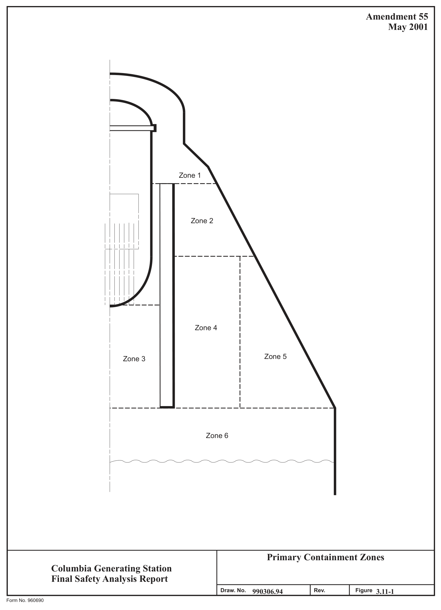

# 3.11 Environmental Design Of Mechanical And Electrical

> Columbia Generating Station FSAR — Chapter 03: Design of Structures, Components, Equipment and Systems
> Source: `03_chapter-660-1910.pdf`, PDF pages 908–930 (of 1251)
> Amendment 67 compilation (individual pages carry varying amendment dates)

---
<!-- p.908 -->
November 1998

### 3.11 ENVIRONMENTAL DESIGN OF MECHANICAL AND ELECTRICAL
#### EQUIPMENT
This section provides information on the environmental conditions and design bases for which the instrumentation and electrical portions of the engineered safety features (ESF) and reactor protection systems (RPS) have been designed and qualification documentation generated to ensure acceptable performance in all environments in which the equipment is or to which it may be potentially exposed.

The design bases for equipment qualification for CGS safety-related equipment is IEEE 323, 1971. This standard was selected as the design basis for qualification requirements contained in specifications and equipment purchase orders. Equipment suppliers were required to provide certification that supplied equipment meets the requirements of IEEE 323, 1971, for equipment intended for installation in potentially harsh environment areas of CGS.

Subsequent to NRC acceptance of this design basis at the construction permit stage, the NRC required evaluation of the equipment’s environmental qualification to NUREG-0588 Category II. The NRC also required that equipment whose qualification documentation does not meet the requirements set forth in NUREG-0588 Category II be re-qualified or justification provided as to why the existing documentation is sufficient.

Subsequent to the issuance of NUREG-0588 the NRC amended 10 CFR Part 50.49. This expanded the scope of equipment to be considered for electrical equipment qualification and required that replacement of electrical equipment be qualified to the provisions of 10 CFR Part 50.49 unless sound reasons to the contrary are provided. The CFR also instituted a requirement to provide an analysis as to why the plant can be operated safely, pending completion of any requalification or equipment replacement action that could not be accomplished prior to operation of CGS.

The CGS Equipment Qualification Program includes two major subprograms. They are the CGS Dynamic Qualification Program and the CGS Environmental Qualification Program. The CGS Environmental Qualification Program, discussed within this section, is designed to ensure that electrical equipment important to safety is qualified to the provisions of NUREG-0588 Category II and applicable provisions of 10 CFR Part 50.49. Details of the initial CGS environmental qualification program are provided in Reference 3.11-1. The following summarizes the current CGS environmental qualification program.

<!-- p.909 -->
#### 3.11.1 EQUIPMENT IDENTIFICATION AND ENVIRONMENTAL CONDITIONS
##### 3.11.1.1 Identification of Electrical Equipment Important to Safety
The criteria for identification of electrical equipment important to safety are defined in Section 3.11.1.1.1 through 3.11.1.1.4. The electrical equipment defined in these sections is included in the Master Equipment List (MEL).

Electrical equipment in these sections may experience the conditions of design basis accidents due to their plant location. In addition, the cumulative gamma radiation dose to equipment in these areas is, in general, above 1 x 104 rad. This equipment is located in the primary and secondary containment areas of the CGS reactor building as well as certain areas in the radwaste building.

Safety-related equipment outside of these areas and in some reactor building electrical equipment rooms is not exposed to a significant change from the normal service environment or anticipated operating occurrences as a result of design basis accidents and therefore are not a part of the environmental qualification program. In addition, the cumulative gamma radiation dose to equipment in these areas is generally below 1 x 104 rad. Also excluded from the environmental qualification program is safety-related electrical equipment that will experience environmental conditions of design basis accidents through which it need not function for mitigation of such accidents; or that has performed its safety function prior to the exposure to an accident environment; and whose failure (in any mode) is deemed not detrimental to plant safety or accident mitigation and will not mislead the operator. This equipment has been identified and included in the CGS dynamic qualification program described in Section 3.10.

Electrical equipment important to safety that only performs a mechanical safety function, such as the maintenance of mechanical pressure integrity, and whose electrical failure (in any mode)
or change of state is of no safety significance, is considered to be similar to mechanical devices and is not addressed by the CGS environmental qualification program.

The following equipment specific data was determined for electrical equipment important to safety and is included in either the MEL or Enterprise Asset Management (EAM) system databases:

a. Equipment piece number (i.e., unique plant tag number),

b. Manufacturer,

c. Model number or manufacturer’s identification reference,

d. Active or passive classification,

<!-- p.910 -->
April 2000

e. Equipment use classification per the equipment categories defined in Appendix E of Regulatory Guide 1.89, Revision 1,

f. System/component level safety function(s),

g. Equipment plant location, and

h. Equipment period of operability during accident condition.

###### 3.11.1.1.1 Engineered Safety Features and Reactor Protection System Equipment
An ESF is a safety-related system that provides a safety function to mitigate the consequences of a design basis accident that may cause major fuel damage. An ESF includes the primary auxiliary systems of the safety system. The identification, location, and accident environmental design bases for these safety-related systems and/or components are provided in the MEL, calculations, and supporting documents. This equipment includes safety-related electrical equipment (Class 1E) that is relied on to remain functional during and following accident exposure by loss-of-coolant accidents (LOCA), main steam line break (MSLB)
accidents, high-energy line break (HELB) accidents, and rod drop accidents. The electrical equipment included in the program is that equipment necessary to ensure the

a. Integrity of the reactor coolant pressure boundary,

b. Capability to shut down the reactor and maintain it in a safe shutdown condition, or

c. Capability to prevent or mitigate the consequences of the above accidents that could result in potential offsite exposures comparable to the 10 CFR Part 100 guidelines.

###### 3.11.1.1.2 Postaccident Monitoring Electrical Equipment
In addition to Class 1E equipment identified in Section 3.11.1.1.1, electrical and instrumentation equipment identified by Regulatory Guide 1.97, Revision 2 (Category I and I II), and NUREG-0737 are included in the environmental qualification program. Instruments meet the requirements by category and type as described in Regulatory Guide 1.97, Revision 2, unless noted in text discussions as meeting Regulatory Guide 1.97, Revision 3, requirements (see Section 7.5.2.2.3).

###### 3.11.1.1.3 Other Electrical Equipment Important to Safety
Included in the environmental qualification program is equipment that is not classified as safety-related (Class 1E). This equipment may experience the environmental conditions of

<!-- p.911 -->
November 1998

design basis accidents and the results of failure of this equipment due to the design basis accidents may prevent satisfactory accomplishment of the safety function of safety-related equipment. Qualification requirements for electrical equipment required to mitigate anticipated transients without scram (ATWS) or used for remote shutdown are provided in Section 1.5.1.1.2, 7.1.2.4, and 7.4.2.3.

###### 3.11.1.1.4 Electrical Equipment Whose Failure Does Not Affect Safety Function
Performance

In the development of the list of electrical equipment important to safety, electrical equipment was identified that may be exposed to environments created by design basis accidents whose failure during or following the accident exposure would have no affect on safety function performance. Failure modes and effect evaluations were performed to justify their removal from the environmental qualification program.

###### 3.11.1.1.5 Safety-Related Mechanical Equipment
Safety-related mechanical equipment is not included in the environmental qualification program. This includes ATWS equipment with only a mechanical augmented quality function.
The design verification requirements cited in Reference 3.11-2 are met outside the environmental qualification program.

###### 3.11.1.1.6 Identification of Safety-Related Equipment In Mild Environmental Plant Areas
Safety-related electrical equipment located in areas of the plant that are not exposed to significant environmental effects resulting from design basis accidents are considered mild environments and are also identified within the CGS equipment qualification program.

Equipment in ESF and RPS located in mild environments will not experience a significant change in its environmental conditions and, therefore, need only be qualified to the service conditions resulting from seismic design basis events. This also includes equipment that may be exposed to a total integrated radiation dose (normal plant operations including anticipated operational occurrences + accident) in excess of 1 x 104 rad if the accident radiation does not significantly exceed the 40-year integrated radiation dose due to normal plant operations and anticipated operational occurrences. Safety-related equipment located in a mild environment where the total integrated radiation dose exceeds 1 x 104 rad, or exceeds 1 x 103 rad for equipment containing certain classes or categories of solid state electronics as defined within qualification program procedures and supporting documents, have been specifically excluded from the environmental qualification program. However, this equipment is either procured to the required radiation dose provided in the procurement specifications or is evaluated for acceptable operability due to radiation exposure effects only, in its service environment. The identification of this equipment is provided in the MEL. See Section 3.10 for additional details.

<!-- p.912 -->
The application of the Columbia AMPs verifies that the identified structures, systems, and components will continue to provide their identified intended function(s) during the period of extended operation.

##### 3.11.1.2 Normal and Accident Environmental Service Conditions
The normal and accident environmental service conditions have been defined for electrical equipment important to safety and are identified in this section. The environmental parameters include temperature, pressure, relative humidity, demineralized water spray, submergence, and radiation.

###### 3.11.1.2.1 Normal Plant Operational Environmental Conditions (Except Radiation)
Plant operational environmental conditions are without significant abnormalities and include the following: planned startups, power range, shutdown, and normal hot standby. These environmental conditions, specified for the various buildings and/or areas, are listed in Table 3.11-1 and represent normal temperatures and maximum and minimum design bases for temperature, relative humidity, and pressure to which equipment may be exposed during routine plant operations and short-term abnormal conditions due to anticipated operating occurrences. See Figure 3.11-1 for primary containment zone locations.

###### 3.11.1.2.2 Accident Environmental Service Conditions (Except Radiation)
The primary containment, most areas of the secondary containment within the reactor building, and certain areas in the radwaste building, potentially could be exposed to elevated temperature, pressure, and high humidity conditions resulting from LOCA, MSLB, or HELB type accidents.

Pressure and temperature profiles were defined for two accident types: LOCA/MSLB in primary containment and HELBs in the secondary containment of the reactor building and certain areas of the radwaste building. Break locations were determined (see Section 3.6), and equipment required to operate during or following exposure to the environmental conditions resulting from the breaks identified.

The CGS plant-specific pressure/temperature profiles of the primary containment and the equipment required to operate during or following the postulated breaks are provided in the MEL, LOCA and MSLB analysis calculations, and supporting documents. Table 3.11-2 provides generic environmental conditions obtained from a GE analysis of the response of a BWR Mark II containment to a full spectrum of possible LOCA and MSLB. These generic environmental I conditions were used for equipment qualification evaluations of equipment in primary containment. Plant-specific profiles are used for the postaccident period as required by NUREG-0588. In addition to pressure/temperature and humidity conditions inside primary containment, demineralized spray and potential flooding was included in the definition of the environmental service conditions.

<!-- p.913 -->
Plant-specific pressure/temperature and humidity profiles were also defined for equipment spaces within the secondary containment areas of the reactor building and certain areas of the radwaste building. General Electric generic conditions were not used. These profiles are provided in ELB analysis calculations and supporting documents. In addition to pressure/temperature and humidity, the affect of flooding was evaluated. The results of the flooding analysis determined that CGS can be safely shut down with alternative safety-related equipment not affected by flooding. Based on this, flooding is not a required environmental service condition for equipment qualification in the secondary containment except for the high-pressure core spray (HPCS), lowpressure core spray (LPCS), reactor core isolation cooling (RCIC), and residual heat removal
(RHR) reactor building pump rooms.

###### 3.11.1.2.3 Radiation Service Conditions
The primary containment radiation conditions determined for environmental qualification include the normal (40-year dose) and the accident radiation dose (180 days). The criteria for determining the radiation dose were NUREG-0737 and NUREG-0588. The calculated radiation environment is based on normal service conditions, plus the most severe nonmechanistic design I basis accident during or following which equipment must function. Required period of operability for the equipment was a factor used to determine equipment specific radiation dose.
The accidents considered are the entire spectrum of Chapter 15 accidents that can lead to a degraded core condition. The source term assumptions for postulated accidents are consistent with those defined in NUREG-0588 and Regulatory Guides 1.3 and 1.7.

The secondary containment radiation conditions are defined according to Section II.B.2 of NUREG-0737 and NUREG-0588. The total integrated dose includes the sum of direct accident gamma dose, airborne gamma dose, 40-year normal gamma dose, and where equipment could be beta sensitive, a beta dose. This beta dose was determined through use of energy dependent geometry factors, a ratio of the internal equipment volume to an infinite cloud, and the dose to a target at the center point face for a hemispherical cloud of gases.

The dose and dose rate were determined for equipment areas within the secondary containment. The secondary containment was divided into radiation zones to define the equipment radiation service conditions. The worst target (component with the highest dose) in each zone was chosen. This radiation value was then used as a screening value for all equipment in the zone. In some zones, additional targets were chosen to more realistically map the radiation conditions throughout some zones.

The methodology and results of the radiation evaluations are provided in CGS radiation dose calculations. The results of evaluations for specific equipment to radiation conditions are contained in the CGS Qualification Information Documents (QIDs). The application of the Columbia AMPs verifies that the identified structures, systems, and components will continue to provide their identified intended function(s) during the period of extended operation.

<!-- p.914 -->
###### 3.11.1.2.4 Accident Conditions - Harsh Environments
The primary containment, most areas of the reactor building, and certain areas of the radwaste building will be exposed to a harsh environment following a postulated LOCA/HELB.

A harsh environment is defined as:

An area that would be exposed to a significant increase in the maximum temperature, pressure, and humidity as a direct result of design basis events and/or the total radiation dose (normal + accident) is above 1 x 104 rad, or above 1 x 103 rad for certain classes or categories of solid state electronics, with a significant increase in radiation dose during accident conditions compared to that during normal plant operations, including anticipated operational occurrences.

#### 3.11.2 QUALIFICATION TESTS AND ANALYSES
In accordance with NUREG-0588 Category II requirements, descriptions of the qualification tests and analyses have been provided in the QIDs. These QIDs are prepared in accordance with Energy Northwest Engineering Standards. The information provided is consistent with Appendix E of NUREG-0588 and includes the methods employed to address temperature, pressure, humidity, spray, radiation, and aging.

Specific values (both required and demonstrated) are provided in equipment qualification summary sheets in the QIDs.

These summary reports indicate how the general requirements of General Design Criteria 1, 4, 23, and 50 of Appendix A to 10 CFR Part 50, and 10 CFR Part 50.49 are met. The CGS equipment qualification program meets Criterion III of Appendix B to 10 CFR Part 50 through implementation of Quality Class 1 procedures for all aspects of the evaluation, documentation, and corrective action resulting from the program.

Section 1.8 addresses how Regulatory Guides 1.30, 1.40, 1.63, 1.73, and 1.89 were applied to the CGS qualification program.

#### 3.11.3 QUALIFICATION PROGRAM RESULTS
The results of qualification test and analysis for each piece of equipment in the CGS Environmental Qualification Program is provided in the QIDs. A typical Equipment Qualification Report Summary from a QID is shown in Figure 3.11-2.

The application of the Columbia AMPs verifies that the identified structures, systems, and components will continue to provide their identified intended function(s) during the period of extended operation.

<!-- p.915 -->
##### 3.11.3.1 NRC Review of the CGS Environmental Qualification Program
The NRC staff evaluation of the CGS Environmental Qualification Program included an examination of the installed electrical equipment and audits of both electrical and mechanical equipment qualification documentation. A review of Energy Northwest’s submittals for completeness and acceptability of systems and components, qualification methods, and accident environments was also conducted. The criteria described in Standard Review Plan Section 3.11 (NUREG-0800) and NUREG-0588, Category II, formed the basis for the NRC’s evaluation of the adequacy of the CGS program.

An audit was performed of the CGS qualification documentation and installed equipment in February 1983 and was documented by the NRC in NUREG-0892, Supplement 3.

A subsequent audit was made to assess implementation of the concerns and resolutions raised in the February 1983 audit. These files were found acceptable by the NRC as reported in Supplements 4 and 5 of NUREG-0892, Reference 3.11-2.

Mechanical equipment is no longer a part of the environmental qualification program and is addressed separately (see Section 3.11.1.1.5).

##### 3.11.3.2 Establishment of Operational Phase Environmental Qualification Review
Energy Northwest has established an operational phase environmental qualification review.
This review is integrated with design changes to CGS to ensure compliance with the criteria as described in Section 3.11.

The operational phase qualification review is required for all design changes that add, modify, or delete safety-related equipment for CGS because of plant betterment, regulatory, or license conditions requirements.

Design control procedures establish a special qualification review as part of the design change package preparation. Adequacy of the equipment selected to be added to the plant in the design change is assessed and documented to an “As Designed” qualification status. Special procurement requirements are detailed for the purchase order. During or after installation, quality control inspections are conducted to ensure final installation conforms to design documents and final qualification documentation is established in QID files. A walkdown is performed by equipment qualification personnel if needed to clarify the final installation configuration.

For design changes that modify or reclassify existing plant equipment, a special review is also I required similar to the above. Final documentation is established in QID files on completion of the design change.

<!-- p.916 -->
For design changes that delete existing plant equipment or change its status to non-safetyrelated, a special review is also conducted. In these instances, modification of the QID file is considered optional under the program.

Design control procedures also require the safety-related equipment list in the MEL is to be kept current with actual plant configuration. Thus, consonance of the plant equipment configuration and qualification documentation (QID files) is maintained throughout plant life.
Plant modifications to environmental control systems that alter environmental profiles to which equipment has previously been qualified are reviewed to ensure equipment is qualified to revised profiles.

The NRC Bulletins and Information Notices that affect qualification of plant equipment are reviewed and factored into the qualification review. Design changes that result from NRC Bulletin and Information Notice reviews also receive the special qualification review.

The qualification program is linked with the maintenance program to ensure that required maintenance or replacement due to qualified life considerations are performed. Refinement of the qualified life is included based on actual service conditions and actual equipment degradation evaluations through monitoring, inspection, and surveillance programs.

Replacement equipment is qualified in accordance with Regulatory Guide 1.89, Revision 1.
Where necessary, engineering evaluations are performed using the criteria and guidance for establishing sound reasons to the contrary provided in Regulatory Guide 1.89, Revision 1, and Generic Letter 82-09, as applicable.

#### 3.11.4 LOSS OF VENTILATION
##### 3.11.4.1 Main Control Room Air Conditioning and Ventilation System
Controls and electrical equipment necessary for safe plant shutdown are located in the main control room. The control room is air conditioned and shielded against radiation to allow the operators safe and continued occupancy under optimum environmental conditions. Air conditioning equipment and associated components are designed to Seismic Category I requirements. Redundant equipment is provided and on loss of offsite power, emergency power from the onsite diesel generator sets is automatically supplied to the equipment. No single failure can result in loss of control room air conditioning. Hence, design of the system ensures that the operability of the safety-related control and electrical equipment located in the control room will not be impaired and will continue to function in an acceptable environment.
Therefore, no special environmental design requirements for loss of ventilation or air conditioning need be incorporated in the design of safety-related electrical or instrumentation equipment located in the control room.

##### 3.11.4.2 Reactor Building Emergency Cooling System
Some equipment located within the reactor building which must operate in the event of an accident could not survive direct exposure to the accident environment. This equipment is

<!-- p.917 -->
located in enclosed electrical equipment rooms. In the event of an accident, these rooms are automatically isolated from the normal reactor building ventilation system and subsequently are maintained at the required environmental conditions by the reactor building emergency cooling system (see Section 9.4.9).

The reactor building emergency cooling system consists of independent air recirculation systems each of which is fully enclosed within the room it serves and is designed to Seismic Category I standards. The air recirculation system for a room is powered from the same emergency diesel generator bus as the equipment in the room. Since each air recirculation system is independent and serves redundant emergency equipment systems, a failure of one air recirculation system does not affect the operation of other air recirculation systems or the safe shutdown of the reactor.

##### 3.11.4.3 Miscellaneous Ventilation Systems
Each of the following areas are serviced by at least one ESF heating, ventilating, and air conditioning (HVAC) system:

b. Critical switchgear area, radwaste building (Section 9.4.1),

c. Emergency diesel generator building (Section 9.4.7),

d. Critical electrical cable runs, between the diesel generator building and the radwaste building (Section 9.4.8), and

e. Standby service water pump houses (Section 9.4.10).

Ventilation failures in these areas are considered and evaluated in Section 9.4. During some design basis events, short periods of elevated service water temperature may affect the normal temperatures of some mild environment rooms (see Section 9.4 and Table 3.11-1). No significant thermal aging will result from the temperature excursions. Design reviews were conducted to ensure that the resulting operating conditions will not cause safety-related equipment located in these areas to fail.

#### 3.11.5 ESTIMATED CHEMICAL AND RADIATION ENVIRONMENT
##### 3.11.5.1 Suppression Pool, Residual Heat Removal System, and Emergency Core Cooling
System Water Quality

The water in these systems is not chemically inhibited. The maximum limits for the suppression pool for normal operation have been established to be compatible with those of the primary coolant and are listed in Table 3.11-3 for comparison.

<!-- p.918 -->
The fuel pool cooling and cleanup system has provisions for circulating the suppression pool water through demineralizers to maintain water quality limits.
I During reactor shutdown cooling, the RHR system water mixes with reactor water. Therefore, to ensure reactor water quality, the shutdown cooling piping and equipment is flushed with water of the quality specified in Table 3.11-3 for maximum limit with suspended solids concentration of 5 ppm or less. During layup the RHR system will be filled with water which meets the limits specified in Table 3.11-3.

##### 3.11.5.2 Qualification
Qualification of equipment for severe chemical exposure is considered unnecessary since no sources of detrimentally high or low pH have been identified for the postulated post-LOCA conditions. The post-LOCA water qualities would be expected to be similar to that shown in I Table 3.11-3 (see Section 6.1.3). Radiation environment conditions and equipment qualifications are discussed in Section 3.11.1.2.3 and 3.11.2 respectively.

#### 3.11.6 REFERENCES
3.11-1 WNP-2 Environmental Qualification Report for Safety-Related Equipment, dated September 1983 (historical document).

3.11-2 Safety Evaluation Report Related to the Operation of WPPSS Nuclear Project No. 2, NUREG-0892, Supplement 3 (May 1983), Supplement 4 (December 1983), and Supplement 5 (April 1984).

<!-- p.919 -->
Relative Humidity NA - minimum NA - minimum NA - minimum NA - minimum NA - minimum 100 maximum 100 maximum 100 maximum 100 maximum 100 maximum 40-55 normal 40-55 normal 40-55 normal 40-55 normal 90 maximum 90 maximum 40-55 normal 20 minimum 20 minimum
(%)
40 normal 40 normal
(e)

104 maximum equip not running 150 maximum equip running 135 bulk average maximuma 185 maximum/150 average 70/100 minimum averaged 70/100 minimum averaged Maximum - See Technical Temperature Specification 3.6.2.1 117 (operating limit)
(F)
40/50 minimuml 104 maximumh 150 maximum 150 maximum 135 maximum 165 maximum 70-90 normal 70-90 normal 70 minimumc 60 minimum 50 minimum 50 minimum 70 minimum Normal Operating Conditions Nominal -0.6 in. water gauge, static pressure (unless otherwise noted) Table 3.11-1 0.25 to 0.75 psig (nominal)m 0.25 to 0.75 psig (nominal)m 0.25 to 0.75 psig (nominal)m 0.25 to 0.75 psig (nominal)m 0.25 to 0.75 psig (nominal)m
(as noted)
Pressure

Primary containment (not otherwise noted)
Sacrifical shield wall lower/mid annulus Reactor building (not otherwise noted)
Vicinity recirculation pump motors Suppression pool water volume Suppression pool air volume Area RCIC equipment area Area beneath RPV zone 4b zone 3b zone 6b

II.
I.

<!-- p.920 -->
Relative Humidity 40-50 normal 40-50 normal 40-50 normal 40-50 normal 40-50 normal 40-50 normal 90 maximum 98 maximum 98 maximum 98 maximum 98 maximum 98 maximum 98 maximum 90 maximum 20 minimum 20 minimum 20 minimum 20 minimum 20 minimum 20 minimum 20 minimum 20 minimum
(%) 40 normal 40 normal
(e)

104 maximum equip not running 150 maximum equip running 120 maximum (non-elec)
40 minimum (non-elec)
Temperature 104 maximum (elec)
50 minimum (elec)
(F)
40/64 minimumj 140 maximum 118 maximum 109 maximum 111 maximum 116 maximum 70-90 normal 70-90 normal 40 minimum 40 minimum 130 normali Normal Operating Conditions (Continued)
0.0 in. to -0.25 in. water gauge, static Table 3.11-1
(as noted)
Pressure

pressure

RWCU piping and pump area (R406, R407, HPCS, LPCS and RHR equipment area Shielded pipe space south (R511)
Reactor building (Continued)
Pipe space south (R405)
New fuel storage vault Area Turbine building Refueling floor Steam tunnel

#### R409)
III.
II.

<!-- p.921 -->
Relative Humidity 90 maximum 90 maximum 90 maximum 60 maximum 90 maximum 90 maximum 20 minimum 20 minimum 20 minimum 40-50 normal 10 minimum 20 minimum 10 minimum
(%)
40 normal 40 normal 60 normal 40 normal 50 normal

Temperature 104 maximum (elec)h 40/55/60 minimumg 85/104 maximumk
(F)
104 maximumh 60-95 normaln 120 maximum 112 maximum 104 maximum 120 maximum 200 maximum 40 minimum 72-78 normal 40 minimum 55 minimum 40 minimum 40 minimum 50 minimum 70 normalf 70 normal 70 normal Normal Operating Conditions (Continued)
0.0 in. to -0.25 in. water gauge, static 0.0 in. to -0.25 in. water gauge, static 0.10 in. to 1.0 in. water gauge, static 0.0 in. to -0.5 water gauge, static Table 3.11-1
(as noted)
Pressure

Ambient pressure pressure pressure pressure

Emergency diesel generator engine rooms Emergency diesel generator electrical HPCS diesel generator engine room Radwaste building equipment cells Area above main steam lines Critical switchgear rooms VII. Diesel generator building Area Radwaste building switchgear rooms Control room

VI.
IV.
V.

<!-- p.922 -->
insulation and exposed vessel parts shall be approximately 6 ft/sec. 70F average applies when not in mode 1, or mode 2 or 3 with RPV piping >275 psig Relative Humidity d The same minimum normal average operational temperature (100F) shall apply at the inside base of the sacrificial shield wall. Air velocity over vessel g Minimum for critical switchgear area is 55F (60F in battery rooms). LCS 1.7.1 lists minimum normal for battery rooms as  74°F to support Station h During design basis events this temperature may be exceeded for a short period of time (<30 days). These room temperatures are used to support the evaluated design capability of equipment during design basis events. Analysis has confirmed that equipment with a design safety function is capable of 90 maximum 10 minimum
(%)
60 normal

c Minimum temperature for operational and maintenance for RRC pump loop piping general bolting materials specifications.
Temperature 114 maximum (elec)h
(F)
50-104 normal 104 maximum 104 maximum 60 minimum 40 minimum 40 minimum e The maximum temperature and humidity will occur simultaneously in these spaces less than 1% of the time.
Normal Operating Conditions (Continued)
0.0 in. to +0.25 in. water gauge, static Table 3.11-1
(as noted)
Pressure a Average or bulk temperature. See Technical Specification 3.6.1.4.
pressure

HPCS diesel generator electrical switchgear/ f Normal for cable spreading room is 80F.
operating at the temperature listed below.
b See Figure 3.11-1 for zone locations.
VIII. Service water pump building Black Out (SBO) commitment.
Area

Cable Corridor battery room and 200F.

<!-- p.923 -->
Temp Limit Operability 122°F* 122°F* 111°F* 122°F* Hydrogen Recombiner Rm Div 1 129°F* Hydrogen Recombiner Rm Div 2 129°F* 122°F* 130°F 162°F 130°F 162°F 126°F 122°F 130°F 130°F 137°F 129°F 129°F 129°F 122°F 128°F k 85°F maximum for SBO capability and control room habitability; 104°F maximum environmental qualification temperature for equipment.
HPCS DG3 Air Handling Room HPCS DG3 Elec Equip Room Div III Battery Area in DG DG1 Air Handling Room DG2 Air Handling Room DG1 Elec Equip Room DG2 Elec Equip Room DG Bld HVAC Room Fuel Pool HX Room DG1 Day Tk Room DG2 Day Tk Room SW Pump House A SW Pump House B DG1 Engine Room DG2 Engine Room 441' Railroad Bay MCC Rm Div 2 MCC Rm Div 1 DC MCC Rm m Maximum pressure is the high drywell pressure trip set point; minimum pressure is vacuum breaker open set point.
Description Deleted Normal Operating Conditions (Continued)
Room/Area D107 D108 D110 D111 D113 D114 D114 D115 D116 D201 D203 D204 D205 R105 R212 R410 R411 R611 R612 R506

#### N/A N/A
Table 3.11-1 l 50°F minimum in electrical equipment areas, 40°F minimum elsewhere.
Temp Limit j 64°F minimum when Reactor Building Crane is making full rated lift. Operability 124°F* 120°F* 120°F* 120°F* 122°F* 122°F* 120°F* 120°F* 120°F 136°F 140°F 140°F 142°F 142°F HPCS DG3 Storage Tk/Transfer Room 142°F 137°F n Per LCS 1.7.1 for HPCS battery area minimum normal is 65°F. 110°F 110°F 122°F 162°F N/A

*Lowest value for certain equipment in this room/area.
DG1 Storage Tk/Transfer Room DG2 Storage Tk/Transfer Room i 130°F normal with one fan always on standby.
React Bld/DG Bld Corridor RadW/React Bld Corridor HPCS DG3 Engine Room Battery Charger Rm 1 Battery Charger Rm 2 HVAC Equip Room 1 HVAC Equip Room 2 HPCS Day Tk Room Div II Battery Room Elec Switchgr Rm 2 Elec Switchgr Rm 1 Div I Battery Room Equip Access Area Remote Shutdown Instrument Shop Cable Chase Description RPS Rm 1 RPS Rm 2

Room/Area D100 D101 D102 D103 D104 D105 C121 C206 C207 C208 C210 C211 C213 C215 C216 C224 C230 C502 C507 C508 C510

<!-- p.924 -->
May 2001

180 days Durationb 180 days 4.5 hr 1 day 1 day 3 hr 6 hr 1 hr 3 hr 3 hr 6 hr

All steam All steam All steam All steam All steam All steam All steam Humidity Relative 100% 100% 100% 100%

Pressure -2 to 45 -2 to 45
-2 to 45 -2 to 45 -2 to 45 -2 to 45 -2 to 45 -2 to 25 -2 to 20 0 to 25 0 to 20 (psig)
Accident Environment Conditions (Primary Containment)
Temperature for Essential Equipment 200d 200d 340f 320 340 340 320 250 (°F)
340 320 250 Table 3.11-2 Core spray injection check valves, LPCI-RHR injection check reactor water cleanup suction valve, reactor water sample line Control instrumentation air (including accumulators), reactor Recirculation gate valves,e reactor protection system neutron valves, reactor shutdown cooling suction valve, safety/relief valves,c vessel level indicators, structural components (e.g., building closed cooling (RCC) valves,e drywell unit coolerse intermediate range and power range monitors, reactor vessel isolation valve, reactor water cleanup suction, reactor water recirculation flow control valves, reactor vessel head spray Feedwater check valves, RCIC steam line isolation valve, Feedwater check valves, RCIC steam line isolation valve, Main steam isolation valves, main steam drain isolation sample line valve, 2 in. and smaller isolation valves valve, 2 in. and smaller isolation valves, cables to Componenta loop restraints, vessel skirt, etc.)
head spray isolation valve monitoring system valves

Condition 1 2 3 4 5

<!-- p.925 -->
May 2001

f The TIP system isolation valves are located outside of primary containment in the TIP room. Analysis has determined that maximum accident condition will c The safety/relief valves are required to be operable for 2 days and to remain in whichever position the valve operator has been set to at the end of the 2 days 180 days 180 days Reference 3.11-1 (historical) and currently in the Columbia Generating Station Master Equipment List or MEL. Also included are the valve operators and b Durations shown are termination times for conservative environmental conditions measured from the initiation of the postulated accident, i.e., Condition 1, Durationb a Typical components are listed. Components listed may have required operating time different than shown here. Specific hours to operate are described in 1 day 1 day 3 hr 6 hr 3 hr 6 hr for the remainder of the long-term transient. Safety/relief valves used for automatic depressurization must remain operable throughout the long-term e The RCC system, drywell air coolers, and the reactor recirculation system have no safety requirements during a LOCA. The specified conditions are All steam All steam All steam All steam Humidity Relative 100% 100% 100% 100% d Represent peak starting temperature of extended long-term temperature in the containment following a postulated design basis accident.
the 6-hr duration, is the period from 3 hr through 6 hr, the 1-day duration is the period from 6 hr through 1 day (24 hr).
Pressure -2 to 45 -2 to 45 -2 to 45 -2 to 45 -2 to 25 -2 to 20 0 to 25 0 to 20 (psig)
Accident Environment Conditions (Primary Containment)
for Essential Equipment (Continued)
Wetwell Side 200d Temperature 275 275 250 200d 340 320 250 (°F)
cabling (instrumentation and power) required for proper operation of the valves listed.
Table 3.11-2 Drywell Side 200d 340 320 250 desirable to enable a normal shutdown cooling procedure during a steam leak.
Main steam isolation valves, main steam drain isolation valves, standby liquid control injection check valve Wetwell-drywell vacuum relief valves Componenta

be 130°F.
transient.
Condition 6 7

<!-- p.926 -->
May 2001

Superheat temperature during shutdown cooling line flush after reactor has been depressurized to 150 psia which corresponds to the pressure at which pressure profiles have been calculated to define the conservatism inherent in these generic environmental values. No margin is required when these values are designated equipment will be qualified for discrete times during the cycles/modes of the reactor’s operation for the first 24 hr. Plant-specific temperature/ The following is a compilation of basic accident environmental pressures and temperatures and a description of the time durations expected. The full spectrum of simultaneous environmental possibilities is not presented in a series of curves, but rather as a description of the boundaries within which Peak starting temperature of extended long-term temperature in the containment following a postulated design basis accident. Plant-specific Long-term temperature in the containment during the first day following a postulated design basis accident.
Accident Environment Conditions (Primary Containment)
Superheat temperature for a steam leak with the reactor vessel at 400-500 psi, containment at 45 psig.
for Essential Equipment (Continued)
Table 3.11-2 20 psig Pressure at 1 day and longer following a postulated design basis accident.
25 psig Pressure up to 1 day following a postulated design basis accident.
45 psig Maximum positive internal pressure of the primary containment.
-2 psig Assumed minimum pressure of the primary containment.
calculations have been determined per NUREG-0588.
Basic Accident Environmental Pressures and Temperatures the shutdown cooling system is activated.
met in equipment qualification test programs.
Temperatures Pressures 340°F 320°F 250°F 200°F

<!-- p.927 -->
May 2001

exceeding a rate of 100°F/hr, flushing of system, depressurization to near atmospheric pressure. If shutdown cooling is not available, containment Applies to valves that isolate automatically on low RPV pressure or level. This time interval represents a conservative duration during which the Duration of time to complete vessel depressurization to near atmospheric pressure. This time includes RPV depressurization to 150 psia not Time at which shutdown cooling system flush is complete. Normal shutdown cooling necessitates closure of recirculation line valves.
Time duration to depressurize the reactor pressure vessel at a rate not exceeding 100°F/hr, down to 150 psia.
Accident Environment Conditions (Primary Containment)
for Essential Equipment (Continued)
Table 3.11-2 sprays should be activated before 6 hr to limit temperature to less than 250°F.
valves must be qualified. Required operating time is 0.17 hr.
Duration 4.5 hr 1 hr 3 hr 6 hr

<!-- p.928 -->
May 2001

Table 3.11-3

Water Quality Limits

Parameter

Total Suspended Solids Chlorides as and/or System Water Conductivity Cl pH Insolubles

Reactor (shutdown <10 µS/cm <0.5 ppm 5.3 to 8.6 <1 ppm at 25°C condition, depressurized at 25°C maximum)

<5 µS/cm Suppression pool (quality <20 ppb 5.3 to 8.6 <5 ppm at 25°C expected) (see at 25°C Section 6.1.1.2)

Suppression pool <10 µS/cm <0.5 ppm 5.3 to 8.6 <5 ppm at 25°C at 25°C
(maximum)

RHR (layup condition, <3 µS/cm <0.5 ppm 5.3 to 7.5 <1 ppm at 25°C maximum and/or at 25°C refueling)

3.11- 22

<!-- p.929 -->

*figure on PDF page 929*

[Vector original (SVG, lossless): fig_page-929.svg](../figures/fig_page-929.svg)

<!-- labels/text on this figure page -->
Amendment 55 May 2001
I
I Zone 1 I h Zone 2 mmr I! I 1111 !
---------7- 1 I i ! iii i I I I I I
I I I I
I I I I I Zone 4 I I I I I I Zone 5 Zone 3 I I I I I I I I I
-------- ------- r-------
I ----
1 Zone 6 I
Primary Containment Zones Columbia Generating Station Final Safety Analysis Report Draw. No. 990306.94 Rev. Figure 3.11-1 Form No. 960690

<!-- p.930 -->
Amendment 55 May 2001

Date: July 1983 Outstanding None None None None None Items None None None Revision 4 Prepared by:____________________________ Reviewed by: _______________________________ Page No.
Function/Service Elevation Column Motor for RRA-FN-1 441 H.7/4.3 Motor for RRA-FN-2 445 L.0/8.3 Motor for RRA-FN-3 442 L.8/8.3 Qualification Sequential Test Sequential Test Simultaneous Simultaneous Simultaneous Method Engineering Engineering Engineering Engineering Test and Analysis Test and Analysis Test and Analysis Analysis N/A N/A

Document Ref.
Qual.

## 4 N/A Notes
N/A 4 4 4 4 4 MPL: PPD:
#### FSAR N/A 1 2 2 2 2 3 2

Owner: Energy Northwest
1. Tag Number Model SBFC SBFC SBFC I Equivalent to > 6 months Facility: Columbia Generating Station 2808-67 Accident Profiles 8 Qualification

#### RRA-M-1 RRA-M-2 RRA-M-3
1 x 106 40 Years 410 100 N/A N/A Qualified Spec.:

#### EQUIPMENT QUALIFICATION REPORT
Environment Accident Profiles 4, 8 104 Max Abnormal Accident profiles 8

## 90 Max Normal
### 14.7 Normal 90 Abnormal 100 Accident
## 40 Normal 6 months
3.1 x 106 40 Years QID #213012 FSAR N/A N/A

Documentation References Temperature Parameter Operating Radiation Pressure Chemical Accuracy Humidity Relative
(PSIA)
Spray (Rad) Aging Time
(°F)
(N)
1. BRI CIE List, Rev. 8, 6/1/83 3. EDS Report 0740-004-44IJ
-~ ~i-.
Yes X No____ (Ref. 5) 2. FSAR Paragraph 3.11 System Reactor Building Equipment Description 5. BRI Calc. #5.51.055 RRA-M-(See Note 1)
-~ Above Flood Level?
Return Air
3. QID = 213017 Elevation Column Flood Level Elev:
Westinghouse Function/Service Location Bldg R Model Number See Note 1 See Note 1 Manufacturer Tag Number Component See Note 1 Motors I Ill~

Equipment Qualification Report
- Reactor Building Return Air Columbia Generating Station Final Safety Analysis Report I I Draw. No. 990306.95 Rev. Figure 3.11-2 Form No. 960690

