# 3.12 Computer Programs For Structural Analysis And Design

> Columbia Generating Station FSAR — Chapter 03: Design of Structures, Components, Equipment and Systems
> Source: `03_chapter-660-1910.pdf`, PDF pages 931–1251 (of 1251)
> Amendment 67 compilation (individual pages carry varying amendment dates)

---
<!-- p.931 -->
### 3.12 COMPUTER PROGRAMS FOR STRUCTURAL ANALYSIS AND DESIGN
The computer programs referenced in Sections 3.6, 3.7, 3.8, and 3.9 by their acronyms are listed below.

#### ADLPIPE
#### ANSYS
AX1 AX2 AX3 BPIPE-CS085 (Version 2)

#### CB&I PROGRAM 979 - ASFAST
#### CB&I PROGRAM 1027
#### CB&I PROGRAM 1037 - DUNHAM’S
#### CB&I PROGRAM 1335
#### CB&I PROGRAM 1606 AND 1657 - HAP
#### CB&I PROGRAM 1635
#### CB&I PROGRAM 711 - GENOZZ
#### CB&I PROGRAM 766 - TEMAPR
#### CB&I PROGRAM 767 - PRINCESS
#### CB&I PROGRAM 781 - KALNINS
#### CB&I PROGRAM 846
#### CB&I PROGRAM 928 - TGRV
#### CB&I PROGRAM 948 - NAPALM
#### CB&I PROGRAM 953
#### CB&I PROGRAM 962 - E0962A
#### CB&I PROGRAM 984
#### CB&I PROGRAM 992 - GASP
#### DACSR
#### FLXMAT
#### GOTHIC
#### ISOFINITE
MASS

#### MULTISHELL
#### NASTRAN
NUPIPE-IIM (Version 1.6.3)
P001 (Version 6.0)
P002 (Version 4.0)
P003 (Version 5.0)
PDA PIPESUP-CS102 (Version 2)

#### RELAP3
#### RELAP4/MOD5
#### SAP4G07
<!-- p.932 -->
#### S/RVDAM
#### SSAPO ALGOR SUPERSAP
#### SPLUG
#### STARS-2S
#### STRUDL II
T-MOVE (Version V0-00)
TPIPE (Version 4.2)

The italicized information is historical and was provided to support the application for an operating license.

The computer program summaries, including descriptions of assumptions, limitations, capabilities, and any appropriate parameters and features associated with the use of these computer programs, are provided in the following.

All programs are verified, within the stated assumptions and limitations, for correctness of theory used and for validity of results obtained for a variety of typical problems. Results are checked against known solutions, solutions obtained from other programs, or hand calculations. Examples of validation problems are included with the program descriptions.
Wherever applicable, internal checks are included as an aid in checking the validity of the results obtained from the computer program for each problem analyzed.

#### 3.12.1 DACSR
DACSR (Dynamic Analysis of Cantilever Structures) is a computer program used for the response spectrum analysis of structures subjected to horizontal excitations. The structural idealization consist of lumped mass cantilevers attached to a common rigid mat which is supported by soil springs. Other springs can be used to connect any two masses.

Each mass has two degrees of freedom: translational and rocking. The program has the capability to perform an analysis on a model containing up to three cantilevers. DACSR does not consider off-diagonal masses.

The program calculates the eigenvalues (natural frequencies) eigenvectors (natural mode shapes), modal participation factors, and modal damping values which are based on Whitman’s average weighted damping calculation (Reference 3.12-1). The input ground motion (horizontal base excitation) is defined by a set of pseudo-accelerations response spectrum curves corresponding to different damping values which are expressed as a fraction of critical damping. The program then calculated modal accelerations, velocities, and displacements. The total response is found by the following methods:

a. Absolute sum of the individual modal responses

<!-- p.933 -->
b. Square root of the sum of the squared modal responses

c. Combination of the above two methods, which accounts for the effect of closely spaced modes. (Closely spaced modes are defined as those whose frequencies are within 10%.)

The option of having member forces calculated is available.

Program input requires member properties and stiffness, structure stiffness, spring constants, damping ratings, and ground acceleration.

DACSR was developed by Burns and Roe, Inc., in 1970. The program can successfully operate on IBM 370 series hardware maintained by Call Data Systems, Inc., a subsidiary of Grumman Data Systems.

To demonstrate the validity of DACSR, results from a production problem were compared to those obtained from the public domain program STARDYNE. Results from the two programs are compared in Table 3.12-1.

As demonstrated in the table, results compare favorably.

This program is used for dynamic analyses discussed in 3.7.

#### 3.12.2 AX1
AX1 (Analysis of Axisymmetric Solids) is a finite element program which determines deformations and stresses within axisymmetric structures of arbitrary shape. The effects of displacement or stress boundary conditions, concentrated loads, gravity forces and temperature changes are included. Nonlinear material properties are included by a successive approximation technique. Orthotropic material behavior is included. The program can be used for structures with up to 800 elements and 900 modes with a maximum bandwidth of 27 modes. The program has a mesh generating capability which reduces the amount of input required.

The program was written by E. L. Wilson of the University of California at Berkeley, Reference 3.12-2, and is in the public domain.

The program is referred to in Section 3.8.2.

#### 3.12.3 AX2
AX2 (Axisymetric Shell Program) is a computer program used for the analysis of single layer, axisymmetric thin shells of revolution composed of spherical, toroidal, conical, cylindrical or

<!-- p.934 -->
circular plate segments. Shells may be stiffened with discrete circumferential rings of arbitrary cross section. Structural geometry and loading is defined such that behavior is linear and deflections are small with respect to segment thicknesses.

Any elastic, isotropic material with constant elastic modulus, Poisson’s ratio, and coefficient of thermal expansion may be modeled. Structural loading is static and axisymmetric. AX2 allows mechanical loading in the form of normal and tangential pressures and line loads and moments. Thermal loading in the form of meridional and cross thickness gradients is also available. Both rigid and elastic edge restraints may be used in global coordinates and in user-specified local coordinate systems inclined with respect to the global axes. Nodal displacements may also be specified.

Output from AX2 includes

a. Nodal displacements in global coordinates, b. Reaction loads at constraints in global coordinates, c. Body displacements in local coordinates, d. Stress resultants, and e. Stresses and ASME stress intensities.

AX2 uses the stiffness method (References 3.12-6 and 3.12-8) to determine the deflections of the nodal circles or segment junctions. The load-deflection relationships required for the assembly of the stiffness matrix are derived from closed form solutions found in References 3.12-3, 3.12-4, 3.12-7 and 3.12-9. An exception to this procedure is the toroidal segment, which required development of a separate numerical integration procedure. The remaining output quantities are calculated from the displacement solution using formulations derived from the same references.

AX2 is a program proprietary to the Pittsburgh-Des Moines Steel Company, Pittsburgh, Pennsylvania. This is verified by comparing its results with those obtained from the computer code BOSOR 4. BOSOR 4 was written by David Bushnell of the Lockheed Missile and Space Company (Palo Alto, California) and is in the public domain.

A cone segment with an apex angle of 60° and a 30° spherical segment (R/t = 500) is connected rigidly, without a discontinuity, to form a shell. (See Figure 3.12-1.) Loading consists of 20 psi internal pressure (normal) and 200°F uniform temperature rise. Normal and tangential deflections at points 1 and 3 are constrained. Normal and tangential deflections are plotted against arc length for both AX2 and BOSOR 4, as shown in Figures 3.12-2 and 3.12-3.
AX2 deviation from BOSOR 4 results for these deflections are calculated and also appear on these figures.

This program is referred to in Section 3.8.2.

<!-- p.935 -->
#### 3.12.4 AX3
AX3 (Analysis of Thin Shell Solids of Revolution) is a computer program used for the analysis of laminated, thin shell solids of revolution with orthotropic material properties. The program is predicated on the Kirchoff-Love hypothesis regarding deformation. It accommodates asymmetrically and axisymmetrically loaded shells composed of an arbitrary number of bonded layers, each with a different thickness and different orthotropic material properties. In this method of analysis, a series of short, truncated conical shell elements connected by nodal circles is substituted for the continuous shell. An approximate displacement function similar to the following is used:

Wr = b1 + b2r + b3z

Wz = b4 = b5r + b6z

where:

Wr, Wz = linear displacement functions

b1, . . . b6 = generalized coordinates

r,z = radial and axial coordinates

From the above, the displacements, moments, and stresses for loadings (such as concentrated nodal circle forces and moments) and distributed surface normal and shearing pressures are obtained directly.

The AX3 program was written by S. K. Takahashi of the Naval Civil Engineering Laboratory, Port Hueneme, California and S. B. Dong, Assistant Professor of Engineering, University of California, Los Angeles, (Reference 3.12-10), and is in the public domain.

This program is referred to in Section 3.8.2.

#### 3.12.5 STRUDL II
STRUDL II (Structural Design Language) is a static and dynamic analysis program offering solutions to a wide range of structural problems. Primarily, the program is used to analyze two-dimensional trusses, frames, plates and grids, as well as three-dimensional trusses and frames. Problems which contain both planar and spatial components may also be analyzed.

In addition to standard truss and framing members, the program accepts directly input curved members, piping sections and member dimensions (for concrete sections). Provisions exist to

<!-- p.936 -->

idealize members of variable cross sections, to input stiffness or flexibility arrays, or to reference predefined tables of member properties. Anisotropic materials may be also used.

The program flexibility which exists for the specification of joint and member data also applies to loadings. It can accept input from concentrated, uniform or linearly varying member loads, member distortions, temperature loadings (including transverse gradients), joint loads, and joint displacements. Program output includes member forces, displacements, reactions, member distortions and equilibrium check at every point. The program is capable of identifying infinitely stiff end joints, member eccentricities and elastic supports.

STRUDL II has the capability to develop a large variety of finite element structural models, such as may be required for certain building types and its components. Analysis of three-dimensional elastic solids subjected to arbitrary loads, temperature changes, or specified displacements can be performed. Either earthquake accelerations or time history force may be used for dynamic analysis. Analysis results can be output in terms of node displacements and element stresses and strains or member forces and moments. Eigen-values, eigenvectors and time history response or nodal responses may be obtained for dynamic analysis.

In addition to analysis, the program is capable of performing structural steel design according to the AISC-69 Code (Reference 3.12-23) and reinforced-concrete design according to the ACI 318-71 Code (Reference 3.12-24).

STRUDL-II was developed as part of the Integrated Civil Engineering System at the Massachusetts Institute of Technology. See Reference 3.12-11.

STRUDL-II has been in the public domain since 1968. The program is currently maintained by McDonnell Douglas Automation Company and is operated on a IBM 360/168 machine.

This program is referred to in Sections 3.8.3.4.5 and 3.8.4.4.1.

#### 3.12.6 STARS-2S
The STARS-2S Shell [Theory Automated for Rotational Structures - 2 (Statics)] program was developed to solve complex mathematics and numerical techniques required to analyze structural shell problems using an accurate shell theory. The program is based on the Love-Reissner first order shell theory.

This program can analyze orthotropic thin shells of revolution, subjected to unsymmetric distributed loading or concentrated line loads, as well as thermal strains (Reference 3.12-12).
Furthermore, a shell with arbitrary boundary conditions, under loads which vary arbitrarily

<!-- p.937 -->
with position and under a temperature variation through the thickness, is tractable with this program. The shell can consist of any combination of the following geometric shapes:

a. Ellipsoidal-spherical (offset from the axis of revolution allowed), b. Ogival-toroidal, c. Modified ellipse shape, d. Conical-circular plate, e. Cylindrical, f. General point input geometry, g. Dummy geometry slot to be filled in by user, h. Discrete ring, and i. Elastic support.

The program has the capabilities to analyze a shell wall cross section that is composed of a sheet, sandwich, or reinforced sheet or sandwich. Reinforcement can consist of rings and/or stringers, a waffle construction rotated at any angle to the principal coordinates, or an isogrid construction. General stiffness input options are also available. The program is capable of accommodating reinforcement material properties that differ from the main shell, and a temperature variation that can cause different properties in the two face sheets of a sandwich wall. The present program is also capable of a nonlinear analysis of axisymmetrically loaded shells.

The approach to analysis is to cut the structure into several shell regions. The regions are further subdivided into several shell segments, each being free to have its own geometric shape. There is a restriction on the length of the shell segments. Physically, the restriction demands that boundary disturbances at one edge be distinctly felt at the other edge. One of the limiting factors is that the ratio of the radii of revolution at the initial and final points of a segment be greater than one hundredth and less than 100.

The required input data is subdivided into three main parts; namely, geometric, topological (or coupling orientation), and joint data (degree of freedom description for each joint component).
Each segment requires its own geometric configuration and numerical integration control.

The output consists of stiffness coefficients with symmetry checks for each shell segment.
Region stiffnesses and their symmetry checks are also provided. Final stresses, displacements and Huber-Von Mises-Hencky “effective stresses” are provided for each shell segment at specified intervals along the segment.

STARS-2S was developed by Grumman Aerospace Corp. and is in the public domain. Official documentation is “User’s Manual for the STARS-2 System of Programs, No. 000-STMECH-039 Volume I,” by V. Svalbonas (Reference 3.12-12).

<!-- p.938 -->

STARS-2S is a new version of the STARS programs but has retained the basic features of these programs which have been in use since 1963. The program operates on an IBM 370 series computer maintained by Call Data Systems, Inc., a subsidiary of Grumman Data Systems.

This program is referred to in Section 3.8.4.4.1.1.

#### 3.12.7 NASTRAN
The acronym NASTRAN is formed from NAsa STRuctural ANalysis. NASTRAN is a general purpose digital computer program for the analysis of large complex structures and has its origins in the research councils of NASA.

NASTRAN is a large digital computer program for static and dynamic structural analysis by the finite element approach. The program has been specifically designed to treat large problems with many degrees of freedom. The only limitations on problem size are those imposed by practical considerations of running time and by the ultimate capacity of auxiliary storage devices.

The program is currently capable of performing twelve rigid formats, each corresponding to a different problem type as indicated in the following list:

a. Basic static analysis, b. Static analysis with inertial relief, c. Normal modes analysis, d. Static analysis with differential stiffness, e. Buckling analysis, f. Piecewise linear analysis, g. Direct complex eigen value analysis, h. Direct frequency and random response analysis, i. Direct transient analysis, j. Modal complex eigen value analysis, k. Modal frequency and random response, and l. Modal transient analysis.

NASTRAN embodies a lumped element approach, wherein the distributed physical properties of a structure are represented by a model consisting of a finite number of idealized substructures or elements that are interconnected at a finite number of grid points, to which loads are applied. All input and output data pertain to the idealized structural model.

Input for the reactor building foundation mat consists of sectional properties, loads at node points, surface (pressure) loads, and soil spring constants at node points. The program output includes displacements, moments and shears. The use of the NASTRAN program for this

<!-- p.939 -->

particular application was checked by solving initially a small sample problem which gave satisfactory results.

NASTRAN is in the public domain and official documentation consists of the following four manuals:

a. NASTRAN Theoretical Manual

#### NASA-SP-221(01)
b. NASTRAN User's Manual - NASA Level 15

#### NASA-SP-222(01)
Level 15.5 Update

#### NASA-SP-222
Rev. CS1

c. NASTRAN Programmer's Manual

#### NASA-SP-223(01)
d. NASTRAN Demonstration Problem Manual NASA-SP-224

The program is currently operational on the following computing systems:

a. CDC 6000 series under the SCOPE 3 operating system, b. IBM System 360/370 under OS operating system, and c. Univac 1108 under EXEC 8 operating system.

This program is referred to in Sections 3.8.4.4.1.1 and 3.8.5.4.2.

#### 3.12.8 FLXMAT
FLXMAT (Flexible Mat on an Elastic Foundation) analyzes a beam on an elastic foundation for arbitrary load conditions. The analysis is based on the solution to the basic differential equation for a beam on an elastic foundation:

4 EI d y = ρ = − ky 4 d χ

or 4 d y = − β 4 y 4 d χ

<!-- p.940 -->
May 2001

in which ρ is the pressure, k is the foundation (soil) modulus, and β is defined by the equation F k β = 4 4 EI

In general the bending of a beam on an elastic foundation falls into three divisions as follows:

a. For short beams: βL < 0.60, For beams of medium length: 0.6 < βL < 5.00, and b.
c. For long beams: βL < 5.00.

where L represents the length of the beam.

In analyzing this type of problem two basic assumptions are made:

a. The foundation is elastic. This implies that the settlement at any point is proportional to the pressure at that point; and

b. The foundation modulus in tension is equal to that in compression. The foundation modulus is defined as the pressure which is required to produce a unit settlement.

The program input requires sectional properties, applied loads, Young’s modulus, and the soil modulus. The program output includes soil reactions, displacements, shears, and moments at specified intervals along the beam.

FLXMAT was developed by Burns and Roe, Inc., in 1972. The program can successfully operate on IBM 370/168 hardware maintained by Call Data Systems, Inc., a subsidiary of Grumman Data Systems.

To demonstrate the validity of FLXMAT, results from the program are compared with results of two sample problems presented in the text by Robert W. Abbett. (See Reference 3.12-13.) The results are as follows:

SOIL REACTIONS (kips/ft2)

#### EXAMPLE PROBLEM
Text Results FLXMAT Results

ρ1 = 0.613 ρ1 = 0.6217
1. Short beam

ρ2 = 2.487 ρ2 = 2.4872

<!-- p.941 -->

ρ1 = 0.714 ρ1 = 0.7146
2. Medium beam

ρ2 = 1.233 ρ2 = 1.2334

ρ3 = 1.173 ρ3 = 1.1721

ρ4 = 0.573 ρ4 = 0.5743

Long beam validation is not considered for the reason that all foundation mats utilizing the FLXMAT program do not fall into the long beam category.

A comparison of results indicated above demonstrates the accuracy of the program.

This program is referred to in Sections 3.8.5.4.3 and 3.8.5.4.6.

#### 3.12.9 ISOFINITE
ISOFINITE is used in the design of flued head fittings. ISOFINITE is an isoparametric, three dimensional finite element program that is utilized for stress analysis of three-dimensional elastic continua. The program uses an eight-noded box element of arbitrary shape to build up the stiffness and stress characteristics by Gaussian integration. Each box has 33 degrees of freedom, 24 corresponding to the three motions at each of the eight nodes, and 9 internal degrees of freedom used to minimize strain energy. The 9 internal degrees of freedom are highly effective in eliminating shear error, thereby permitting the use of far fewer elements than are conventionally required.

Program input consists of coordinates of nodal points, element nodal numbers, load conditions, and boundary conditions. In the case of flued head fitting design, because of circular symmetry, a quarter plane representation involving 75 elements and 180 nodes is used.
Pressure loads at the pipe inner surface are input as radial nodal forces.

Program output includes all input data, nodal displacements and stresses. Stress values are given on the six surfaces of each element. Corresponding principal stresses are also calculated and printed out.

ISOFINITE was originally developed by S. Levy of the General Electric Company in 1969
(Reference 3.12-14). It was further expanded and modified by N.E. Rieger of the Rochester Institute of Technology in 1971 for use by the National Forge Company. The program uses the Fortran IV computer language.

<!-- p.942 -->

ISOFINITE is verified using the computer program NASTRAN. The stresses for penetration X-2 are determined using a 3-D flued head model with radial pressure forces applied to the internal surface. This simulated the 2-D axisymmetric pressure stress analysis obtained with

#### NASTRAN.
For the axisymmetric finite element program, NASTRAN, the effects of the process pipe internal pressure is determined through the application of equivalent radial pressure forces at the nodes along the pipe inner surface. Pressure force magnitudes are given by

Fi = 2 p ri Li

where

Fi = radial force at node

p = internal pressure, 1250 psi

ri = internal radius, 2.881 in.

Li = equivalent length of pipe associated with the node

For the axisymmetric pressure calculation using ISOFINITE, internal pressure is included in the computer model as x-, y- forces applied at the inner surface of the process pipe. Values of these forces are obtained from the expression

π F = p r L i i i 10

where

Fi = radial force at node

p = internal pressure, 1250 psi

π 10 = arc length of element surface

Li = axial length of pipe relating to node

<!-- p.943 -->

The x-, y- coordinate forces are, therefore,

Fxi = Fi sin θ

Fyi = Fi cos θ

where is the angle subtended between the vertical y-axis and the local element plane.

Results of both ISOFINITE and NASTRAN are given in Table 3.12-2. As can be seen, there is close correlation between the deflections, with NASTRAN giving larger values throughout the flued head than ISOFINITE. This is due to the lack of rotational freedom at nodes with NASTRAN over the more flexible shear elements in ISOFINITE. This leads to prediction of higher stresses using ISOFINITE (as can be seen by comparing pages 2 and 3 of Table 3.12-2).
The computer program ISOFINITE is therefore a conservative method for determining stresses in flued head fittings.

This program is referred to in Section 3.8.6.4.4.

#### 3.12.10 ANSYS
ANSYS is a general-purpose finite element computer program designed to solve a variety of problems in engineering analysis.

The ANSYS program features the following capabilities:

a. Structural analysis including static elastic, plastic and creep, dynamic, seismic and dynamic plastic, and large deflection and stability analysis;

b. One-dimensional fluid flow analyses;

c. Transient heat transfer analysis including conduction, convection, and radiation with direct input to thermal-stress analyses;

d. An extensive finite element library, including gaps, friction interfaces, springs, cables (tension only), direct interfaces (compression only), curved elbows, etc.
Many of the elements contain complete plastic, creep, and swelling capabilities;

e. Plotting - Geometry plotting is available for all elements in the ANSYS library, including isometric and perspective views of three-dimensional structures; and

f. Restart Capability - The ANSYS program has restart capability for several analyses types. An option is also available for saving the stiffness matrix once it is calculated for the structure, and using it for other loading conditions.

<!-- p.944 -->
The program is maintained current by Swanson Analysis Systems, Inc., of Pittsburgh, Pennsylvania, and is supplied to General Electric for use on the Honeywell 6000.

The ANSYS program has been used for productive analyses since early 1970. Users now include the nuclear, pressure vessels and piping, mining, structures, bridge, chemicals, and automotive industries, as well as many consulting firms.

#### 3.12.11 RELAP3
This program describes the behavior of water-cooled nuclear reactors during postulated accidents such as loss-of-coolant pump failure, or power transients. The behavior of the primary cooling system and the reactor is emphasized. The program calculates flaws, mass inventories, energy inventories pressures, temperatures, and qualities along with variables associated with reactor power, reactor heat transfer, or control systems.

RELAP3 is an NRC-accepted computer program and is in the public domain. For a complete discussion of this program see Reference 3.12-18.

This program is referred to in Sections 3.6.2.2.1b and 3.6.2.3.1.

##### 3.12.11.1 RELAP4/MOD5
RELAP4 is a computer program written in FORTRAN IV for the digital computer analysis of nuclear reactors and related systems. It is primarily applied in the study of system transient response to postulated perturbations such as coolant loop rupture, circulation pump failure, power excursions, etc. The program was written to be used for water-cooled (PWR and BWR)
reactors and can be used for scale models such as LOFT and SEMISCALE. Additional versatility extends its usefulness to related applications, such as ice condenser and containment subcompartment analysis. Specific options are available for reflood (FLOOD) analysis and for the NRC evaluation model.

##### 3.12.11.2 S/RVDAM
This program is described in Section 3.9.

##### 3.12.11.3 GOTHIC 7.0/8.1
GOTHIC (Generation of Thermal-Hydraulic Information for Containments) is a general purpose thermal-hydraulics computer program for design, licensing, safety and operating analysis of nuclear power plant containments and other confinement buildings. Applications of GOTHIC include evaluation of containment and containment sub-compartment response to the full spectrum of high energy line breaks within the design basis envelope as described in FSAR Chapter 6, Section 2. Applications may include pressure and temperature determination, equipment qualification profiles and inadvertent system initiation, and degradation or failure of engineered safety features.

GOTHIC was developed by Numerical Applications, Inc., and has been accepted by the NRC for numerous applications. For a complete description of this program, see References

<!-- p.945 -->
3.12-27 and 3.12-28. Use of GOTHIC 7.0 is restricted to applications consistent with NRC approved River Bend Safety Evaluation (Reference 3.12-29). GOTHIC 8.1 is strictly approved only for HELB analysis of RWCU piping within the Radwaste Building.

#### 3.12.12 CB&I PROGRAM 711 - “GENOZZ”
This program is described in Section 3.9.

#### 3.12.13 CB&I PROGRAM 948 - "NAPALM"
This program is described in Section 3.9.

#### 3.12.14 CB&I PROGRAM 1027
This program is described in Section 3.9.

#### 3.12.15 CB&I PROGRAM 846
This program is described in Section 3.9.

#### 3.12.16 CB&I PROGRAM 781 - "KALNINS"
This program is described in Section 3.9.

#### 3.12.17 CB&I PROGRAM 979 - "ASFAST"
This program is described in Section 3.9.

#### 3.12.18 CB&I PROGRAM 766 - "TEMAPR"
This program is described in Section 3.9.

#### 3.12.19 CB&I PROGRAM 767 - "PRINCESS"
This program is described in Section 3.9.

#### 3.12.20 CB&I PROGRAM 928 - "TGRV"
This program is described in Section 3.9.

#### 3.12.21 CB&I PROGRAM 962 - "E0962A"
This program is described in Section 3.9.

#### 3.12.22 CB&I PROGRAM 984
This program is described in Section 3.9.

#### 3.12.23 CB&I PROGRAM 992 - "GASP"
This program is described in Section 3.9.

<!-- p.946 -->
#### 3.12.24 CB&I PROGRAM 1037 - "DUNHAM'S"
This program is described in Section 3.9.

#### 3.12.25 CB&I PROGRAM 1335
This program is described in Section 3.9.

#### 3.12.26 CB&I PROGRAM 1606 and 1657 - "HAP"
This program is described in Section 3.9.

#### 3.12.27 CB&I PROGRAM 1635
This program is described in Section 3.9.

#### 3.12.28 CB&I PROGRAM 953
This program is described in Section 3.9.

#### 3.12.29 ALGOR SUPERSAP COMPUTER PROGRAM
The Algor SUPERSAP computer program, developed by Algor Interactive systems, Inc. is a widely used general purpose computer program employing finite element technology for the solution of several classes of engineering analysis problems. Structural analysis may be performed in two or three dimensions including axisymmetric and planar problems. The matrix displacement method of analysis is mathematically modeled as a system of node points interconnected by various “finite elements.” The interconnecting finite elements are assigned stiffnesses equivalent to that of the actual structure. The static analysis portion of SUPERSAP is used to solve for the displacements, stresses, and strains in structures under the action of applied loads.

#### 3.12.30 MASS
This program is referred to in Section 3.9.

#### 3.12.31 MULTISHELL
This program is referred to in Section 3.9.

<!-- p.947 -->
#### 3.12.32 SAP4G07
Structural Analysis Program 4 G07 (SAP4G07) is a finite element program that conducts static and dynamic analysis of linear, three-dimensional structural or piping systems. The main applications of this program at General Electric Hitachi are mainly to perform the dynamic and vibration analyses of reactor, piping, heat exchanger, pump and containment structures.

The finite element model serves as an input to the SAP4 program. This model consists of definitions in terms of element data, joint data, mass matrix data and/or concentrated mass data. The static loads are defined in terms of material weight, temperature, pressure and concentrated loads. Likewise the dynamic loads are defined in terms of acceleration and force time histories, or displacement/acceleration response spectra.

The SAP4 program then computes the following outputs: vibration modes and frequencies, static deflections and stresses, maxima and time histories of nodal displacement, nodal accelerations, element forces and stresses.

#### 3.12.33 PDA
This program is referred to in Section 3.6.2.2.2.2 and described in Section 3.9.

#### 3.12.34 DELETED
#### 3.12.35 DELETED
#### 3.12.36 DELETED
#### 3.12.37 ADLPIPE
“ADLPIPE” is a computer program used in the analysis of complex piping systems. This program is accessed on the Burns & Roe NAS Series 5000/6000 computer. The ADLPIPE Program has the capability of handling static and dynamic loading with stress reports meeting both ASME and ANSI Codes.

Static loads may be thermal, deadweight, static “g” seismic, externally applied loads, and movements, wind, and pressure. Dynamic loads are multiple seismic response spectra or time history forcing functions. Output may also be supplemented by geometry plots (orthographic, isometric and steroscopic drawings).

#### 3.12.38 NUPIPE-IIM (Version 1.6.3)
“NUPIPE” is a general purpose piping analysis program with features and capabilities analogous to those described for the ADLPIPE computer code referenced in Section 3.12.37.

<!-- p.948 -->
NUPIPE is a product of the Quadrex Corporation and is executed via Control Data Corporation’s Cybernet computer system. The main application of NUPIPE at CGS is qualification of safety-related instrumentation lines (i.e. tubing), with limited application to small and large bore piping systems. The program, similar to ADLPIPE, is fully benchmarked for accuracy and correctness and may be applied to the full range of ASME and ANSI tubing/piping analyses.

#### 3.12.39 TPIPE (Version 4.2)
Developed by PMB Systems Engineering Inc., San Francisco, and the Tennessee Valley Authority. TPIPE is a 3-dimensional structural analysis program used by Gilbert Commonwealth on the analysis of safety class 1, 2, and 3 piping systems. The program is capable of static and dynamic analysis for very large piping systems and has a postprocessor giving pipe member forces and moments to the requirements of the stress equations of ASME Code Section III.

The integrity of the program was accomplished by comparison of results (for many examples)
with three independent computer programs: PIPESD, POSOL, AND SAPIV.

#### 3.12.40 PIPESUP-CS102 (Version 2): Gilbert Commonwealth
Developed for use on the TRS-80 Model II, this Microcomputer program is used in the design of the three most commonly used smallbore pipe support types.

a. Cantilever type, b. Cantilever with one brace, and c. Cantilever with two braces.

#### 3.12.41 P001 (Version 6.0): Gilbert Commonwealth
Developed for use on the TRS-80 Model II Microcomputer, this program calculates support reactions, maximum deflections, movements, and bending stresses for single span piping. The program can handle gravity and seismic loadings and four restraint configurations are available: simply supported, cantilever, propped cantilever, and fixed. These conditions are available for 0.25 in. through 3 in. piping (schedules 10S, 40, 80, and 160). Any combination of up to nine uniform and eight point loads can be modeled; however, all loads and reactions must be normal to the pipe and in the same plane. Note that uniform loads may be applied to the entire piping system or any portion of it.

#### 3.12.42 P002 (Version 4.0): Gilbert Commonwealth
Developed for use on the TRS-80 Model II Microcomputer, this program calculates additional pipe span tables in accordance with Energy Northwest contract CO-208. Modifications are

<!-- p.949 -->
made to Tables 4.3.3.1 in accordance with Tables 4.3.3.1 through 4.3.3.9 and 5.9. These provide modifications for period of vibration, temperature, weight, concentrated mass, and change of direction. The complete modifications are printed with the total multiplication factor used to modify the original table also printed.

#### 3.12.43 P003 (Version 5.0): Gilbert Commonwealth
Developed for the use on the TRS-80 Model II Microcomputer, this program calculates pipe weights for 0.25 in. through 2 in. pipe for schedules 10, 40, 80, and 160 with or without water and various insulations. (All weights are from Tables D, E, F of Energy Northwest Contract

#### CO-208.)
#### 3.12.44 T-MOVE (Version V0-00): Gilbert Commonwealth
Developed for the use on the TRS-80 Model II Microcomputer, this program is used to predict thermal movements in the containment building. Thermal displacements are calculated for normal plant operation and accident operation.

#### 3.12.45 BPIPE-CS085 (Version 2)
Written in Fortan 4, this program is accessed by Gilbert Commonwealth on their “Librarian System.” This program computes stresses at the elbow of a buried pipe due to thermal pressure and seismic loads. The following program features include

a. Axial, bending, and shear effects in both legs of the pipe are coupled using a matrix formulation;

b. Friction and elastic soil shear deformation effects are included in the expression for pipe axial stiffness. The nonlinear nature of the friction problem is incorporated through an iterative procedure;

c. Far end fixity effects (boundary conditions) can be specified for each leg;

d. Member releases at the elbow can be specified for each leg to simulate slip couplings, etc.;

e. An arbitrary angle (not just 90) is specified for the bend at the elbow. A proper matrix transformation is employed to incorporate all coupling effects
(shear-axial etc.);

f. A different elbow wall thickness than the straight pipe thickness can be specified;

<!-- p.950 -->
g. Stress intensification is included to compute bend or elbow bending stress.
Stress combinations are computed and compared with code; and

h. The program computes the axial and shear-bend fixity lengths to alert the user as to the importance of far end fixity conditions.

#### 3.12.46 SPLUG (Originators J. Kutzen, J. B. Mahoney, V. Ral-Bahade)
Accessed through the NAS Series 5000/6000 Main Frame computer at Burns & Roe, New Jersey, this program is an application of WRC Bulletin No. 107 from which local stresses in cylindrical and spherical shell attachments are calculated. The program calculates and tabulates local membrane and bending stresses, combined stress intensity and shear stresses.

#### 3.12.47 REFERENCES
3.12-1 Whitman, R.V., Soil-Structure Interaction, paper presented before M.I.T.
seminar, Cambridge, Mass., Spring 1969 and included in Seismic Design for Nuclear Plants, Hansen, R. J. editor, M.I.T. Press Cambridge, Mass., 1970, pp. 245-269.

3.12-2 Wilson, E.L., “Structural Analysis of Axisymmetric Solids,” American Institute of Aeronautics and Astronautics Vol. 3, No. 12, (December 1965).

3.12-3 Flugge, W., Stresses in Shells, Springer-Verlag, N.Y., Inc., New York, N.Y., 1966.

3.12-4 Gol'Denveizer, A.L., Theory of Elastic Thin Shells, Pergamon Press, New York,

#### N.Y., 1961.
3.12-5 DELETED

3.12-6 Texcan, S.S., “Computer Analysis of Plane and Space Structures,” Journal of the Structural Division, ASCE Vol. 92, No. ST 2, Proceedings Paper 4780, pp. 143-173, (April 1966).

3.12-7 Timoshenko, S., and Wornowsky-Krieger, S., Theory of Plates and Shells, Second Edition, McGraw Hill Book Company, Inc., New York, N.Y., 1959.

3.12-8 Wang, Chu Kia, Matrix Methods of Structural Analysis, International Textbook Co., Scranton, Pa., 1966.

<!-- p.951 -->
3.12-9 Zudans, Z., “Analysis of Axisymmetric Redundant Structures,” Nuclear Structural Engineering 1, North-Holland Publishing Co., Amsterdam, pp. 159-185, (1965).

3.12-10 Takahaski, S.K., Dong, S.B., Finite Element Analyses of Solids of Revolution, U.S. Naval Facilities Engineering Command, Naval Civil Engineering Laboratory, Technical Report R567, Port Hueneme, California, March 1968.

3.12-11 “ICES STRUDLE Improvements,” McDonnell Douglas Automation Company, St. Louis, Missouri, February, 1973.

3.12-12 Svalbonas, V., “Numerical Analysis of Stiffened Shells of Revolution Volume I:
Theory Manual.”

3.12-13 Abbett, R.W., “Beams on Elastic Foundations,” Section 22 of American Civil Engineering Practice, Volume III, John Wiley and Sons, New York, N.Y. and Chapman and Hall, Ltd., London, 1957, pp. 95-103.

3.12-14 Levy, S., 3-D Isoparametric Finite Element Program ISOFINITE, General Electric Co., Corporate Research and Development, Technical Information Series, Report No. 71-C-191, Schenectady, New York, June 1971.

3.12-15 Young, D., “Response of Structural Systems to Ground Shock,” ASME Journal:
Shock and Structural Response, Editor: Millard, V., pp. 52-79, New York,
(November 1960).

3.12-16 Greenstadt, J., “The Determination of the Characteristic Roots of a Matrix by the Jacobi Method,” Mathematical Methods for Digital Computers, John Wiley and Sons, Inc. New York, N.Y., 1959, Chapter 7.

3.12-17 Wilkinson, The Algebraic Eigenvalue Problem, Clarendon Press, Oxford, 1965.

3.12-18 Rettig, W. H. et al., “RELAP3: A Computer Program for Reactor Blowdown Analysis,” IN-1321, U.S., Atomic Energy Commission Scientific and Technical Report, Reactor Technology TID-4500, Idaho Operations Office, June 1970.

3.12-19 DELETED

3.12-20 DELETED

3.12-21 DELETED

3.12-22 DELETED

<!-- p.952 -->
3.12-23 AISC, Specification for Design, Fabrication and Erection of Structural Steel for Buildings, American Institute of Steel Construction (1969).

3.12-24 ACI 318-71, “Building Code Requirements for Reinforced Concrete,” American Concrete Institute (1971).

3.12-25 Idaho National Engineering Laboratory, RELAP4/MOD5, A Computer Program For Transient Thermal-Hydraulic Analysis of Nuclear Reactors and Related Systems, Volume I: RELAP4/MOD5 Description, Volume II: Program Implementation, Volume III: Checkout Application, National Technical Information Service, U.S. Department of Commerce, Springfield, Virginia, ANCR-NUREG-1335, September 1976.

3.12-26 “SAP04G07 Users’s Manual, Static and Dynamic Analysis of Mechanical and Piping Components by Finite Element Method,” NEDO-10909, Revision 7, December 1979.

3.12-27 Zachry Nuclear Engineering Inc. (Formerly Numerical Applications Inc.), GOTHIC Thermal Hydraulic Analysis Package, Version 7.0 (QA), June 2001

3.12-28 Zachry Nuclear Engineering Inc. (Formerly Numerical Applications Inc.), GOTHIC Thermal Hydraulic Analysis Package, Version 8.1 (QA), September 2014

3.12-29 River Bend Safety Evaluation - Amendment No. 139 to Facility Operating License No. NPF-47 for the River Bend Station, Unit 1 approved May 20, 2014 via ML041410566

<!-- p.953 -->

% Difference 0.05 0.01 0 0 0 0 0

DACSR Computer Program Verification DACSR Program Versus STARDYNE Program Frequency Comparison (Hz)

#### STARDYNE
3.4173 4.0454 6.5262 10.4539 13.4950 15.5987 20.9131

Table 3.12-1

3.41899 4.04607 6.52622

#### DACSR
10.4538 13.4950 15.5987 20.9143

Mode 1 2 3 4 5 6 7

<!-- p.954 -->

% Difference 0.38 1.49 6.23 0.48 0.47 0.48 0.26 0.28 0.04 0.33 0.36 0.38 0.38 0

#### STARDYNE
0.074203256 0.059767895 0.044066432 0.055998528 0.050418222 0.000345357 0.000320296 0.000254659 0.000210694 0.000117394 0.000135256 0.000130802 0.09443860
1.0

Modal Shape Comparison (Continued)
0.000346255 0.000321196 0.000254565 0.000211389 0.000117812 0.000135774 0.000131294 DACSR 0.094798 0.073115 0.056265 0.044278 0.056264 0.050659 Table 3.12-1
1.0

#### TRANSLATION TRANSLATION TRANSLATION TRANSLATION TRANSLATION TRANSLATION TRANSLATION
ROTATION ROTATION ROTATION ROTATION ROTATION ROTATION ROTATION Direction

Node 1 2 3 4 5 6 7 1 2 3 4 5 6 7

Mode 1 1 1 1 1 1 1 1 1 1 1 1 1 1

<!-- p.955 -->

% Difference 0.01 0.01 0.01 0.04 0.01 0.03 0.20 0.01 0.01 0.03 0 0 0 0

#### STARDYNE
0.688620885 0.497217159 0.453265733 0.217404322 0.016682023 0.014636205 0.007712407 0.038921798 0.509626317 0.257044865 0.032274208 0.016005601 0.00843500 1.00000000

Modal Shape Comparison (Continued)
0.016681355 0.014636790 0.007712905 0.038966316 1.000000000 0.032264308 0.016006215 DACSR 0.50942392 0.25701805 0.00843554 Table 3.12-1 0.69002 0.49725 0.45323 0.21734

#### TRANSLATION TRANSLATION TRANSLATION TRANSLATION
#### TRANSLATION TRANSLATION TRANSLATION TRANSLATION
#### ROTATION ROTATION ROTATION ROTATION
ROTATION ROTATION Direction

Node 1 3 5 7 1 3 5 7 1 3 5 7 1 3

Mode 3 3 3 3 3 3 3 3 5 5 5 5 5 5

<!-- p.956 -->

% Difference 0.05 0.08 0.09 0.22 0.32 0.29 0 0 0 0

0.0803057676

#### STARDYNE
0.010036397 0.123366541 0.142648893 1.000000000 0.062542867 0.006097712 0.002347585 0.00560528 0.02442371

Modal Shape Comparison (Continued)
0.0023545011 0.062406298 0.006965539 0.024423497 DACSR 0.005604970 0.010036175 0.080347174 0.12327235 0.14277601 1.00000000 Table 3.12-1

#### TRANSLATION TRANSLATION TRANSLATION TRANSLATION
#### ROTATION ROTATION
ROTATION ROTATION ROTATION ROTATION Direction

Node 5 7 1 3 5 7 1 3 5 7

Mode 5 5 7 7 7 7 7 7 7 7

<!-- p.957 -->

a X1 denotes horizontal translational acceleration due to horizontal base excitation. X2 denotes rotational acceleration due to % Difference % Difference 0.18 0.79 0.35 1.08 0.25 0.14 0.49 2.33 1.23 0.21 0.38 0.28 1.75 1.01

Acceleration (g) Comparison Obtained By The Absolute Sum Methoda (Continued)
DYNRE 4 X6 1.82324E+00
1.82812E-03 1.71051E-03 1.43783E-03 1.16839E-03 8.13861E-04 1.02027E-03 9.45200E-04 DYNRE 4 X1 3.35377E-01 2.81895E-01 2.14633E-01 1.98131E-01 2.33873E-01 2.12973E-01

Table 3.12-1

1.82661E+00
3.38043E-01 2.82879E-01 2.16947E-01 1.98629E-01 2.34196E-01 2.14037E-01 1.86357E-03 1.73161E-03 1.44085E-03 1.17287E-03 8.16169E-04 1.03815E-04 9.54772E-04

#### DACSR X6 DACSR X1
horizontal base excitation.
Node Node 1 2 3 4 5 6 7 1 2 3 4 5 6 7

<!-- p.958 -->

a X1 denotes horizontal translational acceleration due to horizontal base excitation. X6 denotes rotational acceleration due to % Difference % Difference 0.05 0.01 0.04 0.05 0.07 0.07 0.07 0.10 0.07 0.03 0.03 0.02 0.06 0.03

Acceleration (g) Comparison Obtained By The Root Mean Square Methoda (Continued)
DYNRE 4 X1 1.32352E-01 1.93606E-01 1.74406E-01 1.52236E-01 1.26899E-01 1.54238E-01 1.41061E-01 DYNRE 4 X6 1.01043E-03 9.62230E-04 8.52735E-04 7.19931E-04 4.52359E-04 5.40097E-04 5.08468E-04

Table 3.12-1

1.32587E+00
1.93621E-01 1.74340E-01 1.52166E-01 1.26814E-01 1.54137E-01 1.40968E-01 1.01148E-03 9.62895E-04 8.53000E-04 7.20125E-04 4.52437E-04 5.40420E-04 5.08601E-04

#### DACSR X1
#### DACSR X6
horizontal base excitation.
Node Node 1 2 3 4 5 6 7 1 2 3 4 5 6 7

<!-- p.959 -->

a X1 denotes horizontal translational acceleration due to horizontal base excitation. X2 denotes rotational acceleration due to % Difference % Difference 0.08 0.07 0.03 0.00 0.02 0.01 0.02 0.18 0.18 0.14 0.13 0.10 0.07 0.08

Displacement Comparison Obtained by the Root Mean Square Methoda (Continued)
DYNRE 4 X1 8.74131E-02 1.07850E-02 9.58743E-03 8.32080E-03 6.71782E-03 8.28137E-03 7.57101E-03 DYNRE 4 X6 3.37147E-05 3.19160E-05 2.74401E-05 2.34484E-05 1.40810E-05 1.71122E-05 1.62933E-05

Table 3.12-1

8.74855E-02 1.07928E-02 9.58983E-03 8.32096E-03 6.71647E-03 8.28021E-03 7.56965E-03 3.37770E-05 3.19740E-05 2.74793E-05 2.34891E-05 1.40948E-05 1.71246E-05 1.63059E-05

#### DACSR X1
#### DACSR X6
horizontal base excitation.
Node Node 1 2 3 4 5 6 7 1 2 3 4 5 6 7

<!-- p.960 -->
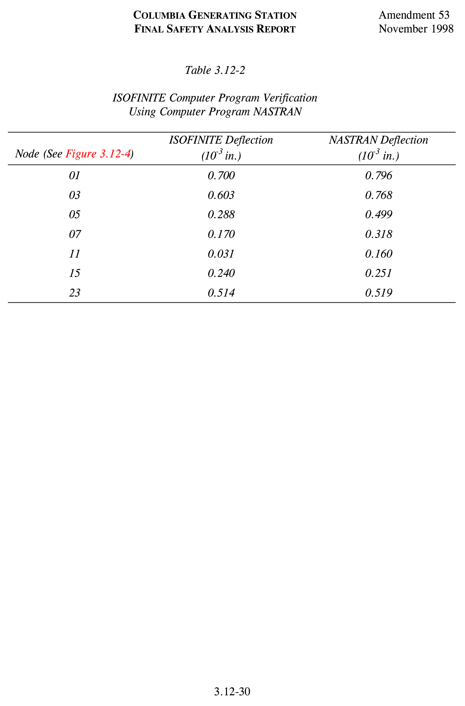

*figure on PDF page 960*

<!-- labels/text on this figure page -->
COLUMBIA GENERATING STATION
Amendment 53
FINAL SAFETY ANALYSIS REPORT
Table 3.12-2
ISOFINITE Computer Program Verification Using Computer Program NASTRAN
ISOFINITE Deflection NASTRAN Deflection
(10-3 in.)
(10-3 in.)
Node (See Figure 3.12-4)
01 0.700 0.796 03 0.603 0.768 05 0.288 0.499 07 0.170 0.318 11 0.031 0.160 15 0.240 0.251 23 0.514 0.519
3.12-30

<!-- p.961 -->

Table 3.12-2

NASTRAN Pressure Loads (Continued)

Maximum Stress Pointa T-Stress R-Stress Z-Stress Intensity
(psi)
(psi)
(psi)
(psi)
a 8795
-6683 5573 15,478 b 8806
-59 6571 8865 c 7365
-575 4587 7940 d 5430
-643 3316 6073 e 3735
-498 2303 4233 f 2846
-616 1905 3462 g 1560
-15 1190 1575 h 1306
-716 1032 2022 i 842 126
-10 852 j 603 33 161 570 k 318
-218 111 536 l 297
-43 389 432 m 80 10 396 386 n 19
-13 414 427 o
-42
-22 423 465 p
-60
-23 648 708 q
-107 11 479 586 r
-72 1 441 513

a Refer to Figure 3.12-4

<!-- p.962 -->

Table 3.12-2

ISOFINITE Pressure Loads (Continued)

Maximum Stress X-Stress Y-Stress Z-Stress Intensity Pointa (psi)
(psi)
(psi)
(psi)

a 14,916 1702 8530 13,214 b 16,462 1656 15,401 14,806 c 9537
-1322 8619 10,859 d 5530
-114 4936 5644 e 4579
-169 3967 4748 f 3729 21 3148 3708 g 2527
-386 2047 2913 h 1725
-108 1716 1833 i 766 215 283 551 j 281
-10
-46 327 k 94
-170 331 501 l 44 50 384 340 m
-17 128 478 495 n
-94 41 509 603 o
-136 19 513 649 p
-100
-26 518 618 q
-64
-71 501 565 r 70 73 511 441

a Refer to Figure 3.12-4

<!-- p.963 -->
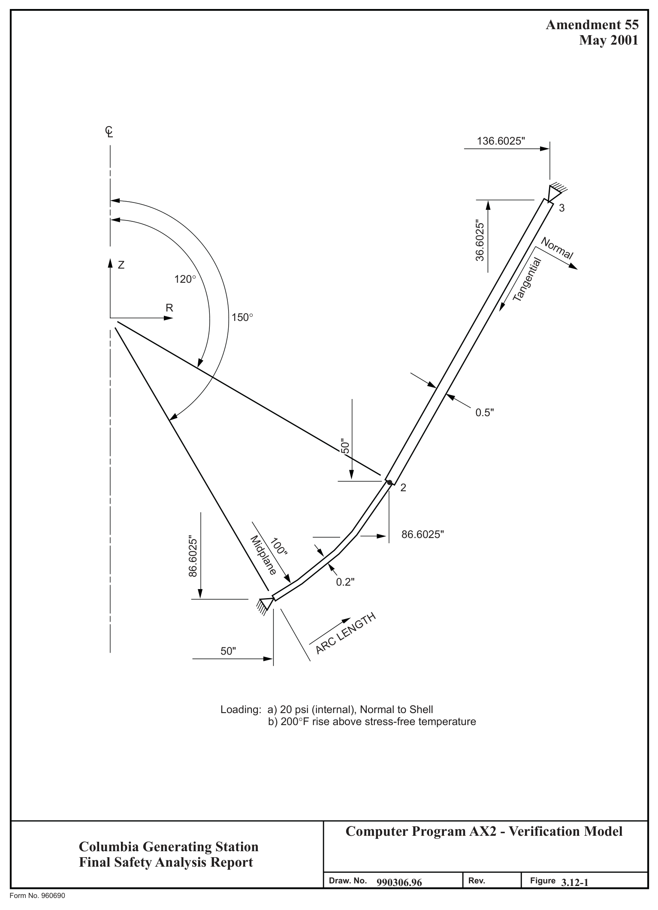

*figure on PDF page 963*

[Vector original (SVG, lossless): fig_page-963.svg](../figures/fig_page-963.svg)

<!-- labels/text on this figure page -->
Amendment 55 May 2001
CL 136.6025"
3 36.6025" Normal Tangential Z 120°
R 150°
0.5"
50"
2
86.6025" Midplane 86.6025" 100" 0.2" V
ARC LENGTH
- 50"
Loading: a) 20 psi (internal), Normal to Shell b) 200°F rise above stress-free temperature
Computer Program AX2 - Verification Model Columbia Generating Station Final Safety Analysis Report Draw. No. 990306.96 Rev. Figure 3.12-1 Form No. 960690

<!-- p.964 -->
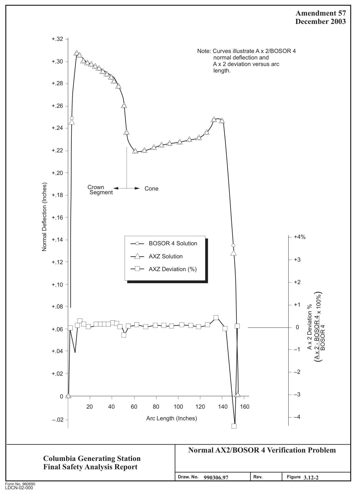

*figure on PDF page 964*

[Vector original (SVG, lossless): fig_page-964.svg](../figures/fig_page-964.svg)

<!-- labels/text on this figure page -->
Amendment 57 December 2003
+.32
Note: Curves illustrate A x 2/BOSOR 4 normal deflection and +.30 A x 2 deviation versus arc length.
+.28
+.26
+.24
+.22
+.20
Normal Deflection (Inches)
Crown Cone Segment +.18
+.16
+4% +.14
--0- BOSOR 4 Solution
-b- AXZ Solution +3 +.12
--0- AXZ Deviation (%)
+2 +.10
(A x 2 - BOSOR 4 x 100%)
+1 +.08 A x 2 Deviation % 0
BOSOR 4
+.06
–1 +.04
–2 +.02
–3 0 20 40 60 80 100 120 140 160 –4 Arc Length (Inches)
–.02
Normal AX2/BOSOR 4 Verification Problem Columbia Generating Station Final Safety Analysis Report Draw. No. 990306.97 Rev. Figure 3.12-2 Form No. 960690
LDCN-02-000

<!-- p.965 -->
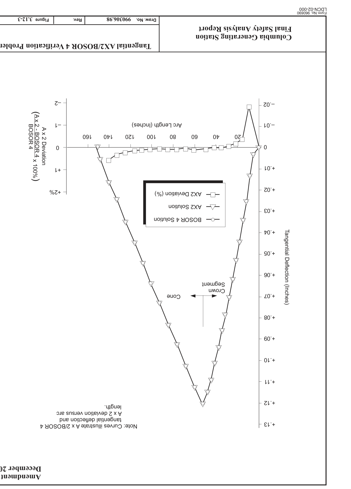

*figure on PDF page 965*

[Vector original (SVG, lossless): fig_page-965.svg](../figures/fig_page-965.svg)

<!-- labels/text on this figure page -->
Amendment 57 December 2003
Note: Curves illustrate A x 2/BOSOR 4 +.13 tangential deflection and A x 2 deviation versus arc length.
+.12
+.11
+.10
+.09 T +.08
Tangential Deflection (Inches)
Cone +.07 Crown Segment +.06
+.05
+.04
--0- BOSOR 4 Solution +.03
-v- AX2 Solution
-0- AX2 Deviation (%)
+2% +.02
(A x 2 - BOSOR 4 x 100%)
+1 +.01 A x 2 Deviation 0 0
BOSOR 4
20 40 60 80 100 120 140 160
–.01 Arc Length (Inches)
–1
–.02 –2
Tangential AX2/BOSOR 4 Verification Problem Columbia Generating Station Final Safety Analysis Report Draw. No. 990306.98 Rev. Figure 3.12-3 Form No. 960690
LDCN-02-000

<!-- p.966 -->
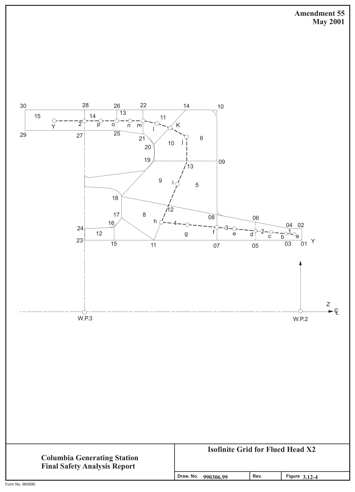

*figure on PDF page 966*

[Vector original (SVG, lossless): fig_page-966.svg](../figures/fig_page-966.svg)

<!-- labels/text on this figure page -->
Amendment 55 May 2001
28 22 30 26 14 10 13 14 15 11
0---- --0-- --0--
2 p o -"()...._ n m K
Y
........ y l
25 29 27 6 21 j 10 I 20 I I 19 09 I 13 I I I 9 9 i 5 I I 18 I 12 17 8 08 06 h 4 16 04 02 3 24 2 1 f g e d 12 c b a 23 Y 03 01 11 15 07 05
I
I
I __ __J_ _________ _ I Z CL
W.P.3
W.P.2
Isofinite Grid for Flued Head X2 Columbia Generating Station Final Safety Analysis Report Draw. No. 990306.99 Rev. Figure 3.12-4 Form No. 960690

<!-- p.967 -->

Appendix 3A

#### PLANT DESIGN ASSESSMENT REPORT FOR

#### SAFETY/RELIEF VALVES AND LOSS-OF-COOLANT

#### ACCIDENT LOADS

#### TABLE OF CONTENTS

Section Page

3A.1.1 CONFORMANCE TO NRC ACCEPTANCE CRITERIA .................... 3A.1.1-1

3A.1.2 ROLE OF THE DESIGN ASSESSMENT REPORT ........................... 3A.1.2-1

3A.1.3 ASSESSMENT APPROACH ....................................................... 3A.1.3-1

3A.1.4 SUMMARY OF DESIGN ASSESSMENT REPORT CONTENT ........... 3A.1.4-1

3A.2 SUMMARY AND CONCLUSIONS ................................................. 3A.2.1-1

3A.2.1 GENERAL DESCRIPTION OF PLANT ......................................... 3A.2.1-1

3A.2.1.1 Structures, Piping, and Components Directly Affected by Pool

Dynamic Loads ...................................................................... 3A.2.1-1

3A.2.1.2 Structures, Piping, and Components Indirectly Affected by Pool

Dynamic Loads ...................................................................... 3A.2.1-3

3A.2.2 SUMMARY OF CHANGES AND CONCLUSIONS ......................... 3A.2.2-1

3A.2.2.1 Summary of Changes to Preserve Design Margins ........................... 3A.2.2-1

3A.2.2.2 Conclusions .......................................................................... 3A.2.2-1

3A.3 CONTAINMENT DYNAMIC FORCING FUNCTIONS ........................ 3A.3.1-1

3A.3.1 LOADS ASSOCIATED WITH SAFETY/RELIEF VALVE

ACTUATION .......................................................................... 3A.3.1-1

3A.3.1.1 Description of the Safety/Relief System ......................................... 3A.3.1-1

3A.3.1.2 Description of the Phenomena and Resulting Loads .......................... 3A.3.1-1

3A.3.1.2.1 Water Clearing Loads ............................................................ 3A.3.1-2

3A.3.1.2.2 Air Clearing Loads ............................................................... 3A.3.1-2

3A.3.1.2.3 Steam Condensation Loads ...................................................... 3A.3.1-2

3A.3.1.3 Safety/Relief Valve Air Clearing Loads ........................................ 3A.3.1-3

3A.3.1.3.1 Boundary Loads ................................................................... 3A.3.1-3

3A.3.1.3.1.1 Spatial Distribution of Boundary Pressures ................................ 3A.3.1-3

3A.3.1.3.1.2 Pressure Wave Forms ......................................................... 3A.3.1-4

3A.3.1.3.1.3 Design Maximum Pressure Amplitude ..................................... 3A.3.1-4

3A.3.1.3.2 Submerged Structure Loads ..................................................... 3A.3.1-4

3A.3.1.3.2.1 Peak Safety/Relief Valve Dynamic Loads ................................. 3A.3.1-5

3A.3.1.3.2.2 Time Dependence of Safety/Relief Valve Loads and Dynamic

Load Factors .................................................................... 3A.3.1-5

3A.3.1.3.2.3 Safety/Relief Valve Loads on Structures ................................... 3A.3.1-5

3A.3.1.4 References ............................................................................ 3A.3.1-6

3A-i

<!-- p.968 -->

Appendix 3A

#### PLANT DESIGN ASSESSMENT REPORT FOR

#### SAFETY/RELIEF VALVES AND LOSS-OF-COOLANT

#### ACCIDENT LOADS

TABLE OF CONTENTS (Continued)

Section Page

3A.3.2 LOADS ASSOCIATED WITH LOSS-OF-COOLANT ACCIDENT........ 3A.3.2-1

3A.3.2.1 Description of Pressure Suppression System ................................... 3A.3.2-1

3A.3.2.2 Description of the Phenomena and Resulting Loads .......................... 3A.3.2-1

3A.3.2.3 Short-Term Loss-of-Coolant Accident Loads .................................. 3A.3.2-3

3A.3.2.3.1 Analytical Models and Supporting Test Data................................ 3A.3.2-3

3A.3.2.3.1.1 Vent Clearing Jet and Induced Flow Field Model........................ 3A.3.2-3

3A.3.2.3.1.2 Loss-of-Coolant Accident Bubble Charging Model ...................... 3A.3.2-4

3A.3.2.3.1.3 Pool Swell Analytical Model................................................. 3A.3.2-5

3A.3.2.3.1.4 Fallback Model ................................................................. 3A.3.2-6

3A.3.2.3.2 Boundary Loads................................................................... 3A.3.2-6

3A.3.2.3.3 Structure Loads ................................................................... 3A.3.2-6

3A.3.2.3.3.1 Loads on Major Structures ................................................... 3A.3.2-9

3A.3.2.3.3.2 Loads on Fully Submerged Piping Systems Below Elevation

454.4 ft .......................................................................... 3A.3.2-10

3A.3.2.3.3.3 Loads on Partially Submerged Piping Systems ........................... 3A.3.2-10

3A.3.2.3.3.4 Loads on Piping Systems and Structural Components Between

Elevations 454.4 ft and 484.4 ft............................................. 3A.3.2-11

3A.3.2.4 Long-Term Hydrodynamic Loads................................................ 3A.3.2-11

3A.3.2.4.1 Analytical Models and Supporting Test Data................................ 3A.3.2-11

3A.3.2.4.1.1 Chugging Loads ................................................................ 3A.3.2-11

3A.3.2.4.1.2 Condensation Oscillation Loads ............................................. 3A.3.2-12

3A.3.2.4.2 Boundary Loads................................................................... 3A.3.2-12

3A.3.2.4.2.1 Chugging Loads ................................................................ 3A.3.2-12

3A.3.2.4.2.2 Condensation Oscillation Loads ............................................. 3A.3.2-13

3A.3.2.4.3 Submerged Structure Loads..................................................... 3A.3.2-13

3A.3.2.4.3.1 Condensation Oscillation Loads ............................................. 3A.3.2-13

3A.3.2.4.3.2 Chugging Loads ................................................................ 3A.3.2-13

3A.3.2.4.4 Lateral Loads on Downcomer Vents .......................................... 3A.3.2-15

3A.3.2.5 Pressure and Temperature Transients ........................................... 3A.3.2-16

3A.3.2.5.1 Results for CGS................................................................... 3A.3.2-17

3A.3.2.5.2 Differential Pressure Load on the Diaphragm Floor ....................... 3A.3.2-18

3A.3.2.6 Building Response to Loss-of-Coolant Accident Loads ...................... 3A.3.2-18

3A.3.2.7 References............................................................................ 3A.3.2-18

3A-ii

<!-- p.969 -->

Appendix 3A

#### PLANT DESIGN ASSESSMENT REPORT FOR

#### SAFETY/RELIEF VALVES AND LOSS-OF-COOLANT

#### ACCIDENT LOADS

TABLE OF CONTENTS (Continued)

Section Page

3A.3.3 LOAD SUMMARY................................................................... 3A.3.3-1

3A.3.4 SEQUENCE OF DYNAMIC LOADS ............................................ 3A.3.4-1

3A.3.5 LOAD COMBINATIONS AND ACCEPTANCE CRITERIA................ 3A.3.5-1

3A.3.5.1 Steel Containment Structure....................................................... 3A.3.5-1

3A.3.5.1.1 Definitions ......................................................................... 3A.3.5-1

3A.3.5.1.2 Load Combinations............................................................... 3A.3.5-2

3A.3.5.1.3 Acceptance Criteria .............................................................. 3A.3.5-3

3A.3.5.2 Reinforced-Concrete Structures................................................... 3A.3.5-3

3A.3.5.2.1 Definitions ......................................................................... 3A.3.5-3

3A.3.5.2.2 Load Combinations............................................................... 3A.3.5-4

3A.3.5.2.3 Acceptance Criteria .............................................................. 3A.3.5-5

3A.3.5.3 Steel Structures ...................................................................... 3A.3.5-5

3A.3.5.3.1 Definitions ......................................................................... 3A.3.5-5

3A.3.5.3.2 Load Combinations............................................................... 3A.3.5-5

3A.3.5.3.3 Acceptance Criteria .............................................................. 3A.3.5-5

3A.3.5.4 Piping Systems....................................................................... 3A.3.5-6

3A.3.5.4.1 Definitions ......................................................................... 3A.3.5-6

3A.3.5.4.2 Load Combinations............................................................... 3A.3.5-7

3A.3.5.4.3 Acceptance Criteria .............................................................. 3A.3.5-8

3A.3.5.5 References ........................................................................... 3A.3.5-8

3A.4 DESIGN ASSESSMENT ............................................................... 3A.4.1-1

3A.4.1 SUPPRESSION POOL BOUNDARY STRUCTURES......................... 3A.4.1-1

3A.4.1.1 Assessment of Steel Containment Structure .................................... 3A.4.1-1

3A.4.1.1.1 Loads Used for Assessment..................................................... 3A.4.1-1

3A.4.1.1.1.1 Safety/Relief Valve Loads.................................................... 3A.4.1-1

3A.4.1.1.1.1.1 Single Valve Discharge Case .............................................. 3A.4.1-2

3A.4.1.1.1.1.2 Two Valves Discharge Case............................................... 3A.4.1-2

3A.4.1.1.1.1.3 Automatic Depressurization System Valves Discharge Case ........ 3A.4.1-2

3A.4.1.1.1.1.4 All Valves Discharge Case................................................. 3A.4.1-2

3A.4.1.1.1.2 Loss-of-Coolant Accident Loads ............................................ 3A.4.1-2

3A.4.1.1.1.2.1 Chugging Loads.............................................................. 3A.4.1-2

3A.4.1.1.1.2.2 High and Medium Mass Flux Condensation Oscillations............. 3A.4.1-2

3A.4.1.1.1.2.3 Other Loss-of-Coolant Accident Loads .................................. 3A.4.1-3

3A-iii

<!-- p.970 -->

Appendix 3A

#### PLANT DESIGN ASSESSMENT REPORT FOR

#### SAFETY/RELIEF VALVES AND LOSS-OF-COOLANT

#### ACCIDENT LOADS

TABLE OF CONTENTS (Continued)

Section Page

3A.4.1.1.1.3 Other Significant Loads ....................................................... 3A.4.1-3

3A.4.1.1.2 Controlling Load Combinations................................................ 3A.4.1-4

3A.4.1.1.3 Acceptance Criteria .............................................................. 3A.4.1-4

3A.4.1.1.4 Method of Analysis............................................................... 3A.4.1-5

3A.4.1.1.4.1 Formulation of the Problem .................................................. 3A.4.1-5

3A.4.1.1.4.2 Mathematical Model........................................................... 3A.4.1-5

3A.4.1.1.4.3 Coupled Equations of Motion................................................ 3A.4.1-5

3A.4.1.1.4.4 Numerical Solution ............................................................ 3A.4.1-6

3A.4.1.1.4.5 Computer Program............................................................. 3A.4.1-6

3A.4.1.1.5 Results and Design Margin ..................................................... 3A.4.1-6

3A.4.1.1.5.1 Results of Analysis............................................................. 3A.4.1-6

3A.4.1.1.5.2 Assessment Results ............................................................ 3A.4.1-8

3A.4.1.2 Basemat ............................................................................... 3A.4.1-8

3A.4.1.2.1 Loads Used for Assessment..................................................... 3A.4.1-9

3A.4.1.2.1.1 Safety/Relief Valve Loads.................................................... 3A.4.1-9

3A.4.1.2.1.2 Loss-of-Coolant Accident Loads ............................................ 3A.4.1-9

3A.4.1.2.1.3 Other Significant Loads ....................................................... 3A.4.1-9

3A.4.1.2.2 Applicable Load Combinations and Acceptance Criteria .................. 3A.4.1-9

3A.4.1.2.3 Method of Analysis............................................................... 3A.4.1-9

3A.4.1.2.3.1 Effects of EO, ESS, D, L....................................................... 3A.4.1-10

3A.4.1.2.3.2 Effect of PSR, PB ................................................................ 3A.4.1-10

3A.4.1.2.3.3 Critical Load Combination ................................................... 3A.4.1-10

3A.4.1.2.3.4 Capacity.......................................................................... 3A.4.1-10

3A.4.1.2.4 Results and Design Margins .................................................... 3A.4.1-10

3A.4.1.3 Pedestal ............................................................................... 3A.4.1-11

3A.4.1.3.1 Loads Used for Assessment..................................................... 3A.4.1-11

3A.4.1.3.1.1 Safety/Relief Valve Loads.................................................... 3A.4.1-11

3A.4.1.3.1.2 Loss-of-Coolant Accident Loads ............................................ 3A.4.1-11

3A.4.1.3.1.3 Other Significant Loads ....................................................... 3A.4.1-11

3A.4.1.3.2 Applicable Load Combinations and Acceptance Criteria .................. 3A.4.1-11

3A.4.1.3.3 Method of Analysis............................................................... 3A.4.1-12

3A.4.1.3.3.1 Asymmetric Action ............................................................ 3A.4.1-12

3A.4.1.3.3.2 Symmetric Action .............................................................. 3A.4.1-12

3A.4.1.3.4 Results and Design Margins .................................................... 3A.4.1-13

3A-iv

<!-- p.971 -->

Appendix 3A

#### PLANT DESIGN ASSESSMENT REPORT FOR

#### SAFETY/RELIEF VALVES AND LOSS-OF-COOLANT

#### ACCIDENT LOADS

TABLE OF CONTENTS (Continued)

Section Page

3A.4.1.4 Diaphragm Floor .................................................................... 3A.4.1-14

3A.4.1.4.1 Loads Used for Assessment..................................................... 3A.4.1-14

3A.4.1.4.1.1 Safety/Relief Valve Actuation Loads ....................................... 3A.4.1-14

3A.4.1.4.1.2 Loss-of-Coolant Accident Loads ............................................ 3A.4.1-14

3A.4.1.4.1.3 Other Significant Loads ....................................................... 3A.4.1-15

3A.4.1.4.2 Controlling Load Combinations................................................ 3A.4.1-15

3A.4.1.4.3 Acceptance Criteria .............................................................. 3A.4.1-15

3A.4.1.4.4 Method of Analysis............................................................... 3A.4.1-15

3A.4.1.4.5 Results and Design Margins .................................................... 3A.4.1-16

3A.4.1.5 Diaphragm Floor Seal .............................................................. 3A.4.1-17

3A.4.1.5.1 Loads Used for Assessment..................................................... 3A.4.1-17

3A.4.1.5.2 Controlling Load Combination................................................. 3A.4.1-18

3A.4.1.5.3 Acceptance Criteria .............................................................. 3A.4.1-18

3A.4.1.5.4 Method of Analysis............................................................... 3A.4.1-19

3A.4.1.5.5 Results and Design Margins .................................................... 3A.4.1-19

3A.4.1.6 References............................................................................ 3A.4.1-19

3A.4.2 SUPPRESSION POOL MAJOR STRUCTURES AND COMPONENTS .. 3A.4.2-1

3A.4.2.1 Downcomer Bracing System ...................................................... 3A.4.2-1

3A.4.2.1.1 Description of System............................................................ 3A.4.2-1

3A.4.2.1.2 Loads Used for Assessment..................................................... 3A.4.2-2

3A.4.2.1.2.1 Safety/Relief Valve Actuation Loads ....................................... 3A.4.2-2

3A.4.2.1.2.2 Loss-of-Coolant Accident Loads ............................................ 3A.4.2-2

3A.4.2.1.2.3 Other Significant Loads ....................................................... 3A.4.2-4

3A.4.2.1.3 Controlling Load Combinations and Acceptance Criteria ................. 3A.4.2-4

3A.4.2.1.4 Method of Analysis............................................................... 3A.4.2-4

3A.4.2.1.4.1 Analysis for Horizontal Loads ............................................... 3A.4.2-5

3A.4.2.1.4.2 Analysis for Vertical Loads .................................................. 3A.4.2-5

3A.4.2.1.4.3 Design Load Conditions ...................................................... 3A.4.2-5

3A.4.2.1.5 Results and Design Margin ..................................................... 3A.4.2-8

3A.4.2.1.5.1 Principal Results................................................................ 3A.4.2-8

3A.4.2.1.5.2 Design Margins................................................................. 3A.4.2-9

3A.4.2.2 Columns .............................................................................. 3A.4.2-9

3A.4.2.2.1 Loads Used for Assessment..................................................... 3A.4.2-9

3A.4.2.2.1.1 Safety/Relief Valve Actuation Loads ....................................... 3A.4.2-9

3A-v

<!-- p.972 -->

Appendix 3A

#### PLANT DESIGN ASSESSMENT REPORT FOR

#### SAFETY/RELIEF VALVES AND LOSS-OF-COOLANT

#### ACCIDENT LOADS

TABLE OF CONTENTS (Continued)

Section Page

3A.4.2.2.1.2 Loss-of-Coolant Accident Loads ............................................ 3A.4.2-10

3A.4.2.2.1.3 Other Significant Loads ....................................................... 3A.4.2-11

3A.4.2.2.2 Applicable Load Combinations and Acceptance Criteria .................. 3A.4.2-11

3A.4.2.2.3 Method of Analysis............................................................... 3A.4.2-11

3A.4.2.2.4 Results and Design Margins .................................................... 3A.4.2-14

3A.4.2.3 Downcomers ......................................................................... 3A.4.2-14

3A.4.2.3.1 Loads Used for Assessment..................................................... 3A.4.2-15

3A.4.2.3.2 Load Combination and Acceptance Criteria ................................. 3A.4.2-16

3A.4.2.3.3 Method of Analysis............................................................... 3A.4.2-17

3A.4.2.3.3.1 Static Analysis .................................................................. 3A.4.2-17

3A.4.2.3.3.2 Response Spectrum Analysis................................................. 3A.4.2-17

3A.4.2.3.4 Results and Design Margin ..................................................... 3A.4.2-17

3A.4.2.3.5 Fatigue Evaluations............................................................... 3A.4.2-18

3A.4.2.4 Safety/Relief Valve Piping Systems.............................................. 3A.4.2-18

3A.4.2.4.1 Loads Used for Assessment..................................................... 3A.4.2-19

3A.4.2.4.2 Load Combination and Acceptance Criteria ................................. 3A.4.2-19

3A.4.2.4.3 Allowable Stress Limits (Equation 9 of NC-3652 and NC-3611,

Reference 3A.4.2-1) ............................................................. 3A.4.2-20

3A.4.2.4.4 Method of Analysis............................................................... 3A.4.2-20

3A.4.2.4.4.1 Static Analysis .................................................................. 3A.4.2-20

3A.4.2.4.4.2 Response Spectrum Analysis................................................. 3A.4.2-20

3A.4.2.4.4.3 Time History Analysis ........................................................ 3A.4.2-20

3A.4.2.4.5 Results and Design Margin ..................................................... 3A.4.2-20

3A.4.2.4.6 Fatigue Evaluations............................................................... 3A.4.2-21

3A.4.2.5 Quencher.............................................................................. 3A.4.2-21

3A.4.2.5.1 Loads Used for Assessment..................................................... 3A.4.2-22

3A.4.2.5.2 Load Combination Acceptance Criteria....................................... 3A.4.2-22

3A.4.2.5.3 Evaluation.......................................................................... 3A.4.2-22

3A.4.2.6 Platforms and Ladders ............................................................. 3A.4.2-23

3A.4.2.6.1 Loads Used for Assessment..................................................... 3A.4.2-23

3A.4.2.6.1.1 Safety/Relief Valve Operation Loads....................................... 3A.4.2-23

3A.4.2.6.1.2 Loss-of-Coolant Accident Loads ............................................ 3A.4.2-23

3A.4.2.6.1.3 Other Significant Loads ....................................................... 3A.4.2-23

3A.4.2.6.2 Controlling Load Combinations................................................ 3A.4.2-24

3A-vi

<!-- p.973 -->

Appendix 3A

#### PLANT DESIGN ASSESSMENT REPORT FOR

#### SAFETY/RELIEF VALVES AND LOSS-OF-COOLANT

#### ACCIDENT LOADS

TABLE OF CONTENTS (Continued)

Section Page

3A.4.2.6.3 Acceptance Criteria .............................................................. 3A.4.2-24

3A.4.2.6.4 Method of Analysis............................................................... 3A.4.2-24

3A.4.2.6.5 Results .............................................................................. 3A.4.2-24

3A.4.2.7 References............................................................................ 3A.4.2-25

3A.4.3 MISCELLANEOUS SUPPRESSION POOL PIPING SYSTEMS............ 3A.4.3-1

3A.4.3.1 Loads Used for Assessment ....................................................... 3A.4.3-1

3A.4.3.2 Load Combination and Acceptance Criteria.................................... 3A.4.3-1

3A.4.3.3 Method of Analysis ................................................................. 3A.4.3-1

3A.4.3.4 Results and Design Margins....................................................... 3A.4.3-2

3A.5 EFFECTS DUE TO BUILDING RESPONSES TO SAFETY/RELIEF

#### VALVE DISCHARGE AND LOSS-OF-COOLANT

ACCIDENT LOADS.................................................................... 3A.5.1-1

3A.5.1 BUILDING RESPONSES TO SAFETY/RELIEF VALVE

DISCHARGE LOADS................................................................ 3A.5.1-1

3A.5.1.1 Analytical Model .................................................................... 3A.5.1-1

3A.5.1.1.1 Overall Building Model.......................................................... 3A.5.1-1

3A.5.1.1.2 Steel Containment Shell Model................................................. 3A.5.1-1

3A.5.1.2 Method of Analysis ................................................................. 3A.5.1-1

3A.5.1.3 Safety/Relief Valve Discharge Load Cases..................................... 3A.5.1-2

3A.5.1.3.1 Response to All Valve Discharge.............................................. 3A.5.1-2

3A.5.1.3.2 Automatic Depressurization System Valves Discharge Case ............. 3A.5.1-3

3A.5.1.3.3 Two Valves Discharge Case.................................................... 3A.5.1-4

3A.5.1.3.4 Single Valve Discharge.......................................................... 3A.5.1-4

3A.5.2 BUILDING RESPONSES TO LOSS-OF-COOLANT

ACCIDENT LOADS ................................................................. 3A.5.2-1

3A.5.2.1 Analytical Model .................................................................... 3A.5.2-1

3A.5.2.2 Method Of Analysis and Building Response ................................... 3A.5.2-1

3A.5.2.2.1 Reactor Building Response, Nearly Symmetric Loading -

Acceleration Response Spectra................................................. 3A.5.2-2

3A-vii

<!-- p.974 -->

Appendix 3A

#### PLANT DESIGN ASSESSMENT REPORT FOR

#### SAFETY/RELIEF VALVES AND LOSS-OF-COOLANT

#### ACCIDENT LOADS

TABLE OF CONTENTS (Continued)

Section Page

#### ATTACHMENTS

3A.A Not used

3A.B Three-Dimensional Source Flows in Exact Containment Geometry........ 3A.B-1

3A.C Concept of Drag Forces Due to Hydrodynamic Flow Fields................ 3A.C-1

3A.D Calculation Models for Short-Term Loss-of-Coolant Accident

Phenomena............................................................................ 3A.D-1

3A.E Suppression Pool Temperature Monitoring System ........................... 3A.E-1

3A.F Computer Programs................................................................. 3A.F-1

3A.G Not Used

3A.H Conformance of CGS Design to NRC Acceptance Criteria.................. 3A.H-1

3A.I Safety/Relief Valve and Loss-of-Coolant Accident Loads on

Submerged Structures............................................................... 3A.I-1

3A-viii

<!-- p.975 -->

Appendix 3A

#### PLANT DESIGN ASSESSMENT REPORT FOR

#### SAFETY/RELIEF VALVES AND LOSS-OF-COOLANT

#### ACCIDENT LOADS

#### LIST OF TABLES

Section Title Page

3A.2.2-1 Suppression Pool Assessment Summary .................................... 3A.2.2-3

3A.3.1-1 Summary of Safety/Relief System Characteristics ........................ 3A.3.1-9

3A.3.2-1 Summary of Loss-of-Coolant Accident Affected Structures............. 3A.3.2-23

3A.3.2-2 CGS Data for Loss-of-Coolant Accident Water Jet Analysis ........... 3A.3.2-24

3A.3.2-3 CGS Data for Vent Clearing and Pool Swell Analysis ................... 3A.3.2-25

3A.3.2-4 Results from Loss-of-Coolant Accident Bubble Charging

Analysis for CGS ............................................................... 3A.3.2-26

3A.3.2-5 CGS Drywell Pressure as a Function of Time for Loss-of-Coolant Accident (Effects of Pipe Inventory and

Subcooling Included) ........................................................... 3A.3.2-27

3A.3.2-6 Results of Pool Swell Analysis for CGS.................................... 3A.3.2-28

3A.3.2-7 CGS Plant Parameters for Loss-of-Coolant Accident

Transient Analysis .............................................................. 3A.3.2-29

3A.3.2-8 Short-Term Loss-of-Coolant Accident Loads on Structures

Below El. 454.4 ft .............................................................. 3A.3.2-30

3A.3.2-9 Short-Term Loss-of-Coolant Accident Loads on Structures

between El. 454 ft 4.75 in. and 484 ft 4.75 in............................. 3A.3.2-32

3A.3.3-1 Summary of Hydrodynamic Loads on Wetwell Structures .............. 3A.3.3-3

3A.3.5-1 Equivalent Static Loads for Pressure Transients and

Loss-of-Coolant Accident Effects ............................................ 3A.3.5-9

3A-ix

<!-- p.976 -->

April 2000

Appendix 3A

#### PLANT DESIGN ASSESSMENT REPORT FOR

#### SAFETY/RELIEF VALVES AND LOSS-OF-COOLANT

#### ACCIDENT LOADS

LIST OF TABLES (Continued)

Section Title Page

3A.3.5-2 Acceptance Criteria for Containment Vessel Allowable

Stress Limits ..................................................................... 3A.3.5-10

3A.3.5-3 Load Combinations - Reinforced-Concrete Structures ................... 3A.3.5-11

3A.3.5-4 Load Combinations - Steel Structures....................................... 3A.3.5-12

3A.3.5-5 Load Combinations and Acceptance Criteria for ASME Code

Class 1, 2, and 3 Balance-of-Plant Piping and Equipment............... 3A.3.5-13

3A.4.1-1 Basemat - Stress Resultants at Critical Sections ........................... 3A.4.1-21

3A.4.1-2 Pedestal - Stress Resultants at Base.......................................... 3A.4.1-22

3A.4.1-3 Equivalent Stress Cycles for Fatigue Evaluation .......................... 3A.4.1-23

3A.4.1-4 Summary of Stress Intensities for Diaphragm Floor Seal................ 3A.4.1-24

3A.4.1-5 Cummulative Usage Factor Calculation for Diaphragm Floor Seal.... 3A.4.1-25

3A.4.2-1 Downcomer Bracing System Controlling Design Margins .............. 3A.4.2-27

3A.4.2-2 Controlling Stress Resultants in Column.................................... 3A.4.2-28

3A.4.2-3 Results Summary - Safety/Relief Valve Quencher........................ 3A.4.2-29

3A.4.2-4 Cummulative Usage Factor Calculation at 24 in.

Downcomer Anchor ............................................................ 3A.4.2-30

3A.4.2-5 Cummulative Usage Factor Calculation at 28 in.

Downcomer Anchor ............................................................ 3A.4.2-31

3A.4.2-6 Maximum Usage Factors Table .............................................. 3A.4.2-32

3A-x

<!-- p.977 -->

Appendix 3A

#### PLANT DESIGN ASSESSMENT REPORT FOR

#### SAFETY/RELIEF VALVES AND LOSS-OF-COOLANT

#### ACCIDENT LOADS

LIST OF TABLES (Continued)

Section Title Page

3A.4.3-1 Miscellaneous Wetwell Piping................................................ 3A.4.3-3

3A.4.3-2 Piping Zone Versus Loads .................................................... 3A.4.3-5

3A.4.3-3 Summary of Results and Design Margins for Miscellaneous

Wetwell Piping .................................................................. 3A.4.3-6

3A-xi

<!-- p.978 -->
Appendix 3A

#### PLANT DESIGN ASSESSMENT REPORT FOR
#### SAFETY/RELIEF VALVES AND LOSS-OF-COOLANT
#### ACCIDENT LOADS
#### LIST OF FIGURES
Section Title

3A.2.1-1 Primary and Secondary Containment Structure

3A.2.1-2 Suppression Pool Composite Plan at El. 435 ft 3 in.

3A.2.1-3 Suppression Pool Composite Plan at El. 455 ft 4 in.

3A.2.1-4 Suppression Pool Composite Plan at El. 486 ft 8 in.

3A.2.1-5 Suppression Pool Composite Plan at El. 494 ft 5-1/4 in.

3A.2.1-6 Suppression Pool Composite Sections “1-1” and “2-2”

3A.2.1-7 Suppression Pool Composite Sections “3-3” and “4-4”

3A.2.1-8 Suppression Pool Composite Sections “5-5” and “6-6”

3A.2.1-9 Containment Vessel Developed Elevation

3A.3.1-1 Normalized Design Circumferential Distribution of Pool Boundary Pressures at Containment

3A.3.1-2 Normalized Design Vertical Distribution of Pool Boundary Pressures at Containment

3A.3.1-3 MFP Design Wave Form (Normalized) Time History

3A.3.1-4 MFP Design Wave Form (Normalized) Amplitude of Frequency Spectrum

3A.3.1-5 SFP Design Wave Form (Normalized) Time History

3A.3.1-6 SFP Design Wave Form (Normalized) Amplitude of Frequency Spectrum

3A.3.1-7 SRV Air Clearing Load Distribution on a Downcomer

3A-xii

<!-- p.979 -->

Appendix 3A

#### PLANT DESIGN ASSESSMENT REPORT FOR
#### SAFETY/RELIEF VALVES AND LOSS-OF-COOLANT
#### ACCIDENT LOADS
LIST OF FIGURES (Continued)

Section Title

3A.3.1-8 SRV Air Clearing Load Distribution on a Concrete Column

3A.3.1-9 SRV Air Clearing Load Distribution on an SRV Discharge Line and Quencher Support

3A.3.1-10 Dynamic Load Factor Versus Frequency to be Used for Defining SRV Load on Submerged Structures

3A.3.1-11a SRV Air Clearing Load Distribution on Piping, Supports, and Bracing Truss

3A.3.1-11b SRV Air Clearing Load Distribution on Piping, Supports, and Bracing Truss

3A.3.2-1 Short Term Hydrodynamic Processes Associated with a LOCA

3A.3.2-2 Downcomer Vent Water Clearing Velocity Versus Time

3A.3.2-3 Downcomer Vent Water Clearing Acceleration Versus Time

LOCA Bubble Charging Radial Component of ∇Φ in Radial Plane Containing 3A.3.2-4 Downcomers

3A.3.2-5 LOCA Bubble Charging Tangential Component of ∇Φ in Vertical Cylindrical Surface Through Middle Downcomers

3A.3.2-6 LOCA Bubble Charging Vertical Component of ∇Φ in Radial Plane Containing Downcomers

3A.3.2-7 LOCA Bubble Radius and Source Strength Time Histories by PSAM Method

3A.3.2-8 Pool Swell Water Slug Velocity Versus Time

3A.3.2-9 Pool Swell Water Slug Acceleration Versus Time

3A.3.2-10 Pool Swell Water Slug Elevation (Top Surface) Versus Time

3A-xiii

<!-- p.980 -->

Appendix 3A

#### PLANT DESIGN ASSESSMENT REPORT FOR
#### SAFETY/RELIEF VALVES AND LOSS-OF-COOLANT
#### ACCIDENT LOADS
LIST OF FIGURES (Continued)

Section Title

3A.3.2-11 Pool Swell Air Bubble Pressure Versus Time

3A.3.2-12 Pool Swell Wetwell Air Pressure Versus Time

3A.3.2-13 Pool Swell Water Slug Velocity Versus Elevation of Slug Top Surface

3A.3.2-14 Fallback Water Slug Velocity Versus Elevation of Water Slug Top Surface

3A.3.2-15 LOCA Boundary Load Duration

3A.3.2-16 LOCA Boundary Load Distribution During Vent Clearing

3A.3.2-17 LOCA Boundary Load Distribution During Pool Swell

3A.3.2-18 Distribution of Short Term LOCA Loads on Structures Below El. 454.4 ft

3A.3.2-19 Pressure Gradients Across Submerged Structures Due to Chugging

3A.3.2-20 Large Recirculation Line Break - Pressure Response - Minimum ECCS

3A.3.2-21 Containment Pressure Response for Large Recirculation Line Break - Cases A, B, and C

3A.3.2-22 Large Recirculation Line Break - Temperature Response

3A.3.2-23 Drywell Temperature Response for Large Recirculation Line Break - Cases A, B, and C

3A.3.2-24 Suppression Pool Temperature Response for Large Recirculation Line Break - Long Term Response

3A.3.2-25 Pressure Response Main Steam Line Break

3A-xiv

<!-- p.981 -->

Appendix 3A

#### PLANT DESIGN ASSESSMENT REPORT FOR
#### SAFETY/RELIEF VALVES AND LOSS-OF-COOLANT
#### ACCIDENT LOADS
LIST OF FIGURES (Continued)

Section Title

3A.3.2-26 Temperature Response - Main Steam Line Break - Minimum ECCS

3A.3.2-27 Temperature Response - Recirculation Line Break (0.1 ft2)

Pressure Response - Recirculation Line Break (0.1 ft2) 3A.3.2-28

3A.4.1-1 Stiffened Containment in Wetwell Region

3A.4.1-2 Displacement Profile SRV Load - All Valves

3A.4.1-3 Displacement Profile Nearly Symmetric Chugging

3A.4.1-4 Stiffener Configuration

3A.4.1-5 Basemat Plan and Sections

3A.4.1-6 Reactor Building Cross Section

3A.4.1-7 Reactor Pedestal, Diaphragm Floor, and Columns

3A.4.1-8 Pedestal-Interaction Diagram Axial Load Versus Moment

3A.4.1-9 Drywell Diaphragm Floor Seal

3A.4.1.10 Finite Element Model Diaphragm Floor Seal

3A.4.2-1 Downcomer Bracing System - Plan and Details

3A.4.2-2 Downcomer Bracing System - Model for Structural Analysis

3A.4.2-3 Diaphragm Floor Columns and Adjoining Structures

3A.4.2-4 Diaphragm Floor Column Model for Dynamic Analysis

3A-xv

<!-- p.982 -->

Appendix 3A

#### PLANT DESIGN ASSESSMENT REPORT FOR
#### SAFETY/RELIEF VALVES AND LOSS-OF-COOLANT
#### ACCIDENT LOADS
LIST OF FIGURES (Continued)

Section Title

3A.4.2-5 Structural Model of Diaphragm Floor Beam and Column

3A.4.2-6 SRV Piping System Inner Ring Quencher Support

3A.4.2-7 Quencher Assembly

3A.4.2-8 SRV Quencher Assembly

3A.4.3-1 Hydrodynamic Loading Zones

3A.5.1-1a Axisymmetric Model of the Reactor Building and Soil Foundation

3A.5.1-1b Reactor Building Model

3A.5.1-2 Containment Shell Model Cross-Section Details

3A.5.1-3a Top of RPV Pedestal, El. 520 ft Mass No. 44 (Radial)

3A.5.1-3b Top of RPV Pedestal, El. 520 ft Mass No. 44 (Radial)

3A.5.1-4a Top of RPV Pedestal, El. 520 ft Mass No. 44 (Vertical)

3A.5.1-4b Top of RPV Pedestal, El. 520 ft Mass No. 44 (Vertical)

3A.5.1-5a Basemat at RPV Pedestal, El. 435 ft Mass No. 141 Radial)

3A.5.1-5b Basemat at RPV Pedestal, El. 435 ft Mass No. 141 (Radial)

3A.5.1-6a Basemat at RPV Pedestal, El. 435 ft Mass No. 141 (Vertical)

3A.5.1-6b Basemat at RPV Pedestal, El. 435 ft Mass No. 141 (Vertical)

3A.5.1-7a Top of Sacrificial Shield Wall, El. 567 ft Mass No. 14 (Radial)

3A-xvi

<!-- p.983 -->

Appendix 3A

#### PLANT DESIGN ASSESSMENT REPORT FOR
#### SAFETY/RELIEF VALVES AND LOSS-OF-COOLANT
#### ACCIDENT LOADS
LIST OF FIGURES (Continued)

Section Title

3A.5.1-7b Top of Sacrificial Shield Wall, El. 567 ft Mass No. 14 (Radial)

3A.5.1-8a Top of Sacrificial Shield Wall, El. 567 ft Mass No. 14 (Vertical)

3A.5.1-8b Top of Sacrificial Shield Wall, El. 567 ft Mass No. 14 (Vertical)

3A.5.1-9a RPV, El. 545 ft Mass No. 27 (Radial)

3A.5.1-9b RPV, El. 545 ft Mass No. 27 (Radial)

3A.5.1-10a RPV, El. 545 ft Mass No. 27 (Vertical)

3A.5.1-10b RPV, El. 545 ft Mass No. 27 (Vertical)

3A.5.1-11a Containment Vessel, El. 547 ft Mass No. 60600 (Radial)

3A.5.1-11b Containment Vessel, El. 547 ft Mass No. 60600 (Radial)

3A.5.1-12a Containment Vessel, El. 547 ft Mass No. 60600 (Vertical)

3A.5.1-12b Containment Vessel, El. 547 ft Mass No. 60600 (Vertical)

3A.5.1-13a Containment Vessel, El. 448 ft Mass No. 50100 (Radial)

3A.5.1-13b Containment Vessel, El. 448 ft Mass No. 50100 (Radial)

3A.5.1-14a Containment Vessel, El. 448 ft Mass No. 50100 (Vertical)

3A.5.1-14b Containment Vessel, El. 448 ft Mass No. 50100 (Vertical)

3A.5.1-15a Top of RPV Pedestal, El. 520 ft Mass No. 44 (Radial)

3A.5.1-15b Top of RPV Pedestal, El. 520 ft Mass No. 44 (Radial)

3A-xvii

<!-- p.984 -->

Appendix 3A

#### PLANT DESIGN ASSESSMENT REPORT FOR
#### SAFETY/RELIEF VALVES AND LOSS-OF-COOLANT
#### ACCIDENT LOADS
LIST OF FIGURES (Continued)

Section Title

3A.5.1-16a Top of RPV Pedestal, El. 520 ft Mass No. 44 (Vertical)

3A.5.1-16b Top of RPV Pedestal, El. 520 ft Mass No. 44 (Vertical)

3A.5.1-17a Basemat at RPV Pedestal, El. 435 ft Mass No. 141 (Radial)

3A.5.1-17b Basemat at RPV Pedestal, El. 435 ft Mass No. 141 (Radial)

3A.5.1-18a Basemat at RPV Pedestal, El. 435 ft Mass No. 141 (Vertical)

3A.5.1-18b Basemat at RPV Pedestal, El. 435 ft Mass No. 141 (Vertical)

3A.5.1-19a Top of Sacrificial Shield Wall, El. 567 ft Mass No. 14 (Radial)

3A.5.1-19b Top of Sacrificial Shield Wall, El. 567 ft Mass No. 14 (Radial)

3A.5.1-20a Top of Sacrificial Shield Wall, El. 567 ft Mass No. 14 (Vertical)

3A.5.1-20b Top of Sacrificial Shield Wall, El. 567 ft Mass No. 14 (Vertical)

3A.5.1-21a RPV, El. 545 ft Mass No. 27 (Radial)

3A.5.1-21b RPV, El. 545 ft Mass No. 27 (Radial)

3A.5.1-22a RPV, El. 545 ft Mass No. 27 (Vertical)

3A.5.1-22b RPV, El. 545 ft Mass No. 27 (Vertical)

3A.5.1-23a Containment Vessel, El. 547 ft Mass No. 60600 (Radial)

3A.5.1-23b Containment Vessel, El. 547 ft Mass No. 60600 (Radial)

3A.5.1-24a Containment Vessel, El. 547 ft Mass No. 60600 (Vertical)

3A-xviii

<!-- p.985 -->

Appendix 3A

#### PLANT DESIGN ASSESSMENT REPORT FOR
#### SAFETY/RELIEF VALVES AND LOSS-OF-COOLANT
#### ACCIDENT LOADS
LIST OF FIGURES (Continued)

Section Title

3A.5.1-24b Containment Vessel, El. 547 ft Mass No. 60600 (Vertical)

3A.5.1-25a Containment Vessel, El. 448 ft Mass No. 50100 (Radial)

3A.5.1-25b Containment Vessel, El. 448 ft Mass No. 50100 (Radial)

3A.5.1-26a Containment Vessel, El. 448 ft Mass No. 50100 (Vertical)

3A.5.1-26b Containment Vessel, El. 448 ft Mass No. 50100 (Vertical)

3A.5.2-1 Reactor Building Model

3A.5.2-2 Containment Vessel, El. 448 ft Mass No. 152 (Radial)

3A.5.2-3 Containment Vessel, El. 448 ft Mass No. 152 (Vertical)

3A.5.2-4 Containment Vessel, El. 459 ft Mass No. 123 (Radial)

3A.5.2-5 Containment Vessel, El. 459 ft Mass No. 123 (Vertical)

3A.5.2-6 RPV Support on Pedestal, El. 519 ft Mass No. 57 (Radial)

3A.5.2-7 RPV Support on Pedestal, El. 519 ft Mass No. 57 (Vertical)

3A.5.2-8 Containment Vessel, El. 583 ft Mass No. 12 (Radial)

3A.5.2-9 Building Wall, El. 521 ft Mass No. 55 (Radial)

3A.5.2-10 Building Wall, El. 521 ft Mass No. 55 (Vertical)

3A-xix

<!-- p.986 -->
Appendix 3A

#### PLANT DESIGN ASSESSMENT REPORT FOR
#### SAFETY/RELIEF VALVES AND LOSS-OF-COOLANT
#### ACCIDENT LOADS
This third revision of the “Plant Design Assessment Report,” (DAR) together with the safety/relief valve (SRV), condensation oscillation and chugging reports, finalizes the Columbia Generating Station load definition, load application, load combination, and design margins for hydrodynamic loading conditions.

In July 1993 Energy Northwest requested an amendment to the operating license to allow an increase in the power level of the plant. The effects of power uprate on the containment system response are described in NEDC-32141-P. Specifically, Section 4.1 of NEDC-32141-P states that for short-term containment pressure response, the peak pressure values are below design values and remain virtually unaffected by power uprate and extended load line limit. The loss-of-coolant accident (LOCA) containment dynamic loads are not affected by power uprate, and SRV containment loads will remain below their design allowables. Appendix 3A has not been updated to reflect the minor changes to the LOCA and SRV load analyses described in NEDC-32141-P or the additional minor changes due to evaluations for Maximum Extended Load Line Limit Analysis (MELLLA).

3A.1.1 CONFORMANCE TO NRC ACCEPTANCE CRITERIA

The DAR specifies the Columbia Generating Station position for each of the pool dynamic loads. The table further provides a detailed description of each load, the NRC evaluation, and the Columbia Generating Station position on the acceptance for each load. The Columbia Generating Station positions (Attachment 3A.H) were discussed, reviewed, and approved by NRC at various meetings with Energy Northwest. The NRC acceptance was formalized in the Columbia Generating Station Safety Evaluation Report (SER).

3A.1.1-1

<!-- p.987 -->

3A.1.2 ROLE OF THE DESIGN ASSESSMENT REPORT

The Columbia Generating Station DAR serves the primary purpose of assessing the adequacy of structures and equipment affected during SRV actuation or a postulated LOCA. This report utilizes the load definition data from the SRV report, chugging report, DFFR
(Reference 3A.3.2-2), and applicable NRC guidelines as outlined in Attachment 3A.H.

Specifically Revision 3 of the DAR serves the following purposes:

a. Summarize the loads and effects agreed upon with NRC which are most important to the design of the plant,

b. Identify the design modifications implemented to withstand these loads, and

c. Identify the design margins for hydrodynamic loading conditions.

3A.1.2-1

<!-- p.988 -->

3A.1.3 ASSESSMENT APPROACH

The information developed in the SRV and Chugging Reports (References 3A.3.1-1 and 3A.3.2-15 respectively) together with other information available as outlined in Attachment 3A.H, was used to assess all major structures, systems, and components in the wetwell region. The effects of hydrodynamic loads outside the wetwell region are discussed in the appropriate sections of the FSAR.

3A.1.3-1

<!-- p.989 -->

3A.1.4 SUMMARY OF DESIGN ASSESSMENT REPORT CONTENT

The DAR, Revision 3 is summarized as follows:

Chapter 1

a. Introduction to CGS Loads, b. Review of the purpose of the plant specific loads, and c. Discussion of the assessment of containment components since DAR Revision 2.

Chapter 2

a. General description of the CGS containment, and b. Summary and conclusions.

Chapter 3

A discussion of the manner in which the plant specific loads for CGS are determined, based on information provided in the SRV and chugging reports, DFFR, and other associated and referenced documents.

Chapter 4

A review of the design assessment for the CGS containment system. Assessment and conclusions are included for suppression pool boundary structures (steel containment, vertical and horizontal tees, basemat, pedestal, diaphragm floor, and diaphragm floor seal) and for suppression pool major structures (downcomer bracing, columns, downcomers, SRV piping systems, quenchers, and platforms), and for suppression pool miscellaneous piping systems.

Chapter 5

Provides the building response due to SRV discharge, LOCA.

Attachments

The attachments to this report provide

a. Attachment not utilized,

b. Theoretical formulation for the calculation of three dimensional source flows in exact containment geometry,

3A.1.4-1

<!-- p.990 -->

c. A method to calculate drag forces on submerged structures caused by hydrodynamic flow fields,

d. Calculation models for short term LOCA phenomena,

e. Description of the suppression pool temperature monitoring system,

f. Description of computer programs utilized for CGS load definition and plant assessment,

g. Attachment not utilized,

h. Table of conformance of CGS design to NRC acceptance criteria, and

i. Summary of the methodologies used for defining SRV and LOCA loads on submerged structures.

3A.1.4-2

<!-- p.991 -->
3A.2 SUMMARY AND CONCLUSIONS

3A.2.1 GENERAL DESCRIPTION OF PLANT

The Energy Northwest Nuclear Project No. 2 (CGS) is a nuclear fueled electrical generating station which utilizes a General Electric Company BWR-5 (1969 product line) nuclear reactor.

The primary containment utilizes a Mark II over/under pressure-suppression configuration (see Figure 3A.2.1-1). The primary containment consists of a steel pressure vessel enclosed by a concrete shield wall both supported by a concrete basemat. The primary containment is enclosed by the reactor building, a reinforced-concrete structure functioning as a secondary containment.

The drywell is connected to the suppression chamber by 99 downcomer pipes. Originally 102 downcomer pipes were provided but three were capped, as discussed in Sections 3A.3.2.1 and 3A.3.2.2. Steam that could be released in the drywell during a postulated loss-of-coolant accident (LOCA) is channeled through these downcomer pipes into the suppression pool where it is condensed thus effecting pressure-suppression.

Eighteen safety/relief valves (SRVs) are mounted on the four main steam lines. When SRVs are actuated, steam from the reactor pressure vessel (RPV) flows through the SRV discharge lines into the suppression pool where the steam is condensed. The discharge lines from all

## 18 SRVs are routed inside selected downcomers into the suppression chamber
(Figures 3A.2.1-6 through 3A.2.1-8). Each discharge line terminates with a quencher device having four arms. Seven of the 18 SRVs are part of the automatic depressurization system
(ADS) (Table 3A.3.1-1) which is designed to function, under certain conditions, following a postulated intermediate or small size line break.

3A.2.1.1 Structures, Piping, and Components Directly Affected by Pool Dynamic Loads

The structures in the suppression chamber are shown in Figures 3A.2.1-2 through 3A.2.1-8.
The structures, piping and components directly affected by the hydrodynamic events associated with the LOCA pressure suppression and the SRV discharge are identified below. The applicable hydrodynamic loads are identified in Section 3A.4.

a. Boundary elements

The suppression chamber boundary elements are: the steel containment including the vertical and horizontal tee stiffeners (Figure 3A.4.1-4), the concrete basemat, the concrete pedestal, the diaphragm floor and the diaphragm floor seal;

3A.2.1-1

<!-- p.992 -->
b. Major structures and components

The major vertical structures are shown in Figure 3A.2.1-2. They are the 102 downcomers, the 18 SRV lines including quenchers and support towers, and the 17 concrete columns supporting the diaphragm floor. The major horizontal structures are the steel truss shown in Figure 3A.2.1-3 which provides lateral support to the downcomers and the SRV lines, and the platform at el. 472 ft 4 in. shown in Figures 3A.2.1-3 and 3A.2.1-8. The downcomer bracing truss is submerged and the platform is located in the pool swell zone;
and

c. Miscellaneous piping systems

A developed elevation of the CGS containment showing the location of the containment penetrations is shown in Figure 3A.2.1-9. The piping systems of the suppression pool are classified as described below.

1. Fully submerged piping systems

Eleven piping systems are fully submerged in the suppression pool (see Figure 3A.2.1-2). Seven systems enter the pool through containment penetrations at el. 452 ft 0 in. One pipe [4 in.-fuel pool cooling and cleanup (FPC)] enters the pool through the pedestal at el. 451 ft 8.25 in.
Two short lengths of pipe (instrumentation stubs) enter the pool at el. 462 ft 0 in. A third (instrumentation line) enters at el. 455 ft 0 in.
Pipes below the downcomer vent exit at el. 454 ft 4.75 in.

2. Partially submerged piping systems

Thirteen partially submerged piping systems enter the suppression chamber through containment penetrations at el. 467 ft 9 in. (see Figure 3A.2.1-3) and enter the pool vertically within 3 ft 0 in. distance from the containment as shown in Figures 3A.2.1-6 through 3A.2.1-8.

3. Piping systems in pool swell zone

The pool swell zone is identified in Section 3A.3.2.3 to be between the elevations of the initial pool surface (466 ft 4.75 in.) and the maximum pool rise during a LOCA (design basis accident) (484 ft 4.75 in.).

3A.2.1-2

<!-- p.993 -->
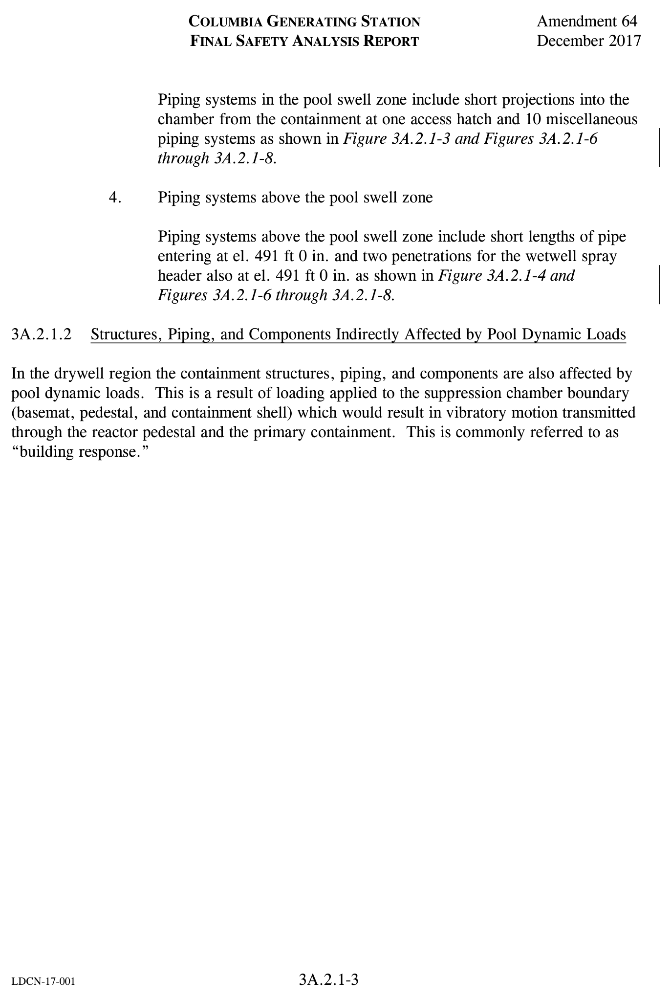

*figure on PDF page 993*

<!-- labels/text on this figure page -->
COLUMBIA GENERATING STATION
Amendment 64
FINAL SAFETY ANALYSIS REPORT
December 2017
Piping systems in the pool swell zone include short projections into the chamber from the containment at one access hatch and 10 miscellaneous piping systems as shown in Figure 3A.2.1-3 and Figures 3A.2.1-6 through 3A.2.1-8.
4. Piping systems above the pool swell zone
Piping systems above the pool swell zone include short lengths of pipe entering at el. 491 ft 0 in. and two penetrations for the wetwell spray header also at el. 491 ft 0 in. as shown in Figure 3A.2.1-4 and Figures 3A.2.1-6 through 3A.2.1-8.
3A.2.1.2 Structures, Piping, and Components Indirectly Affected by Pool Dynamic Loads
In the drywell region the containment structures, piping, and components are also affected by pool dynamic loads. This is a result of loading applied to the suppression chamber boundary
(basemat, pedestal, and containment shell) which would result in vibratory motion transmitted through the reactor pedestal and the primary containment. This is commonly referred to as “building response.”
LDCN-17-001
3A.2.1-3

<!-- p.994 -->

3A.2.2 SUMMARY OF CHANGES AND CONCLUSIONS

3A.2.2.1 Summary of Changes to Preserve Design Margins

Structures, piping, and components which were affected by pool dynamic loads were divided into two general categories, i.e., those directly affected by pool dynamic loads (those in and bounded by the suppression chamber) and those affected only indirectly by pool dynamic loads
(outside the suppression chamber). The Design Assessment Report (DAR) addressed the structures, piping, and components in and bounding the suppression chamber. For these structures several changes in design were implemented as a result of consideration of SRV discharge and LOCA hydrodynamic loads. Table 3A.2.2-1 provides a list of the structures and components that were impacted by the DAR and includes the design margins, controlling load combination, and the design changes that have been made. The steel containment structure has been reinforced by the addition of seven horizontal rows of tee stiffeners as shown in Figure 3A.4.1-1. The downcomer bracing system has been redesigned from a system of radial beams to a pipe truss system. This bracing system also is designed to provide lateral restraint for the SRV discharge pipes. Quenchers have been provided as exit devices for the SRV discharge pipes. Additions and modifications of pipe supports for miscellaneous piping systems have been provided. Other miscellaneous changes are noted in Table 3A.2.2-1.

3A.2.2.2 Conclusions

The DAR, Revision 3 concluded that the modified design of the wetwell for CGS is capable of withstanding the effects of the hydrodynamic loads resulting from SRV actuation and postulated LOCA events in conjunction with other applicable loads.

The effects due to hydrodynamic loads outside the wetwell region are discussed in the FSAR.

3A.2.2-1

<!-- p.995 -->

Table 3A.2.2-1

Suppression Pool Assessment Summary

Controlling Load Controlling Changes to Structures Due Combinationb Margina to SRV and LOCA Loads Structure

Steel
1.26 3 Added horizontal tee containment stiffeners, revised platform location, and connection to containment.

Basemat Bending - 1.14 7 None Shear - 1.27

Pedestal 1.11 4 None diaphragm Downward - 1.62 4a None floor Uplift - 1.27

Diaphragm See Section See Section None floor seal 3A.4.1.5.5 3A.4.1.5

Downcomer 1.68 5 Redesigned bracing system as a pipe truss system

Columns 1.19 1 None

Downcomers 1.08 See Section Added stainless-steel spool 3A.4.2.3 piece, provided local reinforcement where SRV pipe penetrates downcomer, raised the vacuum breaker valves out of the pool swell zone. Capped three downcomers.

SRV piping 1.05 See Section Provided lateral restraint at systems 3A.4.2.4 downcomer bracing system, rerouted SRV lines.

Quenchers 1.25 See Table Added quencher device and 3A.4.2-3 support to the end of SRV lines

3A.2.2-3

<!-- p.996 -->

Table 3A.2.2-1

Suppression Pool Assessment Summary (Continued)

Controlling Load Controlling Changes to Structures Due Combinationa Margina to SRV and LOCA Loads Structure

Platforms and 1.18 5a Removed floor plate, ladders replaced with grating, revised locations and connections to containment, added platform supports to service vacuum breaker valves; strengthened grating connections and supports.

Miscellaneous See Section 4.3 See Section Added and modified pipe wetwell 3A.4.3 supports. Stiffened piping system penetrations. Relocated two piping systems.

a See Section 3A.4 for a complete discussion.
b See Section 3A.3.5 for a complete discussion.

3A.2.2-4

<!-- p.997 -->
3A.3 CONTAINMENT DYNAMIC FORCING FUNCTIONS

3A.3.1 LOADS ASSOCIATED WITH SAFETY/RELIEF VALVE ACTUATION

3A.3.1.1 Description of the Safety/Relief System

The safety/relief system is comprised of 18 safety/relief valves (SRVs) connected to the main steam lines in the drywell chamber. From each of the valves, a discharge line with two vacuum breakers is routed from the drywell into the wetwell where it terminates in a quencher in the suppression pool, as shown in Figures 3A.2.1-3 to 3A.2.1-8. To pass through the drywell floor, the discharge lines are routed through selected downcomers to about el. 490 ft. At this elevation, they exit the downcomers and are routed horizontally, as shown in Figure 3A.2.1-4, to points directly above their respective quenchers. They then are routed vertically down into the suppression pool, as shown in Figures 3A.2.1-6 to 3A.2.1-8. Under normal operating conditions, each quencher is filled with water and its discharge line is filled to the same level as the surface of the suppression pool. The remaining volume of the discharge line up to the SRV is filled with air. Table 3A.3.1-1 summarizes the characteristics of the safety/relief system.

3A.3.1.2 Description of the Phenomena and Resulting Loads

During plant operation, if one or more of the SRVs is actuated, three transient events occur consecutively for each:

a. The water in each quencher and discharge line is expelled into the suppression pool through the holes in the quencher arms,

b. The air which fills each discharge line is expelled into the suppression pool, and

c. The steam from the discharge line being vented is expelled into the suppression pool and condensed.

Each of these events creates disturbances in the suppression pool. The first creates water jets, the second creates air discharge related pressure oscillations and the third creates pressure fluctuations as the steam is condensed. These disturbances, in turn, produce hydrodynamic loads both on the structures which are submerged in the suppression pool and on the pool boundaries. Sections 3A.3.1.2.1, 3A.3.1.2.2, and 3A.3.1.2.3 briefly describe the characteristics of the load producing phenomena, while Section 3A.3.1.3 discusses the loads produced.

3A.3.1-1

<!-- p.998 -->
April 2000

3A.3.1.2.1 Water Clearing Loads

When an SRV opens and permits steam to pass, the steam flow compresses the air above the water standing in the discharge line increasing the line pressure. The increased air pressure forces the water into the suppression pool through the holes in each side of the quencher arms.
As the water flows from the adjacent sides of the quencher arms, it coalesces into four turbulent jets. These jets flow away from the quencher producing acceleration and standard drag loads on structures in their paths. Due to the turbulent nature of the jets, their momentum diffuses rapidly and their effective velocity decreases to zero in a distance comparable to a quencher arm length.

Based on the results of scaled experiments and Caorso test results (Reference 3A.3.1-3), the region throughout which the jets produce a significant load is small, at most existing to a distance comparable to a quencher arm length. There are no structures located in this region except a small intrusion of the concrete column which is designed for significantly higher air clearing loads. Detailed definition of water clearing loads therefore is unnecessary for the purposes of this report. It is noted that a clear demarcation between the water clearing loads and air clearing loads is not possible from the recorded Caorso test data. For the purpose of this report it is assumed that significant pressure peaks represent air clearing loads and that the slowly rising pressure before the first significant peak represents water clearing loads.

3A.3.1.2.2 Air Clearing Loads

Following the expulsion of water from the SRV discharge line, the air trapped in the line is forced through the holes in the sides of the quencher arms into the suppression pool. As a result of this disturbance of the pool, oscillations are produced in the pool which induce time varying pressure and velocity fields. These fields create acceleration drag loads on the submerged structures and time varying loads on the pool boundaries. The definition of these air clearing loads is provided in Section 3A.3.1.3.

3A.3.1.2.3 Steam Condensation Loads

After the water and air have been expelled from the SRV discharge line, high pressure, high temperature, high mass flux steam is discharged into the suppression pool. As the steam condenses and collapses, vibrations or small pressure fluctuations are produced in the water.
Suppression pool temperature transient analyses were performed for CGS, for a stuck open relief valve, isolation scram, and small break accident (SBA), in accordance with the requirements of NUREG-0783. The peak pool temperature for each of these cases is maintained within the limits of NUREG-0783. As a result unstable steam condensation due to extended SRV discharge to the suppression pool will not occur. Details of this analysis are provided in Reference 3A.3.1-7. The suppression pool temperature monitoring system is discussed in FSAR Appendix 3A Attachment 3A.E.

3A.3.1-2

<!-- p.999 -->

3A.3.1.3 Safety/Relief Valve Air Clearing Loads

Testing and analytical efforts have been performed by the Mark II Owners’ Group to define the loads resulting from discharge through a quencher device upon actuation of the SRV. The SRV testing carried out at the Caorso plant in Italy represents the most extensive test program to date with geometry and plant conditions similar to CGS. An analytical effort was undertaken by Burns and Roe to evaluate the data taken during the Caorso Phase I and II tests
(References 3A.3.1-3 and 3A.3.1-4) which resulted in an improved SRV load definition and application methodology for Mark II containments (Reference 3A.3.1-1). These results and a detailed description of the analysis have been submitted, reviewed, and approved by the NRC
(Reference 3A.3.1-6) as part of the SRV reports (Reference 3A.3.1-1).

Hydrodynamic loads due to an SRV discharge affect both pool boundaries and submerged structures. A summary of the improved load definition for the specific applications is provided in Sections 3A.3.1.3.1 and 3A.3.1.3.2.

3A.3.1.3.1 Boundary Loads

Expulsion of water and air in a discharge line during an SRV discharge creates disturbances in the suppression pool which induce dynamic pressure loads on the pool boundary. Resulting dynamic effects depend upon the definition of a rigid wall pressure incident on this boundary.
Analytical interpretations and subsequent definitions of the spatial pressure distribution, pressure wave forms, and maximum pressure amplitudes recorded during the Caorso tests are the basis for defining the design boundary pressure load. Conversion of these Caorso results for application to CGS requires a correlation between the test conditions at Caorso and the design condition at CGS. Reference 3A.3.1-1 details this correlation along with the derivation of the design boundary pressure with regard to all the possible SRV discharge events that may occur during the life of the plant (see 3A.4.1.1.1.1). Sections 3A.3.1.3.1.1, 3A.3.1.3.1.2, and 3A.3.1.3.1.3 summarize the more important aspects of the derivation.

3A.3.1.3.1.1 Spatial Distribution of Boundary Pressures. The spatial distribution of boundary pressures during an SRV discharge contributes to a complete definition of the design boundary pressure load. Based on analytical studies of data recorded at Caorso, it was concluded that the spatial distribution of pressure is independent of the time variable. As stated in Reference 3A.3.1-1, this implies that the maximum pressure amplitude can be representatively used when studying the spatial distributions.

The circumferential pressure distribution (Figure 3A.3.1-1) as well as the vertical pressure distribution (Figure 3A.3.1-2) adopted for the SRV load specification is obtained through comparisons of various available distributions (Reference 3A.3.1-1). It should be noted that both distributions have been normalized for 1 psi peak pressure.

3A.3.1-3

<!-- p.1000 -->

3A.3.1.3.1.2 Pressure Wave Forms. The SRV boundary pressure load specification depends on the evaluation of the pressure wave forms measured during the Caorso tests.
Based on the experimental data recorded, two distinct characteristic wave forms prevail, the multiple frequency pressure (MFP) wave form and the single frequency pressure (SFP) wave form.

The design MFP wave form, shown in Figure 3A.3.1-3, reflects the characteristics of all such MFP wave forms measured at Caorso. Initially, there are several pressure spikes as the pressure wave reaches the pool boundary. They exhibit a frequency content in the range of

### 15.0 Hz to 40 Hz. Following the pressure spikes are damped oscillations exhibiting primarily
a single frequency in the range of 6.0 Hz to 10.0 Hz. Maximum pressure amplitude occurs in the initial period and decays rapidly thereafter. Figure 3A.3.1-4 illustrates the frequency spectrum of the pressure amplitude trace indicating rich frequency content in the range of

### 15.0 Hz to 40.0 Hz and a distinct peak in the range of 6.0 Hz to 10.0 Hz. There is negligible
frequency content beyond 40.0 Hz.

The design SFP wave form, shown in Figure 3A.3.1-5, reflects the characteristics of all such SFP wave forms measured at Caorso.

Unlike the MFP wave form, a single characteristic frequency of oscillation predominates for the entire time history. As shown in the corresponding frequency spectrum (Figure 3A.3.1-6), the dominant frequency is in the range of 6.0 Hz to 10.0 Hz. Again, there is negligible frequency content beyond 40.0 Hz.

Due to the randomness and variability in the characteristic/dominant frequencies of the pressure wave forms recorded, the time histories of the design pressure wave forms are compacted and expanded to obtain a characteristic frequency covering the range of 4.0 Hz to

### 12.0 Hz at intervals of 1.0 Hz. As a result, each type of wave form (MFP and SFP) is
depicted by nine separate pressure time histories (see Reference 3A.3.1-1 for details).

3A.3.1.3.1.3 Design Maximum Pressure Amplitude. Conversion of the Caorso maximum pressure amplitude computed for application to CGS yields a design maximum pressure amplitude of 15.0 psi (References 3A.3.1-1 and 3A.3.1-5). This is the rigid wall pressure incident on the suppression pool boundary resulting from an SRV actuation. Application of this design boundary pressure for all SRV discharge cases that may possibly occur during the life of the CGS plant, as specified in the DFFR (Reference 3A.3.1-2), is discussed in Section 3A.4.1.1.1.1. As discussed in Reference 3A.3.1-2, the design pressure reflects a 90% confidence level and 90% probability of nonexceedence.

3A.3.1.3.2 Submerged Structure Loads

The methodology for calculating the loads on submerged structures during SRV discharge uses the predicted pressure time histories directly rather than the velocity and acceleration

3A.3.1-4

<!-- p.1001 -->

transients. The pressure predictions are based on the pressures measured on submerged structures in Caorso tests and their correlation with the boundary pressure loads.

3A.3.1.3.2.1 Peak Safety/Relief Valve Dynamic Loads. The methodology used to define peak SRV dynamic loads on submerged structures is outlined in Attachment 3A.I (see also Reference 3A.3.1-8).

3A.3.1.3.2.2 Time Dependence of Safety/Relief Valve Loads and Dynamic Load Factors.
The pressure time histories recorded on submerged structures at Caorso show waveform characteristics similar to those recorded at pool boundary. As indicated in Reference 3A.3.1-1, boundary pressure time histories consist of SFP time histories and MFP time histories.

Dynamic load factor (DLF) versus frequency curves are presented in Figure 3A.3.1-10.
A typical curve, such as the curve labeled SFP, 1% damping, was calculated as follows:

a. Response spectra that correspond to all the SFP time histories described in Section 3A.3.1.3.1.2 are computed using 1% damping,

b. The response spectra obtained in (a) are enveloped, and

c. The DLF curve is obtained from the response spectrum envelope by dividing the responses at various frequencies by the zero period response.

3A.3.1.3.2.3 Safety/Relief Valve Loads on Structures. Loads on submerged structures are shown for the submerged structures listed below. Unless otherwise noted, calculation of an equivalent static load is completed via a DLF as obtained from Figure 3A.3.1-10.

a. Downcomers

Figure 3A.3.1-7 shows dynamic load on a downcomer;

b. Columns

Figure 3A.3.1-8 shows dynamic load on a concrete column. Note, for the subsequent actuation load case the maximum direct pressure load is shown (see Reference 3A.3.1-8). Reference 3A.3.1-9 computes the maximum dynamic reaction of the column, and these time-history analyses results are applied in Reference 3A.3.1-10 for final column structural (i.e., code) qualification.
Table 3A.4.2-2 tabulates maximum column reaction load results;

3A.3.1-5

<!-- p.1002 -->

c. Safety/relief valve line and quencher supports

Figure 3A.3.1-9 shows dynamic load on SRV line and the quencher support.
Horizontal flow past an SRV line due to actuation of its quencher is negligible;
and

d. Piping, supports, and bracing truss

Figure 3A.3.1-11 shows equivalent static loads on piping, supports, and bracing truss.

3A.3.1.4 References

3A.3.1-1 “SRV Loads - Improved Definition and Application Methodology for Mark II Containments,” Technical Report, Burns and Roe, Inc., July 1980. Transmitted to NRC by letter GO2-80-172, of August 8, 1980.

3A.3.1-2 “Mark II Containment Dynamic Forcing Functions Information Report
(DFFR),” General Electric Company, NEDO-21061, Revision 4, November 1981.

3A.3.1-3 “Mark II Containment Supporting Program Caorso SRV Discharge Tests, Phase I Test Report,” General Electric Company, NEDE-25100-P, May 1979.

3A.3.1-4 “Mark II Containment Supporting Program Caorso SRV Discharge Tests, Phase II ATR Report,” General Electric Company, NEDE-25118.

3A.3.1-5 Letter, GO2-82-35, 1/13/82, “Responses to CSB Open Items 44 through 48,” G. D. Bouchey (WPPSS) to A. Schwencer (NRC).

3A.3.1-6 “Safety Evaluation Report Related to the Operation of WPPSS Nuclear Project No. 2,” NUREG-0892, Supplement No. 1, USNRC, August 1982.

3A.3.1-7 “Suppression Temperature Analysis,” Stone and Webster Report 14057-4
(D-1). Transmitted to NRC by letter GO2-81-524 of December 15, 1981.

3A.3.1-8 Supply System Calculation No. ME-02-93-22, “SRV Air Clearing Loads on Diaphragm Slab Columns.”

3A.3.1-9 Supply System Calculation No. CE -02-93-12, “Diaphragm Slab Column Evaluation for SRV Air Clearing Loads.”

3A.3.1-6

<!-- p.1003 -->

3A.3.1-10 Burns & Roe Calculation No. 6.19.36, Book SV-830, “Calculation for Reactor Building Diaphragm Floor Column and Plant DAR for Hydrodynamic Loads, Rev. 3.”

3A.3.1-7

<!-- p.1004 -->
Table 3A.3.1-1

Summary of Safety/Relief System Characteristics

1. Number of SRVs 18

2. SRV manufacturer Crosby

#### P.S.P
- I 3. Designations of SRVs and pressure setpoints Valves (psi)
(Refer to Figure 3A.2.1-2)
1Ba, 1Ca 1165 1Aa, 2Ba, 2Ca, 1Da 1175 2A, 3B, 3C, 2D 1185 3A, 4B, 4C, 3D 1195 4A, 5B, 5C, 4D 1205 4. Number of automatic depressurization valves 7 [automatic depressurization system (ADS)]

5. Designations of automatic depressurization MS-RV-3D, 4A, 4B, valves 4C, 4D, 5B, 5C

6. Nominal range of valve opening times (ms) 20-150

7. Nominal range of nameplate steam rates 236.33-251.81
(lbm/sec)

8. Number of vacuum breakers per discharge 2 (in parallel)
line

9. Size of each vacuum breaker (in.)
10

10. Each discharge line pipe sizes (in./schedule) 10/80 expanded to 12/80 at approximate el. 493 ft

11. Discharge line rage of lengths to normal 107.99-161.99 water level (ft)

12. Discharge line range of air volumes to normal 57.2-88.1 water level (ft3)

13. Depth of suppression pool at RPV pedestal to 31.0 normal water level (ft)

14. Submergence of quenchers to high water level 17.4
(ft)

3A.3.1-9

<!-- p.1005 -->

Table 3A.3.1-1

Summary of Safety/Relief System Characteristics (Continued)

15. Elevation of inner/outer ring quenchers above 13.6-8.2 basemat (ft)

16. Quencher area defined by circumscribed circle 74.6
(ft2)

a These valves are the low setpoint valves which are prone to subsequent actuation. However, subsequent actuation may occur (though unlikely) in the higher set pressure SRV groups (see also discussion contained in Reference 3A.3.1-8).

3A.3.1-10

<!-- p.1006 -->
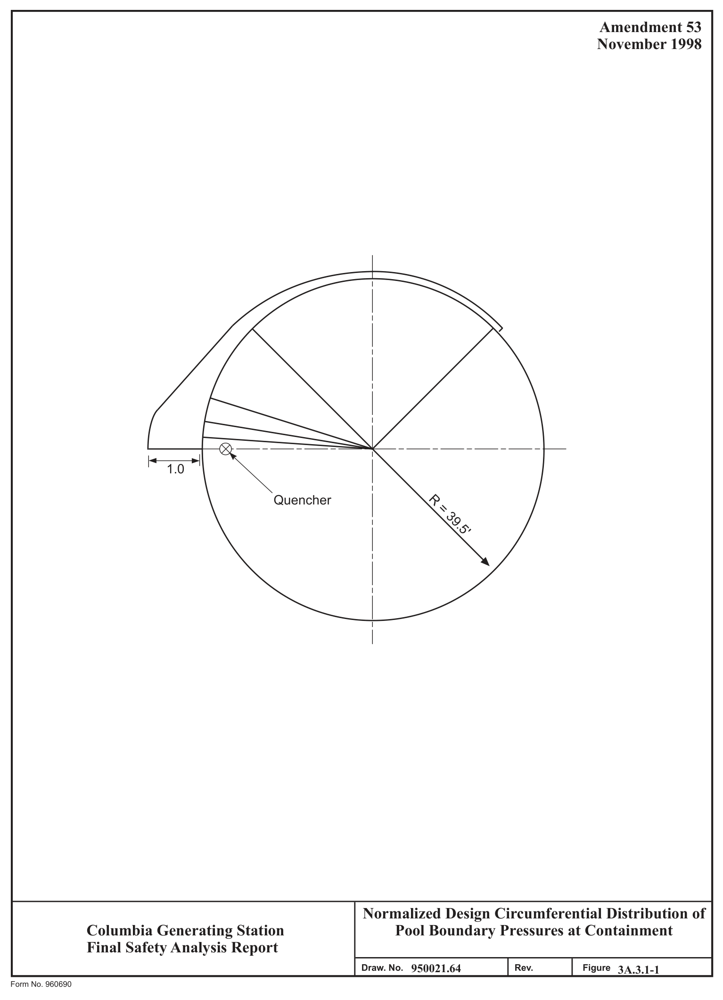

*figure on PDF page 1006*

[Vector original (SVG, lossless): fig_page-1006.svg](../figures/fig_page-1006.svg)

<!-- labels/text on this figure page -->
Amendment 53 November 1998
1.0
R = 39.5' Quencher
Normalized Design Circumferential Distribution of Pool Boundary Pressures at Containment Columbia Generating Station Final Safety Analysis Report 950021.64 Draw. No. Rev. Figure 3A.3.1-1 Form No. 960690

<!-- p.1007 -->
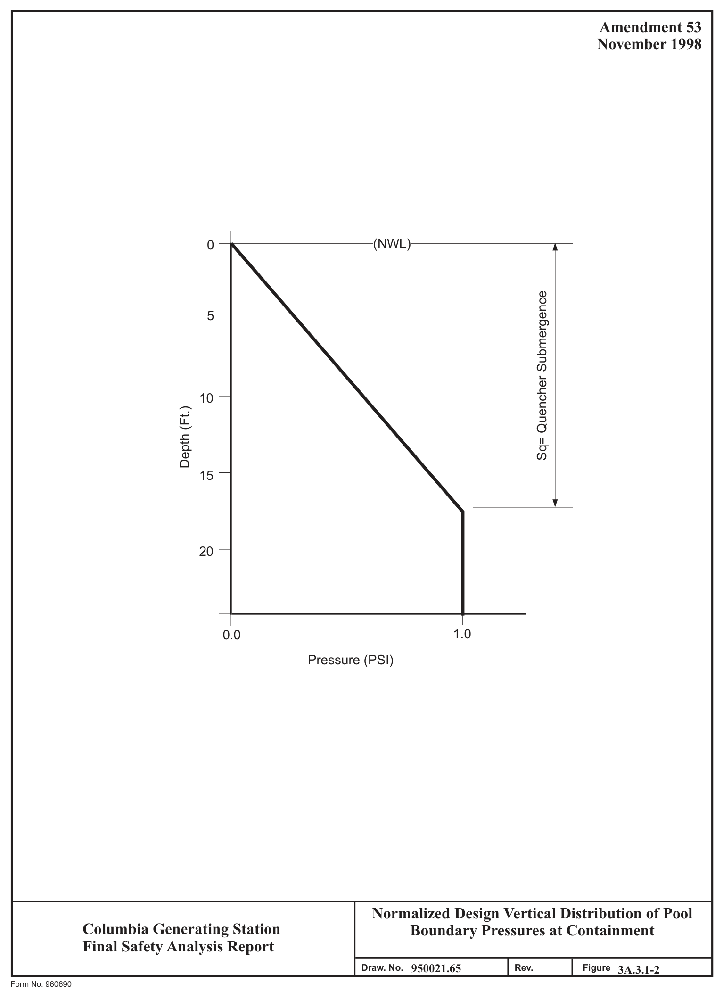

*figure on PDF page 1007*

[Vector original (SVG, lossless): fig_page-1007.svg](../figures/fig_page-1007.svg)

<!-- labels/text on this figure page -->
Amendment 53 November 1998
(NWL) 0
Sq= Quencher Submergence 5
10 Depth (Ft.)
15
20
1.0 0.0 Pressure (PSI)
Normalized Design Vertical Distribution of Pool Columbia Generating Station Boundary Pressures at Containment Final Safety Analysis Report 950021.65 Draw. No. Rev. Figure 3A.3.1-2 Form No. 960690

<!-- p.1008 -->
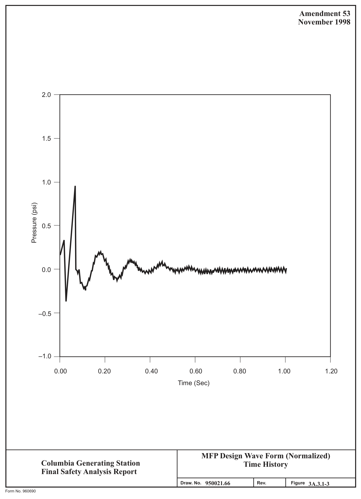

*figure on PDF page 1008*

[Vector original (SVG, lossless): fig_page-1008.svg](../figures/fig_page-1008.svg)

<!-- labels/text on this figure page -->
Amendment 53 November 1998
2.0
1.5
1.0
Pressure (psi)
0.5
0.0
–0.5
–1.0
0.00 0.20 0.40 0.60 0.80 1.00 1.20 Time (Sec)
MFP Design Wave Form (Normalized)
Columbia Generating Station Time History Final Safety Analysis Report 950021.66 Draw. No. Rev. Figure 3A.3.1-3 Form No. 960690

<!-- p.1009 -->
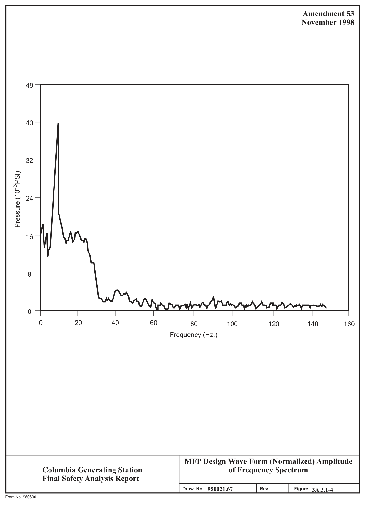

*figure on PDF page 1009*

[Vector original (SVG, lossless): fig_page-1009.svg](../figures/fig_page-1009.svg)

<!-- labels/text on this figure page -->
Amendment 53 November 1998
48
40
32
Pressure (10-3PSI)
24
16
8
0 0 20 40 60 80 100 120 140 160 Frequency (Hz.)
MFP Design Wave Form (Normalized) Amplitude of Frequency Spectrum Columbia Generating Station Final Safety Analysis Report 950021.67 Draw. No. Rev. Figure 3A.3.1-4 Form No. 960690

<!-- p.1010 -->
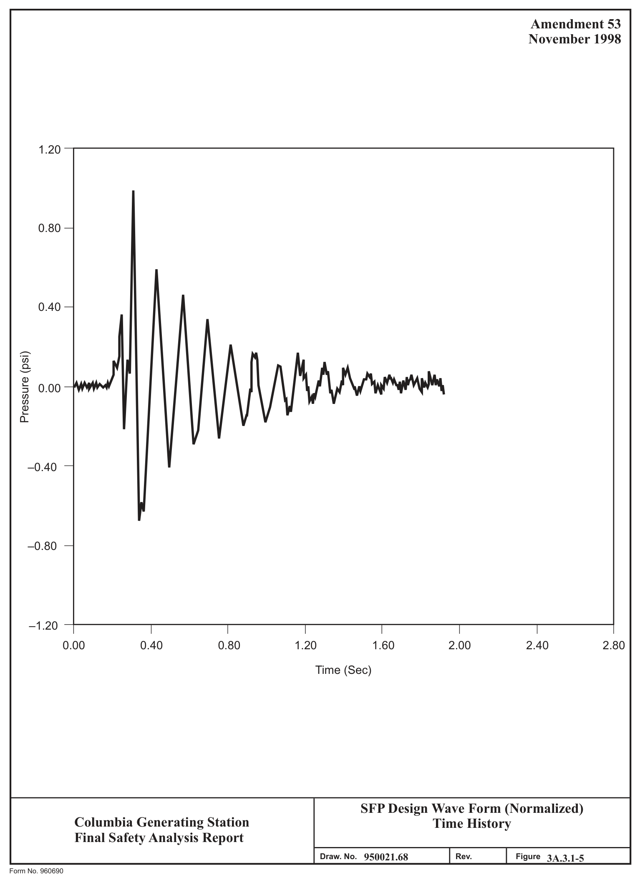

*figure on PDF page 1010*

[Vector original (SVG, lossless): fig_page-1010.svg](../figures/fig_page-1010.svg)

<!-- labels/text on this figure page -->
Amendment 53 November 1998
1.20
0.80
0.40
Pressure (psi)
0.00
–0.40
–0.80
–1.20 0.00 0.40 0.80 1.20 1.60 2.00 2.40 2.80
Time (Sec)
SFP Design Wave Form (Normalized)
Columbia Generating Station Time History Final Safety Analysis Report 950021.68 Draw. No. Rev. Figure 3A.3.1-5 Form No. 960690

<!-- p.1011 -->
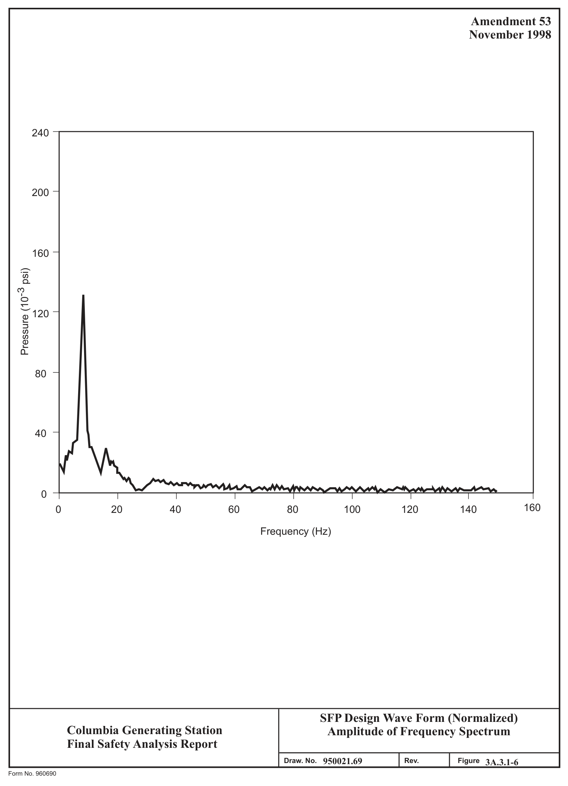

*figure on PDF page 1011*

[Vector original (SVG, lossless): fig_page-1011.svg](../figures/fig_page-1011.svg)

<!-- labels/text on this figure page -->
Amendment 53 November 1998
240
200
160
Pressure (10-3 psi)
120
80
40
0 160 0 20 40 60 80 100 120 140
Frequency (Hz)
SFP Design Wave Form (Normalized)
Columbia Generating Station Amplitude of Frequency Spectrum Final Safety Analysis Report 950021.69 Draw. No. Rev. Figure 3A.3.1-6 Form No. 960690

<!-- p.1012 -->
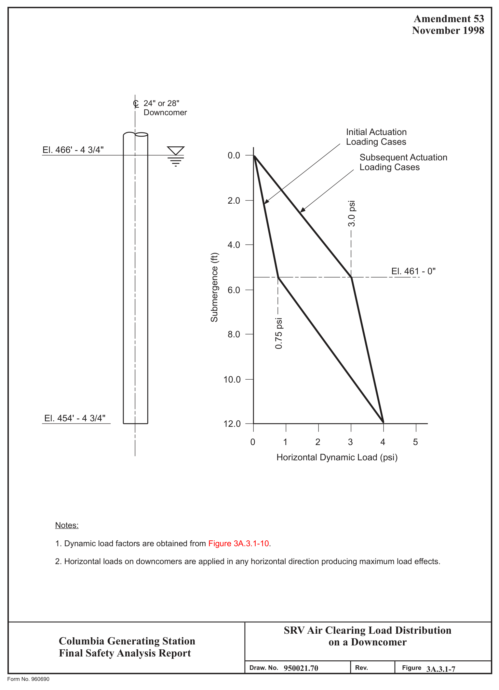

*figure on PDF page 1012*

[Vector original (SVG, lossless): fig_page-1012.svg](../figures/fig_page-1012.svg)

<!-- labels/text on this figure page -->
Amendment 53 November 1998
LC 24" or 28" Downcomer
Initial Actuation Loading Cases El. 466' - 4 3/4" 0.0 Subsequent Actuation Loading Cases
2.0
3.0 psi
4.0 Submergence (ft)
El. 461 - 0"
6.0
0.75 psi 8.0
10.0
El. 454' - 4 3/4" 12.0
0 1 2 3 4 5 Horizontal Dynamic Load (psi)
Notes:
1. Dynamic load factors are obtained from Figure 3A.3.1-10.
2. Horizontal loads on downcomers are applied in any horizontal direction producing maximum load effects.
SRV Air Clearing Load Distribution Columbia Generating Station on a Downcomer Final Safety Analysis Report 950021.70 Draw. No. Rev. Figure 3A.3.1-7 Form No. 960690

<!-- p.1013 -->
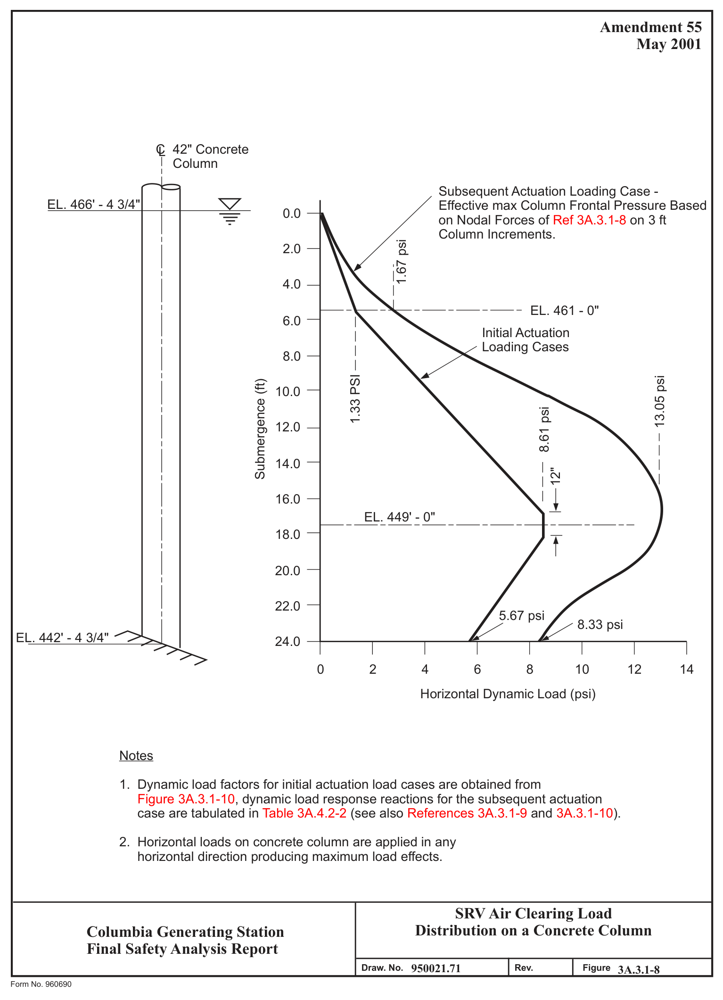

*figure on PDF page 1013*

[Vector original (SVG, lossless): fig_page-1013.svg](../figures/fig_page-1013.svg)

<!-- labels/text on this figure page -->
Amendment 55 May 2001
CL 42" Concrete Column
Subsequent Actuation Loading Case - EL. 466' - 4 3/4" Effective max Column Frontal Pressure Based 0.0 on Nodal Forces of Ref 3A.3.1-8 on 3 ft Column Increments.
1.67 psi
2.0
4.0
EL. 461 - 0" 6.0 Initial Actuation Loading Cases 8.0
1.33 PSI
13.05 psi Submergence (ft)
10.0 8.61 psi 12.0
14.0 12" 16.0 EL. 449' - 0" 18.0
20.0
22.0 5.67 psi 8.33 psi EL. 442' - 4 3/4" 24.0
0 2 4 6 8 10 12 14 Horizontal Dynamic Load (psi)
Notes
1. Dynamic load factors for initial actuation load cases are obtained from Figure 3A.3.1-10, dynamic load response reactions for the subsequent actuation case are tabulated in Table 3A.4.2-2 (see also References 3A.3.1-9 and 3A.3.1-10).
2. Horizontal loads on concrete column are applied in any horizontal direction producing maximum load effects.
SRV Air Clearing Load Distribution on a Concrete Column Columbia Generating Station Final Safety Analysis Report 950021.71 Draw. No. Rev. Figure 3A.3.1-8 Form No. 960690

<!-- p.1014 -->
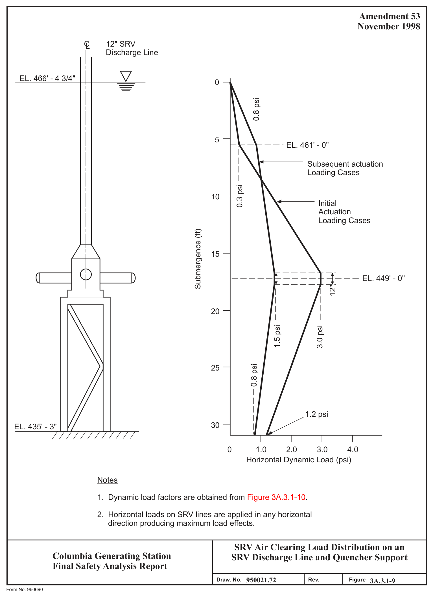

*figure on PDF page 1014*

[Vector original (SVG, lossless): fig_page-1014.svg](../figures/fig_page-1014.svg)

<!-- labels/text on this figure page -->
Amendment 53 November 1998
CL 12" SRV Discharge Line
EL. 466' - 4 3/4" 0
0.8 psi
5 EL. 461' - 0"
Subsequent actuation Loading Cases
0.3 psi 10 Initial Actuation Loading Cases Submergence (ft)
15 9 EL. 449' - 0" 12"
20
1.5 psi 3.0 psi
25 0.8 psi
1.2 psi
30 EL. 435' - 3"
0 1.0 2.0 3.0 4.0 Horizontal Dynamic Load (psi)
Notes
1. Dynamic load factors are obtained from Figure 3A.3.1-10.
2. Horizontal loads on SRV lines are applied in any horizontal direction producing maximum load effects.
SRV Air Clearing Load Distribution on an Columbia Generating Station SRV Discharge Line and Quencher Support Final Safety Analysis Report 950021.72 Draw. No. Rev. Figure 3A.3.1-9 Form No. 960690

<!-- p.1015 -->
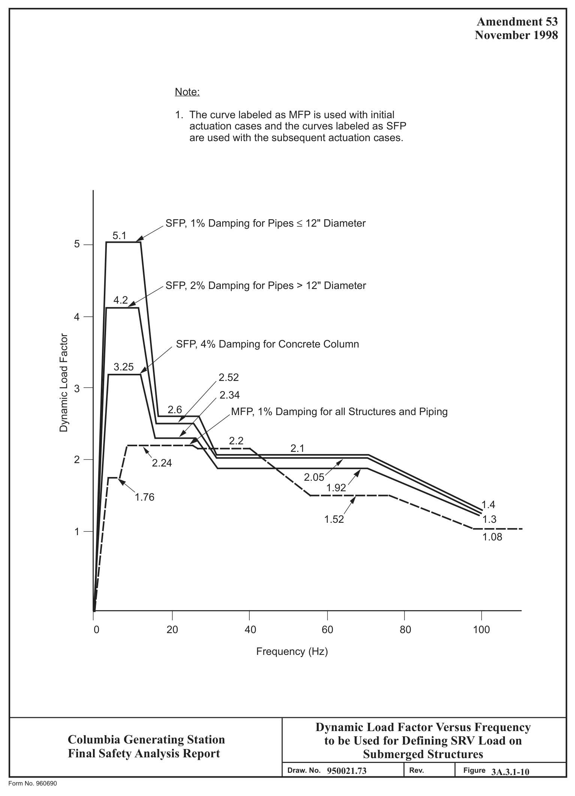

*figure on PDF page 1015*

[Vector original (SVG, lossless): fig_page-1015.svg](../figures/fig_page-1015.svg)

<!-- labels/text on this figure page -->
Amendment 53 November 1998
Note:
1. The curve labeled as MFP is used with initial actuation cases and the curves labeled as SFP are used with the subsequent actuation cases.
SFP, 1% Damping for Pipes ≤ 12" Diameter 5.1 5
SFP, 2% Damping for Pipes > 12" Diameter 4.2 4
Dynamic Load Factor SFP, 4% Damping for Concrete Column
3.25
2.52 3
2.34
2.6 MFP, 1% Damping for all Structures and Piping
,,---~f~~s::~~~+s~~
2.2
2.1 2
2.24 ' I
2.05
1.92 ''---T--.....,, ,,
1.76 I
1.4 I
.......... ____ _ I
1.52
1.3 I 1 I
1.08 I I I
0 20 40 60 80 100
Frequency (Hz)
Dynamic Load Factor Versus Frequency Columbia Generating Station to be Used for Defining SRV Load on Final Safety Analysis Report Submerged Structures 950021.73 Draw. No. Rev. Figure 3A.3.1-10 Form No. 960690

<!-- p.1016 -->
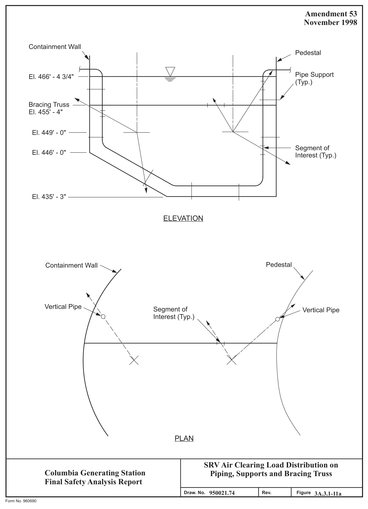

*figure on PDF page 1016*

[Vector original (SVG, lossless): fig_page-1016.svg](../figures/fig_page-1016.svg)

<!-- labels/text on this figure page -->
Amendment 53 November 1998
Containment Wall Pedestal
Pipe Support El. 466' - 4 3/4"
(Typ.)
Bracing Truss El. 455' - 4"
El. 449' - 0"
Segment of El. 446' - 0" Interest (Typ.)
El. 435' - 3"
ELEVATION
Pedestal Containment Wall
Vertical Pipe Segment of Vertical Pipe Interest (Typ.)
PLAN
SRV Air Clearing Load Distribution on Columbia Generating Station Piping, Supports and Bracing Truss Final Safety Analysis Report 950021.74 Draw. No. Rev. Figure 3A.3.1-11a Form No. 960690

<!-- p.1017 -->
Amendment 55 May 2001

Notes:

1. The load is applied along the line joining the center of the nearest actuating quencher and the geometric center of the pipe segment as shown in Fig. 3A.3.1-11a.

2. The equivalent static load (p1lb) on piping, supports and bracing truss is:
P = ±0.32D2L for initial actuation.
P = ±0.25KD2L for subsequent actuation and for pipes near containment or pool bottom.
P = ±0.64KD2L for subsequent actuation and for pipes near pedestal.

where:

D = diameter of pipe or the cylinder circumscribing a non-circular cross-section, in units of inches.

L = length of segment, in units of inches

K = see note 5

3. For load on piping, supports and bracing truss, the load component parallel to the pipe is neglected.

4. Since the load direction on piping, supports and bracing truss generally varies from one point to another, segmentation of the piping or structural component may be needed.

5. If the fundamental natural frequency of the piping, support or bracing truss member is greater than or equal to 17HZ, K = 1. This is applicable in most cases.

DLF If the fundamental natural frequency is less than 17HZ, then K = , -
2.6 where DLF is the dynamic load facor and is determined from Fig. 3A.3.1-10.
If K, as calculated above, is less than 1, K = 1 is used.

SRV Air Clearing Load Distribution on Piping, Supports and Bracing Truss Columbia Generating Station Final Safety Analysis Report 950021.75 Draw. No. I Rev. I Figure 3A.3.1-11b Form No. 960690

<!-- p.1018 -->
3A.3.2 LOADS ASSOCIATED WITH LOSS-OF-COOLANT ACCIDENT

A loss-of-coolant accident (LOCA) occurs when the integrity of the reactor coolant pressure boundary is breached and coolant is released. In order to contain the coolant which flashes to steam, CGS utilizes a GE Mark II pressure suppression system. The LOCA loading phenomena are discussed in Section 3A.3.2.2. The short-term and long-term LOCA loads are discussed in detail in Sections 3A.3.2.3 and 3A.3.2.4, respectively. Section 3A.3.2.5 describes the LOCA pressure and temperature transients and Section 3A.3.2.6 describes the CGS building response to the LOCA loads.

3A.3.2.1 Description of Pressure Suppression System

The CGS primary containment utilizes a GE Mark II over/under pressure-suppression configuration (see Figure 3A.2.1-1). The drywell and suppression chamber (or wetwell) are large sealed volumes designed to contain and condense escaping reactor coolant. Both contain structures and piping systems with the suppression chamber approximately half filled with water (suppression pool) for steam quenching. The drywell is connected to the suppression pool by 99 downcomer pipes that channel steam released during a LOCA for quenching and pressure suppression. Details of the downcomers, other piping systems and structures in the suppression chamber are shown in Figures 3A.2.1-2 through 3A.2.1-8.

Originally, 102 downcomer pipes were provided. During the assessment of the wetwell piping for hydrodynamic loads, it was found that the LOCA water jet loads on three containment vessel penetrations and their supports were excessive. To eliminate these loads, three of the 102 downcomers are capped in the drywell region, leaving 99 for venting steam to the wetwell.

The piping systems involved are at penetration X-31, X-34, and X-36. The three capped downcomers are on the outer circle of downcomers closest to the containment vessel, at azimuths 95°, 63°, and 42° (Figures 3A.2.1-2 and 3A.2.1-4).

3A.3.2.2 Description of the Phenomena and Resulting Loads

The sequence of LOCA-generated hydrodynamic events described below cause dynamic loads on the containment and on structures and components located in the wetwell. These transient dynamic forces (see Table 3A.3.2-1) are termed dynamic forcing functions and are discussed in detail in Reference 3A.3.2-2 and summarized below. Section 3A.3.4 discusses the sequence of LOCA generated loads.

Following a postulated LOCA, released coolant causes the drywell pressure to rise rapidly and to accelerate the column of water in each downcomer downward due to the pressure rise. As the water exits the downcomers and enters the suppression pool, it forms a jet-pool interface which rolls into a mushroom shaped vortex ring. Expulsion of water out of each of the

3A.3.2-1

<!-- p.1019 -->

downcomers results in a water jet which produces loads on submerged structures and suppression pool boundary pressure loads. Because bulk pool velocities are small during vent clearing, the corresponding impact and induced flow field drag loads are generally small.
However, locally, significant drag loads may result.

Immediately after vent clearing, air* in the downcomer vents from the drywell beings to flow into the suppression pool. The LOCA air* bubbles are formed at the exits of the vents which charge and expand under the entire pool surface causing three dimensional drag loads on submerged structures. On contact with each other, the individual bubbles coalesce and accelerate the pool water above the downcomer vent exit plane vertically with no significant horizontal water motion.

Pool swell is the upward movement of suppression pool water above the exit plane of the vents due to injection of drywell air* below the pool surface. The velocity and acceleration of the water slug associated with this phenomenon produces impact, drag, and lift forces on structures within the swell zone.

The containment boundaries also experience loads due to drywell pressurization, air bubble pressure and wetwell free airspace compression. The rising pool surface motion is slowed due to the compression of air in the suppression chamber airspace. At about this time the rising bubbles break up the remaining pool slug which falls back to its original position terminating pool swell.

During pool swell, the bottom of the rising water slug continually falls back to the suppression pool due to instabilities at the bubble/water slug interface. This phenomenon and the large scale falling back of the remaining water slug at pool swell termination is known as fallback and causes drag and lift loads on structures in the pool swell zone, but a negligible containment boundary load.

Pool swell and the subsequent fallback of the remaining water slug are followed by an air/steam mixture flow through the downcomers until the drywell air is completely purged and the mass flux becomes pure steam. The loading phenomena associated with a high or medium steam mass flux is termed steam condensation oscillation (CO).

The air content and steam mass flow rate along with the pool temperature determines the behavior of the steam/suppression pool water interface. At high steam flow the interface location is essentially constant. As the flow rate decreases, due to reactor depressurization and associated drywell pressure decrease, the interface takes on an oscillatory character. The rate

* During a LOCA an air (nitrogen)/steam mixture would be blown down the downcomer vents;
however, the analytical models of LOCA phenomena conservatively assume that only noncondensables are injected into the suppression pool.

3A.3.2-2

<!-- p.1020 -->
April 2000

of change of the displacement of the interface is reflected in submerged structure and suppression pool boundary loads.

When the steam mass flux decreases below a critical level a hydrodynamic phenomenon termed chugging occurs. Chugging is associated with low steam mass flow and high suppression pool boundary pressure spikes relative to CO. The phenomenon appears to be random in time and is caused by the complex interaction of water/steam condensation surface instabilities with the physical properties of the downcomers, the suppression pool, and the suppression pool boundaries. Chugging causes loads on the suppression pool boundary and submerged structures.

To determine the effects of downcomer capping on the hydrodynamic load definition, displacement time histories due to chugging are obtained at selected nodes on the containment vessel. Two sets of time histories are obtained. The first includes the effects of downcomer capping and the second excludes these effects. A comparison of the maximum displacements indicates that capping results in a slight reduction in the maximum displacements. Since lower displacements are associated with lower loads and stresses, it is conservative to assume uncapped downcomers for establishing the chugging load definition. The Containment Functional Design Analysis described in Section 6.2 was based on the venting capacity of 99 downcomers.

3A.3.2.3 Short-Term Loss-of-Coolant Accident Loads

Short-term LOCA loads are associated with hydrodynamic related phenomena that occur within a few seconds after LOCA initiation. The short-term loading phenomena include downcomer vent clearing, LOCA bubble charging, pool swell, and fallback. Figure 3A.3.2-1 illustrates the short-term loading phenomena. The flow fields during downcomer vent clearing and LOCA bubble charging are three-dimensional. Flow fields during pool swell and fallback are vertical and exist only above the vent exit elevation. Loads on submerged structures due to downcomer vent clearing and LOCA bubble charging are compared and the larger loads are employed for subsequent evaluations.

Section 3A.3.2.3.1 and Table 3A.H-1 provide a detailed summary of the short-term LOCA loading phenomenon and load calculation procedures used to assess CGS structures.

3A.3.2.3.1 Analytical Models and Supporting Test Data

3A.3.2.3.1.1 Vent Clearing Jet and Induced Flow Field Model. To calculate the CGS vent clearing jet and induced flow field, a LOCA Water Jet Analytical Model was developed for CGS. The model development and supporting test data are documented in Reference 3A.3.2-9. The calculation is performed for a unit cell with a downcomer at the center. Input data included the downcomer vent water clearing time history.

3A.3.2-3

<!-- p.1021 -->
In order to calculate the downcomer vent water clearing time history and to provide a continuous pool surface displacement time history, a VENT computer code was developed.
The model development and supporting test data for VENT are discussed in detail in Attachment 3A.D.2.

CGS input data for the LOCA water jet model and the VENT computer code are shown in Tables 3A.3.2-2 and 3A.3.2-3, respectively. As appropriate, maximums or minimums of CGS parameters are used to make the input data conservative in order to maximize vent water clearing velocities.

The vent exit water velocity and acceleration calculated by VENT are increased by 10% as requested by the NRC in Reference 3A.3.2-1. The velocity and acceleration time histories
(including the 10% increase) are shown in Figures 3A.3.2-2 and 3A.3.2-3, respectively. As indicated in Reference 3A.3.2-9, tests have shown that LOCA jet continues to propagate downward for a short duration beyond the vent clearing instant due to rapidly charging air.
Although the vent clearing time for CGS is 0.654 sec, the jet tip reaches a maximum velocity of about 15.8 ft/sec at t = 0.704 sec.

Submerged boundary loads during downcomer vent water clearing is specified to be a static addition of an overpressure of 24 psi to the local hydrostatic pressure below the downcomer vent exit (walls and basemat) with a linear attenuation to zero at the pool surface.

3A.3.2.3.1.2 Loss-of-Coolant Accident Bubble Charging Model. In order to calculate the flow field associated with the LOCA bubble charging phenomenon, a LOCA bubble charging model was developed. The model development and supporting test data are discussed in detail in Attachment 3A.D.4.

As discussed in Attachment 3A.D.4, the LOCA bubble charging flow field is calculated using a numerical technique for potential flows in the exact CGS suppression pool geometry. The uniformly charging LOCA bubbles are modeled as equal strength point sources located one downcomer radius below the CGS vent exit at el. 453 ft-4.75 in. Figure 3A.B-2 shows the modeled geometry for the CGS LOCA bubble charging phenomenon and Figures 3A.3.2-4 through 3A.3.2-6 show contour plots of the maximum radial, tangential, and vertical components of the gradient of the velocity potential.

The growth rate of the CGS LOCA bubble and the corresponding source strengths of the point sources are determined by continuity from the rate of displacement of the pool surface after vent clearing. The rate of displacement of the pool surface is determined from the pool swell analytical model (PSAM) (see 3A.3.2.3.1.3). Figure 3A.3.2-7 shows the velocity source strength, Q(t), the acceleration source strength, Q(t), and the radius, R(t), of the CGS LOCA bubbles charging process. Section 3A.B.4.2 discusses how to determine the CGS LOCA bubble charging transient flow field using the data in Figures 3A.3.2-4 through

3A.3.2-4

<!-- p.1022 -->
April 2000

3A.3.2-7. Tables 3A.3.2-4 and 3A.D-5 summarize results from the LOCA bubble charging analysis for CGS.

Since LOCA bubble charging represents the early portion of pool swell, the associated suppression pool boundary loads are discussed in Section 3A.3.2.3.1.3.

3A.3.2.3.1.3 Pool Swell Analytical Model. The pool swell transient is conservatively defined for CGS by the computer code SWELL based on the model presented in Reference 3A.3.2-10.
The model development and supporting test data are discussed in Section 3A.C.3.

The CGS input data for SWELL are given in Tables 3A.3.2-3 and 3A.3.2-5. As appropriate, maximums and minimums of CGS parameters are used to make the input data conservative in order to maximize pool swell velocities. The CGS pool swell velocity, acceleration, displacement, bubble pressure, and wetwell air pressure versus time are given in Figures 3A.3.2-8 through 3A.3.2-12, respectively. Figure 3A.3.2-13 shows the pool lug velocity vs.
displacement and Table 3A.3.2-6 shows results from the pool swell analysis for CGS.
Velocities and accelerations calculated by the computer code SWELL are multiplied by a factor of 1.1, as requested by the NRC in Reference 3A.3.2-1. The 10% increase in velocities and accelerations is included in Figures 3A.3.2-8, 3A.3.2-9, and 3A.3.2-13.

Test results indicate that no significant froth will occur when the water slug breaks up during pool swell in Mark II containments. Hence, the load due to froth is negligible
(Reference 3A.3.2-11) and no froth impingement is considered in the assessment of the design of structures.

Loads on submerged boundaries during pool swell are calculated by specifying that basemat and wall loads be determined from static addition of the maximum bubble pressure predicted by the PSAM to the local hydrostatic pressure below the downcomer vent exit plane and with a linear attenuation to the maximum wetwell air space pressure at maximum pool swell elevation.

Wetwell wall loads due to air compression during pool swell are specified by the direct application of the PSAM calculated wetwell air compression pressure to the wetwell walls above the pool surface.

The short-term drywell pressure history during pool swell is specified as the drywell pressure transient presented in Table 3A.3.2-5.

Test data have shown that a small short duration upward pressure differential on the diaphragm floor may occur due to rapid pressurization of the wetwell air space during the pool swell transient. The 4T Test results, discussed in Section 4.4.6.6 of Reference 3A.3.2-11, show a net upward load on the diaphragm floor of less than 2.2 psi. These low value 4T test results

3A.3.2-5

<!-- p.1023 -->
were confirmed by small scale pool swell tests which showed an average scaled up net upward pressure differential of 1.83 psi. However, as discussed in Section 4.4.6.6 of Reference 3A.3.2-11, the Bodega Bay test data, for a wide variety of blowdown conditions, shows that the wetwell air space pressure never exceeds the drywell pressure.

Conservatively, therefore, the CGS diaphragm floor is assessed for an uplift pressure, P, of 5.5 psi. This is a maximum dynamic load and is in agreement with the loads specified in References 3A.3.2-2 and 3A.3.2-8.

3A.3.2.3.1.4 Fallback Model. The model presented in Reference 3A.3.2-11 is used to calculate the CGS fallback phenomenon. The model development and supporting test data are discussed in Reference 3A.3.2-11. The fallback model conservatively assumes the pool swell slug remains intact during pool swell and falls back from its maximum height 1.5 x Ho, where Ho is the pre-LOCA downcomer submergence, at full water density and under the constant acceleration due to gravity. Figure 3A.3.2-14 shows a plot of the fallback water slug velocity vs. elevation of water slug top surface.

Reference 3A.3.2-10 indicates that fallback loads on submerged boundaries are negligible and are therefore not specified. This is based on review of existing fallback data.

3A.3.2.3.2 Boundary Loads

The analytical models used to describe containment boundary loads during short-term LOCA loading phenomena are discussed in Section 3A.3.2.3.1. Figures 3A.3.2-15 through 3A.3.2-17 show the duration and distribution of the short-term containment boundary loads.

3A.3.2.3.3 Structure Loads

The CGS structures affected by short-term LOCA loading phenomena are identified in Section 3A.2.1.1 and shown in Figures 3A.2.1-2 through 3A.2.1-8. Short-term LOCA loads on submerged structures are given in Tables 3A.3.2-8, 3A.3.2-9, and Figure 3A.3.2-18.

Piping and structural components below el. 454.4 ft are subjected to loads caused by water clearing/air charging. Piping and structural components between elevations 454.4 ft and 434.4 ft are subjected to drag and lift loads caused by pool swell/fallback. Also, piping and structural components between elevations 466.4 ft and 484.4 ft are subjected to impact loads caused by pool swell. Direct hydrodynamic loads do not exist for piping and structures above el. 484.4 ft.

The following is a description of how the short-term LOCA definition models, discussed in Section 3A.3.2.3.1, are applied to CGS structures.

3A.3.2-6

<!-- p.1024 -->

a. Vent clearing jet load

The loads on submerged structures located inside the jet boundaries are calculated using the vent exit velocity and acceleration at t = 0.654 sec. The loads on submerged structures located outside the jet boundaries are calculated using velocity and acceleration fields at t = 0.704 sec.

For elbows of 24-in. diameter pipes, the impact load for full momentum transfer of the intercepted jet (K=2) (Reference 3A.3.2-10) is calculated to be smaller than the drag load. Hence, drag load is used in the assessment.

Submerged structures located below the vent exit elevation are subjected to drag loads caused by the vent clearing jet. The types of drag loads and the formulas for calculating them are presented in item c below and in Attachment 3A.C.
For the case of the vent clearing jet, the standard drag coefficient, CD, is equal to 1.2; the acceleration drag coefficient, CM, is equal to 2.0; and the lift coefficient, CL, is equal to 0. In order to account for the dynamic nature of the loading phenomenon, a multiplier of 2.0 is used to calculate the equivalent static pressure.

b. Loss-of-coolant accident bubble load

Submerged structures located below the vent exit elevation are subjected to drag loads caused by LOCA bubble charging. The types of drag loads and the formulas for calculating them are presented in Item c below and in Attachment 3A.C. The velocity and acceleration at any point in the pool are calculated by applying the methods outlined in 3A.3.2.3.1.2.

For the case of LOCA bubble charging, the standard drag coefficient, CD, is equal to 1.2; the acceleration drag coefficient, CM, is equal to 2.0; and the lift coefficient, CL, is equal to 0. These numerical values are consistent with References 3A.3.2-4 and 3A.3.2-6. In order to account for the dynamic nature of the LOCA bubble charging load phenomenon, a DLF of 2.0 is used to calculate the equivalent static pressure.

c. Pool swell load

The structures above the initial pool surface and below the maximum pool swell height are subject to impact loads due to the rising pool surface. The maximum dynamic pressure due to pool swell impact is calculated by using the methodology outlined in Reference 3A.3.2-2 and in Section III.B.3.c.1 of Reference 3A.3.2-1. In order to account for the dynamic nature of the pool swell loading phenomenon, the equivalent static pressure is obtained by

3A.3.2-7

<!-- p.1025 -->

multiplying the maximum dynamic impact pressure by a DLF. The DLF is given in Figure 5 of Reference 3A.3.2-3. No impact loads on grating surfaces are specified since the CGS grating bars are narrow (typically 3/16-in. wide).

Structures located above the vent exit elevation and below the maximum pool swell height are subjected to drag forces during the pool swell transient. Drag loads have three components: standard drag, acceleration drag, and lift.
Formulas for calculating these three types of load are presented in Attachment 3A.C. Standard drag load is velocity square dependent and acts in the flow direction. Acceleration drag load is proportional to the flow acceleration and acts in the flow direction. Lift load is velocity square dependent and is normal to the flow direction.

In order to calculate the three components of drag load, three coefficients are determined. These are: standard drag coefficient, CD; acceleration drag coefficient, CM; and lift coefficient, CL. For circular cross-sections, coefficients CD, CM, and CL are calculated using Reference 3A.3.2-6. For non-circular cross-sections, coefficients CD and CM are calculated using Reference 3A.3.2-7, and CL is assumed equal to 1.6 as indicated in Reference 3A.3.2-5.
Interference effects from adjacent structures are taken into account by using the methodology presented in Reference 3A.3.2-4. In order to account for the dynamic nature of the pool swell loading phenomenon, appropriate DLFs are used to calculate the equivalent static loads.

The gratings are subject to drag loads during pool swell due to resistance to the flow through them. The dynamic drag load is determined by the product of the differential pressure across the grating and the total plan area of the grating.
The open area fraction for the grating is greater than 60%. The peak dynamic differential pressure across the grating is obtained from Figure 4-1 of Reference 3A.3.2-2. This figure is based on a pool swell approach velocity of 40 fps. Since the maximum pool swell velocity for CGS is smaller than 40 fps, the differential pressure values in Figure 4-1 of Reference 3A.3.2-2 are multiplied by a factor equal to the square of the ratio given by the maximum velocity divided by 40 fps. The maximum pool swell velocity is given in Table 3A.3.2-6 (plus a velocity multiplier of 1.1). In order to account for the dynamic nature of the pool swell loading phenomenon, a multiplier of 2.0 is used to calculate the equivalent static pressure.

Vertical drag pressure and horizontal lift pressure are applied simultaneously to the projected area of a cylinder circumscribing the structural member under consideration. The projection is always made on a plane normal to the direction of pressure. Vertical impact load is applied separately (not in combination with drag and lift loads) to structures located between elevations 466.4 ft and

3A.3.2-8

<!-- p.1026 -->
484.4 ft on the projected area of the structure on the horizontal plane. Impact load is not used to check local bending effects of flanges or webs or ovaling effects of a pipe. The full drag, lift, or impact load calculated as outlined above is applied normal to a pipe or a structural component. There are no loads parallel to the longitudinal axis of the structure.

d. Fallback load

Structures located above the vent exit elevation and below the maximum pool swell height are subjected to drag and lift forces during fallback. The same methodology and the same drag and lift coefficients used in calculating pool swell drag and lift loads reused to define fallback drag and lift loads. To account for the dynamic nature of the fallback loading phenomenon, a multiplier of 2.0 is used to calculate the equivalent static load. No impact loads are specified during fallback (Reference 3A.3.2-11).

Fallback drag loads on gratings are specified to be equal in magnitude to the pool swell drag loads but opposite in direction.

The method of applying drag and lift pressure on a structural member is the same as that outlined at the end of Item c above.

3A.3.2.3.3.1 Loads on Major Structures. The major vertical structures are shown in Figure 3A.2.1-2. They are: the 102 downcomers (three were capped), the 18 SRV lines including quenchers and support towers, and the 17 concrete columns supporting the diaphragm floor. The major horizontal structures are the steel truss shown in Figure 3A.2.1-3, which provides lateral support to the downcomers and the SRV lines, and the platform at el. 472 ft 4 in. shown in Figures 3A.2.1-3 and 3A.2.1-8. The truss is submerged and the platform is located in the pool swell zone.

Hydrodynamic loads on the vertically oriented columns may occur only due to horizontal flow across the columns. Since the columns are vertical, pool swell and fallback loads are negligible. The columns are located along circumferential and radial lines of symmetry between downcomers; however, some asymmetry is created because some of the downcomers have a diameter of 24 in. while others have a diameter of 28 in. This small asymmetry in the downcomer arrangement causes small loads on the columns during water clearing/air charging.
The magnitude and distribution of loads on the columns are shown in Table 3A.3.2-8 and Figure 3A.3.2-18 respectively.

As with the columns, hydrodynamic loads on the vertically oriented downcomers may occur only due to horizontal flow across the downcomers since the downcomers are located along circumferential and radial lines of symmetry between other downcomers and the suppression pool boundaries, the LOCA water jet, LOCA bubble charging, pool swell, and fallback

3A.3.2-9

<!-- p.1027 -->
horizontal flows are small. Because the horizontal flows are small the resulting loadings are negligible.

Table 3A.3.2-8 and Figure 3A.3.2-18 show the magnitude and distribution of loads on a vertical SRV line as well as quencher arms during the water clearing/air charging phases of LOCA. Since quencher supports are below el. 448 ft-0 in., they are not subjected to short-term LOCA (Figure 3A.3.2-18). Pool swell and fallback exert negligible loads on the SRV lines due to the vertical orientation of the SRV lines above the downcomer vent exit plane. Because of their location below the downcomer vent exit plane, no pool swell or fallback loads are experienced by the quencher supports and quencher arms.

The downcomer bracing truss is oriented in a horizontal plane one foot above the downcomer vent exit plane. Since the truss is located above the downcomer vent exit the induced flow field and, therefore, drag load due to LOCA water jet during vent clearing is small.
Horizontal LOCA bubble load on the bracing truss is small. Because the truss is above the downcomer vent exit plane, pool swell and fallback loads are experienced.

The only major horizontal structure in the pool swell zone is a platform at el. 472 ft-4 in. The platform consists of a grating with an open area fraction of 0.776 and is supported by 0.5-in. thick vertical members. The dynamic drag load is calculated to be 4.2 psi for pool swell and fallback induced loads and is multiplied by a DLF of 2.0. The equivalent static load is then applied to the total plan area of the platform. Because the platform is above the initial pool surface it does not experience vent clearing or LOCA bubble loads.

3A.3.2.3.3.2 Loads on Fully Submerged Piping Systems Below Elevation 454.4 ft. The 24-in. high-pressure core spray (HPCS) (X-31), 24-in. residual heat removal (RHR)-B (X-32), 8-in. reactor core isolation cooling (RCIC) (X-33), 24-in. low-pressure core spray (LPCS)
(X-34), 24-in. RHR-A (X-35), 24-in. RHR-C (X-36), 6-in. suppression pool cleanup (X-100)
and the 4-in. fuel pool cooling and cleanup (FPC) are the eight piping systems fully submerged in the CGS suppression pool. Seven systems enter the pool through containment penetrations at el. 452 ft 0 in. as shown in Figure 3A.2.1-2. The 4-in. FPC enters the pool through the pedestal at el. 451 ft 6 in. and is also shown in Figure 3A.2.1-2. Each of these pipes runs along the CGS suppression pool boundaries with a maximum distance between pipe centerline and boundaries of 46 in. Since these pipes are below the downcomer vent exit el. 454 ft 4.75 in. they are not subjected to pool swell or fallback loads during a LOCA. The magnitude and distribution of short-term LOCA loads on submerged pipes are given in Table 3A.3.2-8 and Figure 3A.3.2-18 respectively.

3A.3.2.3.3.3 Loads On Partially Submerged Piping Systems. The 13 partially submerged piping systems enter the suppression chamber through containment penetrations at el. 467 ft 9 in. as shown in Figure 3A.2.1-3 and enter the pool vertically within a 39 in. distance from the containment as shown in Figures 3A.2.1-6 through 3A.2.1-8.

3A.3.2-10

<!-- p.1028 -->

The pipes’ horizontal portions are subjected to vertical drag and horizontal lift loads caused by pool swell/fallback. Also, the pipes’ horizontal portions experience vertical impact pressure due to pool swell. Inclined braces above the penetrations are not subjected to pool swell impact since they are shielded by the pipes. Horizontal supports below penetrations do not experience pool swell impact since these supports are below el. 466.4 ft.

3A.3.2.3.3.4 Loads on Piping Systems and Structural Components Between Elevations 454.4 ft and 484.4 ft. The portion of the wetwell between elevations 454.4 ft and 484.4 ft is affected by pool swell and fallback only. Piping systems located in this zone are subjected to drag, and lift loads. In addition piping between the normal pool surface, el. 466.4 ft, and el. 484.4 ft is subjected to impact loads unless shielded by pipe supports below. These piping systems include penetration sleeves, pipe stubs, pipes, and pipe supports.

3A.3.2.4 Long-Term Hydrodynamic Loads

Long-term hydrodynamic loads refer to the LOCA related loads exerted on the pool boundaries and on submerged wetwell structures following the fallback transient. These loads are associated with steam condensation at the downcomer vent exits as steam from the drywell flows into the suppression chamber via the vents. Depending on the steam mass flux through the vents, two types of loading conditions are anticipated. During high or medium mass flux so-called COs occur. During low mass flux, chugging loads occur. Chugging loads and CO loads are discussed in the following sections.

3A.3.2.4.1 Analytical Models and Supporting Test Data

3A.3.2.4.1.1 Chugging Loads. The design specification for chugging loads herein is based on the major test programs on the effects of CO and chugging, which were conducted for the Mark II Containment Program during the period of 1975 to 1981 (References 3A.3.2-16 and 3A.3.2-17). It takes account of the generic chugging load definition developed for the Mark II type plants (References 3A.3.2-18 and 3A.3.2-19), but departs from the generic definition in order to provide for important structural differences between the CGS plant and the generic plant. The design specification (Reference 3A.3.2-15) is called the Revised Definition as it represents a revision of an earlier definition called the Improved Definition
(Reference 3A.3.2-20) which was based only on the first stage of the test results, the 4T Program (Reference 3A.3.2-16). The current design specification, i.e., the Revised Definition, was submitted to and approved by the NRC (Reference 3A.3.1-6). The scope of the design specification covers both single vent loads and multiple vent loads applicable to the CGS plant.

The single vent load definition is based on two series of full scale single vent tests, namely, the 4T tests and the 4TCO tests (References 3A.3.2-16 and 3A.3.2-17). The load is defined in terms of a series of source loads located at the vent exit with significant load features selected on the basis of the pressure readings at the test tank and the characteristics disclosed by the

3A.3.2-11

<!-- p.1029 -->

vent-pool-tank system. Both test programs indicate the impulsive and random strength nature of chugging, and it is noted that the strength, although random, is related to system conditions.
The greater chugs of the 4TCO program are controlling relative to pressure amplitude, frequency content, and spatial distribution of pressure. Thus, the Revised Definition is a group of seven source loads selected on the basis of the seven greatest chugs from the 4TCO data. A design load envelope is obtained by applying the source loads in turn at the vent exit;
each load consists of an impulsive pressure gradient with appropriate system parameter values.
To calculate results at the wetwell tank, the theory of acoustic fluids is used with a fully coupled model consisting of the vent steam, the pool water, and the wetwell tank. The calculated results, due to application of the defining source loads, envelope both the 4TCO data and the 4T data, relative to all pertinent characteristics.

The multiple vent load definition utilizes the preceding single vent definition in conjunction with the 102 vents in the CGS plant. It is described in Section 3A.3.2.4.2.1.

3A.3.2.4.1.2 Condensation Oscillation Loads. The generic definition of CO loads, as developed for the Mark II Containment Program, is given in Reference 3A.3.2-21. The definition is based on direct application of the bounding pressure measurements from full-scale single vent 4TCO tests to the Mark II containment boundaries.

A comparison has been made between this load definition for CO loads, the JAERI CO results, and the preceding definition for chugging loads. The comparison, as reported in Reference 3A.3.2-12 shows that the CO loads and the chugging loads are similar with respect to pertinent characteristics such as randomly varying amplitude, frequency content, and desynchronization of vent loads. However, it is also shown (References 3A.3.2-12 and 3A.3.2-23), that in a Mark II multivent containment, the controlling boundary pressures due to the CO load are less than those due to the chugging load. It is therefore concluded that the CO load does not represent a governing load and that it need not be considered in the assessment of the design adequacy of the CGS structures.

3A.3.2.4.2 Boundary Loads

3A.3.2.4.2.1 Chugging Loads. The current design specification, i.e., the Revised Definition
(Reference 3A.3.2-15), includes definition of the chugging boundary loads due to multivent chugging together with the associated application methodology. The chugging pressures on the suppression pool boundary are defined as resulting from the application of the single vent design chugging loads at all 102 vent exits in the CGS pool-containment structure. To determine the boundary pressures, the analysis is based on a fully coupled model which accounts for all important plant parameters: vent length, three-dimensional multivent pool geometry, pool with sloped bottom, and flexibility of pool structural boundaries. Detailed analytical methods are described in Reference 3A.3.2-15.

3A.3.2-12

<!-- p.1030 -->

The methodology for application of the source loads to the 102 vents is generally similar to that of the generic load definition (Reference 3A.3.2-19), and reflects the characteristics of multivent behavior disclosed by the JAERI and CREARE test programs. Two deterministic spatial distributions of chug strengths, similar to but not the same as the generic distributions, are specified to maximize axisymmetric and nonaxisymmetric responses. Random variation of chug initiation tines from vent to vent is recognized with desynchronization of the start times as in the generic definition. The seven basic single vent loads of the design specification are applied in turn at the 102 vents with variation of strength and initiation time between vents as previously noted; an envelope of containment pressures is calculated. The calculated results exceed the test results in the 4TC0 and the JAERI tests with respect to maximum containment pressures and the Fourier amplitude spectra for containment pressures.

3A.3.2.4.2.2 Condensation Oscillation Loads. The discussion in Section 3A.3.2.4.1.2 on the relative magnitudes of chugging loads and CO loads is applicable. As noted therein, the controlling boundary pressures due to chugging exceed those due to CO. Hence, the CO load is not a governing load and it is not considered in the assessment of the design adequacy of the CGS structure.

3A.3.2.4.3 Submerged Structure Loads

Loads on submerged structures caused by CO and chugging are presented in the following sections.

3A.3.2.4.3.1 Condensation Oscillation Loads. There is no need to assess the CGS plant for a CO load definition since CO loading is less critical and is bounded by the chugging load.

3A.3.2.4.3.2 Chugging Loads. The LOCA chugging loads on submerged structures are defined consistently with the load definition for the pool boundary. Pressure field in the fluid is obtained using chugging design sources developed for pool boundary loads
(Reference 3A.3.2-15). From the pressure field, pressure gradients and loads on submerged structures are calculated.

In the method described above, it is assumed that the flow in the vicinity of the vent during chugging is unaffected by the presence of pool boundaries or other sources in the pool.
Therefore, fluid pressures in a single cell/single vent pool are representative of pressures near the vent in the CGS pool.

3A.3.2-13

<!-- p.1031 -->

For structures located beyond a distance of 4R (R being the downcomer radius) from the vent exit center, the chugging loads are negligible and need not be considered in the design assessment of the structures. Equivalent static chugging loads for structures located within a distance of 4R from the vent exit center are calculated by using the formula:

π ∂ p = × × p C D DLF n m ∂ 4

where

p = equivalent static pressure on structure (psi)

Cm = hydrodynamic mass coefficient = 2.0

DLF = dynamic load factor = 1.5

D = diameter in inches of the pipe or of the cylinder circumscribing the cross-section of a support member

∂ p = pressure gradient across a submerged structure (psi/in). Numerical ∂ n values for this term are given in Figure 3A.3.2-19.

Chugging loads calculated as outlined above are listed as follows:

a. Bracing Truss Members: A load of 10 psi is applied vertically upward or downward. This load is applied simultaneously to all members connecting to a downcomer. Chugging event under each vent occurs with random phasing from events at other vents. Therefore, this load is not applied simultaneously to all members of the truss;

b. Inner Row SRV Line: A load of 12 psi is applied radially outward or inward from the vent axis of the adjacent inner row downcomer. The load distribution is assumed uniform between el. 454.4 ft and el. 452.4 ft and then linearly decreasing to zero at Point A (Figure 3A.3.2-19); and

c. Pipes and Supports: A pressure is applied vertically upward or downward. The magnitude and distribution of the vertical pressure are calculated using Equation 3A.3.2-1 and Figure 3A.3.2-19. The maximum vertical pressure is
2.4D psi. Simultaneously, a radial pressure is applied inward or outward from the vent axis of the adjacent outer row downcomer. The magnitude and distribution of the radial pressure are calculated using Equation 3A.3.2-1 and Figure 3A.3.2-19. The radial load is assumed zero above the vent exit.

3A.3.2-14

<!-- p.1032 -->
April 2000

The pressure loads listed above are multiplied by the projected area of the structure segment normal to the direction of the loading to obtain the total force on each segment. The total load on each segment of the structure is applied at the geometric center of the segment

3A.3.2.4.4 Lateral Loads on Downcomer Vents

This section provides the definition of the lateral loads which occur near the downcomer exits during chugging. The definition conforms with the requirements for such loads as prescribed in NUREG-0808 (Reference 3A.3.2-8). These lateral loads are defined herein in relation to the downcomer bracing system which is described and assessed in Section 3A.4.2.1. The principal features included in the definition are single vent loads, loads on multiple vents, overall loading of the bracing system, and loads and downcomer size.

a. Single Vent Load - The maximum lateral exit load on one 24-in. downcomer is defined as a dynamic single pulse load having a half sine wave shape with load amplitude of 65 klbf (kips) and duration of 3 msec. For the assessment of the bracing system, a dynamic analysis of the system acted on by this single vent load is made.

b. Loads on Multiple Vents - With multiple vent loading, the force on each loaded vent is also defined as a single pulse half sine wave dynamic load. However, in line with NUREG-0808, the pulse duration is taken to vary over a range of values and the force amplitude is taken to depend on the pulse duration, T, and on the number of loaded vents. The vent force, F(t), is evaluated by the expression:

F(t) = M A(T) sin (t/T) 0 ≤ t ≤ T
(Eq. 3A.3.2-2 )

where

A(T) = (50 - 20 T/3) klbf 3 ≤ T < 6 ms (Eq. 3A.3.2-3)

The factor M is a load reduction factor which depends on the number of loaded vents and the required level of exceedence probability. For a given number of loaded downcomers, it is evaluated at the exceedence probability level of 10-4 using the diagram specified in NUREG-0808.

To determine the controlling value of the amplitude factor A, the bracing system was analyzed over the range of the duration, T. Thus, values of T in the range of 3 to 6 ms and the associated values of A were utilized. It was determined that the controlling value of T was always 3 ms. Consequently, the associated value of A in the above equation for F(t) is evaluated as 30 kips.

3A.3.2-15

<!-- p.1033 -->

For the assessment under multiple vent loading, the bracing system is analyzed dynamically with lateral loads on a given set of vents. In the analysis, the force on each loaded vent is defined by Equation 3A.3.2-2 where M is obtained as previously described, A equals 30 klbf, and T equals 3 ms.

c. Overall Loading of the Bracing System - The design assessment of the downcomer bracing system under multiple lateral exit loads in 3A.4.2.1 describes the method used to determine the controlling number of loaded vents and the controlling direction of the loads. The methodology is generally similar to that of Section 2.3.2.2 of NUREG-0808.

d. Loads and Downcomer Size - The downcomer system consists of 102 downcomers of which 84 are 24-in. diameter and 18 are 28-in. diameter.
The lateral loads on the 24-in. diameter vents have been defined above in paragraphs a and b for the cases of single vent loading and multiple vent loading. In line with NUREG-0808, the lateral loads on the 28-in. vents are defined as 1.34 times as great as those on the 24-in. vents.

3A.3.2.5 Pressure and Temperature Transients

A LOCA causes a pressure and temperature transient in the drywell and wetwell due to mass and energy released from the line break. The drywell and wetwell pressure and temperature histories are employed to establish the structural loading conditions in the containment. The response must be determined for a range of parameters such as break size, reactor pressure, and initial (preincident) containment conditions. The analytical models used to evaluate the pressure and temperature response of the containment have been developed by GE
(References 3A.3.2-13 and 3A.3.2-14).

The assumptions made for analyzing the LOCA transients were based on conservatively predicting the blowdown mass and energy rates into the drywell and suppression pool. The following assumptions were made:

a. Initial drywell pressure of 0.75 psig,

b. Downcomer submergence at high water level,

c. Minimum drywell free air volume,

d. Minimum wetwell free air volume,

e. Minimum water volume in wetwell, and

3A.3.2-16

<!-- p.1034 -->

f. Suppress ion pool initial temperature and service water temperature at the maximum Technical Specifications limit.

(Assumptions b, d, and e are inconsistent with each other but provide conservative results.)

For the intermediate size breaks, it was assumed that all the mass and energy releases from the broken pipe discharge via the drywell into the suppression pool. Normally, a portion of the mass and energy release will be dispersed over the drywell volume causing the drywell pressure and temperature to rise.

3A.3.2.5.1 Results for CGS

The drywell pressure transients have been calculated with inventory effects included in the analysis. The results for the recirculation and main steam line breaks are presented in Figures 3A.3.2-20 through 3A.3.2-28.

The plant parameters used are given in Table 3A.3.2-7. The spectrum of accident conditions covered are:

a. Large double-ended break of a recirculation line, b. Large double-ended break of one main steamline, and c. Intermediate recirculation line break (0.1 ft2 break area).

Table 3A.3.2-5 provides the drywell pressure transient during the 2 sec period immediately following a recirculation line break. This table differs from the values plotted in Figure 3A.3.2-20, since it includes the influence of reactor subcooling on the initial blowdown flow rate from the break. This is a short-term effect that occurs during the first few seconds of the accident and does not influence the maximum drywell pressure. Since this LOCA leads to the most severe short-term pressure conditions, the data in Table 3A.3.2-5 are used to calculate the pool swell velocities and associated effects.

Figures 3A.3.2-20 through 3A.3.2-24 give the pressure/temperature transients resulting from a large recirculation line break. As shown in Figure 3A.3.2-20, the drywell pressure increases to a maximum value of 35 psig in about 20 sec. Also, the pressure of the wetwell air, while increasing with time, is less than the drywell pressure until the ECCS flow starts to spill from the break. The drywell temperature increases to about 280°F (Figure 3A.3.2-23), while the temperature of the suppression pool increases to about 220°F. Similar response curves for a main steam line break are also shown in Figures 3A.3.2-25 and 3A.3.2-26, and those for an intermediate break accident (IBA) are shown in Figures 3A.3.2-27 and 3A.3.2-28.

3A.3.2-17

<!-- p.1035 -->
3A.3.2.5.2 Differential Pressure Load on the Diaphragm Floor

As illustrated in Figures 3A.3.2-20, 3A.3.2-21, 3A.3.2-25, and 3A.3.2-28, the net pressure on the diaphragm floor is downward throughout a LOCA transient (refer to FSAR Section 6.2.1). However, the diaphragm floor is conservatively designed for a net uplift pressure of 5.5 psi as discussed in 3A.3.2.3.1.3. The maximum net downward pressure on the diaphragm occurs during the short-term part of the large break LOCA transients and reaches a maximum value of 20 psi.

During the initial phase of a LOCA transient, drywell air is blown down through the downcomer vents into the wetwell by the steam from the break. The steam rapidly replaces the air in the drywell.

Initially, a steam-air fixture flows through the vents into the suppression pool and forms bubbles that rise to the pool’s surface. Condensation of the steam in the bubbles allows only the air component to reach the wetwell airspace. As the air collects, the air space becomes pressurized and heated.

As the reactor vessel blowdown ends, the emergency core cooling system floods the core with water which starts to spill out of the break into the drywell. This results in rapid condensation of the steam, which has replaced the air, and consequent rapid drywell depressurization below that in the wetwell. Before the net upward pressure becomes large, however, nine 24-in. vacuum breakers, which are attached to nine selected downcomers, open to equalize the pressure difference by returning the air (nitrogen) collected in the wetwell to the drywell. These vacuum breakers are adjusted to open when the differential pressure across them is in the range of 0.10 to 0.35 psi.

3A.3.2.6 Building Response to Loss-of-Coolant Accident Loads

The analysis and response of the reactor building under the action of long-term LOCA loads is discussed in Section 3A.5.2.

3A.3.2.7 References

3A.3.2-1 “Mark II Containment Lead Plant Program Load Evaluation and Acceptance Criteria,” NUREG-0487, NRC, October 1978.

3A.3.2-2 Mark II Containment Dynamic Forcing Functions Information Report (DFFR), General Electric Company, NEDO-21061, Revision 4, November 1981.

3A.3.2-3 “Impact Loads on Structures Above Mark II Containment Pools,” G. Maise, Brookhaven National Laboratory, February 28, 1978.

3A.3.2-18

<!-- p.1036 -->

3A.3.2-4 “Submerged Structure Methodology,” Appendix G, Zimmer Power Station, Unit 1, DAR Amendment No. 13, October 1980.

3A.3.2-5 “Mark II Containment Lead Plant Program Load Evaluation and Acceptance Criteria,” NUREG-0487, Supplement No.1, NRC, September 1980.

3A.3.2-6 “In-Line and Transverse Forces on Cylinders in Oscillatory Flow at High Reynolds Number,” Journal of Ship Research, Volume 21, No. 4, pp. 200-216, December 1977.

3A.3.2-7 “Forces on Cylinders and Plates in an Oscillating Fluid,” G. H. Keulegan and L. H. Carpenter, Journal of Research of the National Bureau of Standards, Volume 60, No. 5, May 1958.

3A.3.2-8 “Mark II Containment Program Load Evaluation and Acceptance Criteria,” NUREG-0808, USNRC, August 1981.

3A.3.2-9 “An Analytical Model for LOCA Water Jet in Mark II Containments (The Ring Vortex Model),” Burns and Roe, Inc., September 1980.

3A.3.2-10 Mark II Containment Dynamic Forcing Functions Information Report (DFFR), General Electric Company, NEDO-21061, Revision 3, June 1978.

3A.3.2-11 Mark II Containment Dynamic Forcing Functions Information Report (DFFR), General Electric Company, NEDO-21061, Revision 2, September 1976.

3A.3.2-12 “Comparison of Condensation Oscillation and Chugging Loads for Assessment of WPPSS Nuclear Project No. 2,” Summary Report, Proprietary, Burns and Roe, Inc., December 1981 transmitted to NRC by letter GO2-81-552 dated December 24, 1981.

3A.3.2-13 The General Electric Pressure Suppression Containment Analytical Model, General Electric Company, NEDO-10320, April 1971.

3A.3.2-14 Safe System Analysis for Standby Core Cooling Equipment, General Electric Company, NEDE-10169, Proprietary, September 1977.

3A.3.2-15 “Chugging Loads - Revised Definition and Application Methodology for Mark II Containments (Based on 4TCO Test Results),” Technical Report, Burns and Roe, Inc., July 1981. Transmitted to NRC by letter GO2-81-189 of July 22, 1981.

3A.3.2-19

<!-- p.1037 -->

3A.3.2-16 “Mark II Pressure Suppression Test Program - Phase I, II, and III of the 4T Tests - Application Memo,” NEDE-23678-P, Rev. 0, General Electric Company, January 1977.

3A.3.2-17 “4T Condensation Oscillation Test Program Final Test Report,” NEDE-24811-P, General Electric Company, May 1980.

3A.3.2-18 “Mark II Improved Chugging Methodology,” NEDE-24822-P, General Electric Company, May 1980.

3A.3.2-19 “Generic Chugging Load Definition Report,” NEDE-24302-P, General Electric Company, April 1981.

3A.3.2-20 “Chugging Loads - Improved Definition and Application Methodology to Mark II Containments,” Technical Report, Proprietary, Burns and Roe, Inc., June 1979.

3A.3.2-21 “Generic Condensation Oscillation Load Definition Report,” NEDO-24288, General Electric Company, February 1981.

3A.3.2-22 “Mass Energy Report,” General Electric Report, GEWP-2-77-533, March 15, 1977.

3A.3.2-23 Letter report on C.O. loads GO2-82-351 of April 1, 1982.

3A.3.2-24 “WPPSS Nuclear Project No. 2, Final Safety Analysis Report,” Washington Public Power Supply System, Chapter 6.2.

3A.3.2-25 AEC-TR-6630, “Handbook of Hydraulic Resistance - Coefficients of Local Resistance And Friction,” I. E. Idel’chik, 1960.

3A.3.2-26 “Flow of Fluids Through Valves, Fittings, and Pipe,” Technical Paper No. 410, Crane Company, 1980.

3A.3.2-27 “CONTEMPT-LT--A Computer Program For Predicting Containment Pressure-Temperature Response to A Loss-of-Coolant Accident,” Aerojet Nuclear Company, June 1975.

3A.3.2-28 “Mark II Pressure Suppression Containment Systems: An Analytical Model of the Pool Swell Phenomenon,” NEDE-21544-P, General Electric Company, December 1976.

3A.3.2-20

<!-- p.1038 -->

3A.3.2-29 Response to NRC Question 020.071, transmitted via letter MFN-275-78 to Mr. J. F. Stolz, Chief, Light Water Reactor Branch No. 1, USNRC, from Mr. L. J. Sobon, Manager BWR Containment Licensing, General Electric Company on “Responses to NRC Request for Additional Information
(Round 3 Questions),” dated June 30, 1978.

3A.3.2-21

<!-- p.1039 -->

3A.3.2.4.1.1/ 3A.3.2.4.3.2 3A.3.2.4.1.1/ 3A.3.2.4.3.2 3A.3.2.4.2.1 3A.3.2.4.2.1 3A.3.2.4.2.1 3A.3.2.4.1.1/ 3A.3.2.4.3.2 3A.3.2.4.1.1/ 3A.3.2.4.3.2 3A.3.2.4.1.1/ 3A.3.2.4.3.2 Chugging Long-Term LOCA Condensation Oscillations 3A.3.2.4.1.2/ 3A.3.2.4.1.2/ 3A.3.2.4.1.2/ 3A.3.2.4.1.2/ 3A.3.2.4.1.2/ 3A.3.2.4.3.1 3A.3.2.4.3.1 3A.3.2.4.2.2 3A.3.2.4.2.2 3A.3.2.4.2.2 3A.3.2.4.3.1 3A.3.2.4.3.1 3A.3.2.4.3.1

Summary of Loss-of-Coolant Accident Affected Structures Type of Loading Condition 3A.3.2.3.1.4/ 3A.3.2.3.3.3 3A.3.2.3.1.4/ 3A.3.2.3.3.4 3A.3.2.3.1.4/ 3A.3.2.3.3.1 3A.3.2.3.1.4/ 3A.3.2.3.3.1 Fallback 3A.3.2.3.2 3A.3.2.3.2 3A.3.2.3.2

3A.3.2.3.1.3/ 3A.3.2.3.1.3/ 3A.3.2.3.1.3/ 3A.3.2.3.1.3/ 3A.3.2.3.3.1 3A.3.2.3.3.3 3A.3.2.3.3.4 3A.3.2.3.3.1 Pool Swell 3A.3.2.3.2 3A.3.2.3.2 3A.3.2.3.2 3A.3.2.3.2 Short-Term LOCA Table 3A.3.2-1 3A.3.2.3.1.2/ 3A.3.2.3.1.2/ 3A.3.2.3.1.2/ 3A.3.2.3.1.2/ 3A.3.2.3.1.2/ 3A.3.2.3.3.2 3A.3.2.3.3.3 3A.3.2.3.3.1 3A.3.2.3.3.1 3A.3.2.3.3.1 3A.3.2.3.2 LOCA Bubble

3A.3.2.3.1.1/ 3A.3.2.3.3.2 3A.3.2.3.1.1/ 3A.3.2.3.3.3 3A.3.2.3.1.1 3A.3.2.3.1.1 3A.3.2.3.1.1 3A.3.2.3.1.1/ 3A.3.2.3.3.1 3A.3.2.3.1.1/ 3A.3.2.3.3.1 3A.3.2.3.1.1/ 3A.3.2.3.3.1 Water Jet

Note: Numbers refer to section of Appendix 3A.
Piping systems fully above initial pool surface Structures Experiencing LOCA Loads Partially submerged piping systems Fully submerged piping systems Downcomers bracing system Containment wall Drywell floor Downcomers SRV system Columns Pedestal Basemat Grating

3A.3.2-23

<!-- p.1040 -->
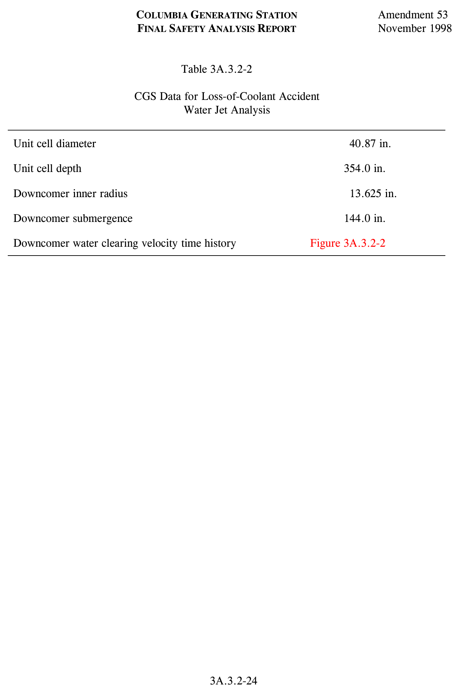

*figure on PDF page 1040*

<!-- labels/text on this figure page -->
COLUMBIA GENERATING STATION
Amendment 53
FINAL SAFETY ANALYSIS REPORT
Table 3A.3.2-2
CGS Data for Loss-of-Coolant Accident Water Jet Analysis
Unit cell diameter 40.87 in.
Unit cell depth 354.0 in.
Downcomer inner radius 13.625 in.
Downcomer submergence 144.0 in.
Downcomer water clearing velocity time history Figure 3A.3.2-2
3A.3.2-24

<!-- p.1041 -->

Table 3A.3.2-3

CGS Data for Vent Clearing And Pool Swell Analysis

Drywell 135°F
1. Temperature (initial)

2. Drywell pressure transient Table 3A.3.2-5

3. Relative humidity 0%

Suppression Chamber 147,290 ft3
1. Free air volume (maximum)

4520 ft2
2. Net suppression pool surface area

3. Pressure (initial)
0.7 psig

1.4a/1.2b 4. Air specific heat ratio

Downcomer vent system 11 ft-8 in./12 fta
1. Submergence (minimum/maximum)

2. Nominal diameter 2 ft

3. Number of vents 102

321 ft2 4. Vent exit area

5. Vent loss coefficient
1.9

a Value used to determine maximum pool swell elevation.

3A.3.2-25

<!-- p.1042 -->

Table 3A.3.2-4

Results from Loss-of-Coolant Accident Bubble Charging Analysis for CGS

Downcomers

Inner Radius Middle Radius Outer Radius Bubble coalescence time (sec)a 0.09 0.16 0.24

Bubble radius at coalescence (ft) 2.12
2.77
3.41

a Times represent time after vents have cleared.

3A.3.2-26

<!-- p.1043 -->

Table 3A.3.2-5

CGS Drywell Pressure as a Function of Time for Loss-of-Coolant Accidenta
(Effects of Pipe Inventory and Subcooling Included)

Time After Loss-of-Coolant Accident (sec)
Drywell Pressure (psia)

0.0 15.45

0.00159 15.32

0.00171 15.30

0.00549 14.72

0.0641 17.61

0.127 20.18

0.252 24.83

0.502 33.27

0.720 35.69

0.740 35.42

1.099 35.11

1.537 35.84

1.568 35.92

2.037 36.00

a See Reference 3A.3.2-22.

3A.3.2-27

<!-- p.1044 -->

Table 3A.3.2-6

Results of Pool Swell Analysis for CGS

0.65 sec Vent clearing timea - tc

5.3 ft/sec Pool water surface velocityb at time tc

Time of maximum pool swell velocity
1.12 sec

Maximum pool swell velocityb 28.7 ft/sec

Time of maximum pool heighta
1.48 sec

18.0 ft Maximum pool swell height (Hmax)

### 1.5 Ratio of Hmax to Ho (downcomer submergence)
Maximum air bubble pressure 35.75 psia

Maximum wetwell airspace pressure 47.55 psia

Maximum pool swell elevation 484 ft 4.75 in. msl

Pool swell terminationa
1.48 sec

a Times represent time after LOCA initiation.
b Does not include velocity multiplier of 1.1.

3A.3.2-28

<!-- p.1045 -->

Table 3A.3.2-7

CGS Plant Parameters for Loss-of-Coolant Accident Transient Analysis

1. Drywell 200,540 ft3 a. Free air volume

135°F b. Temperature (initial)

c. Pressure (initial)
0.75 psig

d Relative humidity 50%

2. Wetwell 144,184 ft3 a. Free air volume 107,850 ft3 b. Water volumea

90°F c. Pool temperature (initial)

d. Pressure (initial)
0.75 psig

e. Relative humidity 100%

3. Break area
3.106 ft2 a. Design basis accident (DBA) recirculation line
3.92 ft2 b. DBA - steam line 0.1 ft2 c. Intermediate break

4. Main vent

a. Maximum submergence 12 ft

b. Nominal diameter 2 ft 102b c. Number of vents 304.6 ft2 d. Vent entrance flow area

e. Downcomer loss factor
1.9

a Water volume b Refer to Section 3A.3.2.2 for a discussion of the effect of capping three downcomers.

3A.3.2-29

<!-- p.1046 -->

Table 3A.3.2-8

Short-Term Loss-of-Coolant Accident Loads on Structures Below Elevation 454.4 ft

Radial Location r of Geometric Center of the Structure or Segment of Structure Zone I Zone II 0 ≤ r < 2.3R
2.3R ≤ r < 5.0R pr max pv max pr max pv max Structure
(psi) (psi) (psi) (psi)

42 in. diameter vertical column +2

12 in. diameter vertical SRV line ±20 +2 outer row inner row

Pipes and Supports

±60 +212 +6 -45 Diametera > 12 in.
(X-31,32,34,35,36)

Diametera ≤ 12 in.
±60 +100 +6 -25
(X-33,100,4 in. FPC, quencher arm)

a For noncylindrical structures, the diameter of a cylinder circumscribing the cross section of the structure is used.

Notes:

1. Vertical load is positive in the downward direction. Radial load is positive in the radially outward direction from the axis of symmetry of the downcomer.

2. The vertical distribution associated with the tabulated peak values is shown in Figure 3A.3.2-18. The distribution in the radial direction in each zone is uniform and is aximsymmetric in the circumferential direction.

Long structures are divided into smaller segments, L ≤ D; D being the diameter of the 3.
structure, and L being the segment length.

3A.3.2-30

<!-- p.1047 -->

Table 3A.3.2-8

Short-Term Loss-of-Coolant Accident Loads on Structures Below Elevation 454.4 ft (Continued)

4. Radial or vertical load is calculated at the geometric center of each structure or segment
(see Figure 3A.3.2-18) by multiplying the pressure value at the geometric center
(obtained from this table) with the length and the diameter of the structure.

For noncylindrical structures, diameter of the circumscribing cylinder is used.

5. Radial or vertical load has, in general, two components. One is parallel and the other is normal to the structure or segment. All components of load that are parallel to the structure or segment are neglected.

6. The radial location, r, of the structure or segment is taken from the nearest vent. Since the flow from vents occurs in-phase during water clearing/air charging phases of LOCA, the flow field calculations and the above specified loads have already accounted for the multi-vents effect. Therefore, effects of flow from other adjacent vents need not be added or subtracted.

7. The loads specified are equivalent static and utilize a DLF equal to 2.

3A.3.2-31

<!-- p.1048 -->

Table 3A.3.2-9

Short-Term Loss-of-Coolant Accident Loads on Structures Between Elevations 454 ft 4.75 in. and 484 ft 4.75 in.

Equivalent Static Load Pool Pool Swell Swell/ Fallback Fallback Pool Swell/ Horizontal Structures Located Between El. 454 ft 4.75 in. and Impact ±Pψ Drag Lift ±Pψ (psi) ±Ph (psi) (psi)
El. 484 ft 4.75 in.

I. Downcomer bracing truss 25 5

II. Platform at el. 472 ft 4 in.: grating perimeter 8.4 25 members

III. Piping at 467 ft 9 in. and supports

A. Horizontal portions of pipes a. X-48,118,117,47,26,63,49,101, 41 25 15 X-23,24, X-4 (pipe and sleeve)
b. X-64,65 16 20 15

B. Inclined braces above penetrations 50 25

C. Horizontal supports below penetrations 60 25

IV. Penetration sleeves, pipe stubs, and electrical box protective structures

a. X-51,66 sleeves for: X-81,82,83,84,116 209 25 5 b. X-87A 166 25 5 c. X-86A 62 25 5 d. X-88,87B,86B,116 (piping)
25 5 e. X-81,82,83,84 (piping except X-82e)
209 20 5 f. X-107A, X-107B (electrical box protective 116 25 5 structures)

3A.3.2-32

<!-- p.1049 -->
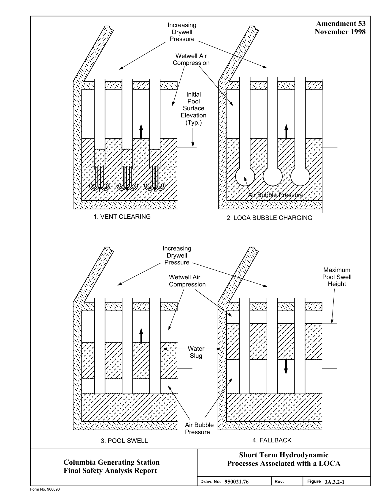

*figure on PDF page 1049*

[Vector original (SVG, lossless): fig_page-1049.svg](../figures/fig_page-1049.svg)

<!-- labels/text on this figure page -->
Amendment 53 Increasing November 1998 Drywell Pressure
Wetwell Air Compression
•••• .. •• .. ••
•••• .. •• .. •• •.· .. •.· .. • .... •
· . .- · . .-· . .-· .. .. ......
Initial Pool Surface Elevation
(Typ.)
Air Bubble Pressure
1. VENT CLEARING
2. LOCA BUBBLE CHARGING
Increasing Drywell Pressure Maximum Pool Swell Wetwell Air Height Compression
_ ... _ ... _ ...
._ ... _ ... _ .. . .
. . ........ . _: .. :._: .. :._: .. :.
..........
Water Slug
Air Bubble Pressure 4. FALLBACK 3. POOL SWELL
Short Term Hydrodynamic Columbia Generating Station Processes Associated with a LOCA Final Safety Analysis Report D r a w . N o . 950021.76 R e v . Figure 3A.3.2-1 Form No. 960690

<!-- p.1050 -->
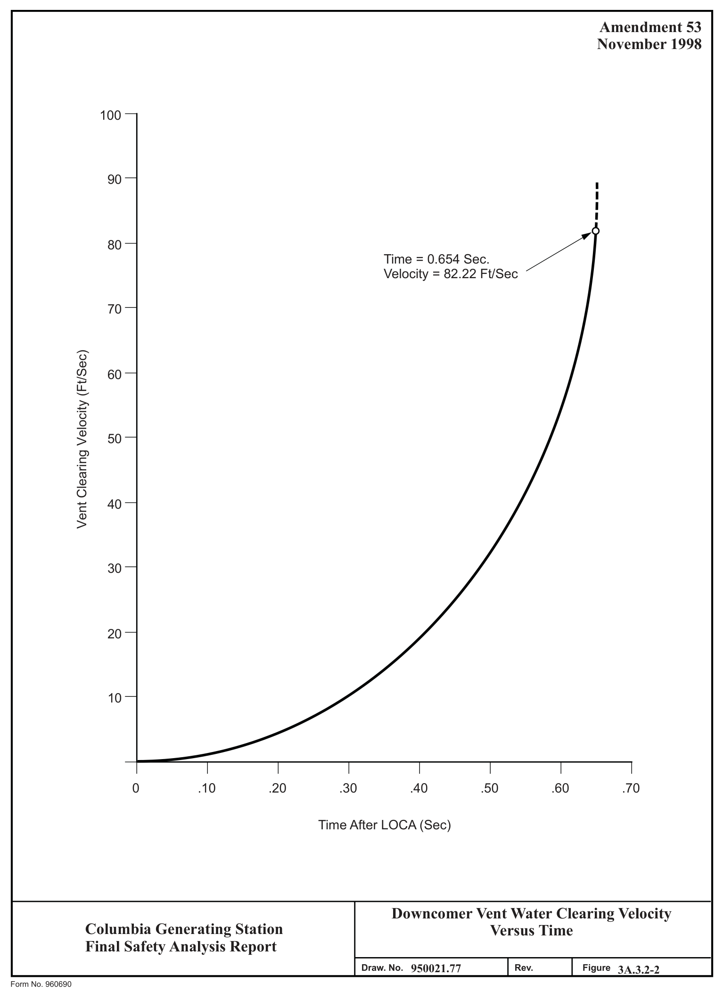

*figure on PDF page 1050*

[Vector original (SVG, lossless): fig_page-1050.svg](../figures/fig_page-1050.svg)

<!-- labels/text on this figure page -->
Amendment 53 November 1998
100
90
80 Time = 0.654 Sec.
Velocity = 82.22 Ft/Sec
70
Vent Clearing Velocity (Ft/Sec)
60
50
40
30
20
10
0 .10 .20 .30 .40 .50 .60 .70
Time After LOCA (Sec)
Downcomer Vent Water Clearing Velocity Columbia Generating Station Versus Time Final Safety Analysis Report 950021.77 Draw. No. Rev. Figure 3A.3.2-2 Form No. 960690

<!-- p.1051 -->
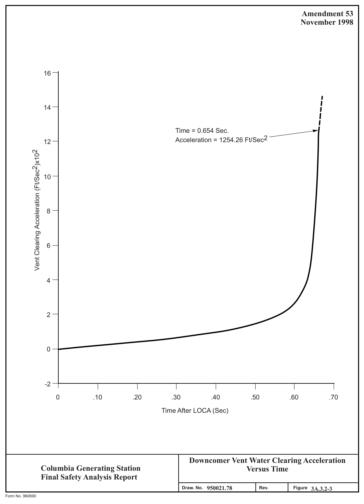

*figure on PDF page 1051*

[Vector original (SVG, lossless): fig_page-1051.svg](../figures/fig_page-1051.svg)

<!-- labels/text on this figure page -->
Amendment 53 November 1998
16
I I 14 I I I Time = 0.654 Sec.
Acceleration = 1254.26 Ft/Sec2 12 Vent Clearing Acceleration (Ft/Sec2)x102 10
8
6
4
2
0
-2
0 .10 .20 .30 .40 .50 .60 .70
Time After LOCA (Sec)
Downcomer Vent Water Clearing Acceleration Columbia Generating Station Versus Time Final Safety Analysis Report 950021.78 Draw. No. Rev. Figure 3A.3.2-3 Form No. 960690

<!-- p.1052 -->
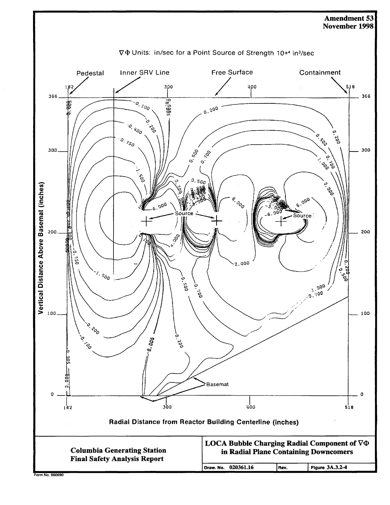

*figure on PDF page 1052*

<!-- labels/text on this figure page -->
Amendment 53 November 1998
V<l> Units: in/sec for a Point Source of Strength 10+4 in3/sec ! ✓ /. 30 Containment Pedestal Inner SRV Line Free Surface
/ ~O ~e JG6 _t----====:f:::==:-----7c-------======~=============------i- JG6
JOO 300
in G> .c .5 --
()
«I E
• G> =
m 200.
200 a, > 0
.Q <
Cl) u
«I - C
a, c
.2 -..
cu
G> > 100 100
JOO 518
Radial Distance from Reactor Building Centerline (inches)
LOCA Bubble Charging Radial Component of V<I> Columbia Generating Station in Radial Plane Containing Downcomers Final Safety Analysis Report Draw. No. 020361.H Figure 3A.3.2-4 Rev.
Form No. 960690

<!-- p.1053 -->
Amendment 53 November 1998 V(J> Units: in/sec for a Point Source of Strength 110+4 in3/sec

0"' 5°-17' -39" Plane of Symmetry \o s·etween Downcomers

2 0

- o•ooo 300 300 en
(I)
C

#### C: --
c.)

ca E
(I)
(II ca :D Q) > 0 ,Q ct

#### ca - (I)
CJ C:
,!!? 200 WO C
-;
c.).
::: ,_
(I)
:>

!00 100 r::,·

----------0.003

Basemat 100 200 0 Tangential Distance From Plane Containing Downcomers (Inches)

LOCA Bubble Charging Tangential Component of Columbia Generating Station V cl> in Vertical Cylindrical Surface Through Middle Final Safety Analysis Report Downcomer Draw. No. 020361.17 Figure 3A.3.2-S Rev.
Form No. 960690

<!-- p.1054 -->
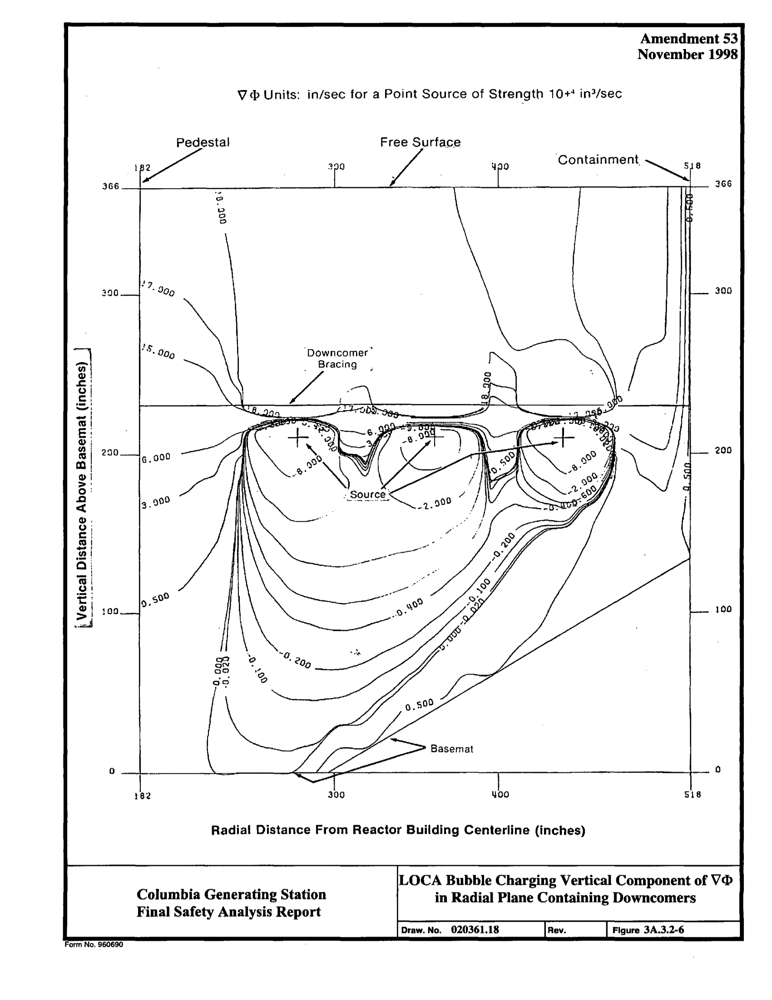

*figure on PDF page 1054*

<!-- labels/text on this figure page -->
Amendment 53 November 1998
V<l> Units: in/sec for a Point Source of Strength 10+4 in 3/sec
1 ✓estal , Fr/ee Surfac_e Containment_ 0 4 0 J66 --i=-------------.L..--~=------r--___J-----,-------,nt-- 366
::oo 300
!So Down comer ~ • Do _ Bracing QI ' .c' .s! -· -
(,) I
ca E QI 200 (I) ca 200 6.000 al QI > 0 .0 '3- <::,00 ~
ca -
QI '
(,)
C
Cl)
0 ~ CJ =e' <). soo QI I JOO >' !00 .. d
<:P ·~ ON ao 0•cj
'100 300 SIB 182
Radial Distance From Reactor Building Centerline (inches)
LOCA Bubble Charging Vertical Component of V<I> Columbia Generating Station in Radial Plane Containing Downcomers Final Safety Analysis Report Figure 3A.3.2-6 Rev.
Draw. No. 020361.18 orm No. 960690

<!-- p.1055 -->
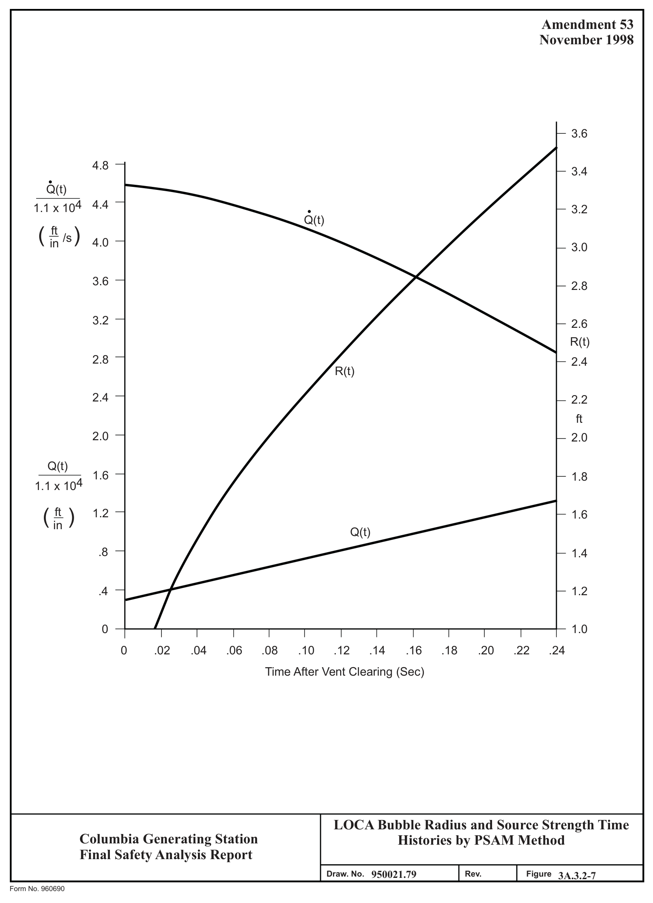

*figure on PDF page 1055*

[Vector original (SVG, lossless): fig_page-1055.svg](../figures/fig_page-1055.svg)

<!-- labels/text on this figure page -->
Amendment 53 November 1998
3.6
4.8
3.4 Q(t)
1.1 x 104 4.4
3.2 Q(t)
( ) ft in /s 4.0
3.0
3.6
2.8
3.2
2.6 R(t)
2.8
2.4 R(t)
2.4
2.2 ft
2.0
2.0
Q(t)
1.6
1.8
1.1 x 104
( ) ft
1.2
1.6 in Q(t)
.8
1.4
.4
1.2
0
1.0 0 .02 .04 .06 .08 .10 .12 .14 .16 .18 .20 .22 .24 Time After Vent Clearing (Sec)
LOCA Bubble Radius and Source Strength Time Columbia Generating Station Histories by PSAM Method Final Safety Analysis Report 950021.79 Draw. No. Rev. Figure 3A.3.2-7 Form No. 960690

<!-- p.1056 -->
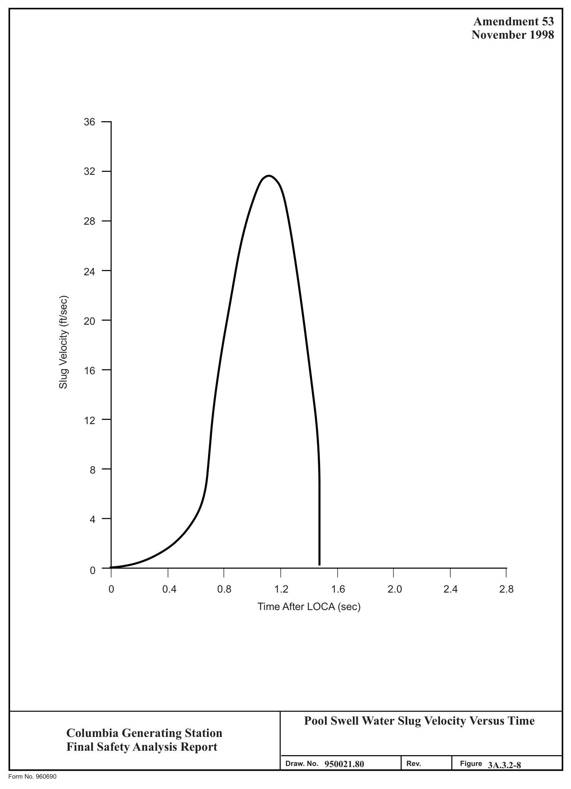

*figure on PDF page 1056*

[Vector original (SVG, lossless): fig_page-1056.svg](../figures/fig_page-1056.svg)

<!-- labels/text on this figure page -->
Amendment 53 November 1998
36
32
28
24
Slug Velocity (ft/sec)
20
16
12
8
4
0 0 0.4 0.8 1.2 1.6 2.0 2.4 2.8 Time After LOCA (sec)
Pool Swell Water Slug Velocity Versus Time Columbia Generating Station Final Safety Analysis Report 950021.80 Draw. No. Rev. Figure 3A.3.2-8 Form No. 960690

<!-- p.1057 -->
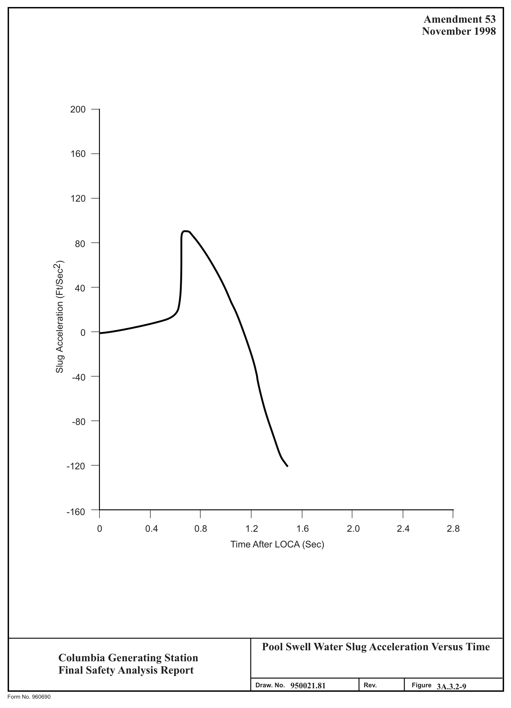

*figure on PDF page 1057*

[Vector original (SVG, lossless): fig_page-1057.svg](../figures/fig_page-1057.svg)

<!-- labels/text on this figure page -->
Amendment 53 November 1998
200
160
120
80
Slug Acceleration (Ft/Sec2)
40
0
-40
-80
-120
-160 0 0.4 0.8 1.2 1.6 2.0 2.4 2.8 Time After LOCA (Sec)
Pool Swell Water Slug Acceleration Versus Time Columbia Generating Station Final Safety Analysis Report 950021.81 Draw. No. Rev. Figure 3A.3.2-9 Form No. 960690

<!-- p.1058 -->
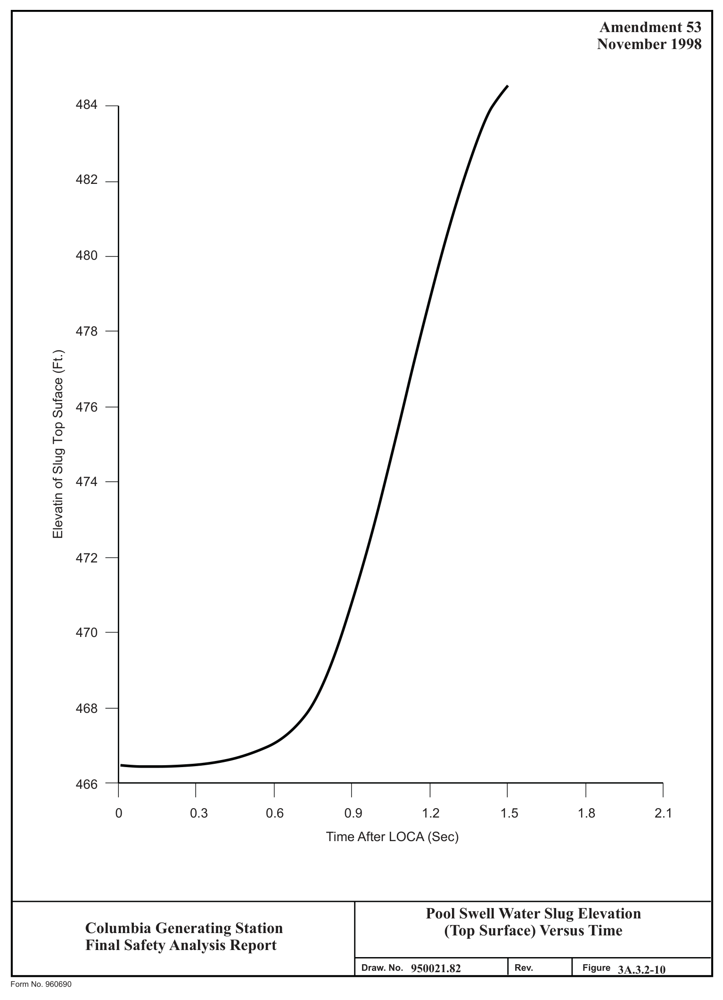

*figure on PDF page 1058*

[Vector original (SVG, lossless): fig_page-1058.svg](../figures/fig_page-1058.svg)

<!-- labels/text on this figure page -->
Amendment 53 November 1998
484
482
480
478
Elevatin of Slug Top Suface (Ft.)
476
474
472
470
468
466
0 0.3 0.6 0.9 1.2 1.5 1.8 2.1 Time After LOCA (Sec)
Pool Swell Water Slug Elevation Columbia Generating Station
(Top Surface) Versus Time Final Safety Analysis Report 950021.82 Draw. No. Rev. Figure 3A.3.2-10 Form No. 960690

<!-- p.1059 -->
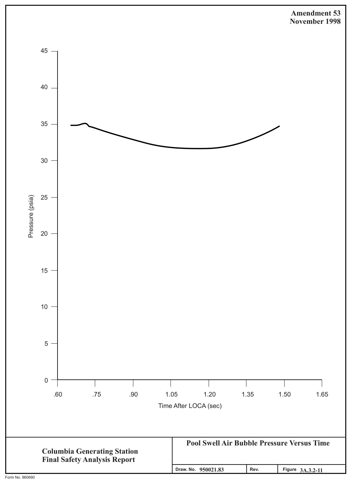

*figure on PDF page 1059*

[Vector original (SVG, lossless): fig_page-1059.svg](../figures/fig_page-1059.svg)

<!-- labels/text on this figure page -->
Amendment 53 November 1998
45
40
35
30
25 Pressure (psia)
20
15
10
5
0
.60 .75 .90 1.05 1.20 1.35 1.50 1.65 Time After LOCA (sec)
Pool Swell Air Bubble Pressure Versus Time Columbia Generating Station Final Safety Analysis Report 950021.83 Draw. No. Rev. Figure 3A.3.2-11 Form No. 960690

<!-- p.1060 -->
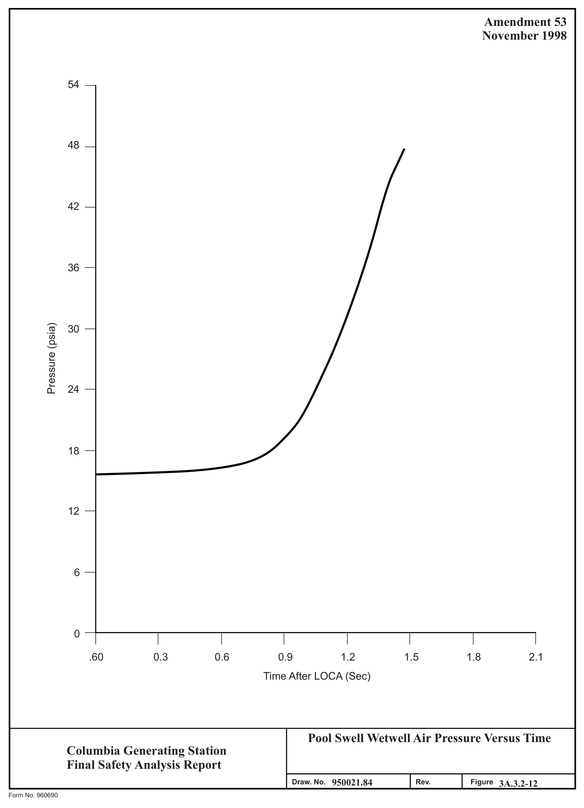

*figure on PDF page 1060*

[Vector original (SVG, lossless): fig_page-1060.svg](../figures/fig_page-1060.svg)

<!-- labels/text on this figure page -->
Amendment 53 November 1998
54
48
42
36
Pressure (psia) 30 24
18
12
6
0
.60 0.3 0.6 0.9 1.2 1.5 1.8 2.1 Time After LOCA (Sec)
Pool Swell Wetwell Air Pressure Versus Time Columbia Generating Station Final Safety Analysis Report 950021.84 Draw. No. Rev. Figure 3A.3.2-12 Form No. 960690

<!-- p.1061 -->
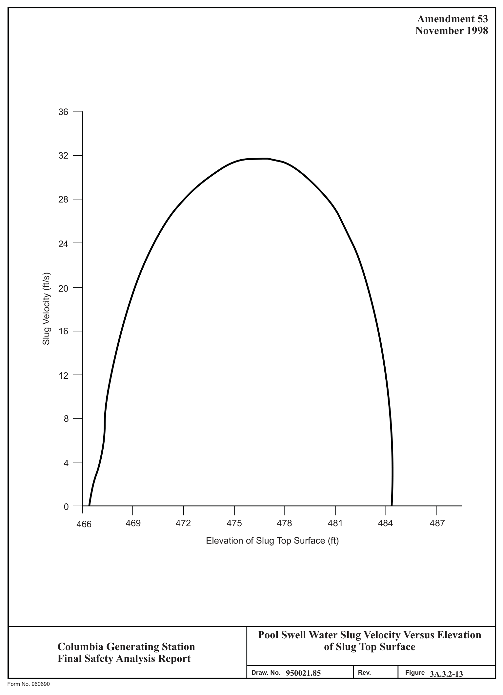

*figure on PDF page 1061*

[Vector original (SVG, lossless): fig_page-1061.svg](../figures/fig_page-1061.svg)

<!-- labels/text on this figure page -->
Amendment 53 November 1998
36
32
28
24
Slug Velocity (ft/s)
20
16
12
8
4
0 466 469 472 475 478 481 484 487 Elevation of Slug Top Surface (ft)
Pool Swell Water Slug Velocity Versus Elevation of Slug Top Surface Columbia Generating Station Final Safety Analysis Report 950021.85 Draw. No. Rev. Figure 3A.3.2-13 Form No. 960690

<!-- p.1062 -->
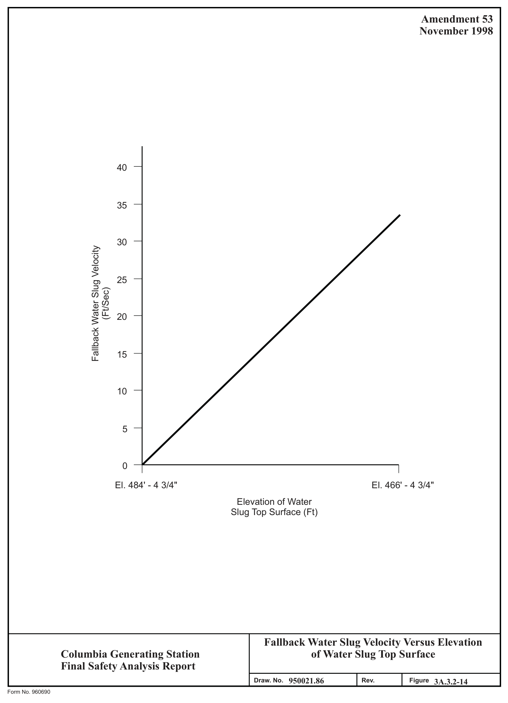

*figure on PDF page 1062*

[Vector original (SVG, lossless): fig_page-1062.svg](../figures/fig_page-1062.svg)

<!-- labels/text on this figure page -->
Amendment 53 November 1998
40
35
30 Fallback Water Slug Velocity 25
(Ft/Sec)
20
15
10
5
0
El. 484' - 4 3/4" El. 466' - 4 3/4" Elevation of Water Slug Top Surface (Ft)
Fallback Water Slug Velocity Versus Elevation of Water Slug Top Surface Columbia Generating Station Final Safety Analysis Report 950021.86 Draw. No. Rev. Figure 3A.3.2-14 Form No. 960690

<!-- p.1063 -->
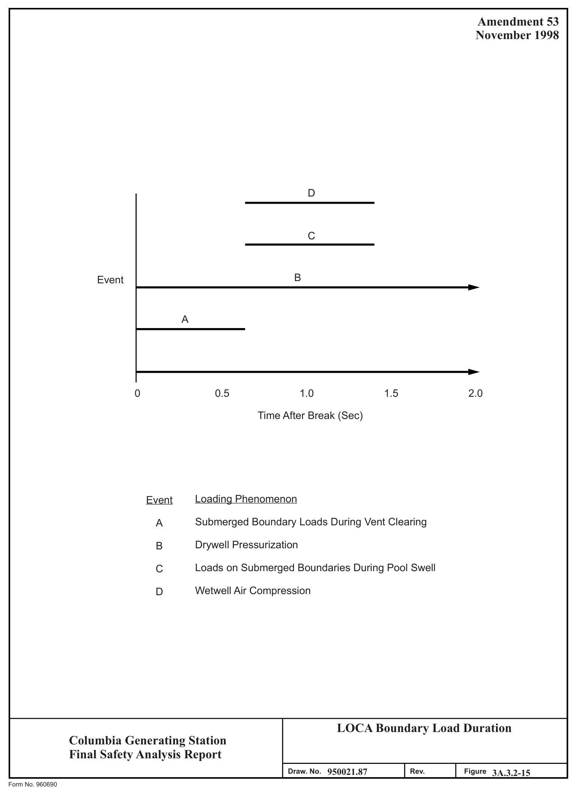

*figure on PDF page 1063*

[Vector original (SVG, lossless): fig_page-1063.svg](../figures/fig_page-1063.svg)

<!-- labels/text on this figure page -->
Amendment 53 November 1998
D
C
B Event
-
A
-- 0 0.5
1.0
1.5
2.0
Time After Break (Sec)
Loading Phenomenon Event
- Submerged Boundary Loads During Vent Clearing A
Drywell Pressurization B
Loads on Submerged Boundaries During Pool Swell C
Wetwell Air Compression D
LOCA Boundary Load Duration Columbia Generating Station Final Safety Analysis Report I I 950021.87 Draw. No. Rev. Figure 3A.3.2-15 Form No. 960690

<!-- p.1064 -->
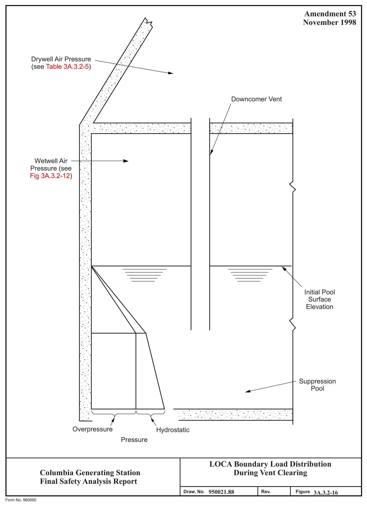

*figure on PDF page 1064*

[Vector original (SVG, lossless): fig_page-1064.svg](../figures/fig_page-1064.svg)

<!-- labels/text on this figure page -->
Amendment 53 November 1998
Drywell Air Pressure
(see Table 3A.3.2-5)
Downcomer Vent
... ..
'• .·•
•·.· .. •
Wetwell Air Pressure (see Fig 3A.3.2-12)
Initial Pool Surface Elevation
Suppression Pool
. . . ...
.. . ·. . .. ·.
•·.· .. • •·.· .. • Overpressure Hydrostatic Pressure
LOCA Boundary Load Distribution During Vent Clearing Columbia Generating Station Final Safety Analysis Report 950021.88 Draw. No. Rev. Figure 3A.3.2-16 Form No. 960690

<!-- p.1065 -->
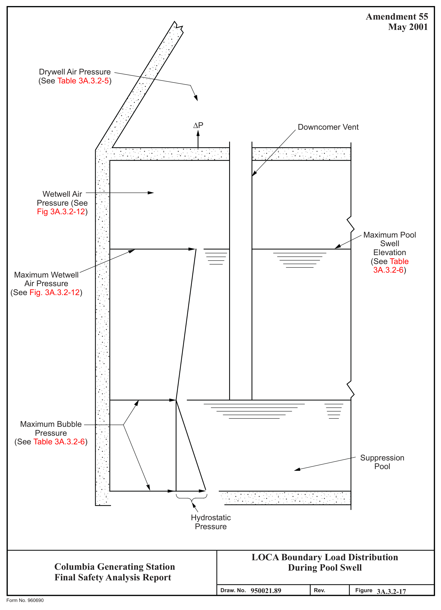

*figure on PDF page 1065*

[Vector original (SVG, lossless): fig_page-1065.svg](../figures/fig_page-1065.svg)

<!-- labels/text on this figure page -->
Amendment 55 May 2001
Drywell Air Pressure
(See Table 3A.3.2-5)
∆P Downcomer Vent
· .... . . . . '• .· .
Wetwell Air Pressure (See . · ..• . . . Fig 3A.3.2-12)
Maximum Pool Swell Elevation
(See Table 3A.3.2-6)
Maximum Wetwell Air Pressure
(See Fig. 3A.3.2-12)
. · .• . . .
. · ..• . . .
Maximum Bubble Pressure
(See Table 3A.3.2-6)
Suppression Pool
__i_~ . . . ; ,..___-----3 _ . ... · .. . ... · ..
...
. .. •
Hydrostatic Pressure
LOCA Boundary Load Distribution Columbia Generating Station During Pool Swell Final Safety Analysis Report 950021.89 Draw. No. Rev. Figure 3A.3.2-17 Form No. 960690

<!-- p.1066 -->
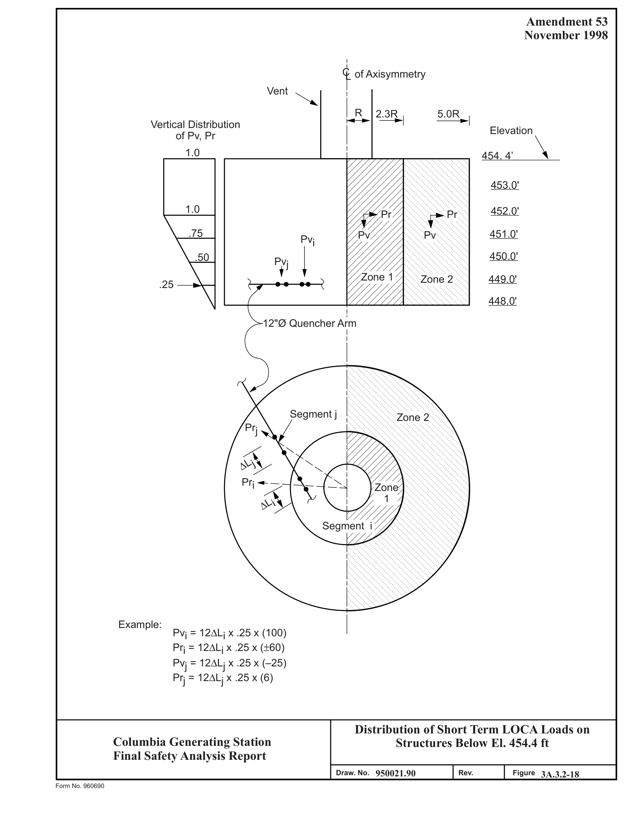

*figure on PDF page 1066*

[Vector original (SVG, lossless): fig_page-1066.svg](../figures/fig_page-1066.svg)

<!-- labels/text on this figure page -->
Amendment 53 November 1998
I I CL of Axisymmetry I Vent I L~
R 2.3R 5.0R
Vertical Distribution Elevation \ I of Pv, Pr I
1.0 454. 4’
453.0'
1.0 452.0' Pr Pr .75 451.0' Pv Pv Pvi 450.0' .50 Pvj Zone 1 Zone 2 449.0' .25 448.0'
12"Ø Quencher Arm
Segment j Zone 2 Prj
∆Lj Pri Zone 1 ∆Li
Segment i
Example:
Pvi = 12∆Li x .25 x (100)
Pri = 12∆Li x .25 x (±60)
Pvj = 12∆Lj x .25 x (–25)
Prj = 12∆Lj x .25 x (6)
Distribution of Short Term LOCA Loads on Columbia Generating Station Structures Below El. 454.4 ft Final Safety Analysis Report 950021.90 Draw. No. Rev. Figure 3A.3.2-18 Form No. 960690

<!-- p.1067 -->
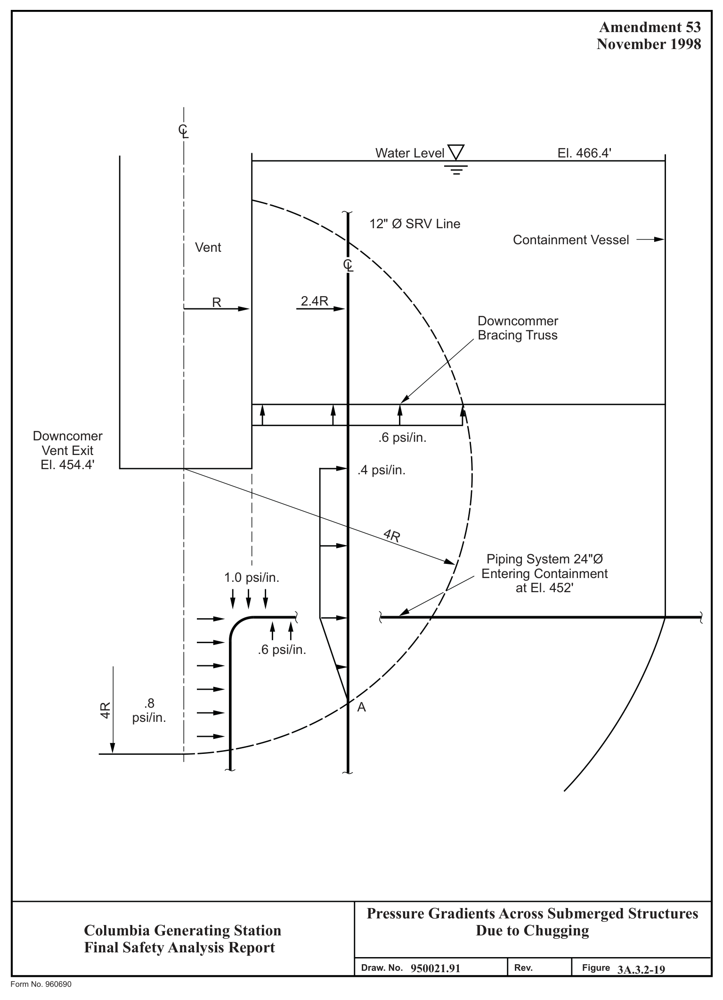

*figure on PDF page 1067*

[Vector original (SVG, lossless): fig_page-1067.svg](../figures/fig_page-1067.svg)

<!-- labels/text on this figure page -->
Amendment 53 November 1998
CL Water Level El. 466.4'
12" Ø SRV Line Containment Vessel Vent CL
2.4R R Downcommer Bracing Truss
\ \
\ Downcomer .6 psi/in.
I Vent Exit I El. 454.4' .4 psi/in.
I I I I I I I 4R I t I Piping System 24"Ø Entering Containment
1.0 psi/in.
I 7v at El. 452' ~ ~ ~ !
I --- ~
t t
I I --- .6 psi/in.
I -- I I -- .8 A 4R psi/in. I --- /.,,,,,,.,,,,,, I -- __ ___!_I - __ _...
Pressure Gradients Across Submerged Structures Due to Chugging Columbia Generating Station Final Safety Analysis Report 950021.91 Draw. No. Rev. Figure 3A.3.2-19 Form No. 960690

<!-- p.1068 -->
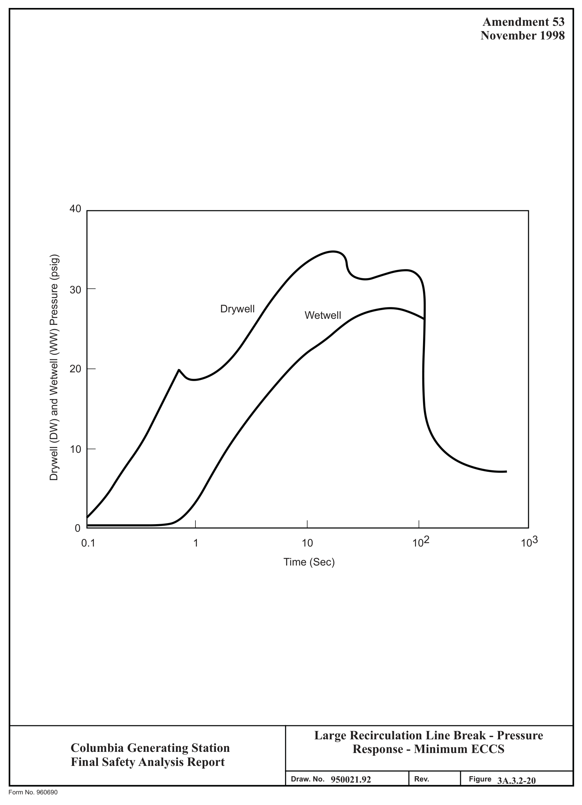

*figure on PDF page 1068*

[Vector original (SVG, lossless): fig_page-1068.svg](../figures/fig_page-1068.svg)

<!-- labels/text on this figure page -->
Amendment 53 November 1998
40
Drywell (DW) and Wetwell (WW) Pressure (psig)
30 Drywell Wetwell
20
10
0 102 103 0.1 1 10 Time (Sec)
Large Recirculation Line Break - Pressure Columbia Generating Station Response - Minimum ECCS Final Safety Analysis Report 950021.92 Draw. No. Rev. Figure 3A.3.2-20 Form No. 960690

<!-- p.1069 -->
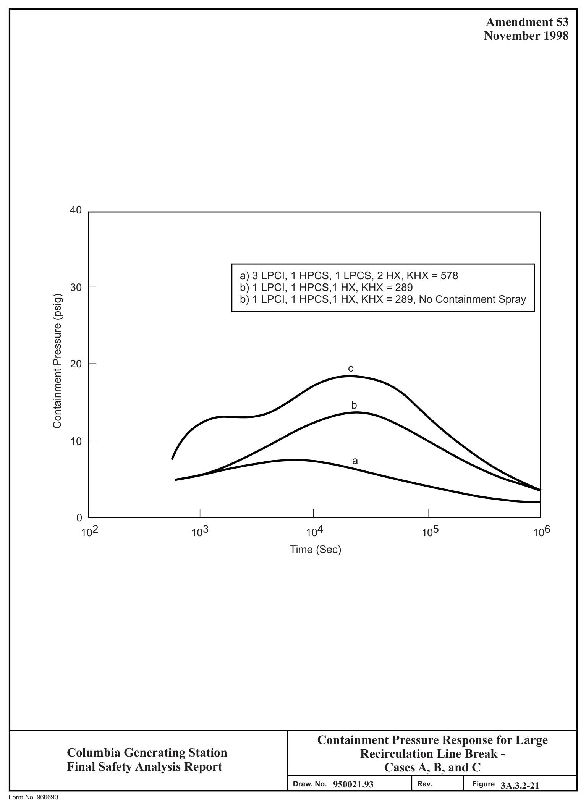

*figure on PDF page 1069*

[Vector original (SVG, lossless): fig_page-1069.svg](../figures/fig_page-1069.svg)

<!-- labels/text on this figure page -->
Amendment 53 November 1998
40
a) 3 LPCI, 1 HPCS, 1 LPCS, 2 HX, KHX = 578 30 b) 1 LPCI, 1 HPCS,1 HX, KHX = 289 b) 1 LPCI, 1 HPCS,1 HX, KHX = 289, No Containment Spray Containment Pressure (psig)
20 c
b
10 a
0 102 103 104 105 106 Time (Sec)
Containment Pressure Response for Large Columbia Generating Station Recirculation Line Break - Final Safety Analysis Report Cases A, B, and C 950021.93 Draw. No. Rev. Figure 3A.3.2-21 Form No. 960690

<!-- p.1070 -->
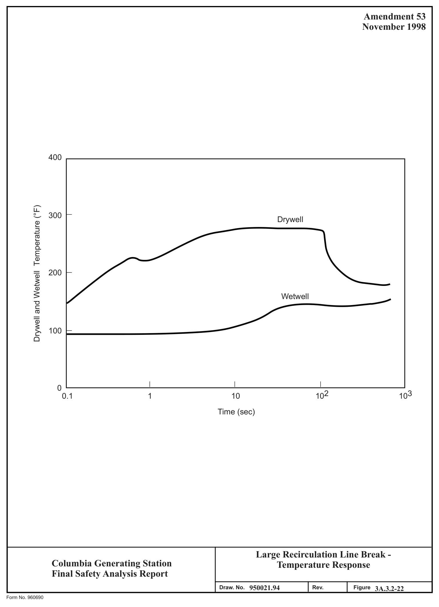

*figure on PDF page 1070*

[Vector original (SVG, lossless): fig_page-1070.svg](../figures/fig_page-1070.svg)

<!-- labels/text on this figure page -->
Amendment 53 November 1998
400
Drywell and Wetwell Temperature (°F)
300 Drywell
200
Wetwell
100
0 102 103 0.1 1 10
Time (sec)
Large Recirculation Line Break - Columbia Generating Station Temperature Response Final Safety Analysis Report 950021.94 Draw. No. Rev. Figure 3A.3.2-22 Form No. 960690

<!-- p.1071 -->
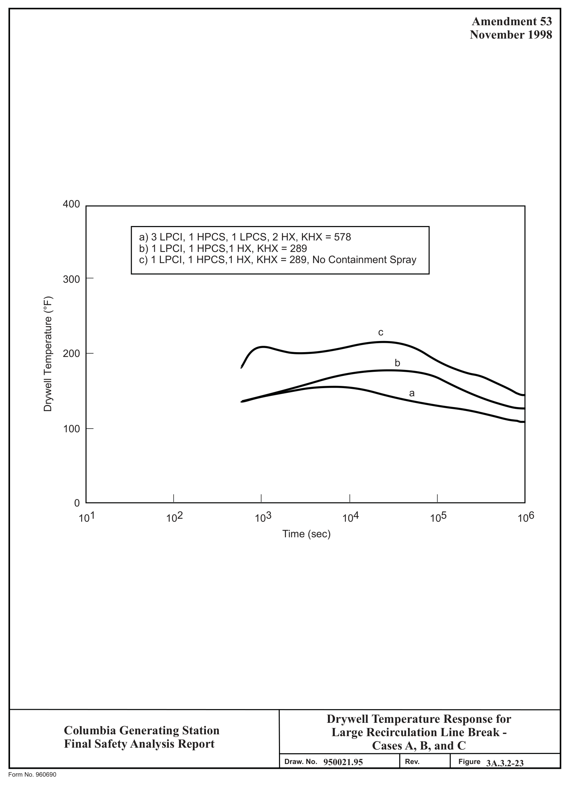

*figure on PDF page 1071*

[Vector original (SVG, lossless): fig_page-1071.svg](../figures/fig_page-1071.svg)

<!-- labels/text on this figure page -->
Amendment 53 November 1998
400
a) 3 LPCI, 1 HPCS, 1 LPCS, 2 HX, KHX = 578 b) 1 LPCI, 1 HPCS,1 HX, KHX = 289 c) 1 LPCI, 1 HPCS,1 HX, KHX = 289, No Containment Spray 300
Drywell Temperature (°F)
c
200 b
a
100
I I I I 0 101 102 103 104 105 106 Time (sec)
Drywell Temperature Response for Columbia Generating Station Large Recirculation Line Break - Final Safety Analysis Report Cases A, B, and C 950021.95 Draw. No. Rev. Figure 3A.3.2-23 Form No. 960690

<!-- p.1072 -->
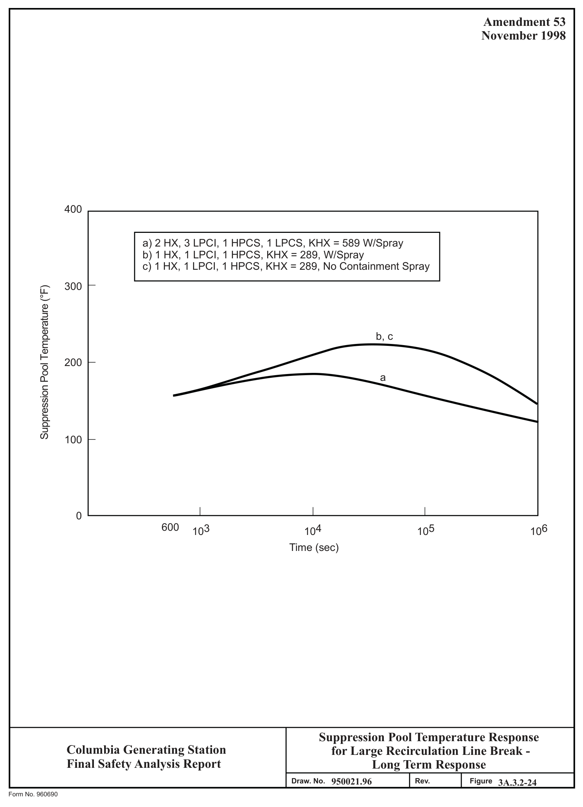

*figure on PDF page 1072*

[Vector original (SVG, lossless): fig_page-1072.svg](../figures/fig_page-1072.svg)

<!-- labels/text on this figure page -->
Amendment 53 November 1998
400
a) 2 HX, 3 LPCI, 1 HPCS, 1 LPCS, KHX = 589 W/Spray b) 1 HX, 1 LPCI, 1 HPCS, KHX = 289, W/Spray c) 1 HX, 1 LPCI, 1 HPCS, KHX = 289, No Containment Spray 300 Suppression Pool Temperature (°F)
b, c
200 a
100
0 600 103 104 105 106 Time (sec)
Suppression Pool Temperature Response Columbia Generating Station for Large Recirculation Line Break - Final Safety Analysis Report Long Term Response 950021.96 Draw. No. Rev. Figure 3A.3.2-24 Form No. 960690

<!-- p.1073 -->
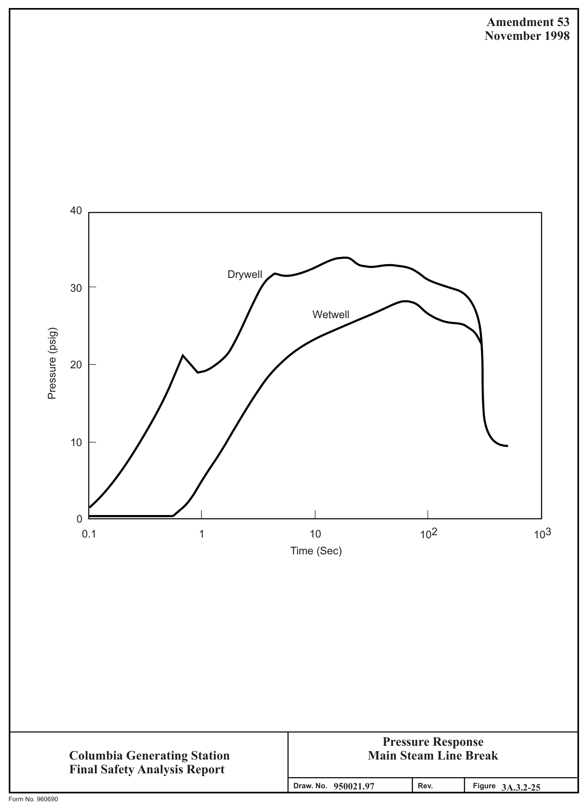

*figure on PDF page 1073*

[Vector original (SVG, lossless): fig_page-1073.svg](../figures/fig_page-1073.svg)

<!-- labels/text on this figure page -->
Amendment 53 November 1998
40
Drywell 30
Wetwell Pressure (psig)
20
10
0 102 103 0.1 1 10 Time (Sec)
Pressure Response Main Steam Line Break Columbia Generating Station Final Safety Analysis Report 950021.97 Draw. No. Rev. Figure 3A.3.2-25 Form No. 960690

<!-- p.1074 -->
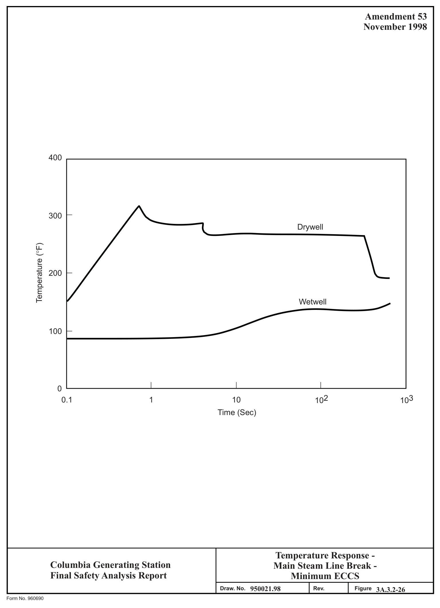

*figure on PDF page 1074*

[Vector original (SVG, lossless): fig_page-1074.svg](../figures/fig_page-1074.svg)

<!-- labels/text on this figure page -->
Amendment 53 November 1998
400
300 Drywell
Temperature (°F)
200
Wetwell
100
0 102 103 0.1 1 10 Time (Sec)
Temperature Response - Columbia Generating Station Main Steam Line Break - Final Safety Analysis Report Minimum ECCS 950021.98 Draw. No. Rev. Figure 3A.3.2-26 Form No. 960690

<!-- p.1075 -->
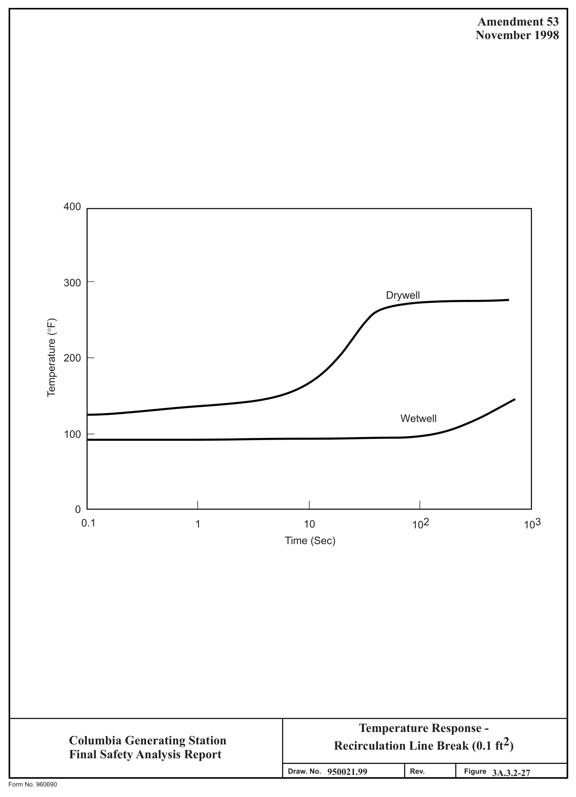

*figure on PDF page 1075*

[Vector original (SVG, lossless): fig_page-1075.svg](../figures/fig_page-1075.svg)

<!-- labels/text on this figure page -->
Amendment 53 November 1998
400
300 Drywell
Temperature (°F)
200
Wetwell 100
0 102 103 0.1 1 10 Time (Sec)
Temperature Response - Columbia Generating Station Recirculation Line Break (0.1 ft2)
Final Safety Analysis Report 950021.99 Draw. No. Rev. Figure 3A.3.2-27 Form No. 960690

<!-- p.1076 -->
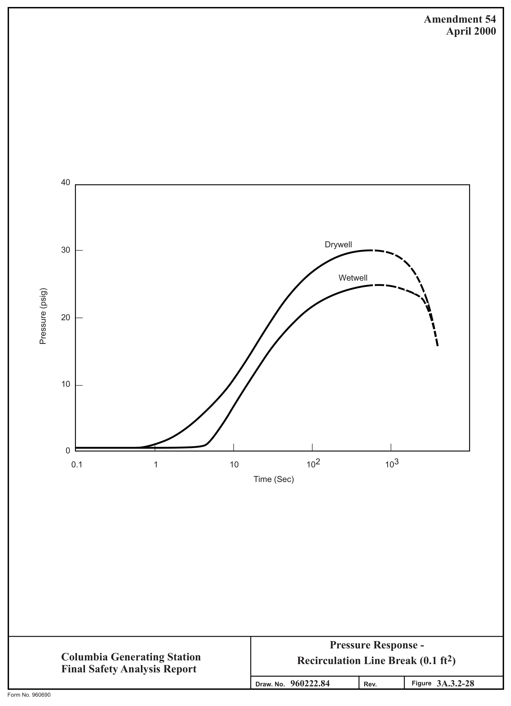

*figure on PDF page 1076*

[Vector original (SVG, lossless): fig_page-1076.svg](../figures/fig_page-1076.svg)

<!-- labels/text on this figure page -->
Amendment 54 April 2000
40
Drywell 30
Wetwell
Pressure (psig)
20
10
0 102 103 0.1 1 10 Time (Sec)
Pressure Response - Columbia Generating Station Recirculation Line Break (0.1 ft2)
Final Safety Analysis Report 960222.84 3A.3.2-28 Draw. No.
Rev. Figure Form No. 960690

<!-- p.1077 -->

3A.3.3 LOAD SUMMARY

A load summary is given in Table 3A.3.3-1 to provide guidance in identifying loads and to provide references to more detailed discussions of them. The table lists the loads being evaluated and the peak load magnitude directly applied to each structure, or a reference to the DAR sections where the information is derived. It also lists the classification of the load as primary or secondary as defined by NRC.

3A.3.3-1

<!-- p.1078 -->
November 1998 Load Class Prim. Prim. Sec. Sec.

3.1.2.1 3.1.3.2
3.1.3 3.2.3 Ref. Sec.
DAR

In Pool Swell Zone N/A N/A N/A N/A
(3)
Piping System
#### 3.1.3.2 Part. Sub.
sm sm sm Unless identified as dynamic pressure, the numerical value given is equivalent static peak pressure (i.e., includes a DLF).
3.2.3.3
#### 3.1.3.2 Sub.
Fully
(3) sm sm .

Ladder forms N/A N/A N/A N/A Plat- and Summary of Hydrodynamic Loads on Wetwell Structures Conformance to NRC acceptance criteria for each load in this table is presented in Attachment 3A.H.
Quencher
3.1.3.2 3.2.3.3 sm sm LOCA induced vent, thrust loads are neglected as secondary loads (see Reference 3A.3.2-1).
System 3.1.3.2 3.2.3.3 Piping SRV sm sm

Table 3A.3.3-1a
3.1.3.2 comer Downsm sm sm

Column 3.1.3.2 3.2.3.3 sm sm All fully-submerged piping systems enter the pool below vent exit.
Bracing 3.1.3.2 Down- comer sm sm sm sm denotes load as small, not requiring consideration. Between elevations 466 ft-4.75 in. and 484 ft-4.75 in.
Dia. Floor N/A N/A N/A N/A N/A Seal

Floor Dia. N/A N/A N/A N/A N/A

Pedestal 151 sm sm sm sm

Peak dynamic pressure. Base- mat 151 21b sm sm 24 SRV LOCA Values are in psig.
Horiz. Vert.
Tees and 151 21b (6) sm sm 24

Containment Stl. 151 21b sm sm 24

Charging Notes: Clearing Clearing Clearing Category Bubble Water Steam Cond. Water Load Vent
3.
1. 2. 4. 5. 6. Air Air a b

3A.3.3-3

<!-- p.1079 -->

3A.3.4 SEQUENCE OF DYNAMIC LOADS

The effects of various dynamic loads on structures are analyzed separately. It is important to establish the relative time sequence of all dynamic events to obtain a realistic assessment of design margins. The DFFR (Reference 3A.3.2-2) established relative sequence of dynamic loads during a single SRV discharge event and a postulated LOCA. It is noted that during an SRV actuation the water clearing loads, the air clearing loads, and the steam condensation loads occur in a sequence and the peak dynamic effects due to each need not be combined.
Similarly, the LOCA water clearing, air clearing (bubble charging), pool swell impact, pool swell drag, pool fallback, and the high, intermediate, and low mass flux steam condensation occur in a sequence and the peak dynamic effects due to each need not be combined. During pool swell or fallback, drag pressure parallel to the flow and lift pressure normal to the flow occur simultaneously, and the two loads are combined. Also, for some submerged structures, pool swell impact occurs at the upper parts of the structure while pool swell drag and lift loads act on the lower parts of the structure. In this case, the three loads are combined. The continuity of short-term water and air clearing phases during an SRV discharge or during a LOCA and the pool swell impact and drag loads during a DBA LOCA is recognized either by specifying a conservative DLF for use with peak load value of the combined time history or by use of the combined time history in the dynamic analysis in assessing the structures.

The DFFR provides guidance about the SRV actuations occurring during the normal operation of the plant and during the small, intermediate, and large break LOCA. In absence of information about relative time sequence of the three events, the following conservative assumptions for submerged structures are made in combining the effects due to these events in this assessment:

a. Short-term LOCA and SRV loads

For structures submerged in the pool, the direct hydrodynamic loads due to the LOCA jet, LOCA bubble, pool swell, and fallback are not combined with the direct hydrodynamic loads due to the SRV water jet or air bubbles. The presence in the pool of air bubbles from the SRV line is assumed to have negligible effect on short-term pool dynamics during a LOCA. The seismic effects are combined with the short-term LOCA load effects; and

b. Long-term LOCA and SRV loads

For all miscellaneous submerged piping systems and major structures (columns, downcomer bracing, downcomers and SRV line with quencher) the worst case LOCA steam condensation loads are combined with seismic effects and with a single adjacent SRV actuation load or with the actuation of ADS valves.

3A.3.4-1

<!-- p.1080 -->

3A.3.5 LOAD COMBINATIONS AND ACCEPTANCE CRITERIA

Load combinations and acceptance criteria for events which include suppression pool hydrodynamic loads are described in this section. Four categories of structural components affected by these events are identified and the applicable load combinations and acceptance for each category are listed. These structural categories are the steel containment structure
(suppression chamber portion), reinforced concrete structures, steel structures, and piping and piping systems. Symbols representing generic load types are used in the load combinations;
these symbols are defined below.

3A.3.5.1 Steel Containment Structure

3A.3.5.1.1 Definitions

D Dead loads

L Live loads

EO Loads generated by operating basis earthquake

ESS Loads generated by safe shutdown earthquake

H Loads associated with pool swell phenomenon following L the clearing of the downcomer vents including fallback

P Containment pressure associated with the large break A (DBA) LOCA

PB Containment pressure associated with IBA or SBA

P Loads associated with chugging phenomena

PE Design external pressure on the containment

Po Normal operating pressure

PSR Loads associated with main steam SRV actuation

PV LOCA related hydrodynamic loads on suppression chamber, including HL, Pc

RA Pipe reactions under thermal conditions generated by the postulated accidents and including Ro

RE Pipe reactions under thermal conditions during event causing external pressure

3A.3.5-1

<!-- p.1081 -->

RO Pipe reactions during startup, normal operating or shutdown conditions, based on the most critical transient or steady-state condition

RR Reaction and jet forces associated with the pipe break

TA Thermal loads under thermal conditions associated with LOCA

TE Thermal loads under thermal conditions during event causing external pressure

TO Thermal effects and loads during normal operation

3A.3.5.1.2 Load Combinations

The following load combinations for the CGS steel containment are in agreement with those specified in the NRC Standard Review Plan, 3.8.2, Revision 0, and properly include the new SRV and LOCA hydrodynamic loads.

(1) D+L+PO+TO+RO+PSR

(2) D+L+EO+PO+TO+RO+PSR

(3) D+L+EO+TA+RA+(PA or PB)+PV+PSR

(4) D+L+EO+TE+RE+PE+PSR

(5) D+L+Ess+PO+TO+RO+PSR

(6) D+L+Ess+TA+RA+(PA or PB)+PV+PSR

(7) D+L+Ess+TE+RE+PE+PSR

Notes:
----

1. In all combinations the hydrostatic pressure due to the presence of water in the pressure-suppression chamber pool is considered with dead and live loads.

2. Restraint due to the presence of filler material between the containment vessel and the biological shield wall (equivalent to an external pressure of 2 psi) is considered where critical.

3A.3.5-2

<!-- p.1082 -->

3. For independent, short duration, vibratory loads such as seismic, SRV discharge, chugging loads, the peak dynamic responses due to the individual loads are combined by the square-root-of-sum-of-the-squares (SRSS) method.

4. For time relationship between concurrently applied loads in combinations (3) and (6)
see Section 3A.3.4.

5. In the case of PSR and PC both the axisymmetric and nonaxisymmetric loading conditions are investigated.

6. Maximum equivalent static pressures for PA, PB, and PV are given in Table 3A.3.5-1.

The design assessment of the containment vessel is made on the basis of the SRSS method as stated above. However, subsequent investigation indicates that if combination of peak dynamic responses due to seismic, SRV discharge loads, and chugging loads is done by the absolute sum method, the resultant design margins for the containment vessel are greater than
1.0.

3A.3.5.1.3 Acceptance Criteria

The design rules for the steel containment are in accordance with ASME Code Section III, 1971 Edition through the 1972 Summer addenda, Subsection NE, Class MC Components.
The acceptance criteria for each load combination are summarized in Table 3A.3.5-2.

3A.3.5.2 Reinforced-Concrete Structures

Structures to which the criteria below apply include the basemat, the RPV pedestal, the columns supporting the diaphragm floor, and the diaphragm floor slab.

3A.3.5.2.1 Definitions

D Dead loads

EO Loads generated by operating basis earthquake

ESS Loads generated by safe shutdown earthquake

HL Hydrodynamic forces associated with pool swell phenomenon following the clearing of the downcomer vents including fallback forces

L Live loads

3A.3.5-3

<!-- p.1083 -->

PA All loads associated with the large break (DBA) LOCA including drywell and suppression chamber transient pressure loads and HL, Pc, and Pco as defined herein

PB All loads associated with IBA or SBA type of LOCA including transient pressure loads and Pc

Pc Loads associated with chugging phenomena during LOCA

PO Normal operating pressure

PSR Loads associated with main steam SRV actuation

RA Pipe reactions under thermal conditions generated by the postulated accidents and including RO

RO Pipe react ions during startup, normal operating or shutdown conditions, based on the most critical transient or steady-state condition

RR Reaction and jet forces associated with the pipe break

TA Thermal loads resulting from thermal conditions generated by postulated accidents and including TO

TO Thermal effects and loads during normal operation.

3A.3.5.2.2 Load Combinations

The load combinations for the basemat and for the reinforced concrete structures internal to the containment are listed in Table 3A.3.5-3. The following notes are applicable to Table 3A.3.5-3.

a. In combinations 4, 4a, 5, 5a, 7, and 7a, the maximum values of PA, PB, TA, RA, and PSR including a DLF are used unless a dynamic analysis is performed.

b. Thermal loads may be neglected when it can be shown that they are secondary and self-limiting in nature.

c. All the loads listed are not necessarily applicable to all the structures.

d. For independent short duration vibratory loads such as seismic, SRV discharge loads and chugging loads, the peak dynamic responses are combined by the SRSS method. Also, peak responses due to SRV direct pressure loads and due to SRV building motion response spectra are combined by SRSS.

3A.3.5-4

<!-- p.1084 -->

e. The design assessment of the structures of Section 3A.3.5.2 is made on the basis of the preceding notes. However, subsequent investigation indicates that if combination of peak dynamic responses due to seismic, SRV discharge loads and chugging loads is done by the absolute sum method, the resultant design margins for the structures of Section 3A.3.5.2 are greater than 1.0.

3A.3.5.2.3 Acceptance Criteria

For all load combinations in Table 3A.3.5-3, the allowable limit on section strength is the section strength required to resist design loads based on the strength design methods described in ACI 318-77 (Reference 3A.3.5-1).

3A.3.5.3 Steel Structures

Structures to which the criteria below apply include the downcomer bracing system, the diaphragm floor beams, and platforms and ladders attached to the containment shell.

3A.3.5.3.1 Definitions

Definitions of load symbols in Table 3A.3.5-4 are the same as those in 3A.3.5.2.1.

3A.3.5.3.2 Load Combinations

The load combinations for steel structures internal to the containment are listed in Table 3A.3.5-4. Notes a, b, c, and d listed for Table 3A.3.5-3 in 3A.3.5.2.2 are also applicable to Table 3A.3.5-4.

The design assessment of the structures of 3A.3.5.3 is made on the basis of the preceding notes. However, subsequent investigation indicates that if combination of peak dynamic responses due to seismic, SRV discharge loads and chugging loads is done by the absolute sum method, the resultant design margins for the structures of 3A.3.5.3 are greater than 1.0.

3A.3.5.3.3 Acceptance Criteria

The allowable limits for structural acceptance for the load combinations of Table 3A.3.5-4 using the elastic working stress method are defined as follows.

3A.3.5-5

<!-- p.1085 -->
Combination Limit

1 S 2,3
1.5S 4,4a,5,5a,6
1.6S 7,7a
1.7S

In the above, S is the required section strength based on the elastic design methods and the allowable stresses defined in Part 1 of the AISC Specification (Reference 3A.3.5-2). The 33% increase in allowable stresses due to seismic loadings as allowed by AISC specification is not permitted in conjunction with the strength limits above.

The allowable limits for structural acceptance for the load combinations of Table 3A.3.5-4 using the plastic design method are defined as follows:

Combination Limit

1,2,3 Y 4,4a,5,5a,6,7,7a 0.9Y

In the above, Y is the section strength required to resist design loads based on the plastic design methods described in Part 2 of the AISC Specification (Reference 3A.3.5-2).

3A.3.5.4 Piping Systems

3A.3.5.4.1 Definitions

The loads for the piping components are: dead weight, seismic, and loads associated with SRV actuation and LOCA effects. The SRV and LOCA loads have been described in detail in previous sections of this report. A description of the symbols as they appear in the piping and component load combination table (Table 3A.3.5-5) follows:

Load Symbol Load Description

P Operating pressure

D.W.
Dead weight

OBE Loads due to operational basis earthquake

SSE Loads due to safe shutdown earthquake

3A.3.5-6

<!-- p.1086 -->
April 2000

SRV Loads due to sequential pressure setpoint actuation of all
(18) SRVs

a. SRV bubble loads on submerged piping and components in the suppression pool

b. Building motion induced loads.

#### SBA/IBA
Loads associated with SBA/IBA:

a. Chugging/CO loads on submerged structures.
(Chugging bounds CO loads.)

b. Building motion due to chugging loads.
(Chugging bounds CO loads.)

DBA Loads associated with DBA:

a. Water jet

b. LOCA bubble

c. Pool swell

d. Fallback

e. Chugging loads on submerged structures.
(Chugging bounds CO loads.)

f. Building motion induced loads due to CO and chugging. (Chugging bounds CO.)

3A.3.5.4.2 Load Combinations

Load combinations for the loads listed in Section 3A.3.5.4.1 are given in Table 3A.3.5-5.
These load combinations are based on Table 6.1 of the DFFR (Reference 3A.3.2-11) and modified conservatively. For independent short duration vibratory loads such as seismic, SRV discharge loads, and chugging loads, the peak dynamic responses are combined by the SRSS method as described in the DFFR. The time relationship for the loads are described in Section 3A.3.4.

3A.3.5-7

<!-- p.1087 -->

3A.3.5.4.3 Acceptance Criteria

Piping and components are designed for normal, upset, emergency, and faulted plant conditions, as delineated in the Load Combination Table using the stress values for the respective normal, upset, emergency, and faulted limits as defined in the appropriate subsection of the ASME Boiler and Pressure Vessel Code (Reference 3A.3.5-3).

3A.3.5.5 References

3A.3.5-1 “Building Code Requirements for Reinforced Concrete,” ACI 318-71/77.

3A.3.5-2 “Specification for the Design, Fabrication, and Erection of Structural Steel for Buildings,” American Institute of Steel Construction, February 12, 1969/ November 11, 1978.

3A.3.5-3 ASME Boiler and Pressure Vessel Code, Section III, Division 1, Subsection NC “Class 2 Components,” American Society of Mechanical Engineers, 1971 through Winter 1973 Addenda.*

* Faulted conditions appeared for the first time in Winter 1976 addendum.

3A.3.5-8

<!-- p.1088 -->

Table 3A.3.5-1

Equivalent Static Loads for Pressure Transients and Loss-of-Coolant Accident Effects

PA (Max) psig PB (Max) psig HL (Max) psig Loading Combinations Vent Clearing
(See Section 3A.3.5.1.2) Drywell Wetwell Drywell Wetwell Pressure

(1), (2), (4), (5), and (7) - - - -
-

(3) and (6)
+34 +28 +30 +25 +24

3A.3.5-9

<!-- p.1089 -->

Allowable given by ASME III Allowable given by ASME III Allowable given by ASME III ASME III Section NE-31311 120% of Allowable given by Buckling Section NE-3133 Section NE-3133 Section NE-3133

Peak Stresses Consider for

#### N/A N/A N/A
analysis fatigue Acceptance Criteria for Containment Vessel Secondary Stresses N/A N/A N/A 3Sm Allowable Stress Limits Membrane (PB+PL)
Table 3A.3.5-2 Bending+ Local
1.8Sm or 1.5Sy The greater of

### 1.5 Sm 1.5 Sm 1.5 Sm
1. Thermal stresses need not be considered in computing Pm, PL, and PB. b. Analyzing effects of cyclic operation ASME III Section NE-3222.4 a. Specifying stress intensity limits as a function of temperature.
a For definition of loading combinations, see Section 3A.3.5.1.
Primary Stresses Membrane (PL)
1.8Sm or 1.5Sy The greater of

### 1.5 Sm 1.5 Sm 1.5 Sm Local
The greater of Membrane (Pm)
2. Thermal effects are considered in:
1.2Sm or Sy General Sm Sm Sm

For elements integral Combinationsa For elements not
(5), (6), and (7)
Loading and continuous integral and continuous
(1) and (2) (3) and (4)
Notes:

3A.3.5-10

<!-- p.1090 -->

RR
1.0 1.0

1.25 1.0a 1.0a

#### PSR 1.5 1.3 1.25
1.0a
1.1 1.0 1.0

RA
1.0 1.0 1.0 1.0 1.0 1.0

TA
1.0 1.0 1.0 1.0 1.0 1.0

1.25 PA
1.0
1.1

1.25 PB
1.0
## 1.1 Load Combinations - Reinforced-Concrete Structures ESS
1.0 1.0 1.0

1.25 EO
1.1 1.1

#### RO 1.0 1.0
Table 3A.3.5-3

#### TO 1.0 1.0
#### PO 1.0 1.0 1.0
Service Load Conditions Factored Load Conditions

#### L 1.7 1.3 1.0 1.0 1.0 1.0 1.0 1.0 1.0 1.0
#### D 1.4 1.0 1.0 1.0 1.0 1.0 1.0 1.0 1.0 1.0
Abnormal (IBA/SBA) extreme Normal extreme environment Abnormal (IBA/SBA) severe Normal severe environment Abnormal (DBA) extreme Load Condition Normal w/o temperature Abnormal (DBA) severe Normal w/ temperature Abnormal (IBA/SBA)
Note: See Section 3A.3.5.2.2.
Abnormal (DBA)
environment environment environment environment a Single valve actuation.
Number 7a 4a 5a 1 2 3 4 5 6 7

3A.3.5-11

<!-- p.1091 -->

RR
1.0 1.0
1.0 1.0

1.25a 1.25 1.25 PSR
1.0a 1.0a
1.1a 1.0 1.0 1.0 1.0 1.0 1.5 1.3 1.1 1.0
1.0a
1.0a
1.0
1.0

RA
1.0 1.0 1.0 1.0 1.0 1.0
1.0 1.0 1.0 1.0 1.0 1.0

TA
1.0 1.0 1.0 1.0 1.0 1.0
1.0 1.0 1.0 1.0 1.0 1.0

1.25 PA
1.0 1.0 1.0
1.1 1.0

1.25 PB
1.0 1.0 1.0
1.1 1.0
1.0 ESS
1.0 1.0 1.0
1.0 1.0 Load Combinations - Steel Structures
1.25 EO
1.1 1.1
1.0 1.0 1.0

#### RO 1.0 1.0
1.0
1.0
1.0 1.0 Table 3A.3.5-4 Using Elastic Working Stress Design Method - Part 1 of AISC Specs, 1969

#### TO 1.0 1.0
1.0
1.0
1.0 1.0

1.0 1.7 1.0 1.0
1.0

#### PO 1.0 1.0 1.0
Using Plastic Design Method - Part 2 of AISC Specs, 1969
1.0 1.0 1.0 1.0 1.0 1.0 1.0 1.0 1.0 1.0 1.7 1.0 1.0 1.0 1.0 1.0 1.0 1.0 1.0 L 1.3

#### D 1.0 1.0 1.0 1.0 1.0 1.0 1.0 1.0 1.0 1.0 1.7 1.0 1.0 1.0 1.0 1.0 1.0 1.0 1.0 1.0
Load Condition Abnormal (DBA) sev. env. Abnormal (DBA) ext. env.
Abnormal (DBA) sev. env. Abnormal (DBA) ext. env.
Factored Load Conditions Abnormal (IBA) sev. env. Abnormal (IBA) ext. env.
Factored Load Conditions Abnormal (IBA) sev. env. Abnormal (IBA) ext. env.
Service Load Conditions Normal w/o temperature Service Load Conditions Normal w/o temperature Normal w/ temperature Normal w/temperature Normal sev. envir.
Note: See Section 3A.3.5.2.2.
Abnormal (DBA) Normal ext. env.
Normal sev. env. Abnormal (DBA) Normal ext. env.
Abnormal (IBA)
Abnormal (IBA)
a Single valve actuation.
Number 4a 5a 7a 4a 5a 7a 1 2 3 4 5 6 7 1 2 3 4 5 6 7

3A.3.5-12

<!-- p.1092 -->

Table 3A.3.5-5

Load Combinations and Acceptance Criteria for ASME Code Class 1, 2, and 3 Balance-of-Plant Piping and Equipmenta

Load Cases Load Combinations (1, 2, and 3) Design Assessment Acceptance Criteria

1 P+D.W.
Normal (A)

## 2 N+OBE+SRVONE
Upset (B)

Upset (B)

## 3 N+OBE+SRVTWO
## 4 N+OBE+SRVALL
Upset (B)

Emergencyb (C)

## 5 N+OBE+SRVALL+SBA
Emergencyb (C)

## 6 N+OBE+SRVTWO+SBA
Faultedb (D)

## 7 N+SSE+SRVADS+SBA/IBA
Faultedb (D)

## 8 N+SSE+SRVTWO+SBA/IBA
Faultedb (D)

## 9 N+SSE+SRVONE
Faultedb (D)

## 10 N+SSE+SRVTWO
Faultedb (D)

## 11 N+SSE+SRVALL
Faultedb (D)

## 12 N+SSE+DBA
a Equipment includes pumps, valves, supports, and vessels. For bolting used in connection with the support of ASME Code Class 1, 2, and 3 components, vendor load capacity data sheets are used, or where design is by the architect engineer, stress levels are maintained less than specified minimum yield at temperature.

b All ASME Code Class 1, 2, and 3 piping systems which are required to function for safety shutdown under the postulated events shall meet the requirements of NRC’s memorandum, “Evaluation of Topical Report - Piping Functional Capability Criteria,” date July 17, 1980.

3A.3.5-13

<!-- p.1093 -->

Table 3A.3.5-5

Load Combinations and Acceptance Criteria for ASME Code Class 1, 2, and 3 Balance-of-Plant Piping and Equipmenta (Continued)

Notes:

1. As required by the appropriate subsection, i.e., NB, NC, or ND of ASME Section III, Division I. Other loads, such as thermal transient, thermal gradients, and anchor point displacement portion of the OBE or SRV, may require consideration in addition to those primary stress-producing loads listed.

2. SBA, IBA, and DBA include all event induced loads, as applicable, such as chugging, pool swell, drag loads, annulus pressurization, etc.

3. Seismic and hydrodynamic loads are combined by the SRSS technique and added to the applicable static loads.

Load Definition Legend

Normal (N) Normal loads include internal pressure and dead weight

OBE Operational basis earthquake loads

SSE Safe shutdown earthquake loads

SRVTWO SRV discharge induced loads from two adjacent valves

SRVALL The loads induced by actuation of all SRVs

SRVADS The loads induced by the actuation of SRVs associated with the automatic depressurization system

SRVONE The loads induced by the actuation of one SRV

3A.3.5-14

<!-- p.1094 -->

3A.4 DESIGN ASSESSMENT

3A.4.1 SUPPRESSION POOL BOUNDARY STRUCTURES

3A.4.1.1 Assessment of Steel Containment Structure

The primary containment structure in the suppression chamber area, as shown in Figure 3A.4.1-1, is an orthogonally stiffened steel shell. See FSAR Section 3.8 for a description of the steel containment structure.

The thickness of the steel shell plate in the suppression chamber region is approximately
1.5 in. and varies with height. Vertical “Tee” stiffeners, at a spacing of 40.5 in., are welded to the inside face of the shell plate and extend about 8 ft beyond the knuckle (cylinder-cone inter-face) elevation. In the pool region of the suppression chamber, additional horizontal “Tee” stiffener rings at an approximate spacing of 36 in., are welded to the inside face of the shell plate. The purpose of adding these tees (Figure 3A.4.1-4) is to increase the load carrying capacity of the containment shell. The vertical tees are required for resisting compressive loads due, mainly, to seismic effects. The horizontal tees are intended to carry the hydrodynamic loads which were not considered in the original design of the containment shell.
There are no heavy attachments to the containment in the suppression chamber region.

The drywell floor slab is radially separated from the containment and the gap is sealed by means of a radially and vertically flexible seal, as shown in Figure 3A.4.1-9. The slab is connected to the containment in the tangential direction by means of shear lugs.

3A.4.1.1.1 Loads Used For Assessment

The methods used for calculating hydrodynamic loads on the pool boundary, as described in Sections 3A.3.1 and 3A.3.2, provide a conservative definition of loads for design assessment.

3A.4.1.1.1.1 Safety/Relief Valve Loads. The suppression pool boundary pressure loading is determined in accordance with procedures described in Reference 3A.4.1-1 on the basis of operating conditions at CGS. A discussion on the derivation of the safety/relief valve
(SRV) load definition is provided in 3A.3.1.

Several different incidents may occur which would cause one or more SRVs to actuate. For example, the valves may operate either manually, or on pressure setpoints following a turbine trip, automatically through the automatic depressurization system (ADS) system.

The critical modes of SRV actuations considered in the design are detailed in Reference 3A.4.1-1. For the purposes of design assessment, consideration is given to all the SRV discharge cases that are postulated to occur during the life of the CGS plant. A summary of the various cases is explained below.

3A.4.1-1

<!-- p.1095 -->

3A.4.1.1.1.1.1 Single Valve Discharge Case. Actuation of any single SRV is postulated during a loss-of-coolant accident (LOCA) involving a large or intermediate break.
Two possible cases of single SRV discharge are considered, the single inner quencher discharge and the single outer quencher discharge. A single inner quencher discharge is more likely to occur because of its lower pressure setpoint. However, a single outer quencher discharge is conservatively assumed for the assessment of the containment vessel.

3A.4.1.1.1.1.2 Two Valves Discharge Case. For this event, two SRVs are considered to discharge concurrently through two adjacent quenchers.

3A.4.1.1.1.1.3 Automatic Depressurization System Valves Discharge Case. The seven ADS valves for CGS are assigned to outer quenchers in a configuration that is nearly axisymmetrical. The ADS is characterized by an automatic and simultaneous actuation as discussed in the DFFR (Reference 3A.3.2-2). The ADS discharge is not considered to occur during a large pipe break LOCA. However, it is assumed that the ADS may discharge during an intermediate pipe break or a small pipe break LOCA.

3A.4.1.1.1.1.4 All Valves Discharge Case. Under certain plant conditions, the actuation of all 18 SRVs in CGS is assumed. Two different conditions may occur during this event: the axisymmetric all valves discharge conservatively assumes that all 18 SRVs discharge simultaneously; the nearly symmetric all valves discharge assumes that there is some imbalance during the discharge event. As discussed in the DFFR (Reference 3A.3.2-2), the all valves discharge is not considered to occur during a large pipe break LOCA. However, it is assumed that the all valves discharge may occur during an intermediate pipe break or a small pipe break LOCA.

3A.4.1.1.1.2 Loss-of-Coolant Accident Loads. Loss-of-coolant accidents are associated with postulated large pipe breaks [design basis accident (DBA)], intermediate pipe breaks [intermediate break accident (IBA)], or small pipe breaks [small break accident (SBA)].
Various transient LOCA pressure loads on the pool boundary considered in the assessment of the containment include vent water clearing jet loads, air bubble pressure loads, pool swell, fallback, drywell and wetwell pressure transients, and chugging loads.

3A.4.1.1.1.2.1 Chugging Loads. A general discussion of the chugging phenomenon is included in Section 3A.3.2.4. Design pool boundary loads discussed in Section 3A.3.2.4.2.1 are used for the structural assessment.

3A.4.1.1.1.2.2 High and Medium Mass Flux Condensation Oscillations. During the sequence of a LOCA event, condensation oscillations take place after pool swell and fallback.
Depending on the steam mass flux rate, they are identified as either (a) high mass flux or
(b) medium mass flux condensation oscillations. However, as noted in Section 3A.3.2.4.1.2, the controlling boundary pressure loads due to chugging exceed those due to condensation

3A.4.1-2

<!-- p.1096 -->

oscillations. Therefore, condensation oscillation loads are not considered in the assessment of the containment vessel.

3A.4.1.1.1.2.3 Other Loss-of-Coolant Accident Loads. Loss-of-coolant accident loads, other than those due to condensation oscillations and chugging, include

a. Pressure and temperature transients

These transients represent symmetric loadings. An equivalent static loading is used for a LOCA pressure transient which takes due account of the time history of the pressure buildup. Thermal effects (TA) on stress intensities and cyclic operation have been considered. Pressure and temperature transients considered in the assessment are shown in Figures 3A.3.2-20 through 3A.3.2-28;

b. Reaction from downcomer vent horizontal exit load

The horizontal loads acting at the downcomer exits are transmitted via the downcomer bracing system and result in tangential reactions at the steel containment structure;

c. Pool swell bubble pressure

The air slug pressure in the suppression pool during pool swell acts symmetrically around the inside of the containment structure. Its time history, in relation to the appropriate period of the containment structure, is used in determining the dynamic load factor (DLF).

In addition to the preceding case of symmetric loading, the case of an asymmetric bubble pressure acting on the submerged boundary in accordance with Reference 3A.3.2-5 is also included; and

d. Reactions from components supported by the steel containment structure

Drag and impact loads occur on structural components supported by the steel containment structure as a result of pool swell and fallback. Reactions from these structural components are carried by the containment structure.

3A.4.1.1.1.3 Other Significant Loads.

a. Seismic loads

Loads due to the operating basic earthquake (OBE) and the safe shutdown earthquake (SSE), developed in the project design, are applicable. Seismic

3A.4.1-3

<!-- p.1097 -->

loads include the effect of the water in the suppression pool. The effects due to water sloshing (pressure load) have been accounted for in the containment pool swell assuming a concurrent seismic event (SSE) is insignificant;

b. Dead load, live load, and hydrostatic pressure

The hydrostatic pressure due to the suppression pool is included in the dead load; and

c. Design external pressure

An external pressure of 2 psi resulting from atmospheric conditions inside and outside the drywell is used. When external pressure governs the design, an additional external pressure of 2 psi due to the reaction of the compressible foam between the containment and the biological shield wall is used. This reaction results from the thermal expansion of the containment shell.

3A.4.1.1.2 Controlling Load Combinations

The applicable load combinations for the pressure-suppression chamber portion of the steel containment structure are defined in Section 3A.3.5.1.2. Combinations presented therein are also applicable to the horizontal and vertical stiffening tees. Load combination (3), stated below, is found to control the design of the stiffened steel containment structure.

Load Combination (3): D+L+EO+TA+RA+PB+PV+PSR

The interpretation and contribution of each of the terms depends on the event being considered. In considering the overall steel containment structure, the controlling combination of events involves ADS actuation during an intermediate break LOCA with clugging.
Consequently, PB and TA refer to the IBA. In this load combination, TA and RA are relatively insignificant. The term PSR refers to ADS pool boundary pressure loading. Thus, the effective controlling load combination involves:

D+L+EO+PB+PSR+PC

3A.4.1.1.3 Acceptance Criteria

The acceptance criteria for design of steel containment structure, including horizontal and vertical tees, is in compliance with the 1971 ASME Code, Edition through the 1972 Summer Addenda, Section III, Division 1, Subsection NE is given in Section 3A.3.5.1.3.

3A.4.1-4

<!-- p.1098 -->

3A.4.1.1.4 Method of Analysis

3A.4.1.1.4.1 Formulation of the Problem. In accordance with the methods presented in Sections 3A.3.1 and 3A.3.2 for defining hydrodynamic loads, it is assumed that the incident pressures on the pool boundary, resulting from bubble oscillations and steam condensation, are acting on the boundary as externally applied loads. In computing the responses of the structure, the fluid-shell interaction effects are accounted for by solving the coupled partial differential equations governing the fluid and the shell structure using finite elements. The stresses due to chugging used for assessing the containment structure are obtained by using the building model and the method of analysis presented in Section 3A.5.2. For SRV loads, a refined containment model described in Section 3A.5.1 is used.

For pool boundary hydrodynamic loads, since the vertical and horizontal tees are integrated in the model of the suppression chamber portion of the containment, the fluid-shell interaction analysis also gives the dynamic stresses in the tees.

3A.4.1.1.4.2 Mathematical Model. The mathematical model used in the containment analysis for SRV loads is discussed in Section 3A.5.1.1.2 and shown in Figure 3A.5.1-2. Prominent features of this axisymmetric model are discussed in Reference 3A.4.1-1. The mathematical model used in the containment analysis for chugging loads is discussed in Section 3A.5.2.1 and shown in Figure 3A.5.2-1. A detailed description of the chugging model can be found in Reference 3A.4.1-4.

3A.4.1.1.4.3 Coupled Equations of Motion.

a. Shell equations

The partial differential equations governing the motion of the containment shell are based on equations given in Reference 3A.4.1-3;

b. Fluid equations

The partial differential equations governing the dynamics of compressible fluid are the continuity equation and the equation of motion establishing the relationship between the pressure and the velocity of a particle in the fluid. For reasons cited in Reference 3A.4.1-4, the water in the suppression pool is considered to be compressible for the chugging model. However, for reasons cited in Reference 3A.4.1-1, the water is considered to be incompressible for the SRV model;

3A.4.1-5

<!-- p.1099 -->

c. Fluid boundary conditions

The fluid boundaries can be seen in Figure 3A.4.1-8. The pressure at the fluid surface is specified to be zero. The continuity requirement at the fluid-structure interface is satisfied by specifying the radial component of fluid motion at the interface to be equal to that of the shell;

d. Shell boundary conditions

As discussed in Section 3A.5.1.1.2, a refined containment model is used for the analysis of the containment structure under SRV loading. This refined model is connected to the overall building model at the following locations (see Reference 3A.4.1-1): basemat in the radial, vertical, and circumferential directions; diaphragm floor in the circumferential direction; and stabilizer truss and refueling bellows in the radial and circumferential directions.

For the analysis of the containment structure due to chugging loads, the overall building model discussed in Section 3A.5.2.1, is used;

e. Geometric symmetry

The axisymmetric geometry of the containment shell-fluid system is utilized in the solution of the equations in cylindrical coordinates. The azimuth coordinate is eliminated from the governing equations by representing azimuthal dependence of each variable by a Fourier series. The equations are thus solved for each Fourier term or harmonic of the series and the final solution is obtained by summation of solutions for each term.

3A.4.1.1.4.4 Numerical Solution. Numerical solutions to equations described in Section 3A.4.1.1.4.3 are obtained by using finite elements. An integration time step of 0.001 sec is used in the analyses for both SRV and chugging loads.

3A.4.1.1.4.5 Computer Program. A Burns and Roe computer program “HYDI-2”
(Attachment 3A.F) was developed for Mark II containment configurations, and subsequently used in the analysis of the containment structure due to chugging loads. The numerical solutions were verified by the commercially available finite element program “NASTRAN”
(Attachment 3A.F). The analysis of the refined containment model for SRV loads was made with the “NASTRAN” program.

3A.4.1.1.5 Results and Design Margin

3A.4.1.1.5.1 Results of Analysis. The hydrodynamic pressure loads, as described in Section 3A.4.1.1.1, are applied to the containment wall of the fluid-shell interaction models

3A.4.1-6

<!-- p.1100 -->

(Figures 3A.5.1-2 and 3A.5.2-1). Utilizing the Burns and Roe, Inc. computer program HYDI-2 for chugging loads, and the NASTRAN program for SRV loads, the responses of the containment are computed. The maximum stresses (in time) are evaluated in the applicable load combinations for determining the controlling load combination and corresponding design margin for the containment structure. Maximum time-wise profiles of radial displacements are presented in Figures 3A.4.1-2 and 3A.4.1-3 for the containment structure.

Responses to various loads discussed in Section 3A.4.1.1.1 are summarized below:

a. ADS discharge case

The ADS actuation combined with IBA or SBA is the most critical axisymmetric pressure load on the containment. For the purposes of assessment, the ADS pressure loading is conservatively assumed to be the same as the larger of each of the two all valves discharge pressure loadings, i.e., the design boundary pressure. Thus, the response of the containment to the ADS actuation is shown in Figure 3A.4.1-2. The resulting stresses are used in the controlling load combination for calculating the design margin of the containment structure;

b. All valve discharge case

In considering the two different all valves discharge events, the nearly symmetric pressure loading is slightly greater than the axisymmetric pressure loading (see References 3A.4.1-1 and 3A.4.1-2);

c. Single valve discharge case

Actuation of a single SRV combined with LOCA (DBA) loads results in the most critical non-axisymmetric pressure loading on the containment. However, responses of the containment to the resulting load combination is less severe than case (a), above;

d. Two valves discharge case

Responses of the containment to this load are conservatively assumed to be the same as case (c) (see Reference 3A.4.1-1);

e. Chugging

Reference 3A.4.1-4, described in Section 3A.3.2.4.2.2, presents the responses of the containment shell to the chugging pressure load. The resulting stresses are used in the controlling load combination for calculating the design margin of

3A.4.1-7

<!-- p.1101 -->

the containment structure. As discussed in Section 3A.5.2.2, the nearly symmetric chugging load is used for assessment purposes. The response of the containment to these design chugging loads is shown in Figure 3A.4.1-3; and

f. High and medium mass flux condensation oscillations

Condensation oscillation loads are not considered in the assessment of the containment structure since they are bounded by chugging loads.

3A.4.1.1.5.2 Assessment Results. The containment assessment performed in accordance with Sections 3A.3.5.1.2 and 3A.3.5.1.3 shows that in load combination (3) the general membrane stress intensity controls the containment design. Based on this calculation, the design margin for the containment shell is 1.29.

The buckling strength of the CGS containment in resisting the external pressure and axial compression acting on the suppression pool region increases substantially as a result of adding the horizontal stiffening rings. The most critical load combination under events causing net external pressure and axial compression is load combination (7). Under this load combination the ratio of the allowable buckling pressure load of the containment to the applied external pressure load is 3.1. The ratio of the allowable buckling axial load of the containment to the axial compressive load is 1.37. In this analysis, the interaction effect is accounted for by assuming that the horizontal stiffening tees resist only external pressure while the vertical stiffening tees resist only axial compression.

For the containment tees, the stress intensities for load combination (3) are governed by primary bending plus local membrane stresses. These stresses occur at the webs of the horizontal tees and at the root of the flange for the vertical tees. Based on these stress values, the design margins for the vertical and horizontal tees are 2.23 and 1.26, respectively.

The combined stresses in both the containment and tees are calculated for the controlling load combination by adding the stress resulting from static loads algebraically and stresses due to dynamic oscillating loads by the square-root-of-sum-of-the-squares (SRSS) method. The resulting design margin for the containment structure (including the horizontal and vertical tees) is 1.26.

3A.4.1.2 Basemat

The assessment of the capacity of the basemat relative to load combinations involving suppression pool hydrodynamic loads is made in this section. The basemat and adjoining structures are shown in Figures 3A.4.1-5 and 3A.4.1-6.

3A.4.1-8

<!-- p.1102 -->

3A.4.1.2.1 Loads Used for Assessment

A complete description of all the hydrodynamic loads used in the assessment of the basemat is provided in Section 3A.3. Symbols, equations, and load combinations referred to in this section are detailed in Section 3A.3.5.2.

3A.4.1.2.1.1 Safety/Relief Valve Loads. Loads on the suppression pool boundary due to SRV actuations are detailed in Section 3A.3.1. Specific SRV loading cases considered in the basemat assessment include symmetric loads due to the actuation of all 18 valves and asymmetric loads due to the actuation of a single SRV. For both cases, dynamic stresses in the basemat (bending and shear) are developed on the basis of a time-history application of the loads. The analytical model used for the assessment is shown in Figure 3A.5.1-lb. Prominent features of the model, including the use of axisymmetric shell elements is discussed in Section 3A.5.1.

3A.4.1.2.1.2 Loss-of-Coolant Accident Loads. Loads on the suppression pool boundary due to a LOCA are detailed in Section 3A.3.2. Of all the LOCA loads, chugging pressures are the most significant with respect to the basemat. Other LOCA loads, including jet loads and bubble pressures, are not significant with respect to the basemat assessment. Dynamic stresses in the basemat (bending and shear) are developed on the basis of a time-history application of the loads. The analytical model used for the assessment is shown in Figure 3A.5.2-1.
Prominent features of the model, including the use of axisymmetric shell elements, are discussed in Section 3A.5.2.

3A.4.1.2.1.3 Other Significant Loads. Seismic loads constitute a principal loading in the basemat assessment. The seismic loads on the basemat from the superstructure (exterior walls, biological shield wall, and pedestal) are the same as those used in the original building design.
In that original design, a dynamic analysis was made using a discrete mathematical idealization of the entire reactor building. The stress resultants at the base of the superstructure
(overturning moment, axial force) due to the OBE and the SSE as developed in the original design are used.

Dead and live loads as developed in the original structural design are also used.

3A.4.1.2.2 Applicable Load Combinations and Acceptance Criteria

The load combination and acceptance criteria described in Section 3A.3.5.2 are applicable to the basemat.

3A.4.1.2.3 Method of Analysis

The structural capacity of the basemat is investigated for the applicable load combinations with loads as listed above. The general approach in the basemat assessment is to determine the

3A.4.1-9

<!-- p.1103 -->

values of the controlling stress resultants in the basemat (bending and shear) on the basis of elastic analysis under applied design loads and to calculate the capacity of the basemat in terms of these stress resultants by the strength method of the ACI 318-71 Code (Reference 3A.4.1-5). Critical sections for bending and shear are located with respect to the face of the biological shield wall in compliance with code requirements.

3A.4.1.2.3.1 Effects of EO, ESS, D, L. The investigation of the basemat for the combined effect of dead, live, and seismic loads is based on the analysis performed in the original building design. Depicted as a plate on an elastic foundation, the basemat is modeled as a series of plate elements while the supporting soil is modeled as a group of elastic springs situated at designated nodes. The effects of the seismic overturning moment and the vertical acceleration of the dead and live loads are converted to nodal loads. Resulting stresses from the model and loads described above are calculated with the use of the computer program NASTRAN. Values of the controlling bending moment, beam shear, and punching shear due to combined dead, live, and SSE loads are tabulated in Table 3A.4.1-1 for the critical section of the basemat.

3A.4.1.2.3.2 Effect of PSR, PB. The values of bending moments and shears at the critical section in the basemat due to SRV actuation and chugging are available from the analysis of the reactor building models described in Section 3A.5. The symmetric mode of SRV actuation and the nearly symmetric mode of chugging result in the comparatively larger values of stress resultants. The controlling stress resultants for these loads are tabulated in Table 3A.4.1-1 for the critical section.

3A.4.1.2.3.3 Critical Load Combination. Review of the stress resultant values in connection with the applicable load combinations shows that the critical load combination for all stress resultants is load combination (7); this combination is noted below with only the significant terms included.

(7) D + L + ESS + PB + PSR

3A.4.1.2.3.4 Capacity. The capacity of the basemat with respect to bending, beam shear, and punching shear is determined in accordance with the strength method of the ACI 318-71 Code (Reference 3A.4.1-5). These stress resultant capacities are listed in Table 3A.4.1-1.

3A.4.1.2.4 Results and Design Margins

Comparison of the design values for the stress resultants in Table 3A.4.1-1 with the capacity values in the table shows that the basemat provides adequate capacity. The ratio of bending capacity to design bending moment is 1.14. The ratio of beam shear capacity to design beam shear is 1.48. The ratio of punching shear capacity to design punching shear is 1.27.

3A.4.1-10

<!-- p.1104 -->

3A.4.1.3 Pedestal

The assessment of the capacity of the reactor pressure vessel (RPV) pedestal relative to load combinations involving suppression pool hydrodynamic loads is made in this section. The pedestal and adjoining structures in the suppression chamber are shown in Figure 3A.4.1-7.

3A.4.1.3.1 Loads Used for Assessment

A complete description of all the hydrodynamic loads used in the assessment of the RPV pedestal is provided in Section 3A.3. Symbols, equations, and load combinations referred to in this section are detailed in Section 3A.3.5.2.

3A.4.1.3.1.1 Safety/Relief Valve Loads. Loads on the suppression pool boundary due to SRV actuations are detailed in Section 3A.3.1. Specific SRV loading cases considered in the pedestal assessment include symmetric loads due to the actuation of all 18 valves and asymmetric loads due to the actuation of a single SRV. For the asymmetric case, dynamic stresses in the pedestal are developed on the basis of time history application of the load. For the symmetric case, dynamic stresses are developed on the basis of applied pressures increased by an appropriate DLF which is determined from the time history analysis. The analytical model used for the assessment is shown in Figure 3A.5.1-lb. Prominent features of the model, including the use of axisymmetric shell elements, are discussed in Section 3A.5.1.

3A.4.1.3.1.2 Loss-of-Coolant Accident Loads. Loads on the suppression pool boundary due to LOCA are detailed in Section 3A.3.2. Of all the LOCA loads, chugging pressures are the most significant with respect to the pedestal. Other LOCA loads, including pool swell, jet loads, and bubble pressures are not significant with respect to the pedestal assessment.
Dynamic stresses in the pedestal are developed on the basis of the model and load application described in Section 3A.4.1.2.1.2.

3A.4.1.3.1.3 Other Significant Loads. Seismic loads (EO, ESS) constitute a principal loading in the pedestal assessment. The seismic loadings and associated analysis in this assessment are the same as those used for the original design. A dynamic analysis was made using a discrete mathematical idealization of the entire reactor building including the pedestal. The stress resultants in the pedestal (overall bending moment, horizontal shear force, and axial force) due to the OBE (EO) and the SSE (ESS) as developed in the original design are used. Dead loads as developed in the original building design are also utilized.

3A.4.1.3.2 Applicable Load Combinations and Acceptance Criteria

The load combinations and acceptance criteria for internal reinforced concrete structures described in Section 3A.3.5.2 are applicable to the pedestal.

3A.4.1-11

<!-- p.1105 -->

3A.4.1.3.3 Method of Analysis

The structural capacity of the pedestal is investigated for the load combinations with two types of loading, namely, asymmetric and symmetric. The general approach in the pedestal assessment is to determine the values of the controlling stress resultants on the basis of elastic analysis under design loadings and to calculate the capacity of the pedestal in terms of these stress resultants in accordance with the strength method of the ACI 318-71 Code
(Reference 3A.4.1-5).

3A.4.1.3.3.1 Asymmetric Action. The loads which contribute to asymmetric action of the pedestal are seismic loads (EO and ESS), loads due to single SRV actuation (PSR), and loads due to chugging phenomena (PB). The significant stress resultants associated with these loads are overturning moment and total shear. For seismic loading, the values of these stress resultants in the original design are used. For PSR and PB, the stress resultants are obtained by integrating over the entire pedestal section the stresses obtained from the elastic analysis of the reactor building structural model. Controlling values of the stress resultants which occur at the base of the pedestal are tabulated in Table 3A.4.1-2.

Review of the stress resultant values in connection with the load combinations shows that the critical load combination for both moment and shear is load combination (7), stated below, with only the significant load terms included.

(7) D + ESS + PB + PSR

The capacity of the pedestal relative to overturning moment and concurrent axial load is expressed by the interaction curve shown in Figure 3A.4.1-10. Points along the interaction curve representing different capacity combinations of axial load (Pu) and bending moment
(Mu) have been calculated in line with the ACI 318-71 Code (Reference 3A.4.1-5). The minimum and controlling value of axial load occurs with upward seismic action; this axial load value (12,380 kips) and the controlling overturning moment from Table 3A.4.1-2
(212,380 ft kips) are also plotted in Figure 3A.4.1-10. As noted in the figure, the bending moment capacity coincident with the controlling axial load is 375,000 ft kips.

The capacity of the pedestal relative to overall horizontal (tangential) shear, calculated in accordance with the ACI 318-71 Code (Reference 3A.4.1-5), is 14,500 kips. From Table 3A.4.1-2, the controlling design shear is 2760 kips.

3A.4.1.3.3.2 Symmetric Action. Loads which contribute to symmetric action of the pedestal are due to actuation of all 18 SRVs (PSR) and chugging phenomena (PB). The hydrostatic pressure (D) also causes symmetric action. For PSR and PB, an appropriate DLF is included as noted in Section 3A.4.1.3.1.1. Symmetric action is investigated with respect to radial and circumferential normal stresses and with respect to the effect of the end fixity at the base.

3A.4.1-12

<!-- p.1106 -->

To obtain the radial and circumferential normal stresses, the pedestal is analyzed as a thick walled cylinder. Maximum compressive stress (circumferential) occurs for load combination (1):

(1) 1.4D + 1.7L + 1.OPO + 1.5PSR

In this load combination, terms L and PO do not contribute to the stresses being considered and are omitted. For calculation purposes, the maximum values of D, and PSR (positive value) are used. Maximum tensile stress (circumferential) occurs for load combination (4):

(4) 1.OD + 1.OL + 1.OTA + 1.ORA + 1.25 (PB + PSR)

In this load combination, L, TA, and RA are omitted as they do not affect the stress resultant under consideration.

Radial shear and moment occur under the symmetric loads due to the fixity of the pedestal at its junction with the basemat. The analysis is based on a general theory of the elastic behavior of cylindrical shells. Maximum values of radial shear and moment occur at the pedestal base with load combination (4).

In this load combination, L, TA, and RA are omitted as they do not affect the stress resultant under consideration.

3A.4.1.3.4 Results and Design Margins

Results for asymmetric loading are summarized below:

a. The controlling value of the pedestal overturning moment under design loadings is less than the pedestal moment capacity. The ratio of the moment capacity to the controlling overturning moment is 1.77; and

b. The controlling value of the pedestal base shear under design loadings is less than the pedestal shear capacity. The ratio of shear capacity to controlling applied shear is 5.25.

Results for symmetric loading are summarized below:

a. The calculated normal stresses occurring during symmetric action are found to be less than the allowable strength values. The ratio of pedestal capacity to stress under controlling loading is 5.53 for tensile circumferential stress and 15.83 for circumferential compressive stress; and

3A.4.1-13

<!-- p.1107 -->

b. The calculated stresses due to radial shear and moment due to pedestal fixity at its base during symmetric action are found to be less than the allowable strength values. The ratio of radial shear capacity to maximum shear due to load is 1.11 and the corresponding ratio for radial moment is 5.06.

Review of the preceding results shows that the overall controlling design margin is 1.11 applicable to radial shear under symmetric loading.

3A.4.1.4 Diaphragm Floor

Assessment of the capacity of the diaphragm floor (see Figures 3A.4.1-6 and 3A.4.1-7)
relative to load combinations involving suppression pool hydrodynamic loads is made in this section.

3A.4.1.4.1 Loads Used for Assessment

A complete description of all hydrodynamic loads is given in Section 3A.3. This subsection discusses the loads used for the assessment of the diaphragm floor.

3A.4.1.4.1.1 Safety/Relief Valve Actuation Loads. Safety/relief valve discharge does not result in pressure loads directly on the diaphragm floor, but causes dynamic horizontal pressure differentials across the downcomers, the SRV piping, and the columns, all of which are supported at the diaphragm floor, and dynamic vertical pressure differential across the downcomer bracing which is transferred to the diaphragm floor by the downcomers.

In addition, building response spectra from SRV discharge result in acceleration of the diaphragm floor which induces dynamic stresses in the components of the floor.

3A.4.1.4.1.2 Loss-of-Coolant Accident Loads. The maximum net downward pressure on the diaphragm floor during a DBA LOCA is 20 psi (see Section 3A.3.2.5.2). Since the time required to develop the maximum net downward differential pressure resulting from a recirculation line break is approximately 0.7 sec, dynamic effects are not significant and temperature transients at time of peak downward pressure differential do not contribute to the floor loading.

The maximum net upward pressure on the diaphragm floor is of short duration, and is due to wetwell atmosphere compression resulting from pool swell during a DBA LOCA (see Section 3A.3.2.5.2). A value of 5.5 psi maximum net upward pressure is considered in the assessment of the diaphragm floor (see Section 3A.3.2.3.1.3).

Pool swell and fallback drag loads on the downcomer bracing (see Section 3A.3.2.3.3.1) are transferred to the diaphragm floor by the downcomers.

3A.4.1-14

<!-- p.1108 -->

Other significant LOCA loads include pipe break jet impingement and steam condensation accelerations obtained from the response spectra at the diaphragm floor support locations.

3A.4.1.4.1.3 Other Significant Loads. Other loads which result in significant stresses in the diaphragm floor are dead loads, live loads, and vertical seismic accelerations.

Dead leads include the weight of the diaphragm floor reinforced concrete slab and supporting steel beams, downcomers, horizontal run of SRV piping, including vertical supports, downcomer bracing supported vertically by the downcomers and, hence, the diaphragm floor.
Live loads include personnel and equipment weights on the diaphragm floor. Seismic accelerations are obtained from the seismic response spectra at the support locations for the diaphragm floor.

3A.4.1.4.2 Controlling Load Combinations

The load combination criteria for structures internal to the pressure-suppression chamber (see Sections 3A.3.5.2 and 3A.3.5.3) are applicable to the diaphragm floor. In particular, the combinations for steel structures, using the elastic working stress design method with both service load conditions and factored load conditions, are investigated in the analysis for the structural steel components of the floor (see Section 3A.3.5.3). The combinations for reinforced concrete structures, using the ultimate strength design method with both service load conditions and factored load conditions, are investigated for the reinforced concrete slab component of the floor (see Section 3A.3.5.2). The controlling load combinations are specified in Section 3A.4.1.4.5.

3A.4.1.4.3 Acceptance Criteria

The acceptable stress levels for the steel components of the diaphragm floor are specified in Section 3A.3.5.3.3.

The acceptable allowable limit for the concrete components is the ultimate strength as determined by the ultimate strength design method of the ACI 318-71 Building Code
(Reference 3A.4.1-5).

3A.4.1.4.4 Method of Analysis

The diaphragm floor components, consisting of the reinforced concrete slab, the structural steel circumferential and radial beams, and connections, were investigated individually for the effects of both the upward and downward loads. To determine design loads for each of the components, the diaphragm floor was analyzed as a slab (one-way); beam (circumferential beams), and girder (radial beams) structural system with the radial beams supported at the pedestal and on the columns, but not at the containment vessel shell.

3A.4.1-15

<!-- p.1109 -->

3A.4.1.4.5 Results and Design Margins

The diaphragm floor reinforced concrete slab and the steel circumferential and radial beams, including connections, were found to have sufficient capacity to withstand the governing load combinations. The critical component under downward load, as defined by the governing load combination (7a) for steel structures, is the radial beam. The design margin (i.e., ratio of the allowable stress to the maximum absolute calculated stress) for the radial beam is 1.62, and is based on the following input into the loading combination (7a) for steel structures:

(7a) 1.7S ≥ 1.0D+1.0L+1.0ESS+1.0PA+1.0TA+1.0RA+1.0PSR+1.0RR

D = 4.28 psi

L = 6.94 psi

ESS = 1.52 psi

PA = 20 psi

TA = 0

RA = 0

PSR = 1.65 psi

RR = 534,000 lb

where D, L, ESS, PA, TA, RA, PSR, and RR are as defined in Section 3A.3.5.2.

The critical components under upward load are the anchor bolts at the radial beam to column connection. The design margin (i.e., ratio of the allowable stress to the maximum absolute calculated stress) far the anchor bolts is 1.27, based on the following input into the governing loading combination (4a) for reinforced concrete structures:

(4a) U ≥ 1.0D+1.0L+1.25PA+1.0TA+1.0RA+1.0PSR

D = 4.28 psi

L = 0

PA = 5.57 psi

TA = 0

3A.4.1-16

<!-- p.1110 -->

RA = 0

PSR = 1.65 psi

where D, L, PA, TA, RA, and PSR, are as defined in Section 3A.3.5.2.

3A.4.1.5 Diaphragm Floor Seal

The diaphragm floor seal is located at the inside surface of the primary containment vessel periphery at el. 493 ft 5 in. It provides a flexible, pressure tight seal between the primary containment vessel and the diaphragm floor and is capable of accommodating differential thermal expansion between them. The diaphragm floor seal is a 270° omega-shaped configuration of stainless steel and is drained to the floor drain system with four drain pipes, as shown in Figure 3A.4.1-9.

3A.4.1.5.1 Loads Used for Assessment

a. Normal plant condition

This condition is defined as reactor startup, operation at power, and normal reactor cold shutdown. These loads are due to thermal expansion of the component and thermal displacement between the concrete diaphragm floor and primary containment during normal plant operation;

b. SRV loads

These loads are not directly applied to the diaphragm floor seal, but do cause displacement of the primary containment shell relative to the diaphragm floor resulting in stress in the seal;

c. LOCA loads

The LOCA combination governing the design of the seal includes the effects of relative thermal displacement, differential pressure, and hydrodynamic effects.
Other LOCA effects, given in Section 3A.3.2, include the temperature and pressure transients, pool swell air compression load, and primary containment displacement due to building response. A discussion of direct load, i.e., temperature and pressure transients and pool swell phenomenon is presented in Section 3A.4.1.5.2; and

3A.4.1-17

<!-- p.1111 -->

d. Other loads

The effect of dead load, OBE, and SSE seismic loads, as applicable, are included in the analysis. Loads from the drain pipes are also included.

3A.4.1.5.2 Controlling Load Combination

The controlling load combination for the diaphragm floor seal is that which includes loads due to a DBA. The load due to pool swell air compression is given in Section 3A.3.2.3. The LOCA pressure and temperature transients are described in Section 3A.3.2.5.

The following individual loads were utilized for load combinations, per ASME Code Section III, Subsection NE in the design of the diaphragm floor seal. The load combinations used are defined in Table 3A.3.5-5.

a. Normal Plant Conditions,

b. OBE,

c. SSE,

d. LOCA,

e. SRV loads with all four valve actuations,

f. Piping loads due to all dynamic loads listed above,

g. The maximum differential pressure, and

h. Relative displacement due to the movement of the primary containment vessel and diaphragm floor.

The fatigue evaluation was performed conservatively using the cycles in Table 3A.4.1-3.

3A.4.1.5.3 Acceptance Criteria

The acceptance criteria for the analysis of the diaphragm floor seal is as follows:

a. Achieving a positive margin of safety on critical elastic buckling of the seal when considering the maximum convex pressure on the seal due to hydrodynamic loads;

3A.4.1-18

<!-- p.1112 -->

b. Stress based on elastic analysis of the seal is not to exceed the following:

1. Average membrane stress intensity is not to exceed the allowable values defined in ASME Code Section III 1971 through Summer 1972 Addenda Paragraph NE 3320;

c. The cumulative usage factor as defined in ASME Code Section III, 1971 through Summer 1972 Addenda, Paragraph NB 3222.4(e) is not to exceed unity.

3A.4.1.5.4 Method of Analysis

The ANSYS (see Attachment 3A.F) finite element model of the diaphragm floor seal consists of a 5.2° segment of the omega shaped configuration and the weldolet welding fitting for the drain pipe. Refer to Figure 3A.4.1-10. Unit differential pressure, unit displacements in the vertical and radially horizontal directions to represent the differential displacement of the primary containment vessel and diaphragm floor, unit piping loads at the weldolet, and a linearized thermal gradient are specified load steps in the analysis. Stresses are calculated by applying scaling factors to the unit load analyses and superimposing the results. Note that circumferential differential displacement of the primary containment vessel and the diaphragm floor in the horizontal plane is prevented by shear lugs furnished along the outer periphery of the diaphragm floor.

3A.4.1.5.5 Results and Design Margins

The differential displacements, differential pressures, and the piping loads for the critical loading combinations, as tabulated in Section 3A.4.1.5.2, were used to perform the stress analysis. The design margin on the elastic buckling of the omega seal as described in Section 3A.4.1.5.3.a is 34.7. The calculated stress intensity and fatigue values are presented in Tables 3A.4.1-4 and 3A.4.1-5 respectively.

3A.4.1.6 References

3A.4.1-1 “SRV Loads - Improved Definition and Application Methodology for Mark II Containments,” technical report, Burns and Roe, Inc. Transmitted to NRC by letter GO2-80-172 dated August 8, 1980.

3A.4.1-2 Letter GO2-82-35, “Responses to CSB Open Items 44 through 48,” G. D. Bouchey (WPPSS) to A. Schwencer (NRC), January 13, 1982.

3A.4.1-3 Gosh, S. and Wilson, E., “Dynamic Stress Analysis of Axisymmetric Structures Under Arbitrary Loading,” University of California at Berkeley, EEEC, 69-September 10, 1969.

3A.4.1-19

<!-- p.1113 -->

3A.4.1-4 “Chugging Loads - Revised Definition and Application Methodology for Mark II Containments (Based on 4TCO Test Results),” technical report, Burns and Roe, Inc. Transmitted to NRC by letter GO2-81-189 dated July 22, 1981.

3A.4.1-5 ACI Standard 318-71/77, Building Code Requirements for Reinforced Concrete, American Concrete Institute.

3A.4.1-20

<!-- p.1114 -->

Table 3A.4.1-1

Basemat - Stress Resultants at Critical Sections

Bending Moment Beam Shear Punching Shear
(kips per ft) (kips per ft) (kips per ft)

D+L+ESS 3132 125 315

#### PSR 511 32 32

#### PB 76 1 20

Comb. 7 3649 157 353

Capacity 4230 232 465

3A.4.1-21

<!-- p.1115 -->

Table 3A.4.1-2

Pedestal - Stress Resultants at Base

Overturning Moment - M Load
(ft - kips)
Base Shear - H (kips)

#### EO 123,600 1,530

#### ESS 212,300 2,665

#### PSR 2,825 719

#### PB 5,088 29

(Comb. 7)
212,380 2,760

Capacity 375,000 14,500

3A.4.1-22

<!-- p.1116 -->

Table 3A.4.1-3

Equivalent Stress Cycles for Fatigue Evaluation

Number of Number of Equivalent Total Number of Events Stress Cycles per Event Stress Cycles Load

Operating basis earthquake 5 10 50

Safe shutdown earthquake 1 10 10

SRVa 4,478 3 13,434

Chugging 1 1,000 1,000

a This includes the cycles due to building motion, direct pressure, and fluid transients during SRV actuations.

3A.4.1-23

<!-- p.1117 -->

Table 3A.4.1-4

Summary of Stress Intensities for Diaphragm Floor Seal

Primary Membrane Plus Primary Membrane Stress Intensity Secondary Stress Intensity

Loading Calculated ASME Allowable ASME Allowable Condition Calculated Design Stress Int.
Stress Stress Table Stress Int. Design Pm + Q Margin/ Limit (ksi)
Limit (ksi) 3A.3.5-5 Pm (ksi) Margin Range (ksi) Remarks

Normal 4.46 Sm 16.56 3.71 26.83 3 Sm 49.68 1.85

Upset 11.84 Sy 25.0 2.11 44.36 3 Sm 49.68 1.12

Emergency 12.89 1.2 Sm 19.9 1.54 Evaluation not required

Faulted 13.82 1.2 Sy 30.0 2.17 Evaluation not required

Design Margin = Allowable Stress Calculated Stress

3A.4.1-24

<!-- p.1118 -->

Table 3A.4.1-5

Cumulative Usage Factor Calculation for Diaphragm Floor Seal

Calculated Usage Factor Expected Load Ui = ni Number of Alt. Stress Salt Allowable Number Combination Seta Cycles (ni) (psi) of Cycles N Ni 1 1 387.0 33 0.03

2 9 204.0 150 0.06

3 50 178.5 250 0.2

4 60 153.4 350 0.172

5 880 74.0 3700 0.238

6 12,434 18.0 0.0

Cumulative Usage Factor U = 0.7 < 1

a Load combination set definition

1 - NPC + LOCA + SSE + SRV + CHUGGING 2 - NPC + SSE + SRV + CHUGGING 3 - NPC + OBE + SRV + CHUGGING 4 - NPC + SRV+ CHUGGING 5 - SRV + CHUGGING 6 - SRV

3A.4.1-25

<!-- p.1119 -->
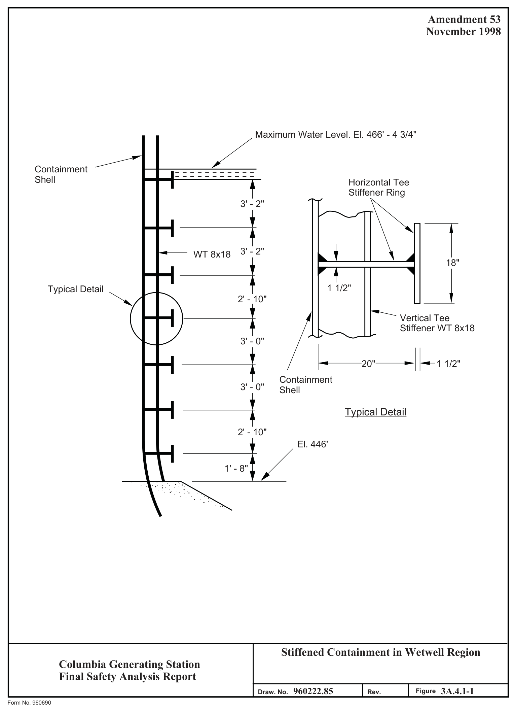

*figure on PDF page 1119*

[Vector original (SVG, lossless): fig_page-1119.svg](../figures/fig_page-1119.svg)

<!-- labels/text on this figure page -->
Amendment 53 November 1998
Maximum Water Level. El. 466' - 4 3/4"
----------- Containment Shell Horizontal Tee Stiffener Ring 3' - 2"
3' - 2" WT 8x18 18"
1 1/2" Typical Detail 2' - 10"
Vertical Tee Stiffener WT 8x18 3' - 0"
20" 1 1/2" Containment 3' - 0" Shell
Typical Detail
2' - 10" El. 446'
1' - 8"
Stiffened Containment in Wetwell Region Columbia Generating Station Final Safety Analysis Report 960222.85 3A.4.1-1 Draw. No.
Rev. Figure Form No. 960690

<!-- p.1120 -->
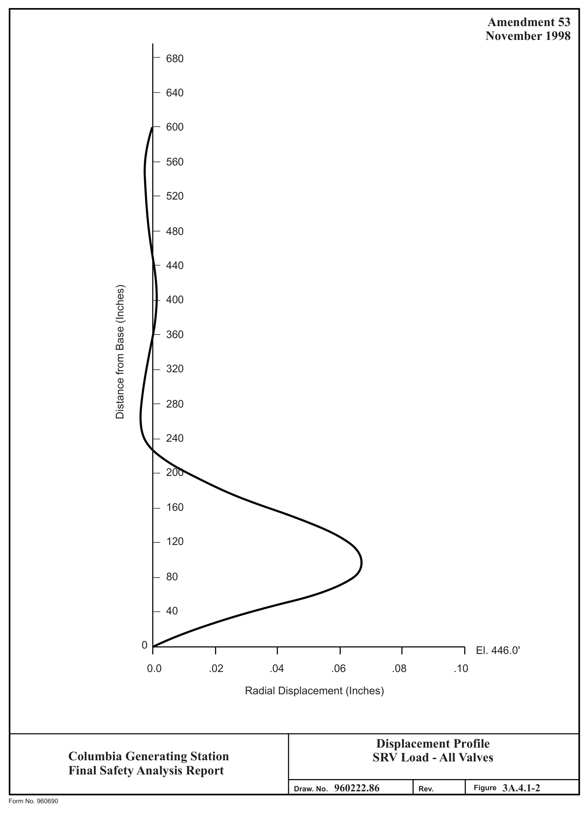

*figure on PDF page 1120*

[Vector original (SVG, lossless): fig_page-1120.svg](../figures/fig_page-1120.svg)

<!-- labels/text on this figure page -->
Amendment 53 November 1998
680
640
600
560
520
480
440
Distance from Base (Inches)
400
360
320
280
240
200
160
120
80
40
0 El. 446.0' 0.0 .02 .04 .06 .08 .10
Radial Displacement (Inches)
Displacement Profile Columbia Generating Station SRV Load - All Valves Final Safety Analysis Report 960222.86 3A.4.1-2 Draw. No.
Rev. Figure Form No. 960690

<!-- p.1121 -->
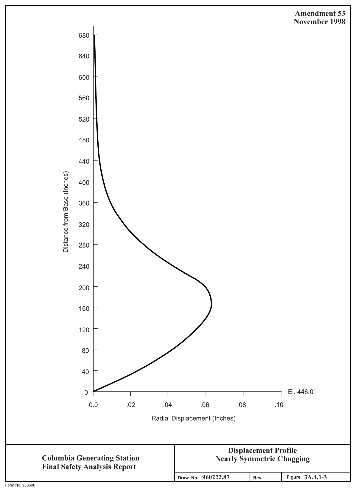

*figure on PDF page 1121*

[Vector original (SVG, lossless): fig_page-1121.svg](../figures/fig_page-1121.svg)

<!-- labels/text on this figure page -->
Amendment 53 November 1998
680
640
600
560
520
480
440
Distance from Base (Inches)
400
360
320
280
240
200
160
120
80
40
El. 446.0' 0 0.0 .02 .04 .06 .08 .10
Radial Displacement (Inches)
Displacement Profile Columbia Generating Station Nearly Symmetric Chugging Final Safety Analysis Report 960222.87 3A.4.1-3 Draw. No.
Rev. Figure Form No. 960690

<!-- p.1122 -->
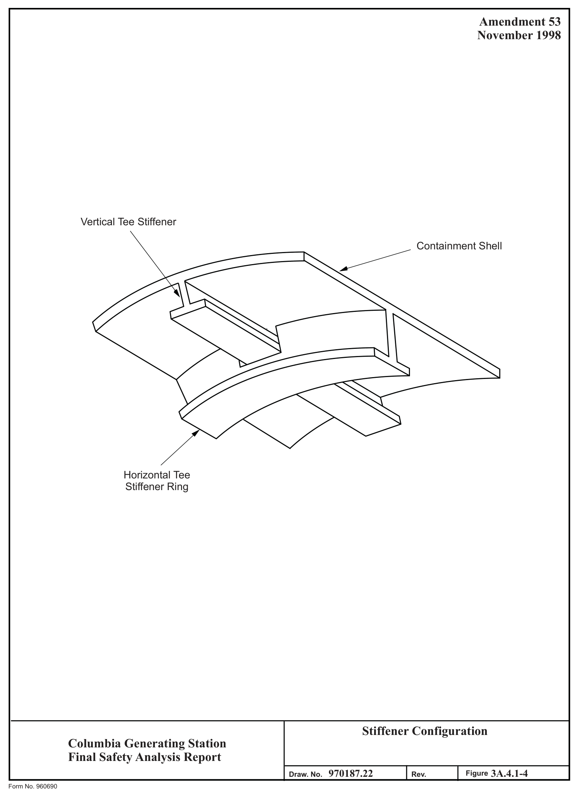

*figure on PDF page 1122*

[Vector original (SVG, lossless): fig_page-1122.svg](../figures/fig_page-1122.svg)

<!-- labels/text on this figure page -->
Amendment 53 November 1998
Vertical Tee Stiffener
Containment Shell
Horizontal Tee Stiffener Ring
Stiffener Configuration Columbia Generating Station Final Safety Analysis Report 970187.22 3A.4.1-4 Draw. No.
Rev. Figure Form No. 960690

<!-- p.1123 -->
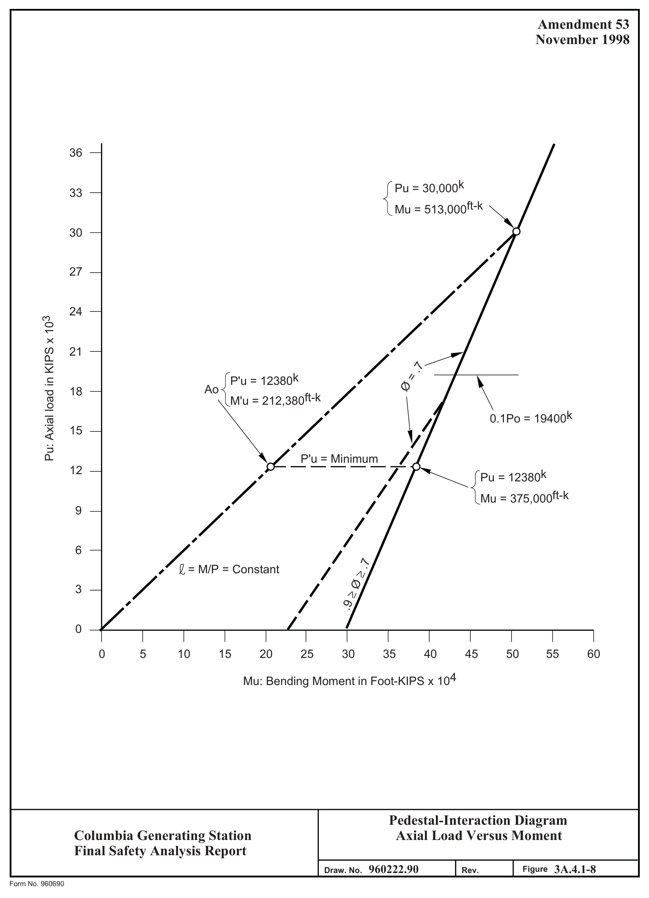

*figure on PDF page 1123*

[Vector original (SVG, lossless): fig_page-1123.svg](../figures/fig_page-1123.svg)

<!-- labels/text on this figure page -->
Amendment 53 November 1998
36 { Pu = 30,000k 33 ft-k Mu = 513,000
30
27
24 Pu: Axial load in KIPS x 103 21 Ø = .7 P'u = 12380k Ao 18 M'u = 212,380ft-k 0.1Po = 19400k 15
P'u = Minimum { 12 Pu = 12380k Mu = 375,000ft-k 9
6 .9 ≥ Ø ≥ .7 = M/P = Constant 3
0
0 5 10 15 20 25 30 35 40 45 50 55 60
Mu: Bending Moment in Foot-KIPS x 104
Pedestal-Interaction Diagram Axial Load Versus Moment Columbia Generating Station Final Safety Analysis Report 960222.90 3A.4.1-8 Draw. No.
Rev. Figure Form No. 960690

<!-- p.1124 -->

*figure on PDF page 1124*

[Vector original (SVG, lossless): fig_page-1124.svg](../figures/fig_page-1124.svg)

<!-- labels/text on this figure page -->
Amendment 53 November 1998
R = 40' - 5 9/16"
Cover P L
Jet Deflector P L
Curb PL El. 499' - 6"
1 2' - 0" j Male Shear Lug
Continuous PL Female Shear Lug
Containment W 36 Vessel Shell Radial Beam 3' - 0 3/4"
Diaphragm Floor Seal El. 493' - 5"
2" Drain
R = 41' - 6"
Drywell Diaphragm Floor Seal Columbia Generating Station Final Safety Analysis Report 960222.88 3A.4.1-9 Draw. No.
Rev. Figure Form No. 960690

<!-- p.1125 -->

*figure on PDF page 1125*

[Vector original (SVG, lossless): fig_page-1125.svg](../figures/fig_page-1125.svg)

<!-- labels/text on this figure page -->
Amendment 55 May 2001
Diaphragm Floor Seal
Weldolet Welding Fitting
Finite Element Model Diaphragm Floor Seal Columbia Generating Station Final Safety Analysis Report Draw. No. 990578.01 Rev. Figure 3A.4.1-10 Form No. 960690

<!-- p.1126 -->

3A.4.2 SUPPRESSION POOL MAJOR STRUCTURES AND COMPONENTS

Assessment of the capacities of the major structures and components of the suppression pool chamber relative to load combinations involving suppression pool hydrodynamic loads is made in this section. The structures considered are downcomer bracing systems columns, downcomers, SRV piping system, quenchers, and platforms.

3A.4.2.1 Downcomer Bracing System

An assessment was made of the capacity of the original design of the downcomer bracing system relative to load combinations involving suppression pool hydrodynamic loads. It was determined that this original bracing, consisting of a system of radial beams, had inadequate capacity. Consequently, a replacement pipe truss bracing system was designed and installed.
The assessment of the capacity of this pipe truss system relative to the load combinations involving suppression pool hydrodynamic loads is made in this section.

3A.4.2.1.1 Description of System

The pipe truss system of downcomer bracing is shown in Figure 3A.4.2-1. Like the original system, the function served by the pipe truss system is to provide horizontal support for the 102 downcomers, (three of which are capped as discussed in Sections 3A.3.2.1 and 3A.3.2.2)
and the 18 SRV discharge pipes at a level near the lower end of the downcomers.

The pipe truss system consists of a horizontal planar truss located with center line at the same elevation as the original system. The model of the truss used in the structural analysis is shown in Figure 3A.4.2-2. In the truss system, the downcomers and the SRV lines are located at the truss nodes. Structural rings are provided around each downcomer and each SRV pipe for connections by the truss members. The truss members are 4-in. and 6-in. double extra strong steel pipes. Connections of the truss to the RPV pedestal and to the containment vessel are at the same connection points as the original radial beams.

As described in Section 3A.4.2.1.2, the pipe truss system is subjected to both horizontal and vertical loads. Horizontal reactions from the downcomers and from the SRV pipes are applied to the encircling structural rings which form the truss nodes. Horizontal forces applied directly to the truss members are also carried by the members to the truss nodes. By truss actions these horizontal loads are transmitted to the supports at the RPV pedestal and at the containment vessel. The pedestal connection can sustain both radial and circumferential reaction components due to horizontal loading; however, the vessel reaction is circumferential because the connection is free to move radially.

Vertical loadings, due to the various causes listed in Section 3A.4.2.1.2, act directly on the pipe truss system. To carry these vertical loadings, supports are provided against upward and downward motion at each of the downcomers; also the connections to the pedestal and vessel

3A.4.2-1

<!-- p.1127 -->

are restrained vertically. Vertical forces acting on each truss member are carried to its ends at the structural rings, pedestal, or vessel connections. The structural rings around the downcomers are independent of the downcomers but stops are welded to the downcomers to prevent differential vertical motion. The structural rings around the SRV lines are independent of these lines and no restraint against differential vertical motion is provided. Vertical loads from the rings on the downcomers are transmitted by the downcomers to the drywell floor.

3A.4.2.1.2 Loads Used for Assessment

A complete description of all hydrodynamic loads is given in Section 3A.3. In this section only the loads used for the assessment of the bracing system are discussed. Symbols used in this section are defined in Section 3A.3.5.3 in connection with load combinations.

3A.4.2.1.2.1 Safety/Relief Valve Actuation Loads. Safety/relief valve actuation causes horizontal and vertical loading on the bracing system as unbalanced pressures and induced accelerations of supported components occur. The pressures and accelerations acting on the downcomers, the SRV pipe lines, and the bracing members cause the horizontal loading; the vertical loading is due to these actions on the bracing system alone. The spatial distribution of these loads is discussed under Methods of Analysis (Section 3A.4.2.1.4).

Loads due to the SRV pressures and induced accelerations are applied to the bracing system as equivalent static loads. The magnitudes of the loadings from the downcomers and SRV lines are based on analyses of each of these components as described in the assessments of the components in Sections 3A.4.2.3 and 3A.4.2.4 respectively. The pressure loadings on the bracing members proper are equivalent static pressures as defined in Section 3A.3. Reactions due to the pressures on the downcomers, SRV lines, and truss members are applied at the truss nodes.

The forces due to the induced accelerations of the downcomers, SRV lines, and bracing members are obtained by analysis of these structures using the response spectra developed for SRV actuation. These forces from downcomers, SRV lines, and bracing members are also applied as reactions at the truss nodes.

3A.4.2.1.2.2 Loss-of-Coolant Accident Loads. Loss-of-coolant accidents are characterized by several phenomena causing nonconcurrent loadings on the bracing system. The principal nonconcurrent loadings are short-term pool swell pressure and fallback pressure loads and long-term chugging loads. Other significant loads are short-term jet and bubble loads and long-term condensation oscillation loads. Pool swell and fallback are basically vertical motions and generally applied vertical pressures are associated with each. The chugging loads result from lateral forces at the downcomer exits, from horizontal and vertical accelerations induced by building motion, and from chugging pressures on the wetwell components supported by the bracing system. The horizontal accelerations of the downcomers, SRV lines,

3A.4.2-2

<!-- p.1128 -->

and bracing members contribute to the horizontal loading of the bracing, whereas the vertical acceleration of only the bracing members causes vertical loading of the bracing.

a. Pressure due to pool swell

The pool swell pressures acting on the bracing system are determined to be 25 psi upward and 5 psi horizontal including the DLF, applied concurrently;

b. Pressure due to fallback

Fallback pressures acting on the bracing system are determined to be 25 psi downward and 5 psi horizontal including the DLF, applied concurrently;

c. Lateral forces at downcomer exits

The characteristics of these lateral exit loads are described in Section 3A.3.2.4.4. As noted therein, the lateral exit loads are dynamic loads whose amplitude depends on the size of the downcomer and the number of concurrently loaded downcomers. For an assumed number of concurrently loaded downcomers, the axial forces in the members of the bracing system and the reactions at the supports are determined by dynamic analysis of the system.
Determination of the critical number of downcomer exits which are subjected simultaneously to lateral force is described subsequently under Methods of Analysis (Section 3A.4.2.1.4);

d. Induced accelerations due to chugging

The forces due to the induced accelerations of the downcomers, SRV lines, and bracing members are obtained by analyses of these structures using the response spectra developed for chugging action. Forces from these components are applied on the bracing system as reactions at truss nodes;

e. Chugging pressures

Chugging pressures are applied on the members of the bracing system and on the inner row SRV lines as described in Section 3A.3.2.4.3.2. Equivalent static loads constituting the end reactions due to the pressures on these components are applied at the truss nodes; and

f. Other LOCA loads

The other LOCA loads mentioned above are now considered. It is noted that the short-term loads due to LOCA jet and bubble are smaller in magnitude than

3A.4.2-3

<!-- p.1129 -->

the previously considered SRV pressure loads which cannot occur simultaneously with them. Hence, these short-term loads are not controlling.
Similarly, it is determined that the long-term condensation oscillation loads are smaller than loads due to chugging which occur subsequently. Therefore, the condensation oscillation loads also are not controlling.

3A.4.2.1.2.3 Other Significant Loads. Seismic forces represent a significant loading on the bracing system. The forces due to the seismic accelerations of the downcomers, SRV lines, and bracing members are obtained by analysis of these structures using the response spectra developed for OBE and SSE. The forces from downcomers, SRV lines, and bracing members are applied as reactions at the truss nodes.

Dead load of the bracing system and thermal loads are also included in the assessment.
Thermal loads result from temperature change of the bracing system and from reactions on the bracing system from supported piping.

3A.4.2.1.3 Controlling Load Combinations and Acceptance Criteria

The load combinations and acceptance criteria pertinent to the downcomer bracing are those listed in Section 3A.3.5.3. Based on the results of the analysis, it is determined that, for the loading conditions involved, the controlling combinations with associated allowable stresses are those listed below. Only the significant load terms are included.

Service load conditions:

(1) S ≥ D + PSR

Factored load conditions:

(5) 1.6 S ≥ D+TA+EO+PB+PSR

(7) 1.7 S ≥ D+TA+ESS+PB+PSR

Further description as to the loads included in the design loading conditions is presented under Method of Analysis.

3A.4.2.1.4 Method of Analysis

Structurally, the pipe truss downcomer bracing system is treated as a plane truss with respect to horizontal loads and as an assembly of beams with respect to vertical loads. The horizontal planar pipe truss is supported externally at 17 equally spaced points around the pedestal and at an equal number of points at the containment vessel. Prior to the truss analysis, the reactions due to the distributed loads along the downcomers and along the SRV lines and bracing

3A.4.2-4

<!-- p.1130 -->

members are calculated and these reactions are applied directly at the truss nodes. The analysis methods, design loading conditions, and principal results are described below.

3A.4.2.1.4.1 Analysis for Horizontal Loads.

a. The analysis uses the proprietary computer program “Mc Auto STRUDL”.

b. The structural model used in the analysis is shown in Figure 3A.4.2-2. The model represents the actual configuration of the north half of the symmetrical structure except for adjustments along the omitted half structure.

c. The truss and its connections are treated as pin connected so that the truss members carry only axial load.

d. All loads are taken to act at the nodes in the truss analysis. The effect of truss member bending under distributed normal loads is considered in member design where combined axial load and member bending is provided for.

e. The STRUDL analysis furnishes truss member axial loads and reaction components as well as displacements of nodes.

3A.4.2.1.4.2 Analysis for Vertical Loads.

a. Vertical loads on the bracing system, i.e., on bracing members and on rings, are transmitted through bending and shear to supports on the downcomers and at the pedestal and vessel. Combined axial load and member bending is provided for in the design.

b. Downcomers and diaphragm floor are investigated for the resultant vertical loads.

3A.4.2.1.4.3 Design Load Conditions. The spatial distribution, direction, and magnitudes of possibly coincident loads as described below are used in the controlling load combinations;
two critical loading conditions are adopted as a conservative basis of design. By these loading conditions it is intended to maximize stresses and reactions in specific portions of the half-structure. These critical stresses and reactions are then utilized to design all similar members and supports around the entire structure. The two conditions utilized in the design are noted below.

a. Condition 1: Maximum Horizontal Loading

This loading is intended to result in greatest stresses in the members and supports in the vicinity of the north-south and east-west axes. The directions of

3A.4.2-5

<!-- p.1131 -->

building motions and applied pressures and loads are selected so as to maximize overall loading in the south to north and west to east directions. (Refer to truss layout in Figure 3A.4.2-2.) Associated vertical loads are also included.

1. SRV actuation

a) Building motions due to all valve actuation and due to single valve actuation are considered. The building motions cause reactions at all downcomers and SRV lines and accelerations of all truss members. Radial forces and accelerations are directed outward; circumferential forces and accelerations are clockwise.
Reactions of downcomers, SRV lines, and members act on the truss nodes.

b) Unbalanced pressures due to all valve and single valve actuation are included. Varying pressures depending on distance from the active nodes are applied to all downcomers, SRV lines, and bracing members. The resulting reactions from these components act at the truss nodes. The direction of reactions from downcomers and SRV lines is generally along the line from the active node to the structure. For the bracing member, the pressures and reactions are normal to the bracing member.

c) Vertical loads on the pipe truss are due to dead load, building motion induced acceleration, and unbalanced pressure.

2. Long-term LOCA loads (chugging)

a) In the analysis, the number of downcomers subjected to lateral exit loads is varied from one to all 51 downcomers in the model structure. Two directions of load application are considered:
south to north and west to east. It is determined that controlling effects are always due to loading of a single vent. In this regard it is noted that the lateral load definition in Section 3A.3.2.4.4 provides a high intensity load for single vent loading as compared to multiple vent loading.

b) Building motion due to chugging causes reactions at all downcomers and SRV lines and accelerations of all truss members. Radial forces and accelerations are directed outward;
circumferential forces and accelerations are clockwise. Reactions of the downcomers, SRV lines, and truss members act on the truss nodes.

3A.4.2-6

<!-- p.1132 -->

c) Chugging pressures on the interior SRV lines result in radially outward reactions applied at the truss nodes.

d) Vertical loads on bracing members are due to building motion induced accelerations and chugging pressure. In addition, inclination of bracing members during LOCA caused by downcomer temperature growth results in vertical component of member axial force as an additional reaction on the downcomer.

3. Seismic

a) Eastward, northward, and vertical seismic actions are included.
Both OBE and SSE are considered.

b) In west-east seismic action, all downcomers and SRV lines react against the bracing towards the east. All bracing members have accelerations eastward. Corresponding northward effects result from south-north seismic action.

c) Vertical loads on bracing members are due to vertical accelerations;

b. Condition 2: Maximum Vertical Loading

The vertical loads associated with Condition 1 which involve controlling horizontal loads have been previously stated. To determine the maximum vertical loading, short-term LOCA events are investigated. Loads included under Condition 2 are described below.

1. SRV actuation

The acceleration and pressure loads due to single valve actuation are included.

2. Pool swell or fallback

The vertical statically equivalent pressures due to pool swell or fallback are 25 psi on pipe truss members and on truss rings at downcomers and SRV lines.

3A.4.2-7

<!-- p.1133 -->

3. Seismic

Horizontal and vertical loadings are the same as described above for Condition l.

4. Additional DBA effects

Inclination of bracing members during DBA caused by downcomer temperature growth results in a vertical component of member axial force as an additional reaction on the downcomers. Also, building motion results in vertical acceleration of the bracing members.
However, this acceleration has relatively small magnitude.

5. Coincident member axial loads

Such axial loads are caused by single SRV actuation and by seismic loading.

3A.4.2.1.5 Results and Design Margin

The principal results of the analysis and the resultant design margins are stated below.

3A.4.2.1.5.1 Principal Results.

a. Bracing members

These members are designed for combined stress involving axial force and biaxial bending. Members connecting to the pedestal are 6-in. double extra strong steel pipe; all other members are 4-in. double extra strong steel pipe;

b. Node rings

These rings are designed for a combination of radial loads which is conservative based on the design loading conditions. As a result of this analysis, built-up H-sections 5 in. wide by 7 in. high at the downcomers and 4 in. wide by 6 in.
high at the SRV lines are used. Material is high strength structural steel
(ASTM A 572, Fy = 60 k.s.i.);

3A.4.2-8

<!-- p.1134 -->
c. Pedestal connections

The existing embedded plates for the original radial beam system are utilized in the pipe truss system. Additional strengthening was installed based on the design loading conditions. Six concrete anchors were added at each pedestal connection; and

d. Containment vessel connection

The pipe truss end bearing at the containment vessel fits into the existing socket provided for the original radial beams. The containment vessel redesign includes the reactions due to the downcomer bracing design loading conditions.

3A.4.2.1.5.2 Design Margins. The design margins provided by the pipe truss bracing system are discussed in this section. The design margin for a structural component or system refers to the controlling design parameter such as bending stress for a flexural member and sum of the amplified stress ratios for the case of combined axial and bending stress. The design margin is then defined as the ratio of the permissible value of the design parameter to the value of the design parameter under design loading.

Table 3A.4.2-1 lists the controlling design margins for each of the six principal structural components of the pipe truss bracing system, namely, 6-in. pipe members, 4-in. pipe members, pedestal connection, vessel connection, downcomer ring, and SRV line ring. The calculated design margins are listed in the table for the cases of maximum horizontal or vertical loading (Conditions 1 or 2), under both service load and factored load conditions.

3A.4.2.2 Columns

The assessment of the capacity of the columns relative to load combinations involving suppression pool hydrodynamic loads is presented in this section. The columns and adjoining structures are shown in Figure 3A.4.2-3.

3A.4.2.2.1 Loads Used for Assessment

A complete description of all hydrodynamic loads is given in Section 3A.3. Seismic loads are described in Section 3A.3.5. In this section, only the loads used for the assessment of the columns are discussed. Symbols used in this section are defined in Section 3A.3.5.2 in connection with load combinations.

3A.4.2.2.1.1 Safety/Relief Valve Actuation Loads. Actuation of the SRVs results in four different load effects on the columns. These are unbalanced bubble pressure on the columns, column accelerations associated with resultant building motions, quencher discharge water jet loads, and secondary effects from pressure loading of the downcomer bracing truss.

3A.4.2-9

<!-- p.1135 -->
April 2000

Maximum bubble pressures applied laterally on the column are defined for two cases, namely, initial actuation and subsequent actuation. The spatial distributions of the maximum pressure loading on the column corresponding to these two cases are shown in Figure 3A.3.1-8. The DLFs associated with these maximum pressure loadings are functions of the column modal frequencies as shown in Figure 3A.3.1-10. The maximum dynamic column reactor loads for the subsequent actuation load case are documented by Reference 3A.3.1-9 and are tabulated in Table 3A.4.2-2. The structural model used for the dynamic analysis of the column under lateral load is described in Section 3A.4.2.2.3 and shown in Figure 3A.4.2-4.

The horizontal and vertical accelerations due to building motion are based on the response spectra developed for SRV actuation in Section 3A.5.1. The horizontal (lateral) accelerations are used in the dynamic analysis of the column by the response spectrum method in conjunction with the structural model described in Section 3A.4.2.2.3 and shown in Figure 3A.4.2-4. The axial (vertical) forces in the column are obtained from the vertical response spectra by a dynamic analysis by the response spectrum method; a structural model, which includes both the diaphragm floor beam and the column, is used and is shown in Figure 3A.4.2-5.

The quencher jet drag load on the column is small in comparison with the bubble load. Since the two loadings do not occur simultaneously, the jet loading is not a controlling loading. The direct vertical pressure loading on the downcomer bracing members is transmitted into the diaphragm floor by the downcomers. The diaphragm floor in turn loads the column. The net loading on the column during the phase of maximum bubble pressure on the column is small and is included in the assessment.

3A.4.2.2.1.2 Loss-of-Coolant Accident Loads. Both short-term and long-term LOCA loads are significant in the assessment of the columns.

Several axial loads on the columns due to short-term LOCA events are considered in the analysis. The overall pressure transient in the drywell and wetwell results in a net downward pressure (20.55 psi equivalent static) on the diaphragm floor and hence an axial compressive column load. The design net upward pressure (5.50 psi) on the diaphragm floor during the pool swell transient causes an upward load on the columns. During LOCA, vertical pressures act on the downcomer bracing system due to bubble charging and due to pool swell and fallback. The resultant vertical forces are transmitted via the downcomers and the diaphragm floor into the columns. However, these forces are not controlling in comparison with the aforementioned net downward and upward pressures on the diaphragm floor. In addition to the pressure loads, the load on the column, due to pipe break/jet impingement on the diaphragm floor, is included in the assessment.

The significant lateral loads associated with LOCA, which are included in the column assessment, are those due to chugging. Lateral loads due to water clearing and due to air

3A.4.2-10

<!-- p.1136 -->

clearing are negligible. The loads due to condensation oscillation are less critical than those due to chugging, and consequently, are omitted from the assessment. The effects of chugging include both direct horizontal pressures on the columns and induced horizontal and vertical accelerations associated with building motions, but only the effects due to building accelerations are significant.

The horizontal and vertical accelerations due to chugging are based on the response spectra described in Section 3A.5.2. Column loading is then developed by dynamic analysis of the column by the response spectrum method in the manner described above for SRV induced building motion. The analysis for horizontal loading uses the structural model of Figure 3A.4.2-4, and the analysis for vertical loading uses the structural model of Figure 3A.4.2-5.

3A.4.2.2.1.3 Other Significant Loads. Dead load, live load, seismic loads, and loads due to annulus pressurization constitute additional significant loads included in the column analysis.
The dead load of the diaphragm floor and columns is carried as an axial column load. The live load on the diaphragm floor is transmitted to the columns as an axial load. Horizontal and vertical column loadings are obtained from the seismic response spectra in the same manner as described above for the SRV and LOCA response spectra.

Pressurization of the annulus between the RPV and the sacrificial shield wall, due to a postulated break in either the circulation line or the feedwater line, as described in 6.2.1.2 of the FSAR, results in building motions with associated response spectra. Horizontal and vertical column loadings are obtained from the response spectra in the same manner as described above for the SRV and LOCA response spectra.

3A.4.2.2.2 Applicable Load Combinations and Acceptance Criteria

The load combinations and acceptance criteria for internal reinforced-concrete structures described in Section 3A.3.5.2 are applicable to the columns.

3A.4.2.2.3 Method of Analysis

The structural capacity of the column is investigated for the applicable load combinations with loads as listed above. The general approach in the column assessment is to determine the values of the controlling stress resultants in the column (bending moment, axial force, and shear) on the basis of elastic analysis under design loads and to calculate the capacity of the column in terms of these stress resultants by the strength method of the ACI 318-71 Code
(Reference 3A.4.1-5). Three loading cases are investigated. Because of the shape of the column interaction curve for bending and axial load, maximum bending in the column is checked first with minimum coincident axial load and then with maximum coincident axial load. The third loading case involves maximum shears.

3A.4.2-11

<!-- p.1137 -->

The moments, shears, and axial forces are obtained for each of the significant loads. The column is analyzed dynamically via a modal time-history technique (Reference 3A.3.1-9) for the directly applied SRV pressures and for the loads due to the building motion accelerations as defined by the SRV chugging, seismic, and annulus pressurization response spectra; dynamic analysis is by the response spectrum method. In the analysis, the column is treated as fixed at its base and simply supported at its top in accordance with actual construction. For the dynamic analysis under lateral (horizontal) loading, the actual structure is modeled as a 17-node beam as shown in Figure 3A.4.2-4. Masses are lumped at the nodes with additional mass provided below pool level to account for the effect of the suppression pool. The axial
(vertical) column forces are determined by the dynamic analysis using a structural model which represents the diaphragm floor beam - column system. As shown in Figure 3A.4.2-5, the diaphragm floor mass is included in 26 nodes along the beam and the column mass is 14 nodes along the column. Dynamic analysis for lateral loads and for vertical loads are made using the commercial computer programs STRUDL and IMAGES-3D.

The critical locations along the column for bending moment and shear are determined from the analysis results. Maximum bending moments and shear occur at the column base. The magnitude of the horizontal shear at the top of the column is also noted to verify the adequacy of the top connection. The values of the controlling bending moments, shears, and axial force are listed for each significant loading in Table 3A.4.2-2.

a. Maximum bending moment with minimum axial load

It is determined that the controlling values of maximum bending moment with coincident minimum axial load occur for load combination (1). This combination is stated below for minimum axial load with only the significant load terms listed.

(1) 1.0 D + 1.5 PSR

The maximum bending moment is caused by the direct lateral pressure on the column, due to SRV subsequent actuation, and the associated horizontal building motion acceleration. The coincident minimum compression axial load occurs with dead load (D) and upward load due to the vertical building motion acceleration caused by the SRV actuation (PSR). The controlling values of bending moment and axial load are 17.67 ft kips and 173.3 kips (compression), respectively.

The column capacity for combined loading and axial load is determined in accordance with the strength design method of the ACI 318-71 Code
(Reference 3A.4.1-5). From the applicable interaction curves, the bending moment capacity of the column, with the above axial load of 173.3 kips, is found to be 2182.0 ft kips;

3A.4.2-12

<!-- p.1138 -->

b. Maximum bending moment with maximum axial load

The controlling coincident values of bending moment and axial load occur for load combination (1). This combination is stated below for maximum axial load with only the significant load terms listed.

(1) 1.4 D + 1.7 L + 1.5 PSR

The maximum bending moment is caused by SRV subsequent actuation as in
(a) above. The coincident maximum compressive axial load is due to dead load
(D), live load (L), and downward load due to the SRV actuated building motion
(PSR). The controlling value of the axial load is 745.2 kips. As a result of moment magnification due to the axial load, the controlling value of the bending moment is increased from 1700 ft kips to 1869 ft kips. Utilizing the column interaction curves, the bending moment capacity is found to be 2230.5 ft kips;

c. Maximum shear

As noted previously, maximum column shear occurs at the column base.
Column shear capacity is affected by the axial force at the section. The controlling load combination for column shear is load combination (1) which is stated below for minimum axial load with only the significant loads listed.

(1) 1.0 D + 1.5 PSR

The maximum shear is caused by the same event as in (a) above, namely, SRV subsequent actuation (PSR). The coincident minimum compressive axial load occurs with dead load (D) and SRV actuation (PSR). The controlling values of shear and axial load are 142.4 kips and 173.3 kips (compression), respectively.
Utilizing the strength design method of the ACI 318-71 Code
(Reference 3A.4.1-5), the column shear capacity is calculated to be 376.9 kips;
and

d. Column top shear connection

The controlling top horizontal reaction in relation to the capacity of the top connection in shear occurs with load combination (1) with minimum axial
(compressive) load. This combination is stated below.

(1) 1.0 D + 1.5 PSR

3A.4.2-13

<!-- p.1139 -->

The top horizontal reaction is caused in this case by SRV initial actuation (PSR);
its magnitude is 62.1 kips.

The shear capacity of the top connection is due to shear friction associated with the connecting anchor bolts and the superimposed axial load. Conservatively, the superimposed load is due to dead load (D) reduced by the upward load due to SRV actuation (PSR). Utilizing the strength design method of the ACI 318-71 Code (Reference 3A.4.1-5), the shear capacity of the top connection is 75.5 kips.

3A.4.2.2.4 Results and Design Margins

It is determined that the columns have adequate capacity with regard to the applicable load combinations involving suppression pool hydrodynamic loads. The design margins with respect to the significant stress resultants are noted below:

a. Maximum bending moment with minimum axial load - The smallest design margin representing the ratio of column bending capacity to applied bending moment, with minimum axial load, is 1.54;

b. Maximum bending moment with maximum axial load - The smallest design margin representing the ratio of column bending capacity to applied bending moment, with maximum axial load, is 1.49;

c. Maximum column shear - The smallest design margin representing the ratio of the column shear capacity to the applied shear is 3.23; and

d. Column top shear connection - The smallest design margin representing the ratio of the capacity of the column top connection in shear to the applied top shear is
1.18.

3A.4.2.3 Downcomers

The primary function of the downcomer vent system is to channel the steam accumulating in the drywell chamber during a LOCA into the wetwell chamber to accomplish pressure suppression (see Section 3A.3.2.1).

The downcomer vent system consists of eighty-three 24-in. OD and sixteen 28-in. OD standard schedule carbon steel pipes running vertically downward from the diaphragm floor
(except that the ends of the downcomers are stainless steel as described in FSAR Section 3.8.3.4). Originally 102 downcomers were provided, but three (one 24-in. and two 28-in.) were capped, as discussed in Sections 3A.3.2.1 and 3A.3.2.2. The downcomers are embedded in the diaphragm floor and extend down to el. 454 ft 4.75 in. All downcomers

3A.4.2-14

<!-- p.1140 -->
are restrained laterally at el. 455 ft 4 in. by the downcomer bracing system, which is vertically restrained by the downcomers. Vertical loads are imposed by the bracing system onto the downcomers and transmitted to the diaphragm floor. (See Figures 3A.2.1-5 and 3A.2.1-6.)

Nine of the 24-in. OD downcomers have an extra strong welding tee at el. 491 ft 11 in. to accommodate 24-in. dual inline vacuum breaker valves. In addition, to provide extra strength, the eighteen 28-in. downcomers have been stiffened by the insertion of a 4-ft 8-in. long by 2-in. thick spool piece. This piece accommodates the penetration for the main steam SRV
(MSRV) piping which is welded to these downcomers at el. 493 ft 0 in.

Figure 3A.2.1-4 shows locations where the vacuum breaker valve assemblies and the MSRV piping penetrate the downcomers just below the diaphragm floor.

3A.4.2.3.1 Loads Used for Assessment

The downcomer piping is subjected to static, dynamic, and hydrodynamic loads under the various plant operating conditions identified as normal, upset, emergency, and faulted. Each of these loads in various combinations is identified in Section 3A.3.5.4.

The individual loads acting on the downcomers are identified below:

a. Deadweight (W)

b. Thermal expansion and thermal transient

c. Pressure (P)

The pressure differential between the drywell and suppression chamber atmospheres produces loads on the downcomer walls since it acts as a pressure retaining boundary during a LOCA.

d. OBE

e. SSE

f. SRV discharge dynamic loads

The spatial distribution of the maximum direct bubble pressure loading used for downcomer assessment was obtained by multiplying a dynamic pressure load
(Figure 3A.3.1-7) by the maximum DLF.

A maximum DLF of 4.2 was conservatively obtained from the response spectrum of DLFs shown in Figure 3A.3.1-10.

3A.4.2-15

<!-- p.1141 -->

The inertia loading effects due to the acceleration of the structure are described in Section 3A.5.1. The response spectra used for downcomer assessment are the enveloped spectra which were developed by enveloping the spectra due to four SRV actuation cases at the appropriate locations for the downcomers.

g. LOCA loads

The loads on the downcomer associated with LOCA are chugging pressure, condensation oscillation pressure, and the building response loading during LOCA event.

The spatial distribution of condensation oscillation and chugging pressure loadings on downcomers are considered as equivalent static pressure loads.

The pressure distribution for the condensation oscillation on downcomers is bounded by chugging load and therefore is not a controlling load.

The LOCA jet, LOCA bubble, pool swell, and fallback loads are identified to be negligible on downcomers as described in Section 3A.3.2, hence, these loads are not considered in downcomer analysis.

The input response spectra for chugging and condensation oscillation are based on the spectra described in Section 3A.5.2 and are enveloped in the same manner as described in the previous section for SRV load.

3A.4.2.3.2 Load Combination and Acceptance Criteria

The resultant stresses experienced by the downcomers are considered acceptable if they satisfy the ASME Boiler and Pressure Code, Section III, Subsection NC (Reference 3A.4.2-1).

The allowable stress “Sh” for both the 24-in. and 28-in. OD downcomers is 15,000 psi. This value was obtained from the tabulated values in Section III, Attachment 3A.I for “Sh” at a design temperature of 340°F, for carbon steel SA 155 KCF 70 and SA 106, GR.C.

Allowable Stress Limits (Equation 9 of NC-3652 and NC-3611, Reference 3A.4.2-1)

The stress includes the primary membrane plus the primary bending stresses. The limits of these stresses depend on the loading conditions as follows :

a. The limit of stress under the upset condition is 1.2Sh = 18,000 psi, b. The limit of stress under the emergency condition is 1.8Sh = 27,000 psi, and c. The limit of stress under the faulted condition is 2.4Sh = 35,000 psi.

3A.4.2-16

<!-- p.1142 -->

3A.4.2.3.3 Method of Analysis

Downcomers were analyzed for the appropriate loading combination using the computer program ADLPIPE (Attachment 3A.F).

The mathematical model for the downcomer is a vertical pipe anchored at the underside of the drywell floor and guided at the downcomer bracing system. The inertia effect of water surrounding the submerged portion of the downcomer was obtained by the addition of a virtual mass of water distributed along the submerged portion. The mass of water inside the submerged portion of the downcomers was conservatively considered in the model for all dynamic loadings. The SRV discharge lines were incorporated in the model of the 28-in. downcomer.

3A.4.2.3.3.1 Static Analysis. Static analysis techniques were used to determine the stresses due to dead weight, internal pressure, thermal and hydrodynamic loads using an equivalent static pressure load, or an appropriate DLF, as shown in Figure 3A.3.1-10.

3A.4.2.3.3.2 Response Spectrum Analysis. The response spectrum method of analysis was performed, for seismic and hydrodynamic loads, using the ADLPIPE program. Modal responses were combined in accordance with Regulatory Guide 1.92 while damping values were selected per Regulatory Guide 1.61.

Spatial components were combined by the SRSS method, with the exception of seismic which used the higher of the absolute sum of (a) north-south and vertical or (b) east-west and vertical
(see Section 3.7 of the FSAR).

3A.4.2.3.4 Results and Design Margin

The downcomers were analyzed for all load combinations described in Section 3A.3.5.4. The stresses in the 24-in. OD and 23-in. OD downcomers pipe show that they are structurally adequate for all plant operating conditions. The design margins for the 24-in. and 28-in.
downcomers in each criteria category are summarized below. The lowest design margin is shown to be 1.08.

24-in. Downcomer

Acceptance Criteria From Allowable Calculated Design Table 3A.3.5-5 Stress Stress Margin

Upset 18,000 15,513 1.16 Emergency 27,000 15,709 1.72 Faulted 36,000 18,810 1.91

3A.4.2-17

<!-- p.1143 -->

28-in. Downcomer

Acceptance Criteria From Allowable Calculated Design Table 3A.3.5-5 Stress Stress Margin

Upset 18,000 16,654 1.08 Emergency 27,000 16,744 1.61 Faults 36,000 18,371 1.96

Design margin is defined as follows:

DM = Allowable Stress Calculated Stress

3A.4.2.3.5 Fatigue Evaluations

The fatigue evaluation presented below was an NRC request and is not an ASME requirement.

The fatigue evaluation of 24-in. and 28-in. downcomer lines in the wetwell air volume was performed using ASME Section III, Class 1 rules (NB-3600). A governing loading scenario, based on the DFFR (Reference 3A.3.2-1), was developed. The loadings which were evaluated are:

a. Internal pressure, b. Thermal expansion and transients, c. Seismic, d. Pressure differential effects between drywell and suppression chamber, e. SRV pool load and building response, and f. Chugging pool load and building response.

Equivalent numbers of fatigue cycles were determined for dynamic loads. The 24-in. and 28-in. downcomers were analyzed for the appropriate load combinations and their associated number of cycles as presented in Table 3A.4.1-3. The combined stresses and corresponding equivalent stress cycles were computed to obtain the fatigue usage factor. The maximum fatigue usage factor for both downcomers are presented in Tables 3A.4.2-4 and 3A.4.2-5.

3A.4.2.4 Safety/Relief Valve Piping Systems

The MSRV piping in the suppression chamber consists of 18 independent piping systems, each comprised of 10-in. and 19-in. OD Schedule 80 carbon steel pipe. The wetwell portion of each SRV piping system in the wetwell originates from a 28-in. downcomer (anchor point),

3A.4.2-18

<!-- p.1144 -->

which penetrates at el. 493 ft 0 in., and then runs horizontally for a sufficient length to provide enough thermal flexibility. The horizontal run also allows the quenchers to be distributed evenly about the suppression pool. The piping then drops vertically downward to the quencher body which is bolted to the quencher support at el. 447 ft 0 in. The quencher support is modeled as an integral part of the SRV piping system and as such has flexibility taken into account. A schematic showing a typical SRV piping layout is shown in Figure 3A.4.2-6.
Lateral guides are provided at the downcomer bracing.

3A.4.2.4.1 Loads Used for Assessment

The SRV piping systems are subjected to static, dynamic, and hydrodynamic loads due to normal, upset, emergency, and faulted plant operating conditions. The loading cases and combinations are described in Section 3A.3.5.4.

The hydrodynamic loads resulting in significant effects on the SRV piping are listed below.
For a description of these loads see Section 3A.4.2.3.1.

a. Deadweight (w), b. Thermal, c. Pressure (P), d. OBE, e. SSE, f. SRV pressure (Figure 3A.3.1-9), g. SRV building response, h. SRV blowdown, i. LOCA jet (Figure 3A.3.2-18 and Table 3A.3.2-8), j. LOCA bubble (Figure 3A.3.2-18 and Table 3A.3.2-8), k. Chugging drag (Figure 3A.3.2-19), and l. Chugging building response.

The SRV pressure used in the analysis is applied in the same manner as described in Section 3A.4.2.3.1 for the downcomers. The building response loads are based on the spectra described in Section 3A.5.

3A.4.2.4.2 Load Combination and Acceptance Criteria

The stresses within the SRV piping are acceptable if they satisfy the ASME Boiler and Pressure Vessel Code, Subsection NC. The allowable stress “Sh” used for primary stress evaluation is 15,000 psi. This value was obtained from the tabulated values in Section III, Attachment 3A.I for “Sh” at a design temperature of 475°F for carbon steel.

3A.4.2-19

<!-- p.1145 -->

3A.4.2.4.3 Allowable Stress Limits (Equation 9 of NC-3652 and NC-3611, Reference 3A.4.2-1)

The stress for the SRV piping includes the primary membrane plus the primary bending stresses. The limits of these stresses depend on the loading conditions as follows:

a. The limit of stress under the upset condition is 1.2Sh = 18,000 psi, b. The limit of stress under the emergency condition is 1.8Sh = 27,000 psi, and c. The limit of stress under the faulted condition is 2.4Sh = 36,000 psi.

3A.4.2.4.4 Method of Analysis

The SRV piping was analyzed for the appropriate loading combinations (Table 3A.3.5-5) using the computer programs ADLPIPE and ANSYS (Attachment 3A.F). Analysis was performed for all 18 SRV lines. The quencher towers were included in the piping models to account for quencher tower flexibility. The inertial effects of water were accounted for in the same matter as described in Section 3A.4.2.3.3. Analysis results are summarized in Section 3A.4.2.4.5.

3A.4.2.4.4.1 Static Analysis. Static analysis techniques were used to determine the stresses due to dead weight, internal pressure, thermal and hydrodynamic loads using an equivalent static pressure load or an appropriate DLF, as shown in Figure 3A.3.1-10.

3A.4.2.4.4.2 Response Spectrum Analysis. The ADLPIPE program was utilized to perform dynamic response spectra analyses. Modal responses were combined in accordance with Regulatory Guide 1.92 while damping values were selected per Regulatory Guide 1.61.

3A.4.2.4.4.3 Time History Analysis. The ANSYS program was utilized as required for critical SRV lines in order to obtain more realistic piping response for SRV building response loads. For SRV blowdown transient loads, ADLPIPE was used to perform a force time history analysis.

3A.4.2.4.5 Results and Design Margin

The calculated stresses for the design configuration of all SRV piping systems show that the piping is structurally adequate for all plant operating conditions. The maximum calculated stresses and the resulting minimum design margins for the SRV piping systems for the controlling load combinations from Section 3A.3.5.4 are shown below.

3A.4.2-20

<!-- p.1146 -->

Acceptance Criteria from Allowable Calculated Design Table 3A.3.5-5 Stress (psi) Stress (psi) Margin

Upset 18,000 17,206 1.05 Emergency 27,000 17,207 1.57 Faulted 36,000 17,280 2.08

Design margin is defined as follows:

DM = Allowable Stress Calculated Stress

3A.4.2.4.6 Fatigue Evaluations

The fatigue evaluation presented below was an NRC request and is not an ASME requirement.

The fatigue evaluation on all 18 SRV lines in the wetwell air volume was performed using ASME Section III, Class 1 rules (NB-3600). A governing loading scenario, based on the DFFR (Reference 3A.3.2-11), was developed. The loadings which were evaluated are:

a. Internal pressure, b. Thermal expansion and transients, c. Seismic, d. SRV blowdown, e. SRV pool load and building response, and f. Chugging pool load and building response.

Equivalent numbers of fatigue cycles were determined for dynamic loads. All 18 SRV discharge lines in the wetwell region were analyzed for the appropriate load combinations and their associated number of cycles as presented on Table 3A.4.1-3. The combined stresses and corresponding equivalent stress cycles were computed to obtain the fatigue usage factor. The maximum fatigue usage factor for all 18 SRV discharge lines in the wetwell air volume was found to be below ASME allowable limits. The results of the maximum usage factors is presented on Table 3A.4.2-6.

3A.4.2.5 Quencher

Quenchers have been installed on the discharge end of the SRV lines to reduce air clearing loads and to promote effective heat transfer between the suppression pool water and the discharging steam-air mixture during SRV actuation. The quenchers are an integral part of the SRV piping system and are bolted to the quencher support at the base plate. The quencher support assessment is included in the SRV piping system assessment, Section 3A.4.2.4.

3A.4.2-21

<!-- p.1147 -->

3A.4.2.5.1 Loads Used for Assessment

The quenchers, in common with the other piping components, are subjected to static, dynamic, and hydrodynamic loads due to normal, upset, emergency, and faulted plant conditions. The loading cases arc described in Section 3A.3.5.4.

The mechanical loads are from Table 3-16 of the DFFR (Reference 3A.4.2-2) and modified to account for CGS plant specific conditions. The load from DFFR Table 3-16, which are not plant specific, are the quencher arm and body loads arising from the SRV water and air clearing transients. These generic bounding loads are described in the DFFR
(Reference 3A.4.2-2). The other loads on Table 3A.3-16 of the DFFR are modified to account for (a) quencher arm loads caused by the various submerged hydrodynamic loading described in Section 3A.3, and (b) the static and dynamic loads resulting from the SRV piping system analysis described in Section 3A.4.2.4.

3A.4.2.5.2 Load Combination Acceptance Criteria

The assessment of the quenchers for the plant loads is performed in accordance with ASME Section III, Subsection NC (Reference 3A.4.2-1). The code stamp and hydrotest requirements are not applicable since the quencher is not a pressure retaining component. The code jurisdiction ends at the weld between the SRV discharge piping and the quencher inlet nozzle
(12 in. x 24 in. reducer).

3A.4.2.5.3 Evaluation

The quencher body and the quencher arms are examined to determine their adequacy for conditions of loading described above.

The quencher body together with the quencher arms were modeled through finite element program ANSYS. The model uses a quadrilateral shell element which has both bending and membrane capabilities. The element has six degrees of freedom at each node. This element also has an option for variable thickness. The modeled structure is shown in Figures 3A.4.2-7 and 3A.4.2-8.

Element loading capabilities include surface temperatures and pressures. Also, concentrated loads can be applied at each node point. The significant loads affecting quencher body and the quencher arms are

a. The loads arising from the SRV water and air clearing transients,

b. The SRV loads caused by pool velocity and acceleration fields from an adjacent firing quencher, and

3A.4.2-22

<!-- p.1148 -->

c. SRV induced building response loads.

The quencher assembly was analyzed statically with the load vectors related to type of loads as discussed above and for load combinations presented in Section 3A.4.2.5.2. Since the quencher has linear properties the superposition of load combinations was used for evaluation of results.

The calculated stress intensities for the various loading conditions are presented in Table 3A.4.2-3. The tabulated design margins for the governing upset condition indicate the quencher assembly is structurally adequate.

3A.4.2.6 Platforms and Ladders

The assessment of the capacities of the platforms and ladder relative to load combinations involving suppression pool hydrodynamic loads is made in this section.

3A.4.2.6.1 Loads Used for Assessment

Complete description of all hydrodynamic loads has been given in Section 3A.3. The loads used for the assessment of the platforms and ladder are discussed below.

3A.4.2.6.1.1 Safety/Relief Valve Operation Loads. No direct loads on the platforms at el. 472 ft 4 in. and el. 486 ft 8 in. or the ladder between el. 472 ft 4 in. and 490 ft 1 in. result from operation of the SRV system. However, building response to dynamic pressures at the pool boundary during SRV discharge result in dynamic stresses in the platform and ladder components which are supported from the steel containment structure.

3A.4.2.6.1.2 Loss-of-Coolant Accident Loads. As discussed in Section 3A.3.2.3, a LOCA results in pool swell impact and drag loads and fallback drag loads on the platform at el. 472 ft 4 in. and the ladder between el. 472 ft 4 in. and el. 484 ft 4.75 in. Also, the ladder and the knee braces below the platform at el. 472 ft 4 in. are subjected to a horizontal lift load caused by both pool swell and fallback.

Additional LOCA loads include building responses to condensation oscillation and chugging which are obtained from response spectra at tile points of attachment of the platforms and ladder to the containment vessel. Since the condensation oscillation load is bounded by the chugging load, no separate platform assessment has been performed for the condensation oscillation loading condition.

3A.4.2.6.1.3 Other Significant Loads. Other loads which result in significant stresses in the platform and ladder components are dead loads, live loads, and seismic accelerations.

3A.4.2-23

<!-- p.1149 -->

Dead loads include the weights of the platforms and ladder. Live loads include personnel on the platforms and ladder, equipment weights on the platforms, and the monorail loads on the platform at el. 486 ft 8 in. Seismic accelerations are obtained from seismic response spectra at the points of attachment of the platforms and ladder to the containment vessel.

3A.4.2.6.2 Controlling Load Combinations

The load combination criteria for structures internal to the suppression chamber (see Section 3A.3.5.3) are applicable to the platforms and ladder. In particular, the combinations for steel structures using the elastic working stress method are investigated for both service load conditions and factored load conditions.

3A.4.2.6.3 Acceptance Criteria

The acceptable stress level for the platform and ladder components using the elastic working stress method is as defined for the loading combinations in Section 3A.3.5.3.

3A.4.2.6.4 Method of Analysis

Both platforms and the ladder were investigated for the effects of the loading combinations in Section 3A.3.5.3. The components of the platform at el. 472 ft 4 in. and the ladder were analyzed individually, whereas the platform at el. 486 ft 8 in. is above the effects of pool shell and therefore was not reanalyzed. As noted in Section 3A.3.2.3, the grating does not sustain impact loads. Therefore, the only significant load on the grating is the drag load component.
The supporting beams and bracing members were analyzed for drag and lift pool swell/fallback loads. The portion of the ladder between el. 472 ft 4 in. and 404 ft 4.75 in. was analyzed for impact loading on the highest rung in the pool swell region and drag and lift on all rungs below the rung with impact.

3A.4.2.6.5 Results

The governing load combination (5a) for steel structures is given below with corresponding input for the platform at el. 472 ft 4 in. and the portion of the ladder between el. 472 ft 4 in.
and 484 ft 4.75 in.:

(5a) 1.6S ≥ 1.0D+1.0L+1.0Eo+1.0PA+1.0TA+1.RA+1.0PSR

D = 0.10 psi

L = 0

EO = 0.11 psi

3A.4.2-24

<!-- p.1150 -->

PA = 8.4 psi (drag on gross area of grating)

= 25.0 psi (drag on ladder rungs and bracing members)

= 44.0 psi (impact on ladder rungs)

= small (horizontal lift pressure on supporting bars and handrail members)

= 11.0 psi (horizontal lift pressure on bracing members)

= 5.0 psi (horizontal lift pressure on ladder rungs)

= small (impact and drag on supporting bars and handrail members)

TA = 0

RA = 0

PSR = 0.05 psi

where D, L, Eo, PA, TA, RA, and PSR are as defined in Section 3A.3.5.2.

The portion of the ladder between el. 472 ft 4 in. and 484 ft 4.75 in. was found to have sufficient capacity to withstand the governing load combination with a design margin (i.e., ratio of the allowable stress to the maximum absolute calculated stress) of 2.15. However, the existing platform at el. 472 ft 4 in. was found to be deficient (under the above load combination. The critical component is the grating under upward load. To make the grating sufficient, every other bearing bar (instead of every fourth as is in the original design) has been welded to all supporting members including the platform member supporting the ladder.
With this reinforcement a design margin for the grating of 1.80 is attained. Also, two platform members have been reinforced, and the rectangular bracing members have been replaced with circular members. With this reinforcement the critical supporting member has a design margin of 1.18.

3A.4.2.7 References

3A.4.2-1 ASME Boiler and Pressure Vessel Code, Section III, Division 1, Subsection NC, “Class 2 Components,” American Society of Mechanical Engineers, 1971 through Winter 1973 Addenda.*

* Faulted conditions appeared first in Winter 1976 Addenda.

3A.4.2-25

<!-- p.1151 -->

3A.4.2-2 Mark II Containment Dynamic Forcing Functions Information Report (DFFR), NEDO-21061, Revision 2, September 1976.

3A.4.2-26

<!-- p.1152 -->

Table 3A.4.2-1

Downcomer Bracing System Controlling Design Margins

Service Load Factored Load Conditions Conditions Maximum Maximum Maximum Vertical Horizontal Loading Horizontal Loading Loading Component

6 in. D.E.S. pipe
3.45
2.96

4 in. D.E.S. pipe
2.5
1.68

Pedestal connection
2.00
2.02

Vessel connection 5.26
2.75

Downcomer ring
1.92
1.95

SRV line ring
3.39 4.12

Notes:

1. For service load conditions, load combination (1) controls. Only maximum horizontal loading is applicable.

2. For factored load conditions, load combination (5) controls. Only the design margin for the controlling loading is listed.

3A.4.2-27

<!-- p.1153 -->

Table 3A.4.2-2

Controlling Stress Resultants in Column

Axial Forcea (kips)
Shear (kips)

Base Moment
(ft kips) Base Top Base Top

Safety/Relief Valve Actuation ±102.1 ±86.4 All valves initial 771.1 70.2 41.4

1 valve subsequential 1133.0 94.9 48.9 ±37.1 ±37.1

Loss-of-Coolant Accident Chugging 13.5 2.5 1.4 ±11.7 ±10.2

Annulus pressurization 136.4 11.1 6.5 ±6.4 ±5.3

±745.0 ±745.0 Pipe break jet

Pool swell
-172.0 -172.0

Transient pressure difference +642.0 +642.0
(drywell-wetwell)

Seismic Operating basis earthquake 127.1 9.9 5.7 ±31.2 ±27.1

Safe shutdown earthquake 164.2 12.8 7.4 ±46.1 ±39.6

Dead +229.0 +134.0

Live +217.0 +217.0

a Positive axial force is compressive; negative is tensile.

3A.4.2-28

<!-- p.1154 -->

Table 3A.4.2-3

Results Summary - Safety/Relief Valve Quencher

Principal Stress (psi)

Loading Stress Critical Stress Allowable D.M.
1 2 3 Condition Category Intensity (psi) Stress (psi) (1)

Normal 2525 1390 -275 2800 15,978 5.71 Pm 11,092 1204 -275 11,367 23,967 2.11 PL 13,678 1052 0 13,678 47,934 3.50 PL + Q

Upset PL + Q 28,399 6985 0 38,399 47,934 1.25 Pm 4102 535 -275 4377 17,576 4.01

#### PL 13,480 2540 -275 13,755 26,364 1.92
Emerge Pm 3989 1392 -275 4264 23,967 5.62

#### PL 16,964 1711 -275 17,239 28,761 1.67
Fault (1) Pm 3994 1395 -275 4267 31,956 7.48

#### PL 16,982 1712 -275 17,257 38,347 1.99
Fault (2) Pm 3334 1223 -275 3609 31,956 8.85

#### PL 14,738 1633 -275 15,013 33,347 2.55
a Generally the maximum stresses occurs between the quencher arms, where the arms meet the body.

Notes:

1. Design margin is defined as follows:

DM = Allowable Stress Calculated Stress

2. The definition of the above terms is proved in ASME Code Section III, Paragraph NC-3217 of Winter 1976 Addenda.

3A.4.2-29

<!-- p.1155 -->

Calculated Usage Factor 0.0001 0.0001 0.0002 0.0031 0.0311 ni Ni = Ui

Cumulative Usage Factor U= 0.0346 < 1.0 Allowable Number Cumulative Usage Factor Calculation at 24 in. Downcomer Anchor of Cycles 20,000 200,000 300,000 300,000 400,000 N

Alt. Stress 30,058 16,288 13,496 14,422 12,232
(psi) Salt Table 3A.4.2-4 Peak Stress 60,116 32,575 26,991 28,845 24,463
(psi)
Sp

1 - NPC + LOCA + SSE + SRV + CHUGGING Bending Moment 244,008 244,008 202,180 216,065 183,244 lb/ft Mi

a Load combination set definition 2 - SSE + SRV + CHUGGING Cycles (ni) Number of Expected 1 9 50 940 12,434 4 - SRV + CHUGGING 3 - OBE + SRV Combinationa Load Set 5 - SRV 1 2 3 4 5

3A.4.2-30

<!-- p.1156 -->

Calculated Usage Factor 0.0001 0.0001 0.0002 0.0313 0.0311 ni Ni = Ui

Cumulative Usage Factor U= 0.0629 < 1.0 Allowable Number Cumulative Usage Factor Calculation at 28 in. Downcomer Anchor of Cycles 18,000 150,000 200,000 30,000 400,000 N

Alt. Stress 30,781 16,888 14,968 27,161 13,425
(psi) Salt Table 3A.4.2-5 Peak Stress 61,562 33,775 29,937 54,321 26,850
(psi)
Sp

1 - NPC + LOCA + SSE + SRV + CHUGGING Bending Moment 346,771 346,771 307,359 557,714 275,671 lb/ft Mi

a Load combination set definition 2 - SSE + SRV + CHUGGING Cycles (ni) Number of Expected 1 9 50 940 12,434 4 - SRV + CHUGGING 3 - OBE + SRV Combinationa Load Set 5 - SRV 1 2 3 4 5

3A.4.2-31

<!-- p.1157 -->

Table 3A.4.2-6

Maximum Usage Factors Table

First Second Subsequent Total Cumulative Actuation Actuation Actuations Usage Factor

Low set SRV lines 0.626 0.033 0.237 0.896
(MSRV-1C)
(MSRV-1B)

Non-low-set SRV 0.527 0.202 N/A 0.729 lines

3A.4.2-32

<!-- p.1158 -->

*figure on PDF page 1158*

[Vector original (SVG, lossless): fig_page-1158.svg](../figures/fig_page-1158.svg)

<!-- labels/text on this figure page -->
Amendment 53 November 1998
42 34 88 97 Typical Joint At Containment 79 Typical Column 70 93 84 41 106 38 46 102 75 0 50 Typical Member Number 212 115 213 0 Typical Downcomer 33 49 26 210 66 111 208 Typical Node Number 61 96 78 87 441 92 30 69 433 54 211 209 105 52 57 74 110 120 83 91 40 45 101 73 37 58 114 124 60 48 25 32 57 56 65 109 133 129 72 77 82 90 48 86 51 29 53 95 123 100 214 457 55 68 64 119 104 108 43 216 19 62 22 128 113 81 89 56 24 59 39 71 36 44 99 222 42 118 132 54 127 31 47 47 39 223 63 107 34 138 50 207 122 444 52 28 117 53 61 206 21 80 85 126 67 46 205 418 2 98 18 65 142 103 220 2 55 41 23 1 137 37 131 38 141 423 62 66 45 125 33 217 116 49 147 Typical SRV Line 136 36 465 151 17 60 30 64 20 146 43 35 121 135 140 32 35 130 51 219 44 145 218 29 27 224 70 14 28 63 16 150 North 134 144 24 25 31 59 0° 143 204 463 27 69 11 13 225 23 203 149 15 156 21 Y 26 16 68 19 12 148 410 155 18 RPV Pedestal 202 20 67 154 153 17 159 15 10 73 152 14 158 13 9 72 7 8 71 166 167 162 1 12 164 11 X 161 6 8 165 90° East 6 5 3 75 76 78 80
00 00
Downcomer Bracing System - Model For Structural Columbia Generating Station Analysis Final Safety Analysis Report 950021.61 3A.4.2-2 Draw. No. Rev. Figure Form No. 960690

<!-- p.1159 -->

*figure on PDF page 1159*

[Vector original (SVG, lossless): fig_page-1159.svg](../figures/fig_page-1159.svg)

<!-- labels/text on this figure page -->
Amendment 53 November 1998
Pinned at Diaphragm Floor Top El. 491' - 4" 17
16 16 4 at 4' = 16' 15 15
14 Typical Member No.
14 Typical Node No.
13 13 12 12 11 11 10 El. 466' - 4" 10 Water Surface 52' - 0" 9 9 8 12 at 3' = 36" 8 7 7 6 6 5 5 4 4 3 3 2 2 1 El. 439' - 4" 1
Fixed at Base
Model for Horizontal Loads
Diaphragm Floor Column Model Columbia Generating Station for Dynamic Analysis Final Safety Analysis Report 950021.62 Draw. No. Rev. Figure 3A.4.2-4 Form No. 960690

<!-- p.1160 -->

*figure on PDF page 1160*

[Vector original (SVG, lossless): fig_page-1160.svg](../figures/fig_page-1160.svg)

<!-- labels/text on this figure page -->
Amendment 53 November 1998
Member: 1 4 8 12 16 20 24 0 Node: 1 2 6 10 14 18 22 26
26 1' - 6" 27 7 at 1' = 7' 1' - 4" 17 at 1' = 17' 27 28 18' - 4" 28 29 29 30 30 31 31 32 32 13 at 4' = 52' 33 33 34 34 35 35 36 36 37 37 38 38 39 39 40
Model for Vertical Loads
Structural Model of Diaphragm Columbia Generating Station Floor Beam and Column Final Safety Analysis Report 950021.63 Draw. No. Rev. Figure 3A.4.2-5 Form No. 960690

<!-- p.1161 -->

*figure on PDF page 1161*

[Vector original (SVG, lossless): fig_page-1161.svg](../figures/fig_page-1161.svg)

<!-- labels/text on this figure page -->
Amendment 53 November 1998
Rigid Restraint El. 493' - 0" (Vertical Only)
----
-----
-----
-----
--- - -- - ~ '-
----------- Anchor at 28" Ø El. 493' - 0"
------- Downcomer El. 489' - 5"
12x10 Upper Guide Reducer
/ _ Water Level
El. 466' - 3 1/4"
Downcomer Bracing
El. 455 '- 4"
El. 435' - 3" - ~: . • . . . • . . . . . .. . : . . . .
~ ~-~ .
•. _; ... : .••. .. •. •. ~ •. •.• .• .
SRV Piping System Columbia Generating Station Inner Ring Quencher Support Final Safety Analysis Report 960222.91 3A.4.2-6 Draw. No. Rev. Figure Form No. 960690

<!-- p.1162 -->

*figure on PDF page 1162*

[Vector original (SVG, lossless): fig_page-1162.svg](../figures/fig_page-1162.svg)

<!-- labels/text on this figure page -->
Amendment 53 November 1998
Temp. Design = 474°F Press. Design = 550 psig
12" Sch.80 Pipe T = .687" 12.75"
Reducer, 1 1/4" Thk. Rolled
SA155 KCF 70
2.6565" 10°
12" Sch. 80 Pipe SA312, Type 304, or SA358, Type 304, 24" Sch.160 Pipe Cl. 1 SA376, Type 304
5.5989'
1.1927"
6" 17" 1 4.4375' 1/2"
2.343" t 1" -t 18.5" 24" - 600# Blind Flg., F.F., F&D
SA182, GR.F 304
Quencher Assembly Columbia Generating Station Final Safety Analysis Report 960222.92 3A.4.2-7 Draw. No.
Rev. Figure Form No. 960690

<!-- p.1163 -->

*figure on PDF page 1163*

[Vector original (SVG, lossless): fig_page-1163.svg](../figures/fig_page-1163.svg)

<!-- labels/text on this figure page -->
Amendment 53 November 1998
24" Sch. 160 Pipe
(Quencher Body)
12" Sch. 80 Pipe
(Quencher Arm)
24"-600# Blind Flange
SRV Quencher Assembly Columbia Generating Station Final Safety Analysis Report 960222.93 3A.4.2-8 Draw. No.
Rev. Figure Form No. 960690

<!-- p.1164 -->

3A.4.3 MISCELLANEOUS SUPPRESSION POOL PIPING SYSTEMS

A tabulation of the miscellaneous systems located in the suppression chamber is given in Table 3A.4.3-1. The results of the stress analysis for suppression pool piping other than SRV piping and downcomers is presented in Table 3A.4.3-3.

Depending upon the location in the wetwell, the suppression pool piping will be subjected to different loading associated with SRV discharge and LOCA. For identification purposes, the miscellaneous wetwell piping has been broken into four zones, i.e., fully submerged piping, partially submerged piping, piping in the pool swell zone, and piping above the pool swell zone (Figure 3A.4.3-1). Piping in each zone is noted in Table 3A.4.3-1.

3A.4.3.1 Loads Used for Assessment

The wetwell piping systems are subjected to static, dynamic, and hydrodynamic loads due to normal, upset, emergency, and faulted plant operating conditions. Each zone is characterized by certain applicable loads shown in Table 3A.4.3-2. A description of each of these loads is provided in Sections 3A.3 and 3A.5.

3A.4.3.2 Load Combination and Acceptance Criteria

The design limits, as set forth in the ASME Boiler and Pressure Vessel Code (ASME Code)
Section III, Subsection NC (Reference 3A.4.2-1) were utilized for the assessment of the suppression pool piping systems. The various piping systems are considered acceptable if they satisfy the equations of Paragraph NC-3652 of Section III of the ASME Code.

The piping, as listed on Table 3A.4.3-1, is fabricated of low alloy carbon steel pipe having an allowable stress “Sh” primary evaluation of 15,000 psi up to a temperature of 275°F.

Allowable Stress Limits (Equation 9 of NC-3652 and NC-3611, Reference 3A.4.2-1)

The stress for the miscellaneous wetwell piping includes the primary membrane plus bending stresses. The limits of these stresses, depending on loading conditions, are the same as those listed in Section 3A.4.2.4.3.

3A.4.3.3 Method of Analysis

The miscellaneous suppression pool piping systems were analyzed for the appropriate loading combinations using ADLPIPE and ANSYS computer programs (Attachment 3A.F). Hand calculation methods were used to analyze short cantilevered pipes attached to the primary containment. Static and response spectrum analyses were handled in the same manner as described in Section 3A.4.2.3.3. However, displacement time history analyses were performed, as required, to obtain more realistic piping responses due to SRV building response

3A.4.3-1

<!-- p.1165 -->

loads. For residual heat removal (RHR) blowdown transient loads, ADLPIPE was used to perform force time history analysis.

3A.4.3.4 Results and Design Margins

Table 3A.4.3-3 presents pipe stress results and design margins for piping systems in the wetwell. The pipe supports for the wetwell were also assessed and determined to be within acceptable limits.

3A.4.3-2

<!-- p.1166 -->

Similar in config. to X-11B Similar in config. to X-65 Similar in config. to X-48 Similar in config. to X-49 Similar in config. to X-32 Similar in config. to X-36 Short length of pipe Short length of pipe Remarks

Penetration 103° - 31 ft Azimuths 276° - 49 ft 263° - 11 ft 97° - 36 ft 66° - 05 ft 45° - 39 ft 251.29° 288.7° 336° 295° 180° 245° 345° 318° 312° 279° 261° 132° 111° N/A 60° 20° 45° 0°

Penetration Miscellaneous Wetwell Piping Elevations 452 ft-0 in. 452 ft-0 in. 452 ft-0 in. 452 ft-0 in. 452 ft-0 in. 452 ft-0 in. 452 ft-0 in. 455 ft-0 in. 462 ft-0 in. 462 ft-0 in. 467 ft-9 in. 467 ft-9 in. 467 ft-9 in. 467 ft-9 in. 467 ft-9 in. 467 ft-9 in. 467 ft-9 in. 467 ft-9 in. 467 ft-9 in. 467 ft-9 in. 467 ft-9 in. 467 ft-9 in. 467 ft-9 in.
N/A Table 3A.4.3-1
1.5 in. RCIC vacuum pump discharge 10 in. RCIC line (24 in. header)
24 in. RHR pump “A” suction 24 in. RHR pump “B” suction 24 in. RHR pump C suction Line/Description 2 in. RCIC pump min. flow 3 in. EDR equipment drain 18 in. RHR pump “C” test 24 in. HPCS pump suction 18 in. RHR pressure relief 18 in. RHR pressure relief 24 in. LPCS pump suction 8 in. RCIC Pump Suction 18 in. RHR pump A test 18 in. RHR pump B test 12 in. HPCS pump test 12 in. LPCS pump test 6 in. Fuel pool cleanup 4 in. FPC - SYPHON 3 in. FDR floor drain 3 in. instrumentation 2 in. instrumentation 2 in. instrumentation 6 in. RPC test

Zone II - Partially Submerged Piping Ref. Penetration Number X- Zone I - Fully Submerged Piping

#### N/A 86B 87B
100 101 117 118 33 35 32 31 34 36 88 64 65 47 48 23 24 49 63 26 4

3A.4.3-3

<!-- p.1167 -->
Similar in config. to X-83 Short length of pipe Short length of pipe Short length of pipe Short length of pipe Short length of pipe Short length of pipe Short length of pipe Short length of pipe Short length of pipe Short length of pipe Short length of pipe Short length of pipe Short length of pipe Short length of pipe Short length of pipe Short length of pipe Short length of pipe Remarks

Penetration 222 - 30 ft 235 - 30 ft Azimuths 52 - 30 ft 245 155 240 235 230 240 240 180 323 140 132 258 280 151 47 70 45 40 0

Miscellaneous Wetwell Piping (Continued)
Penetration Elevations 473 ft-6 in. 475 ft-0 in. 477 ft-6 in. 479 ft-4 in. 491 ft-0 in. 471 ft-6 in. 471 ft-6 in. 475 ft-0 in. 475 ft-0 in. 479 ft-4 in. 479 ft-4 in. 479 ft-4 in.
Table 3A.4.3-1 12 in. Hardened Containment Vent 6 in. Plugged (4 in. CAC pipe) 6 in. Plugged (4 in. CAC pipe) 6 in. Plugged (4 in. CAC pipe) 6 in. Plugged (4 in. CAC pipe)
Line/Description 24 in. vacuum breaker 14 in. instrumentation 10 in. instrumentation 10 in. instrumentation 2 in. instrumentation 2 in. instrumentation 12 in. electrical line 12 in. electrical line 42 in. HATCH 12 in. SPARE 12 in. SPARE 12 in. SPARE 12 in. RCIC 10 in. CAS 24 in. CSP 24 in. CEP 6 in. RHR 6 in. RHR

Zone IV - Above Pool Swell Zone Ref. Penetration Number X- Zone III - Pool Swell Zone 107A 107B 25A 25B 116 102 103 104 105 119 87A 86A 51 66 81 82 83 84 67 57 58 59 60

3A.4.3-4

<!-- p.1168 -->

Table 3A.4.3-2

Piping Zone Versus Loads

Zone Loading Fully Partially Pool Swell Above Pool Submerged Submerged Zone Swell Zone

Deadweight

#### X X X X
Thermal

#### X X X X
Pressure

#### X X X X
Operating basis earthquake

#### X X X X
Safe shutdown earthquake

#### X X X X
SRV pressure X X

SRV response spectra

#### X X X X
LOCA jet X X

LOCA bubble X X

Pool swell and fallback

#### X X X
Chugging pressure X X

Chugging response spectra

#### X X X X
3A.4.3-5

<!-- p.1169 -->
Table 3A.4.3-3

Summary of Results and Design Margins for Miscellaneous Wetwell Piping

Controlling Allowable Calculated Design Load Case Stress (psi) Stress (psi) Margin Penetration Number

X-33 Upset 18,000 12,264 1.46

#### X-100
Upset 18,000 5,231 3.44

X-32 Upset 18,000 9,923 1.81

X-31 Upset 18,000 14,096 1.28

X-36 Upset 18,000 11,687 1.54

X-4 Emergency 27,000 14,453 1.86

#### X-101
Faulted 36,000 19,826 1.81

X-47 and X-117 Emergency 27,000 16,952 1.59

X-23 Upset 18,000 13,963 1.28

X-49 Emergency 27,000 13,001 2.07

X-26 Emergency 27,000 19,580 1.37

X-24 Emergency 27,000 19,344 1.39

X-35 Upset 18,000 9,923 1.81

X-34 Upset 18,000 17,939 1.003

X-48 and X-118 Emergency 27,000 24,400 1.03a

X-58 Upset 18,000 7,948 2.26

For Most Severe Condition

#### X-104
Emergency 27,000 17,687 1.53

X-82 Upset 18,000 14,388 1.25

X-25A and X-25B Upset 18,000 17,500 1.03b

3A.4.3-6

<!-- p.1170 -->
Table 3A.4.3-3

Summary of Results and Design Margins for Miscellaneous Wetwell Piping (Continued)

Controlling Allowable Calculated Design Load Case Stress (psi) Stress (psi) Margin Penetration Number

X-83 Faulted 44,640 33,084 1.35

X-84 Faulted 44,640 33,084 1.35

X-88 Upset 22,700 16,508 1.37

X-63 Faulted 36,000 6,220 5.78

X-64 Upset 18,000 15,193 1.19

X-65 Upset 18,000 14,271 1.26

4 in. FPC Upset 18,000 2,774 6.49

a The design margin for this line in reality is larger because of the conservative approach taken, that the flexibility of the containment was not considered for the governing load in this case - RHR transient.

b The design margin for this line is also larger due to conservatism in the envelope spectrum analysis for SRV and chugging as compared to multi-input or time-history analysis that could have been utilized.

Notes:

1. The effects of short pipes cantilevered from the containment to hydrodynamic loads is considered minimal. These short stubs are listed in Table 3A.4.3-1.

2. The information provided within this table are the maximum stresses between the nozzle and the termination of the pipe within the wetwell.

3. Results of the stresses at the shell will be provided later.

3A.4.3-7

<!-- p.1171 -->
Amendment 53 November 1998

Diaphragm Floor

Downcomer Vent

Zone ___ O _______ _ 4 Maximum Pool Swell Height (El. 484'-4 3/4")

Zone 0 3

Minimum Water Level
(El. 466'-0 3/4")

Zone 0 2

Downcomer Vent Exit -----------------~----------- Plane (El. 454'-4 3/4")

Zone 0 1

·.--· .. ·.·.-·.·.-·.·:·•·:·•·:·•·:·•·:·•·:·•·:·•·:·•·:·•·:·•·:·•·:·•·:·•·:·•·:·•·:·•·:·•·:·•·:·•·:·•·:·•·:·•·:·•·:·•·:·•·:·•·:·•·:·•·:·•·:·•·:·•·:·• .•.·.•.·.•.·.•.·.•.·.•.·.•.·.•.·.•.·.•.·.•.·.•.·.•.·.•.·.•.·.•.·.•.·.•.·.•.·.•.·.•.·.•.·.•.·.•.·.•.·.•.·.•.·.•.·.•.·.•.·.•.·.•.·.•.·.•.·.•.·.•.·

Hydrodynamic Loading Zones Columbia Generating Station Final Safety Analysis Report 9 6 0 2 2 9.2 4

## 3 A 3.4. - 1 Figure
D r a w . N o .
R e v .
Form No. 960690

<!-- p.1172 -->

3A.5 EFFECTS DUE TO BUILDING RESPONSES TO SAFETY/RELIEF VALVE

#### DISCHARGE AND LOSS-OF-COOLANT ACCIDENT LOADS
Response spectra generated at each floor location define the input motions used for qualification and assessment of all the safety-related piping and equipment. In load combinations which include safety/relief valve (SRV) discharge and seismic loads, or loss-of-coolant accident (LOCA) steam condensation and seismic loads, seismic response spectra based upon a finite element soil-structure model were used in design and plant assessments for structures, piping, and equipment. The use of the finite element soil-structure model generally results in lower structural responses than the soil spring and dashpot model used in the original seismic design.

3A.5.1 BUILDING RESPONSES TO SAFETY/RELIEF VALVE DISCHARGE LOADS

This section presents the dynamic responses of the containment and internal structures subjected to loads resulting from SRV discharge as defined in Section 3A.3.1.3. The analytical model and method of analysis for determining the building structural response to SRV discharge loads are described in the following sections.

3A.5.1.1 Analytical Model

3A.5.1.1.1 Overall Building Model

Figure 3A.5.1-1a presents the soil-structure model. Figure 3A.5.1-1b presents the axisymmetric overall building model of the CGS reactor building. It should be noted that the thick reactor pressure vessel (RPV) pedestal and building mat were accounted for in the model by utilizing multiple layer axisymmetric solid elements.

These models were utilized to determine the response to the loading conditions stated in Section 3A.3, and provided responses at the RPV pedestal, foundation mat, biological shield wall, and in the reactor building walls and floors outside of primary containment.

3A.5.1.1.2 Steel Containment Shell Model

Figure 3A.5.1-2 shows the more refined three-dimensional finite element model of the containment shell. This model is interconnected to the rest of the building at the basemat
(el. 446 ft), diaphragm floor (el. 503 ft), stabilizer truss (el. 565 ft), and the refueling bellows
(el. 583 ft).

3A.5.1.2 Method of Analysis

The containment shell model was analyzed for SRV rigid wall pressure loads acting on the wetwell boundary and specified displacements at all the points where the shell is connected to

3A.5.1-1

<!-- p.1173 -->

the rest of the building. The displacements were obtained from the solutions of the overall building model. The refined containment shell model, as discussed in Section 3A.5.1.1.2, was used to determine the response of the steel shell.

A more detailed discussion of the two models, analytical approach, and results are found in “SRV Loads - Improved Definition and Application Methodology” (Reference 3A.3.1-1).

3A.5.1.3 Safety/Relief Valve Discharge Load Cases

Several SRV discharge cases were considered for CGS design evaluation as discussed below.

3A.5.1.3.1 Response to All Valve Discharge

All 18 SRVs are conservatively assumed to discharge during certain plant conditions.

Two design conditions are associated with all the valves discharge case - the “axisymmetric” condition and the “nearly symmetric” condition. Each of these loading conditions is applied in load combinations involving the all valves discharge case. The axisymmetric loading condition assumes all valves will discharge simultaneously in the pool, thus maximizing the response of the axisymmetric features of the containment and reactor pedestal. The nearly symmetric loading condition assumes some imbalance may occur during actuation of all SRVs. The imbalance may occur from sequential discharging at different set points, variability in valve opening time, differences in SRV discharge line geometry, etc.

Listed below is a sample of the response spectra used in plant assessments involving the axisymmetric loading condition. For the “nearly symmetric” loading condition, the response spectra used are constructed by adding 0.5 times the axisymmetric response spectra to 0.6 times the single valve response spectra.

Location Direction Figure

Top of RPV Pedestal, el. 520 ft Radial 3A.5.1-3a, Mass No. 44 3A.5.1-3b

Top of RPV Pedestal, el. 520 ft Vertical 3A.5.1-4a, Mass No. 44 3A.5.1-4b

Basemat at RPV Pedestal, el. 435 ft Radial 3A.5.1-5a, Mass No. 141 3A.5.1-5b

Basemat at RPV Pedestal, el. 435 ft Vertical 3A.5.1-6a, Mass No. 141 3A.5.1-6b

3A.5.1-2

<!-- p.1174 -->

Top of Sac. Shield Wall, el. 567 ft Radial 3A.5.1-7a, Mass No. 14 3A.5.1-7b

Top of Sac. Shield Wall, el. 567 ft Vertical 3A.5.1-8a, Mass No. 14 3A.5.1-8b

RPV, el. 545 ft Radial 3A.5.1-9a, Mass No. 27 3A.5.1-9b

RPV, el. 545 ft Vertical 3A.5.1-10a, Mass No. 27 3A.5.1-10b

Containment Vessel, el. 547 ft Radial 3A.5.1-11a, Mass No. 60600 3A.5.1-11b

Containment Vessel, el. 547 ft Vertical 3A.5.1-12a, Mass No. 60600 3A.5.1-12b

Containment Vessel, el. 448 ft Radial 3A.5.1-13a, Mass No. 50100 3A.5.1-13b

Containment Vessel, el. 448 ft Vertical 3A.5.1-14a, Mass No. 50100 3A.5.1-14b

Notes: 1. Figures denoted “a” refer to the conventional [single frequency pressure
----
(SFP)] load case while the figures denoted “b” refer to the multiple frequency pressure (MFP) load case (see Reference 3A.3.1-1 for details).

2. The tangential loads were also utilized in the assessment of CGS. The tangential values are not included in this submittal as they are much smaller in magnitude then the presented valves.

3A.5.1.3.2 Automatic Depressurization System Valves Discharge Case

This case corresponds to the discharge of the SRVs of the automatic depressurization system
(ADS) which are automatically actuated. For assessment purposes, the more conservative all valves response spectra values were utilized.

3A.5.1-3

<!-- p.1175 -->

3A.5.1.3.3 Two Valves Discharge Case

In this case, two SRVs are considered to discharge concurrently through two adjacently located quenchers. For assessment purposes, the more conservative single outer valve discharge response spectra were utilized.

3A.5.1.3.4 Single Valve Discharge

The single outer quencher discharge, which is less likely to happen, is considered in the assessment because it is found to be more conservative, both for containment and pedestal response.

Location Direction Figure

Top of RPV Pedestal, el. 520 ft Radial 3A.5.1-15a, Mass No. 44 3A.5.1-15b

Top of RPV Pedestal, el. 520 ft Vertical 3A.5.1-16a, Mass No. 44 3A.5.1-16b

Basemat at RPV Pedestal, el. 435 ft Radial 3A.5.1-17a, Mass No. 141 3A.5.1-17b

Basemat at RPV Pedestal, el. 435 ft Vertical 3A.5.1-18a, Mass No. 141 3A.5.1-18b

Top of Sac. Shield Wall, el. 567 ft Radial 3A.5.1-19a, Mass No. 14 3A.5.1-19b

Top of Sac. Shield Wall, el. 567 ft Vertical 3A.5.1-20a, Mass No. 14 3A.5.1-20b

RPV, el. 545 ft Radial 3A.5.1-21a, Mass No. 27 3A.5.1-21b

RPV, el. 545 ft Vertical 3A.5.1-22a, Mass No. 27 3A.5.1-22b

Containment Vessel, el. 547 ft Radial 3A.5.1-23a, Mass No. 60600 3A.5.1.23b

Containment Vessel, el. 547 ft Vertical 3A.5.1-24a, Mass No. 60600 3A.5.1-24b

3A.5.1-4

<!-- p.1176 -->

*figure on PDF page 1176*

<!-- labels/text on this figure page -->
COLUMBIA GENERATING STATION
Amendment 53
FINAL SAFETY ANALYSIS REPORT
Containment Vessel, el. 448 ft Radial 3A.5.1-25a, Mass No. 50100 3A.5.1-25b
Containment Vessel, el. 448 ft Vertical 3A.5.1-26a, Mass No. 50100 3A.5.1.26b
Notes: 1. Figures denoted “a” refer to the conventional (SFP) load case while the
---figures denoted “b” refer to the MFP load case (see Reference 3A.3.1-1 for details).
2. The tangential loads were also utilized in the assessment of CGS. The tangential values are not included in this submittal as they are much smaller in magnitude then the presented valves.
3A.5.1-5

<!-- p.1177 -->

*figure on PDF page 1177*

[Vector original (SVG, lossless): fig_page-1177.svg](../figures/fig_page-1177.svg)

<!-- labels/text on this figure page -->
Amendment 53 November 1998
L I I I I I I I I I
---------\ CL
See Enlarged Detail Fig. 3A.5.1-1b ________________ El. 427.75'
El. 374.25'
El. 331.25'
El. 281.25'
El. 206.75'
El. 106.25' l J i 3 at 48.0' = 144.0' 60.0' 96.0'
Axisymmetric Model of the Columbia Generating Station Reactor Building and Soil Foundation Final Safety Analysis Report 9 6 0 2 2 9.2 5
3 A 1.5. - 1 a Figure
D r a w . N o .
R e v .
Form No. 960690

<!-- p.1178 -->

3A.5.2 BUILDING RESPONSES TO LOSS-OF-COOLANT ACCIDENT LOADS

The analysis of the containment under the action of long-term LOCA loads and the resultant responses are described in this section. The LOCA loads considered are those described in Section 3A.3.2.4, namely, chugging and condensation oscillation. However, the condensation oscillation load is not a governing load as compared to the chugging load, therefore it was not considered in the design assessment. The discussion in this section applies to the effects of chugging only. A complete definition of the chugging loads and the methodology of their application to the reactor building is contained in Reference 3A.3.2-15.

3A.5.2.1 Analytical Model

The mathematical model used for the analysis of the structure subjected to chugging loads includes the reactor building and the supporting soil. The model of the reactor building is shown in Figure 3A.5.2-1. The model of the supporting soil is the same as that shown in Figure 3A.5.1-1a in connection with the analysis for SRV discharge loads. The soil is represented by solid axisymmetric elements with asymmetric load capability. Spatial variation of soil shear modulus and unit weight and soil-structure interaction are accounted for.

As shown in Figure 3A.5.2-1, two types of finite elements have been used in modeling of the building, namely, axisymmetric conical shell elements and axisymmetric solid elements; both types of elements have asymmetric loading capability. The wetwell columns, stabilizer trusses, bellows, and shear lugs between the diaphragm floor and containment are modeled using springs.

In the suppression pool region, where the hydrodynamic loads are applied and where a more accurate representation is required, the node locations are closely spaced. The horizontal rings attached to the containment vessel are treated as discrete rings and the additional stiffness due to the vertical stiffeners is included with the vessel properties.

The RPV and internals are represented by axisymmetric shell elements. The dynamic coupling effect of the fluid in the RPV is accounted for by adding hydrodynamic masses to the nodal points of the mathematical model.

3A.5.2.2 Method of Analysis and Building Response

The structural response of the reactor building, when subjected to the chugging phenomenon, is determined from the application of the seven distributions of the chugging pressures on the wetwell pool boundary in the analytical model. These seven distributions of pool boundary pressures result from the seven design chugging sources developed for the multivent chugging definition described in Section 3A.3.2.4.2.1. Two loading cases are considered for each of the seven design sources, namely, nearly symmetric and asymmetric conditions. Detailed

3A.5.2-1

<!-- p.1179 -->
analytic methods for determination of the structural response are given in Reference 3A.3.2-15.

As described in Reference 3A.3.2-15, the nearly symmetric and asymmetric results are comparable. For the purpose of this assessment, the nearly symmetric loading condition is used.

The response of the building is obtained in terms of acceleration response spectra. These were calculated for significant locations in the reactor building for the nearly symmetric and asymmetric loading conditions. The envelope spectrum curves were plotted with peaks spread by ±15% for damping values of 0.5%, 1.0%, 2.0%, and 4.0% of critical damping. Nearly symmetric response spectra plots for different locations in the building are illustrated in the figures listed below.

It should be noted that the design values presented in Figures 3A.5.2-2 through 3A.5.2-10 were increased by a factor of 1.10 to account for the differences in vent size (28 in. for Columbia Generating Station as compared to 24 in. for the 4T and 4TCO test) and an additional factor of 1.16 over the values presented in the chugging report.

3A.5.2.2.1 Reactor Building Response, Nearly Symmetric Loading - Acceleration Response Spectra

Location Direction Figure

Containment Vessel, el. 448 ft Mass No. 152 Radial 3A.5.2-2

Containment Vessel, el. 448 ft Mass No. 152 Vertical 3A.5.2-3

Containment Vessel, el. 459 ft Mass No. 123 Radial 3A.5.2-4

Containment Vessel, el. 459 ft Mass No. 123 Vertical 3A.5.2-5

RPV Support on Pedestal, el. 519 ft Mass No. 57 Radial 3A.5.2-6

RPV Support on Pedestal, el. 519 ft Mass No. 57 Vertical 3A.5.2-7

3A.5.2-2

<!-- p.1180 -->

Containment Vessel, el. 583 ft Mass No. 12 Radial 3A.5.2-8

Building Wall, el. 521 ft Mass No. 55 Radial 3A.5.2-9

Building Wall, el. 521 ft Mass No. 55 Vertical 3A.5.2-10

Note that the tangential loads were also utilized in the assessment of CGS. The tangential values are not included in this submittal as they are much smaller in magnitude then the presented values.

3A.5.2-3

<!-- p.1181 -->

Attachment 3A.B

#### THREE-DIMENSIONAL SOURCE FLOWS IN EXACT
#### CONTAINMENT GEOMETRY
3A.B.1 INTRODUCTION AND SUMMARY

The method specified in Reference 3A.B-1 to calculate the flow field due to bubbles [caused by a loss-of-coolant accident (LOCA) or safety/relief valve (SRV) actuation] in a Mark II suppression pool is the method of images (MOI). The MOI is a potential flow technique and uses point source(s) or sink(s) to represent the bubble(s) and a number of image sources and/or sinks to simulate flow at the pool boundaries to satisfy the kinematical boundary conditions.
The MOI has the following limitations with regard to its application to CGS:

a. The annular suppression pool geometry needs to be idealized into a rectangular pool using an “equivalent radius” concept,

b. The sloping suppression pool bottom needs to be idealized into a flat bottom, and

c. Computer flow field calculation costs are high.

In view of these limitations, the MOI is not used to calculate the potential flow field due to stationary source(s) in the CGS suppression pool. Instead, a numerical method is used to determine three-dimensional potential flows induced by source(s) in the exact CGS containment geometry.

The principle of the method can be stated rather simply. The three-dimensional potential flow induced by sources in any arbitrary suppression pool geometry is provided by solution of Laplace’s equation for the velocity potential, φ . This is done by splitting the function φ into two components: φs which is due to all the sources and sinks (representing expanding or contracting bubbles) and is calculated analytically, and $φ , which is a smooth function that is calculated numerically. The function $φ calculated from the original boundary conditions for φ with the boundary values of φs subracted off. Single φs analytically known elsewhere and $φ can be determined from its boundary conditions by iteration, the total value of the velocity potential, φ , can be easily determined.

This attachment describes the formulation of the problem, the method of solution, the numerical procedures utilized, and presents and analyzes some results. Section 3A.B.2 discusses the problem formulation and the solution method, Section 3A.B.3 discusses the numerical procedure, Section 3A.B.4 discusses how the flow field is calculated,

3A.B-1

<!-- p.1182 -->
April 2000

Section 3A.B.5 discusses the initial estimate to start the iteration solution for $φ .
Section 3A.B.6 discusses the convergence and accuracy of the method, and Section 3A.B.7 presents and analyzes some results for single and multiple bubble cases.

3A.B.2 PROBLEM FORMULATION AND SOLUTION METHOD

For a potential flow, the fluid velocity components may be expressed in terms of a velocity potential function, as shown below:

∂φ ∂φ ∂φ x = − = − = − V , V , V y z ∂ ∂ ∂ x y z

The negative sign is purely a convention and means that the fluid flows in the direction of potential drop (Reference 3A.B-2).

The formulation of the boundary value problem for the potential is:

∇ 2 φ = everywhere in the fluid except appropriate delta functions 0 at sources and sinks,

∂ 0 on the rigid boundaries (containment wall, basemat, and n = 0 pedestal), and ∂

φ = 0 on the free surface (follows from pressure = 0).

The velocity potential, φ is split into two parts:

φ = φs + $φ

The function φs represents contributions from the singularities (sources and/or sinks) and its analytical expression at any point within the fluid is given below:

φ = ∑ φ S S ν

Q ν ο = 4 S π ρν

where Qν represents the source strength of the νth source or sink and ρν represents the distance from the νth source or sink to the point in question (Reference 3A.B-1).

3A.B-2

<!-- p.1183 -->
The function  is a smooth function and satisfies the boundary value problem:

 2   0 everywhere,

  on the rigid boundaries and any planes of =  s symmetry, and   n n

 =   s on the free surface.

The boundary values for  were derived by subtracting the boundary values of s from the original boundary value conditions far the total velocity potential, . Because  is extremely smooth, it can be accurately calculated by finite differences.

3A.B.3 NUMERICAL PROCEDURE

The geometry of the Columbia Generating Station suppression pool and the location of quenchers and downcomers are shown in Figures 3A.2.1-1 through 3A.2.1-8, inclusive.
A cylindrical grid of points is overlayed such that all boundaries with  / n 0 (i.e., walls  and symmetry planes) are all centered between planes of grid points, while the water surface z = zmax is a plane of grid points. Figures 3A.B-1 and 3A.B-2 show how the suppression pool geometry has been modeled for a single SRV actuation case and a LOCA bubble case to take advantage of symmetry.

The lengths between grid points in the r, , and z direction are denoted by r,  , and z and are indexed in the three directions by i, j, and k, respectively.

ri = rmin = (i - 1.5) r

j = (j - 1.5)  

zk = (z - 1.5) z

Any function, f, when regarded as a function defined on the grid points will be denoted as f (ri, j,zk) = fi,j,k. The coordinates of the source(s) are indicated by the subscript s.

As mentioned before, the potential  is split intos + . s is the source potential (or the sum of each source’s contribution in the multi-bubble cases):

Q    s 4  v

3A.B-3

<!-- p.1184 -->

where

ρν = ((r cos θ-rν )2 + (r sinθ)2 = (z-z)) 1/2

φs is evaluated exactly on all grid points. The numerical procedure of calculating φ is by the standard cover-relaxation method, which is summarized succinctly here. $φ satisfied the Laplace equation which, in cylindrical coordinates, is (Reference 3A.B-2):

( )
∂ $ ∂ r 0 ∂ 2 ∂φ 2 1 1 0 2 ∇ 0 = + + = 0
(3A.B-1)
∂ ∂ 2 ∂θ 2 ∂ 2 r r r r z

The finite difference approximation of equation 3A.B-1 is chosen as 2 2 (∇ = finite aprrox of . ∇ 2):
f

)( )
)( )
(
( $ $ $ $ r + r φ − φ − r − r φ − φ + + − − i 1 i i 1 , , j k i j k , , i i 1 i j k , , i 1 , , j k ∇ 2 φ $ = + f
( ) ∆ r 2 2 r i φ $ + φ $ − φ $ φ $ + φ $ − φ $ 2 2 i j , + 1 , k i j , − 1 , k i j k , , i j k , , + 1 i j k , , − 1 i j k , , + = 0 (3A.B-2)
( )
( ) 2 ∆θ 2 ∆ 2 ir z

where:

i=2,3...imax-1, j=2,3...jmax-1, k=2,3...kmax-1

Equation 3A.B-2 constitutes a linear system of (imax-2) x (jmax-2) x (kmax-2) equations. The number of unknowns is larger, since they are unknowns at the boundaries, which are to be related by the boundary conditions.

As stated before, the boundary conditions for φ are:

$ s on the water surface and ∂φ ∂φ $φ = − φ = − s on walls, bottom, and planes of ∂ ∂ n n symmetry.

$ / For planes of symmetry a simplification from ∂φ ∂ = − ∂φ ∂ to ∂φ ∂ n = 0 $ / n / n s occurs.

3A.B-4

<!-- p.1185 -->

The finite difference equations have corresponding boundary conditions for flat bottom containments:

φ $ = − φ j,kmax
(on the free surface), i j k , , s i, max φ $ − φ $ = − φ + φ j,2
(on basement floor), i j , , 1 i j , , 2 s i, j,1 s i, $ $ φ − φ = − φ + φ j,k
(on the pedestal wall), 1 , , j k 2 , , j k s 1, j,k s 2, φ − φ = − φ + φ
(on the containment wall), i , , j k i − 1 , , j k i , , j k i − 1 , , j k max max max max
(on the surface θ = 0o ), and φ $ = φ $ i , , 1 k i , , 2 k $ $ φ − φ = − φ + φ 1 (on the surface θ = θ max ).
− − i j , , k i j , 1 , k s i j , , k s i j , , k max max max max

These equations, coupled with equation 3A.B-2, now provide a complete system of imax, kmax equations for the same number of unknowns.

There are many techniques available to solve the finite-difference equations generated from the Laplace equation. Some, using fast Fourier transform techniques or direct elimination techniques, are indeed very fast. The successive over-relaxation procedure (SOR) was selected because it is adequate in speed; in addition, it can handle general boundaries, whereas, use of other (possibly faster) methods require rectangular domains, periodic boundary conditions, or other restrictions.

Equation 3A.B-2 is solved for the center point in terms of the values at the neighboring points by iterating: (Superscript (n) indicates the nth iteration, (n+1) the next iteration, etc.)

s
( ) $ $ $ φ + φ φ = φ + r r + − + − φ $ ( n + 1 ) = i j , 1 , k i j , 1 , k + i j k , , 1 i j k , , 1 + i + 1 i φ $ + i j k , , i + 1 , , j k ( ) 2 ( ) 2 ( ) 2 ∆ z 2 r r r 2 ∆θ i i
( )
+ r r 2 2 2 − i 1 i φ $ − + +
( ) i − 1 , , j k ( ) ( ) ( ) ∆θ 2 ∆θ 2 ∆ 2 ∆ 2 z r 2 r 2 r i i

+ φ $ ( n 1 ) = φ $ ( ) n or V o

where:

Vo denotes an “averaging” operator.

3A.B-5

<!-- p.1186 -->

Whenever a point is updated, the new value is to be used in calculating its neighboring points
( )
φ $ ( n + 1 ) = φ $ ( ) n + φ $ ( n + 1 ) V V . This is straightforward iteration or relaxation. In SOR, 1 2 which is much faster, the change is anticipated by using an acceleration parameter,
(Reference 3A.B-3):

( )
+ φ $ ( n 1 ) = φ $ ( ) n + ω
(3A.B-3) V 0 φ ( ) n − φ ( ) n

Numerical analysis theory shows that convergence occurs for 0< ω <2, but the optimal depends on the geometry. Various test runs for the single SRV bubble, and for the three bubble LOCA geometries were run with ω = 1.98 chosen for rapid convergence
(Section 3A.B.6 gives more details on convergence).

(Note: for ω = 1, equation 3A.B-3 becomes $ + $ φ ( n 1 ) = φ ( ) n which is the straightforward V 0 iteration case).

3A.B.4 CALCULATION OF FLOW FIELD

3A.B.4.1 Steady State Flow Field Calculation

The calculation of the velocity due to a potential function is performed by taking the negative gradient of the total potential, φ . As discussed earlier, the total potential is determined by summing φs , the potential due to the singularities plus $φ , which is a smooth function. To ensure accuracy near singularities the velocity field is also calculated as the sum of two components:

( )
φ$ $ V = −∇φ = −∇ φ + = V + V s s

The velocity field due to the smooth function $φ is determined numerically at points one-half a grid distance away from the velocity potential grid system as shown in Figure 3A.B-3a.
Essentially this scheme averages values of $φ in the two neighboring grid planes that are normal to the direction of the desired velocity component. Once these two averages are established, the velocity component is determined by subtracting the two values and dividing by the grid width (∆r, r∆θ, ∆z) in the appropriate direction (a representative example is given in Figure 3A.B-3). The r, θ, and z velocity components due to $φ are shown below:

( )
$ $ $ $ φ + φ + φ + φ − Vr i, j,k = + + + + i j k , , i j , 1 , k i j k , , 1 i j , 1 , k 1
( )
( ) φ + φ + φ + φ $ $ $ $ 1 / 4 ⋅ ∆ r + + + + + + + + i 1 , , j k i 1 , j 1 , k i 1 , , j k 1 i 1 , j 1 , k

3A.B-6

<!-- p.1187 -->

( )
φ $ + φ $ + φ $ + φ $ − V0 i, j,k = i j k , , i + 1 , , j k i j k , , + 1 i + 1 , , j k + 1
( )
( ) φ $ + φ $ + φ $ + φ $ ⋅ ⋅ ∆ / 4 r 0 i j , + 1 , k i + 1 , j + 1 , k i j , + 1 , k + 1 i + 1 , j + 1 , k + 1 Vz i, j,k = ( )
φ $ + φ $ + φ $ + φ $ − i j k , , i + 1 , , j k i j , + 1 , k i + 1 , j + 1 , k
( )
( ) φ $ + φ $ + φ $ + φ $ ⋅ ∆ z / 4 i j k , , + 1 i + 1 , , j k + 1 i j , + 1 , k + 1 i + 1 , j + 1 , k + 1

The velocity field due to a source is determined analytically at the same grid points used for the velocity field due to the smooth function. The magnitude of the total velocity at a point due to a source is defined as:

#### II - Q
V = 4 s πρ 2

The x, y, z velocity components are defined by:

− x x 11- = ⋅ s Vx V s s ρ − 11- y y = ⋅ s Vy V s s ρ − z z 11- = ⋅ s Vz V s s ρ

and the cylindrical components are defined by:

= θ + θ Vr Vx cos Vy sin s s s θ = θ − θ V Vy cos Vs sin s s s = Vz Vz s s

For multiple sources, the velocity component are determined by summing the contribution of each of the sources. The total velocity magnitude is determined by the square root of the sum of the squared of the three components.

The usual way of calculating the velocity field is by differentiating the total potential function φ by the use of finite differences in exactly the same manner as was describe for the smooth function’s velocity calculation. The defect here is that the resultant velocity field becomes inaccurate as one approaches the source(s). This is due to the singularity in φ and the resultant inability of a finite difference scheme to approximate a derivative. Also, finite differences taken across the source(s) will be totally inaccurate and meaningless. The above method of calculating the velocity field avoids this problem because (1) the velocities due to

3A.B-7

<!-- p.1188 -->

φs are an exact solution and, (2) $φ is a smooth function which allows for a good approximation of a derivative by finite differences.

3A.B.4.2 Transient Flow Field Calculation

The flow field due to a time varying source can be calculated by assuming that the source strength varies with time. Since the velocity field is now a function of time and space, an acceleration field can also be calculated:

( ) ( ) ( ) θ = − ∇φ θ V r , , , z t Q t r , , z
( ) ( ) ( ) θ = − ∇φ θ V r , , , z t Q t r , , z

where:

Q(t) is the equivalent time varying point source strength representing the hydrodynamic source.

& ( )
Q t is the time rate of change of Q(t).

( ) ∇φ 4, ,θ z = gradient of the velocity potential at a given point due to a normalized point source strength.

V(r, θ ,z,t) = total velocity at a given point.

& ( , , , ) θ = total acceleration at a given point.
V r z t

3A.B.5 INITIAL ESTIMATE FOR ITERATION

I Since ∂φ ∂ $ n connects two grid planes which make up a rigid boundary, it is a “soft” boundary condition and “clamps” down the solution less than does a $φ boundary condition. With $φ known at only one out-of-six possible boundaries, it is necessary to start the iterations with as good an estimate as possible for the initial function $φ (0). For single source cases, the initial function $φ (0) is easy to construct: simply take $φ - φs on the surface, and $φ = 0 on the basemat, and interpolate linearly in z along each vertical line. Subsequent convergence for $φ is not too far from zero on all the boundaries.

For the multi-bubble LOCA cases, the situation is quite different. Above the sources the flow is essentially a vertical slug with uniform velocity up to the surface, while below the sources the flow is very small. Thus φ rises from zero on the surface to some large value near the

3A.B-8

<!-- p.1189 -->

bubbles. From this knowledge of the phenomenon the following construction for the initial function was developed:

(1) Calculate the average surface velocity:

surf = Σ I V Q area of su rface

The total φ behaves like: (2)

( )
φ ≅ − V z z far above the sources surf surf φ ≅ φ sources near the source
( )
φ ≅ V z − z s far below the source surf surf

(3) From (2) above use:

( )
$φ = − − φ s above the source V z z surf surf
( )
$φ = − < 12" V z z s , z zs − − φ surf surf s ′
( )
$φ = − < −12" V z z s , z zs − surf surf

The prescription is designed to obtain the correct $φ away from the sources quickly, and not to introduce any singular parts into $φ near the sources. Naturally, such estimates are arbitrary, but absolute accuracy of the initial estimates are not required anyway.

3A.B.6 CONVERGENCE AND ACCURACY

This section is concerned with the accuracy of the finite difference solution. A good numerical solution is one that accurately approximates the exact solution. The approach of the numerical solution to the exact solution as the grid is refined is called convergence of the numerical solution. If an iterative scheme is used, as in our case, convergence of the iterations is defined by the difference between any two iterations approaching zero as the number of iterations is increased.

For this scheme, theory assures us that both kinds of convergence take place
(Reference 3A.B-3) provided 0<ω <2 (see Section 3A.B.3) and provided small enough grids and large enough number of iterations are used. The real questions, of course, are whether small enough grids and enough iterations have been used to guarantee an accurate enough approximate solution.

3A.B-9

<!-- p.1190 -->

To check convergence of the numerical solution LOCA bubble charging, SRV, etc. were recalculated with several different grid sizes until the change in the solution was insignificant.
Figure 3A.B-4 shows the results of several different grids. Figure 3A.B-1 shows the geometry for a single SRV case.

Convergence of iterations is easier to check by printing the total percent change between two successive iterations, and ascertaining that this change is not more than 0.001% (for single bubble, 300 iterations, for LOCA, 2000 iterations). Note that this suggests accuracy, but does not guarantee it, for even such small changes can be accumulated over a large number of steps and can cause divergence of the solution.

(For example: Μ 1 n diverges as M approaches infinity but the percent change between Σ successive terms n=1 approaches zero.)

There are additional checks made, namely, overall conservation. To do this, the flow
( ) I ∫∫ ∂φ ∂n ds over all the surface areas due to the singular part of the potential, φs and the smooth part of the potential, $φ are calculated. On the solid walls, they are equal and opposite and add up to zero (this is exactly so on vertical walls and on the flat bottom, but only closely so on the slant bottom). On the free surface, the sum of the two should equal exactly the total of all the sources. For the number of iterations performed the solutions are always within 0.1%.

2φ In addition, the integral ∫∫∫ V dV is calculated. For the smooth part, this should equal zero, while for the singular part, this should equal the total flow of N sources, ( ) N ⋅4π . The first is accurate always to within 0.1 in.3/sec, the latter agrees with the sum of the free surface flows to within 0.1%. This however, is not coincidental, since the finite difference approximation of the Laplacian operator has been chosen to be “conservative”, i.e., the Gauss theorem holds for the difference approximation.

2 φ , is also calculated and vanished to within 0.1 in.3/sec for the Finally, the integral, ∫∫∫ V dV 3 smooth part. This same integral is calculated for the singular part and should also equal the total source flows which in fact it does not. This is unimportant, since the singular part is never calculated by finite difference except at the boundary, and the finite difference Laplacian is not expected to be accurate for the singular functions.

3A.B.7 RESULTS

In this section, some computed results for two representative cases are presented and analyzed:
(a) slanted bottom pool, LOCA bubble charging event and, (b) flat bottom pool, LOCA bubble charging event.

3A.B-10

<!-- p.1191 -->

In all the velocity results presented, the source strengths have been normalized to:

I I π = in.3 Q 4 10 000 , sec

i.e., the flow velocity is 100 in./sec at a radius of 10 in. from the source center, or the total in.3 sec . However, to keep the potentials in a more manageable range, the I π × 104 flow is 4 printed values are 1/10 of the potentials corresponding to the above normalized source strength
(i.e., the reader should multiply all printed potentials by 10 to get the correct value).

3A.B.7.1 Loss-of-Coolant Accident Bubble Charging

Loss-of-coolant accident bubble charging calculations were made under the assumption that all I bubbles are of the same strength (Q 4 π = 10 000 , ). Then by symmetry, it suffices to perform I the calculation for a wedge of angle 2 π 34 = 10 6 . o radius (since there are three rows of 34 downcomers). By further symmetry, it suffices to consider just a half-wedge, or 5.29o, since the plane exactly halfway between two downcomer planes is a symmetry plane. Figure 3A.B-2 gives the geometry of the LOCA bubble charging calculations. The flat bottom calculations used 16 points in r, 26 points in z, and 10 points in θ ; corresponding to grid sizes of ∆ r = 23.75 in. , ∆ θ , and ∆ z = 15.26 in. Figure 3A.B-5 shows the = 0.01155 rad potential distribution at a plane near the sources and Figure 3A.B-6 shows the same at the plane midway between two source planes. Figures 3A.B-7 and 3A.B-8 show the velocity in o , respectively.
the planes θ = 0o and θ = 5 29 .

There are some physically interesting features revealed in these calculations. (a) In contrast to one or a few single bubbles, when LOCA bubbles grow in phase, flow below the source is essentially negligible. (b) There is very little variation in the flow pattern in the azimuthal (θ )
direction, except of course, at the exact elevation of the sources. (c) Although the sources have the same strength, the innermost source has a stronger influence on the flow than does the outermost one, simply because of the increased density of the bubbles as one approaches the pedestal. (d) From calculations for three-dimensional LOCA flow for the flat bottom case
(Figure 3A.B-9) the smallness of the velocities (or essentially constant φ values) below the source levels, indicates that the effect of the slant bottom is negligible.

3A.B.8 REFERENCES

3A.B-1 Analytical Model for Estimating Drag Forces on Rigid Submerged Structures Caused by LOCA and SRV Ramshead Air Discharges, General Electric Company, NEDE-21471 (Proprietary), September 1977.

3A.B-2 Theoretical Hydrodynamics, by L. M. Milne-Thompson, the Macmillan Company, N.Y., 1950.

3A.B-11

<!-- p.1192 -->

3A.B-3 Analysis of Numerical Methods, by E. Isaacson and H. B. Keller, John Wiley & Sons, Inc., N.Y., 1966.

3A.B-12

<!-- p.1193 -->
Amendment 53 A) Plan View of Suppression Pool November 1998 θ =180° Showing Single SRV Symmetry About θ = 0° to 180°

CL

θ = 0° Pedestal Wall Containment Wall CL B) Conceptualization Showing Geometry that was Modeled

j Max k Max θ =180° θ = 0°
• • i Max
• • I
• • • • I 165.0" • • • • I 0· • • • I i,j,k = 1 θ Z ► r 395.125"

Notes:

1) Indicates Downcomer Location 0

2) Indicates Source/Bubble Location

3) C Indicates Suppression Pool Centerline L
• 4) Indicates Velocity Potential Grid Points Geometry for Single SRV Case Columbia Generating Station Final Safety Analysis Report 900547.82 3A.B-1 Draw. No.
Rev. Figure Form No. 960690

<!-- p.1194 -->
Amendment 53 November 1998

Pedestal Wall A) Plan View of Suppression Pool Showing Downcomer Symmetry CL About θ = 0°

Containment Wall

θ = 0°

∆θ B) Conceptualization Showing Geometry that was Modeled

CL

i,j = 1 Pedestal Wall k = kMax

iMax, jMax, kMax

Containment Wall

∆θ/2

θ = 0°

217.75" Z

r1 = 276" r2 = 360" Notes:
CL 1) Indicates Downcomer Location 0

2) C Indicates Suppression Pool Center Line L 32.5° 3) Indicates Source/Bubble Location r3 = 444"
• 4) Indicates Velocity Potential Grid Points

Geometry for LOCA Bubble Charging Case Columbia Generating Station Final Safety Analysis Report 900547.81 3A.B-2 Draw. No.
Rev. Figure Form No. 960690

<!-- p.1195 -->
Amendment 53 November 1998

A) Relationship of Velocity Potential øˆ øˆ i+1, j+1, k+1 i, j+1, k+1 Grid Versus Velocity Grid

øˆ i, j, k +1 ∆ øˆ z i +1, j, k +1

v i, j, k

ˆ ø i, j +1, k k r∆θ j i øˆ øˆ i,j,k i+1, j, k

∆r

ø Averaged ˆ on This Wall B) Conceptualization of How ˆ Equal ø2 vθ Is Calculated.

ˆ vθi,j,k ˆ ø's Averaged on This Wall Equal ø1

k r∆θ j i

ˆ ø1 = (øi, j, k + ø i +1, j, k + ø i +1, j, k +1 + ø i, j, k +1)/4 ˆ ˆ ˆ ˆ ø2 = (øi, j +1, k + ø i, j +1, k +1 + ø i +1, j +1, k +1+ø i +1, j +1, k)/4 ˆ ˆ ˆ ˆ ˆ ø1 – ø2 ˆ vθ = r∆θ

Velocity Grid Columbia Generating Station Final Safety Analysis Report 900547.83 3A.B-3 Draw. No.
Rev. Figure Form No. 960690

<!-- p.1196 -->
Amendment 53 November 1998

Z

Elevation

Grid Size - imax, jmax, kmax

Fine Grid - 31, 31, 31

Medium Grid - 11, 31, 11

Coarse Grid - 9, 15, 9

Basemat

0.5
## 1.0 Normalized Total Velocity at 0 = 0° and R = 182
(1/1)

Grid Convergence Test Columbia Generating Station Final Safety Analysis Report 900547.80 3A.B-4 Draw. No.
Rev. Figure Form No. 960690

<!-- p.1197 -->
Amendment 53 November 1998

¢ Units: in 2/sec for a Point Source of Strength 10+3 inl/sec

Pedestal Free Surface Containment

o.oo o.oo ., .. ,,,

s•.nJ f-;~~,-:;-;~:::,--;~n--;;;:::;-,----.=~'j"f-~-;:;o"s:;;:-u,j""--;;-.;-:;;,;-"''-'i,.:;r;ir--n;,;-,r---.,~""°-~rtr1,----s-1tr.--'-"'"..:2.1i....J r,,.n

'i'i.Q/ <;b. J7 "~ • .:.o 56.0>I ~S.4 5.,. .,1J
---- Ro:-i~- A0.7R 'II.II? '14. OR R4.75 l'4.7Q A4.2Q 113.-JJ 112.on 75,37 F\?.RQ 100

## 00 J 7
~~ 1~1.11 tnA.4q 11n.~o ___ ! l?._1_11 __ 11J.1Q _1p.,2 1p._12 Ill.• O .. ).'!_9.
132.QI\ 1)?.9'1 1311.M l• 1.00 t•?.43 1•2.]6 141.•4 13'1. 76 !37.25 1 11•.•l 128,b3 125.95 IZ4,J2 124,JZ 114.97 !)I.Sb ;~;~~i;;~~;~~;:~:;:~;;:;~~~l;~:jt~i:ii~.~~~~~;;~;=~1:e:n:. :5 7~--~! !4, 4~ __ 1 ~o. M I 70. r,o I 0
-,~7~<>2 ~g-~;-T,;;:-;;-;;-1~~7~;-;;-::zj-17"z:j-;;-1:-it~~J:;;:;:~-i-;:~~~~~t~~~~~fi:"'iT1"n-rl4---l..!i..1.,~•:_!l_!_l:4~7:• Q:4~ 141.94. 1(,5.t,7 l'i7 .'-12 l".tO.A~ 110.21 112. 10 171.611 110.54 16A.'i9 lb,.?J 161.'D 1511.l '>R.,9 l "I. 5_,. _____I_A'i. 7Q__ t9J.'i7 IR'l.70 165.32 o2 . ----. ····-· 230.'13 2?.2.4Q ',l7,9J 19J.Rn 191.80 21S.'i8 214.
_0.,,.13 no.24 l1).4h : ?35.fl'> 210.77 21n.11--

<'26.SA 221,,<;8 _?_l~,!'_!_ ZJR.f.2 230.62 :?51.53

247. I I

257..RR

2'56,73 7.72.07
-21s:·o,·

<'A2,'16 282 0 71 278.20 2711.a!O
-· ;t-78.QS.
·;,qo;71·-2Al.t,J-21!2.oJ· ?Al.76

-2..!~ --~ ~.
2'10.5'1_2R_l .16

,79.7S 280.4A 2AO.RJ 2A0.9l 280.67
-,-79.·1;2 ~?.. ~~~~~~2AOd_4_ ... ?'10.11\ ;,110.oa ~80.01! 2A0.17 280.30 2RO. 39 ~eo-:fo-- 2a ,~H-·----2-80-:-1 e 2110:21!

;,110.10 280\lO 280.18

Notes:
1 . + indicates radial and vertical locations of the sources.
2. See Figure 3A.B-2 for geo111etry.

Velocity Potential, tl>, in Plane 0.33° Away from Columbia Generating Station Sources for LOCA Bubble Slant Bottom Case Final Safety Analysis Report Draw. No. 020361.23 Figure 3A.B-5 Rev.
Fonn No. 960690

<!-- p.1198 -->
Amendment 53 November 1998

4> Units: in 2/sec for a Point Source of Strength 10+3in3/sec

Pedestal
-Free Surface \ Containment

25,24

#### S0,39
-11o;n· 11n;111-111 ... 2··-~:?;A~----A4,oe ·- •• A4; 75 ··- "'• 10··---e•;zq ---113;33 ·--·11?.;on-M;46--·111~ 75;3~ Oo I 0

n11,1n l• l • n I 14Z,4 3 14~,3S 161,42 139,73 I 37,22- 134,15 l'U,46 1211,SJ 12S,87 124,27 124,27 10.112- l'>R,46 161,1• l"''i,67 • 1111.20 172.09 171,hl 1711,47 ll',':>,OII .::toa 1 a, ._14 ____ n9,21 191,ll ' QQ.7Q 197. 71', 193,n'i lBA. IJ 173.90 1711,)4 1111 • 14 220.01 7.;7.,43 ,3,l, Ill ;??A,9/l 227,71 2ZO,f>I> 191,31 '-':l•. 74 214.05 2111.14 191,31 .:l.S-V

Zi!5,62 -·- 237, 73

272,07
--:>1~:,rr

~!!.... ~?._1~~ ·~9_7_~~

ne.20 2111.20
-~79;911'

;>79,41, 2qo,A• :>79. 76 ,rq~~;-· 7.A11;u--2eo;40-,qo; 62--;ieo,,.s -;,A0,42 -- -7179~93 ,-f~ .
~110,0l __ ,1)1 7.A0,162Jll),JS 2'10,48 280,48 1qo,oe •1111,011 2eo.111 2110,31 2110.•o
-iiio-;rr ·2 -~;11-2110:-ra-2110.2"-2"0~3,.--n,o, II 21111-. l 1 1.11{1, 111 2110,29 2:..:,llc:0..._.=-36,._ ______________________________________ _

Notes:
1. + indicates radial and vertical locations of the sources.
2. See Figure 3A.B-2 for geometry.

Velocity Potential, <I>, in Plane 4.96° Away from Columbia Generating Station Sources for LOCA Bubble Slant Bottom Case Final Safety Analysis Report Figure 3A.B-6 Rev.
Draw. No. 020361.24 Form No. 960890

<!-- p.1199 -->
Amendment 53 November 1998

V<!> Units: in/sec for a Point Source of Strength 10+4in3/sec

Free Surface Containment Pedestal

17 53 17,65 17,?4 IA,27 lA,S2 ta,61 }ij,55 IA,J9 17,43 17,06 16,72 16,47 16 37

111,73_.111,41 _ /1.9 __ 1'-'9_1 __ !_!,14 17,<; l.9,00 IA,cu1 \fl,.4 ... _l~,92 16 33 16,67 IT,.~ lA,611 \9,3~ 19,JZ 19,12 19,0Z 18,1\8 15.76 15 46 17,A]--·11.n ·••··H;~,2··--1s.30-1• Al ___ _ --ii; 4':l~~-;·9c;-y)~'3 "~--- __ 1_4 76 14,~A_R_~~ 12 ,,z 36 13,34 ~2---
----,n

2 97 __ 2.~~A __

I 96 /.,s-2•03

l 21'. /

52

12 ,ll • I 5 0 10 ---:)o ,10 ,13 ,19 ()7 ,OIi ,nr 4

Note:
1. Figure 3A.B-2 shows geometry.

Total Velocity Gradient, Vet>, in Source Plane for Columbia Generating Station LOCA Bubble Slant Bottom Case Final Safety Analysis Report Figure 3A.B-7 Rev.
Draw. No. 020361.25

Form No. 960690

<!-- p.1200 -->
Amendment 53 November 1998

V¢,Units: in/sec for a Point Source of Strength 10+4in3/sec

Free Surface Pedestal Containment \ lfl.26 l B 7,7. 17.40 17,08 16.RO 1_7 ~.,_7 _ _,lc.:7..c•.c.1:..~-..:.1.! 'lta lll_,46_Ul.3n __ lA, 18 _ IA,;;>• 1'1,43 1a.St __ _1_7.75 17,41 17.07 16.71 16.56 ·- 6 49 \7 53 17,65 t7.Q4 IA,21! \A,52 18,61 18,56 lA,39 18,ll 17,79 17,43 17,06. 16•72 16,46 16 37

17.50 17.04 16,5~_16,06 l~ ~q
--'-~ Q.1-..l.!.,:.•.:.l':__i___,_~1 . 111,4,. 1q.~2 19._on 16 ll 1",67 18.6A 19,ll 19.32 }9,ll 17,54 17,05 16,37 15,70 15 4,?

__ 14 ,, l•,9~ ·i,9·).9,~9 __ 1~.11 __ ,64 11,n9 16,94 15,79_14,Jn __ 1:1 12 12 '-l ll,36
--""1-=1'"'.,5:,,)~ 11!,7• 15,73 16.06 14,87 12,95 11 22 q,Q] ·1n n -- 11.s1 •• 15,lo 15.~11--13~n-1;•;·'1-13;~,-12;11--io,9s1 9,_?.J ___ B~•5 7 11; __ _ I!, 19 ..r.-o"•s1 6,03~0 5 76
--. 1', '-•~, 4,14 3 '"I 2 ""-· ~.07 'l,Jn 2,_!.? __ ;!.ln M, __ _ J,?4 ""1.r2.,n 1,110 2.~9 . ·~ Z.04 68
--·1 "I. 1. J?
1.22

.s.
.s11 ,56 ,63 51 ,56 ,1\

1_9 ,2;i_ __ ~•=-2•-'-----=•2~6~_•31 ,3"1 .49 .6l 12 ,15 ,16 .17 ,21 , 27

.os .01 .05

Note:
1. ""t indicates radial and verticaUocations of the sources.

Total Velocity Gradient, V<I>, in Source Plane 5.29° Columbia Generating Station Away from Sources for LOCA Bubble Slant Bottom Final Safety Analysis Report Case Draw. No. 020361.26 Figure 3A.B-8 Rev.
Form No. 960690

<!-- p.1201 -->
Amendment 53 November 1998 <l> Units: in2/sec of a Point Source of Strength 10+Gin3/sec ,., f . ,. '" Containment Free Surface Pedestal

#### n co ,.c ... c no o\ C ~n n no , on ,.,,~ o.oo
COD

47,05 47,47 46,81 45.28 4r+,40

4,07

0

0. Sl'

236.65 2 5,18

7.80 257.:

0.61

261,44 261,05 261,54 261,71 261,46 ,77 258,46 257 02 255,55 254,22 253,17 252,SJ 2 2,40

2S7.~8 25 ,88 255,79 2.54,81 254,0n 253,62 l J,53

6,79 256,0r+ 255.Ji 254,90 25,.62 2 4,56 f

Notes:
1. + indicates radial and vertical locations of the sources.
2. Figure 3A.B-2 shows approximate geometry.

Velocity Potential, ct>, in Plane 0.33° Away from Columbia Generating Station Sources for LOCA Bubble Flat Bottom Case Final Safety Analysis Report Draw. No. 020361.27 Figure JA.B-9 Rev.
Form No. 960890

<!-- p.1202 -->

Attachment 3A.C

#### CONCEPT OF DRAG FORCES DUE TO HYDRODYNAMIC FLOW FIELDS
3A.C.1 CONCEPT

The concept of drag forces is described in Reference 3A.C-1 as a means to estimate loads on submerged structures due to flow fields created in a Mark II containment suppression pool by the hydrodynamic events described in Section 3A.3. Loads resulting from the actual distorted flow around a structure may be estimated by postulating an equivalent locally uniform flow field due to the safe forcing function in the pool without any structures. This uniform flow is characterized by the velocity and acceleration fields present at the geometric center of the structure or structural segment. The loads on submerged structures are characterized by drag forces due to locally uniform velocity and acceleration fields. The velocity field causes a standard drag force and a lift force, and the acceleration field causes an acceleration drag force. The total load on the structure or structural component is obtained by the vectorial summation of these forces.

Information essential for calculating the drag loads is identified below.

3A.C.2 FORMULAS FOR DRAG LOADS

In the following three sections, formulas are presented to calculate velocity drag load, acceleration drag load, and lift load. The methodology described below is in general agreement with Reference 3A.3.2-4.

Long structures are divided into segments for more precise evaluation. This is done to account for the variations of the velocity and acceleration along the structure.

3A.C.2.1 Velocity Drag Load

The velocity drag load is calculated using the following formula:

= 1 2 ρ C Vmax Ps 2 D

where:

Ps = velocity drag pressure amplitude (psi). This pressure acts in the flow direction.

ρ = mass density of water (lb sec2/in.4).

3A.C-1

<!-- p.1203 -->

CD = standard drag coefficient. Numerical values for CD are given in the applicable sections of Section 3A.3.

Vmax = maximum velocity in the direction of flow (in./sec).

3A.C.2.2 Acceleration Drag Load

The acceleration drag load is calculated using the following formula:

π P A = ρ CM D V 2 max 4

where:

A = acceleration drag pressure amplitude (psi). This pressure acts in the flow direction.

CM = acceleration drag coefficient. Numerical values for CM are given in the applicable sections of Section 3A.3.

D = diameter of cylindrical structure (in.). If the structure is not cylindrical, D is the diameter of a cylinder circumscribing the structure.

Vmax = maximum acceleration in the direction of flow (in./sec2).

3A.C.2.3 Lift Load

The lift load is calculated using the following formula:

PL = 1 ρ C V 2 max L 2

where:

PL = lift pressure amplitude (psi). This pressure is normal to the flow direction.

CL = lift coefficient. Numerical values for CL are given in the applicable sections of Section 3A.3.

3A.C-2

<!-- p.1204 -->

3A.C.3 REFERENCES

3A.C-1 “Analytical Model for Estimating Drag Forces on Rigid Submerged Structures caused by LOCA and Safety/Relief Valve Ramshead Air Discharges,” General Electric Company, NEDO-21471, September 1977.

3A.C-3

<!-- p.1205 -->

Attachment 3A.D

#### CALCULATION MODELS FOR SHORT-TERM
#### LOSS-OF-COOLANT ACCIDENT PHENOMENA
3A.D.1 INTRODUCTION

This attachment provides additional information concerning the numerical techniques used to model short term hydrodynamic phenomena. The vent clearing, pool swell, and loss-ofcoolant accident (LOCA) bubble numerical models are discussed in Sections 3A.D.2, 3A.D.3, and 3A.D.4 respectively. In each section, the model assumptions, equations, numerical techniques, and verification are either discussed in detail or referenced to the appropriate General Electric document.

3A.D.2 DOWNCOMER VENT CLEARING MODEL

The pool swell analytical model (PSAM), (Reference 3A.D-1), models the pool swell event subsequent to downcomer vent water clearance. Initial conditions required to start the PSAM include the time of vent clearing and the pool surface displacement, velocity, acceleration, and wetwell pressure at the time of vent clearing. In order to provide a time history of the suppression pool surface during the downcomer vent clearing process and a conservative input to the PSAM, the computer code VENT was developed. VENT is a subroutine for the PSAM computer code SWELL (see Section 3A.D.3). By continuity the downcomer vent exit water velocity and acceleration time histories are also calculated. These transients are used as conservative input to the LOCA water jet code (see Section 3A.3.2.3.1.1).

Section 3A.D.2.1 discusses the downcomer vent clearing model development and Section 3A.D.2.2 discusses the experimental verification and the conservatism of the model.

3A.D.2.1 Model Development

Assumptions used in developing the vent clearing model are as follows:

a. The frictional losses of the pool system are conservatively neglected,

b. The wetwell free air volume is isentropically compressed by the upward moving water slug,

c. Heat losses are neglected,

d. The air velocity within the downcomers is small, therefore the air pressure in the vents is conservatively assumed to equal the current drywell pressure,

3A.D-1

<!-- p.1206 -->
May 2001

e. Downcomer vent losses are conservatively neglected, and

f. Viscous effects are neglected.

Figure 3A.D-1 shows a schematic of the vent clearing model. The mathematical derivation of this model is similar to the model in Reference 3A.D-2 with the exception that the vent clearing model described here couples the equation of motion for the vent system with the equation of motion for the pool system.

3A.D.2.1.1 Drywell Pressure

The time varying drywell pressure, PD, is the driving function for the vent clearing analysis.
PD is not calculated by VENT but is input as data.

3A.D.2.1.2 Water in the Downcomer Vents

The mass of water within the downcomer vents, m’, that is being accelerated downward by the increasing drywell pressure transient is given by:

( )
′ = ρ −
(3A.D-1) m H h A w o V

where

ρw = the density of water

AV = the total downcomer vent exit area

Ho = the initial submergence of the downcomers

h = the displacement of the internal downcomer water surface.

3A.D.2.1.3 Water Slug in the Suppression Pool

The mass of the water slug in the suppression pool, m, which is being accelerated upward by the increasing drywell pressure is given by:

( )
(3A.D-2)
m = ρ H + z A w o p

3A.D-2

<!-- p.1207 -->
where

Ap = the net suppression pool water surface area

z = the displacement of the pool surface.

3A.D.2.1.4 Suppression Chamber Air Space

From assumption 2, the transient pressure in the suppression chamber air space, Ps, is calculated from:

k ( I )
P P V V = s so so s

where

Vs = Vso - Avh

Vso = initial wetwell free air space volume

Pso = initial wetwell air pressure

k = specific heat ratio of air.

Combining and solving yields:

I k (
( ) ) P P V V A h = − s so so so v

3A.D.2.1.5 Fluid Dynamics

Refer to Figure 3A.D-1. From Newton’s second law, MA = F, the equation of motion for the water inside of the vents is:

2 m d h
( ) P P A A H h g
( )
′ = − = ρ − D v w v o 2 ∞ dt

where

P∞ = the pressure at the downcomer vent exit.

3A.D-3

<!-- p.1208 -->

Combining with equation 3A.C-1 and solving for P P − D ∞ yields:
ρ w

## 2 P P h d n
− D ( ) ( ) ∞ H H h g
(3A.D-3) = − − − o o 2 dt ρ w

Also from Newton’s second law, the equation of motion for the water outside of the vents is:

2 m d z
( )
( )
= P − P A − ρ A H + z g ∞ s p w p o 2 dt

Combining with equation 3A.D-2 and solving for P Ps ∞− yields:
ρ w

2 P z d z ∞− P s ( ) ( )
(3A.D-4) = H + + H + z g o o dt 2 ρ w

Substituting h Av/Ap for z (see Figure 3A.D-1) in equation 3A.D-4 and then summing equations 3A.D-3 and 3A.D-4 and solving for d2h/dt2 yields:

P P −
( ) I D s g h 1 + A A − v p 2 d h ρ w
(3A.D-5) =
( ) 2 2 dt ( ) ( )
I

#### I H 1
+ A A − h 1 − A A o v p v p

Integration of d2h/dt2 yields the downcomer vent water velocity, dh/dt, and displacement, h, transients:

2 dh t d h = ∫ dt
(3A.D-6)
2 d 5 dt 0

t dh = ∫
(3A.D-7) h dt dt 0

where

t = time after LOCA initiation.

3A.D-4

<!-- p.1209 -->
April 2000

The pool surface acceleration, velocity, and displacement transients are related by continuity to the vent water transients by a factor of Av/Ap (see Figure 3A.D-1). It is important to note that at h = Ho, equation 3A.D-5 is the same as the equation of motion used in the PSAM
(Reference 3A.D-7). This implies that equation 3A.D-5 plus the PSAM will provide a continuous and consistent time history of the suppression pool surface displacement during a

#### LOCA.
3A.D.2.1.6 Numerical Integration

Sections 3A.D.2.1.1 and 3A.D.2.1.4 show that the drywell pressure, PD, and the wetwell air space pressure, PS are functions of time and vent water displacement, respectively. From equation 3A.D-5 this shows that the downcomer vent water acceleration, d2h/dt2, is a function of time and vent water displacement only. This means that equation 3A.D-5 is a second order differential equation of the functional form: d2h/dt2 = f(t,h), where h = h(t) by equation 3A.D-7. This allows numerical integration of equation 3A.D-5 using a fourth order Runge- Kutta technique given by equation 25.5.22 of Reference 3A.D-3. Integration of d2h/dt2 gives dh/dt and h (equations 3A.D-6 and 3A.D-7, respectively).

3A.D.2.1.7 Termination of Vent Clearing Analysis

Termination of the vent clearing analysis occurs when Ho - h ≤ O. This is the moment that the vent clearing is completed; or to, vent clearance time.

3A.D.2.1.8 Input Data and Results

Input to the VENT subroutine requires data on the following plant characteristics: net pool area (Ap), total downcomer vent exit area (Av), initial submergence of the downcomers (Ho), initial wetwell pressure (Pso), initial wetwell free air volume (Vso), and the drywell pressure transient (PD). Table 3A.3.2-3 shows the CGS input data for the VENT computer code.

The vent exit water velocity and acceleration calculated by VENT are increased by 10% as indicated by the NRC in Reference 3A.3.2-1. The velocity and acceleration time histories
(including the 10% increase) are shown in Figures 3A.3.2-2 and 3A.3.2-3, respectively.

3A.D.2.2 Experimental Verification

VENT has been verified against downcomer vent water displacement data from the 4T Test Series 5101, runs 21, 22, 24, and 37 (Reference 3A.D-4). These runs were chosen because they ran the full range of Mark II submergences and drywell pressurization rates. In each run, three conductivity probes were used to determine the displacement of the downcomer vent air/water interface. These probes, shown in Figure 3-3 of Reference 3A.D-5, sense the difference in conductivity between air and water. For each test, the three probes were located

3A.D-5

<!-- p.1210 -->

in each downcomer at 0.5 ft, 6.5 ft, and 9.5 ft above the downcomer vent exits (see Figure 3-2 of Reference 3A.D-5).

Tables 3A.D-1 and 3A.D-2 show the input data to VENT for the verification runs.
Table 3A.D-3 shows the measured and calculated 4T Test downcomer vent probe water clearing times. Figure 3A.D-2 summarizes the data in Table 3A.D-3 and shows that the comparison is excellent.

3A.D.3 POOL SWELL ANALYTICAL MODEL

In order to conservatively calculate the pool swell transient, the computer code SWELL was developed after the model discussed in References 3A.D-1, 3A.D-6, and 3A.D-7. The equations used in the SWELL computer code are documented in those references. The PSAM is schematically shown in Figure 3A.D-3 and its verification against empirical data and its conservatism is discussed in References 3A.D-1, 3A.D-6, 3A.D-7, and 3A.D-8. Input to SWELL requires data on the following plant characteristics: net pool area, total downcomer vent exit area, initial submergence of the downcomers, initial drywell air pressure, initial wetwell air pressure, initial drywell air temperature, initial wetwell free air volume, initial drywell humidity, downcomers loss coefficient, time of vent clearing, vent clearing velocity, and drywell air pressure transient.

Figures 3A.D-4 through 3A.D-9 are plots of pool surface velocity and pool surface elevation obtained with SWELL for the three benchmark plants presented in Reference 3A.D-7. (Note:
for these verification runs, the vent clearing subroutine described in Section 3A.D.2 is not used since the vent clearing velocity and time are given in Reference 3A.D-7.) These plots are provided for comparison with the data included in Reference 3A.D-7 as benchmark problems for the SWELL code and show good agreement.

3A.D.4 LOSS-OF-COOLANT ACCIDENT BUBBLE CHARGING MODEL

The one-dimensional PSAM (see Section 3A.D.3) describes the bulk flow process in the suppression pool during a postulated pool swell event. This model assumes a flow field in the vertical direction only. The assumption of predominately vertical flow has been verified by small scale multivent pool swell tests. However, observation of these tests have shown that prior to LOCA bubble coalescence and the forming of an air blanket under the pool water slug, a significant three-dimensional flow field is developed. In response to these observations, new analytical techniques were developed in order to model the LOCA bubble charging event. The purpose of the LOCA bubble charging model, therefore, is to describe the three-dimensional flow fields during the early portion of the pool swell phenomenon.

In order to calculate the transient flow fields in the CGS suppression pool during the LOCA bubble charging portion of a postulated pool swell event, the computer code SOURCE was developed (see Attachment 3A.B). The application of the SOURCE code to the LOCA bubble

3A.D-6

<!-- p.1211 -->

charging phenomenon is schematically shown in Figure 3A.B-2. This method uses point sources with the appropriate source strength to represent the LOCA bubble charging event in the exact CGS suppression pool geometry. In using this method it is assumed that all vents uniformly charge air into spherical bubbles with centers one downcomer radius below the vent exits. To calculate the transient LOCA bubble charging flow field, the rate of bubble growth is determined by continuity from the pool surface rise obtained from the PSAM.
A comparison of the similarity between this method and the method discussed in Reference 3A.D-9 is provided in Table 3A.D-4.

3A.D.4.1 Potential Flow Field

The three-dimensional potential flow field calculation method that is the basis for the SOURCE computer code is described in Attachment 3A.B. Also described in Attachment 3A.B are the numerical techniques, the flow field calculation procedure, and the conservation, convergence, and accuracy checks of the method. Results for the CGS LOCA bubble charging case is discussed in Sections 3A.B.7 and 3A.3.2.

Although both methods use the same assumptions of potential flow, point sources to represent bubbles, and uniformly charging spherical bubbles, the SOURCE code is used instead of the method of images (MOI) (Reference 3A.D-9) to determine finite pool effects. This is because the SOURCE code models the exact CGS suppression pool geometry, whereas the MOI has to idealize the pool’s annular boundaries and sloping floor characteristics.

3A.D.4.2 Source Strength Calculation

The rate of air charging (and, therefore, the rate of bubble radius growth) is determined by continuity from the pool surface rise obtained from the PSAM. In using this method, it is assumed that all vents uniformly charge air into spherical bubbles with centers 1 ft 0 in. below the vent exits. The PSAM method of calculating a transient source strength for use in determining the flow field during LOCA bubble charging is used for the CGS instead of the method presented in Reference 3A.D-9. Source strengths calculated using both methods are presented in the following sections where it is shown that the PSAM method is preferable to the method of Reference 3A.D-9 in that it is more conservative and has experimental verification. General Electric has developed a method to calculate the equivalent bubble charging velocity and acceleration source strengths for a point source in a finite pool. It is described in Reference 3A.D-9. Air bubbles at the downcomer vents during the LOCA bubble charging process are assumed to be spherical. The bubble radius growth time history is obtained by assuming the bubble dynamics are represented by the Rayleigh equation coupled with a mass and energy balance for the bubble. Because the Rayleigh equation models the bubble dynamics in an infinite pool, a factor “K” must be solved for each bubble to correct for finite pool boundary effects. This factor is then multiplied by the Rayleigh bubble velocity and acceleration source strengths to solve for the finite pool velocity and acceleration source strengths at each bubble as shown in Figure 3A.D-10. Table 3A.D-5 provides some CGS

3A.D-7

<!-- p.1212 -->

LOCA bubble charging pool surface velocities and accelerations obtained using the source strength method or Reference 3A.D-9 along with the SOURCE computer code. Extensive small scale multivent pool swell tests have shown that the pool surface remains relatively flat during the LOCA bubble charging process. For CGS, the pool surface transient is calculated by the PSAM (see Section 3A.D.3). It is evident in References 3A.D-1 and 3A.D-7 that the PSAM estimates of the pool surface transient during the early portion of pool swell (which is LOCA bubble charging) consistently bounds all experimental data. The small scale multivent pool swell tests also indicate bubble sphericity during the early portion of the transient.

With these observations it is possible to obtain the bubble velocity and acceleration source strengths from the PSAM calculated pool surface transient by continuity as shown in Figure 3A.D-11. Table 3A.D-5 provides some LOCA bubble charging pool surface velocities and accelerations obtained for CGS using the Reference 3A.D-9 method and the PSAM methods for comparison. It is seen that while pool surface accelerations are similar, the pool surface velocities from the Reference 3A.D-9 method are less than 50% of the PSAM values.
Therefore, for CGS the PSAM method is conservatively accepted for LOCA bubble source strength definitions.

Figure 3A.3.2-7 shows the velocity, Q(t) and acceleration, & ( ), Q t source strengths which are used in CGS load calculations.

3A.D.5 REFERENCES

3A.D-1 Ernst, R. J., Ward, M. G., Mark II Pressure Suppression Containment Systems: An Analytical Model of the Pool Swell Phenomenon, General Electric Company, NEDE-21544-P (Proprietary), December 1976.

3A.D-2 The General Electric Pressure Suppression Containment Analytical Model, General Electric Company, NEDM-10320, April 1971.

3A.D-3 Handbook of Mathematical Functions with Formulas, Graphs, and Mathematical Tables, National Bureau of Standards - Applied Mathematics Series .55, May 1968.

3A.D-4 Phases I, II, and III of the Temporary Tall Tank Test (4T) Program, an Applications Memorandum, Preliminary Draft, General Electric Company, December 1976.

3A.D-5 Mark II - Pressure Suppression Test Program, General Electric Company, NEDE-13442-P-01, May 1976.

3A.D-8

<!-- p.1213 -->

3A.D-6 Response to NRC Question 020.68, Appendix A, WNP-2, DAR, Revision 2, August 1979.

3A.D-7 Mark II Containment Dynamic Forcing Functions Information Report (DFFR), General Electric Company, NEDE-21061, Revision 3, June 1978.

3A.D-8 Comparison of the 1/13 Scale Mark II Containment Multivent Pool Swell Data with Analytical Methods, General Electric Company, NEDO-21667, August 1977.

3A.D-9 Moody, F. J., Analytical Model for Estimating Drag Forces on Rigid Submerged Structures Caused by LOCA and Safety Relief Valve Ramshead Air Discharges, General Electric Company, NEDE-21471 (Proprietary), September 1977.

3A.D-9

<!-- p.1214 -->

Table 3A.D-1

Vent Clearing Analytical Model Input Data

Parameter 21 22 24 37

Net pool areaa, ft2 35.17 35.17 35.17 35.17

Downcomer vent flow area, ft2
2.0211 2.0211 2.0211 2.0211

Downcomer submergency, ft 13.15 9.0 13.5 11.0

Integration time step, sec 0.0001 0.0001 0.0001 0.0001

Initial wetwell free air volume, ft3 950 1108 950 1038

Drywell pressure time history, psia See Table 3A.D-2

a Excludes area of downcomer.

3A.D-11

<!-- p.1215 -->

Table 3A.D-2

Measured 4T Test Series 5101 Drywell Dome Pressure Time History

Run 21 Run 22 Run 24 Run 37 Time Pressure Time Pressure Time Pressure Time Pressure
(sec) (psia) (sec) (psia) (sec) (psia) (sec) (psia)
0. 14.63 0. 14.57 0. 14.55 0. 14.54 0.037 14.65 0.037 14.80 0.040 14.53 0.041 14.52 0.055 15.12 0.058 15.30 0.058 14.66 0.060 14.60 0.076 15.61 0.079 15.87 0.076 15.35 0.078 14.93 0.097 15.73 0.097 16.16 0.097 16.12 0.096 16.04 0.115 15.91 0.115 16.42 0.113 16.52 0.114 17.28 0.134 16.18 0.133 16.70 0.133 17.11 0.133 17.91 0.152 16.42 0.152 17.01 0.154 17.80 0.153 18.46 0.170 16.54 0.170 17.47 0.173 18.41 0.174 19.35 0.189 16.80 0.191 17.98 0.191 19.04 0.193 19.94 0.210 17.27 0.212 18.47 0.210 19.54 0.211 20.44 0.230 17.80 0.230 10.89 0.228 20.03 0.230 20.97 0.249 13.10 0.249 19.42 0.246 20.52 0.248 21.54 0.267 18.41 0.267 19.79 0.267 21.07 0.266 22.21 0.285 13.79 0.285 20.33 0.288 21.67 0.287 23.00 0.303 19.08 0.304 20.80 0.306 22.22 0.308 23.77 0.322 19.32 0.324 21.29 0.324 22.73 0.326 24.40 0.343 19.70 0.345 21.87 0.343 23.19 0.344 24.99 0.363 20.03 0.364 22.36 0.361 23.64 0.363 25.54 0.382 20.37 0.382 22.95 0.380 24.11 0.381 26.16 0.400 20.64 0.400 23.29 0.400 24.68 0.400 26.77 0.419 20.94 0.419 23.72 0.421 25.12 0.420 27.40 0.437 21.27 0.437 24.23 0.440 25.61 0.441 27.91 0.455 21.69 0.458 24.75 0.458 26.10 0.460 28.40 0.476 22.06 0.479 25.34 0.476 26.68 0.478 29.00 0.497 22.46 0.497 25.85 0.494 27.21 0.496 29.63 0.515 22.81 0.515 26.30 0.513 27.78 0.514 30.24 0.534 23.15 0.533 26.78 0.533 28.33 0.533 30.81 0.552 23.46 0.552 27.23 0.554 28.87 0.553 31.40 0.570 23.80 0.570 27.76 0.573 29.32 0.574 31.95 0.539 24.13 0.591 28.14 0.591 29.79 0.593 32.43 0.610 24.51 0.612 28.61 0.610 30.21 0.611 32.90 0.630 24.88 0.630 28.99 0.628 30.70 0.630 33.37 0.649 25.26 0.649 29.40 0.646 31.10 0.668 33.79 0.667 25.59 0.667 29.81 0.667 31.63 0.666 34.22 0.685 25.91 0.685 30.21 0.688 32.14 0.687 34.80 0.703 26.22 0.704 30.68 0.706 32.57 0.708 35.35 0.722 26.58 0.724 31.16 0.724 33.01 0.726 35.78

3A.D-12

<!-- p.1216 -->

Table 3A.D-2

Measured 4T Test Series 5101 Drywell Dome Pressure Time History (Continued)

Run 21 Run 22 Run 24 Run 37 Time Pressure Time Pressure Time Pressure Time Pressure
(sec) (psia) (sec) (psia) (sec) (psia) (sec) (psia)
0.743 27.01 0.745 31.61 0.743 33.44 0.744 36.23 0.763 27.33 0.764 31.98 0.761 33.90 0.763 36.71 0.782 27.61 0.782 32.32 0.780 34.37 0.781 37.08 0.800 27.86 0.800 32.58 0.800 34.78 0.800 37.46 0.819 29.18 0.819 32.87 0.821 35.20 0.820 37.79 0.837 28.39 0.837 33.11 0.840 35.49 0.841 38.05 0.855 28.81 0.858 33.31 0.858 35.81 0.860 38.25 0.876 29.12 0.878 33.52 0.876 36.13 0.878 38.35 0.897 29.48 0.897 33.68 0.894 36.52 0.896 38.52 0.915 29.78 0.915 33.80 0.913 36.84 0.914 38.68 0.934 30.07 0.933 33.88 0.933 37.17 0.933 38.78 0.952 30.39 0.952 33.96 0.954 37.47 0.953 33.84 0.970 30.66 0.970 34.36 0.973 37.74 0.974 38.88 0.989 30.92 0.991 34.10 0.991 37.96 0.993 38.98
1.010 31.29 1.102 34.15 1.010 38.18 1.011 39.00
1.030 31.57 1.030 34.21 1.028 38.31 1.030 39.04
1.049 31.87 1.049 34.19 1.046 38.41 1.048 39.06
1.067 32.08 1.067 34.17 1.067 38.57 1.066 39.08
1.085 32.26 1.085 34.17 1.088 38.59 1.087 39.11
1.103 32.54 1.104 34.18 1.106 38.61 1.108 39.10
1.122 32.67 1.124 34.08 1.124 38.65 1.126 39.08
1.142 32.85 1.145 34.38 1.143 38.65 1.144 39.08
1.163 33.07 1.169 34.32 1.161 38.63 1.163 39.06
1.182 33.19 1.182 33.90 1.180 38.61 1.181 39.06
1.200 33.33 1.200 33.88 1.200 38.61 1.200 39.06
1.219 33.38 1.218 33.80 1.221 38.55 1.220 39.02
1.237 33.44 1.237 33.76 1.240 38.49 1.241 38.94
1.255 33.50 1.258 33.64 1.258 38.43 1.260 38.92
1.276 33.60 1.278 33.54 1.276 38.35 1.278 38.90
1.297 33.60 1.297 33.50 1.294 38.26 1.296 38.88
1.315 33.66 1.315 33.44 1.313 38.20 1.314 38.84
1.333 33.62 1.333 33.35 1.333 38.08 1.353 38.89
1.352 33.56 1.352 33.29 1.354 37.98 1.353 38.89
1.370 33.46 1.370 33.19 1.373 37.92 1.374 38.82
1.389 33.42 1.391 33.13 1.391 37.78 1.393 38.82

3A.D-13

<!-- p.1217 -->

Table 3A.D-3

Comparison of Measured and Calculated 4T Test Probe Water Clearing Times

Probe Elevation Above Downcomer Exit (ft)
Probe Water Clearing Time (sec)
37a 21a 22a 24a

9.5

### 0.667 Initially 0.573 0.381
(0.687) dry (0.582) (0.388)

6.5 0.800 0.458 0.688 0.533
(0.811) (0.467) (0.688) (0.533)

0.5 0.952 0.667 0.800 0.687
(0.961) (0.654) (0.813) (0.670)

a 4T run number.

Note: Unbracketed numbers are measured data. Bracketed Numbers are calculated data.

3A.D-14

<!-- p.1218 -->
April 2000

Table 3A.D-4

Comparison Between Source Method and the Reference 3A.D-9 Method for Calculation of the Loss-of-Coolant Accident Bubble Charging Event _________ I Item Source Reference 3A.D-9 Comments

1. Uses potential flow Yes Yes Same assumption
2. Uses point source to Yes Yes Same represent charging LOCA bubbles
3. All vents assumed Yes Yes Same to charge uniformly into spherical bubbles one radius below downcomers 4. Finite pool effects Uses numerical Uses MOI scheme discussion in Attachment 3A.B of this Report 5. Models CGS Yes No For MOI, the CGS annular pool annular suppression geometry must be idealized into a pool geometry rectangular pool using an “equivalent radius” concept.
6. Models CGS Yes No For MOI, the CGS sloping pool sloping pool bottom bottom needs to be idealized into a flat pool bottom.
7. Transient source Determined by Determined from Source method results in the strength continuity from Rayleigh bubble same conservatism as PSAM pool surface rise dynamics equation flow field calculations. Source obtained from in an infinite pool method yields higher velocities the PSAM and a finite pool and accelerations than the correction factor method discussed in “K” Reference 3A.D-9.
8. Experimental Yes No Source method determined verification of directly from PSAM. PSAM has source strength extensive experimental verification as to its conservatism.

3A.D-15

<!-- p.1219 -->

Table 3A.D-5

Comparison of Results of Source and Method of Reference 3A.D-9 Bubble Charging Source Strength Methods

PSAM Methodb GE Methoda Time After Vent V(ft/sec) &V (ft/sec2) V(ft/sec) &V (ft/sec2)
Clearing (sec)

0.
1.215 83.136 5.308 80.977

0.066c 4.872 81.767 10.613 79.772

0.24d
-
- 22.074 53.983

V = average pool surface velocity &V = average pool surface acceleration

a Source strength method documented in Reference 3A.D-9. Flow field data from SOURCE code.
b Data obtained from Figures 3A.3.2-4 through 3A.3.2-7.
c Near bubble coalescence by Reference 3A.D-9 method.
d Bubble coalescence time by SOURCE.

3A.D-16

<!-- p.1220 -->
Amendment 53 November 1998

Drywell Air Pressure, PD

Pressure of Suppression Downcomer Chamber Air Vent Space, PS

Transient t ---------- Pool Surface By Continuity:
-i------ +z
-~-z = h Av/Ap Initial Pool Surface dz D th = dh Av/Ap dt dt 2 d2h = Av/Ap d z Ho dt2 _1_ dt2 P∞ Suppression Pool

Schematic Representation of the Vent Clearing Model Columbia Generating Station Final Safety Analysis Report 900547.84 3A.D-1 Draw. No.
Rev. Figure Form No. 960690

<!-- p.1221 -->
Amendment 53 November 1998

Probe 9.5 feet above downcomer vent exit
## 1.0 Probe 6.5 feet above downcomer vent exit

.9 Probe 0.5 feet above downcomer vent exit

.8

.7

.6

Calculated Time, tc .5
(Sec)

.4 tc = 1.0047tm + 0.0013
(Least Squares Linear Regression Curve Fit)
.3

.2

tc = tm .1

0 0 .1 .2 .3 .4 .5 .6 .7 .8 .9 1.0

Measured Time, tm
(Sec)

Comparison of Measured and Calculated 4T Test Columbia Generating Station Probe Water Clearing Times Final Safety Analysis Report 900547.85 3A.D-2 Draw. No.
Rev. Figure Form No. 960690

<!-- p.1222 -->
Amendment 53 November 1998

Drywell Air Pressure, PD

Pressure of ...
··• · Suppression Chamber Air Space, PS Downcomer Vent ,.-.:.:: ·-•· .•·-<:·· Vw Pool Surface At Any Time, t

#### rt-~
y t = 0 Initial Mll 1 rn i j 1 Pool Surface ·-•· .•·-<:·· Water Slug Ho

Air Slug Pressure, PB ·-•· -S<~·> Suppression Pool j Bubble Volume VB r.:;-

#### 1::: .. l;· • l ;· • ·-.:·
·-•· .. .. ..

Schematic Representation of the Pool Swell Model Columbia Generating Station Final Safety Analysis Report 900547.86 3A.D-3 Draw. No.
Rev. Figure Form No. 960690

<!-- p.1223 -->
Amendment 53 November 1998

36.00

32.00

28.00

24.00

Slug Velocity (Ft/S)
20.00

16.00

12.00

8.00

4.00

0.00 0.00 0.30 0.60 0.90 1.20 1.50 1.80 2.10

Time after LOCA (Sec)

Benchmark I Plant - Slug Velocity Versus Time Columbia Generating Station Final Safety Analysis Report 900547.87 3A.D-4 Draw. No.
Rev. Figure Form No. 960690

<!-- p.1224 -->
Amendment 53 November 1998

36.00

32.00

28.00

24.00

Slug Velocity (Ft/S)
20.00

16.00

12.00

8.00

4.00

0.00 0.00 3.00 6.00 9.00 12.00 15.00 18.00 21.00

Slug Displacement (Ft)

Benchmark I Plant - Slug Velocity Versus Displacement Columbia Generating Station Final Safety Analysis Report 900547.88 3A.D-5 Draw. No.
Rev. Figure Form No. 960690

<!-- p.1225 -->
Amendment 53 November 1998

36.00

32.00

28.00

24.00

Slug Velocity (Ft/S)
20.00

16.00

12.00

8.00

4.00

0.00

0.00 0.30 0.60 0.90 1.20 1.50 1.80 2.10

Time after LOCA (Sec)

Benchmark II Plant - Slug Velocity Versus Time Columbia Generating Station Final Safety Analysis Report 900547.89 3A.D-6 Draw. No.
Rev. Figure Form No. 960690

<!-- p.1226 -->
Amendment 53 November 1998

36.00

32.00

28.00

24.00

Slug Velocity (Ft/S)
20.00

16.00

12.00

8.00

4.00

0.00 0.00 3.00 6.00 9.00 12.00 15.00 18.00 21.00

Slug Displacement (Ft)

Benchmark II Plant - Slug Velocity Versus Displacement Columbia Generating Station Final Safety Analysis Report 900547.90 3A.D-7 Draw. No.
Rev. Figure Form No. 960690

<!-- p.1227 -->
Amendment 53 November 1998

36.00

32.00

28.00

24.00

Slug Velocity (Ft/S)
20.00

16.00

12.00

8.00

4.00

0.00 0.00 0.30 0.60 0.90 1.20 1.50 1.80 2.10

Time after LOCA (Sec)

Benchmark III Plant - Slug Velocity Versus Time Columbia Generating Station Final Safety Analysis Report 900547.91 3A.D-8 Draw. No.
Rev. Figure Form No. 960690

<!-- p.1228 -->
Amendment 53 November 1998

36.00

32.00

28.00

24.00

Slug Velocity (Ft/S)
20.00

16.00

12.00

8.00

4.00

0.00 0.00 3.00 6.00 9.00 12.00 15.00 18.00 21.00

Benchmark III Plant - Slug Velocity Versus Displacement Columbia Generating Station Final Safety Analysis Report 900547.92 3A.D-9 Draw. No.
Rev. Figure Form No. 960690

<!-- p.1229 -->
Amendment 53 November 1998

Infinite Pool:
Steps i) Spherical Bubble Dynamics . ..
Governed By Rayleigh Equation:

#### R, R, R .. .
2 3 ) + R = gc (P -P R R ∞ T B 2 . ..
ii) From R, R, And R Get Source Strengths For Each Bubble .

## 2 Q i (t) = R
Note: R R(t)
R . .. .
.
2 2 Qi (t) = R R +2R R dR R dt ..
d2R R dt2

Application To Finite Pool:
iii) Determine "Ki " Factor for 1/L---~----7 Each Bubble to Account for Finite Pool and Other Bubble Effects iv) Modify Source Strength for Each Bubble to Account for Finite Pool and Other Bubble Effects:
.
. ..
Qi (t) = R2RKi

#### R, R, R
. .
Qi (t) = R2R + 2RR2)Ki

v) Superposition Of All Bubbles To Get Flow Field: .
Velocity V, and Acceleration V

V = -102 Q i(t) φi ∑ i = 1 . .
V = -102 Q i(t) φi ∑ i = 1 Containment Boundary

Source: Reference 3A.D-9

Method of Images Columbia Generating Station Final Safety Analysis Report 900547.93 3A.D-10 Draw. No.
Rev. Figure Form No. 960690

<!-- p.1230 -->
April 2000

Attachment 3A.E

#### SUPPRESSION POOL TEMPERATURE MONITORING SYSTEM
3A.E.1 DESIGN BASES

The suppression pool temperature monitoring (SPTM) system monitors the suppression pool bulk temperature with sensors distributed around the suppression pool. This system provides the main control room operator with the information necessary to avoid the conditions which might lead to the high-temperature steam quenching vibration phenomena mentioned below and discussed in detail in Section 3.5 of Reference 3A.E-1. This phenomena is not expected to occur when using a quencher discharge device. However, precautions using the SPTM system are designed to further make the occurrence of the vibrations impossible.
Temperatures in the suppression pool are recorded and alarmed in the main control room.

The design basis for the SPTM system alarm setpoints provides the operator with adequate time to take the necessary action required to ensure that the conditions which are postulated to lead to high-temperature steam quenching vibrations do not occur. The design also provides the operator with the necessary information regarding localized heat-up of the pool water while the reactor vessel is being depressurized using the safety/relief valves (SRVs) when the SRVs are selected for actuation, they may be chosen so as to ensure mixing and uniformity of heat energy injection to the pool by monitoring the temperature sensors.

3A.E.1.1 High-Temperature Steam Quenching Vibrations

Boiling water reactor plants take advantage of the large thermal capacity of the suppression pool during plant transients which require SRV actuation. The discharge steam from each SRV is directed through a discharge line and a quencher device to the suppression pool where it is condensed. This results in an increase in pool water temperature, but a negligible increase in containment pressure.

However, certain events such as small pipe break have the potential for substantial energy addition to the suppression pool and could result in a high local pool temperature and the phenomenon of steam quenching vibration if timely corrective action is not taken. Suppression pool structural vibrations would occur during this condensing mode which would be forced by the periodic pulsation of the steam jet at the discharge.

The onset of the high-temperature steam quenching vibration phenomenon is a function of both the local suppression pool water temperature and the steam mass flux rate. The steam mass flux in the SRV piping in turn, is a function of the reactor vessel pressure.

3A.E-1

<!-- p.1231 -->
3A.E.2 SYSTEM DESCRIPTION

The CGS SPTM system conformance to the criteria set by paragraph III.c of Reference 3A.E-2 is as discussed below. Specifically, the criteria for the upper ring of the sensors are:

1. Each monitoring location has two redundant type thermocouples monitored in the control room;

2. There are eight monitoring locations equally spaced about the outer containment perimeter;

3. The sensors are mounted 7 in. below the minimum technical specification water level;

4. All sensors are monitored and recorded in the control room;

5. Instrument setpoints for alarms will be set at or below the technical specification temperature values such that the plant can be shutdown and depressurized prior to the water in the suppression pool reaching a temperature at which condensation instabilities are postulated to occur; and

6. The SPTM system sensors are Seismic Category 1, Quality Class 1. The electrical power is Class 1E. Divisional separation is maintained.

In addition to the sensors described above which monitor bulk temperature, there is a second, lower ring of sensors. The lower ring meets Criteria 2, 4, 5, and 6, above. The degree of conformance to Criteria 1 and 3 for the lower ring of sensors is as follows:

1. Each monitoring location has one thermocouple Division 1 and 2 at alternate locations, and

3. The sensors are mounted at el. 447 ft 10.25 in., the approximate elevation of the quencher discharge devices.

Since warmer water is more buoyant, the upper ring provides a more conservative value for bulk temperature than the lower ring. The lower ring of sensors is provided to allow the operator to assess if significant vertical thermal stratification occurs.

3A.E.3 REFERENCES

3A.E-1 Mark II Containment Dynamic Forcing Function Information Report (DFFR), NEDO-21061, Revision 3, June 1978.

#### LDCN-14-049, 15-014
3A.E-2

<!-- p.1232 -->

3A.E-2 Mark II Containment Lead Plant Program Load Evaluation and Acceptance Criteria, Nuclear Regulatory Commission, NUREG-0487, October 1978.

3A.E-3

<!-- p.1233 -->
Attachment 3A.F

#### COMPUTER PROGRAMS
The following are the programs referenced in this report:

3A.F.1 COMMERCIALLY AVAILABLE PROGRAMS

#### ANSYS
ANSYS is a large scale general purpose finite element computer program used for the solution of several classes of engineering analysis problems. Analytical capabilities include: static and dynamic analyses; plastic, creep and swelling analyses; and steady state and transient heat transfer analyses.

#### NASTRAN
NASTRAN is a large scale general purpose finite element computer program used for the solution of several classes of engineering analysis problems. Analytical capabilities include:
static and dynamic analyses; thermal analyses; and the determination of eigenvalues for use in vibration analyses.

#### MCAUTO-STRUDL
MCAUTO-STRUDL is a commercially available computer program with general capability for the static and dynamic analysis of structures. The program, which is serviced and maintained by the McDonnell Douglas Automation Company, St. Louis, Missouri, has had wide commercial usage for many years.

#### ADLPIPE
ADLPIPE is a commercially available program used for the analysis of piping systems.
Analytical capabilities include: static and dynamic analyses; and thermal analyses including thermal transient and fatigue evaluations for Class 1 piping systems.

#### FLUSH
FLUSH is a non-linear plain strain finite element seismic analysis program for soil-structure interaction analysis.

3A.F-1

<!-- p.1234 -->

3A.F.2 BURNS AND ROE DEVELOPED PROGRAMS

#### BESSEL
BESSEL is a computer program which computes semi-analytical hydrodynamic added masses
(incompressible fluids) for cylindrical and annular geometries

#### HYDI-1
HYDI-1 is a finite element program which computes hydrodynamic added masses and incident pressures for compressible fluids in three dimensional geometries.

#### FOX/HYDI-2
FOX/HYDI-2 is a finite element computer program used for the dynamic analysis for axisymmetric structures. The program performs the analysis by determining structural displacements in the frequency domain.

#### SWELL
This program is discussed in detail in Attachment 3A.D.

VENT

This program is discussed in detail in Attachment 3A.D.

#### SOURCE
This program is discussed in detail in Attachment 3A.B.

3A.F-2

<!-- p.1235 -->

Attachment 3A.H

#### CONFORMANCE OF CGS DESIGN TO NRC ACCEPTANCE CRITERIA
Table 3A.H-1 is a summary of the CGS position for each of the pool dynamic loads. This table provides a description of each load or phenomenon, the Mark II Owner’s Group load specification, the NRC evaluation reference, and the CGS position on the acceptance criteria for each load.

3A.H-1

<!-- p.1236 -->

CGS Position on Acceptance Criteria Acceptable Acceptable Acceptable

NRC Evaluation III.B.3.a b Conformance of CGS Design to NRC Acceptance Criteria II.A.1 a II.A.2 c

Use PSAM with polytropic exponent of 1.2 to corresponding to the drywell floor uplift P per maximum wetwell air compression is used for NUREG 0487 criteria I.A.4. The associated Mark II Owners Group Load Specification basemat) - linear attenuation to pool surface. a maximum swell height which is the greater Calculated by the PSAM used in calculation of 1.5 vent submergence or the elevation hydrostatic below vent exit (walls and 24 psi over-pressure added to local Table 3A.H-1 of submerged boundary loads.
design assessment.

A. Submerged boundary loads b) Pool swell elevation a) Air bubble pressure
(LOCA)-related hydrodynamic
1. Pool swell analytical Load or Phenomenon during vent clearing I. Loss-of-coolant accident model (PSAM)
B. Pool swell loads loads

3A.H.3

<!-- p.1237 -->

CGS Position on Acceptance Criteria Acceptable Acceptable Acceptable Acceptable

NRC Evaluation Conformance of CGS Design to NRC Acceptance Criteria (Continued)
III.B.3.a.4 b III.B.3.a.6 b III.B.3.a.3 a II.A.2 c

applies thereafter up to maximum pool swell.
by the PSAM used to compute impact loading Methods of NEDM-10320 and NEDO-20533 acceleration loads on submerged components Mark II Owners Group Load Specification pool elevation and steady-state drag between Velocity history vs. pool elevation predicted Appendix B. Utilized in PSAM to calculate Acceleration predicted by the PSAM. Pool acceleration is utilized in the calculation of between initial pool surface and maximum PSAM predicted velocities multiplied by a Analytical velocity variation is used up to Wetwell air compression is calculated by on small structures and drag on gratings vent exit and maximum pool elevation.
maximum velocity. Maximum velocity Table 3A.H-1

during pool swell.
pool swell loads.
factor of 1.1.

#### PSAM.
c) Pool swell velocity f) Drywell pressure Load or Phenomenon compression acceleration e) Wetwell air d) Pool swell

3A.H.4

<!-- p.1238 -->

CGS Position on in the pool swell large structures Acceptance Criteria Acceptable. CGS has no Acceptable Acceptable Acceptable zone

NRC Evaluation Conformance of CGS Design to NRC Acceptance Criteria (Continued)
Criteria A.5 a Criteria A.3 a III.B.3.c.1 b III.B.3.c.6 b III.B.3.c.3 b III.B.3.b b

history from the PSAM. P drag multiplied by and I beams based on PSTF impulse data and attenuation to pool surface. Applied to walls 1.35 x pressure-velocity correlation for pipes Mark II Owners Group Load Specification Maximum bubble pressure predicted by the PSAM added uniformly to local hydrostatic None - Plant-unique load where applicable.
No impact load specified. P drag vs. open area correlation and velocity vs. elevation below vent exit (walls and basemat) liner flat pool assumption. Variable pulse Table 3A.H-1 up to maximum pool elevation.
dynamic load factor.
duration.

2. Loads on submerged b) Large structures a) Small structures Load or Phenomenon
3. Impact loads boundaries c) Grating

3A.H.5

<!-- p.1239 -->

CGS Position on Acceptance Criteria Acceptable Acceptable Acceptable Acceptable Acceptable Acceptable

Criteria B.1.a a Criteria A-4 a Conformance of CGS Design to NRC Acceptance Criteria (Continued)
Evaluation III.B.3.d.1 b NRC
2.3.3.2 a 2.3.3.3 a 2.3.2.1 a II.A.3 c
2.12.7 a B.1.b a

Use multivent dynamic lateral load developed Mark II Owners Group Load Specification 5.5 psid for diaphragm floor loadings only. Use 20% of maximum pressure statistically Multiply basic vent loads by factor f=1.34 Direct application to the PSAM calculated in NEDE-24106-P and NEDE-24794-P.
applied to 1/2 of the submerged bubble.
pressure due to wetwell compression.
Use single vent dynamic lateral load Table 3A.H-1 developed in NEDE-23806.

1. Downcomer lateral loads 4. Wetwell air compression 5. Asymmetric pool LOCA c) Single/multiple vent b) Multiple vent loads C. Steam condensation and a) Single vent loads b) Diaphragm floor Load or Phenomenon loads (28 in.)
upward loads a) Wall loads chugging loads (24 in.) (24 in.)

3A.H.6

<!-- p.1240 -->

and Application Methodology CGS Position on Acceptance CO loads are not governing Loads-Revised. Definition for Mark II Containments” report entitled “Chugging design condition for CGS Plant unique. Chugging submitted July 1981 Criteria See above See above Conformance of CGS Design to NRC Acceptance Criteria (Continued)
Evaluation
2.2.2.1.3 a NRC
2.2.2.3 a

taken from 4TCO (NEDE-24285-P)
Table 3A.H-1 Representative pressure fluctuation Representative pressure fluctuation Mark II Owners Group Load test added to local hydrostatic described in NEDE-24822-P.
[NEDE-24285-P] applied as Specification Use method described in Use method described in taken from 4TCO test NEDE-24288-Pd NEDE-24302-Pd

oscillation (CO) load a) High/medium steam
- Uniform loading flux condensation 2. Submerged boundary b) Low steam flux chugging loads
- Asymmetric Load or Phenomenon conditions loading loads

3A.H.7

<!-- p.1241 -->

CGS Position on Acceptance Definition and Application Methodology for Mark II Containments” submitted
(x-quencher) load report CGS Plant unique SRV entitled “SRV Loads - Criteria August 1980 Acceptable Acceptable Acceptable Conformance of CGS Design to NRC Acceptance Criteria (Continued)
Criteria II.2 b 6.2.1.8.8 (5)
Evaluation III.C.2.e.2 b III.C.2.e.1 NRC

#### A (4)
Table 3AH-1 Mark II Owners Group Load Specification transmitted to the basemat via the tie-down.
basis of bounding assumption for air/water Vertical and lateral loads developed on the quencher, use quencher load methodology 20oF subcooling at quencher elevation for conservative combinations of maximum/ steam mass flux of 42 lb/ft2-sec or less.
minimum bubble pressure acting on the Includes vertical and lateral arm load Mark II plants utilizing the four arm 200oF for steam flux greater than discharge from the quencher and described in DFFR.
94 lb/ft2-sec.
quencher.

C. Quencher arm and A. Pool temperature Load or Phenomenon hydrodynamic loads 1) X-quencher II. Safety/relief valve tie-down loads clearing loads arm loads B. Quencher air X-quencher
(SRV)-related limits for

3A.H.8

<!-- p.1242 -->

Generic methodology (Amplitudes for SRV Acceptance Criteria CGS Position on CAORSO data on loads verified by acceptable.
structures). Acceptable submerged Conformance of CGS Design to NRC Acceptance Criteria (Continued)
following modification:
appropriate shape or 1) Use CH = CM-1 in 2) For noncylindrical structures use lift NRC Evaluation Acceptable with the the FA formula coefficient for CL = 1.6 III.C.2.e.2 b

Table 3A.H-1 wave and thrust loads. Thrust load II.C.1 above plus vertical transient conservative clearing assumptions.
Drag Coefficients are presented in momentum balance. Vertical and Mark II Owners Group Load lateral moments for air or water clearing are calculated based on Attachment 1.k of the Zimmer calculated using a standard Specification

#### FSAR.
2. X-quencher tie-down A. SRV air bubble loads Accelerating flow III. LOCA/SRV submerged Load or Phenomenon
1. Standard drag in structure loads fields loads

3A.H.9

<!-- p.1243 -->

See III. A.1. above Acceptance Criteria See III. A.1 above CGS Position on Acceptable

Conformance of CGS Design to NRC Acceptance Criteria (Continued)
coefficient for pool should be based on oscillating bubbles 3) The standard drag data for structures NRC Evaluation with sharp edges swell and SRV Acceptable Acceptable
2.2.4.3 a

Table 3A.H-1 A detailed methodology is presented sections such that 1.0 ≤ L/D ≤ 1.5.
Structures are segmented into small geometric center of each segment.
in Attachment 1.k of the Zimmer Mark II Owners Group Load The loads are then applied to the Calculated by the Ring Vortex Specification

Model. FSAR.

2. Equivalent uniform 3. Interference effects flow velocity and Load or Phenomenon B. LOCA jet loads acceleration

3A.H.10

<!-- p.1244 -->

I.C.2.a and I.C.2.b of unique flow fields are this table. (See DAR Acceptance Criteria Generic “drag load” CGS Position on Attachment 3A.I )
acceptable Plant consistent with methodology Acceptable Acceptable Conformance of CGS Design to NRC Acceptance Criteria (Continued)
specification addressed specification addressed CGS load specification addressed in CGS SER NRC Evaluation and NRC review is Plant unique load Plant unique load in CGS SER in CGS SER Acceptable Acceptable

Table 3A.H-1 Mark II Owners Group Load Negligible load - none specified Negligible load - none specified No generic load methodology No generic load provided No generic load provided Specification provided

C. Steam condensation drag B. Compressive wave load C. Post swell wave load Load or Phenomenon D. Seismic slosh load A. Sonic wave load IV. Secondary loads loads

3A.H.11

<!-- p.1245 -->

Acceptance Criteria CGS Position on Acceptable Acceptable Acceptable Acceptable

Conformance of CGS Design to NRC Acceptance Criteria (Continued) NRC Evaluation Acceptable Acceptable Acceptable Acceptable

Mark II Owners Group Load Specification Table 3A.H-1 c NRC Acceptance Criteria set forth in Supplement 1 of NUREG-0487.
Standard friction drag calculations d NRC Acceptance Criteria set forth in WNP-2 SER NUREG (0892).
Negligible load - none specified Negligible load - none specified Momentum balance a NRC Acceptance Criteria set forth in NUREG-0808. b NRC Acceptance Criteria set forth in NUREG-0487.
G. Friction drag loads on submerged boundary Load or Phenomenon H. Vent clearing loads E. Fallback load on F. Thrust loads vents

3A.H.12

<!-- p.1246 -->
Attachment 3A.I

#### SAFETY/RELIEF VALVE AND LOSS-OF-COOLANT ACCIDENT LOADS
#### ON SUBMERGED STRUCTURES
3A.I.1 INTRODUCTION

The loss-of-coolant accident (LOCA)/safety/relief valve (SRV) discharge devices and other submerged structures are shown in Figures 3A.2.1-2, 3A.2.1-6, 3A.2.1-7, and 3A.2.1-8 and identified in Table 3A.I-1.

The most significant hydrodynamic load for each structure is identified in Table 3A.I-1.

3A.I.2 SUMMARY OF METHODOLOGY USED FOR DEFINING LOSS-OF-

#### COOLANT ACCIDENT JET/BUBBLE LOADS
Loss-of-coolant accident jet/bubble loads are defined using the ring vortex model. The pool is divided into zones and to ensure conservatism in design, the largest velocity and acceleration values seen by a submerged structure are assumed equal to the maximum calculated values anywhere in the applicable zone. The LOCA bubble charging model is used to verify/ensure that the design values are conservative.

3A.I.3 SUMMARY OF METHODOLOGY USED FOR DEFINING LOSS-OF-

#### COOLANT ACCIDENT STEAM CONDENSATION LOADS
Generic “drag load” methodology and plant unique flow fields are used for LOCA steam condensation loads on submerged structures in compliance with the NRC acceptance criteria.
Plant unique flow fields are defined consistently with steam condensation boundary loads.

The generic methodology identifies three components of flow induced loads on submerged structures: acceleration dependent and velocity square dependent in-line loads, velocity square dependent lift load (normal to the direction of flow).

Representative plant unique chugging flow fields show that the chugging loads on submerged structures are due to acceleration or pressure gradients established in the pool during the impulsive chugging phenomenon, i.e., velocity dependent loads are small.

3A.I.4 SUMMARY OF METHODOLOGY USED FOR DEFINING SAFETY/RELIEF

#### VALVE LOADS
Caorso SRV test data on submerged structures are examined to supplement theoretical approaches of the acceptance criteria. The data and their correlation with theoretical approaches of the acceptance criteria confirm that SRV loads are primarily due to pressure

3A.I-1

<!-- p.1247 -->
May 2001

gradients established in the pool during the SRV discharge, i.e., velocity dependent loads are small.

The dynamic pressure gradients measured across Caorso column, vent and SRV line are used to define the peak load values (at quencher elevation), the spatial distribution of the load and its time dependence.

The pressure time histories recorded on submerged structures show waveform characteristics similar to those recorded at pool boundary. The SRV loads on submerged structures are defined consistently with the plant unique boundary loads.

The SRV loads on Columbia Generating Station structures are calculated using the following formula:

  =  π D 2  d 2 Caorso P L α   P   2 b 4 d WNP2

where:

P = load on a structure (force/unit length)

D = diameter of the structure

α = a load gradient factor established using Caorso SRV test data on submerged structures. The method to calculate (α) is explained in the notes for and in Figure 3A.I-1

dCaorso = horizontal distance of the structure from the nearest actuating quencher in Caorso plant

dWNP2 = horizontal distance of the structure from the nearest actuating quencher

Pb = boundary pressure load definition from Reference 3A.I-1 including any modifications agreed upon with the NRC

L = load margin = minimum value of 1.4 is used for all piping which are adequately braced and a value of 2.0 is used for the column which is the only unbraced structure and is closest to the nearest quencher

3A.I-2

<!-- p.1248 -->
May 2001

Notes on Figure 3A.I-1

1. The SRV load gradient is obtained from Caorso data as follows:

− P P = f ba = α P19 A D

where:

A = measured gradient across the cylindrical structure

Pf = Pfront

Pba = Pback

2. P19, Pf, Pba waveform characteristics are similar.

The value of (α) for each set of Pf (P42, P41, P33, P24) and Pba (P40, P39, P53) is obtained 3.
from Caorso SRV test data (single and multiple valve actuations).

4. For miscellaneous piping which run along the suppression pool boundary, the load gradient factor (α) equal to that for the column is specified.

3A.I.5 REFERENCES

3A.I-1 “SRV Loads - Improved Definition and Application Methodology for Mark II Containments,” Technical Report (Proprietary), prepared by Burns and Roe, Inc. for application to Washington Public Power Supply System Nuclear Project No. 2, submitted to the Nuclear Regulatory Commission on 7/29/80.

3A.I-3

<!-- p.1249 -->

Table 3A.I-1

Loss-of-Coolant Accident/Safety/Relief Valve Loads on Submerged Structures

Identification of Most Significant Identification of Structures Hydrodynamic Load SRV (due to actuation of adjacent SRV) a
1. (a) SRV line

(b) Quencher b LOCA jet on arms

(c) Quencher Support b None significant

2. Downcomer vents SRV

3. Concrete columns SRV

4. Bracing truss b at vent exit Pool swell drag

5. Platform with grating (at el. 472 ft 4 in., Pool swell drag 78% open area)

6. Miscellaneous piping, penetrations and supports along containment boundary

(a) Below vent exit (el. 454 ft 4.75 in.) LOCA jet and SRV a

(b) Above vent exit, below initial pool Pool swell drag surface (el. 466 ft 4.75 in.)

(c) Above initial pool surface, below maximum pool swell (el. (484 ft 4.75 in.)

a See also discussion presented in Reference 3A.3.1-8.
b Loads on discharge devices and their supports during discharge through the devices are addressed elsewhere.

3A.I-5

<!-- p.1250 -->

Chapter 4

REACTOR

#### TABLE OF CONTENTS

Section Page

4.1 SUMMARY DESCRIPTION ............................................................ 4.1-1

4.1.1 REACTOR VESSEL.................................................................... 4.1-1

4.1.2 REACTOR INTERNAL COMPONENTS.......................................... 4.1-1

4.1.2.1 Reactor Core ........................................................................... 4.1-2

4.1.2.1.1 General ............................................................................... 4.1-2

4.1.2.1.2 Core Configuration ................................................................. 4.1-4

4.1.2.1.3 Fuel Assembly Description........................................................ 4.1-4

4.1.2.1.3.1 Fuel Rod ........................................................................... 4.1-4

4.1.2.1.3.2 Fuel Bundle........................................................................ 4.1-4

4.1.2.1.4 Assembly Support and Control Rod Location ................................. 4.1-5

4.1.2.2 Shroud................................................................................... 4.1-5

4.1.2.3 Shroud Head and Steam Separators ................................................ 4.1-6

4.1.2.4 Steam Dryer Assembly............................................................... 4.1-6

4.1.3 REACTIVITY CONTROL SYSTEMS.............................................. 4.1-7

4.1.3.1 Operation ............................................................................... 4.1-7

4.1.3.2 Description of Rods................................................................... 4.1-7

4.1.3.3 Supplementary Reactivity Control.................................................. 4.1-9

4.1.4 ANALYSIS TECHNIQUES ........................................................... 4.1-9

4.1.4.1 Reactor Internal Components ....................................................... 4.1-9

4.1.4.1.1 MASS (Mechanical Analysis of Space Structure) .............................. 4.1-10

4.1.4.1.1.1 Program Description............................................................. 4.1-10

4.1.4.1.1.2 Program Version and Computer ............................................... 4.1-10

4.1.4.1.1.3 History of Use..................................................................... 4.1-10

4.1.4.1.1.4 Extent of Application............................................................. 4.1-10

4.1.4.1.2 SNAP (MULTISHELL) ............................................................. 4.1-10

4.1.4.1.2.1 Program Description............................................................. 4.1-10

4.1.4.1.2.2 Program Version and Computer ............................................... 4.1-10

4.1.4.1.2.3 History of Use..................................................................... 4.1-11

4.1.4.1.2.4 Extent of Application............................................................. 4.1-11

4.1.4.1.3 GASP.................................................................................. 4.1-11

4.1.4.1.3.1 Program Description............................................................. 4.1-11

4.1.4.1.3.2 Program Version and Computer ............................................... 4.1-11

4.1.4.1.3.3 History of Use..................................................................... 4.1-11

4.1.4.1.3.4 Extent of Application............................................................. 4.1-11

4.1.4.1.4 NOHEAT ............................................................................. 4.1-11

4.1.4.1.4.1 Program Description............................................................. 4.1-11

#### LDCN-02-022, 03-003

4-i

<!-- p.1251 -->

Chapter 4

REACTOR

TABLE OF CONTENTS (Continued)

Section Page

4.1.4.1.4.2 Program Version and Computer ............................................... 4.1-12

4.1.4.1.4.3 History of Use..................................................................... 4.1-12

4.1.4.1.4.4 Extent of Application............................................................. 4.1-12

4.1.4.1.5 FINITE................................................................................ 4.1-12

4.1.4.1.5.1 Program Description............................................................. 4.1-12

4.1.4.1.5.2 Program Version and Computer ............................................... 4.1-12

4.1.4.1.5.3 History of Use..................................................................... 4.1-12

4.1.4.1.5.4 Extent of Use ...................................................................... 4.1-12

4.1.4.1.6 DYSEA ................................................................................ 4.1-12

4.1.4.1.6.1 Program Description............................................................. 4.1-12

4.1.4.1.6.2 Program Version and Computer ............................................... 4.1-13

4.1.4.1.6.3 History of Use..................................................................... 4.1-13

4.1.4.1.6.4 Extent of Application............................................................. 4.1-13

4.1.4.1.7 SHELL 5.............................................................................. 4.1-13

4.1.4.1.7.1 Program Description............................................................. 4.1-13

4.1.4.1.7.2 Program Version and Computer ............................................... 4.1-13

4.1.4.1.7.3 History of Use..................................................................... 4.1-14

4.1.4.1.7.4 Extent of Application............................................................. 4.1-14

4.1.4.1.8 HEATER.............................................................................. 4.1-14

4.1.4.1.8.1 Program Description............................................................. 4.1-14

4.1.4.1.8.2 Program Version and Computer ............................................... 4.1-14

4.1.4.1.8.3 History of Use..................................................................... 4.1-14

4.1.4.1.8.4 Extent of Application............................................................. 4.1-14

4.1.4.1.9 FAP-71 (Fatigue Analysis Program)............................................. 4.1-14

4.1.4.1.9.1 Program Description............................................................. 4.1-14

4.1.4.1.9.2 Program Version and Computer ............................................... 4.1-14

4.1.4.1.9.3 History of Use..................................................................... 4.1-15

4.1.4.1.9.4 Extent of Use ...................................................................... 4.1-15

4.1.4.1.10 CREEP/PLAST..................................................................... 4.1-15

4.1.4.1.10.1 Program Description. .......................................................... 4.1-15

4.1.4.1.10.2 Program Version and Computer ............................................. 4.1-15

4.1.4.1.10.3 History of Use ................................................................... 4.1-15

4.1.4.1.10.4 Extent of Application ........................................................... 4.1-15

4.1.4.2 Fuel Rod Thermal Analysis ......................................................... 4.1-15

4.1.4.3 Reactor Systems Dynamics .......................................................... 4.1-15

4.1.4.4 Nuclear Engineering Analysis....................................................... 4.1-16

#### LDCN-02-000, 02-022, 03-003

4-ii

