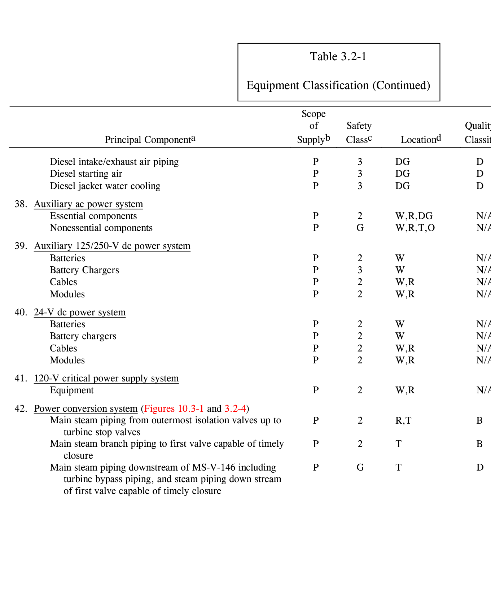
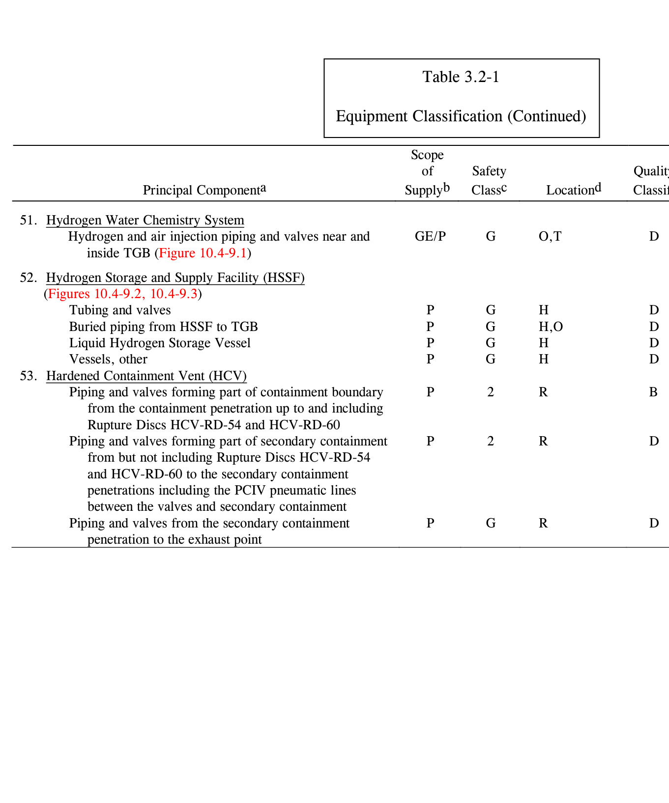
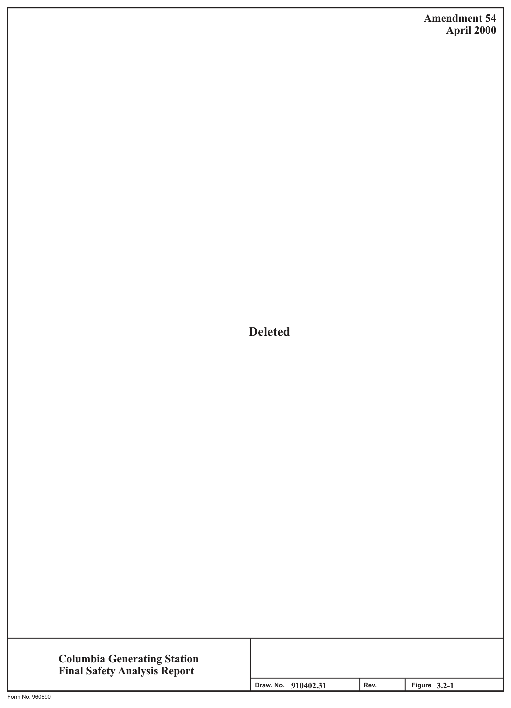

# 3.2 Classification Of Structures, Components, And Systems

> Columbia Generating Station FSAR — Chapter 03: Design of Structures, Components, Equipment and Systems
> Source: `03_chapter-660-1910.pdf`, PDF pages 122–187 (of 1251)
> Amendment 67 compilation (individual pages carry varying amendment dates)

---
<!-- p.122 -->
### 3.2 CLASSIFICATION OF STRUCTURES, COMPONENTS, AND SYSTEMS
Appendix A of 10 CFR Part 50 requires that all nuclear power plants be designed so that, if the safe shutdown earthquake (SSE) occurs, all structures, systems, and components (SSCs)
important to safety remain functional.

General Design Criterion 1 (GDC 1) of Appendix A to 10 CFR Part 50 requires that SSCs important to safety be designed, fabricated, erected, and tested to quality standards commensurate with the importance of the safety function to be performed.

#### 3.2.1 SEISMIC CLASSIFICATION
Plant structures, systems, and components important to safety are designed to withstand the effects of an SSE and remain functional if they are necessary to ensure

a. The integrity of the reactor coolant pressure boundary (RCPB),

b. The capability to shut down the reactor and maintain it in a safe shutdown condition, or

c. The capability to prevent or mitigate the consequences of accidents which could result in potential offsite exposure comparable to the exposure limits of 10 CFR Part 50.67.

Plant structures, systems, equipment, and components, including their foundations and supports, designed to remain functional in the event of an SSE are designated as Seismic Category I, as indicated in Table 3.2-1.

All Seismic Category I SSCs are analyzed under the loading conditions of the SSE and the operating basis earthquake (OBE). Since the two earthquakes vary in intensity, the design of Seismic Category I structures, components, equipment, and systems to resist each earthquake and other loads are based on levels of material stress or load factors, whichever is applicable, with margins of safety appropriate for each earthquake. The margin of safety provided for Seismic Category I structures, components, equipment, and systems for the SSE are sufficient to ensure that their design functions are not jeopardized.

For further details of seismic design criteria refer to

Seismic design
3.7

Design of Category I structures
3.8

Systems and components
3.9

<!-- p.123 -->
Seismic qualification of Seismic Category I instrumentation and 3.10 electrical equipment

All SSCs not analyzed under the loading conditions of the SSE and OBE are classified Seismic Category II. Where applicable, the seismic loading conditions as determined from the Uniform Building Code are used for the design of Seismic Category II SSCs.

The OBE, as defined in 10 CFR Part 100, Appendix A, is not incorporated as part of the seismic classification scheme.

The seismic classification indicated in Table 3.2-1 meets the requirements of NRC Regulatory Guide 1.29, Revision 3, except as otherwise noted in the table.

Seismic Category 1M classification denotes systems, structures or components that are designed and constructed to comply with position C.2 of Regulatory Guide 1.29.

#### 3.2.2 SYSTEM QUALITY GROUP CLASSIFICATIONS
System quality group classifications, as defined in NRC Regulatory Guide 1.26, Revision 3, are determined for each water, steam, or radioactive waste containing component of those applicable fluid systems relied on to ensure

a. The integrity of the RCPB,

b. The capability to shut down the reactor and maintain it in a safe shutdown condition, or

c. The capability to prevent or mitigate the consequences of accidents which could result in potential offsite exposure comparable to the exposure limits of 10 CFR Part 50.67.

The quality group classifications for systems and components which meet these definitions are shown in Table 3.2-1.

System quality group classifications, as indicated in Tables 3.2-1 and 3.2-2, meet the requirements of 10 CFR 50.55a and Regulatory Guide 1.26, Revision 3.

Note: Classification of the RWCU system in the Radwaste Building takes exception to Reg.
Guide 1.26. Piping, pumps, valves, and supports of the RWCU system in the Radwaste Building have been reclassified as Quality Group D, taking exception to the Reg. Guide 1.26 recommended classification of Quality Group C.

<!-- p.124 -->
#### 3.2.3 SAFETY CLASSIFICATIONS
Structures, systems, and components were classified as Safety Class 1, Safety Class 2, Safety Class 3, or General Class G in accordance with the ANS-22 definition of their importance to nuclear safety (ANS-22 became ANSI/ANS-52.1-1983). Recognizing that components within a system may be of differing safety importance, a single system may have components in more than one safety class. Supports are designed in accordance with ASME III-Winter 1973 Addenda-Subsection NF and are classified appropriately based on the component supported.
Jurisdictional boundaries between NF and other codes were established by the owner as required by the ASME Code. Load combinations and allowable stresses used in support design are in accordance with ASME III-NF as defined in Section 3.9 and are applied to both ASME and the American Institute of Steel Construction (AISC) support members.
Modifications and construction practices are controlled by the quality classification of the individual support and by the additional requirements of each applicable code. Table 3.2-1 provides a summary of the safety classes for the principal SSCs of the plant.

Design requirements for components of safety classes are also described in this section.
Reference is made to accepted industry codes and standards which define design requirements commensurate with the safety function(s) performed.

##### 3.2.3.1 Safety Class 1
###### 3.2.3.1.1 Definition of Safety Class 1
Safety Class 1 applies to components of the RCPB or core support structure whose failure could cause a loss of reactor coolant at a rate in excess of the normal makeup system or to equipment in which a single failure could cause major fuel damage.

###### 3.2.3.1.2 Design Requirements for Safety Class 1
The design requirements for Safety Class 1 mechanical equipment (i.e., vessel, pipes, pumps, and valves) are described in Section 3.9. The design requirements for the reactor vessel are described in Section 5.3.

The design requirements for Safety Class 1 structures (i.e., reactor pedestal and supports of the RCPB as defined in Section 3.2.3.1.1) are specified in Sections 3.8 and 3.9.

Safety Class 1 SSCs are identified in Table 3.2-1.

##### 3.2.3.2 Safety Class 2
###### 3.2.3.2.1 Definition of Safety Class 2
Safety Class 2 applies to those SSCs, other than service water systems, that are not Safety Class 1 but are necessary to accomplish the safety function of

<!-- p.125 -->
a. Inserting negative reactivity to shut down the reactor, b. Preventing rapid insertion of positive reactivity, c. Maintaining core geometry appropriate to all plant process conditions, d. Providing emergency core cooling, e. Providing and maintaining containment, and f. Removing residual heat from the reactor and reactor core.

###### 3.2.3.2.2 Design Requirements for Safety Class 2
The design requirements for Safety Class 2 mechanical equipment (i.e., vessels including heat exchangers, pipes, pumps, valves, and tanks) are described in Section 3.9.

The design requirements for Safety Class 2 structures (i.e., reactor building including the primary containment) are specified in Section 3.8.

The seismic and environmental design requirements for Safety Class 2 instrumentation and electrical equipment are specified in Sections 3.10 and 3.11.

Safety Class 2 SSCs are identified in Table 3.2-1.

##### 3.2.3.3 Safety Class 3
###### 3.2.3.3.1 Definition of Safety Class 3
Safety Class 3 applies to those SSCs that are not Safety Class 1 nor Safety Class 2 that is relied upon to accomplish a nuclear safety function.

###### 3.2.3.3.2 Design Requirement for Safety Class 3
The design requirements for Safety Class 3 structures, (i.e., standby service water pump houses, diesel generator buildings, radwaste/control building, and spray ponds) are specified in Section 3.8.

The design requirements for Safety Class 3 mechanical equipment (i.e., vessels including heat exchangers, pipes, pumps, valves, and tanks) are described in Section 3.9.

The seismic and environmental design requirements for Safety Class 3 instrumentation and electrical equipment are specified in Sections 3.10 and 3.11.

##### 3.2.3.4 General Class G, Structures, Systems, and Components
###### 3.2.3.4.1 Definition of General Class Structures, Systems, and Components
A boiling water reactor (BWR) has a number of SSCs in the power conversion or other portions of the facility which have no direct safety function but which may be connected to or

<!-- p.126 -->
influenced by the equipment within the safety classes defined above. Such SSCs are designated as General Class G. For example, portions of the service water systems, the turbine generator auxiliaries, and portions of the heating, ventilating, and air conditioning (HVAC) systems are designated as having no safety classification.

###### 3.2.3.4.2 Design Requirements for General Class G Structures, Systems, and Components
The design requirements for equipment classified as General Class G are specified with appropriate consideration of the intended service of the equipment and expected plant and environmental conditions under which it will operate. Design requirements are based on applicable industry codes and standards.

#### 3.2.4 QUALITY ASSURANCE CLASSIFICATION
Structures, systems, and components are classified in Table 3.2-1 using the following quality class designations

a. Quality Class I - Any nuclear system, structure, subassembly, component, or design characteristics that prevent or mitigate the consequences of postulated accidents that could cause undue risk to the health and safety of the public. All engineered safety features fall within this category. All Quality Class I items meet the applicable provisions of 10 CFR Part 50 Appendix B.

b. Quality Class II+ - Assigned to SSCs having no safety-related function but requiring quality augmentation either as a result of NRC requirements or as committed by CGS. Quality augmentation may include such requirements as environmental qualification, seismic qualification, or other quality affecting activities specifically committed. Augmented quality applies to the following categories of SSCs:

1. Essential fire protection SSCs,

2. Structures, systems, and components that do not perform a safety-related function but must be seismically supported/mounted (seismic 2-over-1)
per Regulatory Guide 1.29,

3. Structures, systems, and components required for radwaste management that are subject to Regulatory Guide 1.143,

4. Structures, systems, and components required to cope with a station blackout per Regulatory Guide 1.155 (see Section 8A),

<!-- p.127 -->
5. Structures, systems, and components required to respond to or mitigate anticipated transients without scram (ATWS) per the requirements of

## 10 CFR 50.62,
6. Structures, systems, and components required to respond to an electrical separation safe shutdown event (see Section 8.3.1.4.4.1.4),

7. Postaccident monitoring instruments subject to Regulatory Guide 1.97, Category 2, requirements,

8. Remote shutdown items required in response to control room evacuation
(10 CFR 50 Appendix A, GDC 19) and,

9. Beyond Design Basis External Event (BDBEE) structures, systems, and components associated with Spent Fuel Level Instrumentation per requirements of NRC Order EA-12-051 and portions of the HCV system per the requirements of NRC Order EA-13-109.

c. Quality Class II - Any system, structure, subassembly, component, or design characteristic that could cause a safety hazard to plant personnel, an extended reduction in unit output, an unscheduled unit trip, or equipment damage.
Appropriate quality assurance requirements for these items are assigned in the purchase specifications.

d. Quality Class G - Any nonnuclear system, structure, subassembly, component, or design characteristic to which quality assurance requirements are assigned in accordance with the consequences of failure, operating costs, or procurement costs.

#### 3.2.5 CORRELATION OF SAFETY CLASSES WITH OTHER DESIGN
#### REQUIREMENTS
The design of plant equipment is commensurate with the safety importance of the equipment.
Hence, the various safety classes have a gradation of design requirements. The correlation of safety classes with other design requirements is summarized in Table 3.2-3.

<!-- p.128 -->
#### 3.2.6 IDENTIFICATION OF SAFETY-RELATED SYSTEMS AND COMPONENTS ON
#### FLOW DIAGRAMS AND IN THE MASTER EQUIPMENT LIST
The system classification are shown on the flow diagrams using symbols code group A, B, C, D, D+; Seismic Category I, II; and Quality Class I, II, II+, and G. The Master Equipment List (MEL) uses arabic number designators for quality class and seismic category. The following is a comparison of the classification designators:

Flow Diagram Table 3.2-1 MEL

Code Group A Quality Group A Code Group B Quality Group B Code Group C Quality Group C Code Group D Quality Group D Code Group D+ Quality Group D+ Seismic Category I Seismic Category I* Seismic Category 1* Seismic Category 1M* Seismic Category II Seismic Category II* Seismic Category 2* Quality Class I Quality Class I Quality Class 1 Quality Class II Quality Class II Quality Class 2 Quality Class II+ Quality Class II+ Quality Class A Quality Class G Quality Class G Quality Class G

Flow diagrams which include the seismic and code classifications assigned to each piping system are identified in Table 3.2-1. The flow diagrams delineate the boundary of seismic and code classifications for each system and present the as-built classifications. For the appropriate quality class of specific components, refer to the MEL. In some instances, these classifications reflect voluntary upgrades which may exceed Regulatory Guide 1.26, Revision 3, requirements. For inservice inspection requirements, the appropriate levels of inspection are given in Sections 5.2.4 and 6.6.

Note: Classification of the RWCU system in the Radwaste Building takes exception to Reg.
Guide 1.26. Piping, pumps, valves, and supports of the RWCU system in the Radwaste Building have been reclassified as Quality Group D, taking exception to the Reg. Guide 1.26 recommended classification of Quality Group C.

* Table 3.2-1 may indicate Seismic Category I, 1M or II. Clarification of the Seismic 2 over 1 (i.e., 1M) support/mounting requirements is specified in the notes and/or MEL (see Table 3.2-1).

<!-- p.129 -->
April 2000 Notesh 1 2

Categoryg Seismic N/A

#### I I I I I I I I I I I I I I I I I I I I I I
Quality Classf N/A

#### I I I I I I I I I I I I I I I I I I I I I
I

Quality Group Classificatione

#### N/A N/A N/A N/A N/A N/A N/A N/A
#### N/A N/A
A A

#### B A C B A A A A A A
B

Locationd

#### C,R C,R C,R C,R C,R
#### C C C C C C C C C C C C C C C C
C C Equipment Classification Safety Classc Table 3.2-1 G 3 2 1 1 1 1 2 2 2 2 2 2 1 2 1 2 1 2 1 1 1

Supplyb Scope GE/P

#### GE GE GE
of GE GE GE GE GE GE GE GE GE GE GE GE

#### P P P P
#### P P P
Piping, relief valve discharge within suppression chamber Reactor vessel appurtenances pressure retaining portions Valves, other, isolation valves and within containment Reactor internal structures, engineered safety features Vessels, level instrumentation condensing chambers Piping, main steam and feedwater within outermost Piping, relief valve discharge from relief valve to Piping, other within outermost isolation valves Principal Componenta Valves, main steam isolation valves Control rod drive housing supports Reactor internal structures, other
2. Nuclear boiler system (Figure 10.3-2)
Power range detector hardware Reactor vessel support skirt Pipe restraints, main steam Pipe supports, main steam and suppression pool Reactor vessel stabilizer Core support structure suppression pool Safety/relief valves Control rod drives isolation valve Fuel assemblies Reactor vessel Control rods
1. Reactor system Vessels

<!-- p.130 -->
December 2017 Notesh 2,4 2,4 37 2 2 2 2 3 5

Categoryg Seismic I/IM

#### II II
#### I I I I I I I I I I I I I I I I I I
Quality Classf II+

#### II II
#### I I I I I I I I I I I I I I I I I I
Quality Group Classificatione Special

#### N/A N/A N/A N/A N/A N/A N/A N/A
#### N/A N/A
#### D D B B B B B
#### A A A
Locationd Equipment Classification (Continued)

#### C,R,W
#### C,R,W
#### C,R,W
#### C,R C,R
C,R C,R

#### C C C C C C R R R R R R R
R

Safety Classc Table 3.2-1 2 2 1 1 1 3 2 G G 2 2 1 2 2 2 2 2 2 2 2 2

Supplyb Scope GE/P GE/P of

#### GE GE GE GE GE
#### GE GE GE GE GE GE GE
P P

#### P P P P P
Piping and valves outboard of outside isolation valve to and including first valve capable of timely actuation Mechanical modules, instrumentation (with safety 4. Control rod drive hydraulic system (Figure 4.6-5)
Electrical modules (with safety function)
Electrical modules (with safety function)
Electrical modules (with safety function)
3. Reactor recirculation system (Figure 5.4-7) Principal Componenta Valves, scram discharge volume lines Pipe suspension, recirculation line Valves, insert and withdraw lines Pipe restraints, recirculation line Piping insert and withdraw lines Piping discharge volume lines Cables (with safety function)
Cable (with safety function)
Cable (with safety function)
Hydraulic control unit Valves, other Piping, other Motor, pump function)
Piping Pumps Valves

<!-- p.131 -->
December 2003 Notesh 6 2 2 2 2 7

Categoryg Seismic I/II

#### I I I I I I I I I I I I I I I I I I
#### I I I I
Quality Classf II+ II+ II+ II+ II+ II+ II+ I/II

#### I I I I I I I I I I I I I I I
Quality Group Classificatione N/A

#### N/A N/A N/A N/A B/D N/A N/A N/A N/A N/A NA/ N/A N/A
#### A A A B B B B
B B

Locationd

#### C,R,T,W
#### C,R,W C,R,W C,R,W
Equipment Classification (Continued)

#### C,R,T
C,R

#### C,R C,R C,R C,R
#### C,R C,R
#### R R R R C R R C C C R
Safety Classc 2/G 2 2 2 1 2 1 2 2 2 2 2 2 2 2 2 2 1 2 2 2 2 2 Table 3.2-1 Supplyb GE/P GE/P Scope

#### GE GE GE GE GE GE GE GE GE GE GE GE GE
P P P P P P P P of

Electrical modules, with boron injection function Piping, within isolation valves to reactor vessel 5. Standby liquid control system (Figure 9.3-14) Valves, isolation and within containment Electrical modules (with safety function)
Electrical modules, IRM and APRM Cable, with boron injection function Principal Componenta Valves, isolation TIP subsystem Valves, beyond isolation valves Power range detector hardware Piping, beyond isolation valves Differential temperature switch Cable (with safety function)
Standby liquid control tank Differential flow indicator 6. Neutron monitoring system Cable, IRM and APRM Temperature element Electrical modules Valves, explosive 8. Leak detection system Pressure switch 7. Reactor protection Pump motor Tubing TIP Pump Cable

<!-- p.132 -->
Notesh 8 2 2 2

Categoryg Seismic

#### I I I I I I I I I I I I I I I I I I I I I
Quality Classf

#### I I I I I I I I I I I I I I I I I I I I I
Quality Group Classificatione

#### N/A N/A N/A
N/A

#### N/A N/A N/A N/A
#### A B B B B B B B B B
A C A

Locationd

#### C,R,T,W C,R,T,W
Equipment Classification (Continued)

#### C,R,W
C,R

#### C,R C,R
C,R C,R

#### R R R R R R R R R R R R R
Safety Classc Table 3.2-1 2 2 2 3 1 2 2 2 2 2 2 2 2 2 2 2 2 2 1 1 2

Supplyb GE/P Scope

#### GE GE GE GE GE GE GE GE GE GE
P P P P P P P P P P of

Piping, within outermost isolation valves to reactor vessel Piping, within outermost isolation valves, reactor coolant Cable, main steam line and reactor building ventilation Valves, isolation reactor coolant pressure boundary Electrical modules, main steam line and building 10. Residual heat removal system (Figure 5.4-15)
Piping, beyond outermost isolation valves Electrical modules (with safety function)
Differential pressure indicator switch 11. Low-pressure core spray (Figure 6.3-4)
Principal Componenta Heat exchanger, secondary side Heat exchangers, primary side Cable (with safety function)
Differential flow summer 9. Process radiation monitors ventilation monitors pressure boundary Mechanical modules Main Pump motors Main Pump motors Water leg pumps Water leg pumps Valves, other Piping, other monitors Pumps Pumps

<!-- p.133 -->
Notesh 2,10 2 4 2 2 2 2 4 2

Categoryg Seismic II II

#### I I I I I I I I I I I I I I I I I I
Quality Classf II II

#### I I I I I I I I I I I I I I I I I I
Quality Group Classificatione

#### N/A N/A
#### N/A N/A N/A N/A
#### A D B B B B B B B
#### A A D
C A

Locationd Equipment Classification (Continued)
W,R R,W

#### C,R DG
#### C,R C,R R,O
R,P C R

#### R R R R P C R R
R R

Safety Classc Table 3.2-1 2 2 2 1 G 2 2 2 2 2 2 2 2 1 2 G 1 3 1 3

Supplyb GE/P Scope

#### GE GE GE GE
GE P P P P P P P P P P P P P P of

Piping, return test line to condensate storage tank beyond Piping, within outermost isolation valves reactor coolant Valves, isolation, reactor coolant pressure boundary Valves, isolation, reactor coolant pressure boundary
(See 38a - high-pressure core spray standby power 13. Reactor core isolation cooling system (Figure 5.4-11)
Valves, beyond isolation valves, motor operated Piping, beyond outermost isolation valve, other Piping, drip pot discharge valve to condenser Piping, beyond outermost isolation valves Electrical modules (with safety function)
Electrical modules (with safety function)
Piping, within outermost isolation valve Valves, beyond diesel shutoff valves 12. High-pressure core spray (Figure 6.3-4)
Principal Componenta Electrical auxiliary equipment Cable (with safety function)
Cable (with safety function)
second isolation valve pressure boundary Main Pump motor Water leg pumps Valves, other Valves, other supply)
Pump

<!-- p.134 -->
Notesh 2,4,13, 11 2 2 2 2 9 14,36 Categoryg Seismic 1M 1M

#### II II
#### I I I I I I I I I I I I I I I
Quality Classf II+ II+ II+ II+ II+

#### I I I I I I I I I I I I I
I

Quality Group Classificatione B/D B/D N/A N/A N/A N/A N/A N/A N/A N/A N/A D+ D+

#### D A A
#### D B B
Locationd Equipment Classification (Continued)
#### C, R R,W C,R W W

#### R R R R R R R R R R R R R R
Classc Safety Table 3.2-1

#### G 2 2 1 1 2 2 2 2 2 3 3 G G G 3 G G 2
Supplyb Scope

#### GE/P GE/P GE/P
GE GE GE GE GE GE GE of GE

#### P P P P P P P
P

17. Radwaste system (Figures 11.2-2, 9.3-9, 9.3-12, 11.2-3, and Piping, condenser to vacuum tank and to the condensate pump discharge; and vacuum pump discharge to the Reactor core isolation cooling electrohydraulic system Valves, isolation reactor coolant pressure boundary Valves, reactor coolant pressure boundary Electrical modules (with safety function)
outboard check valve break flange Principal Componenta Valves, other (with safety function)
Valves, containment isolation Cable (with safety function)
New fuel inspection stand Fuel preparation machine General purpose grapple Tanks, atmospheric 14. Fuel service equipment Refueling platform Fuel storage racks Refueling bellows Water leg pumps 15. Refueling equipment Heat exchangers 16. Storage equipment Turbine Pump 11.2-4)

<!-- p.135 -->
Notesh 2,4,38 4,19 2,4 2,4 15 16 17 18 4 36 2 2 4

Categoryg Seismic 1M

#### II II II II II II II II II II II II II II II
II

#### I I I I
I I I I

Quality II,II+ II,II+ Classf II,II+ II,II+ I,II+ II+ II+ II+ II+ II+ II+ II+ II+ II+

#### II II II
#### II II II II II
I I I

Quality Group Classificatione C,D,D+ C,D,D+ C,D,D+ C,D,D+ N/A D+ D+ D+ D+ D+ D+ D+ C,D

#### D C C C A A
#### C C C C C B
Locationd Equipment Classification (Continued)

#### R,T,W
#### R,W R,W R,W R,W
C,R C,R

#### W W W W W W W W W
#### R R C
#### R R R R R
R

Safety Classc Table 3.2-1

#### G G G G G G G G G G G G G G 1 G G 3 3 3 3 G 2 3 1
Supplyb P/GE GE/P Scope

#### GE/P GE/P GE/P GE/P GE/P
#### GE GE GE GE
P P P P P of

#### P P P P
#### P P P P P
19. Fuel pool cooling and cleanup system (Figures 9.1-6.1 and 9.1-6.2)
radwaste piping and valves upstream of collector tanks Piping and valves forming part of containment boundary Piping and valves forming part of secondary containment Valves, beyond outermost containment isolation valves Piping, beyond outermost containment isolation valves Radioactive equipment and floor drains and other Valves, isolation valves reactor coolant pressure 18. Reactor water cleanup system (Figure 5.4-22)
Piping, within outermost isolation valves Valves, flow control and filter system Principal Componenta Non-Regenerative Heat exchangers Instrumentation and control boards Regenerative Heat exchangers Vessels, filter/demineralizer Makeup system (normal)
Mechanical modules Mechanical modules Heat exchangers Plant discharge line Valves, other Piping, other Concentrator boundary a. Cooling Vessels Pumps Piping Pumps Pumps

3.2-15 LDCN-21-025

<!-- p.136 -->
Notesh 19 19 4 4

Categoryg Seismic

#### II II II II II II II
#### II II II
#### I I I I I I
#### I I I I I I I
Quality II,II+ Classf N/A II+ II+ II+ II+ II+ II+

#### II II
II

#### I I I I I
#### I I I I I I I
Quality Group Classificatione C,D+ N/A N/A N/A D+ D+ D+ D+ D+ D+

#### N/A N/A N/A N/A
#### C C C C B
#### C C C C
#### P,R,DG,O,W P,R,DG,O,W P,R,DG,O,W P,R,DG,O,W
Locationd Equipment Classification (Continued)

#### T,W,O
R,W

#### T,W T,W T,W T,W T,W T,W
#### W W W W
#### R R R
R R P P

Safety Classc Table 3.2-1 3 3 G G G 2 2 2 2 G G G G G G G 3 3 3 3 3 2 3

Supplyb GE/P Scope

#### GE GE GE GE GE GE GE GE GE
#### P P P P P P
P P P P P P P of

Piping, suppression pool to outer isolation valves Mechanical modules (with safety function)
23. Standby service water system (Figure 9.2-12)
Electrical modules (with safety function) Electrical modules (with safety function)
Electrical modules (with safety function)
Principal Componenta Makeup system (emergency) Vessels, filter/demineralizer Cable (with safety function) Cable (with safety function)
Cable (with safety function)
22. Offgas system (Figure 11.3-2)
RHR connection 21. Local panels and racks 20. Control room panels Heat exchangers Pressure vessels Pump motors b. Cleanup Pumps Piping Piping Pumps Valves Piping Pumps Valves Tanks

<!-- p.137 -->
Notesh 20 4 4 4

Categoryg Seismic

#### II II II II II II II II
II

#### I I I I I I I I
Quality II,II+ Classf N/A

#### II II II II
II

#### II II I I I I I I
I I

Quality Group Classificatione

#### N/A N/A
#### D D C D D
#### D D B B B B B D B B
#### A,T,R,O,P,
Locationd Equipment Classification (Continued)
W,S C,R

#### C,R C,R
W

#### R R R R R R
#### P R R R C R
Safety Classc Table 3.2-1

#### G G G G G G 2 G G 2 2 2 2 2 2 G 3
Supplyb Scope P P P P P P P P P P P P P P P P P of 28. Primary containment atmospheric control system (DEACTIVATED)
25. Reactor building closed cooling water system (Figure 9.2-2)
Containment isolation valves and associated piping Piping and valves up to outermost isolation valves, 26. Primary containment cooling system (Figure 9.4-8)
29. Other heating, ventilating, and air conditioning 27. Standby gas treatment system (Figure 3.2-2)
24. Turbine plant service water (Figure 9.2-1)
Piping and valves inside containment Piping and valves in reactor building Principal Componenta containment purge and exhaust Reactor building (nonessential)
(Figures 9.4-1, 9.4-2, and 9.4-7)
Reactor building (essential)
Piping and valves, other Piping and valves Piping and valves Piping and valves Heat exchangers Filter units Equipment
(Figure 3.2-3)
Pumps Pumps Tanks Fans

<!-- p.138 -->
Notesh 4,24 21 21 22 22 23 2 4 4

Categoryg Seismic 1M

#### II II II II II II II
#### II II II
#### II II II
#### I I I
#### I I I
Quality Classf II+

#### II II II
#### II II II II II II II II II II II
#### I I I
I I

Quality Group Classificatione

#### N/A N/A N/A N/A N/A N/A
#### N/A N/A N/A N/A N/A N/A N/A
#### D D D D
#### C D D
Locationd

#### O,T,R,W
#### R,W,T,O
#### P,W,T,S
Equipment Classification (Continued)
DG

#### W W W
#### W O G
#### R R R T P T T T
P O

Safety Classc Table 3.2-1

#### G G G 3 G G G 3 3 G G G G G G G G 3 3 3
Supplyb Scope GE P P P P P P P P P P P P P P P P P P P of

34. Instrument and service air (Figures 9.3-1.1, 9.3-1.2, 9.3-1.3, Control room, critical switchgear area, cable spreading Control room, critical switchgear area, cable spreading 30. Condensate storage and transfer (Figure 9.2-11)
Principal Componenta Standby service water pump house Standby service water pump house Fuel pool/dryer separator liner Compressor cooling system Storage racks and supports Diesel generator building Condensate storage tank 31. Instrument and sample lines area (nonessential)
Radwaste building area (essential)
Radwaste building Piping and valves 32. Fuel storage facilities Piping and valves Turbine building Reactor building 9.3-1.4 and 9.3-1.5)
Turbine building Miscellaneous Compressors 33. Building cranes Vessels Pumps

#### LDCN-05-009, 06-032
<!-- p.139 -->
Notesh 26,27 25 26 26 25 4 4

Categoryg Seismic II

#### I I II I I I I I I I I I I I I I I I I I I I
Quality Classf I,II II

#### II I I I I I I I I I I I I I I I I I I I I
Quality Group Classificatione

#### N/A N/A N/A
#### N/A N/A N/A
#### D C C C C C C D D D C C C C B B
D

Locationd Equipment Classification (Continued)
C,R

#### DG DG DG DG DG DG DG DG DG DG DG DG DG DG DG DG DG
#### R R R R
P

Safety Classc Table 3.2-1

## 2 G G 3 3 3 3 3 3 3 3 3 3 2 3 3 2 3 2 2 3 3 3
Supplyb Scope

#### GE GE
GE P P P P P P P P P P P P P P P P P P P P of

36. High-pressure core spray standby power systems (Division 3) Piping and valves outside containment isolation valves to and including solenoid pilot valves controlling supply Piping and valves inside containment to and including 35. Containment instrument air system (Figure 9.3-2)
Piping and valves to main steam relief valves 37. Standby ac power systems (Divisions 1 and 2)
Electrical modules (with safety functions)
Electrical modules (with safety function)
of nitrogen from the nitrogen bottles Diesel generators service water supply Principal Componenta Piping and valves, fuel oil system Cable (with safety functions)
Diesel intake exhaust piping Piping and valves, diesel oil Diesel cooling water supply Cable (with safety function)
outboard isolation valve Diesel jacket water cooling Diesel fuel storage tanks Other piping and valves Pumps, fuel oil system Storage and day tanks Diesel starting air Diesel generators Pumps, diesel oil Diesel generators Day tanks Receiver

<!-- p.140 -->

*figure on PDF page 140*

[Vector original (SVG, lossless): fig_page-140.svg](../figures/fig_page-140.svg)

<!-- labels/text on this figure page -->
COLUMBIA GENERATING STATION
Amendment 59
FINAL SAFETY ANALYSIS REPORT
December 2007
Notesh 26,27 28 28 4 26 26
Categoryg Seismic II II
I I I I I I I I I I I I I I I
Quality Classf I,II II II I I
I I I I I
I I I I I I I
Quality Group Classificatione
N/A N/A N/A N/A
N/A N/A N/A N/A N/A N/A N/A
D B B
D D D
Locationd
W,R,T,O
W,R,DG
Equipment Classification (Continued)
W,R W,R W,R W,R W,R
R,T DG DG DG
W W W W
T T
Safety Classc Table 3.2-1
2 G 2 3 2 2 2 2 2 2 2 2 G 3 3 3 2
Supplyb Scope P P P P P P P P P P P P P P P P P of
Main steam branch piping to first valve capable of timely Main steam piping from outermost isolation valves up to turbine bypass piping, and steam piping down stream Main steam piping downstream of MS-V-146 including 42. Power conversion system (Figures 10.3-1 and 3.2-4)
of first valve capable of timely closure Principal Componenta 39. Auxiliary 125/250-V dc power system 41. 120-V critical power supply system Diesel intake/exhaust air piping Diesel jacket water cooling Nonessential components 38. Auxiliary ac power system turbine stop valves Essential components 40. 24-V dc power system Diesel starting air Battery Chargers Battery chargers Equipment closure Batteries Modules Batteries Modules Cables Cables
LDCN-06-032
3.2-20

<!-- p.141 -->
Notesh 29,30 30 31 4

Categoryg Seismic

#### II II II II II II II II II II II II II II
#### I I I I
Quality Classf

#### II II II II II II II II II II II II
#### II I I I I
II

Quality Group Classificatione N/A

#### D D D D D D D D D D D D D
#### D A B B
Locationd Equipment Classification (Continued)
R,T R,C

#### T T T T T T T T T T P P P R R R
Safety Classc Table 3.2-1

#### G G G G G G G G G G G G G G 1 2 2 2
Supplyb Scope P P P P P P P P P P P P P P P P P P of 44. Main steam isolation valves leakage control system (DEACTIVATED)
43. Circulating water and cooling tower makeup water system(s)
Piping and valves beyond the outermost isolation valves Turbine stop valves, turbine control valves, and turbine Main steam leads from turbine control valve to turbine Piping and valves within primary containment and out Feedwater and condensate system beyond outermost Turbine bypass system beyond turbine bypass valve Turbine gland sealing system components through the outermost isolation valves Principal Componenta Feedwater treatment system Air ejection equipment Piping, valves, other Cooling tower fans isolation valve Turbine generator Equipment, other Piping and valves bypass valves 45. Containment vessel
(Figure 10.4-4) Condenser
(Figure 3.2-5) casing Blowers Pumps

#### LDCN-05-009, 06-032
<!-- p.142 -->
Notesh 32 33 31 34

Categoryg Seismic I/II

#### II II II II II
#### II II
#### I I I I I I I I I I I
Quality Classf I,II

#### II G II
#### II II II II
#### I I I I I I I I I I I
Quality Group Classificatione

#### N/A N/A N/A N/A N/A N/A N/A N/A N/A N/A N/A
#### A A A D D D B B
Locationd

#### C,R,T,DG
Equipment Classification (Continued)

#### R,W R,W R,W
#### C,R C,R DG
W

#### R T P S O O O O R R
R

Safety Classc 3/G Table 3.2-1

## 2 G 3 G G G G 3 3 G 1 G G G 3 1 2 2
Supplyb Scope N/A N/A N/A N/A N/A N/A N/A N/A N/A N/A GE P P P P P P P P of

Piping within the outermost RHR system isolation valves Piping beyond the outermost reactor coolant boundary, Piping within outermost containment isolation valves Spray ponds and standby service water pump house Safety-related instrumentation and control systems Piping within outermost reactor coolant boundary containment, or RHR system isolation valves 47 Containment/drywell atmosphere monitoring system Insulation on piping which is within the drywell 50. Postaccident sampling system (Figure 3.2-6)
Air intake structures No. 1 and No. 2 Principal Componenta 49. Instrumentation and control equipment Circulation water pump house Makeup water pump house Radwaste control building Diesel generator building isolation valves Turbine building Reactor building Service building Cooling towers 48. Drywell insulation Sample station All other 46. Buildings

<!-- p.143 -->

*figure on PDF page 143*

[Vector original (SVG, lossless): fig_page-143.svg](../figures/fig_page-143.svg)

<!-- labels/text on this figure page -->
COLUMBIA GENERATING STATION
Amendment 64
FINAL SAFETY ANALYSIS REPORT
December 2017
Notesh 35
Categoryg Seismic 1M
II II II II I I
I
Quality Classf II+ II+
II II II II
I I
Quality Group Classificatione
D D D D D D D B
Locationd Equipment Classification (Continued)
H,O O,T
H H H R R R
Safety Classc Table 3.2-1
G G G G G 2 2 G
Supplyb GE/P Scope P P P P P P P of
Piping and valves forming part of secondary containment from the containment penetration up to and including Piping and valves forming part of containment boundary from but not including Rupture Discs HCV-RD-54 Hydrogen and air injection piping and valves near and penetrations including the PCIV pneumatic lines Piping and valves from the secondary containment and HCV-RD-60 to the secondary containment between the valves and secondary containment Rupture Discs HCV-RD-54 and HCV-RD-60 52. Hydrogen Storage and Supply Facility (HSSF)
penetration to the exhaust point Principal Componenta Buried piping from HSSF to TGB inside TGB (Figure 10.4-9.1)
53. Hardened Containment Vent (HCV) Liquid Hydrogen Storage Vessel 51. Hydrogen Water Chemistry System
(Figures 10.4-9.2, 10.4-9.3)
Tubing and valves Vessels, other
LDCN-15-033
3.2-23

<!-- p.144 -->
e A, B, C, D - NRC quality groups defined in Regulatory Guide 1.26, Revision 3. The equipment is constructed in accordance example, electric modules include sensors, power supplies, and signal processors; and mechanical modules include turbines, a A module is an assembly of interconnected components which constitute an identifiable device or piece of equipment. For
- Hydrogen Storage and Supply Facility W - Radwaste and control building DG - Diesel generator building M - Any other location Equipment Classification (Continued)
- Outdoors onsite
- Pump house N/A - Quality Group classification not applicable to this equipment.
Table 3.2-1 with the codes listed in Table 3.2-2, as minimum requirements.
b GE - General Electric; P - Plant Owner (Energy Northwest)

#### O H P
c 1, 2, 3, G - Safety classes defined in Section 3.2.3.
C - Part of or within primary containment f Quality Classes defined in Section 3.2.4.
d A - Auxiliary building strainers, and orifices.
R - Reactor building T - Turbine building S - Service building L - Offsite locale

3.2-23a

<!-- p.145 -->
December 2019 II - constructed in accordance with the requirements of Seismic Category II structures and equipment as described in Section 3.7.
Guides 1.147, 1.84, 1.85, or other approval authority) requires that they are specified in the component’s design specification as 1M - non-safety-related components required to be seismically supported/mounted. This was alternatively called Seismic II g I - constructed in accordance with the seismic requirements of Seismic Category I structures and equipment as described in N/A - seismic requirements as described for Seismic Category I and II structures and equipment are not applicable to this h The notes clarify system/component boundaries, design requirements, and/or alternate quality classification applications.
Reactor pressure boundary components (RPBC) and their original applicable code cases are listed in the attachments to Table 3.2-1. Current practices regarding code cases that are adopted for use at CGS (and are approved by Regulatory The approaches outlined in the Uniform Building Code will be followed where applicable.
Equipment Classification (Continued)
which is Seismic II piping supported on hangers designed to Seismic I loads.
Table 3.2-1

required by ASME Section III, NA-3250.
structure or equipment.
Section 3.7.

<!-- p.146 -->
All instrument lines which are connected to the RCPB and are used to actuate and monitor safety systems are Quality Beyond the root valve to the instrument rack bulkhead, if rack mounted, or to the sensing instrumentation, if locally mounted, if used to actuate a safety system, are of the same classification as the system to which they Quality Group D from the outer isolation valve or the process shutoff valve (root valve) to the sensing instrument This piping has been upgraded from Safety Class 3 to Safety Class 2 and from Quality Group Classification C to Quality Group B from the outer isolation valve or the process shutoff valve (root valve) to the bulkhead of the instrument All instrument lines which are connected to the RCPB and are not used to actuate and monitor safety systems are Through the root valve are of the same classification or higher as the system to which they are attached;
Lines 0.75-in. and smaller which are part of the RCPB are Quality Group B or higher and Seismic Category I.
All sample lines from the outer isolation valve or the process root valve through the remainder of the Beyond the root valve, if not used to actuate a safety system are Quality Group D.
rack, if rack mounted, or the sensing instrumentation, if locally mounted.
Equipment Classification (Continued)
Table 3.2-1

#### NOTES
sampling system are Quality Group D.
All other instrument lines:
are attached;
Group Classification B.
1. 2. 3. 4.

b.
d. a. c.

1. 2.

<!-- p.147 -->
building, primary containment, the control building, diesel generator building, the standby service water (SW) pump houses, Although the HCU is field installed and connected to process piping, many of its internal parts differ markedly from process invoked by that group contain clauses which permit the use of manufacturer's standards and proven design techniques which The design and construction specifications for the HCU do invoke such codes and standards as can be reasonably applied to The HCU is a GE factory assembled engineered module of valves, tubing, piping, and stored water which controls a single invoked by Quality Groups A, B, C, D pressure integrity quality levels clearly apply to all levels to the interfaces between socket welds are inspected for gap between pipe and socket bottom, (c) all welding is performed by qualified welders, and requirements for these parts and for the remaining parts and details. For example, (a) all welds are LP inspected, (b) all the HCU and the connecting conventional piping components (e.g., pipe nipples, fittings, simple hand valves, etc.), it is The control rod drive insert and withdraw lines from the drive flange up to and including the first valve on the hydraulic considered that they do not apply to the specialty parts (e.g., solenoid valves, pneumatic components, and instruments).
control rod drive by the application of precisely timed sequences of pressure and flows to accomplish slow insertion or Supports for Quality Class II (nonessential) piping systems, HVAC, cable trays, and system components in the reactor piping components because of the more complex functions they must provide. Thus, although the codes and standards
(d) all work is done per written procedures. Quality Group D is generally applicable because the codes and standards are not explicitly defined within the codes of Quality Groups A, B, or C. This is supplemented by the quality control individual parts in developing required quality levels, but these codes and standards are supplemented with additional and the radwaste building corridor are designed and constructed to withstand an SSE per position C.2 of Regulatory Guide 1.29. These supports are constructed to Quality Class II requirements, as a minimum.
withdrawal of the control rods for power control and rapid insert ion for reactor scram.
Equipment Classification (Continued)
NOTES (Continued)
Table 3.2-1

control unit (HCU) is in Safety Class 2.
techniques described above.

3. 4. 5.

<!-- p.148 -->
These lines meet the requirements of Quality Group B except that hydrostatic testing of the containment spray piping is not The RCIC turbine does not fall within the applicable design codes. To ensure that the turbine is fabricated to the standards components of the SLC system are designed to engineering standard greater than those normally applied to Safety Class 2 The standby liquid control (SLC) system is not a safety-related backup to a scram function (RPS/CRD). However, these commensurate with its safety and performance requirements, GE has established specific design requirements for this All-cast surfaces are magnetic particulate or liquid penetrant tested according to ASME, Section III, All welding is qualified in accordance with Section IX, ASME Boiler and Pressure Vessel Code;
All pressure containing castings and fabrications are hydrotested to 1.5 times design pressure;
Only equipment associated with a safety action (e.g., isolation) need conform to a safety function.
Equipment Classification (Continued)
NOTES (Continued)
All high-pressure castings are radiographed according to:
Table 3.2-1

E-71, 186 or 280 severity level 3;
E-142 maximum feasible volume Paragraph NB-2575 or NB-2576;
component which are as follows:

#### ASTM E-94
1. 2. 3. required.
systems.
b.
d. a. c.

6. 7. 8. 9.

<!-- p.149 -->
Butt-welds are radiographed according to ASME Section III, IX-3300, and magnetic particle or liquid penetrant Although the refueling bellows are designed to withstand the SSE without rupture, they may be plastically deformed.
The RCIC turbine exhaust line from the isolation valve to the suppression pool meets all the requirements of Quality Equipment, piping, and valves that are part of the radwaste system but not used for processing radioactive fluids are Inspection personnel are qualified according to ASME Section III, Appendix IX, paragraph IX-400.
Wheel and shaft forgings are ultrasonically tested according to ASTM-A-388;
Record system and traceability according to ASME Section III, NA-4900;
Group B except that hydrostatic testing of this portion of piping is not required.
Equipment Classification (Continued)
Notification is made on major repairs and records maintained thereof;
Control and identification according to ASME Section III, NA-4400;
NOTES (Continued)
tested according to ASME Section III, IX-3500, or IX-3600;
Table 3.2-1 Procedures conform to ASME Section III, NA-4400;
designed to Quality Group D standards.

#### DELETED.
k. e. f.
g. h.
i. j.

10. 11. 12. 13.

<!-- p.150 -->
The fuel pool cooling system (see Section 9.1.3) normally receives makeup from the Seismic Category II condensate storage upgraded to Quality Class I Seismic Category I. The fuel pool cooling pumps are ASME Section III Class 3. See Note 13 Piping and valves of the cooling portion of the fuel pool cooling system have been upgraded to Seismic Category I and are The fuel pool cooling heat exchangers have been upgraded to 270 psig (shell side) and Seismic Category I through several tank. Should this normal supply be unavailable, makeup is available from the Seismic Category I SW system. Likewise, normal supply is unavailable, the Seismic Category I SW system provides the cooling water and makeup. In addition, by ASME Section III Class 3, Code Group C (with exception of valves listed in Note 16 in Figure 9.1-6.1). See Note 13 in the normal source of cooling water to the FPC heat exchangers is from the Seismic Category II RCC system. When this The fuel pool cooling circulation pumps have been upgraded to Seismic Category I. Their respective motors have been means of removable spool-pieces, the RHR system is also available as the supplementary source of cooling during cold Equipment, piping, and valves that are part of the radwaste solids handling system are designed to Quality Group D modifications. These heat exchangers are Quality Class II (with the modifications installed as Quality Class I) and shutdown under core offload conditions. The above complies with Regulatory Guides 1.26, Revision 3, and 1.29, Up to and including the last stop valve, this line meets requirements of Quality Group C.
Equipment Classification (Continued)
NOTES (Continued)
Table 3.2-1 ASME Section III Class 3. See Note 13 in Figure 9.1-6.1.
in Figure 9.1-6.1 for Quality Classification.
Figure 9.1-6.1 for Quality Classification.
Revision 3.
standards.

19. 14. 15. 16. 17. 18.

<!-- p.151 -->
water to the HPCS system for safety injection. Consequently, this piping has been upgraded by full volumetric examination The high-pressure core spray (HPCS) suction piping from the condensate storage tank provides the initial source of makeup Class 3, if they are over 4 in. IPS as required by the 1973 Winter Addenda except for the diesel cooling water piping that is Piping and valves downstream of valves SGT-V-5A1, SGT-V-5A2, SGT-V-5B1, and SGT-V-5B2 meet the requirements of The condensate storage tanks are designed, fabricated, and tested to meet ASME Code, Section III, Subsection ND-3800.
These piping systems are liquid penetrant or magnetic particle examined to the acceptance standards of ASME Section III, The cleanup portion is automatically isolated from the cooling portion of the system by Seismic Category I valves on low In addition, the specification for this tank requires 100% surface examination of the side wall to bottom joint, and 100% Assurance Class II+. Non-safety-related equipment and components not required to be seismically supported/mounted seismically supported/mounted according to Regulatory Guide 1.29 are designated Seismic Category 1M and Quality Part of the HVAC components are non-safety-related. Non-safety-related equipment and components required to be according to Regulatory Guide 1.29 are designated Seismic Category II and Quality Assurance Class II.
The auxiliary piping systems on the engines are built to the guidelines of ANSI B31.1.
Equipment Classification (Continued)
Lavatory exhaust systems are designed to Quality Assurance Class G.
NOTES (Continued)
Table 3.2-1 Quality Group B except that a pneumatic test is not performed.
volumetric examination of the side-wall weld joints.
fuel pool level (see Section 9.1.3).
on engine skid.
of every weld.

20. 21. 22. 23. 24. 25. 26.

<!-- p.152 -->
The piping is supported to Seismic Category I requirements, but is not housed in a Seismic Category I structure. The power Piping upstream from the check valves at the inlet of the air receivers is Quality Class II, ANSI B31.1, Seismic Category I.
examined by radiographic methods by qualified personnel. Ultrasonic examination to equivalent standards may be used as an alternative to radiographic methods. Examination procedures and acceptance standards are at least equivalent to those The manufacturer of the turbine stop valves, turbine governor valves, turbine bypass valves, and mainsteam leads building, interacting with main steam lines and branch lines, is designed as a modified Seismic Category II structure as All cast pressure retaining parts of a size and configuration for which volumetric examination methods are required are A certification has been obtained from the manufacturer of these valves and steam leads that the quality control conversion system structures are constructed in accordance with applicable codes for steam power plants. The turbine specified as supplementary types of examination in ANSI B31.1.0 Code, Paragraph 136.4.3.
from turbine control valve to turbine casting utilized quality control procedures, and The following qualification is met with respect to the certification requirements:
Equipment Classification (Continued)
NOTES (Continued)
Table 3.2-1 program so defined has been accomplished.
All other piping is Quality Class 1.
described in Section 3.8.4.1.3.
b. a.

27. 28. 29. 30.

<!-- p.153 -->
housing equipment containing significant quantities of radioactive material are designed to Seismic Category I requirements.
The HSSF liquid hydrogen storage tank, foundations, anchorage (i.e., anchor bolts, slide plates, and the baseplate welding)
structures. The circulating water system also supports the post-tornado operation of the standby service water system. In path to provide makeup water from TMU, and to return water to the CW basin. See FSAR Section 9.2.5.3 for additional Those portions of the radwaste and control building that house systems or components necessary for safe shutdown of the the event of the loss of the spray headers in the SW spray ponds, tornado-protected underground lines can provide a flow The makeup water pump house is designed to withstand the design-basis tornado. The design also considers the possible and the underlying soil are not safety-related, and are designated as Quality Class II+. However, these are designed for Seismic Category I loads and ground motion as defined by Regulatory Guide 1.60. In addition, they were designed to reactor are designed to Quality Class I and Seismic Category I requirements. Those portions of the radwaste building Piping located between secondary containment isolation valves EDR-V-394, EDR-V-395, FDR-V-219, FDR-V-220, effects of tornado-generated missiles. The tower makeup water piping, valves, and cabling located underground are provided with adequate earth cover to be resistant to tornado-generated missiles or are protected by tornado-resistant Seismic Category I applies to the motor rotor, bearings and bearing load path parts. The motor is mounted Seismic Portions of the turbine building that support or interact with main steam piping are designed to Seismic Category I.
FDR-V-221 and FDR-V-222 is classified as Seismic Category I, Quality Class II+ and Quality Group D.
remain in place for both design basis tornado characteristics and maximum probable flood.
Equipment Classification (Continued)
Safety-related instrument and control systems are identified in Table 7.1-1.
NOTES (Continued)
Table 3.2-1 Large bore piping is analyzed to Seismic Category I loading.
Category IM.
discussion.

32. 33. 34. 35. 36. 37. 38.
31.

<!-- p.154 -->
Comments

1 thru 11, K,L,M,S,T 1 thru 11, K,L,M,S,T Code Case

#### PI(1)-ST-(IR-64)-4 PI(1)-ST-(IR-64)-5 PI(1)-ST-MS-PT-2
#### PI(1)-ST-X114 PI(1)-ST-X115 PI(1)-4S-X114 PI(1)-4S-X115
Table 3.2-1 Attachment 1 Component

#### RFW(1)-4A RFW(1)-4B
Nuclear Boiler System Comments

Code Case

PI(1)-ST-X71b PI(1)-ST-X70d PI(1)-ST-X71a PI(1)-ST-X72a PI(1)-ST-X75c PI(1)-ST-X75d PI(1)-ST-X106 PI(1)-ST-X107 PI(1)-ST-X108 PI(1)-ST-X109 PI(1)-ST-X110 PI(1)-ST-X111 PI(1)-ST-X112 PI(1)-ST-X113 PI(1)-4S-X71a PI(1)-4S-X71b PI(1)-4S-X72a PI(1)-4S-X75c PI(1)-4S-X75d PI(1)-4S-X106 PI(1)-4S-X107 PI(1)-4S-X108 PI(1)-4S-X109 PI(1)-4S-X110 PI(1)-4S-X111 PI(1)-4S-X112 PI(1)-4S-X113 Component

<!-- p.155 -->
Comments

Code Case

Nuclear Boiler System (Continued)
PI(1)-ST-X70b PI(1)-4S-X39a PI(1)-ST-X39a PI(1)-4S-X39b PI(1)-4S-X42a PI(1)-ST-X42a PI(1)-4S-X42b PI(1)-4S-X42e PI(1)-ST-X42e PI(1)-4S-X61c PI(1)-ST-X61c PI(1)-4S-X62b PI(1)-4S-X69a PI(1)-ST-X69a PI(1)-4S-X69b PI(1)-ST-X69f PI(1)-4S-X70a PI(1)-ST-X70a PI(1)-4S-X70b PI(1)-4S-X70c PI(1)-ST-X70c PI(1)-ST-X62b PI(1)-ST-X69b PI(1)-ST-X39b PI(1)-ST-X42b PI(1)-4S-X69f PI(1)-4S-70d Component Table 3.2-1 Attachment 1 Comments

1, 4 thru 11, K,L,M,S,T 1, 4 thru 11 K,L,M,S,T 1, 4 thru 11 K,L,M,S,T 1, 3 thru 11 K,L,M,S,T 1, 3 thru 11 K,L,M,S,T 1, 4 thru 11 K,L,M,S,T 1, 4 thru 11 K,L,M,S,T 1, 4 thru 11,K,L,M,S,T 1, 3 thru 11 K,L,M,S,T 1, 3 thru 11 K,L,M,S,T 1, 3 thru 11 K,L,M,S,T 1, 3 thru 11 K,L,M,S,T 1, 4 thru 11 K,L,M,S,T 1, 4 thru 11 K,L,M,S,T 1, 3 thru 11 K,L,M,S,T 1, 3 thru 11 K,L,M,S,T 1, 4 thru 11 K,L,M,S,T 1, 4 thru 11 K,L,M,S,T 1 thru 11 K,L,M,S,T Code Case 1 thru 3 1 thru 3 1 thru 3 1 thru 3

PI(1)-ST-X38a PI(1)-ST-X38b PI(1)-4S-X38a PI(1)-4S-X38b MS(18)-2-10 MS(18)-2-11 MS(18)-2-12 MS(18)-2-13 MS(18)-2-14 MS(18)-2-15 MS(18)-2-16 MS(18)-2-17 MS(18)-2-18 Component

#### B22-G001A B22-G001B B22-G001C B22-G001D
MS(18)-2-1 MS(18)-2-2 MS(18)-2-3 MS(18)-2-4 MS(18)-2-5 MS(18)-2-6 MS(18)-2-7 MS(18)-2-8 MS(18)-2-9

#### MS(9)-4
<!-- p.156 -->
Comments

Code Case

PI(1)-ST-X44Am PI(1)-4S-X44Am PI(1)-4S-X44Bg PI(1)-ST-X44Ah PI(1)-4S-X44Ak PI(1)-ST-X44Ak PI(1)-4S-X44A1 PI(1)-ST-X44A1 PI(1)-ST-X44Ba PI(1)-ST-X44Bb PI(1)-ST-X44Bc PI(1)-ST-X44Bd PI(1)-ST-X44Be PI(1)-ST-X44Bg PI(1)-ST-X44Bh PI(1)-4S-X44Ba PI(1)-4S-X44Bb PI(1)-4S-X44Bc PI(1)-4S-X44Bd PI(1)-4S-X44Be PI(1)-ST-X44Bf PI(1)-4S-X44Bh PI(1)-ST-X44Bj PI(1)-4S-X44Bf PI(1)-4S-X44Bj PI(1)-4S-X44Aj PI(1)-ST-X44Aj Reactor Recirculation System Table 3.2-1 Attachment 2 Component Comments

Code Case

PI(1)-ST-X44Aa PI(1)-ST-X44Ab PI(1)-ST-X44Ac PI(1)-ST-X44Ad PI(1)-ST-X44Ae PI(1)-ST-X44Ag PI(1)-ST-X44Ag PI(1)-4S-X44Aa PI(1)-4S-X44Ab PI(1)-4S-X44Ac PI(1)-4S-X44Ad PI(1)-4S-X44Ae PI(1)-ST-X44Af PI(1)-4S-X44Af PI(I)-4S-X44Ah PI(1)-ST-X40c PI(1)-ST-X40d PI(1)-ST-X41c PI(1)-ST-X41d PI(1)-4S-X40c PI(1)-4S-X40d PI(1)-4S-X40e PI(1)-4S-X41c PI(1)-4S-X41d PI(1)-4S-X41e PI(1)-4S-X41f PI(1)-4S-X40f Component

<!-- p.157 -->
Comments 1, 3 thru 11 K,L,M,S,T 1, 3 thru 11 K,L,M,S,T 1, 3 thru 11 K,L,M, 1, 3 thru 11 K,L,M Code Case 1, 3 1, 3

#### PI(1)-1-RRC-SPV-85A PI(1)-1-RRC-SPV-85B
Control Rod Drive Hydraulic System PI(1)-ST-X75b PI(1)-ST-X75e PI(1)-ST-X75f PI(1)-ST-X78f PI(1)-4S-X75e PI(1)-4S-X75f PI(1)-4S-X78f RRC(5)-4S-A

#### RRC(5)-4S-B
Table 3.2-1 Attachment 3 Component

#### B35-G001A B35-G001B
#### RRC(51)-1 RRC(51)-4
Comments

Code Case

PI(1)-ST-X44Bm PI(1)-4S-X44Bm PI(1)-4S-X44Bk PI(1)-ST-X44Bk PI(1)-ST-X44B1 PI(1)-4S-X44Bl PI(1)-ST-X61a PI(1)-ST-X61b PI(1)-ST-X62c PI(1)-ST-X62d PI(1)-ST-X69e PI(1)-ST-X74a PI(1)-ST-X74e PI(1)-ST-X75a PI(1)-4S-X61a PI(1)-4S-X61b PI(1)-4S-X62c PI(1)-4S-X62d PI(1)-4S-X69e PI(1)-4S-X70e PI(1)-4S-X74a PI(1)-4S-X74e PI(1)-ST-X74f PI(1)-4S-X75a PI(1)-4S-X75b PI(1)-4S-X70f PI(1)-4S-X74f Component

<!-- p.158 -->
Comments

Code Case

Control Rod Drive Hydraulic System (Continued)
Table 3.2-1 Attachment 3 Component Comments

1, 3 thru 11 K,L,M,S 4 thru 11 K,L,M,S,T Code Case

#### CRD-SCRAM/INST 5, 13, G
G

Component Hy(1)-65-A Hy(1)-65-B

#### CRD-I/W
<!-- p.159 -->
Comments

Code Case

Standby Liquid Control System Table 3.2-1 Attachment 4 Component Comments

1, 3 thru 11 K,L,M,S,T 1, 3 thru 11 K,L,M,S,T 1, 3 thru 11 K,L,M Code Case

#### PI(1)-ST-SLC-FT-1 PI(1)-ST-SLC-PT-4
Component

#### SLC(1)-1S SLC(2)-3S SLC(2)-4S
<!-- p.160 -->
Comments

1, 3 thru 12 K,L,M,S,T 1, 3 thru 11 K,L,M,S,T 1, 3 thru 11 K,L,M,S,T 1, 3 thru 11 K,L,M,S,T 1 thru 12 K,L,M,S,T Code Case

#### PI(1)-ST-(H22-PO21)-A10
PI(1)-ST-(H22-PO21)-B1 PI(1)-ST-(H22-PO21)-B3 PI(1)-ST-(H22-PO21)-B4 PI(1)-ST-(H22-PO21)-B5 PI(1)-ST-(H22-PO21)-B6

#### PI(1)-ST-RHR-DPIS-9A PI(1)-ST-RHR-DPIS-9B PI(1)-ST-RHR-DPIS-9C
Residual Heat Removal System

#### PI(1)-ST-RHR-LT-8A PI(1)-ST-RHR-LT-8B
#### PI(1)-ST-RHR-FT-13 PI(1)-ST-RHR-PI-2A PI(1)-ST-RHR-PI-2B PI(1)-ST-RHR-PI-2C PI(1)-ST-RHR-PS-18
Table 3.2-1 Attachment 5

#### PI(1)-ST-RHR-FT-1
#### PI(1)-ST-(IR-69)-2 PI(1)-ST-(IR-69)-3 PI(1)-ST-(IR-69)-7 PI(1)-ST-(IR-71)-1 PI(1)-ST-(IR-71)-2
Component

#### RHR(1)-2A RHR(1)-4A RHR(1)-2B RHR(1)-2C RHR(1)-4B
Comments

Code Case

#### PI(1)-ST-(H22-P018)-A10
PI(1)-ST-(H22-P018)-A5 PI(1)-ST-(H22-P018)-A6 PI(1)-ST-(H22-P018)-A7 PI(1)-ST-(H22-P018)-A9 PI(1)-ST-(H22-P021)-A5 PI(1)-ST-(H22-P021)-A6 PI(1)-ST-(H22-P021)-A7 PI(1)-ST-(H22-P021)-A9 PI(1)-4S-X54Bf PI(1)-ST-X54Bf PI(1)-ST-X74b PI(1)-4S-X37e PI(1)-ST-X37f PI(1)-4S-X39d PI(1)-4S-X39e PI(1)-4S-X42d PI(1)-ST-X61f PI(1)-4S-X74b PI(1)-ST-X37e PI(1)-ST-X39d PI(1)-ST-X39e PI(1)-ST-X42d PI(1)-4S-X61f PI(1)-4S-X37f PI(1)-1-X69c PI(1)-1-X62f Component

<!-- p.161 -->
Comments

Code Case

Residual Heat Removal System (Continued)
Component Table 3.2-1 Attachment 5 Comments

1, 3 thru 11 K,L,M,S,T 1, 3 thru 12 K,L,M,S,T 1, 3 thru 11 K,L,M,S,T 1, 3 thru 11 K,L,M,S,T 1, 3 thru 12 K,L,M,S,T 1, 3 thru 12 K,L,M,S,T 1, 3 thru 11 K,L,M,S,T 1, 3 thru 11 K,L,M,S,T 1, 4 thru 11 K,L,M,S,T 1, 3 thru 11 K,L,M,S,T Code Case

RHR(1)-4B1 RHR(1)-4A1 Component

#### RHR(3)-2A RHR(4)-1A RHR(1)-4C RHR(3)-1C RHR(3)-2B RHR(4)-1B RHR(4)-1C
#### RHR(9)-1
<!-- p.162 -->
Comments

Code Case

Component Table 3.2-1 Attachment 6 Low-Pressure Core Spray Comments

1, 4 thru 11 K,L,M,S,T 1, 3 thru 11 K,L,M,S,T 1, 3 thru 11 K,L,M,S,T 1 thru 11 K,L,M,P,S,T Code Case

PI(1)-ST-(H22-POO1)-A2 PI(1)-ST-(H22-POO1)-A3 PI(1)-ST-(H22-POO1)-A4 PI(1)-ST-(H22-POO1)-A5 PI(1)-ST-(H22-POO1)-A6 PI(1)-ST-(H22-POO1)-A7

#### PI(1)-ST-LPCS-PI-1
PI(1)-ST-X78b PI(1)-ST-X78d PI(1)-4S-X78b PI(1)-1-X78d Component

#### LPCS(1)-2 LPCS(1)-4 LPCS(2)-1 LPCS(3)-1
<!-- p.163 -->
Comments

Code Case

Component High-Pressure Core Spray Table 3.2-1 Attachment 7 Comments

1, 3 thru 11 K,L,M,S,T 1, 3 thru 11 K,L,M,S,T 1, 3 thru 11 K,L,M,S,T 1, 4 thru 11 K,L,M,S,T Code Case

PI(1)-ST-(H22-PO24)-A1 PI(1)-ST-(H22-PO24)-A2 PI(1)-ST-(H22-PO24)-A5 PI(1)-ST-(H22-PO24)-A6 PI(1)-ST-(H22-PO24)-A8

#### PI(1)-ST-HPCS-PS-3
#### HPCS(1)-4CL1 HPCS(1)-4CL2
PI(1)-ST-X73a PI(1)-ST-X78e PI(1)-4S-X73a PI(1)-1-X78e Component

#### HPCS(2)-1 HPCS(3)-1
<!-- p.164 -->
Comments

Code Case

#### PI(1)-ST-(H22-PO18)-A13 PI(1)-ST-(H22-PO21)-A13
PI(1)-ST-(H22-PO29)-A5 PI(1)-ST-(H22-PO29)-A6 PI(1)-ST-(H22-PO17)-B1 PI(1)-ST-(H22-PO17)-B2 PI(1)-ST-(H22-PO17)-B3 PI(1)-ST-(H22-PO17)-B6 PI(1)-ST-(H22-PO17)-B7

#### PI(1)-ST-(H22-PO17)-A5 PI(1)-ST-(H22-PO17)-A6 PI(1)-ST-(H22-PO17)-A7 PI(1)-ST-(H22-PO17)-A8
#### PI(1)-ST-RCIC-PCV-15
#### PI(1)-ST-RCIC-PS-9A PI(1)-ST-RCIC-PS-9B PI(1)-ST-RCIC-PS-34
Reactor Core Isolation Cooling System

#### PI(1)-ST-RCIC-PS-1
#### PI(1)-ST-(IR-63)-15 PI(1)-ST-(IR-63)-16
#### PI(1)-ST-(IR-62)-2 PI(1)-ST-(IR-62)-4 PI(1)-ST-(IR-62)-5 PI(1)-ST-(IR-67)-4
Table 3.2-1 Attachment 8 Component Comments

1, 4 thru 11 K,L,M,S,T 1, 4 thru 12 K,L,M,S,T 1, 3 thru 11 K,L,M,S,T 1, 3 thru 11 K,L,M,S,T 1, 3 thru 11 K,L,M,S,T 1 thru 11 K,L,M,S,T 1 thru 11 K,L,M,S,T 1 thru 11 K,L,M,S,T 1, 2, 4 thru 11 Code Case

#### K,L,M,S,T
PI(1)-ST-X54Aa RCIC(12)-4CL1 RCIC(12)-4CL2 RCIC(13)-4CL2

#### RCIC(1)-4CL1 RCIC(1)-4CL2
PI(1)-ST-X38c PI(1)-ST-X38d PI(1)-ST-X38e PI(1)-1-X54Aa PI(1)-ST-X71c PI(1)-ST-X71d PI(1)-ST-X71e PI(1)-4S-X38c PI(1)-4S-X38d PI(1)-4S-X38e PI(1)-ST-X38f PI(1)-4S-X71c PI(1)-4S-X71d PI(1)-4S-X71e PI(1)-ST-X71f PI(1)-4S-X71f PI(1)-4S-X38f Component

#### RCIC(16)-1 RCIC(19)-1 RCIC(50)-1
#### RCIC(2)-1
<!-- p.165 -->
Comments

Code Case

Table 3.2-1 Attachment 9 Component Radwaste System Comments

1, 3 thru 11 K,L,M,S,T 1, 4 thru 11 K,L,M,S,T Code Case 1, 3

#### PI(1)-ST-(IR-62)-17 PI(1)-ST-(IR-62)-18
#### PI(1)-ST-(IR-61)-6 PI(1)-ST-(IR-65)-3 PI(1)-ST-(IR-61)-4 PI(1)-ST-(IR-65)-4
#### MWR(62)-15
Component

#### EDR(48)-1 FDR(48)-1
<!-- p.166 -->
Comments

Code Case

Component Reactor Water Cleanup System Table 3.2-1 Attachment 10 Comments

1, 3 thru 12 K,L,M,S,T 1, 3 thru 11 K,L,M,S,T 1 thru 11 K,L,M,S,T 1 thru 11 K,L,M,S,T Code Case

#### PI(1)-ST-(H22-P002)-A12 PI(1)-ST-(H22-P002)-A13
#### PI(1)-ST-(H22-P002)-A8 PI(1)-ST-(H22-P002)-A9
PI(1)-ST-X79a PI(1)-ST-X79b PI(1)-4S-X78c PI(1)-4S-X79a PI(1)-4S-X79b

#### RWCU(1)-3A RWCU(1)-3B
Component RCWU(1)-4 RWCU(3)-4

<!-- p.167 -->
Comments

Code Case

Component Standby Service Water System Table 3.2-1 Attachment 11 Comments

1, 4 thru 11 K,L,M,N,S,T 1, 3 thru 11 K,L,M,S,T 1, 3 thru 11 K,L,M,S,T 1, 3 thru 11 K,L,M 1 thru 11 K,L,M Code Case 1

#### PI(1)-ST-FPC-LIS-1A PI(1)-ST-FPC-LIS-1B
#### PI(1)-ST-FPC-FT-16 PI(1)-ST-FPC-FT-17 PI(1)-ST-FPC-SPV-1
#### PI(1)-ST-(IR-69)-10
#### PI(1)-ST-(IR-69)-1 PI(1)-ST-(IR-69)-8 PI(1)-ST-(IR-62)-3 PI(1)-ST-(IR-71)-4 PI(1)-ST-(IR-71)-5
Component

#### FPC(2)-1A FPC(2)-1B FPC(12)-1
#### FPC(1)-1 FPC(5)-2 FPC(7)-1
<!-- p.168 -->
Comments

Code Case

#### PI(1)-ST-(CMS-SR-14)-C2
#### PI(1)-ST-(SW-SR-43)-A PI(1)-ST-(SW-SR-43)-B
#### PI(1)-ST-SW-PS-11B PI(1)-ST-SW-PS-11A
#### PI(1)-ST-SW-FIS-12 PI(1)-ST-SW-FIS-15
#### PI(1)-ST-(IR-69)-15 P1(1)-ST-SW-FIS-9
#### PI(1)-ST-(IR-22)-1 PI(1)-ST-(IR-22)-2 PI(1)-ST-(IR-22)-3
Component Standby Service Water System Table 3.2-1 Attachment 12 Comments

1, 3 thru 11 E,K,L,M,S,T 1, 3 thru 11 E,K,L,M,S,T 1, 3 thru 11 K,L,M,S,T 1, 3 thru 11 K,L,M,S,T 1, 3 thru 11 K,L,M,S,T 1, 3 thru 11 K,L,M,S,T 1, 3 thru 11 E,K,L,M 1, 4 thru 11 E,K,L,M 1 thru 11 K,L,M,S,T 1, 3 thru 11 K,L,M Code Case

#### PI(1)-ST-(CMS-SR-14)-C1
PI(1)-ST-(CMS-SR-13)-C1 PI(1)-ST-(CMS-SR-13)-C2 PI(1)-ST-(H22-PO18)-A11 PI(1)-ST-(H22-PO18)-A12 PI(1)-ST-(H22-PO21)-A11 PI(1)-ST-(H22-PO21)-A12

#### PI(1)-ST-(SW-SR-42)-A PI(1)-ST-(SW-SR-42)-B
#### PI(1)-ST-SW-FT-8A PI(1)-ST-SW-FT-8B
PI(1)-ST-(IR-21)-1 PI(1)-ST-(IR-21)-2 PI(1)-ST-(IR-21)-3 PI(1)-ST-(IR-24)-1 PI(1)-ST-(IR-24)-2 PI(1)-ST-(IR-71)-9

#### SW(70)-1-HPCS SW(71)-1-HPCS
#### SW(21)-2-UG SW(22)-2-UG
SW(1)-2-UG SW(2)-2-UG Component

#### SW(21)-2 SW(22)-2
#### SW(1)-2 SW(2)-2
<!-- p.169 -->
Comments

Code Case

Reactor Building Closed Cooling Water System Component Table 3.2-1 Attachment 13 Comments

1, 3 thru 11 K,L,M,S,T 1 thru 11 K,L,M,S,T 3 thru 11 K,L,M,S,T 1 thru 11 K,L,M,S,T Code Case

Component

#### RCC(36)-1
#### RCC(3)-1 RCC(4)-2 RCC(5)-2
<!-- p.170 -->
Comments

Code Case

#### PI(1)-ST-(IR-62)-14 PI(1)-ST-(IR-62)-15 PI(1)-ST-(IR-62)-16
PI(1)-ST-X73e PI(1)-4S-X82b PI(1)-ST-X82b PI(1)-ST-X82c PI(1)-ST-X84a PI(1)-4S-X84b PI(1)-ST-X84b PI(1)-ST-X85c PI(1)-4S-X85d PI(1)-ST-X85d PI(1)-ST-X85e PI(1)-ST-X86a PI(1)-4S-X86b PI(1)-ST-X86b PI(1)-ST-X87a PI(1)-4S-X87b PI(1)-ST-X87b PI(1)-4S-X73e PI(1)-4S-X82c PI(1)-4S-X84a PI(1)-4S-X85c PI(1)-4S-X85e PI(1)-4S-X86a PI(1)-4S-X87a Component Primary Containment Cooling System Table 3.2-1 Attachment 14 Comments

1, 3 thru 11 K,L,M,S,T 1 thru 11 K,L,M,S,T 1, 2, 4 thru 11 Code Case K,L,M,S,T

PI(1)-ST-X29d PI(1)-ST-X29e PI(1)-ST-X30a PI(1)-ST-X30d PI(1)-ST-X72b PI(1)-ST-X72c PI(1)-ST-X72d PI(1)-ST-X72e PI(1)-ST-X73c PI(1)-ST-X73d PI(1)-4S-X29c PI(1)-4S-X29d PI(1)-4S-X29e PI(1)-4S-X30a PI(1)-4S-X30d PI(1)-4S-X72b PI(1)-4S-X72c PI(1)-4S-X72d PI(1)-4S-X72e PI(1)-ST-X72f PI(1)-4S-X73c PI(1)-4S-X73d PI(1)-4S-X72f Component

#### CEP(1)-1A CSP(1)-1B CEP(1)-1B
<!-- p.171 -->
Comments

Code Case

Primary Containment Cooling System (Continued)
Component Table 3.2-1 Attachment 14 Comments

Code Case

#### PI(1)-ST-(CMS-SR-13)-DT PI(1)-ST-(CMS-SR-14)-DT
#### PI(1)-ST-(IR-64)-1A PI(1)-ST-(IR-63)-1B PI(1)-ST-(IR-64)-1B
#### PI(1)-ST-(IR-63)-1A
#### PI(1)-ST-(IR-63)-10 PI(1)-ST-(IR-64)-38
#### PI(1)-ST-(IR-62)-19
PI(1)-ST-(IR-63)-2 PI(1)-ST-(IR-63)-3 PI(1)-ST-(IR-63)-4 PI(1)-ST-(IR-64)-2 PI(1)-ST-(IR-64)-7 PI(1)-ST-(IR-64)-9 PI(1)-ST-(IR-65)-1 PI(1)-ST-(IR-65)-2 PI(1)-ST-(IR-65)-7 PI(1)-ST-(IR-65)-8 PI(1)-ST-(IR-65)-9 PI(1)-ST-(IR-66)-3 PI(1)-ST-(IR-67)-2 PI(1)-ST-(IR-67)-3 PI(1)-ST-(IR-68)-1 PI(1)-ST-(IR-68)-2 Component

<!-- p.172 -->
Comments

Code Case

Component Standby Gas Treatment System Table 3.2-1 Attachment 15 Comments

Code Case

#### PI(1)-ST-SGT-FT-1A1 PI(1)-ST-SGT-FT-1A2 PI(1)-ST-SGT-FT-1B1 PI(1)-ST-SGT-FT-1B2
Component

<!-- p.173 -->
Comments

Code Case Primary Containment Atmospheric Control System (DEACTIVATED)
Component Table 3.2-1 Attachment 16 Comments

1, 3 thru 11 K,L,M,S,T 1, 3 thru 11 K,L,M,S,T 1 thru 11 K,L,M,S,T 4 thru 11 K,L,M Code Case 1, 2, 3, 7 1

PI(1)-ST-CAC-FT-1A PI(1)-ST-CAC-FT-1B PI(1)-ST-CAC-FT-2A PI(1)-ST-CAC-FT-2B PI(1)-ST-CAC-FT-3A PI(1)-ST-CAC-FT-3B PI(1)-ST-CAC-FT-4A PI(1)-ST-CAC-FT-4B CAC(21)-1A CAC(21)-1B Component

#### CAC(11)-1 CAC(12)-1
#### CAC(1)-1 CAC(2)-1
<!-- p.174 -->
Comments

Code Case

Other Heating, Ventilating, Air-Conditioning Component Table 3.2-1 Attachment 17 Comments

Code Case

PI(1)-ST-(IR-67)-10 PI(1)-ST-(IR-67)-13 PI(1)-ST-(IR-68)-15 PI(1)-ST-(IR-69)-16 PI(1)-ST-(IR-69)-17 PI(1)-ST-(IR-71)-12 PI(1)-ST-(IR-71)-13 Component

<!-- p.175 -->
Comments

Code Case

Component Condensate Storage and Transfer Table 3.2-1 Attachment 18 Comments

1, 4 thru 11 K,L,M,N Code Case

#### COND(98)-1
Component

<!-- p.176 -->
Comments

Code Case

Component Table 3.2-1 Attachment 19 Instrument and Service Air Comments

1, 4 thru 11 K,L,M,S,T 1, 3 thru 11 K,L,M Code Case

Component

#### CAS(5)-1
#### SA(1)-1
<!-- p.177 -->
Comments

Code Case

Component Containment Instrument Air Table 3.2-1 Attachment 20 Comments

1, 3 thru 11 K,L,M 1, 3 thru 11 K,L,M 1, 3 thru 11 K,L,M 1, 3 thru 11 K,L,M 1 thru 11 K,L,M Code Case

PI(1)-ST-CIA-PIS-5 PI(1)-ST-CIA-PIS-6 PI(1)-ST-CIA-PIS-7 PI(1)-ST-CIA-PIS-8 PI(1)-ST-(IR-68)-10 PI(1)-ST-(IR-71)-17 PI(1)-ST-(IR-71)-18 PI(1)-ST-(IR-67)-8 PI(1)-ST-(IR-67)-9 PI(1)-ST-(IR-68)-8 PI(1)-ST-(IR-68)-9 PI(1)-ST-(IR-72)-1 PI(1)-ST-(IR-74)-4 Component

#### PI(1)-1-X56
#### CIA(5)-1A CIA(5)-2A CIA(5)-1B CIA(5)-2B
#### CIA(3)-2
<!-- p.178 -->
Comments

Code Case

Component Table 3.2-1 Attachment 21 Diesel Generator System Comments

1, 3 thru 11 J,K,L,M 1, 3 thru 11 K,L,M 1, 4 thru 11 K,L,M Code Case 1 1 1

#### PI(1)-ST-DO-LS-11A PI(1)-ST-DO-LS-11B
#### PI(1)-ST-DO-LS-13
#### DO(1)-1-HPCS DO(9)-1-HPCS
Component

#### DO(1)-1A DO(1)-1B DO(9)-1A DO(9)-1B
<!-- p.179 -->
Comments

Code Case

Component Table 3.2-1 Attachment 22 Power Conversion System Comments

1, 3 thru 12 K,L,M,S,T 1, 3 thru 12 K,L,M,S,T 1, 3 thru 12 K,L,M,S,T 1, 3 thru 11 K,L,M Code Case

#### PI(1)-ST-MS-PTD-1A PI(1)-ST-MS-PTD-1B
PI(1)-ST-MS-PT-54A PI(1)-ST-MS-PT-54B PI(1)-ST-MS-PS-56A PI(1)-ST-MS-PS-56C PI(1)-ST-MS-PS-56D PI(1)-ST-MS-PS-56B PI(1)-ST-(IR-81)-1 PI(1)-ST-(IR-81)-3 PI(1)-ST-(IR-82)-1 PI(1)-ST-(IR-82)-3 PI(1)-ST-(IR-83)-1 PI(1)-ST-(IR-83)-3 PI(1)-ST-(IR-84)-1 PI(1)-ST-(IR-84)-3 Component

#### MS(1)-4A MS(1)-4B MS(1)-4C MS(1)-4D
<!-- p.180 -->
Comments

Code Case Main Steam Isolation Valves Leakage Control System (DEACTIVATED)
Component Table 3.2-1 Attachment 23 Comments

1 thru 11 K,L,M,S,T 1, 3 thru 11 K,L,M Code Case

#### PI(1)-ST-(IR-21)-7 PI(1)-ST-(IR-21)-9
Component

#### MSLC(2)-1 MSLC(4)-1
<!-- p.181 -->
Comments

Code Case

Component Table 3.2-1 Attachment 24 Containment Vessel Pen. Assem.
Comments & Stiffener

Code Case 2, 14, H F

Containment System Containment Vessel Component

<!-- p.182 -->
Comments

Code Case

Component Postaccident Sampling System Table 3.2-1 Attachment 25 Comments

Code Case

PI(1)-4S-X77Ac PI(1)-4S-X77Ad PI(1)-4S-X80b PI(1)-4S-X82d PI(1)-4S-X83a PI(1)-4S-X84e PI(1)-4S-X73f PI(1)-4S-X82f PI(1)-4S-X83f PI(1)-4S-X84f

#### PI(1)-4S-X88
Component

<!-- p.183 -->
Table 3.2-1 Attachment 26

Key to Code Cases

The Following Code Cases Were Used as Noted on the Attachments

Regulatory Guide 1.85 Regulatory Guide 1.84
1. N-242-1

#### A. N-154
2. 1567

#### B. N-122
3. 1713

#### C. N-318
4. 1644 thru 1644-6

#### D. N-316
5. N-71-7 (1644-7)

#### E. N-328
6. N-71-8 (1644-8)

#### F. N-362
7. N-71-9 (1644-9)

#### G. 1606-1
8. N-249

#### H. N-58 (1614)
9. N-249-1

#### J. N-192
10. 1728

#### K. 1718
11. N-225

#### L. N-111 (1729)
12. N-224-1

#### M. N-247
13. 1571

#### N. N-240
14. N-274

#### P. N-272
#### R. N-252
#### S. 1683-1
#### T. N-175 (1818)
#### U. N-411-1
<!-- p.184 -->
Storage Tanks D100, B96.1 or D100, B96.1 or Atmospheric ANSI B96.1 or NA and NC or NA and ND or

#### AWWA-D100
equivalenti
- API-620e API-650f

#### API-650
NA and ND or Storage Tanks NA and NC API-620 or equivalenti 0-15 API-620d API-620f
-

a With options and additions as necessary for service conditions and environmental requirements.
ASME Section III Code Code Group Designations - Industry Codes and Standards Applicable Subsection Containment Components NA and NE Metal for Mechanical Componentsa,b
- - - - -

Pumps, Valves, valves B31.1g and Piping Table 3.2-2 NA and NBc NA and NCc NA and NDc Piping and Pumpsh

ASME Section VIII Pressure Vessels Exchangers and Heat NA and NC NA and ND NA and NB Division 1

#### TEMA C TEMA C TEMA C
#### TEMA C
Code Classes Section III ASME 2 or MC 3 1

Classification Quality Group

#### D A B C
<!-- p.185 -->
d 100% volumetric examination of the sidewall and roof weld joints for plates over 3/16 in. thick and 100% surface examination of h For pumps classified Group D, and operating above 150 psig and 212°F Section VIII, Division 1 is used as a guide in calculating e 100% volumetric examination of the sidewall weld joints for plates over 3/16 in. thick and 100% surface examination sidewall to g Welds not totally conforming to B31.1 are evaluated and dispositioned on a case-by-case basis considering (a) the function of the Standards,” except as shown in Table 5.2-1 and discussed in Section 5.2.1.1. All components satisfy codes and addenda in effect weld joints for plates 3/16 in. thick or less of the sidewall to bottom and sidewall to roof joints. These examination requirements bottom joints. These examination requirements are performed in accordance with the rules of ASME Code Section III, Class 2. c For pumps classified A, B, or C; applicable subsections NB, NC, or ND; respectively, in ASME Code Section III is used as a b Components of the reactor coolant pressure boundary meet the requirements of 10 CFR 50, Section 50.55a, “Codes and guide in calculating the thickness of pressure-retaining portions of the pump and in sizing cover bolting.
i Tanks are designed to meet the intent of API, AWWA, and/or ANSI 96.1 standards as applicable. systems, (b) the risk of failure, and (c) the consequences of failure for safety and plant availability.
Code Group Designations - Industry Codes and Standards f Nondestructive tests examination requirements per ASME Code, Section VIII, Division 1.
for Mechanical Componentsa,b (Continued)
the wall thickness for pressure-retaining parts and in sizing the cover bolting.
are performed in accordance with the rules of ASME Section III, Class 2.
Table 3.2-2

at the time of component order or later.

<!-- p.186 -->
Table 3.2-3

Summary of Safety Class Design Requirements (Minimum)

Safety Class

Design Requirements 1 2 3 G

Quality group classificationa

#### A B C D
Quality classb I I, II+ I, II+ II, G

Seismic categoryc

#### I I, 1M I, 1M II
a The equipment is constructed in accordance with the indicated code group listed in Table 3.2-1 and defined in Table 3.2-2.

b I (1 in MEL) - the equipment is constructed in accordance with the quality assurance requirements of 10 CFR 50, Appendix B, and Nuclear Energy Division Boiling Water Reactor Quality System Summary.

II+ (A in MEL) - Non-safety-related equipment for which Columbia Generating Station has made specified commitments to the NRC or others relating to the quality. Some 10 CFR 50, Appendix B, criteria are applied.

II (2 in MEL), G - The equipment is constructed in accordance with the quality assurance requirements as specified in contract documents as described in Section 3.2.3.

c I - the equipment of these safety classes is constructed in accordance with the seismic requirements for the safe shutdown earthquake as described in Section 3.7.

1M - The equipment does not perform a safety-related function but must be seismically supported/mounted per Regulatory Guide 1.29.

II - The seismic requirements for the safe shutdown earthquake are not applicable to the equipment of this classification. The approaches outlined in the Uniform Building Code are followed where applicable.

<!-- p.187 -->

*figure on PDF page 187*

[Vector original (SVG, lossless): fig_page-187_2.svg](../figures/fig_page-187_2.svg)

<!-- labels/text on this figure page -->
Amendment 54 April 2000
Deleted
Columbia Generating Station Final Safety Analysis Report I I 910402.31
3.2-1 Draw. No. Rev. Figure Form No. 960690

