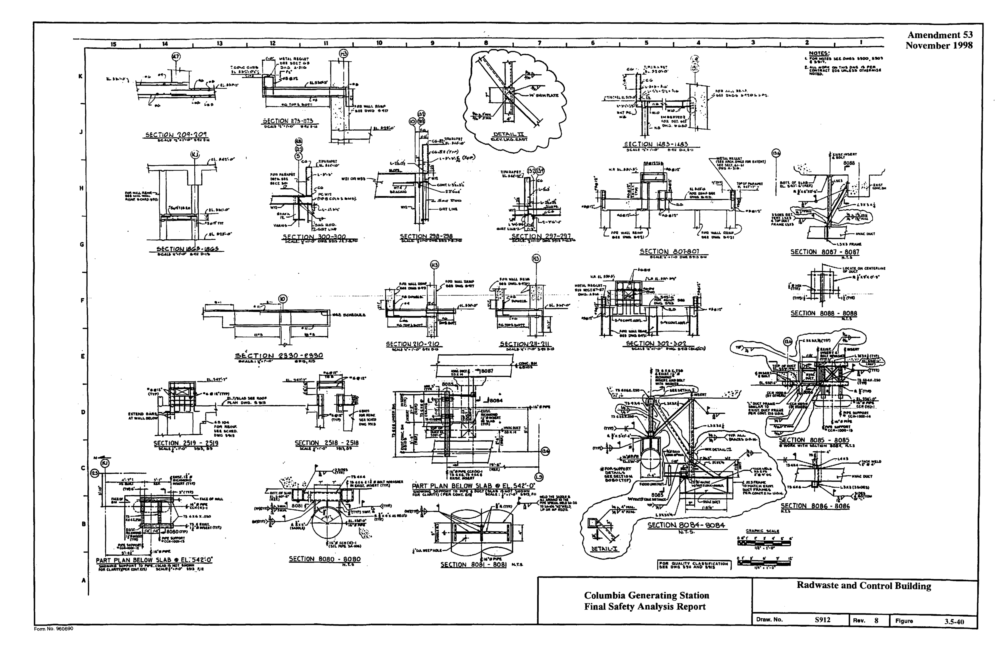
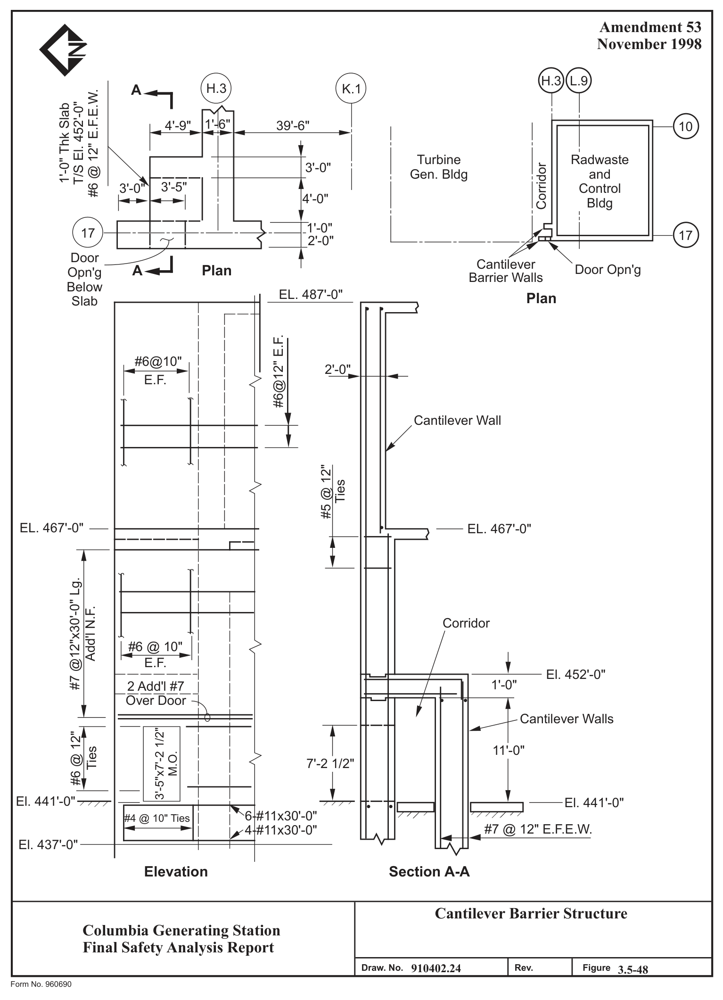

# 3.5 MISSILE PROTECTION

> Columbia Generating Station FSAR — Chapter 03: Design of Structures, Components, Equipment and Systems
> Source: `03_chapter-660-1910.pdf`, PDF pages 204–249 (of 1251)
> Amendment 67 compilation (individual pages carry varying amendment dates)

---
<!-- p.204 -->
November 1998

### 3.5 MISSILE PROTECTION
The CGS missile protection design basis conforms to 10 CFR 50, Appendix A, General Design Criteria for Nuclear Power Plants, Criterion 4, Environmental and Missile Design Bases. The objectives of missile protection design are to ensure that the plant can be brought to and kept in a safe shutdown mode and to prevent offsite radiological consequences assuming an additional single component failure.

The primary provisions incorporated into the design of the CGS facility to preclude damage to the systems necessary to achieve and maintain a safe plant shutdown are separation and redundancy. These provisions provide that in the event of an accident plus an additional active component failure, where a system required for safe (cool) shutdown is rendered unavailable, enough systems are left available to bring the plant to a safe (cool) shutdown without allowing any offsite radiological consequences. This redundancy and separation is obtained by the deliberate routing of systems, by the presence of structural floors, walls, structural steel members, and adjacent equipment which serve as barriers.

Design against generated missiles involves an initial selection process to define postulated missiles, an evaluation of postulated missile credibility, then a damage assessment to evaluate the effects of credible missiles, and finally, if necessary, to ensure safe shutdown, the provision of barriers or physical modifications of systems and components to preclude damage.

Structures housing systems and components essential for safe shutdown are designed to withstand externally generated missiles so that essential systems and components are not damaged by such missiles or by the secondary effects of such missiles.

#### 3.5.1 MISSILE SELECTION AND DESCRIPTIONS
##### 3.5.1.1 Internally Generated Missiles (Outside Containment)
###### 3.5.1.1.1 Systems Available for Safe Shutdown
Systems available outside containment to facilitate safe shutdown include: high-pressure core spray (HPCS), low-pressure core spray (LPCS), residual heat removal (RHR), standby service water (SW), reactor core isolation cooling (RCIC), control rod drives (CRD), and the reactor feedwater system (RFW). These systems and their function are described in Sections 4.6, 5.4.9, 7.3, and 7.4.

Figures 3.5-1 through 3.5-15 illustrate the location of these systems. Seismic categories, quality group classifications, and reference sections are provided in Table 3.5-1.

<!-- p.205 -->
November 1998

###### 3.5.1.1.2 Missiles Due to Rotating Equipment Failure
The systems located outside the primary containment have been reviewed to identify potential rotating equipment missiles. The design objective is to prevent the generation of missiles and their effects.

All rotating equipment (e.g., pumps, turbines, fans, and compressors) outside the primary containment have been evaluated to determine missile generation potential (postulated missiles), missile credibility, and an analysis of credible missile effects was completed.
Credible missiles outside containment, missile sources, safety-related systems requiring protection (if any), and the extent of damage to safety-related systems (if any) are listed in Table 3.5-2. All emergency core cooling systems (ECCS) rotating equipment outside the primary containment are grouped by division in different rooms or areas of the plant, separated by walls or barriers, so that a single missile cannot damage redundant systems. The walls or barriers are designed to contain all missiles.

The RCIC turbine is prevented from reaching a runaway speed, where component failure could occur, by overspeed tripping devices. However, the RCIC turbine, similar to all plant rotating equipment, is also evaluated for credible missile generation at normal full speed operation. In addition, as with the ECCS systems, the RCIC turbine is located in a separate compartment.

###### 3.5.1.1.3 Missiles Due to Pressurized Component Failure
The potential of the following equipment to generate missiles was investigated:

a. High energy piping

Pressurized piping in systems where the service temperature exceeded 200°F and/or the service pressure exceeded 275 psig was evaluated for potential generation of missiles. High energy piping pipe whip is discussed in Section 3.6.

b. Valve bonnets

1. Pressurized seal bonnets

Valves with an American National Standards Institute (ANSI) rating of 900 psig and above are pressurized seal bonnet type valves, constructed l in accordance with the American Society of Mechanical Engineers l (ASME) Boiler and Pressure Vessel (B&PV) Code Section III. Valve bonnets, on pressure seal bonnet type valves, are prevented from becoming missiles by the retaining ring, which would have to fail in

<!-- p.206 -->
November 1998

shear, and by the yoke, which would capture the bonnet or reduce bonnet energy.

The bonnet bolts preload the pressure seal gasket to seal the valve initially. When pressurized, the valve is sealed by process fluid pressure and the bonnet bolts are under no load. All ASME III, Class I, 900# bonnet seal type valves were analyzed per ASME B&PV Code Section III requirements. Valve design pressures used in these analyses were given by the ASME B&PV Code Section III, Division 1, Subsection NB, Figure NB-3545.1-2, for weld-end valves. Using a typical pressure seal valve, the total thrust load on the retaining ring and valve body was calculated. The results demonstrated that both the retaining ring and valve body meet the ASME B&PV Code Section III, Division 1, NB-3227, requirements for pressures much higher than the normal operating pressure of the valve.

The majority of valves inside containment have massive valve operators which are supported by the yoke. For these valves, the valve operators act as an additional limitation to the yoke becoming a missile.

For a yoke clamp to fail, it must be assumed that the retaining ring fails completely and instantaneously so that the bonnet could strike the yoke.
The yoke is normally under no load and complete failure of the yoke clamp is not considered credible.

Because of the highly conservative design of the retaining ring of these valves, bonnet ejection is highly improbable, and hence bonnets are not considered credible missiles.

2. Bolted bonnets

Most valves of ANSI rating 600 psig and below are valves with bolted bonnets. Valve bonnets are prevented from becoming missiles by limiting stresses in the bonnet-to-body bolting material by requirements set forth in the ASME B&PV Code Section III and by designing flanges in accordance with applicable code requirements. Even if bolt failure were to occur, the likelihood of all bolts experiencing simultaneous complete severance failure is remote. A study of bolted valve bonnets was made in which 25% of the connective bolts in the circular pattern were assumed missing. The stresses occurring under operating conditions with these bolts missing were found to be within acceptable limits. The widespread use of valves with bolted bonnets and the lack of

<!-- p.207 -->
November 1998

historical incidence of complete severance failures of bonnets confirms that bolted valve bonnets need not be considered credible missiles.

3. Screwed-typed bonnets

Some valves in the 1 in. to 1.5 in. size range have coarse threaded bonnets which screw into the valve body. These valves were analyzed and found to have low stress intensities in the bonnet retaining threads.
The valve design stress intensities were found to be a minimum of 4.5 times the stress intensities that will be experienced by the valves.
Because of the highly conservative design of these valves, they are not considered credible missiles.

c. Valve stems

Valve stems are not considered credible missiles if at least one feature in addition to the stem threads is included in their design to prevent ejection; for example, valves with backseats.

d. Thermowells and sample probes

Temperature or other detectors installed on piping or in wells are evaluated as potential missiles if failure of a single circumferential weld would cause their ejection. This is highly improbable since a complete and sudden failure of a circumferential weld is needed for a detector to become a missile. These circumferential welds were analyzed and found to have yield stress values from six to 20 times the stress intensities that will be experienced in service. Because of their highly conservative design, thermowells and sample probes are not considered credible missiles.

e. Nuts and bolts

Nuts, bolts, nut and bolt combinations, and nut and stud combinations are unlikely to fail because of the low stress intensities for these parts. The ASME and ANSI Codes limit the allowable stresses in bolts and studs to 20% to 30% of yield. These low stress intensities are ensured by measuring the torque of all bolts, studs, and nuts during installation. Because of their highly conservative design, nuts and bolts are not considered credible missiles.

<!-- p.208 -->
November 1998

f. Blind flanges

Bolted blind flanges are not considered credible missiles because of the extremely unlikely occurrence of all bolts experiencing simultaneous complete severance failure as discussed in Item b.2 above.

g. Nitrogen tanks and bottles

Nitrogen tanks and bottles in the reactor building provide nitrogen for CRDs, charging of main steam safety/relief valve (SRV), isolation valve accumulator tanks, and instrument nitrogen inside containment. These tanks and bottles have design pressures considerably in excess of their operating pressures. Because of their highly conservative design, installed nitrogen tanks and bottles are not considered credible missiles.

No credible missiles are in a position to impact any of the nitrogen tanks or bottles.

###### 3.5.1.1.4 Evaluation of Postulated Missiles
a. Assessment of postulated missile credibility

Postulated missiles are analyzed to determine if a credible failure mode resulting in a missile exists. Failure modes determined to be credible are then assessed for impact on plant safe shutdown.

b. Assessment of potential credible missile damage

The ability of the plant to achieve safe shutdown is ensured by physical separation and redundancy of safety-related systems. The adequacy of the physical separation and redundancy of safety-related systems was evaluated using the following procedure:

1. Target determination

Based on the missile location and orientation, the target areas are predicted. Trajectories are selected to encompass the most adverse conditions. The essential systems within that region are assumed damaged and not available for a safe shutdown;

<!-- p.209 -->
November 1998

2. Evaluation of system damage

The essential systems which are available after the worst postulated missile accident and the most critical additional single failure are determined. An evaluation is then made to determine whether these remaining systems are sufficient to achieve safe reactor shutdown; and

3. Protection of systems

When the separation and redundancy of the essential systems is not adequate, or when a redundant system is not available, one or more of the following measures are taken to ensure safe shutdown:

(a) The orientation of the credible missile is changed so that systems necessary for safe shutdown are not damaged,

(b) Missile barriers are provided, and

(c) It is shown that the essential components will not be damaged by the credible missile.

c. Determination of missile energies

One of the following methods is used to calculate the extent of the damage caused by a credible missile:

1. Piston-type missiles

The velocity of a piston-type missile is calculated by assuming that the work done will be converted into kinetic energy of the missile with no losses of energy due to friction or air resistance.

Work is the integral of force times displacement, while the kinetic energy of the missile is one-half the product of the missile mass times the square of the missile velocity. Assuming the applied force constant
(PAo), the kinetic energy is equated to the work done (Reference 3.5-1).
Subsequently, the missile velocity is obtained by the expression:

1/2 V = 2 PA L   o   m
(Reference 3.5-1)

<!-- p.210 -->
November 1998

where:

V = the initial velocity at the end of a piston stroke (ft/sec)

P = pressure of the fluid (psi)

Ao = cross-sectional area of the piston (in.2)

L = length of the stroke in ft

m = mass of missile (lb-sec2/ft)

2. Jet-propelled missiles

Postulated jet-propelled missiles are propelled by fluid escaping from a pressurized system in which there is essentially no lateral containment of the fluid. The escaping jet will not only impinge on the missile, but will also flow around and past the missile.

The velocity of this type of postulated missile is estimated by
(Reference 3.5-1):

    V V K 2 − − −  1 Log  1  = K - 1 e + V V N X Tan B o f f

where:

 V   V  K o o 2 K =  1 − − Log  1 − + e 1 V V N f f o

#### A A P
2 = o m b K π( m Tan B)

V = missile velocity at distance X (fps)

Vf = jet velocity = (fps)

No = radius of throat (ft)

Pf = density of the jet fluid (lb-sec2/ft4)

<!-- p.211 -->
April 2000

X = distance traveled (ft)

B = angle of jet expansion, degrees from normal

Vo = initial velocity of missiles

Ao = throat area (ft2)

Am = cross-sectional area of missile (ft2)

m = mass of missile (lb-sec2/sec)

3. Stored strain energy missiles

Stored strain energy missiles are assumed to convert all the strain energy at which they fail into kinetic energy. The velocity is calculated from the following formula (Reference 3.5-1):

1 2 / g =   V S   EW

where:

V = missile velocity (ft/sec)

E = modulus of elasticity (lb/ft2)

W = specific weight of missile (lb/ft3)

S = ultimate stress in the missile before failure (lb/ft2)

g = acceleration of gravity (ft/sec2)

4. Rotating Machinery

A variety of missiles from rotating machinery can be treated by considering each as a rotating block. Because it is part of a rotating structure, the block is considered to be initially rotating about its axis of revolution at a speed, ω, radians per second. The kinetic energy (KE) of the block is given by (Reference 3.5-4):

<!-- p.212 -->
April 2000

[ ]   1 w
( )
= 2 + 2   ω 2 − KE Rcg K , ft lb 2  g 

where:

Rcg = radius to the center of gravity (CG) of the rotating block, measured from the initial axis of rotation in the machinery, ft

K = radius of gyration of the rotating block, about the cg axis of the rotating block

w = block weight, lb

g = acceleration of gravity, ft/sec2

ω = angular velocity, rad/sec

In this expression the Rcg term gives the kinetic energy due to translation, while the K term gives the kinetic energy due to rotation of the block about its cg axis.

###### 3.5.1.1.5 Example of Postulated Missile Evaluation
a. Assessment of postulated missile credibility

The reactor protection system motor generator sets in the critical dc switchgear rooms in the reactor building (el. 467 ft 0 in.) were analyzed to determine their credibility as missiles. A structural failure of the 1800 rpm flywheel during the normal operation of the motor generator would produce high energy missiles with the potential to damage systems, components, or structures in their paths.
Motor generator set modification to eliminate or contain the flywheel missiles was evaluated, but a feasible modification was not practical. The flywheels were, therefore, credible missiles.

b. Assessment of potential credible missile damage

The flywheel missiles were postulated to exit the motor generator sets along a plane perpendicular to the motor generator set, with the missile exiting a maximum of 10 degrees from the perpendicular plane.

<!-- p.213 -->
1. Target determination

The potential targets for the flywheel missiles were determined by reviewing the applicable drawings and visual inspection of the target area in the switchgear rooms. It was determined that safety-related cables in these rooms could potentially be damaged.

2. Evaluation of system damage

The safety-related cables which could be damaged by the flywheel provide dc power to instrument panels in the control room and to isolation valves inside containment. Damage to these cables was determined to be unacceptable.

3. Protection of systems

It was determined that there was not a feasible method of providing that the cables would not be damaged by the flywheel missiles. To preclude damage to the safety-related cables, the following alternatives were investigated:

(a) The motor generator sets were analyzed to determine if a change in orientation was feasible. This was not a feasible alternative.

(b) The feasibility of constructing a barrier around the flywheel was investigated. This was a feasible alternative.

c. Barrier design

A missile barrier proved to be the only feasible alternative. The barrier was designed to contain the highest energy missile that could be produced by the flywheel. The barrier was constructed of steel and energy-absorbing aluminum honeycomb material and firmly anchored to the concrete floor. This eliminated the effects of the credible missile. A tabulation of plant systems protected by missile barriers is provided in Table 3.5-3.

##### 3.5.1.2 Internally Generated Missiles (Inside Containment)
###### 3.5.1.2.1 Systems Available for Safe Shutdown
Figures 3.5-16 through 3.5-32 describe the mechanical and instrumentation locations of systems available for a safe shutdown. Each system (LPCS, HPCS, RHR, ADS, CRD, and primary containment) is color coded to specify the location of structures, systems, or

<!-- p.214 -->
November 1998

components. In addition, the reactor protection system and containment isolation valves inside containment are available for safe shutdown of the plant and to prevent offsite radiological consequences. Information pertaining to applicable seismic category, quality group classification, and reference sections where these systems are described is provided in Table 3.5-4. The evaluation of credible missile kinetic energies and missile target determinations is discussed in Section 3.5.1.1.4. Target and barrier damage evaluations are discussed in Section 3.5.3.

###### 3.5.1.2.2 Missiles Due to Rotating Equipment
Rotating equipment inside containment consists of the following:

a. Recirculation pump and motor

The most substantial piece of nuclear steam supply system (NSSS) rotating machinery is the recirculation pump and motor. This potential missile source is discussed in Reference 3.5-4.

It is concluded in Reference 3.5-4 that destructive pump overspeed is highly improbable. If it occurred, it could result in failure of certain pump and motor components having the potential to become missiles. A careful examination of the pump and motor structure shows that rotor or shaft failure will not result in ejection of motor-generated missiles, and impeller missiles cannot penetrate the pump case. Reference 3.5-4 concludes that in the unlikely event of impeller failure resulting in ejection of missiles through ruptured pipe, penetration of containment by missile fragments is highly improbable. Evaluation of the effects on safety-related systems of impeller fragments that might be ejected from openings in ruptured pipe is not evaluated because of the extreme improbability of this event and because the effects would not be more severe than the assumed consequences of jet impingement due to pipe inside containment as discussed in Section 3.6. The recirculation pump and motor are, therefore, not considered to be credible missile sources.

b. Fans as potential missiles

The fans inside primary containment are designed such that the casing will restrain any possible missile. Therefore, fans and parts thereof are not considered as possible sources of missiles.

###### 3.5.1.2.3 Missiles Due to Pressurized Component Failure
A discussion of the potential for missile generation from the failure of pressurized components, e.g., valve stems, valve bonnets, and temperature element assemblies, is presented in

<!-- p.215 -->
November 1998

Section 3.5.1.1.3. That discussion is also applicable to pressurized components inside containment. In addition, SRV and main steam isolation valve (MSIV) accumulators are particular to inside containment.

Pressurized ASME III vessels, such as SRV and MSIV accumulators, are not considered credible missiles. These vessels have low stresses and operate in the “moderate energy” range and, therefore, any failures would be a crack-type and not of concern for missile generation.

All potential sources of postulated missiles inside the primary containment were analyzed to determine missile credibility utilizing the criteria discussed above and in Section 3.5.1.1.3, as required by General Design Criterion 4, “Environmental and Missile Design Basis.” It was determined that all postulated missiles inside the primary containment incorporated design features that eliminated their credibility as potential sources of missiles.

###### 3.5.1.2.4 Falling Objects
Structural elements, equipment, and components inside containment which could be considered as potential falling objects are evaluated in accordance with Section 3.7.2.8.

###### 3.5.1.2.5 Secondary Missiles Generated by Postulated Credible Primary Missiles
Secondary missiles are not considered credible missiles due to their low probability of occurrence and their low kinetic energy levels. The probability of damage due to a secondary missile is the probability of occurrence of a primary missile times the probability of hitting a part that can become a secondary missile times the probability that the part will actually become a missile. This probability is very low.

The level of stored kinetic energy in a secondary missile will be low because of the large energy required to produce a secondary missile. In addition, no reliable method to predict secondary missile characteristics is known, other than those characteristics in common with primary missiles.

##### 3.5.1.3 Turbine Missiles
In April 1992, the original Westinghouse shrunk-on-disc type LP rotors were removed and new Westinghouse Fully Integral LP rotors were installed. The LP turbine missile analysis is based on Fully Integral rotors using a probabilistic method (Reference 3.5-27).

It is concluded that the probability of damage to safety-related systems by turbine missiles is acceptably low, due to (a) the protection provided by reinforced-concrete structural barriers,
(b) the calculated probability of turbine missile generation, and (c) periodic testing and inspection of turbine overspeed protection systems with associated corrective action as required.

<!-- p.216 -->
April 2000

###### 3.5.1.3.1 Safety-Related Targets
Target areas which are evaluated for capability to protect safety-related equipment, components, and systems from postulated turbine missiles consist of the following:

a. Vertical targets

1. Reactor building north exterior wall,

2. Control room north wall, and

3. North wall of vertical cable chase, between reactor building and control room.

b. Horizontal targets

1. Reactor building refueling floor,

2. Roof over vertical cables chase, and

3. Floor slab above control room.

###### 3.5.1.3.2 Turbine Placement and Orientation
Figure 3.5-33 shows the turbine generator layout relative to safety-related plant structures and turbine missile target areas. Also shown on this drawing is the reinforced-concrete shield wall which acts as a barrier for protection of some safety-related targets from postulated low trajectory turbine missiles. A cross-sectional view through the turbine building and reactor building is shown in Figure 3.5-34 to indicate relative elevations of the turbine and target areas. See Figures 1.2-4, 1.2-8 and 1.2-16 for a general arrangement drawing of the turbine building, reactor building, and control building at the turbine operating floor elevation. CGS has an “unfavorable oriented” turbine generator in relation to the identified safety-related targets.

###### 3.5.1.3.3 Missile Identification and Characteristics
###### 3.5.1.3.3.1 High Pressure Turbine. Postulated missiles from the high pressure turbine (HPT)
are shown in Reference 3.5-22 to have insufficient energy to penetrate the casing at normal operating speed. At 20% overspeed (120% of normal, or rated speed), HPT missiles are postulated to penetrate the casing, but at velocities too low to reach safety-related targets. The minimum bursting speed of the high pressure turbine rotor, based on minimum specified mechanical properties of the rotor material, is 300% of the rated speed (Reference 3.5-6).

<!-- p.217 -->
The maximum speed at which the unit may rotate is 3200 rpm, which is 178% of rated speed 1800 rpm (Reference 3.5-27). At this speed the highest stressed low pressure turbine disc would fracture, damaging the turbine to the extent that additional overspeed would not be possible. Therefore, high pressure turbine missiles are not considered.

3.5.1.3.3.2 Low Pressure Turbine. Each low pressure turbine consists of a double-flow rotor assembly, an outer cylinder, two inner cylinders, and stationary blade rings. The rotor is a fully integral, single forging consisting of the shaft, disks, and couplings without any shrink fits or keyways and is made with low stress corrosion cracking (SCC) susceptible materials.

Westinghouse Report “Analysis of the Probability of the Generation of Missiles from Fully Integral Nuclear Low Pressure Rotors” (Reference 3.5-27) states

To assess the probability of missile generation resulting from a burst of a fully integral nuclear low pressure rotor, five potential failure mechanisms are considered:

a. Ductile burst,

b. Fracture resulting from high cycle fatigue cracking,

c. Fracture resulting from low cycle fatigue crackingstartup/shutdown cycles,

d. Fracture resulting from stress corrosion cracking, and

e. Destructive overspeed.

All the listed failure mechanisms demonstrate that the new Fully Integral rotor design significantly reduces the likelihood of missile generation, except for the destructive overspeed mechanism.

The probability of reaching a destructive overspeed for the Fully Integral LPT rotor is primarily dependent on the DEH control system, which functions to avoid this condition.

<!-- p.218 -->
###### 3.5.1.3.4 Strike and Damage Probability
A probabilistic approach is adopted to assess the possibility of damage to systems required for safe shutdown or of accidents which could result in potential offsite exposure due to high trajectory missiles. The probability of this occurring is represented by combined probabilities of

P4 = P1 x P2 x P3

where:

P1 = missile generation probability

P2 = probability of a missile striking a structure or component required for safe shutdown or whose failure could result in release of radioactivity

P3 = probability of significant damage to the structure or component

P4 = combined overall probability

The terms and assumptions applicable to this analysis follow the procedures outlined by S. H. Bush in Reference 3.5-7.

3.5.1.3.4.1 Missile Generation Probability. Missile generation probability is based on the failure probability of the Fully Integral rotor design (installed 1992) and the turbine overspeed protection system. The dominant failure mechanisms of the rotor are SCC and turbine overspeed. The P1 values for SCC were provided by Westinghouse (References 3.5-27 and
3.5-28) and meet the requirements of the NRC Safety Evaluation Report (SER) for specific turbine inspection and testing intervals. However, the SER states the NRC position that the LP rotor operation, maintenance, and inspection programs be based on the P1 values being less than the 1 x 10-5 probability requirement for loading the turbine without inspection or inservice restriction. This value is applicable to the CGS unfavorably oriented turbines.

<!-- p.219 -->
The P1 values for the CGS low pressure turbine Fully Integral rotors for stress corrosion cracking are

Inspection P1 at Rated P1 at 20% Interval (years) Running Speed Overspeed

4.0 x 10-14 1.4 x 10-14 4 8.8 x 10-11 2.0 x 10-11 8 4.3 x 10-9 7.7 x 10-10 12 5.1 x 10-8 7.9 x 10-9 16 8.3 x 10-6 8.9 x 10-7 32

The probability for SCC at 20% overspeed (120% of normal or rated speed) is lower than the SCC at rated speed condition, and therefore not considered in determining the overall strike and damage probability of turbine-generated missiles (Reference 3.5-28).

As with previous rotor designs (including the CGS original built-up rotors and current Fully Integral rotors), the potential exists for SCC to be the dominant failure mechanism depending on inspection interval (Reference 3.5-29). However, in Fully Integral rotor designs, the probability of failure by the SCC mechanism has been reduced drastically and the analysis shows that at the normal inspection interval established by the preventive maintenance (PM)
program of 80,000 to 100,000 running hours (translates to 10-12 years), the contribution from SCC to P1 would be approximately 4.3 x 10-9. Considering typical use factors for nuclear turbines, and considering that the crack locations are readily observable during routine turbine maintenance and inspection per the PM program, it is concluded that the NRC safety criteria of P1  1 x 10-5 will not be exceeded.

The methodology developed to calculate the probability of missile generation due to overspeed events identifies three turbine overspeed events that can result from the failure of the turbine valves to close following a system separation or a total loss of load (References 3.5-30 and
3.5-31). These overspeed events are design overspeed (approximately 120% of rated turbine speed), intermediate overspeed (approximately 130%), and destructive overspeed (runaway speed in excess of approximately 180%). Design overspeed is assumed when a system separation occurs and a turbine trip does not occur at event initiation, one or more governor valves or two or more interceptor valves fail to close immediately, and a successful overspeed trip closes the throttle valves and reheat stop valves. Intermediate overspeed is assumed to occur when there is a system separation and one or more alignment of reheat stop valves and interceptor valves fail to close. Destructive overspeed is assumed to occur when a system separation occurs and at least one governor valve and one throttle valve in the same steam chest fail to close.

<!-- p.220 -->
Missile generation probability analyses (References 3.5-30 and 3.5-31), indicate that the design and intermediate overspeed failure probabilities are not major contributors to turbine missile ejection probability for plants with fully integral low pressure rotors.

The P1 value for turbine overspeed is derived from the probability of failure of the turbine overspeed protection system in a manner that results in destructive overspeed and includes consideration for periodic turbine valve testing. Additionally, the P1 value includes conservatism to account for design and intermediate overspeed missile generation. The overspeed protection system is a fault tolerant, redundant, digital electro-hydraulic turbine control and overspeed protection system (installed-May 2007). The system has the capability of failure detection and on-line repair of critical components. The missile generation probability analysis for potential turbine overspeed yields a missile generation probability of
3.4 x 10-6 for P1 based on a twelve month turbine valve testing interval (Reference 3.5-32).

Combining the SCC mechanism (assuming inspection at 12 year intervals) and the destructive overspeed mechanism to establish a combined P1 value for missile generation, yields a probability of turbine missile generation of 3.4 x 10-6.

3.5.1.3.4.2 Strike Probability (P2) and Damage Probability (P3). Rather than performing elaborate calculations for site-specific strike and damage probabilities as previously performed for the disc type rotors, generally accepted industry typical values were used for P2 and P3.
For CGS, the product of P2 * P3 is 1 x 10-2 for unfavorably oriented turbine generators
(Reference 3.5-28).

3.5.1.3.4.3 Combined Overall Probability (P4). Assuming the longest turbine inspection interval of 12 years and a destructive overspeed probability assuming a twelve month turbine valve test interval, the highest overall damage probability for postulated missiles is then calculated by

P4 = P1 * P2 * P3 = (3.4 x 10-6) * (1 x 10-2)
= 3.4 x 10-8 (which is acceptably less than the NRC safety criteria of P4 < 1 x 10-7)

###### 3.5.1.3.5 Turbine Overspeed Protection System and Testing
A single failure in the overspeed sensing and turbine trip systems will not prevent overspeed protection from operating. The turbine generator is equipped with a fault tolerant and redundant DEH control system.

The DEH control system, with its overspeed protection features and inspection and testing requirements, is described in Sections 7.7.1.5 and 10.2.

<!-- p.221 -->
###### 3.5.1.3.6 Turbine Valve Testing
Turbine valve testing is discussed in Section 10.2.

###### 3.5.1.3.7 Turbine Characteristics
For information characterizing the Westinghouse turbines used at CGS, refer to Westinghouse report covering the effects of a high pressure turbine rotor fracture (Reference 3.5-6) and low pressure turbine forged integral rotor fractures, (Reference 3.5-27). Therein, the low-pressure disc materials, manufacturing processes, and operating conditions are stated.

##### 3.5.1.4 Missiles Generated by Natural Phenomena
The consideration of potential missiles injected or suspended in a tornado wind stream is based on References 3.5-8 and 3.5-12.

All Seismic Category I and safety-related structures and components are designed to include the effects of missiles generated by the design basis tornado described in Section 3.3.2 except as noted in Sections 3.5.1.4.1 and 3.5.2. Missiles are categorized as either external or internal missiles. External missiles are materials and/or items usually found outside and in the immediate vicinity of the buildings, whereas internal missiles are materials and/or items found inside the buildings. Descriptions, properties, and impact velocities of the design-basis tornado-generated external missiles are shown in Table 3.5-5. Tornado missile protection provided by plant structures is described in Section 3.5.1.4.1. Those structures have adequate thickness to prevent penetration, perforations, and backface spalling. The basis for evaluating missile penetration is discussed in Section 3.5.3. The protection provided for external and internal missiles is discussed in Sections 3.5.1.4.1 and 3.5.1.4.2, respectively.

Figures 1.2-1 through 1.2-24 indicate the location of structures, equipment, and components protected against tornado-generated missiles.

###### 3.5.1.4.1 Tornado-Generated External Missiles
Structures that house systems, equipment, and components essential to safe shutdown are designed to withstand the effects of design-basis tornado-generated missiles described in Section 3.5.1.4. These structures provide protection by the following means:

a. Reactor building

The location of the reactor building with respect to the other plant structures is illustrated in Figure 1.2-1. Portions of the reactor building exterior walls are protected by adjacent structures against direct impact of tornado generated missiles, as indicated in Figure 3.5-35. The exterior walls of the reactor

<!-- p.222 -->
building, up to the refueling floor at el. 606 ft 10.5 in., are capable of withstanding the impact of the design basis tornado generated missiles. The exterior walls are constructed of 4 ft thick reinforced concrete to el. 471 ft 0 in.
which is 30 ft above plant finish grade. From el. 471 ft 0 in. to the refueling floor at el. 606 ft 10.5 in., the exposed exterior walls are constructed of reinforced concrete, 18 in. minimum in thickness. The reactor building exterior wall thickness from plant grade to the refueling floor at el. 606 ft 10.5 in. is adequate to prevent design basis missile penetration and spalling of concrete.
(See Figures 3.5-36 through 3.5-38.)

The refueling floor at el. 606 ft 10.5 in. comprises the spent fuel storage pool, dryer/separator pool, and various other items of refueling equipment. The reactor building walls and roof above this floor are constructed of insulated metal siding and insulated metal roof decking erected on a superstructure consisting of a structural steel frame as indicated in Figures 1.2-11 and 1.2-12.
The superstructure also supports the overhead bridge crane. The refueling floor at el. 606 ft 10.5 in. is constructed of reinforced concrete of various thicknesses, with a minimum thickness of 18 in. The walls and floor of the pools have a minimum thickness of 5 ft. The equipment on the refueling floor is not required for safe shutdown. The refueling floor and the walls and floor of the pools are sufficiently thick to withstand the effects of the design basis missiles, and to prevent secondary missile effects caused by spalling of concrete. A missile impacting the spent fuel pool does not have sufficient energy to damage the equipment and spent fuel located in the pool, as discussed in Reference 3.5-12.

b. Diesel generator building

The exposed exterior walls of the structure are constructed of reinforced concrete with a minimum thickness of 2 ft 8 in. The roof has a minimum thickness of 1 ft 6 in. The thicknesses of walls and roof are sufficient to withstand the effects of the design-basis tornado-generated missiles.
Figures 1.2-22 and 3.5-42 through 3.5-44 illustrate this structure.

c. Radwaste and control building

The exposed exterior concrete walls and roofs, housing safety-related systems, equipment, and components are designed to withstand the effects of the design-basis tornado-generated missiles. Figures 1.2-13 through 1.2-17 illustrate the radwaste and control building and their relative location in the plant complex. The exterior walls that house safety-related equipment have a minimum thickness of 2 ft. The roof of the portion of the building that houses safety-related equipment is 1 ft 6 in. thick (see Figure 3.5-45).

<!-- p.223 -->
d. Standby service water pump houses and spray ponds

The exterior walls of both pump houses are constructed of reinforced concrete and are 2 ft 4 in. thick, minimum. The roofs of the pump houses are 1 ft thick.
These thicknesses are adequate to withstand design-basis tornado-generated missiles. In addition, the two pump houses are redundant to each other. In the event that one pump house is inoperable, the other is capable of providing sufficient service water for safe shutdown. See Figures 3.5-46 and 3.5-47.

The ability of the spray ponds to tolerate the design-basis tornado-generated missiles is discussed in Section 3.3.2.3.

Figure 1.2-20 illustrates the pump houses and spray ponds.

e. Makeup water pump house

The exterior walls and roof of the makeup water pump house are of reinforced concrete and are sufficiently thick to withstand the effects of the design-basis tornado-generated missiles, as discussed in Section 3.3.2.3. The exterior walls, with the exception of the equipment access opening, are 2 ft 4 in. thick and the roof slab is 1 ft 4 in. thick. Figures 1.2-1, 1.2-23 and 1.2-24 furnish its location and arrangement. The 8 ft 0 in. by 10 ft 0 in. equipment access opening is protected by a 14-in.-thick concrete door.

f. Turbine building

Safety-related components in the turbine building are located in areas where tornado missile protection is provided by reinforced-concrete exterior walls, a minimum of 18 in. in thickness, and two reinforced-concrete slabs overhead, at el. 471 ft and 501 ft. Figures 1.2-2 through 1.2-6 illustrate the turbine building.

g. Safety-related systems outside of tornado-hardened structures

The protection provided to the pipe lines and electrical lines located underground between the spray ponds, SW pump houses, makeup water pump houses, reactor building, and the diesel generator building is described in Sections 3.5.2 and 3.5.3. The protection provided to the critical electrical trays in the corridor between the turbine generator building and the radwaste and control building is also described in Sections 3.5.2 and 3.5.3.

<!-- p.224 -->
###### 3.5.1.4.2 Tornado-Generated Internal Missiles
The tornado-generated internal missiles as mentioned in Section 3.5.1.4 are materials and/or items attached to or found inside a building, but subjected to the design basis tornado described in Section 3.3.2 as a result of a loss of a building exterior wall or roof. The materials and/or items considered as potential tornado-generated internal missiles are discussed below.

a. The reactor building steel framed superstructure uses girts and roof purlins fastened to the building frame by means of controlled release fasteners. The steel girts and purlins are considered to become free falling tornado-generated internal missiles which can strike the roof of the diesel generator building, the radwaste and control building, and main steam corridor slabs, in the event a tornado blows the roofing and/or siding off of the building frame. Structures housing safety-related systems, equipment, and components are designed to withstand the effects of these missiles.

b. In the event that a tornado blows the roof purlins, roof decking, girts, and siding panels off the reactor building frame, the reactor building crane is then exposed to the design basis tornado. The reactor building crane is designed with provisions which preclude it, or any part thereof, from becoming a missile (see Section 3.3.2.3).

###### 3.5.1.4.3 Flood Generated Missiles
The design basis flood el. discussed in Section 3.4 and defined in Section 2.4, exceeds the flood levels associated with breaches of the Grand Coulee Dam. The final plant grade level is higher than the design basis flood. Therefore, flood-generated missiles are not considered in the design of the Seismic Category I safety-related structures and installations.

###### 3.5.1.4.4 Protection and Design
Systems protected from missiles generated by natural phenomena, and barrier design are described in Sections 3.5.2 and 3.5.3 respectively.

##### 3.5.1.5 Missiles Generated by Events Near the Site
Hazards due to missiles postulated in the design basis explosions or accidents at nearby industrial plants, military facilities, pipe lines, or storage facilities can be discounted as discussed in Section 2.2.

The Hydrogen Storage and Supply Facility (HSSF) contains a liquid hydrogen storage tank, ASME tubes (gaseous hydrogen), trailer tubes (gaseous hydrogen) and a hydrogen pipeline to the plant. An analysis shows that an explosion and subsequent missile generation from a

<!-- p.225 -->
random tank rupture at normal pressure would not affect the plant due to the remote distance of the facility. Another analysis shows that an overpressurization event and subsequent rupture of the liquid hydrogen tank is a credible event. However, the total annual probability of impact for any of the missiles generated is less than 10-7 and does not meet the threshold for consideration as a design basis event. The hydrogen storage containers have relief valves to prevent overpressurization.

##### 3.5.1.6 Aircraft Hazards
NUREG-0800, Standard Review Plan, Section 3.5.1.6, “Aircraft Hazards,” provides guidance to ensure that the risks from aircraft hazards are low enough for nuclear power plants. If the distance at which aircraft activity occurs meets all the criteria provided in the following, the probability of an aircraft accident resulting in radiological consequences greater than the exposure limits in 10 CFR 50.67 can be considered to be less than about 10-7 per year and no additional analysis is required (Reference 3.5-16):

a. The plant-to-airport distance (D) is between 5 and 10 statute miles, and the projected annual number of operations is less than 500 D2, or D is greater than 10 statute miles and the number of operations is less than 1000 D2,

b. The plant is at least 5 statute miles from the edge of military training routes, including low-level training routes, except for those associated with a use greater than 1000 flights per year or where activities (such as practice bombing)
may create an unusual stress situation, and

c. The plant is at least 2 statute miles beyond the nearest edge of a federal airway, holding pattern, or approach pattern.

Additionally, aviation crashes associated with general aviation (light planes, <12,500 lb) may be excluded from this analysis, as tornado design-basis requirements establish structural requirements sufficient to protect safety-related structures, systems, and components against these types of events (Reference 3.5-17).

###### 3.5.1.6.1 Airports
There are no active airports located within 10 statute miles of the CGS site, but there are two commercial airports and six private airports which are active within 20 miles of the site. The annual number of operations of flights from these airports of less than 1000 D2 is satisfied for all aviation uses at the commercial airports, including general, airtaxi, freight, and commercial traffic.

<!-- p.226 -->
###### 3.5.1.6.2 Military Airspace Use
The airspace over the Hanford site is periodically used as a marshaling area for military aircraft participating in training missions at the Yakima Training Center. A low-level military training route associated with this training passes above the western edge of the Hanford site about 18 miles west of CGS (Reference 3.5-18). Thus Criterion 2 associated with military use is also satisfied.

###### 3.5.1.6.3 Federal Airways and Airport Approaches
CGS does not satisfy the third criterion identified in Section 3.5.1.6 of being at least 2 statute miles beyond the nearest federal airway, holding pattern, or approach pattern. Therefore, the probability of an aircraft accident resulting in an exposure greater than 10 CFR 50.67 limits has been evaluated.

Figure 2.2-3 shows the commercial airports, low-level federal airways, and airport instrument approaches in the vicinity of the CGS site. Airway V187 (with a minimum altitude of 3500 ft mean sea level) passes over the CGS site. The 14 nautical mile (NM) instrumented approach pattern is also important to the CGS site. Aircraft tend to maintain significant altitude over the Hanford site because of a request by the Federal Aviation Administration (FAA)
(Reference 3.5-18).

The Tri-City Airport traffic supervisor provided a conservative estimate of 7500 flights per year that can be expected through airway V187 and the 14 NM approach (Reference 3.5-19).
The number obtained is for flights by aircraft that are under instrument flight rule (IFR) flight plans. Aircraft that leave the airport in the general direction of V187 and that are under visual flight rules do not have to file a flight plan and are not required to follow the airway. For the purpose of this evaluation, the total number of aircraft flying through the airspace over CGS is assumed to be those constrained to the airway V187 and those using the 14 NM instrumentapproach path (i.e., 7500 per year). Other flight paths are either sufficiently far away (more than 2 miles) with sufficiently low volume or are not currently active.

The aircraft using the Richland Airport may also pass over the CGS airspace. However, the only aircraft over 12,500 lb expected to use this approach would be ambulance (Life-Flight)
aircraft using the Richland Airport under adverse weather conditions. Other aircraft activities possibly impacting the CGS site include activities conducted by/for the Department of Energy or their contractors on the Hanford site. These typically consist of less than 10 low-level flights per year over the entire Hanford site airspace (Reference 3.5-19). The additional risk posed by these operations is expected to be very low and is sufficiently bound by the conservatisms used in the above estimates.

<!-- p.227 -->
The probability per year (PPY) of an aircraft crashing into the plant can be expressed as
(Reference 3.5-16) equation 3.5.1.6-1:

PPY = C x N x Aeff/w

where:

C = In-flight crash rate per mile for aircraft using airway

N = Number of flights per year along the airway

w = Width of airway in miles

Aeff = Effective area of the plant in square miles.

The effective area of the facility is the ground surface area covered by all flight crash trajectories that could impact the surface structure. This area is larger than the facility itself because of the possibility of the aircraft skidding across the ground before hitting the facility as well as the possibility of a direct hit on the structure before striking the ground. The effective area is the sum of the structure’s area, the shadow area (behind the structure), and the aircraft skid area (in front of the structure).

###### 3.5.1.6.4 Summary
The probability per year, estimated per Reference 3.5-16, is 9.07 x 10-8. Thus, the probability of an aircraft accident resulting in radiological consequences exceeding 10 CFR 50.67 limits is below 10-7/year. Therefore, aircraft are discounted as credible missiles and accidents involving aircraft are not considered design basis events.

#### 3.5.2 SYSTEMS TO BE PROTECTED
The structures, systems, and components necessary for bringing the plant to a safe shutdown and the protection provided for these structures, systems, and components from missiles is discussed in Sections 3.5.1 and 3.5.2.

Protection provided for the safety-related structures located outdoors against tornado-generated missiles is described in Section 3.5.1.4 and by turbine missiles in Section 3.5.1.3.

The plant structures, systems, equipment, and components that are required to bring the plant to a safe shutdown condition, or whose failure could lead to offsite radiological consequences under accident conditions, are protected from external (outdoor) missiles by barrier structures or redundant systems as follows:

<!-- p.228 -->
a. The exposed exterior walls of safety-related structures are designed to protect internal structures, systems, and components. Structures with such exposed exterior walls are described in Section 3.8.4 and shown in figures referred to therein. Figure 3.5-35 illustrates exterior walls subject to tornado-generated missile impact.

b. All openings for heating, ventilation, and air conditioning system fresh air intakes (FAI) and exhausts (EXH), in buildings housing safety-related equipment, are protected against externally generated missiles as indicated in Table 3.5-6. Examples are the louvered openings above the floor at el. 572 ft 0 in. in the north and south walls of the reactor building. These openings are protected by a labyrinth of missile shield walls inside the opening.

c. The SW and the TMU pipelines and electrical lines between the SW pump houses, the TMU pump house, the reactor building, and the diesel generator building are located below grade and are protected from external missiles by sufficient Quality Class I earth cover of high relative density (described in Section 3.5.3). The TMU system is required for safe shutdown only when both spray ring headers are lost to tornado missiles (see Section 3.3.2).

d. The two SW pump houses, the tower makeup water pump house, and the valve boxes along the cooling tower makeup water lines are tornado-hardened (see Section 3.5.3).

e. As described in Sections 3.8.4.1.5 and 3.3.2.3, the spray ponds (except spray headers) are below grade and are protected from external missiles by sufficient Quality Class I earth backfill of high relative density. The spray headers are not required to be protected from tornado missiles.

f. The critical electrical trays in the corridor between the turbine generator building and the radwaste and control building are protected from possible missiles by the cantilever wall on column line 17 (Figure 3.5-48) and the additional 10 ft 0 in. high cantilever barrier wall immediately east of it. The 10 ft 0 in. high barrier wall provides missile protection for the door at el. 441 ft 0 in. on column line 17. Although the trays are above the door level and do not require missile protection provided by the 10 ft 0 in. high wall, the protection is provided, as shown in Figure 3.5-48.

g. The 18 in. CW piping used to provide service water return flow to the CW basin following a tornado has been analyzed to withstand the effects of all postulated tornado missiles, assuming that it is embedded in soil with the surface of the soil flush with the top of the pipe.

<!-- p.229 -->
h. The tower makeup water (TMU) pipe lines and electrical lines between the TMU pump house and the SW pump houses are located below grade and are protected from external missiles by sufficient Quality Class I earth cover.

i. Portions of the following underground and aboveground piping associated with the diesel oil system are safety related. However, tornado missile protection is not provided to that piping. In the event of damage to the fill and vent connections due to tornado missiles, there are tank pump out connections and unused flanged connections on the storage tank which can be used as fill and vent openings.

1. Diesel oil day tank overflow and drain to storage tanks,
2. Diesel oil storage tank fill and vent lines, and
3. Filter-polisher unit recirculation piping.

#### 3.5.3 BARRIER DESIGN
The barrier design objectives emphasize missile containment and structural integrity without secondary missile generation.

The overall response of barriers subject to impact are investigated by the use of general energy equations given in Reference 3.5-9. On determination of penetration depth and duration of impact, an effective dynamic force is computed. The additional calculation of the natural period of the target structure and the selection of a ductility ratio facilitates the determination of the required structural resistance. In this manner, missile impact is translated to an equivalent static load in an effort to quantify bending moments and shear. The detailed method used for predicting the overall response of missile barriers, including the forcing function method of determining ductility in structural elements and the basis for the ductility ratios used in the calculations, is provided in Appendix C of Reference 3.5-13 that was approved by the NRC.

##### 3.5.3.1 Concrete Barriers
Concrete missile barriers are designed in accordance with penetration equations such as the modified Petry equation (Reference 3.5-2), the Ballistic Research Laboratory formula
(Reference 3.5-1), or the modified NDRC formula (Reference 3.5-14). In all cases, except for barriers exposed to turbine missiles, a minimum concrete thickness of 2.2 times the penetration thickness determined for an infinitely thick slab is provided to prevent perforation, spalling, or scabbing. For discussion of turbine-generated missiles, see Section 3.5.1.3.

<!-- p.230 -->
##### 3.5.3.2 Steel Barriers
The Ballistic Research Laboratories Formula (Reference 3.5-1) is used to determine penetration depths of missiles into steel barriers.

##### 3.5.3.3 Earth Barriers
When the protective barrier is of earthen origin, the soil penetration studies are based on alternate techniques. Buried safety-related piping and electrical systems required for a safe shutdown are ensured adequate protection from tornado-generated missiles. The original embedment depth of 5 ft was calculated to provide acceptable protection for the original design-basis tornado/missile parameters. The current design-basis tornado/missile parameters are now less severe and are used for any required evaluations for protection from postulated missiles. Based on the specific circumstances, the required embedment may be less than the original 5 ft.

##### 3.5.3.4 Applications
Examples of barrier design are as follows:

Steel covers for manholes containing cabling for safety-related equipment required for safe shutdown are designed to withstand tornado-generated missile impact and associated wind pressure. These steel plates are designed using conventional elastic analysis and design methods for determining stress and strain. The design uses two plates of ASTM A 514 steel plate to prevent penetration and blowout.

The reactor building vehicle air lock (railroad bay) exterior doors and the SW pump house exterior equipment doors are designed and certified by the manufacturer to withstand the effects of tornado-generated exterior missiles as described in Section 3.5.1.4.

All other doors in Seismic Category I and safety-related structures are not designed to withstand the effects of the missiles described in Section 3.5.1. These doors are backed up, wherever missile protection is required, with reinforced-concrete walls forming a labyrinth behind the door. Similarly, louvers in exterior walls, which are vulnerable to missile penetration, are backed up by reinforced-concrete plenums or walls.

Based on the selection and description of missiles cited in Section 3.5.1, the interaction of missiles with structural elements is determined and the results are given in Section 3.5.1.4.1.
The tabulations assume the missiles to impact at the most vulnerable point of a structure or component (e.g., at the center of a slab).
l The reactor protection system motor generator sets flywheels located in the critical dc I switchgear rooms at el. 467 ft 0 in. in the radwaste building were analyzed and determined to be credible missile sources, with the potential consequences affecting the safe shutdown of the

<!-- p.231 -->
plant. Barriers were constructed around these flywheels of steel and aluminum honeycomb material, which were designed to contain the credible missiles (see Section 3.5.1.1.5).

The SW piping between the SW pump houses, the reactor building, and the diesel generator building is provided with sufficient cover for protection from tornado-generated missiles (see Section 3.5.3.3). The SW piping exits the pump houses at a centerline el. of 435 ft 3 in. and immediately turns down at a 45 degree angle to el. 432 ft, where the piping is routed to the reactor building in high relative density Quality Class I backfill. Grade level is at 440 ft 6 in., providing an embedment depth of over 7 ft from the top of the pipe. Where the pipe exits the pump houses, a 1.5-in. asphaltic concrete road with a 6-in. base coarse and 2-in. leveling coarse bed provides additional protection from tornado-generated missiles. Additionally, the two SW loops are separated by at least 20 ft to preclude loss of redundancy.

The tower makeup water piping to the river is embedded in sufficient Quality Class I backfill for protection of tornado-generated missiles (see Section 3.5.3.3).

The control room remote air intake structure piping is embedded a minimum of 5 ft for protection from tornado-generated missiles. The remote air intake structures are also missile-hardened.

#### 3.5.4 REFERENCES
3.5-1 Gwaltney, R. C., “Missile Generation and Protection in Light Water Cooled Power Reactor Plant,” Oak Ridge National Laboratory.

3.5-2 Amerikan, A., “Design of Protective Structures,” Bureau of Yards and Docks No. NAVDOCKS P-51, 1950.

3.5-3 Cottrell, W. B., Savolainen, A. W., U.S. Reactor Containment Technology, Oak Ridge National Laboratory and Bechtel Corporation, August 1965.

3.5-4 Langley, D. K., Robare, D. J., Analysis of Recirculation Pump under Accident Conditions, Rev. 2, General Electric Company, March 30, 1979. Transmittal letter, from D. J. Robare, G. E., to D. B. Vassallo, NRC, March 30, 1979.

3.5-5 Regulatory Guide 1.115, Rev. 0, “Protection Against Low Trajectory Turbine Missiles.”

<!-- p.232 -->
3.5-6 CT-24022, Rev. 0, December 1978, Westinghouse Turbine Missile Report
(HP 296/LP 281).*

3.5-7 Bush, S. H., Probability of Damage to Nuclear Components Due to Turbine Failure, Nuclear Regulatory Commission, Washington D.C., November 1972.

3.5-8 Bates and Swanson, “Tornado Design Considerations for Nuclear Power Plants,” American Nuclear Society, November 1967.

3.5-9 Biggs, J. M., Introduction to Structural Dynamics, McGraw Hill, New York, 1964, Chapter 2.

3.5-10 Air Force Design Manual, “Principles and Practices for Design of Structures,” AFSNC-TDR-62-138, Chapter 7, December 1962.

3.5-11 Regulatory Guide 1.14, Rev. 1, “Reactor Coolant Pump Flywheel Integrity,” August 1975.

3.5-12 Miller, D. R., and Williams, W. A., Tornado Protection for the Spent Fuel Pool, General Electric Company, APED-5696, November 1968.

3.5-13 Burns and Roe, Inc., “Protection Against Pipe Breaks Outside Containment,” Hempstead, New York, Report No. WPPSS-74-2-R3, April 1974.

3.5-14 Kennedy, R. P., “A Review of Procedures for the Analysis and Design of Concrete Structures to Resist Missile Impact Effects,” Nuclear and Systems Sciences Group, Holmes and Narver, Inc., September 1975.

3.5-15 “Analysis of the Probability of the Generation and Strike of Missiles from a Nuclear Turbine,” Westinghouse Electric Corporation Steam Turbine Division Engineering, March 1974.

3.5-16 NUREG-0800, NRC Standard Review Plan, Section 3.5.1.6, July 1981.

3.5-17 Policy, Technical, and Licensing Issues Pertaining to Evolutionary and Advanced Light-Water Reactor (ALWR) Designs, SECY-93-087.

* Applicable for original HPT and LPT Rotors, not the replacement Fully Integral (FI) LPT rotors. Superseded by 3.5-27.

<!-- p.233 -->
3.5-18 Seattle Sectional Aeronautical Chart, 54th Edition, U.S. Department of Commerce, National Oceanic and Atmospheric Administration, National Ocean Service, Washington D.C., January 1, 1998.

3.5-19 Lowry, P. P., SAIC, personnel communication, Contact with Local Organizations to Support WNP-2 SAR Chapter 1 (Memo 001ppl.98 to WNP-2, Safety Analysis Report File, April 1, 1998), Science Applications International Corporation, Richland, Washington.

3.5-20 Kimura, C. Y., C. T. Bennett, G. M. Sandquist, and S. Smith, Aircraft Accident Data Development for Aircraft Risk Evaluation to Ground Facilities through the Use of a G.I.S., UCRL-JC-118793, Lawrence Livermore National Laboratory, Livermore, California, 1995.

3.5-21 CT-24076, Rev. 1, July 1980. Westinghouse “Methodology for Calculating the Probability of a Missile Generation from Rupture of a Low Pressure Turbine Disc.” *

3.5-22 CT-24896, Rev. 0, December 1980. Westinghouse “Turbine Missile Report,”
(HP296/LP281).”*

3.5-23 CT-24870, Rev. 1, March 1981. Westinghouse “Turbine Missile Report, Results of Probability Analysis of disc Rupture and Missile Generation.”*

3.5-24 “Cracking in Low Pressure Turbine Discs,” IE Information Notice No. 79-37, letter from R. J. Engelken, NRC, to N. O. Strand, WPPSS, December 28, 1979.*

3.5-25 “Structural Analysis and Design of Nuclear Plant Facilities,” Chapter 6 (Design Against Impulse and Impact Loads) ASCE Manuals and Reports on Engineering Practice No. 58, 1980.*

3.5-26 MSTG-1-P, Westinghouse Final Report for NRC Use, “Criteria for Low Pressure Nuclear Turbine Disc Inspection,” June 1981.

3.5-27 WSTG-4NP, October 1984. Westinghouse Report Submitted to the NRC, “Analysis of the Probability of the Generation of Missiles from Fully Integral Nuclear Low Pressure Rotors.”

* Applicable for original HPT and LPT Rotors, not the replacement FI LPT rotors.
Superseded by Reference 3.5-27.

<!-- p.234 -->
3.5-28 WESS-90-008, June 26, 1990. Westinghouse Letter with FI Rotor Missile Analysis Information with NRC’s SER response.

3.5-29 Westinghouse Letter, May 4, 1991, “Requested Information on Turbine Missile Probabilities” with Fully Integral Rotor Overspeed Analysis Summary.

3.5-30 WCAP-11525, June 1987. Westinghouse “Probabilistic Evaluation of Reduction in Turbine Valve Test Frequency.”

3.5-31 WCAP-14732, Revision 1, June 1997. Westinghouse “Probabilistic Analysis of Reduction in Turbine Valve Test Frequency for Nuclear Plants with Westinghouse BB-296 Turbines with Steam Chests.”

3.5-32 ME-02-06-16, Revision 1, December 2007. DEH/Pressure Control Upgrade Frequency.

<!-- p.235 -->
Table 3.5-1

Systems Description Outside Containment

Systems Available for a Seismic/Quality Safe Shutdown Function Section Figures Class

RCIC Maintain RPV 5.4.6, 3.5-9 I/I water inventory 7.4.1.1 through

HPCS Maintain RPV 6.3, 3.5-9 I/I water inventory 7.3.1.1.1.1 through

SW Heat rejection 7.3.1.1.6 3.5-9 I/I through

RHR A Maintain water 5.2, 3.5-1 I/I B inventory and decay 7.3.1.1.1.4, through C heat removal 6.3, 5.4.7 3.5-8

CRD Reactivity control 7.7.1.2 3.5-15 I/I

RFW Maintain RPV 5.4.9 3.5-9
-water inventory through

LPCS Maintain RPV 6.3, 3.5-1 I/I water inventory 7.3.1.1.1.3 through

Note: Identification of missiles to be protected against, their sources, and bases for selection are discussed in Section 3.5.1.1.3. The ability of the structures, systems, and components to withstand the effects of selected internally generated missiles is discussed in Section 3.5.1.1.2.

<!-- p.236 -->
Amendment 66 COLUMBIA GENERATING STATION December 2021 FINAL SAFETY ANALYSIS REPORT

Table 3.5-2

Internally Generated Missiles Outside Containment

Seismic/ Resolution Quality Code Equipment Class Notes Description Missile Number

F-7 RRA-FN-6 RCIC pump room fan coil fan 1/1 (a)

(a) 1/1 F-9 RRA-FN-2 MS fan coil fan

(b) F-11 RRA-FN-7 RR lock fan coil fan lM/11+

F-33 REA-FN-2A Exhaust fan lM/11+ (b)

F-35 REA-FN-2B Exhaust fan lM/11+ (b)

F-37 REA-FN-lA Exhaust fan lM/11+ (b)

(b) lM/11+ F-39 REA-FN-lB Exhaust fan

(b) F-41 ROA-FN-lA Supply fan lM/11+

F-43 ROA-FN-lB Supply fan lM/11+ (b)

F-57 RRA-FN-3 RHR pump room fan coil fan 1/1 (b)

F-59 REA-FN-15 Exhaust fan lM/11+ (b)

(b) 1/1 F-61 RRA-FC-19 FPC heat exchanger and pump room cooler F-62 RRA-FC-20 FPC heat exchanger and pump 1/1 (b)
room cooler P-1 LPCS-P-2 LPCS water leg pump 1/1 (d)

(d) 1/1 P-3 HPCS-P-3 HPCS water leg pump

P-5 CRD-P-lA CRD pump C12-C001A lM/11+ (d)

P-6 CRD-P-lB CRD pump C12-C001B lM/11+ (d)

<!-- p.237 -->
Amendment 66 COLUMBIA GENERATING STATION December 2021 FINAL SAFETY ANALYSIS REPORT

Table 3.5-2

Internally Generated Missiles Outside Containment (Continued)

Seismic/ Resolution Quality Code Equipment Class Notes Description Missile Number

(d) 1/1 P-7 RHR-P-3 RHR water leg pump

(d) P-9 COND-P-3 Reactor building condensate supply lM/11+ pump P-10 RCIC-P-4 RCIC condensate pump 1/1 (d)

P-11 RCIC-P-2 RCIC vacuum pump 1/1 (d)

(d) 1/1 P-12 RCIC-DT-1 RCIC turbine drive

(d) P-13 RCIC-P-1 RCIC pump 1/1

P-14 COND-P-4 Radwaste building condensate lM/11+ (c)
supply pump P-15 COND-P-5 Condensate filter demineralizer lM/11+ (c)
backwash pump
(d) P-16 RCIC-P-3 RCIC water leg pump 1/1

P-17 FPC-P-3 Suppression pool cleanup pump lM/11+ (b)

P-18 RHR-P-2A RHRpump 1/1 (b)

P-19 RHR-P-2B RHRpump 1/1 (b)

P-20 RWCU-P-lA Cleanup circulation pump lM/11+ (b)

P-21 RWCU-P-lB Cleanup circulation pump lM/11+ (b)

P-24 RCC-P-lA RBCC water pump lM/11+ (b)

P-25 RCC-P-lB RBCC water pump lM/11+ (b)

P-26 RCC-P-lC RBCC water pump lM/11+ (b)

P-27 RCC-P-2 RBCC chemical metering pump lM/11+ (b)

<!-- p.238 -->
Amendment 66 COLUMBIA GENERATING STATION December 2021 FINAL SAFETY ANALYSIS REPORT

Table 3.5-2

Internally Generated Missiles Outside Containment (Continued)

Seismic/ Resolution Quality Code Equipment Class Notes Description Missile Number

1/(11/1) (b) (g)
P-28 FPC-P-lA Fuel pool cooling pump

1/(11/1) (b) (g)
P-29 FPC-P-lB Fuel pool cooling pump

P-30 PWC-P-4A Potable water pump lM/11+ (b)

(b) P-31 PWC-P-4B Potable water pump lM/11+

P-32 EDR-P-5A Reactor building equipment drain lM/11+ (b)
EDR-P-5B sump pumps P-33 FDR-P-lA Reactor building floor drain sump lM/11+ (b)
pump
(b) P-34 FDR-P-lB Reactor building floor drain sump lM/11+ pump P-35 FDR-P-2 Reactor building floor drain sump lM/11+ (b)
pump P-36 FDR-P-3 Reactor building floor drain sump lM/11+ (b)
pump P-37 FDR-P-4A Reactor building drywell floor sump lM/11+ (b)
pump P-38 FDR-P-4B Reactor building drywell floor sump lM/11+ (b)
pump
(b) P-39 ROA-P-lA Air washer pump lM/11+

P-40 ROA-P-lB Air washer pump lM/11+ (b)

R-1 RPS-MG-1 RPS motor generator set 11/11 (e)

R-2 RPS-MG-2 RPS motor generator set 11/11 (e)

F-71 RRA-FN-8 MS tunnel fan coil fan 1/1 (b)

<!-- p.239 -->
Table 3.5-2

Internally Generated Missiles Outside Containment (Continued)

Seismic/ Resolution Equipment Quality Code Missile Number Description Class Notes

F-72 RRA-FN-9 MS tunnel fan coil fan I/I (b)

R-5 DSA-C-1C Starting air compressor HPCS I/I (b)
diesel generator R-6 DSA-C-2C Starting air compressor HPCS I/I (b)
diesel generator R-7 DSA-C-1A1 Starting air compressor diesel I/I (f)
generator A1 R-8 DSA-C-1A2 Starting air compressor diesel I/I (f)
generator A2 R-9 DSA-C-1B1 Starting air compressor diesel I/I (f)
generator B1 R-10 DSA-C-1B2 Starting air compressor diesel I/I (f)
generator B2 R-11 DLO-P-3A1 Motor driven lube oil pump diesel I/I (b)
generator A1 R-12 DLO-P-3A2 Motor driven lube oil pump diesel I/I (b)
generator A2 R-13 DLO-P-3B1 Motor driven lube oil pump diesel I/I (b)
generator B1 R-14 DLO-P-3B2 Motor driven lube oil pump diesel I/I (b)
generator B2 R-15 DO-P-3A1 Motor driven lube oil pump I/I (b)

R-16 DO-P-3A2 Motor driven lube oil pump I/I (b)

R-17 DO-P-3B1 Motor driven lube oil pump I/I (b)

R-18 DO-P-3B2 Motor driven lube oil pump I/I (b)

R-19 DO-P-6 dc motor driven HPCS fuel pump I/I (b)

<!-- p.240 -->
Amendment 66 COLUMBIA GENERATING STATION December 2021 FINAL SAFETY ANALYSIS REPORT

Table 3.5-2

Internally Generated Missiles Outside Containment (Continued)

Seismic/ Resolution Quality Code Equipment Class Notes Description Missile Number

F-73 DEA-FN-13 Exhaust fan loop A pump room lM/11+ (b)

F-74 DEA-FN-23 Exhaust fan loop B pump room lM/11+ (b)

F-75 DEA-FN-33 Exhaust fan HPCS oil pump room lM/11+ (b)

(b) Exhaust fan day tank room lM/11+

#### F-76 DEA-FN-32
F-77 DEA-FN-12 Exhaust fan day tank room lM/11+ (b)

F-78 DEA-FN-22 Exhaust fan day tank room lM/11+ (b)

F-79 DRA-FN-34 Fire deluge equipment room lM/11+ (b)
recirculation fan
(b) Electric unit heater loop A oil pump lM/11+

#### F-80 DRA-EUH-11
room F-81 DRA-EUH-21 Electric unit heater loop B oil pump lM/11+ (b)
room F-82 DRA-EUH-31 Electric unit heater HPCS oil pump lM/11+ (b)
room F-83 DRA-EUH-32 Electric unit heater fire deluge lM/11+ (b)
equipment room F-84 DRA-EUH-33 Electric unit heater fire deluge lM/11+ (b)
equipment room DMA-AH-32 F-85 Air handling HPCS diesel generator 1/1 (b)
room F-86 DMA-AH-12 Air handling Division 1 diesel 1/1 (b)
generator room F-87 DMA-AH-22 Air handling Division 2 diesel 1/1 (b)
generator room F-88 DEA-FN-11 Exhaust fan Division 1 diesel 1/1 (b)
generator room

<!-- p.241 -->
Table 3.5-2

Internally Generated Missiles Outside Containment (Continued)

Seismic/ Resolution Equipment Quality Code Missile Number Description Class Notes

F-89 DEA-FN-21 Exhaust fan Division 2 diesel I/I (b)
generator room F-90 DEA-FN-31 Exhaust fan HPCS diesel generator I/I (b)
room

RESOLUTION CODE NOTES:

a These postulated missiles originate from air conditioning fan coil units. These fan coil units are contained in housings capable of containing any potential fan missile. The air outlets have grating installed to prevent potential missiles from exiting via this route. The air inlets are into the fan impeller eye and thus the fan inlets are not a missile exit path. Missiles originating from this equipment cannot get beyond the protective housing.

b These postulated missiles were determined to be credible. A safe shutdown analysis was performed, which determined that the failure of all equipment in the missile path envelope would have no effect on the ability of the plant to safely shut down in the event of an accident.

c These postulated missiles are impeller fragments originating from the radwaste building condensate supply pump and the condensate filter demineralizer backwater pump. These missiles were assumed to be credible. A safe shutdown analysis was performed, which determined that the failure of all equipment in the missile path would have no effect on the ability of the plant to shut down in the event of an accident, with the exception of impacts on one 20-in. standby service water pipe with standard (3/8-in.) wall thickness. A worst case missile, which would transmit the maximum energy to a point of contact with the nearest standby service water pipe was analyzed.

This worst-case missile and impact could not penetrate the standby service water pipes. The target pipe would sustain acceptable deformation in which the pressure integrity of the target pipe is not affected.

This analysis demonstrated that these pumps could not generate a missile capable of compromising the safe shutdown functions of the service water pipes.

<!-- p.242 -->
Table 3.5-2

Internally Generated Missiles Outside Containment (Continued)

Resolution Code Notes (Continued):

d These postulated missiles are pump impeller and turbine blade fragments. Analysis has shown that the impeller and turbine casings have sufficient thickness to contain each postulated missile. Postulated missiles originating from this equipment cannot be ejected beyond the protective casings.

e These postulated missiles are flywheel fragments from the RPS motor-generator sets. A safe shutdown analysis was performed which showed critical Division 1 and 2 electrical power and control cables were in the potential missile path that were required to safely shut down the plant in the event of an accident. Missile barriers were designed and installed around both motor-generator flywheels. These barriers ensure that potential missiles originating from the motor generators will have no effect on the ability of the plant to shut down in the event of an accident.

f These postulated missiles originate from the air compressors that provide starting air for the diesel generator sets. These four compressors are of the reciprocating three-cylinder piston type. The three cylinder heads cover the upper portion of the crankshaft and preclude any missile exiting the compressor from the upper half of the crankcase. Credible missiles were postulated to exit out the bottom half of the crankcase. A safe shutdown analysis was performed, which determined that the failure of all equipment in the missile path envelope would have no effect on the ability of the plant to safely shut down in the event of an accident.

g Pumps purchased or installed prior to Jan 1, 1980 shall be Quality Class II. Pumps purchased or installed after Jan 1, 1980 shall be Quality Class 1.

<!-- p.243 -->
Table 3.5-3

Plant Systems Protected By Missile Barriers

The missile barrier for RPS motor-generator set 1, located in the Division 1 essential switchgear room in the radwaste building, el. 467 ft 0 in., protects electric power and control cables servicing the following equipment:

Power distribution panel DP-S1-1A

Power panel PP-7A-F

Inverter IN-3

Motor control center MC-S1-1D

Motor control center MC-7A

Power panel PP-7A

## 24 V dc power supply system DP-SO-A
The missile barrier for RPS motor-generator set 2, located in the Division 2 essential switchgear room in the radwaste building, el. 467 ft 0 in., protects electric power and control cables servicing the following equipment:

## 24 V dc power supply system PP-DP-SO-8
125 V dc power distribution panel DP-S1-2D

125 V dc power distribution panel DP-S1-2E

125 V dc power distribution panel DP-S1-2A

125 V dc power distribution panel MC-S1-2D

Motor control center MC-8A

Motor control center MC-8F

Instrument and control power panel PP-8A-F

Instrument and control power panel PP-8A-E

Motor control center MC-8B

<!-- p.244 -->
Table 3.5-4

Systems Description Inside Containment

Systems Available for a Seismic/Quality Safe Shutdown Function Section Figures Class

RPS Reactor protection 7.2.1.1, 3.5-29 I/I 4.6

CRD Reactivity control 7.7.1.2 3.5-19 through I/I
3.5-22,
3.5-25, 3.5-27,

Inboard Containment 5.4.5, -- I/I isolation valves isolation 6.2.4

HPCS Maintain RPV 7.3.1.1.1.1, 3.5-16 through I/I water inventory 6.3 3.5-18, 3.5-20,
3.5-25, 3.5-27,
3.5-29, 3.5-31

LPCS Maintain RPV 7.3.1.1.1.3, 3.5-16 through I/I water inventory 6.3 3.5-19, 3.5-26,
3.5-28, 3.5-29,

ADS Depressurize RPV 5.2, 3.5-17, 3.5-29 I/I 7.3.1.1.1.2

RHR A Maintain RPV 6.3, 5.4.7, 3.5-16 through I/I B water inventory and 7.3.1.1.1.4 3.5-18, 3.5-20 C decay, heat removal

Containment Containment 3.8.2 3.5-1 through I/I
3.5-50, 3.8-49 integrity

Note: Identification of missiles to be protected against, their sources, and bases for selection are discussed in Section 3.5.1.2.3. The ability of the structures, systems, and components to withstand the effects of selected internally generated missiles is discussed in Section 3.5.1.2.2.

<!-- p.245 -->
Table 3.5-6

Location of and Missile Protection Provided for Fresh Air Intakes (FAI) and Exhausts (EXH)

Exterior Walls Opening Centerline Location

Building Opening Location Type Size Elevation Plan Figure Protection

Reactor

South FAI 6 ft 2-7/8 in. W 581 ft 8 in. 5 ft 8 in. west 3.5-36 Shielding wall x of col. line 6 3.5-37 17 ft 8 in. H

North EXH 72 in. diameter 595 ft 8 in. 6 ft 0 in. west 3.5-36 Shielding wall of col. line 6 3.5-38

Radwaste and control

West FAI 4 ft 0 in. 526 ft 6 in. 4 ft 6 in. north 3.5-45 Shielding wall, x of col. line K.1 3.5-49 slab and hood 4 ft 0 in.

Roof EXH 3 ft 0 in. 546 ft 0 in. 5 ft 0 in. north 3.5-39 Concrete x of col. line K.1 3.5-40 shielding hood 3 ft 0 in.
4 ft 0 in. east of col. line 15.1 Diesel Generator

South FAI 10 ft 11 in. W 449 ft 4 in. 5 ft 7.5 in. east 3.5-41 Shielding wall x of col. line 9.4 3.5-42 12 ft 8 in. H

South FAI 10 ft 11 in. W 449 ft 4 in. 7 ft 5.5 in. east 3.5-41 Shielding wall x of col. line 7.4 3.5-42 12 ft 8 in. H

South FAI 10 ft 11 in. W 449 ft 4 in. 6 ft 5.5 in. 3.5-41 Shielding wall x west of col. 3.5-42 12 ft 8 in. H line 3.8

South EXH 36 in. diameter 480 ft 2.5 in. 3 ft 9 in. east 3.5-43 Penthouse of col. line 8.4 3.5-42

South EXH 36 in. diameter 480 ft 2.5 in. 3 ft 9 in. west 3.5-42 Penthouse of col. line 7.4 3.5-43

<!-- p.246 -->
Table 3.5-6

Location of and Missile Protection Provided for Fresh Air Intakes (FAI)
and Exhausts (EXH) (Continued)

Exterior Walls Opening Centerline Location

Building Opening Location Type Size Elevation Plan Figure Protection

Diesel Generator (Continued)

South EXH 36 in. diameter 480 ft 2.5 in. 3 ft 9 in. east 3.5-42 Penthouse of col. line 6.6 3.5-43

South EXH 36 in. diameter 480 ft 2.5 in. 3 ft 9 in. west 3.5-42 Penthouse of col. line 5.5 3.5-43

South EXH 36 in. diameter 480 ft 2.5 in. 2 ft 9 in. east 3.5-42 Penthouse of col. line 5.5 3.5-43

East EXH 1 ft 0.5 in. 452 ft 6 in. 12 ft 8 in. 3.5-44 Shielding beam x south of col. 3.5-42 MB5 1 ft 0.5 in.
line P.1

East FAI 1 ft 0.5 in. 452 ft 6 in. 3 ft 2 in. north 3.5-44 Shielding beam x of col. line Q 3.5-42 MB5 1 ft 0.5 in.

East EXH 1 ft 0.5 in. 452 ft 6 in. 12 ft 10 in. 3.5-44 Shielding beam x south of col. 3.5-42 MB5 1 ft 0.5 in.
line Q

East FAI 1 ft 0.5 in. 452 ft 6 in. 8 ft 2 in. north 3.5-44 Shielding beam x of col. line R 3.5-42 MB5 1 ft 0.5 in.

East EXH 1 ft 0.5 in. 452 ft 6 in. 7 ft 10 in. 3.5-44 Shielding beam x south of col. 3.5-42 MB5 1 ft 0.5 in.
line R

East FAI 1 ft 0.5 in. 452 ft 6 in. 10 in. north of 3.5-44 Shielding beam x col. line P.1 3.5-42 MB5 1 ft 0.5 in.

<!-- p.247 -->
Table 3.5-6

Location of and Missile Protection Provided for Fresh Air Intakes (FAI)
and Exhausts (EXH) (Continued)

Exterior Walls Opening Centerline Location

Building Opening Location Type Size Elevation Plan Figure Protection

SSWPHa 1A

East FAI 2 ft 6 in. 437 ft 6 in. 3 ft 3 in. south 3.5-46 Wall and floor x of col. line A 2 ft 6 in.

West EXH 3 ft 5 in. 451 ft 11 in. 3 ft 4.5 in. 3.5-46 Wall x north of col. 3.5-47 3 ft 5 in.
line E

SSWPHa 1B

South FAI 2 ft 6 in. 437 ft 6 in. 3 ft 3 in. west 3.5-46 Wall and floor x of col. line A 2 ft 6 in.

North EXH 3 ft 5 in. 451 ft 11 in. 3 ft 4.5 in. east 3.5-46 Wall x of col. line E 3.5-47 EJ 3 ft 5 in.

FAISb

Roof FAI 3 ft 3 in. 441 ft 9 in. Centerline of 3.8-49 Slabs, walls x structure 3 ft 5 in.

a Standby service water pump house b Fresh air intake structures

<!-- p.248 -->
#### Figure 3.5-40

*Form No. 960690*

<!-- labels/text on this figure page -->
Amendment 53 3 15 12 11 10 9 6 5 4 November 1998
L ;o:.~~es KC. OMl'I .900 ...... NOT£S:
........
C. AU. •llll'ltll GIi tH•'I ON6 .-. PIii CONf■ACf 106 ..,.,_,s.~ Ott111•MSI K
fCl'a M.-. at.'-J.
_7t,,,H O•C#tl ~'!"101. a,•'1,;
,n w,J,.1. ,.,..., ~.II OW6 6417
SEC flOl,J ll7~·117:;
:,c;..u.a q•. r-o· ... lilt-" DlrGl\•II•• i J 51:Ci'IO.IJ '20'1•'20"1
6~•&.I' ............ tt161 l•a&
l.
r::: :::.·::t. r0II tllttNTJ !llLtftMI.T
I I H
G ... ,., SECTIO~ 801·801
SECTION 8087 • 8087 .... .,
ec.41; t.,• .• r--o DWII. eti1)...,
I.II a.,.,..,..
F
SECTION 8088 • 8088 A.ti
SEC:TIOIJ 'ZI0-'2j0 1'C,.l,4I-v. , ... o- 6111 IMi ~E:.CTION :2a'.!o •f~~O ~ E 941SAI.&.& i'• .. •ICI" ·•lltsAf&
.. ,. •• .,k -
.tt1Ht=-+.ee.t,,ft:,;..:~====""'1rt'!•'•"" D C(K-1am-1•
·•-·•• ......;,~--~~~:::-
SECTION ?518 - 2518 """-ll ¼'••·-er ,,i\6~
C
SEC.T\0"'1 80 ~- 'o084 tti,s.
SRIJWIC 'C'M;ll o flt r r " r ,..
11&• .® r-, "
•tr o:,.
" 5ECTION 8080 • 8080 N .. £9
A Radwaste and Control Building Columbia Generating Station Final Safety Analysis Report Draw. No. S912 8 Rev.
Figure 3.5-40 Form No. 960690

<!-- p.249 -->

*figure on PDF page 249*

[Vector original (SVG, lossless): fig_page-249.svg](../figures/fig_page-249.svg)

<!-- labels/text on this figure page -->
Amendment 53 November 1998 yy 9 ,0
H.3 L.9
A H.3
K.1 #6 @ 12" E.F.E.W.
1'-0" Thk Slab T/S El. 452'-0" I
4'-9" 1'-6" 39'-6" 1-..______j...~--------:---'
10 I I I Turbine Radwaste 3'-0" I I !
Corridor Gen. Bldg and I 3'-0" 3'-5" Control i L_______ ~==.! 4'-0" I Bldg 1'-0" 17 17 2'-0" Door Cantilever A Plan Door Opn'g Opn'g Barrier Walls Below EL. 487'-0" Plan Slab I i I I #6@12" E.F. I I I #6@10" 2'-0" I E.F. I i I I I I I Cantilever Wall I I I I #5 @ 12" I I Ties I I I I I I EL. 467'-0" EL. 467'-0"
-----
#7 @12"x30'-0" Lg.
Add'l N.F.
I I Corridor ~I I I I I
1.. #6 @ 10" E.F.
------1 I El. 452'-0" 1'-0"
-----~ I 2 Add'l #7 I I Over Door Cantilever Walls f r=□ 1 3'-5"x7'-2 1/2" #6 @ 12" 11'-0" Ties M.O.
L 7'-2 1/2" i El. 441'-0" El. 441'-0" "'77'77" -
-"'1:'1..------,1 6-#11x30'-0" #4 @ 10" Ties #7 @ 12" E.F.E.W.
4-#11x30'-0" El. 437'-0"
Elevation Section A-A
Cantilever Barrier Structure Columbia Generating Station Final Safety Analysis Report 910402.24 Draw. No. Rev. Figure 3.5-48 Form No. 960690

