# 3.6 Protection Against Dynamic Effects Associated With The

> Columbia Generating Station FSAR — Chapter 03: Design of Structures, Components, Equipment and Systems
> Source: `03_chapter-660-1910.pdf`, PDF pages 250–414 (of 1251)
> Amendment 67 compilation (individual pages carry varying amendment dates)

---
<!-- p.250 -->
### 3.6 PROTECTION AGAINST DYNAMIC EFFECTS ASSOCIATED WITH THE
#### POSTULATED RUPTURE OF PIPING
This section describes the design bases and design measures that are implemented for Columbia Generating Station to ensure that the primary containment vessel and all essential equipment inside and outside primary containment, including components of the reactor coolant pressure boundary (RCPB), have been adequately protected against the effects of blowdown jet and reactive forces, and pipe whip resulting from postulated rupture of piping located either inside or outside of primary containment. Design measures have been implemented to ensure that any such postulated accident does not result in loss of required functions that are necessary to mitigate the consequences of that particular accident and place the reactor in a cold shutdown condition. The implementation of design measures considered a single, random active component failure.

The implementation of criteria for protection of safety-related systems from the effects of pipe rupture as discussed in this section is based not only on analytic evaluations but also on the walkdown of plant systems, equipment, and components which were performed. Verification of the protection of safety-related systems, equipment, and components from the effects of pipe rupture was provided by means of this final walkdown prior to fuel load.

The power uprate and Maximum Extended Load Line Limit Analysis (MELLLA) projects resulted in changes to the input parameters associated with the pipe break analysis. The evaluation of these changes (see Reference 3.6-10 and 3.6-24) supports the conclusion that the analysis and design presented in this section bounds the power uprate and MELLLA conditions.

#### 3.6.1 PLANT DESIGN FOR PROTECTION AGAINST POSTULATED PIPING
#### FAILURES IN FLUID SYSTEMS OUTSIDE PRIMARY CONTAINMENT
The analysis of piping systems is performed in accordance with Branch Technical Position
(BTP) ASB 3-1, Rev. 1, 1981. Systems or components important to plant safety or shutdown, which are located approximate to high- or moderate-energy piping systems and are susceptible to the consequences of failures of these piping systems, were considered during the evaluations described below. The identification is related to the predetermined piping failure locations as described in Section 3.6.2.

A listing of systems containing high- and moderate-energy lines is provided in Tables 3.6-1 and 3.6-2, and the physical arrangements of piping systems are shown in Figures 3.5-10, 3.5- 11, and Figures 3.6-1 through 3.6-20B.

The continued habitability of the control room following a postulated fluid system piping failure is addressed in Section 3.6.1.12.

<!-- p.251 -->
The results of failure mode and effect analyses are provided in accordance with BTP ASB 3-1 to verify that the consequences of failures of high- and moderate-energy lines do not affect the ability to safely shut the plant down. The analyses consider a single active component failure occurring in a required system concurrently with the postulated event. The results of these analyses are presented in Sections 3.6.1.11 and 3.6.1.18.

##### 3.6.1.1 Energy Classification of Fluid Piping Systems Outside Containment
###### 3.6.1.1.1 High and Moderate Energy Criteria
Definitions of high- and moderate-energy fluid piping systems are given in Section 3.6.2.1.
Fluid systems which could be classified as high energy during operation, but are required to function only to mitigate the consequences of a loss-of-coolant accident (LOCA), are considered moderate energy as ruptures of these systems during operation would imply a second passive component failure.

Specifically, the low-pressure coolant injection (LPCI) modes of the residual heat removal
(RHR) system, the low-pressure core spray (LPCS) system, the high-pressure core spray
(HPCS) system, the suppression pool cooling modes of the RHR system and the standby liquid control (SLC) system are considered moderate energy.

Fluid piping systems which are classified as high energy by Section 3.6.2.1, whose temperature does not exceed 200°F, and whose pressure is derived solely by a centrifugal pump instead of a fluid reservoir, are considered moderate energy systems. In these cases the system is depressurized as a subcooled liquid after the break and the pump energy is simply converted to velocity head. The jet force induced by the pump at the break plane is insufficient to cause pipe whip and thus these cases are properly considered as moderate energy systems.

According to the criteria established in Section 3.6.2.1, the shutdown cooling mode of the RHR and the normally unpressurized portions of the reactor core isolation cooling (RCIC)
system, are considered moderate energy.

###### 3.6.1.1.2 Systems Subject to Analysis
According to the criteria established in Section 3.6.1.1.1, the high-energy fluid piping systems subject to analysis are listed in Table 3.6-1. The moderate-energy fluid piping systems subject to analysis are listed in Table 3.6-2.

##### 3.6.1.2 Criteria for Establishing the Postulated Design Basis Break Locations
The criteria that define the postulated design basis break locations in high- and moderate-energy fluid piping systems are presented in Sections 3.6.2.1.1 through 3.6.2.1.3.

<!-- p.252 -->
##### 3.6.1.3 Criteria for Establishing the Postulated Design Basis Break Orientations
The criteria that define the postulated design basis break orientations in high- and moderate-energy fluid piping systems are presented in Section 3.6.2.1.4.

##### 3.6.1.4 Summary of Dynamic Analysis of Category I Piping and Supports
###### 3.6.1.4.1 Design Basis Breaks for the Dynamic Analysis Outside Primary Containment
Table 3.6-3 lists the number of design basis breaks on which the dynamic analysis is based as well as the particular piping system involved, the diameter of the pipe, the plan figure showing the piping system, the maximum blowdown thrust or the thrust versus time figure, and the room or area containing the postulated break.

###### 3.6.1.4.2 Diagrams of Mathematical Models Used in the Dynamic Analysis
3.6.1.4.2.1 Models Used for Pipe Whip Restraint Design. A description of the mathematical models used to design the pipe whip restraints is presented in Section 3.6.2.2.2.

3.6.1.4.2.2 Models Used for Structural Analysis. Descriptions of the mathematical models and procedures used to ensure adequacy of Seismic Category I structures are presented in Sections 3.6.1.6 through 3.6.1.10.

3.6.1.4.2.3 Models Used to Represent Jet Stream Dynamics. Descriptions of the procedure used to model the dynamics of a jet stream caused by a postulated rupture of a high-energy fluid piping system are presented in Section 3.6.2.3.1.

###### 3.6.1.4.3 Effect of Postulated Fluid Piping System Ruptures on Structures, Systems, or
Components Necessary for Safe Reactor Operation

A discussion is presented in Section 3.6.1.11 concerning the effects of postulated high- and moderate-energy fluid piping system failures on structures, systems, and components necessary to shut down and maintain the reactor in a cold shutdown condition.

##### 3.6.1.5 Methods to Protect Structures, Systems, or Components Necessary for Safe Reactor
Operation From the Dynamic Effects of Postulated Fluid Piping System Ruptures

###### 3.6.1.5.1 Pipe Whip Restraints
A description of the method used to design pipe whip restraints is presented in Section 3.6.2.3.3.

<!-- p.253 -->
###### 3.6.1.5.2 Protective Provisions for Structures, Systems, and Components Important to
Safety

Separation of redundant features is the basic design criteria utilized to protect structures, systems, or components important to safety from the dynamic effects of postulated pipe ruptures including pipe whip impact and blowdown jet impingement.

The emergency core cooling pumps and the RCIC pump are located in individual rooms. The CRD/Condensate pumps are also located in an individual room, but the equipment drain sump located in that room is connected to the RCIC pump room through an unisolable pipe; other rooms that are connected to a common sump are provided with a connecting line isolation valve. In the event of a flood in any pump room, the walls of each room, including penetrations and doors, allow only minimal leakage between rooms and can withstand the dynamic effects of any postulated fluid piping system rupture in their vicinity as well.

The remaining mechanical and electrical equipment, which must function to mitigate the consequences of a postulated fluid piping system rupture outside primary containment, is protected by providing adequate separation of redundant features per the requirements of BTP ASB 3-1, Rev. 1, 1981.

A more detailed discussion of the analysis employed to demonstrate that structures, systems, and components important to safety are adequately protected is provided in Section 3.6.1.11.

###### 3.6.1.5.3 Physical Separation of Systems or Components Important to Safety
Physical separation of systems or components important to safety is provided by maintaining sufficient distance between redundant features, by enclosing high-energy fluid piping systems and systems or components important to safety within protective structures.

###### 3.6.1.5.4 Description, Number, and Location of Pipe Whip Restraints Outside Primary
Containment

Typical pipe whip restraints are seen in Figures 3.6-21 and 3.6-22.

A total of 12 restraints are utilized for the main steam and feedwater lines in the main steam tunnel outside of primary containment. These restraints are illustrated in Figure 3.6-24.

<!-- p.254 -->
##### 3.6.1.6 Procedures to Evaluate the Structural Adequacy of Seismic Category I Structures
Under Pipe Break Effects Outside Containment

###### 3.6.1.6.1 General Approach
Structures and structural components important to safety are designed with sufficient strength to resist the effects of postulated pipe breaks in high energy fluid piping systems, such as pipe whip and jet impingement. High-energy fluid piping systems are defined in Section 3.6.1.1.
Section 3.6.1.6 discusses the effects of postulated pipe breaks on structures and structural components. Environmental effects of postulated pipe breaks are addressed in Sections 3.6.1.13, 3.6.1.15, and 3.11.

The main component effects of a postulated pipe break include the following:

a. Pipe whip with its impacting energy, b. Jet impingement and accompanying jet reaction, and c. Pressurization and temperature effects which accompany pipe break.

Pipe whip effects from circumferential breaks are seen in Figure 3.6-25. Jet impingement effects from circumferential breaks and longitudinal splits are seen in Figure 3.6-26.
Circumferential breaks and longitudinal splits are defined in Section 3.6.2.1.4.

In making a structural evaluation of the effects of pipe break accidents, the loads resulting from these pipe break accidents are used in combination with other prevailing loads that occur at the time of the break. For load information and combinations see Sections 3.6.1.6.5 and
3.6.1.6.6.

To make a structural evaluation of the effects of a postulated pipe break, the local damage to the structural element is predicted and the overall structural response is assessed. Local damage is the damage done to a structural element in the immediate vicinity of the pipe whip impact or the jet impingement. Overall structural response concerns the overall response of the entire structural element to the effects of a postulated pipe break. In the following discussion, whipping pipe is described as missiles.

###### 3.6.1.6.2 Local Damage Prediction
Local damage prediction due to whip or jet impingement in the immediate vicinity of the impacted area includes estimation of the depth of penetration and whether, in the case of concrete targets, secondary missiles might be generated by spalling. In general, a whipping pipe is a blunt missile and penetration and spalling are not appreciable for the structural component (e.g., walls) thickness of interest. Such a condition is seen in Figure 3.6-25. Jet impingement local damage is not considered significant because the fluid mass does not have the mass concentration of a solid and because of the divergence of a jet which spreads the load

<!-- p.255 -->
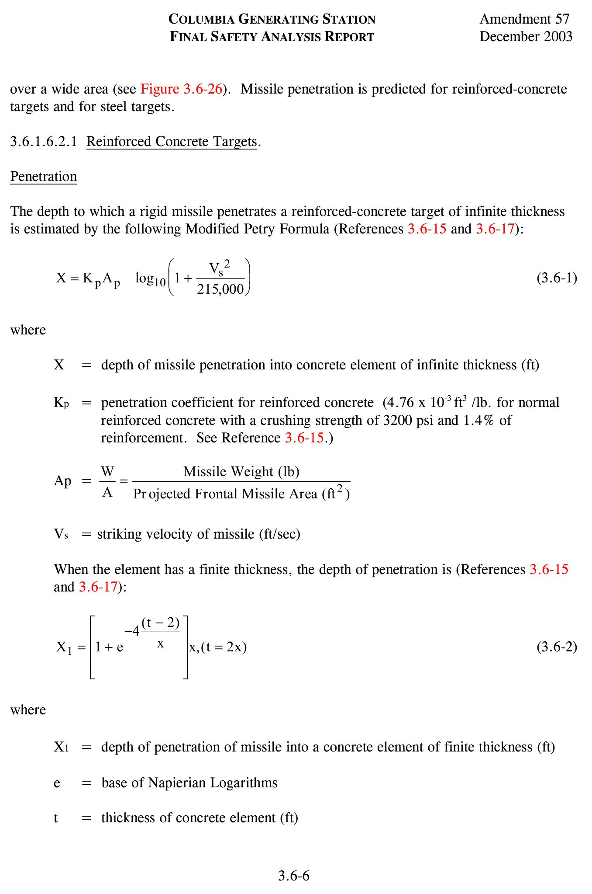

*figure on PDF page 255*

<!-- labels/text on this figure page -->
COLUMBIA GENERATING STATION
Amendment 57
FINAL SAFETY ANALYSIS REPORT
December 2003
over a wide area (see Figure 3.6-26). Missile penetration is predicted for reinforced-concrete targets and for steel targets.
3.6.1.6.2.1 Reinforced Concrete Targets.
Penetration
The depth to which a rigid missile penetrates a reinforced-concrete target of infinite thickness is estimated by the following Modified Petry Formula (References 3.6-15 and 3.6-17):
 2  V s =  + 
(3.6-1)
X K A log 1 215 000 p p 10  , 
where
X = depth of missile penetration into concrete element of infinite thickness (ft)
Kp = penetration coefficient for reinforced concrete (4.76 x 10-3 ft3 /lb. for normal reinforced concrete with a crushing strength of 3200 psi and 1.4% of reinforcement. See Reference 3.6-15.)
Ap = W Missile Weight lb ( )
= ontal Missile Area (ft2 A Pr ojected Fr )
Vs = striking velocity of missile (ft/sec)
When the element has a finite thickness, the depth of penetration is (References 3.6-15 and 3.6-17):
−  ( t 2 )  − 4   x = + =
(3.6-2)
X 1 e x t x ,( 2 )
 1     
where
X1 = depth of penetration of missile into a concrete element of finite thickness (ft)
e = base of Napierian Logarithms
t = thickness of concrete element (ft)
3.6-6

<!-- p.256 -->
Perforation

The thickness of a concrete element that will be just perforated by a missile is given as
(References 3.6-15 and 3.6-17):

T = 2X (ft)
(3.6-3)

Spalling

Spalling of concrete from the side opposite the impact surface of the structural element may occur even if the missile does not perforate the element. The estimate of the thickness that will just start spalling is given as (Reference 3.6-20):

Ts = 2.2X (ft)
(3.6-4)

3.6.1.6.2.2 Steel Targets. The Ballistic Research Laboratories formula is used to determine perforation of a steel target. The thickness, T, of a steel target that will be just perforated by a missile is given as (Reference 3.6-17):

2 0 5 . MV 3 2 / =
(3.6-5) T 2 3 2 / 17 400 , K D

where

T = steel wall thickness to just perforate (in.)

M = mass of the missile (weight/g in lb-sec2/ft)

V = velocity of missile (ft/sec)

= constant depending on grade of steel and is usually ≅1 K

D = diameter of missile (in.). For irregularly shaped missiles, an equivalent diameter is used, taken as the diameter of a circle with the same area as the projected frontal area of the irregularly shaped missile

The recommendation in Reference 3.6-13 to increase the perforation thickness, T, obtained by the Ballistic Research Laboratories Formula by 25% to prevent perforation is observed; that is:

(3.6-6)
tp = 1.25T

<!-- p.257 -->
where

tp = thickness of steel barrier required to prevent penetration (in.)

###### 3.6.1.6.3 Overall Structural Response
3.6.1.6.3.1 General. In general, pipe break loads are considered in combination with other loads (see Section 3.6.1.6.6). Dead loads, live loads, operating thermal loads, and earthquake loads may or may not be significant compared to the pipe break load, depending on the severity of the pipe break load. Thermal loadings due to pipe break have only skin effect and are not considered.

Pressure loads due to pipe break do not necessarily peak with pipe whip and jet impingement loads; however, in the analysis, they are considered to act simultaneously.

With regard to pipe break, when high energy pipes under pressure fail, a fluid jet is created.
The associated jet impingement force on a target as well as the reaction force exerted on the piping by the fluid jet force have a time history qualitatively presented in Figure 3.6-27. This force is conservatively idealized as a step function load. For the fluid forces associated with these pipe failures, see Table 3.6-3.

To obtain a solution for the actual complex system, the structure is idealized by an equivalent single degree of freedom system (see Figure 3.6-28) following the procedures described by J. M. Biggs in Chapter 5 of Reference 3.6-1. The response of this mathematical idealization to a step function load (jet impingement) or to a step function load concurrently with an impact loading (due to whipping pipe) involves an energy transfer from the impacting object to the impacted structure. The following exposition on how this energy transfer is addressed makes use of procedures that have been presented by the Bechtel Corporation in its report on missile impact, Topical Report BC-TOP-9A, Revision 2 (Reference 3.6-13).

###### 3.6.1.6.3.2 Structural Response to Whipping Pipe Missile Impact Load.

Discussion

A method of energy-balance procedures is used to evaluate the structural response when a missile impacts a target. The method utilizes the strain energy of the target at maximum response to counteract the residual kinetic energy of the target or target missile combination that results from the missile impact.

A missile of mass Mm is postulated to strike a spring-backed target mass, Me, with a velocity, Vs. Since the actual coupled mass during impact varies, an estimated average effective target mass, Me, is used to evaluate the inertia effects during impact. The impact of the missile is

<!-- p.258 -->
considered plastic. This assumes that the missile remains in contact with the target after impact.

Velocity After Impact

The velocities of the missile and target after impact are calculated from the following relationships (Reference 3.6-19):

− V M ( eM )
s m e =
(3.6-7) V m M + M m e

+ V M ( 1 e )
s m =
(3.6-8) V t M + M m e

where

Vm = missile velocity after impact (ft/sec)

Vt = target velocity after impact (ft/sec)

Vs = missile striking velocity (obtained by using basic velocity formulas, knowing the initial thrust force, missile mass, and missile travel before impact) (ft/sec)

Mm = mass of missile (lb-sec2/ft)

Me = effective mass of target during impact (lb-sec2/ft)

e = coefficient of restitution

Plastic Impact

In a plastic impact, the coefficient of restitution becomes zero, and the velocity of the missile and target masses become equal following impact. The strain energy, Es, required to stop the missile/target combination is the summation of the missile mass kinetic energy and the target mass kinetic energy at the end of the impact duration, as follows.

2 2

#### M V M V
m m e T = +
(3.6-9)
E s 2 2

<!-- p.259 -->
From Equations 3.6-7 and 3.6-8:

M V m s
(3.6-10)
V = V = m T + M M m e

Substituting the value for Vm and VT from Equation 3.6-10 into Equation 3.6-9, the required target strain energy is:

2 2 M V m s =
(3.6-11)
E s 2( M + M m e )

Target Effective Mass

Due to the complexity of missile-target impact, a determination of an effective coupled mass on a continuous time basis by means of a general analytical solution is not available.
However, an estimate of the average effective mass can be approximated from the results of impact tests on reinforced-concrete beams (Reference 3.6-10) in which the measured structural response is used to back-calculate the average mass during impact. Based on these data, the following formulas are used for estimating the target effective mass.

For concrete beams:

T B γ T c
(3.6-12)
M = ( D + 2 ) , if B ≤ (Dy + 2 T )
e x g

γ T c = + + ≥ +
(3.6-13)
M ( D 2 T D )( 2 T ) , if B (Dy 2 T )
e x y g

For concrete slabs:

) γ T c = + +
(3.6-14)

#### M ( D T D )( T
e x y g

For steel beams:

(3.6-15)
M = ( D + 2 d M )
e x x

<!-- p.260 -->
For steel plates:

γ t s
(3.6-16)
M = D D e x y g

where

2 − Me = average effective mass of target during impact ( lb sec )
ft

2 Mx = mass per unit length of steel beam ( lb − sec )
ft

Dx = maximum missile contact dimension in the direction (longitudinal axis for beams or slabs) (ft)

Dy = maximum missile contact dimension in the y direction (transverse to longitudinal axis for beams or slabs) (ft)

T = thickness or depth of concrete element (ft)

t = thickness of steel plate (ft)

d = depth of steel beam (ft)

B = width of concrete beam (not to exceed D + 2T)(ft)

γc = weight per unit volume of concrete (lb/ft3)

= weight per unit volume of steel (lb/ft3) γs

= acceleration of gravity (32.2 ft/sec2) g

Structural Response by Energy Balance Method

a. General Procedures

The strain energy, Es, required to stop the target (or missile-target combination)
is determined from the relationships in Section 3.6.1.6.3.2.

<!-- p.261 -->
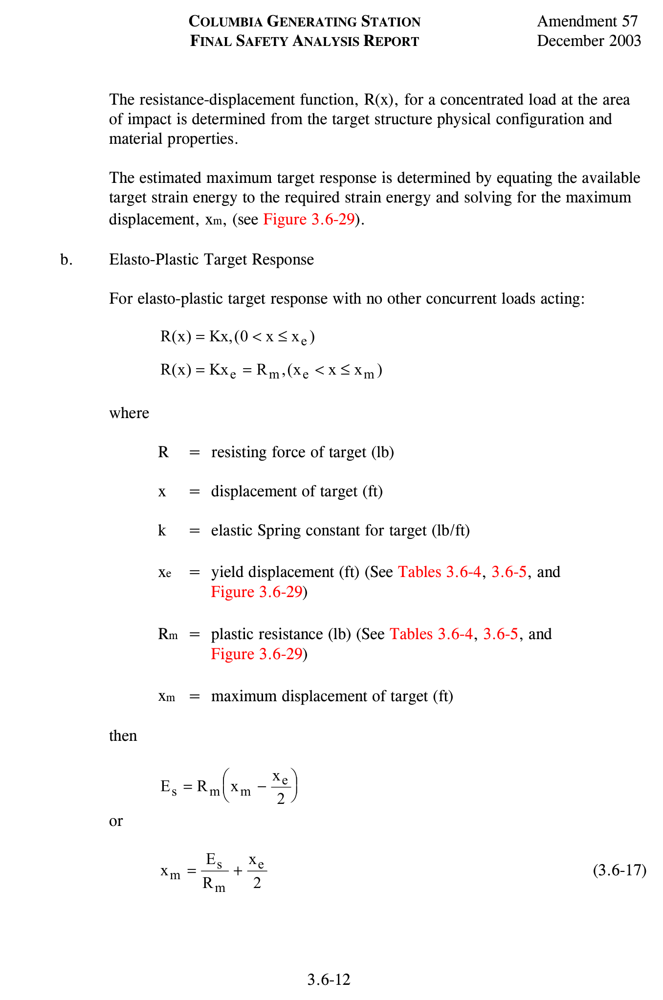

*figure on PDF page 261*

<!-- labels/text on this figure page -->
COLUMBIA GENERATING STATION
Amendment 57
FINAL SAFETY ANALYSIS REPORT
December 2003
The resistance-displacement function, R(x), for a concentrated load at the area of impact is determined from the target structure physical configuration and material properties.
The estimated maximum target response is determined by equating the available target strain energy to the required strain energy and solving for the maximum displacement, xm, (see Figure 3.6-29).
b. Elasto-Plastic Target Response
For elasto-plastic target response with no other concurrent loads acting:
R x ( ) = Kx ,( 0 x < ≤ x )
e
= = < ≤ R x ( ) Kx R ,( x x x )
e m e m
where
R = resisting force of target (lb)
x = displacement of target (ft)
k = elastic Spring constant for target (lb/ft)
xe = yield displacement (ft) (See Tables 3.6-4, 3.6-5, and Figure 3.6-29)
Rm = plastic resistance (lb) (See Tables 3.6-4, 3.6-5, and Figure 3.6-29)
xm = maximum displacement of target (ft)
then
 x  e = − E R  x  s m m 2 or
E x s e = + 2
(3.6-17)
x m R m
3.6-12

<!-- p.262 -->
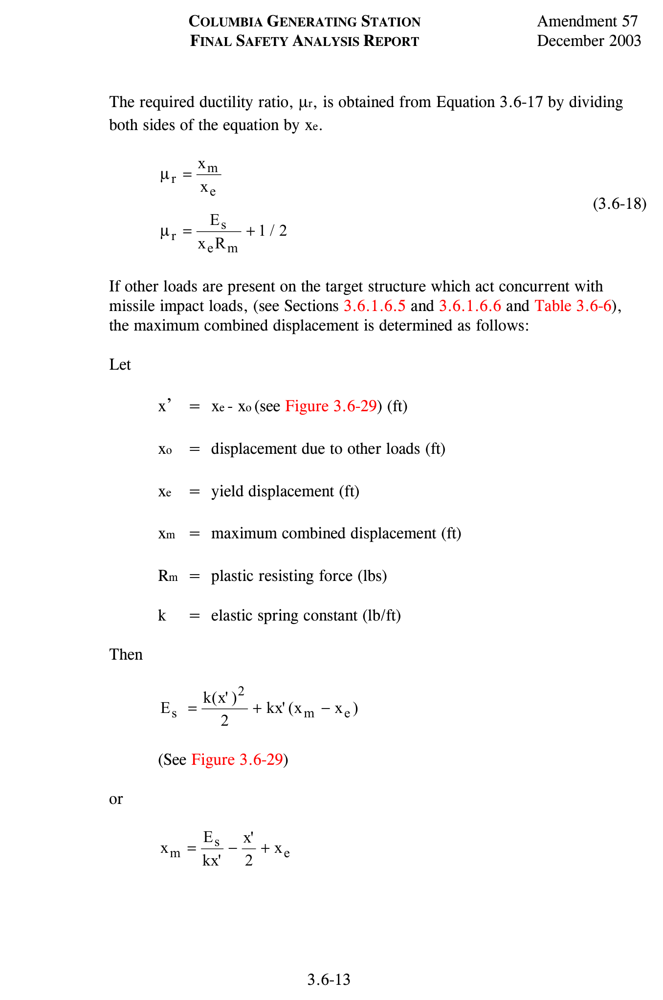

*figure on PDF page 262*

<!-- labels/text on this figure page -->
COLUMBIA GENERATING STATION
Amendment 57
FINAL SAFETY ANALYSIS REPORT
December 2003
The required ductility ratio, µr, is obtained from Equation 3.6-17 by dividing both sides of the equation by xe.
x m µ = r x e
(3.6-18)
E s µ = + 1 / 2 r x R e m
If other loads are present on the target structure which act concurrent with missile impact loads, (see Sections 3.6.1.6.5 and 3.6.1.6.6 and Table 3.6-6), the maximum combined displacement is determined as follows:
Let
x’ = xe - xo (see Figure 3.6-29) (ft)
xo = displacement due to other loads (ft)
xe = yield displacement (ft)
xm = maximum combined displacement (ft)
Rm = plastic resisting force (lbs)
k = elastic spring constant (lb/ft)
Then
2 k x ( ' )
= + − E kx x ' ( x )
s m e 2
(See Figure 3.6-29)
or
E x ' s = − + x x m e kx ' 2
3.6-13

<!-- p.263 -->
Substituting x’ = xe - xo in the above equation gives

+ E x x s e o = +
(3.6-19) x m − k x ( x ) 2 e o

The required ductility ratio, µr, is obtained by dividing both sides of Equation 3.6-19 by xe.

+ E 1 x / x s o e µr = +
(3.6-20)
R ( x − x ) 2 m e o

The values of Mr should be less than the allowable ductility ratios, M, given in Table 3.6-7.

3.6.1.6.3.3 Jet Impingement. Jet impingement loads are loads that emanate from a break in a high energy line. It is postulated that the characteristics of the jet are such that the jet exits from a break opening in the pipe equal in area to the cross sectional area of the pipe itself (see Figure 3.6-26). The jet is postulated to travel conforming to the configuration of the cross sectional area of the pipe for a distance of five pipe diameters and then to diverge at an angle of divergence of 10°. Where piping is restrained and break separation is limited to one-half pipe diameter or less a fan jet is postulated. A fan jet is perpendicular to the pipe centerline and extends 360° around the break at a 10° half angle as shown in Figure 3.6-30. For the jet thrust forces at the postulated breaks, see Table 3.6-3. Jet loads impacting structures are treated as equivalent static loads. A dynamic load factor is applied to the jet force emanating from the pipe and the resulting load is modified by an appropriate load factor according to its use in combination with other loads. The structure impacted is then evaluated for structural capability.

###### 3.6.1.6.4 Allowable Design Stresses and Strains
For allowable design stresses and strains for reinforced concrete and structural steel, see Section 3.8.4.5 and Tables 3.8-11 and 3.8-12, except as modified in Sections 3.6.1.6.4.1 and
3.6.1.4.2.

3.6.1.6.4.1 Pipe Whip Loading With or Without Other Loads. The acceptability of pipe whip loading with or without other loads is considered from two aspects:

a. The overall structural response of the impacted structural element, and b. The local damage sustained by the impacted structural element.

The overall structural response is considered acceptable if the ductility ratio resulting from the loading does not exceed the maximum allowable ductility ratios as given in Table 3.6-7. The

<!-- p.264 -->
determination of ductility ratios utilizes the procedures set forth in Section 3.6.1.6.3 and the loading combinations in Section 3.6.1.6.6. In using these procedures, the allowable limit on section strength, M, used in the determination of yield displacement Xe, (Section 3.6.1.6.3.2, Tables 3.6-4 and 3.6-5 and Figure 3.6-29) is computed in accordance with the strength design methods described in ACI 318-71 (Reference 3.6-12) and in the general practices of Part 2 of the AISC specifications (Reference 3.6-11), modified by the dynamic strength increase factors of Table 3.6-8.

The local damage is considered acceptable if the pipe whip impact does not case spalling and excessive penetration in concrete, or perforation in steel, as determined by the procedures described in Section 3.6.1.6.2.

3.6.1.6.4.2 Pipe Break Loads (Excluding Pipe Whip) With or Without Other Loads. Pipe break loads (excluding pipe whip) with or without other loads are considered acceptable if the loading from the loading combinations in Section 3.6.1.6.6 does not result in stresses that exceed the allowable limits on section strength as given in Tables 3.8-11 and 3.8-12, modified by the dynamic strength increase factors in Table 3.6-8.

###### 3.6.1.6.5 Loads, Definition of Terms, and Nomenclature
For loads, definition of terms, and nomenclature, see Section 3.8.4.3.

###### 3.6.1.6.6 Load Combinations
3.6.1.6.6.1 Seismic Category I Concrete Structures. For load combinations for Seismic Category I concrete structures, see Table 3.8-9, load combinations 6, 7, and 8.

3.6.1.6.6.2 Seismic Category I Steel Structures. For load combinations for Seismic Category I steel structures, see Table 3.8-10, load combinations 6, 7, and 8.

##### 3.6.1.7 Structural Design Loads
Structural elements are designed to withstand the loads generated by piping failures outside of primary containment in combination with other loads given in Section 3.6.1.6.6. Table 3.6-6 furnishes the design loads considered in the areas where piping failures occur.

##### 3.6.1.8 Analysis of Load Reversal
Structural elements such as floors, interior walls, exterior walls, and the building as a whole are analyzed for the effects of reversal of load due to the postulated pipe failure accident.
They are also analyzed for rebound loads that accompany pipe break accidents. The analysis approach for rebound is seen in Figure 3.6-31.

<!-- p.265 -->
##### 3.6.1.9 Modified Structures
The capabilities of structures to carry the design loads will be demonstrated for modifications as part of design change process controls.

##### 3.6.1.10 Verification That Failure of Any Structure Does Not Preclude Safe Reactor
Shutdown

Structures subject to pipe whip and/or jet impingement loads are investigated and found not to fail under these loads in conjunction with the applicable load combinations, so that there are no cases of structural barriers failing and causing additional structural failures which would adversely affect the mitigation of the consequences of accidents and the capability to bring the plant to a cold shutdown condition.

##### 3.6.1.11 Verification That Adequate Redundancy Exists for All Postulated Fluid Piping
System Ruptures

###### 3.6.1.11.1 Approach
The purpose of the study is to ensure that for all postulated ruptures of fluid piping systems, safe reactor operation and shutdown is not precluded. The basis of this approach is that adequate separation of redundant systems or components required to shut down and maintain the reactor in a cold condition provides the level of protection required to ensure safe reactor operation and shutdown.

The input used for this study includes the routing of all cables, cable trays, and conduit necessary to shut down and maintain the reactor in a cold condition. The locations of all motor control centers; instrument racks; sensors; and heating, ventilating, and air conditioning
(HVAC) equipment necessary to shut down and maintain the reactor in a cold condition are also included in the input of this study.

The locations of all postulated high- and moderate-energy fluid piping system ruptures dictate where this study is to be performed.

The input described above is coded to indicate the location of the system or component by elevations; the electrical division to which the component belongs; what the function of the component is; the various references, such as the drawings, in which the component is found;
devices interconnecting the component and another system; and additional information of this type. This coding facilitates storage of the input for retrieval at any time.

Table 3.6-3 lists the high-energy design-basis break locations outside containment, the piping systems involved, the pipe diameter, the plan figure showing the piping system, and the maximum blowdown thrust or the thrust versus time figure.

<!-- p.266 -->
Figures 3.6-32 through 3.6-56 illustrate and list the high-energy break locations inside containment and inside the main steam tunnel.

Moderate-energy crack locations are postulated in accordance with Standard Review Plan Sections 3.6.1 and 3.6.2.

###### 3.6.1.11.2 Method of Analysis for Postulated High-Energy Fluid System Ruptures
3.6.1.11.2.1 Effects of Postulated Passive Component Failures. Postulated pipe breaks in high-energy fluid systems are investigated to determine their effects on the ability to bring the plant to a safe shutdown and to limit the offsite radiological consequences to an acceptable level as stated in 10 CFR 50.

On a case-by-case basis, the effects of pipe whip, jet impingement, and the resulting environmental conditions on safety-related equipment necessary for safe shutdown are evaluated. The effects of the postulated pipe break are dependent on the fluid properties of the system, the location and orientation of the pipe break, the proximity to safe shutdown systems, components, and structures, and the individual design limits of the safe shutdown systems, components, and structures.

Pipe breaks in high energy systems are postulated according to the criteria in Section 3.6.2.1.
After identifying what equipment becomes inoperable, a worst case single random active component failure is postulated in a system not affected by the postulated high-energy fluid system rupture. Additionally, if the direct consequences of the postulated rupture results in a reactor or turbine trip, or could otherwise cause a loss of offsite power, offsite power is assumed unavailable.

3.6.1.11.2.2 Analytical Procedure. After all the consequences of the postulated pipebreak, passive and active component failures are evaluated, an analysis determines if safe shutdown can be accomplished. The following guidelines are used in this analysis:

a. For postulated ruptures of fluid piping systems, ensure that core cooling and reactivity control is maintained,

b. Demonstrate that redundant components or systems necessary to safely shut down and cool the reactor are not involved in the postulated passive component failure, and

c. Demonstrate that offsite radiological consequences do not exceed relevant standards.

#### LDCN-98-078, 00-075
<!-- p.267 -->
###### 3.6.1.11.3 Method of Analysis for Postulated Moderate-Energy Fluid System Ruptures
3.6.1.11.3.1 Approach. The analysis of moderate energy piping is performed in accordance with BTP ASB 3-1, Rev. 1, 1981. Postulated ruptures in moderate-energy fluid systems do not generate pipe whip. The analysis investigates the effects of the environment that results from such a postulated rupture on safety-related equipment, including the effects of water spray.

The effects of the postulated moderate-energy pipe cracks are dependent on the fluid properties, available fluid reservoir, drain systems, and the location and the individual design limits of the safety-related equipment, components, and structures necessary for safe shutdown.

Where moderate-energy pipe cracks are postulated in close proximity to high energy systems, the environmental analysis compares the effects of both high- and moderate-energy pipe ruptures. The most limiting case is evaluated for safe cold shutdown.

Moderate-energy pipe cracks are postulated according to the criteria in Section 3.6.2.1.

3.6.1.11.3.2 Method of Analysis. The locations of all postulated ruptures, resulting in through wall leakage cracks, are identified for later retrieval. The analysis assumes that the spray resulting from a postulated moderate-energy rupture causes the malfunction of all equipment not enclosed by compartments that minimize the effects of flooding.

Additionally, the most damaging single random active component failure in a system not affected by the postulated moderate energy pipe rupture is assumed. If the direct consequences of the passive component failure results in a turbine or reactor trip or could otherwise cause a loss of offsite power, then offsite power is assumed unavailable.

###### 3.6.1.11.4 Summary of Analysis
In those cases where analysis discussed in Sections 3.6.1.11.2 and 3.6.1.11.3 identified a location where a postulated pipe rupture in a high- or moderate-energy system had impact on a safety-related component, which precluded the safe shutdown and cooling of the reactor, the component was relocated or protected.

This analysis by actual examination of the plant is undertaken to provide results based on as-built conditions.

Piping layouts for areas containing high- and moderate-energy lines, whose failure can affect the performance of safety-related equipment, are presented as Figures 3.5-10, 3.5-11, and Figures 3.6-1 through 3.6-20B.

<!-- p.268 -->
Section 3.6.1.11 discusses in detail the methods used to demonstrate that no fluid system piping rupture, in conjunction with a single active component failure, precludes safe shutdown of the plant.

The following should serve to further clarify the method of analysis:

a. Analysis is performed to section B.3 criteria (pages 3.6.1-12 and 3.6.1-13) of BTP ASB 3-1, Rev. 1, 1981;

b. The forces developed at each postulated high-energy pipe break are determined by the methods of Section 3.6.2.2. The effects of the resultant pipe whip and jet impingement are evaluated. Credit is taken for automatic isolation and/or operator action to mitigate the consequences of the postulated pipe break, if the equipment required for this function is not affected by the break or included in item d below;

c. As a first step, all equipment with impact from the whipping pipe or jet is assumed to fail. If the equipment is required for safe cold shutdown or accident mitigation, a detailed analysis is performed to determine if the equipment will actually fail. Structures contacted by the whipping pipe or jet are evaluated for structural adequacy by the methods described in Section 3.6.2.2;

Impact to pipes of smaller nominal diameter than the impacting pipe are assumed to fail, regardless of wall thickness of impacted pipe. Impact to pipe of both larger nominal diameter and thinner wall thickness than the impacting pipe are assumed to develop through wall leakage cracks;

d. The following comprises the minimum set of equipment necessary for safe shutdown following any high-energy or moderate-energy pipe break/crack assuming a worst-case single active failure:

1. Pipe break/crack detection instrumentation
2. Automatic, high-energy line break isolation equipment
3. RPS (scram)
4. MSIVs 5. Five (5) SRVs for reactor vessel depressurization 6. A single RHR loop with a heat exchanger (loop A or B), in the alternate shutdown cooling mode providing reactor vessel inventory makeup (short term cooling) and reactor vessel and suppression pool inventory cooling
(long term cooling)
7. Supporting Service Water 8. Supporting HVAC 9. Supporting electrical power sources;

<!-- p.269 -->
e. After items b, c, and d have been evaluated, the ability to safely shut down is evaluated;

f. If analysis indicates that safe shutdown cannot be accomplished, then

1. Reroute or relocate cable, pipe, or equipment to prevent loss of function, or

2. If this is not feasible, shield the appropriate affected component(s) to prevent loss of function;

g. The flooding and environmental effects of moderate-energy failure are evaluated to determine whether they are more severe than the high-energy breaks. The high-energy breaks are addressed in Sections 3.6.1.11 and 3.6.1.15.

The area temperature is evaluated by determining the limiting postulated pipe break and using RELAP4/MOD5 (Reference 3.6-21) or GOTHIC (References 3.6-25 and 3.6-26). GOTHIC analyses described within Section 3.6 are performed in accordance with the constraints and limitations provided in the River Bend Unit 1 Safety Evaluation (Reference 3.6-27), or have demonstrated results which are essentially the same or conservative. The limiting pipe break for temperature analysis is that pipe break giving the highest energy release rate over the longest blowdown period.

The effects of flooding are evaluated by determining the limiting pipe break and calculating the effects of the fluid release. The limiting pipe break for flooding analysis is that pipe break with the highest mass flow rate over the longest blowdown period.

Peak differential pressure analysis results are provided in Table 3.6-9 and discussed in Section 3.6.1.20.

See Section 3.6.1.13 for electrical equipment environmental qualifications.

##### 3.6.1.12 Control Room Habitability
A postulated rupture of main steam, feedwater, or RWCU piping has no effect on the continued habitability of the control room, since the radiation dose that control room personnel receive as a result of a postulated rupture is below the allowable limits.

The nuclear steam supply system (NSSS) piping outside of primary containment within the reactor building is enclosed by the main steam tunnel. The main steam tunnel, provided with pressure-relieving blowout panels, is designed to withstand the worst postulated piping system rupture attributable to the NSSS within the steam tunnel.

#### LDCN-16-031, 18-002
<!-- p.270 -->
The high energy piping in the main steam tunnel is provided with pipe whip restraints as described in Section 3.6.1.5. These restraints limit the motion of the free ends of the ruptured NSSS piping to preclude the impact of the NSSS piping with the main steam tunnel structure.

The remaining high energy piping outside the primary containment is not routed in the vicinity of the control room, or does not possess sufficient energy to adversely affect the structural integrity of the control room wall.

Additionally, a remote shutdown panel is provided to permit safe reactor shutdown to a cold condition in the event the control room must be evacuated.

##### 3.6.1.13 Electrical Equipment Environmental Qualifications
All electrical systems necessary for safe shutdown and necessary to maintain the plant in a safe shutdown condition are designed to remain functional in the general area environment resulting from a high-energy line break or from leakage cracks in moderate-energy piping. Specific equipment is either of the following:

a. Designed to remain functional as long as necessary in the general area environment, or

b. Isolated from the general area environment in compartments capable of maintaining normal equipment operating conditions.

Certain rotating equipment cannot be designed to function in the more severe, local steam environment. However, due to physical separation, rotating equipment of not more than one system is exposed to the local conditions which exceed the general area accident environment.
Required redundancy is thus maintained for safety equipment.

See Section 3.11 for a more complete description of environmental design of electrical equipment.

###### 3.6.1.13.1 Identification of Equipment
Safety equipment required to mitigate the consequences of an accident and place the reactor in a cold shutdown condition is listed in Table 3.11-2. The table also indicates the required duration following an accident that equipment is required to operate.

###### 3.6.1.13.2 Environmental Design
See Section 3.11 for a discussion of environmental design and an analysis of safety-related electrical components. The section identifies the safety-related equipment that must operate in a hostile environment, and Table 3.11-2 indicates the postulated environmental enveloping conditions for both the general and local accident areas.

<!-- p.271 -->
###### 3.6.1.13.3 Jet Impingement Barriers
For results of the steam system study, see Section 3.6.1.11.4. Jet impingement barriers have been provided where analysis indicates they are needed to protect components required for reactor safe shutdown. In addition, some room wall, floors, and ceilings act as jet impingement barriers.

###### 3.6.1.13.4 Control Room Equipment
Control room environmental effects, resulting from pipe break accidents, are discussed in Section 3.6.1.12. The postulated pipe breaks have no effect on the control room environment.
All control room equipment, therefore, remains functional following a break.

###### 3.6.1.13.5 Onsite Power Distribution System Equipment
See Section 3.11.

##### 3.6.1.14 Design Diagrams of Nuclear Steam Supply System Piping
Figures 3.6-58 to 3.6-60 show the routing of NSSS piping from the outboard end of the containment penetrations to the turbine building.

##### 3.6.1.15 Flooding Analysis
A study investigating the potential flooding attributable to the postulated rupture of high-energy fluid piping systems outside primary containment is provided below.

###### 3.6.1.15.1 Postulated Rupture of the Reactor Feedwater Piping
The reactor feedwater piping outside primary containment, inside the reactor building, is completely enclosed by the main steam tunnel to provide protection against the dynamic effects of postulated fluid piping system ruptures. The main steam tunnel is provided with a blowout panel to discharge steam, to the atmosphere, above the turbine building. A second blowout panel provides for water drainage from the main steam tunnel into the turbine building.
A flooding evaluation of the turbine building from any feedwater line break has been completed which shows that no safety-related equipment located within the turbine building would be adversely affected.

3.6.1.15.1.1 Consequences. The postulated rupture, of the feedwater piping in the main steam tunnel, would scram the reactor on low water level.

The isolation valves on the reactor pressure boundary would close to prevent loss of reactor coolant. A postulated active component failure could prevent the inboard isolation valve from

<!-- p.272 -->
closing, while the dynamic effects of the passive component failure could prevent the outboard isolation valve from closing. The inboard check valve would close to prevent coolant loss, effectively stopping the reactor feedwater flow into the main steam tunnel.

Although a loss of offsite power is assumed, sufficient equipment remains available to safely shut down the reactor to a cold condition.

###### 3.6.1.15.2 Postulated Ruptures of Reactor Water Cleanup System
Since the reactor water cleanup (RWCU) system has no safety function, postulated ruptures of this system have no effect on safe reactor operation, except the effect these postulated ruptures have on structures, systems, or components important to safety. As the analyses discussed in Sections 3.6.1.11 and 3.6.1.20 indicate, postulated ruptures of the RWCU system have no effect on the ability to safely shut down the reactor to a cold condition.

###### 3.6.1.15.3 Postulated Ruptures of the Auxiliary Steam, Heating Steam, Auxiliary
Condensate, and Heating Steam Condensate Systems

Since these systems have no safety function, postulated ruptures of these systems, as described in Sections 3.6.1.11 and 3.6.1.20, have no unacceptable consequences, except the effect these postulated ruptures have on structures, systems, or components important to safety. Ruptures in the auxiliary steam (AS), heating steam (HS), auxiliary condensate (CO), or HS condensate
(HCO) systems do not prevent safe reactor shutdown to a cold condition. In the case of an AS line break in the reactor building, redundant isolation valves are automatically closed by temperature elements. There are no dynamic effects from the rupture, but the equipment environment (temperature and humidity) would exceed the qualified limits if the AS line to the reactor building was not isolated.

###### 3.6.1.15.4 Additional Considerations
Postulated ruptures of high-energy fluid piping systems are not considered to cause flooding if the contained fluid is in the vapor phase. The main steam and reactor core isolation coolant systems are not considered sources of flooding incidents for this reason.

##### 3.6.1.16 Quality Control and Inspection Programs
The quality control and inspection programs, required for the design and construction of piping systems outside containment, were given in Section 17.1. For the operational phase, the Inservice Inspection (ISI) Program and the Operational Quality Assurance Program Description
(OQAPD) are applicable.

<!-- p.273 -->
##### 3.6.1.17 Leak Detection System Capabilities
The floor and equipment drain headers drain into five sumps in the reactor building at el. 422 ft 3 in. Four sumps are provided for floor drains and one for equipment drains. These sumps contain level switches which activate the sump pumps on high water level. This allows the operator to determine the severity of the leak and take corrective action.

In addition, wall-mounted Class 1E level switches are provided in each pump room in the reactor building at the basement (422 ft 3 in.) level. See Sections 3.4.1.4, 6.3.2.5, and 9.3.3 for more details.

##### 3.6.1.18 Emergency Procedures to Mitigate the Consequences of a Postulated Fluid Piping
System Rupture Outside Primary Containment

Shutdown modes available to the operator are determined by whether or not the reactor is isolated.

###### 3.6.1.18.1 Reactor Not Isolated
For those classes of postulated ruptures which do not result in isolation of the RCPB, a normal shutdown is accomplished by using the main condenser and reactor feedwater system.

###### 3.6.1.18.2 Reactor Isolated
With the reactor isolated from the main condenser, a variety of shutdown modes are available to the operator. A single postulated pipe rupture does not preclude the availability of all of them.

3.6.1.18.2.1 Reactivity Control. Before a shutdown can be accomplished, the core must be prevented from generating additional power. Two methods of reactivity control are utilized on the Columbia Generating Station reactor.

The CRD system is the normal means of controlling core reactivity.

The SLC system can be used to shut down the reactor by means of injected sodium pentaborate poison. Both of these systems are redundant and driven by either offsite or plant standby power supplies.

No single accident can render both power supplies unavailable.

3.6.1.18.2.2 Core Coolant Level Maintenance. The systems available for core cooling during reactor isolation are RHR, automatic depressurization system (ADS), RCIC, LPCS, and HPCS. The RHR system is comprised of four modes: shutdown cooling, hot standby (see

<!-- p.274 -->
Section 5.4.7), low pressure cooling injection (see Section 6.3.2.2.4), and suppression pool cooling (see Section 6.2.2). See Section 6.3.1.2.4 for a description of the ADS. See Section 5.4.6 for a description of the RCIC system. See Section 6.3.2.2.3 for a description of the LPCS. See Section 6.3.2.2.1 for a description of the HPCS.

###### 3.6.1.18.3 Methods of Shutdown Following a Postulated Rupture of a Fluid Piping System
###### 3.6.1.18.3.1 Postulated Rupture of Main Steam Piping in the Main Steam Tunnel Vicinity.
A postulated rupture of the main steam system does not generate any pipe whip impact on structures in the reactor building, since the main steam lines are supplied with pipe whip restraints.

High pressure differential signals from the main steam flow restrictors (indicating decrease in steam pressure at the turbine inlet) or high temperature indication in the vicinity of the main steam piping initiates automatic isolation of the main steam lines which, in turn, causes a reactor scram. Automatic relief valve operation maintains the reactor vessel pressure within allowable limits.

With the reactor isolated and scrammed, the HPCS or manual initiation of the ADS would be used to depressurize the reactor while either of the two redundant trains of the shutdown cooling mode of RHR systems would be employed to remove decay and sensible heat from the reactor pressure vessel (RPV).

3.6.1.18.3.2 Postulated Rupture of Reactor Feedwater Piping. A postulated rupture of a reactor feedwater pipe does not generate pipe whip impacts on structures outside primary containment within the reactor building since the feedwater piping is restrained.

The resulting blowdown from the feedwater break scrams the reactor when the low water level setpoint is reached. The operator can also initiate manual scram as the instrumentation will indicate a mismatch in main steam flow rate, reactor feedwater flow rate, and RPV inventory.

The scram, due to low water level, initiates emergency core cooling and RCIC operation.
Decay heat removal is manually initiated by the operator.

The shutdown modes available after an operator initiated scram are the same as listed in Section 3.6.1.18.3.1.

3.6.1.18.3.3 Postulated Rupture of Reactor Core Isolation Cooling System Piping. Ruptures are postulated in the RCIC system in the turbine steam supply line or the condensate removal line, from the drip pot. A rupture of either line precludes operation of the RCIC system.
A rupture of either line does not generate a scram and, therefore, normal shutdown procedures are used. Automatic isolation of the RCIC system occurs if a high pressure drop across the flow restrictor is sensed, high area temperature is sensed, or low line pressure is sensed.

<!-- p.275 -->
3.6.1.18.3.4 Postulated Rupture of Residual Heat Removal System Piping. The RHR system, except in the hot standby mode, operates at pressures less than 135 psig steam dome pressure.
Postulated failures of the RHR system piping at these pressures does not require any particular safety action. Rather shutdown cooling is reestablished using the redundant train of the RHR system.

In the event that the suction line from the RPV to the RHR pumps becomes inoperable, reactor depressurization can be accomplished by using the HPCS or the ADS. Heat can be removed from the suppression pool by use of the suppression pool cooling mode of the RHR system.
For a detailed discussion of the possible shutdown modes see Section 15.2.9.

3.6.1.18.3.5 Postulated Rupture of the Control Rod Drive System Piping. Rupture of the CRD piping does not generate any significant pipe whip loads. While rupture of the CRD piping could prevent system operation, reactor scram is possible using either the nitrogen accumulators or reactor pressure. The SLC system could also be used to bring the reactor to a subcritical condition if the CRDs failed to function.

3.6.1.18.3.6 Postulated Ruptures of the Auxiliary Steam, Heating Steam, Auxiliary Condensate, and Heating Steam Condensate Piping. The consequences of a rupture in any of the above, including the dynamic effects of pipe whip and the resulting environmental conditions, are investigated as described in Section 3.6.1.11. In no instance does a postulated rupture of these systems preclude reactor shutdown to a cold condition.

These systems provide no emergency function that would be required to mitigate the consequences of a postulated piping failure. Therefore, normal reactor shutdown as well as the emergency methods described would not be simultaneously impaired.

3.6.1.18.3.7 Postulated Rupture of the Reactor Water Cleanup System Piping. The consequences of a RWCU system piping rupture are investigated as discussed in Section 3.6.1.11. In no circumstance, does the postulated failure of RWCU system piping preclude the availability of all shutdown modes. Since the RWCU system does not fulfill any safety function, nonoperability has no impact on the safe shutdown of the reactor.

##### 3.6.1.19 Seismic and Quality Classifications of Piping Used in the Dynamic Analysis
See Table 3.2-1 for the seismic and quality classifications of piping systems identified in Table 3.6-3. See Section 3.2 for the definitions of the various seismic and quality classifications.

<!-- p.276 -->
##### 3.6.1.20 Method Used to Predict Blowdown Rates and Subcompartment Pressure Transient
After a Postulated Pipe Break

###### 3.6.1.20.1 Blowdown Analysis for a Postulated Pipe Break Outside the Primary Containment
The analytical approach used to determine the blowdown mass and energy rates from a postulated pipe break outside the primary containment are described in Sections 3.6.1.20.1.1 through 3.6.1.20.1.3.

3.6.1.20.1.1 Method of Analysis for a Postulated Pipe Break in Larger Pipes. For larger pipes, the blowdown mass and energy release are predicted by using the computer programs RELAP3 (Reference 3.6-9) or RELAP4/MOD5 (Reference 3.6-21) or GOTHIC (References
3.6-25 and 3.6-26). In the computer model, the piping system is nodalized into a number of volumes connected by flow junctions (or flow paths in GOTHIC). A multiplier of 1.0 is used with the choked flow correlation. Except in special cases, all breaks are assumed to be the double-ended circumferential type which open instantaneously. Initial conditions and other assumptions necessary for the analysis are such that the result is on the conservative side.

3.6.1.20.1.2 Method of Analysis for a Postulated Pipe Break in Smaller Pipes. For smaller pipes, a constant blowdown profile with an applicable choked flow correlation is used. The initial conditions are chosen to maximize the blowdown mass and energy release rates.

3.6.1.20.1.3 Blowdown Mass and Energy Release Rates for a Postulated Pipe Break in the Main Steam Line and the Reactor Feedwater Line in the Main Steam Tunnel. See Section 3.6.1.20.3.2 for a description of the arrangement and features of the main steam tunnel. For subcompartment analysis in the main steam tunnel, the postulated break in the main steam line and in the feedwater line is assumed to be a crack with the flow area equivalent to the flow area of a single-ended pipe. The blowdown mass and energy release rates are computed by the RELAP3 Program or GOTHIC (References 3.6-25 and 3.6-26).

Figures 3.6-61 and 3.6-62 show the mass and energy release rates after a postulated crack in the main steam line in the main steam tunnel. Figures 3.6-63 and 3.6-64 show the mass and energy release rates after a postulated crack in the reactor feedwater line in the main steam tunnel.

###### 3.6.1.20.2 Subcompartment Analysis for Postulated Pipe Break Outside the Primary
Containment Excluding the Main Steam Tunnel, Ventway, and Tunnel Extension

3.6.1.20.2.1 Method of Analysis. The pressure transient in the reactor building after a postulated pipe break is analyzed with the computer programs RELAP3 (Reference 3.6-9) or RELAP4/MOD5 (Reference 3.6-21) or GOTHIC (References 3.6-25 and 3.6-26). In the computer model, subcompartments are represented by nodes (or volumes in GOTHIC), and flow paths between two nodes are represented by flow junctions (or flow paths in GOTHIC).
Volumes, vent areas, flow resistances, initial atmospheric conditions, as well as the blowdown mass and energy release rates from the pipe breaks, are input to the computer program. Since

<!-- p.277 -->
the absolute pressure within the subcompartments after a pipe break outside the primary containment is low in all cases, no significant pressure gradient exists within a subcompartment itself. Therefore, a subcompartment is not nodalized in the analysis and a sensitivity study is not performed.

Table 7.6-2 lists leak detection system instrumentation. Table 6.2-16 lists valve closure times for automatic isolation functions tied into the leak detection system. Credit is taken for automatic isolation if the system capability is not affected by the postulated pipe break or assumed as a single active component failure. Check valves close on reversal of flow in a fraction of a second. In all cases, the blowdown terminates when the inventory of fluid in the line is exhausted.

Where blowdown flow is not automatically terminated by isolation valves or check valves as described above, the duration of the blowdown event as the inventory of fluid in a line is exhausted is not considered in the analysis of peak compartmental pressure and temperature.
To evaluate the peak pressures and temperatures in compartments and structures following a postulated break of the high energy pipes inside the structures, the blowdown analysis is extended far beyond the initial transient until the blowdown flow becomes steady or decreases continuously. The duration of the analysis is therefore sufficient to correctly predict the peak pressures and temperatures in these compartments and structures.

For a postulated pipe break or leakage crack in the main steam lines outside the primary containment, the flow from the reactor side of the break is terminated by the closing of the main steam isolation valves (MSIVs) located in each of the four main steam lines. The MSIVs start to close at 0.5 sec after the break and are fully closed at or prior to 5.5 sec after the break, as given in Table 15.6-5.

For a postulated break or leakage crack in the reactor feedwater lines outside primary containment, the flow from the reactor side of the break is terminated by closing of the check valves in each of the two reactor feedwater lines. The check valves start to close when the direction of flow reverses, and the flow from the reactor side of the break is therefore terminated within a fraction of a second.

3.6.1.20.2.2 Initial Atmospheric Conditions. The initial atmospheric conditions within the subcompartments used for the analysis are

Reactor Building:
a. Pressure = 14.7 psia, b. Temperature = 110°F, and c. Relative humidity = 0.0%.

Radwaste Building:
a. Pressure = 14.45 psia, b. Temperature = 80° F, and c. Relative humidity = 60%.

<!-- p.278 -->
These conditions are simulated in the RELAP computer analysis as a homogeneous saturated steam-water mixture at 14.7 psia with an average density equivalent to the density of air at the above conditions. When using GOTHIC, the initial conditions are as described using air and water vapor.

3.6.1.20.2.3 Vent Flow. In the RELAP analyses, the vent flow between the subcompartments is assumed to be a homogeneous steam-water mixture with 100% water entrainment. For choked flow, a multiplier of 0.6 is used for Moody two-phase flow correlations. In the GOTHIC analyses, vent flow is modeled as air, steam and water with choked flow as described in References 3.6-25 and 3.6-26. For unchoked flow, the flow resistance consists of an entrance loss, an exit loss, and frictional losses. For conservatism, an entrance loss of approximately 0.5 and an exit loss of 1.0 are assumed for most of the vents.

3.6.1.20.2.4 Results of Subcompartment Analyses. Subcompartment analyses are performed for all subcompartments containing high energy piping. The results are summarized in Table 3.6-9 for subcompartments containing safety related SSCs.

3.6.1.20.2.5 Verification of Structural Adequacy. Verification of structural adequacy of compartments or of structural elements thereof subject to pressure generated by a postulated pipe break and to the local effects in the structure generated by the postulated pipe break;
namely, a broken pipe reaction, jet impingement, and pipe whipping impact are discussed in Sections 3.6.1.6 through 3.6.1.10.

###### 3.6.1.20.3 Subcompartment Analysis for a Postulated Pipe Break in the Main Steam Tunnel
See Section 3.6.1.20.3.2 for a description of the arrangement and features of the main steam tunnel. Subcompartment analysis in the main steam tunnel, ventway, and tunnel extension is performed for a postulated crack in the main steam line (see Section 3.6.1.20.1.3).
Comparison of mass and energy release rates for the postulated crack in the main steam line to that of a postulated crack in the reactor feedwater line (Figures 3.6-61 through 3.6-64) shows that the main steam line crack is the limiting case. Other lines inside the main steam tunnel or its extension are of smaller sizes and a break in those lines is less severe.

3.6.1.20.3.1 General Approaches. The pressure and temperature transients in the main steam tunnel, ventway, and tunnel extension after a postulated crack in the main steam line are computed by the RELAP4/MOD5 program (Reference 3.6-21) or GOTHIC (References 3.6-25 and 3.6-26). The general approaches discussed in Sections 3.6.1.20.2.1 through 3.6.1.20.2.3 also apply to this case.

###### 3.6.1.20.3.2 Description of the Main Steam Tunnel, Ventway, and Tunnel Extension.
Descriptive information of the main steam tunnel, ventway, and tunnel extension is provided in Section 3.8.4.1.1.4. Figures 3.6-65 and 3.6-66 show a sectional plan view and a sectional elevation view, respectively, of the main steam tunnel, ventway, and tunnel extension.

<!-- p.279 -->
In plan, the main steam tunnel is located at 0° azimuth of the north side of the reactor building;
in elevation, it extends from el. 501 ft 0 in. to el. 522 ft 0 in. At the interface of the reactor building and the turbine generator building, the main steam tunnel continues for a short distance into the turbine generator building; the portion in the turbine generator building is referred to as the tunnel extension. The ventway starts at the same level as the main steam tunnel and extends horizontally from the main steam tunnel in the easterly direction and continues upward to the underside of the corridor floor above at el. 548 ft 0 in., where a blowout panel in the north wall of the ventway provides a ventilating path to the atmosphere.

Four blowout panels are used, as shown in Figures 3.6-65 and 3.6-66:

a. Panel A, vertical, part of secondary containment, located between the north end of the main steam tunnel (in the reactor building) and the tunnel extension (in the turbine generator building), bolted in place, of sheet steel,

b. Panel B, vertical, part of secondary containment, located in the east wall of the main steam tunnel, bolted in place, of sheet steel,

c. Panel C, horizontal, part of secondary containment, located at the top of the main steam tunnel, the north edge of panel is hinged, other edges are free and not bolted in place, of sheet steel, and

d. Panel D, vertical, not part of secondary containment, located in the north exterior wall of the ventway, bolted in place, of insulated metal siding.

The fasteners of the blowout panels which are bolted in place (namely, panels A, B, and D) are designed to fail in single shear, and all blow-off panels (namely, panels A, B, C, and D) are designed to blow-off and permit venting when the pressure generated in the main steam tunnel, ventway, and tunnel extension by a postulated pipe break within the main steam tunnel or tunnel extension exceeds 0.5 psi.

3.6.1.20.3.3 Analysis for a Postulated Pipe Break in the Main Steam Tunnel. The analysis for a postulated pipe break in the tunnel extension is discussed in Section 3.6.1.20.3.4.

Figure 3.6-67 shows the nodalization scheme for a postulated pipe break in the main steam tunnel. For conservatism blow-out panels A and B are assumed to remain in place during the pressure transient. Therefore, the tunnel extension and the turbine generator building are not modeled in this case. Nodes 1 and 2 represent the main steam tunnel. Nodes 3, 4, 5, and 6 represent the ventway. Tables 3.6-10 and 3.6-11 provide the volume and flow junction data, respectively.

The hinged panel C is modeled as an inertia valve in the RELAP4/MOD5 analysis (see Reference 3.6-21). The differential equation of motion for the valve gate is:

( )      I t A P t ( ) K (t)
(3.6-21)

<!-- p.280 -->
where

θ = opening angle (radians)

t = time (sec.)

= d θ &θ dt

θ = d &&θ 2 2 dt = moment of inertia (lbmass - ft2) I

A = area X moment arm (ft3)

= differential pressure (lb/ft2) P

 mass - sec2  = damping constant lb   K  ft 

Let ω= angular velocity in radians/sec. and substituting ω= θ and ω = θ in Equation 3.6-21.

I &ω + K ω = AP

It has the solution

−   Kt        AP  t I I θ = θ + ω +  + ω  − t 1 e     o o o K K        
(3.6-22)

where θo and ωo are values for θ and ω at t = O.

For panel D, the differential equation of motion is

+ Ms t &&( ) AP t ( )
(3.6-23)

<!-- p.281 -->
where

 sec2  mass − M = mass of panel lb   ft  

s = displacement (ft)

v = velocity (ft/sec)

= linear acceleration (ft/sec2) s

A = area of panel (ft2)

= average pressure (lb/ft2) P

t = time (sec)

The frictional force is neglected. The solution of the above equation is:

F
(3.6-24)
s = s + v ( + m t ) t o o 2

where so and vo are values for s and v at t = O.

The displacement, s, of the panel and the opening area as functions of time are determined by iterative procedures.

Pertinent properties of blow-out panels C and D are seen in Table 3.6-12.

Figures 3.6-68 and 3.6-69 are plots of the pressure transients and Figures 3.6-70 and 3.6-71 are plots of the temperature transients for a postulated pipe break in Node 1.

Figures 3.6-72 and 3.6-73 are plots of the pressure transients and Figures 3.6-74 and 3.6-75 are plots of the temperature transients for a postulated pipe break in Node 2.

Blow-out panels C and D are assumed to blow off at the differential pressure noted in Section 3.6.1.20.3.2.

3.6.1.20.3.4 Analysis for a Postulated Pipe Break in the Tunnel Extension. Figure 3.6-76 shows the nodalization scheme for a postulated pipe break in the tunnel extension. Nodes 1 and 2 represent the tunnel extension. The vertical pipe restraint (see Figure 3.6-24) divides

<!-- p.282 -->
Node 1 and 2. Nodes 3, 4, and 5 represent the following portions of the turbine generator building:

a. Node 3 represents the portion between the mezzanine floor at el. 471 ft 0 in.
and the operating floor at el. 501 ft 0 in.,

b. Node 4 represents the portion between the ground floor at el. 441 ft 0 in. and the mezzanine floor at el. 471 ft 0 in., and

c. Node 5 represents the portion between the operating floor el. 501 ft 0 in. and the roof of the turbine generator building.

For conservatism, panel A (in Figures 3.6-65 and 3.6-66) is assumed to remain in place during the pressure transient, and only 10% of the insulated metal siding comprising the exterior walls above the operating floor (see Figure 1.2-5) of the turbine generator building is assumed to blow off the structural steel frame at a differential pressure of 0.5 psi. Tables 3.6-13 and
3.6-14 provide the volume and flow junction data, respectively.

Figures 3.6-77 and 3.6-78 are plots of the pressure transients and Figures 3.6-79 and 3.6-80 are plots of the temperature transients for a postulated pipe break in Node 1.

Figures 3.6-81 and 3.6-82 are plots of the pressure transients and Figures 3.6-83 and 3.6-84 are plots of the pressure transients for a postulated pipe break in Node 2.

3.6.1.20.3.5 Verification of Structural Adequacy. Verification of structural adequacy of the main steam tunnel ventway and tunnel extension, or of structural elements thereof, subject to load combinations involving pressure generated by a postulated pipe break and local effects in the structure generated by the postulated pipe break; namely, broken pipe reaction, jet impingement, and pipe whip impact are discussed in Sections 3.6.1.6 through 3.6.1.10.

3.6.1.20.3.6 Turbine Building Consequences of a Postulated Pipe Break in the Steam Tunnel Extension. The only items with safety-related functions in the turbine building are some reactor protection system (RPS) sensor inputs from the main steam system, MSIV isolation logic inputs from the main steam system, and the tower makeup transformers located on the turbine ground floor which are required to function only for the design basis tornado event.
This last item is remote from the steam and feedwater lines (being located on the turbine ground floor) and has been evaluated to have adequate protection from tornado missiles and internal flooding (see Section 3.6.1.15.1). The RPS and MSIV isolation logic sensor inputs due to their nature cannot be made immune from pipe break effects. However, loss of this equipment during a postulated event would not result in loss of capability to bring the plant to a cold shutdown or mitigate the radiological consequences of such an incident even assuming a single failure among the safety systems that remain unaffected.

<!-- p.283 -->
A pipe break in a main steam or feedwater line in the turbine building or steam tunnel extension could result in transitory pressurization of the corridors between the turbine building, reactor building, radwaste control building, and the diesel generator building. Air and steam would be forced into these corridors through openings in the south wall of the turbinegenerator building, and through the seismic gap between the turbine building, reactor building, and radwaste control building. The large volume of the turbine building and because the turbine building metal siding and exterior doors are not leaktight and are not designed to withstand more than a minimal pressure differential, would result in the peak pressures seen by the reinforced-concrete walls of the reactor building and radwaste control building not exceeding the structural capacity of the walls. The doors to the control room are low-range blast doors designed to withstand a pressure differential of 3 lb/in.2, which is considered adequate to maintain control room habitability as discussed in Section 3.6.1.12.

##### 3.6.1.21 Description of Methods of Analyses to Ensure That Primary or Secondary
Containment Integrity Is Not Compromised by a Postulated Passive Component Failure

The previous 20 sections present the results of analyses that indicate that postulated piping failures do not adversely affect safe reactor operation. Implicit in these analyses is the necessity of conforming to relevant standards with regard to offsite radiological consequences.

#### 3.6.2 DETERMINATION OF BREAK LOCATIONS FOR DYNAMIC EFFECTS
#### ASSOCIATED WITH THE POSTULATED RUPTURE OF PIPING
Information concerning postulated break and crack location criteria and methods of analysis for evaluating the dynamic effects associated with postulated breaks and cracks in high- and moderate-energy fluid system piping inside and outside of primary containment is presented in this section. The information presented in this section and in Section 3.6.1 confirms that the requirements for the protection of structures, systems, and components relied on for safe reactor shutdown or to mitigate the consequences of a postulated pipe break have been met.

##### 3.6.2.1 Criteria Used to Define Break and Crack Location and Configuration
The following section establishes the criteria for the location and configuration of postulated breaks and cracks in high-energy and moderate-energy piping systems both inside and outside of primary containment.

<!-- p.284 -->
High-energy fluid systems are defined as those systems or portions of systems that during normal plant conditions* are maintained pressurized under conditions where either one or both of the following are met:

a. Maximum temperature exceeds 200°F b. Maximum pressure exceeds 275 psig.

Moderate energy fluid systems are defined as those systems, or portions of systems, that during normal plant conditions are pressurized under both of the following conditions:

a. Maximum temperature is 200°F or less, and b. Maximum pressure is 275 psig or less.

Piping systems are classified as moderate-energy systems, when they operate as high energy piping for only short periods in performing their system function. For the major operational period they qualify as moderate-energy fluid systems. An operational period is considered “short” if the total fraction of time that the system operates, within the pressure-temperature conditions specified for high-energy fluid system, is less than approximately 2% of the time period that the system operates as a moderate-energy fluid system.

A postulated pipe break is defined as a sudden, gross failure of the pressure boundary either in the form of a complete circumferential severance (guillotine break) or as development of a sudden longitudinal crack (longitudinal split). These are postulated for high-energy fluid I systems only. For moderate-energy fluid systems, pipe rupture is confined to postulation of leakage cracks in piping and branch runs. These cracks affect the surrounding environmental conditions only and do not cause jet impingement or uncontrolled whipping of the pipe.

A moderate-energy piping system crack is not postulated simultaneously with a high-energy piping system break, nor is any pipe break or crack outside containment postulated concurrently with a pipe break or crack inside containment.

Postulated pipe break locations are selected as described herein and are based on the guidelines provided in Regulatory Guide 1.46, Revision 0; the BTP ASB 3-1, and as expanded in BTP MEB 3-1 for piping inside and outside primary containment.

* Normal plant conditions are defined as the plant operating conditions during reactor startup, operation at power, hot standby, or reactor cool down to cold shutdown, but excluding test modes.

<!-- p.285 -->
###### 3.6.2.1.1 Postulated Pipe Break Locations in High-Energy Fluid System Piping Not in the
Containment Penetration Area

Pipe breaks (not including leakage cracks) are postulated at locations as indicated below:

###### 3.6.2.1.1.1 Postulated Pipe Break Locations in ASME Section III Class I Piping Runs.

The terminal ends* of the pressurized portions of the run.

Intermediate locations of postulated pipe breaks are selected by application of one of the following sets of rules:

a. Pipe break is postulated at each location of significant change in flexibility, such as pipe fittings (elbows, tees, and reducers), and circumferential connections to valves and flanges;

b. Based on stress and fatigue analysis, as calculated according to ASME Code Section III Subarticle NB-3600, no break is postulated if any of the following applies:

1. Sn† does not exceed 2.4Sm‡,

* Terminal ends are extremities of piping runs that connect to structures, components (e.g., vessels, pumps, valves), or pipe anchors that act as rigid constraints to piping motion and thermal expansion. A branch connection to a main piping run is a terminal end of the branch run, except where the branch run is classified as part of the main run in the stress analysis and is shown to have a significant effect on the main run behavior. In piping runs which are maintained pressurized during normal plant conditions for only a portion of the run (i.e., up to the first normally closed valve), a terminal end of such runs is the piping connection to this closed valve.

† Sn is the primary plus secondary stress intensity range, as calculated by use of Equation (10)
of ASME Code Section III Subsection NB, Paragraph NB 3653.1, between any two load sets
(including the zero load set) for normal and upset plant conditions, including an OBE event transient.

‡ Sm is the design stress intensity, as described in ASME Code Section III Subsection NB, Paragraph NB 3229.

<!-- p.286 -->
2. Sn exceeds 2.4Sm but does not exceed 3Sm, and the Cumulative Usage Factor (U)* does not exceed 0.1, and

3. Sn exceeds 3Sm, but Se† and Sr‡ are each less than 2.4Sm, and U does not exceed 0.1.

###### 3.6.2.1.1.2 Postulated Pipe Break Locations in ASME Section III Class 2 and 3 Piping Runs.

The terminal ends of the pressurized portions of the run.

Intermediate locations of postulated pipe breaks are selected by applications of one of the following sets of rules:

a. Pipe break is postulated at each location of significant change in flexibility, such as pipe fittings (elbows, tees, and reducers), and circumferential connections for valves and flanges,

b. At each location here the stresses under the loadings resulting from upset plant conditions, including an operating basis earthquake (OBE) event as calculated by the summation of Equations (9) and (10) of ASME Code Section III Subsection NC, Paragraph NC 3652, exceed 0.8 (1.2Sh + SA) where Sh and SA), are as defined in Paragraph NC 3611.2, or

c. Intermediate breaks are not postulated in sections of straight pipe where there are no pipe fittings, valves, or flanges.

3.6.2.1.1.3 Break Locations in Other Piping Runs. Postulated pipe break locations for piping other than ASME Code Section III Class 1, 2, and 3, are postulated in accordance with pipe whip criteria which conforms to the criteria set forth for ASME Code Section III Class 2 and 3 piping.

* U is the Cumulative Usage Factor that indicates the total fatigue damage as calculated by the procedure in ASME Code Section III Subsection NB, Paragraph NB 3653.

† Se is the nominal value of expansion stress as calculated by use of Equation (12) of ASME Code Section III Subsection NB, Paragraph NB 3653.6(a).

‡ Sr is the range of primary plus secondary membrane plus bending stress intensity, excluding thermal bending and thermal expansion stresses as calculated by use of Equation (13) of ASME Code Section III Subsection NB.

<!-- p.287 -->
###### 3.6.2.1.2 Postulated Pipe Break Locations in High-Energy Fluid System Piping Between
Primary Containment Isolation Valves

Pipe breaks (not including leakage cracks) are postulated in locations as indicated below:

3.6.2.1.2.1 Postulated Pipe Break Locations in ASME Section III Class 1 Piping Between Primary Containment Isolation Valves. No pipe breaks are postulated in the portion of piping between primary containment isolation valves, if any of the following apply:

a. Sn does not exceed 2.4Sm,

b. Sn exceeds 2.4Sm but does not exceed 3Sm, and the Cumulative Usage Factor
(U) does not exceed 0.1, or

Sn exceeds 3Sm, but Se and Sr are each less than 2.4Sm, and U does not exceed c.
0.1.

The stress levels in the ASME Section III Class 1 containment penetration high-energy piping are maintained at or below these limits and therefore, breaks are not postulated.* See Section 3.6.2.1.2.3 for further discussion of containment penetration piping.

Piping systems which may have break exclusion areas between primary containment isolation valves are those determined by examining the list of high-energy piping systems (see Section 3.6.2.1 and Table 3.6-15). Systems which do not pass through primary containment are excluded. In addition, systems which are not pressurized between the isolation valves during normal plant operation (see Table 3.6-15) are excluded. The remaining systems, those which may have break exclusion areas between primary containment isolation valves are listed in Table 3.6-16. Break exclusion areas for these systems are shown in Figures 3.6-85 through
3.6-88.

3.6.2.1.2.2 Postulated Pipe Break Locations in ASME Section III Class 2 and 3 Piping Between Primary Containment Isolation Valves. See Section 3.6.2.1.1.2, for stress criteria applicable to ASME Section III Class 2 and 3 piping between containment isolation valves.

The stress levels are maintained at or below these limits and therefore, breaks are not postulated. See Section 3.6.2.1.2.3 for further discussion of containment penetration piping.

* A program for augmented inservice inspection for high energy line breaks is included in the Inservice Inspection Program Plan.

<!-- p.288 -->
3.6.2.1.2.3 Primary Containment Penetration Piping. To maintain containment integrity, primary containment penetrations are designed with the following characteristics:

a. They are capable of withstanding the forces caused by impingement of the fluid from the rupture of the largest local pipe without failure, and

b. They are capable of withstanding the maximum reactions that the pipes to which they are attached are capable of exerting.

Piping and electrical penetration details are discussed and shown in Section 3.8.6.

The stress criteria for postulating breaks in containment penetration piping between isolation valves is given in Sections 3.6.2.1.2.1 and 3.6.2.1.2.2.

Welded attachments, for pipe supports or other purposes, to these portions of piping are avoided except where detailed stress analyses or tests are performed to demonstrate compliance with the limits of Section 3.6.2.1.2. In addition, the number of circumferential and longitudinal piping welds and branch connections are minimized.

Any pipe anchors or restraints (e.g., connections to containment penetrations and pipe whip restraints) are designed such that they are not welded directly to the outer surface of the piping except where such welds are 100% volumetrically examinable while in service, and a detailed stress analysis is performed to demonstrate compliance with the limits of Section 3.6.2.1.2.

Tunnel structures surrounding the primary containment penetration piping are designed for the thermal and pressure loads of a through wall leakage crack regardless of crack postulation requirements. See Section 3.6.1.20 for further discussion.

Access for ISI of welds in high-energy (hot type) containment penetration assemblies is described in Section 3.8.6.1.1. All required ISI locations are accessible.

###### 3.6.2.1.3 Postulated Through Wall Leakage Crack Locations in High- and Moderate-Energy
Fluid Systems

Cracks in high energy systems, regardless of ASME Code classification, were evaluated at Columbia Generating Station both inside and outside of containment. Inside containment it was found that the circumferential or longitudinal high energy line breaks bounded the structural and environmental consequences produced by a leakage crack at any location in a high energy line. Outside containment analyses were completed or protection was provided to ensure that critical plant systems are not harmed by leakage cracks in adjacent high energy systems.

<!-- p.289 -->
In moderate-energy piping systems consisting of ASME Code Section III Class 2 and 3 piping and moderate-energy nonnuclear piping, including fluid system piping between primary containment isolation valves, cracks are not postulated provided the stress range of 0.4 (1.2Sh* + SA†) is not exceeded for the load combination which includes the effects of pressure, weight, other sustained loads, and occasional loads such as the OBE and thermal expansion loads.
Since all piping in structures housing safety-related systems are supported and controlled as Seismic Category I systems regardless of service, the criteria for postulated cracks is the same as above for all systems.

###### 3.6.2.1.4 Types of Breaks and Cracks Postulated in High-Energy and Moderate-Energy
Fluid System Piping

3.6.2.1.4.1 Breaks in High-Energy Fluid System Piping. The following types of breaks are postulated in high-energy fluid system piping:

No breaks need be postulated in piping having a nominal diameter less than, or equal to 1 in.

Circumferential breaks are postulated only in piping exceeding a 1 in. nominal pipe diameter.

Longitudinal splits are postulated only in piping having a nominal pipe diameter equal to or greater than 4 in.

Longitudinal splits are not postulated at terminal ends.

At each of the postulated break locations, consideration is given to the occurrence of either a longitudinal split or circumferential break. Both types of breaks are considered if the maximum stress ranges in the circumferential and axial directions are not significantly different. Only one type break is considered as follows:

a. If the result of a detailed stress analysis indicates that the maximum stress range in the axial direction is at least 1.5 times that in the circumferential direction, only a circumferential break is postulated. Where usage factor is a determinant in establishing a postulated break location, the fatigue dominant stresses are

* Sh is the allowable stress at maximum (hot) temperatures defined in ASME Code Section III, Article NC 3611.2.

† SA is the allowable stress range for thermal expansion, as defined in ASME Code Section III, Article NC 3611.2.

<!-- p.290 -->
examined as indicated above to determine whether longitudinal, circumferential, or both are postulated; or

b. If this type of analysis indicates that the maximum stress range in the circumferential direction is at least 1.5 times that in the axial direction, only a longitudinal split is postulated.

Where break locations are selected without the benefit of stress calculations, circumferential breaks are postulated at the piping welds to each fitting, valve, or welded attachment.

For a longitudinal split, the break area is assumed to be equal to cross-sectional flow area of the pipe.

For circumferential breaks, pipe whipping is assumed to occur in the plane defined by the piping configuration and is assumed to cause pipe movement in the direction of the jet reaction.

A longitudinal break is assumed to result in an axial split without severance and to be oriented at any point about the circumference of the pipe or alternatively at the point(s) of highest stress as indicated by a detailed stress analysis. If a postulated break location is at a nonaxisymmetric fitting, such as a tee or elbow, the split is assumed to be oriented (but not concurrently) on each side of the fitting at its center, perpendicular to the plane of the fitting and is assumed to cause pipe movement in the direction of the jet reaction.

For a circumferential break, the dynamic force of the jet discharge at the break location is based upon the effective cross sectional flow area of the pipe and on a calculated fluid pressure, as modified by an analytically or experimentally determined thrust coefficient.
A circumferential break is assumed to result in pipe severance with full separation amounting to at least a one-pipe-diameter lateral displacement of the ruptured piping sections, except as limited by structural design features. The break is assumed to be oriented perpendicular to the longitudinal axis of the pipe. Line restrictions, flow limiters, and the absence of energy reservoirs are accounted for in the calculation of the design jet discharge.

3.6.2.1.4.2 Cracks in High-Energy and Moderate-Energy Fluid System Piping. The following controlled through wall leakage cracks are postulated in high-energy and moderateenergy fluid systems (or portion of systems):

Cracks are postulated in fluid systems or portions of systems whose size exceeds a nominal pipe diameter of 1 in.

Fluid flow from the postulated crack is based on a circular opening of area equal to that of a rectangle one-half pipe-diameter in length and one-half pipe wall thickness in width.

<!-- p.291 -->
The flow from the postulated crack is assumed to result in an environment that wets all unprotected components within the compartment, with subsequent flooding in the compartment and communicative compartments. Flooding effects are determined on the basis of a conservatively estimated time period required to affect corrective action.

###### 3.6.2.1.5 Protection Criteria for the Effects of Pipe Break
Protection from the effects of a whipping pipe due to a pipe break is provided where necessary. Protection from pipe whip need not be provided if any one of the following conditions exists: The piping is classified as moderate energy piping. Following a single postulated pipe break, piping for which the unrestrained movement of either end of the ruptured pipe, in the direction of the jet reaction about a plastic hinge, formed within the piping, cannot impact any structure, system, or component important to safety. Piping for which the internal energy level associated with the whipping is insufficient to impair the safety function of any structure, system, or component to an unacceptable level. Any line restrictions
(e.g., flow limiters) between the pressure source and break location, and the effects of either a single-ended or double-ended flow condition are accounted for in the determination of the internal fluid energy level associated with the postulated pipe break reaction. The energy level in a whipping pipe will be considered insufficient to rupture an impacted pipe of equal or greater nominal pipe size and of equal or heavier wall thickness.

For further discussion of pipe whip protection, see Section 3.6.2.3.3.

Protection of essential systems from the effects of jet impingement is provided where necessary to ensure reactor shutdown to a safe cold condition and to limit the release of radioactivity to within 10 CFR Part 100 limits. For further discussion of criteria for protection against jet impingement, see Section 3.6.2.3.2.

##### 3.6.2.2 Analytic Methods to Define Blowdown Forcing Functions and Response Models
###### 3.6.2.2.1 Analytical Methods to Define Blowdown Forcing Functions
The rupture of a pressurized pipe causes the flow characteristics of the system to change, creating reaction forces which can dynamically excite the piping system. The reaction forces are a function of time and space and depend on fluid state within the pipe prior to rupture, break flow area, frictional losses, plant system characteristics, piping system, and other factors. The methods used to calculate the reaction forces for various piping systems are presented in the following sections.

A rise time, not exceeding 1 msec, is assumed for the initial pulse of the fluid blowdown forcing function, unless longer crack propagation times or rupture opening times are substantiated by experimental data or analytical theory.

<!-- p.292 -->
Blowdown forcing functions are determined by either of two general methods given below:

a. The predicted blowdown forces on pipes fed by a pressure vessel can be described by transient and steady-state forcing functions. The forcing functions used are based on methods described in References 3.6-3 and 3.6-22. These may be simply described as follows:

1. The transient forcing functions occur at points along the pipe from the propagation of waves (wave thrust) along the pipe and at the broken end from the reaction force due to the momentum of the fluid leaving the end of the pipe (blowdown thrust);

2. The waves cause various sections of the pipe to be loaded with time-dependent forces. It is assumed that the pipe is one-dimensional in that there is no attenuation or reflection of the pressure waves at bends, elbows and the like. Following the rupture, a decompression wave is assumed to travel from the break at a speed equal to the local speed of sound within the fluid. Wave reflections occur at the break end and the pressure vessel end until a steady flow condition is established. Freespace and vessel conditions are used as boundary conditions. The blowdown thrust causes a reaction force perpendicular to the plane of the pipe break, reaching a final steady state value;

3. The initial blowdown force on the pipe is taken as the sum of the wave and blowdown thrusts and is equal to the vessel pressure (Po) times the break area (A). After the initial decompression period (i.e., the time it takes for a wave to reach the first change in direction), the force is assumed to drop off to the value of the blowdown thrust (i.e., 0.7 PoA);

4. Time histories of transient pressure, flow rate, and other thermodynamic properties of the fluid can be used to calculate the flowdown force on the pipe using the following equation:

ρ u2 F = {( P − P ) + } A --a g

where

F = blowdown force

P = pressure at exit plane

<!-- p.293 -->
Pa = ambient pressure

u = velocity at exit plane

 = density at exit plane

A = area of break

g = gravitational constant

5. Following the transient period, a steady-state period is assumed to exist.
Steady-state blowdown forces are calculated, considering frictional effects. For saturated steam, these effects reduce the blowdown forces from the theoretical maximum of 1.26 PoA. The method of accounting for these effects is presented in References 3.6-3 and 3.6-22. For subcooled water, a reduction from the theoretical maximum of 2.0 PoA is found through the use of Bernoulli’s and other standard equations, such as Darcy’s equation, which account for friction.

b. The following is an alternative method for calculating blowdown forcing functions.

Computer code simulation either by RELAP3 (Reference 3.6-9) or GOTHIC
(References 3.6-25 or 3.6-26) is used to obtain exit plane thermodynamic states for postulated ruptures (see Section 3.12.11 for further discussion of the software). Specifically, the software calculates exit pressure, specific volume, and mass rate. From these data the blowdown reaction load is calculated using the following relation:

ଶVഥE T ൌሺPE ‐ P∞ሻ൅ GE AE gC

T  R x A E A E

where

T AE = thrust per unit break area

PE = exit pressure

<!-- p.294 -->
P∞ = receiver pressure

GE = exit mass flux

VE = exit specific volume

gc = gravitational constant

R = reaction force on the pipe

###### 3.6.2.2.2 Analytical Methods to Define Response Models
3.6.2.2.2.1 General Description of Analytical Methods. The prediction of time-dependent and steady-thrust reaction loads caused by blowdown of subcooled, saturated, and two-phase fluid from a ruptured pipe is used in the design of piping systems and in the evaluation of dynamic effects of pipe breaks. A detailed discussion of the analytical methods employed to compute these blowdown loads are given in Section 3.6.2.2.1. The analytical methods used to account for this loading are discussed below.

###### 3.6.2.2.2.2 Dynamic Analysis of the Effects of Pipe Rupture.

Criteria

a. Analysis is performed for each postulated pipe break;

b. The analysis includes the dynamic response of all components of the system including the pipe, pipe whip restraints, and all structures required to transmit loading to foundation. The structures are analyzed for a suddenly applied force in conjunction with impact and rebound effects due to gaps between piping and pipe whip restraints;

c. The analytical model adequately represents the mass/inertia and stiffness properties of the system;

d. Pipe whipping is assumed to occur in the plane defined by the piping geometry and configuration and to cause pipe movement in the direction of the jet reaction;

e. Piping contained within the broken loop is no longer considered part of the RCPB. Plastic deformation in the pipe is considered as a potential energy absorber. Limits of strain are imposed similar to pipe whip material (see Section 3.6.2.2.3.2) restraint. Piping systems are designed so that plastic

<!-- p.295 -->
instability would not occur in the pipe at the design dynamic and static loads, unless damage studies are performed which show that the consequences could not result in the direct damage of any essential system or component; and

f. Components such as vessel safe ends and valves, which are attached to the broken piping system and do not serve a safety function or whose failure would not further escalate the consequences of the accidents, are not designed to meet ASME Code requirements for essential components under faulted loading.
However, if these components are required for safe shutdown or if they serve a safety function to protect the structural integrity of an essential component, then these components are designed to code limits for faulted conditions and to the limits necessary to ensure operability.

Analytical Models

a. Lumped-Parameter Analysis Model: Lumped mass points are interconnected by springs to take into account for the effects of inertia and stiffness inherent in the system, and time histories of the responses are computed by numerical integration to account for gaps and inelastic effects. This analytical method is discussed in detail in Reference 3.6-4;

b. Energy-Balance Analysis Model: Kinetic energy, generated during the first quarter cycle movement of the ruptured pipe as imparted to the piping/restraint system through impact, is converted into equivalent strain energy.
Deformations of the pipe and the restraint are compatible with the level of absorbed energy; and

c. Pipe whip restraints for the reactor recirculation system are designed by the NSSS supplier. The analytical method utilized for this design is the computer program PDA which is described in Reference 3.6-4 and further discussed in Section 3.12.33.

Pipe whip restraints for all other piping systems requiring such protection are designed by the architect/engineer; the method described below is used for this pipe whip restraint design.

Simplified Dynamic Analysis

a. To simplify dynamic analysis the following conservative assumptions are used:

1. The entire structure including pipe, restraint linkage, support beams, and major structure to foundation connections absorb energy by elastic, elastoplastic, or plastic deformation. To provide a simplified dynamic

<!-- p.296 -->
mathematical model, one member is generally considered to absorb all the energy. This member is classified as an energy absorbing member and is designed as described in Section 3.6.2.3.3.2. The other components of the structure are assumed as infinitely rigid. These are classified as load transmitting members and are designed as described in Section 3.6.2.3.3.2;

2. The time history of unbalanced forces on the ruptured pipe is reduced to a suddenly applied constantly maintained force, which envelopes the actual force at any particular time, or is based on a more sophisticated blowdown calculation; and

3. Dynamic loading on the pipe whip restraint is reduced to a suddenly applied, constantly maintained force described above, in conjunction with a kinetic energy of impact.

b. Simplified analytical models such as simple beams, structural frames, and ring girders on assumed rigid supports are modeled as single springs. One example of such a typical analytical model is shown in Figure 3.6-89. For these, the required member resistance (Rr) is determined by application of the formula shown in Figure 3.6-90. This derived equation is based on References 3.6-1 and 3.6-2. The following is a description, and discussion of the parameters used in this derivation:

1. The term (Rr) represents the required member resistance (strength) when loaded by a suddenly applied constantly maintained force (F1), in conjunction with a kinetic energy of impact (K), due to collision of a moving body (i.e., ruptured pipe) with the member in question;

2. The impulse (i) is represented by the area under any load time history having a time of duration (td), which is small compared with the natural period of the impacted member;

3. The kinetic energy is represented by i2/2M, where (i) is the impulse and
(M) is the mass of the moving body;

4. The kinetic energy of impact (K) is also represented by the product of the Force (F1) which accelerates the ruptured pipe, and a distance (d) the total distance traveled by the moving body from time zero to time of collision with the member in question. Note that when the resisting member is in direct contact with the ruptured pipe, the distance (d) is zero and the kinetic energy (K) reduces to zero. Likewise, when no

<!-- p.297 -->
resisting member is required, the ruptured pipe does not collide with anything and therefore no kinetic energy of impact exists. In these events the equation shown in Figure 3.6-90 is applicable with (K) equal to zero;

5. The energy absorbing member is permitted to deform into the plastic region. Thus the member resistance is bilinear. (Ye) is the deflection of the member at the end of elasticity of the member. (Ym) is the maximum deflection of the member;

6. The elastic spring constant (k) is the ratio of load on the member divided by the deflection due to this load, where the deflection is equal to or less than the value (Ye) and the load is compatible with this concept. Thus
(k) can be expressed as (Rr/Ye);

7. For inelastic response the maximum deflection (Ym) is always larger than the elastic deflection (Ye). For this case, the ratio (Ym/Ye) is defined as the ductility ratio (µ);

8. The maximum deformation of the energy absorbing member is controlled by limiting the ductility ratio (µ).

Reference 3.6-6 provides the ductility ratio that corresponds to collapse
(µc). For structural steel members, these values vary with upper limits in the order of 20 to 30 and up (for very ductile structures). For Columbia Generating Station, the maximum permissible ductility ratio is limited to 50% of (µc), except that energy absorbing members in direct contact with primary containment are limited to 5% of (µc). For Columbia Generating Station, only steel members are utilized as energy absorbing members, as defined in Section 3.6.2.3.3.2. The maximum values of (µc), for various structural components, are given in Table 3.6-7; and

9. The equation derived in Figure 3.6-90 accounts for a suddenly applied constantly maintained force in conjunction with a kinetic energy of impact on the resisting member. Total transfer of energy is implied.
This is combined with the constantly maintained force (from ruptured piping blowdown) on the restraint structure. This assumption is consistent with a zero coefficient of restitution (full plasticity), and is a conservative assumption.

<!-- p.298 -->
With regard to rebound, it should be noted that if a coefficient of restitution of unity is assumed (full rebound), there is zero kinetic energy transfer to the restraint structure.

If a coefficient of restitution less than unity is assumed (partial rebound), there is a partial amount of kinetic energy transfer to the restraint structure.

A coefficient of restitution of zero conservatively assumed in the application of the equation mentioned above gives zero rebound with 100% kinetic energy transfer to the restraint structure.

It should also be noted that the assumption of a suddenly applied constantly maintained force as used in the equation mentioned above is conservative with respect to rebound. Rebound implies a finite time of short duration contact with the restraint structure, in contrast to the infinite time assumed.

c. Actual structural resistance for the above structures is determined by methods of limit analysis using a dynamic yield strength, as defined in Section 3.6.2.2.3.1.

###### 3.6.2.2.3 Material Properties Under Dynamic Loads
3.6.2.2.3.1 Dynamic Yield Strength. To account for the rapid strain rate effects, dynamic yield strength is utilized. This phenomenon is documented in References 3.6-6 and 3.6-7.
Material tests have shown a consistent increase in yield strength under rapid loading. Under rapid strain rate, carbon steel yield strength consistently improves by more than 40%. High strength alloy steel displays a somewhat smaller improvement. For Columbia Generating Station, a conservative dynamic yield strength of 110% of minimum static yield strength, at the specified operating temperature, is used.

3.6.2.2.3.2 Maximum Strain of Tension Members. Pure tension members, such as U-bars shown in Figure 3.6-21 which act to limit pipe whip are permitted to deform during energy absorption: (a) a maximum of 50% of the minimum uniform strain (at the maximum stress on an engineering stress-strain curve) based on actual restraint material tests or (b) one-half of minimum percent elongation as specified in the applicable ASME Code Section II or ASTM Specifications if demonstrated to be less than 50% of the minimum uniform strain based on representative test results.

The dynamic tensile and impact properties are specified to be not less than (a) 70% of the static percent elongation or (b) 80% of the statically determined minimum total energy absorption.

<!-- p.299 -->
3.6.2.2.3.3 Maximum Deformation of Flexural Members. Deformations of energy absorbing flexural support members are generally limited to 50% of that deformation which corresponds to structural collapse, except that deformation of energy absorbing members in direct contact with the primary containment vessel is limited to 5% of that deformation which corresponds to structural collapse.

3.6.2.2.3.4 Materials and Proportions of Structural Shapes. The materials and proportions of structural shapes for energy absorbing members are in accordance with recommendations for dynamic member design as documented in References 3.6-6 and 3.6-7.

##### 3.6.2.3 Dynamic Analysis Methods to Verify Integrity and Operability
###### 3.6.2.3.1 Dynamic Analysis Methods for Jet Impingement Effects
The procedure for analyzing the dynamic effects of jet impingement has been extracted from Reference 3.6-8.

Computer simulation using either RELAP3 (Reference 3.6-9) or GOTHIC (References 3.6-25 and 3.6-26) with required geometric input data is run to obtain the exit plane thermodynamic state and mass flow rate. Specifically, the quantities output the computer simulations are

M = mass flow rate lbm/sec

ft3/lbm VE = specific volume

lbf/ft2 PE = exit pressure

The reaction load on the piping system is given by

2 G V T E E   
(3.6-25) ( P P )
E  g A E c

where

T AE = thrust per unit area lbf/ft2

lbf/ft2 P = receiver pressure

lbm/sec ft2 GE = mass flux

<!-- p.300 -->
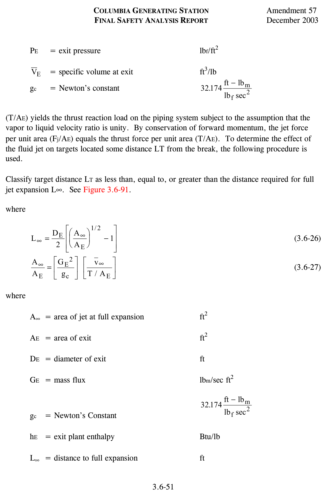

*figure on PDF page 300*

<!-- labels/text on this figure page -->
COLUMBIA GENERATING STATION
Amendment 57
FINAL SAFETY ANALYSIS REPORT
December 2003
lbf/ft2 PE = exit pressure
ft3/lb VE = specific volume at exit − ft lb m gc = Newton’s constant 32174 .
2 lb sec f
(T/AE) yields the thrust reaction load on the piping system subject to the assumption that the vapor to liquid velocity ratio is unity. By conservation of forward momentum, the jet force per unit area (Fj/AE) equals the thrust force per unit area (T/AE). To determine the effect of the fluid jet on targets located some distance LT from the break, the following procedure is used.
Classify target distance LT as less than, equal to, or greater than the distance required for full jet expansion L∞. See Figure 3.6-91.
where
 1 2 /    D A E ∞ =  − 
(3.6-26)
L   1 ∞ 2  A  E   =  2    A G v ∞ E ∞
(3.6-27)     A g T / A   E c E
where
ft2 A∞ = area of jet at full expansion
ft2 AE = area of exit
DE = diameter of exit ft
lbm/sec ft2 GE = mass flux
ft − lb m 32174 .
2 lb sec gc = Newton’s Constant f
hE = exit plant enthalpy Btu/lb
L∞ = distance to full expansion ft
3.6-51

<!-- p.301 -->
lbf/ft2 P∞ = receiver pressure

T = thrust

V∞ = specific volume at full expansion

Assuming the kinetic energy of the fully expanded jet to be insignificant, the following relation holds between vessel stagnation enthalpy and fully expanded jet enthalpy:

ho = h∞
(3.6-28)

Therefore,

h − h o f ∞ = x ∞ h fg ∞
(3.6-29)

where

ho = stagnation enthalpy at full expansion, Btu/lb

hf∞ = liquid enthalpy at full expansion, Btu/lb

hfg∞ = vaporization enthalpy at full expansion, Btu/lb

X∞ = quality at full expansion

then,

= +
(3.6-30) V V X V ∞ f fg ∞ ∞ ∞

where

Vf∞ = specific volume of liquid at full expansion, ft3/lbm

Vfg∞ = specific volume of vaporization at full expansion ft3/lbm

V ∞ = specific volume at full expansion, ft3/lbm

<!-- p.302 -->
From Equations 3.6-29 and 3.6-30, subject to the assumption of Equation 3.6-28, Equations 3.6-26 and 3.6-27 can be solved for L∞.

For LT < L∞ property variations are assumed linear from AE to A∞ for area and from PE to P∞ for pressure.

The jet impingement load Fj is as follows with Fj a constant:

x AT = F F
(3.6-31)
jT j A L

where

AT = area of target which is intercepted by the jet

AL = jet area at the target distance calculated as

in Region 1: for O<L<L∞

L
( ) T
(3.6-32)
A = A − A + A ∞ L E E L ∞ F   4 A 10o ∞ ≤ ≤ − in Region 2: for L L 1 / 2 DE cot   ∞ π AL = A∞

where

 1 2 / 

## 4 A  
∞ cot 10o
(3.6-33)
L = 1 / 2    − DE  3 π     F   4 A cot 10o ∞− < < ∞ in Region 3: for 1 / 2 D L   E π

2   2 L = + tan 10o
(3.6-34)
 A A  1 L E D E

<!-- p.303 -->
for nonflashing/nonexpanding fluids:

AL = AE
(3.6-35)

###### 3.6.2.3.2 Jet Impingement Effect
3.6.2.3.2.1 Physical Separation. The physical separation of different essential systems and components is used to ensure that the plant retains function of sufficient essential systems to ensure safe shutdown in the event of a postulated LOCA and subsequent generation of a jet stream together with an additional single random active component failure and the loss of offsite power.

Where physical separation cannot be used to protect systems, a detailed analysis is performed to determine the effects of jet impingement on their operability. If necessary, barriers are provided to protect structures, systems, and components required for a safe shutdown to prevent offsite radiological consequences and to mitigate the effects of a LOCA.

3.6.2.3.2.2 Jet Impingement Evaluation. The evaluation of the adequacy of physical separation included the inspection of all essential systems and their components that are necessary to start, operate, and control the essential systems required for safe shutdown. The evaluation included the following:

a. Review pipe break locations to provide conservative jet stream orientation and geometry,

b. Review effected equipment by both design drawing examination and plant walkdown,

c. Review signals that result in the actuation of essential systems,

d. Review signals that are necessary to be returned to inside primary containment, to activate the shutdown systems,

e. Review availability of power that is required inside primary containment to operate the essential systems, and

f. Review mechanical engineered safety systems required for safe shutdown.

3.6.2.3.2.3 Postulated Pipe Rupture Locations Inside Containment. The criteria used to define pipe rupture locations is described in Section 3.6.2.1. Figures 3.6-32 through 3.6-56 show the inside containment break locations resulting from the application of the criteria provided in Section 3.6.2.1. Pipe whip restraint locations are also shown in these figures.

<!-- p.304 -->
3.6.2.3.2.4 Signals From Primary Containment. For instrumentation located inside primary containment, sufficient redundancy is provided such that all signals necessary to cause actuation of essential systems remain functional. Each system that is required to bring the plant to a safe shutdown condition is furnished with two or more sets of redundant instrumentation lines.

In this review, it is conservatively assumed that a jet stream or whipping pipe may damage one of these sets. The redundant system is shown to remain operational by physical separation and barriers, such as the RPV. An example of the above is the location of sets A and B instrumentation lines for the HPCS. Set A and its redundant set B are located at opposite sides of the RPV. Therefore, a jet stream or whipping pipe cannot damage both sets of instrumentation. Function of instrumentation inside primary containment necessary to result in the actuation of the HPCS system is thereby ensured. These conditions as discussed for the HPCS instrumentation lines are typical for all instrumentation lines that support essential systems. The capabilities of redundant instrumentation is discussed in Section 7.3.

3.6.2.3.2.5 Signals to the Primary Containment. No instrumentation signal is necessary to return inside primary containment to operate any of the essential systems. Signals to the ADS valves are provided through their power supply as described in the following section.

3.6.2.3.2.6 Power Requirement Inside Primary Containment. The only essential system that requires power inside primary containment is the ADS.

There are 18 main steam relief valves inside primary containment, seven of which are in the ADS mode. These seven valves will quickly depressurize the RPV in the event of a small break and allow the LPCS or the LPCI to keep the core covered with water, thus permitting the reactor to be brought to a safe shutdown.

There are two independent and redundant electrical systems (divisions) inside primary containment which operate the ADS valves. The divisions are run separately in main paths of conduits, and individual conduits are branched to corresponding ADS valves.

Each ADS valve is equipped with three solenoids and two divisions as noted above. Power to the ADS valves is required to open a solenoid valve connected to the air accumulator, thus allowing the pressurized air to open the ADS valves.

The physical arrangement of the electrical conduits is such that one division runs next to the primary containment vessel wall and the other division runs around the sacrificial shield wall.
The conduits for Division 1 (A solenoids) are routed above the platform at el. 541 ft in a horizontal configuration, running toward penetration X-105C. The conduits for Division 2
(B solenoids) are routed below the platform at el. 522 ft in a horizontal configuration, running toward penetration X-105B. The conduits are routed such as to take advantage of the piping

<!-- p.305 -->
and structure for protection against a possible jet impingement. The ADS supply lines are discussed in Section 7.3.

Six out of the seven furnished ADS valves have to be operational to enable adequate depressurization of the RPV. Jet impingement cannot incapacitate more than three electrical lines. Since four lines would have to be incapacitated to incapacitate more than one valve, safety is ensured.

This condition is typical for all conduits leading to the ADS valves.

3.6.2.3.2.7 Mechanical Engineered Safety Systems. Under conditions involving a LOCA, a loss of offsite power, and the failure of any one diesel generator, the availability of redundant essential systems is determined by study of design drawings and by field walkdown of the physical location of these systems to verify that sufficient separation is provided between two redundant systems. Specifically, two situations are investigated:

a. The possibility of a jet from an essential system destroying or in any way damaging its redundant system. For example, in the case of failure of Division 2 diesel generator, the possibility of a pipe whip or jet from the HPCS damaging the LPCS and ADS is investigated; and

b. The possibility of a jet, from a high energy line, being capable of damaging an essential system and its redundant system. For example, in the event of Division 2 diesel generator failing, in conjunction with a possible jet or pipe whip from the RCIC, which may be capable of damaging the LPCS, ADS, HPCS, or related systems, thus preventing the plant from being brought to a safe shutdown is investigated.

All essential systems are examined to ensure that they will be capable of performing their required function after a jet impingement.

3.6.2.3.2.8 Jet Impingement on Major Structures Inside Primary Containment. Jet impingement loading on the steel primary containment vessel is discussed in Section 3.8.2. Jet impingement loading on the concrete and steel internal structures of the steel primary containment vessel is discussed in Section 3.8.3. Jet impingement loading on primary containment penetrations is discussed in Section 3.8.6.

###### 3.6.2.3.3 Pipe Whip Restraints
3.6.2.3.3.1 Definition of Function. Pipe whip restraints, as differentiated from piping supports, are designed to function and carry load for an extremely low probability gross failure in a piping system carrying high energy fluid. The piping integrity does not depend on the pipe whip restraints for any loading combination. If the piping integrity is compromised by a

<!-- p.306 -->
pipe break, the pipe whip restraint acts to limit the movement of the broken pipe to an acceptable distance. The pipe whip restraints (i.e., those devices which serve only to control the movement of a ruptured pipe following gross failure) will be subject to a once in a lifetime loading. The pipe break event is considered to be a faulted condition for the piping system, its restraints, and structure to which the restraint is attached. The design and analysis of these components for this event are described later in this section and in Section 3.6.2.2. Piping is no longer considered to be a part of the RCPB following the break. Plastic deformation of the pipe is considered as a potential energy absorber. Piping systems are designed so that plastic instability would not occur in the pipe under design dynamic and static loads if the consequences of such instability could result in the loss of the primary containment integrity or loss of required plant shutdown capability.

3.6.2.3.3.2 Pipe Whip Restraint Features. The restraints are close to the pipe to minimize the kinetic energy of impact and yet are sufficiently removed from the pipe to permit unrestricted thermal pipe movement.

To facilitate ISI of piping, the restraints are generally located a suitable distance away from all circumferential welds and are of bolted construction so as to be removable.

Pipe whip restraint structures fall into one of the following two categories:

a. Energy absorbing members: These are modeled as elastic, elastoplastic, or plastic springs in a dynamic analysis. The required resistant (strength) of these structures is derived by application of the principles of structural dynamics; or

b. Load transmitting members: These are relatively stiff components and are modeled as rigid members in the dynamic analysis. Their function is to transmit loading from the source to foundation. The load due to the postulated pipe rupture is in the form of an equivalent static load and is derived as a result of the dynamic analysis performed for the energy absorbing members.

Energy absorbing members are ductile structures such as simple beams, frames, and ring girders (including the piping system itself) having the capability to deflect significantly in absorbing the energy imparted to them by a postulated broken pipe. For loading conditions including the effects of postulated pipe rupture, these members are designed within the limits for inelastic systems as stated in Table F1322.2-1 of ASME Boiler and Pressure Vessel
(B&PV) Code Section III, 1974 Editions, Summer 1974 Addenda, Appendix F, “Rules for Evaluation of Faulted Conditions” adjusted to account for rapid strain rate effects as discussed in Section 3.6.2.2.3. These members are constructed to meet the requirements of Quality Class I structures.

<!-- p.307 -->
The U-bar straps, as shown in Figure 3.6-21 and described in Section 3.6.2.2.3.2, act as nonlinear energy absorbing, nonrebounding, plastic springs. The U-bar straps are justified by empirical data, as described in Sections 3.6.2.2.2.2 and 3.12.33.

Load transmitting members are rigid components such as clevises, brackets or pins, rigid pipe whip restraint weldments as shown in Figure 3.6-22, or similar components; as well as major structures such as the drywell diaphragm floor, primary containment vessel, reactor pedestal, reactor building and foundation. For loading conditions, including the effects of postulated pipe rupture, the members in Figure 3.6-22 are designed within the limits stated in Table F1322.2-1 of ASME Code Section III, Appendix F, “Rules for Evaluating Faulted Condition” for components and component supports; except that the members beyond those included in the dynamic analytical model (i.e., reactor pedestal, reactor building, as well as certain steel members assumed to be infinitely rigid) are designed to AISC, ACI, and other appropriate structural component criteria. All these members are constructed to the requirements of Quality Class I structures.

The design limits for connecting members such as clevises, brackets, and pins per Figure 3.6-21 are based on the following stress limits:

a. Primary stresses (in accordance with definitions in ASME Section III) are limited to the higher of

1. 70% of Su, where Su = minimum ultimate strength by tests or ASTM specification, and

2. Sy + 1/3 (Su - Sy), where Sy = minimum yield strength by test or ASTM specification; or

b. Recommended stress limits in accordance with ASME Code Section III, Subsection NF, for faulted conditions, if applicable. The design limits for welds of connecting members to steel structures are based on the following stress limits: the maximum primary weld stress intensity (two times shear stress) is limited to three times AWS or AISC building allowable weld shear stress.

The recirculation pump discharge and suction piping utilizes the U-bar strap pipe whip restraints (Figure 3.6-21), while all other systems listed in Table 3.6-15 use rigid types as shown in Figure 3.6-22 or similar configurations.

Typical installations of pipe whip restraints are shown in Figures 3.6-23, 3.6-24, and 3.6-92 through 3.6-95.

3.6.2.3.3.3 Pipe Whip Restraint Loading. For the purpose of predicting the pipe rupture forces associated with the reactor blowdown, the local line pressures are assumed to be those

<!-- p.308 -->
normally associated with the reactor operating at ≥ 105 % of rated power and with a vessel dome pressure of 1040 psig.

In calculating pipe reaction, credit is taken for any line restriction and line friction between the break and the pressure reservoir. The following represent typical restrictions to flow which are specifically considered:

a. Jet pump nozzles, b. Core spray nozzles (inside internals shroud), c. Feedwater sparger, and d. Steam line flow limiter.

The hydraulic bases and calculational techniques for predicting unbalanced forces on a pipe associated with a postulated instantaneous pipe rupture are as discussed in Section 3.6.2.

The dynamic loading on the pipe whip restraint commences at the effective time of impact of the pipe with the restraint. It includes the following:

a. Unbalanced force on the pipe associated with a postulated instantaneous pipe rupture in the form of a suddenly applied force; and

b. Dynamic inertia load of the moving section of pipe which is accelerated by the unbalanced force associated with the pipe rupture and collides with the restraint.
This load is in the form of kinetic energy of impact.

###### 3.6.2.3.4 Pipe Whip Effects on Safety-Related Components
Pipe whip (displacement) effects on safety-related structures, systems, and components can be placed in two categories: (a) pipe displacement effects on components (nozzles, valves, tees, etc.) which are in the same piping run in which the break occurred and (b) controlled pipe whip displacements as they apply to external components such as building structure, other piping systems, cable trays, and conduits.

3.6.2.3.4.1 Pipe Displacement Effects on Components in Same Piping Run. The criteria which is used for determining the effects of pipe displacements on inline components are as follows:

a. Components such as vessel safe ends and valves which are attached to the broken piping system and do not serve a safety function or whose failure would not further escalate the consequences of the accident, need not be designed to meet ASME Code Section III imposed requirements for essential components under faulted loading, and

<!-- p.309 -->
b. If these components are required for safe shutdown, or serve a safety function to protect the structural integrity of an essential component, the code requirements for faulted conditions and limits to ensure operability, if required, are met.

The methods used to calculate the pipe whip loads on piping components in the same run as the postulated break are described in Section 3.6.2.2.2.

3.6.2.3.4.2 Pipe Displacement Effects on Structures, Other Systems, and Components. The criteria which are used for determining the effects of pipe displacements on structures, other systems, and components are as follows:

a. Systems and components which do not serve a safety function or whose failure would not further escalate the consequences of the accident, need not be designed to meet ASME Code Section III imposed requirements for essential components under faulted loading;

b. Systems and components that serve a safety function but are not required to mitigate the consequences of the postulated accident including consideration of random active component failure, are not required to be designed to meet the ASME Code Section III requirements for essential components under faulted conditions;

c. Systems and components, which do serve a safety function and which are required to mitigate the consequences of the particular postulated accident, are located such that the displaced pipe will not come in contact with these systems and components. In areas where this is not feasible, and contact is possible, the components are designed to meet the ASME Code requirements for faulted conditions; and

d. Pipe whip effects on structures are discussed in Section 3.6.2.3.3.2. Structural deflections resulting from pipe whip are covered in Section 3.6.2.2.2.2c.

The methods used to calculate the pipe whip loads are described in Section 3.6.2.2.2.

##### 3.6.2.4 Guard Pipe Assembly Design Criteria for Dual Barrier Containment
The containment structure does not utilize dual barriers, guard pipes, or other protective devices that limit the pressurization of the space between the two barriers. The use of guard pipes is restricted to type 1 penetration assemblies (see Figure 3.8-54) as described in Section 3.8.6.1.1.

<!-- p.310 -->
##### 3.6.2.5 Implementation of Criteria for Pipe Whip and Jet Impingement Protection
The effects of jet impingement are discussed in Section 3.6.2.3.2. The implementation of criteria for pipe whip protection is discussed in the following.

###### 3.6.2.5.1 Piping Systems Outside Primary Containment
Studies are performed as described in Section 3.6.1 to ensure that in the event of a postulated pipe rupture, sufficient equipment remains functional to mitigate the consequences of the particular pipe rupture, including considerations of failure of a single random active component. The study indicates that pipe whip supports are required within the main steam tunnel and to protect normally open isolation valves that are required to close. Pipe whip protection requirements in the main steam tunnel are discussed in Section 3.6.2.5.4.11.

Pipe whip protection requirements for isolation valves are discussed in Section 3.6.2.5.3.6.

###### 3.6.2.5.2 Piping Systems Inside Primary Containment
High-energy piping systems inside primary containment subject to postulated pipe rupture are tabulated in Table 3.6-15. Specific criteria for determination of break locations and dynamic effects associated with the postulated rupture of piping are discussed in Section 3.6.2.1. The function and features of pipe whip restraints are discussed in Section 3.6.2.3.3. Equipment and system requirements subsequent to a postulated pipe rupture in a fluid system are discussed in Section 3.6.2.5.3.

Pipe whip restraints are furnished when it is necessary to limit pipe movements resulting from a postulated break, which could otherwise cause unacceptable damage to equipment necessary to mitigate the consequences of the particular postulated pipe rupture, including considerations of a single random active failure. For high-energy piping inside primary containment, this includes the following:

a. Assurance of primary containment leaktightness,

b. Assurance that potential for damage is such that the maximum pipe break areas and/or combinations of pipe break areas do not exceed the values described in Section 3.6.2.5.3.2 so that emergency core cooling systems (ECCS) capability is not impaired,

c. Assurance that the CRD system maintains sufficient function to ensure reactor shutdown,

d. Assurance that there is sufficient capability to maintain the reactor in a safe shutdown condition.

<!-- p.311 -->
The criteria used to define pipe rupture locations for piping systems discussed in Section 3.6.2.5.4 follows Section 3.6.2.1.1.1.

Figures 3.6-32 through 3.6-56 show the piping configurations for each high energy system inside primary containment and include numerical identification of all significant points of interest in the piping system, locations of pipe whip supports, and postulated pipe break locations. The pipe whip supports are identified by the acronym PWS followed by an identification number on Figures 3.6-32 through 3.6-54 and as noted in Figure 3.6-55.

###### 3.6.2.5.3 System Requirements Subsequent to Postulated Pipe Rupture
3.6.2.5.3.1 Control Rod Insertion Capability. To maintain the ability to insert the control rods in the event of a pipe break, no more than one in any array of nine CRD withdrawal lines may be completely crimped (totally blocked). Complete severance of withdrawal lines does not affect the rod insert function. Protection of the CRD insert lines is not required since a reactor pressure of 450 psig or higher can adequately insert the control rods, and no postulated pipe break resulted in severance or total crimping of the CRD insert or withdrawal lines. (See Reference 3.6-23.)

3.6.2.5.3.2 Core Cooling Requirements. The designed ECCS capability can be maintained provided that dynamic effects consequences do not exceed the following break area, break combination, and maintenance of minimum core cooling requirements.

3.6.2.5.3.3 Maximum Allowable Break Areas. For breaks involving recirculation piping, the total effective area of all broken pipes, including the effective area of the recirculation line break, does not exceed the total effective area of the design-basis double-ended recirculation line break. By limiting the total area of all broken pipes involving recirculation loops to an area less than or equal to that of the design basis accident (DBA) (circumferential break of recirculation loop), no accident can be more severe than the DBA.

For breaks not involving recirculation piping, the total effective area of all broken pipes for a given system shall not exceed the total effective area of the double-ended break of the maximum area pipe connected to the reactor boundary for that system.

3.6.2.5.3.4 Break Combinations. In addition to the pipe break area restrictions, breaks involving one recirculation loop do not result in loss of function or damage to the other recirculation loop or loss of coolant from the other loop in excess of that which can result from a break of the attached cleanup connection on the suction side of the loop.

3.6.2.5.3.5 Required Cooling Systems. To ensure compliance with Appendix A of 10 CFR Part 50, General Design Criteria, the cooling system requirements after an additional single active safety system failure are defined in Table 6.3-3. Cases which do not meet the

<!-- p.312 -->
requirements in Table 6.3-3 must be assessed on an individual basis to determine compliance with core cooling requirements.

3.6.2.5.3.6 Containment System Integrity. The following were considered in addressing the LOCA dynamic effects with respect to containment system integrity.

Leaktightness of the containment fission product barrier is ensured throughout any LOCA.

For those lines which penetrate the containment and are closed during normal operation, the inboard isolation valves are as close as practicable to the RPV. This arrangement reduces the length of pipe subject to a pipe break.

Pipe whip supports are provided in the vicinity of normally open isolation valves inside and outside primary containment for high energy systems to ensure that operability of these valves remains unimpaired during a postulated pipe rupture event.

###### 3.6.2.5.4 System by System Description of Pipe Whip Protection
###### 3.6.2.5.4.1 Main Steam System.

System Arrangement

The main steam system consists of four 26-in. lines which are arranged inside primary containment with mirror image symmetry about the 0° and 180° north-south azimuth. The lines exit the RPV on opposite sides of primary containment and drop down vertically in two parallel pairs to the main steam relief valve platform at el. 541 ft where they are routed horizontally in parallel in the northeast and northwest quadrants to the 0° north azimuth. At this point, the four lines drop vertically in parallel to an elevation just above the diaphragm floor. The MSIVs are located here. The four lines exit the containment nearest the north azimuth at el. 500 ft (approximately). The two feedwater piping loops are described in Section 3.6.2.5.4.2 and are routed near the main steam lines.

Pipe Whip Protection

The postulated pipe breaks and pipe whip restraints for the four main steam lines are shown in Figures 3.6-32 through 3.6-35. Where pipe breaks are postulated inside primary containment, the main steam lines are restrained to prevent the unacceptable motion of these pipes. These restraints are mounted on the side of the sacrificial shield wall structure, as well as on radial beams which extend from the sacrificial shield wall to the primary containment vessel wall.
A sliding beam seat at the primary containment wall, permits the beam to grow axially and also permits the primary containment wall to move relative to the sacrificial shield wall.

<!-- p.313 -->
A structural steel frame (see Figure 3.6-57) between the drywell diaphragm floor and the containment vessel, in the area of the MSIVs, is provided for mounting of pipe whip restraints.
The structure is designed with vertically sliding connections at the containment vessel to allow for differential thermal expansion between the containment vessel and the diaphragm floor.

Verification of Pipe Whip Protection Adequacy

Sufficient pipe whip protection is provided for the main steam system to ensure safety as defined in Section 3.6.2.5.2. The pipe whip restraints limit the pipe whip motion of the main steam lines to prevent impact and rupture of the adjacent feedwater lines which would otherwise result in a break area in excess of the ECCS capability. Impact with the CRD piping is prevented by pipe whip restraints at the main steam relief valve platform and separation.
The CRD piping bundles are routed below the el. 541 ft main steam relief valve platform, a considerable distance away from where the main steam lines drop down to the diaphragm floor.

###### 3.6.2.5.4.2 Reactor Feedwater System (Inside Primary Containment).

System Arrangement

The reactor feedwater system inside primary containment consists of two piping loops symmetrically arranged with respect to 0° and 180° north-south azimuth. The two piping loops emerge from each side of the reactor as three 12-in. vertical risers which drop down and join a header at the main steam relief valve platform. The header is routed parallel to and outside of the main steam lines, increasing in diameter from 12 in. to 18 in. and to 24 in. as it approaches the 0° north azimuth. At this location, the two 24-in. feedwater pipes drop down to 12 ft 6 in. above the diaphragm floor. The pipe is furnished with a check valve in each line in the short horizontal run near the primary containment vessel penetration.

Pipe Whip Protection

The postulated pipe breaks and pipe whip restraints for both reactor feedwater loops are shown in Figures 3.6-36 and 3.6-37. The feedwater lines are restrained to provide protection from the results of all postulated pipe breaks. Specifically, protection is provided where the resulting pipe motion would otherwise impact equipment necessary to mitigate the consequences of the break causing unacceptable damage to that equipment. The restraints are mounted on the side of the sacrificial shield wall, on radial beams at the el. 541 ft. main steam relief valve platform, and on a specially designed structure between the containment and diaphragm floor as shown in Figure 3.6-57. Special features of these structures are described in Section 3.6.2.5.4.1.

<!-- p.314 -->
Verification of Pipe Whip Protection Adequacy

Sufficient pipe whip protection is provided for the reactor feedwater system to ensure safety as defined in Section 3.6.2.5.2.

In all cases the pipe is sufficiently restrained to prevent impact with containment or impact with other piping systems that would result in violation of pipe break area or pipe break combination limitations. Impact with the CRD piping is prevented by pipe whip restraints at the main steam relief valve platform and separation. The CRD piping bundles are routed below the el. 541 ft. main steam relief valve platform at a considerable distance away from the 0° north azimuth where the 24-in. feedwater lines drop to 12 ft 6 in. above the diaphragm floor. In two cases, portions of the 12-in. vertical risers are restrained in only one direction, allowing impact with one main steam relief valve. This constitutes acceptable damage because depressurization can be accomplished with one valve not functioning. Furthermore, the HPCS is available as a redundant system.

###### 3.6.2.5.4.3 Reactor Water Cleanup System.

System Arrangement

The RWCU system consists of two 4-in. lines which branch from the two reactor recirculation cooling (RRC) pump suction lines located near the 0° and 180° north and south azimuths. The two lines are routed along the diaphragm floor at approximate el. 500 ft. to azimuth 67° where they join into one 6-in. pipe. This 6-in. pipe branches off into two segments. One branch rises to el. 538 ft just below the main steam relief valve platform. It is then routed to azimuth 150° where it exits primary containment. An isolation valve is located inside primary containment near the penetrations. The other 6-in. segment reduces to a 4-in. pipe and then rises to el. 514 ft and terminates at the 2-in. RPV drain system.

Pipe Whip Protection

The postulated pipe breaks and pipe whip restraints for the RWCU system are shown in Figure 3.6-38. At all locations where pipe breaks are postulated inside primary containment, the RWCU system is restrained to prevent unacceptable motion of the pipe. Where the pipe is routed along the diaphragm floor, restraints are mounted on special structures built up from the floor. Where the pipe is routed below main steam relief valve platform, restraints are mounted on intermediate structures between radial beams.

Verification of Pipe Whip Protection Adequacy

Sufficient pipe whip protection is provided for the RWCU system to ensure safety as defined in Section 3.6.2.5.2. Pipe whip restraints located above the diaphragm floor are designed to prevent impact with the floor, which might impair steam quenching capability of the

<!-- p.315 -->
suppression pool. Pipe whip restraints located directly below the main steam relief valve platform prevent impact with CRD piping and also primary containment. Equipment necessary to mitigate RWCU pipe breaks, such as ADS system, core spray, LPCI, is protected by separation.

###### 3.6.2.5.4.4 Standby Liquid Control Piping.

System Arrangement

The SLC system includes a section of 1.5-in. piping connected to a short length of 4-in. piping which is connected to HPCS-V-76. The 1.5-in. piping is routed through check valve SLC-V-7 and then downward to penetration X-13. SLC-V-7 limits the high energy portion of the system to approximately 18 in. of piping.

Pipe Whip Protection

The postulated pipe breaks for the SLC system are shown in Figures 3.6-39 and 3.6-48. Pipe whip restraints are not required for this system.

Verification of Pipe Whip Protection Adequacy

Sufficient pipe whip protection is provided for the SLC system to ensure safety as defined in Section 3.6.2.5.2. In the event of a pipe whip resulting from a pipe rupture at any postulated location, the piping system does not damage equipment or systems required for safe shutdown of the reactor. Therefore, pipe restraints are not required for this system.

###### 3.6.2.5.4.5 Residual Heat Removal System - Shutdown Cooling Supply and Return Piping.

System Arrangement

The RHR shutdown cooling supply and return piping consists of two 12-in. piping loops and one 20-in. loop, with all three branching from the RRC piping at the el. 512 ft platform. All three loops are routed primarily in a horizontal plane below the 512 ft platform from the RRC pipe to its primary containment penetration. There is a normally closed valve in each loop located as close as possible to the high energy source, thereby limiting the portion of each loop considered high energy on the basis defined in Section 3.6.2.1.

Pipe Whip Protection

The pipe whip restraints for the RHR shutdown cooling supply and return system are shown in Figures 3.6-43, 3.6-44, and 3.6-45. Where pipe breaks are postulated inside primary containment, the lines are restrained to prevent the unacceptable motion of these pipes. For the two 12-in. shutdown cooling return loops restraints are mounted on intermediate structures

<!-- p.316 -->
between the radial beams in the el. 512 ft platform. The radial beams extend from the reactor pedestal to the primary containment wall. A sliding beam seat at the primary containment wall permits differential thermal expansion between the containment vessel and reactor pedestal.
Restraints for the 20-in. cooling return loop are mounted on a specially designed structure between the diaphragm floor and radial beams in the el. 512 ft platform as shown in Figure 3.6-95.

Verification of Pipe Whip Protection Adequacy

Sufficient pipe whip protection is provided for the RHR shutdown cooling supply and return system to ensure safety as defined in Section 3.6.2.5.2.

For the two 12-in. shutdown cooling return loops, pipe whip restraints are provided to prevent impact with primary containment wall and the diaphragm floor. The pipe whip restraints also prevent impact with the CRD piping bundles located above the el. 512 ft. platform. The ECCS system and the ADS systems are protected by separation, being located at higher elevations.

For unrestrained sections of this system, analysis shows a plastic hinge does not develop at the recirculation pipe, and pipe whip does not occur.

For the 20-in. shutdown cooling supply loop, pipe whip restraints are provided to prevent impact with primary containment and the diaphragm floor. Impact with the CRD piping is precluded by a 90° separation from both CRD piping bundles.

###### 3.6.2.5.4.6 Reactor Core Isolation Cooling Reactor Pressure Vessel Head Spray System.

System Arrangement

The RPV head spray system is a 6-in. line that originates at the top of the RPV dome. After a 2-ft vertical riser and a 2-ft horizontal run, there is a normally closed valve that limits the high energy portion of this system to a total length of 4 ft.

Pipe Whip Protection

The postulated pipe breaks for this system are shown in Figure 3.6-46. A pipe whip restraint is provided to prevent RCIC head spray line impact on the containment head as a result of the postulated break locations.

Verification of Pipe Whip Protection Adequacy

Sufficient pipe whip protection is provided to ensure safety as defined in Section 3.6.2.5.2.
The location of the normally closed valve limits the high energy section of this system as steel

<!-- p.317 -->
pads welded to the containment vessel head have been provided to distribute the impact load and prevent direct impact with the containment vessel head.

###### 3.6.2.5.4.7 Low-Pressure and High-Pressure Core Spray Piping.

System Arrangement

The LPCS and HPCS are 12-in. piping systems with similar arrangements inside primary containment. They originate at el. 561 ft from the reactor at azimuths 120° and 240° respectively and drop vertically to an elevation just below the main steam relief valve platform where there is an expansion loop in a horizontal plane leading to a penetration through primary containment. In the vertical section, there is a normally closed check valve located as close as possible to the reactor, thereby limiting the portion of piping in both systems considered high energy under the definition given in Section 3.6.2.1.

Pipe Whip Protection

The postulated pipe breaks and pipe whip restraints for the LPCS and HPCS systems are shown in Figures 3.6-47 and 3.6-48. Where pipe breaks are postulated inside primary containment the two lines are restrained to prevent the unacceptable motion of these pipes.
These restraints are mounted directly onto the sacrificial shield wall.

Verification of Pipe Whip Protection Adequacy

Sufficient pipe whip protection is provided for the LPCS and HPCS systems to ensure safety as defined in Section 3.6.2.5.2. Pipe whip restraints are provided to limit pipe movement resulting from postulated pipe breaks to prevent impact with primary containment and adjacent RHR/LPCI piping. Impact on safety/relief valves (SRVs) resulting from postulated pipe breaks in the HPCS system, is precluded by sufficient separation between these two redundant depressurization methods. The CRD piping bundles are separated by sufficient distance from the high energy sections of the LPCS and HPCS systems.

3.6.2.5.4.8 Residual Heat Removal Condensing Mode and Reactor Core Isolation Cooling Turbine Steam Supply System.

System Arrangement

The RHR condensing mode has been deactivated. All system piping outboard of containment isolation valve RCIC-V-64 has been deactivated and is no longer in use. RCIC-V-64 has been locked closed and the motor operator disconnected. The piping inboard of RCIC-V-64 remains pressurized during plant operation.

<!-- p.318 -->
The inboard system consists of a 10-in. piping loop which branches off a main steam line at el. 551 ft 2.25 in. and azimuth 105°. An expansion loop in the horizontal plane leads to a penetration through primary containment at el. 550 ft and azimuth 120°.

The RCIC turbine steam supply system consists of a 4-in. line which branches off the 10-in.
inboard RHR condensing mode line at approximately azimuth 125° and drops down to el. 532 ft below the main steam relief valve platform. The line is then routed horizontally to a penetration through primary containment at azimuth 35°.

Pipe Whip Protection

The postulated pipe breaks and pipe whip restraints for the inboard RHR condensing mode and RCIC turbine steam supply systems are shown in Figure 3.6-49. Where pipe breaks are postulated inside primary containment, this piping is restrained to prevent unacceptable motion of the piping. The restraints for these two systems are mounted on specially designed structures which tie into the sacrificial shield wall and/or radial beams of the main steam relief valve platform.

Verification of Pipe Whip Protection Adequacy

Sufficient pipe whip protection is provided for the inboard RHR condensing mode and RCIC turbine steam supply systems to ensure safety as defined in Section 3.6.2.5.2. For the 10-in. inboard RHR condensing mode system, pipe whip restraints are provided at all locations where pipe breaks are postulated. The pipe whip restraints limit pipe motion resulting from postulated break to prevent impact with primary containment vessel wall, the HPCS system, and the main steam SRVs. Protection is required since either the ADS or the HPCS are required to depressurize the reactor subsequent to a pipe break in a line with a cross-section area less than 0.7 ft2 (see Section 3.6.2.5.3).

For the 4-in. RCIC turbine steam supply, restraints are provided for the portion above the main steam relief valve platform to protect containment and the HPCS and SRVs. For the section of this system below the main steam relief valve platform, the pipe movement resulting from postulated breaks will move radially inward impacting the sacrificial shield or vertically down impacting the el. 512 ft platform. The CRD piping bundle in this area is located above this line precluding impact.

###### 3.6.2.5.4.9 Main Steam Valve Drainage Piping.

System Arrangement

The main steam valve drainage piping consists of four 2-in. pipe lines, each originating at the bottom of the four MSIVs inside primary containment. The four lines are routed above the

<!-- p.319 -->
diaphragm floor joining into one 3-in. line which then exits containment. Isolation valves are located just inside and just outside of the primary containment penetration.

Pipe Whip Protection

The postulated pipe breaks and pipe whip restraints for this system are shown in Figure 3.6-50.
Where pipe breaks are postulated the system is restrained to prevent unacceptable motion of the main steam valve drainage piping. A number of the pipe whip restraints for this system are mounted on specially designed structures built up from the diaphragm floor. The remaining restraints are attached to the structure between primary containment and the diaphragm floor
(see Section 3.6.2.5.4.1), which has been designed to support the main steam and reactor feedwater pipe whip restraints.

Verification of Pipe Whip Protection Adequacy

Sufficient pipe whip protection is provided for the main steam valve drainage piping to ensure safety as defined in Section 3.6.2.5.2. Pipe whip restraints are provided for this system to protect primary containment structure and the diaphragm floor. Other required safety systems are protected by separation by being located at considerably higher elevations.

###### 3.6.2.5.4.10 Main Steam Reactor Pressure Vessel Head Vent System.

System Arrangement

The RPV head vent system consists of a 2-in. line which originates at the top of the RPV dome and is routed through the primary containment bulkhead plate at azimuth 237°. The line is then routed below the bulkhead plate, to azimuth 70° where it drops down to el. 570 ft and joins a 26-in. main steam line.

Pipe Whip Protection

The postulated pipe breaks and pipe whip restraints for this system are shown in Figure 3.6-51.
For the piping section above the bulkhead plate, the pipe whip restraints are mounted onto a removable lattice framework. For the portion of this line below the primary containment bulkhead plate, the restraints are mounted on structures, which tie into the stiffening beams for the bulkhead plate.

Verification of Pipe Whip Protection Adequacy

Sufficient pipe whip protection is provided for the RPV head vent piping to ensure safety as defined in Section 3.6.2.5.2. There are no safety-related systems in the vicinity of the RPV head vent piping and pipe whip restraints are provided to protect the primary containment structure.

<!-- p.320 -->
###### 3.6.2.5.4.11 Main Steam and Reactor Feedwater Piping Inside Main Steam Tunnel.

System Arrangement

The four 26-in. main steam and two 24-in. reactor feedwater lines inside the main steam tunnel originate at the primary containment penetrations and run horizontally to the end of the tunnel.
At this point the six lines drop vertically and are then routed horizontally within the turbine generator building. An isolation valve is located in each line just beyond the penetration.

Pipe Whip Protection

The postulated pipe breaks and pipe whip restraints for the main steam and reactor feedwater lines inside the main steam tunnel are shown in Figures 3.6-53 and 3.6-54. Where breaks are postulated, the six lines are restrained to prevent unacceptable motion. The restraints are mounted on steel structures which then tie into the concrete walls and floors.

Verification of Pipe Whip Protection Adequacy

Sufficient pipe whip protection is provided for the main steam and reactor feedwater lines inside the main steam tunnel to ensure safety.

Pipe whip restraints are provided to prevent pipe whip impact with the main steam or feedwater isolation valves. In addition, impact with adjacent main steam or feedwater lines is prevented. See Figure 3.6-24.

###### 3.6.2.5.4.12 Residual Heat Removal System - Low Pressure Core Injection.

System Arrangement

The RHR/LPCI piping consists of three 14-in. loops whose arrangement is the same for two loops with the third loop being the mirror image of the other two. The piping originates at the reactor vessel at el. 552 ft, rises vertically to el. 563 ft where there is a horizontal section with a check valve. This valve is normally closed, limiting the high energy portion of each loop.
After the valve the normally unpressurized section of piping drops to an elevation just below the main steam relief valve platform where it is routed to a penetration through primary containment at el. 534 ft.

Pipe Whip Protection

The postulated pipe breaks and pipe whip restraints for the three RHR/LPCI mode piping loops are shown in Figures 3.6-40, 3.6-41, and 3.6-42. Where pipe breaks are postulated, the three piping loops are restrained to prevent unacceptable motion. The restraints for this system are

<!-- p.321 -->
mounted onto the sacrificial shield wall and also on structures which tie back to the sacrificial shield wall.

Verification of Pipe Whip Protection Adequacy

Sufficient pipe whip protection is provided for the RHR/LPCI mode piping to ensure safety as defined in Section 3.6.2.5.2. The pipe whip restraints limit pipe motion resulting from postulated breaks to preclude impact with primary containment and adjacent feedwater or core spray piping. Impact with adjacent feedwater or core spray piping may result in pipe break escalation that can exceed limitations of pipe break area and pipe break combination. The CRD piping bundles are separated by a considerable distance from high energy sections of the RHR/LPCI mode piping.

###### 3.6.2.5.4.13 Reactor Pressure Vessel Drain System.

System Arrangement

The RPV drain system is a 2-in. line that originates at the bottom of the RPV and is routed inside the pedestal to a sleeve which leads through the pedestal. Outside the reactor pedestal the line then joins the RWCU system.

Pipe Whip Protection

The postulated pipe breaks and pipe whip restraint for the RPV drain system are shown in Figure 3.6-52. At postulated pipe break locations inside primary containment, the RPV drain system is restrained to prevent unacceptable motion of the pipe. This system contains only one pipe whip restraint. Where the pipe is routed along the platform at el. 512 ft 8 in., the pipe whip restraint is mounted on a transverse beam which is welded to the top of the radial platform beams.

Verification of Pipe Whip Protection Adequacy

Sufficient pipe whip protection is provided for the RPV drain system to ensure safety as defined in Section 3.6.2.5.2. The single pipe whip support for the RPV drain system serves the dual purpose of providing pipe whip protection and seismic restraint. The pipe whip restraint is located above the platform at el. 512 ft 8 in., and is designed to prevent impact with the Quality Class I electrical conduits in the immediate vicinity of the RPV drain line. Since an annular clearance of only 1/16-in. is maintained between the pipe and the pipe whip support, the pipe whip support is also utilized as a rigid three-way support.

<!-- p.322 -->
###### 3.6.2.5.4.14 Reactor Recirculation Cooling System.

System Arrangement

The two A and B loops of the recirculation piping system consist of the pump discharge and suction piping as shown in Figure 3.6-55. The recirculation pump A and B discharge lines are arranged in a diametrically opposed manner, in the northern and southern segments, respectively, of primary containment. The A lines exit the RPV in five, equally spaced, 12-in.
diameter lines commencing at azimuth 30° and ending at azimuth 150° (for B lines azimuth 210° to 330°). These five lines drop vertically alongside the sacrificial shield wall, from el. 536 ft 0 in. to a 16-in. diameter header at centerline el. 528 ft 0 in. A single 24-in. diameter line then drops vertically from the center of the header to el. 506 ft 3-7/8 in.
where it is routed into the discharge nozzle of the recirculation pump.

The recirculation pump B and A suction lines are oriented along the 0° and 180° azimuths, respectively, with respect to the RPV. Each suction line consists of a single 24-in. diameter line which exits the RPV at el. 535 ft 3/4 in. and drops vertically alongside the sacrificial shield wall to el. 502 ft 6-1/8 in. where it is routed to the suction nozzle of the recirculation pump.

Pipe Whip Protection

For the recirculation pump suction and discharge systems, the location of postulated pipe breaks and pipe whip restraints are shown in Figure 3.6-55 which is representative of both recirculation loops. Conformance of the postulated break locations with the criteria of Section 3.6.2.1.1.1 is demonstrated in Figure 3.6-56. Where pipe breaks are postulated inside primary containment, the recirculation system piping is restrained to prevent unacceptable motion. These restraints are generally mounted on the side of the sacrificial shield wall structure or the RPV pedestal immediately below. Four restraints, which are located near the diaphragm floor and are not near the sacrificial shield wall or the RPV pedestal, consist of saddle type structures mounted on the diaphragm floor.

Verification of Pipe Whip Protection Adequacy

Sufficient pipe whip protection is provided for the RRC system piping to ensure safety as defined in Section 3.6.2.5.2. Pipe whip restraints are provided to prevent impact with the diaphragm floor as well as to mitigate the consequences of a pipe rupture with respect to surrounding piping systems, structures, and components required for safe shutdown.

The physical separation of the recirculation system from the containment vessel precludes any damage that could result as a result of postulated pipe break.

<!-- p.323 -->
#### 3.6.3 REFERENCES
3.6-1 Biggs, J. M., Introduction to Structural Dynamics, McGraw-Hill, New York, 1964.

3.6-2 Hansen, R. J., Holley, M. J., Biggs, J. M., Namyet, S., Minami, J. K., Structural Design for Dynamic Loads, McGraw-Hill, New York, 1959.

3.6-3 System Criteria and Applications for Protection Against the Dynamic Effects of Pipe Break, General Electric, Nuclear Energy Division, Design Specification No. 22A 2625, Rev. 2, San Jose, California, June 15, 1973.

3.6-4 PDA-Pipe Dynamic Analysis Program for Pipe Rupture Movement, General Electric, Nuclear Energy Division, Report NEDE 10313.

3.6-5 Design Report, Recirculation System Pipe Whip Restraint for BWR/4, 218, 251 Mark I, and Mark II Product Line Plant, Sections 1, 2, and 3 only, General Electric, Specification No. 22A 4046.

3.6-6 Air Force Design Manual, Principles and Practices for Design of Hardened Structures, U.S. Dept. of Commerce, Office of Technical Services, Publication No. AD 295408, Technical Documentary Report No. AFSWC-TDR-62-138, Washington, D.C., December 1962.

3.6-7 ASCE Manual, Design of Structures to Resist Nuclear Weapons Effects, Manuals and Reports on Engineering Practice No. 42, American Society of Civil Engineers, New York, 1961.

3.6-8 Moody, F. J., Prediction of Blowdown Thrust and Jet Forces, American Society of Mechanical Engineers Paper No. 69-HT-31, New York, 1969.

3.6-9 Rettig, W. H., et al., “RELAP3: A Computer Program for Reactor Blowdown Analysis,” IN-1321, U.S. Atomic Energy Commission Scientific and Technical Report, Reactor Technology TID-4500, Idaho Operations Office, June 1970.

3.6-10 G. E. Proprietary Report GE-NE-208-17-0993, Revision 1, General Electric Company, “WNP-2 Power Uprate Project NSSS Engineering Report,” December 1994.

3.6-11 AISC, “Specification for Design, Fabrication, and Erection of Structural Steel for Buildings,” American Institute of Steel Construction, New York, February 12, 1969.

<!-- p.324 -->
3.6-12 ACI 318-71, “Building Code Requirements for Reinforced Concrete,” American Concrete Institute, Detroit, Michigan, 1971.

3.6-13 Linderman, R. B., Rotz, J. V., Yeh, G. C. K., Design of Structures for Missile Impact, Bechtel Power Corporation, Topical Report BC-TOP-9A, Revision 2, San Francisco, California, September 1974.

3.6-14 Roark, R. J., Formulas for Stress and Strain, Fourth Edition, McGraw-Hill Book Company, Inc., New York, 1965.

3.6-15 Amarikian, A., Design of Protective Structures, Bureau of Yards and Docks, Department of the Navy, Report NP-3726, August 1950.

3.6-16 Moody, F. J., Maximum Flow Rate of a Single Component, Two-Phase Mixture, American Society of Mechanical Engineers Journal of Heat Transfer, pp. 134-142, February 1965.

3.6-17 Gwaltney, R. C., Missile Generation and Protection in Light-Water Cooled Power Reactor Plants, ORNL NSIC-22, Oak Ridge National Laboratory, Oak Ridge Tennessee, for the U. S. Atomic Energy Commission, September 1968.

3.6-18 Not Used

3.6-19 Harris and Crede, Shock and Vibration Handbook, McGraw Hill Book Company, Inc., 1961.

3.6-20 Kennedy, R. P., A Review of Procedures for the Analysis and Design of Concrete Structures to Resist Missile Impact Effects, Nuclear System Sciences Group, Holmes & Narver Inc., Anaheim, California, September 1975.

3.6-21 Idaho National Engineering Laboratory, RELAP4/MOD5, A Computer Program For Transient Thermal-Hydraulic Analysis of Nuclear Reactors and Related Systems, Volume I: RELAP4/MOD5 Description, Volume II: Program Implementation, Volume III: Checkout Application, National Technical Information Service, U.S. Department of Commerce, Springfield, Virginia.

3.6-22 ANSI/ANS 58.2, “Design Basis for Protection of Light Water Nuclear Power Plants From the Effects of Postulated Pipe Rupture,” 1980.

3.6-23 G. E. Proprietary Report NEDE-24834, General Electric Company, “Hanford 2 Crimped CRD Line,” June 1980.

3.6-24 NEDE-33507-P, Revision 1, “Columbia Generating Station APRM/RBM/Technical Specifications/Maximum Extended Load Line Limit Analysis (ARTS/MELLLA),” January 2012.

<!-- p.325 -->
3.6-25 Zachry Nuclear Engineering, Inc. (formerly Numerical Applications, Inc.), GOTHIC Thermal Hydraulic Analysis Package, Version 7.0 (QA), June 2001.

3.6-26 Zachry Nuclear Engineering, Inc. (formerly Numerical Applications, Inc.), GOTHIC Thermal Hydraulic Analysis Package, Version 8.1 (QA), September 2014.

3.6-27 River Bend Safety Evaluation - Amendment No. 139 to Facility Operating License No. NPF-47 for the River Bend Station, Unit 1 approved May 20, 2014 via ML041410566.

<!-- p.326 -->
Table 3.6-1

High Energy Fluid Systems Outside Primary Containment

System Portion

Reactor core isolation cooling Turbine supply and condensate removal lines

Auxiliary steam Entire system

Heating steam Entire system

Auxiliary condensate Entire system

Heating steam condensate Entire system

Control rod drive Exhaust water header

Reactor water cleanup Supply and return piping between RPV and Demineralizers

Main steam Portion inside reactor building

Reactor feedwater Portion inside reactor building

<!-- p.327 -->
Table 3.6-2

Moderate Energy Fluid Systems Outside Primary Containment

System Portion

Residual heat removal Entire system

Condensate Entire system

Control rod drive Portion which is not high energy

Demineralized water Entire system

Reactor closed cooling water Entire system

Fuel pool cooling Entire system

Service water Entire system

Plant service water Entire system

Low pressure core spray Entire system

High pressure core spray Entire system

Reactor core isolation cooling Portion which is not high energy

Fire protection Entire system

Standby liquid control Entire system

<!-- p.328 -->
Table 3.6-3

Design Basis Break Locations Outside Primary Containment

Maximum Force Plan M-200 Diameter (kips) or Thrust vs. Location System Node Isometric (in.) Time Figure Figure

3.5-11 RCIC 15 120 4 3.6-96
3.5-10 RCIC 38 120 4 3.6-97
3.5-10 RCIC 40 120 4 3.6-97
3.5-11 RCIC 8 120 4 14.59

#### RCIC 54
120 4 10.6

#### RWCU 75
126 4 17.64

#### RWCU 45
126 4 17.64

#### RWCU 23
126 6
3.6-100 3.6-9

#### RWCU 2
126 6
3.6-101 3.6-9

## 94 RWCU
128 6
3.6-102 3.6-9

#### RWCU 133
128 6

#### RWCU 38
129 4

#### RWCU 17
129 4
3.6-8 1056 RWCU 129 5 23.79
3.6-8 1034 RWCU 129 5 23.79

#### MS 195
134 2
2.85

#### MS 207
134 2
2.85

#### MS 219
134 2
2.85

#### MS 228
134 2
2.85

#### MS 171
134 3 6.88

#### AS 87/387 139 4
3.6-105 3.6-1

#### AS 42, 73, 44 139 4
3.6-104 3.6-1

#### AS 168
139 4
3.6-104 3.6-1

#### AS 12
141 6 7.28

3.6-79 LDCN-22-034

<!-- p.329 -->
Table 3.6-3

Design Basis Break Locations Outside Primary Containment (Continued)

Maximum Force Plan M-200 Diameter (kips) or Thrust vs. Location System Node Isometric (in.) Time Figure Figure

#### AS 87
141 8 12.61

#### AS 153
141 8 12.61

#### AS 42
141 8 12.61
3.6-1 6

### 30.25 RWCU 1 142
3.6-9 6

### 30.25 RWCU 13 142
#### RWCU 1
144 4 13.34

#### RWCU 31
144 4 13.34

#### RWCU 48
144 6 30.25
3.6-9 6

### 13.25 RWCU 105 144
#### RWCU 767-771 144 6
30.25

#### RWCU 1140
144 4 13.29 HS 1 148 3
1.02

#### HS 387/987 148 4
3.6-105 3.6-18

#### HS 143
148 2
1.02

#### HS 151
148 2
1.02

#### HS 161
148 2
1.02

#### HS 443
148 2
1.02

#### HS 424
148 2
1.02

#### HS 17
148 2
1.02

#### HS 192
148 2
1.02

#### HS 203
148 2
1.02

#### HS 1101
148 3
1.02

#### HCO 211
149 2.5 0.182
--

#### HCO 269
149 4 0.182
--

3.6-80 LDCN-22-034

<!-- p.330 -->
Table 3.6-3

Design Basis Break Locations Outside Primary Containment (Continued)

Maximum Force Plan M-200 Diameter (kips) or Thrust vs. Location System Node Isometric (in.) Time Figure Figure

#### HCO 59
149 3 0.182

#### HCO 923
149 3 0.182

#### RFW 159
128 4 18.33

#### RFW 160
128 4 18.33

#### RFW 161
128 4 18.33

#### RFW 166
128 4 18.33

#### RFW 876
335B 24 433.12 3.5-11

#### RFW 874
335B 24 433.12

#### RFW 839
335B 24 433.12 3.5-11

#### RFW 837
335B 24 433.12

#### RFW 875 (36) 335B (128) 4
18.33

#### RFW 838 (6) 335B (128) 4
18.33

#### HS 313
342 6 7.28

#### AS 34
342 8 12.6

#### SS 1000
342 8 12.6
--

#### MS 1190
315 26 432.2

#### MS 171
400 26 432.2
3.6-2 MS 4 401 26 432.2

#### MS 67
402 26 432.2

#### CO --
440 2.5
1.63
--

#### CO --
440 2.5
1.63
--

#### CO --
440 2.5
1.63
--

#### HS 43
447 6
1.82
--

#### HS --
447 6
1.82
--

<!-- p.331 -->
Table 3.6-3

Design Basis Break Locations Outside Primary Containment (Continued)

Maximum Force Plan M-200 Diameter (kips) or Thrust vs. Location System Node Isometric (in.) Time Figure Figure

#### HS 1000
447 6
1.82
--

#### HS 193-194 447 6
1.82
--

#### HS 313
448 6
1.82
--
1.82
--

#### HS 47 (203-205) 448 6
#### HS 201-202 448 6
1.82
--

#### HS 199-200 448 6
1.82
--

#### HS 43 (198-984) 448 6
1.82
--

#### HS 206-207 448 6
1.82
--

#### HS 44 (208-209) 448 6
1.82
--

#### HS 209-210 448 6
1.82
--

#### HS 45 (211-213) 448 4
0.802
--

#### HS 18
448 4 0.802
--

#### HCO 0
449 3 0.093
--

#### HCO 1-2
449 3 0.093
--

#### HCO 3-4
449 3 0.093
--

#### HCO 5-6
449 3 0.093
--

#### HCO 170 (7-8) 449 3
0.093
--

#### HCO 9-10
449 3 0.093
--

#### HCO 11-12
449 3 0.093
--

#### HCO 145
449 3 0.093
--

#### HCO 160 (15-17) 449 3
0.093
--

#### HCO 18-19
449 3 0.093
--

#### HCO 21-22
450 3 0.093
-- 0.093
--

#### HCO 26 (25-27) 450 3
<!-- p.332 -->
Table 3.6-3

Design Basis Break Locations Outside Primary Containment (Continued)

Maximum Force Plan M-200 Diameter (kips) or Thrust vs. Location System Node Isometric (in.) Time Figure Figure

#### HCO 27-28
450 3 0.093
--

#### HCO 29-131 450 2.5
0.060
--

#### HCO 227-1227 450 2.5
0.060
--

#### HCO 1228-228 450 2.5
0.060
--

500a 4 13.38
3.6-20a

#### RWCU 600
500a 4 RWCU 100a 13.39
3.6-20b

500a 1.5

#### RWCU 1670
1.64
3.6-20a

500a 4

#### RWCU 720
13.39
3.6-20b

500a 2

#### RWCU 6913
2.61
3.6-20a

500a RWCU 680 4 13.39
3.6-20a

500a 4

#### RWCU 501
13.39
3.6-20b

500a 1.5

#### RWCU 4770
1.64
3.6-20a

500a 4

#### RWCU 310
13.39
3.6-20b

500a 2

#### RWCU 2898
2.61
3.6-20a

500a 4

#### RWCU 270
13.39
3.6-20a

500a 4

#### RWCU 100
13.39
3.6-20a

a For Nodal Locations, Refer to FSAR Figures 3.6-38.4 and 3.6-38.5

<!-- p.333 -->
Table 3.6-4

Resistance-Yield Displacement Values for Beams

Description Resistance Yield Displacement

1. Cantilever

M

#### R L 3
u R m = X = m L e 3 EI

2. Simply supported

= 4 M

#### R L 3
u R m X = m L e 48 EI

L/2

3. Fixed supports

( + − )
3 4 M M R L + m u u X = R = e 192 EI m L

where:
Mu + = ultimate positive moment capacity (ft-lb)
− Mu = ultimate negative moment capacity (ft-lb)
I = moment of inertia (in.4)
for reinforced-concrete I = Ia see notes accompanying table

#### NOTES
The resistance of typical structural elements, whose flexural strength defines the minimum capacity, and their yield displacement approximations are presented in Tables 3.6-4 and 3.6-5.
It is preferable that the limiting capacity of an element be in the flexural mode, not in shear.
In evaluating the yield displacement with the usual elastic analysis, the moment of inertia must account for cracking of concrete sections. The empirical relation for this type of loading is an average moment of inertia, Ia, calculated as follows.

<!-- p.334 -->
Table 3.6-4

Resistance-Yield Displacement Values for Beams (Continued)

NOTES (Continued)

( )  3  bt I I -   I = I + I = + Fbd 3 12 12 a g c 12

where

Ig = moment of inertia of gross concrete cross section of thickness t about its centroid (neglecting steel areas) (in.4)

Ic = moment of inertia of the cracked concrete section (in.4)

b = width of concrete sections (in.)

F = coefficient for moment of inertia of cracked section with tension reinforcing only (see Figure 3.6-106)

t = concrete thickness (in.)

d = distance from extreme compression fiber to centroid of tension reinforcing
(in.)

The moment of inertia, Ia, as calculated by the above equation must be used in the displacement equation in Tables 3.6-4 and 3.6-5 for all reinforced-concrete members. The ultimate moment capacity of a concrete section is considered as the moment strength:

( ) I M = 0 9 . A f d − a 2 (in.-lb)
u s dy

where

As = area of tensile reinforcing steel (in.2)

= allowable dynamic yield stress for reinforcing steel (lb/in.2) fdy

d = distance from extreme compression fiber to centroid of tension reinforcing (in.)

a = depth of equivalent rectangular stress block (in.)

<!-- p.335 -->
Table 3.6-4

Resistance-Yield Displacement Values for Beams (Continued)

NOTES: (Continued)

If the element has compression steel, the appropriate equation for compression steel applies.

The amount of reinforcing steel in concrete members satisfied the following criteria:

For members with tension steel only:
- J
( ) ′ ′ 1 4 . f

## 2 A 0 25 . fc t
c s ≤ ≤
-f d bd f y y

For members with tension and compression steel:
J
( )
1 4 . f ′ 2 A t c s ≤
-- f d bd y

( )
A − A ′ 0 25 . fc ′ 2 t s s ≤ bd d f y

where

′fc = compression strength of concrete (lb/in.2)
′ = area of compressive reinforcement of concrete (in.2) As

<!-- p.336 -->
Table 3.6-5

Resistance-Yield Displacement Values for Slabs and Plates

Description Resistance Yield Displacement

1. Simply supported on all four sides with load at center

R = 2π M R a 2 α m u m ( ) X 1 2 = − ν e 12 EI

b/a 1.0 1.1 1.2 1.4 1.6 1.8 2.0 3.0 ∞

0.1390 0.1518 0.1624 0.1781 0.1884 0.1944 0.1981 0.2029 0.2031 α

#### I I I I I I I I I I I
2. Fixed supports on all 4 sides with load at center

#### al
( + − )

## 2 R 2π M M α R a
= + m ( ) m u u 2 X = 1 − ν e 12 EI 0 Rm

b/a 1.0 1.2 1.4 1.6 1.8 2.0 ∞

α 0.0671 0.0776 0.0830 0.0854 0.0864 0.0866 0.0871

#### I I I I I I I I I
where ν = Poisson’s ratio t = thickness (in.)
E = modulus of elasticity (lb/in.2)
I = moment of inertia per unit width (in.4/in.)
for reinforced-concrete section I = Ia see notes accompanying Table 3.6-4 + Mu = ultimate positive moment capacity (in.-lb/in.)
− = ultimate negative moment capacity (in.-lb/in.) Mu

<!-- p.337 -->
Heat exchangers Equipment Loads 16.2 and 29.5
(Kips) 1.4k pump
1.5k pump None None None None None None None

From Ceiling 59 68 68 34 30 88 0 80 55 51 Hung Loads
(psf)
From Floor
-- 59 59 32 40 41 126 40 80 65 Design Load in Areas Where Piping Failures Occur Live Load
(psf) -- 250 250 250 250 250 250 250 400 400

Differential Temperature Int. to Ext. Table 3.6-6 40 40 40 40 40 -- -- -- -- --

(F)
Int. to Int.
0 0 0 0 0 0 0 0 20 20

Pressure (psid)
Differential
3.9 4.1 3.9 1.2 2.9 2.3 15.0 14.6 6.6 2.9

510 ft 6 in.
El. (ft)
422 441 441 471 522 522 535 548 548

Room

#### R113 R112 R206 R313 R408 R406 R407 R409 R511 R510
R15

142-20, 21, 22, 129-39, 41, 42, 139-3, 4, 19, Pipe Break 120-5, 6, 7 144-27, 28 129-47, 48 144-29, 31 43, 44, 45 120-1, 2 126-3, 5 126-1, 2 128-7, 8 128-11 128-10 128-48 144-32 126-6, 20, 21 120-8 120-4 23

<!-- p.338 -->
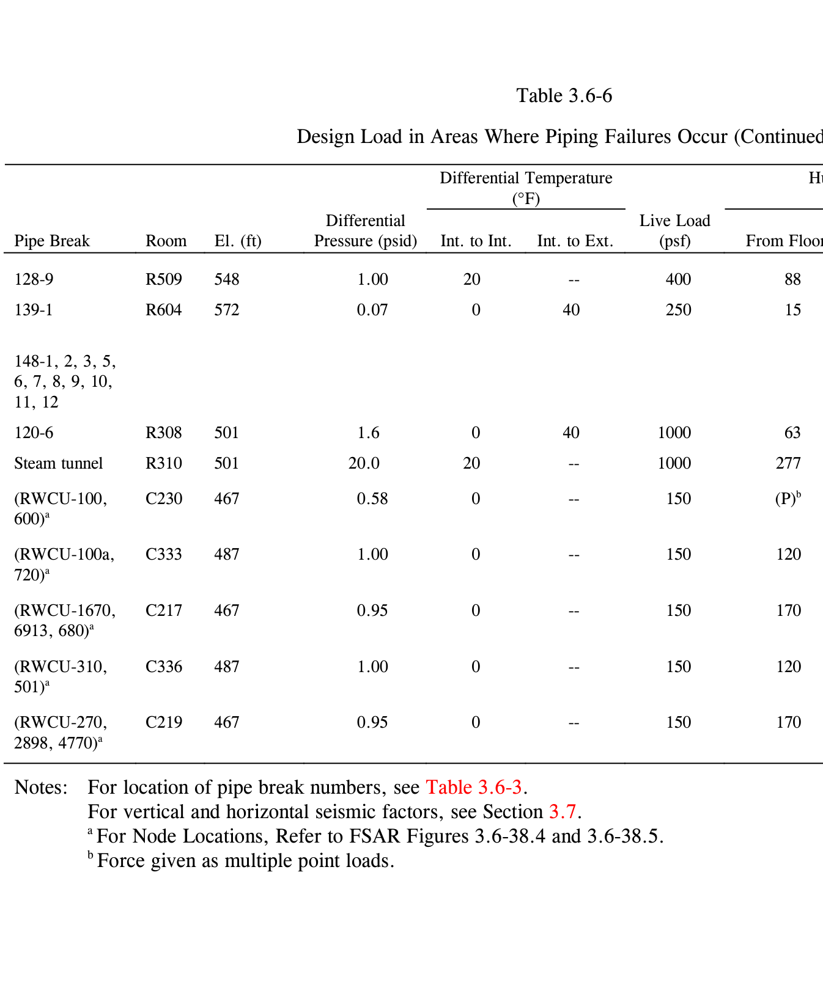

*figure on PDF page 338*

[Vector original (SVG, lossless): fig_page-338.svg](../figures/fig_page-338.svg)

<!-- labels/text on this figure page -->
COLUMBIA GENERATING STATION
Amendment 65
FINAL SAFETY ANALYSIS REPORT
December 2019
Equipment Loads Heat and vent 37k Demin 37k Demin
(Kips)
unit 51K None None None None None None
From Ceiling 55 41 40 40 120 40 120 50 36 Hung Loads
(psf)
Design Load in Areas Where Piping Failures Occur (Continued)
From Floor 63 277 (P)b 120 170 120 170 88 15
Live Load 1000 1000 150 150 150 150 150
(psf) 400 250 a For Node Locations, Refer to FSAR Figures 3.6-38.4 and 3.6-38.5.
Differential Temperature Int. to Ext. Table 3.6-6 For vertical and horizontal seismic factors, see Section 3.7. -- 40 40 -- -- -- -- -- --
(F)
Notes: For location of pipe break numbers, see Table 3.6-3.
Int. to Int.
20 0 0 20 0 0 0 0 0
Pressure (psid)
Differential b Force given as multiple point loads.
1.00 0.07 0.58 1.00 0.95 1.00 0.95
1.6 20.0
El. (ft)
548 572 501 501 467 487 467 487 467
Room
R509 R604
R308 R310 C230 C333 C217 C336 C219
148-1, 2, 3, 5,
(RWCU-1670, 6, 7, 8, 9, 10, (RWCU-100a,
(RWCU-100,
(RWCU-310, (RWCU-270, 2898, 4770)a Steam tunnel 6913, 680)a Pipe Break 11, 12 128-9 139-1 120-6 600)a 720)a 501)a
3.6-89
LDCN-16-031, 19-006

<!-- p.339 -->
Table 3.6-7

Maximum Ductility Ratios Steel Structural Components

Steel beams (lateral load)

(Note: To develop this ductility, the flanges must be thick enough to 26 prevent local plastic buckling)

Steel beams (lateral and axial load)
8

Welded portal frams (vertical load)

#### REINFORCED-CONCRETE STRUCTURAL COMPONENTS
Tension reinforced-concrete beams and slabs, (flexure controls design) 0.10 _ 10 pa

Doubly reinforced-concrete beams and slabs, (flexure controls design) 0.10 _ 10 p-p'b

Reinforced-concrete columns, walls, and other elements exhibiting brittle 1.3 fracture (compression controls design)

a p is the ratio of tensile reinforcement.

b p' is the ratio of compression reinforcement.

<!-- p.340 -->
Table 3.6-8

Dynamic Strength of Materials

Dynamic Increase Factor

Reinforced concrete Concrete Compression, axial or flexural
## 1.25 Shear as a measure of diagonal tension and
1.00 punching shear Bond
1.00

Reinforcing steel Tension
## 1.10 Compression
## 1.10 Shear reinforcement to resist shear as a measure
1.00 of diagonal tension and punching shear

Structural Steel Flexure and tension
## 1.10 Compression
## 1.10 Shear
1.00

<!-- p.341 -->
R308/R305, R206, R313 R308/R305, R206, R313 Differential Between the

#### R15, R112/R14, R113
#### R15, R112/R6, R116
Reactor building and R105, Reactor Bldg R206, Reactor Bldg R305, Reactor Bldg R404, Reactor Bldg R510, Reactor Bldg

#### R313/R308, R408 R102/R107/R111,
#### R15, R112/R206
Differential Pressure Rooms Reactor Bldg

#### R308/R206
ambient

Differential Maximum 0.25 0.25 0.24 0.24 0.27 0.25 0.25 0.24 0.24 0.22
(psi)
2.8 2.8 2.8 1.2 0.2

Summary of Subcompartment Pressure Analysisa Line Designation Piping System 6"RWCU (2)-4 6"RWCU (2)-4 4"RWCU (5)-3 4"RWCU (5)-3 4"RWCU (5)-3 4"RWCU (5)-3 4"RWCU (5)-3 4"RWCU (5)-3 4"RCIC (13)-4 4"RCIC (13)-4 4"RCIC (13)-4 4"AS (11)-2 3"AS (11)-2 Table 3.6-9 El. 441 Reactor Building El. 471 Open Floor Area El. 501 Open Floor Area El. 522 Open Floor Area El. 548 Open Floor Area El. 510 ft valve room El. 471 ft, SE corner Pipe chase el. 471 ft Description RCIC pump room Open floor area Railway Bay TIP room TIP room Stairwell Compartment Where Break Occurs

#### R102/R107/
R15/R112 Room

#### R206C
#### R206 R308 R308 R313 R105 R111 R206 R305 R404 R510
Elevation (ft)
422 471 471 501 501 501 441 441 471 501 522 548

<!-- p.342 -->
R405/R305, R404, R504 Differential Between the R704, Reactor Bldg

#### C230/C217, C212,
#### C344/C325, C326
#### R604/R607/R608, R406/R404, R305 R406/R407, R409 R409/R504, R404
Reactor building Reactor building Differential Pressure Rooms Reactor Bldg

#### R409/R405
Differential Maximum 0.58c 0.17 0.33 0.59 0.34 (psi)
0.2 6.9 5.6 3.9 1.7 2.2

Summary of Subcompartment Pressure Analysisa Line Designation Piping System 4"RWCU (5)-3 4"RWCU (5)-3 4"RWCU (1)-4 6"RWCU (1)-4 4"RWCU (2)-3 4"RWCU (1)-3 Table 3.6-9 El. 606 Fuel Handling Area El. 572 Open Floor Area RWCU pump room Description Cable Chase Room Cable Chase Room Compartment Where Break Occurs R406/R407b

#### R604/R607/
Room

#### C230 C344
#### R608 R704
Elevation (ft)
572 606 522 467 487

<!-- p.343 -->
December 2023 a Table applies to reactor building secondary containment and portions of the radwaste building, exclusive of the main steam tunnel, Differential Between the c This differential pressure does not account for hydrostatic pressure due to flooding. With the approximate 9.6 inches of flooding Reactor building and

#### R509/R508, R408 R510/R504, R508 R510/R404, R604 R511/R404, R504
Differential Pressure Rooms

#### R511/R604
#### R408/R404 R408/R305 R408/R509 R509/R607
Ambient

Differential Maximum 0.07 0.07 (psi)
1.1 1.1 1.1 0.9 0.9 2.7 2.7 6.3 2.4 Summary of Subcompartment Pressure Analysisa (Continued)
in room C230, the differential pressure across the floor/door C228 is approximately 0.93 psi.
Line Designation Piping System 6"RWCU (2)-4 6"RWCU (2)-4 6"RWCU (1)-4 6"RWCU (1)- 4"AS (11)-2 4"HS (1)-2 5SX/SXL Table 3.6-9 El. 572 ft open floor area b Break could occur in either room; break assumed in R406.N Description RWCU HX room Valve room Valve room Valve room Compartment Where Break Occurs tunnel ventway, and tunnel extension.
Room

#### R511A
#### R511/
#### R408 R509 R510
R604

Elevation (ft)
522 548 548 548 572

3.6-93A LDCN-23-013

<!-- p.344 -->
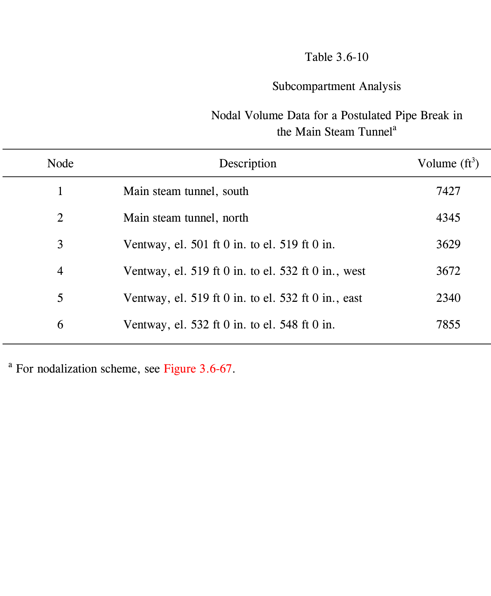

*figure on PDF page 344*

[Vector original (SVG, lossless): fig_page-344.svg](../figures/fig_page-344.svg)

<!-- labels/text on this figure page -->
COLUMBIA GENERATING STATION
Amendment 57
FINAL SAFETY ANALYSIS REPORT
December 2003
Elevation (ft)
501 501 501 519 519 532
Volume (ft3)
Nodal Volume Data for a Postulated Pipe Break in 7427 4345 3629 3672 2340 7855
Subcompartment Analysis the Main Steam Tunnela Table 3.6-10 Ventway, el. 519 ft 0 in. to el. 532 ft 0 in., west Ventway, el. 519 ft 0 in. to el. 532 ft 0 in., east Ventway, el. 501 ft 0 in. to el. 519 ft 0 in.
Ventway, el. 532 ft 0 in. to el. 548 ft 0 in.
Description Main steam tunnel, south Main steam tunnel, north a For nodalization scheme, see Figure 3.6-67.
Node 1 2 3 4 5 6
3.6-94

<!-- p.345 -->
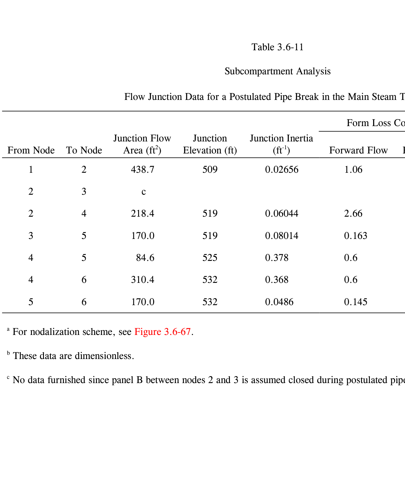

*figure on PDF page 345*

[Vector original (SVG, lossless): fig_page-345.svg](../figures/fig_page-345.svg)

<!-- labels/text on this figure page -->
COLUMBIA GENERATING STATION
Amendment 57
FINAL SAFETY ANALYSIS REPORT
December 2003
Frictional Loss Coefficientb 0.1 0.1 0.1 0.1 0.1 0.1
Reverse Flow Form Loss Coefficientb 0.116 0.206
1.14 2.69 c No data furnished since panel B between nodes 2 and 3 is assumed closed during postulated pipe break.
0.6 0.6 Flow Junction Data for a Postulated Pipe Break in the Main Steam Tunnela Forward Flow 0.163 0.145
1.06 2.66 0.6 0.6
Subcompartment Analysis Junction Inertia Table 3.6-11 0.02656 0.06044 0.08014 0.0486
(ft-1)
0.378 0.368
Elevation (ft)
Junction 509 519 519 525 532 532
a For nodalization scheme, see Figure 3.6-67.
Junction Flow c Area (ft2)
438.7 218.4 170.0 84.6 310.4 170.0 b These data are dimensionless.
To Node 2 3 4 5 5 6 6
From Node 1 2 2 3 4 4 5
3.6-95

<!-- p.346 -->
Table 3.6-12

Main Steam Tunnel Subcompartment Analysis Information for Blowout Panels C and D

Panel C (horizontal, hinged, nonbolted, sheet steel blowout panel)

Total weight: 2060 lb

230.6 ft2 Area:

Moment arm: 3.375 ft

31,286 lbmass-ft2 Moment of inertia:

Damping constant: Neglected

Panel D (vertical, bolted, insulated metal blowout panel)

Total weight: 16,000 lb

1060.8 ft2 Area:

Reference: Figures 3.6-65 and 3.6-66.

<!-- p.347 -->
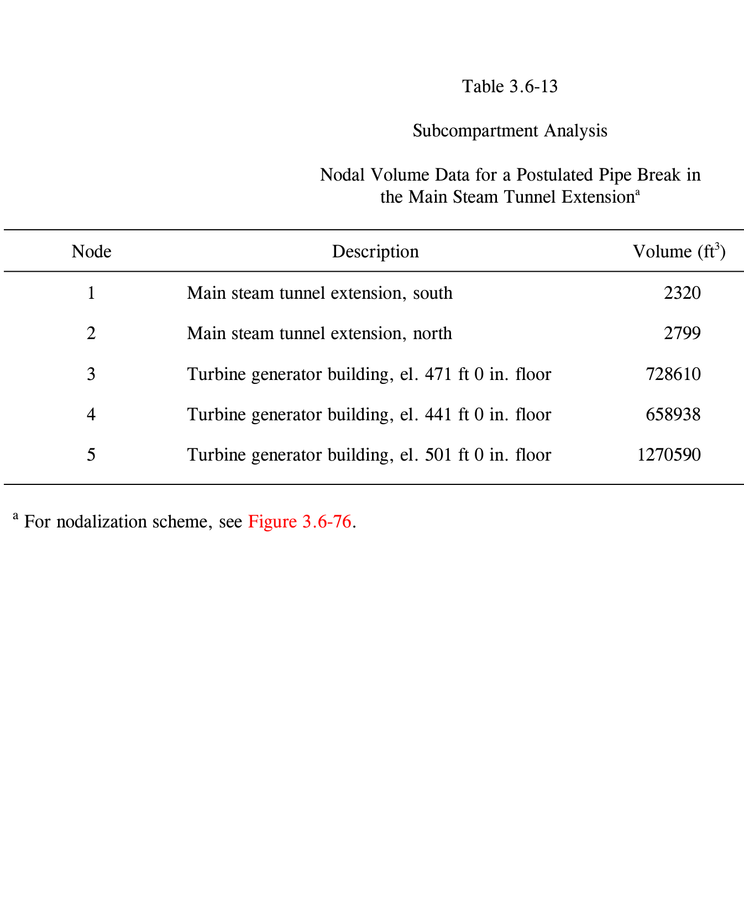

*figure on PDF page 347*

[Vector original (SVG, lossless): fig_page-347.svg](../figures/fig_page-347.svg)

<!-- labels/text on this figure page -->
COLUMBIA GENERATING STATION
Amendment 57
FINAL SAFETY ANALYSIS REPORT
December 2003
Elevation (ft)
501 501 471 441 501
Volume (ft3)
Nodal Volume Data for a Postulated Pipe Break in 2320 2799 728610 658938 1270590 the Main Steam Tunnel Extensiona Subcompartment Analysis Table 3.6-13 Turbine generator building, el. 471 ft 0 in. floor Turbine generator building, el. 441 ft 0 in. floor Turbine generator building, el. 501 ft 0 in. floor Main steam tunnel extension, south Main steam tunnel extension, north Description a For nodalization scheme, see Figure 3.6-76.
Node 1 2 3 4 5
3.6-97

<!-- p.348 -->
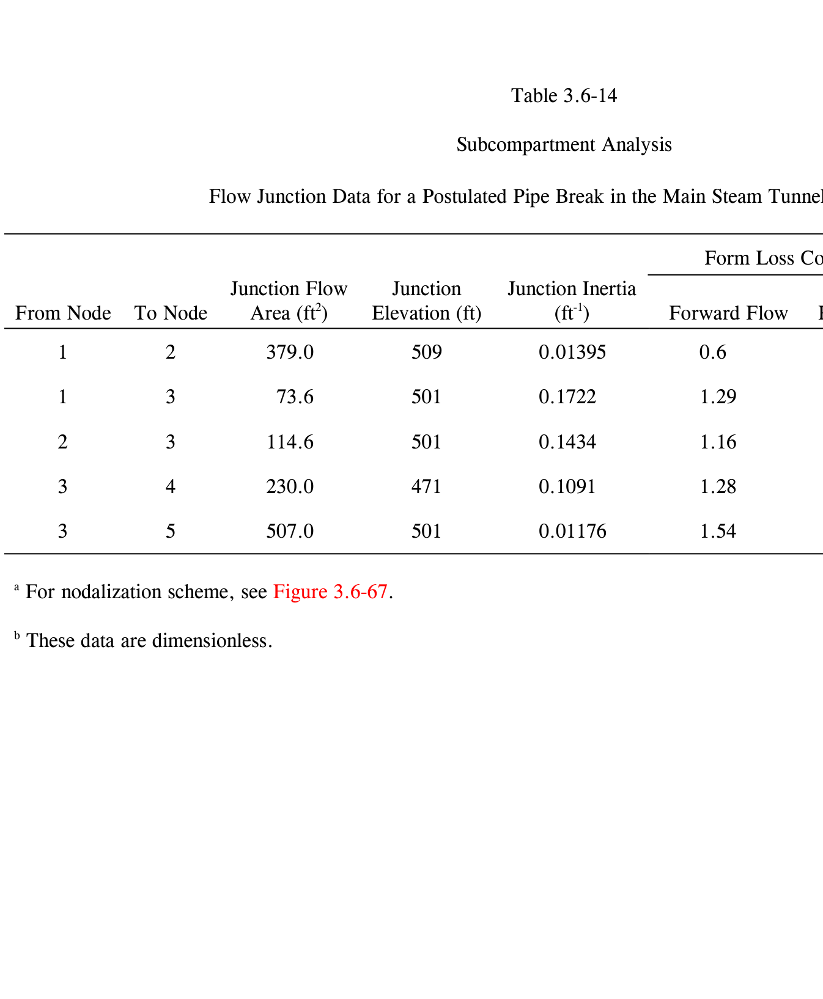

*figure on PDF page 348*

[Vector original (SVG, lossless): fig_page-348.svg](../figures/fig_page-348.svg)

<!-- labels/text on this figure page -->
COLUMBIA GENERATING STATION
Amendment 57
FINAL SAFETY ANALYSIS REPORT
December 2003
Frictional Loss Coefficientb 0.1 0.1 0.1 0.1 0.1
Reverse Flow Flow Junction Data for a Postulated Pipe Break in the Main Steam Tunnel Extensiona Form Loss Coefficientb 0.56 1.07 0.99 1.49 1.55
Forward Flow
1.29 1.16 1.28 1.54 0.6
Subcompartment Analysis Junction Inertia Table 3.6-14 0.01176 0.01395 0.1722 0.1434 0.1091
(ft-1)
Elevation (ft)
Junction 509 501 501 471 501
a For nodalization scheme, see Figure 3.6-67.
Junction Flow Area (ft2)
379.0 73.6 114.6 230.0 507.0 b These data are dimensionless.
To Node 2 3 3 4 5
From Node 1 1 2 3 3
3.6-98

<!-- p.349 -->
Recirculation pump suction to closed valve RHR-V-9 (MOF009).
RPV to closed valve SLC-V-8, HPCS line to first check valve.
Recirculation pump discharge to first check valve. Recirculation pump discharge to first check valve.
Piping Systems Inside Containment for Which Design Basis Pipe Breaks are Postulated Entire run within primary containment. Entire run within primary containment. Entire run within primary containment. Entire run within primary containment. Entire run within primary containment. Entire run within primary containment. Entire run within primary containment. Entire run within primary containment. Entire run within primary containment.
RPV to first check valve. RPV to first check valve. RPV to first check valve. RPV to first check valve. RPV to first check valve.
Portion

Table 3.6-15

RHR condensing mode/RCIC turbine steam RHR shutdown cooling return (loop A) RHR shutdown cooling return (loop B)
RRC Recirculation pump A discharge High pressure core spray (HPCS)
Low pressure core spray (LPCS)
Reactor feedwater (RFW) line A Reactor feedwater (RFW) line B Reactor water cleanup (RWCU)
RHR shutdown cooling supply Standby liquid control (SLC)
RHR/LPCI mode (loop A) RHR/LPCI mode (loop C) RHR/LPCI mode (loop B)
Main steam (MS) loop A Main steam (MS) loop B Main steam (MS) loop C Main steam (MS) loop D System

<!-- p.350 -->
Entire run within primary containment. Entire run within primary containment. Entire run within primary containment. Entire run within primary containment. Entire run within primary containment.
RPV to three (3) closed valves.
Piping Systems Inside Containment for Which Design Basis RPV to first check valve.
Portion Pipe Breaks are Postulated (Continued)
Table 3.6-15

Main steam (MS) valves drainage piping RRC recirculation pump B discharge RRC recirculation pump A suction RRC recirculation pump B suction RRC reactor pressure vessel drain Main steam (MS) RPV head vent RCIC/RPV head spray System

<!-- p.351 -->
Table 3.6-16

Piping Systems Containing Break Exclusion Areas Between Primary Containment Isolation Valves

Piping System Pipe Size (in.)

Main steam loop A 26

Main steam loop B 26

Main steam loop C 26

Main steam loop D 26

Reactor feedwater line A 24

Reactor feedwater line B 24

RHR condensing mode/RCIC turbine steam 10/4

Reactor water cleanup 6

<!-- p.352 -->
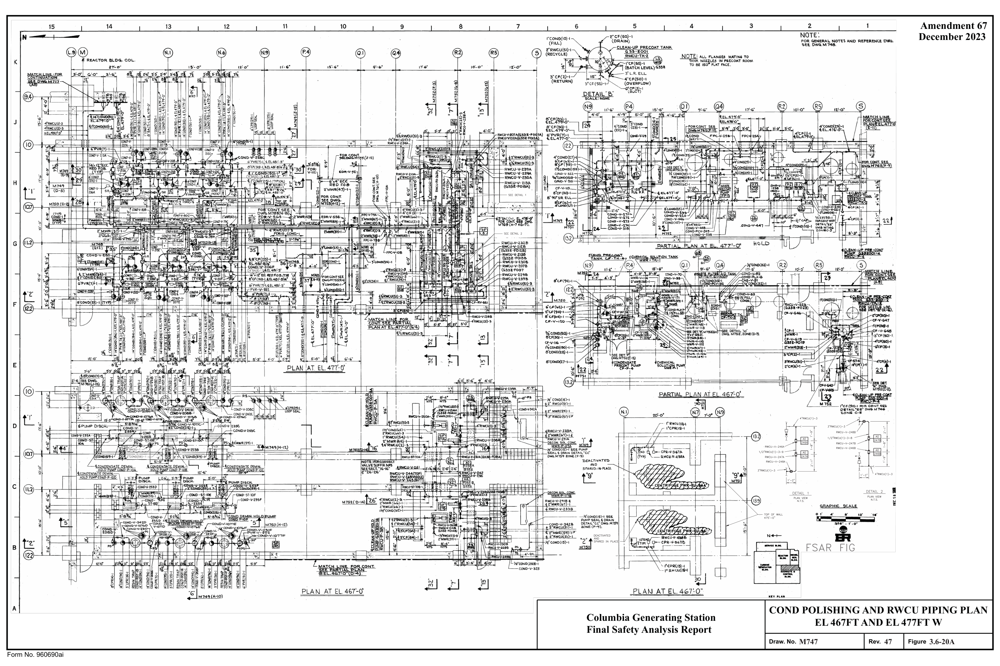

*figure on PDF page 352*

<!-- labels/text on this figure page -->
- Amendment 67 3 2 5 8 11 4 7 6 13 12 10 15 14 9 December 2023 NOTE:
l''COND(IO)·I N - FOR GEME~AL NOTE'S 1'N.C REFE.RENc.E. 'O'N~.
(FILL)
SE.E. OWCi.M 748.
2"RWCU(51) I P.4 Q.I R.2 Q ..
(RECYCLE)
NOTE.: ALL FLANGES MATIN• TO K ~ NOZZLE.5 IN PltE.COAT ROON\ '§ TO BE 1S041 .Fl..,t..i f';.c.E. ~ 2 ri-<o" 10'.o"
3"CF(2)+./
(RETURN) ," CF
H
so~ ·207B 007 ·'l.2~B ·ts9a U('SI)-• I a•c. i WCU('Sl-1 f '2"
/ M7
-17-_-:;,.;,'-''t_~~~~~~~-·~,f\.'=i-
. ....,
(50)-1 &0).1
($)-1
F(4-1
E '2.
"'" {£2).
.l;:=,rT
iln~~~~!=Jf<,c::====="'1'=='==~'8-l-~===""_~-+.t~ == ==== == t,.1-+--lt._._,~iii Li~#=t==#E~c;;c~~L~t.=J'u;=t...L~-Ust-'-~ ~~---'-$'-+)::I-+,jH--
'i"Z.6-2.i"
C
~-- Me~ - 1• -Oq
____Q__UAf1_l_
PLAN VIEW
~.T.S 0 ,· .. .. GRAPH\C SC.ALE.
,. .
TOP Of WALL ·1•· 475'-o" & N+-+-
FSAR FIG
I I
~ lJ
~
PLAN AT EL 467'-0'
PLAt-.J AT EL. 467'.0"
COND POLISHING AND RWCU PIPING PLAN A
Columbia Generating Station
EL 467FT AND EL 477FT W
Final Safety Analysis Report M747 47 3.6-20A Draw. No. Rev. Figure Form No. 960690ai

<!-- p.353 -->
Amendment 65 15 14 13 12 11 10 9 8 5 4 7 6 December 2019 3 2 N -----+---- GENERAL NOTES:
1. AL!.. ORAlt.lS TO EQUIPl\.,11:NT ~AINS TO 5, TERMI NA•,·e l' ABOVE: F INISHEO FLOOR UNLESS 'oTHERWISE NOTED. ' K la°-O"
2. W, T. B, - WAT~ TIGHT e,QOT ; FO~ C'!:T ... 11..
SEE DV'IG. M85B, SHT. 1 ♦2..

3,, P.S. - PIPE SLeevc.

4-~~~~~:~N: .;H~~~~i:~ ;~~:o~:NTS C.LA~SIF IED A':, ll\lDlC.ATED .ON \l·fE.\R RESPEC.TlVE SYSTEM FLOW DIA~RAMS 5. WORK THI ~ OWC:i.Wl"TI-~ OW<",i.S.N\745 THRU

#### M747 ANO M7491'HRU M752
G. FOR INSTA.LLAT/ON OF TH!R ~OWELL.S J At.JO TEMPERATURE TEST CONNEC.TIONS

#### SEC DWG. MGIO.
7. ALL VALVE STCMS FOR VALVES 2!f AND LARGER NOT LOCATED SHALL 6E IN A. VERTICAL FQSJTI0/:1, co 0-
•fr

#### G.Y-I
REFER.ENCE DRAWINGS: ~9(EeJ ,, CONT.ON ~ Mlo90(G-I+ FLOW DIAQRAM- REACTOR '.WATER CL~A.f.l-Uf 5~5\ EM • .D'NC,. \.ll-5'L3 FLOW DI AG.RA~- FUEL POOL COOL\Nq ANV CL~N-UP jYSTf.M. DW~. N1 -5'l(, FLOW DIA\l.RAt,.,\-COND!NSAT[ .SUPPLY H SYSTEM All eUILDHJCi~. Dv-14. M-5'2.'1 ~~~t~~~~'"'P~~~t;;1~~-~:~~ti-~ii~M FLOW OIA&RA\.A- RI\OIOACTlVE. Wl\~\E 6i'!ilE..M E:GUl?'t.AE:.lJT DRAI~ f'\:l.Oc.E='='lJJC:j,t7WCf,M.·53".2 Fl.OW DIAGRAM- Cl-l'fMIC~L 'NA..!ii'E f'SOC~~!:ilNV\ , t>\I\J4.M ·5' ?1 P/\RTl/:\l PLl>-N eELE\J. 452.'-o" r FL.ON DIAGRAM-RA.OlOACT\VE WASTE SYSTEM CONDENSATE. DEMINEP.ALIZA:T10N,

#### OWG, M53 4.
#### FLOW DIA.GRAM- RAD IOAC T IVE.
WA.$TE. DISPOSAL SOLIDS HANDL ING SYST EM cw e:i. M-536 G IN.S.TALLATIQN_ Qf TI-I E.~MOWf.Ll.S AND SAM.PL?: PROBE S DWG. M -.I0

COND-V·3SI r COND-V·Y.i3 PLAN r ND· GENERAL NOTES: (CONT'D) CPND·j_ '1·3S'2 F CF·li;-.1..-1.
8. TAN,<; FLUSHING CON1ROL AIR CHECK VAL.VES ANO FL.EX l e LE HOSES /\.RE TO BE INS7ALLED AS CLO~ AS PO&SLBLG TO INS"i RWMENT Al ~

#### BUBBLER,
I '-•-·-- CONO·V-8" ;
§i-- ·1 :t="g';:;:'~==t===aa;:a,aai,:==aaa;'"!-- COND·PC.V·<7 4-'COND{t1)-l CPR-V·31ol E 4•~2.• t;," CPR(1S)-1 1 RE.OUC!1'vGt ELL.

15~ z( 21.. 4'"CP#:(V..)-I .~ '~r z··coN0(17)-t Fl.. 452'-0" SECT ION '21-21" DETAtL''v "(K74-'5(F'•12.)) PLAN EL 507°- 0 0 t SC-'L;,NONE Q SCALE.· h= t'-o"

PE'i,JE'TRATJOtJ #<i:,28 D IL.
;~,:CTlf,";,' 8 2'CON0(89)-1 N~--+- S.R.
' ' • I J/2"CONp(S0)-1 ! .
·'>' I I I ' ~ ; Ii l ! 't0HO·Hl3, ~I!!,("'""''"'" !
CONDV!l>F ,~ , ~ ~ ~
(89'l-1 t~~~~~·_ :, T;P,)
I
• O~P~R(7)•1 - \4."'C.OND(Bb)-I • J4"COND (85)-1 e•~;tfo)~~)-I _4, 14-' COH0(84)·1 FL .il.,452'-o" C 1 5ECTION'35-35" ) I i'Cc-10("2.4~ COND(84J l SCALE• NONE "1747(G·l4 TO Cd'2)
SECTION '36-36' ~lth~o: !io' id i N.I ~i ~ ·Ht Hinl M141 (G-·14 TO G-·12)

#### GRAPHIC SCALE ,
622)
( o ,· e· 1s· .4' ,2· o o . % :z z a ~ a ... z :z a: , cte c:i::
r+.-;.:,:: • . - ~ 14'- I 511i
• ~-- :::::.1 a/16" - 1·-0- CO~D""I DETAIL" 8-B" PvR:• 7~~=~~~~~'=,:;e~R~t:3~~~\.,_ ' ~-·· ~~--~~­ B '-+--- - ----------+--c.+-LT 1'..3'·c~~~-~1f(~YP.) • -+~~t~:~g;' M/49 ( 1-4-7)
_ lEL.4~-2:~2':_ ~"',/~ ccc_=-"--"' ~ - ~;c;i"'~-~)
NOTE:- RUN 2"MWR{!:>9H 0(84H SEC.Tl ON 41-41- ~!>~.J•c~~1f-~W.P.A$ SECT! ON '~2-42:,' i.14"cm.io('74H M74~(E·'2)
'l \(CON0(84)·\ M74~(E·2)
7'-r:..." f--------t1~·co"-I0{8S)-I ,..,. ,._.., 14"COND~S)·\-----ll~;,1· ~ J,<;, ll~t K.01 SE.C,TION 37 -:.7' pt,.JU\,t,._L PLl>-.N @ ELEV. 437co" M74-l ( G I4TQq 12.)

#### CONDENSATE POLISHING AND RWCU
PIPING PLAN 487FT AND MISCELLANEOUS Columbia Generating Station

#### PARTIAL PLANS AND SECTIONS
Final Safety Analysis Report M748 15 3.6-20B Draw. No. Rev. Figure Form No. 960690ai

<!-- p.354 -->
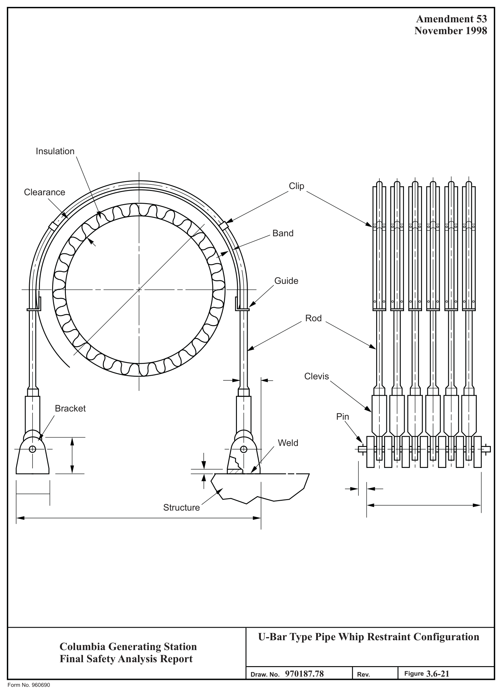

*figure on PDF page 354*

[Vector original (SVG, lossless): fig_page-354.svg](../figures/fig_page-354.svg)

<!-- labels/text on this figure page -->
Amendment 53 November 1998
Insulation
Clip Clearance
Band
Guide
Rod
Clevis
Bracket Pin
Weld
Structure
U-Bar Type Pipe Whip Restraint Configuration Columbia Generating Station Final Safety Analysis Report 970187.78
3.6-21 Draw. No.
Rev. Figure Form No. 960690

<!-- p.355 -->
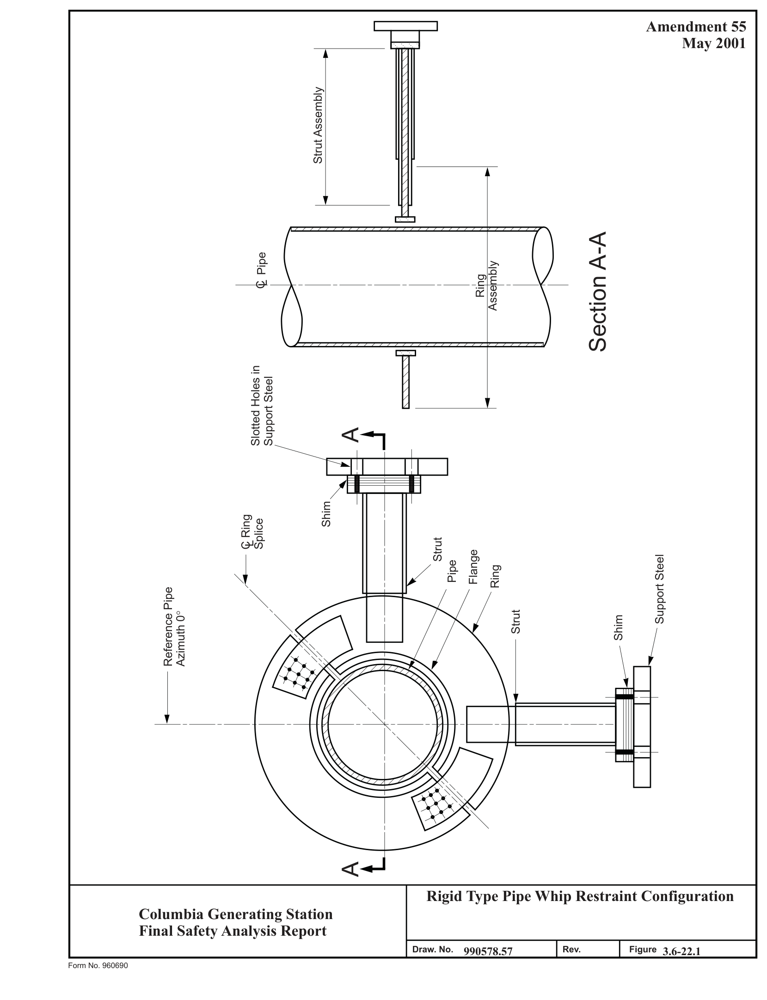

*figure on PDF page 355*

[Vector original (SVG, lossless): fig_page-355.svg](../figures/fig_page-355.svg)

<!-- labels/text on this figure page -->
Amendment 55 May 2001
Strut Assembly
Section A-A Pipe Assembly Ring CL
T Slotted Holes in Support Steel A
Shim C Ring Splice Strut L Flange Support Steel Pipe Ring Reference Pipe Strut Azimuth 0° Shim J __ _
A Rigid Type Pipe Whip Restraint Configuration Columbia Generating Station Final Safety Analysis Report Draw. No. 990578.57 Rev. Figure 3.6-22.1 Form No. 960690

<!-- p.356 -->
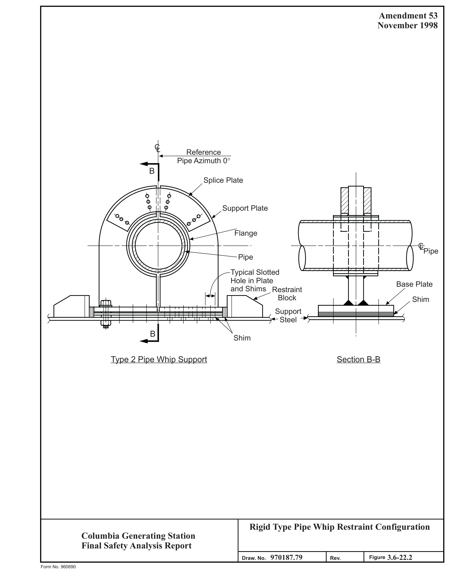

*figure on PDF page 356*

[Vector original (SVG, lossless): fig_page-356.svg](../figures/fig_page-356.svg)

<!-- labels/text on this figure page -->
Amendment 53 November 1998
CL Reference Pipe Azimuth 0° B Splice Plate
Support Plate
I -I I I , I Flange
- I Ii I I - CL Pipe Pipe
I I I I
Typical Slotted Hole in Plate Base Plate and Shims Restraint Block Shim Support Steel B Shim
Type 2 Pipe Whip Support Section B-B
Rigid Type Pipe Whip Restraint Configuration Columbia Generating Station Final Safety Analysis Report 970187.79
3.6-22.2 Draw. No.
Rev. Figure Form No. 960690

<!-- p.357 -->
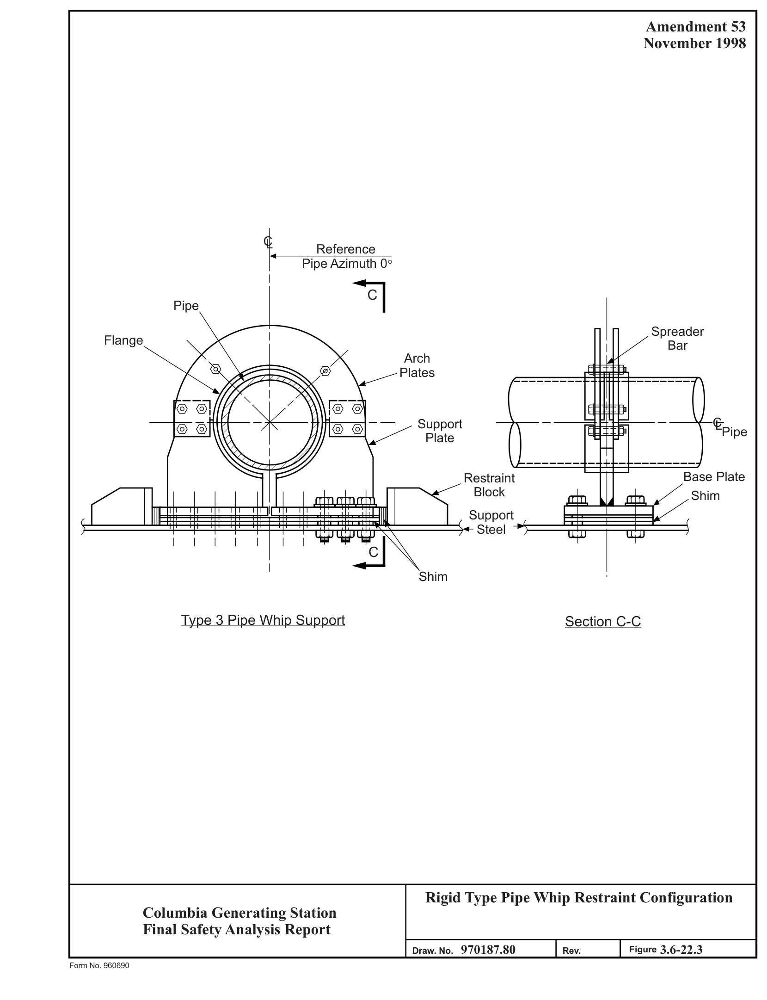

*figure on PDF page 357*

[Vector original (SVG, lossless): fig_page-357.svg](../figures/fig_page-357.svg)

<!-- labels/text on this figure page -->
Amendment 53 November 1998
CL Reference 1· Pipe Azimuth 0° 7 C Pipe
Spreader Flange Bar Arch Plates
CL Support Pipe Plate
Base Plate Restraint Block Shim Support Steel C Shim
Type 3 Pipe Whip Support Section C-C
Rigid Type Pipe Whip Restraint Configuration Columbia Generating Station Final Safety Analysis Report 970187.80
3.6-22.3 Draw. No.
Rev. Figure Form No. 960690

<!-- p.358 -->
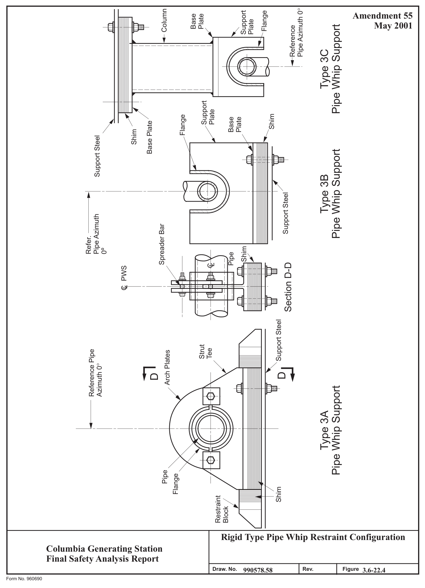

*figure on PDF page 358*

[Vector original (SVG, lossless): fig_page-358.svg](../figures/fig_page-358.svg)

<!-- labels/text on this figure page -->
Pipe Azimuth 0° Column Amendment 55 Support Flange Base Plate May 2001 Plate Pipe Whip Support Reference Type 3C
Support Plate Shim Flange Base Plate Base Plate Shim Support Steel Pipe Whip Support Type 3B Support Steel Pipe Azimuth Spreader Bar Refer.
Shim 0º Pipe Section D-D CL
CL PWS
Support Steel Strut Tee Reference Pipe r Arch Plates 7 Azimuth 0° D D Pipe Whip Support J Type 3A
Pipe Flange Shim Restraint Block
Rigid Type Pipe Whip Restraint Configuration Columbia Generating Station Final Safety Analysis Report 990578.58
3.6-22.4 Draw. No. Rev. Figure Form No. 960690

<!-- p.359 -->
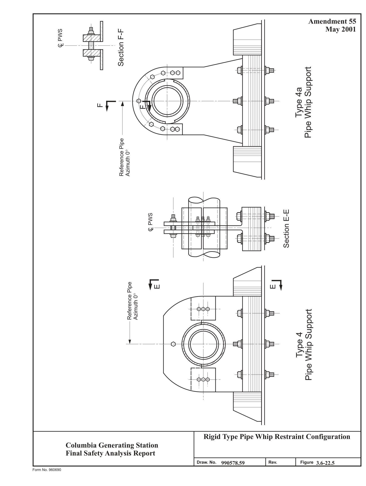

*figure on PDF page 359*

[Vector original (SVG, lossless): fig_page-359.svg](../figures/fig_page-359.svg)

<!-- labels/text on this figure page -->
Amendment 55 May 2001 Section F-F
CL PWS
Pipe Whip Support Type 4a F F
Reference Pipe Azimuth 0°
Section E-E
CL PWS
r 7 Reference Pipe E E
Azimuth 0° Pipe Whip Support l __ Type 4
Rigid Type Pipe Whip Restraint Configuration Columbia Generating Station Final Safety Analysis Report Draw. No. 990578.59 Rev. Figure 3.6-22.5 Form No. 960690

<!-- p.360 -->
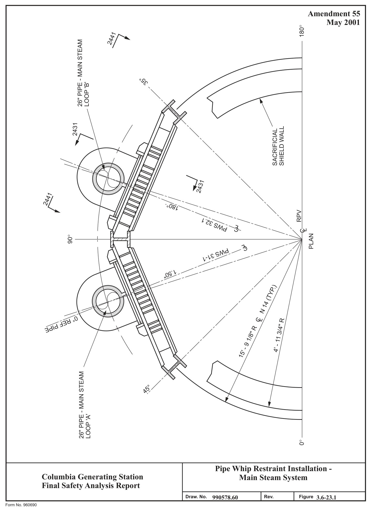

*figure on PDF page 360*

[Vector original (SVG, lossless): fig_page-360.svg](../figures/fig_page-360.svg)

<!-- labels/text on this figure page -->
Amendment 55 May 2001 180° 2441 26" PIPE - MAIN STEAM 35°
LOOP 'B'
2431
SHIELD WALL
SACRIFICIAL
2431 2441 180°· RPV
PWS 32.1
CL CL
------ PLAN 90°
-~ ------- / CL
PWS 31-1
/ ----------- ------
---------- ------ /
- ----- /
1.50" -------- ------ ---------- - /
------- /
15' - 9 1/8" R C N 14 (TYP.)
/ / / / 0° REF PIPE L 4' - 11 3/4" R / / /
26" PIPE - MAIN STEAM 45°
LOOP 'A'
0°
Pipe Whip Restraint Installation - Columbia Generating Station Main Steam System Final Safety Analysis Report Draw. No. 990578.60 Rev. Figure 3.6-23.1 Form No. 960690

<!-- p.361 -->
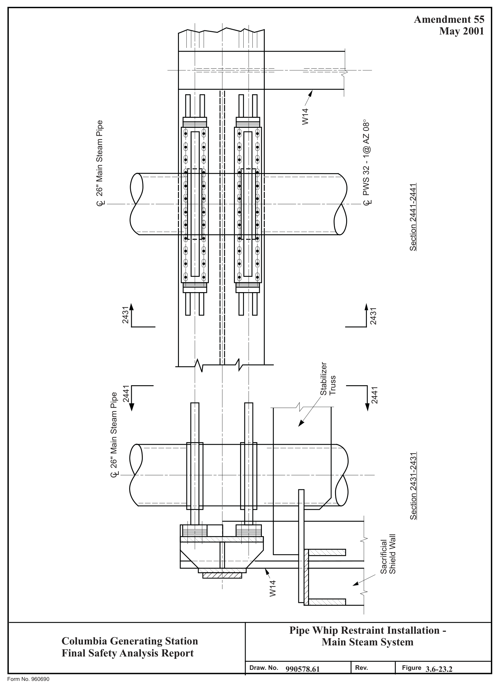

*figure on PDF page 361*

[Vector original (SVG, lossless): fig_page-361.svg](../figures/fig_page-361.svg)

<!-- labels/text on this figure page -->
Amendment 55 May 2001
W14 PWS 32 - 1@ AZ 08° CL 26" Main Steam Pipe Section 2441-2441 CL
L _J 2431 2431
Stabilizer
7 Truss
2441 2441 CL 26" Main Steam Pipe Section 2431-2431
Shield Wall Sacrificial
W14
Pipe Whip Restraint Installation - Columbia Generating Station Main Steam System Final Safety Analysis Report Draw. No. 990578.61 Rev. Figure 3.6-23.2 Form No. 960690

<!-- p.362 -->
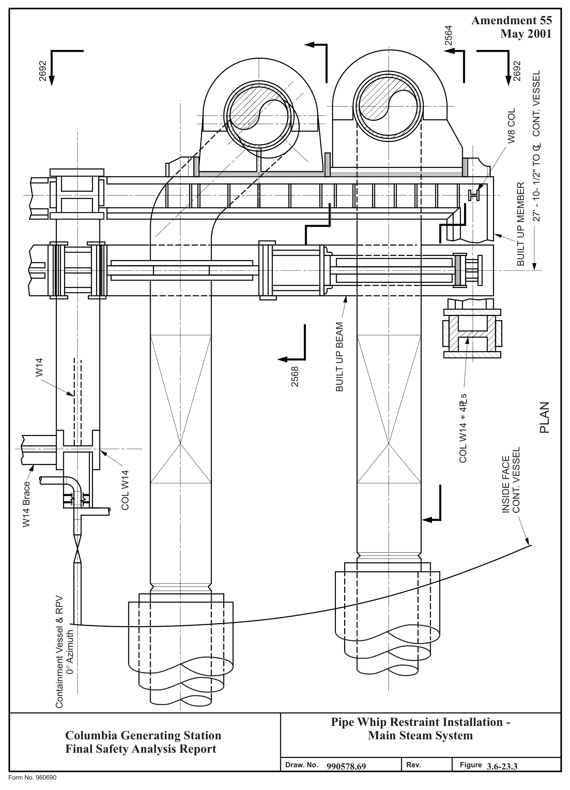

*figure on PDF page 362*

[Vector original (SVG, lossless): fig_page-362.svg](../figures/fig_page-362.svg)

<!-- labels/text on this figure page -->
Amendment 55 2564 May 2001 77 2692 2692 27' - 10- 1/2" TO C CONT. VESSEL
W8 COL
L
BUILT UP MEMBER
J
BUILT UP BEAM
W14 2568
COL W14 + 4P s L PLAN
CONT. VESSEL
INSIDE FACE
COL W14
W14 Brace
Containment Vessel & RPV 0° Azimuth
Pipe Whip Restraint Installation - Main Steam System Columbia Generating Station Final Safety Analysis Report Draw. No. 990578.69 Rev. Figure 3.6-23.3 Form No. 960690

<!-- p.363 -->
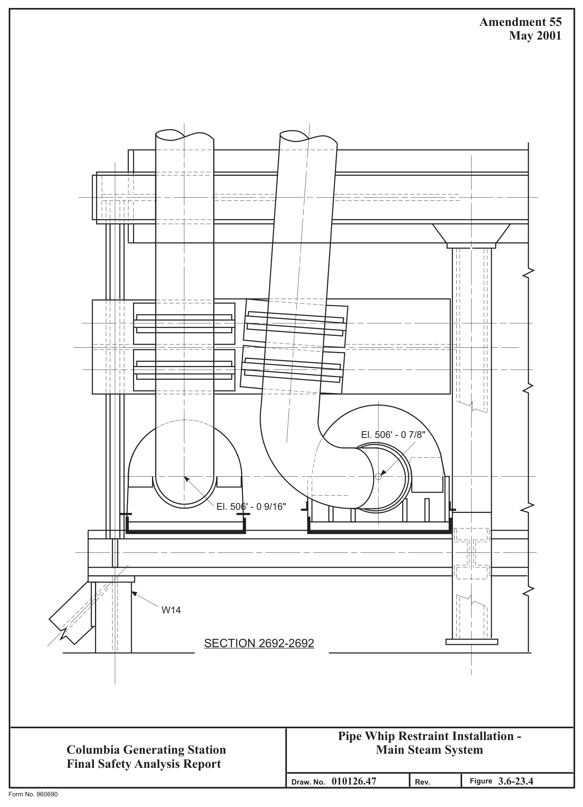

*figure on PDF page 363*

[Vector original (SVG, lossless): fig_page-363.svg](../figures/fig_page-363.svg)

<!-- labels/text on this figure page -->
Amendment 55 May 2001
El. 506' - 0 7/8"
El. 506' - 0 9/16"
W14
SECTION 2692-2692
Pipe Whip Restraint Installation - Main Steam System Columbia Generating Station Final Safety Analysis Report 010126.47
3.6-23.4 Draw. No.
Rev. Figure Form No. 960690

<!-- p.364 -->
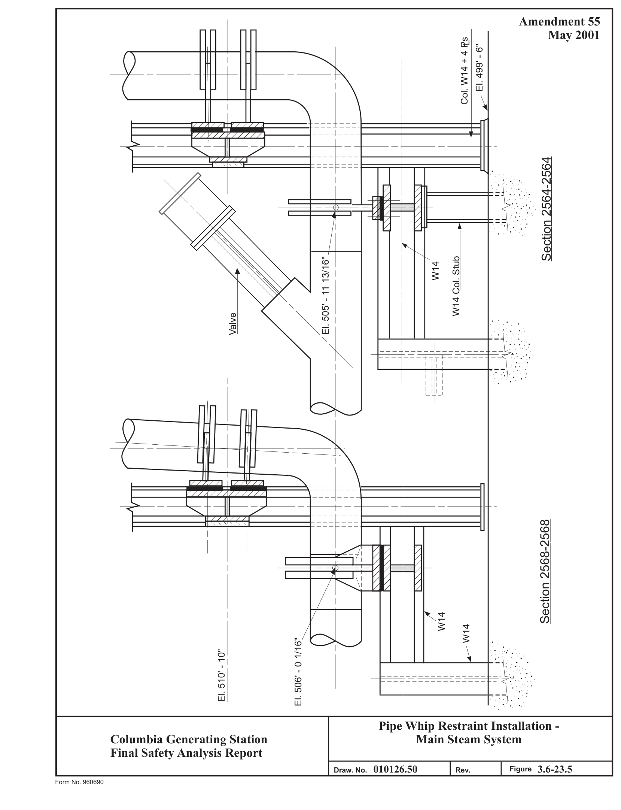

*figure on PDF page 364*

[Vector original (SVG, lossless): fig_page-364.svg](../figures/fig_page-364.svg)

<!-- labels/text on this figure page -->
Amendment 55 ., ~ ~l------------ May 2001 I Col. W14 + 4 Ps I L
El. 499' - 6" -------tmr""T1 7 """'
I
()
I t---
('---- -----ttt
I Ill - ---..
L I _J Jt--1 il
\ __ j_ __ E~F==+11 I I ~
---j---- L.L◄
---J°L +•--- ' ----r~---...L--===~;;;;i I L.,;_ II
- - - --
-~1,,-
· .·., ... =~-- -: { jJ ~ ::~:::;J::;-.:t . \r
,1 - L L - ----
~ - I Section 2564-2564
··=1r· L=-~
11;;;;;;;;"~..!.,c°":
.,J===---1-
I ~"'
1--....._ I'
W14 Col. Stub El. 505' - 11 13/16" W14 I I
Valve I ~--- ! -~---'---i"-- -d-z .::-~-------r~=~ -~~)\:
--r-=-::. ___ l- -- -+'I' I
-- : •: . .. · ."·_': <_-.::._; .' I : : I
I 1 1 I
I 1 1 I
L_ I I _ 1
- '
IL_L.....,.,-L/ I _L I
L t J
I Section 2568-2568 I
W14 W14 El. 506' - 0 1/16" El. 510' - 10" I
Pipe Whip Restraint Installation - Main Steam System Columbia Generating Station Final Safety Analysis Report 010126.50
3.6-23.5 Draw. No.
Rev. Figure Form No. 960690

<!-- p.365 -->
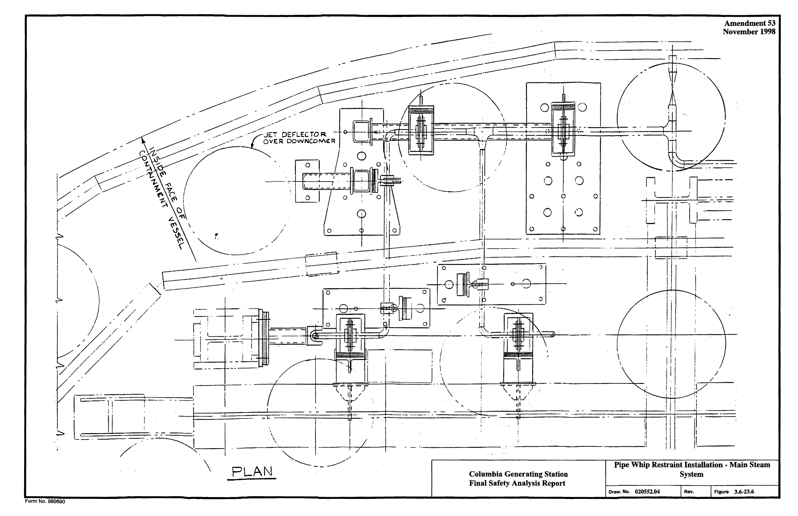

*figure on PDF page 365*

<!-- labels/text on this figure page -->
Amendment 53 November 1998
,:_ ' ' '
0
0
I ! I I' \
• I ' l I
-///'l _' _'_ ~-- L I _ ___J_1·::___+-~~F=-t===·==i.\ __ +--~,=:::=-~T'T,,,===,~. - . -----~. '.!I ', / ,~11r-r \ '--...u i ' i
--- ----:I
-,i_l_· I i 1-i- ::.;;;;;_ __ / / ----T- - I ' I!,/ I -I=--=----1 y ' ' ~ jl
===~===i=' =~'-+'f!=· =t·'·:-=:= .... --~--
I '
-'~I~- - 7 - - ---- . ttl II
- , ;
_ ~ L=-.~ ,i. __ _,il I 1
•• =-=-~==-==-=_,,.=:::=_.=-_-~I, ___ , \ l // -- ·-========-=-=-~~~-.:.----=--=--=--=--=-========T,Pti"iip~e~WhiNhJ.lppERteessttrnadiinrttlilnms~taiiinGiiatu;ioMn~-1M;iaaiinnSStteeaiamm)
System / '.
"''-- __ __.,,,,, \ Columbia Generating Station
...._
PLAN
Final Safety Analysis Report Draw. No. 020552.04 Figure 3.6-23.6 Rev.
Form No. 960690

<!-- p.366 -->
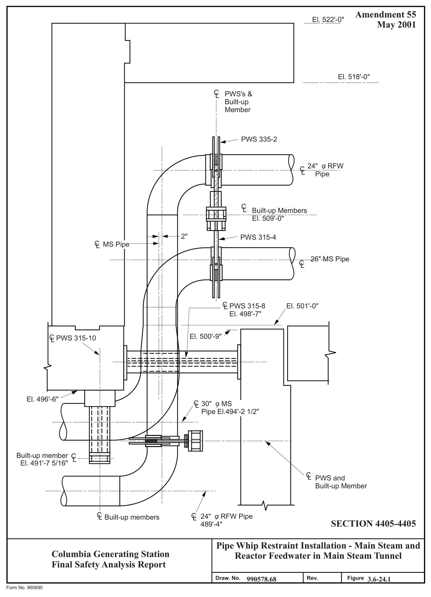

*figure on PDF page 366*

[Vector original (SVG, lossless): fig_page-366.svg](../figures/fig_page-366.svg)

<!-- labels/text on this figure page -->
Amendment 55 El. 522'-0" May 2001
El. 518'-0"
CL PWS's & Built-up Member
PWS 335-2
24" o RFW - CL _I Pipe
CL Built-up Members El. 509'-0"
2"
PWS 315-4
CL MS Pipe 26" MS Pipe CL
CL PWS 315-8 El. 501'-0" El. 498'-7"
El. 500'-9" CL PWS 315-10
El. 496'-6" CL 30" o MS Pipe El.494'-2 1/2"
Built-up member CL El. 491'-7 5/16" CL PWS and Built-up Member
CL CL 24" o RFW Pipe I Built-up members
SECTION 4405-4405
489'-4"
Pipe Whip Restraint Installation - Main Steam and Columbia Generating Station Reactor Feedwater in Main Steam Tunnel Final Safety Analysis Report Draw. No. 990578.68 Rev. Figure 3.6-24.1 Form No. 960690

<!-- p.367 -->
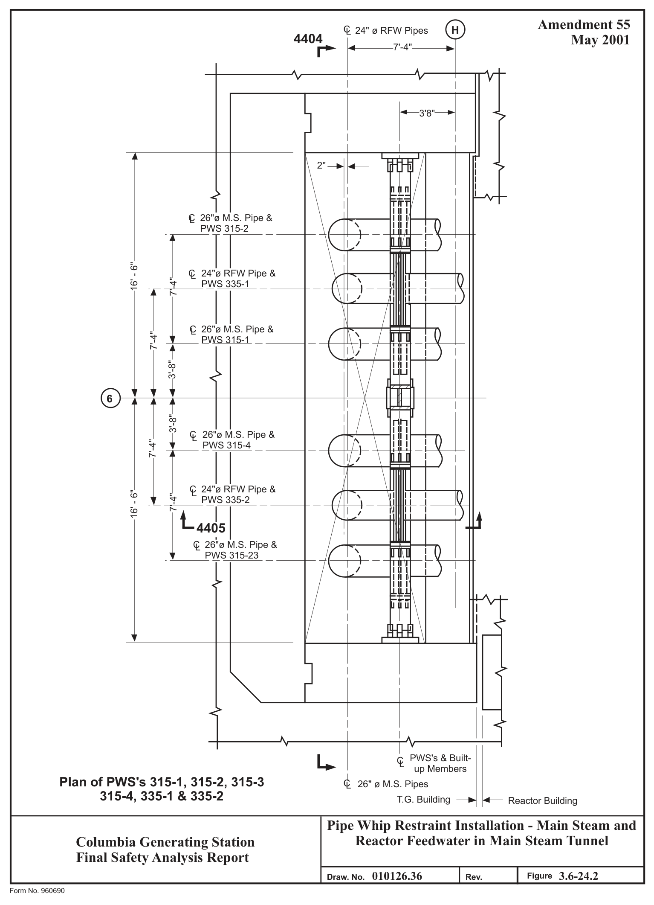

*figure on PDF page 367*

[Vector original (SVG, lossless): fig_page-367.svg](../figures/fig_page-367.svg)

<!-- labels/text on this figure page -->
Amendment 55 H 24" ø RFW Pipes CL May 2001 4404 7'-4" I 3'8"
2"
CL 26"ø M.S. Pipe &
PWS 315-2
16' - 6" CL 24"ø RFW Pipe & 7'-4" PWS 335-1
CL 26"ø M.S. Pipe & 7'-4" PWS 315-1
3'-8"
6
3'-8" CL 26"ø M.S. Pipe & 7'-4" PWS 315-4
CL 24"ø RFW Pipe & 16' - 6" 7'-4" PWS 335-2
4405 CL 26"ø M.S. Pipe &
PWS 315-23
JL I I
L..
PWS's & Built- CL up Members Plan of PWS's 315-1, 315-2, 315-3 CL 26" ø M.S. Pipes 315-4, 335-1 & 335-2 T.G. Building Reactor Building
Pipe Whip Restraint Installation - Main Steam and Reactor Feedwater in Main Steam Tunnel Columbia Generating Station Final Safety Analysis Report 010126.36
3.6-24.2 Draw. No.
Rev. Figure Form No. 960690

<!-- p.368 -->
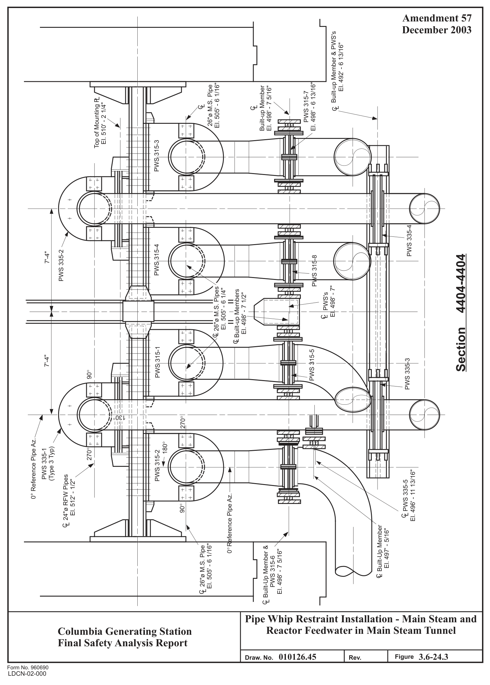

*figure on PDF page 368*

[Vector original (SVG, lossless): fig_page-368.svg](../figures/fig_page-368.svg)

<!-- labels/text on this figure page -->
Amendment 57 December 2003 CL Built-up Member & PWS's El. 492' - 6 13/16" El. 498' - 6 13/16" El. 505' - 6 1/16" 26"ø M.S. Pipe Built-up Member El. 498' - 7 5/16"
PWS 315-7
L Top of Mounting P El. 510' - 2 1/4"
CL CL
~
PWS 315-3
PWS 335-4
PWS 315-4
PWS 335-2 7'-4"
Section 4404-4404
PWS 315-8
El. 498' - 7" 26"ø M.S. Pipes El. 505' - 6 1/4" Built-up Members PWS's El. 498' - 7 1/2" CL
CL CL
PWS 315-1
PWS 315-5
7'-4"
PWS 335-3
90°
130° 270°
0° Reference Pipe Az.
180°
(Type 3 Typ) PWS 335-1 270°
PWS 315-2
El. 496' - 11 13/16" 24"ø RFW Pipes El. 512' - 1/2"
CL PWS 335-5
0° Reference Pipe Az.
90°
CL Built-Up Member El. 497' - 5/16" El. 505' - 6 1/16" 26"ø M.S. Pipe Built-Up Member & El. 498' - 7 5/16"
PWS 315-6
CL
CL
CL
Pipe Whip Restraint Installation - Main Steam and Reactor Feedwater in Main Steam Tunnel Columbia Generating Station Final Safety Analysis Report 010126.45
3.6-24.3 Draw. No.
Rev. Figure Form No. 960690
LDCN-02-000

<!-- p.369 -->
r Amendment 55 Concrete Wall 4404 May 2001

CL 24" R.F.W Pipes

7'-4" EL. 501'0" 0° Reference Pipe AZ. 3 3'-8" e p y T S W P 90°

180°

Built-up Member 270° 8'-0" 2" 3'-10 7/8" 1'-6" 2'-0"

CL

#### CL PWS 315-10
4'-0" WP EL. 494'2 1/2" 4'-0"

4'-3" 0° REF. Pipe Az.
4'-0" CL 180° 90° CL 270° _j 4405

PWS Type 3 CL

#### PWS 315-9 PWS 315-9
Face of Wall W.P. EL. 494'-1 7/8" CL Opening

CL Built-up Member 4'-1 7/8"

11'-9"

7' 6" Top of Slab EL. 501'-0" CL 30" ø M.S. Pipes Pipe Whip Restraint Installation - Main Steam and Columbia Generating Station Reactor Feedwater in Main Steam Tunnel Final Safety Analysis Report 0 1 0 1 2 2.6 1 6.3 - 2 4.4 Figure D r a w . N o .
R e v .
Form No. 960690

<!-- p.370 -->
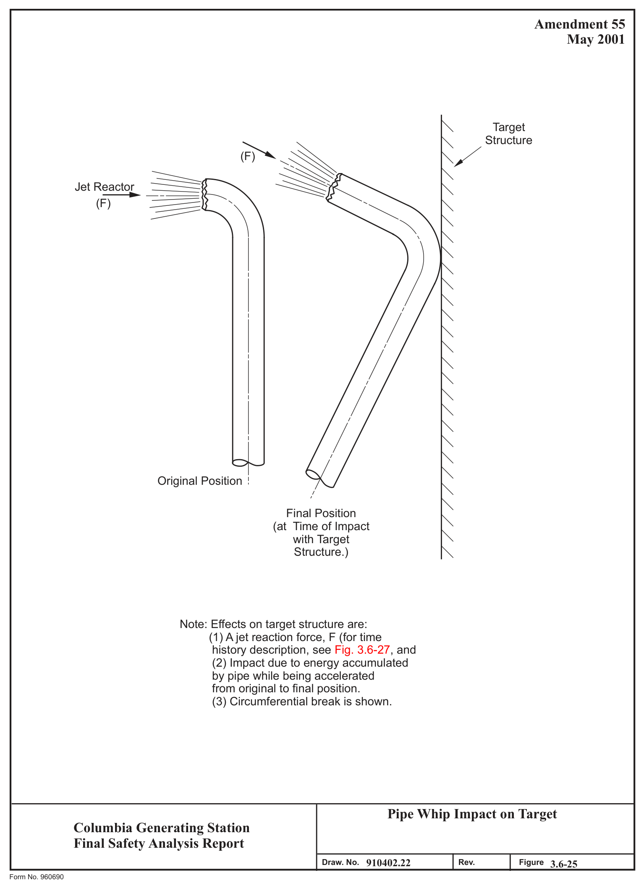

*figure on PDF page 370*

[Vector original (SVG, lossless): fig_page-370.svg](../figures/fig_page-370.svg)

<!-- labels/text on this figure page -->
Amendment 55 May 2001
Target Structure
(F)
Jet Reactor
(F)
Original Position
Final Position
(at Time of Impact with Target Structure.)
Note: Effects on target structure are:
(1) A jet reaction force, F (for time history description, see Fig. 3.6-27, and
(2) Impact due to energy accumulated by pipe while being accelerated from original to final position.
(3) Circumferential break is shown.
Pipe Whip Impact on Target Columbia Generating Station Final Safety Analysis Report 910402.22 Draw. No. Rev. Figure 3.6-25 Form No. 960690

<!-- p.371 -->
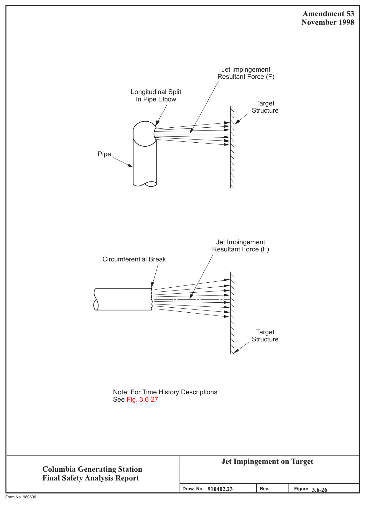

*figure on PDF page 371*

[Vector original (SVG, lossless): fig_page-371.svg](../figures/fig_page-371.svg)

<!-- labels/text on this figure page -->
Amendment 53 November 1998
Jet Impingement Resultant Force (F)
Longitudinal Split In Pipe Elbow Target Structure
Pipe
Jet Impingement Resultant Force (F)
Circumferential Break
Target Structure
Note: For Time History Descriptions See Fig. 3.6-27
Jet Impingement on Target Columbia Generating Station Final Safety Analysis Report 910402.23 Draw. No. Rev. Figure 3.6-26 Form No. 960690

<!-- p.372 -->
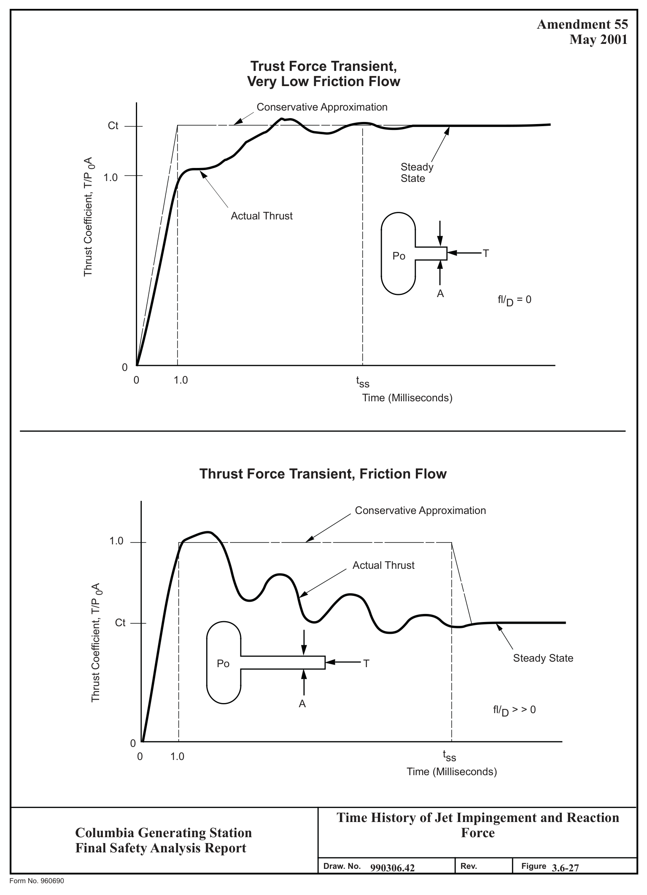

*figure on PDF page 372*

[Vector original (SVG, lossless): fig_page-372.svg](../figures/fig_page-372.svg)

<!-- labels/text on this figure page -->
Amendment 55 May 2001 Trust Force Transient, Very Low Friction Flow r Conservative Approximation Ct
Thrust Coefficient, T/P 0A Steady , 1
1.0 /:
State
Actual Thrust / I Ii i T Po / I ~ !
A fl/D = 0
/ I I I I 0 tss 0 1.0 Time (Milliseconds)
Thrust Force Transient, Friction Flow
Conservative Approximation
1.0
Actual Thrust
Thrust Coefficient, T/P 0A Ct
Steady State Po T
A fl/D > > 0
0 tss 0 1.0 Time (Milliseconds)
Time History of Jet Impingement and Reaction Force Columbia Generating Station Final Safety Analysis Report Draw. No. 990306.42 Rev. Figure 3.6-27 Form No. 960690

<!-- p.373 -->
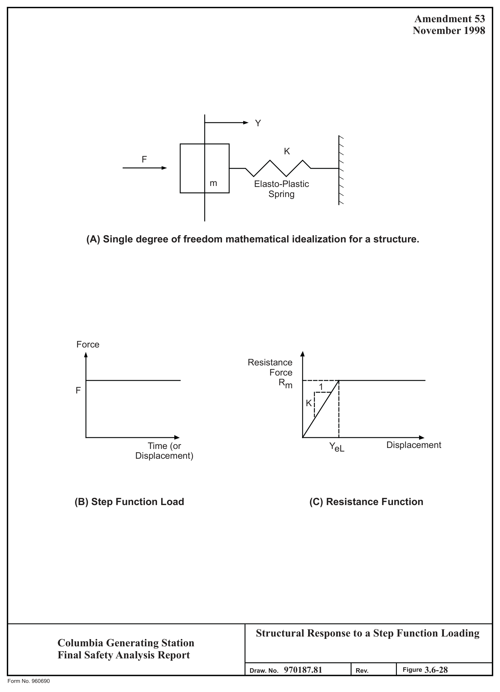

*figure on PDF page 373*

[Vector original (SVG, lossless): fig_page-373.svg](../figures/fig_page-373.svg)

<!-- labels/text on this figure page -->
Amendment 53 November 1998
Y
.....
.....
K
.....
--/'V"'---------1..:
F
.....
m Elasto-Plastic
.....
Spring .....
r-....
(A) Single degree of freedom mathematical idealization for a structure.
Force ~ Resistance ..
Force IY1 Rm 1 F K .
Time (or YeL Displacement ~ Displacement)
(B) Step Function Load
(C) Resistance Function
Structural Response to a Step Function Loading Columbia Generating Station Final Safety Analysis Report l I 970187.81
3.6-28 Draw. No.
Rev. Figure Form No. 960690

<!-- p.374 -->
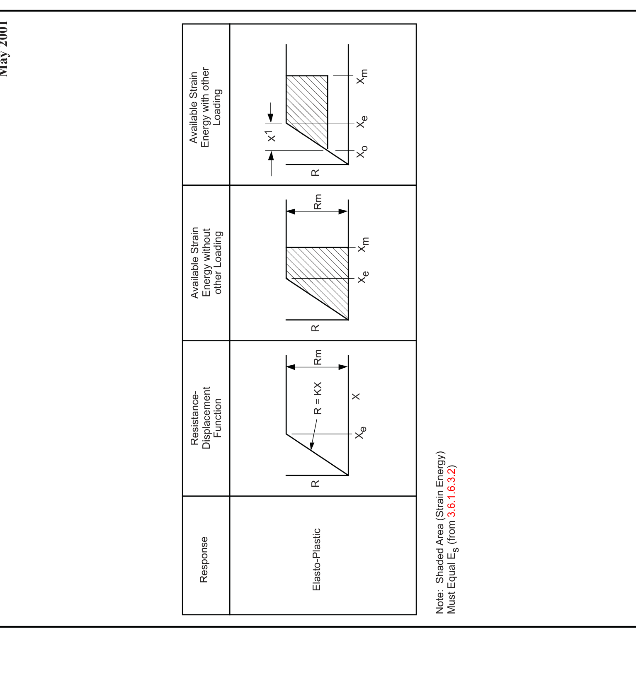

*figure on PDF page 374*

[Vector original (SVG, lossless): fig_page-374.svg](../figures/fig_page-374.svg)

<!-- labels/text on this figure page -->
Amendment 55 May 2001
Available Strain Resistance- Available Strain Response Energy with other Displacement Energy without Loading Function other Loading
X1 1~ I l _______...
R R R Elasto-Plastic R = KX Rm Rm
X Xe Xo Xe Xm Xe Xm
Note: Shaded Area (Strain Energy)
Must Equal Es (from 3.6.1.6.3.2)
Resistance-Displacement Functions with Associated Structural Response (with and without Effect of Columbia Generating Station Other Loads)
Final Safety Analysis Report Draw. No. 990306.43 Rev. Figure 3.6-29 Form No. 960690

<!-- p.375 -->
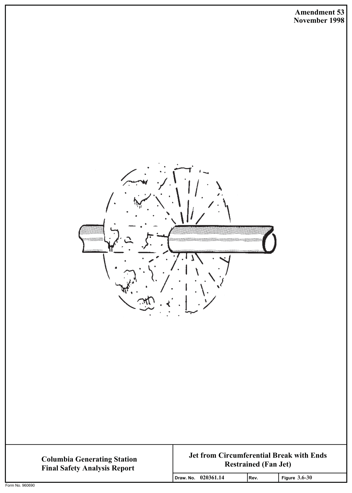

*figure on PDF page 375*

[Vector original (SVG, lossless): fig_page-375.svg](../figures/fig_page-375.svg)

<!-- labels/text on this figure page -->
Amendment 53 November 1998
Jet from Circumferential Break with Ends Columbia Generating Station Restrained (Fan Jet)
Final Safety Analysis Report
I I 020361.14 3.6-30
Draw. No.
Rev. Figure Form No. 960690

<!-- p.376 -->
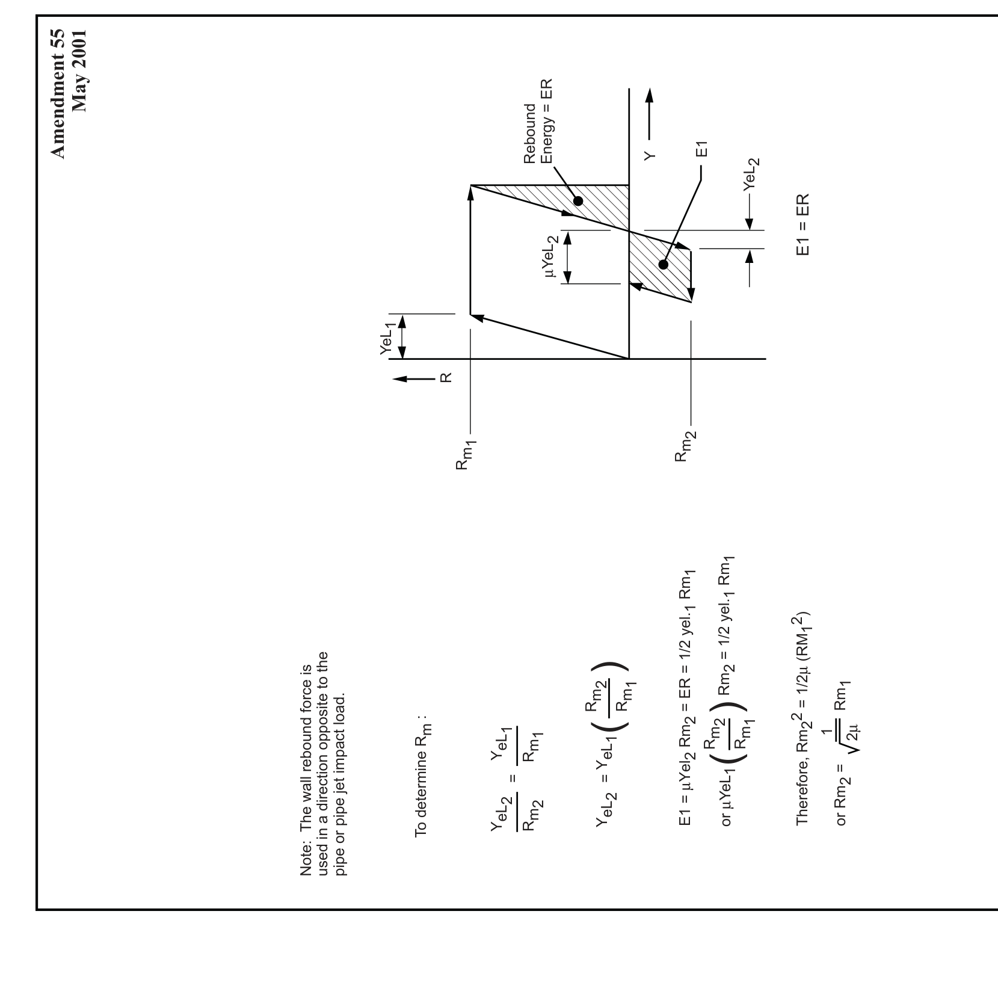

*figure on PDF page 376*

[Vector original (SVG, lossless): fig_page-376.svg](../figures/fig_page-376.svg)

<!-- labels/text on this figure page -->
Amendment 55 May 2001
Note: The wall rebound force is used in a direction opposite to the pipe or pipe jet impact load.
YeL1
-- To determine Rm :
R Rm1 YeL2 YeL1 = Rm2 Rm1 Rebound Energy = ER µYeL2
( ) Rm2 YeL2 YeL1 = Rm1 Y f Rm2 E1 = µYel2 Rm2 = ER = 1/2 yel.1 Rm1 E1
( Rm2 )
or µYeL1 Rm2 = 1/2 yel.1 Rm1 Rm1 YeL2
Therefore, Rm22 = 1/2µ (RM12)
E1 = ER 1 or Rm2 = Rm1 ll 2µ
Design for Wall Rebound Columbia Generating Station Final Safety Analysis Report Draw. No. 990306.44 Rev. Figure 3.6-31 Form No. 960690

<!-- p.377 -->
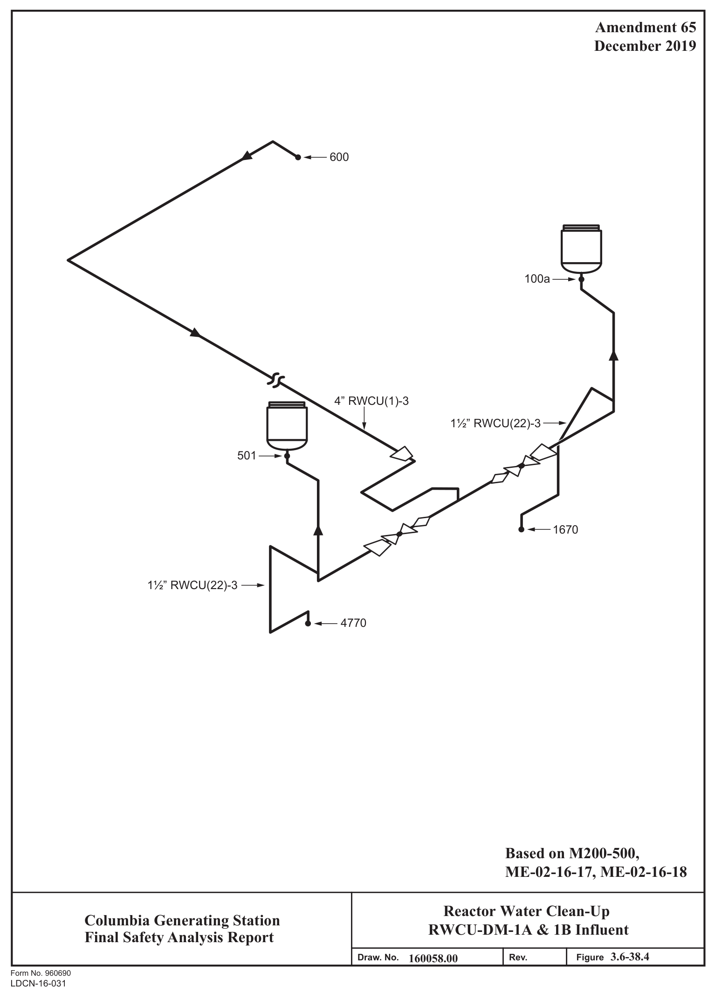

*figure on PDF page 377*

[Vector original (SVG, lossless): fig_page-377.svg](../figures/fig_page-377.svg)

<!-- labels/text on this figure page -->
Amendment 65 December 2019
600
100a
4” RWCU(1)-3 1½” RWCU(22)-3
501
1670
1½” RWCU(22)-3
-- 4770
Based on M200-500,
ME-02-16-17, ME-02-16-18
Reactor Water Clean-Up Columbia Generating Station RWCU-DM-1A & 1B Influent Final Safety Analysis Report
3.6-38.4 Draw. No. Rev. Figure 160058.00 Form No. 960690
LDCN-16-031

<!-- p.378 -->
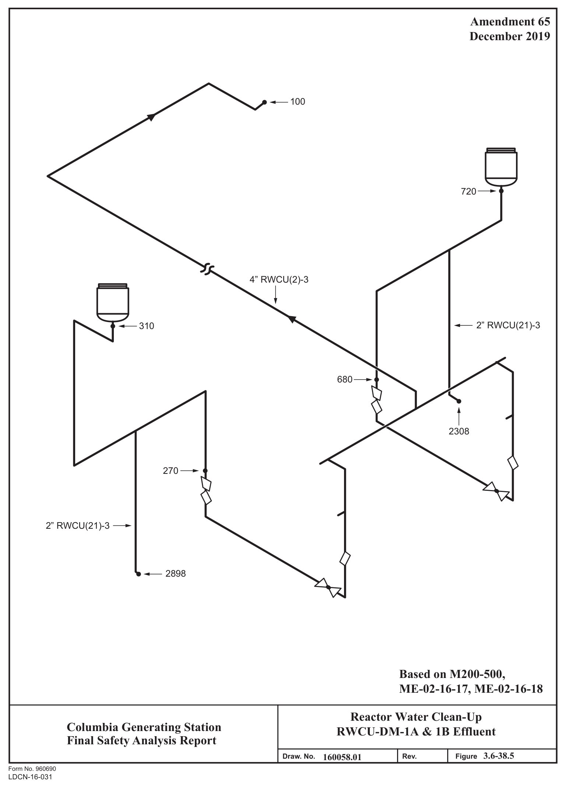

*figure on PDF page 378*

[Vector original (SVG, lossless): fig_page-378.svg](../figures/fig_page-378.svg)

<!-- labels/text on this figure page -->
Amendment 65 December 2019
100
720
4” RWCU(2)-3
2” RWCU(21)-3 310
680
2308
270
- 2” RWCU(21)-3
--- 2898
Based on M200-500,
ME-02-16-17, ME-02-16-18
Reactor Water Clean-Up Columbia Generating Station RWCU-DM-1A & 1B Effluent Final Safety Analysis Report
3.6-38.5 Draw. No. Rev. Figure 160058.01 Form No. 960690
LDCN-16-031

<!-- p.379 -->
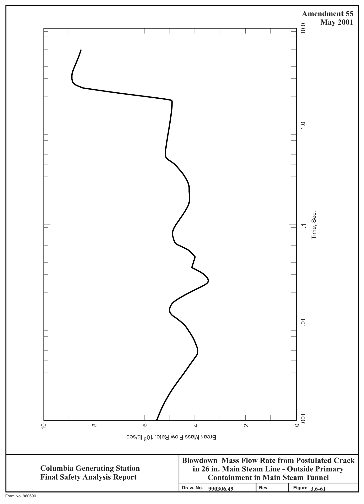

*figure on PDF page 379*

[Vector original (SVG, lossless): fig_page-379.svg](../figures/fig_page-379.svg)

<!-- labels/text on this figure page -->
Amendment 55 May 2001 10.0
1.0
Time, Sec.
.1
.01
.001 10 6 8 0 2 4
Break Mass Flow Rate, 103 lb/sec
Blowdown Mass Flow Rate from Postulated Crack Columbia Generating Station in 26 in. Main Steam Line - Outside Primary Final Safety Analysis Report Containment in Main Steam Tunnel Draw. No. 990306.49 Rev. Figure 3.6-61 Form No. 960690

<!-- p.380 -->
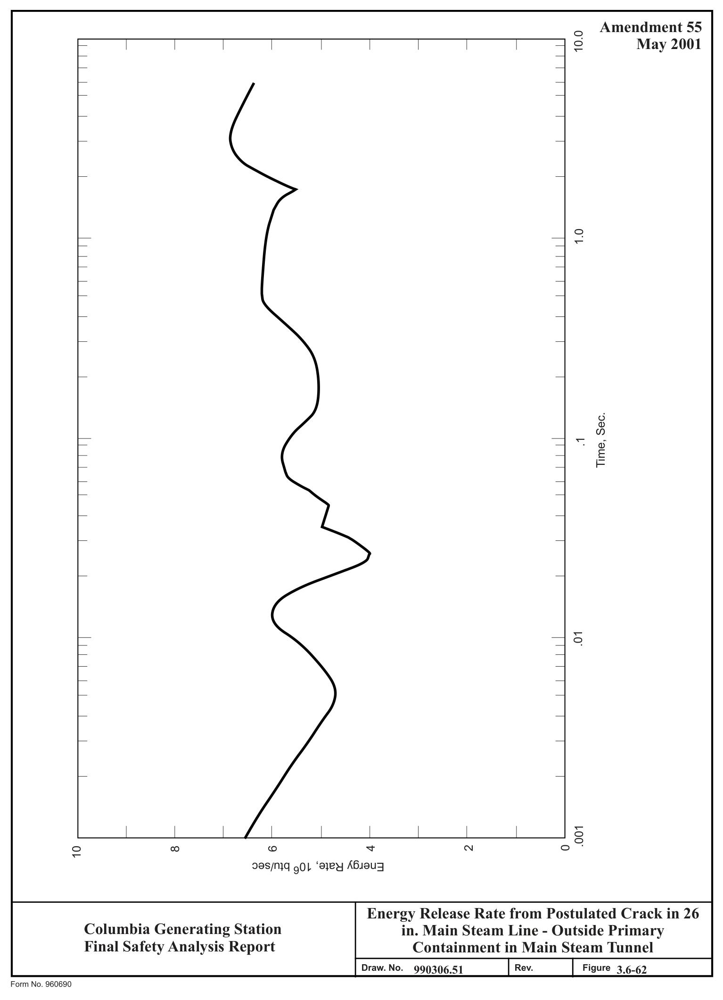

*figure on PDF page 380*

[Vector original (SVG, lossless): fig_page-380.svg](../figures/fig_page-380.svg)

<!-- labels/text on this figure page -->
Amendment 55
10.0 May 2001
1.0
Time, Sec.
.1
.01
.001 0 10 8 6 2 4
Energy Rate, 106 btu/sec
Energy Release Rate from Postulated Crack in 26 Columbia Generating Station in. Main Steam Line - Outside Primary Final Safety Analysis Report Containment in Main Steam Tunnel Draw. No. 990306.51 Rev. Figure 3.6-62 Form No. 960690

<!-- p.381 -->
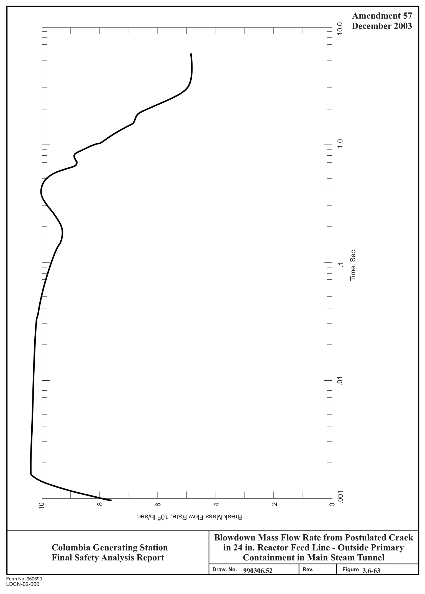

*figure on PDF page 381*

[Vector original (SVG, lossless): fig_page-381.svg](../figures/fig_page-381.svg)

<!-- labels/text on this figure page -->
Amendment 57 December 2003 10.0
1.0
Time, Sec.
.1
.01
.001 2 8 10 4 0 6
Break Mass Flow Rate, 106 lb/sec
Blowdown Mass Flow Rate from Postulated Crack in 24 in. Reactor Feed Line - Outside Primary Columbia Generating Station Containment in Main Steam Tunnel Final Safety Analysis Report Draw. No. 990306.52 Rev. Figure 3.6-63 Form No. 960690
LDCN-02-000

<!-- p.382 -->
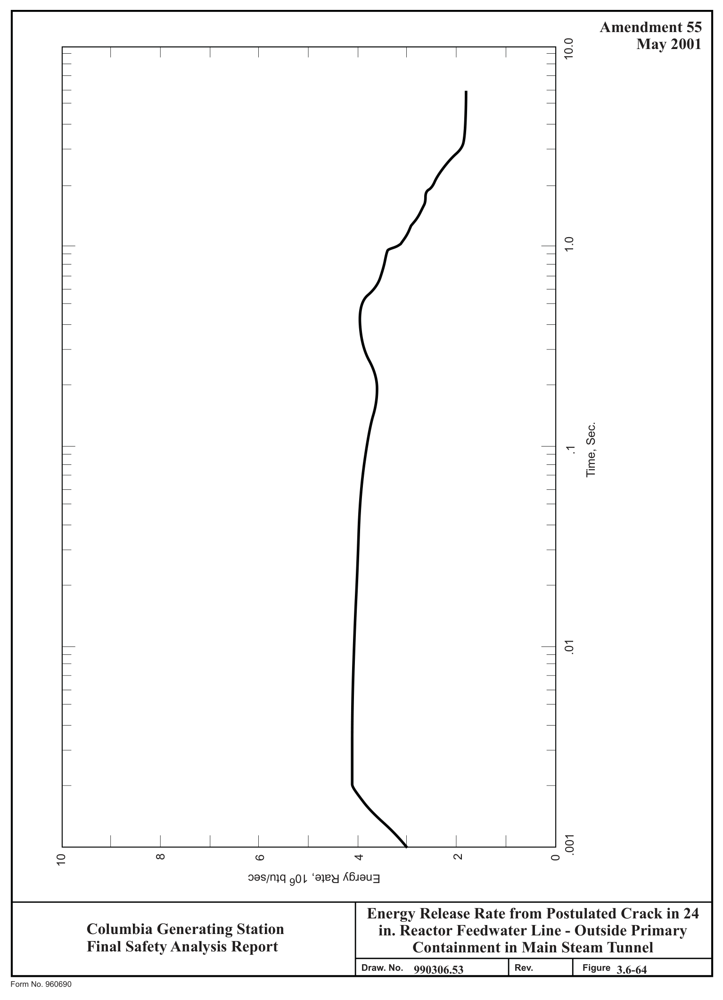

*figure on PDF page 382*

[Vector original (SVG, lossless): fig_page-382.svg](../figures/fig_page-382.svg)

<!-- labels/text on this figure page -->
Amendment 55 May 2001 10.0
1.0
Time, Sec.
.1
.01
.001 2 8 10 4 0 6
Energy Rate, 106 btu/sec
Energy Release Rate from Postulated Crack in 24 Columbia Generating Station in. Reactor Feedwater Line - Outside Primary Final Safety Analysis Report Containment in Main Steam Tunnel Draw. No. 990306.53 Rev. Figure 3.6-64 Form No. 960690

<!-- p.383 -->
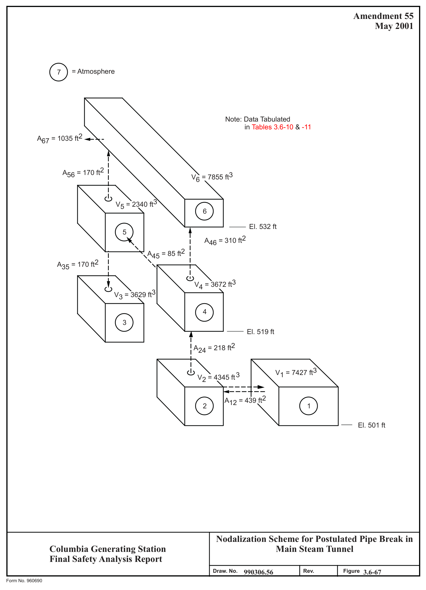

*figure on PDF page 383*

[Vector original (SVG, lossless): fig_page-383.svg](../figures/fig_page-383.svg)

<!-- labels/text on this figure page -->
Amendment 55 May 2001
0 7 = Atmosphere
Note: Data Tabulated in Tables 3.6-10 & -11 A67 = 1035 ft2
A56 = 170 ft2 V6 = 7855 ft3
V5 = 2340 ft3 6
El. 532 ft 5 A46 = 310 ft2 A45 = 85 ft2 A35 = 170 ft2
V4 = 3672 ft3 V3 = 3629 ft3
4 3 El. 519 ft
A24 = 218 ft2
V1 = 7427 ft3 V2 = 4345 ft3 0 A12 = 439 ft2 2 1
El. 501 ft
Nodalization Scheme for Postulated Pipe Break in Main Steam Tunnel Columbia Generating Station Final Safety Analysis Report Draw. No. 990306.56 Rev. Figure 3.6-67 Form No. 960690

<!-- p.384 -->

*figure on PDF page 384*

[Vector original (SVG, lossless): fig_page-384.svg](../figures/fig_page-384.svg)

<!-- labels/text on this figure page -->
Amendment 53 November 1998
28
26
Average pressure in Node 1 psia AP1 24
22
20
18
16
14 10-3 10-2 10-1 100 Time Sec
Pressure Transient in Node 1 of Main Steam Tunnel after a Postulated Main Steam Pipe Break Columbia Generating Station in Node 1 of Main Steam Tunnel Final Safety Analysis Report 970187.87
3.6-68 Draw. No.
Rev. Figure Form No. 960690

<!-- p.385 -->
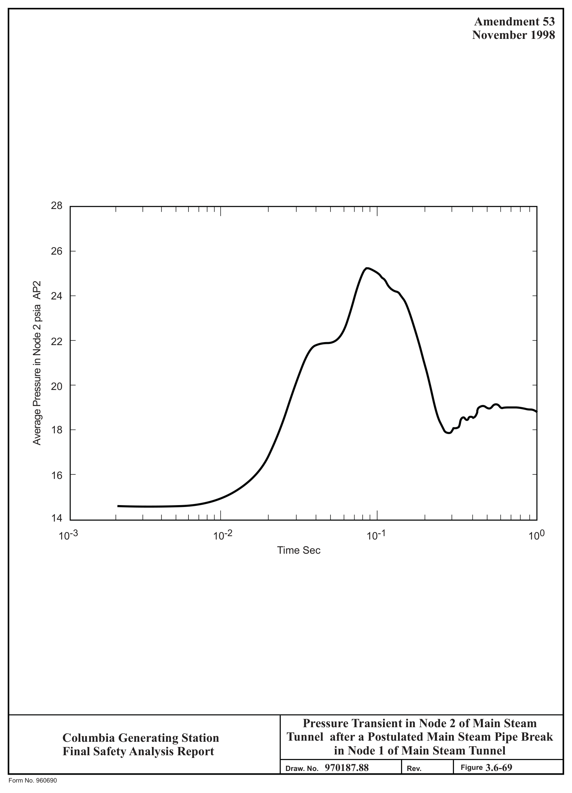

*figure on PDF page 385*

[Vector original (SVG, lossless): fig_page-385.svg](../figures/fig_page-385.svg)

<!-- labels/text on this figure page -->
Amendment 53 November 1998
28
26
Average Pressure in Node 2 psia AP2 24
22
20
18
16
14 10-3 10-2 10-1 100 Time Sec
Pressure Transient in Node 2 of Main Steam Tunnel after a Postulated Main Steam Pipe Break Columbia Generating Station in Node 1 of Main Steam Tunnel Final Safety Analysis Report 970187.88
3.6-69 Draw. No.
Rev. Figure Form No. 960690

<!-- p.386 -->
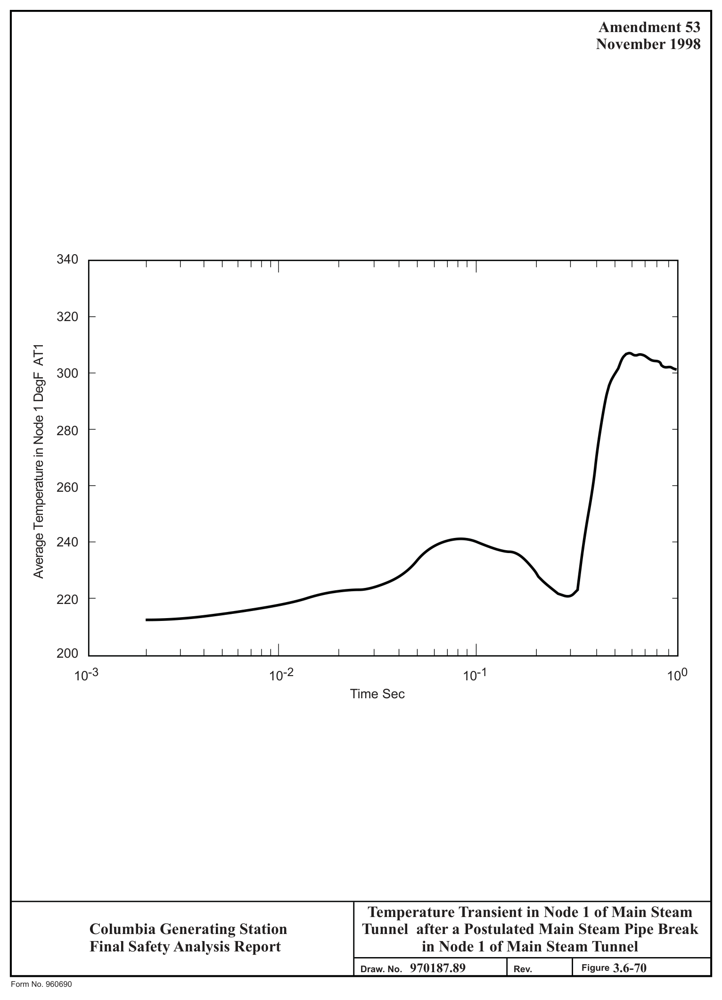

*figure on PDF page 386*

[Vector original (SVG, lossless): fig_page-386.svg](../figures/fig_page-386.svg)

<!-- labels/text on this figure page -->
Amendment 53 November 1998
340
320
Average Temperature in Node 1 DegF AT1 300
280
260
240
220
200 10-3 10-2 10-1 100 Time Sec
Temperature Transient in Node 1 of Main Steam Columbia Generating Station Tunnel after a Postulated Main Steam Pipe Break in Node 1 of Main Steam Tunnel Final Safety Analysis Report 970187.89
3.6-70 Draw. No.
Rev. Figure Form No. 960690

<!-- p.387 -->

*figure on PDF page 387*

[Vector original (SVG, lossless): fig_page-387.svg](../figures/fig_page-387.svg)

<!-- labels/text on this figure page -->
Amendment 53 November 1998
340
320
Average Temperature in Node 2 Deg F AT2 300
280
260
240
220
200 10-3 10-2 10-1 100 Time Sec
Temperature Transient in Node 2 of Main Steam Tunnel after a Postulated Main Steam Pipe Break Columbia Generating Station in Node 1 of Main Steam Tunnel Final Safety Analysis Report 970187.90
3.6-71 Draw. No.
Rev. Figure Form No. 960690

<!-- p.388 -->

*figure on PDF page 388*

[Vector original (SVG, lossless): fig_page-388.svg](../figures/fig_page-388.svg)

<!-- labels/text on this figure page -->
Amendment 53 November 1998
28
26
Average Pressure in Node 1 psia AP1 24
22
20
18
16
14 10-3 10-2 10-1 100 Time Sec
Pressure Transient in Node 1 of Main Steam Tunnel after a Postulated Main Steam Pipe Break Columbia Generating Station in Node 2 of Main Steam Tunnel Final Safety Analysis Report 970187.91
3.6-72 Draw. No.
Rev. Figure Form No. 960690

<!-- p.389 -->
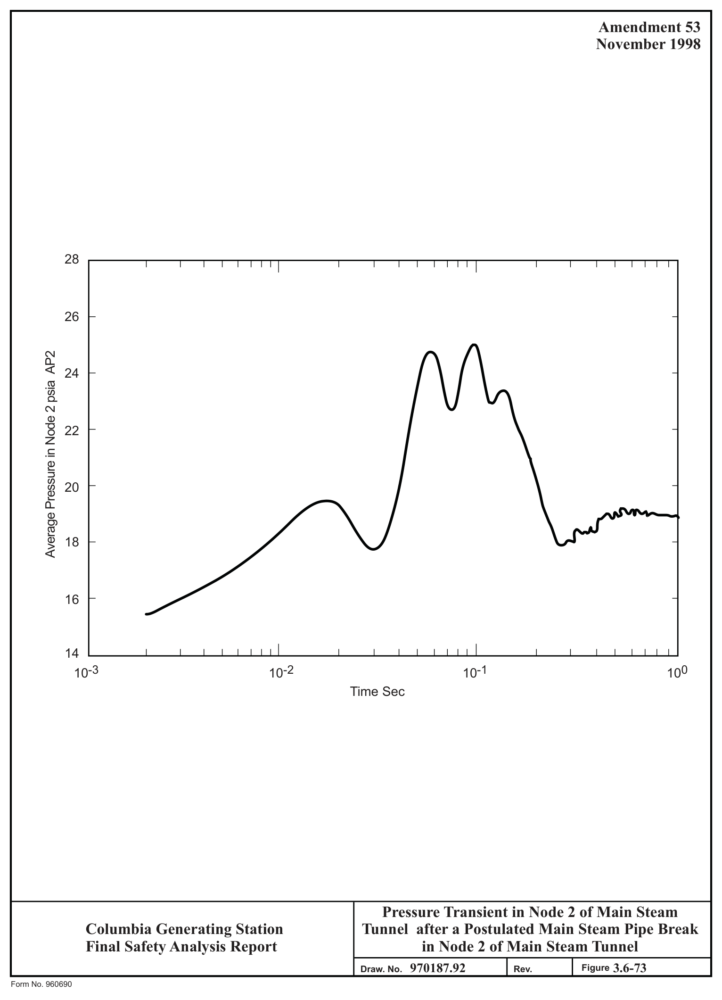

*figure on PDF page 389*

[Vector original (SVG, lossless): fig_page-389.svg](../figures/fig_page-389.svg)

<!-- labels/text on this figure page -->
Amendment 53 November 1998
28
26
Average Pressure in Node 2 psia AP2 24
22
20
18
16
14 10-3 10-2 10-1 100 Time Sec
Pressure Transient in Node 2 of Main Steam Columbia Generating Station Tunnel after a Postulated Main Steam Pipe Break in Node 2 of Main Steam Tunnel Final Safety Analysis Report 970187.92
3.6-73 Draw. No.
Rev. Figure Form No. 960690

<!-- p.390 -->
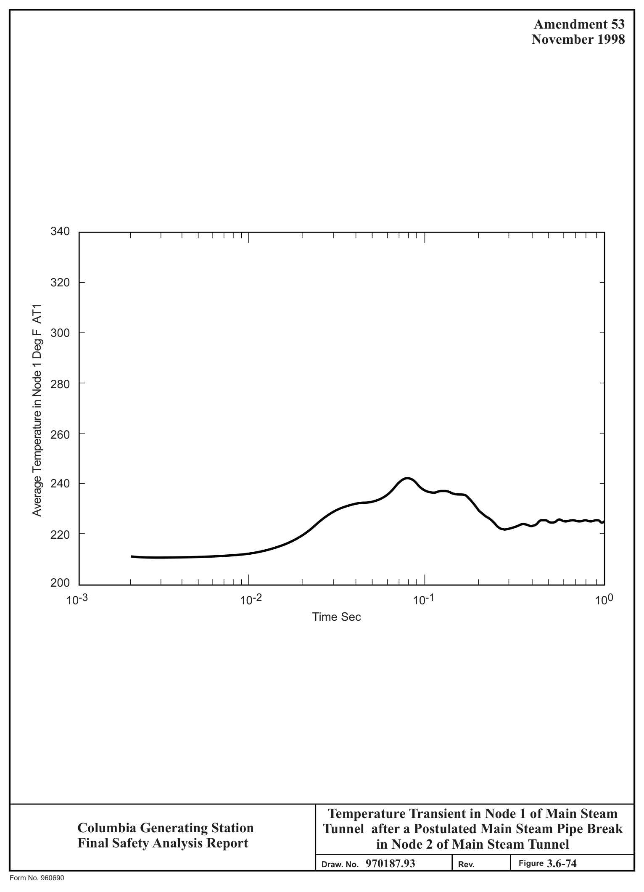

*figure on PDF page 390*

[Vector original (SVG, lossless): fig_page-390.svg](../figures/fig_page-390.svg)

<!-- labels/text on this figure page -->
Amendment 53 November 1998
340
320
Average Temperature in Node 1 Deg F AT1 300
280
260
240
220
200 10-3 10-2 10-1 100 Time Sec
Temperature Transient in Node 1 of Main Steam Columbia Generating Station Tunnel after a Postulated Main Steam Pipe Break Final Safety Analysis Report in Node 2 of Main Steam Tunnel 970187.93
3.6-74 Draw. No.
Rev. Figure Form No. 960690

<!-- p.391 -->
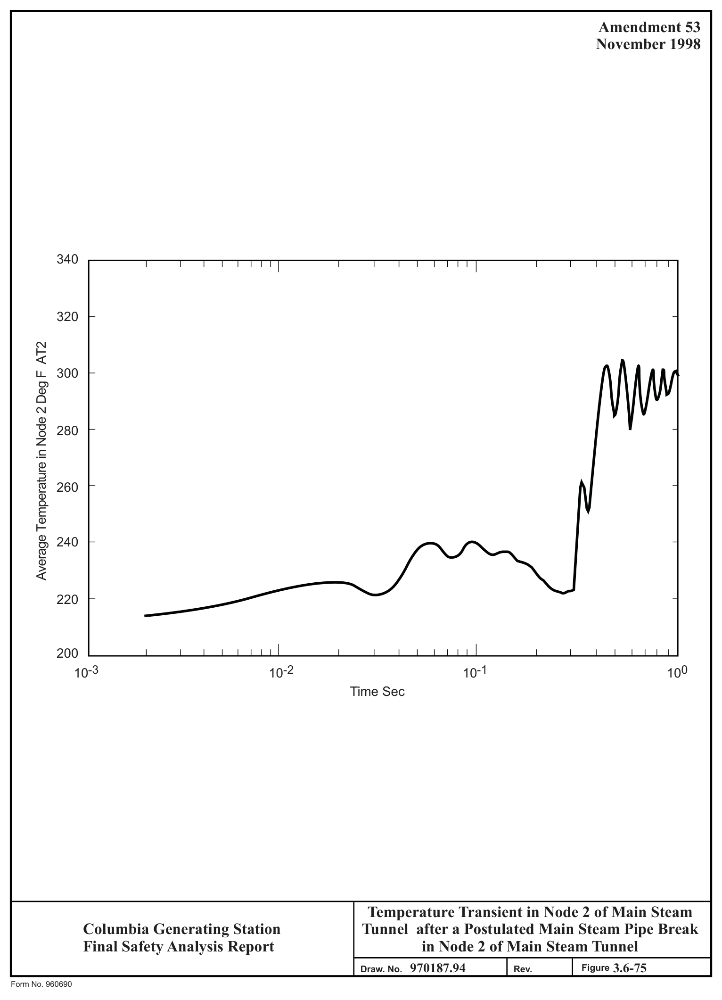

*figure on PDF page 391*

[Vector original (SVG, lossless): fig_page-391.svg](../figures/fig_page-391.svg)

<!-- labels/text on this figure page -->
Amendment 53 November 1998
340
320
Average Temperature in Node 2 Deg F AT2 300
280
260
240
220
200 10-3 10-2 10-1 100 Time Sec
Temperature Transient in Node 2 of Main Steam Tunnel after a Postulated Main Steam Pipe Break Columbia Generating Station in Node 2 of Main Steam Tunnel Final Safety Analysis Report 970187.94
3.6-75 Draw. No.
Rev. Figure Form No. 960690

<!-- p.392 -->
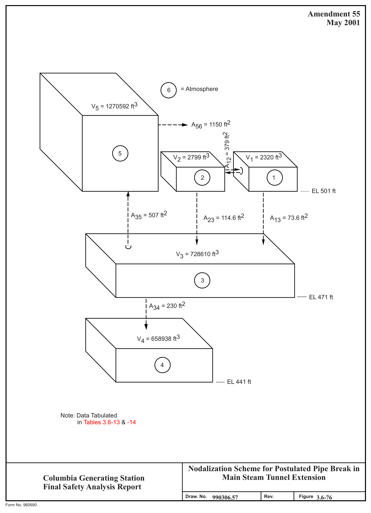

*figure on PDF page 392*

[Vector original (SVG, lossless): fig_page-392.svg](../figures/fig_page-392.svg)

<!-- labels/text on this figure page -->
Amendment 55 May 2001
0 = Atmosphere 6
V5 = 1270592 ft3
A56 = 1150 ft2 A12 = 379 ft2 0 5 V2 = 2799 ft3 V1 = 2320 ft3 0 2 1
EL 501 ft
A35 = 507 ft2 A23 = 114.6 ft2 A13 = 73.6 ft2
I IJ V3 = 728610 ft3 0 3
EL 471 ft A34 = 230 ft2
V4 = 658938 ft3 0 4
EL 441 ft
Note: Data Tabulated in Tables 3.6-13 & -14
Nodalization Scheme for Postulated Pipe Break in Main Steam Tunnel Extension Columbia Generating Station Final Safety Analysis Report Draw. No. 990306.57 Rev. Figure 3.6-76 Form No. 960690

<!-- p.393 -->
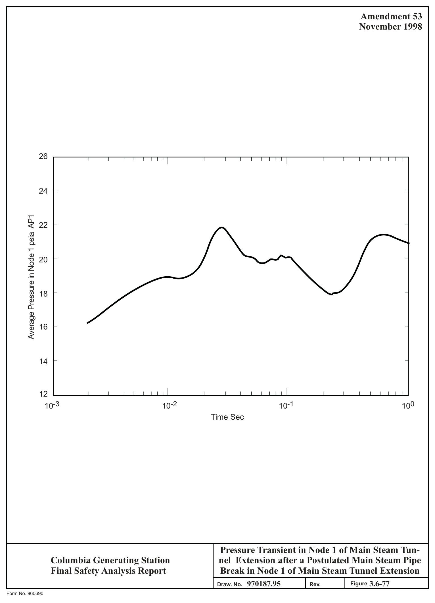

*figure on PDF page 393*

[Vector original (SVG, lossless): fig_page-393.svg](../figures/fig_page-393.svg)

<!-- labels/text on this figure page -->
Amendment 53 November 1998
26
24
Average Pressure in Node 1 psia AP1 22
20
18
16
14
12 10-3 10-2 10-1 100 Time Sec
Pressure Transient in Node 1 of Main Steam Tunnel Extension after a Postulated Main Steam Pipe Columbia Generating Station Break in Node 1 of Main Steam Tunnel Extension Final Safety Analysis Report 970187.95
3.6-77 Draw. No.
Rev. Figure Form No. 960690

<!-- p.394 -->

*figure on PDF page 394*

[Vector original (SVG, lossless): fig_page-394.svg](../figures/fig_page-394.svg)

<!-- labels/text on this figure page -->
Amendment 53 November 1998
26
24
Average Pressure in Node 2 psia AP2 22
20
18
16
14
12 10-3 10-2 10-1 100 Time Sec
Pressure Transient in Node 2 of Main Steam Tunnel Extension after a Postulated Main Steam Pipe Columbia Generating Station Break in Node 1 of Main Steam Tunnel Extension Final Safety Analysis Report 970187.96
3.6-78 Draw. No.
Rev. Figure Form No. 960690

<!-- p.395 -->
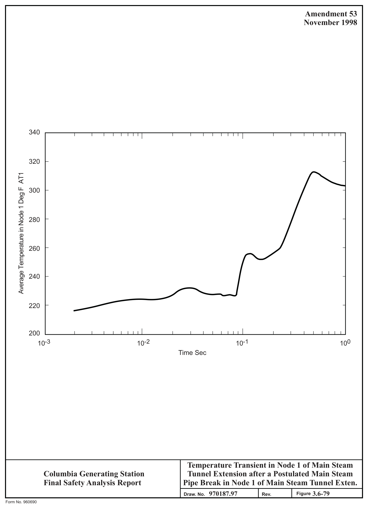

*figure on PDF page 395*

[Vector original (SVG, lossless): fig_page-395.svg](../figures/fig_page-395.svg)

<!-- labels/text on this figure page -->
Amendment 53 November 1998
340
320
Average Temperature in Node 1 Deg F AT1 300
280
260
240
220
200 10-3 10-2 10-1 100 Time Sec
Temperature Transient in Node 1 of Main Steam Tunnel Extension after a Postulated Main Steam Columbia Generating Station Pipe Break in Node 1 of Main Steam Tunnel Exten.
Final Safety Analysis Report 970187.97
3.6-79 Draw. No.
Rev. Figure Form No. 960690

<!-- p.396 -->
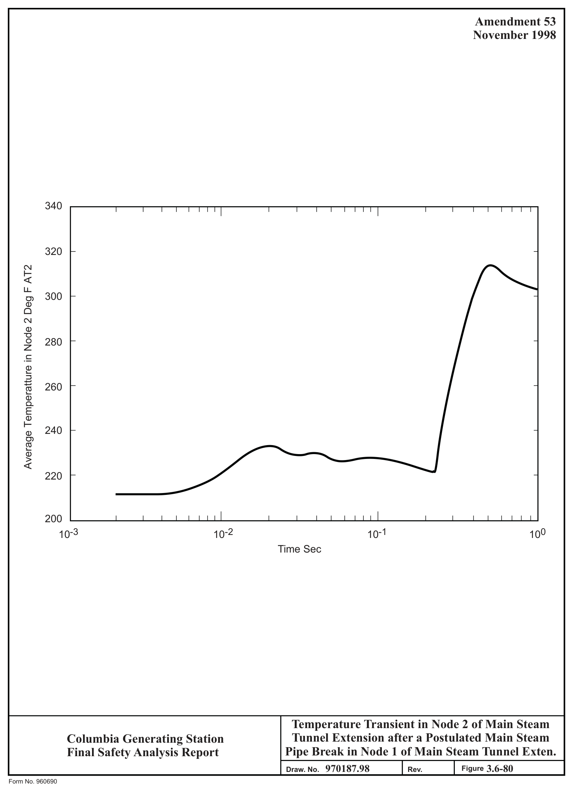

*figure on PDF page 396*

[Vector original (SVG, lossless): fig_page-396.svg](../figures/fig_page-396.svg)

<!-- labels/text on this figure page -->
Amendment 53 November 1998
340
320
Average Temperatture in Node 2 Deg F AT2 300
280
260
240
220
200 10-3 10-2 10-1 100 Time Sec
Temperature Transient in Node 2 of Main Steam Tunnel Extension after a Postulated Main Steam Columbia Generating Station Pipe Break in Node 1 of Main Steam Tunnel Exten.
Final Safety Analysis Report 970187.98
3.6-80 Draw. No.
Rev. Figure Form No. 960690

<!-- p.397 -->
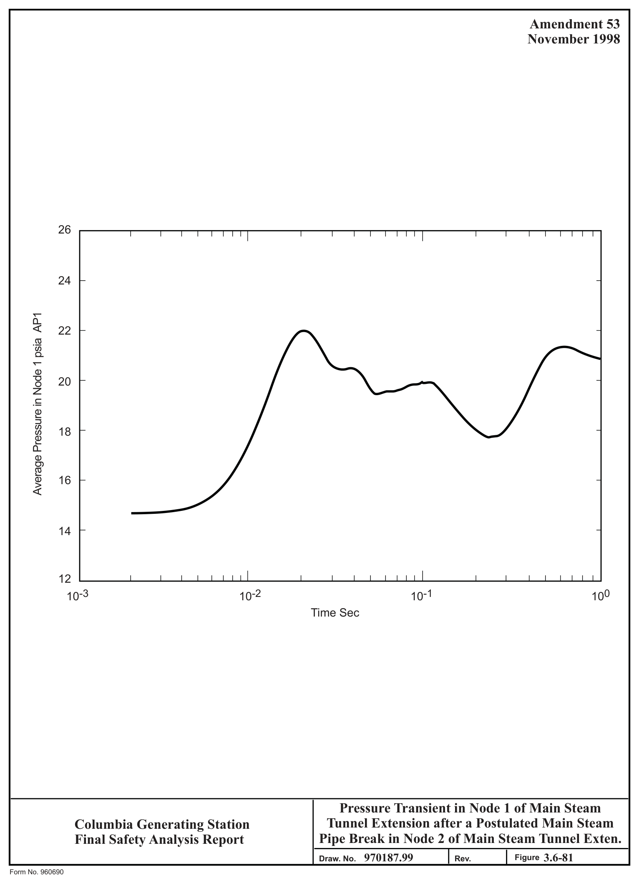

*figure on PDF page 397*

[Vector original (SVG, lossless): fig_page-397.svg](../figures/fig_page-397.svg)

<!-- labels/text on this figure page -->
Amendment 53 November 1998
26
24
Average Pressure in Node 1 psia AP1 22
20
18
16
14
12 10-3 10-2 10-1 100 Time Sec
Pressure Transient in Node 1 of Main Steam Tunnel Extension after a Postulated Main Steam Columbia Generating Station Pipe Break in Node 2 of Main Steam Tunnel Exten.
Final Safety Analysis Report 970187.99
3.6-81 Draw. No.
Rev. Figure Form No. 960690

<!-- p.398 -->
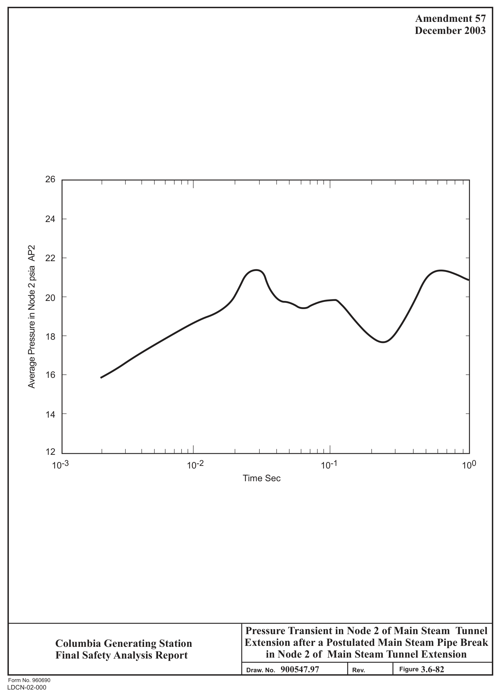

*figure on PDF page 398*

[Vector original (SVG, lossless): fig_page-398.svg](../figures/fig_page-398.svg)

<!-- labels/text on this figure page -->
Amendment 57 December 2003
26
24
Average Pressure in Node 2 psia AP2 22
20
18
16
14
12 10-3 10-2 10-1 100 Time Sec
Pressure Transient in Node 2 of Main Steam Tunnel Extension after a Postulated Main Steam Pipe Break Columbia Generating Station in Node 2 of Main Steam Tunnel Extension Final Safety Analysis Report 900547.97
3.6-82 Draw. No.
Rev. Figure Form No. 960690
LDCN-02-000

<!-- p.399 -->

*figure on PDF page 399*

[Vector original (SVG, lossless): fig_page-399.svg](../figures/fig_page-399.svg)

<!-- labels/text on this figure page -->
Amendment 53 November 1998
340
320
Average Temperature in Node 2 Deg F AT1 300
280
260
240
220
200 10-3 10-2 10-1 100 Time Sec
Temperature Transient in Node 2 of Main Steam Tunnel Extension after a Postulated Main Steam Columbia Generating Station Pipe Break in Node 2 of Main Steam Tunnel Exten.
Final Safety Analysis Report 910402.25
3.6-83 Draw. No.
Rev. Figure Form No. 960690

<!-- p.400 -->

*figure on PDF page 400*

[Vector original (SVG, lossless): fig_page-400.svg](../figures/fig_page-400.svg)

<!-- labels/text on this figure page -->
Amendment 53 November 1998
340
320
Average Temperature in Node 2 Deg F AT2 300
280
260
240
220
200 10-3 10-2 10-1 100 Time Sec
Temperature Transient in Node 2 of Main Steam Tunnel Extension after a Postulated Main Steam Pipe Columbia Generating Station Break in Node 2 of Main Steam Tunnel Extension Final Safety Analysis Report 900547.99
3.6-84 Draw. No.
Rev. Figure Form No. 960690

<!-- p.401 -->

*figure on PDF page 401*

[Vector original (SVG, lossless): fig_page-401.svg](../figures/fig_page-401.svg)

<!-- labels/text on this figure page -->
Amendment 53 November 1998
Cantilever Pipe Length
(Energy Absorbing Member)
Pipe Whip FI Restraint LI j ~ Pipe M
FI -!Yi b n r Load Gap Transmitting Load Trans. Gap(d)
Member ~ \ ~ Member Spring (K)
Beam (Energy Absorbing Component)
(A) Pipe Whip Support Configuration
(B) Single Degree of Freedom Mathematical Idealization for a Structure
Resistance
(Force)
Rr
K= Rr Ye
Ym
Ye Displacement
(C) Resistance Function
Analytical Model Columbia Generating Station Final Safety Analysis Report 970187.84
3.6-89 Figure Draw. No.
Rev.
Form No. 960690

<!-- p.402 -->

*figure on PDF page 402*

[Vector original (SVG, lossless): fig_page-402.svg](../figures/fig_page-402.svg)

<!-- labels/text on this figure page -->
Amendment 53 November 1998
/ F(t)
F(t)
~
- Fi
F1 +
.
.
t td t
Impulse (i) = Fi (td)
i2 Kinetic Energy (K) = = F1 x distance (d) - 2M Rr Ym Note: µ + ; Elastic Spring Constant k = - - Ye Ye Ref. 3.6-1 Chapter 5 paragraph 5.5b
F1 Ym + K = Rr [Ym - (1/2) Ye] Ym Rr Substituting µ = & + Ye - k Ye Rr2 (µ - 1/2) - uF1 Rr - (K) (k) = 0
Solving Quadratically:
[-] [ {-} ] 2 1/2 µ F1 u F1 2 (K) (k)
Rr = + +
(2µ-1)
(2µ-1) (2µ-1)
Required Resistance of Structures (Rr)
Columbia Generating Station Final Safety Analysis Report I I 970187.85
3.6-90 Draw. No.
Rev. Figure Form No. 960690

<!-- p.403 -->

*figure on PDF page 403*

[Vector original (SVG, lossless): fig_page-403.svg](../figures/fig_page-403.svg)

<!-- labels/text on this figure page -->
Amendment 53 November 1998
Full Expansion Plane t Break Plane Region 1 Region Region 3 2
10° CL
---------
L∞ L
(A) Circumferential Break with Full Separation
Region 3
10° L Region 2 Full Expansion Plane L∞ Region 1 Break Plane CL
W
CL
(B) Circumferential Break with Partial Separation
CL
Region 3 10° L Region 2 Full Expansion Plane Region 1 Break Plane CL
(C) Longitudinal Break
Fluid Jet Geometry Columbia Generating Station Final Safety Analysis Report 970187.86
3.6-91 Draw. No.
Rev. Figure Form No. 960690

<!-- p.404 -->

*figure on PDF page 404*

[Vector original (SVG, lossless): fig_page-404.svg](../figures/fig_page-404.svg)

<!-- labels/text on this figure page -->
Amendment 53 November 1998
160 ~
150 >-
140
130 Blowdown Thrust - LBF * 102
- 120
110 ~
100 ~
90 ~
80
- ~
I I I I I I I
70 0.0 0.2 0.4 0.6 0.8 1.0 1.2 1.4 Time After Break - Sec
Thrust Versus Time - Reactor Side of Break on 4 Columbia Generating Station in. RCIC (13) - 4 in. Room R206 Final Safety Analysis Report I I 910402.06 Draw. No. Rev. Figure 3.6-96 Form No. 960690

<!-- p.405 -->

*figure on PDF page 405*

[Vector original (SVG, lossless): fig_page-405.svg](../figures/fig_page-405.svg)

<!-- labels/text on this figure page -->
Amendment 53 November 1998
150
140
130
120 Blowdown Thrust - LBF * 102 110
100
90
80
70
60 .00 .08 .16 .24 .32 .40 .48 .56 Time After Break - Sec
Thrust Versus Time - Reactor Side of Break on 4 Columbia Generating Station in. RCIC (13) - 4 - El. 431.8 ft Final Safety Analysis Report 910402.07 Draw. No. Rev. Figure 3.6-97 Form No. 960690

<!-- p.406 -->

*figure on PDF page 406*

[Vector original (SVG, lossless): fig_page-406.svg](../figures/fig_page-406.svg)

<!-- labels/text on this figure page -->
Amendment 53 November 1998
140
136
132
128 Blowdown Thrust - LBF * 102 124
120
116
112
108
104 0.0 0.4 0.8 1.2 1.6 2.0 2.4 2.8 Time After Break - Sec
Thrust Versus Time - Upstream Side of Break on Columbia Generating Station 4 in. RWCU (2) - 4 - El. 536 ft 0 in., Room R409 Final Safety Analysis Report Draw. No. 910402.08 Rev. Figure 3.6-98 Form No. 960690

<!-- p.407 -->

*figure on PDF page 407*

[Vector original (SVG, lossless): fig_page-407.svg](../figures/fig_page-407.svg)

<!-- labels/text on this figure page -->
Amendment 53 November 1998
40
36
32
28 Blowdown Thrust - LBF * 103 24
20
16
12
8
4 0.0 0.4 0.8 1.2 1.8 2.0 2.4 2.8 Time After Break - Sec
Thrust Versus Time - Heat Exchanger Side of Break on 6 in. RWCU (2) - 4 - El. 514 ft 0 in., Columbia Generating Station Room R308 Final Safety Analysis Report Draw. No. 910402.05 Rev. Figure 3.6-99 Form No. 960690

<!-- p.408 -->

*figure on PDF page 408*

[Vector original (SVG, lossless): fig_page-408.svg](../figures/fig_page-408.svg)

<!-- labels/text on this figure page -->
Amendment 53 November 1998
40
38
36
34 Blowdown Thrust - LBF * 103 32
30
28
26
24
22 0.0 0.4 0.8 1.2 1.6 2.0 2.4 2.8 Time After Break - Sec
Thrust Versus Time - Pump Side of Break on 6 in.
Columbia Generating Station RWCU (1) - 4 - El. 548 ft 0 in., Room R409 Final Safety Analysis Report 910402.09 Draw. No. Rev. Figure 3.6-100 Form No. 960690

<!-- p.409 -->

*figure on PDF page 409*

[Vector original (SVG, lossless): fig_page-409.svg](../figures/fig_page-409.svg)

<!-- labels/text on this figure page -->
Amendment 66 December 2021
330
320
310
300 Blowdown Thrust - LBF * 102 290
280
270
260
250
240 0.0 0.4 0.8 1.2 1.6 2.0 2.4 2.8 Time After Break - Sec
Thrust Versus Time - Pump Side of Break on Columbia Generating Station 6 in. RWCU(1)-5SX/SXL - El. 557 ft 6 in., Final Safety Analysis Report Room R510 910402.11 Draw. No. Rev. Figure 3.6-101 Form No. 960690
LDCN-19-032

<!-- p.410 -->

*figure on PDF page 410*

[Vector original (SVG, lossless): fig_page-410.svg](../figures/fig_page-410.svg)

<!-- labels/text on this figure page -->
Amendment 66 December 2021
28
26
24
22 Blowdown Thrust - LBF * 103 20
18
16
14
12
10 0.0 0.4 0.8 1.2 1.6 2.0 2.4 2.8 Time After Break - Sec
Thrust Versus Time - Downstream Side of Break Columbia Generating Station on 6 in. RWCU(2)-5SX/SXL - El.557 ft 6 in., Final Safety Analysis Report Room R510 910402.12 Draw. No. Rev. Figure 3.6-102 Form No. 960690
LDCN-19-032

<!-- p.411 -->

*figure on PDF page 411*

[Vector original (SVG, lossless): fig_page-411.svg](../figures/fig_page-411.svg)

<!-- labels/text on this figure page -->
Amendment 66 December 2021
DELETED
Thrust Versus Time - Both Sides of Break on 4 in.
Columbia Generating Station RWCU (1) - 4 El. 556.5 ft 0 in., Room R510 Final Safety Analysis Report I I 910402.13 Draw. No. Rev. Figure 3.6-103 Form No. 960690
LDCN-19-032

<!-- p.412 -->

*figure on PDF page 412*

[Vector original (SVG, lossless): fig_page-412.svg](../figures/fig_page-412.svg)

<!-- labels/text on this figure page -->
Amendment 53 November 1998
32
30
28
26 Blowdown Thrust - LBF * 102 24
22
20
18
16
14 0 0.05 0.10 0.15 0.20 0.25 0.30 0.35 Time After Break - Sec
Thrust Versus Time - Upstream Side of Break on Columbia Generating Station 4 in. AS (11) - 2 - El. 472 ft 0 in., Room R206 Final Safety Analysis Report Draw. No. 910402.14 Rev. Figure 3.6-104 Form No. 960690

<!-- p.413 -->

*figure on PDF page 413*

[Vector original (SVG, lossless): fig_page-413.svg](../figures/fig_page-413.svg)

<!-- labels/text on this figure page -->
Amendment 53 November 1998
1050 ~
1000 >-
950
900 >-
Blowdown Thrust - LBF
- 850
800 -
750 ~
700 -
650 ~
I I I I I I I
600 0 0.4 0.8 1.2 1.6 2.0 2.4 2.8 Time After Break - Sec
Thrust Versus Time - Upstream Side of Break on 4 in. HS (1) - 2 - El. 574.5 ft 0 in., Room R604 Columbia Generating Station Final Safety Analysis Report I I Draw. No. 910402.15 Rev. Figure 3.6-105 Form No. 960690

<!-- p.414 -->

*figure on PDF page 414*

[Vector original (SVG, lossless): fig_page-414.svg](../figures/fig_page-414.svg)

<!-- labels/text on this figure page -->
Amendment 56 December 2001
1.0
Icr = F bd3 ~ ~ ~ , ~
1.0 0.75 ~ ~ ~ (–) - ~
P' 0.50
~ ~ ~ P V ,;'';," ~ ~ ~ 0.25 ~ ~ 0.00
~ , ....
~ '-- >--vv Coefficient F 10-1 / ~/ I/ ~ ,, J ~;,, ~ 7 / ~ / V 10-2 10-1 10-2
1.0
Ratio pn
Es As A's p' = bd , n = Ec p = bd , K3 P' d' + pn (l-k)2 + ( 2n-1 ) ( ) 2 n (pn) P K - d F = bd ,
2n-1 d' n ~ 1.9, d ~ 0.10, k = -m + (m2 + 2q) 1/2 = = p' p' m = pn (1 + 1.9 p ), q = pn (1 + 0.19 p )
Coefficients for Moment of Inertia of Cracked Sections Columbia Generating Station Final Safety Analysis Report Draw. No. 990306.64 Rev. Figure 3.6-106 Form No. 960690
LDCN-01-00A

