# 3.7 SEISMIC DESIGN

> Columbia Generating Station FSAR — Chapter 03: Design of Structures, Components, Equipment and Systems
> Source: `03_chapter-660-1910.pdf`, PDF pages 415–499 (of 1251)
> Amendment 67 compilation (individual pages carry varying amendment dates)

---
<!-- p.415 -->
### 3.7 SEISMIC DESIGN
All structures, systems, and components (SSCs) of the facility are defined as either Seismic Category I or non-Category I. The non-Category I seismic features are also referred to in other sections of this report as Seismic Category II. The requirements for Seismic Category I qualification are given in Section 3.2 along with a list of SSCs that are so categorized.

All SSCs related to plant safety are designed to withstand the effects of the safe shutdown earthquake (SSE) and the operating basis earthquake (OBE).

The SSE is that earthquake which is based on an evaluation of the maximum earthquake potential considering the regional and local geology and seismology and specific characteristics of local subsurface material. It is that earthquake which produces the maximum vibratory ground motion for which certain SSCs are designed to remain functional. These SSCs are those necessary to ensure

a. The integrity of the reactor coolant pressure boundary,

b. The capability to shut down the reactor and maintain it in a safe shutdown condition, or

c. The capability to prevent or mitigate the consequences of accidents which could result in potential offsite exposures comparable to the exposure limits of 10 CFR Part 50.67.

The OBE is that earthquake which, considering the regional and local geology and seismology and specific characteristics of local subsurface material, could reasonably be expected to affect the plant site during the operating life of the plant. It is that earthquake which produces the vibratory ground motion for which those features of the nuclear power plant necessary for continued operation without undue risk to the health and safety of the public are designed to remain functional. The OBE amplitude equals 50% the SSE amplitude.

Geological and seismic criteria related to the site are given in Section 2.5. Based on these criteria the characteristics and intensity of the postulated SSE are established.

#### 3.7.1 SEISMIC INPUT
##### 3.7.1.1 Design Response Spectra
The vibratory ground motion produced by the SSE is defined by design response spectra corresponding to the maximum vibratory accelerations at the elevations of the foundations of the nuclear power plant structures. The design response spectra are idealized, smooth curves relating the response of the foundations of the nuclear power plant structures to the vibratory

<!-- p.416 -->

ground motion, considering such foundations to be single-degree-of-freedom damped oscillators and neglecting soil-structure interaction effects. The vibratory ground motion produced by the OBE is also defined by design response spectra.

Figures 3.7-1 and 3.7-2 show the design response spectra for the horizontal and vertical components, respectively, of ground motion associated with the SSE, for damping coefficients of 0.5, 2.0, 5.0, 7.0, and 10.0% of critical damping. The maximum horizontal ground acceleration for the SSE was selected to equal 0.25g, as described in Section 2.5, where g is acceleration of gravity. The peak ground acceleration in the vertical direction is taken as two-thirds of the horizontal value. The amplification values (and associated frequency ranges)
in the design response spectra correspond to those of Newmark and Hall (Reference 3.7-1)
with the exception that for 0.5, 2.0, and 5.0% of critical damping the amplification values were set at 4.8, 3.6, and 2.4, respectively. These response spectra correspond to design response spectra considered acceptable for soil sites (References 3.7-1 and 3.7-2).

These design response spectra are not identical to the design response spectra as defined in Regulatory Guide 1.60, Revision 1, scaled to 0.25g maximum horizontal ground acceleration.
However, the latter are used with higher damping values as defined in Regulatory Guide 1.61, Revision 0. A response spectrum dynamic modal analysis was performed on the reactor building structure for an SSE input earthquake using (a) the design response spectra defined in Figure 3.7-1 and the damping values of Table 3.7-1, and (b) the design response spectra, scaled to 0.25g maximum horizontal ground acceleration, and damping values defined in Regulatory Guides 1.60, Revision 1, and 1.61, Revision 0, respectively. The structural responses of each of these modal analyses were within 10% of each other at almost all locations.

Figures 3.7-3 and 3.7-4 show the design response spectra for the horizontal and vertical components, respectively, of ground motion associated with the OBE, for damping coefficients of 0.5, 2.0, 5.0, 7.0, and 10.0% of critical damping. The ordinates of these spectra represent one-half of the ordinates of the design response spectra associated with the SSE.

Both earthquakes are of 15 sec duration. This is justified because (a) most records show a short period (10 to 20 sec) of high intensity acceleration, (b) the structural response analysis indicates that the low intensity build-up and phase-out periods preceding and following the high intensity acceleration period have no significant effect on structural response, and (c) the 15 sec duration is long enough to incorporate at least 7.5 cycles of motion at frequencies above 0.5 cps which is considered a representative limit for flexible structures.

##### 3.7.1.2 Design Time History
A synthetic record of strong motion earthquake acceleration which reproduces the frequency content displayed in Figures 3.7-1 through 3.7-4 was developed (see Figure 3.7-5) by using a mathematical model described by Shinozuka (Reference 3.7-3). It consists of a duration T

<!-- p.417 -->

(T was set at 15 sec) of a stationary Gaussian process with zero mean and a specified auto-correlation function which corresponds to the mean-square spectral density function.

The italicized information is historical and was provided to support the application for an operating license.

S ω =
(Eq.3.7.1.2-1) S ( )
( )
g 2 ω 2 − ω 2 + ζ ω ω 2 2 2 4 g g g

where ωg, ζg and S are positive parameters which will be determined such as to conservatively represent the frequency content of the ground acceleration displayed in Figures 3.7-1 through
3.7-4. This mathematical model with zero mean and the mean-square spectral density function defined by equation (3.7.1.2-1) was simulated by way of the following series:

1 2 / =  s 2  N cos w t
( )
+ &&x ( ) t f  
(Eq. 3.7.1.2-2)
g k k N ∑ k = 1

where, &&x (t) is the mathematical model of earthquake acceleration (a Gaussian random g process defined above), and

1 2 / =  +∞  ∫Sg ( ). σ ω
(Eq. 3.7.1.2-3)   d ω   −∞

is the standard deviation of the process &&x (t) ; ωk( =1,2,...,N) are independent random g variables identically distributed with the density function g(ω) = g(ωk) obtained by normalizing Sg (ω)

ω = ω σ 2 g ( ) Sg ( ) /
(Eq. 3.7.1.2-4)

and φK are independent random variables identically distributed with the uniform density 1/2π between 0 and 2π.

The sample function, &&x (t) , which was chosen to represent the random process xg (t) was g corrected and optimized locally.

The response spectra derived from the synthetic record of earthquake acceleration envelope the design response spectra at all damping values used in the design. The comparisons of the synthetic and design response spectra are shown in Figures 3.7-6 through 3.7-10 for the

<!-- p.418 -->

horizontal component of the OBE. The spectra were calculated at a set of discrete values for circular frequency (ωo, ωor, ωor2,..., ωorn-1) forming a geometric progression. To ensure that the error due to the harmonic component of the simulated earthquake acceleration which contributes most to the response spectrum value is limited to 10%, the ratio of the geometric progression, r, was taken equal to 1.0196 for the damping coefficient of 2.0% of critical damping. This ratio corresponds to a period interval varying from 0.003 sec at a period of 0.03 sec to 0.010 sec at a period of 0.50 sec. The same intervals were used in computing the response spectra at other damping values.

##### 3.7.1.3 Critical Damping Values
The specific percentage of critical damping values used in dynamic analysis for Category I SSCs are shown in Table 3.7-1 and are based on the recommendations of Reference 3.7-1.
Damping values for foundation materials (soils) are also shown in Table 3.7-1.

##### 3.7.1.4 Supporting Media for Seismic Category I Structures
Table 3.7-2 provides a description of the foundation/supporting media for Seismic Category I structures.

All of the buildings/structures shown in Table 3.7-2 have independent foundations. Bedrock was encountered at approximately 525 ft beneath the plant grade (+440 ft 6 in. msl). See Section 2.5 for soil layering characteristics, shear wave velocity, shear modulus, and soil density.

#### 3.7.2 SEISMIC SYSTEM ANALYSIS
Analysis of Seismic Category I SSCs is accomplished by using either the response spectrum method or the time-history method. The results obtained by the response spectrum method of dynamic analysis were used in the design of Seismic Category I structures. Seismic Category I structures were also analyzed by the time-history method of dynamic analysis, using as input a synthetic record of strong motion earthquake acceleration as defined in Section 3.7.1. The results of this analysis are used to generate seismic response spectra for the design and analysis of Seismic Category I systems and components housed in these structures. Alternately, the time histories of structural response at points of attachments/supports of components are used as input in the analysis of systems and components. In the case of Seismic Category I systems and components, the equivalent static load method and dynamic tests are used when conditions allow or require them as described below.

Analysis of Seismic Category I SSCs considers the following stress-producing earthquake effects:

a. Inertia forces determined by a dynamic analysis, and

<!-- p.419 -->

b. Effects due to differential support displacement, where applicable.

The allowable stress, load combinations, and deformation limits are those set forth in the appropriate codes and design standards which are summarized in Sections 3.8, 3.9, and 3.10.

##### 3.7.2.1 Seismic Analysis Methods
###### 3.7.2.1.1 Introduction
Modeling procedures allow the equations of motion of a system to be written as a finite set of simultaneous ordinary differential equations. There are two approaches to the solution of the equations of dynamic equilibrium: the mode-superposition method and the direct integration method. The former was used in the original seismic analysis. It generally consists of two steps, the solution of the characteristic value problem represented by the free vibration response of the system and the transformation to normal coordinates utilizing the mode shapes of the system. This procedure uncouples the equations of motion so that the response of the system in each individual mode may be evaluated independently. Thus, the problem becomes one of solving independent differential equations rather than a set of simultaneous differential equations and, since the system is linear, the principle of superposition holds, and the total response of the system is determined by summing the responses of the individual modes.

###### 3.7.2.1.2 The Equations of Dynamic Equilibrium
The equations of motion of a multi-degree-of-freedom discrete mass damped system subjected to an arbitrary ground motion assuming velocity proportional damping, are expressed in matrix form as follows:

(Eq. 3.7.2.1-1)
m v(t)+ c v(t) + k v(t) = -m IO && & v && ( ) t g

where m = Mass matrix

c = Damping matrix

k = Stiffness matrix

IO = Unit vector

&&v (t) = Ground acceleration g

v(t), v(t), and v(t) = Matrices of displacements, velocities. and & && accelerations, respectively.

<!-- p.420 -->

###### 3.7.2.1.3 Solution of the Equations of Dynamic Equilibrium by Direct Integration
The direct integration method was not used.

###### 3.7.2.1.4 Solution of the Equations of Dynamic Equilibrium by Mode-Superposition
The solutions to the dynamic equilibrium equations used orthogonality relations and expressing the displacements, velocities, and accelerations in terms of generalized coordinates, (i.e., φ & φ & φ & ) Equation 3.7.2.1-1 is rewritten as the following v(t) = Y(t), v(t) = Y(t), v(t) = Y(t), && && uncoupled, normal equations of motion:

&& ( ) + ω & ( ) + = ψ
(Eq. 3.7.2.1-2)
M Y t 2 d Y t K Y t ( ) M v && ( ) t r r r r r r r r r g

= Generalized mass for the rth mode;
where M = φ T m φ r r r

= Damping ratio of the rth mode (damping ratio c φ T φ = r r d for the rth mode is obtained using a weighted r ω φ φ 2 T m r r r average as described in Section 3.7.1)

φ T m I r φ ψ = = Participation factor for the rth mode;
T m r φ φ r r

ωr = undamped circular frequency of the rth mode;

Y(t)
= time dependent normal coordinate vector;

φr = mode shape matrix for the rth mode;

φ r T = transpose of φ r .

The undamped circular frequencies, ω , are calculated from

[ ] − ω 2 = 0
(Eq. 3.7.2.1-3) k m

and the mode shape matrix for the rth mode is obtained from

[ ] − ω 2 φ = k m 0
(Eq. 3.7.2.1-4)
r r

<!-- p.421 -->

The solution of the differential equation 3.7.2.1-2, for the case of at-rest initial conditions is

ψ = Y t ( )
r r t ∫ l ω − λ 2 τ − λ ω ( t − τ )
1 && ( ) v e r r
(Eq. 3.7.2.1-5)
r r g [ ] o ω − λ 2 − τ τ sin 1 ( t ) d r r

For small damping ratios, λr, the above solution is approximated by:

− λ ω − τ t r t ( ) ψ r ∫ Y t ( ) = r && ( ) v τ e ω r g
(Eq. 3.7.2.1-6)
r o [ ] ω − τ τ sin ( t ) d r

There are two methods of dynamic analysis that were used to solve the multi-degree-offreedom problems: the response spectrum method and the time-history method.

###### 3.7.2.1.5 Response Spectrum Method of Analysis
If the design earthquake is specified in terms of a response velocity spectrum, Equation 3.7.2.1-6 becomes

( )max = ψ S
(Eq. 3.7.2.1-7)
Y t r vr r ω r

where: Svr = Spectral velocity for the rth mode

− λ ω r t ( − τ ) t [ ] ∫&& ( ) r = τ ω − τ τ
(Eq. 3.7.2.1-8) S v e sin ( t ) d max vr g r o

The maximum modal displacements, v r max , for the rth mode is

max = φ ψ S
(Eq. 3.7.2.1-9) v r vr r r I ω I r

where Svr = spectral velocity for the rth mode.

If the design earthquake is specified in terms of a response acceleration spectrum instead of a velocity spectrum, the maximum modal displacements, v r max , of the structure for the rth mode are

<!-- p.422 -->

max = φ ψ S
(Eq. 3.7.2.1-10)
v r ar r r ω 2 r

where Sar = Spectral acceleration for the rth mode.

The maximum modal inertia forces, Fr max , for the rth mode are computed from

(Eq. 3.7.2.1-11)
F = k v r r max max

When the maximum modal displacements and modal inertia forces are known, the other modal quantities such as shears and moments are computed for each mode by conventional structural analysis procedures.

3.7.2.1.5.1 Combination of Modal Response. In a response spectrum modal dynamic analysis, if the modes were not closely spaced (i.e., if the frequencies differ from each other by more than 10% of the lower frequency), the modal responses were combined by the square-root-of-the-sum-of-the-squares (SRSS) method as described in Section 3.7.2.1.5.1.1.
If two or more frequencies differ from each other by less than 10%, their modal responses were first combined by the absolute sum method and then combined with other individual modal responses by the SRSS method. For some nuclear steam supply system (NSSS)
equipment, a double sum method, as described in Section 3.7.2.1.5.1.2 was used to evaluate the combined response. In a time-history method of dynamic analysis, the vector sum at every step was used to calculate the combined response. The use of the time-history analysis method precluded the need to consider closely spaced modes.

3.7.2.1.5.1.1 Square Root-of-the-Sum-of-the-Squares Method. Mathematically, this SRSS method is expressed as follows:

1 2 / =   n =∑ (Ri )
2
(Eq. 3.7.2.1-12)
R   i 1

where:

R = Combined response

Ri = Response in the ith mode

n = Number of modes considered in the analysis.

###### 3.7.2.1.5.1.2 Double Sum Method. This method is defined mathematically as

<!-- p.423 -->

1 2 / =   N N ∑ ∑ I ε R R k Rs I
(Eq. 3.7.2.1-13)
  ks k = 1 s=1

where

R = Representative maximum value of a particular response of a given element to a given component of excitation

Rk = Peak value of the response of the element due to the kth mode

N = Number of significant modes considered in the modal response combination

Rs = Peak value of the response of the element attributed to sth mode

where:

−  1 
( )  2  ω − ω    k s  ε = 1 + )  ks  ( ρ ω + β ω   k k s s    

in which:

[ ] 2 1 2 / ω = ω − β 1 k k k

2 β = β + k k t ω d k

where ωk and βk are the modal frequency and the damping ratio in the kth mode, respectively, and td is the duration of the earthquake.

###### 3.7.2.1.6 Time-History Method of Analysis
The time-history of ground acceleration, && ( ) v t , is defined at discrete time intervals. The g acceleration is approximated by a segmentally linear function and the solution to Duhamel’s Integral (Equation 3.7.2.1-5) is obtained by using a step-by-step integration procedure
(Reference 3.7-7).

<!-- p.424 -->

Yr(t) is computed as a function of time for r = 1,2,3,...,n, where n is the number of significant modes of the system. The modal displacements, v r ( ), at the time t for the rth mode, are then t calculated from

= φ
(Eq. 3.7.2.1-14) v ( ) t Y t ( )
r r r

The total displacements, v t( ), of the structure at any time, t, are obtained by adding the individual modal displacements at time t:

(Eq. 3.7.2.1-15) L v t ( ) = v t ( ) + v ( ) t + + v ( ) t 1 2 n

The inertia forces, F t r ( ) , at time t, for the rth mode are determined from

= F t r ( ) k v ( ) t
(Eq. 3.7.2.1-16)
r

The total inertia forces, F t( ) , on the structure at any time t, are obtained by adding the individual modal inertia forces at time t.

(Eq. 3.7.2.1-17) L F t ( ) = F t ( ) + F t ( ) + + Fn ( ) t 1 2

Once the time-histories of the displacements and inertia forces have been determined, the time-histories of internal forces, such as shears and moments, for each mode are determined by conventional structural analysis procedures. The total internal forces are obtained by adding the internal forces from each mode at each increment of time. For example, the matrix of the desired moments, M t( ) , is calculated from

(Eq. 3.7.2.1-18) L M t ( ) = M t ( ) + M ( ) t + + M n ( ) t 1 2

where M t 1( ), , M ( ) t are the time-histories of moments in the individual modes. The L n maximum values of the internal forces are determined and used for design.

###### 3.7.2.1.7 Analysis for Differential Support Displacements
Certain Seismic Category I systems (piping runs, electrical raceways and supports, duct runs, etc.), and particularly those spanning between different structures are subject to differential support displacements. Seismic Category I system components so effected are analyzed for such effects. The relative support displacements are obtained from the dynamic analysis of structures and are imposed on the systems analyzed thus determining through a static analysis the additional stresses due to relative support displacements.

<!-- p.425 -->

Stresses due to relative displacements of supports for piping runs are combined with other stresses as described in Section 3.9.3.1.1.7.

For Seismic Category I raceways and cables spanning between different structures subject to differential movements, a flexible transition is made in the system. The transition includes a slack section in cables and a flexible section in the raceways. The slack in the cable sections and flexibility in the raceway sections are sufficient to accommodate the expected differential movements.

Conduit crossing expansion joints or vibration joints in concrete slabs are provided with suitable vibration or expansion fittings to compensate for the building vibration, expansion, and contraction.

For Seismic Category I ductwork spanning between different structures subject to differential movements, a flexible transition is made. The transition includes a slack section in the ductwork and sufficient flexibility in the system to accommodate the expected differential movements.

###### 3.7.2.1.8 Dynamic Analysis of Seismic Category I Structures, Systems, and Components
Seismic Category I SSCs are analyzed for earthquake effects using either response spectrum or time-history methods of analysis.

3.7.2.1.8.1 Dynamic Analysis of Buildings. All Seismic Category I structures were analyzed by the response spectrum method of analysis and the results of the analyses were used in the design of these structures. Modal maxima were combined as described in Section 3.7.2.1.5.
Seismic Category I structures for which floor response spectra are required were also analyzed by the time-history method of analysis. The analyses were performed assuming the horizontal ground motion to act in either of two orthogonal directions, North-South and East-West.
Maximum stresses resulting from any one horizontal and the vertical excitations were considered to act simultaneously and were added using the absolute sum method.

3.7.2.1.8.2 Dynamic Analysis of Piping Systems. Each pipe line was idealized by a mathematical model consisting of lumped masses connected by elastic members. The stiffness matrix for the piping system was determined using the elastic properties of the pipe. This includes the effects of torsion, bending, shear, and axial deformations as well as change in stiffness due to curved members. The mode shapes and the undamped natural frequencies were determined. The dynamic response of the system was calculated by using either the response spectrum or time-history method of analysis. When the piping system is anchored and supported at points with different excitations, the response spectrum analysis was performed using the envelope response spectrum of all attachment points. Alternatively, the multiple excitation analyses methods may be used where acceleration time histories or response spectra are applied to all piping system attachment points.

<!-- p.426 -->

The analyses were performed assuming the horizontal ground motion to act in either of two orthogonal directions, North-South or East-West. Any one of the horizontal and vertical excitations were considered to act simultaneously. Moments and forces from each of the horizontal and vertical excitations considered, are added as described in C.3 discussion for Regulatory Guide 1.92.

The relative displacements between anchors were determined from the dynamic analysis of the structures. These relative displacements are then used in a static analysis to determine the additional stresses imposed on the piping system.

An alternate simplified method of dynamic analysis was used for cold and/or limber piping systems. This is the equivalent static load method for piping. This method consists of applying constant horizontal and vertical load factors conservatively derived from seismic floor response spectra.

The description of the method is as follows: Enveloped seismic building response spectra were derived from widened seismic floor response spectra. (The widening of the building response spectra is described in Section 3.7.2.5). The piping system was then supported seismically such that the minimum fundamental frequency was chosen to be above the spectral peak of the enveloped response spectrum for any given span of pipe between adjacent supports. Thus, the initial maximum seismic support spans were analytically determined from this model for the chosen fundamental frequency. The static “g” levels acting on the piping system were then obtained from the enveloped response spectra assuming that the frequencies of the piping system is at or above the chosen frequency. These maximum spans were modified, if required, so that the maximum stresses did not exceed a conservative value of maximum stress based on the American Society of Mechanical Engineers (ASME) Code allowables and a limiting piping deflection between supports.

In the application of the alternate simplified method, a conservative static “g” loading was chosen for all piping systems when this approach was used irrespective of the building or building elevation. This simplified the work and results in different amounts of conservatism for different piping systems. To confirm the adequacy of the alternate simplified method, a study was performed for several representative piping systems. Pipe stress and pipe support loads were calculated for these representative systems using response spectrum analysis method. Results were examined to confirm that both pipe stresses and pipe support loads were calculated using the equivalent static load method.

3.7.2.1.8.3 Dynamic Analysis of Equipment. Equipment is idealized by a mathematical model consisting of lumped masses connected by elastic members or springs. Results for selected Seismic Category I equipment are given in Table 3.9-2. The dynamic response of the system was originally calculated by using the response spectrum method of analysis. When the equipment is supported at two or more points at different elevations, the response spectrum

<!-- p.427 -->

analysis was performed by using the response spectra at the elevation near the center of gravity of the equipment as the design spectra for the NSSS equipment, and for balance-of-plant using the envelope of response spectra for supports. Modal maxima were combined as described in Section 3.7.2.1.5. The analyses were performed assuming the horizontal ground motion to act in either of two orthogonal directions, North-South and East-West. Maximum stresses resulting from any one horizontal or vertical excitation are considered to act simultaneously and the absolute values are added directly, as described in Sections 3.7.2.6 and 3.7.2.7.

The relative displacements between anchors are determined from the dynamic analysis of the structures. All cases of relative displacement between anchors are considered. If significant, these relative displacements are then used in a static analysis to determine additional stresses imposed on equipment. Further details are given in Section 3.7.2.1.8.3.1 for the NSSS equipment and Section 3.7.3.9 for all other equipment. The cases where the relative displacements between anchors are insignificant and thus neglected in the analysis are those cases where the equipment is supported on a single structural element as a floor slab or wall.
Typical examples where relative displacements are considered insignificant are a bank of electrical switchgear located on and anchored to a single floor slab, a diesel generator set located on and anchored to a single isolated foundation, and an air handling unit located on and anchored to a single wall.

3.7.2.1.8.3.1 Differential Seismic Movement of Interconnected Components. The procedure for considering differential displacements for equipment anchored and supported at points with different displacement excitation is as follows.

Relative displacement between the supporting points induces additional stresses in the supported equipment. These stresses can be evaluated by performing a static analysis where each supporting point is displaced a prescribed amount. From the dynamic analysis of the complete structure, the time history of displacement at each supporting point is available. The maximum relative displacements obtained from the time history were used to calculate stresses statistically.

In the static calculation of the stresses due to relative displacements in the response spectrum method, the modal relative displacement was used. The mathematical model of the equipment was then subjected to the modal relative displacement at its supporting points. This procedure was repeated for the significant modes (modes contributing most to the total displacement response at the supporting point) of the structure. The total stress due to relative displacement was obtained by combining the modal results using the method described in Section 3.7.2.1.5.1.

When a component is covered by the ASME Boiler and Pressure Vessel (B&PV) Code, the stresses due to relative displacement as obtained above are treated as secondary stresses.

<!-- p.428 -->

###### 3.7.2.1.9 Equivalent Static Load Method
This method of analysis is used for design of certain systems:

a. Unless otherwise justified, for systems which can be realistically represented by a simple model, the equivalent static acceleration corresponds to the response spectrum value at the system natural frequency times a factor of 1.5 providing the spectrum is single peaked. If the response spectrum has multiple peaks and the natural frequency lies between two peaks or below a peak, the equivalent static acceleration corresponds to the highest peak located above the natural frequency times a factor of 1.5. If the natural frequency of the system is not known, the equivalent static acceleration corresponds to the response spectrum peak (highest) times a factor of 1.5. If the system natural frequency is at or above the zero period acceleration (ZPA) of the response spectrum, the equivalent static acceleration is the ZPA with no multiplication factor required.

b. Equivalent static load method for piping is described in Section 3.7.2.1.8.2.

###### 3.7.2.1.10 Dynamic Testing
When certain Seismic Category I equipment and components potential functional failure cannot be evaluated analytically (i.e., when structural integrity alone cannot ensure the design intended function), dynamic testing is used to ensure operability. For example, dynamic tests of electrical items are performed in accordance with the requirements of IEEE Standard 344
(Reference 3.7-8). Test performance data and results are obtained either from previously tested comparable equipment or from the actual testing of equipment supplied. When seismic testing is impractical, a combination of test and analysis is used. Other dynamic test procedures which conservatively simulate the seismic conditions for the equipment are also used when found acceptable by the engineer.

Seismic Category I equipment which is difficult to represent by a mathematical model or which is required to demonstrate its ability to remain operating without changing the mode of its operation (such as level switch which should not switch from “on” to “off” or vice versa during the earthquake) was subjected to actual vibration inputs on shake tables. These shake tests were performed by qualified laboratories.

The seismic qualification tests conducted in the laboratory generally consist of the following:

a. The equipment was mounted on the shake table in such a manner as to represent its installed condition;

b. Sine sweep tests were performed covering all practicable frequency ranges with constant or variable acceleration levels to determine the natural resonant

<!-- p.429 -->

frequencies of the equipment. This procedure enables the determination of the predominant resonant frequencies, by monitoring the output response; and

c. Proof testing was then performed to establish the capability of equipment to function during the particular seismic event and withstand the effects of the particular seismic event, represented by the required response spectra at the appropriate damping level. This was accomplished by using one of the following methods.

1. Sine dwell tests

This test utilizes a sine wave function with one of the equipment natural frequencies and acceleration levels equal to or greater than the corresponding maximum floor acceleration as input. The test duration is generally 30 sec, during which time the behavior of the equipment is observed and recorded. This test is performed at all equipment resonances and at frequencies spaced apart throughout the frequency range. Alternately, the test may be performed only at the equipment resonances when justified.

2. Sine beat tests

A sine beat function with the number of beats and cycles per beat corresponding to the equipment natural frequency and with predetermined acceleration level equal to or greater than the corresponding maximum floor acceleration, is used as input motion to test and record the behavior of the equipment.

3. Random motion tests

A random waveform motion consisting of frequency bandwidths one-third octave apart over the practicable frequency range is used in this test. The amplitude of each frequency bandwidth is independently adjusted in each axis until the test response spectra exceeds the required response spectra. The behavior of the equipment was observed and recorded to ensure its capability to withstand the input vibrations.

##### 3.7.2.2 Natural Frequencies and Response Loads
A summary of natural frequencies, natural mode shapes, and modal responses (displacements, accelerations, moments, and shears) were provided for the significant modes of the reactor building and are shown in Figure 3.7-11 and Tables 3.7-3 through 3.7-15. The modal responses are for the OBE and SSE, for one horizontal (North-South) and the vertical

<!-- p.430 -->

directions. All Seismic Category I structures were also analyzed by the time-history method of analysis, using as input the synthetic motion obtained as described in Section 3.7.1.2, to develop floor response spectra to be used in design of systems, components, and equipment housed in these structures. Floor response spectrum curves were computed at all lumped-mass points of Seismic Category I structures as described in Section 3.7.1.1. These curves are for the SSE and the OBE, for two horizontal orthogonal (North-South and East-West) and the vertical directions, with equipment damping values of 0.5, 1, 2, and 5 of critical damping and for equipment natural periods ranging from 0.03 to 2.50 sec per cycle. Typical floor response spectra are shown in Figures 3.7-12 and 3.7-15 through 3.7-21 for the reactor building at refueling floor and mat elevations.

##### 3.7.2.3 Procedure Used for Modeling
Seismic Category I SSCs were modeled as a system of lumped masses and springs suitable for mathematical analysis. Each system analyzed is thus replaced by a discrete set of lumped masses, springs, and dashpots, idealizing both the inertia and stiffness properties of the system.
The details of the mathematical models are determined by the complexity of the actual structure and the information required for the analysis.

Seismic subsystems, such as equipment and piping [with the exception of the reactor pressure vessel (RPV)], were decoupled from the structure as described in Section 3.7.2.3.1 by lumping their mass contribution to the structural model.

The seismic subsystems were then analyzed separately using the seismic input from the analysis of the structure. Where a subsystem is comparatively rigid and rigidly connected to the primary system, only the mass of the subsystem at the support point is included in the primary system model. Where the subsystem is flexible, such as pipe supported by hangers or equipment mounted on nonrigid supports, a coupled dynamic analysis was performed for both the subsystem and primary system.

The criteria used for decoupling piping systems, other than the NSSS piping systems, to establish the analytical models for seismic analysis are discussed in Section 3.9.3.1.18.5, and have been demonstrated as equivalent to the decoupling criteria outlined by Paragraph II.36 of Reference 3.7-15. The criteria for the NSSS main steam and recirculation piping systems are discussed below.

For NSSS systems and components, the ASME B&PV Code Section III requires that piping systems be designed and analyzed as complete systems from anchor to anchor. A complete piping system must include the subject piping system, all major branch line piping, and all equipment reached to the pipe which influences stresses and movement of the pipe. The piping systems within the General Electric contractual scope for which seismic analysis is performed are as follows:

<!-- p.431 -->

a. Main steam piping from the RPV in the first anchor at the penetration head fittings, and

b. Reactor recirculation piping bound by the RPV nozzles.

The criteria employed for decoupling the main steam and recirculation piping systems to establish the analytical models for seismic analysis are given below:

a. Small branch lines (6 in. diameter and less) are decoupled from the main steam and recirculation piping systems and analyzed separately; and

b. The stiffness of all the anchors and its supporting steel is large enough to effectively decouple the piping on either side of the anchor for analytic code jurisdiction boundary purposes. The RPV is very stiff compared to the piping system and, therefore, during normal operating conditions, the RPV is assumed to act as an anchor. Penetration assemblies (heat fitting) are also stiff compared to the piping system and are assumed to act as an anchor. The stiffness matrix at the attachment location of the process pipe [i.e., main steam, reactor core isolation cooling (RCIC), residual heat removal (RHR) supply or RHR return] head fitting is sufficient to decouple the penetration assembly from the process pipe. General Electric analysis indicates that a satisfactory minimum stiffness for this attachment point is equivalent to the stiffness in bending and torsion of a cantilever equal to a pipe section of the same size as the process pipe and equal in length to three times the process pipe outer diameter.

Application of above criteria for analyses of the subject piping systems is as follows:

a. The main steam piping upstream of the outboard isolation valve (OBIV) is decoupled from the piping downstream of the OBIV at the first anchor at the penetration head fitting, and

b. The major branch lines which affect the stresses in the main steam and recirculation piping are incorporated in the analytical model for analysis. The system is not decoupled until it reaches the following virtual anchors:

1. RCIC steam piping upstream of the OBIV is decoupled from the piping downstream of the OBIV at the first anchor at the penetration head fitting.

2. Safety/relief valve discharge piping originating from the relief valve discharge flange is decoupled at each safety/relief discharge line first anchor at the suppression pool floor.

<!-- p.432 -->

3. Residual heat removal supply and return piping (connected with the recirculation piping) upstream of the OBIV are each decoupled from the piping downstream of the OBIV at the first anchor at the penetration head fitting.

###### 3.7.2.3.1 Modeling of Structures
In constructing the mathematical model of a structure, the locations for lumped masses were chosen at floor levels and points considered of critical interest such as supports/anchors for equipment and systems. The lumped mass comprises the weight of afferent walls, floors and other dead loads, including weight of systems supported on or hanging from the floor (pipes, ducts, raceways, etc.), and the weight of equipment mounted on the floor. It has been estimated that the equipment load constitutes, generally, less than 10% of the total weight associated with any lumped mass and is not expected to significantly effect the overall behavior of the structure. Between mass points, the structural properties were reduced to uniform segments of cross-sectional area, effective shear areas, and moments of inertia. Thus, the masses of the system were connected by weightless linear elastic springs which account for the axial (direct), flexural, and shear stress effects of the structure. Soil-structure dynamic interaction effects were considered by attaching basemat, assumed rigid, a set of equivalent springs, and dashpots as described in Section 3.7.2.4.

Typical mathematical models for the reactor building soil-structure lumped-mass system for horizontal and vertical input motions and the associated reactor building section are shown in Figures 3.7-13 and 3.8-1.

###### 3.7.2.3.2 Modeling of Piping Systems
The continuous piping system is modeled as an assemblage of beams. The mass of each beam is lumped at the nodes and connected by a weightless elastic member, representing the physical properties of each segment. The pipe lengths between mass points must be sufficiently short, so as not to affect the accuracy of the dynamic analysis. The lengths utilized were determined by parametric studies. The resulting lengths are such that frequencies computed on the basis of a simply supported beam are no less than 33 Hz for all piping including the NSSS systems and components. All concentrated weights on the piping system such as main valves, relief valves, including valve operators with extended structures, and points of significant change in the geometry of the system, are modeled as lumped masses. The torsional effects of the valve operators and other equipment with offset centers of gravity, with respect to centerline of the pipe, are included in the analytical model. If the torsional stress is less than 500 psi, it is considered to be permissible to neglect this effect. Equipment nozzles are generally considered as boundaries for the piping systems. Inline spring-mounted equipment is modeled as a lumped mass.

<!-- p.433 -->

###### 3.7.2.3.3 Modeling of Equipment
For dynamic analysis, Seismic Category I equipment is represented by lumped mass systems that consist of discrete masses connected by weightless springs. The criteria used to lump masses are

a. The number of modes of a dynamic system is controlled by the number of masses used. Therefore, the number of masses is chosen so that all significant modes are included. The modes are considered significant if the corresponding natural frequencies are less than 33 Hz and the stress calculated from these modes are estimated to amount to a significant percentage (approximately greater than 10%) of the total stresses calculated from lower modes;

b. Mass is lumped at any point where a significant concentrated weight is located.
Examples are the motor in the analysis of pump motor stand, or the impeller in the analysis of pump shaft;

c. If the equipment has a free-end overhang span whose flexibility is significant compared to the center span, a mass is lumped at the overhang span; and

d. When a mass is lumped between two supports, it is located at a point where the maximum displacement is expected to occur. This tends to conservatively lower the natural frequencies of the equipment. Similarly, in the case of live loads
(mobile) and a variable support stiffness, the location of the load and the magnitude of support stiffness are chosen so as to yield the lowest frequency content for the system. This is to ensure conservative dynamic loads since equipment frequencies are such that the floor spectra peak is in the lower frequency range. If such is not the case, the model is adjusted to give more conservative results.

###### 3.7.2.3.4 Modeling of Reactor Pressure Vessel and Internals
The seismic loads on the RPV and internals were based on a dynamic analysis of an entire RPV-building complex with appropriate forcing function supplied at ground level. For this analysis, the seismic model of the RPV and internals, as shown in Figure 3.7-14, and the mathematical model of the building were coupled together.

This mathematical model consists of lumped masses connected by elastic (linear) members.
Using the elastic properties of the structural components, the stiffness properties of the model are determined. This includes the effects of both bending and shear. To facilitate hydrodynamic mass calculations, several mass points (representing fuel, shroud, and vessel)
are selected at the same elevation. Mass points are located at all points of critical interest such as anchors, supports, and points of discontinuity, etc. In addition, mass points are chosen such

<!-- p.434 -->

that the total mass of the structure is generally uniformly distributed over all the mass points, and the full range of frequency of response of interest is adequately represented.

The various lengths of control rod drive (CRD) housings were grouped into two representative lengths. These lengths represent the longest and shortest housings to adequately represent the full range of frequency response of the housings. The high fundamental nature frequencies of the CRD housings result in very small seismic loads. The small frequency differences between the various housings due to the length differences result in negligible differences in dynamic response. Hence, the modeling of intermediate length members becomes unnecessary. Not included in the mathematical model are light components such as jet pumps, in-core guide tubes and housings, spargers, and their supply headers. This reduces the complexity of the dynamic model. If the seismic responses of these components are needed, they can be determined after the system response has been found.

The presence of a fluid or other structural components (e.g., fuel within the RPV) introduces a dynamic coupling effect. Dynamic effects of water enclosed by the RPV were accounted for by a hydrodynamic mass matrix, which links the acceleration terms of the equations of motion of points at the same elevation in concentric cylinders with fluid entrapped in the annulus. The details of the hydrodynamic mass derivation are given in Reference 3.7-11. The seismic model of the RPV and intervals has two horizontal coordinates for each mass point. The remaining translational coordinate (vertical) is excluded because the vertical frequencies of the RPV and internals are well above the significant horizontal frequencies. All support structures, building, and containment walls are negligible. A separate generic and applicable vertical analysis is performed. Dynamic loads due to vertical motion are added to or subtracted from (whichever is more conservative), the static weight of components. The two rotational coordinates about each node point are excluded because of the moment contribution of rotary inertia from surrounding nodes. Since all deflections are assumed to be within the elastic range, the rigidity of some components is represented by equivalent linear springs.

The shroud support plate is loaded in its own plane during a seismic event and hence is extremely stiff. Therefore, the shroud support plate is modeled as a rigid link in the translational direction. The shroud support legs and the local flexibilities of the vessel and shroud contribute to the rotational flexibilities and are modeled as an equivalent rotational spring.

##### 3.7.2.4 Soil/Structure Interaction
Soil/structure interactions were taken into account by coupling the structural model with the foundation medium.

The lumped mass-spring method was used to represent soil/structure interactions; and was obtained from a simplified mechanical analog to the model of a rigid mat resting on the surface of an elastic half space. The resulting compliance functions were approximated by the

<!-- p.435 -->

frequency independent springs and dashpots (Reference 3.7-5) and are listed in Table 3.7-16.
The spring and dashpot constants depend on the geometry of the foundation and on the dynamic properties of the soil. The selected ranges of values for the equivalent dynamic shear modulus, G (which are used in the dynamic analysis), were derived (Reference 3.7-6) by interpreting data from laboratory tests and measurements of seismic velocities adjusted for calculated strains. The ranges of G values are as follows:

Lower Bound Average Value Upper Bound Mode
(ksi)
(ksi)
(ksi)

Horizontal 50 75 100 translatory and rocking

Vertical 80 120 160 translatory

Based on additional studies performed for CGS, it was found that the use of the elastic half-space/compliance function method and the finite element method for soil/structure interaction analysis yield very comparable results. Therefore, either method is considered acceptable for seismic soil/structure interaction analysis of the CGS plant.

##### 3.7.2.5 Development of Floor Response Spectra
All Seismic Category I structures were analyzed by the time-history method of analysis to obtain time histories of the structural response at points within these structures. The acceleration histories are used to generate floor response spectra.

The floor response spectra are computed for the SSE and the OBE for the two horizontal orthogonal directions and the vertical direction.

Spectral values, (the maximum response of a single degree-of-freedom oscillator) are obtained using a step-by-step integration (Reference 3.7-7). The analytical solution assumed that the acceleration histories of structural response are linear within the time interval of 0.02 sec. The integration was performed at either the 0.02 sec time intervals or at 0.05 times the natural period of the single degree-of-freedom oscillator, whichever was smaller.

The discrete periods or frequencies used in the calculation of the floor response spectra are in compliance with the values suggested in Regulatory Guide 1.122, Revision 0, September 1976.

To account for variations in structural frequencies, the peaks of the computed floor response spectra associated with each of the structural frequencies were widened by no less than +15%

<!-- p.436 -->

for all Seismic Category I structures analyzed using lumped-mass stick models. The only exceptions were the standby service water pump house (SSWP) spectra where peaks were widened by only +10%. In lieu of performing an analysis to justify the 10% peak broadening of the SSWP spectra, the effects of using a 15% peak broadening of the same response spectra were reviewed. Examination of representative Seismic Category I equipment demonstrates that the equipment meets the 15% broadened curves. In addition, these response spectra are conservative since they are developed using a lumped mass spring model and conservative soil damping values of Table 3.7-1.

For the primary metal containment, the RPV, the RPV pedestal, and the sacrificial shield wall, the response spectra were widened by no less than +10%. However, these spectral data are obtained from the seismic analysis of the finite element building model which included the soil-structure interaction effects. This analysis was performed in accordance with the provisions of Regulatory Guides 1.60, 1.61, 1.92, and 1.122, and Standard Review Plan Section 3.7.2.

##### 3.7.2.6 Three Components of Earthquake Motion
The use of three components of earthquake motion, as described by Regulatory Guide 1.92, Revision 1, was not a requirement for the issuance of the CGS construction permit. The total seismic response was calculated by combining the response calculated from analyses due to one horizontal and one vertical seismic input.

Two sets of seismic results were obtained. First the maximum value of the horizontal component of the earthquake was assumed to act in one horizontal direction simultaneously with the vertical component, and the loads were computed for this combination.

The maximum value of the horizontal component of the earthquake was assumed to act perpendicular to the direction previously assumed and simultaneously with the vertical component, and loads were computed for this combination. The larger of these two loads, at each point in the system, was used for design.

This method of analysis was based on the fact that the maximum resultant value of the horizontal component of the earthquake is determined when the horizontal component of the SSE is specified. This method conservatively assumes that the maximum horizontal and vertical components of the earthquake response occur simultaneously.

In accordance with Regulatory Guide 1.92, Revision 1, an alternative procedure is also acceptable for combining seismic responses, when designing structures, systems, or components submitted to the simultaneous action of three orthogonal earthquake motions. In this case the combined three-dimensional earthquake effect can be obtained for any structural response as the SRSS of the codirectional maximum responses caused by each of the three

<!-- p.437 -->

earthquake components acting separately. Results of either modal response spectrum or time-history dynamic analyses can be processed this way.

The SRSS method of superposition, as summarized herein, may be used in conjunction with any mathematical model of SSCs, provided a complete set of three earthquake components is utilized as input in the dynamic analysis of that particular model. It should be noted that a comparison of response spectra clearly demonstrates that the original design basis (2-D method ABS) is more conservative than the SRSS/3 component method for all frequencies larger than

### 1.25 Hz. In the frequency range of interest for the CGS plant (approximately greater than
5 Hz), the margin of conservatism is very significant.

##### 3.7.2.7 Combination of Modal Responses
When the response spectrum method of modal analysis is used, modal maxima are combined as described in Section 3.7.2.1.5.

##### 3.7.2.8 Interaction of Non-Category I Structures With Seismic Category I Structures
The interfaces between Seismic Category I and non-Category I structures and plant equipment have been designed for the dynamic loads and displacements of both Seismic Category I and non-Category I structures and plant equipment. In addition, all non-Category I structures meet one of the following requirements:

a. The collapse of any non-Category I structure does not cause the non-Category I structure to strike a Seismic Category I structure or component,

b. The collapse of any non-Category I structure does not impair the integrity of Seismic Category I structures or components,

c. The non-Category I structures are analyzed and designed to prevent their failure under SSE in a manner such that the margin of safety of these structures is equivalent to that of Seismic Category I structures, and

d. The collapse of non-Category I structures will not prevent the functioning of Seismic Category I structures or components.

##### 3.7.2.9 Effects of Parameter Variations on Floor Response Spectra
Variations in structural properties, damping, soil properties, and soil/structure interaction parameters could result in the shifting of calculated periods to resonant peaks in the floor response spectra. To account for the effects of such variations on the shape of calculated floor response spectra, smooth design envelopes which incorporate a minimum shift of the periods corresponding to calculated resonant peaks were developed and used in seismic design of

<!-- p.438 -->

systems, equipment and components. The shift in resonant peaks covers at least the calculated variations in natural periods due to the probable variation in soil properties of +33-1/3% (see Section 3.7.2.4) and is never less than 10%. The actual shift in resonant peaks exceeds in some cases 15% as may be seen from Figures 3.7-12 and 3.7-15 through 3.7-21. Less significant variations in peak response values are also expected as a result of variations in structural properties used in dynamic analysis. The use of conservative damping coefficients and of smooth design spectrum envelopes in seismic design of systems, equipment, and components is adequate to account for variations in peak response values.

##### 3.7.2.10 Use of Constant Vertical Static Factors
Seismic Category I SSCs were subjected to a vertical dynamic analysis with the vertical response spectra defining the input, with the exception that a static analysis can be performed in lieu of dynamic analysis as described in Section 3.7.2.1.9.

##### 3.7.2.11 Method Used to Account for Torsional Effects
For nonsymmetrical structures, a stiffness analysis was performed to determine torsional effects on vertical structural elements resisting lateral loads. Inertial forces, determined from dynamic analysis of structures, were applied at the center of mass for each floor. Thus, torsion effects were introduced in each story by applying a twisting moment about the center of rigidity of the story under consideration. This moment is calculated as the sum of the products of the inertial force applied at the center of mass of each floor above and a lever arm equal to the distance from the center of mass of the floor to the center of rigidity of the story.
The lever arm was not less than the minimum eccentricity required by the Uniform Building Code (Reference 3.7-9). The torsional moment and story shear were distributed to the resisting elements in accordance with the provisions of the Uniform Building Code.

Symmetrical structures were analyzed in a similar manner for torsional effects using minimum eccentricities between the center of mass and the center of rigidity as defined by the Uniform Building Code.

Calculation of torsional effects using a dynamic analysis that considers coupled translational and torsional degrees of freedom was also performed. The new torsional effects were compared with those loads derived by the design methodology prescribed above. Structures subjected to the new torsional moments were investigated and found to be structurally adequate under the new torsional loads considered in conjunction with the applicable load combinations.

##### 3.7.2.12 Comparison of Responses
Comparisons of structural responses (accelerations) of the reactor building were obtained using
(a) the response spectrum method with the site design response spectra, and (b) the time-history method with the simulated time-history of earthquake acceleration described in

<!-- p.439 -->

Section 3.7.1.2 are presented in Figure 3.7-22. These results demonstrate the conservatism inherent in the simulation process illustrated by Figures 3.7-6 through 3.7-10, and carried over in the calculation of floor response spectra used in seismic design of systems, components, and equipment. A more appropriate comparison was obtained between structural responses
(acceleration) of the reactor building obtained using (a) the response spectrum method with response spectra calculated from the simulated earthquake acceleration, and (b) the time-history method. These are also in Figure 3.7-22 and show good agreement between the results obtained using the two methods of dynamic modal analysis.

##### 3.7.2.13 Methods for Seismic Analysis of Dams
No Seismic Category I dams are utilized in this facility.

##### 3.7.2.14 Determination of Seismic Category I Structure Overturning Moments
Overturning and sliding effects of horizontal seismic loadings were considered in combination with the effects of vertical seismic loadings. The seismic loads used consist of two horizontal orthogonal and vertical components of earthquake motions. Each horizontal component was taken separately and is applied concurrently with the vertical component. For Seismic Category I structures, the results of the dynamic analysis were converted to equivalent static loads at the mass points.

Seismic Category I structures are located above the present groundwater elevation of 380 ft msl. However, uplift and lateral hydrostatic pressures are considered, taking into account the maximum groundwater elevation of 420 ft msl in the event the Ben Franklin Dam is constructed, as discussed in Section 3.4. The uplift and hydrostatic pressures, including seismic effects due to dry and saturated soils, as applicable, are applied concurrently.

To calculate the capability of safety-related structures to resist overturning, the following load combinations were considered:

a. D + E + Q* + Uplift b. D + W + Q + Uplift D + E′ + Q* + Uplift c.
d. D + W′ + Q + Uplift

Load combination in item c. above is used since the resulting horizontal and vertical forces produce the maximum overturning effects. The load terms in the load combinations are defined in Section 3.8.4.3.3, except as follows:

a. The dead load, D, also includes the weight of dry and saturated backfill, as applicable, and

<!-- p.440 -->

b. The uplift force, not included in Section 3.8.4.3.3, is taken as the weight of the water displaced by the structure, acting vertically upward and applied to the bottom surface of the basemat.

The overturning moments and the stabilizing moments were calculated about the lower edge
(toe) of the basemat. The safety factor against overturning was calculated by dividing the total stabilizing moment by the total overturning moment.

To calculate the capability of safety-related structures to resist sliding, the load combinations considered are the same as those listed above for calculating the capability of safety-related structures to resist overturning. Load combination c was used and produces the maximum sliding effects. The safety factor against sliding was calculated by dividing the frictional force resisting sliding between the basemat and the soil by the summation of horizontal forces causing sliding.

The factors of safety against overturning and sliding for safety-related structures are tabulated in Section 3.8.5.5.

##### 3.7.2.15 Analysis Procedure for Damping
For structures and components, damping coefficients are selected as discussed in Section 3.7.1.3.

For the foundation materials, either internal or radiational damping or both are considered.
The horizontal translation, vertical translation, and rocking motion damping values are determined as described in Reference 3.7-5.

The selected design values were significantly smaller than the calculated values. Table 3.7-1 presents the design values of the damping coefficients used. The formulas presented in Table 3.7-16 were used to calculate the realistic damping coefficients.

For composite structures made up from different materials, when the various components cannot be decoupled due to interaction effects, an approximate weighted average damping value was used for each mode of vibration of the structure. This is accomplished by breaking the mode shapes into their various components, then assigning a damping value to each component depending on the principal action of this component. A weighted average value is then determined for the particular mode under consideration. In this manner, a composite damping value is determined for each mode and the total response is calculated in the regular manner.

The method of obtaining weighted average damping values and how they were applied to the original design was obtained from the following relation:

<!-- p.441 -->

+ + D E D E D E = D s sn h hn r rn
(Eq. 3.7.2.15-1)
n + + E E E sn hn rn

where

Dn = Weighted average damping for the nth mode

Ds = Damping ratio for the superstructure

Dh = Damping ratio for the horizontal translation

Dr = Damping ratio for the rocking motion

Esn = Energy stored in the superstructure

Ehn = Energy stored in the horizontal spring

Ern = Energy stored in the rocking spring

The basis for Equation 3.7.2.15-1 is presented as Equation (4) in Reference 3.7-15.

In a linear dynamic analysis for the NSSS Systems and components the procedure to be utilized to properly account for damping in different elements of a coupled system model is as follows:

a. A structural damping of the various structural elements of the model are first specified. Each value is referred to as the damping ratio (Bj) of a particular component which contributes to the complete stiffness of the system;

b. Perform a modal analysis of the linear system model. This will result in a modal matrix (φ) normalized such that φiT Kφi Wi2 , where K is the stiffness matrix, Wi the circular natural frequency of mode i and φiT is the transpose φ, which is a column vector of φ corresponding to the mode shape of mode i.
Matrix φ contains all translational and rotational coordinates; and

c. Using the strain energy of the individual components as a weighting function, the following equation can be derived to obtain a suitable damping ratio (Bi) for the ith mode.

N =∑φ T φ B K i j j ij j = j 1
(Eq. 3.7.2.15-2) B w 2 i

<!-- p.442 -->

where

N = Total number of structural elements

f = Mode shape for mode i (f as transpose)

Bj = Percent damping associated with element j

Kj = Stiffness contribution of element j

Wi = Circular natural frequency of mode i

The original piping design calculations, as indicated in Table 3.7-1, have considered damping values lower than or equal to those permitted by Regulatory Guide 1.61. For piping reanalyses or for snubber support optimization, the following damping values, as stated in ASME Code Case N-411, may be used in both the OBE and SSE spectrum analyses of the ASME Class 1, 2, and 3 piping systems:

Frequency Range Critical Damping
(Hz)
(%)

0-10 5 10-20 5 decreasing linearly to 2 Above 20 2

Subject to the requirements of NRC correspondence regarding Regulatory Guide 1.84
(Reference 3.7-13), the code case may be applied to any piping system including those located in the SSWPs. The SSWP spectral peaks shall be broadened by 15% when Code Case N-411 is applied. It may be noted that the seismic spectra for CGS were developed using either the ground response spectra as defined in Regulatory Guide 1.60, Revision 1, or were properly justified by studies to be similar to those which could have been obtained per Regulatory Guide 1.60. Also, the peak broading requirements of Regulatory Guide 1.122 is met in all cases except for SSWP spectra as noted.

The original design basis for CGS required that responses due to inertial loads be combined with seismic anchor motion loads by the absolute sum method. For snubber optimization or any reconciliation work, based on the recommendation of NUREG-1061, Volume 4, the SSRS methodology for the combination of inertial and seismic anchor motion loads is utilized.

<!-- p.443 -->
May 2001

#### 3.7.3 SEISMIC SUBSYSTEM ANALYSIS
The general approach to the seismic subsystem analysis is identical to those procedures described in Section 3.7.2 for seismic system analysis, except for the soil/structure interaction effects.

##### 3.7.3.1 Seismic Analysis Methods
The seismic analysis method used to analyze Seismic Category I subsystems is described in Section 3.7.2.1.

##### 3.7.3.2 Determination of Number of Earthquake Cycles
###### 3.7.3.2.1 Number of Cycles for All Items Except Nuclear Steam Supply System Systems
and Components

Fatigue evaluation due to an SSE is not required by ASME Code Section III, since it qualifies as a faulted condition. The OBE is an upset condition and therefore, must be included in fatigue evaluations according to ASME Code Section III.

As a minimum, 50 maximum stress cycles due to OBE are used for fatigue evaluations of BOP piping and components.

###### 3.7.3.2.2 Number of Cycles for Nuclear Steam Supply System Systems and Components
3.7.3.2.2.1 Nuclear Steam Supply System Piping. Fifty peak OBE cycles are postulated for fatigue evaluation.

3.7.3.2.2.2 Other Nuclear Steam Supply System Equipment and Components. To evaluate the number of cycles that exist within a given earthquake, a typical boiling water reactor building-reactor dynamic model was excited by three different recorded time histories:
(a) May 18, 1940, El Centro NS component 29.4 sec, (b) 1952, Taft N 69° W component, 30 sec, and (c) March 1957, Golden Gate S 80E component, 13.2 sec. The model response was truncated such that the response of three different frequency bandwidths could be studied,
(0-10 Hz, 10-20 Hz, and 20-50 Hz). This was done to provide a good approximation to the cyclic behavior expected from structures with different frequency content.

Enveloping the results from the three earthquakes and averaging the results from several different points of the dynamic model, the cyclic behavior, as given in Table 3.7-17, was formed.

<!-- p.444 -->
Independent of earthquake or component frequency, 99.5% of the stress reversals occur below 75% of the maximum stress level, and 95% of the reversals lie below 50% of the maximum stress level.

In summary, the cyclic behavior number of fatigue cycles of a component during an earthquake is found in the following manner:

a. The fundamental frequency and peak seismic loads are found by a standard seismic analysis,

b. The number of cycles which the component experiences are found from Table 3.7-17 according to the frequency range within which the fundamental frequency lies, and

c. For fatigue evaluation, 0.005% of these cycles are conservatively assumed to be at the peak load and 4.5% are assumed to be at or above three-quarter peak.
The remainder of the cycles has negligible contribution to fatigue usage.

The SSE has the highest level of response. However, the encounter probability of an SSE is so small that it is not necessary to postulate more than one SSE during the 40-year plant life.
Fatigue evaluation due to the SSE is not necessary since it is a faulted condition and thus not required by ASME Code Section III.

The OBE is an upset condition and, therefore, must be included in fatigue evaluations according to ASME Code Section III. An investigation of seismic histories for many plants shows that during a 40-year life, it is probable that five earthquakes with intensities 10% of the SSE intensity, and one earthquake approximately 20% of the proposed SSE intensity, will occur. To cover the combined effects of these earthquakes and the cumulative effects of even lesser earthquakes, 10 peak OBE cycles are postulated for fatigue evaluation.

Table 3.7-18 shows the calculated number of fatigue cycles and the number of fatigue cycles used in design.

The Fatigue Management Program includes OBE, SRV, and chugging transients, consistent with the recommendations of the GALL Report to include monitoring of all plants transients that cause cycle strains to support a 60-year service life.

##### 3.7.3.3 Procedure Used for Modeling
The procedure used for modeling for the subsystem dynamic analysis is described in Section 3.7.2.3.

The field location of seismic supports and restraints for Seismic Category I piping and piping system components is selected to satisfy the following two conditions:

a. Restraint locations are chosen sufficiently close to each other to limit the stress and strain of the piping system to acceptable values. Spring supports are not a

<!-- p.445 -->
May 2001

factor in seismic analysis. Seismic restraints are constructed sufficiently rigid so as to preclude interaction with the piping system; and

b. Structures are provided of sufficient capacity to support the seismic supports and restraints and to withstand the seismic and/or loss-of-coolant accident (LOCA)
loads transferred to the supporting structure by the seismic support and/or restraint. The applicable load combinations in Tables 3.8-5, 3.8-6, 3.8-9, and
3.8-10 are used, depending on the loading conditions to which the structure could be subjected.

The final location of seismic supports and restraints for Quality Class 1, Seismic Category I piping, piping system components, and equipment, including the placement of snubbers, is checked against the drawings and instructions issued by the engineer. An additional examination of these supports and restraining devices is made to ensure that the location and characteristics of these supports and restraining devices are consistent with the dynamic and static analyses of the systems.

##### 3.7.3.4 Basis for Selection of Frequencies
All frequencies in the 0.25 to 33 Hz range are considered in the analysis and testing of SSCs.
These frequencies cover the natural frequencies of most of the components and structures under consideration. If the fundamental frequency of a component is greater than or equal to

## 33 Hz, it is treated as rigid and analyzed accordingly. Frequencies less than 0.25 Hz are not
usually considered, as they represent very flexible structures and are not normally encountered in this plant.

##### 3.7.3.5 Use of Equivalent Static Load Method of Analysis
When the natural frequency of a structure, equipment, or component is unknown, the item may be analyzed by applying a static force at the center of mass. To account for the possibility of more than one significant dynamic mode, the static force is calculated as
1.5 times the mass times the maximum acceleration from the applicable design response spectra of the point of attachments as described in Section 3.7.2.1.9. For structures, equipment, or components which may be realistically represented by a single degree-of-freedom system, the peak spectral acceleration is used. Equivalent static load method for piping is described in Section 3.7.2.1.8.2.

##### 3.7.3.6 Three Components of Earthquake Motion
The procedure used to consider the three components of earthquake motion for Seismic Category I subsystems is described in Section 3.7.2.6.

<!-- p.446 -->
May 2001

##### 3.7.3.7 Procedure for Combining Modal Responses
The procedure used for combining modal responses for Seismic Category I subsystems is described in Section 3.7.2.1.5.

##### 3.7.3.8 Analytical Procedures for Piping
A description of the modeling and analytical procedures applicable to piping systems is described in Sections 3.7.2.3.2 and 3.7.2.1.8.2, respectively.

##### 3.7.3.9 Equipment Components Supported at Multiple Locations with Distinct Inputs
For seismic analysis of equipment and components supported at different elevations and between buildings, the envelope of response spectra, for the points of attachment, is used.

The procedure for considering differential seismic movement effects on equipment/system with interconnected components, supported at different floors of the same structure, or supported by different structures, is as follows:

a. Relative (differential) displacements between different floors of a structure and between different structures during a seismic event are obtained from the dynamic analysis of the structures, and

b. Maximum relative (differential) displacements are imposed on the equipment/system being analyzed and the induced stresses determined through a static analysis.

The allowable stress criteria are defined in Sections 3.8, 3.9, and 3.10.

##### 3.7.3.10 Use of Constant Vertical Static Factors
The use of constant vertical static factors, as applied to Seismic Category I subsystems, is limited, as discussed in Section 3.7.2.10.

##### 3.7.3.11 Torsional Effects of Eccentric Masses
Torsional effects of eccentric masses are discussed in Section 3.7.2.3.2. When the torsional effect of an eccentric mass is likely to have a significant effect on the result of an analysis, the eccentric mass is included in the analytical mode. If the pipe stresses due to an eccentric mass are expected to be insignificant, the offset moment due to the eccentric mass is usually neglected.

<!-- p.447 -->
##### 3.7.3.12 Buried Seismic Category I Piping Systems and Tunnels
Seismic Category I piping penetrating exterior building foundation walls are furnished with oversized wall sleeves and flexible closure boots.

No buried Seismic Category I tunnels are utilized in this facility.

Underground nuclear safety related piping is designed to safely resist operating loads and loads due to accident conditions which include seismic waves passing through the soil media supporting these elements and relative seismic displacements between building and surrounding soil. Analysis of these underground pipes subject to ground motion is based on their configuration and boundary conditions and the elastic properties of the soil and piping.

For the stress analysis of the portions of the buried pipes penetrating the wall sleeves and connected to the buildings, the relative displacement between the building and soil is imposed on the buried pipe in addition to the pipe internal pressure, pipe dead weight, and seismic and thermal effects on the pipe. When the piping is enclosed in encapsulated sleeves, the supports inside the encapsulated sleeves are also modeled in the analysis of the piping system.

###### 3.7.3.12.1 Procedures for Predicting the Stresses of Buried Pipes in the Free Field
###### 3.7.3.12.1.1 Method of Analysis. The method of analysis developed is based on Reference 3.7-12.

3.7.3.12.1.2 Axial Stresses in Pipe. The method of analysis as suggested by N. M. Newmark in Reference 3.7-12 is used in the analysis of the axial stresses in buried pipes. The value of the maximum particle velocity, Vm, used in the analysis is calculated by following the recommendations of N. M. Newmark et al., in Reference 3.7-2.

###### 3.7.3.12.1.3 Bending Stresses in Pipes. The method of analysis as suggested by N. M.
Newmark in Reference 3.7-12 is used in the analysis of the bending stresses in buried pipes.

3.7.3.12.1.4 Buried Piping Encased in Oversized Culvert Sections. Certain portions of buried pipes are encased in oversized culverts. The encasement serves the dual purpose of providing protection against damage of piping under heavily loaded areas such as roads and of accommodating thermal expansion at changes in direction of the piping.

<!-- p.448 -->
The encased piping does not come in contact with the soil and can thus be analyzed by the same methods used for piping in free space. The dead load, internal pressure, seismic, and thermal stresses are maintained below allowable limits.

###### 3.7.3.12.2 Procedures for Predicting the Stresses of Buried Pipes at Connections to Various
Buildings

The relative movement between the soil and buildings is accommodated by encasing the pipe for a sufficient length from the penetration to allow for elastic deformation thereby keeping stress levels below allowable limits. The encased pipe does not come in contact with the soil and can therefore be analyzed using the same methods that are used for piping in free space.

##### 3.7.3.13 Interaction of Other Piping With Seismic Category I Piping
When non-Seismic Category I piping is attached to Seismic Category I piping, that portion of the other piping up to the nearest piping anchor or terminal point is also analyzed as Seismic Category I piping. The non-Seismic Category I piping is designed to withstand the SSE without failing in a manner that would cause the Seismic Category I piping to fail.

##### 3.7.3.14 Seismic Analyses for Reactor Internals
The seismic analysis of the reactor is described in Section 3.7.2.3.4. A comparison of the maximum calculated seismic loads and the allowable seismic loads in the RPV and internals is given in Table 3.7-19. The damping values are given in Table 3.7-1.

##### 3.7.3.15 Analysis Procedure for Damping
Damping values used for Seismic Category I subsystems are discussed in Section 3.7.2.15.

#### 3.7.4 SEISMIC INSTRUMENTATION
##### 3.7.4.1 Comparison With Regulatory Guide 1.12
The seismic instrumentation system for CGS complies with the requirements of Regulatory Guide 1.12, Revision 2.

##### 3.7.4.2 Location and Description of Instrumentation
Triaxial strong-motion accelerographs are installed at appropriate locations to provide data on the seismic input to the free field area, containment, data on the frequency, amplitude, and phase relationship of the seismic response of the containment structure and to provide data on the seismic input to other Seismic Category I SSCs. The criteria for selection of Seismic

#### LDCN-18-011, 18-030
<!-- p.449 -->
December 2019 I t Category I structures, components, and equipment to be instrumented, and the location of instrumentation, is that which will enable the evaluation of the following:

a. To determine if the input design response spectra has been exceeded,

b. To determine if the calculated resultant vibratory responses used in the design of the representative Seismic Category I structures and equipment have been exceeded, and

c. The degree of applicability of the mathematical models used in the seismic analysis of the buildings and equipment.

In compliance with Regulatory Guide 1.12 Rev. 2, the seismic monitoring system at Columbia Generating Station is supported by six (6) strong motion recorders (SMR), one (1) Networked Control Center and a personal computer that provides and interface with the Networked Control Center (NCC).

The SMRs are triaxial time-history accelerographs which can operate on a stand-alone basis or be linked as part of the NCC. The accelerographs’ internal sensors pickup vibration and transform into an electrical signal, which is proportional to the acceleration. The signal is compared to the trigger threshold. When the threshold is exceeded, an event is created and the data is recorded which is saved on the recorder that is equipped with a portable media drive.
The media device can be removed and the data can be read with a standard personal computer
(PC) independently.

The first SMR is located on the 422’ elevation, which is the reactor building foundation. The second SMR is located on the 522’ elevation of the reactor building. The third SMR is located on the 548’ elevation of the reactor building. The SMRs located at the foundation and at elevation in the structures measure the seismic response spectra. This response spectra is used to determine the impact on plant equipment or piping in accordance with Regulatory Guide
1.167 (Ref. 6) prior to restart when the plant is shutdown due to OBE exceedance.

The free field SMR is located 1000 feet NE of the reactor building in a covered pit. The free field SMR data will be used to compare measured response to the design spectra to determine whether the OBE has been exceeded in accordance with Regulatory Guide 1.166.

Two additional SMRs are located in the Radwaste Building. The first SMR is located on the 437’ elevation, which is the Radwaste Building foundation. The second SMR is located on the 487’ elevation. All SMRs located in the free field, Reactor Building, and Radwaste Building are networked as part of the NCC interface and data gathering.

The NCC is a rack mounted unit that is located in the control room. The NCC connects the SMRs in a centralized location where the NCC acts as a primary control and access point for

<!-- p.450 -->
the SMR. The NCC monitors the on-line operating status of each SMR on the network and performs common trigger and time synchronization for all connected SMRs. Additionally, when the trigger threshold has been exceeded through voting logic, the relay contacts on the NCC acts as a seismic switch to provide remote indication that a specified acceleration has been exceeded. The remote indication are notification to plant operator that the “Miminum Seismic Earthquake Exceeded.” As part of the NCC, there are two power supplies with backup batteries, which provides power to the NCC and the SMRs that are connected to the network. The purpose of the batteries is to supply the NCC and SMRs with power to provide 25 minutes of system operation at any time over a 24-hour period without recharging, in combination with a battery charger in accordance with Regulatory Guide 1.12.

Note that when the NCC is connected to a PC, it performs the functions of an operator interface to interpret the collected data on each SMR, monitoring of on-line operating status of each SMR as well as configuring each of the SMR that is on the network. The computer utilizes proprietary software that is used in conjunction with the NCC to monitor, configure, gather and interpret the data from the SMRs. Interpreting the data would aid in the decision to shut down the plant in accordance with Regulatory Guide 1.166.

##### 3.7.4.3 Control Room Operator Notification
The information, which the system makes available to the control room operator, is as described in Section 3.7.4.2.

The bases for establishing predetermined values for activating the readout of the seismic instrumentation to the control room operator are

a. To initiate the triaxial time-history recorders, at a very low level acceleration equal to 0.01g as recommended by Regulatory Guide 1.12, Rev. 2, Section 6.3, and

b. To provide immediate control room annunciation if the OBE has been exceeded.

##### 3.7.4.4 Comparison of Measured and Predicted Responses
In accordance with Appendix A to 10 CFR 100, an orderly and sequential shutdown of the plant will be carried out according to detailed written station procedures if a seismic event with vibratory ground motion equal to or exceeding that of the OBE occurs. Prior to resuming operations, it will be demonstrated to the NRC that no functional damage has occurred to those features necessary for continued operation without undue risk to the health and safety of the public, or that the necessary repairs to those features have been completed.

As per Regulatory Guide 1.166, if the response spectrum check and the cumulative absolute velocity (CAV) check were exceeded, the OBE was exceeded and shutdown is required. If

<!-- p.451 -->
either check does not exceed the criterion, the earthquake motion did not exceed the OBE. If only one check can be performed, the other check is assumed to be exceeded. In the event that data from the free-field instrumentation is unavailable, then the guidance of Regulatory Guide
1.166, Appendix A, will be followed.

The data from the free-field seismic instrumentation, coupled with information obtained from a plant walkdown, are used to make the initial determination for plant actions due to an earthquake. After an earthquake, a response spectrum check and the CAV will be calculated based on the recorded motions at the free-field instrument within 4 hours in accordance with Regulatory Guide 1.166 to determine if OBE was exceeded. If the OBE ground motion is exceeded or significant plant damage is identified during plant walkdowns, action will be take in accordance with Regulatory Guide 1.166 and plant procedures.

The Reactor Building and Radwaste Building foundation-level instrumentation are used for evaluation of the plant structures when the data from the free-field instrumentation is unavailable. In this case, the determination of OBE exceedance is based on a response spectrum check. A comparison is made between the foundation-level design response spectra and data obtained from the foundation-level instruments. If the response spectrum check at either foundation is exceeded, the OBE is exceeded and plant action is required for evaluation of plant operability. The CAV check is not applicable to the data recorded at the foundationlevel instrumentation.

#### 3.7.5 REFERENCES
3.7-1 Newmark, N. M., and W. J Hall, “Seismic Design Criteria for Nuclear Reactor Facilities,” Proc. 4th World Conference on Earthquake Engineering, Vol. II, Santiago, Chile, pp. B5-1 to B5-12, 1969.

3.7-2 Newmark, N. M., Blume, J. A., and Kapur, K. K., Design Response Spectra for Nuclear Power Plants, American Society of Civil Engineers National Structural Engineering Meeting, San Francisco, CA, April 1973.

3.7-3 Shinozuka, M., Methods of Safety and Reliability Analysis, Technical Report No. 1, prepared for the National Science Foundation under Grant No.
NSF-GF 3858, July 1969.

3.7-4 Shinozuka, M. “Simulation of Multivariate and Multi-Dimensional Random Processes,” Journal of the Acoustical Society of America, Vol. 49, No. 1
(Part 2), pp 357-367, January 1971.

3.7-5 Richart, Jr., F. E., Hall, Jr., J. R., and Woods, R. D., Vibrations of Soils and Foundations, Prentice-Hall Inc., New Jersey, 1970.

#### LDCN-18-011, 18-030
<!-- p.452 -->
3.7-6 E. D’Appolonia Consulting Engineers, Inc. Letter Report, Soil-Structure Interaction, Washington Public Power Supply System, Hanford No. 2 Nuclear Station, Richland, Washington, dated August 1972.

3.7-7 Nigam, N. C. and Jennings, P. C., “Digital Calculation of Response Spectra from Strong Motion Earthquake Records,” Earthquake Engineering Research Laboratory, California Institute of Technology, Pasadena, CA, July 1969.

3.7-8 Institute of Electrical and Electronic Engineers (IEEE) Standard 344, “Guide for Seismic Qualification of Class 1 Electric Equipment for Nuclear Power Generating Stations.”

3.7-9 ICBO, “Uniform Building Code” International Conference of Building Officials, Whittier, CA, 1970.

3.7-10 “BWR/6 General Electric Standard Safety Analysis Report” (Gessar), Vol. 1, General Electric Company, San Jose, CA, April 30, 1974.

3.7-11 Liu, L. K., “Seismic Analysis of the Boiling Water Reactor,” Symposium on Seismic Analysis of Pressure Vessel and Piping Components, First National Congress on Pressure Vessel and Piping, San Francisco, CA, May 1971.

3.7-12 Newmark, N. M., “Earthquake Response Analysis of Reactor Structures,” First International Conference on Structural Mechanics, Berlin, September 1971.

3.7-13 Letter from G. W. Knighton, NRC, to G. C. Sorensen, Supply System, Subject: Use of ASME Code Case N-411 in Piping Design at WNP-2
(TAC No. 64595) dated June 3, 1987.

3.7-14 Whitman, R. V., “Soil-Structure Interaction,” Seismic Design of Nuclear Power Plants, R. J. Hansen, editor, the M.I.T. Press, Cambridge, Massachusetts, and London, England, 1970, pp. 245-269.

3.7-15 Nuclear Regulatory Commission, Standard Review Plan, NUREG-75/087.

<!-- p.453 -->
Table 3.7-1

Damping Coefficientsa
(% of critical damping)

Operating Basis Safe Shutdown Structure or Componentb Earthquake Earthquake

Welded steel plate assemblies
1.0
## 1.0 Welded steel frame structures
2.0
## 2.0 Bolted or riveted steel frame structures
2.5
## 2.5 Reinforced-concrete equipment supports
2.0
## 3.0 Reinforced-concrete structures
3.0 5.0 Vital pipingc 0.5
## 1.0 Equipmentc
1.0
2.0

Welded structural assemblies (equipment and
1.0
2.0 supports)
Bolted or riveted structural assemblies
2.0
## 3.0 Reactor pressure vessel, support skirt, shroud head, 2.0
2.0 separator, and guide tubes Control rod drive housings
3.5
## 3.5 Fuel 7.0 7.0 Steel frame structures
2.0
## 3.0 Soil Rocking 5 7 Translation (horizontal and vertical)
10 10 a The tabulated damping values are used in the seismic analysis in conjunction with the ground response spectra shown in Figure 3.7-1, for the design of all Seismic Category I structures, systems, and components. The original Annulus Pressurization analysis used 3% for all locations except the main steam at RPV nozzle with a 2% damping ratio. The damping ratio for MELLLA is 4% as specified in R.G. 1.61 Rev. 1.
b For structures or components, combined stresses are considered below one-half yield for loading combinations including the OBE, and at or near yield for loading combinations including the SSE.
c In the event these damping values are found to be too restrictive, the higher damping coefficients cited by Regulatory Guide 1.61 Rev.1 (i.e., 1.0 and 2.0% of critical damping for OBE and SSE events, respectively) may be used.
NOTE: See also Section 3.7.2.15 for the ASME Code Case N-411 damping application to CGS piping systems.

<!-- p.454 -->

Table 3.7-2

Foundation/Supporting Media for Seismic Category I Structures

Width of Average Foundation Structural Total Structural Structure Embedment Depth (ft) Foundation (ft) Height (ft)

Reactor building 21.5 147 265

Control room structure 15.5 163.5 120 and portions of radwaste buildingsa

Diesel generator building 4 79.5 40

Standby service water 12.4 37.5 62 pump houses

Spray ponds 21 250 16

Turbine generator 11 192.5 159 buildingb

a See Section 3.8.4.1.2 for a description of the portions of the radwaste and control building designed as Seismic Category I.

b The turbine generator building, classified as a modified non-Category I seismic structure, is dynamically analyzed and designed to withstand the effects of an SSE and maintain its structural integrity.

<!-- p.455 -->

Table 3.7-3

Reactor Building - Seismic Analysis Natural Frequency and Natural Period

Direction Mode Natural Frequency (cps) Natural Period (sec/cycle)

Horizontal (N-S) 1
1.92 0.519 2
3.42 0.292 3 5.17 0.193 4 5.88 0.170 5 7.52 0.133 6 10.37 0.096 7 11.41 0.087 8 12.54 0.079 9 16.82 0.059 10 18.80 0.053

Vertical 1 4.14 0.241 2 10.27 0.097 3 12.92 0.077 4 19.29 0.051 5 20.31 0.049 6 23.37 0.042 7 33.01 0.030 8 37.89 0.026 9 46.03 0.021 10 49.22 0.020

<!-- p.456 -->

Table 3.7-4

Reactor Building - Seismic Analysis Horizontal N-S Direction - OBE Acceleration (units in g x 10-3)

Mode Numbers

Mass 1 2 3 4 5 6 7 8 9 10 Combined 1 681.65 770.36 147.14 10.00 0.58 1.13 0.61 1.74 0.02 0.05 1039.16 2 381.23 31.44 125.22 20.83 0.27 8.00 3.57 7.52 0.04 1.17 403.27 3 311.30 33.80 48.44 17.61 1.47 2.66 0.82 9.37 0.28 0.80 317.52 4 271.37 33.00 7.52 19.32 1.55 0.72 2.53 13.08 0.05 0.52 274.60 5 221.50 30.71 40.51 20.00 1.67 3.67 3.50 12.55 0.25 1.65 228.73 6 183.68 28.22 73.45 19.74 1.83 4.47 3.37 9.64 0.34 1.69 201.27 7 129.38 23.39 113.05 17.94 1.75 4.11 1.77 0.10 0.34 0.82 174.39 8 85.95 18.88 138.24 16.06 1.90 1.99 0.02 6.50 0.17 0.11 164.81 9 72.55 17.31 143.54 16.33 2.32 1.07 0.36 8.04 0.16 0.32 162.82 10 47.00 14.54 154.99 16.79 3.42 1.28 0.77 7.82 0.26 0.36 163.74 11 341.16 42.95 28.76 93.74 18.49 2.62 4.47 1.25 3.50 0.70 358.11 12 313.88 40.95 0.74 90.19 11.74 1.76 1.99 2.85 2.88 0.37 329.40 13 292.73 40.55 31.89 97.67 0.48 0.58 1.92 6.33 3.41 0.16 313.00 14 260.70 39.43 75.68 104.35 15.19 3.20 6.65 10.40 3.87 0.11 294.42 15 241.40 38.53 99.51 106.24 22.43 4.37 8.90 12.19 3.91 0.25 286.24 16 224.77 37.64 118.86 106.90 27.87 5.17 10.56 13.45 3.86 0.35 280.87 17 208.53 36.66 136.32 106.43 32.23 5.71 11.84 14.32 3.71 0.43 276.60 18 186.76 35.14 157.25 103.90 36.49 6.04 12.94 14.93 3.32 0.50 271.64 19 173.59 33.14 156.95 88.30 32.21 5.92 11.62 11.87 3.02 0.44 255.53 20 149.95 29.38 154.29 58.35 23.39 5.54 8.83 5.97 2.39 0.30 226.63 21 127.28 25.76 151.35 30.11 14.54 4.90 5.98 0.42 1.73 0.15 202.37 22 105.96 22.43 149.21 5.25 6.29 4.01 3.34 4.29 1.11 0.02 184.76 23 85.96 18.89 138.31 16.02 1.89 1.99 0.01 6.49 0.17 0.11 164.87 24 335.59 54.35 52.65 306.06 67.38 6.67 14.08 22.48 5.22 0.64 466.87 25 315.53 53.71 96.44 303.01 18.08 11.29 18.00 23.07 0.51 0.04 453.55 26 280.67 51.17 151.19 278.75 38.20 10.97 11.67 8.09 8.49 1.05 428.95 27 256.78 47.92 167.09 240.87 52.47 5.69 1.24 6.58 8.70 0.92 396.35 28 229.46 43.19 168.96 186.09 50.12 2.14 11.20 20.54 4.75 0.27 348.20 29 214.61 40.41 166.36 158.04 46.70 3.63 12.24 19.28 1.84 0.03 321.78 30 186.92 35.25 158.31 105.27 37.09 6.05 13.10 15.13 3.32 0.51 273.03 31 167.90 32.05 155.85 76.90 31.52 6.80 12.65 11.50 5.40 0.64 247.13 32 140.09 27.37 150.40 39.33 21.61 6.73 10.20 4.74 6.26 0.55 212.88 33 114.61 23.24 145.32 10.61 11.72 5.55 6.73 1.69 5.07 0.25 187.53 34 91.85 19.81 142.38 8.37 3.22 3.53 3.11 6.45 2.56 0.10 171.15 35 72.56 17.32 143.55 16.33 2.31 1.07 0.37 8.04 0.16 0.32 162.84

<!-- p.457 -->

Table 3.7-5

Reactor Building - Seismic Analysis Horizontal N-S Direction - OBE Displacement (units in ft x 10-4)

Mode Numbers

Mass 1 2 3 4 5 6 7 8 9 10 Combined 1 1502.05 -536.45 44.83 -2.36 0.08 -0.09 -0.04 -0.09 0.0 0.0 1595.60 2 840.07 21.90 -38.15 4.91 -0.04 0.61 0.22 0.39 0.0 0.03 841.24 3 685.97 23.54 -14.76 4.15 0.21 0.20 -0.05 -0.49 -0.01 0.02 686.54 4 597.97 22.98 -2.29 4.56 0.22 -0.05 -0.16 -0.68 0.0 -0.01 598.44 5 488.09 21.39 12.34 4.72 0.24 -0.28 -0.22 -0.65 0.01 -0.04 488.74 6 404.75 19.65 22.38 4.65 0.26 -0.34 -0.21 -0.50 0.01 -0.04 405.87 7 285.11 16.29 34.44 4.23 0.25 -0.31 -0.11 -0.01 0.01 -0.02 287.68 8 189.39 13.15 42.12 3.79 0.27 -0.15 0.0 0.34 0.0 0.0 194.50 9 159.88 12.06 43.73 3.85 0.34 -0.08 0.02 0.42 0.0 0.01 166.24 10 103.58 10.12 47.22 3.96 0.49 0.10 0.05 0.41 0.01 0.01 114.36 11 751.76 29.91 -8.76 -22.11 2.67 0.20 -0.28 -0.06 -0.01 0.02 752.74 12 691.65 28.51 -0.22 -21.27 1.70 0.13 -0.12 -0.15 -0.08 0.01 692.57 13 645.04 28.24 9.72 -23.03 -0.07 -0.04 0.12 -0.33 -0.10 0.0 646.14 14 574.46 27.46 23.06 -24.61 -2.19 -0.24 0.42 -0.54 -0.11 0.0 576.11 15 531.94 26.83 30.32 -25.05 -3.24 -0.33 0.56 -0.63 -0.11 -0.01 534.08 16 495.28 26.21 36.22 -25.21 -4.02 -0.39 0.66 -0.70 -0.11 -0.01 497.95 17 459.51 25.53 41.54 -25.10 -4.65 -0.43 0.74 -0.74 -0.11 -0.01 462.80 18 411.53 24.47 47.91 -24.50 -5.27 -0.46 0.81 -0.77 -0.10 -0.01 415.79 19 382.52 23.08 47.82 -20.82 -4.65 -0.45 0.73 -0.62 -0.09 -0.01 386.78 20 330.42 20.46 47.01 -13.76 -3.38 -0.42 0.55 -0.31 -0.07 -0.01 334.68 21 280.47 17.94 46.11 -7.10 -2.10 -0.37 0.37 -0.02 -0.05 0.0 284.90 22 233.48 15.62 45.46 -1.24 -0.91 -0.30 0.21 0.22 -0.03 0.0 238.38 23 189.42 13.15 42.14 3.78 0.27 -0.15 0.0 0.34 0.0 0.0 194.53 24 739.49 37.84 16.04 -72.17 9.73 0.15 -0.88 1.17 -0.15 -0.01 744.21 25 695.29 37.40 29.38 -71.45 2.61 0.86 -1.13 1.20 -0.01 0.0 700.58 26 618.47 35.64 46.06 -65.73 -5.52 0.83 -0.73 0.42 0.24 0.02 624.70 27 565.83 33.37 50.91 -56.80 -7.58 0.43 -0.08 -0.34 0.25 0.02 571.97 28 505.62 30.08 51.48 -43.88 -7.24 -0.16 0.70 -1.07 0.14 0.01 511.07 29 472.90 28.18 50.69 -37.27 -6.74 -0.28 0.76 -1.00 0.05 0.0 477.95 30 411.88 24.55 48.23 -24.82 -5.36 -0.46 0.82 -0.79 -0.10 -0.01 416.20 31 369.98 22.32 47.48 -18.13 -4.55 -0.52 0.79 -0.60 -016 -0.01 374.15 32 308.70 19.06 45.83 -9.27 -3.12 -0.51 0.64 -0.25 -0.18 -0.01 312.82 33 252.55 16.18 44.28 -2.50 -1.69 -0.42 0.42 0.09 -0.15 -0.01 256.93 34 202.40 13.80 43.38 1.97 -0.46 -0.27 0.19 0.33 -0.07 0.0 207.47 35 159.89 12.06 43.74 3.85 0.33 -0.08 0.02 0.42 0.00 0.01 166.25

<!-- p.458 -->

Table 3.7-6

Reactor Building - Seismic Analysis Horizontal N-S Direction - OBE Member Shears (units in kips)

Mode Number

Member 1 2 3 4 5 6 7 8 9 10 Combined

1 1778.0 -2009.4 383.8 -26.1 -1.6 -2.9 -1.6 -4.5 0.0 0.1 2710.5 2 11509.0 -1207.3 -2810.3 505.3 -5.3 201.2 89.4 187.1 1.0 30.0 11924.0 3 20658.0 27.1 -3380.6 -400.9 117.5 272.8 62.0 -60.0 -11.2 52.1 20939.0 4 25430.0 607.2 -3512.9 -61.1 144.7 260.3 17.6 -290.1 -12.0 43.0 25682.0 5 29256.0 1137.6 -2814.5 284.1 173.5 196.9 -42.9 -506.6 -7.8 14.6 29421.0 6 32468.0 1631.7 -1527.9 628.9 205.5 118.6 -102.0 -675.6 -1.8 -15.0 32461.0 7 35151.0 2116.5 821.4 1002.5 241.7 33.2 -138.8 -673.5 5.2 -32.0 35248.0 8 39200.0 2760.0 4264.8 126.2 15.3 -9.3 -88.7 -622.9 -1.0 -31.5 39535.0 9 42109.0 3325.2 8593.9 419.2 -52.9 -58.7 -39.8 -441.4 -17.4 -25.0 43110.0 10 45884.0 4484.0 20920.0 1753.8 218.5 43.1 21.4 179.6 3.3 3.7 50658.0 11 72.0 9.0 -6.0 -19.6 3.9 0.5 -0.9 -0.3 -0.7 0.1 75.5 12 915.4 -42.7 -429.3 183.7 110.9 13.3 -14.9 11.4 1.5 0.2 1034.9 13 935.0 -39.8 -426.9 176.7 110.9 13.2 -14.7 11.0 1.2 0.2 1049.9 14 987.4 -32.2 -412.6 156.9 108.0 12.6 -13.5 9.0 0.5 0.2 1087.7 15 1003.5 -29.3 -405.0 148.7 106.3 12.3 -12.8 8.1 0.2 0.2 1098.1 16 1031.5 -24.7 -390.3 135.3 102.8 11.6 -11.5 6.4 -0.3 0.1 1116.4 17 1081.3 -16.0 -358.0 110.5 95.2 10.3 -8.7 3.0 -1.2 0.0 1148.6 18 2357.1 264.8 796.3 -1041.1 -211.3 6.1 30.4 -55.0 -2.1 -0.7 2719.6 19 2380.2 269.2 817.5 -1053.1 -215.8 5.3 32.0 -56.6 -2.6 -0.8 2751.3 20 2405.4 274.5 845.6 -1063.7 -220.1 4.2 33.6 -57.7 -3.0 -0.8 2786.6 21 2428.1 279.0 872.7 -1069.2 -222.7 3.4 34.7 -57.8 -3.3 -0.9 2817.2 22 2925.0 384.6 1574.3 -1093.9 -252.3 -15.5 50.4 -37.6 -8.5 -1.0 3528.4 23 241.7 -76.2 -242.9 390.3 -11.7 8.7 -19.1 28.1 -12.1 -1.1 527.4 24 56.8 -44.7 -186.4 212.8 -1.1 15.3 -29.7 41.6 -12.4 -1.2 301.2 25 236.4 -8.9 -28.2 -79.0 -41.1 26.8 -41.9 50.1 -3.5 -0.1 271.8 26 374.8 34.4 60.7 -207.0 -69.0 29.9 -42.5 46.6 1.1 0.4 449.2 27 817.9 120.1 395.4 -575.8 -168.3 25.6 -20.4 5.9 10.5 1.0 1095.9 28 1033.6 157.7 550.6 -723.2 -211.9 22.2 -8.9 -12.1 12.3 1.0 1401.9 29 493.9 17.7 28.4 8.3 -53.1 2.3 4.2 -14.4 0.0 -0.3 498.3 30 718.0 59.1 228.5 -90.4 -93.7 -6.5 20.5 -29.2 -7.0 -1.1 768.6 31 833.8 81.8 354.2 -123.3 -111.7 -12.1 29.0 -33.2 -12.2 -1.6 926.9 32 940.1 103.3 488.4 -133.1 -122.5 -17.2 35.2 -31.6 -16.8 -1.8 1082.0 33 1075.2 132.0 693.5 -121.1 -127.1 -22.3 39.7 -22.3 -20.5 -1.7 1300.0 34 314.3 -275.1 -803.8 1405.7 -82.4 3.8 4.1 -18.7 4.1 0.6 1674.4 35 -1119.5 -218.3 -380.7 1191.1 -188.0 -8.7 17.7 -30.8 1.6 0.5 1703.6 36 -3776.0 -415.0 1859.0 1043.3 247.6 22.8 -50.5 15.5 8.0 0.7 4362.9 37 -995.0 -151.0 -450.0 119.2 127.0 23.2 -40.4 12.0 20.4 1.3 1117.7 38 -1225.0 -275.8 -1122.2 1132.0 300.4 2.9 -36.5 54.8 0.3 0.7 2053.3

<!-- p.459 -->

Table 3.7-7

Reactor Building - Seismic Analysis Horizontal N-S Direction - OBE Member Moments (units in ft-kips x 103)

Mode Number

1 2 3 4

Member Top Bottom Top Bottom Top Bottom Top Bottom

1 8.51 -92.52 -0.03 94.97 -9.02 -9.11 -0.1 1.25 2 146.58 -589.63 -95.16 141.64 -46.11 154.31 -1.32 -18.13 3 635.28 -1056.16 -140.82 140.27 -200.22 269.10 17.85 -9.68 4 1100.61 -1761.78 -138.92 123.13 -312.27 403.60 9.25 -7.66 5 1806.29 -2420.64 -121.11 97.22 -445.67 504.77 7.08 -13.05 6 2468.16 -3442.18 -94.44 45.49 -547.79 593.62 12.29 -31.19 7 3493.30 -4442.34 -41.67 -15.48 -638.79 616.56 29.85 -56.92 8 4690.34 -5032.50 33.19 -57.29 -615.24 578.02 3.70 -4.80 9 5157.28 -6000.32 68.62 -135.20 -583.26 411.20 -20.21 11.82 10 6382.04 6382.04 166.90 -166.90 -727.50 727.50 -27.03 27.03 11 0.03 -1.16 0.0 -0.14 -0.05 0.14 0.0 0.31 12 1.18 -10.19 0.15 0.27 -0.19 4.42 -0.31 -1.50 13 10.33 -25.52 -0.27 0.92 -4.46 11.39 1.49 -4.36 14 25.44 -35.56 -0.91 1.24 -11.52 15.75 4.35 -5.96 15 35.77 -44.90 -1.23 1.50 -15.80 19.48 5.94 -7.30 16 45.20 -54.66 -1.49 1.71 -19.57 23.14 7.27 -8.51 17 54.67 -68.45 -1.70 1.90 -23.35 27.91 8.45 -9.86 18 68.62 -85.18 -1.88 0.02 -28.12 22.52 9.78 -2.46 19 85.49 -115.57 0.0 -3.40 -22.62 12.28 2.40 10.91 20 115.86 -146.32 3.43 -6.90 -12.43 1.73 -10.99 24.46 21 146.30 -177.07 6.92 -10.46 -1.86 -9.20 -24.50 38.05 22 182.61 -217.71 10.93 -15.54 5.31 -24.20 -39.03 52.15 23 2.48 -0.09 0.24 0.51 -4.01 6.41 -3.03 -0.82 24 0.21 0.71 -0.50 1.22 -6.58 9.61 0.67 -4.13 25 -0.48 -1.94 -1.19 1.10 -9.81 10.10 3.82 -3.01 26 2.06 -6.36 -1.08 0.69 -10.14 9.45 2.83 -0.46 27 7.88 -13.45 -0.44 -0.38 -9.40 6.71 -2.03 5.95 28 13.52 -26.70 0.40 -2.41 -6.70 -0.32 -6.22 15.44 29 27.31 -31.90 2.51 -2.68 0.39 -0.66 -16.41 16.33 30 32.13 -42.32 2.71 -3.55 0.68 -3.92 -16.63 17.91 31 42.42 -54.16 3.57 -4.72 3.94 -8.93 -18.06 19.80 32 54.31 -67.56 4.74 -6.20 8.93 -15.81 -19.91 21.79 33 67.70 -82.82 6.22 -8.07 15.77 -25.52 -21.88 23.58 34 0.0 0.0 0.0 0.0 0.0 0.0 0.0 0.0 35 0.0 0.0 0.0 0.0 0.0 0.0 0.0 0.0 36 -214.67 214.67 -15.63 15.63 -19.68 19.68 52.36 52.36 37 -62.40 62.40 -7.84 7.84 -25.49 25.49 23.63 23.63 38 0.0 0.0 0.0 0.0 0.0 0.0 0.0 0.0

<!-- p.460 -->

Table 3.7-7

Reactor Building - Seismic Analysis Horizontal N-S Direction - OBE Member Moments (units in ft-kips x 103) (Continued)

Mode Number

5 6 7 8

Member Top Bottom Top Bottom Top Bottom Top Bottom

1 -0.26 0.18 0.23 -0.09 0.43 -0.35 2.42 -2.21 2 -1.65 1.85 1.26 -9.00 2.40 -5.84 12.95 -20.15 3 -3.05 0.66 9.62 -15.18 7.23 -8.50 27.62 -26.40 4 -1.81 -1.96 15.34 -22.11 9.52 -9.98 32.32 -24.77 5 0.73 -4.38 21.48 -25.62 10.57 -9.67 29.30 -18.66 6 2.95 -9.12 24.05 27.61 9.89 -6.83 22.46 -2.20 7 7.18 -13.71 24.23 -25.12 6.52 -2.78 5.87 12.31 8 6.53 -6.66 23.10 -23.02 3.69 -2.91 -12.32 17.76 9 -0.67 1.72 19.21 -18.04 3.62 -2.82 -15.92 24.76 10 -20.57 20.57 -24.29 24.29 -2.54 2.54 15.97 -15.97 11 0.01 -0.07 0.0 -0.01 0.0 0.02 0.0 0.0 12 0.08 -1.18 0.01 -0.41 -0.02 0.17 0.0 -0.11 13 1.18 -2.98 0.14 -0.36 -0.17 0.41 0.12 -0.29 14 3.00 -4.11 0.36 -0.49 -0.42 0.56 0.30 -0.39 15 4.12 -5.09 0.49 -0.60 -0.56 0.67 0.40 -0.47 16 5.09 -6.04 0.60 -0.70 -0.68 0.78 0.47 -0.53 17 6.05 -7.26 0.70 -0.83 -0.79 0.90 0.53 -0.57 18 7.26 -5.78 0.82 -0.87 -0.90 0.69 0.57 -0.19 19 5.77 -3.04 0.8 -0.93 -0.69 0.28 0.19 0.53 20 3.03 -0.24 0.91 -0.97 -0.28 -0.14 -0.53 1.26 21 0.23 2.59 0.96 -1.00 0.15 -0.59 -1.26 1.99 22 -2.93 5.96 0.59 -0.41 0.59 -1.20 1.75 2.20 23 6.45 -6.33 -0.88 0.79 1.20 -1.01 -1.25 0.98 24 6.59 -6.57 -0.82 0.57 1.05 -0.57 -1.00 0.33 25 6.82 -6.40 -0.58 0.30 0.57 -0.14 -0.32 -0.19 26 6.46 -5.67 -0.30 -0.04 0.13 0.36 0.19 -0.73 27 5.53 -4.38 0.15 -0.33 -0.43 0.57 0.60 -0.64 28 4.36 -1.66 0.34 -0.62 -0.57 0.69 0.62 -0.47 29 1.51 -1.02 0.65 -0.67 -0.69 0.65 0.38 -0.24 30 0.96 0.37 0.67 -0.58 -0.64 0.35 0.21 0.21 31 -0.40 1.97 0.58 -0.41 -0.40 -0.07 -0.23 0.70 32 -2.01 3.74 0.41 -0.16 0.08 -0.58 -0.72 1.16 33 -3.77 5.56 0.15 0.16 0.59 -1.15 -1.17 1.49 34 0.0 0.0 0.0 0.0 0.0 0.0 0.0 0.0 35 0.0 0.0 0.0 0.0 0.0 0.0 0.0 0.0 36 6.11 -6.11 -0.09 0.09 -1.17 1.17 1.19 -1.90 37 5.57 -5.57 0.18 -0.18 -1.14 1.14 1.47 -1.47 38 0.0 0.0 0.0 0.0 0.0 0.0 0.0 0.0

<!-- p.461 -->

Table 3.7-7

Reactor Building - Seismic Analysis Horizontal N-S Direction - OBE Member Moments (units in ft-kips x 103) (Continued)

Mode number

9 10 Combined

Member Top Bottom Top Bottom Top Bottom

1 0.10 -0.10 -0.96 0.95 12.73 132.93 2 0.38 -0.42 -2.77 1.61 181.40 626.60 3 0.58 -0.35 -2.64 1.58 682.01 1099.59 4 0.47 -0.15 -2.34 1.22 1153.35 1812.09 5 0.24 -0.08 -1.79 1.48 1864.96 2474.95 6 0.17 -0.11 -1.91 2.36 2530.33 3493.56 7 0.20 -0.34 -2.50 3.36 3551.69 4485.42 8 0.12 -0.11 -3.27 3.54 4730.71 5066.00 9 -0.17 0.52 -3.34 3.84 5190.72 6016.01 10 0.14 -0.14 0.81 -0.81 6425.70 6425.70 11 0.0 0.01 0.0 0.0 0.06 1.22 12 -0.01 0.0 0.0 0.0
1.24 11.28 13 0.0 -0.02 0.01 -0.01 11.41 28.47 14 0.02 -0.03 0.01 -0.01 28.45 39.60 15 0.03 -0.03 0.01 -0.01 39.80 49.78 16 0.03 -0.02 0.01 -0.01 50.09 60.31 17 0.02 -0.01 0.02 -0.02 60.39 74.98 18 0.01 0.01 0.02 -0.01 75.19 88.34 19 -0.01 0.0 0.01 0.0 88.66 116.83 20 -0.05 0.08 0.0 0.01 117.14 148.53 21 -0.08 0.13 -0.01 0.02 148.52 181.69 22 -0.15 0.25 0.0 0.01 187.16 225.81 23 0.19 -0.07 0.02 -0.01 8.94 9.31 24 0.08 0.12 0.01 0.01 9.61 12.48 25 -0.12 0.15 -0.01 0.01 12.65 12.54 26 -0.14 0.13 -0.01 0.01 12.58 12.80 27 0.12 -0.19 0.02 -0.03 13.66 16.81 28 0.22 -0.37 0.03 -0.04 16.95 31.02 29 0.45 -0.45 0.05 -0.04 32.02 35.98 30 0.47 -0.37 0.04 -0.03 36.32 46.27 31 0.38 -0.21 0.03 -0.01 46.42 59.59 32 0.20 0.03 0.01 0.02 58.76 73.10 33 -0.04 0.33 -0.02 0.04 73.26 90.39 34 0.0 0.0 0.0 0.0 0.0 0.0 35 0.0 0.0 0.0 0.0 0.0 0.0 36 0.25 -0.25 0.0 0.0 225.50 225.50 37 0.33 -0.33 0.04 -0.04 72.12 72.12 38 0.0 0.0 0.0 0.0 0.0 0.0

<!-- p.462 -->

Table 3.7-8

Reactor Building - Seismic Analysis Horizontal N-S Direction - SSE Acceleration (units in g x 10-3)

Mode Number

Mass 1 2 3 4 5 6 7 8 9 10 Combine

1 1171.05 -1177.02 276.94 -15.31 0.87 -1.74 -0.92 -2.67 -0.03 0.07 1683.35 2 654.94 48.04 -235.69 31.90 -0.40 12.34 5.36 11.52 0.06 1.81 698.76 3 534.80 51.65 -91.18 26.96 2.15 4.10 -1.23 -14.37 -0.43 1.24 545.88 4 466.20 50.43 -14.14 29.59 2.33 -1.10 -3.80 -20.06 -0.07 -0.80 470.67 5 380.53 46.92 76.24 30.63 2.51 -5.66 -5.26 -19.23 0.37 -2.55 392.93 6 315.55 43.12 138.21 30.23 2.76 -6.89 -5.07 -14.78 0.52 -2.61 349.14 7 222.28 35.73 212.77 27.47 2.63 -6.34 -2.67 0.15 0.51 -1.26 311.07 8 147.65 28.85 260.19 24.60 2.87 -3.06 -0.03 9.96 0.25 0.16 301.76 9 124.64 26.45 270.16 25.01 3.51 -1.65 0.54 12.32 0.24 0.50 300.05 10 80.75 22.21 291.72 25.71 5.15 1.97 1.16 11.98 0.39 0.56 304.92 11 586.10 65.63 -54.12 -143.56 27.90 4.05 -6.72 1.91 -5.25 1.08 610.12 12 539.23 62.56 -1.39 -138.12 17.72 2.71 -2.99 -4.37 -4.32 0.57 560.50 13 502.89 61.95 60.02 -149.57 -0.73 -0.90 2.89 -9.70 -5.11 0.25 531.88 14 447.87 60.25 142.44 -159.81 -22.93 -4.93 9.99 -15.94 -5.81 -0.17 501.30 15 414.72 58.86 187.30 -162.70 -33.85 -6.73 13.38 -18.69 -5.87 -0.38 489.14 16 386.14 57.51 223.71 -163.71 -42.05 -7.97 15.87 -20.61 -5.79 -0.54 482.14 17 358.25 56.01 256.57 -162.99 -48.64 -8.81 17.79 -21.95 -5.57 -0.67 477.42 18 320.84 53.69 295.97 -159.12 -55.07 -9.31 19.44 -22.74 -4.98 -0.77 472.93 19 298.22 50.63 295.40 -135.23 -48.61 -9.13 17.46 -18.19 -4.53 -0.67 448.09 20 257.60 44.89 290.39 -89.37 -35.30 -8.55 13.26 -9.15 -3.59 -0.46 403.14 21 218.66 39.36 284.85 -46.11 -21.94 -7.56 8.99 -0.65 -2.60 -0.23 365.06 22 182.03 34.27 280.84 -8.04 -9.49 -6.18 5.01 6.57 -1.66 -0.04 336.91 23 147.68 28.86 260.31 24.53 2.85 -3.07 -0.02 9.95 0.25 0.16 301.86 24 576.53 83.03 99.10 -468.71 101.66 10.28 -21.16 34.47 -7.83 -1.00 763.14 25 542.07 82.06 181.51 -464.05 27.28 17.41 -27.05 35.37 -0.76 -0.07 744.18 26 482.18 78.19 284.55 -426.89 -57.65 16.91 -17.53 12.40 12.74 1.62 711.68 27 441.14 73.22 314.49 -368.87 -79.17 8.77 -1.87 -10.08 13.06 1.42 664.52 28 394.20 65.99 318.01 -284.98 -75.63 -3.30 16.83 -31.49 7.13 0.42 591.78 29 368.69 61.84 313.11 -242.03 -70.47 -5.60 18.40 -29.56 2.76 -0.04 551.07 30 321.12 53.86 297.95 -161.22 -55.96 -9.33 19.69 -23.20 -4.98 -0.78 475.25 31 288.45 48.96 293.32 -117.77 -47.57 -10.49 19.01 -17.62 -8.10 -0.99 435.07 32 240.68 41.82 283.08 -60.23 -32.60 -10.38 15.33 -7.27 -9.40 -0.85 381.06 33 196.89 35.51 273.50 -16.25 -17.68 -8.55 10.11 2.60 -7.60 -0.39 340.15 34 157.80 30.27 267.98 12.82 -4.86 -5.44 4.67 9.88 -3.85 0.15 313.17 35 124.65 26.46 270.19 25.01 -3.49 -1.66 0.55 12.32 0.23 0.50 300.07

<!-- p.463 -->

Table 3.7-9

Reactor Building - Seismic Analysis Horizontal N-S Direction - SSE Displacement (units in ft x 10-4)

Mode Number

Mass 1 2 3 4 5 6 7 8 9 10 Combined

1 2580.46 -819.63 84.38 -3.16 0.13 -0.13 -0.06 -0.14 0.0 0.0 2708.4 2 1443.20 33.46 -71.81 7.52 -0.06 0.94 0.36 0.60 0.0 0.04 1445.2 3 1178.46 35.97 -27.78 6.36 0.31 0.31 -0.08 -0.75 -0.01 0.03 1178.9 4 1027.29 35.11 -4.31 6.98 0.34 -0.08 -0.24 -1.04 0.0 -0.02 1027.6 5 838.50 32.67 23.23 7.22 0.36 -0.43 -0.33 -1.00 0.01 -0.06 839.5 6 695.34 30.03 42.11 7.13 0.40 -0.52 -0.32 -0.77 0.01 -0.06 697.3 7 489.79 24.88 64.83 6.48 0.38 -0.48 -0.17 0.01 0.01 -0.03 494.7 8 325.35 20.09 79.28 5.80 0.41 -0.23 0.0 0.52 0.01 0.0 335.6 9 274.66 18.42 82.31 5.90 0.50 -0.13 0.03 0.64 0.01 0.01 287.4 10 177.94 15.47 88.88 6.06 0.74 0.15 0.07 0.62 0.01 0.01 199.6 11 1291.49 45.70 -16.49 -33.85 4.03 0.31 -0.42 -0.10 -0.15 0.02 1292.4 12 1188.23 43.57 -0.42 -32.57 2.56 0.21 -0.19 -0.23 -0.12 0.01 1189.2 13 1108.15 43.14 18.29 -35.27 -0.11 -0.07 0.18 -0.50 -0.15 0.01 1109.6 14 986.90 41.95 43.40 -37.68 -3.11 -0.37 0.63 -0.83 -0.17 0.0 989.5 15 913.86 40.99 57.07 -38.36 -4.89 -0.51 0.84 -0.97 -0.17 -0.01 917.4 16 850.87 40.05 68.16 38.60 -6.07 -0.60 0.99 -1.07 -0.17 -0.01 855.4 17 789.41 39.01 78.17 -38.43 -7.02 -0.67 1.11 -1.14 -0.16 -0.02 795.2 18 706.99 37.39 90.18 -37.52 -7.95 -0.71 1.22 1.18 -0.14 -0.02 714.7 19 657.15 35.26 90.00 -31.89 -7.02 -0.69 1.09 -0.94 -0.13 -0.02 665.1 20 567.64 31.26 88.48 -21.07 -5.10 -0.65 0.83 -0.47 -0.10 -0.01 575.7 21 481.83 27.41 86.79 -10.87 -3.17 -0.57 0.56 -0.03 -0.07 -0.01 490.5 22 401.11 23.87 85.57 -1.90 -1.37 -0.47 0.31 0.34 -0.05 0.0 410.8 23 325.42 20.10 79.31 5.79 0.41 -0.23 0.0 0.52 0.01 0.0 335.6 24 1270.42 57.82 30.19 -110.52 14.68 0.78 -1.33 1.79 -0.23 -0.02 1276.6 25 1194.48 57.14 55.30 -109.42 3.94 1.32 -1.70 1.84 -0.02 0.0 1201.6 26 1062.51 54.45 86.70 -100.66 -8.32 1.28 -1.10 0.64 0.37 0.04 1072.7 27 972.08 50.98 95.82 -86.98 -11.43 0.67 -0.12 -0.52 0.38 0.03 982.1 28 868.64 45.95 96.89 -67.20 -10.92 -0.25 1.06 -1.63 0.21 0.01 887.8 29 812.43 43.06 95.40 -57.07 -10.18 -0.42 1.15 -1.53 0.08 0.0 821.2 30 707.59 37.51 90.78 -38.02 -8.08 -0.71 1.23 -1.20 -0.14 -0.02 715.4 31 635.61 34.10 89.37 -27.77 -6.87 -0.80 1.19 -0.91 -0.23 -0.02 643.4 32 530.34 29.12 86.25 -14.20 -4.71 -0.79 0.96 -0.38 -0.27 -0.02 538.3 33 433.86 24.73 88.33 -3.83 -2.55 -0.65 0.63 0.13 -0.22 -0.01 442.5 34 347.72 21.08 81.65 3.02 -0.70 -0.41 0.29 0.51 -0.11 0.0 357.8 35 274.68 18.42 82.32 5.90 0.50 -0.13 0.03 0.64 0.01 0.01 287.4

<!-- p.464 -->

Combined 128.6 1799.7 1825.5 1889.1 1906.3 1936.4 1988.8 4633.4 4688.5 4750.7 4805.7 6111.0 870.7 506.0 455.7 749.8 1845.5 2370.0 855.0 1326.3 1607.9 1888.2 2288.7 2721.7 2781.5 7557.2 1961.0 3507.1 4390.8 20571. 36064. 44200. 50578. 55930. 60527. 67962. 74305. 88422.

0.2 46.4 80.7 66.6 22.5 -23.2 -49.4 -48.7 -38.6 5.7 0.2 0.3 0.3 0.3 0.3 0.2 0.0 -1.1 -1.2 -1.3 -1.4 -1.5 -1.8 -1.8 -0.1 0.7 1.5 1.4 -0.5 -1.8 -2.5 -2.8 -2.7 0.9 0.8 1.0 2.0 1.0 10

-0.1 1.4 -16.8 -18.1 -11.7 -2.7 7.9 -1.5 -26.1 5.0 -1.1 2.2 1.8 0.7 0.3 -0.4 -1.8 -3.2 -3.8 -4.5 -5.0 -12.8 -18.1 -18.6 -5.2 1.7 15.8 18.4 0.0 -10.4 -18.3 -25.3 -30.8 6.2 2.4 12.0 30.6 0.4 9

-7.0 286.9 -92.0 -444.7 -776.7 -1035.7 -1032.6 -954.9 -676.8 275.4 -0.4 17.5 16.8 13.8 12.4 9.8 4.6 -84.4 -86.8 -88.5 -88.6 -57.7 43.0 63.8 76.8 71.4 9.1 -18.6 -22.1 -44.8 -50.8 -48.4 -34.2 -28.7 -47.1 23.8 18.4 83.9 8

-2.4 134.3 93.1 26.4 -64.4 -153.2 -208.6 -133.3 -59.8 32.1 -1.4 -22.3 -22.1 -20.2 -19.2 -17.2 -13.0 45.7 48.1 50.5 52.1 75.7 -28.7 -44.6 -62.9 -63.9 -30.6 -13.4 6.4 30.8 43.6 52.9 59.7 6.1 26.6 -75.9 -60.6 -54.8 7 Reactor Building - Seismic Analysis Horizontal N-S Direction - SSE Member Shears (units in kips)
-4.5 310.1 420.6 401.2 303.5 182.8 51.1 -14.3 -90.5 66.4 0.8 20.4 20.4 19.4 18.9 17.9 15.9 9.3 8.1 6.5 5.2 -23.9 13.5 23.7 41.4 46.0 39.5 34.3 3.5 -10.0 -18.6 -26.5 -34.3 5.8 -13.4 35.1 35.8 4.4 6 Table 3.7-10 Mode Number
2.3 -7.9 177.3 218.3 261.8 310.1 364.7 23.1 -79.8 329.7 5.8 167.4 167.3 163.0 160.4 155.2 143.6 -318.9 -325.6 -322.1 -336.0 -380.6 -17.6 -1.6 -62.0 -104.1 -253.9 -319.7 -80.2 -141.4 -168.5 -184.8 -191.9 -124.3 -283.7 373.6 191.7 453.2 5

-39.9 773.8 -613.9 -93.6 435.1 964.7 1535.2 193.3 642.0 2685.8 -30.1 281.3 270.6 240.3 227.7 207.2 169.3 -1594.4 -1612.8 -1620.1 -1637.4 -1675.2 597.7 325.8 -121.0 -317.0 -881.9 -1107.5 12.7 -138.5 -188.9 -203.8 -185.5 2152.7 1824.1 1593.3 182.3 1733.6 4

722.4 -5289.3 -6362.8 -6611.8 -5297.2 -2875.7 1545.9 8027.3 -11.3 -808.0 -803.6 -776.6 -762.2 -734.7 -673.8 1498.8 1538.7 1591.6 1642.6 2962.9 -457.2 -350.8 -53.1 114.3 744.2 1036.4 53.5 430.0 666.6 919.1 1305.3 -1512.9 -716.4 -3498.0 -853.0 -2112.1 16175. 39375.
3

-3070.1 -1844.7 41.4 927.8 1738.1 2493.1 3233.8 4217.0 5080.6 6851.0 13.8 -65.2 -60.8 -49.2 -44.8 -37.7 -24.4 404.6 411.3 419.4 426.2 587.6 -116.5 -68.2 13.6 52.5 183.5 241.0 27.1 90.2 125.1 157.9 201.7 -420.3 -333.6 -635.0 -231.0 -421.4 2

123.6 1572.5 1606.2 1696.3 1724.0 1772.1 1857.7 4049.4 4089.0 4132.4 4171.5 5024.9 -415.2 -97.5 406.2 643.9 1404.6 1775.6 848.5 1233.3 1432.4 1615.0 1847.1 -539.8 -1923.2 -6464.0 -1728.0 -2105.0 3054.5 19772. 35489. 43688. 50259. 55778. 60387. 67346. 72339. 78827.
1

Member 1 2 3 4 5 6 7 8 9 10 11 12 13 14 15 16 17 18 19 20 21 22 23 24 25 26 27 28 29 30 31 32 33 34 35 36 37 38

<!-- p.465 -->

Table 3.7-11

Reactor Building - Seismic Analysis Horizontal N-S Direction - OBE Member Moments (units in ft-kips x 103)

Mode Number

1 2 3 4

Member Top Bottom Top Bottom Top Bottom Top Bottom

1 14.62 158.94 -0.05 145.11 -16.98 -17.15 -0.02 1.91 2 251.79 -1012.98 -145.39 216.41 -86.79 290.43 -2.03 -27.76 3 1091.38 -1814.46 -215.15 214.31 -376.84 506.47 27.33 -14.83 4 1890.82 -3026.67 -212.25 188.13 -587.73 759.63 14.16 -11.73 5 3103.17 -4158.56 -185.04 148.54 -838.79 950.03 10.85 -19.68 6 4240.21 -5913.52 -144.29 69.50 -1031.02 1117.29 18.82 -47.76 7 6001.30 -7631.71 -63.67 -23.65 -1202.18 1160.43 45.71 -87.16 8 8057.97 -8645.82 50.72 -87.53 -1158.00 1087.92 5.67 -7.36 9 8860.00 -10308.3 104.85 -206.56 -1097.75 773.93 -30.96 18.10 10 10964.1 -10964.1 255.01 -255.01 -1369.25 -1369.25 -41.39 41.39 11 0.05 -2.00 0.0 -0.22 -0.09 0.27 0.0 0.48 12 2.02 -17.51 0.22 0.42 -0.36 8.32 -0.48 -2.29 13 17.74 -43.84 -0.41 1.40 -8.39 21.44 2.28 -6.68 14 43.71 -61.10 -1.39 1.89 -21.68 29.64 6.66 -9.12 15 61.45 -77.13 -1.88 2.29 -29.73 36.67 9.10 -11.17 16 77.66 -93.91 -2.27 2.62 -36.82 43.56 11.13 -13.03 17 93.92 -117.60 -2.59 2.91 -43.94 52.53 12.94 -15.10 18 117.88 -146.34 -2.88 0.03 -52.92 42.38 14.98 -3.78 19 146.87 -198.55 0.0 -5.20 -42.57 23.12 3.67 16.71 20 199.05 -251.37 5.24 -10.55 -23.40 3.25 -16.83 37.45 21 251.34 -304.20 10.58 -15.98 -3.50 -17.31 -37.53 58.27 22 313.71 -374.01 16.69 -23.74 9.99 -45.55 -59.76 79.87 23 4.26 -0.16 0.37 0.78 -7.56 12.06 -4.64 -1.26 24 0.37 1.22 -0.76 1.87 -12.39 18.09 1.03 -6.33 25 -0.82 -3.34 -1.82 1.68 -18.46 19.00 5.85 -4.61 26 3.54 -10.92 -1.66 1.06 -19.09 17.78 4.33 -0.70 27 13.54 -23.11 -0.68 -0.57 -17.70 12.63 -3.11 9.12 28 23.23 -45.87 0.61 -3.68 -12.61 -0.61 -9.53 23.65 29 46.91 -54.81 3.84 -4.09 0.74 -1.24 -25.12 25.01 30 55.21 -72.71 4.15 -5.43 1.28 -7.39 -25.46 27.42 31 72.88 -93.05 5.46 -7.22 7.42 -16.80 -27.65 30.31 32 93.30 -116.06 7.24 -9.47 16.80 -29.75 -30.49 33.36 33 116.31 -142.28 9.50 -12.33 29.67 -48.02 -33.51 36.12 34 0.0 0.0 0.0 0.0 0.0 0.0 0.0 0.0 35 0.0 0.0 0.0 0.0 0.0 0.0 0.0 0.0 36 -368.38 368.38 -23.88 23.88 -37.07 37.07 80.19 -80.19 37 -107.26 107.26 -11.98 11.98 -47.94 47.94 36.19 -36.19 38 0.0 0.0 0.0 0.0 0.0 0.0 0.0 0.0

<!-- p.466 -->

Table 3.7-11

Reactor Building - Seismic Analysis Horizontal N-S Direction - OBE Member Moments (units in ft-kips x 103) (Continued)

Mode Number

5 6 7 8

Member Top Bottom Top Bottom Top Bottom Top Bottom

1 -0.39 0.28 0.35 -0.14 0.64 -0.53 3.71 -3.38 2 -2.49 2.80 1.94 -13.88 3.61 -8.77 19.85 -30.89 3 -4.61 0.99 14.84 -23.41 10.87 -12.77 42.34 -40.47 4 -2.73 -2.95 23.65 -34.08 14.31 -15.00 49.54 -37.98 5 1.11 -6.60 33.12 -39.49 15.89 -14.53 44.92 -28.61 6 4.46 -13.76 37.08 -42.56 14.86 -10.26 34.44 -3.37 7 10.84 -20.69 37.34 -38.72 9.80 -4.17 9.00 18.88 8 9.85 -10.05 35.61 -35.49 5.54 -4.38 -18.89 27.22 9 -1.00 2.60 29.62 -27.80 5.44 -4.24 -24.41 37.96 10 -31.04 31.04 -37.44 37.44 -3.82 3.82 24.49 -24.49 11 0.02 -0.11 0.0 -0.02 -0.01 0.03 0.0 0.0 12 0.12 -1.77 0.02 -0.22 -0.03 0.25 0.0 -0.18 13 1.78 -4.50 0.22 -0.55 -0.26 0.62 0.18 -0.45 14 4.53 -6.20 0.55 -0.75 -0.63 0.83 0.46 -0.60 15 6.22 -7.67 0.75 -0.92 -0.84 1.01 0.61 -0.72 16 7.69 -9.11 0.92 -1.09 -1.02 1.18 0.72 -0.81 17 9.13 -10.96 1.08 -1.28 -1.19 1.35 0.82 -0.88 18 10.96 -8.72 1.27 -1.33 -1.35 1.03 0.88 -0.29 19 8.71 -4.59 1.32 -1.43 -1.03 0.42 0.29 0.81 20 4.60 -0.37 1.41 -1.49 -0.42 -0.22 -0.81 1.93 21 0.35 3.91 1.47 -1.54 0.22 -0.88 -1.93 3.05 22 -4.43 8.99 0.92 -0.63 0.89 -1.80 -2.69 3.38 23 9.73 -9.55 -1.36 1.23 1.81 -1.52 -1.92 1.50 24 9.94 -9.92 -1.27 0.88 1.58 -0.85 -1.54 0.51 25 10.29 -9.66 -0.89 0.47 0.85 -0.21 -0.50 -0.29 26 9.75 -8.55 -0.46 -0.07 0.19 0.54 0.30 -1.12 27 8.34 -6.61 0.23 -0.50 -0.64 0.85 0.92 -0.98 28 6.58 -2.51 0.52 -0.95 -0.86 1.03 0.96 -0.72 29 2.28 -1.54 1.00 -1.03 -1.03 0.97 0.58 -0.37 30 1.46 0.55 1.04 -0.90 -0.96 0.52 0.32 0.32 31 -0.61 2.98 0.90 -0.63 -0.51 -0.10 -0.35 1.07 32 -3.03 5.64 0.63 -0.25 0.12 -0.87 -1.10 1.78 33 -5.69 8.39 0.23 0.25 0.88 -1.72 -1.80 2.28 34 0.0 0.0 0.0 0.0 0.0 0.0 0.0 0.0 35 0.0 0.0 0.0 0.0 0.0 0.0 0.0 0.0 36 9.22 -9.22 -0.14 0.14 -1.75 1.75 2.91 -2.91 37 8.41 -8.41 0.28 -0.28 -1.72 1.72 2.25 -2.25 38 0.0 0.0 0.0 0.0 0.0 0.0 0.0 0.0

<!-- p.467 -->

Table 3.7-11

Reactor Building - Seismic Analysis Horizontal N-S Direction - OBE Member Moments (units in ft-kips x 103) (Continued)

Mode Number

9 10 Combined

Member Top Bottom Top Bottom Top Bottom

1 0.15 -0.15 -1.48 1.47 22.83 215.95 2 0.57 -0.62 -4.28 2.50 304.36 1076.96 3 0.87 -0.53 -4.09 2.45 1176.1 1896.69 4 0.70 -0.23 -3.63 1.89 1992.61 3126.87 5 0.37 -0.12 -2.76 2.29 3220.62 4268.73 6 0.25 -0.17 -2.96 3.66 4366.61 6018.91 7 0.30 -0.51 -3.87 5.21 6121.17 7720.12 8 0.19 -0.17 -5.06 5.48 8141.03 8714.58 9 -0.25 0.77 -5.17 5.94 8928.51 10339.5 10 0.22 -0.22 1.26 -1.26 11052.4 11052.4 11 0.0 0.02 0.0 0.0 0.10 2.09 12 -0.02 0.0 0.0 -0.01 2.12 19.61 13 0.0 -0.03 0.01 -0.01 19.84 49.50 14 0.03 -0.04 0.01 -0.02 49.49 68.84 15 0.04 -0.04 0.02 -0.02 69.19 86.56 16 0.04 -0.04 0.02 -0.02 87.06 104.79 17 0.03 -0.01 0.02 -0.02 104.95 130.21 18 0.01 0.01 0.03 -0.02 130.60 152.66 19 -0.02 0.07 0.02 0.0 153.21 200.72 20 -0.07 0.12 0.0 0.01 201.25 254.39 21 -0.13 0.19 -0.01 0.03 254.39 310.68 22 -0.22 0.38 0.0 0.02 320.00 386.02 23 0.29 -0.11 0.03 -0.01 14.40 15.80 24 0.11 0.19 0.01 0.02 16.29 21.76 25 -0.17 0.23 -0.02 0.02 22.08 22.14 26 -0.21 0.19 -0.02 0.01 22.23 22.65 27 0.18 -0.29 0.03 -0.04 24.06 28.71 28 0.33 -0.56 0.04 -0.06 28.93 51.84 29 0.68 -0.68 0.07 -0.07 53.44 60.44 30 0.71 -0.56 0.07 -0.04 60.99 78.26 31 0.57 -0.31 0.04 -0.01 78.51 99.61 32 0.31 0.05 0.01 0.03 99.90 124.89 33 -0.06 0.49 -0.03 0.07 125.15 155.22 34 0.0 0.0 0.0 0.0 0.0 0.0 35 0.0 0.0 0.0 0.0 0.0 0.0 36 0.37 -0.37 0.0 0.0 379.72 379.72 37 0.49 -0.49 0.07 -0.07 123.87 123.87 38 0.0 0.0 0.0 0.0 0.0 0.0

<!-- p.468 -->

Table 3.7-12

Reactor Building - Seismic Analysis Vertical Direction - OBE Acceleration (units in g x 10-3)

Mode Number

Mass 1 2 3 4 5 6 7 8 9 10 Combined

1 159.32 -0.14 -38.87 7.46 1.10 0.41 -0.53 -0.01 0.0 -0.06 164.22 2 151.73 -0.10 -20.81 -0.27 -0.16 -0.21 1.09 0.02 0.0 -0.33 153.15 3 149.49 -0.09 -17.58 -0.41 -0.15 -0.14 0.21 0.0 0.0 0.28 150.52 4 146.55 -0.08 -13.80 -0.42 -0.10 -0.05 -0.50 -0.02 0.0 0.30 147.20 5 142.40 -0.06 -8.79 -0.37 -0.04 0.06 -1.06 -0.02 0.0 0.04 142.68 6 138.52 -0.05 -4.54 -0.29 0.02 0.14 -1.15 -0.02 0.0 -0.19 138.60 7 131.84 -0.03 2.00 -0.12 0.09 0.21 -0.76 0.0 0.0 -0.32 131.85 8 126.72 -0.01 6.16 0.0 0.13 0.23 -0.23 0.01 0.0 -0.15 126.87 9 125.01 -0.01 7.41 0.04 0.14 0.22 -0.05 0.02 0.0 -0.08 125.23 10 122.55 0.0 8.78 0.08 0.14 0.20 0.19 0.02 0.0 0.04 122.86 11 129.23 0.0 15.72 0.45 1.12 -11.97 -1.27 2.68 0.0 0.06 130.77 12 129.00 0.0 15.46 0.43 1.07 -11.30 -1.13 2.29 0.0 0.05 130.45 13 128.80 0.0 15.22 0.42 1.03 -10.72 -1.01 1.96 0.0 0.04 130.17 14 128.53 0.0 14.90 0.40 0.98 -9.93 -0.84 1.52 0.0 0.02 129.79 15 128.31 0.0 14.65 0.38 0.93 -9.35 -0.73 1.23 0.0 0.01 129.50 16 128.11 0.0 14.42 0.37 0.90 -8.81 -0.63 0.96 0.0 0.0 129.23 17 127.90 0.0 14.17 0.35 0.86 -8.26 -0.53 0.70 0.0 -0.01 128.96 18 127.57 0.0 13.80 0.33 0.79 -7.44 -0.39 0.36 0.0 -0.02 128.54 19 127.38 0.0 13.59 0.32 0.76 -6.99 -0.31 0.19 0.0 -0.02 128.30 20 126.97 0.0 13.14 0.29 0.69 -6.06 -0.16 -0.15 0.0 -0.03 127.80 21 126.54 0.0 12.67 0.26 0.62 -5.09 -0.02 -0.46 0.0 -0.03 127.28 22 126.10 0.0 12.19 0.24 0.55 -4.16 0.11 -0.73 0.0 -0.03 126.76 23 124.57 0.0 10.70 0.17 0.36 -2.13 0.17 -0.43 0.0 0.01 125.05 24 156.00 1.22 -31.69 0.64 4.86 0.29 0.06 -0.01 -0.09 -0.03 159.28 25 153.67 1.10 -27.09 -0.43 3.12 0.15 0.03 0.0 0.07 0.03 156.09 26 149.00 0.88 -18.05 -0.39 -0.17 -0.10 -0.09 -0.01 0.29 0.11 150.09 27 145.12 0.71 -11.26 0.21 -2.22 -0.24 -0.12 -0.01 0.21 0.06 145.58 28 140.28 0.50 -3.28 0.48 -4.33 -0.37 -0.12 -0.01 0.02 -0.02 140.40 29 139.66 0.47 -2.50 0.49 -4.40 -0.37 -0.11 -0.01 0.0 -0.02 139.77 30 138.19 0.43 -0.83 0.50 -4.41 -0.35 -0.08 0.0 -0.04 -0.03 138.28 31 136.62 0.38 0.42 0.47 -4.05 -0.29 -0.04 0.0 -0.06 -0.02 136.69 32 133.97 0.30 2.32 0.41 -3.30 -0.20 0.02 0.01 -0.06 0.01 134.04 33 131.18 0.22 4.17 0.33 -2.47 -0.09 0.08 0.01 -0.06 0.03 131.29 34 128.22 0.14 5.98 0.25 -1.57 -0.02 0.14 0.01 -0.04 0.04 128.38 35 125.01 0.06 7.66 0.15 -0.58 0.13 0.17 0.02 -0.02 0.05 125.24

<!-- p.469 -->

Table 3.7-13

Reactor Building - Seismic Analysis Vertical Direction - OBE Displacement (units in ft x 10-6)

Mode Number

Mass 1 2 3 4 5 6 7 8 9 10 Combined

1 7589.63 -1.03 -190.01 16.34 0.18 0.61 -0.40 0.0 0.0 0.02 7692.03 2 7227.78 -0.76 -101.69 -0.59 -0.32 -0.32 0.81 0.01 0.0 -0.11 7228.50 3 7121.02 -0.69 -85.94 -0.91 -0.29 -0.21 0.16 0.0 0.0 0.09 7121.54 4 6981.40 -0.60 -67.43 -0.92 -0.20 -0.07 -0.37 -0.01 0.0 0.10 6981.73 5 6783.59 -0.48 -42.96 -0.80 -0.07 0.09 -0.79 -0.01 0.0 0.01 6783.73 6 6598.67 -0.37 -22.17 -0.63 0.04 0.20 -0.86 -0.01 0.0 -0.06 6598.71 7 6280.28 -0.20 9.78 -0.27 0.18 0.32 -0.57 0.0 0.0 -0.11 6280.29 8 6036.62 -0.08 30.11 0.0 0.26 0.34 -0.17 0.01 0.0 -0.05 6036.70 9 5955.15 -0.04 36.20 0.08 0.28 0.33 -0.03 0.01 0.0 -0.03 5955.26 10 5837.88 0.01 42.90 0.18 0.28 0.30 0.14 0.01 0.0 0.01 5838.04 11 6256.11 0.01 76.86 0.98 2.22 -17.68 -0.95 1.53 0.0 0.02 6156.62 12 6145.35 0.01 75.55 0.94 2.13 -16.88 -0.84 1.30 0.0 0.02 6145.84 13 6135.73 0.01 74.39 0.91 2.04 -16.01 -0.75 1.11 0.0 0.01 6136.20 14 6122.58 0.01 72.81 0.87 1.93 -14.84 -0.63 0.87 0.0 0.01 6123.03 15 6112.33 0.01 71.59 0.83 1.85 -13.96 -0.55 0.70 0.0 0.0 6112.77 16 6102.83 0.01 70.47 0.80 1.77 -13.17 -0.47 0.55 0.0 0.0 6103.25 17 6092.76 0.01 69.28 0.77 1.69 -12.34 -0.40 0.40 0.0 0.0 6093.17 18 6077.03 0.01 67.46 0.72 1.57 -11.12 -0.29 0.20 0.0 -0.01 6077.42 19 6067.97 0.01 66.42 0.69 1.51 -10.44 -0.23 0.11 0.0 -0.01 6068.34 20 6048.69 0.01 64.23 0.64 1.37 -9.05 -0.12 -0.09 0.0 -0.01 6049.04 21 6028.00 0.01 61.90 0.58 1.22 -7.61 -0.02 -0.26 0.0 -0.01 6028.32 22 6007.02 0.01 59.58 0.52 1.08 -6.22 0.08 -0.42 0.0 -0.01 6007.32 23 5934.34 0.01 52.28 0.37 0.72 -3.19 0.13 -0.24 0.0 0.0 5934.57 24 7431.29 9.41 -154.90 -1.40 9.61 0.43 0.04 0.0 -0.03 -0.01 7432.91 25 7320.58 8.54 -132.40 -0.94 6.16 0.23 0.0 0.0 0.03 0.01 7321.78 26 7097.74 6.83 -88.21 -0.09 -0.35 -0.15 -0.07 -0.01 0.11 0.04 7098.29 27 6913.16 5.49 -55.01 0.47 -4.40 -0.36 -0.09 -0.01 0.08 0.02 6913.38 28 6682.37 3.87 -16.01 1.05 -8.56 -0.55 -0.09 -0.01 0.01 -0.01 6682.40 29 6653.12 3.69 -12.22 1.08 -8.69 -0.55 -0.08 0.0 0.0 -0.01 6653.14 30 6582.74 3.29 -4.05 1.10 -8.72 -0.52 -0.06 0.0 -0.02 -0.01 6582.75 31 6508.01 2.12 2.06 1.04 -8.00 -0.44 -0.03 0.0 -0.02 -0.01 6508.02 32 6381.94 2.33 11.33 0.90 -6.53 -0.29 0.02 0.0 -0.02 0.0 6381.95 33 6249.23 1.72 20.40 0.73 -4.89 -0.13 0.06 0.01 -0.02 0.01 6249.27 34 6108.22 1.01 29.41 0.55 -3.10 0.03 0.10 0.01 -0.02 0.01 6108.29 35 5954.94 0.46 37.42 0.34 -1.15 0.19 0.13 0.01 -0.01 0.02 5955.06

<!-- p.470 -->

Table 3.7-14

Reactor Building - Seismic Analysis Vertical Direction - SSE Acceleration (units in g x 10-3)

Mode Number

Mass 1 2 3 4 5 6 7 8 9 10 Combined

1 313.63 -0.21 -60.27 11.68 1.78 0.72 -1.07 -0.02 0.0 0.12 319.65 2 298.67 -0.15 -32.26 -0.42 -0.27 -0.38 2.18 0.05 0.0 -0.66 300.42 3 294.26 -0.13 -27.26 -0.65 -0.24 -0.25 0.42 0.0 0.0 0.57 295.52 4 288.49 -0.12 -21.39 -0.66 -0.16 -0.09 -0.99 -0.04 0.0 0.59 289.29 5 280.32 -0.09 -13.63 -0.57 -0.06 0.11 -2.2 -0.05 0.0 0.07 280.66 6 272.68 -0.07 -7.03 -0.45 0.03 0.24 -2.31 -0.04 0.0 -0.38 272.78 7 259.52 -0.04 3.10 -0.19 0.15 0.37 -1.52 0.0 0.0 -0.64 259.54 8 249.45 -0.02 9.55 0.0 0.21 0.39 -0.45 0.02 0.0 -0.30 249.64 9 246.08 -0.01 11.48 0.06 0.23 0.39 -0.09 0.03 0.0 0.15 246.35 10 241.24 0.0 13.61 0.13 0.23 0.35 0.37 0.03 0.0 0.08 241.62 11 254.39 0.0 24.38 0.70 1.81 -20.94 -2.54 5.38 0.0 0.13 256.49 12 253.94 0.0 23.97 0.67 1.74 -19.78 -2.26 4.60 0.0 0.10 255.90 13 253.55 0.0 23.60 0.65 1.67 -18.76 -2.02 3.93 0.0 0.08 255.38 14 253.00 0.0 23.09 0.62 1.58 -17.38 -1.69 3.06 0.0 0.04 254.68 15 252.58 0.0 22.71 0.60 1.51 -16.36 -1.47 2.46 0.0 0.02 254.15 16 252.19 0.0 22.35 0.57 1.45 -15.42 -1.26 1.93 0.0 0.0 253.66 17 251.77 0.0 21.98 0.55 1.38 -14.46 -1.06 1.41 0.0 -0.01 253.15 18 251.12 0.0 21.40 0.52 1.28 -13.02 -0.78 0.72 0.0 -0.03 252.38 19 250.75 0.0 21.07 0.50 1.23 -12.24 -0.63 0.37 0.0 -0.04 251.93 20 249.95 0.0 20.37 0.46 1.12 -10.60 -0.33 -0.30 0.0 -0.05 251.01 21 249.10 0.0 19.64 0.41 1.00 -8.92 -0.04 -0.93 0.0 -0.06 250.03 22 248.23 0.0 18.90 0.37 0.88 -7.29 0.22 -1.47 0.0 -0.06 249.06 23 245.23 0.0 16.58 0.26 0.59 -3.73 0.34 -0.86 0.0 0.01 245.82 24 307.08 1.83 -49.13 -1.00 7.85 0.51 0.12 0.01 -0.18 -0.06 311.12 25 302.51 1.66 -42.00 -0.67 5.03 0.27 0.01 0.0 0.15 0.06 305.47 26 293.30 1.33 -27.98 -0.06 -0.28 -0.18 -0.18 -0.02 0.59 0.21 294.64 27 285.67 1.07 -17.45 0.33 -3.59 -0.42 -0.23 -0.02 0.41 0.12 286.23 28 276.14 0.75 -5.08 0.75 -6.99 -0.65 -0.23 -0.02 0.04 -0.04 276.30 29 274.93 0.72 -3.88 0.77 -7.10 -0.64 -0.21 -0.02 0.0 -0.05 275.07 30 272.02 0.64 -1.28 0.79 -7.12 -0.61 -0.16 -0.01 -0.09 -0.06 272.14 31 268.93 0.57 0.65 0.74 -6.53 -0.52 -0.08 0.0 -0.11 -0.03 269.03 32 263.72 0.45 3.59 0.64 -5.34 -0.34 0.04 0.01 -0.12 0.01 263.82 33 258.24 0.33 6.47 0.52 -4.00 -0.16 0.16 0.02 -0.11 0.05 258.37 34 252.41 0.21 9.27 0.39 -2.53 0.03 0.27 0.03 -0.09 0.09 252.60 35 246.08 0.09 11.87 0.24 -0.94 0.22 0.34 0.03 -0.04 0.09 246.37

<!-- p.471 -->

Table 3.7-15

Reactor Building - Seismic Analysis Vertical Direction - SSE Displacement (units in ft x 10-6)

Mode Number

Mass 1 2 3 4 5 6 7 8 9 10 Combined

1 14940.2 -1.62 -294.60 25.60 3.52 1.08 -0.80 -0.01 0.0 0.04 14943.1 2 14227.9 -1.14 -157.67 -0.93 -0.52 -0.56 1.63 0.03 0.0 -0.22 14228.8 3 14017.8 -1.04 -133.25 -1.42 -0.47 -0.37 0.32 0.0 0.0 0.19 14018.4 4 13742.9 -0.90 -104.55 -1.44 -0.33 -0.13 -0.74 -0.02 0.0 0.20 13743.3 5 13353.5 -0.72 -66.61 -1.26 -0.12 0.16 -1.59 -0.03 0.0 0.02 13353.7 6 12989.5 -0.56 -34.38 -0.98 0.06 0.36 -1.73 -0.02 0.0 -0.13 12989.5 7 12362.8 -0.30 15.16 -0.42 0.30 0.56 -1.14 0.0 0.0 -0.22 12362.8 8 11883.1 -0.12 46.69 -0.01 0.42 0.59 -0.34 0.01 0.0 -0.10 11883.2 9 11722.7 -0.06 56.13 0.12 0.45 0.58 -0.07 0.02 0.0 -0.05 11722.8 10 11491.9 0.01 66.52 0.28 0.46 0.52 0.28 0.02 0.0 0.03 11492.1 11 12118.3 0.01 119.16 1.54 3.58 -31.28 -1.90 3.06 0.0 0.04 12118.9 12 12097.2 0.01 117.14 1.48 3.43 -29.54 -1.69 2.61 0.0 0.03 12097.8 13 12078.2 0.01 115.35 1.43 3.30 -28.02 -1.51 2.23 0.0 0.02 12078.8 14 12052.3 0.01 112.88 1.36 3.12 -25.96 -1.27 1.74 0.0 0.01 12052.9 15 12032.1 0.01 111.00 1.30 2.98 -24.44 -1.10 1.40 0.0 0.01 12032.6 16 12013.4 0.01 109.26 1.26 2.86 -23.04 -0.95 1.09 0.0 0.0 12013.9 17 11993.6 0.01 107.41 1.21 2.73 -21.59 -0.79 0.80 0.0 0.0 11994.1 18 11962.7 0.01 104.59 1.13 2.54 -19.45 -0.58 0.41 0.0 -0.01 11963.2 19 11944.8 0.01 102.99 1.09 2.43 -18.28 -0.47 0.21 0.0 -0.01 11945.2 20 11906.9 0.01 99.59 1.00 2.20 -15.83 -0.25 -0.17 0.0 -0.02 11907.3 21 11866.1 0.01 95.98 0.91 1.97 -13.32 -0.03 -0.53 0.0 -0.02 11866.5 22 11824.8 0.01 92.38 0.81 1.74 -10.89 0.17 -0.83 0.0 -0.02 11825.2 23 11681.8 0.01 81.06 0.57 1.16 -5.57 0.25 -0.49 0.0 0.0 11682.1 24 14628.5 14.12 -240.17 -2.19 15.53 0.76 0.09 0.01 -0.07 -0.02 14640.5 25 14410.6 12.82 -205.28 -1.48 9.95 0.40 0.0 0.0 0.06 0.02 14412.1 26 13971.9 10.25 -136.77 -0.13 -0.56 -0.27 -0.14 -0.01 0.23 0.07 13972.6 27 13608.6 8.24 -85.30 0.73 -7.10 -0.63 -0.17 -0.01 0.16 0.04 13608.9 28 13154.3 5.81 -24.82 1.64 -13.82 -0.97 -0.17 -0.01 0.01 -0.01 13154.3 29 13096.7 5.54 -18.95 1.69 -14.04 -0.96 -0.16 -0.01 0.0 -0.02 13096.7 30 12958.1 4.94 -6.28 1.73 -14.09 -0.91 -0.12 -0.01 -0.03 -0.02 12958.1 31 12811.0 4.38 3.19 1.62 -12.91 -0.77 -0.06 0.0 -0.04 -0.01 12811.0 32 12562.9 3.49 17.57 1.40 -10.55 -0.51 0.03 0.01 -0.05 0.0 12562.9 33 12301.6 2.58 31.63 1.15 -7.90 -0.23 0.12 0.01 -0.04 0.02 12301.6 34 12024.0 1.65 45.29 0.86 -5.00 0.05 0.20 0.02 -0.03 0.03 12024.1 35 11722.3 0.70 58.02 0.53 -1.86 0.33 0.26 0.02 -0.02 0.03 11722.4

<!-- p.472 -->
April 2000

Table 3.7-16

Lumped Representation of Soil-Structure Interaction

Equivalent Damping Equivalent Spring Constanta Coefficienta,b Motion

A. For a Rectangular Foundation G
(c)
Vertical = ν β ____j'- k 4 cd v − v 1
( ) _t (c)
Horizontal k = 4 1 ν + G β cd h h

G Rocking
(c)
k = ν β ⋅ 8 cd 2 r − R 1 Torsional
(c)
(c)
B. For a Circular Foundation 4 GR Vertical = 0 85 ρ c . k R _J_f G v = k v v 1 ν −
( ) Horizontal − ν = 0 575 ρ 32 1 GR c . k R _J_f G h = k h h 7 − 8 0 30 . 8 GR Rocking 3 = _J_f ρ R = c k R G k ν R R ( ) 1 + B 3 1 − R Torsional _J k I t = 16 GR 3 k = t t c 3 t + 1 2 B t a In above formulas 2c = width of the rectangular foundation (along axis of rotation for the case of rocking)
2d = length of the rectangular foundation (in the plane of rotation for rocking)
βv, βh, and βR = constants depending on the ratio d/c (See Figure 10-16, p. 351 of Reference 3.7-5)
R = radius of the circular foundation
( ) − ν 3 1 I = R B R ρ 8 R 5 IR = total mass moment of inertia of structure and foundation about the rocking axis at the base I I B = T 5 ρ R T IT = polar mass moment of inertia of structure and foundation G = shear modulus of soil material ν = Poisson's ratio of soil material ρ = density of soil material

<!-- p.473 -->

Table 3.7-16

Lumped Representation of Soil-Structure Interaction (Continued)

b Conservative values not exceeding those defined in Table 3.7-1 are used for the soil damping in the analytical model for soil-structure interaction.

c Use formulas and diagrams for an equivalent circular base with a radius determined by the following:
F F 4 cd = For translation: R π 16 cd 3 = For rocking: R 4 π 3
( )
2 + 2 16 cd c d For torsion: = 4 R ~- 6 π

<!-- p.474 -->

Table 3.7-17

Dynamic Response Cycles Expected During a Seismic Event for Nuclear Steam Supply Systems and Components

Frequency Bandwidth (Hz)

Number of Seismic Cycles 0-10 10-20 20-50

Total 168 359 643

Between 75% and 100% of peak loads (0.5% of 0.8 1.8 3.2 total)

Between 50% 75% of peak loads (4.5% of total) 7.5 16.2 28.9

<!-- p.475 -->

Table 3.7-18

Fatigue Evaluation Due to Seismic Load

Calculated Number of Design Number of OBE Cycles at Peak Stress Cycles at Peak Stress Component

1. Reactor pressure vessel

Vessel 3 10

Shroud support 3 10

Skirt 3 10

2. Category I piping

Recirculation lines 3 50

Steam lines 3 50

<!-- p.476 -->

Table 3.7-19

Comparison of the Maximum and Allowable Seismic Loads of Reactor Pressure Vessel and Internals

Seismic Loads

Location X-Excitation Y-Excitation Allowable Loads

Top guide shear (kip)
333 292 860

Core plate shear (kip)
333 290 860

Stabilizer force (total) (kip)
1250 1250 3600

Maximum fuel moment:

Total (in.-kip)
16,960 14,760 40,300

Per bundle (in.-kip)
22.2 19.3 52.7

Maximum shroud moment (in.-kip) 220,500 218,500 450,900

Maximum shroud shear (kip)
1030 1030 2386

Maximum vessel shirt moment (in.-kip) 204,900 170,700 2,304,000

Vessel skirt shear (kip)
1130 1100 5200

<!-- p.477 -->
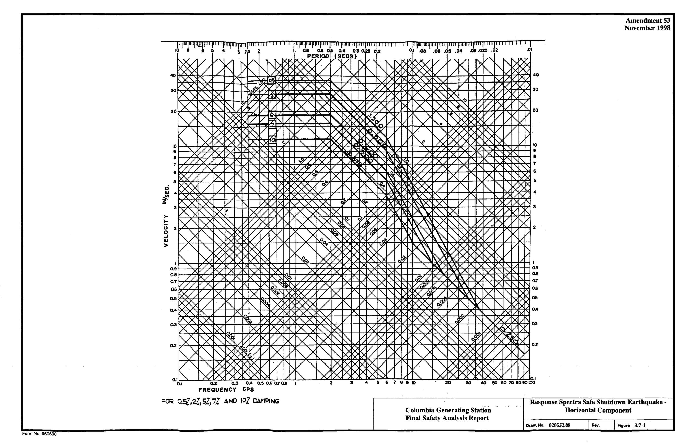

*figure on PDF page 477*

<!-- labels/text on this figure page -->
Amendment 53 November 1998
fD1pm11111111l!t1.111111tijlliljih11n11111,11111111111 r11pmpmp11q1111n11111111111p1111111111111111l7'1iijilllllllllllll1'"'1'111111111111111111fi1111'11111111 I e e
• ca o., .oe .oe .oi, .04 .03 .ou .02 10 5 • 3 2 .01
30
20
10 9 • 7 6 6 5 5 0 4 4 II' f 3 ...
►
2 0 2 0 ..J Ill >
I 0.9 0.8 0.1 0.6
Cl5
0.4
Q3
0.2 0.3
FREQUENCY
FOR 0.fv.,2J.'7SJ.,7Z ANO IOZ CAMPING Response Spectra Safe Shutdown Earthquake - Columbia Generating Station Horizontal Component Final Safety Analysis Report Draw. No. 020552.08 Rev. Figure 3.7-1 Form No. 960690

<!-- p.478 -->
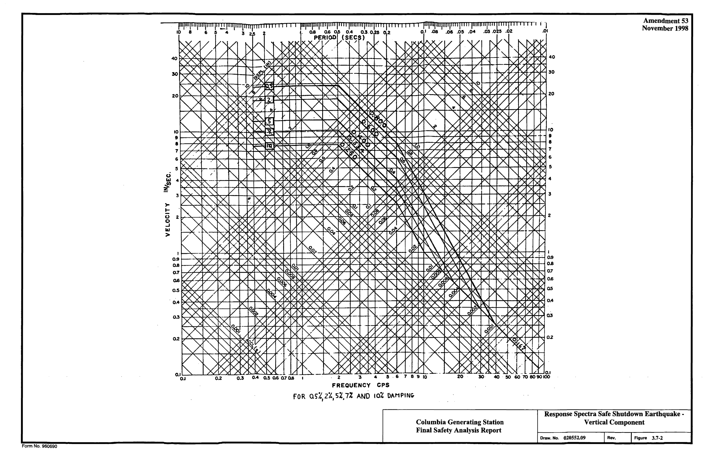

*figure on PDF page 478*

<!-- labels/text on this figure page -->
Amendment 53 flllp!ii!hlllllllp II I 111.L!.l'lllpliijii It I' 11 I ii I II I I I I I r111111111m111111111 II I" ll·llllllllil I' Iii p I I I I' I ii I I I I I 11mpmpm11111p11 'I Ii Ii 111m1111111 II fi II q I 11 I '· I I I I ·1 November 1998 10 8 6 4 3 . 0.8
2 O.I .08 .06 .O~ .04 .03 .025 .02 .01 &
10 9 8 T T 6 6 5 5
(J
4 IIJ
4 ~ z 3
► ~ 2 CJ 2 0 _J
&aJ >
L-~--1.~)C...l,~u......l~'...Qo_....~..X..L_
0.3 0.4 O.:S 0.6 0.7 Q.8 I 2 3 4 0.2
FREQUENCY CPS
FOR QS't. 2¼. 52 7% ANO 10, DAMPING- '
•
• Response Spectra Safe Shutdown Earthquake - Columbia Generating Station Vertical Component Final Safety Analysis Report Figure 3.7-2 Rev.
Draw. No. 020552.09 Form No. 960690

<!-- p.479 -->
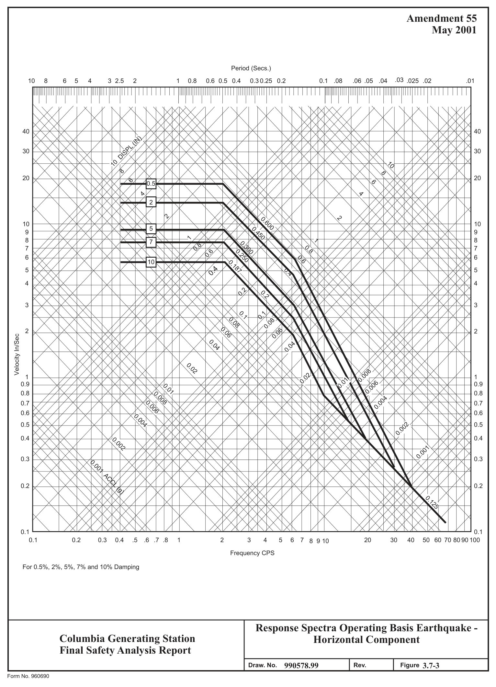

*figure on PDF page 479*

[Vector original (SVG, lossless): fig_page-479.svg](../figures/fig_page-479.svg)

<!-- labels/text on this figure page -->
Amendment 55 May 2001
Period (Secs.)
.03 .025 .02 10 8 6 5 4 3 2.5 2 1 0.8 0.6 0.5 0.4 0.3 0.25 0.2 0.1 .08 .06 .05 .04 .01
40 40
10 DISPL (IN)
30 30
10 8 8 20 20 6 6 0.5 4 4 2
2 2 0.600 10 10 5 0.450 9 9 1 8 8 7 1 0.300 0.8 0.8 7 7 0.6 0.250 6 6 0.6 10 0.187 0.4 5 5 0.4 4 4 0.2 0.2 3 3 0.1 0.1 0.08 0.08 0.06 0.06 2 2 Velocity In/Sec 0.04 0.04
0.02 0.008 0.02 1 1 0.01 0.006 0.9 0.9 0.01 0.8 0.8 0.008 0.004 0.006 0.7 0.7 0.6 0.6 0.004 0.002 0.5 0.5
0.4 0.4 0.002 0.001 0.3 0.3
0.001 ACCL (g)
0.2 0.2
0.125
0.1 0.1 0.1 0.2 0.3 0.4 .5 .6 .7 .8 1 2 3 4 5 6 7 8 9 10 20 30 40 50 60 70 80 90 100 Frequency CPS
For 0.5%, 2%, 5%, 7% and 10% Damping
Response Spectra Operating Basis Earthquake - Columbia Generating Station Horizontal Component Final Safety Analysis Report Draw. No. 990578.99 Rev. Figure 3.7-3 Form No. 960690

<!-- p.480 -->
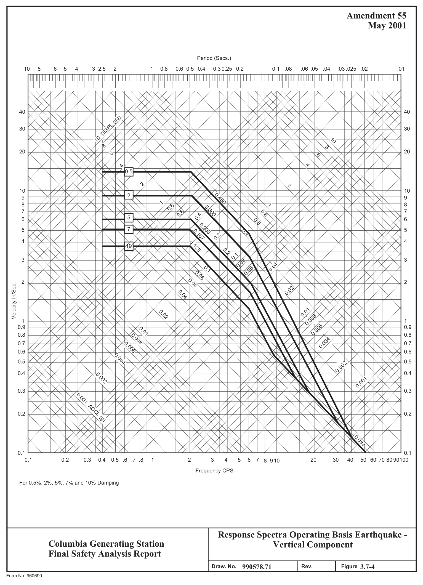

*figure on PDF page 480*

[Vector original (SVG, lossless): fig_page-480.svg](../figures/fig_page-480.svg)

<!-- labels/text on this figure page -->
Amendment 55 May 2001
Period (Secs.)
10 8 6 5 4 3 2.5 2 1 0.8 0.6 0.5 0.4 0.3 0.25 0.2 0.1 .08 .06 .05 .04 .03 .025 .02 .01
40 40
10 DISPL (IN)
30 30
10 8 8 20 20 6 6 4 4 0.5
2 2 10 10 0.450 2 9 9 1 8 8 0.8 1 0.300 7 7 0.8 0.6 0.4 5 6 6 0.6 0.200 7 5 5 0.167 0.4 0.2 4 4 0.125 10 0.2 0.1 3 3 0.08 0.04 0.1 0.06 0.08 0.06 2 2 Velocity In/Sec.
0.02 0.04
0.01 0.02 0.008 1 1 0.006 0.9 0.9 0.01 0.8 0.8 0.008 0.004 0.7 0.7 0.006 0.6 0.6 0.004 0.5 0.5 0.002 0.4 0.4 0.002 0.001 0.3 0.3
0.001 ACCL (g)
0.2 0.2
0.083 0.1 0.1 0.1 0.2 0.3 0.4 0.5 .6 .7 .8 1 2 3 4 5 6 7 8 9 10 20 30 40 50 60 70 80 90 100 Frequency CPS
For 0.5%, 2%, 5%, 7% and 10% Damping
Response Spectra Operating Basis Earthquake - Columbia Generating Station Vertical Component Final Safety Analysis Report Draw. No. 990578.71 Rev. Figure 3.7-4 Form No. 960690

<!-- p.481 -->
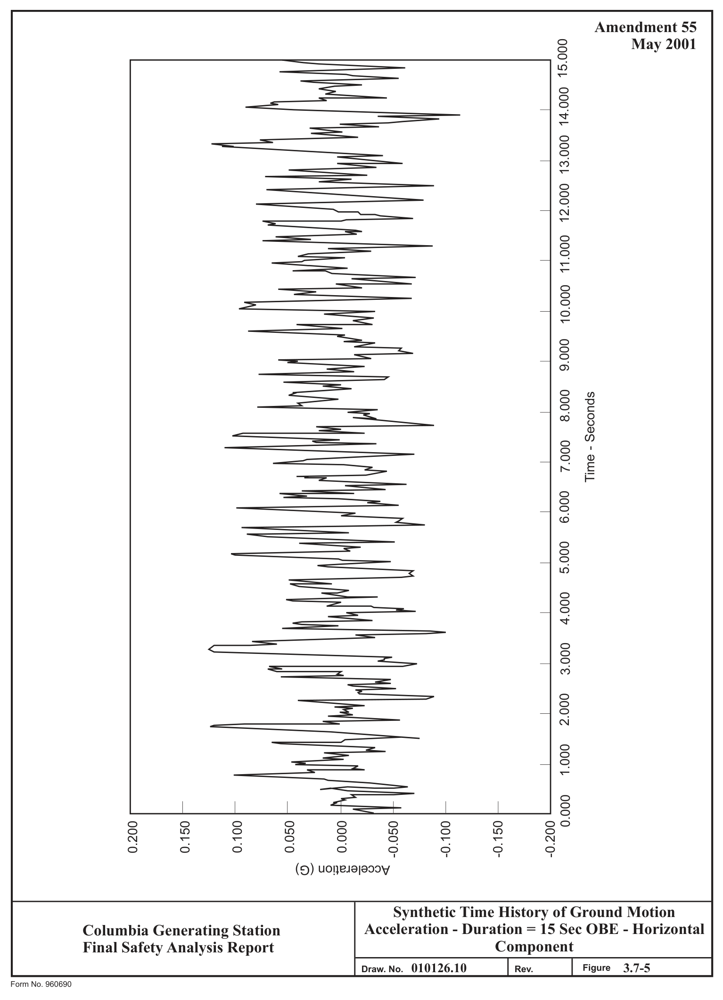

*figure on PDF page 481*

[Vector original (SVG, lossless): fig_page-481.svg](../figures/fig_page-481.svg)

<!-- labels/text on this figure page -->
Amendment 55 May 2001 13.000 14.000 15.000
12.000
11.000
10.000
-
9.000
8.000 Time - Seconds
-- 7.000
-
6.000
-
-
5.000
-
C
----=- 4.000
-
3.000 C
-
2.000 ~
-
-
1.000
-
0.000
I I I
I I ~ I I 0.200 0.150 0.100 0.050 0.000 -0.050 -0.100 -0.150 -0.200 Acceleration (G)
Synthetic Time History of Ground Motion Acceleration - Duration = 15 Sec OBE - Horizontal Columbia Generating Station Component Final Safety Analysis Report I I 010126.10
3.7-5 Draw. No.
Rev. Figure Form No. 960690

<!-- p.482 -->
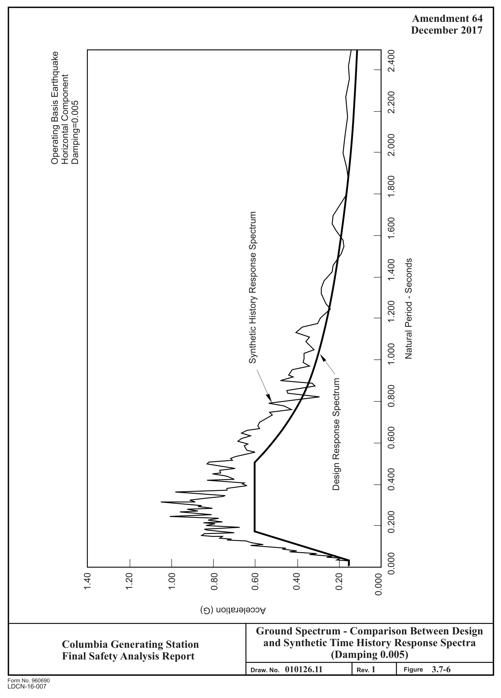

*figure on PDF page 482*

[Vector original (SVG, lossless): fig_page-482.svg](../figures/fig_page-482.svg)

<!-- labels/text on this figure page -->
Amendment 64 December 2017
2.400 Operating Basis Earthquake
Horizontal Component
2.200 Damping=0.005
2.000
1.800
Synthetic History Response Spectrum
1.600
1.400 Natural Period - Seconds
1.200
1.000
Design Response Spectrum 0.800
0.600
0.400
0.200
0.000
1.40 1.20 1.00 0.80 0.60 0.40 0.20 0.000
Acceleration (G)
Ground Spectrum - Comparison Between Design and Synthetic Time History Response Spectra Columbia Generating Station
(Damping 0.005) Final Safety Analysis Report 010126.11 Rev. 1
3.7-6 Figure Draw. No.
Form No. 960690
LDCN-16-007

<!-- p.483 -->
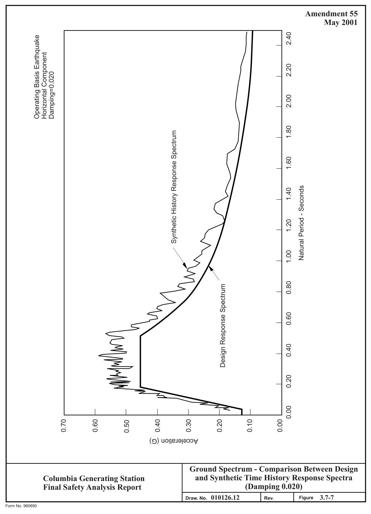

*figure on PDF page 483*

[Vector original (SVG, lossless): fig_page-483.svg](../figures/fig_page-483.svg)

<!-- labels/text on this figure page -->
Amendment 55 May 2001
2.40 Operating Basis Earthquake Horizontal Component
2.20 Damping=0.020
2.00
1.80 Synthetic History Response Spectrum
1.60
Natural Period - Seconds
1.40
1.20
1.00
0.80 Design Response Spectrum 0.60
0.40
0.20
0.00 0.70 0.60 0.40 0.30 0.20 0.10 0.00 0.50
Acceleration (G)
Ground Spectrum - Comparison Between Design and Synthetic Time History Response Spectra Columbia Generating Station
(Damping 0.020)
Final Safety Analysis Report 010126.12
3.7-7 Figure Draw. No.
Rev.
Form No. 960690

<!-- p.484 -->
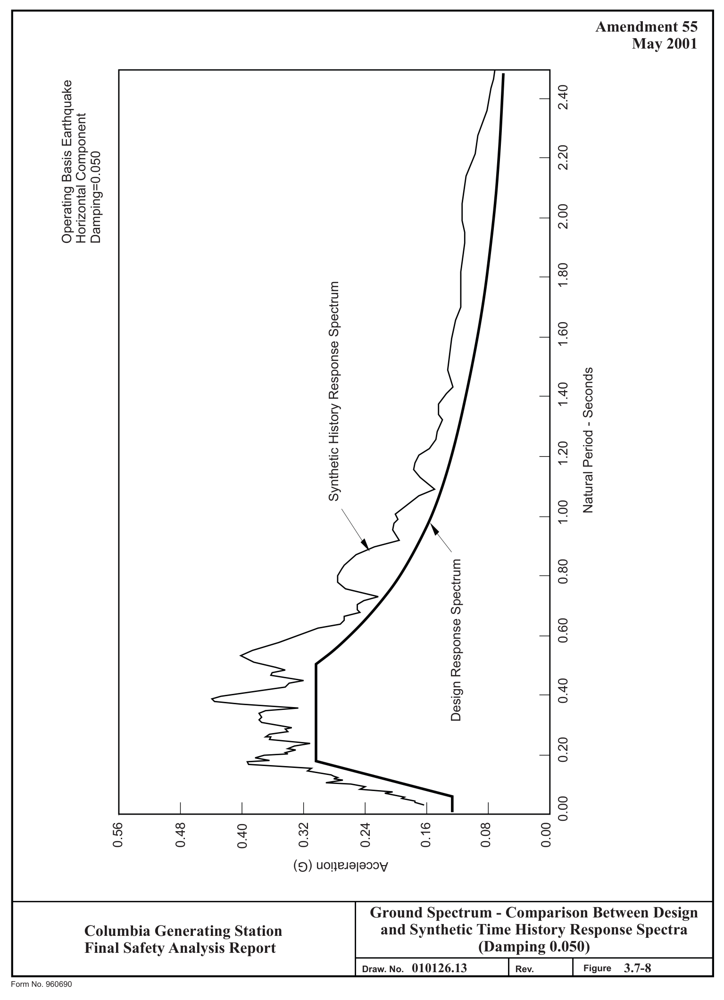

*figure on PDF page 484*

[Vector original (SVG, lossless): fig_page-484.svg](../figures/fig_page-484.svg)

<!-- labels/text on this figure page -->
Amendment 55 May 2001
Operating Basis Earthquake
2.40 Horizontal Component
2.20 Damping=0.050
2.00
1.80 Synthetic History Response Spectrum
1.60
Natural Period - Seconds
1.40
1.20
1.00
Design Response Spectrum 0.80
0.60
0.40
0.20
0.00 0.56 0.48 0.40 0.32 0.24 0.16 0.08 0.00
Acceleration (G)
Ground Spectrum - Comparison Between Design and Synthetic Time History Response Spectra Columbia Generating Station
(Damping 0.050)
Final Safety Analysis Report 010126.13
3.7-8 Figure Draw. No.
Rev.
Form No. 960690

<!-- p.485 -->
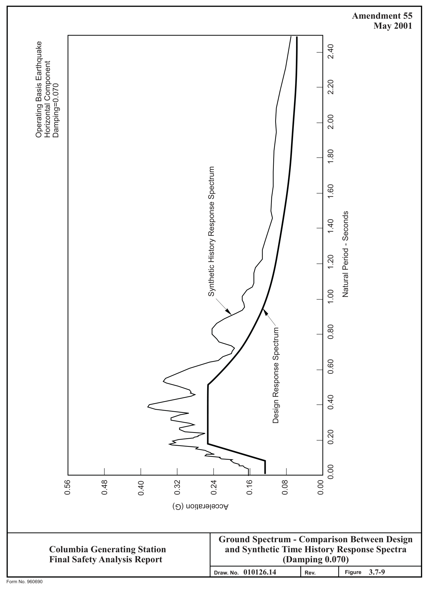

*figure on PDF page 485*

[Vector original (SVG, lossless): fig_page-485.svg](../figures/fig_page-485.svg)

<!-- labels/text on this figure page -->
Amendment 55 May 2001
Operating Basis Earthquake
2.40 Horizontal Component
2.20 Damping=0.070
2.00
1.80 Synthetic History Response Spectrum
1.60
Natural Period - Seconds
1.40
1.20
1.00
0.80 Design Response Spectrum 0.60
0.40
0.20
0.00 0.56 0.48 0.32 0.24 0.16 0.08 0.00 0.40
Acceleration (G)
Ground Spectrum - Comparison Between Design and Synthetic Time History Response Spectra Columbia Generating Station
(Damping 0.070)
Final Safety Analysis Report 010126.14
3.7-9 Figure Draw. No.
Rev.
Form No. 960690

<!-- p.486 -->
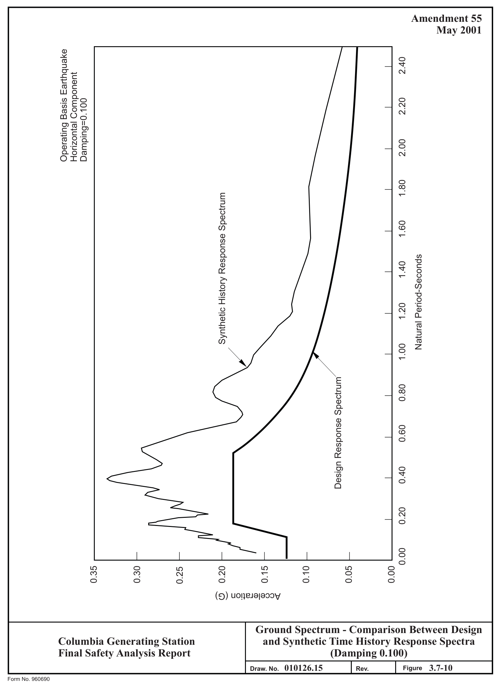

*figure on PDF page 486*

[Vector original (SVG, lossless): fig_page-486.svg](../figures/fig_page-486.svg)

<!-- labels/text on this figure page -->
Amendment 55 May 2001
Operating Basis Earthquake
2.40 Horizontal Component
2.20 Damping=0.100
2.00
1.80 Synthetic History Response Spectrum
1.60
Natural Period-Seconds
1.40
1.20
1.00
Design Response Spectrum 0.80
0.60
0.40
0.20
0.00 0.35 0.30 0.20 0.15 0.10 0.05 0.00 0.25
Acceleration (G)
Ground Spectrum - Comparison Between Design and Synthetic Time History Response Spectra Columbia Generating Station
(Damping 0.100)
Final Safety Analysis Report 010126.15
3.7-10 Figure Draw. No.
Rev.
Form No. 960690

<!-- p.487 -->
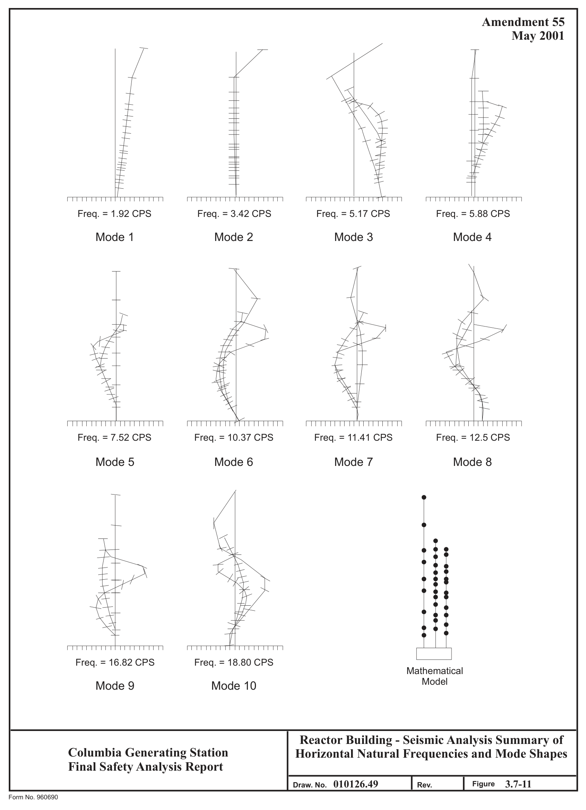

*figure on PDF page 487*

[Vector original (SVG, lossless): fig_page-487.svg](../figures/fig_page-487.svg)

<!-- labels/text on this figure page -->
Amendment 55 May 2001
Freq. = 1.92 CPS Freq. = 3.42 CPS Freq. = 5.17 CPS Freq. = 5.88 CPS
Mode 1 Mode 2 Mode 3 Mode 4
Freq. = 7.52 CPS Freq. = 10.37 CPS Freq. = 11.41 CPS Freq. = 12.5 CPS
Mode 5 Mode 6 Mode 7 Mode 8
Freq. = 16.82 CPS Freq. = 18.80 CPS Mathematical Model Mode 9 Mode 10
Reactor Building - Seismic Analysis Summary of Columbia Generating Station Horizontal Natural Frequencies and Mode Shapes Final Safety Analysis Report 010126.49
3.7-11 Draw. No.
Rev. Figure Form No. 960690

<!-- p.488 -->
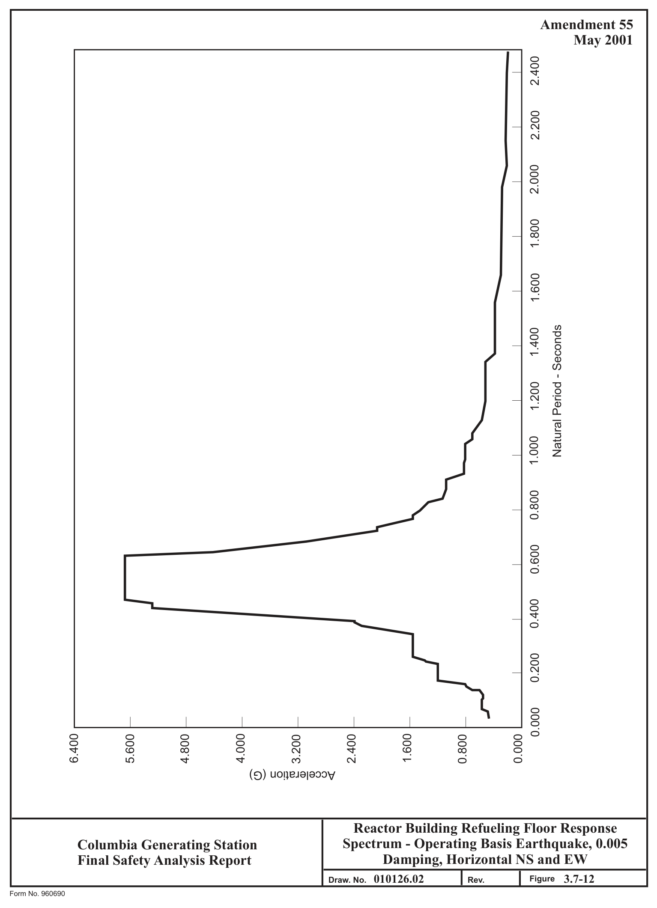

*figure on PDF page 488*

[Vector original (SVG, lossless): fig_page-488.svg](../figures/fig_page-488.svg)

<!-- labels/text on this figure page -->
Amendment 55 May 2001
2.400
2.200
2.000
1.800
1.600
Natural Period - Seconds 1.400
1.200
1.000
0.800
0.600
0.400
0.200
0.000 6.400 5.600 4.800 4.000
2.400 1.600 0.800 0.000 3.200 Acceleration (G)
Reactor Building Refueling Floor Response Spectrum - Operating Basis Earthquake, 0.005 Columbia Generating Station Damping, Horizontal NS and EW Final Safety Analysis Report 010126.02
3.7-12 Draw. No.
Rev. Figure Form No. 960690

<!-- p.489 -->
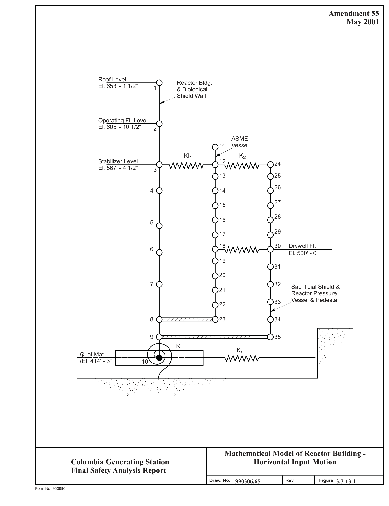

*figure on PDF page 489*

[Vector original (SVG, lossless): fig_page-489.svg](../figures/fig_page-489.svg)

<!-- labels/text on this figure page -->
Amendment 55 May 2001
Roof Level Reactor Bldg.
El. 653' - 1 1/2" 1 & Biological Shield Wall
Operating Fl. Level El. 605' - 10 1/2" 2 ASME Vessel 11 K2 KI1 Stabilizer Level 12 24 El. 567' - 4 1/2" 3 13 25
26 4 14
27 15
28 16 5 29 17
18 30 Drywell Fl.
6 El. 500' - 0" 19 31 20 7 32 Sacrificial Shield & 21 Reactor Pressure Vessel & Pedestal 33 22
8 23 34
..
9 35 . ... ;. •·:; .
• ....
K Kx C of Mat -------+-- L
(El. 414' - 3" 10
.. · ...• . ;.
Mathematical Model of Reactor Building - Horizontal Input Motion Columbia Generating Station Final Safety Analysis Report Draw. No. 990306.65 Rev. Figure 3.7-13.1 Form No. 960690

<!-- p.490 -->
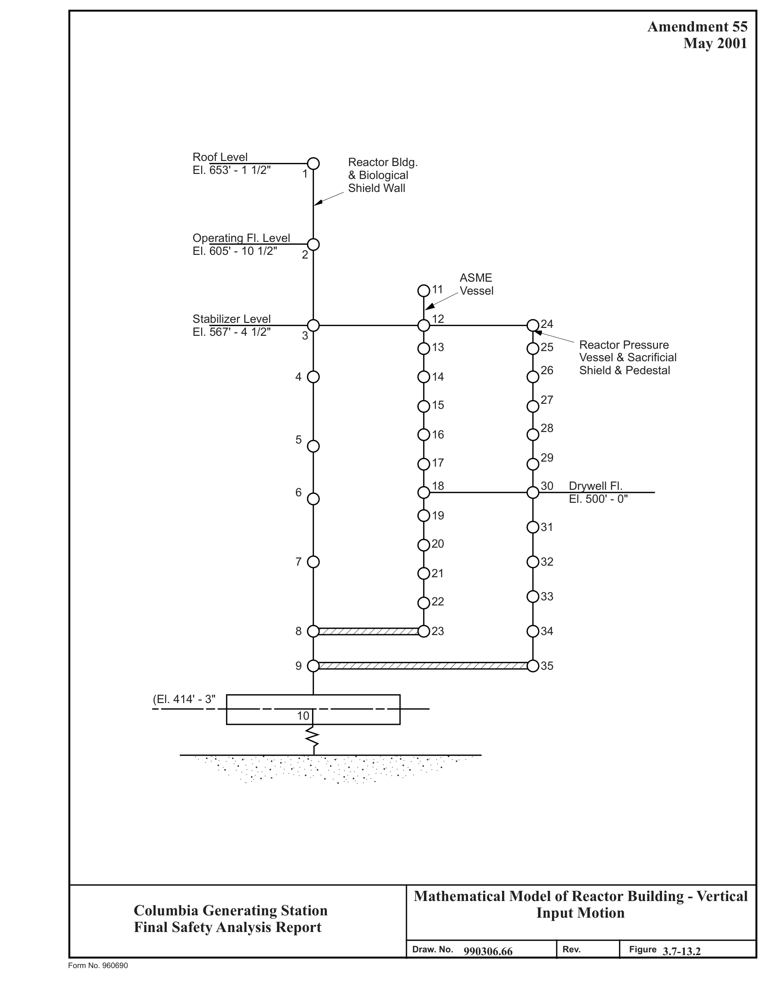

*figure on PDF page 490*

[Vector original (SVG, lossless): fig_page-490.svg](../figures/fig_page-490.svg)

<!-- labels/text on this figure page -->
Amendment 55 May 2001
Roof Level Reactor Bldg.
El. 653' - 1 1/2" 1 & Biological Shield Wall
Operating Fl. Level El. 605' - 10 1/2" 2
ASME
11 Vessel
12 Stabilizer Level 24 El. 567' - 4 1/2" 3 Reactor Pressure 13 25 Vessel & Sacrificial
26 Shield & Pedestal
4 14
27 15
28 16 5 29 17
18 30 Drywell Fl.
6 El. 500' - 0" 19 31 20 7 32 21
33 22
8 23 34
9 35
(El. 414' - 3" 10
· ... ·.• .. ..
.•. ·· .... . .. · . ..
. . •. •.·.
Mathematical Model of Reactor Building - Vertical Columbia Generating Station Input Motion Final Safety Analysis Report Draw. No. 990306.66 Rev. Figure 3.7-13.2 Form No. 960690

<!-- p.491 -->
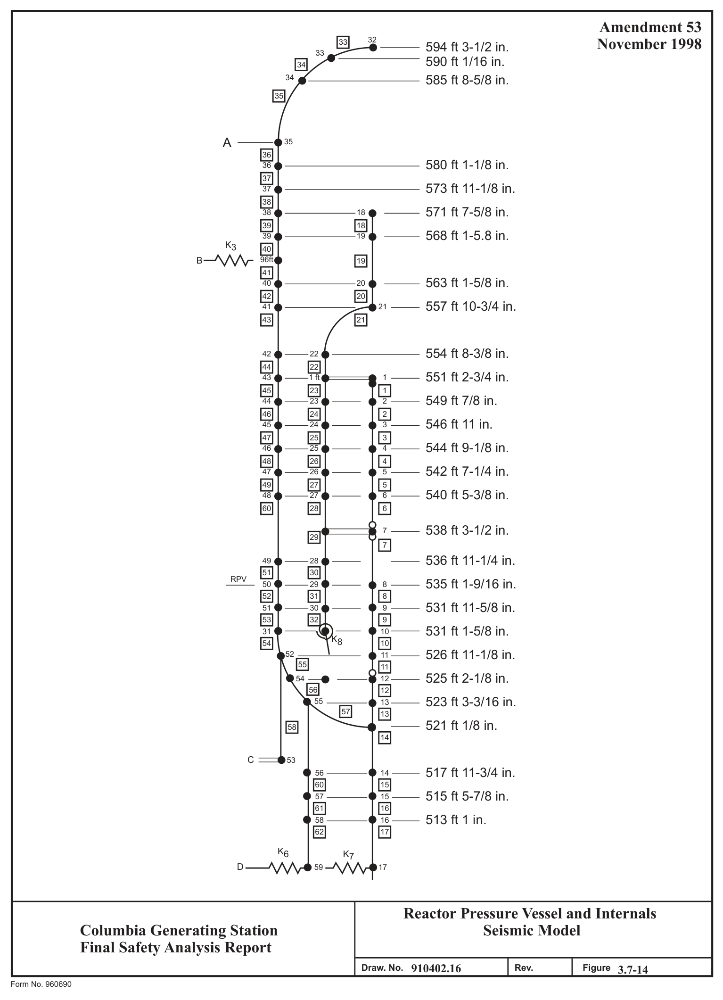

*figure on PDF page 491*

[Vector original (SVG, lossless): fig_page-491.svg](../figures/fig_page-491.svg)

<!-- labels/text on this figure page -->
Amendment 53 November 1998 32 33 594 ft 3-1/2 in.
33 590 ft 1/16 in.
34 585 ft 8-5/8 in.
34
35
A 35 □ 36 580 ft 1-1/8 in.
36 □ 37 573 ft 11-1/8 in.
37 □ 38 571 ft 7-5/8 in.
38 18 □ □ 39 18 568 ft 1-5.8 in.
39 19 K3
-'VVv- □ 40 B 96ft □ 19 □ 41 563 ft 1-5/8 in.
40 20 □ □ 42 20 557 ft 10-3/4 in.
41 21 □ □ 43 21
554 ft 8-3/8 in.
42 22 □ □ 44 22 551 ft 2-3/4 in.
43 1 ft 1 □ □ □ 45 23 1
- - 549 ft 7/8 in.
44 23 2 □ □ □ 46 24 2
- - 546 ft 11 in.
45 24 3 □ □ □ 47 25 3
- - 544 ft 9-1/8 in.
46 25 4 □ □ □ 48 26 4
- - 542 ft 7-1/4 in.
47 26 5 □ □ □ 49 27 5
- - 540 ft 5-3/8 in.
48 27 6 □ □ □ 60 28 6 538 ft 3-1/2 in.
7 □ 29 □ 7
- - 536 ft 11-1/4 in.
49 28 □ 51 □ 30
RPV - -
535 ft 1-9/16 in.
50 29 8 □ 52 □ 31 □ 8 531 ft 11-5/8 in.
51 30 9 53 32 □ 9 531 ft 1-5/8 in.
31 10 K8 □ 10 54 526 ft 11-1/8 in. 52 11 55 □ 11
- 525 ft 2-1/8 in.
54 12 56 □ 12
- 523 ft 3-3/16 in. 55 13 57 □ 13 521 ft 1/8 in.
58 □ 14
C 53 517 ft 11-3/4 in.
56 14 60 □ 15 515 ft 5-7/8 in.
57 15 61 □ 16 513 ft 1 in.
58 16 62 □ 17
K6 K7
D 59 17
Reactor Pressure Vessel and Internals Seismic Model Columbia Generating Station Final Safety Analysis Report 910402.16 Draw. No. Rev. Figure 3.7-14 Form No. 960690

<!-- p.492 -->
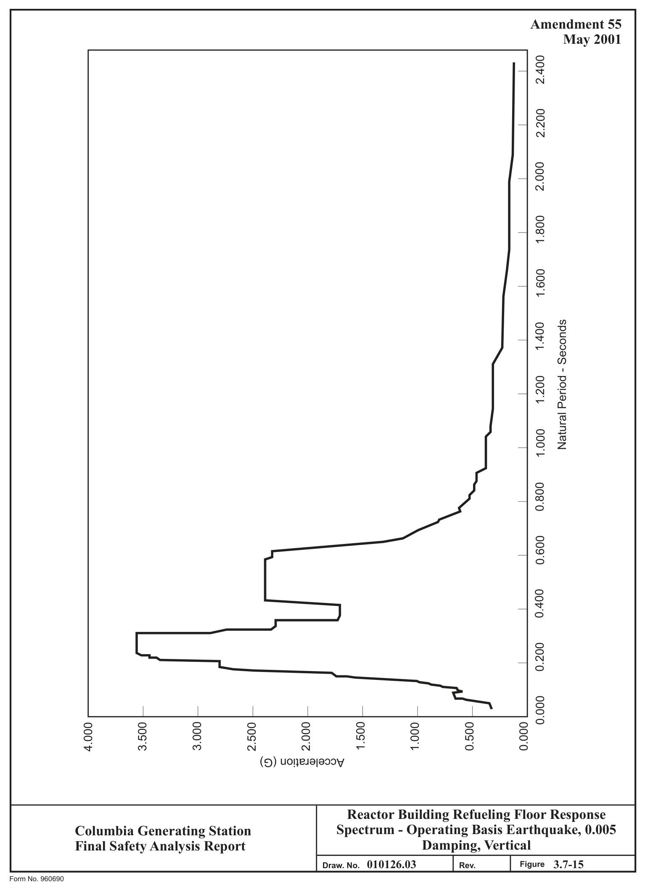

*figure on PDF page 492*

[Vector original (SVG, lossless): fig_page-492.svg](../figures/fig_page-492.svg)

<!-- labels/text on this figure page -->
Amendment 55 May 2001
2.400
2.200
2.000
1.800
1.600
Natural Period - Seconds 1.400
1.200
1.000
0.800
0.600
0.400
0.200
0.000 0.500 0.000 4.000 2.500 1.000
2.000 1.500
3.500 3.000 Acceleration (G)
Reactor Building Refueling Floor Response Spectrum - Operating Basis Earthquake, 0.005 Columbia Generating Station Damping, Vertical Final Safety Analysis Report 010126.03
3.7-15 Draw. No.
Rev. Figure Form No. 960690

<!-- p.493 -->
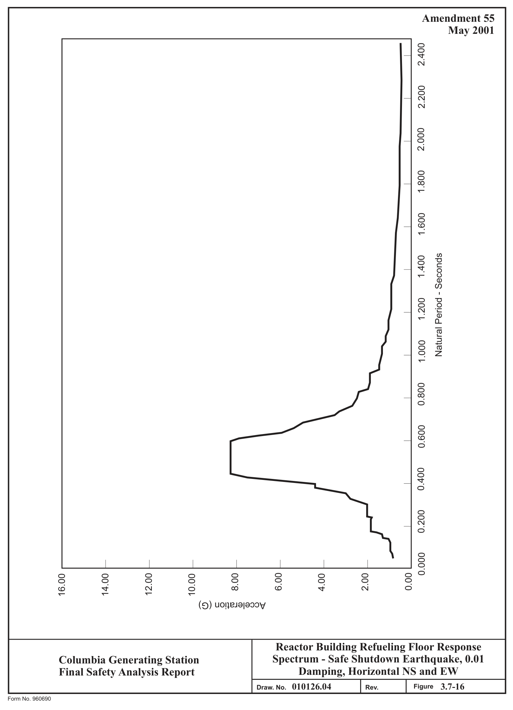

*figure on PDF page 493*

[Vector original (SVG, lossless): fig_page-493.svg](../figures/fig_page-493.svg)

<!-- labels/text on this figure page -->
Amendment 55 May 2001
2.400
2.200
2.000
1.800
1.600
Natural Period - Seconds 1.400
1.200
1.000
0.800
0.600
0.400
0.200
0.000 8.00 6.00 4.00 2.00 0.00 16.00 10.00 14.00 12.00 Acceleration (G)
Reactor Building Refueling Floor Response Spectrum - Safe Shutdown Earthquake, 0.01 Columbia Generating Station Damping, Horizontal NS and EW Final Safety Analysis Report 010126.04
3.7-16 Draw. No.
Rev. Figure Form No. 960690

<!-- p.494 -->
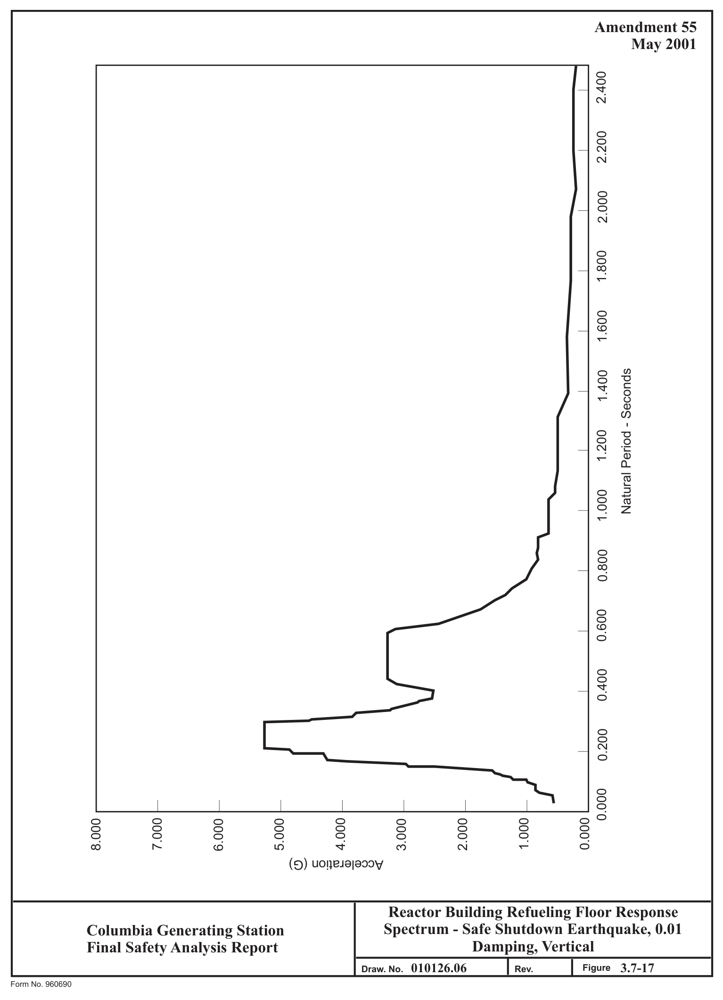

*figure on PDF page 494*

[Vector original (SVG, lossless): fig_page-494.svg](../figures/fig_page-494.svg)

<!-- labels/text on this figure page -->
Amendment 55 May 2001
2.400
2.200
2.000
1.800
1.600
Natural Period - Seconds 1.400
1.200
1.000
0.800
0.600
0.400
0.200
0.000 8.000 7.000 6.000 5.000 4.000 3.000 2.000 1.000 0.000 Acceleration (G)
Reactor Building Refueling Floor Response Spectrum - Safe Shutdown Earthquake, 0.01 Columbia Generating Station Damping, Vertical Final Safety Analysis Report 010126.06
3.7-17 Draw. No.
Rev. Figure Form No. 960690

<!-- p.495 -->
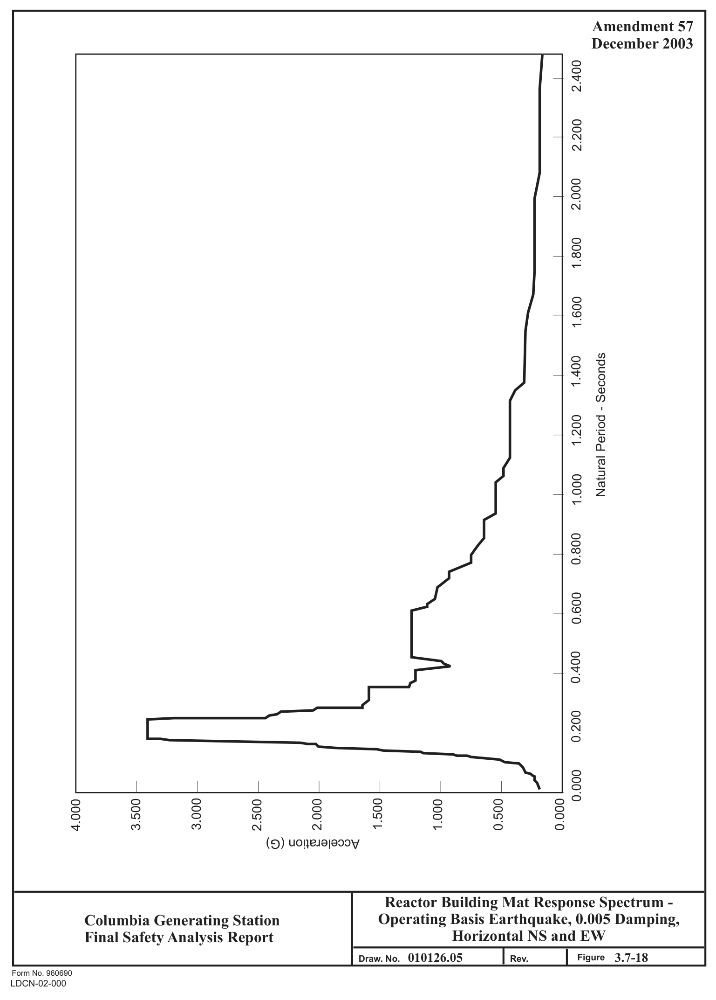

*figure on PDF page 495*

[Vector original (SVG, lossless): fig_page-495.svg](../figures/fig_page-495.svg)

<!-- labels/text on this figure page -->
Amendment 57 December 2003
2.400
2.200
2.000
1.800
1.600
Natural Period - Seconds 1.400
1.200
1.000
0.800
0.600
0.400
0.200
0.000 4.000 3.500 3.000 2.500 2.000 1.500 1.000 0.500 0.000 Acceleration (G)
Reactor Building Mat Response Spectrum - Operating Basis Earthquake, 0.005 Damping, Columbia Generating Station Horizontal NS and EW Final Safety Analysis Report 010126.05
3.7-18 Draw. No.
Rev. Figure Form No. 960690
LDCN-02-000

<!-- p.496 -->
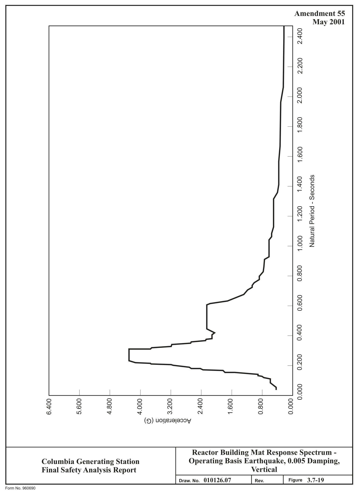

*figure on PDF page 496*

[Vector original (SVG, lossless): fig_page-496.svg](../figures/fig_page-496.svg)

<!-- labels/text on this figure page -->
Amendment 55 May 2001
2.400
2.200
2.000
1.800
1.600
Natural Period - Seconds 1.400
1.200
1.000
0.800
0.600
0.400
0.200
0.000 0.800 0.000 6.400 4.000 1.600
3.200 2.400 5.600 4.800 Acceleration (G)
Reactor Building Mat Response Spectrum - Operating Basis Earthquake, 0.005 Damping, Columbia Generating Station Vertical Final Safety Analysis Report 010126.07
3.7-19 Draw. No.
Rev. Figure Form No. 960690

<!-- p.497 -->
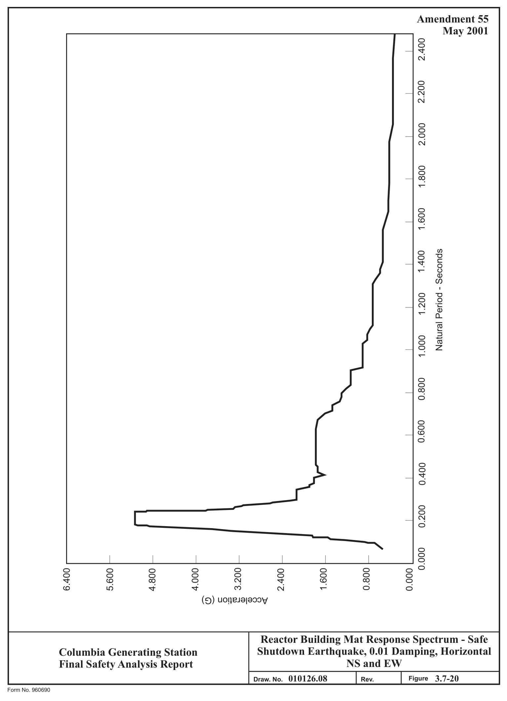

*figure on PDF page 497*

[Vector original (SVG, lossless): fig_page-497.svg](../figures/fig_page-497.svg)

<!-- labels/text on this figure page -->
Amendment 55 May 2001
2.400
2.200
2.000
1.800
1.600
Natural Period - Seconds 1.400
1.200
1.000
0.800
0.600
0.400
0.200
0.000 6.400 5.600 4.800 4.000 3.200 2.400 1.600 0.800 0.000 Acceleration (G)
Reactor Building Mat Response Spectrum - Safe Shutdown Earthquake, 0.01 Damping, Horizontal Columbia Generating Station NS and EW Final Safety Analysis Report 010126.08
3.7-20 Draw. No.
Rev. Figure Form No. 960690

<!-- p.498 -->
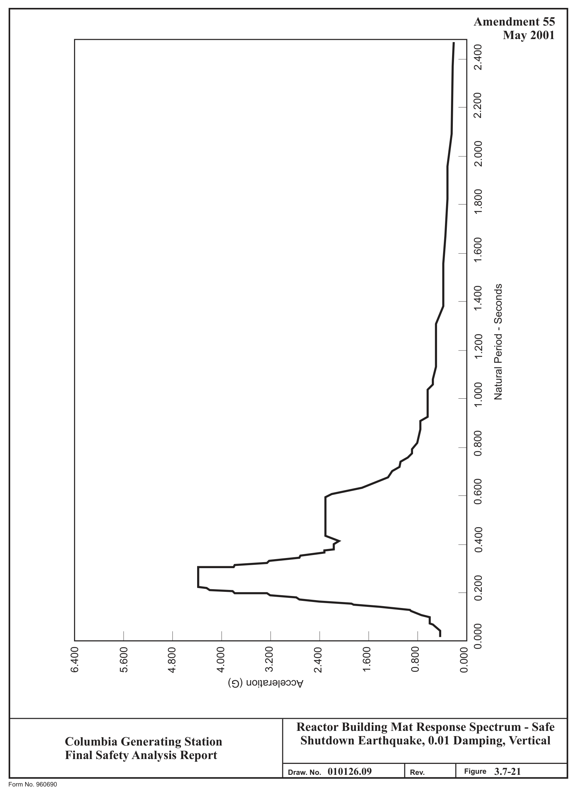

*figure on PDF page 498*

[Vector original (SVG, lossless): fig_page-498.svg](../figures/fig_page-498.svg)

<!-- labels/text on this figure page -->
Amendment 55 May 2001
2.400
2.200
2.000
1.800
1.600
Natural Period - Seconds 1.400
1.200
1.000
0.800
0.600
0.400
0.200
0.000 0.800 6.400 5.600 4.800 4.000 2.400 1.600 0.000
3.200 Acceleration (G)
Reactor Building Mat Response Spectrum - Safe Shutdown Earthquake, 0.01 Damping, Vertical Columbia Generating Station Final Safety Analysis Report 010126.09
3.7-21 Draw. No.
Rev. Figure Form No. 960690

<!-- p.499 -->
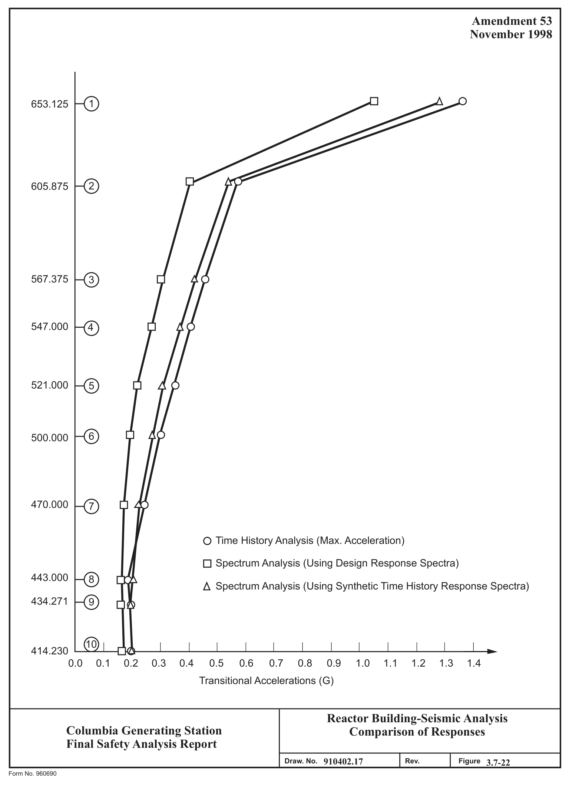

*figure on PDF page 499*

[Vector original (SVG, lossless): fig_page-499.svg](../figures/fig_page-499.svg)

<!-- labels/text on this figure page -->
Amendment 53 November 1998
653.125 1
605.875 2
567.375 3
547.000 4
521.000 5
500.000 6
470.000 7
0 Time History Analysis (Max. Acceleration)
Spectrum Analysis (Using Design Response Spectra)
□ 443.000 8 I::,. Spectrum Analysis (Using Synthetic Time History Response Spectra)
434.271 9
10 414.230 0.0 0.1 0.2 0.3 0.4 0.5 0.6 0.7 0.8 0.9 1.0 1.1 1.2 1.3 1.4 Transitional Accelerations (G)
Reactor Building-Seismic Analysis Columbia Generating Station Comparison of Responses Final Safety Analysis Report Draw. No. 910402.17 Rev. Figure 3.7-22 Form No. 960690

