# 3.8 DESIGN OF SEISMIC CATEGORY I STRUCTURES

> Columbia Generating Station FSAR — Chapter 03: Design of Structures, Components, Equipment and Systems
> Source: `03_chapter-660-1910.pdf`, PDF pages 500–681 (of 1251)
> Amendment 67 compilation (individual pages carry varying amendment dates)

---
<!-- p.500 -->
### 3.8 DESIGN OF SEISMIC CATEGORY I STRUCTURES
The nuclear steam supply system (NSSS) is housed in a steel primary containment vessel that has the ability to function as an independent structure. The primary containment vessel is housed in a reactor building also containing fuel storage and handling equipment and equipped with an overhead crane. The primary containment vessel for the NSSS is designed to confine the effects of a postulated nuclear accident and to limit the discharge of radioactive products to within levels specified in 10 CFR Part 50.67.

The Seismic Category I structures, which are part of a complex of buildings in close proximity to each other, are the reactor building, the diesel generator building, and portions of the radwaste and control building. The portions of the radwaste and control building which are Seismic Category I are the radwaste area and the control room tower. The radwaste area encompasses the foundation mat, the walls and all internal structures from the top of mat el. 437 ft to and including the reinforced-concrete slab at el. 467 ft. The control room tower consists of the vertical portion of the building encompassing the area of the control room.

The turbine generator building is a modified non-Category I seismic structure which is dynamically analyzed and designed to withstand the effects of an safe shutdown earthquake
(SSE) and maintain its structural integrity thus providing adequate protection for the portions of the steam system designed as Seismic Category I, as defined in Regulatory Guide 1.29, Revision 3.

The reactor building consists of a dual barrier: the steel primary containment vessel and the reactor building which provides secondary containment. The primary containment vessel contains the drywell, suppression chamber, structural floor separating the drywell from the suppression chamber, sacrificial shield wall (SSW), and reactor pedestal. The reactor building secondary containment encloses the biological shield wall, spent fuel storage pool, dryer-separator pool, and the reactor well pool.

Seismic Category I structures that are not part of the building complex are two adjacent spray ponds, each provided with an integrally constructed standby service water pump house, and the condensate storage tank retaining area.

The major structures in the reactor building and principal dimensions are shown in Figures 3.8-1, 3.8-2, and 3.7-13. The seismic analysis methods and models used to obtain seismic loads and floor response spectra, soil/structure interaction, the damping values used, and the seismic input at the base of the buildings are discussed in Section 3.7.

Although the reactor building, radwaste and control building, diesel generator building, and turbine generator building are in close proximity to each other, they are supported on separate foundation mats. No interaction between these mats was considered. Each mat and its

#### LDCN-05-009, 06-014
<!-- p.501 -->
November 1998

superstructure was analyzed separately for soil-structure interaction due to horizontal and vertical earthquake motions.

The seismic design of the buildings was based on a parametric study for a wide range of soil properties. Thus, uncertainties in the soil properties and frequencies are adequately accounted for in the design.

Each of the Seismic Category I structures in the complex is physically separated from the other, above and below grade, in order to accommodate differential seismic displacements and thermal expansion. Abutting walls between buildings, which are separated by only a few inches, are designed to resist wind forces and tornado effects including tornado-generated missiles and pressure drop. The tornado and wind forces on roofs and external walls were computed as indicated in Section 3.3.

The seismic analysis of the reactor building included interaction between soil, foundation mat, and superstructures using lumped mass-spring, discrete models as described in Section 3.7.
Conservative soil and structure damping parameters are included in the model. The response spectrum and time-history methods of analysis were used to determine the responses of the structures.

Time histories of displacements and accelerations at the top of the reactor building mat and at the lumped masses, which usually represent floor slabs, are the main output of the time-history analysis. This output was used as input for time-history analyses, as required, of the main components of the NSSS (the reactor vessel and internals) as well as to generate floor response spectra which were used in the seismic analyses and design of safety-related systems, equipment, and components housed in the Seismic Category I structures. In addition, moments and shears were obtained for comparison with results obtained from response spectrum analyses.

Response spectrum analyses were used for determining shears and moments for the final design of each of the structural components of the reactor building. These are discussed in Sections 3.8.2, 3.8.3, 3.8.4, and 3.8.5.

#### 3.8.1 CONCRETE CONTAINMENT VESSEL (Not Applicable to CGS)
Columbia Generating Station (CGS) has a steel containment vessel (see Section 3.8.2).

#### 3.8.2 STEEL CONTAINMENT VESSEL (ASME Class MC Components)
The capability of the primary steel containment vessel to withstand the hydrodynamic effects resulting from actuation of safety/relief valves (SRV) and specified loads associated with postulated loss-of-coolant accidents (LOCAs), and the applicable modifications were addressed I in the Plant Design Assessment Report (DAR) for SRV and LOCA Loads. See Appendix 3A

<!-- p.502 -->
which identifies the loads and effects which are most important to the design of the CGS plant and describes the CGS plant capability with respect to the hydrodynamic loading phenomena during SRV actuations and postulated LOCA events.

##### 3.8.2.1 Description of the Primary Containment Vessel
The basic safety objective of the primary containment system is to provide the capability in the event of a postulated LOCA of limiting the release of fission products to the plant site environs so that offsite doses are in compliance with the limits specified in 10 CFR Part 50.67.

To meet the basic safety objective, several contributory objectives are achieved by the system or one or more of its components, including

a. Capability to withstand the peak transient pressures and temperatures which could occur due to postulated design basis LOCA; i.e., a mechanical failure of the reactor primary system equivalent to the circumferential rupture of one of the reactor coolant recirculation system pipes,

b. Capability to maintain the functional integrity of the primary containment indefinitely after the postulated design basis LOCA,

c. The primary containment design permits filling the primary containment system drywell with water to a level above the reactor core,

d. The primary containment system is protected against missiles from internal or external sources and excessive motion of pipes, which could directly or indirectly endanger the integrity of the primary containment,

e. Capability to withstand fluid jet forces associated with the flow from the postulated rupture of any pipe within the containment,

f. Capability of limiting leakage during and following the postulated design basis accident to values less than leakage rates which would result in offsite doses greater than the reference doses in 10 CFR Part 50.67,

g. Means of conducting the flow from postulated pipe ruptures, including the design basis rupture of a recirculation line to the pressure suppression pool, to rapidly condense the steam portions of the flow so that the peak transient pressure is less than containment design pressure, to distribute such flow uniformly throughout the pool and to limit pressure differentials between the drywell and the pressure chamber during the various postaccident cooling modes, and

<!-- p.503 -->
November 1998

h. Capability for rapid isolation of the primary containment to provide a containment barrier sufficient to maintain leakage within permissible limits.

The primary containment vessel is a free-standing steel pressure vessel. It utilizes the pressure suppression technique through the Mark II over-under configuration. The primary containment vessel and its appurtenances comply with the requirement of the ASME Code, Section III, Subsection NE-Class MC Components, 1971 Edition through Summer 1972 Addenda. It is designed to resist all normal operating loads, loads resulting from the postulated design basis accident as well as those loads associated with the operating basis earthquake (OBE) and SSE. The design also accounts for stresses induced by thermal expansion. The drywell floor which divides the drywell and suppression chamber is a reinforced-concrete slab supported by steel beams and concrete columns. The drywell floor to primary containment vessel gap is closed off by means of a floor seal shown in Figure 3.8-3.
This configuration permits unrestrained expansion of the containment shell under differential thermal expansion and pressure loadings. The containment vessel is enclosed in a reinforced-concrete biological shield wall for shielding purposes and is separated from the reinforced concrete by an annulus of compressible isolation material, approximately 2 in.
thick. The concrete wall thickness is governed by shielding requirements but also serves as a support for the reactor building floors. Shielding over the top of the drywell is provided by removable, segmented, reinforced-concrete shield plugs. The drywell is located directly above the wetwell. The drywell configuration is basically a frustum of a cone with removable ellipsoidal top closure head. The suppression chamber (wetwell) is cylindrical with an ellipsoidal base. The primary containment vessel is anchored to the concrete mat foundation.
The bottom of the suppression chamber is lined on the inside with reinforced concrete. The concrete mat foundation under the suppression chamber is a common foundation supporting the steel primary containment vessel, including all equipment and structures therein, and the reactor building of which the primary containment vessel is a part.

The drywell floor serves as a pressure barrier between the drywell and suppression chamber.
The top closure head of the drywell is bolted to a steel flange attached to the top of the containment vessel. The drywell houses the reactor vessel and its associated primary system.
The primary function of the drywell is to contain the effects (i.e., mass and radiation) of a LOCA, and to direct the steam released from a primary system pipe break into the suppression chamber pool to limit the total pressure rise during a LOCA.

Under normal operating condition (normal condition) a fatigue analysis is performed in accordance with the requirements of ASME Code Section III.

Under emergency condition, the jet impingement force of 534 kips as outlined in Section 3.8.2.3 might cause local yielding of the drywell shell. An analysis (plastic analysis in accordance with the requirements of the ASME Code Section III) demonstrates that rupture will not occur. Local deformation caused by the jet impingement force does not affect the leak tightness of the containment vessel.

<!-- p.504 -->
November 1998

The analysis of the jet impingement effects on the primary containment vessel
(Reference 3.8-21) is summarized as follows:

a. Phase 1 - The conical region of the containment shell was modeled and a general shell of revolution analysis was performed using the HYBOS computer program (Reference 3.8-22).

Two critical locations were chosen for independent application of the jet force.
One, located approximately in the middle of two box ring stiffeners, is a logical candidate for maximum deflection; the second, located on the thinnest nearly adjacent to a stiffener, is a location where largest curvatures could occur if the shell contacts the concrete biological shield wall spaced 2 in. from the shell.

Since the impinged area (429 in.2) subtends only a small arc of the total periphery, a Fourier harmonic expansion of 11 terms is used to represent the jet forces of 534 kips.

The response to gravity, static seismic, and design pressure loads were also computed. The results of the most severe combinations of the loads
(Appendixes C and D of Reference 3.8-21) show that the shell will contact the concrete for either candidate jet force location; consequently the elastic analysis is not valid in the immediate area of the jet load. The largest computer stresses were found for the second location and exceeded yield; therefore, an elastic-plastic analysis was next performed for that critical region;

b. Phase II - A local finite element elastic-plastic model was analyzed using the DYPLAS computer program which is capable of treating nonlinear inelastic materials.

The boundaries of this model as shown in Figure 3.8-4 are structurally remote from the jet-impinged area, indicated by cross-hatching. The displacements from the general shell analysis, therefore, were used as displacement boundary conditions. Inelastic deformation, strains, and stresses were computed for all finite elements during selected steps of load applications; and

c. Stress evaluation was based on the ASME Boiler and Pressure Vessel (B&PV)
Code, Section III, Subsection NE, Class MC Components, NE-3131.2 and Appendix F, 1974 edition.

### 3.1 Code Requirements
Pm <σm

<!-- p.505 -->
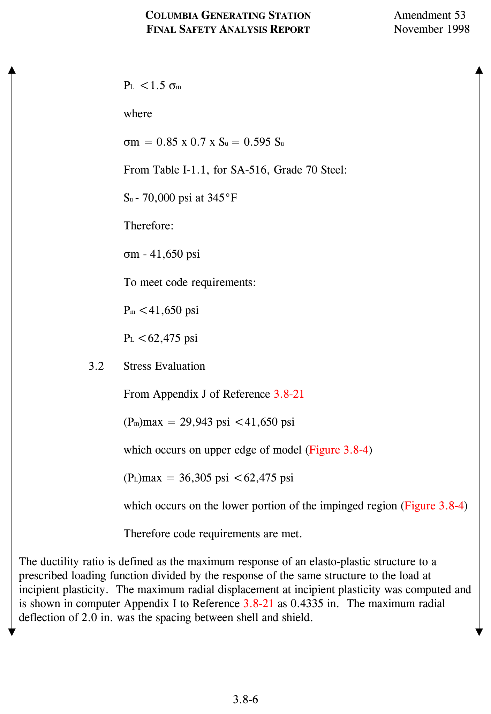

*figure on PDF page 505*

[Vector original (SVG, lossless): fig_page-505.svg](../figures/fig_page-505.svg)

<!-- labels/text on this figure page -->
COLUMBIA GENERATING STATION
Amendment 53
FINAL SAFETY ANALYSIS REPORT
November 1998
PL <1.5 σm
where
σm = 0.85 x 0.7 x Su = 0.595 Su
From Table I-1.1, for SA-516, Grade 70 Steel:
Su - 70,000 psi at 345°F
Therefore:
σm - 41,650 psi
To meet code requirements:
Pm <41,650 psi
PL <62,475 psi
3.2 Stress Evaluation
From Appendix J of Reference 3.8-21
(Pm)max = 29,943 psi <41,650 psi
which occurs on upper edge of model (Figure 3.8-4)
(PL)max = 36,305 psi <62,475 psi
which occurs on the lower portion of the impinged region (Figure 3.8-4)
Therefore code requirements are met.
The ductility ratio is defined as the maximum response of an elasto-plastic structure to a prescribed loading function divided by the response of the same structure to the load at incipient plasticity. The maximum radial displacement at incipient plasticity was computed and is shown in computer Appendix I to Reference 3.8-21 as 0.4335 in. The maximum radial deflection of 2.0 in. was the spacing between shell and shield.
3.8-6

<!-- p.506 -->
November 1998

Thus the ductility ratio might be considered to be

2.00/0.4335 = 4.6

However, since the maximum deflection of the shell is limited by contact with the concrete of the biological shield; the ductility ratio here may not be as meaningful a design parameter as it is in other cases.

A more significant measure of structural integrity against cracking and ultimate leakage may be the most severe local principal cumulative strain.

The most severely strained metal lies on the outside surface of the vessel shell near node 67 as shown in Figure 3.8-4. This strain is the maximum inelastic cumulative strain based on a computed nonlinear strain distribution through the vessel wall. Its value is 4%.

Figure 3.8-5 shows the minimum elongation to failure of ASTM A516 Grade 70 steel as a function of temperature. Over the range of 70°F to 350°F this has a least value of 14.8%.

An estimate of the factor of safety may then be said to be

14 8 .
F S . . = = 3 7 .
4 0 .

Although failure strains in complex strain fields do not correlate precisely with results of one-dimensional ductility tests, the factor of safety, as computed above, is deemed ample.

The criteria used in the seismic design of the containment system is based on the responses of the containment system to earthquake excitation. The responses are derived from the analysis of a mathematical model developed to represent the containment vessel. Section 3.7 outlines methods of analysis, modeling techniques, the seismic input, and the soil-structure interaction effects.

All ferrous materials of plates, forgings, castings, and pipes for ASME Code, Class MC with thickness greater than 5/8 in. are Charpy V-notch impact tested at 0°F in accordance with the ASME Code, Section III, Paragraph NE-2300. Materials for ASME Code, Class 1 components are impact tested in accordance with NB-2300. The drywell will not be pressurized or subjected to substantial stress at temperatures below 30°F.

The principal containment design parameters are listed in Table 3.8-1.

<!-- p.507 -->
November 1998

The physical dimensions of the steel primary containment vessel are

a. The diameter of the cylindrical portion at the base of the cone is approximately 86 ft,

b. The diameter at the top of the cone is approximately 39.5 ft and then narrows to 32 ft to carry the removable head,

c. Ellipsoidal bottom head with a ratio of 2:1 has an inside height of approximately 21.5 ft,

d. The removable ellipsoidal top closure head has an inside height of approximately 15.5 ft,

e. The drywell shell height is approximately 99 ft,

f. The suppression chamber shell height is approximately 72 ft, and

g. Overall shell height is approximately 171 ft.

The primary containment vessel shell plate thicknesses vary. Typical thicknesses are as follows:

a. Bottom ellipsoidal head: from 7/8 in. to 1.5 in., b. The suppression chamber cylinder: from 1-5/16 in. to 1.5 in., c. The drywell conical section: from 0.75 in. to 1.5 in., and d. The removable top ellipsoidal head: 15/16 in.

Material thicknesses meet requirements of the ASME Code Section III, Paragraphs NE-3133 and NE-3324.

The primary containment vessel is reinforced with internal vertical and horizontal stiffeners to satisfy design requirements of the various loading combinations and conditions. Fully circumferential rings, attached to the inside face of the primary containment vessel are furnished at el. 516 ft 6 in. and 542 ft 7.25 in. The basic function of these rings is to support pipe whip protection framework and to adequately distribute pipe whip loading into the vessel.

The method used to ensure that there is an adequate clearance between the steel primary containment vessel and the concrete biological shield wall and which will account for differential thermal expansion is illustrated in Figure 3.8-2 and described as follows:

a. A system consisting of approximately 2-in.-thick polyurethane flexible foam sheets, butted at their joints and cemented directly to the containment shell, is

<!-- p.508 -->
November 1998

used. The exterior surface sealed with laminated fiberglass reinforced polyester, epoxy jointed, panels which are bonded to the polyurethane sheets;

b. Steel anchor fasteners are attached to the fiberglass reinforced polyester panels, and used for anchoring the inner end of the form ties which extend to the forms on the outside face of the concrete biological shield wall. These fasteners are mounted on the fiberglass reinforced plastic prior to bonding of the flexible foam;

c. The fiberglass panel joints are taped and filled with epoxy so that the entire assembly forms a shell around the containment vessel with the polyurethane material set against and bonded panels thereby are permanent inner forms for the pouring of the concrete structure;

d. Drywell penetrations which extend from the containment vessel shell through the concrete biological wall, are surrounded with concentric sleeves. These pipe sleeves are joined to the fiberglass shell using fiberglass tape and epoxy resins.
This technique similarly provides a form for the concrete and maintains adequate clearance between the penetrations and the sleeves to accommodate thermal expansion;

e. The polyurethane foam material is chosen for its resistance to the environmental conditions likely to exist during its service life. Although normal inservice temperature ranges from 95°F to 135°F (average) and 150°F (local), the polyurethane which is used is capable of withstanding temperatures in excess of the LOCA temperature of 340°F. Furthermore, this material is self extinguishing in accordance with ASTM D-1692;

f. The sizing of the expansion gap in which the foam sheet is placed is based on an ultimate steel shell temperature of 340°F and an internal pressure of 45 psig following a postulated reactor LOCA. The external compressive stress applied to the containment vessel by the polyurethane foam, due to vessel thermal expansion from ambient conditions, ranges from 1.2 to 1.5 psi at normal operating and LOCA temperatures. At these temperatures the stress-strain curve for the polyurethane foam is nearly linear between 5% and 60% compression, ranging from approximately 1.2 psi at 5% compression to
1.8 psi at 60% compression. These properties are not significantly affected by the level of radiation exposure received over the plant life; and

g. The above design, materials, and construction of the containment vessel expansion gap provides sufficient space for thermal expansion of the steel containment vessel shell. Moreover, this method of construction prevents either concrete or other foreign material from entering and/or reducing the gap. Local

<!-- p.509 -->
November 1998

stress areas are thereby prevented, and the primary containment system is capable of accommodating both normal operating as well as postulate accident conditions.

The steel primary containment vessel, including all penetrations and welded attachments, is designed to act as a structural component within the reactor building as described in Section 3.8.2.4. The general configuration, and elevations are shown in Figures 3.8-1 and
3.8-2. The primary containment vessel is provided with two concentric circular skirts on the bottom ellipsoidal head integral with the vessel. The skirts are anchor bolted to the concrete foundation mat. The bottom ellipsoidal head and the upper portion of the skirts connected to the head are considered part of containment pressure boundary in accordance with the ASME Code Section III. The lower portion of the skirts follow the requirements of the American Institute of Steel Construction (AISC) Code. The skirts are backed up by concrete fill. The concrete fill and the concrete foundation mat discussed in Section 3.8.5 are not part of the containment vessel.

###### 3.8.2.1.1 Description of Penetrations
Penetrations through the primary containment vessel are as follows.

3.8.2.1.1.1 Pipe Penetrations. Two general types of pipe penetrations are provided. The two types differ depending on whether the penetration is subject to a hot or cold operational environment. The cold penetrations pass through the steel primary containment vessel and are welded directly to it. The piping is normally welded directly to the penetration nozzles. The piping design includes the effects of thermal motion of the containment shell at the penetration connections.

The hot penetrations and multiple piping penetrations do not come in direct contact with the steel shell of the primary containment vessel. These penetrations pass through vessel shell nozzles which are welded to the steel shell of the primary containment vessel and function as thermal sleeves. Containment closure is accomplished by means of closure plates or flued head fittings, welded to the penetration nozzle and the piping at a suitable distance outside the containment shell. Detailed descriptions of pipe penetrations are given in Section 3.8.6.

3.8.2.1.1.2 Electrical Penetrations. Containment electrical penetrations are designed to safely accommodate all of the electrical requirements within the containment boundary. These are functionally grouped into low voltage power and control cable penetrations assemblies, medium voltage power cable penetration assemblies, signal cable penetration assemblies and thermocouple cable penetration assemblies. The medium voltage power cable electrical penetrations are canister type assemblies sized to be inserted into the containment vessel penetration nozzles. All other electrical penetrations are a unitized header plate assembly attached to the outboard end of the containment vessel penetration nozzles. Detailed descriptions of electrical penetrations are given in Section 3.8.6.

<!-- p.510 -->
November 1998

3.8.2.1.1.3 Traversing In-Core Probe Penetrations. Five traversing in-core probe (TIP) guide tubes pass from the reactor building to the drywell through the primary containment vessel.
The penetrations are a Type 2 (see Section 3.8.6.1.2) piping penetration modified with a welding neck flange attached outside the containment. This flange is itself modified with dual concentric O-ring grooves machined into the face, which retain elastomeric O-rings. To this is bolted a blank flange which has been drilled for both a between-O-ring test port and a central hole in which an instrument tubing “bulkhead union” fitting is retained. This single penetration point is sealed by seal welding between the bulkhead union and the blank flange.
The TIP guide tubes are attached to both sides of their respective bulkhead unions by flare fittings. These penetrations are also discussed in Section 3.8.6.1.2.

3.8.2.1.1.4 Personnel Access Lock and the (Combined) Equipment Hatch and Control Rod Drive Removal Hatch. The drywell has one manually operated personnel air lock. This air lock consists of a cylindrical shell with two doors, one at each end of the shell. The cylindrical shell is approximately 8 ft 10.5 in. in diameter which is sufficient to provide 6 ft 8 in. high by 3 ft 4 in. wide door openings above the floor. The minimum clear horizontal distance not impaired by the door swing is 5 ft. Each door has double compressible seals with an air space between them so that each door may be individually tested. Each door is hinged and swings toward the drywell.

The air lock doors are designed so as to permit either door to be operated from inside the drywell, inside the air lock, or outside the drywell. In addition, the air lock doors are interlocked to ensure that at least one door is locked when primary containment integrity is required. Signals and controls indicating the status of the doors are provided locally. The locking mechanisms are designed so that tight seals are maintained when the doors are subject to either the design internal or external pressure. A mechanical override is provided to permit temporary bypassing of the door interlock system to permit opening both doors under proper authorization. Quick acting equalizer valves are provided to equalize the pressure in the air lock when personnel enter or leave the primary containment vessel.

The drywell has one equipment removal hatch. The equipment hatch cover is dished and has steel stiffeners. The hatch cover is bolted to a flanged steel sleeve welded to the primary containment vessel shell such that the hatch cover can be removed and reinstalled from outside the drywell. The equipment hatch and cover is entirely supported by the steel containment I vessel. Double compressible seals with an air space between them are used to permit leak testing at any time. The inside diameter of the equipment hatch is approximately 12 ft 6 in.
which provides a minimum clearance above the floor at the hatch of 10 ft 1.5 in. high by 7 ft 0 in. wide.

Included within the equipment hatch cover is a control rod drive (CRD) removal hatch with its hinged cover. This hatch is provided with leak-testable, double-gasketed seals. The inside

<!-- p.511 -->
November 1998 t J diameter of this hatch is approximately 1 ft 11 in. in diameter which provides a minimum clearance of 11 in. high by 1 ft 4 in. wide at the hatch.

The personnel access lock and the equipment hatch extend radially outward across the annular gap of compressible isolation material and through the biological shield wall and are supported by the primary containment vessel only.

Both the personnel air lock and the equipment removal hatch are designed to withstand the normal environmental conditions which may prevail during normal plant operation and to maintain their functional integrity during a postulated LOCA. The design meets the requirements of the ASME Code Section III, Subsection NE, Class MC Components.

3.8.2.1.1.5 Pressure Suppression Chamber Access Hatch. Access to the pressure suppression chamber is provided at one location in the cylindrical well of the chamber approximately 7 ft 6 in. above the suppression pool operating water level. This access hatch is approximately 3 ft 5 in. in diameter, extends radially outward, is supported by the vessel and has a leak-testable, double-gasketed, bolted cover which is normally closed and is opened only when primary containment is not required. The minimum clearance at the hatch is 2 ft 2.75 in. wide by 2 ft 5.5 in. high. The design meets the requirements of the ASME Code Section III, Subsection NE, Class MC Components.

3.8.2.1.1.6 Access for Refueling Operations. The drywell containment head is removed during refueling operations. This head is held in place by bolts and is sealed with a double seal. It is bolted closed when primary containment is required and is opened only when primary containment is not required. The gasket seal is capable of limiting the leakage to below the design rate and is capable of being independently tested.

###### 3.8.2.1.2 Description of Crane Girder (Not Applicable to CGS)
CGS does not have a crane girder inside containment.

###### 3.8.2.1.3 Description of Vacuum Relief System
See Figure 9.4-8 for an illustration of the vacuum relief system described below.

Three 24-in. reactor building-to-wetwell vacuum relief lines, each containing a 24-in. vacuum breaker valve and an automatic air-operated butterfly valve, are provided between the reactor building and the suppression chamber. These valves prevent excessive vacuum from developing in the primary containment vessel from such causes as inadvertent containment spray actuation.

Each butterfly valve is equipped with a spring-to-open, air-to-close operator which, during normal plant operation is maintained in a closed position by means of a control air supply

<!-- p.512 -->
I through a three-way solenoid pilot valve. The plant control air supply to the valve is backed up by a Quality Class I air supply system, consisting of an accumulator pressurized by the plant control air system and an independent 10 nitrogen bottle manifold located in the vehicle I air lock (railroad bay) which will automatically maintain accumulator pressure on loss of air supply from the control air system (see Figure 3.8-7). On venting of air from the air-operators, the spring- actuated butterfly valves open. Venting is accomplished through remote manual deenergization of the solenoid pilot valve or by a signal from the differential pressure switch which deenergizes the solenoid pilot valve when the secondary containment atmospheric pressure is more than 0.5 psi higher (analytical limit) than the suppression chamber atmospheric pressure.

Two limit switches, wired to indicator lights in the control room, are provided with each butterfly valve for position indication. One switch actuates when the valve is fully open and provides an alarm and “open” visual indication in the control room. The other switch actuates when the valve is fully closed and provides a “closed” visual indication in the control room
(see Figure 3.8-8).

In series with each butterfly valve is a single disk check valve. The disk is maintained in the closed position during normal operation by means of a spring-actuated lever arm and magnets I embedded in the periphery of the disk. The magnetic and spring forces are overcome, and the disk opens when the pressure differential across the valve is within the range of 0.10 to I 0.35 psi. The disk is fully open when the pressure difference is 0.5 psi. In addition, pneumatic actuators are provided for remote operation of the disk. Compressed air is supplied by the plant control air system through the pneumatic operator Quality Class I accumulator and backup nitrogen supply as shown in Figure 3.8-7. Each disk pneumatic operator consists of two air cylinders, one to open and one to close the disk. Each air cylinder is actuated through energization of a three-way solenoid pilot valve. The two solenoid pilot valves associated with each disk are operated by a remote manual switch in the control room. During normal operation the remote manual switches are in the neutral position and the solenoids are I deenergized. Each valve disk is provided with contact probe sensors for position indication.
These sensors are wired to indicator lights in the control room to provide open and closed position indication. An additional sensor is also wired to a light in the control room that indicates when the disk is fully open.

Each reactor building to wetwell vacuum breaker is visually inspected at least once every 30 months.

Nine 24-in. wetwell-to-drywell vacuum relief valves attached to the downcomers in the suppression chamber are provided to return noncondensables from the wetwell to the drywell to prevent too large an upward pressure differential across the diaphragm floor after a LOCA.

Each wetwell-to-drywell vacuum relief valve assembly consists of two discs and seats which operate independently. The operation, controls, and position indication for each disc is as

<!-- p.513 -->
described above for the single disc check valves. During normal plant operation the control air supply line to these valve assemblies is isolated. Also, residual pressure is vented from the line following vacuum relief valve testing to prevent inadvertent valve opening.

The vacuum breaker valves are sized to ensure that following design conditions are not exceeded.

a. The drywell internal design pressure of 2.0 psi below reactor building pressure,

b. The suppression chamber internal design pressure of 2.0 psi below reactor building pressure, and

c. The upward design pressure difference across the diaphragm floor of 6.4 psi.

The design evaluation for the vacuum relief is discussed in Section 6.2.1.1.4.

The vacuum relief valves are constructed to ASME Section III, Subsection NC for Class 2 components, 1974 Edition through the Summer 1975 Addenda.

Electrical systems associated with the control and position indication for the reactor building to wetwell vacuum breaker valves and the drywell-to-wetwell vacuum breaker valves are not Class 1E since electrical failure or malfunction will not prevent operation or cause inadvertent actuation under postulated accident conditions.

###### 3.8.2.1.4 Containment Pressure Boundaries
The primary containment pressure boundaries for the steel primary containment vessel consist of those defined in Subarticle NE-1130 of the ASME Code Section III and the additional boundaries listed in the following:

a. The steel primary containment vessel shell including the top and bottom heads, and, as defined in the ASME Code Section III, Paragraphs NE-3364 and NE-4431, an upper portion of the skirts supporting the vessel, and

b. The attachment welds fastening pipe whip protection support rings, beam supports, and pads to the vessel for purposes of supporting piping support members, walkways, platforms, monorails, brackets, or other members to the containment vessel.

###### 3.8.2.1.5 Primary Containment Environmental Conditions
The primary containment is designed to operate during all environmental conditions found in Section 3.11. See Table 3.8-2 for specific design conditions.

<!-- p.514 -->
April 2000

##### 3.8.2.2 Applicable Codes, Standards, Specifications, and Regulatory Guides
###### 3.8.2.2.1 Codes, Standards, and Specifications
The following describe the applicable codes, standards, specifications, code classification, and code compliance for the steel primary containment vessel.

a. The following sections of the ASME B&PV Code, 1971 Edition, including all addenda through Summer 1972 apply for the steel primary containment vessel.

Section II, Material Specifications Part A - Ferrous Part B - Welding Filler Metals

Section III, Nuclear Power Plant Components Subsection NE, Class MC Components Section V, Nondestructive Examination Section IX, Welding Qualifications;

b. The AISC Specification for the Design, Fabrication, and Erection of Structural Steel for Buildings, February 12, 1969, applies for the steel construction beyond the boundaries established for the steel containment vessel;

c. Steel Structures Painting Manual, Volume 2, Systems and Specifications, 1964 Edition with the 1968 Supplement and the January 1971 Editorial changes.

Specification SSPC-SP-6, SP-8 and SP-10;

d. Applicable ASTM and AWS Material Standard Specifications permitted by Article NE-2000 of III;

e. Applicable ASTM Standard Specifications for nondestructive methods of examination referenced in Article X-3000 of Section III of the ASME Code;

f. Plant Design Specification 2808-213; and

g. National Electrical Code.

###### 3.8.2.2.2 Code Classification
The steel primary containment vessel is classified Class MC in accordance with Subarticle NA-2130, Section III of the ASME Code, 1971 Edition through the Summer 1972 Addenda.

<!-- p.515 -->
###### 3.8.2.2.3 Code Compliance
3.8.2.2.3.1 Containment Vessel. The steel shell and the top and bottom heads of the steel primary containment vessel, including all penetrations and attachments within the boundaries defined in Section 3.8.2.1.4, are designed and constructed in accordance with Subsection NE, Class MC Components, including the requirements for quality assurance of the Article NA-4000, and inspection requirements of Article NA-5000 of Section III of the ASME Code.

3.8.2.2.3.2 Code Stamp. The steel primary containment vessel is ASME Code stamped in accordance with requirements of the Code applicable to Class MC containment vessels.

3.8.2.2.3.3 Exceptions. No exceptions are taken to the requirements of Section III of the ASME Code for Class MC containment vessels.

3.8.2.2.3.4 Attachments. Structural steel attachments beyond the boundaries established for the steel primary containment vessel are designed and constructed according to the AISC Specification for the Design, Fabrication, and Erection of Structural Steel for Building, February 12, 1969, where applicable. Nonpressure vessel elements such as catwalks and interior beam connections with hatch floors are designed in accordance with the AISC Code.
Stress intensity limits are in accordance with the allowable permitted by the AISC Code with the exception that, for loading combinations including OBE, no increase in allowable stress will be permitted.

The inner and outer skirts for the support of the primary containment vessel are designed in accordance with Subarticle NE-3100 of Section III of the ASME Code.

Supports for pipe whip guide rings are designed as described in Section 3.6.

###### 3.8.2.2.4 Regulatory Guides
The following regulatory guides related to the primary containment vessel are applicable to CGS. Their implementation is discussed in Section 1.8.

a. Regulatory Guide 1.7, Rev. 1 - Control of Combustible Gas Concentrations in Containment Following a LOCA,

b. Regulatory Guide 1.11, Rev. 0 - Instrument Lines Penetrating Primary Reactor Containment,

c. Regulatory Guide 1.28, Rev. 0 - Quality Assurance Requirements (Design and Construction),

d. Regulatory Guide 1.29, Rev. 3 - Seismic Design Classification,

<!-- p.516 -->
April 2000

e. Regulatory Guide 1.46, Rev. 0 - Protection Against Pipe Whip Inside Containment,

f. Regulatory Guide 1.57, Rev. 0 - Design Limits and Loading Combinations for Metal Primary Containment System Components,

g. Regulatory Guide 1.63, Rev. 0 - Electric Penetration Assemblies in Containment Structures for Water-Cooled Nuclear Power Plants,

h. Regulatory Guide 1.84 - Code Case Acceptability - ASME Section III Design and Fabrication, and

i. Regulatory Guide 1.85 - Code Case Acceptability - ASME Section III Materials.

##### 3.8.2.3 Loads and Loading Combinations
The primary containment vessel is designed to withstand forces due to

a. Dead load, including permanent equipment loads and hydrostatic loads,

b. Live loads, including movable equipment loads and other loads varying in intensity and occurrence,

c. Thermal effects and loads during startup, normal operating, and shutdown conditions, based on the most critical transient or steady-state conditions,

d. Earthquakes,

e. Wind during construction, and

f. Pressure and temperature effects, jet impingement, and missile impact all due to pipe break accident.

The vessel design includes analyses in the vicinity of the primary containment vessel penetrations for the penetration load combinations given in Section 3.8.6.3.

###### 3.8.2.3.1 Design Pressures and Temperatures
a. Pressure suppression chamber l l
1. Internal design pressure 45 psig
(LOCA pressure)

<!-- p.517 -->
April 2000

2. External design pressure
2.0 psig
(due to negative internal pressure)

3. Design temperature 275°F

b. Drywell

1. Internal design pressure 45 psig
(LOCA pressure)

2. External design pressure
2.0 psig
(due to negative internal pressure)

3. Design temperature 340°F

c. Pressure suppression chamber and drywell

1. Pneumatic over pressure 51.8 psig at test (115% of 45 psig)
ambient temperature

2. Initial leak rate test Maximum permitted leakage rate of 0.5% of total weight of contained air per any 24 hour period at 38 psig test pressure.

d. Differential design pressure 25 psid
(downward on drywell floor following a LOCA)

e. Differential design pressure 6.4 psid
(upward on drywell floor following a LOCA)

f. Lowest service metal temperature 30°F

###### 3.8.2.3.2 Operating Pressure and Temperature
See Table 3.8-1 for normal operating pressures and temperatures.

<!-- p.518 -->
April 2000

###### 3.8.2.3.3 Dead Loads
The following dead loads are transmitted directly through the concrete fill inside the bottom head of the primary containment vessel, through the continuous concrete fill directly under the bottom head and then into the reactor building foundation mat:

a. Concrete fill inside the bottom head of the primary containment vessel,

b. Concrete columns in the suppression chamber and contributory portion of the drywell floor supported by the columns,

c. Contained air in the suppression chamber,

d. Water in the suppression chamber, and

e. Reactor vessel pedestal, reactor pressure vessel (RPV), SSW, and contributory portion of the concrete drywell floor supported by the pedestal.

The following are typical dead loads used in the design of the primary containment vessel:

a. Vessel and appurtenances,

b. Water in the suppression chamber with coincident hydrostatic pressure,

c. Attached equipment and supports, catwalks, platforms and attached piping, air ducts, electrical ducts, conduit and trays,

d. Header loads,

e. Contained air, under test conditions,

f. Weight of the gap filler material applied to the outside face of the shell (used 5 psf.),

g. Design load on welding ring pads of 1500 lb per lineal foot acting in any direction. Welding ring pads are in the drywell and are used for attaching pipe and duct hangers, hoist supports, etc. These pads are welded parallel to the containment vessel surface,

h. Stabilizer truss,

i. Construction dead loads, e.g., scaffolds, and

<!-- p.519 -->
April 2000

j. Water in the drywell with coincident hydrostatic pressure, under the flooded condition.

###### 3.8.2.3.4 Live Loads
The following are typical live loads used in the design of the primary containment vessel:

a. Live loads on the drywell floor, platforms and catwalks discussed in Sections 3.8.3.1.3 and 3.8.3.1.4,

b. Monorail live and impact loads,

c. Live loads on floor section of personnel air lock (300 psf), equipment access hatch (1000 psf), and suppression chamber access (150 psf),

d. Live load on temporary construction scaffolds,

e. Operating weight of fluid in attached normally empty piping, headers and penetrations,

f. Head of water, 23 ft 6 in. high, on the refueling bellows seal with the containment vessel head removed and coincident hydrostatic pressure (under the refueling condition), and

g. Same as Section 3.8.2.3.4(f) above except without the containment vessel head removed (under the flooded condition).

###### 3.8.2.3.5 Mechanical Piping Loads
Mechanical piping loads consist of

a. Piping reactions during normal operating or shutdown conditions, based on the most critical transient or steady-state condition,

b. Pipe reactions under thermal conditions generated by a postulated break and including (a) above,

c. Equivalent static load generated by the reaction of a broken high-energy pipe during a postulated break (and including an appropriate dynamic load factor to account for the dynamic nature of the load),

<!-- p.520 -->
April 2000

d. Jet impingement equivalent static load generated by the design-basis accident
(DBA) postulated break (and including an appropriate dynamic load factor to account for the dynamic nature of the load), and

e. Pipe reactions and thermal conditions during an event causing external pressure.

A description of certain loads included among those listed above follows:

3.8.2.3.5.1 Jet Forces in Drywell. The drywell shell, personnel air lock, equipment hatch, jet deflectors, and the removable top closure head are designed and constructed to withstand, in combination with other loads, jet forces consisting of either steam and/or water at 340°F and applied as follows:
Jet Force Area Subjected
(in2) (kips)

From the closure head flange 33 26 to the top of the head

From the closure head flange 534 429 down to the drywell floor

A jet force is considered to occur in any direction but is not considered to occur simultaneously with another jet force; however, a jet force is considered to occur coincident with the drywell internal design pressure of 45 psig and design temperature of 340°F. Local yielding may take place on the drywell shell from the jet force, but the shell will not rupture. On the top closure head and other areas, where the shell is not backed up by concrete, the primary stresses resulting from this combination of loads do not exceed the values specified in the ASME Code Section III, Paragraph NE-3131(c) at a temperature of 340°F.

3.8.2.3.5.2 Vent Pipe (Downcomer) Thrusts. The vent pipes (downcomers) and their connections to the drywell floor are designed for the following loads:

a. Jet blowdown thrust

A jet force of 20,000 lb acting upward on each of the downcomers is considered to occur simultaneously with an internal design pressure of 20 psig and a design temperature of 275°F;

b. Initial and final test conditions

A force equal to 1.25 times the design pressure multiplied by the flow area of the vent pipe; and

<!-- p.521 -->
April 2000

c. Accident conditions

Forces obtained from Section 3.8.2.3.5.2 (a) except that the temperature in the drywell is taken as 340°F and the temperature in the suppression chamber is taken as 275°F. The drywell floor concrete temperature is taken as 95°F.

3.8.2.3.5.3 Pipe Whip. Pipe whip protection support rings, which are fully circumferential rings, are attached to the primary containment vessel at el. 516 ft 6 in. and 542 ft 7.25 in. The basic function of these rings is to support pipe whip protection framework and to adequately distribute pipe whip loading into the vessel.

The pipe rupture loading is applied to the vessel through the support rings during normal operating conditions at normal operating temperature and at atmospheric pressure, as well as during an incident condition at maximum temperature of 340°F and at design pressure. The primary containment vessel analysis include the effects of a pipe rupture at any single location.
For further discussion on function and design of load transmitting members see Section 3.6.

###### 3.8.2.3.6 Thermal Loads
The thermal loads in the primary containment vessel steel are produced by the presence of temperature gradients within the containment and its appurtenances. Thermal effects and loads during normal operating conditions are based on the most critical transient or steady-state condition. Thermal loads are also considered under thermal conditions generated by a postulated pipe break.

###### 3.8.2.3.7 Construction Loads
a. Wind load in the projected area of the steel primary containment vessel before the completion of the reactor building in accordance with Reference 3.8-1, with a basic wind of 100 mph as discussed in Section 3.3, and

b. Snow loads before the completion of the reactor building.

###### 3.8.2.3.8 Missile Loads
There are no external missile loads considered since the primary containment vessel is protected by the biological shield wall. Potential internal missiles and protection provisions are discussed in Section 3.5.

###### 3.8.2.3.9 Loss-of-Coolant Accident Loads
The LOCA imposes pressure and thermal loads plus jet forces associated with coolant flow from any ruptured pipe within the containment. This LOCA loading condition is determined

<!-- p.522 -->
April 2000

by analysis of the transient pressure and temperature effects which occur during a LOCA. The governing design condition for the LOCA is discussed in Section 6.2.

###### 3.8.2.3.10 Accident Recovery Loads
Among the postulated LOCAs there may be an accident within the drywell that requires a contingency flooding of the pressure suppression chamber and the drywell to an elevation above the top of the active fuel zone in the reactor vessel as indicated in Section 3.8.2.3.12h;
and, with the primary containment vessel head not removed, the reactor vessel cavity outside the primary containment vessel and above the refueling bellows seal flooded to a level above the refueling bellows seal noted in Section 3.8.2.3.12.

The structural design criteria for the primary containment vessel are consistent with the provisions of Regulatory Guide 1.57, Revision 0 (issued June 1973) except with respect to the stress limits specified in Section C-1-b (2) of the guide for the load combinations of accident recovery flooding plus OBE.

For the flooded condition loading combination described in Section 3.8.2.3.12h, the various stress categories shown in ASME Code Section III, Figure NB 3222-1 are satisfied, using allowable primary general membrane stress intensities specified in the ASME Code Section III paragraph NE 3131(c)(1) and NE 3131(c)(2).

The stress limits for the primary containment vessel for the accident recovery flooding plus OBE load condition are shown in Section 3.8.2.5.3. Justification for these stress limits, which are higher than those outlined in Regulatory Guide 1.57 is based on the extremely low probability that flooding would ever be required.

###### 3.8.2.3.11 Seismic Loads
Equivalent static loads are developed through a dynamic analysis of Seismic Category I structures subjected to the OBE and the SSE.

###### 3.8.2.3.12 Loading Combinations
The loading combinations considered in the design of the steel primary containment vessel apply to both the drywell and suppression chamber, unless otherwise noted, and include the following typical loads:

a. Initial proof load test condition (at ambient temperature)

This is a normal condition.

1. Dead load

<!-- p.523 -->
April 2000

(a) Vessel and appurtenances,

(b) Water in suppression chamber with coincident hydrostatic pressure,

(c) Concrete drywell floor,

(d) Catwalks and platforms,

(e) Contained air, and

(f) Header loads, empty;

2. Live Loads

(a) On drywell floor, and
(b) On catwalks and platforms;

3. Design pressure, internal, in suppression chamber;

4. Test pressure, internal in the drywell;

5. Lateral wind or OBE, horizontal and vertical, whichever is more severe;
and

6. Jet blowdown thrusts in the suppression chamber taken at columns, reactor pedestal and penetrations;

b. Final proof load test condition (at ambient temperature)

This is a normal condition.

1. Dead load

Same items as in item a.1, plus:

(a) Drywell equipment, supports, platforms, and attached empty pipe and headers,

(b) Gap fill material, and

<!-- p.524 -->
April 2000

(c) Piping, ducts, hoist support loads, etc., on welding ring pads in drywell described in Section 3.8.2.3.3.h.

2. Live load

Same items as in item a.2;

3. Design pressure, internal (drywell and suppression chamber);

4. External pressure of 2 psi (consists of 2 psig restraint due to filler material);

5. Seismic OBE, horizontal, and vertical;

6. Jet blowdown thrusts in suppression chamber (same as item a.6); and

7. Drywell refueling bellows seal loads, namely, the effects of the spring action of refueling bellows seal onto the containment vessel;

c. Normal operating condition (at atmospheric pressure and at operating temperature ranging from 50°F to values specified in Table 3.8-1).

This is a normal condition with OBE and is in conformity with ASME Code, Section III, Paragraph NE-3131(c)(1) or (c)(2) with SSE.

1. Dead load

(a) Vessel and appurtenances,

(b) Water in suppression chamber and coincident hydrostatic pressure,

(c) Concrete drywell floor,

(d) Catwalks in suppression chamber,

(e) Drywell equipment, supports, platforms and attached pipes, headers, air ducts, electrical ducts, conduits, and trays,

(f) Gap filler material, and

(g) Loads on welding ring pads (same as in item b.1);

<!-- p.525 -->
April 2000

2. Live load

(a) On drywell floor,

(b) On catwalks and platforms,

(c) Personnel and equipment access openings in the drywell and on personnel access openings in suppression chamber, and

(d) Operating weight of fluid in normally empty piping and penetrations;

3. External pressure of 2 psi (same as in item b.4);

4. Seismic OBE or SSE, horizontal and vertical, including seismic loads from shear lugs between the drywell floor and the containment vessel and seismic loads from the reactor vessel stabilizers;

5. Jet blowdown thrusts in suppression chamber (same as in item a.6);

6. Drywell refueling bellows seal loads;

7. Drywell floor seal loads; and

8. Thermal loads described in Section 3.8.2.3.6

d. Refueling condition (with containment vessel head removed, at atmospheric pressure and at operating temperature ranging from 50°F to values specified in Table 3.8-1).

This is a normal condition.

1. Dead load

Same as in item c.1;

2. Live load

Same items as in item c.2 plus water load due to 23 ft 6 in. head of water on the refueling bellows seal, at the top flange of the drywell, with coincident hydrostatic pressure;

3. External pressure of 2 psi (same as in item b.4);

<!-- p.526 -->
April 2000

4. Seismic OBE, horizontal and vertical;

5. Drywell refueling bellows seal loads;

6. Drywell floor seal loads, namely, the effects of spring action on floor seal on to the containment vessel; and

7. Thermal loads described in Section 3.8.2.3.6;

e. Accident condition (at drywell maximum temperature of 340°F and suppression chamber maximum temperature of 275°F). This is a normal condition with SSE in conformance with ASME Code Section III, Paragraph NE 3131(c), or with OBE.

1. Dead load

Same items as in item c.1;

2. Live load

(a) On drywell floor,

(b) On catwalks and platforms, and

(c) Operating fluid weight in normally empty piping and penetrations;

3. Internal design pressure in drywell of 45 psig decaying to a negative pressure of 2 psig at 135°F;

4. Internal design pressure in suppression chamber of 45 psig decaying to a negative pressure of 2 psig at 275°F;

5. External pressure of 2 psi (same as in item b.4);

6. Seismic OBE or SSE, horizontal and vertical, including seismic loads from shear lugs between the drywell floor and the containment vessel, and seismic loads from the reactor vessel stabilizer;

7. Jet blowdown thrusts in suppression chamber (same as in item a.6);

<!-- p.527 -->
April 2000

8. Jet forces on drywell shell, personnel air lock, equipment hatch, drywell floor, jet deflectors on the drywell floor over the downcomers and at the floor periphery, and the head of the containment vessel. See Section 3.8.2.3.5.1;

9. Drywell refueling bellows seal loads;

10. Drywell floor seal loads;

11. Effects of header jet nozzle loads; and

12. Thermal loads described in Section 3.8.2.3.6;

f. Accident condition with pipe whip (at drywell maximum temperature of 340°F and suppression chamber temperature of 275°F).

This condition includes pipe whip support load effects onto the containment vessel shell.

Loads are the same as those in item e, with the addition of loads on pipe whip support rings due to main steam or reactor feedwater pipe ruptures;

g. Normal condition with pipe whip (at atmospheric pressure and at operating temperature ranging from 50°F to values specified in Table 3.8-1).

Earthquakes used are OBE or SSE. Stresses are in conformance with ASME Code, Section III, Paragraph NE-3131(c)(1) or (c)(2).

Loads are the same as those in item c, with the addition of loads on pipe whip support rings due to main steam or reactor feedwater pipe ruptures;

h. Flooded Condition (with drywell flooded to el. 552 ft 0 in., which is approximately 1 ft above the top of the active fuel zone in the reactor vessel, suppression chamber and downcomer vent system flooded; and, with the containment vessel head not removed, reactor vessel cavity outside the containment vessel and above the refueling bellows seal flooded to a level 23 ft 6 in. above the refueling bellows seal).

1. Dead load

(a) Vessel and appurtenances,

(b) Concrete drywell floor,

<!-- p.528 -->
April 2000

(c) Catwalks in suppression chamber,

(d) Drywell equipment, supports, platforms and attached piping, headers, air ducts, electrical ducts, conduits, and trays,

(e) Gap filler material,

(f) Loads on welding ring pads same as in item b.1,

(g) Suppression chamber filled with water at a maximum temperature of 212°F and with coincident hydrostatic pressure, and

(h) Drywell filled with water to el. 552 ft 0 in. at a maximum temperature of 212°F and with coincident hydrostatic pressure;

2. Live load

(a) Operating weight of fluid in normally empty piping and penetrations, and

(b) Water load on the refueling bellows seal at the top flange of the containment vessel, and coincident hydrostatic pressure, due to the reactor vessel cavity outside the containment vessel above the refueling bellows seal flooded to a level 23 ft 6 in. above the seal, as described in item h;

3. External pressure of 2 psi (same as in item b.4);

4. Seismic OBE, horizontal and vertical, including loads from shear lugs between the drywell floor and the containment vessel, and loads from the reactor vessel stabilizer; and

5. Drywell floor seal loads.

##### 3.8.2.4 Design and Analysis Procedure
The steel primary containment vessel, which consists of a vertical free-standing bell-jar shell, bottom and top ellipsoidal heads and numerous penetrations and attachments, is considered to act as an independent structural component within the reactor building. The bottom head, which is supported by the concrete mat foundation, is designed as a pressure tight and leaktight membrane.

<!-- p.529 -->
April 2000

The steel primary containment vessel is designed to the ASME Code Section III, Subsection NE for Class MC components. Those areas of the steel primary containment vessel that are free from structural discontinuities and experience no discontinuity stresses due to thermal and/or mechanical loads are designed in accordance with Subarticle NE-3300 of ASME Code Section III. For the configurations and loadings located throughout the steel primary containment vessel including anchorage, embedment, and all appurtenances which are not explicitly treated in Subarticle NE-3130, the design is in accordance with the applicable references designated in paragraphs (b) and (c) of Paragraph NE-3131 of ASME Code Section III.

The design of nonpressure resisting components within the steel containment vessel that are within the jurisdiction of ASME Code Section III, Subsection NE, is performed in accordance with ASME Code Section III, NE-3131 (e).

The design of nonpressure resisting components within the steel containment vessel which are outside the jurisdiction of ASME Code Section III, Subsection NE, is performed in accordance with the general practices of the AISC Specification for the Design Fabrication and Erection of Structural Steel for Buildings, February 12, 1969.

A comparison of the design pressures to the maximum calculated pressures is shown in Table 3.8-3.

###### 3.8.2.4.1 Description
The following describes the design and analysis procedures required to verify the structural integrity of critical areas present within the steel primary containment vessel.

3.8.2.4.1.1 Bottom Ellipsoidal Head and Bell-Jar Shaped Shell. The 2:1 ellipsoidal head is designed in accordance with Subarticle NE-3300, Vessel Design, of ASME Code Section III.

The compressive stresses within the knuckle region caused by internal pressure are limited to the allowable buckling stress in accordance with Paragraph NE-3133 of ASME Code Section III.

The design of the top and bottom ellipsoidal heads for both external pressure and compressive loadings is in accordance with Paragraph NE-3133 of ASME Code Section III.

The bell-jar shaped shell of the steel primary containment vessel is designed in accordance with Subarticle NE-3300 for internal pressure. For external pressure and mechanical loads which include compressive stresses in the bell-jar shaped shell the design is in accordance with Paragraph NE-3133 of ASME Code Section III.

The bell-jar shaped shell contains the following major structural discontinuities:

<!-- p.530 -->
April 2000

a. Steel containment vessel embedment, discussed in Section 3.8.2.4.1.2,

b. Vertical stiffeners on the inside periphery of the suppression pool portion of the steel containment vessel, to increase the longitudinal compression strength of the vessel,

c. Horizontal stiffening rings on the inside periphery of the steel containment vessel to provide capability to resist external pressure,

d. Ring girders attached to the inside periphery of the steel containment vessel at el. 516 ft 6 in. and el. 542 ft 7.25 in., as discussed in Section 3.8.2.3.5.3, and

e. Steel containment vessel closure flange and refueling bellows attachment at el. 583 ft 1.25 in.

3.8.2.4.1.2 Steel Containment Vessel Embedment Region. The anchorage of the steel containment vessel to the concrete foundation mat is facilitated by means of an embedded lower skirt. Analysis for this portion utilizes the computer as described in Section 3.8.2.4.2.

The anchorage itself is accomplished by the use of anchor bolts and embedded plates located at the bottom outer steel skirt of the primary containment vessel. The anchor bolts extend into the concrete mat foundation a distance sufficient to develop the required embedment length.
The anchor bolts and embedded plates are designed to resist the moments and vertical shears developed by the axial tensile forces of the steel primary containment vessel shell.

3.8.2.4.1.3 Penetrations. The containment penetrations are designed to withstand the normal environmental conditions which may prevail during plant operation and to retain their integrity during all postulated accidents. Containment penetrations are fully described in Section 3.8.6.

An equipment hatch in the drywell is fabricated from welded steel and furnished with double-gasketed flanged and bolted doors. Provision is made to test pressurize the space between the double gaskets of the door flanges.

The personnel access lock is provided for drywell access. The personnel lock is a double door, latched, welded steel assembly. Quick-acting equalizing valves connect the personnel lock with the interior of the containment vessel for the purpose of equalizing pressure in the two systems when entering or leaving the containment.

The two doors in the personnel access lock are interlocked to prevent both being opened simultaneously and to ensure that one door is completely closed before the opposite door can be opened. An emergency lighting and communication system operating from an emergency supply is provided in the lock interior.

<!-- p.531 -->
April 2000

The suppression chamber access hatch is fabricated from welded steel and furnished, on the reactor building side, with a double bolt, horizontal hinged, dished steel closure. The closure is flanged and double gasketed with provisions to test pressure between the double gaskets of the closure flange.

Electrical penetrations are provided with double seals and are separately testable at 45 psig.
The test taps and seal are located so that tests of the electrical penetrations can be conducted without entering or pressurizing the drywell or suppression chamber. Gaskets are separately ______________ ____,!
testable at the containment maximum internal pressure of 45 psig to verify leaktightness. The covers on flanged closures, such as the equipment hatch cover, the drywell head, suppression chamber access hatch, and personnel access lock doors are provided with double seals so that these can be tested for leaktightness without pressurizing the entire containment system.

3.8.2.4.1.4 Personnel Access Lock and the (Combined) Equipment Hatch and Control Rod Drive Removal Hatch. The personnel access air lock and the equipment hatch/CRD removal hatch, are supported entirely by the steel containment vessel shell. The lock barrel is welded directly to a thick insert plate which in turn is welded at its periphery to the shell of the steel containment vessel. The barrel in the vicinity of its attachment to the insert plate is also thickened as required. The additional thickness in both the barrel and insert plate is provided to satisfy the area reinforcement requirements as well as to resist the external moments and shears due to the cantilevered construction. The discontinuity stresses induced by the combination of external, dead, and live loads including the effects of earthquake loadings are evaluated. The required analyses and limits for the resulting stress intensities are in accordance with Subarticles NE-3100 and NE-3200 of ASME Code Section III.

The doors for the personnel access air lock are dished. The analyses are in accordance with Paragraphs NE-3325 and NE-3326 of ASME Code Section III.

Additional stiffeners are provided as required around the opening of the equipment hatch.

Analytical methods developed by P. P. Bijlaard for the Welding Research Council and the summarization presented in Reference 3.8-4 are utilized to determine the stresses in a cylindrical shell with openings. With a thick insert plate, a flanged neck around the periphery and gusset plates, the stresses are within the ASME Code allowables.

The required analysis and the stress intensity limits are in accordance with Subarticles NE-3100 and NE-3200 of ASME Code Section III. The hatch cover with the bolted flange is designed in accordance with Paragraph NE-3326 of ASME Code Section III.

The following explains the method of analysis and the strength criteria used for the seismic design of the connections between the personnel access lock and equipment removal hatch and

<!-- p.532 -->
April 2000

the drywall shell; the provisions made to take care of shell, and the influence of complete local encasement of the drywell in concrete on the seismic design:

a. The entire containment vessel shell, including the personnel air lock and the equipment hatch, is designed to withstand seismic loading derived by seismic analysis as described in Section 3.7. The method of shell analysis is in accordance with ASME Code Section III, Class MC, utilizing allowable stress intensities required by this code;

b. Further, the containment vessel design also includes the seismic affects due to the inertia of the mass of the personnel access lock and the equipment hatch vibrating as an independent system; and

c. Since the personnel access lock and the equipment hatch are completely separated from the surrounding concrete wall by means of a gap, there is no interaction between these appurtenances and the concrete wall. The gap provided is of sufficient dimension to accommodate all vessel movements.

###### 3.8.2.4.2 Computer Programs Utilized in Design and Analysis
The design and analysis of the steel containment vessel utilized the following three proprietary computer programs of the Pittsburgh-Des Moines Steel Company, Pittsburgh, Pennsylvania:

a. AX1, Analysis of Axisymmetric Solids, b. AX2, Axisymmetric Shell Program, and c. AX3, Analysis of Thin-Shell Solids of Revolution.

The italicized information is historical and was provided to support the application for an operating license. The AX1 computer program is a special purpose finite element program for the analysis of axisymmetric solids. Meridional-stiffening cannot be modeled in this program.
Circumferential stiffening can be modeled with the axisymmetric finite elements. This program was used exclusively to evaluate jet load effects on the CRD Removal Hatch. All the members analyzed are unstiffened axisymmetric solids. It is capable of determining deformations and stresses within axisymmetric structures of arbitrary shape.

The AX2 computer program is a general purpose program for the analysis of composite shells of revolution loaded axisymmetrically. The shell theory used is for thin, isotropic, elastic shells. Meridional stiffening cannot be modeled. Circumferential stiffening members can be modeled as shell elements or as concentrated stiffnesses at node points. This program was used extensively in the analysis of the primary containment vessel. Meridional stiffening members were neglected in these AX2 analyses. Circumferential stiffening members were modeled as shell elements. It is capable of determining stresses and displacements in shells of revolution that are loaded axisymmetrically.

<!-- p.533 -->
April 2000

The AX3 computer program is a general purpose program for the analysis of composite axisymmetric shells. Loads can be applied axisymmetrically or non-axisymmetrically using fourier series representations. Meridional stiffening can be modeled by adding shell layers with zero modulus of elasticity in the circumferential direction. By adding a layer or layers of appropriate thickness’ the axial and bending stiffness of the stiffening can be represented.
Circumferential stiffening members can be modeled using shell elements or by using the layer method described above. It is capable of determining reactions and deformations for thin shell solids of revolution, such as discs, for axisymmetric loads.

The AX3 program was used to analyze two areas:

1. The containment shell in the vicinity of the seismic stabilizers (el. 567 ft 5.5 in.)
under a non-axisymmetric displacement loading. No meridional or circumferential stiffening exists in the region modeled.

2. The Equipment Hatch head/flange intersection under Jet loading. Meridional stiffening on the Equipment Hatch head and barrel was modeled using additional shell layers with zero modulus in the circumferential direction. No circumferential stiffening members exist in the area modeled.

Computer programs AX1, AX2, and AX3 are further discussed in Section 3.12.

###### 3.8.2.4.3 Seismic Analysis
The evaluation of the structural integrity of the steel primary containment vessel, when excited by seismic motion, is based on a dynamic analysis.

The steel primary containment vessel is designed to interact as a structural component with the reactor building (secondary containment structure) to which it is attached. The primary containment vessel is attached to the reactor building at the stabilizer truss level through the primary containment vessel/biological shield wall shear lug interface, and at the reactor building foundation mat level.

The structural components within the steel primary containment vessel, such as the reactor pedestal, reactor vessel and SSW are designed to interact with the reactor building and the primary containment vessel because of their connections at the reactor building foundation mat level, drywell floor level, and the top of the SSW level, through the reactor vessel shear lug/shear lug stabilizer/SSW stabilizer truss interfaces.

With the formulation of an overall mathematical model which provides for the realistic response of the containment system, response spectra and/or time histories are generated at the component interfaces, and at other desired points. These component response spectra and/or

<!-- p.534 -->
April 2000

time histories are used to perform detailed dynamic analyses of the individual components as previously mentioned.

Effects due to the presence of water in the suppression pool under earthquake excitations are established following the procedures described in Reference 3.8-2. The additional loads due to sloshing effect are included as part of the design loads of the primary containment vessel. The analytical results and methods of analysis utilized to determine the seismic sloshing effects in the suppression chamber are discussed in Section 3.8.2.4.3.2.

The model used for the seismic analysis and the method of seismic analysis to obtain the seismic moments, shears, displacements, and floor response spectra are discussed in Section 3.7. To obtain a detailed stress/strain analysis in local areas, the following additional methods are used.

In the dynamic analysis of the steel primary containment vessel component, a dynamic mathematical model is formulated which incorporates the general structural geometry and all significant boundary conditions present. The design of the numerous penetrations is such that any restraining forces on the steel primary containment vessel which could be developed can be considered as negligible. The effects of rotational inertia and shear deformations are also considered as negligible in the response of the steel containment vessel. In the determination of the seismic response of the steel containment vessel, damping effects are considered. The incorporation of damping into the dynamic analysis is facilitated by the use of viscous (velocity proportional) damping. The various damping values for both the OBE and SSE excitations for the steel containment vessel are discussed in Section 3.7.

The resulting equations of motion for the steel containment vessel were solved by the use of a computer program called DACSR. The solution algorithm used depends on the analytical method incorporated to evaluate the equations of motion for the system. A discussion of the solution technique is provided in Section 3.7.

The results of the dynamic seismic analysis contain values for maximum translation and rotational displacements and accelerations, moments and shears, as well as response spectra and/or time histories at desired points throughout the steel containment vessel.

These resultant forces are then combined with the various loading conditions is described in Section 3.8.2.3.12 and in accordance with Paragraph NE-3131 of Section III of the ASME Code. These combined forces are used in the structural analysis of the various critical areas present within the steel primary containment vessel. By using a response spectra and/or time history the cantilevered personnel locks, as well as any other appurtenance, are dynamically analyzed as previously discussed.

The resulting stress intensities due to the addition of seismic loads to the various loading conditions for the steel primary containment vessel and its appurtenances are in accordance

<!-- p.535 -->
April 2000

with the stress intensity limits as specified in Paragraph NE-3131 of the ASME Code, Section III.

3.8.2.4.3.1 Computer Program Utilized in the Seismic Dynamic Analysis. The seismic dynamic analysis utilized DACSR, a large capacity computer program discussed in Section 3.12. The program was capable of generating the required mass and stiffness matrices which were required to represent the mass and stiffness of the actual structure.

###### 3.8.2.4.3.2 Seismic Dynamic Analysis of Water in Suppression Chamber (Sloshing Effects).
Tests were not performed to arrive at the seismically induced sloshing loads in the suppression chamber. All of the loads were derived by calculations. The calculations provide the basis for the acceptance of these loads.

The method of analysis utilized to determine the seismic sloshing loads in the suppression chamber is taken from Reference 3.8-2 (Chapter 6 and Appendix F).

Two separate analyses were performed, using the formulations given in Reference 3.8-2 as follows:

a. In the first analyses, the entire suppression chamber is taken as a cylindrical rigid tank in plan having a flat bottom as modeled in the above-referenced document, in lieu of the actual 2:1 bottom ellipsoidal head, and supported on the foundation mat. In this analysis the RPV pedestal is excluded from the model, and the tank is considered as containing only the water to the full depth shown in Figure 3.8-1; and

b. In the second analysis, the RPV pedestal is included in the model. To include the pedestal, the suppression chamber is modeled to consist of theoretical rectangular tanks in plan, of the minimum quantity and the maximum size that can be fitted or inscribed adjacent to each other within the annulus formed by the cylindrical wall of the suppression chamber and the concentric cylindrical RPV pedestal. The tanks are each assumed as independent rigid bodies supported on the foundation mat, flat-bottomed and containing water to the full depth shown in Figure 3.8-1.

In both analyses, the structures are subjected to the maximum floor accelerations due to the SSE. The acceleration values are obtained from the time-history analysis performed for the reactor building given in Section 3.7.

Both analyses yield water displacements, velocities, and impulsive and convective water pressures on the walls of the suppression chamber and the reactor building foundation mat.

<!-- p.536 -->
April 2000

The first analysis, which considers the RPV pedestal excluded from the suppression chamber, yields the maximum impulsive pressures. The second analysis, which considers the RPV included in the suppression chamber, yields the maximum convective pressures. To obtain conservative values for the forces, bending moments and overturning moments on the suppression chamber and foundation mat, the maximum impulsive forces from the first analysis and the maximum convective forces from the second analysis are assumed to occur together.

The following tabulation gives the analytical results obtained for the additional horizontal wall pressures due to SSE. The additional wall pressures are found to be negligible.

Distance below water surface Horizontal wall pressure due el. 466 ft 4.75 in.
to SSE induced water sloshing
(ft)
(psi)
0 0.30 5
1.56 10
2.57 15
3.30 20
## 3.74 Below 20 5.84

The maximum vertical displacement (slosh height) and velocity of the oscillating water surface above the undisturbed equilibrium water surface el. 466 ft 4.75 in. are 9.5 in., and 17.2 in./sec respectively, at the suppression chamber face. This occurs in the second analysis which considers rectangular tanks with the RPV pedestal included.

The period of water oscillation (time required for the water to oscillate one complete cycle) is 6 sec in the first analysis (circular tank) and 3.5 sec in the second analysis (rectangular tanks).

The analytical results used for horizontal pressures in the suppression chamber due to the OBE are one-half of the values obtained for SSE.

###### 3.8.2.4.4 Protective Coatings
Protective coatings are described in Section 6.1.2.

##### 3.8.2.5 Structural Acceptance Criteria
###### 3.8.2.5.1 Primary Stresses
The structural acceptance criteria for the steel primary containment vessel, namely, the basis for establishing allowable stress values, the deformation limits, and the factors of safety, are established by and in accordance with ASME Code Section III.

<!-- p.537 -->
April 2000

In addition to the structural acceptance criteria, the steel primary containment vessel is designed to meet minimum leakage rate requirements. The leakage rate requirements are discussed in Section 6.2.

Loading combinations are discussed in Section 3.8.2.4 and buckling criteria is discussed in Section 3.8.2.5.4.

###### 3.8.2.5.2 Primary and Secondary Stresses
For loading combinations described in Sections 3.8.2.3.12 (except for f and h), the stress limits specified in ASME Code Section III, NE-3131(c) are utilized.

###### 3.8.2.5.3 Peak Stresses
For loading combinations described in Sections 3.8.2.3.12f and 3.8.2.3.12h, the stress limits specified in ASME Code Section III, NE-3131(c)(1) and NE-3131(c)(2) are utilized.

###### 3.8.2.5.4 Buckling Criteria for the Primary Containment Vessel
To ensure safety against buckling, the rules set forth in ASME Code Section III, NE-3133, are utilized. The buckling analysis of the containment vessel was performed as follows:

External pressure: The allowable working pressure, Pa, calculated in NE-3133.3 was compared with the specified maximum external pressure, -4 psi. Conical shell elements were analyzed as equivalent cylinders in accordance with NE-3133.7.

Longitudinal compression on unstiffened shell: The maximum allowable compressive stress, B, determined in NE-3133.6, was compared to the maximum longitudinal compressive stress produced under all the loading conditions specified, including the compressive stress due to the SSE overturning moment.

Longitudinal compression meridionally stiffened shell: Two independent checks were made on buckling of stiffened shell lengths:

a. NE-3133.6 was applied as above using an equivalent thickness in bending, te = (12 x Is/b)1/3

b = meridional stiffener spacing

Is = moment of inertia of the composite section comprised of the stiffener and a width of shell, b.

<!-- p.538 -->
April 2000

b. Additionally, shell lengths were analyzed by treating the composite stiffener-shell described in item a as a column pinned at the shell ring stiffeners.
These columns were evaluated for buckling using the AISC criteria.

##### 3.8.2.6 Materials, Quality Control, and Special Construction Techniques
###### 3.8.2.6.1 Materials
The materials essential to containment integrity (items a through f below) comply with the requirements of Article NE-2000 of the ASME Code Section III. Material for the containment vessel (Section 3.8.2) and vessel penetrations (Section 3.8.6) conforms to but is not limited to the following:

a. Plate

ASME SA-516, Grade 70 Specification for carbon steel plates for
(drywell head, flanges, pressure vessels for moderate and containment vessel, and lower temperature service electrical penetration weld ring collars)

ASME SA-537, Class 2 Specification for carbon-manganese
(containment vessel silicon steel plates heat treated for plates and penetration pressure vessels insert plates)

ASME SA-240 Type 304 Specification for chromium and
(electrical penetration chromium-nickel stainless steel plate, header plates for sheet, and strip for fusion-welded austenitic pipes or unfired pressure vessels fittings)

#### ASME SA-299
Specification for carbon-manganese-
(jet deflectors)
silicon steel plates for pressure vessels;

b. Forgings

ASME SA-350 Grade LF1 Specification for forgings carbon and low or LF2 alloy steel requiring notch toughness testing
(flued head fittings for piping components (for low temperature or flanges)
service)

<!-- p.539 -->
April 2000

#### ASME SA-182 F304
Specification for forged or rolled alloy-steel
(flued head fittings pipe flanges, forged fittings, and valves for austenitic stainless and parts for high-temperature service steel process piping)

ASME SA-105, Grade II, Specification for forgings, carbon steel,
(flued heads)
for piping components (for ambient and high temperature service);

c. Pipe

ASME SA-333 Grade 1 or 6 Specification for seamless and welded
(seamless)
steel pipe for low temperature service

ASME SA-312, Grade TP Specification for seamless and welded 304 austenitic stainless steel pipe

ASME SA-376, Grade TP Specification for seamless austenitic steel 304 pipe for high-temperature central-station service;

d. Bolting

ASME SA-320 Grade 17 Specification for alloy steel bolting
(ferritic steels)
materials for low-temperature service

ASME SA-320 Grade B8 Specification alloy steel bolting
(austenitic steels)
materials for low-temperature service

ASME SA-193 Grade B7 Specification for alloy-steel and
(ferritic steels)
stainless steel bolting materials for high-temperature services

ASME SA-193 Grade B8 Specification for alloy steel bolting
(austenitic steel)
materials for high-temperature service

ASME SA-194 Grade 7 Specification for carbon and alloy
(ferritic steels)
steel nuts for bolts for high-pressure and high-temperature service

ASME SA-194 Grade 8 Specification for carbon and alloy
(austenitic steel)
steel nuts for bolts for high-pressure and high-temperature;

<!-- p.540 -->
April 2000

e. Castings

ASME SA-216 Grade WCB Specification for carbon-steel castings suitable for fusion welding for hightemperature service

ASME SA-352 Grade LCB Specification for ferritic steel castings for pressure containing parts suitable for low-temperature service

ASME SA-351 Grade CF8 Specification for austenitic steel castings for high-temperature service;

f. Weld fittings, elbows, tees, and reducers

#### ASME SA-420
Specification for piping fittings of Grade WPL 6 wrought carbon and alloy steel for low-temperature service;

g. Gib material

#### ASTM A-514
Standard specification for high-yield
(bearing plate under strength, quenched, and tempered radial beam)
alloy steel plate, suitable for welding

ASTM B-22, Copper Alloy Standard specification for bronze No. 863 or Lubrite Alloy castings for bridges and turntables No. 424
(Material for bearing plates under radial beams, except in suppression pool.
Material not required in suppression chamber.)

Self-lubricating bearing plates are Lubrite, a manganese bronze material, produced by an established manufacturer of such material. They are provided with trepanned recesses which are filled with a lubricating compound capable of withstanding the design temperature and load and consisting of graphite and metallic substances with a lubricating binder. The compound is pressed into the recesses by hydraulic presses so as to form dense, nonplastic inserts. The lubricating area comprises not less than 25% of the total area. The coefficient of friction does not exceed one-tenth.

<!-- p.541 -->
April 2000

This material is not used in the suppression pool where it is classified a detrimental material and therefore prohibited. Such a material, however, is not required in the suppression chamber.

h. Material that does not fall within the scope of the ASME Code conforms to the following ASTM Specification:

#### ASTM A-36
Standard specification for structural steel;

i. Material for anchor bolts of bottom support skirts and temporary hoist structures conforms to the following ASTM specification:

#### ASTM A-307
Standard specification for carbon steel externally and internally threaded standard fasteners;

j. Gasketing material - Gaskets are solid and are fabricated in continuous rings of silicone, neoprene, or natural rubber or other material suitable for its intended I service. Gaskets have a guaranteed life of not less than 12 months. The sealing pressure on each gasket is constant for the life of the gasket. Results of tests performed by an approved testing laboratory demonstrate satisfactory performance of the gaskets. Gaskets are used at hatches and flanges. Typical applications are described in Section 3.8.2.4.1.3;

k. Concrete fill between the top of the foundation mat and the underside of the primary containment vessel, within the area bounded by the bottom support skirts, is an expansive cement concrete. The minimum compressive strength of the concrete fill is 4000 psi at 28 days; and

l. Grout under bottom support skirts is the non-shrink type. Preparation, mixing and placing of grout is in accordance with the manufacturer’s instructions. The design strength of grout is 4000 psi at 28 days.

###### 3.8.2.6.2 Quality Control
Quality control measures used during the construction and installation of the steel primary containment vessel and the penetration assemblies (discussed in Section 3.8.6.6) are

a. The vessel vendor submitted shop and field quality compliance and quality assurance organization and procedures. These procedures include, as applicable, the methods of documentation of materials, material control, welder identification, and welding electrode handling and distribution; and the vendor’s

<!-- p.542 -->
April 2000

methods of qualification of nondestructive testing and welding personnel, procedures, and equipment.

b. The records pertaining to the steel primary containment vessel contain distinct categories; these are material certifications, welding data, test data, vendor drawings, and vendor-certified stress reports. All records are turned over to the Owner on completion of the work.

1. Material certification

(a) Mill Test Reports - mechanical and chemical properties of material used, as detailed within the project specifications.

(b) Nondestructive testing reports.

(c) Plate forming procedures.

2. Welding data

(a) Shop weld data - description of the procedures used, the welding process or processes, the welder or welders performing the welding operations, the type of weld, and the results of the following inspections: visual, radiography, ultrasonic magnetic particles or liquid penetrant, as well as the name of the inspector and date inspection was performed.

(b) Field weld data - the same type of information reported under Shop Weld Data.

(c) As-built drawings - drawings designating structural plate, member or part locations and field welds by number.

(d) Inspection and quality assurance reports.

3. Test data

(a) Cleaning records pertaining to cleanliness inspections.

(b) Pneumatic tests - a record of pneumatic tests performed, including test pressure, hold time, and the results of the test.

(c) Initial leak rate test - a record of leak test, including test pressure, hold time, and an error analysis of the test data.

<!-- p.543 -->
April 2000

4. Vendor drawings include outline drawings, assembly drawings, and shop detail drawings.

5. Vendor-certified stress reports contain the structural analysis and design calculations and associated design drawings of the various structural elements and components of the primary containment vessel.

c. All welding procedure qualifications and welder performance qualifications are in accordance with ASME Code Section IX. The welding design, fabrication, inspection, and acceptance, as a minimum, conform to the requirements of Subsection NE of Section III of the ASME Code. For magnetic particle or liquid penetrant inspection, the acceptance criteria conforms to ASME Code Section III, Subsection NE.

d. All procedural requirements for nondestructive testing as a minimum conform to the requirements of Appendix X of ASME Code Section III.

e. Erection tolerances - The steel primary containment vessel erection tolerances meet the requirements of NE-4221 and NE-4222 of ASME Code Section III for fabrication and erection. The tolerance for fabrication of remaining plates are as stated in the AISC Specification for the Design, Fabrication, and Erection of Structural Steel for Buildings, Code of Standard Practice for Steel Buildings and Bridges.

###### 3.8.2.6.3 Special Construction Techniques
No construction techniques unusual to vessel erection methods were required for the steel primary containment vessel.

##### 3.8.2.7 Testing and Inservice Inspection Requirements
###### 3.8.2.7.1 Inspection of Material and Parts for Fabrication
All materials used in constructing pressure retaining parts of the primary containment vessel were examined before fabrication to detect defects affecting functional integrity of the vessel.
Materials were inspected to detect defects and cracks introduced during fabrication and to ensure that the work was properly executed and completed. In addition, pressure retaining parts were inspected to ensure that they conformed to the required shape and size after forming.

<!-- p.544 -->
April 2000

###### 3.8.2.7.2 Testing of Primary Containment Vessel During Field Erection
During erection of the bottom ellipsoidal head of the primary containment vessel, vacuum box soap bubble tests of longitudinal and circumferential seams were made by placing a vacuum box over the weld areas after application of a soap solution to the test areas and adjacent base material. No leaks were detected in the area by this test and therefore no repairs and retesting were necessary.

On satisfactory completion of soap bubble testing, a halide testing program over the welded seams followed, inasmuch as internal concrete was placed prior to completion of vessel erection. After successful completion of the halide test program, concrete was placed in the interior region of the bottom ellipsoidal head.

###### 3.8.2.7.3 Testing of the Erected Primary Containment Vessel
On completion of field erection of the primary containment vessel and prior to the installation of penetration internals, a test plan was established to outline the tests and inspections to be performed on the primary containment vessel and appurtenances. The tests were performed in accordance with the applicable requirements of the ASME Code to demonstrate the structural integrity and leaktightness of the completed vessel. The tests consisted of an initial and a final reference volume test, an initial and a final soap bubble test, a structural integrity overpressure test for structural acceptability, and an initial leak rate test. The initial soap bubble test was performed at 5 psig, and the final soap bubble test was performed at 45 psig between the 51.8 psig structural integrity test and the 45 psig initial leak rate test.

The initial and final reference volume tests, the first and last of the tests performed in the order of sequence, evaluated and leak tested the reference volumes in accordance with

#### ANSI N45.4-1972.
The following tests and inspections outlined in the test plan were performed in the following order, in accordance with the plan.

a. Test prerequisites

1. Prior to pressurization of the primary containment vessel, preparatory steps were taken such as installation, calibration, and checking out the operability of all systems and instrumentation equipment including that required for measuring containment pressure, temperature, and humidity.

2. Before the tests began, the suppression chamber was filled with water to el. 466 ft 2.75 in.

<!-- p.545 -->
April 2000

b. Initial reference volume test

Before the primary containment vessel was pressurized the reference volume system was evaluated and leak tested in accordance with ANSI N45.4-1972.
This test included the helium leak test and the vacuum retention test. The initial reference volume test was successfully completed.

c. Initial soap bubble test

The initial soap bubble test was performed at 5 psig, the first increment of pressure of the structural integrity pressurization test. Soap suds were applied to all weld seams and seals, including seams and seals of all piping and electrical penetrations which were not backed up by water, the equipment hatch, drywell personnel access lock, and suppression chamber access hatch. Where the weld seams of the primary containment vessel penetrations were below the water level of the suppression chamber, visual leak detection was performed.
Only the inner door seals of the personnel access lock were soap bubble tested at this time, since the personnel access lock weld seams were tested in the shop.
The outer door of the personnel access lock was in the open position and remained open during this test. Weld maps with signoffs for each weld to be soap bubble tested were used for each soap bubble test. This test was successfully completed.

d. Structural integrity pressurization test

This test is also referred to as the structural acceptance overpressure test. The test was performed by pressurizing the primary containment vessel drywell and suppression chamber in increments, holding at pressures of 5, 10, 15, 20, 25, 30, 35, 40, 45, 50, and 51.8 psig. The initial soap bubble test was performed at 5 psig. The outer door of the personnel access lock was left open as it was in the initial soap bubble test. The final test pressure level of 51.8 psig was maintained for at least 1 hr simultaneously in the vessel and on the inner door of the personnel access lock. The increments of holding levels were reached by allowing the pressure to rise 1 psig above the desired level and then reducing the pressure to the desired level. The final holding level of 51.8 psig did not include the 1 psig increase. The final holding test pressure of 51.8 psig is 15% more than the 45 psig design pressure and is in accordance with Subarticle NE-6300 of the Summer 1972 Addenda of ASME Code Section III, Nuclear Power Plant Components, Subsection NE, Class MC components. The structural integrity test was completed successfully.

<!-- p.546 -->
April 2000

e. Final soap bubble test

On completion of the structural integrity pressurization test, the primary containment vessel was depressurized from 51.8 psig to 45 psig. A 10 minute hold period at 45 psig was observed and then the inner door seals of the personnel access lock were soap bubble tested. The outer door of the personnel access lock was then closed and the air lock was pressurized to 45 psig. At this point the outer door seals of the personnel access lock were soap bubble tested.
When soap bubble testing of the outer door seals was completed, the entire primary containment vessel was soap bubble tested as described in Section 3.8.2.7.3. The final soap bubble test was successfully completed.

f. Initial leak rate test

After the final soap bubble test, an initial leak rate test was performed on the primary containment vessel. During the test, the suppression chamber remained filled with water to el 466 ft 2.75 in. placed therein during the test preparation period described in Section 3.8.2.7.3. During the initial leak rate test, the inner door of the personnel access lock was open and the outer door closed. The primary containment vessel was completely sealed off. Since both the drywell and suppression chamber above the water level at el. 466 ft 2.75 in. are designed for the same pressure, the entire primary containment vessel was tested at the same time without the necessity of providing closures from the drywell.

The test pressure of 45 psig was used. The test pressure was arrived at by depressurizing the vessel from 51.8 psig to 45 psig upon completion of the structural integrity test.

The necessary instrumentation was provided and installed and furnished the data required to calculate and verify the leakage rate. The equipment used was capable of measuring with an accuracy consistent with the measurements made.
Continuous hourly measurements were taken until it was shown that the integrated leakage rate from the primary containment vessel did not exceed the specified maximum leak rate of 0.5% of the total weight of contained air in any 24-hr period at test temperature and pressure. Measurements taken were in accordance with procedures outlined in ANSI N45.4-1972.

The leak rate was calculated by the reference volume method and verified by the absolute volume method. The reference volume method followed ANSI N45.4-1972. The leak rate arrived at by both the reference volume and the absolute volume methods was determined by a straight line least-squares fit of the results for the entire period during which data was taken.

<!-- p.547 -->
April 2000

g. Final reference volume test

On completion of the initial leak rate test, the primary containment vessel was depressurized to 0 psig and the outer door of the personnel access lock was opened. At this point a vacuum retention test was performed on the reference volume system. The vacuum retention test was successfully completed and the water in the suppression chamber was discharged.

All tests were successfully completed.

###### 3.8.2.7.4 Tests on Electrical and Mechanical Penetrations
All electrical penetration nozzles were pressure tested by two methods. The first test consisted of a shop hydrostatic test of 150 psig prior to shipment of the nozzle to the field. The second pressure test of the electrical penetration nozzles was performed in conjunction with the overall overpressure test of the containment vessel. The pressure for this test was 1.15 times the design pressure of 45 psig as prescribed by ASME Code Section III, Class MC.

All primary containment vessel pipe penetrations were pressure tested by two methods. All internal piping, together with the flued head fitting (if applicable), was initially hydrostatically tested in the shop. Test pressures used were based on the design pressure for the particular system for which the penetration is designed to serve. On completion of the overall containment vessels the penetration was field tested in conjunction with the overall overpressure test of the containment vessel. The pressure of this test was 1.15 times the design pressure of 45 psig as prescribed by ASME Code Section III, Class MC, the same as for the electrical penetrations noted above.

###### 3.8.2.7.5 Tests on Personnel Access Lock
On completion of erection of the primary containment vessel, the air lock was given an operational test consisting of repeated operation of each door and mechanism to determine that all parts operate smoothly without binding or other defects. All defects encountered were corrected and retested. The process of testing, correcting defects, and retesting was continued until no defects were detectable.

Pressure testing of the air lock was performed in conjunction with the containment vessel testing, as described in Section 3.8.2.7.3. During this operation, all double gasketed door seals were tested by pressurizing the space between the gaskets and checking the sealing area for leaks using the test outlined in Section 6.2.6.2.

<!-- p.548 -->
April 2000

Design features of the air lock which permit testing are described below:

a. Figures 3.8-10, 3.8-11, and 3.8-12 provide longitudinal and transverse sectional elevations of the personnel access air lock. The figures also identify mechanical and electrical penetrations on the inner and outer faces of both the containment bulkhead and the atmosphere bulkhead;

b. Figure 3.8-13 illustrates the door vacuum relief tube and test connection. This is a design provision which permits between-seal tests on the air lock door seals;

c. Figures 3.8-14 and 3.8-15 illustrate typical mechanical penetrations in the atmosphere and containment bulkheads. The penetration seals and test connections are a design provision that permits between-seal tests on bulkhead penetrations. Each such bulkhead penetration is sealed with a cartridge type seal unit having double dynamic seals, and each bulkhead penetration is provided with the test connection to test these seals;

d. Figure 3.8-16 illustrates a typical electrical penetration in the atmosphere and containment bulkheads. The penetration is accomplished by means of electrical fittings installed into the bulkheads. The fittings pressure seal the electrical leads passing through the bulkhead; and

e. The personnel air lock door seals and the bulkhead penetration seals are tested on a regular post installation periodic basis, subsequent to the tests after erection described in Section 3.8.2.7.3. These tests are of two types: air lock pressure test and individual seal tests.

The air lock design permits pressure testing of the entire air lock at a pressure of Pa. Special air lock features associated with this test include 12 removable test clamp mechanisms on the inner (air lock to containment) door. These clamps prevent the inner door from becoming unseated during leak testing and are located on and are accessible from the inside of the air lock. These clamps are installed for the duration of the internal air lock pressure test.

The air lock is pressurized through the emergency air penetrations. This test confirms sealing capability at a pressure of Pa for all air lock penetrations.

The individual mechanical and door seals are testable as detailed above. The door seals are tested individually on a schedule based on air lock use and as allowed by the containment leakage rate testing program plan as referenced by the Technical Specifications. The door seal pressure test is at 10 psig and is designed to confirm seal integrity.

<!-- p.549 -->
April 2000

###### 3.8.2.7.6 Tests on Penetration Field Welds
Leaktightness tests of field welds connecting the penetrations to the primary containment vessel, including welds connecting the penetration sleeves to the vessel shell, were made.

Penetrations welded directly to the containment vessel shell and field welds on the containment vessel shell were tested with the completed containment vessel during the soap bubble, overpressure, and leak rate testing described in Section 3.8.2.7.3.

###### 3.8.2.7.7 Preoperational Leakage Rate Test and Periodic Leakage Rate Tests
On completion of construction of the primary containment system, including installation of all portions of mechanical fluid, electrical and instrumentation systems penetrating the primary containment vessel, and prior to any reactor operating period, preoperational and periodic leakage rate tests are performed. The various leakage rate tests and associated acceptance criteria are in accordance with Option B of Appendix J to 10 CFR Part 50. The steel primary containment system overall leakage rate is tested by the implementation of type A tests. The detection of local leaks and the measuring of leaks across each pressure-containing or leakage limiting boundary is facilitated by the use of type B tests. The steel containment isolation valves and systems are tested by using type C tests. For each of the three types of tests the associated acceptance criteria is as discussed in Appendix J to 10 CFR Part 50. This compliance includes periodic testing, performance of appropriate tests after major modifications, and the initial preoperational tests. A visual inspection of accessible interior and exterior containment surfaces will be performed in conjunction with the leak rate testing.
In addition, periodic visual inspections are performed as described in Sections 3.8.3.7 and
3.8.2.7.8. In addition, leakage rate tests will be reported as required in Appendix J. The tests will verify the leaktight integrity of the primary containment vessel and penetrations below the leak rate of 0.5% of the total contained weight of air per day. Type A, B, and C leak rate tests and satisfaction of commitments to 10 CFR 50, Appendix J, are discussed in Section 6.2.6.

Electrical penetrations are provided with double seals and are separately tested at the containment maximum calculated internal pressure (38 psig). The test taps and seals are so located that tests of the electrical penetrations can be conducted without entering or pressurizing the drywell or suppression chamber.

Containment closures which are fitted with resilient seals or gaskets are tested at the containment maximum calculated internal pressure (38 psig) to verify leaktightness. The covers on flanged closures, such as the equipment hatch cover, the drywell head, and personnel access lock doors are provided with double seals so that they can be tested for leaktightness without pressurizing the entire containment system.
l l In addition, provision is made so that the space between the air lock doors can be pressurized to the full drywell test pressure. Since both doors on the lock swing in toward the drywell

<!-- p.550 -->
April 2000 t I vessel, structural members are provided to brace the inner door during this test. The resilient seals on the personnel access lock are tested at a reduced pressure.

###### 3.8.2.7.8 Examination of Coatings on Immersed Surfaces
Periodic visual examination of concrete structures, structural steel, and the coatings on immersed surfaces inside primary containment will normally be conducted during refueling outages. A continuing examination program has been developed based on the combined observations from the first and successive visual examinations. The frequency of the visual examinations will be based on the findings and apparent degradation rates, and may not necessarily be repeated each refueling outage. If the visual examination of the containment coating indicates that significant deterioration has occurred, the affected areas will be checked to determine the extent of material loss and repairs will be made if necessary.

#### 3.8.3 CONCRETE AND STEEL INTERNAL STRUCTURES OF STEEL
#### CONTAINMENT
##### 3.8.3.1 Description of Internal Structures
The following provides descriptive information of the various internal structures to define the primary structural aspects and elements relied on to perform their safety-related functions.
Figure 3.8-1 gives an overall view of the internal structures of the steel containment.

The following internal structures are discussed:

a. Reactor pedestal,

b. SSW,

c. Drywell floor structural system and support elements,

d. Radial beam framing systems,

e. Stabilizer truss,

f. Refueling bellows seals,

g. Reactor steam supply system hangers and supports, and

h. Reinforced-concrete lining inside the bottom head of the steel primary containment vessel.

<!-- p.551 -->
April 2000

The safety-related functions of the internal structures include the following:

a. To provide support during normal operation and seismic disturbances and thereby prevent the occurrence of a LOCA, and

b. If a LOCA does occur, to act to mitigate its consequences by protecting the containment and other engineered safety features from the effects induced by the accident such as jet forces and whipping pipes.

The capability of structures internal to the steel containment to withstand the hydrodynamic effects resulting from actuation of SRV and specific loads associated with postulated LOCAs are discussed in Appendix 3A.

###### 3.8.3.1.1 Reactor Pedestal
The general arrangement and principal features of the reactor pedestal are shown in Figure 3.8-17 and 3.8-18.

The reactor pedestal is a vertical cylindrical shell-type reinforced-concrete foundation. This foundation supports the RPV and the SSW. The reactions transmitted by the SSW and the RPV to the pedestal are due mainly to seismically induced loads, pipe break pressures, and pipe rupture restraints attached directly to the SSW and the loads transmitted to the SSW by the radial beam systems. Other pipe rupture restraints are attached directly to the reactor pedestal.

The reactor pedestal is also an important component in the structural system supporting the RPV against seismic disturbances and postulated pipe breaks. This system includes the SSW, reactor pedestal, and the stabilizer truss all in conjunction with the primary containment vessel, the biological shield wall, and the reactor building foundation mat.

In plan, the reactor pedestal is located on the centerline of the RPV and, therefore, on the centerline of the primary containment vessel. In elevation, the reactor pedestal is located directly under the RPV and SSW.

The bottom of the RPV skirt and the SSW are anchor-bolt-connected directly to the top of the reactor pedestal. The bottom of the reactor pedestal is keyed into the reinforced-concrete liner inside the bottom head of the primary containment vessel. Load transmitted from the reactor pedestal to the reactor building foundation mat is by means of the concrete liner inside the containment vessel bottom head, the continuous concrete fill under the containment vessel bottom head and by means of the inner circular skirt attached to the containment vessel bottom head, and anchor-bolted to the reactor building foundation mat. The skirt provides a direct link from the pedestal to the mat. Such load transfer is accomplished without imposing direct load onto the containment vessel bottom head as discussed in Section 3.8.3.4.1.

<!-- p.552 -->
April 2000

The features of the reactor pedestal concrete are shown in Figures 3.8-17 and 3.8-18 and include haunches for the support of radial beams and openings for CRDs. Information including plans and sections describing features at the connections of the RPV and SSW to the top of the reactor pedestal are given in References 3.8-5, 3.8-6, and 3.8-7. Information including plans and sections showing the reactor pedestal as part of the drywell floor pressure barrier between the drywell and suppression chamber, and plans and sections showing the monolithic construction at the joint between reactor pedestal and drywell floor, is presented in References 3.8-8 and 3.8-9.

Except at haunches and at any other special features, the reactor pedestal has an inside diameter of 20 ft 3 in., an outside diameter of 30 ft 4 in. and, therefore, a shell thickness of 5 ft 0.5 in. Its height is approximately 84 ft 0 in. The shell is reinforced on both faces by horizontal hoop and vertical meridional reinforcing steel and is designed and constructed integrally with the SSW and RPV, the drywell floor slab, and the reactor building foundation mat.

The inside and outside surfaces of the reactor pedestal are coated with a special decontaminable coating. This coating protects the pedestal surfaces against attack by either aggressive demineralized water or radioactive contamination and facilitates washdown.

###### 3.8.3.1.2 Sacrificial Shield Wall
See References 3.8-5, 3.8-6, 3.8-7, 3.8-23, and 3.8-24 for descriptive information, primary structural functions, structural arrangement, and principal features of the SSW.

###### 3.8.3.1.3 Drywell Floor Structural System and Support Elements
The general arrangements and principal features of the drywell floor structural system and support elements are given in Figures 3.8-17, 3.8-3, 3.8-19, and 3.8-20.

The drywell floor is part of the BWR containment system, utilizing the pressure suppression concept in a Mark II over-under containment configuration. The drywell floor is a leaktight pressure barrier dividing the containment vessel into a drywell portion above the floor and a suppression chamber (wetwell) below the floor and directly under the drywell. The drywell portion, including the drywell floor slab, serve to contain the effects (i.e., mass and radiation)
of a LOCA and to direct the steam released from a reactor primary system pipe break into the suppression chamber. The suppression chamber provides a pool of water which serves as a heat sink capable of transforming the energy, in terms of pressure and temperature, that is released from a LOCA following a postulated rupture of the primary coolant piping. The energy transformation is achieved by directing the steam mixture through the drywell floor downcomer vent pipes into the suppression pool where the mixing effect condenses the steam and results in lower pressure and temperature. Noncondensible gases are carried over and

<!-- p.553 -->
April 2000

collected in the suppression free space and vented back to the drywell by way of vacuum breaker valves.

See Figures 3.8-1, 3.8-3, 3.8-17, and 3.8-19 and References 3.8-8 and 3.8-9 for information and figures relative to the function of the floor structural system and support elements in providing a leaktight drywell-wetwell pressure barrier.

The drywell floor structural system consists of

a. An outer annulus made of a 2-ft 0-in.-thick reinforced-concrete slab supported by structural steel beams in composite action, by reinforced-concrete columns and by the reinforced-concrete pedestal, and

b. An inner circular reinforced-concrete slab, inside the reactor pedestal, 5 ft 0 in.
thick, lower in elevation than the outer slab by approximately 6 ft 10 in., and constructed monolithically with, and supported by, the reactor pedestal.

Additional elements supporting the drywell floor are

a. A continuous circular closure girder embedded in the drywell floor along its outer periphery as shown in Figure 3.8-3;

b. A drywell floor peripheral seal assembly. The seal assembly is discussed in Section 3.8.3.4.3.3; and

c. Shear lugs intermittently located along the outer periphery of the drywell floor and consisting of male lugs welded to the circular flanged girder and female lugs welded to the primary containment vessel.

There are 83 24-in. and 16 28-in. diameter downcomer vent pipes which provide the flow paths for uncondensed drywell steam into the suppression chamber pool. The upper part of each downcomer is embedded in and supported by the reinforced-concrete slab of the drywell floor. A horizontal steel plate ring, welded to each downcomer and embedded in the slab, serves as a downcomer support and as a seal in preventing leakage through the drywell floor.
A jet deflector is provided at each downcomer to prevent the direct impingement of a fluid jet onto the downcomer from any pipe break.

A special decontaminable epoxy coating is applied to the drywell floor to reduce the permeability of the concrete slab and to provide additional leaktightness between the drywell and the suppression chamber.

<!-- p.554 -->
April 2000

###### 3.8.3.1.4 Radial Beam Framing Systems
Structural steel beams span radially from support points on the SSW and reactor pedestal to the primary containment vessel to form radial beam systems at various levels. The beam seats provided on the primary containment vessel to support the radial beams are designed to support the beams vertically and tangentially and to allow the beams to move freely in the radial direction. The beam seats are also designed to account for differential motions of the primary containment vessel at one end of the beam and the SSW and reactor pedestal at the other end.
The radial beam framing systems are erected to serve several purposes. They provide:

a. Supports for mechanical and electrical equipment, such as the recirculation pumps, monorails, valves, air handling units, cable tray runs, and piping systems; during normal operation and seismic disturbances,

b. Platform areas for access to equipment and materials and areas for performing inservice inspection and maintenance, and

c. Supports for pipe whip restraints designed to withstand postulated high energy pipe breaks (see Section 3.6.2).

Various radial beam support systems which are typical are discussed below.

At el. 512 ft 9.5 in. (see Figure 3.8-20) radial beams support the recirculation pump and I motor; furnish pipe restraint supports primarily for the residual heat removal (RHR) shutdown cooling supply and return loops; provide support for piping, electrical trays and ventilating duct hung loads; and provide grating floor areas where required for access to material and equipment.

Figure 3.8-21 shows the type of steel framework erected to withstand high-energy pipe rupture loads in the unlikely event of a postulated main steam or feedwater pipe break provides the pipe restraint required to prevent damage to the adjacent redundant main steam and feedwater piping and adjacent structural elements. This framework interfaces with the circumferential pipe whip protection support ring attached to the primary containment vessel at el. 516 ft 6 in.
The interface arrangement is one which is comprised of shear lugs which permit the transmission of tangential shear loads and axial loads from the framework and allow for differential vertical motions between the primary containment vessel and the structural framework (see Section 3.6.2).

Figure 3.8-20 shows a radial beam framing system at el. 524 ft 3-7/8 in. provides the platform area required for access to the feedwater valves.

The radial beams at el. 531 ft 0.25 in., shown in Figure 3.8-20, furnish the catwalk needed for inservice inspection of the RPV inlet and outlet nozzles.

<!-- p.555 -->
April 2000

The radial beam framing system at el. 541 ft 3.75 in., shown in Figure 3.8-22, is a platform that primarily supports the main steam and reactor feedwater piping at the main steam relief valve location. It also serves as a pipe restraint framework for the main steam and feedwater pipe lines. The steel framework is supported directly by a continuous circular ring girder attached directly to the primary containment vessel at el. 542 ft 7.25 in.

The radial beam platform at el. 557 ft 6.25 in. supports a monorail system used for servicing the main steam relief valves, (see Figure 3.8-23), while another platform at el. 548 ft 6.25 in.
provides access to the same valves.

###### 3.8.3.1.5 Stabilizer Truss
The reactor building stabilizer truss in Figure 3.8-24 and the RPV stabilizer in Figure 3.8-25 are important components in the structural system supporting the reactor vessel. This support system includes the reactor pedestal, reactor vessel, and SSW inside the primary containment vessel. The system is designed to interact with the reactor building and the primary containment vessel via their connections at the reactor building foundation mat level, drywell floor level, and the top of the SSW level through the reactor vessel shear lugs/shear lug stabilizers/SSW/stabilizer truss interfaces.

The stabilizer truss is a circular truss with 16 horizontal members hinged at eight panel points at the top of the SSW and at eight panel points at the containment vessel by means of horizontal pin plate/gusset plate connections. The gusset plates are rigidly field-welded to the top of the SSW at one end of each member and to the containment vessel at the other end. The hinges allow vertical translation of the members resulting from differential thermal growth between the SSW and the containment vessel. The reactor vessel, SSW, stabilizer truss, and primary containment vessel are interconnected and as a unit are restrained tangentially but free to move vertically and radially with respect to the biological shield wall. This tangential restraint is accomplished by means of shear lug assemblies at the common panel points on the primary containment vessel and biological shield wall (see Figure 3.8-24). The tangential forces due primarily to earthquake and pipe rupture are in turn transmitted directly to the biological shield wall. Truss restraint to differential radial expansion of the SSW and the containment vessel imposes some load radially at the eight panel points on the containment vessel and is accounted for in the design (see Figure 3.8-24).

The reactor vessel is supported laterally near the top by means of its stabilizer lugs and the stabilizers shown in Figure 3.8-25. The lugs are integral parts of the RPV wall, and the stabilizers are rigidly attached to the top plate of the SSW. Only shear tangential to the vessel is transmitted by this lug and stabilizer arrangement, allowing the vessel to “grow” freely both radially and vertically relative to the SSW.

<!-- p.556 -->
###### 3.8.3.1.6 Refueling Bellows Seals
The drywell of the primary containment vessel is isolated by means of the drywell floor and its peripheral seal (discussed in Section 3.8.3.1.3) and by means of an inner refueling bellows seal, of flexible stainless steel, at the top head flange of the reactor vessel (see Figure 3.8-26).
The inner refueling bellows seal, which is welded to both the reactor vessel and the bulkhead plate, serves to seal the gap between the reactor vessel and the primary containment vessel.

The polyurethane-filled gap between the primary containment vessel and the biological shield wall is kept dry by means of an outer refueling bellows seal at the top head flange of the primary containment vessel. The outer refueling bellows seal is welded between the primary containment vessel and the biological shield wall which seals the space between the primary containment vessel and the biological shield wall.

###### 3.8.3.1.7 Reactor Steam Supply System Hangers and Supports
The steam supply system piping and pumps are supported by various types of hangers which in turn are supported by the structural steel radial beam framing systems; and by pipe supports, the SSW, the drywell floor, and the drywell portion of the reactor pedestal. A description of these supports is found in Section 5.4.

###### 3.8.3.1.8 Reinforced-Concrete Lining Inside the Bottom Head of the Primary Containment
Vessel

The reinforced-concrete lining inside the bottom head of the primary containment vessel
(Figure 3.8-1 and 3.8-17) facilitates the design and construction of concrete structures in the suppression chamber by providing the means, through a like material for attaching their bases, particularly for attaching the base of the reactor pedestal with a continuous connection to the reactor building foundation mat that transfers all the load directly to the mat, with no residual concentrated load transferred to the bottom ellipsoidal head. In addition, the liner inside the vessel bottom head and the concrete fill on the outside of the bottom head sandwich the bottom head in such manner as to enhance the distribution of uniform type loads. The concrete liner is anchored to the vessel bottom head by means of headed stud shear connectors welded to the vessel bottom head.

##### 3.8.3.2 Applicable Codes, Standards, Specifications, and Regulatory Guides
This section lists the codes, standards, specifications, regulatory guides, and other accepted industry guidelines that were adopted, to the extent applicable, in the original design and construction of the structures inside the primary containment vessel. Modification to these structures may use the latest editions to eliminate repetitious listing for each structure, the codes, standards, specifications, and regulatory guides are listed in Table 3.8-4 and given a

<!-- p.557 -->
April 2000

reference number. For each structure inside the primary containment vessel the applicable reference numbers in Table 3.8-4 are given in the following.

###### 3.8.3.2.1 Reactor Pedestal
a. 1A, 2A, 2B, 3, 4, 5A, SB, b. 6 through 9, c. 11 through 18, d. 20 through 25, e. 30 through 36, f. 38, 40, 42, 43, 45, and g. 50 through 54.

###### 3.8.3.2.2 Sacrificial Shield Wall
See References 3.8-5 and 3.8-6 for applicable codes, standards, specifications, and Regulatory Guides. References 3.8-23 and 3.8-24 provide information relative to as-built conditions and compliance to applicable welding codes.

###### 3.8.3.2.3 Drywell Floor Structural System and Support Elements
The structural system and support elements refer to the

a. Reinforced-concrete slab,

b. Reinforced-concrete columns,

c. Reinforced-concrete pedestal,

d. Circular closure girder embedded in the slab along the outer periphery of the floor,

e. Drywell floor peripheral seal and jet deflectors,

f. Shear lugs, and

g. Downcomers and jet deflectors.

###### 3.8.3.2.3.1 Reinforced-Concrete Slab.

a. 1A, 2A, 2B, 3, 4, 5A, 5B, b. 6 through 9, c. 11 through 18,

<!-- p.558 -->
April 2000

d. 21, 25, e. 32, 33, 34, f. 35, 36, 38, 40, 42, 45, and g. 50 through 54.

3.8.3.2.3.2 Reinforced-Concrete Columns. Same as in Section 3.8.3.2.3.1, except that reference 18 and 21 are not applied.

###### 3.8.3.2.3.3 Reinforced-Concrete Reactor Pedestal. See Section 3.8.3.2.1.

###### 3.8.3.2.3.4 Circular Closure Girder.

a. 1A, b. 18, 20, 21, 25, c. 33, 34, d. 40, 41, 42, and e. 50 through 54.

###### 3.8.3.2.3.5 Drywell Floor Peripheral Seal.

a. 18, 20, 22, 23, 25, b. 33, 34, c. 40, 41, 42, 43, 46, and d. 50 through 54.

3.8.3.2.3.6 Peripheral Seal Jet Deflectors. Same as Section 3.8.3.2.3.5, except that reference 43 is not applied.

###### 3.8.3.2.3.7 Shear Lugs. Same as Section 3.8.3.2.3.5, except that reference 43 is not applied.

###### 3.8.3.2.3.8 Downcomers

a. 1A, 18, 20, 21, 22A,* 22B,* 23, 25, b.
c. 33, 34, d. 40, 41, 42, 46, and e. 50 through 54.

3.8.3.2.3.9 Downcomer Jet Deflectors. Same as Section 3.8.3.2.3.5, except that reference 43 is not applied.

* See Section 3.8.3.4.9.

<!-- p.559 -->
April 2000

###### 3.8.3.2.4 Radial Beam Framing Systems
a. 1A, b. 18, 20, 25, c. 33, 34, d. 40, 41, 42, and e. 50 through 54.

###### 3.8.3.2.5 Stabilizer Truss
Same as Section 3.8.3.2.4, except that reference 1A is not applied.

###### 3.8.3.2.6 Refueling Bellows Seals
a. 22, 23, 25, b. 33, 34, c. 40 through 49, and d. 50 through 54.

###### 3.8.3.2.7 Reactor Steam Supply System Hangers and Supports
See Section 5.4.14 for the codes and standards applicable to the steam supply system hangers and supports.

###### 3.8.3.2.8 Reinforced-Concrete Lining Inside Bottom Head of Primary Containment Vessel
a. 1A, 2A, 2B, 3, 4, 5A, SB, b. 6 through 9, c. 11 through 17, d. 21, 25, e. 32, 33, 34, f. 38, 40, 42, 45, and g. 50 through 54.

##### 3.8.3.3 Loads and Load Combinations
The following, pertaining to load conditions, load categories, definition of load terms, loads and load combinations, apply to all the major loads encountered and/or postulated for concrete and structural steel internal structures described in Section 3.8.3. All the loads referred to are not necessarily applicable to all structures and their elements. Applicable loads and applicable load combinations for which each structure is designed depends on the conditions to which the particular structure could be subjected.

<!-- p.560 -->
April 2000

Hydrodynamic loads resulting from actuation of SRVs and those associated with specific postulated LOCA loads, which were addressed in the DAR are included in Appendix 3A.

Sections 3.8.3.3.1 through 3.8.3.3.3 may be used in conjunction with the appropriate tables on loads and load combinations (Tables 3.8-5 and 3.8-6).

The criteria used for the concrete and steel internal structures of the steel containment complies with the codes, standards, specifications, and regulatory guides listed in Section 3.8.3.2.

###### 3.8.3.3.1 Load Conditions
The load conditions are the following:

a. Service load conditions

Under service load conditions, the loads are those encountered during construction, testing, normal operation, shutdown, and severe environmental such as the OBE and the design basis wind, and

b. Factored load conditions

Under factored load conditions, the loads are abnormal loads due to postulated accidents such as LOCAs due to pipe rupture, shutdown, earthquake, and tornado.

###### 3.8.3.3.2 Load Categories
The load categories for loads under service load conditions and factored load conditions are the following:

a. Service load conditions

1. Construction

All events and loads during structural construction, excluding those during testing;

2. Testing

All events and loads applied during structural integrity tests and preoperational tests such as hydrostatic tests and pressure tests. Each testing event is considered to be mutually exclusive of other testing events;

<!-- p.561 -->
April 2000

3. Normal operation and shutdown

All events and loads that could reasonably be expected during the operation, shutdown, and normal maintenance of the power plant. The magnitude of these events and loads are based on the probability of occurrence of at least once in the design life of the plant;

4. Severe environmental

All site-related environmental events and loads that could infrequently be encountered during the plant life such as the OBE, design basis wind, and the flood of record;

b. Factored load conditions

1. Extreme environmental

All loads due to site-related environmental events which are credible but highly improbable. These events include the SSE, design basis tornado, and probable maximum flood;

2. Abnormal

All loads due to postulated accident events. They include pressure, temperature, pipe whip, jet impingement, and pipe reactions due to each rupture postulated for the design basis pipe accidents. This loading condition also includes plant-related nonenvironmental missiles. The loads from each postulated accident event are considered to be mutually exclusive of other postulated accidents;

3. Abnormal/severe environmental

Loads due to the highly improbable simultaneous occurrence of abnormal and severe environmental loading categories. Only the specified combination of these categories, as determined by the credible cause-and-effect events, are considered;

4. Abnormal/extreme environmental

Loads due to the extremely improbable simultaneous occurrence of the abnormal and extreme environmental loading conditions. Only the

<!-- p.562 -->
April 2000

specified combinations of these conditions as determined by the credible cause-and-effect events, are considered.

###### 3.8.3.3.3 Load Definitions
The following definitions of load terms apply to the major loads encountered and/or postulated for CGS, under the service load condition and/or the factored load condition, for concrete and structural steel structures:

a. Normal loads

D = Dead loads or their related internal moments and forces, including any permanent equipment loads, hydrostatic loads, and soil loads. For equipment supports, it also includes static and dynamic head and fluid flow effects.

L = Live loads or their related internal moments and forces, including any movable equipment loads such as crane loads, and other loads which vary in intensity and occurrence. For equipment supports, it also includes loads due to vibration and any support movement effects.
Appropriate impact factors are included for such moving loads as from trolleys and cranes.

To = Thermal effects and loads during normal operating or shutdown conditions, based on the most critical transient or steady-state condition.

See Table 3.8-1 for drywell and suppression chamber temperatures.

Ro = Pipe, cable trays, and duct reactions during normal operating or shutdown conditions, based on the most critical transient or steady state condition. The reactions include

1. Self-weight including contents,

2. Most severe transient or steady-state thermal condition at normal operating or shutdown conditions, and

3. Effects of unbalanced pressure and thrust.

Po = Normal operating external pressure differential pressure loads resulting from pressure variation either inside or outside the containment;

<!-- p.563 -->
April 2000

b. Construction Loads

The definitions for D, L, To in Section 3.8.3.3.3 (a) and W in Section 3.8.3.3.3 (d) are applicable, except that the construction load values are used;

c. Testing loads

The definitions for D and L given in Section 3.8.3.3.3 (a) are applicable, except that the test load values are used. In addition, the following loads are also considered:

Pt = Pressure during the structural integrity and leak rate tests. The primary containment vessel test pressure is 51.8 psig. For the drywell floor test pressure see Sections 3.8.3.3.4 and 3.8.3.7.

Tt = Thermal effects and loads during the tests;

d. Severe Environmental Loads

E = Loads generated by the OBE. The seismic effects include loads from structure, equipment, piping, cable trays dynamic soil pressures, hydrodynamic pressures, and all other items that could be considered as inertial forces for seismic analysis. The seismic excitations are discussed in Section 3.7.

W = Loads generated by the design basis wind as discussed in Section 3.3;

e. Extreme environmental loads

E′ = Loads generated by the SSE.

Seismic excitation from the SSE is discussed in Section 3.7. The seismic effects include loads from structures, equipment, piping, cable trays, dynamic soil pressures, hydrodynamic pressures, and all other items that could be considered as inertial forces for seismic analysis;

f. Abnormal loads

Abnormal loads are loads generated by the design basis accident under consideration.

<!-- p.564 -->
April 2000

Pa = Maximum differential pressure equivalent static load within or across a compartment generated by the postulated pipe break, and including an appropriate dynamic load factor to account for the dynamic nature of the load and an appropriate margin to account for uncertainty in the calculations. A small break case is also investigated.

1. Internal Pa = 45 psig,
2. External Pa = 2 psig.

Ta = Effects of thermal environment on the structure generated by a postulated pipe break. This includes To for all other areas not affected by the pipe break.

1. Peak drywell = 340°F,
2. Peak suppression chamber = 275°F.

Ra = Effects of thermal environment on the pipe reactions on the structure and equipment reactions on the structure generated by a postulated pipe break. This includes Ro for all other areas not affected by the pipe break.

Rr = Local effects in the structure (e.g., pipe support and whip restraints)
generated by a postulated pipe break including appropriate dynamic load factors to account for the dynamic nature of the loads. These loads include

Reactions from pipe supports and whip restraint, Yr, 1.
Jet impingement, Yj, 2.
3. Missile impact due to a postulated ruptured pipe, Ym.

Yr = Equivalent static load on the structure generated by the reaction on the broken high-energy pipe during the postulated break, and including an appropriate dynamic load factor to account for the dynamic nature of the load.

Yj = Jet impingement equivalent static load on a structure generated by the postulated break, including an appropriate dynamic load factor to account for the dynamic nature of the load.

<!-- p.565 -->
April 2000

Ym = Missile impact equivalent static load on a structure generated by or during the postulated break, as from pipe whipping, and including an appropriate dynamic load factor to account for the dynamic nature of the load.

###### 3.8.3.3.4 Internal Structures in the Suppression Chamber
The structures are grouped for convenient referencing as either drywell structures or suppression chamber structures. The various internal structures in the steel containment are discussed in Section 3.8.3.1. Of these structures, structures referred to as drywell structures are listed in Section 3.8.3.3.5 and structures referred to as suppression chamber structures are as follows:

a. Reinforced-concrete structures

1. Drywell floor slab,

2. Drywell floor support columns,

3. Reactor pedestal, and

4. Reinforced-concrete lining inside bottom head of primary containment vessel;

b. Structural steel structures

1. Drywell floor support steel immediately on underside of drywell floor slab,

2. Drywell floor continuous circular closure girder,

3. Drywell floor peripheral seal assembly,

4. Drywell floor peripheral seal jet deflectors,

5. Drywell floor peripheral shear lugs,

6. Downcomer vent pipes,

7. Downcomer jet deflectors,

8. Radial beam framing system supporting downcomers against horizontal seismic loads, and

<!-- p.566 -->
April 2000

9. Catwalks.

The reinforced-concrete structures are designed using the loads, load combinations and load factors listed in Table 3.8-5.

The structural steel structures are designed using the loads, load combinations and load factors listed in Table 3.8-6. Appropriate dynamic load factors are applied to the calculated dynamic loads in the design of each structural steel element.

See Appendix 3A for a discussion of hydrodynamic loads associated with activation of SRVs and LOCAs.

Structures in the suppression chamber, inclusive of the drywell floor, are designed to resist in combination with other possible concurrent normal and/or accident loads the effects of hydrostatic and hydrodynamic forces associated with water set in motion by seismic disturbances.

Internal structures are designed for the reactions of all other structures or equipment that they may support.

The effects of concrete volume changes are minimized by designing the concrete mix for minimal volume changes and by prescribing construction techniques to minimize differential strains.

The drywell floor is designed for the following differential pressures which may develop across the floor during the containment response following a postulated pipe break accident:

a. During the short term response, a differential pressure equal to +25 psig due to overpressurization of the drywell relative to the suppression chamber and applied to the drywell side in a downward direction, and

b. During the long term response, a differential pressure equal to -6.4 psig due to a partial vacuum in the drywell relative to the suppression chamber and applied to the suppression chamber side in an upward direction.

The drywell floor is designed for a test pressure of +25 psig overpressurization of the drywell relative to the suppression chamber applied to the drywell side.

The drywell floor is also designed for the following loads in addition to its own dead and live loads:

<!-- p.567 -->
April 2000

a. The reactor pedestal support reactions (vertical, base shear, and overturning moment),

b. Pipe rupture loads, including jet impingement loads and reactions, transmitted by pipe restraints connected directly or indirectly through radial beam framing systems serving as pipe rupture support truss systems,

c. Thermal and pressure loads imposed during normal operating conditions, and

d. Forces induced during an OBE or SSE.

The reactor support pedestal is designed to resist the following loads, in addition to its own dead load and live leads:

a. Dead and live loads from the reactor vessel, SSW and radial beam framing systems,

b. Thermal and pressure loads under normal operating and accident conditions,

c. Pipe rupture loads transmitted by pipe to the reactor pedestal by pipe restraints connected directly or indirectly through the radial beam framing systems serving as pipe rupture support truss systems,

d. Forces induced during an OBE or SSE, and

e. Thermal, pressure, earthquake, and pipe rupture loads that act on the RPV and SSW and are transmitted to the reactor pedestal via the support reactions.

###### 3.8.3.3.5 Internal Structures in the Drywell
The structures are grouped for convenient referencing as either drywell structures or suppression chamber structures. The various internal structures in the steel containment are discussed in Section 3.8.3.1. Of these structures, structures referred to as suppression chamber structures are listed in Section 3.8.3.3.4; and structures referred to as drywell structures are the following, all of which are treated as structural steel internal structures:

a. SSW, b. Radial beam framing systems, c. Stabilizer truss, d. Refueling bellows seals, and e. Reactor steam supply system hangers and supports.

<!-- p.568 -->
April 2000

The loads, load combinations, and load factors used in the design of the SSW are presented in References 3.8-6 and 3.8-7. Further information relative to the as-built wall is contained in References 3.8-23 and 3.8-24. The loads, load combinations, and load factors used in the design of the structures in the drywell are presented in Table 3.8-6. Appropriate dynamic load factors have been applied to the calculated dynamic loads in the analysis of each structural steel element for load application time.

The radial beam framing systems serving as floor levels and/or pipe restraint supports are designed for the following loads in addition to their own dead loads:

a. A uniform platform live load,

b. Loads from pipe hangers, ventilation ducts, and electrical cable trays,

c. Forces induced during an OBE or SSE,

d. Pipe whip restraint forces, including the jet impingement load, due to a rupture of the supported pipes (see Section 3.6.2), and

e. Temperature and pressure effects during normal operating and accident conditions.

Internal structures are designed for the reactions of all other structures or equipment that they may support including the steam supply system hangers and supports.

The reactor vessel stabilizer truss is designed primarily for lateral seismic loads. However, all the loads associated with a support at the top of the SSW such as pressure and pipe whip loads on the SSW are included in the design of the stabilizer truss. The applicable load combinations are found in Table 3.8-6.

##### 3.8.3.4 Design and Analysis Procedures
###### 3.8.3.4.1 Reactor Pedestal
The general approach in the analysis and design of the reactor pedestal is to determine the values of the controlling stress resultants on the basis of elastic analysis under design loadings and to provide the required capacity of the pedestal in accordance with the strength method of the ACI 318-71 Code (Reference 3.8-10). Design loadings are in conformance with the loads and load combinations of Section 3.8.3.3. The report on design and analysis procedures for the upper portion of the pedestal, including transmission into the pedestal of reactions from the SSW and the RPV, is contained in Reference 3.8-6.

<!-- p.569 -->
April 2000

The principal loadings controlling the design of the pedestal are due to seismic action and pipe break effects which include annulus pressurization, pipe reactions, and pipe whip forces.
Controlling overall stress resultants are pedestal bending moment, shear, and axial force. The values of these stress resultants due to seismic action are obtained from a dynamic analysis of a discrete mathematical idealization of the entire reactor building structure as described in Section 3.7. For other loadings, the pedestal is analyzed as a cylindrical beam fixed at its base and simply supported at the level of the drywell floor.

The distribution over the cross section of the axial stresses and shearing stresses due to the aforementioned stress resultants is that associated with single flexural theory. The axial force per unit length of arc due to the overall bending moment varies linearly with the distance from the neutral axis. The shearing force per unit length of arc is circumferential (tangential) in direction and varies sinusoidally in magnitude with maxima at the neutral axis. Meridional and hoop steel requirements are determined at the locations of maximum stress; this reinforcement is then provided uniformly around the pedestal.

Specific analyses are made at pedestal discontinuities such as openings and boundaries to determine the radial shears and radial moments. Additional reinforcement consisting of radial ties and meridional steel is provided as required.

At the base of the pedestal, provision is made for transmission of the pedestal reactions.
Capacity for the transmission of shear is available due to axial compression, shear friction and the continuous key of the pedestal into its base. The axial tensite forces are transmitted by continuing the meridional reinforcement into the base where the connection to the cadweld ring assembly is made. This assembly, in turn, connects through weldments to the inner steel skirt which is anchored to the basemats.

###### 3.8.3.4.2 Sacrificial Shield Wall
The design and analysis procedures for the SSW are described in Reference 3.8-7. Further information relative to the as-built wall is contained in References 3.8-23 and 3.8-24.

###### 3.8.3.4.3 Drywell Floor Structural System and Support Elements, Including the Peripheral
Seal Assembly, Peripheral Seal Jet Deflectors, and Peripheral Shear Lugs

3.8.3.4.3.1 Drywell Floor Slab and Columns. The drywell floor slab and columns are each analyzed elastically to determine the values of controlling stress resultants under the design load combinations for concrete structures as in Section 3.8.3.3. The required capacity for each of these structures is then provided in accordance with the strength method of the ACI 318-71 Code (Reference 3.8-10).

Under vertical loading, the floor slab is considered to act as a one-way slab in the radial direction, supported by tangential beams below, and extending from the support at the pedestal

<!-- p.570 -->
April 2000

to the face end at the primary containment vessel. The slab is analyzed as continuous over the supporting beams except for the spans between downcomers which are taken to be simple spans. Significant loads include dead load and differential pressure on the slab (Pa) but the principal load controlling slab design is the pipe break jet impingement force (Rr). Slab capacity is provided to resist the calculated design shears and moments.

The floor slab is also analyzed for the effect of other significant loads besides vertical loads.
The effect of differential temperature between drywell and wetwell including slab bending is checked. Also, the connection between the pedestal and the floor slab is checked for capacity to transmit the pedestal horizontal seismic reaction.

The wetwell columns are subjected to a combination of axial (vertical) and lateral (horizontal)
loading resulting from the superimposed loads from the drywell floor and seismic action respectively. The significant loads from the drywell floor, which contribute to the design axial load, are the floor dead load, live load, vertical seismic load (E’), differential pressure, and jet impingement. Column flexure due to horizontal seismic action is determined from analysis of the column as an elastic member subjected to lateral inertial forces corresponding to the column seismic acceleration. The capacity of the column to sustain the design stress resultants is determined by the strength method of ACI 318-71 Code. With concurrent axial load and bending moment, the magnified moment due to axial load is utilized in conformance with the Code.

3.8.3.4.3.2 Structural Steel Members. The steel beam structural system of the drywell floor consists of a grid of radial and tangential beams which support the drywell floor slab. The 17 radial beams, which divide the floor area into 17 similar sectors, are supported by the pedestal and the wetwell columns and extend as cantilevers beyond the columns to the vicinity of the primary containment vessel. In each sector, the tangential beams carry the drywell floor slab and span between the radial beams.

Each of the radial and tangential beams is analyzed by conventional elastic methods as an overhanging or simple span beam, as appropriate, to determine the design moments and shears. Loadings for the radial beams and tangential beams are as discussed above for the wetwell columns and the drywell floor slab. The beams are designed as composite beams in conjunction with the slab above. The elastic working stress design method of the 1969 AISC Design Specification (Reference 3.8-11) for composite construction is followed.

3.8.3.4.3.3 Drywell Floor Peripheral Seal Assembly. The drywell floor peripheral seal assembly is shown in Figure 3.8-3. The drywell floor peripheral seal is made of steel and is welded to the primary containment vessel and to the underside of the circular closure girder embedded in the drywell floor. It is a 270 degree segment of a stainless-steel pipe in cross section, circular in plan, and is drained to the floor drain system which is routed to a point outside of primary containment. Design and construction are compatible with primary containment requirements of Class MC components. Assembly of the seal and attachment

<!-- p.571 -->
April 2000

thereof to both the floor and the primary containment vessel is by means of welding in accordance with the ASME B&PV Code Section III, Class MC. The floor seal is designed to accommodate the maximum vertical and radial differential thermal movements which may occur during plant startup, normal operation, and shutdown. It is also designed to withstand, in an elastic manner, the effects associated with a LOCA, including temperature changes and pressure differentials ranging from +25 psig to -6.4 psig, and seismic loads. No other loads are applied to this seal. Jet deflectors are provided at the seal to prevent the direct impingement of a fluid jet force on the seal due to any pipe break. To prevent differential lateral and torsional movements, shear lugs are furnished along the outer periphery of the drywell floor to ensure that movements of the interfacing drywell floor, floor seal, and primary containment vessel are in unison during seismic events.

A continuous circular closure girder, which is of structural steel and embedded in the reinforced-concrete drywell (or diaphragm) floor along its periphery, is provided. Its basic function is to complete the drywell floor closure. It consists of a cylindrical vertical web plate extending from the bottom of the radial steel beams supporting the drywell floor slab to the top of the drywell floor slab at el. 499 ft 6 in. and with annular flanges as illustrated in Figure 3.8-3. In addition to its sealing function, the closure girder also provides the means for connecting the drywell floor peripheral seal to the drywell floor, for attaching the male components of the shear lug assembly, and for supporting the concrete floor. The closure girder withstands the design basis accident loads, drywell floor and slab loads, tangential seismic shear loads, and loads from the drywell peripheral seal.

The closure girder is designed according to the 1969 AISC Specification and for normal operating load combinations, extreme environmental, and the abnormal/extreme environmental loading combinations. Among the loads included in the combinations are design basis accident loads, drywell floor and slab loads, tangential seismic shear loads, and loads from the drywell floor seal. The loads are effectively resisted by the girder in flexure, shear, bearing on the concrete slab, and in tension by the way of shear stud connectors and embedded structural steel.

3.8.3.4.3.4 Drywell Floor Peripheral Shear Lugs. Thirty-six male shear lugs, equally spaced around the drywell floor periphery, transmit horizontal load between the drywell floor and the primary containment vessel. Each of these lugs consist of an assembly of steel plates joined by welding and anchored to the concrete floor slab by stud shear connectors. Transmission of load to the primary containment vessel is via female shear lugs welded to the vessel. The joint between male and female lugs affords restraint only in the circumferential direction as relative motion in the vertical and radial directions is permitted.

Analysis and design of the shear lug assembly is in accordance with the elastic working stress design method, Part 1 of the 1969 AISC Design Specification (Reference 3.8-11). The principal load controlling the design of the lug assembly is the horizontal seismic force transmitted by the drywell floor as determined by the method in Section 3.7. In line with

<!-- p.572 -->
April 2000

elastic theory, the distribution of the shear force per unit length of periphery is taken to vary sinusoidally with maxima along the diameter perpendicular to the direction of the overall shear force. The maximum value of the distributed shear force per unit length is used to design the shear lugs.

###### 3.8.3.4.4 Radial Beam Framing Systems
The radial beam framing systems considered are those which do not support pipe whip restraints. Analysis and design of those beam systems which do support pipe whip restraints is discussed in Section 3.6.2.3.3.2. The analysis and design of the former radial beam systems is in accordance with the elastic working stress design method, Part 1 of the 1969 AISC Design Specification (Reference 3.8-11). Conventional elastic beam analysis is used. The significant loads in the load combinations are dead, live, reactions under operating conditions, and seismic loads.

###### 3.8.3.4.5 Stabilizer Truss
The stabilizer truss is a pin-connected plane truss which transmits horizontal force between the top of the SSW and the primary containment vessel biological shield wall, as described in Section 3.8.3.1.5. This transmitted force represents reactions from the SSW and the RPV.
The supports for the truss joints at the SSW are fixed at the wall so that two components of reaction (radial and tangential) may occur. At the primary containment vessel the truss joint support is constrained only in the circumferential direction so that the only reaction is tangential force.

Analysis and design of the stabilizer truss is in accordance with the elastic working stress design method, Part 1 of the AISC Design Specification (Reference 3.8-11). The principal loads controlling the design of the truss result from seismic action and pipe break effects including pipe whip, pipe jet, and annulus pressurization. The forces transmitted by the stabilizer truss under these loadings are determined by analysis of the overall structural system from the pedestal to the primary containment vessel including the SSW and the RPV. In this regard, the SSW is modeled as a space frame as described in Reference 3.8-7 and the RPV as a beam to give the loads transmitted by the stabilizer truss. Analysis of the stabilizer truss as a pin-connected plane truss with supports as described above is accomplished using the proprietary computer program “McDonnell-ECI, ICES, STRUDL” which is based on MIT’s STRUDL II, Version 2, Update 2 as augmented by McDonnell Douglas Automation Co., St. Louis, Missouri. The computer analysis is described in Reference 3.8-7.

###### 3.8.3.4.6 Refueling Bellows Seals
Design and analysis procedures for the inner and outer refueling bellows seals are based on applicable ASME Code Sections II, VIII, and IX; the Standards of the Expansion Joint Manufacturers Association, and Interpretation Case Number 1177-7 (see Figure 3.8-26).

<!-- p.573 -->
May 2001

###### 3.8.3.4.7 Reactor Steam Supply System Hangers and Supports
Design and analysis procedures for the steam supply system hangers and supports are found in Section 5.4. Design and analysis procedures for the General Electric stabilizers are based on applicable ASME pressure vessel codes.

###### 3.8.3.4.8 Reinforced-Concrete Lining Inside Bottom Head of Primary Containment Vessel
The design accounts for strains caused by creep, shrinkage, and elastic shortening. The methods and data used for the analysis are based on the applicable codes, standards, and specifications in Table 3.8-4 and the results of past experience. (See Figures 3.8-1 and
3.8-17).

The concrete lining is analyzed using elastic methods and designed in accordance with ACI 318-71 by the strength method.

The headed stud shear connectors anchoring the concrete liner to the bottom head of the primary containment vessel are capable of transferring horizontal shear from the concrete internal structures to the bottom head of the containment vessel and of resisting relative movements between the concrete liner and the bottom head of the containment vessel. See the discussion of the reactor pedestal in Sections 3.8.3.1.8 and 3.8.3.4.1.

The analysis and design account for any postulated loading conditions that would cause net uplift at the base of certain reinforced-concrete columns.

Uplift on any portion of the pedestal base is transmitted directly into the reactor building foundation mat as discussed in Section 3.8.3.4.1.

###### 3.8.3.4.9 Downcomer Vent Pipes
The downcomer vent pipes are designed to contain and direct uncondensed drywell steam into the suppression pool following a pipe break accident. See Section 3.8.3.1.3 and Reference 3.8-8, and Appendix 3A for further description and the design and analysis procedures used.

Stainless-steel extension pieces were added to the ends of the downcomers to prevent coating damage from plugs which are installed for the preoperational bypass leakage rate tests.
Downcomers were originally provided with exit flanges for these tests. These flanges were removed because of concern about the applicability of test data taken on prototype downcomers without flanges. The downcomers are designed and constructed in accordance with ASME Section III Class 2 requirements above 1 in. above the circumferential weld joining the stainless-steel extension pieces to the bottom of the downcomers. Below this point

<!-- p.574 -->
April 2000

the downcomers are designed and constructed to ASME Section III Class 3 requirements. The only effect of this code break is to eliminate radiography requirements for the circumferential weld.

##### 3.8.3.5 Structural Acceptance Criteria
###### 3.8.3.5.1 Reinforced Concrete
The maximum permissible stresses and strains used are given in Table 3.8-12. These permissible stresses and strains are used to keep the structures below the range of general yield, both under service load conditions and factored load conditions.

For each of the loading combinations listed in Table 3.8-5, the required sectional strength of concrete (U) is calculated using the strength design method of ACI 318-71 with the applicable capacity reduction factor.

The symbol U denotes the section strength required to resist design loads or their related internal moments and forces based on the strength design methods described in ACI 318-71.

The reinforced-concrete internal structures of the steel containment include the drywell floor, the drywell floor support columns, the reactor pedestal, and the reinforced-concrete lining inside the bottom head of the primary containment vessel. (See Figures 3.8-17 and 3.8-18).

###### 3.8.3.5.2 Structural Steel
See Table 3.8-7 for the criteria used for

a. Required limits of section strength, S and Y, and b. Section moduli

The symbol S denotes the required section strength based on the elastic design methods and the allowable stresses defined in Part 1 of the AISC “Specification for the Design, Fabrication, and Erection of Structural Steel for Buildings,” February 12, 1969 (Reference 3.8-11). The symbol Y denotes the section strength required to resist design loads based on plastic design methods described in Part 2 of the AISC Specifications (Reference 3.8-11). For steel internal structures of steel containments, the elastic working stress design method of Part 1 of the AISC specification (see Table 3.8-4) is used. All the loads considered in the loading combinations are factored loads. The plastic design method of Part 2 of the AISC Specification (see Table 3.8-4) is used as may be required for such structures as pipe restraint supports.

<!-- p.575 -->
##### 3.8.3.6 Materials, Quality Control, and Special Construction Techniques
Structures internal to the containment, except for the SSW, are not in a region of high-energy neutron flux.

It has been determined that in the 40-year life expectancy of the station the outside face of the SSW will experience a neutron fluence of less than 2 x 1016 nvt. The projected fluence at the SSW outer wall for 60 years of operation, including margin to account for a power uprate, will remain below 2 x 1016 nvt.

The construction materials and material quality control procedures for reinforced-concrete structures internal to the containment conform to the standards set forth in Section 3.8.4.6.
Structural steel standards are also found in Section 3.8.4.6.

Materials and quality control programs comply fully with the “Building Code Requirements for Reinforced Concrete,” ACI 318-71 (Reference 3.8-10), for concrete and with the AISC Specification (Reference 3.8-11), for steel as applicable.

See Table 6.1-1 for materials for specific components of internal structures in the containment.

Quality control meets the requirements of ANSI N45.2.5 (Reference 3.8-12), and Regulatory Guide 1.55, Revision 0. Reinforcing bars are generally not welded in any structure, except where mechanical cadweld fasteners are not feasible.

No construction techniques unusual to methods used during CGS construction were employed or required for the concrete and steel internal structures of the steel containment.

##### 3.8.3.7 Testing and Inservice Surveillance Programs
All of the structural components in Section 3.8.3 are visually inspected during outages as defined by the inspection program. The frequency of periodic inspections is based on the results from the findings from previous inspections, as defined in the inspection program and summary finding reports. The inspections are made to determine if degradation to structural I integrity has occurred. Inspections of concrete structures are conducted to check for possible deterioration, excessive cracking, or spalling of concrete. Similar inspections are made of structural steel members to check for deterioration of surface coatings and abnormal deformations or warpage.

Rigorous inspection was carried out during construction and in conjunction with the quality control assurance procedures for structural materials outlined in Section 3.8.4.6.

The drywell floor metal peripheral seal is designed, procured, fabricated, installed, and inspected in accordance with the 1971 Edition of the ASME Code Section III, Subsection NE, Class MC Components, Winter 1973 Addenda, except that hydrostatic or pneumatic testing of the seal is not performed, and the seal is not N-stamped. Leaktightness of the seal is tested,

<!-- p.576 -->
April 2000

however, as described below and in Reference 3.8-14. Butt welds joining the peripheral seal segments are radiographed, and welds joining the peripheral seal to the containment and to the diaphragm slab closure girder are liquid penetrant examined.

Periodic drywell-wetwell leakage tests are performed. See Section 6.2 for details of the periodic testing methods that are included in the containment leakage rate testing program.

The initial bypass leak rate test included tests at 25 psid and 15 psid in addition to the low differential pressure required in the periodic tests. Successful completion of the 25 psid bypass leak rate test served to prove the structural integrity of the drywell floor.

#### 3.8.4 REDACTED
<!-- p.577 -->
April 2000

<!-- p.578 -->
#### LDCN-98-078, 02-036
<!-- p.579 -->
<!-- p.580 -->
April 2000

<!-- p.581 -->
<!-- p.582 -->
<!-- p.583 -->
<!-- p.584 -->
April 2000

<!-- p.585 -->
<!-- p.586 -->
<!-- p.587 -->
<!-- p.588 -->
<!-- p.589 -->
<!-- p.590 -->
<!-- p.591 -->
April 2000

<!-- p.592 -->
April 2000

<!-- p.593 -->
April 2000

#### LDCN-98-117, 99-000
<!-- p.594 -->
April 2000

<!-- p.595 -->
April 2000

<!-- p.596 -->
April 2000

<!-- p.597 -->
April 2000

<!-- p.598 -->
April 2000

<!-- p.599 -->
April 2000

<!-- p.600 -->
April 2000

<!-- p.601 -->
<!-- p.602 -->
<!-- p.603 -->
<!-- p.604 -->
<!-- p.605 -->
<!-- p.606 -->
<!-- p.607 -->
<!-- p.608 -->
#### 3.8.5 FOUNDATIONS
##### 3.8.5.1 Descriptions of Foundations
All foundations described below are supported by Quality Class I compacted structural backfill as described in Section 2.5.4.5. As a means of providing a level working surface for construction of the mat type foundations, a 4-in. thick unreinforced concrete leveling slab is installed on the compacted subgrade.

The groundwater level at the site is sufficiently lower than the deepest foundation in the complex. For discussion of groundwater levels at the site, see Sections 2.5.4.6 and 3.4.

<!-- p.609 -->
###### 3.8.5.1.1 Reactor Building
The primary containment vessel and the reactor building enclosing the containment vessel are both supported on a common, reinforced-concrete mat foundation having a thickness of 16 ft.
The mat is reinforced with top and bottom layers of reinforcing steel. Reinforcement is placed I in an orthogonal grid pattern. The plan of the mat and the corresponding sections through the mat are shown in Figure 3.8-43.

Induced horizontal shears in the mat due to seismic, wind, and tornado disturbances are resisted by frictional resistance between the mat and the supporting media. Shear resulting from shear wall action is transferred to the mat through shear reinforcement. Lateral shears on vertical load-carrying elements are transferred to the mat through keys in the mat.

A gap is provided between the reactor building foundation mat and adjacent building foundations. The gap is of sufficient horizontal dimension to preclude interaction of Seismic Category I foundations with Seismic Category II foundations, during the SSE and the OBE.

The capability of the foundation mat to withstand loads associated with steam relief valve actuation and with vent clearing, and to withstand specified loads associated with postulated I LOCAs which act in the drywell and wetwell of the steel containment vessel, are discussed in Appendix 3A.

For additional description of the reactor building foundation mat, see Section 3.8.2.1.

###### 3.8.5.1.2 Radwaste and Control Building
The radwaste areas and the control room area are contained in one building unit supported on a reinforced-concrete mat foundation having a nominal thickness of 8 ft. The control room area occupies approximately 30% of the radwaste and control building plan at the north end of the building. For description of the radwaste and control building, see Section 3.8.4.1.2. The mat has the same structural characteristics as the reactor building mat described in Section 3.8.5.1.1.

The control room portion of the building unit shares common structural elements with the radwaste portion, which is Seismic Category I. Because of this interconnection and the resulting seismic interaction between the building portions, the entire building complex is modeled as a unit for Seismic Category I analysis (see Section 3.7.2).

###### 3.8.5.1.3 Diesel Generator Building
The foundations for the diesel generator building consist of continuous reinforced-concrete wall footings under all building perimeter and interior load bearing walls and reinforced-concrete spread footings under each interior building column. The diesel generator units are each

<!-- p.610 -->
supported on an individual reinforced-concrete foundation, isolated from the above mentioned building foundations. Induced horizontal shears in the foundations due to seismic, wind and tornado disturbances are transferred to the supporting media through the frictional resistance between the foundations and the supporting media. For a description of the diesel generator building, see Section 3.8.4.1.4.

The diesel oil storage tanks are buried and supported directly on Quality Class I structural backfill as referenced in Section 3.8.5.1. Since the groundwater level is lower than the invert of the tanks (see Section 3.8.5.1), an empty storage tank will not have buoyancy forces acting upon it.

###### 3.8.5.1.4 Standby Service Water Pump House and Spray Pond
The standby service water pump house and spray pond are two structures joined together along one face of the pump house.

The spray pond is an inground water retention structure. The structure consists of reinforcedconcrete cantilevered retaining walls, with an independent reinforced-concrete bottom slab on which is supported the spray piping. Spray pipe supports are secured to the slab with bolts screwed into expansion anchors drilled into the concrete slab. The pond is provided with a depressed sump in the bottom slab at one corner, at the pump house pump inlet bay.
A membrane vapor barrier is placed between the structural slab and the leveling slab.

The standby service water pump house foundation consists of three types of foundations. The pump inlet bay portion of the pump house is depressed to the same elevation as the pond sump whose bottom is a reinforced-concrete mat foundation having a thickness of 3.5 ft. The concrete walls which form the pump inlet bay and support portions of the building are also supported on this mat. The face of the pump house which is adjacent to the spray pond is supported by a reinforced-concrete retaining wall common to both the pump house and the spray pond. The balance of the pump house is supported by reinforced-concrete columns and spread footings. For description of the standby service water pump house and spray ponds, see Section 3.8.4.1.5.

Horizontal shears in retaining walls and piers are transmitted to their respective foundations through shear keys. Shears in the foundations are transferred to the supporting media through the frictional resistance between the foundation and the supporting media.

###### 3.8.5.1.5 Condensate Storage Tank Retaining Area
The condensate storage tank retaining area consists of a reinforced-concrete mat foundation, at grade, having a thickness of 2 ft 4 in. The mat provides support to the two condensate storage tanks and the perimeter reinforced-concrete dike walls which are designed to contain the contents of the tanks in the event of their failure. The mat edges are thickened to provide the

<!-- p.611 -->
strength required to sustain all of the seismic loads acting on the perimeter dike walls. The perimeter dike walls are keyed to the mat foundation to resist the seismically induced lateral horizontal shears in the walls. The mat rests directly on compacted backfill without any membrane waterproofing. Horizontal shears in the mat are transferred to the supporting media through the frictional resistance between the mat and the supporting media.

###### 3.8.5.1.6 Turbine Generator Building
The turbine generator building foundation mat, like the superstructure, is designed to withstand the effects of an SSE and maintain its structural integrity thus providing adequate protection for the main steam lines designed as Seismic Category I, as described in Section 3.8.4.1.3. The turbine generator building is supported on a reinforced-concrete mat foundation having varying thicknesses ranging from 9 ft to 12 ft. For a description of the turbine generator building, see Section 3.8.4.1.3. The mat has the same structural characteristics as the reactor building mat described in Section 3.8.5.1.1.

###### 3.8.5.1.7 Non-Seismic Category I Safety-Related Foundations
The makeup water pump house is a non-Seismic Category I structure but is a safety-related installation designed to withstand the design basis tornado and tornado-generated missiles. For additional description of the pump house, see Section 3.8.4.1.6. The makeup water pump house is supported on two types of foundations. The eastern end of the pump house is supported by a deep, square pump pit which in turn is supported on a reinforced-concrete mat foundation having a thickness of 3 ft. The remainder of the building is supported on continuous reinforced-concrete wall footings.

##### 3.8.5.2 Applicable Codes, Standards, and Specifications
This section lists the codes, specifications, standards of practice, regulatory guides, and other accepted industry guidelines which are adopted to the extent applicable in the design and construction of the foundations for Seismic Category I structures. Modifications to the foundations may use the latest editions. To eliminate repetition, these codes, standards, and specifications are described and discussed in Table 3.8-4 and given a specification reference number. Listed below are the reference numbers for the foundations.

a. 1A through 9, b. 11 through 17, c. 25 and 28, d. 32 through 36, and e. 38, 41, 42, 43, 45, 49, 52, 53 and 54.

<!-- p.612 -->
In addition, the “Supplementary Soils Investigation” prepared for Columbia Generating Station by Shannon & Wilson, Inc., soil consultants, is applicable to the design of the foundations
(Reference 3.8-20).

##### 3.8.5.3 Loads and Loading Combinations
The loads and loading combinations listed, defined, and discussed in Section 3.8.4.3 are applicable to the design of the foundations. Hydrostatic loads from the flood of record are not applicable to this installation as discussed in Section 3.4.

##### 3.8.5.4 Design and Analysis Procedures
###### 3.8.5.4.1 General
The analysis of Seismic Category I and non-Seismic Category I safety-related foundations is done using conventional elastic techniques. Seismic response coefficients used in the determination of loads applied to the foundations have been determined by mathematical models of the structures. All loads, interior and exterior to the structures, are transferred to their respective foundations through the elastic deformation of slabs, bearing and shear walls and columns. For additional discussion of the design and analysis procedures of the buildings, see Section 3.8.4.4.

The foundations are supported on compacted structural backfill. For discussion of site geology and soils characteristics and criteria, see Section 2.5. All foundation bearing pressures are within the allowables set forth in Appendix 2.5E. Maximum settlements based on allowable bearing pressures on the soil are tabulated in Table 5 contained in Appendix 2.5E.

Structural design of all foundations is in accordance with ACI 318-71.

###### 3.8.5.4.2 Reactor Building Foundation Mat
The reactor building foundation mat is analyzed and designed by the finite element method utilizing NASTRAN, which is an accepted finite element computer program for static and dynamic structural analysis and is discussed in Section 3.12. The exterior building walls and the biological shield wall transmit the lateral loads and forces and overturning moments to the mat foundation, and are included in the model to account for their stiffening effect on the mat.

###### 3.8.5.4.3 Radwaste and Control Building
The radwaste and control building mat foundation is analyzed and designed as a beam on an elastic foundation based on Abbett’s “American Civil Engineering Practice”
(Reference 3.8-18). The mat is divided into three strips, in each direction, with each strip considered as a beam. The lateral loads and forces acting on the structure are transmitted to

<!-- p.613 -->
the mat foundation through interior shear walls, and the exterior, perimeter foundation walls.
The mat beam strips are computer analyzed by FLXMAT, a proprietary computer program developed by Burns and Roe, Inc., for the analysis of flexible mat foundations on elastic foundations, which is discussed in Section 3.12.

###### 3.8.5.4.4 Diesel Generator Building
Building wall footings and column spread footings are conventionally analyzed utilizing static and seismic loads and forces determined in the mathematical model seismic analysis of the superstructure in combination with other loads. The diesel generator foundations are analyzed utilizing the operating static and dynamic loads determined by the respective diesel generator manufacturers. The diesel generator foundations are seismically analyzed utilizing seismic response coefficients determined by mathematical model analysis.

###### 3.8.5.4.5 Standby Service Water Pump Houses, Spray Ponds, and Condensate Storage Tank
Retaining Area

The standby service water pump house building foundations are conventionally analyzed, utilizing seismic loads and forces determined in the mathematical model seismic analysis of the superstructure, in combination with other loads.

The spray pond bottom slab (nominally 7-in. thick) is considered to be a sufficiently flexible structure relative to the underlying supporting soil to essentially follow the displacements and deformations of the soil surface during a seismic event. The horizontal seismically induced shears at the points of pipe supports are resisted by horizontal plate action of the bottom slab which is horizontally constrained by the perimeter retaining wall footings. The spray pond walls are conventionally analyzed as rigid retaining walls subjected to static and dynamic lateral earth pressures.

The bottom slab of the condensate storage tank retaining area is a conventionally analyzed and designed mat foundation subjected to static and seismically induced loads acting on the storage tanks and the perimeter dike walls. The perimeter dike walls are analyzed and designed as vertical cantilever walls keyed and doweled to the thickened edge of the bottom slab mat foundation. The horizontal loads on the walls consist of hydrodynamic forces induced by the retained water within the diked area during a seismic event causing a failure of the condensate tanks, static water pressure of the contained water and the seismic forces acting on the wall itself.

###### 3.8.5.4.6 Turbine Generator Building
The turbine generator building mat foundation is analyzed and designed as a beam on an elastic foundation based on Abbett’s “American Civil Engineering Practice” (Reference 3.8-18). The mat is divided into three longitudinal beam strips covering the entire width of the building and

<!-- p.614 -->
three representative transverse beam strips. The vertical and lateral loads and forces are transmitted to the mat foundation by perimeter foundation walls, interior shear walls, and columns through shear keys and shear friction reinforcement. The mat beam strips are computer analyzed by FLXMAT, a proprietary computer program developed by Burns and Roe, Inc., for the analysis of flexible mat foundations on elastic foundations and is discussed in Section 3.12.

###### 3.8.5.4.7 Makeup Water Pump House
The mat foundation at the bottom of the pump pit and the continuous wall footings are conventionally analyzed. The mat foundation is analyzed as a two-way slab supported on four sides by the pump pit walls.

##### 3.8.5.5 Structural Acceptance Criteria
Foundations are designed in compliance with ACI 318-71 and satisfy the strength and the serviceability requirements specified therein. The structural acceptance criteria for reinforced concrete described in Section 3.8.4.5.1 is applicable to the foundation designs.

The factors of safety against overturning and sliding for safety-related structures are as follows:

Safety-Related Safety Factors Structure Overturning Sliding

Reactor building
1.50
1.80

Radwaste and control building
3.13
2.29

Turbine generator building 6.80
2.70

Standby service water pump houses 1.24
2.30

Uplifting of foundation mats occurs for the Seismic Category I structures listed below.
Maximum uplift occurs as a result of the combined effects of horizontal and upward SSEs.
The maximum uplift conditions are described below.

a. Reactor building - Under maximum uplift, 48% of the mat maintains bearing contact with the soil. Maximum upward deflection is 1.1 in.;

b. Turbine generator building - Under maximum uplift, 89% of the mat maintains bearing contact with the soil. Maximum upward deflection is 0.10 in.; and

<!-- p.615 -->
December 2003 t I c. Radwaste and control building - Under maximum uplift, 84% of the mat maintains bearing contact with the soil. Maximum upward deflection is 0.14 in.

##### 3.8.5.6 Materials, Quality Control, and Special Construction Techniques
The materials, quality control, and special construction techniques for foundations conform to those set forth for Seismic Category I structures and are discussed in Section 3.8.4.6.

##### 3.8.5.7 Testing and Inservice Surveillance Techniques
Tests to evaluate compaction of the Quality Class I structural backfill were performed by determining the relative densities of the compacted soil. Laboratory tests were made in accordance with ASTM D2049 which specifies the use of a vibrating table operating at a stipulated vibrating amplitude. In tests executed for this installation, it was found that the vibrating amplitudes of the tables used were lower than specified in ASTM D2049.
Shannon & Wilson, Inc., soil consultants, investigated the relative densities of the compacted soil utilizing various vibrating tables and concluded that the relative density values are valid.
The Shannon & Wilson report (Reference 3.8-19) covers their investigation of the foregoing and was submitted to the NRC by Energy Northwest.

In 1984 ASTM replaced ASTM D2049 with ASTM D4253 and D4254. These procedures are equivalent. All three standards are considered acceptable for use.

Routine observations were made of the foundations to determine the extent of cracking and/or imperfections.

Inspections were made during construction in conjunction with the quality control procedures for the structural materials as stated in Section 3.8.4.6. Structural integrity and/or performance tests, other than those described above, were not conducted.

#### 3.8.6 PIPING AND ELECTRICAL PENETRATIONS
To maintain containment integrity, penetration assemblies which penetrate the steel primary containment vessel have the following characteristics:

a. They are capable of withstanding the peak pressures and temperatures encountered during all operating and testing modes,

b. They are capable of accommodating the thermal and mechanical loads which may be encountered during all modes of operation without failure,

c. They are capable of withstanding the forces caused by impingement of fluid from the rupture of the largest local pipe or connection without failure,

<!-- p.616 -->
d. They are capable of withstanding the maximum piping reactions due to dead weight, seismic excitation, constraint to thermal expansion and other mechanical flow induced effects that may be exerted by the piping, to which they are attached, and

e. To account for the effects of postulated pipe rupture, the penetration assemblies are capable of withstanding the maximum reactions that the pipes to which they are attached are capable of exerting.

The quantities, types, service identifications, sizes, and pertinent data of the primary containment vessel penetrations are given in Figures 3.8-51 and 3.8-52.

The capability of the primary steel containment vessel penetrations to withstand the hydrodynamic effects resulting from the actuation of SRVs and specified loads associated with postulated LOCAs is discussed in Appendix 3A.

##### 3.8.6.1 Description
###### 3.8.6.1.1 Piping Penetrations - Type 1
Process lines traverse the boundary between the inside of the steel primary containment vessel and the outside of the biological shield wall by means of piping penetration assemblies made up of several elements. Two general types of piping penetration assemblies are provided: type 1
(also referred to as “hot” type piping penetration assemblies) and type 2 (also referred to as “cold” type piping penetration assemblies).

Figure 3.8-54 shows a type 1 piping penetration assembly. The type 2 penetration assembly is described in Section 3.8.6.1.2.

All piping is generally attached directly to the penetration nozzle. However, hot piping and multiple piping penetrations pass through the nozzle as type 1 and type 5 penetrations, respectively. The type 5 penetration is described in Section 3.8.6.1.5.

Type 1 penetration assemblies which penetrate the primary containment vessel consist of:

a. Penetration nozzle, b. Flued head fitting, c. Process pipe, and d. Guard pipe, when required.

In all type 1 penetrations, containment closure is accomplished by means of the flued head fitting. The flued head fitting is located at the outer end of the nozzle, guard pipe and process

<!-- p.617 -->
pipe, at a suitable distance external to the primary containment vessel and biological shield wall. At this location, the flued head fitting is welded to the nozzle. With the exception of the main steam penetrations, the portion of the process pipe, which is within the penetration assembly, is an integral part of the forged flued head fitting thus eliminating pipe welds which would be inaccessible for inservice inspection (See Figure 3.8-54). The main steam fluid heads are constructed from a flued head forging welded to a length of process pipe such that the welded assembly becomes a type 1 penetration (See Figure 3.8-51, Note 7). The flued head to process pipe weld is accessible for inservice inspection.

The inner end of the nozzle is welded to the reinforcing penetration insert plate, which is part of the primary containment vessel shell. The penetrations are designed for long-term integrity.

The guard pipe is provided between the nozzle and the process pipe to form an additional annulus between the nozzle and the process pipe. The additional annulus minimizes thermal stresses at the primary containment vessel shell during normal operation. The guard pipe also prevents direct impingement of hot fluid on to the primary containment vessel shell in the unlikely event of pipe rupture within the penetration, thereby minimizing thermal shock loading. The guard pipe is guided radially, at its inner end, near the primary containment vessel shell, by means of an enveloping sleeve and shims in the annulus between it and the nozzle, to limit seismic movement. Guard pipes are generally furnished with the type 1 penetration assemblies only when the operating process pipe temperature exceeds 300°F.

Pipe insulation is provided when required in the annulus between the process pipe and the guard pipe to reduce thermal stresses and heat losses.

The piping design includes the effects of seismic and thermal motion of the primary containment vessel shell at the penetration connections. Bellows type seals are not used for CGS.

Penetration analysis includes verification of the containment adequacy of the penetrations and of the primary containment vessel in the vicinity of the penetrations. The rupture loads are applied at the outboard interface of the flued head fitting and the process pipe. Analyses are performed to demonstrate that if local contact between the nozzle and the biological shield wall sleeve is possible, the nozzle is capable of maintaining containment.

No equipment or piping is anchored to the biological shield wall. However, lateral restraint assemblies are provided outside the primary containment vessel shell at certain of the type 1 penetrations to provide, where required by a rupture analysis of the penetration nozzle on the vessel side, containment integrity for all postulated maximum nozzle loads due to a self-break of the piping (a guillotine break or side break) as well as an adjacent pipe break
(impingement).

<!-- p.618 -->
The restraint assemblies are in the form of coaxial extensions of and attached to the steel pipe sleeves in the biological shield wall. The steel pipe sleeves are fully anchored into the biological shield wall.

The design loadings and the various load combinations, as well as the allowable stress intensities, are discussed in Sections 3.8.6.3 and 3.8.6.5, respectively.

###### 3.8.6.1.2 Piping Penetrations - Type 2
Process lines for low energy (or cold) fluids utilize penetration assemblies without flued head fittings, to penetrate the primary containment vessel shell. Type 2 penetration assemblies are illustrated in Figure 3.8-55.

The type 2 penetration assemblies consist of a process pipe which also acts as the penetration nozzle in the vicinity of the primary containment vessel wall. The inner end of the nozzle is welded to the reinforcing penetration insert plate, which is a part of the primary containment vessel shell. The piping configuration and supports on both sides of the penetration are designed to preclude overstressing of the steel primary containment vessel nozzle under any loading condition, including postulated accidents.

Five TIP guide tubes pass from the reactor building to the drywell through the primary containment vessel. The penetrations are a type 2 piping penetration modified with a welding neck flange attached outside the containment. This flange is itself modified with dual concentric O-ring grooves machined into the face, which retain elastomeric O-rings. To this is bolted a blank flange which has been drilled for both a between-O-ring test port and a central hole in which an instrument tubing “bulkhead union” fitting is retained. This single penetration point is sealed by seal welding between the bulkhead union and the blank flange.
The TIP guide tubes are attached to both sides of their respective bulkhead unions by flare fittings. These penetrations are also discussed in Section 3.8.2.1.1.3.

The design loadings and various load combinations, as well as the allowable stress intensity, are discussed in Sections 3.8.6.3 and 3.8.6.5, respectively.

###### 3.8.6.1.3 Piping Penetrations - Type 3
The primary containment vessel is furnished with a number of spare penetrations of various sizes. These penetrations have a specific possible future use, and may be used as a type 1 or type 2 process pipe penetration or, as an electrical or instrumentation penetration. The type 3 penetration assembly is illustrated in Figure 3.8-55.

Type 3 penetration assemblies consist of a nozzle which penetrates the primary containment vessel and extends outboard beyond the biological shield wall. At the latter location, the

<!-- p.619 -->
nozzle is furnished with a permanent closure. The inner end of the nozzle is welded to the reinforcing penetration insert plate which is part of the primary containment vessel shell.

Although the type 3 spare penetrations have a specifically intended future use, they are designed so that they can be utilized as any type penetration having more severe loads. Thus, a type 3 penetration which is intended to be a future type 2 penetration is designed for loadings which may be incurred by a type 2 penetration and for loadings which may be incurred by a type 1 penetration. A stipulated pipe rupture load is included in the analysis and is as shown in Figures 3.8-51 and 3.8-52.

The design loadings and various load combinations that may be incurred by either a future type 2 or a future type 3 penetration, as well as the allowable stress intensity, are discussed in Sections 3.8.6.3 and 3.8.6.5.

###### 3.8.6.1.4 Electrical Penetrations - Type 4
The electrical penetration assemblies provide a means for the continuity of power, control and signal circuits through the primary containment vessel while maintaining the leaktight integrity of the vessel. Each penetration assembly is designed to function in the environmental conditions specified in Table 3.8-13. Electrical penetrations are categorized into three classes.
Each of the three classes of penetration assemblies is designed to meet the requirements of a particular group of electrical cables (see Reference 3.8-15). The three general classes are

a. Signal penetration assemblies for shielded signal cables for circuits that require high signal integrity (neutron monitoring penetrations), penetrations X-100A, B, C and D;

b. Low voltage penetration assemblies for power, control or instrumentation leads.
Penetrations series X-101, X-102, X-105, X-104, and X-107; and

c. Medium voltage penetration for power cables. Penetrations X-103A, B, C, and D.

The basic configuration of each of these three classes of penetration assemblies is a completely enclosed, sealed unit. Each penetration assembly is designed and fabricated so as to permit leak testing of the pressure barrier from a single point outside the primary containment vessel.
(See Figures 3.8-56 and 3.8-57.) The penetration assemblies are designed considering the size and physical parameters of the containment vessel penetration nozzles.

The two basic types of electrical penetration assemblies are as follows:

a. The canister type as shown in Figure 3.8-56, and b. The unitized header plate or noncanister type as shown in Figure 3.8-57.

<!-- p.620 -->
The canister type electrical penetration (assembly series X-103) is used for medium voltage power cables. The penetration assembly extends the length of the containment vessel penetration nozzle. A plate at each end of the penetration canister provides double barriers between which can be pressurized and monitored for leak testing purposes.

The plates are constructed of stainless steel to eliminate eddy current heating. The containment vessel pressure boundary is established by welding the penetration assembly to the outboard end of the containment vessel penetration nozzle. A weld ring is attached to the inboard end of the containment vessel penetration nozzle to provide lateral support to the penetration assembly. Bolt-on terminal boxes are attached to the inboard weld ring and to the outboard end of the penetration assembly.

The remaining electrical penetration assemblies, series X-100, X-101, X-102, X-104, X-105, and X-107 are the unitized header assembly type. The unitized header assembly consisting of I the bulkhead extension and monitoring plate is welded to the outboard end of the containment vessel penetration nozzle. Electrical penetration of the pressure boundary is achieved by the insertion of sealed modules into the monitoring plate. The modules are designed with two sets of dual O-rings between which sets can be pressurized and monitored for leak testing purposes.
Modules may be substituted or added to the unitized header assembly as necessary in the future.

Bolt-on terminal boxes are attached to the unitized header assembly on the outboard side of the containment vessel and to a slip-on flange welded to the inboard side of the containment vessel penetration nozzle.

A cable support tray is provided inside the containment vessel penetration nozzle.

###### 3.8.6.1.4.1 Configuration.

a. Neutron monitoring penetration

Shielded signal cables are provided to interconnect low noise circuits between the reactor and the associated control room. Two types of signal circuits are required: Type A service consists of reactor neutron monitoring circuits with a dc analog signal (power range neutron monitoring); type B service consists of reactor neutron monitoring circuits with a pulse output signal (startup neutron monitoring);

For type A service, the wire within the penetration module consists of, at a minimum, No. 18 AWG wires that are connected to the external wiring with insulated crimp splices;

<!-- p.621 -->
For type B service, the cable within the penetration matches those to which it is connected. The source range monitor (SRM)/intermediate range monitor (IRM)
cables consist of two shields which are connected together at the connectors to form a common shield for each cable. Inline connectors mounted on the side of the terminal boxes are used for cable terminations. The connectors are insulated from the penetration.

The concentric geometry of shielded cables is maintained through the penetration assembly without interruption to either shield or conductor.

Type B connectors are insulated from ground by at least 108 ohms at room temperature. The insulation resistance, between the center conductor and the shield, is greater than 1012 ohms at room temperature;

b. Low voltage control and indication penetration

The low voltage control and indication penetration assemblies (series X-101, X-102, and X-105) are suitable for 600-V ac (or below), whose circuits are designed to supply control power for the plant auxiliary systems.

Cable connections (see Reference 3.8-15 are as follows: (1) multipin connectors mounted on the header plate or box, (2) pigtail with inline pin connector,
(3) pigtail and crimp type connector to be routed to a terminal box, or (4) pigtail to be routed to a splice.

Where connectors are furnished, they are the environment-resistant type in accordance with MIL-C-5051D. The insulation resistance between conductors is not less than 108 ohms at room temperature. All receptacles and pin contacts for No. 16 AWG and smaller wires are insertion pin types either soldered or gold plated crimp-on;

c. Low voltage power penetration

The low voltage power penetration assembly (X-104 series) is suitable for low voltage, 600-V ac and 250-V dc. The cables used within the penetration have their copper conductors and insulations sized in accordance with the conditions specified in Section 3.8.6.5.4.1 (b).

Wire is switchboard type SIS, stranded, tinned copper with 1000 V, 90°C insulation.

<!-- p.622 -->
Insulation resistance between conductors is not less than 108 ohms at room temperature. The header plates are constructed of a suitable material to minimize eddy current heating. Power penetrations are provided with two copper-constantan thermocouples for temperature monitoring;

d. Medium voltage power penetration

The medium voltage power penetration assembly, (X-103 series) is suitable for three, 8-kV high resistance grounded cable.

The cables used inside the penetration assembly have their copper conductors and insulators sized in accordance with the conditions specified in Section 3.8.6.5.4.1 (c).

Cable terminations are either a mechanical splice (crimp-on lug type) or bushings mounted on the headerplates. Basic impulse level (BIL) is 95 kV.
The insulation resistance between conductors is 1010 ohms at room temperature.
These penetrations are provided with copper-constantan thermocouples for penetration temperature monitoring.

Specific provision is made in the design of the 8-kV penetration assembly to avoid electrical stress on the cable insulation. No part of the shielded cable insulation comes in contact with the ground plane either at the header or in the assembly. Holes in the header have well-rounded edges and are large enough to provide adequate supplementary insulation or bushing for the cable.

The ends of the canister are factory welded to nonmagnetic stainless steel header assemblies containing pressure-tight high-alumina ceramic seals;

e. Low voltage power, control and indication penetration

The low voltage power, control, and indication penetration assembly
(X-107 Series), is suitable for 600-V ac and 250-V dc power cables, and 600-V control cable. The cables are used for 120-V ac (or below) circuits that are designed to supply control power for the plant auxiliary systems inside of the suppression chamber.

The cables used within the penetration have their copper conductors and insulations sized in accordance with the conditions specified in Section 3.8.6.5.4.1.

<!-- p.623 -->
The continuity of shielded cables is to be maintained through the penetration assembly using single, conductor without interruption to either conductor or shield.

Cable connections (for Reference 3.8-15) are as follows: (1) multi-pin connectors mounted on the header plate or box, (2) pigtail with inline pin connector, (3) pigtail and crimp type connector to be routed to a terminal box, or (4) pigtail to be routed to a splice (for drywell wetwell vacuum breakers).

Where connectors are furnished, they are the environment-resistant type in accordance with MIL C-5015D. The insulation resistance between conductors is not less than 108 ohms at room temperature. All receptacles and pin contacts for No. 16 AWG and smaller wires are insertion pin types either soldered or gold plated crimp-on.

The header plates are constructed of nonmagnetic austenitic stainless steel to minimize eddy current heating.

3.8.6.1.4.2 Ampacity. The cables through the electrical penetration assembly are sized to ensure the following:

a. Adequate cable current carrying capability (ampacity) of no less than the values indicated in Reference 3.8-15, and

b. After each penetration assembly is installed and operating continuously during normal environmental conditions, the temperature of the concrete adjacent to the containment vessel penetration nozzle does not exceed a maximum of 150°F along the length of the penetration when operating at 100% rated current load on all conductors.

###### 3.8.6.1.4.3 Auxiliary Hardware.

a. Temperature monitoring: Each power penetration (series X-104 and X-103)
assembly has two internal temperature monitoring, copper-constantan thermocouples to monitor the temperature within the assembly.

b. Terminal boxes: Terminal boxes and their mounting terminal blocks, connectors and terminal lug connectors are provided at both ends of each penetration. Terminal boxes for unitized header type penetrations are designed to permit installation of the penetration with only the removal of the outer (or front) enclosure cover. The terminal boxes are type National Electrical Manufacturers Association (NEMA) 4 boxes with an environment resistant coating. Boxes are arranged to avoid interference with adjacent penetrations.

<!-- p.624 -->
All terminal boxes located inside of containment have holes punched in the box to allow equalization of pressure outside to inside the box during a LOCA so that the box will not implode. Plugs are installed in the holes of the boxes to help keep moisture out. These plugs are designed to push into the box during a LOCA. In addition, holes are punched in the bottom of the boxes, as required for moisture drainage.

c. Cables: Cables within penetration assemblies and/or nozzles are restrained by supporting structures to prevent cables from excessive motion due to high electrodynamic or mechanical forces. Cable supports also minimize compressive loading of cable insulation.

d. Radiation shielding: Provision is made for fastening and supporting up to 150 lb of radiation shielding on the inside end of the penetration assembly.

3.8.6.1.4.4 Shop Painting of Electrical Penetrations. All ferrous metal surfaces, interior and exterior, are furnished with a coating to withstand the environmental conditions listed in Table 3.8-13.

###### 3.8.6.1.5 Instrumentation Piping Penetrations - Type 5, 6, and 7
Figure 3.8-58 illustrates the instrumentation penetration assembly. The penetration assembly consists of a penetration nozzle and lengths of instrumentation pipes. The instrumentation pipes pass through the penetration nozzle from the reactor building side, through the containment vessel shell, to the interior of the containment vessel. The inner end (containment vessel end) of the nozzle is welded to the reinforcing penetration insert plate the penetration are designed to preclude over-stressing the steel primary containment vessel nozzle under any loading condition, including postulated accidents.

The penetration of the instrumentation pipes through the primary containment nozzle end plates is sealed by welding which meets the requirements of the ASME Code Section III, Subsection NE, Class MC components.

##### 3.8.6.2 Applicable Codes, Standards, Specifications, and Regulatory Guides
###### 3.8.6.2.1 Codes, Standards, and Specifications
Piping and electrical penetration assemblies are designed and constructed to meet the requirements of the following applicable codes, standards and specifications.

<!-- p.625 -->
a. The following sections of the ASME B&PV Code, 1971 Edition, including Summer 1972 Addenda and all previous addenda (ASME Code):

Section II, Material Specifications, Part A - Ferrous (ASME Code Section II)

Section III, Nuclear Power Plant Components, Subsection NE, Class MC Components (ASME Code Section III)

Section V, Nondestructive Examination (ASME Code Section V)

Section IX, Welding Qualifications (ASME Code Section IX);

b. Steel Structures Painting Manual, Volume 2, Systems and Specifications, 1964 Edition with the 1968 Supplement and the January 1971 Editorial changes.

Specifications SSPC-SP-6, SP-8 and SP 10;

c. American Society for Testing and Materials

A370 - Standard Methods and Definitions for Mechanical Testing of Steel products

A380 - Recommended Practice for Descaling and Cleaning Stainless Steel Surfaces;

d. Institute of Electrical and Electronics Engineers

IEEE 317-1972 IEEE Standard for Electrical Penetration Assemblies in Containment Structures for Nuclear Power Generating Stations

[NOTE: For the replacement of the electrical penetration modules, use the version of IEEE 317 that is in effect at the time of purchase and documented in the design specification.]

IEEE 336-1971 - Installation, Inspection and Testing Requirements for Instrumentations and Electrical Equipment During the Construction of Nuclear Power Generating Stations

IEEE 344 - (Trial Use) - Guide for Seismic Qualifications of Class I Electric Equipment for Nuclear Power Generating Stations;

<!-- p.626 -->
e. American Society for Testing and Materials

D635 - Test for Flammability of Self-Supporting Plastics (Fire Resistant);

f. Insulated Power Cable Engineers Association (IPCEA) and NEMA:

S-61-402 - (IPCEA) Standard for Thermoplastic - Insulated Wire WC-5-1968 -
(NEMA) - Cable for the Transmission and Distribution of Electrical Energy

S-19-81 - (IPCEA) - Rubber Insulated Wire & Cable for Transmission and Distribution of Electrical Energy

S-66-524 - (IPCEA) - Standard for Cross-Linked Thermosetting

WC-7-1971 - (NEMA) - Polyethylene-Insulated Wire and Cable for the Transmission and Distribution of Electrical Energy

S-68-561I - #1 - Cables Rated 0-35000 Volts Having Ozone-Resistant Ethylene-Propylene-Rubber Insulation

P-32-382 - (IPCEA) - Short Circuit Characteristics of Insulated Cable

S-68-561I - #2 - Cables Rated 5000 Volts and Less and Having Ozone-Resistant Ethylene-Propylene-Rubber Integral Insulation and Jacket

For electrical penetration assembly, use the applicable IPCEA and NEMA Standards that are in effect at the time of purchase;

g. American National Standard for Temperature Measurement Thermocouples C96.1-1964;

h. Military Specification Electric Connector AN Type

MIL-C-5051D - Electric Connector, AN Type;

i. Underwriters Laboratories Standards (UL); and

j. National Electric Code, 1975.

The nozzle, which is part of the containment boundary, is classified as Class MC and designed in accordance with Subsection NE, Section III of the ASME Code. The Type I penetration guard pipe, which is not part of the containment boundary, is designed, tested, and of materials selected in accordance with Subsection NE, Section III of the ASME Code. The part of the

<!-- p.627 -->
process pipe which is inside the guard pipe and the flued head fitting is of the same code class as the remainder of the process pipe.

###### 3.8.6.2.2 Conformance with Regulatory Guides
The applicable regulatory guides are discussed in Section 3.8.2.2.4.

##### 3.8.6.3 Loads and Loading Combinations
###### 3.8.6.3.1 Loads
The analysis and design of piping and electrical penetrations consider the following loads:

a. Load (a) - Pressure and temperature due to LOCA,

b. Load (b) - Live and dead loads, including the primary loads applied to the containment vessel directly as well as dead weight, seismic inertia loads, and other mechanical and flow induced loads from attached pipes and equipment,

c. Load (c) - OBE,

d. Load (d) - Thermal expansion load, including loads caused by constraint due to thermal expansion of the primary containment vessel, as well as reactions from attached piping due to constraint from thermal expansion of the piping system,

e. Load (e) - SSE, and

f. Load (f) - Jet force or pressure on structures and equipment resulting from a pipe break.

Load (f) includes guillotine type break or longitudinal split of the piping in question, or pressure impingement from adjacent piping. Load (f) for penetration assemblies is tabulated in Figure 3.8-51 under the heading “Flued Head Fitting - Pipe Rupture Loads.”

Load (b) includes jet forces resulting from a normal operating effluent discharge of an open-ended pipe.

###### 3.8.6.3.2 Loading Combinations
The loading combinations (of the loads defined in Section 3.8.6.3.1) used in the design of penetrations are as follows:

a. Normal accident: loads (a) + (b) + (c) + (d) (normal condition),

<!-- p.628 -->
b. Maximum seismic: loads (a) + (b) + (d) + (e), c. Pipe rupture: loads (a) + (b) + (c) + (d) + (f), and d. Pipe rupture plus maximum seismic: loads (a) + (b)+ (d) + (e) + (f).

Allowable stresses are discussed in Section 3.8.6.5.4.

All process pipe penetrations, including spare penetrations intended for future process piping, are analyzed for the load combinations defined above.

Electrical penetration assemblies are designed to withstand environmental conditions present during a postulated LOCA including the jet impingement force from a ruptured pipe to the junction boxes. The assemblies are designed to maintain containment integrity for extended periods of time in a postaccident environment.

Electrical penetrations, including penetration nozzles intended for future electrical penetration assemblies, are analyzed for a pipe rupture impingement load [load (f)].

##### 3.8.6.4 Design and Analysis Procedures
###### 3.8.6.4.1 Piping Penetrations
Loads on the piping penetrations due to thermal expansions of the pipes, thermal and pressure movements of the primary containment vessel, and the piping system weight are determined by a flexibility analysis of the piping system and are discussed in Section 3.9.

Seismic loads on piping penetrations are determined by the method described in Sections 3.7 and 3.9. Jet loads on nozzles are analyzed in accordance with Section 3.6.

###### 3.8.6.4.2 Flued Head Fitting Design
The design of the flued head fittings is in accordance with both the ASME Code Section III for Class MC as well as for the same ASME Code Class shown in Figure 3.8-51 for process pipe.
The flued head fitting to penetration nozzle weld is excluded from the limit of process pipe classification, and is a Class MC Weld. The flued heads are designed to withstand the loads and combinations thereof noted in Figure 3.8-51, including the containment design pressures and temperatures as noted in Table 3.8-14. The configuration of the flued head is such as to minimize stress concentrations by using gradual transitions from one thickness to another and by shaping the fitting so as to avoid any sudden changes in contour.

The flued head fitting contouring at the process pipe interfaces and the penetration nozzle interface is in accordance with the ASME Code, Section III, Figure NB-4233-1, except that the initial maximum slope of the outside surface adjoining the process pipe is 1-on-4 in lieu of the

<!-- p.629 -->
1-on-3 slope shown in Figure NB-4233-1. The exterior shape of the fittings is as shown in Figure 3.8-54.

###### 3.8.6.4.3 Thermal Stress Analysis for Flued Head Fittings
Thermal stress due to steady-state and/or transient condition is accounted for.

###### 3.8.6.4.4 Primary Containment Vessel Design at Penetration Nozzle Interface
Influence coefficients are provided for all primary containment vessel penetration nozzles resulting from unit forces and moments applied at the intersection of the centerline of the penetration and the neat inside face of the containment vessel (such as W.P. 1 in Figure 3.8-54). These influence coefficients represent local shell membrane stresses and shell bending stresses at the juncture of the nozzle to shell reinforcing insert plate and the juncture of the reinforcing insert plate to vessel shell plate for unit forces and moments. The primary containment vessel stresses due to applied forces and moments are derived by use of the influence coefficients and proper combination at specified locations. The vessel is designed and analyzed for all loading combinations and satisfies the following design requirements:

a. Penetration assemblies are designed in accordance with the ASME Code Section III, Subsection NE for MC Components. Process piping is designed in accordance with the ASME Code Section III, Subsection NB or NC as required for Class 1 or Class 2 components. The ASME Code Class for each process pipe is indicated in Figures 3.8-51 and 3.8-52;

b. The type, size, and thickness of the penetration nozzle conforms to those indicated in Figures 3.8-51 and 3.8-52. Penetration reinforcement is generally a single plate insert;

c. Loads and loading combinations as described in Section 3.8.6.3;

d. The flued head fittings meet Class MC requirements, as well as the requirements of the ASME Code class specified for the attached process pipes.
The flued head fittings are integral with the process pipe at the inboard side of the fitting (W.P. 3 in Figure 3.8-54).

The flued head fittings are capable of transmitting all applicable loads from the process pipe to the penetration nozzle. Pipe rupture load (f) in Section 3.8.6.3.1 is considered as primary load and is applied at the inner and outer process pipe flued head fitting interface (W.P. 3 and W.P. 2 in Figure 3.8-54) separately.

<!-- p.630 -->
The flued head fittings are designed in accordance with the allowable stress criteria in Section 3.8.6.5 and meet the allowable stress criteria of the applicable ASME Code Class. When ASME Code Class I is applicable, emergency condition loading criteria is applied for load combination (b) and (c) in Section 3.8.6.3.2 at all locations where the structure can be considered integral and continuous; and upset condition loading criteria is applied at locations where the structure cannot be considered integral and continuous. When emergency condition loading criteria is applicable, the design is based on elastic analysis.
Limit analysis is not used.

The analytical procedures utilized for flued head fitting design was performed by means of “ISOFINITE” (see Section 3.12) using the three-dimensional finite element method. The analysis was performed for the normal and emergency conditions described previously. “ISOFINITE” calculates six stress components at the centroid of each element. These stress components are then converted into principal stress and stress intensities. The stress intensities are then compared to 1.5 Sm. The sum of the principal stresses are likewise compared to

### 1.5 Sm. For maximum primary plus secondary stress intensity, the allowable
stress criteria is 3 Sm.

All the flued head fittings satisfy the design criteria of the ASME Code Section III; and

e. The penetration design analysis for pipe rupture and maximum seismic loadings includes verification of containment adequacy of the penetration assemblies and the primary containment vessel in the vicinity of penetrations. For this analysis, the pipe rupture loads utilized are those shown in Figure 3.8-51 for the flued head fitting. The rupture loads are applied at the outboard interface of the flued head fitting and the process pipe (Refer to W.P. 2 in Figure 3.8-54).

Steel pipe sleeves within the biological shield wall provide an annular gap around the penetration nozzles. The analysis includes verification that, if local contact between nozzles and sleeves is possible, the nozzles have sufficient strength to maintain containment. As shown in Figure 3.8-54, lateral restraint assemblies with an annular gap are provided around the flued head fittings, when required.

The steel pipe sleeves are not within the jurisdiction of primary containment and are therefore designed to AISC criteria for Class I structures.

<!-- p.631 -->
###### 3.8.6.4.5 Electrical Penetrations
All penetration assemblies are a part of the containment system and are capable of meeting the requirements listed in Table 3.8-13. The design, fabrication materials, inspection, and testing of the pressure retaining parts of the penetration assembly are in accordance with the ASME Code Section III, Subsection NE, Class MC components. All assemblies are code stamped in accordance with applicable requirements of the ASME Code Section III.

The power, control and instrumentation wiring complies with the standards listed in Sections 3.8.6.2.1(f) and 3.8.6.6.1 (cable and cable insulation) as applicable to a particular cable construction.

The penetration assemblies are designed to meet the requirements of IEEE Standard 317.

Electric penetration assemblies are designed by analysis, test, and combinations thereof.
Design criteria for the penetration seals are as follows:

a. For normal operation, electrical loadings causing heating or electromagnetic forces do not violate primary containment integrity or disrupt the integrity of the electrical circuit,

b. Electrical rated current loadings do not exceed the requirements of the National Electrical Code with regard given to the application of derating factors to account for the effects of ambient temperature and grouping,

c. For seismic loadings, during normal operation, primary containment and electrical circuit integrity are not violated,

d. Jet force impingement may be allowed to disrupt electrical circuits but does not violate primary containment integrity,

e. For LOCA conditions, short circuit faults may disrupt electrical circuits but do not violate primary containment integrity,

f. Motor startup currents produce no detrimental effect on circuit integrity,

g. Gamma radiation exposure produces no detrimental effect on primary containment or circuit integrity,

h. Thermal cycling due to plant startup and shutdown produces no detrimental effect on primary containment nor circuit integrity,

<!-- p.632 -->
i. The penetration assembly has leak rate less than IEEE 317 leak rate requirements (see Section 3.8.6.7), and

j. Low voltage control, instrumentation, and power operate electrically during LOCA, as specified by the plant specification.

###### 3.8.6.4.6 Protective Coatings
Protective coatings are applied to all exposed steel surfaces of the penetration assemblies, as discussed in Section 3.8.2.4.4.

##### 3.8.6.5 Structural Acceptance Criteria
###### 3.8.6.5.1 Type I Piping Penetrations
The requirements of Article NE-3000 of the ASME Code Section III, as modified by Regulatory Guide 1.57, Revision 0, and discussed in Section 3.8.2.2.4 are met for each of the load combinations and for each component of type 1 penetration assemblies. In addition, the process pipe portion of the assembly is designed to the appropriate piping code class; that is, ASME Code Section III, Code Class 1 or 2.

###### 3.8.6.5.2 Types 2 and 3 Piping Penetrations
The requirements of Article NE-3000 of Section III of the ASME Code are met for each of the load combinations and for each component of types 2 and 3 Piping Penetrations.

###### 3.8.6.5.3 Type 4 Electrical Penetrations and Type 5, 6, and 7 Instrumentation Penetrations
Structural acceptance criteria for the containment penetration assemblies is in accordance with the rules of the ASME Code Section III, Class MC and IEEE 317-1972.

[NOTE: If replacement of the electrical penetration modules is required, the version of IEEE-317 that is in effect at the time of purchase and documented in the design specification is used.]

###### 3.8.6.5.4 Allowable Stresses for Piping, Electrical, and Instrumentation Penetrations
Maximum allowable stress values are in accordance with the ASME Code Section III, Paragraph NE-3131.

Doubler plates (or pads), usually continuous and attached to the pressure boundary by means of fillet welds, and junctures of nozzles to containment vessel, are considered to be structures which are not integral and continuous. Therefore, the rules of the ASME Code Section III,

<!-- p.633 -->
Paragraph NE-3131(c) (1) are applied. An example of doubler plates or pads is the welding ring discussed in Section 3.8.2.3.3.

Locally thickened vessel shell plates having a properly tapered transition as shown in the ASME Code Section III, Figure NE 3361-1, and full penetration butt weld connections, are considered to be structures which are integral and continuous, and the rules of the ASME Code Section III, Paragraph NE-3131(c) (2) are applied.

3.8.6.5.4.1 Electromagnetic Conditions. Each penetration assembly is designed to meet continuous, short time overload, and fault current conditions (see Reference 3.8-15). The penetration assemblies meet the requirements of IPCEA Standard P32-382.

a. Low voltage control and indication penetration (Nos. X-101 Series, X-102 Series, and X-105 Series): the low voltage control and indication penetration assemblies are designed for the following electromagnetic conditions:

1. Maximum momentary short-circuit current: 60 x rated amp RMS asym for 0.25 sec, and

2. Cable and continuous ampacity as tabulated in Reference 3.8-15.

b. Low voltage power penetration (No. X-104 Series in Reference 3.8-15) and low voltage power control and indication penetration (No. X-107 Series in Reference 3.8-15): These two types of penetration assemblies are designed for the following electromagnetic conditions without damaging conductor and insulation:

1. Maximum short-circuit current: 60 x rated RMS asym for 0.20 sec,
2. Maximum starting current: 6.5 x rated amp for 15 sec, and
3. Continuous ampacity as tabulated in Reference 3.8-15.

c. Medium voltage power penetration (No. X-103 Series in Reference 3.8-15):
The medium voltage power penetration assemblies are designed for the following electromagnetic conditions without damaging conductor and insulation:

1. Maximum continuous current: 700 amps,

2. Maximum inrush current: 4000 amps/phase for 20 sec,

3. Maximum short-circuits: 66,000 amps asym momentary and 44,000 amp sym. for 75 cycles.

<!-- p.634 -->
November 1998

##### 3.8.6.6 Materials, Quality Control, and Special Construction Techniques
###### 3.8.6.6.1 Materials
Materials used comply with the requirements of NE-2000 of Subsection NE of the ASME Code Section III.

Materials used in piping, electrical and instrumentation penetration assemblies are included in Section 3.8.2.6.1. In addition to materials in Section 3.8.2.6.1, the following materials are used in electrical penetration:

a. Conductor

Material for conductor is as specified in Reference 3.8-15 and in Section 3.8.6.1.4.1.

b. Cable insulation

Unless otherwise specified in Reference 3.8-15 and in Section 3.8.6.1.4.1, the cable insulation is of nonmetallic, organic materials as qualified by IEEE-317.

c. The inner and outer bulkheads of each penetration assembly portions of the assembly encircling individual single conductor power cables are made of nonferromagnetic material to eliminate hysteresis heating. Soft metals such as copper, brass, and aluminum are not exposed to the containment environment.

###### 3.8.6.6.2 Quality Control
Quality control measures discussed in Section 3.8.2.6.2 apply to penetration assemblies. The measures include the vessel vendor’s submitted shop and field quality compliance and quality assurance organization and procedures, material certifications, weld data, test data, and welding and testing procedures.

The quality control procedures are in accordance with the ASME Code Section III, Appendix X; IEEE-317; and Regulatory Guide 1.63, Revision 0. In summary, steel quality control begins with the selection of basic shapes and with ranges of properties and characteristics defined by industry standards. Quality control extends from testing of specimens sampled from basic shapes to fabrication, installation and joining procedures.

Nondestructive testing for penetration assemblies is in accordance with the ASME Code Section III for the applicable code class, and in accordance with supplemental requirements specified in the plant specifications.

<!-- p.635 -->
November 1998

Nondestructive testing requirements include the following:

a. 100% radiography of all welds;

b. Any weld not radiographed because of restricting geometry receive a 100% magnetic particle or liquid penetrant inspection for both root and final surface.
If the weld falls into the ASME Code Section III, Category A or B, ultrasonic testing is performed; and

c. Flued head forgings are examined in the finished condition on all accessible surfaces by either the liquid penetrant or the magnetic particle methods.

###### 3.8.6.6.3 Special Construction Techniques
No construction techniques unusual to erection methods used during the original construction were required for the penetration assemblies.

##### 3.8.6.7 Testing and Inservice Inspection Requirements
###### 3.8.6.7.1 Inspection of Material and Parts for Fabrication
The discussion in Section 3.8.2.7.1 applies to penetration assemblies.

###### 3.8.6.7.2 Shop Hydrostatic Testing
Shop hydrostatic tests discussed in Section 3.8.2.7.4 apply to penetration assemblies.

###### 3.8.6.7.3 Shop Tests on Electrical Penetration Assemblies
The following shop tests were performed on the original electrical penetrations in accordance with applicable standards:

[NOTE: If replacement of the electrical modules is required, the version of IEEE 317 that is in effect at the time of purchase and documented in the design specification is used.]

a. Flame resistant tests

All wires successfully pass the “Flame Resistant Test” specified in IPCEA publication No. S-61-402, whether or not other applicable IPCEA Standards require this test.

<!-- p.636 -->
November 1998

b. Fire resistance

The electrical penetration assembly meets the requirements of ASTM D635, Test for Flammability of Self-Supporting Plastics, as well as Underwriters Standards
(UL).

c. Prototype tests

Qualification tests performed on at least one prototype electrical penetration assembly of each type, namely, low voltage penetration Nos. X-101 Series, X-102 Series, X-105 Series, X-104 Series, and X-107 Series; and medium voltage penetration No. X-100 Series, as specified in IEEE Standard 317, Paragraph 5, demonstrate the suitability of the penetrations, assemblies, design and all materials selected for use with the assemblies.

d. Production test

Prior to shipment, production tests are performed on each penetration assembly as specified in IEEE Standard 317, Paragraph 6.

e. Containment environmental tests

1. Testing to qualify for normal operation

Temperature and moisture resistance: Evidence of qualification for normal operation (see Table 3.8-13) is provided by certified data which demonstrates that cable has been manufactured, tested, and has successfully passed the requirements contained in the applicable IPCEA standards, with regard to the application of derating factors for the ambient temperatures specified.

Thermal and radiation aging: The following test sequence demonstrates that the cable is operational after exposure to the combined effect of thermal and radiation aging (Table 3.8-8):

Test Step #1: Conditioning

The cable under test is conditioned in a circulating air oven for 7 days at 150°C.

<!-- p.637 -->
November 1998

Test Step #2

Heat aged samples are exposed to gamma radiation from a nuclear source such as Cobalt 60 to a dosage of 1 x 108 rads.

Test Step #3

The samples are subjected to a combined mechanical/electrical proof test consisting of bending around a mandrel maintained at room temperature in accordance with the procedure designated in paragraph 6.19.3 of IPCEA S-19-81, and the cable is subsequently subjected to an AC voltage withstand test equal to 80% of the final factory test voltage called out in the applicable IPCEA standard.

2. Testing to qualify for operation during the postulated design basis

#### LOCA.
Test Step #1

A new set of samples is subjected to heat aging as specified in Section 3.8.6.7.3(e) under thermal and radiation aging.

Test Step #2

Test samples are subjected to a radiation dosage of 1 x 108 rads.

Test Step #3

Test samples are subjected to environmental conditions as encountered in a LOCA.

The conditioned samples are placed in a pressure vessel so constructed that cables can be operated under rated voltage and load while exposed to the pressure, temperature, and humidity specified in Table 3.8-13.

After conditioned samples are installed inside the pressure vessel, they are energized at rated voltage and loaded with current to the level specified herein. Then the samples are exposed to the environmental extremes specified in Table 3.8-13 and function properly throughout this exposure to environmental extremes.

<!-- p.638 -->
November 1998

3. Sampling

The samples tested contain the conductor, insulation, fillers, jacket, binder tape, overall jacket, shielding, which are representative of the cable category being qualified. Table 3.8-8 lists sizes which are considered representative of the categories of cable supplied for electrical penetration assemblies. The sample lengths are sufficient to permit reliable test readings and evaluation consistent with accepted testing practice.

###### 3.8.6.7.4 Field Tests on Electrical Penetration Assemblies
a. Field tests

Field tests made on electrical penetrations in accordance with IEEE 336 demonstrate that the material and equipment meets the specified performance.

b. After installation

All electrical penetration assemblies are installed as an integral part of the primary containment system and meet the requirements of IEEE 317, Paragraph 7.

###### 3.8.6.7.5 Testing of Penetrations After Erected
On completion of field erection of the primary containment vessel and prior to installation of penetration internals, tests of penetrations were performed according to an established test plan discussed in Sections 3.8.2.7.3 and 3.8.2.7.4.

###### 3.8.6.7.6 Tests on Penetration Field Welds
Leaktightness tests of field welds connecting the penetrations to the primary containment vessel, including the welds connecting the penetration nozzle to the vessel shell, are conducted as discussed in Section 3.8.2.7.6.

###### 3.8.6.7.7 Preoperational Leakage Rate Tests and Periodic Leakage Rate Tests
A discussion of the preoperational and periodic leakage rate tests of the primary containment vessel penetrations is provided in Sections 3.8.2.7.7 and 6.2.6.

<!-- p.639 -->
November 1998

#### 3.8.7 REFERENCES
3.8-1 ASCE Task Committee Report, Wind Forces on Structures, Paper No. 3269, Vol. 126, 1961.

3.8-2 Lockheed Aircraft Corp. and Holmes and Narver, Inc., Nuclear Reactors and Earthquakes, Div. of Reactor Development of Atomic Energy Commission, ID-70424, Washington, D.C., August 1963, Chapter 6 and Appendix F.

3.8-3 Harris, Suer, Skene and Benjamin, “The Stability of Thin-Walled, Unstiffened, Circular Cylinders Under Axial Compression Including the Effects of Internal Pressure,” Journal of the Aeronautical Sciences, August, 1957.

3.8-4 Wichman, K. R., Hopper, A. G., and Mershon, J. L., “Local Stresses In Spherical and Cylindrical Shells Due to External Loadings. Welding Research Council,” Bulletin No. 107, New York, NY, August 1965.

3.8-5 “Sacrificial Shield Wall,” Burns and Roe, Inc., Hempstead, New York, Report No. WPPSS-74-2-R2, March 1974.

3.8-6 “Sacrificial Shield Wall Design Supplemental Information,” Burns and Roe, Inc., Hempstead, New York, Report No. WPPSS-74-2-R2-A, February 1975.

3.8-7 “Sacrificial Shield Wall Design Supplemental Information,” Burns and Roe, Inc., Hempstead, New York, Report No. WPPSS-74-2-R2-B, August 1975.

3.8-8 “Drywell to Wetwell Leakage Study,” Burns and Roe, Inc., Hempstead, New York, Report No. WPPSS-74-2-R5, July 1974.

3.8-9 “Drywell to Wetwell Leakage Study Additional Information,” Burns and Roe, Inc., Hempstead, New York, Report No. WPPSS-74-2-R5-A, February 1975.

3.8-10 ACI 318-1971, “Building Code Requirements for Reinforced Concrete,” American Concrete Institute, 1971.

3.8-11 AISC, “Specification for Design, Fabrication and Erection of Structural Steel for Buildings,” American Institute of Steel Constriction, 1969.

3.8-12 ANSI N45.2.5, “Supplementary Quality Assurance Requirements for Installation, Inspection and Testing of Structural Concrete and Structural Steel During the Construction Phase of Nuclear Power Plants,” Draft 3, Revision 1, American National Standards Institute, January 1974.

<!-- p.640 -->
November 1998

3.8-13 Letter GI2-75-10, from W. R. Butler to J. J. Stein, Transmitting Request for Additional Information, dated January 14, 1975, on Drywell to Wetwell Leakage Study, Docket 50-397.

3.8-14 Letter GO2-76-156, from D. L. Renberger to W. R. Butler, entitled WPPSS Nuclear 2 Project No. 2, Drywell/Wetwell Leakage Study, transmitting response to request for additional information in Reference 3.8-13, dated April 23, 1976.

3.8-15 Supply System Analysis Report, “Overcurrent Protection of Primary Containment Electrical Penetrations,” E/I-02-93-04 and Drawing E539.

3.8-16 Savin, G. N., Stress Distribution Around Holes, Translation of “Raspredeleniye Napryazheniy Okolo Otverstiy,” Naukova Dumka Press, 1968, National Aeronautics and Space Administration, NASA TT F-607, Washington, D.C., November 1970.

3.8-17 Roark, R. J., Formulas for Stress and Strain, Fourth Edition, McGraw-Hill Book Company, Inc., New York, 1965.

3.8-18 Abbett, R. W., American Civil Engineering Practice, John Wiley and Sons, Inc., New York, 1956.

3.8-19 Shannon and Wilson, Inc., Soil Compaction Evaluation of Quality Class I Backfill, Washington Public Power Supply System, WPPSS Nuclear Project No. 2 (WNP-2).

3.8-20 Shannon and Wilson, Inc., Supplementary Soils Investigation, Washington Public Power Supply System, Hanford No. 2 Nuclear Power Plant, Central Plant Facilities, Benton County, Washington, July 28, 1972.

3.8-21 “Primary Containment Vessel for Washington Public Power Supply System, Hanford No. 2, Jet Impingement Analysis,” FIRL Technical Report F-C14121, May 21, 1975.

3.8-22 “HYBOS,” FIRL Users Manual, July 1973.

3.8-23 Engineering Evaluation of the Sacrificial Shield Wall, submitted to the NRC with WPPSS letter G02-80-172, August 8, 1980.

3.8-24 Engineering Evaluation of the Sacrificial Shield Wall, Supplement No. 1, submitted to NRC with WPPSS letter GO2-80-182, August 19, 1980.

<!-- p.641 -->
November 1998

Table 3.8-1

Primary Containment Drywell and Pressure Suppression Chamber Principal Design

Parameters Characteristics

Pressure suppression chamber Internal design pressure 45 psig External design pressure (due to negative internal pressure) 2.0 psig

Drywell Internal design pressure 45 psig External design pressure (due to negative internal pressure) 2.0 psig

Drywell free volume, including downcomer vent pipes 200,540 ft3 (maximum)

144,184 ft3 (maximum)
Pressure suppression chamber free volume

112,197 ft3 (minimum)a Pressure suppression pool water volume

Submergence of downcomer vent pipe below pressure 11.67 ft (minimum)
suppression pool surface 12.0 ft (maximum)

340°F Design temperature of drywell

275°F Design temperature of pressure suppression chamber

Downcomer vent pipe pressure loss factor
2.77

309 ft2 Total downcomer vent pipe area

Break area/total downcomer vent pipe area 0.0105

Calculated maximum pressure after blowdown (no prepurge):
37.4b psig Drywell

30.5b psig Pressure suppression chamber

Number of downcomer vent pipes 99

Minimum spacing of downcomer vent pipes 4 ft 3 in.

<!-- p.642 -->
April 2000

Table 3.8-1

Primary Containment Drywell and Pressure Suppression Chamber Principal Design (Continued)

Parameters Characteristics

90°F (maximum)c Normal operating temperature - suppression chamber pool

Normal operating temperature - suppression chamber air space 95°Fc (150°F maximum)d

135°F (150°F locally)
Normal operating temperature - drywell

Normal operating pressure - drywell and suppression chamber 0 psig to 2 psig

a The value for the pool water volume does not include the water within the reactor pedestal
(10,065 ft3) and the 12 ft of water below the downcomer vent pipe exits (15,000 ft3).

b Based on an initial containment pressure of 2.0 psig. The value of Pa to be used for 10 CFR 50 Appendix J testing was conservatively chosen to be 38 psig.

c Average or bulk temperature.

d Average of two thermocouples located near ceiling.

<!-- p.643 -->
November 1998

Table 3.8-2

Containment Environmental Design Conditions

Inside Primary Containment Outside Primary Drywell Containment Parameter

Normal operating environment (capable of continuous operation)
135°F to 150°F 40°F to 104°F Temperature

Pressure 2 psig -0.012 psig to +0.25 psig

Relative humidity 40% to 100% 20% to 90%

Maximum emergency environment
(equipment is capable of maintaining containment integrity for not less than 2 hr)
340°F Temperature

Pressure 45 psig

Relative humidity 100%

<!-- p.644 -->
November 1998

Table 3.8-3

Primary Containment Pressure Suppression System Maximum Accident Pressure Comparison

Pressure (psig)

Design Calculated 37.4a Drywell 45

30.5a Pressure suppression chamber 45

Differential pressure on drywell floor, downward 25 21.5

a The value of Pa to be used for 10 CFR 50 Appendix J testing was conservatively chosen to be 38 psig.

<!-- p.645 -->
November 1998

Table 3.8-4

List of Applicable Codes, Standards, Specifications, and Regulatory Guides

Reference Number Designation Title Edition

1A ACI 318-71 Building Code Requirements for February 9, 1971 Reinforced Concrete

1B ACI 318-63 Building Code Requirements for June 1983 Reinforced Concrete

2A ACI 301-72 Specifications for Structural Concrete May 1972 for Buildings

2B ACI 301-66 Specifications for Structural Concrete 1966 for Buildings

## 3 ACI 347-68 Recommended Practice for Concrete March 1968
Formwork

## 4 ACI 605-72 Recommended Practice for Hot 1972
Weather Concreting

5A ACI 211.1-70 Recommended Practice for Selecting 1970 Proportions for Normal Weight Concrete

5B ACI 211.1-74 Recommended Practice for Selecting 1974 Proportions for Normal Weight Concrete

## 6 ACI 614-73 Recommended Practice for Measuring, 1971
Mixing, Transporting, and Placing Concrete

## 7 ACI 315-74 Manual of Standard Practice for 1971
Detailing Reinforced Concrete Structures

## 8 ACI 306-66 Recommended Practice for Cold 1966
Weather Concreting

<!-- p.646 -->
November 1998

Table 3.8-4

List of Applicable Codes, Standards, Specifications, and Regulatory Guides (Continued)

Reference Number Designation Title Edition

## 9 ACI 609-72 Recommended Practice for
March 1972 Consolidation of Concrete

## 10 ACI 322-72 Building Code Requirements for 1972
Structural Plain Concrete

## 11 ACI 308-71 Recommended Practice for Curing 1971, Title 69-1
Concrete

## 12 ACI 212 Guide for Use of Admixtures in ACI Journal,
Concrete September 1971, Title 68-56

## 13 ACI 214-65 Recommended Practice for Evaluation 1965
of Compression Test Results of Field Concrete

## 14 ACI 311-64 Recommended Practice for Concrete 1964
Inspection

## 15 ACI SP-2 Manual of Concrete Inspection 1968 (5th Edition)
## 16 Report by ACI Placing Concrete by Pumping ACI Journal, May
Committee 304 Methods 1971, Title 68-33

## 17 Report by ACI Strength Evaluation of Existing ACI Journal,
Committee 437, Concrete Structures November 1967, Subcommittee 1 Title 64-61

## 18 AISC-69 Specification for the Design, February 12, 1969
Fabrication, and Erection of Structural Steel for Buildings

## 19 AISC-68 Specification for the Design of Light 1968
Gauge Cold-Formed Steel Structural Members

<!-- p.647 -->
Table 3.8-4

List of Applicable Codes, Standards, Specifications, and Regulatory Guides (Continued)

Reference Number Designation Title Edition

## 20 AWS D1.1-72 Structural Welding Code
1972

## 21 AWS D12.1-61 Recommended Practice for Welding 1961
Reinforcing Steel, Metal Inserts, and Connection in Reinforced Concrete Construction

## 25 ASTM Annual Books of ASTM Standards 1972
## 26 ANSI B31.1.0 Standard Code for Pressure Piping, Latest edition
Power Piping

## 27 API Spec. Specification for Welded Steel Storage February 1970
No. 620 Tanks

## 28 UBC
Uniform Building Code 1970

## 29 NEC
National Electric Code Latest edition

## 30 ASTM C 1107 Standard Specification for Packaged Latest edition
Dry, Hydraulic-Cement Grout
(Nonshrink)

## 31 ASTM C 1090 Standard Test Method for Measuring Latest edition
Changes in Height of Cylindrical Specimens of Hydraulic-Cement Grout

## 32 CRSI
Manual of Standard Practice 1972

## 33 ANSI 45.2.5-74 Supplementary Quality Assurance 1974
Requirements for Installations, Inspection, and Testing of Structural Concrete and Structural Steel During the Construction Phase of Nuclear Power Plants

<!-- p.648 -->
Table 3.8-4

List of Applicable Codes, Standards, Specifications, and Regulatory Guides (Continued)

Reference Number Designation Title Edition

34 --------- Steiger Occupational Safety and Health Latest edition Act

## 35 Regulatory Mechanical Cadweld Splices in January 2, 1973
Guide 1.10 Reinforcing Bars of Category I Concrete Structures (Revision 1)

## 36 Regulatory Instrumentation for Earthquakes March 1997
Guide 1.12 (Revision 2)

## 37 Regulatory Fuel Storage Facility Design Basis March 10, 1971
Guide 1.13

## 38 Regulatory Testing of Reinforcing Bars for December 28, 1972
Guide 1.15 Category I Concrete Structures
(Revision 1)

## 40 Regulatory Quality Group Classification and September 1974
Guide 1.26 Standards (Revision 3)

## 41 Regulatory Ultimate Heat Sink for Nuclear Power March 1974
Guide 1.27 Plants (Revision 1)

## 42 Regulatory Seismic Design Classification September 1978
Guide 1.29 (Revision 3)

## 43 Regulatory Control of Stainless Steel Welding June 1973
Guide 1.31 (Revision 1)

## 44 Not Used
## 45 Regulatory Concrete Placement in Category I June 1973
Guide 1.55 Structures (Revision 0)

## 46 ASME 1971 Boiler and Pressure Vessel Code, Summer of 1972
Section XI Addenda

<!-- p.649 -->
Table 3.8-4

List of Applicable Codes, Standards, Specifications, and Regulatory Guides (Continued)

Reference Number Designation Title Edition

## 47 ASME 1971 ASME Boiler and Pressure Summer of 1972
Vessel Code, Section VIII Addenda

## 48 ASME 1971 Code Interpretations Case
Number 1177-7

## 49 EJMA Standards of the EJMA
Latest editions

## 50 SSPC
Painting Specifications Latest editions

## 51 ANSI N 101.4 Protective Coating Applied to Nuclear Latest edition
Facilities, Quality Assurance

52 10 CFR Part 50, General Design Criterion 2, “Design July 15, 1971 Appendix A Bases for Protection Against Material Phenomena”

53 10 CFR Part 50, General Design Criterion 4, July 15, 1971 Appendix A “Environmental and Missile Design Basis”

## 54 Regulatory Quality Assurance Requirements for April 1976
Guide 1.94 Installation; Inspection and Testing of Structural Concrete and Structural Steel During the Construction Phase of Nuclear Power Plants (Revision 1)

## 55 Regulatory Pre-Earthquake Planning and March 1997
Guide 1.166 Immediate Nuclear Power Plant Operator Postearthquake Actions

## 56 Regulatory Restart of a Nuclear Power Plant Shut March 1997
Guide 1.167 Down by a Seismic Event

#### LDCN-18-011, 18-030
<!-- p.650 -->
November 1998

Table 3.8-4

List of Applicable Codes, Standards, Specifications, and Regulatory Guides (Continued)

Legend:

ACI American Concrete Institute AISC American Institute of Steel Construction AISI American Iron and Steel Institute ANSI American National Standards Institute API American Petroleum Institute ASME American Society of Mechanical Engineers ASTM American Society for Testing and Materials AWS American Welding Society CRSI Concrete Reinforcing Steel Institute NEC National Electric Code UBC Uniform Building Code EJMA Expansion Joint Manufacturers Association SSPC Steel Structure Painting Council

NOTE: All of the previously referenced codes and standards may not appear as direct references in the construction specifications. However, they were used by the architect-engineer either in preparing the specification or in design.

<!-- p.651 -->
November 1998

Environment Extreme
1.0
1.0 b When considering Yj, Yr, and Ym, local section strength capacities may be exceeded under these concentrated loads provided a In combination 6, the maximum values of Pa, Ta, Ra, Yj, Yr, and Ym, including an appropriate dynamic load factor, are used E′

--
1.0 1.0 1.0 Rr
-- Abnormal Ra
--

Ta
-- --

1.0 Pa
-- --

Environment unless a time-history analysis is performed to justify otherwise (Rr includes Yj, Yr, and Ym.)
Concrete Internal Structures of Steel Containment Severe
1.9 1.4
-- E Load Combinations and Load Factors
1.7 1.4 1.0
## 1.0 Po 1.7 1.7
-- --

Table 3.8-5
1.4 1.4 1.0
## 1.0 To Normal
1.4 1.4 1.0 Ro

1.7 1.4 1.0
1.0
1.7 1.7 L
-- -there is no loss of function of any safety-related system.
Factored load conditionsa,b 1.4 1.4 1.0
1.0

#### D 1.4 1.4
-- --

Load 1b 2b 1 2 3 4 5 6

Abnormal/extreme environmental ACI 318-71 Strength Design Method Abnormal/severe environmentald Extreme environmental Severe environmental Category Service load conditions Abnormalc Normal

<!-- p.652 -->
November 1998

combination. Combination numbers correspond to those in NUREG-0800, Standard Review Plan for Section 3.8.3. Dashed lines All of the loads listed are not necessarily applicable to all concrete structures in containment. Loads not applicable to a particular structure are deleted. If for any combination, the effect of any load other than D reduces the stress it is deleted from the d In abnormal/severe environmental load category, DBA with E is not considered. DBA is considered with E′ as in load c In abnormal load category, DBA is not considered alone. DBA is considered with E′ as in load combination 6.
Concrete Internal Structures of Steel Containment (Continued)
indicate that the load combination is not used. For load definitions, see Section 3.8.3.3.
Load Combinations and Load Factors Table 3.8-5

combination 6.
NOTE:

<!-- p.653 -->
November 1998

Environment Extreme
1.0
1.0 E′
--
--

--
-- 1.0
1.0 Rr

--
--
1.0
## 1.0 Abnormal Ra
--
--

1.0
1.0 Ta
-- --
-- --

1.0
1.0 Pa
-- --
-- --

Steel Internal Structures of Steel Containment Environment Load Combinations and Load Factors Severe
1.0 1.0
1.0 1.0
-- E

Table 3.8-6
1.0 1.0 1.0 1.0
1.0 1.0 1.0 1.0 1.0
1.0 Po
-- -- --
-- -- --

1.0 1.0
1.0 1.0 To
--
-- Normal
1.0 1.0 Ro 1.0 1.0
--
--

1.0
1.0

#### L 1.0
1.0 -- -- -- -- -- -- -- -- -- -- -- --

Factored load conditionsa-c Factored load conditionsa-c 1.0 1.0 1.0 1.0 1.0 1.0

#### D 1.0 1.0
1.0 1.0 -- -- -- -- -- --

Load 1b 2b 1a 2a 1 3 4 5 1 3 4 5 2 6 2 6

Elastic Working Stress Design Method Abnormal/extreme environmental Abnormal/extreme environmental Abnormal/severe environmentalf Abnormal/severe environmentalf Extreme environmentald Extreme environmentald Load Category Severe environmental Severe environmental Service load conditions Service load conditions Plastic Design Method Abnormale Abnormale Normal Normal

<!-- p.654 -->
November 1998

steel structures. Loads not applicable to a particular structure are deleted. If, for any load combination, the effect of any load other than D reduces the stress, a In combination 6, the maximum values of Pa, Ta, Ra, Yj, Yr, and Ym, including an appropriate dynamic load factor, are used unless a time-history analysis The drywell floor support steel is considered a steel internal structure in the suppression chamber. All the loads listed are not necessarily applicable to all it is deleted from the combination. Combination numbers correspond to those in NUREG-0800, Standard Review Plan, for Section 3.8.3. Dashed lines b When considering Yj, Yr, and Ym, local section strength capacities may be exceeded under these concentrated loads provided there will be no loss of c Thermal loads for factored load conditions are neglected when it can be shown that they are secondary and self-limiting in nature.
f Abnormal/severe environmental: DBA with E not considered. DBA is considered with E′ as in load combination 6.
Steel Internal Structures of Steel Containment (Continued)
Load Combinations and Load Factors indicate that the load or load combination is not used. For load definitions, see Section 3.8.3.3.
e Abnormal: DBA not considered alone. DBA is considered with E′ as in load combination 6.
Table 3.8-6 d Extreme environmental E′ is considered with DBA as in load combination 6.
performed to justify otherwise (Rr includes Yj, Yr, and Ym).
function of any safety-related system.
NOTE:

<!-- p.655 -->
November 1998

Table 3.8-7

Section Strength Limits and Section Modulus for Structural Steel Internal Structures of Steel Containment

Strength Section Modulus of Load Category Load Limita,b Steel Shapes Elastic Working Stress Design Method Service load conditions Normal 1 S Elastic 1a 1.5S Elastic Severe environmental 2 S Elastic 2a 1.5S Elastic Factored load conditions Extreme environmental 3 1.6S Elastic Abnormal 4 1.6S Elastic Plasticc Abnormal/severe environmental 5 1.6S Plasticc Abnormal/extreme environmental 6 1.7S Plastic Design Method Service load conditions Normal 1 Y Plastic 1b Y Plastic Severe environmental 2 Y Plastic 2b Y Plastic Factored load conditions Extreme environmental 3 0.9Y Plastic Abnormal 4 0.9Y Plastic Abnormal/severe environmental 5 0.9Y Plastic Abnormal/extreme environmental 6 0.9Y Plastic

a S is the required section strength based on the elastic design methods and the allowable stresses defined in Part 1 of the AISC Specification for the Design, Fabrication, and Erection of Structural Steel for Buildings, February 12, 1969.
b Y is the section strength required to resist design loads based on plastic design methods in Part 2 of the AISC Specification for the Design, Fabrication, and Erection of Structural Steel for Buildings, February 12, 1969.
c Plastic section modulus may be used.

<!-- p.656 -->
November 1998

Tornado-Generated b “Other portions” denote those portions of the radwaste and control building which are not required to withstand the effects of the Missiles Nob Yes Yes

Environmental Disturbances Design Basis Tornado Yes Yes Nob

Basis Wind Design Yes Yes Yes Quality Class and Design Bases Criteria Radwaste and Control Building Category Seismic

#### II I I
Table 3.8-8 Quality Class

#### II I I
Reinforced-concrete Reinforced-concrete Structural steel Constructiona Materials of design basis tornado and tornado-generated missiles.
containing significant quantities of systems or components necessary for safe shutdown of the reactor Those portions of the radwaste and control building that house Those portions of the radwaste building that house equipment Location a See Figure 3.8-42.
radioactive material Other portions

<!-- p.657 -->
November 1998

H′ Environmental Extreme
1.0 W′
--

1.0 1.0
1.0 E′

1.0 1.0 P′
1.0
1.0 Rr
## 1.0 Abnormal
1.0 1.0 Ra

1.0 1.0 1.0 Ta Seismic Category I and Nonseismic Category I Safety-Related
1.25
1.5 1.0 Pa Concrete Structures Outside Primary Metal Containment
1.4 1.7 Q* Severe Environmental

### 1.4 Load Combinations and Load Factors 1.4
F*

H

1.3

### 1.3 W 1.3 1.3 1.3 1.3
1.4
1.2 5 Table 3.8-9
1.9 1.4 1.4 1.9 E

1.7

### 1.3 Q 1.7 1.7 1.7 1.3
1.4
1.1
1.4 1.4 1.4
1.1 F

Tt

Pt

Normal
1.7
1.4 1.7 1.7 1.7 1.7 1.4 1.3 1.3 1.3 1.3 1.7 Po

1.0 1.0 To 1.4 1.4 1.4 1.1 1.1 1.0
1.4
1.3 1.4
--

1.0 1.0 1.4 1.0
## 1.1 Ro 0.9 1.4
-- Service load conditions Factored load conditionsa, b
1.3 1.7 1.7 1.7 1.7 1.7 1.4 1.3 1.3 1.3 1.3 1.7 1.4 1.0 1.0 1.0 1.0 1.0 1.0
-- L

1.4 0.9 1.4 1.4 1.4 1.4 0.9 0.9 1.4 1.4 0.9 1.1 1.1 0.9 1.1 1.1 1.4 1.4 1.0 1.0 1.0 1.0 1.0 1.0 D
--

U11 U10 Load U1 U2 U3 U4 U5 U6 2b′ 3b′ U7 U8 U9 1b 2b 3b 1 2 3 4 5 6 7 8

Load Category ACI 318-71 Strength Design Method Extreme environmental Abnormal/extreme Abnormal/severe environmental environmental Construction Abnormal Normal Severe

<!-- p.658 -->
November 1998

All the loads listed are not necessarily applicable to all concrete structures. Loads not applicable to a particular structure are deleted. If, for any combination, In combinations 7 and 8, local stresses due to concentrated load Yr,, Yj, and Ym may be permitted to exceed the allowable stresses, provided there is no loss and are used in addition to those of the review plan combinations. Dashed lines indicate that the load or load combination is not used. For load definitions, b In considering the concentrated tornado missile load in combination U11, local section strength capacities may be exceeded under these concentrated loads correspond to those in NUREG-0800, Standard Review Plan for Section 3.8.4. Combinations U1 through U11 are not in the review plan for Section 3.8.4 a In combinations 6, 7, and 8, the maximum values of Pa, Ta, Ra, Yr, and Yj, including an appropriate dynamic load factor, are used. The value of Ym is the effect of any load other than dead loads reduces the stress it is deleted from the combination. Combinations 1 through 8, 1b, 2b, 2b′, 3b, and 3b′ see Section 3.8.4.3. Combinations 6, 7, and 8 are used only when abnormal loads generated by a postulated pipe break are included.
arrived at by an energy balance method of structural action (Section 3.6.1.6.3.2), to account for the dynamic nature of the load.
Concrete Structures Outside Primary Metal Containment (Continued)
Seismic Category I and Nonseismic Category I Safety-Related Load Combinations And Load Factors Table 3.8-9 provided there is no loss of function of any safety-related system as a result thereof.
of function of any safety-related system as a result thereof.
NOTES:

<!-- p.659 -->
November 1998

Environmental W′
## 1.0 Extreme
---

E′
---
1.0
---

1.0 1.0 P′
1.0
--- Rr
--- Abnormal Ra
--- --- --- Seismic Category I and Nonseismic Category I Safety-Related Ta
--- --- --- Steel Structures Outside Primary Metal Containment Pa
--- --- --- Load Combinations and Load Factors Environmental W Severe
1.0
---

E
## 1.0 Table 3.8-10
---
---

1.0 1.0 Po
1.0

To
--- --- --- --- ---

Ro
--- --- --- --- --- Normal Service Load Conditions Factored Load Conditions
1.0
1.0

#### L --- --- --- --- --- --- --- --- --- ---
Elastic Working Stress Design Method
1.0 1.0 1.0
1.0 1.0 1.0 D
--- --- --- --- --- --- --- ---

#### U12 U14
Load U13 1a 2a 3a 1 2 3 4 5 6 7 8

Abnormal/extreme environmental Abnormal/severe environmental Load Category Extreme environmental Severe environmental Abnormal Normal

<!-- p.660 -->
November 1998

Environmental W′
## 1.0 Extreme
---

E′
---
1.0 1.0

1.0 1.0 P′
1.0
1.0
## 1.0 Rr Abnormal
1.0 1.0 1.0 Ra Steel Structures Outside Primary Metal Containment (Continued)
Seismic Category I and Nonseismic Category I Safety-Related
1.0 1.0 1.0 Ta

1.25 Pa
1.5 1.0 Load Combinations and Load Factors Environmental W Severe
1.0
---

1.25 E
## 1.0 Table 3.8-10
---

1.0 1.0 Po
1.0

To
--- --- --- --- ---

Ro
--- --- --- --- --- Normal Factored load conditions
1.0
1.0 1.0 1.0 1.0

#### L --- --- --- --- --- --- ---
1.0 1.0 1.0 1.0 1.0 1.0 1.0 1.0 1.0 D
--- --- --- --- ---

#### U12 U14
Load U13 1b 2b 3b 1 2 3 4 5 6 7 8

Abnormal/extreme environmental Abnormal/severe environmental Load Category Extreme environmental Severe environmental Service load conditions Plastic Design Method Abnormal Normal

<!-- p.661 -->
November 1998

In considering the concentrated tornado missile load in combination U14, local section strength capacities may be exceeded under these concentrated Combinations 1 through 8, 1a, 2a, 3a, 1b, 2b, and 3b correspond to those in the NRC Standard Review Plan for Section 3.8.4. Combinations U12, appropriate dynamic load factor, are used; and the value of Ym is arrived at by an energy balance method of structural action (Section 3.6.1.6.3.2), Combinations 6, 7, and 8 in the Plastic Design Method are used only when abnormal loads generated by a postulated pipe break are included.
In combinations 6, 7, and 8, (factored load conditions, Plastic Design Method), the maximum values of Pa, Ta, Ra, Yj, and Yr, including an In combinations 7 and 8, (factored load conditions, Plastic Design Method), local stresses due to concentrated loads Yr, Yj, and Ym may be All the loads listed are not necessarily applicable to all concrete structures. Loads not applicable to a particular structure are deleted.
Thermal loads for factored load conditions are neglected when it can be shown that they are secondary and self-limiting in nature.
permitted to exceed the allowable stresses, provided there is no loss of function of any safety-related system as a result thereof.
U13, and U14 are not in the review plan for Section 3.8.4, and are used in addition to those of the review plan combinations.
If, for any load combination, the effect of any load other than D reduces the stress, it is deleted from the combination.
Steel Structures Outside Primary Metal Containment (Continued)
Seismic Category I and Nonseismic Category I Safety-Related Load Combinations and Load Factors loads provided there is no loss of function of any safety-related system as a result thereof.
Table 3.8-10 Dashed lines indicate that the load or load combination is not used.
to account for the dynamic nature of the load.
For load definitions, see Section 3.8.4.3.
This table applies to Section 3.8.4.

Notes:
---
2. 3. 4. 5. 6. 7. 8. 9.
1.

<!-- p.662 -->
November 1998

Table 3.8-11

Seismic Category I and Nonseismic Safety-Related Steel Structures Outside Primary Metal Containment

Strength Section Modulus Limita, b of Steel Shapes Load Category Load

Elastic Working Stress Design Method Service load conditions Normal 1 S Elastic 1a 1.5S Elastic Severe environmental 2 S Elastic 2a 1.5S Elastic 3 S Elastic 3a 1.5S Elastic Factored load conditions Extreme environmental 4 1.6S Elastic 5 1.6S Elastic Abnormal 6 1.6S Elastic

#### U12 1.6S
Elastic Plasticc Abnormal/severe environmental 7 1.6S Plasticc Abnormal/extreme environmental 8 1.7S

#### U13 1.7S
Elastic

#### U14 1.7S
Elastic Plastic Design Method Service load conditions Normal 1 Y Plastic 1b Y Plastic Plastic Severe environmental 2 Y Plastic 2b Y 3 Y Plastic 3b Y Plastic Factored load conditions Extreme environmental 4 0.9Y Plastic 5 0.9Y Plastic Abnormal 6 0.9Y Plastic

#### U12 0.9Y
Plastic

<!-- p.663 -->
November 1998

Table 3.8-11

Seismic Category I and Nonseismic Safety-Related Steel Structures Outside Primary Metal Containment (Continued)

Strength Section Modulus Load Category Load Limita, b of Steel Shapes

Abnormal/severe environmental 7 0.9Y Plastic Abnormal/extreme environmental 8 0.9Y Plastic

#### U13 0.9Y
Plastic

#### U14 0.9Y
Plastic

a S is the required section strength based on the elastic design methods and the allowable stresses defined in Part 1 of the AISC Specification for the Design, Fabrication, and Erection of Structural Steel for Buildings, February 12, 1969.

b Y is the section strength required to resist design loads and based on plastic design methods described in Part 2 of the AISC Specification for the Design, Fabrication, and Erection of Structural Steel for Buildings, February 12, 1969.

c Plastic section modulus may be used.

<!-- p.664 -->
November 1998

Compression 0.7fy to 0.75fy The maximum permissible compression and flexural stress of 0.85f′c corresponds to a limiting strain of 0.003 in./in.
Varies from Axial Reinforcing Steel Tension 0.85fy Shear

Flexural Tension 0.9fy Seismic Category I and Nonseismic Category I Safety-Related Reinforced-Concrete Structures Punching ′f c Maximum Permissible Stresses

## 4 Shear
fy = 40,000 psi for reinforcing steel up to and including #5 bar size. Normal permissible bearing stresses are as specified in ACI 318-71.
Flexural Table 3.8-12 ′f c

2 This table applies to the Sections 3.8.3, 3.8.4, and 3.8.5.
The symbol φ represents the capacity reduction factor. fy = 60,000 psi for reinforcing steel over #5 bar size.
Varies from: 0.70(0.85f′c) = 0.60f′c Concrete Flexural and Axial Compression Concrete tensile strength is not relied upon.
to 0.90(0.85f′c) = 0.76f′c φ (0.85 f′c)
f′c = 4000 psi; η = 8 Loading Conditions Service load and factored load conditions Notes:
1. 2. 3. 4. 5. 6. 7. 8.

<!-- p.665 -->
Table 3.8-13

Primary Containment Vessel Electrical Penetrations Principal Design Parameters

Inside Primary Outside Primary Containment Vessel Containment Vessel Environmental Conditiona

Normal operating pressure
-0.5 psig to 2 psig -0.10 in. to -1.0 in.
water gauge Design pressure
-2.0 psig to 45 psig 7 in. water gauge Test pressure 52 psig N/A 70F average Normal operating temperature 135F average 150F maximum 104F maximum 212F Design temperature (accident - 6 hr) 340F 250F 150F Design temperature (accident up to 6 months)
Relative humidity (normal)
40% to 55% 40% 90% maximum Relative humidity (LOCA)
100% 100% Gamma radiation (normal operating) 50.0 rad/hr N/A Neutron radiation (normal operating) 1.4 x 105 neutrons/cm2 sec N/A Lowest service metal temperature 30F N/A

Integrated dose - gamma (normal 1.8 x 107 rad N/A condition)
Integrated dose - neutron (normal 1.8 x 1014 neutrons/cm2 N/A condition)
Integrated dose - gamma (accident 2.6 x 107 rad N/A conditions)
1.3 x 106 rad LOCA dose rate - gammab N/A

a Under normal operating and accident conditions, the design parameters are integrated over 40 years.

The application of the Columbia AMPs verifies that the identified structures, systems, and components will continue to provide their identified intended function(s) during the period of extended operation.

b LOCA analysis is based on the assumption that 100% of the noble gases, 50% of the halogens, and 1% of the solid fission products are released from the core.

<!-- p.666 -->
November 1998

Table 3.8-14

Primary Containment Vessel Piping Penetrations Principal Design

Parameters Characteristics

Pressure suppression chamber Internal design pressure 45 psig External design pressure (due to negative internal pressure) 2.0 psig

Drywell Internal design pressure 45 psig External design pressure (due to negative internal pressure) 2.0 psig

340°F Design temperature of drywell

275°F Design temperature of pressure suppression chamber

95°Fa Normal operating temperature - suppression chamber air space 150°F (maximum)b

135°Fa Normal operating temperature - drywell

Normal operating pressure - drywell and suppression chamber 0 psig to 2 psig

a Average or bulk temperature.
b Average of two thermocouples located near ceiling.

<!-- p.667 -->
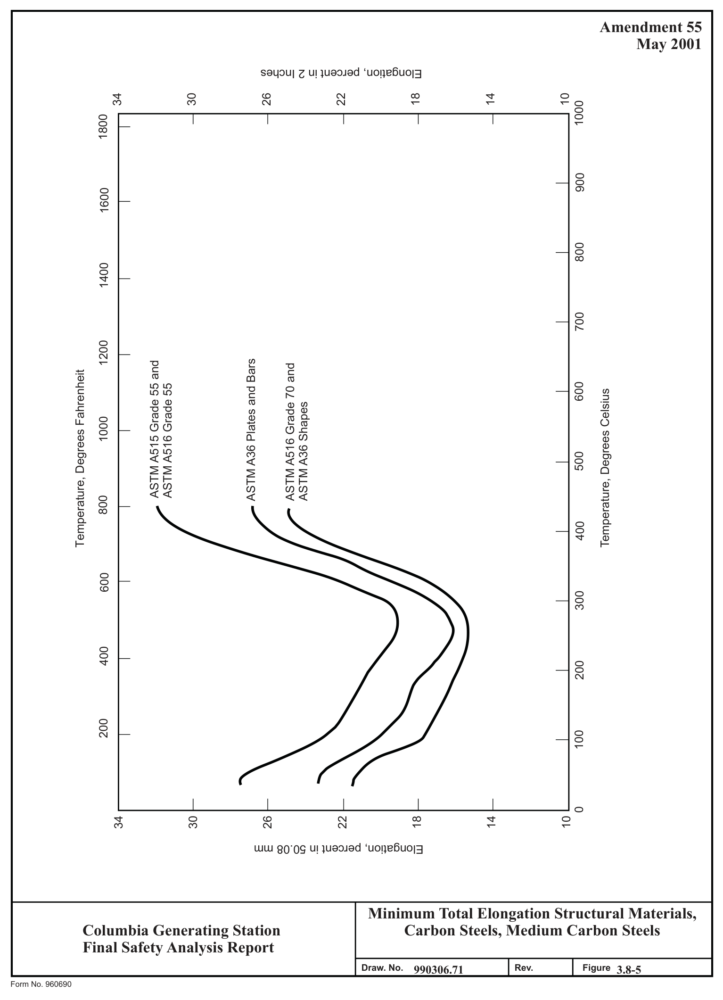

*figure on PDF page 667*

[Vector original (SVG, lossless): fig_page-667.svg](../figures/fig_page-667.svg)

<!-- labels/text on this figure page -->
Amendment 55 May 2001
Elongation, percent in 2 Inches
34 30 26 22 18 14 10 1000 1800
900 1600
800 1400
700
1200 ASTM A36 Plates and Bars ASTM A515 Grade 55 and ASTM A516 Grade 70 and Temperature, Degrees Fahrenheit 600 ASTM A516 Grade 55 Temperature, Degrees Celsius ASTM A36 Shapes 1000
500
800 400
600 300
400 200
200 100
0 34 30 26 22 18 14 10
Elongation, percent in 50.08 mm
Minimum Total Elongation Structural Materials, Carbon Steels, Medium Carbon Steels Columbia Generating Station Final Safety Analysis Report Draw. No. 990306.71 Rev. Figure 3.8-5 Form No. 960690

<!-- p.668 -->
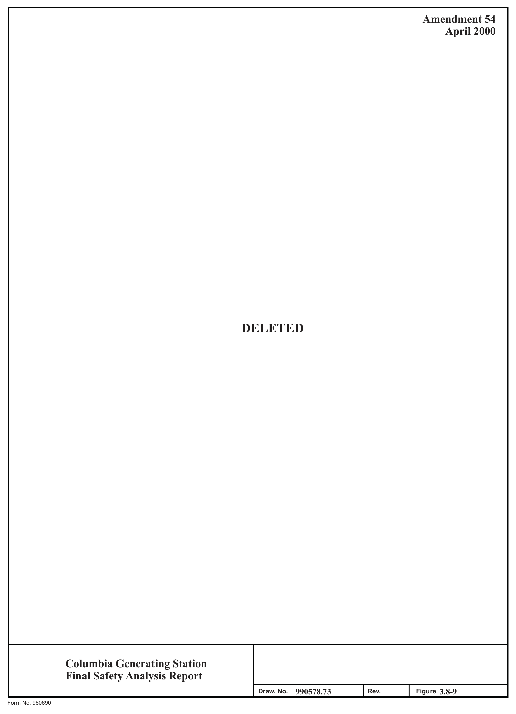

*figure on PDF page 668*

[Vector original (SVG, lossless): fig_page-668.svg](../figures/fig_page-668.svg)

<!-- labels/text on this figure page -->
Amendment 54 April 2000
DELETED
Columbia Generating Station Final Safety Analysis Report I I Draw. No. 990578.73 Rev. Figure 3.8-9 Form No. 960690

<!-- p.669 -->
Amendment 57 December 2003

-l.14801~0 .SEARllJG BIJSMIN~ &~. !IJ5M1""(:a 0.t), CARTll,.IC>GE 11\G,°' DIA. • EAL r\OIJ.SI~ 5LEE."le .::GRDO"E D\A.
l"MoM. DIA. 5~.A~ ~,~, J('a~T .. I' SlUG Pi.f.&S .fll 4 weL0 Id SMOWM .1t.l 5EAl ~ovs 1N.C:i 5lti.~e OR.\\.L S\4,"f Hal! 1\,1'2.U ONi SIDE OF :!,£A\. ~US\t-.16 - 4 _ '"~ 1018 _.,_
-3LE£"E t ee1~1war ~- ~,..-t---tJ...Jlt"t"l!I C.A'llTt106E

#### ~ QUAD R\ ""1~ SEA.\.S, SHAFT 4 &eAR\\i-1~
: &U5"4UJGI <:At:i1R.\DGE MUSl &E i\.lO~oU~\.41."i' \.V!R\CA1 ED WIT!,4 A . C:EL\.ULOSi i5i£~4C~51ER OILCOMPOU~g
- &UC" AS ·Gt\.VAceuE· t¥1~~UFACiU~ED .
S'l' "fl,,li CONSOl.l'l>A,.it> VAC:UIJM CO, \i\,"c,,-'ZDUNC•'2~'a"LoNG M!X ~!AR\liLGi CJ,P.11itlDC.~. FlDcME5TE:R M,"'C'.CQR ~QUAU . . • ' !tXIC.ET SET SCREW "H/MALF DQ(:r ftlllJl O,N\.OJ:. se.u:. LCX:lf-ll-lGi I> .Sl\.lt;O'-ll. RU89'Efl. M•1 llli\A\. 10 e,E TEST oa. EQUAi..)
10 51• I 'a1•1~•scR~weo .&GI ..

MEAD PIPE PLUG (MA.l'l SA/ ..-r-;;.:~~~~°;:.p....;~....::;,r-------+-- H.o......_.~~A

l&'Z PE• A.~.\.d.E. SA ISZ "I,/

#### OR. F304 5TAIULE'&S STL,.-
fYco~iA11iJM E )JT 8ULKHEAt> OR l''Ai~.
SUL.1"1-1 eAP SEAL l40US\ij(:a SLEE.ve .-5'EAi.-~US\~Ca ~L!E)'I - -l~~l\JC:I eusMIUa ~12.T~JOG& . P.ciAIMl>-lC. ~\"4C:1

Personnel Access Airlock - Typical Bulkhead Columbia Generating Station Mechanical Penetration Final Safety Analysis Report Draw. No. 020552.10 Rov. Figure 3.8-14

FQ!IJl No. !l®!>OO

#### LUCN-02-000
<!-- p.670 -->
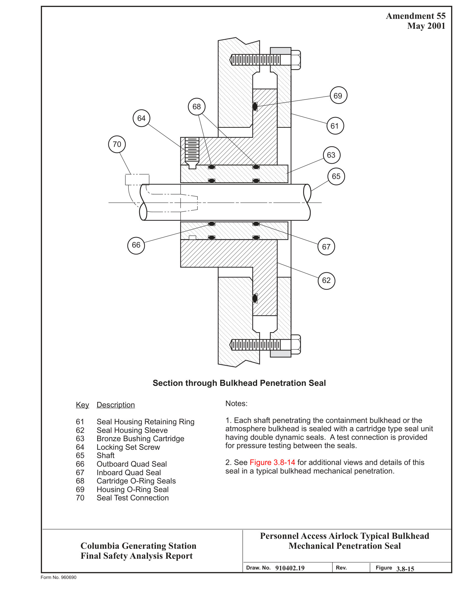

*figure on PDF page 670*

[Vector original (SVG, lossless): fig_page-670.svg](../figures/fig_page-670.svg)

<!-- labels/text on this figure page -->
Amendment 55 May 2001
69 68 64 61
70 63
65
--,
- _I
66 67
62
Section through Bulkhead Penetration Seal
Notes: Key Description
1. Each shaft penetrating the containment bulkhead or the 61 Seal Housing Retaining Ring atmosphere bulkhead is sealed with a cartridge type seal unit 62 Seal Housing Sleeve having double dynamic seals. A test connection is provided 63 Bronze Bushing Cartridge for pressure testing between the seals. 64 Locking Set Screw
65 Shaft
2. See Figure 3.8-14 for additional views and details of this 66 Outboard Quad Seal seal in a typical bulkhead mechanical penetration. 67 Inboard Quad Seal
68 Cartridge O-Ring Seals
69 Housing O-Ring Seal
70 Seal Test Connection
Personnel Access Airlock Typical Bulkhead Mechanical Penetration Seal Columbia Generating Station Final Safety Analysis Report 910402.19 Draw. No. Rev. Figure 3.8-15 Form No. 960690

<!-- p.671 -->
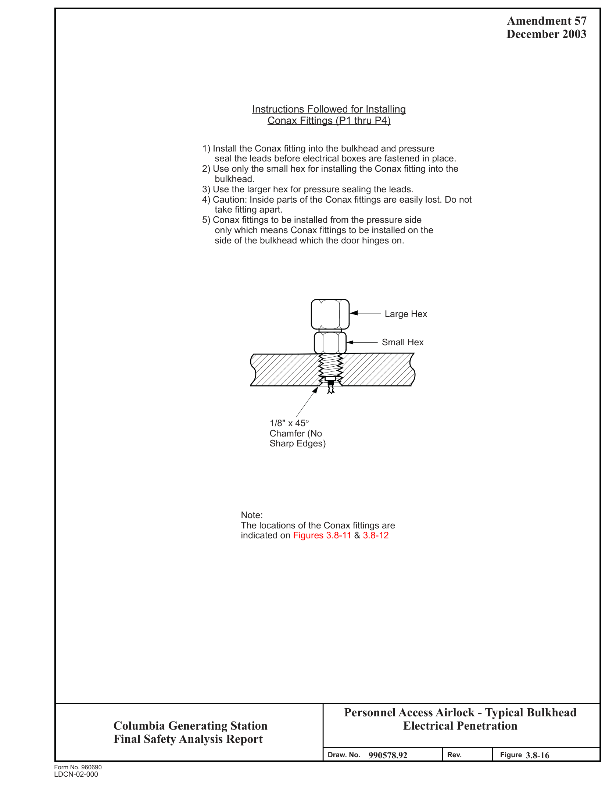

*figure on PDF page 671*

[Vector original (SVG, lossless): fig_page-671.svg](../figures/fig_page-671.svg)

<!-- labels/text on this figure page -->
Amendment 57 December 2003
Instructions Followed for Installing Conax Fittings (P1 thru P4)
1) Install the Conax fitting into the bulkhead and pressure seal the leads before electrical boxes are fastened in place.
2) Use only the small hex for installing the Conax fitting into the bulkhead.
3) Use the larger hex for pressure sealing the leads.
4) Caution: Inside parts of the Conax fittings are easily lost. Do not take fitting apart.
5) Conax fittings to be installed from the pressure side only which means Conax fittings to be installed on the side of the bulkhead which the door hinges on.
Large Hex
Small Hex
1/8" x 45° Chamfer (No Sharp Edges)
Note:
The locations of the Conax fittings are indicated on Figures 3.8-11 & 3.8-12
Personnel Access Airlock - Typical Bulkhead Electrical Penetration Columbia Generating Station Final Safety Analysis Report Draw. No. 990578.92 Rev. Figure 3.8-16 Form No. 960690
LDCN-02-000

<!-- p.672 -->
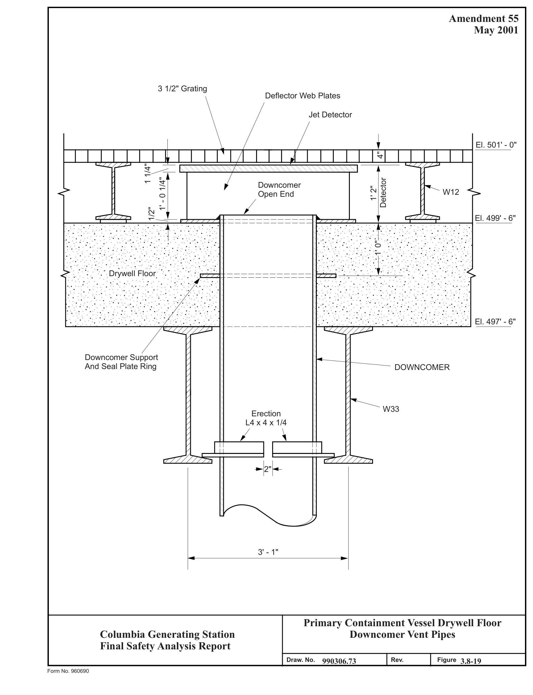

*figure on PDF page 672*

[Vector original (SVG, lossless): fig_page-672.svg](../figures/fig_page-672.svg)

<!-- labels/text on this figure page -->
Amendment 55 May 2001
3 1/2" Grating Deflector Web Plates
Jet Detector
El. 501' - 0" 4"
1 1/4" 1' - 0 1/4" Detector Downcomer 1' 2" W12 Open End
1/2" El. 499' - 6"
1' 0"
Drywell Floor
El. 497' - 6"
Downcomer Support And Seal Plate Ring
DOWNCOMER
W33 Erection L4 x 4 x 1/4
2"
3' - 1"
Primary Containment Vessel Drywell Floor Downcomer Vent Pipes Columbia Generating Station Final Safety Analysis Report Draw. No. 990306.73 Rev. Figure 3.8-19 Form No. 960690

<!-- p.673 -->
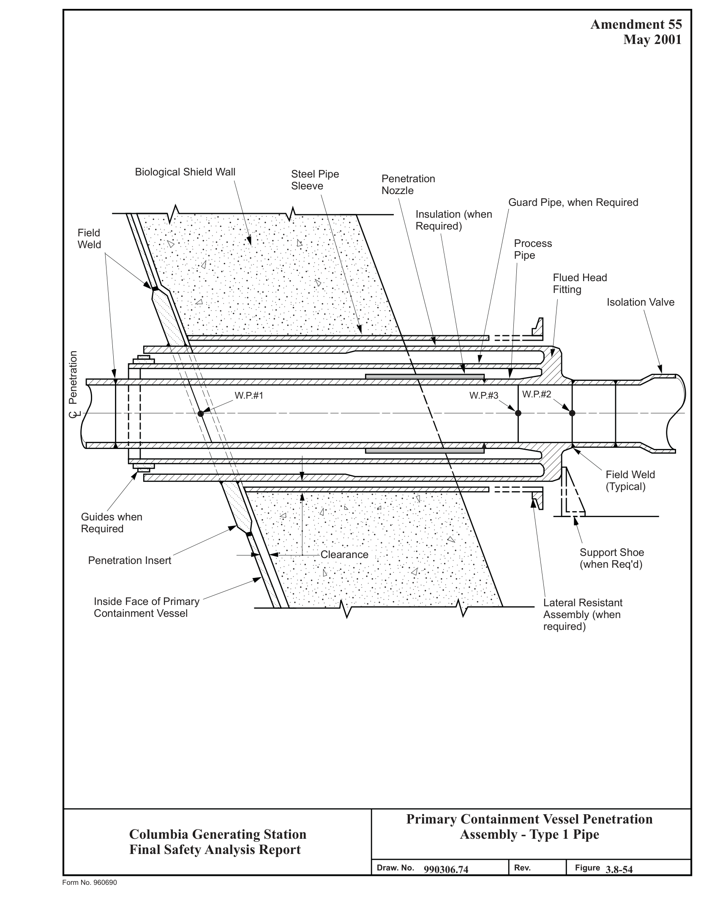

*figure on PDF page 673*

[Vector original (SVG, lossless): fig_page-673.svg](../figures/fig_page-673.svg)

<!-- labels/text on this figure page -->
Amendment 55 May 2001
Biological Shield Wall Steel Pipe Penetration Sleeve Nozzle Guard Pipe, when Required Insulation (when Required)
Field Process Weld Pipe
Flued Head Fitting Isolation Valve
. •.• .. ; : : : : •. . ·.• .. ; : : : : ·. • .
Penetration W.P.#1 W.P.#3 W.P.#2
CL
Field Weld
(Typical)
Guides when Required
Support Shoe Clearance Penetration Insert
(when Req'd)
Inside Face of Primary Lateral Resistant Containment Vessel Assembly (when required)
Primary Containment Vessel Penetration Assembly - Type 1 Pipe Columbia Generating Station Final Safety Analysis Report Draw. No. 990306.74 Rev. Figure 3.8-54 Form No. 960690

<!-- p.674 -->
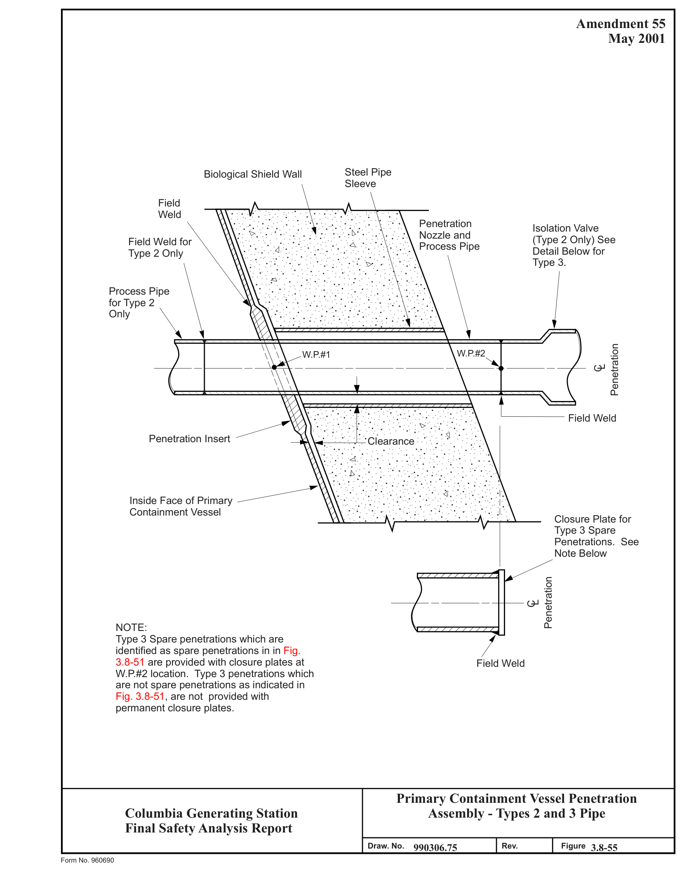

*figure on PDF page 674*

[Vector original (SVG, lossless): fig_page-674.svg](../figures/fig_page-674.svg)

<!-- labels/text on this figure page -->
Amendment 55 May 2001
Steel Pipe Biological Shield Wall Sleeve Field Weld Penetration Isolation Valve Nozzle and
(Type 2 Only) See Field Weld for Process Pipe Detail Below for Type 2 Only Type 3.
Process Pipe for Type 2 Only
Penetration W.P.#2 W.P.#1 CL
Field Weld
Penetration Insert Clearance
Inside Face of Primary Containment Vessel Closure Plate for Type 3 Spare Penetrations. See Note Below
Penetration CL
NOTE:
Type 3 Spare penetrations which are identified as spare penetrations in in Fig.
3.8-51 are provided with closure plates at Field Weld W.P.#2 location. Type 3 penetrations which are not spare penetrations as indicated in Fig. 3.8-51, are not provided with permanent closure plates.
Primary Containment Vessel Penetration Assembly - Types 2 and 3 Pipe Columbia Generating Station Final Safety Analysis Report Draw. No. 990306.75 Rev. Figure 3.8-55 Form No. 960690

<!-- p.675 -->
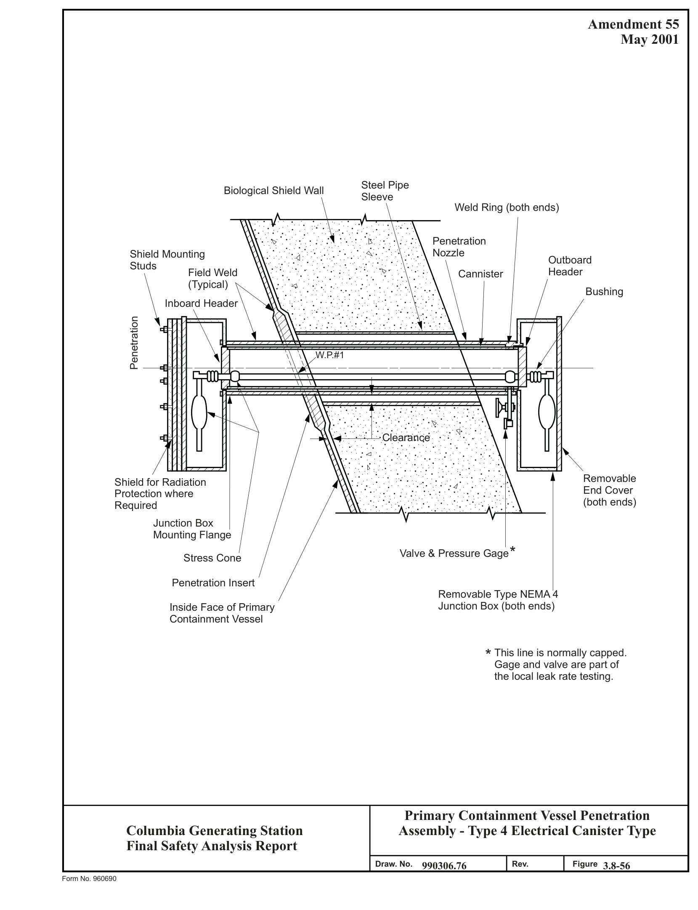

*figure on PDF page 675*

[Vector original (SVG, lossless): fig_page-675.svg](../figures/fig_page-675.svg)

<!-- labels/text on this figure page -->
Amendment 55 May 2001
Steel Pipe Biological Shield Wall Sleeve Weld Ring (both ends)
Penetration Nozzle Shield Mounting Outboard Studs Header Cannister Field Weld
(Typical)
Bushing Inboard Header
Penetration W.P.#1
Clearance
Removable Shield for Radiation End Cover Protection where
(both ends)
Required Junction Box Mounting Flange * Valve & Pressure Gage Stress Cone
Penetration Insert Removable Type NEMA 4 Junction Box (both ends)
Inside Face of Primary Containment Vessel
* This line is normally capped.
Gage and valve are part of the local leak rate testing.
Primary Containment Vessel Penetration Assembly - Type 4 Electrical Canister Type Columbia Generating Station Final Safety Analysis Report Draw. No. 990306.76 Rev. Figure 3.8-56 Form No. 960690

<!-- p.676 -->
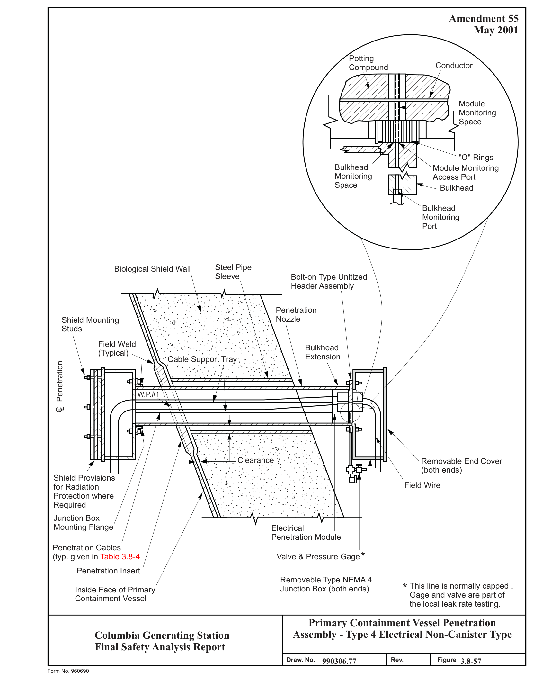

*figure on PDF page 676*

[Vector original (SVG, lossless): fig_page-676.svg](../figures/fig_page-676.svg)

<!-- labels/text on this figure page -->
Amendment 55 May 2001
Potting Conductor Compound
Module Monitoring Space
"O" Rings Bulkhead Module Monitoring Monitoring Access Port Space Bulkhead
Bulkhead Monitoring Port
Steel Pipe Biological Shield Wall Sleeve Bolt-on Type Unitized Header Assembly
Penetration Nozzle Shield Mounting Studs Field Weld Bulkhead
(Typical)
Extension Cable Support Tray Penetration W.P.#1
CL
_-.::\:·.::"::\\~:\ Clearance Removable End Cover ·;. • .
..
(both ends)
Shield Provisions
··. · . . • . . .... • ..
Field Wire for Radiation .. . .. • ... •• .. :··. ; • Protection where Required Junction Box Mounting Flange Electrical Penetration Module Penetration Cables * Valve & Pressure Gage
(typ. given in Table 3.8-4 Penetration Insert Removable Type NEMA 4 * This line is normally capped .
Junction Box (both ends) Inside Face of Primary Gage and valve are part of Containment Vessel the local leak rate testing.
Primary Containment Vessel Penetration Assembly - Type 4 Electrical Non-Canister Type Columbia Generating Station Final Safety Analysis Report Draw. No. 990306.77 Rev. Figure 3.8-57 Form No. 960690

<!-- p.677 -->
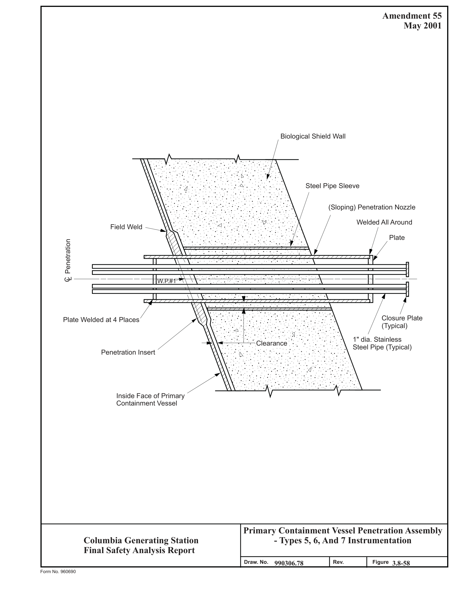

*figure on PDF page 677*

[Vector original (SVG, lossless): fig_page-677.svg](../figures/fig_page-677.svg)

<!-- labels/text on this figure page -->
Amendment 55 May 2001
Biological Shield Wall
. .. ..
. ·· . .. . · ••• . ...
Steel Pipe Sleeve
..... ··. · . . •
. . . . · .. •• . •. ~ .. ·: .•.
. . . . . .
(Sloping) Penetration Nozzle ~ : ·
..• ; : ...... _: ...... ~
Welded All Around Field Weld Plate CL Penetration W.P.#1
Closure Plate Plate Welded at 4 Places
(Typical)
1" dia. Stainless Clearance Steel Pipe (Typical)
Penetration Insert
: · .. : ; : : : : •.
Inside Face of Primary Containment Vessel
Primary Containment Vessel Penetration Assembly Columbia Generating Station
- Types 5, 6, And 7 Instrumentation Final Safety Analysis Report Draw. No. 990306.78 Rev. Figure 3.8-58 Form No. 960690

<!-- p.678 -->
Amendment 55 Horizontal "Buna N" Seal with Space Between Seals Yoke Bolt May 2001 42" O.D. 600# "Tube Turn" Double Bolt 275°F Furnished with Double "O" Ring 600 H 41" I.D. Suitable for 45 P.S.I. @ CL

Horizontal Hinged Closure Hinge Bolt Nut Reactor Bldg.
EL. 471'-0" Floor Slab

Biological Shield Wall Field Weld All Around Pipe Sleeve Clearance

Top OG Grating EL. 472'-4" Inside Face of Primary Containment Vessel Steel Platform Penetration X-51 Penetration Insert Vertical C Azimuth 155° 1/2" 4'-10" Arc Meas. On 42'-10 1/2" Radius R= 1'-8 1/2" 1'-1 3/8" 2'-2 3/4" L

R= 3'-0"

EL. 473'-6" EL. 473'-4"

Primary Containment Vessel Suppression Chamber Access Hatch Columbia Generating Station Final Safety Analysis Report 0 1 0 1 2 1.6 6 8.3 - 5 9 Figure D r a w . N o .
R e v .
Form No. 960690

<!-- p.679 -->
Amendment 57 Equipment Hatch December 2003 EL. 506'-1 1/2" Steel Floor Plate Steel Floor Plate EL. 502'-3 3/4" EL. 501'-0"

#### SECTION B-B
CL

1'-0" 1'-0" Inside Radius= 6'-3" 3" Inside Radius= 6'-3" Guide Plate EL. 499'-6"

Inside Face of Primary Containment Vessel Penetration Insert EL. 501'-0" W

---- ---- ----
---- SECTIONAL ELEVATION ---- ---- ---- -J f 11'-3 3/4" Penetration X-15 I Removable Platform EL. 501'-0" B EL. 502'-3 3/4" Biological Shield Wall Steel Pipe Sleeve Clearance Radius= 12'-6" ---- ---- ---- ---- EL. 502-7 1/4" 6 3/8" 1 3/8" Removal CRD Hatch

2 1/4" 64-15/16" Stiffener 1'-3" 3'-4 13/16" Plate Equally Hex Bolts 64-2" ø 1'-11" Spaced Square Head 1 1/4" Lifting Lug Pipe Plug 1" Plate 1/8" ø l EL. 501'-0" Reactor Building A Floor

24" O.D. 600# "Tube Turn" Double Bolt Horizontal Lifting Lug Hinged Closure Vertical Azimuth 252° CL

#### ELEVATION A-A
2'-0" 13'-5 1/2" CL

2'-0"

CL 15/16" Stiffener Plate Lifting Lug

Primary Containment Vessel Equipment Hatch and CRD Removal Hatch Columbia Generating Station Final Safety Analysis Report 0 1 0 1 2 1.6 9 8.3 - 6 0 Figure D r a w . N o .
R e v .
Form No. 960690

<!-- p.680 -->
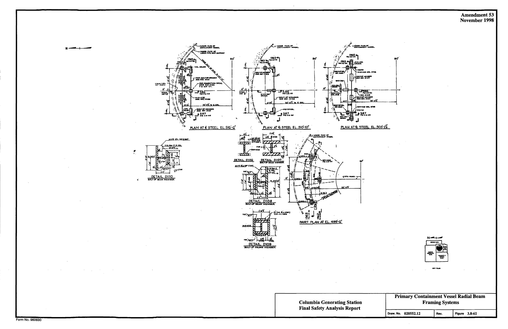

*figure on PDF page 680*

<!-- labels/text on this figure page -->
Amendment 53 November 1998
- H r 9d I I I I ·-t d' • !i o· ™
~~ ....
·1
-:~ '•1i ii, :\ ~ \\
{ -'\ ', .....,_......_ ___ u·-o~ !9 'CO&,. =·=-~
-=~":'- ~
, ........ ..
·. ~ . • S57
•• ;\ !--~ PLAN AT t STEf.L E.LSIG Pl.Al.I AT<I;. 5TEEL EL.503'·2i -:~ 0·G• n:~·. ,..~ µ
DETAIL D110
MlLT•UP Iii.AM MI.M61A
DETAIL D108
1111111,follf' - M&Mll&A.
1
-l;t _[ N-+- ffJl~I .~ll4 Di.TAIL. 0109
Primary Containment Vessel Radial Beam Columbia Generating Station Framing Systems Final Safety Analysis Report Draw. No. 020552.12 Figure 3.8-61 Rev.
Form No. 960690

<!-- p.681 -->
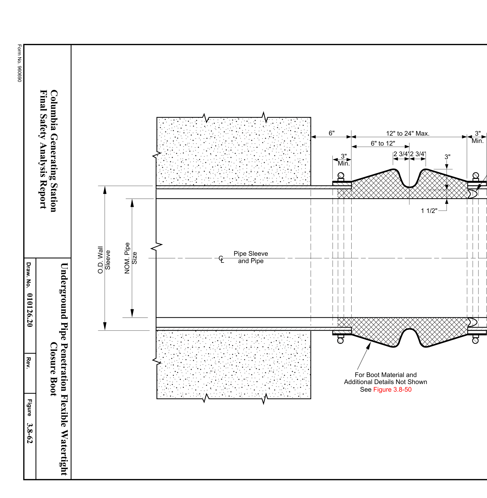

*figure on PDF page 681*

[Vector original (SVG, lossless): fig_page-681.svg](../figures/fig_page-681.svg)

<!-- labels/text on this figure page -->
~ Amendment 55 May 2001
Pipe. Where Casting is Not As Shown for Split Casing Used, Bond Boot Material
(\- / Directly to Pipe \ Williamson U-Seal \ ~V QQ.<>'>~~~~~~~~ ll Min.
3"
I I I I I I I I I I I I I I I I I I I I
3"
1 1/2" 12" to 24" Max.
Additional Details Not Shown 2 3/4'2 3/4' For Boot Material and See Figure 3.8-50 6" to 12" ~~~~QQ"i» I
Min.
3"
6"
I • ... . •. • · -'v:- -· · ... . ·. · · _\ .. · · ... . ·. ·1 .-.-· \ -<-~-: > .-: . ·._ :: : .:.- _. \ ./.-: > .-: . ·._ ::-:-. :_- _. ·:":"; -?~-: ~-. I I I I I I I / \}\_: :// ::}::.· •• :/ .\::}::.· I 1>/-::_-_·:·:_:; :~~ ;<.:j.·:_:_._:_:y.::_-_·:·:_:; :~~ ;<.::/ .:.<-/-::_--:·:_:: ··. •. :.·:·.·· -: .·.··.·:•' .•· ... :.·:·.·· -: .·.··.•.•' .•· ... . .
•· ... . · ·.:.•· . ...
. . : . ·_.:;_ ·. :: •••• :_ ;_ . · ... _ .. ;_· ..
Pipe Sleeve and Pipe . ·.: .
··::.:::.
CL . .• ... _.. ·_.:i-.· .. :.·_.:;_.
.
~-r-::_-·:":_i::~·;<.-
. • ....
.
Size NOM. Pipe
Sleeve O.D. Wall
Underground Pipe Penetration Flexible Watertight Columbia Generating Station Closure Boot Final Safety Analysis Report 0 1 0 1 2 2.6 0 8.3 - 6 2 Figure D r a w . N o .
R e v .
Form No. 960690

