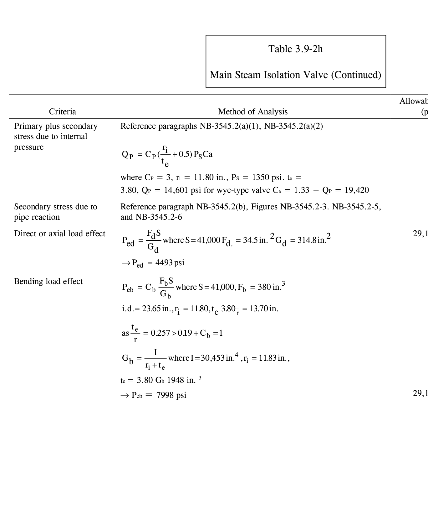
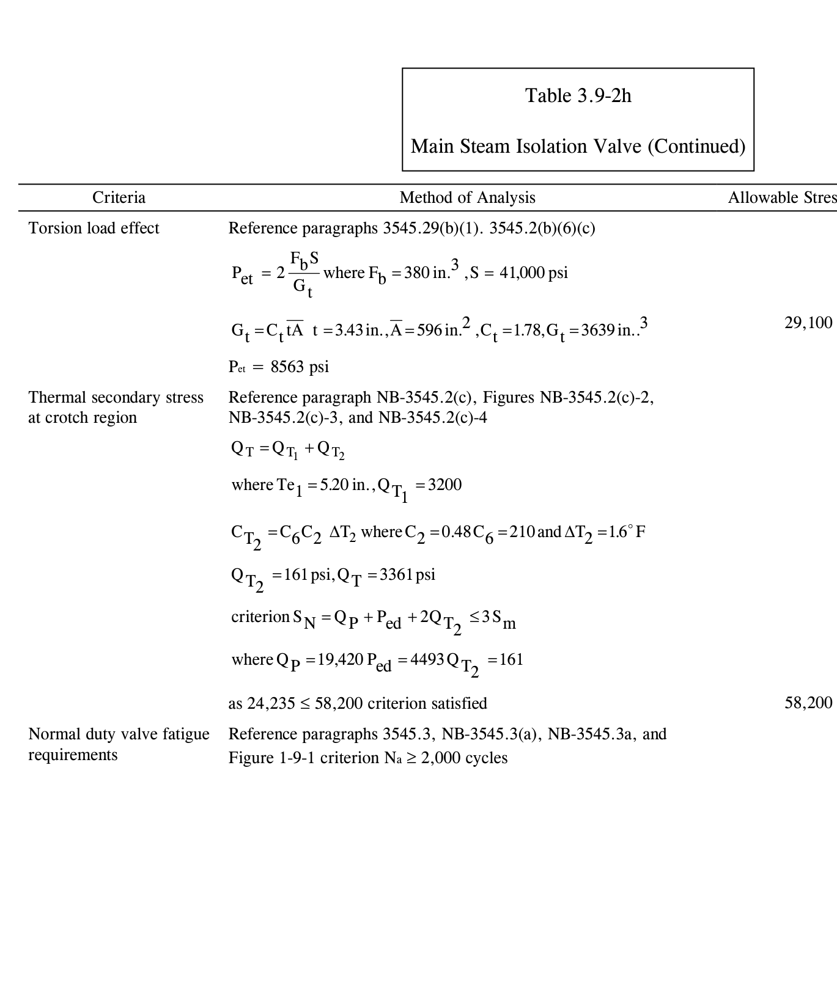
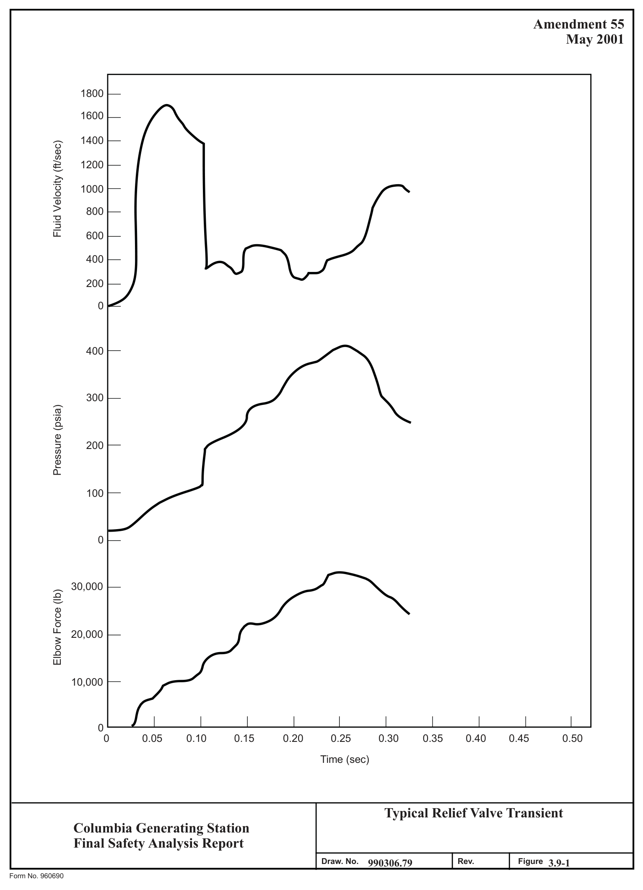
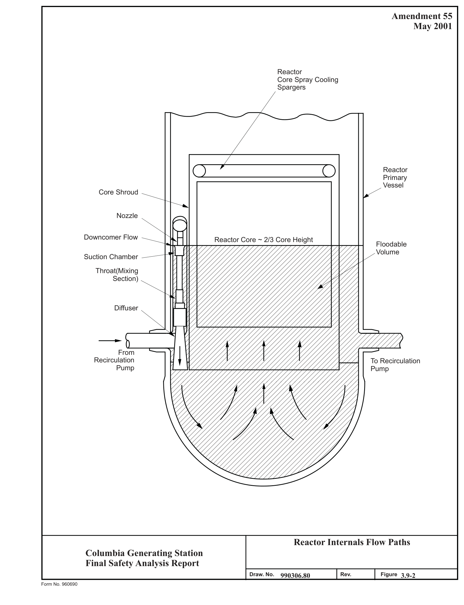
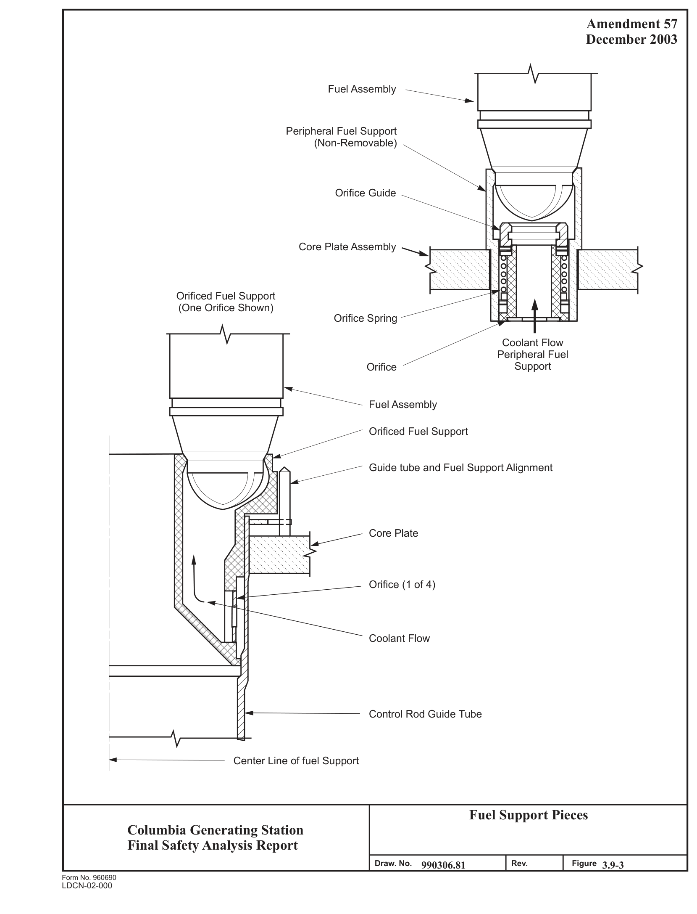
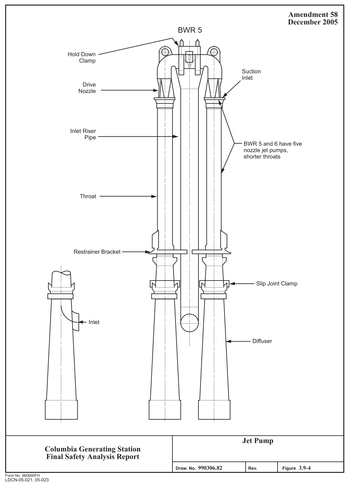
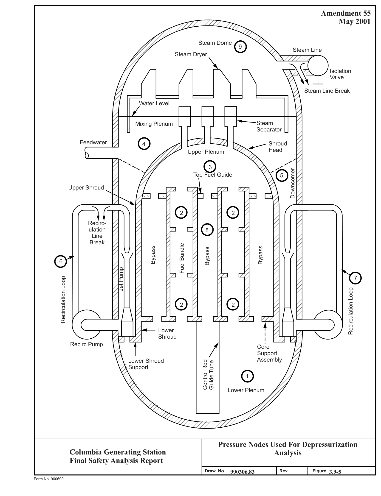

# 3.9 MECHANICAL SYSTEMS AND COMPONENTS

> Columbia Generating Station FSAR — Chapter 03: Design of Structures, Components, Equipment and Systems
> Source: `03_chapter-660-1910.pdf`, PDF pages 682–858 (of 1251)
> Amendment 67 compilation (individual pages carry varying amendment dates)

---
<!-- p.682 -->
### 3.9 MECHANICAL SYSTEMS AND COMPONENTS
#### 3.9.1 SPECIAL TOPICS FOR MECHANICAL COMPONENTS
##### 3.9.1.1 Design Transients
This section shows the transients that are used in the design of the ASME Boiler and Pressure Vessel (B&PV) Code Section III, Class 1, control rod drive (CRD) components, reactor assembly including core supports and reactor internals, main steam, and recirculation systems.
The number of cycles or events for each transient is included. The design transients shown in this section are included in the design specifications for the components. Transients or combinations of transients are classified with respect to the component operating condition categories identified as “normal,” “upset,” “emergency,” “faulted,” or “testing” in the ASME Code if applicable. (The first four operating condition categories correspond to Service Levels A, B, C, and D, respectively, which are used in Section III after the Winter 1976 Addenda.)

###### 3.9.1.1.1 Control Rod Drive Transients
The normal and test service load cycles used for design purposes for the life of the CRDs are as follows:

Transient Category Cycles

a. Reactor startup/shutdown Normal/upset 250

b. Vessel pressure tests Normal/upset 65

c. Vessel overpressure Normal/upset 10

d. Scram test plus startup scrams Normal/upset 300

e. Operational scrams Normal/upset 300

f. Jog cycles Normal/upset 30,000

g. Shim/drive cycles Normal/upset 1000

In addition to the above cycles, the following have been considered in the design of the CRD.

h. Scram with inoperative buffer Normal/upset 10

<!-- p.683 -->
i. Scram with stuck control Normal/upset 1 blade faulted

j. Operating Basis Earthquake Normal/upset 10
(OBE)*

k. Safe Shutdown Earthquake Faulted 1
(SSE)**

All ASME Class 1 components of the CRD have been analyzed according to ASME Code Section III.

The capability of the CRDs to withstand emergency and faulted conditions is verified by test rather than analysis.

###### 3.9.1.1.2 Control Rod Drive Housing and In-Core Housing Transients
The number of transients, their cycles, and classification as considered in the design and fatigue analysis of the CRD housing and in-core housing are as follows:

Transient Category Cycles

a. Normal startup and shutdown Normal/upset 250

b. Vessel pressure tests Normal/upset 65

c. Vessel overpressure tests Normal/upset 10

d. Interruption of feedwater flow Normal/upset 80

e. Scram Normal/upset 200

f. OBE Normal/upset 10

g. SSE Faulted 1

* The frequency of occurrence of this transient would indicate emergency category. However, for conservatism, the OBE condition was analyzed as an upset condition. Ten peak OBE cycles are postulated.

** SSE is a faulted condition; however, in the stress analysis, it was treated as emergency with lower stress limits.

<!-- p.684 -->
CRD Housing Only

h. Stuck rod scram Normal/upset 1

i. Scram no buffer Normal/upset 10

###### 3.9.1.1.3 Hydraulic Control Unit Transients
The normal and test service load cycles used in the design and fatigue analysis for the life of the hydraulic control unit (HCU) are as follows:

Transient Category Cycles

a. Normal startup and shutdown Normal/upset 250

b. Vessel pressure tests Normal/upset 65

c. Vessel overpressure tests Normal/upset 10

d. Scram tests (cold)
Normal/upset 300

e. Operational scrams (hot) Normal/upset 300

f. Jog cycles Normal/upset 30,000

g. Drive cycles Normal/upset 1000

h. Scram with stuck scram Normal/upset 1 discharge valve

i. OBE Normal/upset 10

j. SSE faulted 1

###### 3.9.1.1.4 Core Support and Reactor Internals Transients
The normal and test service load cycles used for the design and fatigue analysis for the life of the core support and reactor internals are shown in Table 3.9-1.

###### 3.9.1.1.5 Nuclear Steam Supply System Scope Main Steam System Transients
The following transients are considered in the stress analysis of the main steam piping between the reactor pressure vessel (RPV) and the outer containment isolation valve:

<!-- p.685 -->
Transient Category Cycles

a. Startup Normal 250

b. Loss of feedwater pump Upset 20 isolation valves closed

c. Scrams Upset 150

d. Shutdown Normal 250

e. Reactor overpressure delayed Emergency 1 scram

f. Single safety/relief valve (SRV) Upset 8 blowdown

g. Automatic blowdown Emergency 1

h. Design pressure leak test Test 65

i. OBE Upset 50

j. 1.25 P hydrotest Test 3

k. SSE Faulted 1

l. Pipe rupture Faulted 1

###### 3.9.1.1.6 Recirculation System Transients
The following transients are considered in the stress analysis of the recirculation piping:

Transient Category Cycles

a. Startup Normal 250

b. Turbine roll and increase to Normal Included in power Startup Transient

c. Loss of feedwater heater Upset 10

<!-- p.686 -->
d. Partial feedwater heater bypass Upset 70

e. Scrams Upset 150

f. Shutdown Normal 250

g. Loss of feedwater pump Upset 20 isolation valves closed

h. Reactor overpressure with Emergency 1 delayed scram

i. Single SRV blowdown Upset 8

j. Automatic blowdown Emergency 1

k. Design pressure leak test Test 65

l. OBE Upset 50

m. 1.25 P hydrotest Test 3

n. SSE Faulted 1

o. Pipe rupture Faulted 1

###### 3.9.1.1.7 Reactor Assembly Transients
The reactor assembly includes the RPV, support skirt, and shroud support. The cycles listed in Table 3.9-1 were specified in the reactor assembly design and fatigue analysis.

###### 3.9.1.1.8 Main Steam Isolation Valve Transients
The main steam isolation valves (MSIV) are designed for the following service conditions and thermal cycles:

Transient Category Cycles

a. Preoperational at 100°F Normal/upset 150

b. Startup (heating 100F)
Normal/upset 250

<!-- p.687 -->
c. Shutdown

Transient Category Cycles

Normal/upset1 1. Cooling cycles 250 at 100°F/hr 540°F to 375°F

Normal/upset1
2. Cooling cycles 250 at 270°F/hr 375°F to 330°F

Normal/upset1
3. Cooling cycles 250 at 100°F/hr 330°F to 100°F

d. Scram cooling cycles Upset 150 at 100°F/hr

e. Emergency and faulted transients

1. 546°F to 281°F in 15 sec Emergency/faulted 1

2. 546°F to 375°F Emergency/faulted 1 in 3.3 minutes

375°F to 281°F Emergency/faulted 1 at 300°F/hr

3. 546°F to 375°F Emergency/faulted 8 in 10 minutes

4. 375°F to 281°F Emergency/faulted 8 at 100°F/hr

5. 546°F to 583°F in 2 sec Emergency/faulted 1

583°F to 538°F Emergency/faulted 1 in 30 sec

538°F to 400°F Emergency/faulted 1 at 100°F/hr

Note 1: One of the 250 cooling cycles is categorized as Emergency

<!-- p.688 -->
400°F to 546°F Emergency/faulted 1 at 100°F/hr

6. 561°F to 500°F Emergency/faulted 10 in 7 minutes

7 500°F to 400°F Emergency/faulted 10 at 100°F/hr

8. 400°F to 546°F Emergency/faulted 10 at 100°F/hr

###### 3.9.1.1.9 Main Steam Safety/Relief Valve Transients
The transients used in the analysis of the SRV are as follows:

Transient Category Cycles

a. Preoperational and inservice Normal/upset 150 testing (100°F/hr)

b. Startup (100°F/hr)
Normal/upset 250 and pressure increase
(0 psig to 1000 psig)

c. Shutdown (100°F/hr, Normal/upset 250 pressure decrease to 0 psig)

d. Scram Upset 150

e. System pressure and temperature Emergency/faulted 1 decay from 1000 psig 546°F to 35 psig and 281°F within 15 sec

f. System temperature change from Emergency/faulted 1 546°F to 375°F within 3.3 minutes and from 375°F to 281°F at a rate of 300°F/hr.
Pressure change from 1000 psig to 35 psig.

<!-- p.689 -->
November 1998

g. System temperature change Normal/upset 8 from 546°F to 375°F within 10 minutes and from 375°F to 281°F at a rate of 100°F/hr.
Pressure change from 1000 psig to 35 psig.

h. System temperature change Emergency/faulted 1 from 546°F to 583°F within 2 sec, from 583°F to 538°F within 30 sec, and from 538°F to 400°F and return to 546°F at a rate of 100°F/hr. Pressure change from 1000 psig to 1350 psig thence to 240 psig and return to 1000 psig.

i. System temperature changes, Emergency/faulted 10 greater than 30°F, from 561°F to 500°F within 7 minutes and from 500°F to 400°F and return to normal operating temperature of 546°F at a rate of 100°F/hr. Pressure change from 1000 psig to 1180 psig to 240 psig and return to normal operating of 1000 psig.

Paragraph NB-3552 of ASME Code Section III excludes various transients and provides means for combining those which are not excluded. Review and approval of the equipment supplier’s certified calculation provides assurance of proper accounting of the specified transients.

###### 3.9.1.1.10 Recirculation Flow Control Valve Transients
The following pressure and temperature transients were considered in the design of the recirculation system flow control valve (this valve has been blocked open):

Transient Category Cycles

a. Startup (100°F/hr) heating Normal/upset 300 rate 70°F to design temperature

Small temperature changes (29°F) b. Normal/upset 600

<!-- p.690 -->
c. 50°F step changes Normal/upset 200

d. Safety/relief valve blowdowns Normal/upset 30
(single valve) (546°F to 375°F in 10 minutes)

e. Safety valve transient Normal/upset 1
(110% of design pressure)

f. Installed hydrotests

1. 1300 psig Testing 65

2. 1670 psig Testing 3

g. Automatic blowdown Emergency 2
(546°F to 281°F in 15 sec)

h. Improper start of pump in Emergency 1 cold loop (130°F step to 546°F for 15 sec)

###### 3.9.1.1.11 Recirculation Pump Transients
The following transients are listed in the design specification as a requirement for design considerations. However, a submitted certified analysis considering thermal stresses was not required. The vendor was required to submit a certification of compliance. The submitted certified design calculations only considered pressure transient. Nozzle piping loads were considered in accordance with the following ASME paragraph:

“The pump case shall be designed to withstand secondary stresses due to piping reactions in accordance with ASME Code, Section III, 1971.”

Transient Category Cycles

a. Heatup and cooldown Normal/upset 300 at 100°F/hr

b. +29°F temperature changes Normal/upset 600

c. +50°F temperature changes Normal/upset 200

<!-- p.691 -->
d. RPV pressure transients Normal/upset 1 to 110% design pressure

e. SRV blowdowns Emergency 8

f. Improper pump startup, Emergency 1 100°F to 552°F in 15 sec

Cooling transient 552F to g. Faulted 1 281°F in 15 sec

h. Hydrotest to 1300 psig Testing 130

i. Hydrotest to 1670 psig Testing 3

###### 3.9.1.1.12 Recirculation Gate Valve Transients
The following transients are considered in the design of the recirculation gate valves:

Transient Cycles

a. 50°F to 575°F at 100°F/hr 300

b. +29°F between limits of 50°F and 600 575°F, instantaneous

c. +50°F between limits of 50°F and 200 546°F, instantaneous

d. 546°F to 375°F, instantaneous 30

e. 546°F to 281°F, instantaneous 2

f. 130°F to 546°F, instantaneous 1

g. 110% design pressure at 575°F 1

h. 1300 psi at 100°F installed 65 hydrostatic test

i. 1670 psi at 100°F installed 3 hydrostatic test

<!-- p.692 -->
November 1998

###### 3.9.1.1.13 Balance-of-Plant Transients
The transients used in design and fatigue analysis of the balance-of-plant (BOP) components are listed in Table 3.9-1 with the exception that 50 maximum stress cycles due to an OBE are used in fatigue evaluations. Table 3.9-1 also shows the thermal cycles which are tracked to provide an indication of reactor cumulative fatigue usage.

##### 3.9.1.2 Nuclear Steam Supply System Computer Programs Used in Original Analysis
The following italicized text is historical information provided in the FSAR to support the application for an operating license. As such, it is not subject to change and therefore has not been verified for accuracy or updated during the FSAR upgrade process per 10 CFR 50.71(e).

The following sections discuss computer programs used in the analysis of the major safety-related components. (Computer programs were not used in all components; hence not all components are listed.) The nuclear steam supply system (NSSS) programs can be divided into two categories.

Vendor Programs

The verification of the following two groups of vendor programs is ensured by contractual requirements between GE and the vendor. The quality assurance procedure of these proprietary programs used in the design of N-stamped equipment is in full compliance with 10 CFR 50, Appendix B.

CB&I Programs

711 GENOZZ 948 NAPALM 1027 846 781 KALNINS 979 ASFAST 766 TEMAPR 767 PRINCESS 928 TGRV 962E962A 984 992 GASP 1037 DUNHAM’S 1335 1606 and 1657 HAP

<!-- p.693 -->
November 1998

1635 953 955 MESHPLOT 1028 1038

GE Programs

The verification of the following GE programs has been performed in accordance with the requirements of 10 CFR 50, Appendix B. Evidence of the verification of input, output, and methodology is documented in GE Design Record Files.

#### MASS.
#### SNAP (MULTISHELL)
#### HEATER
#### PISYS
#### ANSI7
#### SAP4G
#### FTFLG01
#### ANSYS
#### BSTIF01
#### RTRMEC
#### POSUM
#### BILRD
#### RVFOR
#### TSFOR
#### LUGST
PDA

#### DYSEA
#### SPECA
#### SEISM
###### 3.9.1.2.1 Reactor Pressure Vessel and Internals
3.9.1.2.1.1 Reactor Pressure Vessel. CB&I Programs are used to analyze the RPV. Detailed descriptions are provided in Sections 3.9.1.2.1.1.1 through 3.9.1.2.1.1.20.

3.9.1.2.1.1.1 CB&I Program 7-11 - “GENOZZ”. The GENOZZ computer program is used to proportion barrel and double taper type nozzles to comply with the specifications of the ASME Code, Section III and contract documents. The program will either design such a configuration or analyze the configuration input into it. If the input configuration will not comply with the specifications, the program will modify the design and redesign it to yield an acceptable result.

<!-- p.694 -->
November 1998

3.9.1.2.1.1.2 CB&I Program 9-48 - “NAPALM”. The basis for the program NAPALM, Nozzle Analysis Program-All Loads Mechanical, is to analyze nozzles for mechanical loads and find the maximum stress intensity and location. The program analyzes at specified locations from the point of application of the mechanical loads. At each location the maximum stress intensity is calculated for both the inside and outside surfaces of the nozzle. The program gives the maximum stress intensity for both the inside and outside surfaces of the nozzle, as well as its angular location around the circumference of the nozzle from the 0 reference location. The principal stresses are also printed. The stresses resulting from each component of loading
(bending, axial, shear, and torsion) are printed, as well as the loadings which caused these stresses.

3.9.1.2.1.1.3 CB&I Program 1027. This program is a computerized version of the analysis method contained in the “Welding Research Council Bulletin F107, December 1965.”

Part of this program provides for the determination of the shell stress intensities (S) at each of four cardinal points at both the upper and lower shell plate surfaces (ordinarily considered outside and inside surfaces) around the perimeter of a loaded attachment on a cylindrical or spherical vessel. With the determination of each S, there is also determined the components of that S (two normal stresses and one shear stress). This program provides the same information as the manual calculation and the input data is essentially the geometry of the vessel and attachment.

3.9.1.2.1.1.4 CB&I Program 846. This program computes the required thickness of a hemispherical head with a large number of circular parallel penetrations by means of the area replacement method in accordance with the ASME Code, Section III.

In cases where the penetration has a counterbore, the thickness is determined so that the counterbore does not penetrate the outside surface of the head.

3.9.1.2.1.1.5 CB&I Program 781 - “KALNINS”. This program is a thin elastic shell program for shells of revolution. This program was developed by Dr. A. Kalnins of Lehigh University.
Extensive revisions and improvements have been made by Dr. J. Endicott to yield the CB&I version of this program.

The basic method of analysis was published by Professor Kalnins in the Journal of Applied Mechanics, Volume 31, September 1964, pages 467 through 476.

The KALNINS thin shell program (Program 781) is used to establish the shell influence coefficient and to perform detail stress analysis of the vessel. The stresses and the deformations of the vessel can be computed for any combination of the following axisymmetric loading:

<!-- p.695 -->
November 1998

a. Preload condition, b. Internal pressure, and c. Thermal load.

3.9.1.2.1.1.6 CB&I Program 979 - “ASFAST”. ASFAST Program (Program 979) performs the stress analysis of axisymmetric, bolted closure flanges between head and cylindrical shell.

3.9.1.2.1.1.7 CB&I Program 766 - “TEMAPR”. This program will reduce any arbitrary temperature gradient through the wall thickness to an equivalent linear gradient. The resulting equivalent gradient will have the same average temperature and the same temperature-moment as the given temperature distribution. Input consists of plant thickness and actual temperature distribution. The output contains the average temperature and total gradient through the wall thickness. The program is written in FORTRAN IV language.

3.9.1.2.1.1.8 CB&I Program 767 - “PRINCESS”. The PRINCESS computer program calculates the maximum alternating stress amplitudes from a series of stress values by the method in Section III of the ASME Pressure Vessel Code.

3.9.1.2.1.1.9 CB&I Program 928 - “TGRV”. The TGRV program is used to calculate temperature distributions in structures or vessels. Although it is primarily a program for solving the heat conduction equations, some provisions have been made for including radiation and convection effects at the surfaces of the vessel.

The TGRV program is a greatly modified version of the TIGER heat transfer program written about 1958 at Knolls Atomic Power Laboratory, by A. P. Bray. There have been many versions of TIGER in existence including TIGER II, TIGER II B, TIGER IV, and TIGER V, in addition to TGRV.

The program utilizes an electrical network analogy to obtain the temperature distribution of any given system as a function of time. The finite difference representation of the three-dimensional equations of heat transfer are repeatedly solved for small time increments and continually summed. Linear mathematics are used to solve the mesh network for every time interval. Included in the analysis are the three basic forms of heat transfer, conduction, radiation, and convection, as well as internal heat generation.

Given any odd-shaped structure, which can be represented by a three-dimensional field, its geometry and physical properties, boundary conditions, and internal heat generation rates, TGRV will calculate and give as output the steady state or transient temperature distributions in the structure as a function of time.

3.9.1.2.1.1.10 CB&I Program 962 - “E0962A”. Program E0962A is one of a group of programs (E0953A, E1606A, E0962A, E0992N, E1037N, and E0984N) which are used

<!-- p.696 -->
together to determine the temperature distribution and stresses in pressure vessel components by the finite element method.

Program E0962A is primarily a plotting program. Using the nodal temperatures calculated by program E1606A or Program E0928A, and the node and element cards for the finite element model, it calculates and plots lines of constant temperature (isotherms). These isotherm plots are used as part of the stress report to present the results of the thermal analysis. They are also very useful in determining at which points in time the thermal stresses should be determined.

In addition to its plotting capability the program can also determine the temperatures of some of the nodal points by interpolation. This feature of the program is intended primarily for use with the compatible TGRV and finite element models that are generated by program E0953A.

3.9.1.2.1.1.11 CB&I Program 984. Program 984 is used to calculate the stress intensity of the stress differences, on a component level, between two different stress conditions. The calculation of the stress intensity of stress component differences (the range of stress intensity)
is required by Section III of the ASME Code.

3.9.1.2.1.1.12 CB&I program 992 - “GASP”. The GASP computer program, originated by Professor E. L. Wilson of the University of California at Berkeley, uses the finite element method to determine the stresses and displacements of plane or axisymmetric structures of arbitrary geometry and is written in FORTRAN IV. For a detailed account, see Reference 3.9-1.

As mentioned above, the program determines the stresses and displacements of plane or axisymmetric structures using the finite element method. The structures may have arbitrary geometry and have linear or non-linear material properties. The loadings may be thermal, mechanical, accelerational, or a combination of these.

The structure to be analyzed is broken up into a finite number of discrete elements or “finite-elements” which are interconnected at finite number of “nodal-points” or “nodes.” The actual loads on the structure are simulated by statically equivalent loads acting at the appropriate nodes. The basic input to the program consists of the geometry of the stress-model and the boundary conditions. The program then gives the stress components at the center of each element and the displacements at the nodes, consistent with the prescribed boundary conditions.

3.9.1.2.1.1.13 CB&I Program 1037 - “DUNHAM’S”. DUNHAM’S program is a finite ring element stress analysis program. It will determine the stresses and displacements of axisymmetric structures of arbitrary geometry subjected to either axisymmetric loads or non-axisymmetric loads represented by a Fourier series.

<!-- p.697 -->
November 1998

This program is similar to the GASP program (CB&I 992). The major differences are that DUNHAM’S can handle non-axisymmetric loads (which requires that each node have three degrees of freedom) and the material properties for DUNHAM’S must be constant. As in GASP, the loadings may be thermal, mechanical, and accelerational.

3.9.1.2.1.1.14 CB&I Program 1335. To obtain stresses in the shroud support, the baffle plate must be made a continuous circular plate. The program makes this modification and allows the baffle plate to be included in CB&I program 781 as two isotropic parts and an orthotropic portion at the middle where the diffuser holes are located.

3.9.1.2.1.1.15 CB&I Programs 1606 and 1657 - “HAP”. The HAP program is an axisymmetric nonlinear heat analysis program. It is a finite element program and is used to determine nodal temperatures in a two-dimensional or axi-symmetric body subjected to transient disturbances. Programs 1606 and 1657 are identical except that 1606 has a larger storage area allocated and can thus be used to solve larger problems. The model for program 1606 is compatible with CB&I stress programs 992 and 1037.

3.9.1.2.1.1.16 CB&I Program 1635. Program 1635 offers three features to aid the stress analyst in preparing a stress report.

a. Generates punched card input for program 767 (PRINCESS) from the stress output of program 781 (KALNINS),

b. Writes a stress table in a format such that it can be incorporated into a final stress report, and

c. Has the option to remove through-wall thermal bending stress and report these results in a stress table similar to the one mentioned above.

###### 3.9.1.2.1.1.17 CB&I Program 953. The program is a general purpose program, which does the following:

a. Prepares input cards for the thermal model,

b. Prepares the node and element cards for the finite element model, and

c. Sets up the model in such a way that the nodal points in the TGRV model correspond to points in the finite element model. They have the same number so that there is no possibility of confusion in transferring temperature data from one program to the other.

3.9.1.2.1.1.18 CB&I Program 955 - “MESHPLOT”. This program plots input data used for finite element analysis. The program plots the finite element mesh in one of three ways:

<!-- p.698 -->
November 1998

without labels, with node labels, or with element labels. The output consists of a listing and a plot. The listing gives all node points with their coordinates and all elements with their node points. The plot is a finite element model with the requested labels.

3.9.1.2.1.1.19 CB&I Program 1028. This program calculates the necessary form factors for the nodes of the model which simulates heat transfer by radiation. Inputs are shape and dimensions of the head-to-skirt knuckle junction. The program is limited to junctions with a toroidal knuckle part.

3.9.1.2.1.1.20 CB&I Program 1038. This program calculates the loads required to satisfy the compatibility between the shroud baffle plate and the jet pump adapters in the RPV.

3.9.1.2.1.2 Reactor Internals. The following computer programs are used in the analysis of the core support structures and other safety-related reactor internals: MASS, SNAP
(MULTISHELL), GASP, NOHEAT, FINITE, DYSEA, SHELLS, HEATER, FAP-71, and CREEP-PLAST. Detailed descriptions of these programs are provided in 4.1.

###### 3.9.1.2.2 Nuclear Steam Supply System Piping
3.9.1.2.2.1 Piping Analysis Program/PISYS. PISYS is a computer code specialized for piping load calculations. It utilizes selected stiffness matrices representing standard piping components, which are assembled to form a finite element model of a piping system. The technique relies on dividing the pipe model into several discrete substructures, called pipe elements, which are connected to each other via nodes called pipe joints. It is through these joints that the model interacts with the environment, and loading of the structure becomes possible. PISYS is based on the linear classical elasticity in which the resultant deformation and stresses are proportional to the loading, and the superposition of loading is valid.

PISYS has a full range of static and dynamic analysis options which include distributed weight, thermal expansion, differential support motion modal extraction, response spectra, and time history analysis by modal or direct integration. The PISYS program has been benchmarked against five Nuclear Regulatory Commission piping models for the option-of-response-spectrum analysis and the results are documented in Reference 3.9-2.

3.9.1.2.2.2 Component Analysis/ANSI7. The ANSI7 computer program determines stress and accumulative usage factors in accordance with NB-3600 of the ASME Code, Section III. The program was written to perform stress analysis in accordance with the ASME Code sample problem, and has been verified by reproducing the results of the sample problem analysis.

3.9.1.2.2.3 Relief Valve Discharge Pipe Forces Computer Program/RVFOR. The relief valve discharge pipe connects the relief valve to the suppression pool. When the valve is opened, the transient fluid flow causes time dependent forces to develop in the pipe wall. This computer

<!-- p.699 -->
November 1998

program computes the transient fluid mechanics and the resultant pipe forces using the method of characteristics.

3.9.1.2.2.4 Turbine Stop Valve Closure/TSFOR. The TSFOR program computes the time history forcing function in the main steam piping due to turbine stop valve closure. The program utilizes the method of characteristics to compute fluid momentum and pressure loads at each change in pipe section or direction.

3.9.1.2.2.5 Integral Attachment/LUGST. The computer program “LUGST” evaluates the stresses in the pipe wall that are produced by loads applied to the integral attachments.

3.9.1.2.2.6 Piping Dynamic Analysis Program/PDA. The pipe whip analysis was performed using the PDA computer program. PDA is a computer program used to determine the response of a pipe subjected to the thrust force occurring after a pipe break. The program treats the situation in terms of generic pipe break configuration, which involves a straight, uniform pipe fixed at one end and subjected to a time-dependent thrust force at the other end. A typical restraint used to reduce the resulting deformation is also included at a location between the two ends. Nonlinear and time-dependent stress-strain relations are used to model the pipe and the restraint. Similar to the popular elastic-hinge concept, bending of the pipe is assumed to occur only at the fixed end and at the location supported by the restraint.

Shear deformation is also neglected. The pipe bending moment-deflection (or rotation) relation used for these locations is obtained from a static nonlinear cantilever beam analysis. Using moment-rotation relations nonlinear equations of motion are formulated using energy considerations and the equations are numerically integrated in small time steps to yield the time-history of the pipe motion.

###### 3.9.1.2.3 Recirculation Pump
No computer programs were used in the design of the recirculation pumps.

###### 3.9.1.2.4 Emergency Core Cooling System Pumps and Motors
3.9.1.2.4.1 Rotor Assembly Analysis Program/RTRMEC. RTRMEC is a computer program which calculates and displays results of mechanical analysis of motor rotor assembly when acted upon by external forces at any point along shaft (rotating parts only). The shaft deflection due to magnetic and centrifugal forces was analyzed. The calculation for the seismic condition assumes that the motor is operating and that the seismic, magnetic, and centrifugal forces all act simultaneously and in phase on the rotor-shaft assembly. Note that the distributed rotor assembly weight is lumped at the various stations, with the shaft weight at a station being the sum of one-half the weight of the incremental shaft length just before the station, plus one-half the weight of the adjacent incremental shaft length just after the station.
Bending and shear effects are accounted for in the calculations.

<!-- p.700 -->
November 1998

3.9.1.2.4.2 Structural Analysis Program/SAP4G. SAP4G is used to analyze the structural and functional integrity of the emergency core cooling system (ECCS) pump/motor systems. This is a general structural analysis program for static and dynamic analysis of linear elastic complex structures. The finite element displacement method is used to solve the displacements and stresses of each element of the structure. The structure can be composed of unlimited number of three-dimensional truss, beam, plate, shell, solid, plate strain-plane stress, and spring elements that are axisymmetric. The program can treat thermal and various forms of mechanical loading. The dynamic analysis includes mode superposition, time history, and response spectrum analysis. Seismic loading and time-dependent pressure can be treated. The program is versatile and efficient in analyzing large and complex structural systems. The output contains displacements of each nodal point as well as stresses at the surface of each element.

3.9.1.2.4.3 Effects of Flange Joint Connections/FTFLG01. The flange joints connecting the pump bowl castings are analyzed using FTFLG01. This program uses the local forces and moments determined by SAP4G to perform flat flange calculations in accordance with the rules set forth in Appendix XI, Article XI-3000, and Appendix L of Section III of the ASME Boiler and Pressure Vessel Code.

3.9.1.2.4.4 Structural Analysis of Discharge Head/ANSYS. ANSYS is used to analyze the pump discharge head flange and bolting taking into account the prying action developed by the flat face contact surface. The program is described in detail in Section 3.12.

3.9.1.2.4.5 Beam Element Data Processing/POSUM. POSUM is a computer code designed to process SAP generated beam element data for pump or heat exchanger models. The purpose is to determine the load combination that would produce the maximum stress in a selected beam element. It is intended for use on residual heat removal (RHR) heat exchangers with four nozzles or ECCS pumps with two nozzles.

###### 3.9.1.2.5 Residual Heat Removal Heat Exchangers
3.9.1.2.5.1 Structural Analysis Program/SAP4G. SAP4G is used to analyze the structural and functional integrity of the RHR heat exchangers. The description of this program is provided in Section 3.9.1.2.4.2.

3.9.1.2.5.2 Local Stiffness Calculations/BSTIF01. BSTIF01 is used to estimate the local stiffness of the heat exchanger shell at the attachment point of the supports. The method used in this program is based on the shell stiffness calculations by P. P. Bijlaard as groundwork for Welding Research Council Bulletin 107. The results of BSTIF01 are used to determine equivalent beam properties of the lower and upper heat exchanger support bracket to shell attachments included in the finite element model of the heat exchanger.

<!-- p.701 -->
November 1998

###### 3.9.1.2.5.3 Calculation of Shell Attachment Parameters and Coefficients/BILRD.

BILRD is used to calculate the shell attachment parameters and coefficients used in the stress analysis of the support to shell junction. The method, per Welding Research Council Bulletin No. 107, is implemented in BILRD to calculate local membrane stress due to the support reaction loads on the heat exchanger shell.

3.9.1.2.5.4 Beam Element Data Processing/POSUM. POSUM is used to process SAP generated beam element data. The description of this program is provided in Section
3.9.1.2.4.5.

###### 3.9.1.2.6 Dynamic Loads Analysis
3.9.1.2.6.1 Dynamic Analysis Program/DYSEA. DYSEA simulates a beam model in the annulus pressurization dynamic analysis. A detailed description of DYSEA is provided in Section 4.1. DYSEA employs a preprocessor program named GEAPL. GEAPL corrects pressure, time histories into time varying loads, and forcing functions for DYSEA. The overall resultant forces and moments time histories at specified points of resolution can also be obtained from GEAPL.

3.9.1.2.6.2 Acceleration Response Spectrum Program/SPECA. SPECA generates acceleration response spectrum for an arbitrary input time history of piece-wise linear accelerations, i.e., to compute maximum acceleration responses for a series of single-degree-of-freedom systems subjected to the same input. It can accept acceleration time histories from a random file. It also has the capability of generating the broadened/enveloped spectra when the spectral points are generated equally spaced on a logarithmic scale axis of period/frequency. This program is also used in seismic and SRV transient analysis.

3.9.1.2.6.3 Fuel Support Loads Program/SEISM. SEISM02 computes the vertical fuel support loads using the component element methods in dynamics. The methodology is based on the Reference 3.9-3.

###### 3.9.1.2.7 Balance-of-Plant Computer Programs
A list of the principal computer programs used in dynamic and static analyses in the BOP scope is given in Section 3.12. With the exception of the Burns and Roe developed program, these programs are recognized and widely used in the industry with a history of successful applications. The Burns and Roe developed program listed in Section 3.12 is documented, verified, and maintained by Burns and Roe as described in SRP 3.9.1, II2.b.

3.9.1.2.7.1 S/RVDAM4. S/RVDAM4 (Safety/Relief Valve Discharge Analyses Model 4) is a computer model which simulates the transient flow of steam, air, and water in a SRV discharge

<!-- p.702 -->
April 2000

line (SRVDL) for a time period of approximately 0.5 sec after SRV opening. The model calculates transient fluid properties, forces, and thermal distributions in the SRVDL.

The piping system is initially filled with air and a water slug at the exit submerged in the suppression pool. Upon SRV actuation, steam enters the line and compresses the air which expels the water slug. The piping system is represented by two models: (a) a gas (steam and air), and (b) a water slug, which are coupled by common pressure and velocity at the air-water interface. The gas flow equations are expressed in finite difference form solved with the method of characteristics. Provision for axial variation in flow area is included. Motion of the water slug is solved with a one-dimensional ordinary differential form of the momentum equation is integrated axially to determine flowrate and displacement.

S/RVDAM4 is based on the analytical model described in the GE Report NEDE-23749-P
(Reference 3.9-4) and GE computer code RVFOR04 described in NEDE-24695
(Reference 3.9-5).

Program Version and Computer

Currently S/RVDAM version 4 is being used by Burns and Roe, Inc. in conjunction with a CDC Computer. The system used was CDC 175.

Extent of Application

S/RVDAM4 is a transient piping fluid analysis program which began development in 1975 and is supported by Burns and Roe. It has been used on several in-house projects.

Test Problems

S/RVDAM4 has been benchmarked against problems provided in Reference 3.9-4 and 3.9-5 which have been compared with in-plant test data from Quad Cities, Monticello, and CAORSO boiling water reactor (BWR) plants.

##### 3.9.1.3 Experimental Stress Analysis
When experimental stress analysis is used in lieu of analytical methods for Seismic Category I ASME Code items, the requirements for experimental testing enumerated in the ASME Code which are applicable for the specific components under test shall be applied. When testing is required for Seismic Category I non-ASME Code parts account shall be taken of size effects and dimensional tolerances which exist between the actual part and the test part or parts as well as differences which may exist in the ultimate strength or other governing material properties of the actual part and the tested parts, to ensure that the loads obtained from the test are a realistic or conservative representation of the load carrying capability of the actual structure under the postulated loading.

<!-- p.703 -->
April 2000

###### 3.9.1.3.1 Experimental Stress Analysis of Piping Components
The following are the only NSSS components on which experimental stress analysis is used.
These components have been tested to verify their design adequacy:

a. Pipe whip restraints, and b. Snubbers.

Descriptions of the whip restraint and snubber tests are discussed in Sections 3.6 and 3.9.3.4, respectively.

###### 3.9.1.3.2 Orificed Fuel Support, Vertical, and Horizontal Load Tests
The orificed fuel support experimental stress analysis is discussed in Section 3.9.1.4.2.4.

##### 3.9.1.4 Considerations for the Evaluation of Faulted Conditions
All Seismic Category I equipment is evaluated for the faulted loading conditions. However, emergency stress limits rather than faulted stress limits are used in many cases. In all cases, with the exception of the refueling platform, the calculated stresses are within allowable limits.
The slight overstress calculated in one member of the refueling platform under the emergency condition (which is greater than the faulted condition in this instance). (See Table 3.9-2s.)
This calculated overstress has been judged to be acceptable because of the conservatism in the calculations and because functional use of the equipment is not impaired with the deformation of only one member of the platform. The following paragraphs show examples of the treatment of faulted conditions for the major components on a component by component basis.
Additional discussion of faulted analysis can be found in Sections 3.9.3 and 3.9.5 and Table 3.9-2.

Sections 3.9.2.2 and 3.7 discuss the treatment of dynamic loads resulting from the postulated seismic and hydrodynamic events. Section 3.9.2.5 discusses the dynamic analysis of the reactor internals under faulted conditions including additional blowdown forces. Deformations under faulted conditions have been evaluated in critical areas. In all cases the identified design limits, such as clearance limits, are not violated.

###### 3.9.1.4.1 Control Rod Drive System Components
3.9.1.4.1.1 Control Rod Drives. The ASME III Code components of the CRD have been analyzed for faulted conditions. The CRD component which is analyzed for the faulted condition is the indicator tube. The method of analysis and the maximum stresses for this component for various plant operating conditions are given in Table 3.9-2u.

<!-- p.704 -->
November 1998

The design adequacy of noncode components of the CRD has been verified by analysis and extensive testing programs on components parts, specially instrumented prototype drives, and production drives. The testing included postulated abnormal events as well as the service life cycle listed in Section 3.9.1.1.1.

3.9.1.4.1.2 Hydraulic Control Unit. The HCU has been qualified by test for upset and faulted conditions. The test response spectra (TRS) for the HCU enveloped the CGS required response spectra (RRS) for all frequencies ranging from 5 Hz to 100 Hz. The CGS unique HCU structural support configuration was considered in this evaluation.

3.9.1.4.1.3 Control Rod Drive Housing. A stress analysis of the CRD housing demonstrated that the calculated stresses were below the allowable stresses for all loading cases. The emergency condition calculated stresses were less severe than the normal and upset conditions.
The calculated and allowable stresses at various loading conditions are shown in Table 3.9-2v.

###### 3.9.1.4.2 Standard Reactor Internal Components
3.9.1.4.2.1 Control Rod Guide Tube. The maximum calculated stress on the control rod guide tube occurs at the flange during the faulted conditions. The faulted limit is 2.4 Sm where Sm is 16,000 psi at the design temperature of 575°F per ASME Code Section III, Table I-1.2 and F 1322-1. Table 3.9-2aa shows the calculated stresses are within the allowable limits.

3.9.1.4.2.2 Jet Pump. The elastic analysis for the jet pump faulted conditions shows that the maximum stress occurs at the riser brace and is 54,450 psi. The maximum allowable for this condition per ASME Code Section III, Subsection NG, is 3.6 Sm or 60,480 psi. Table 3.9-2w shows the loads summary.

3.9.1.4.2.3 Low-Pressure Coolant Injection Coupling. The maximum stress during the faulted condition on the low-pressure coolant injection (LPCI) coupling is bounded by the allowable limit of 3.6 Sm. Table 3.9-2y shows that the calculated stresses are within the allowable limits.

3.9.1.4.2.4 Orificed Fuel Support. Due to its complex configuration, a series of vertical and horizontal load tests were performed on the orificed fuel support (OFS) to verify the design.
Results from these tests indicate that the component seismic and hydrodynamic loading of the OFS are well below the stress limit allowables with a safety margin of 1.26 for normal and upset and 1.5 for faulted conditions. (The allowable stress limits were arrived at by applying a 0.65 quality factor to the ASME Code allowables of 1.5 Sm for upset and 1.5 x 0.7 Su for faulted.)

<!-- p.705 -->
November 1998

###### 3.9.1.4.3 Reactor Pressure Vessel Assembly
The RPV assembly includes the RPV, support skirt, and shroud support. For the faulted conditions, RPV assembly is evaluated using elastic-analysis methods. For the support skirt and shroud support, buckling is evaluated for the compressive load. Table 3.9-2a shows that the calculated stresses are within the allowable limits.

###### 3.9.1.4.4 Core Structure
The dynamic evaluations for faulted conditions of the core structure are discussed in Section 3.9.5. The calculated and allowable stresses are summarized in Table 3.9-2b.

###### 3.9.1.4.5 Main Steam Isolation, Recirculation Gate, and Safety/Relief Valves
Standard design rules, as defined in ASME Code Section III, are utilized in the analysis of pressure boundary components of Seismic Category I valves. Conventional, elastic stress analysis was used to evaluate components not covered by the ASME Code. The Code allowable stresses were applied to determine acceptability of structure under applicable loading conditions including the faulted condition. Maximum stresses and highest calculated loads are summarized in Tables 3.9-2g, 3.9-2h, and 3.9-2j; and Tables 3.9-2d and 3.9-2e, respectively, for the SRVs, MSIV, and recirculation gate valves.

###### 3.9.1.4.6 Recirculation System Flow Control Valve
The recirculation system flow control valve was analyzed for faulted conditions using the elastic analysis criteria from the ASME Code Section III. The analysis and results for various plant operating conditions are summarized in Tables 3.9-2e and 3.9-2f.

###### 3.9.1.4.7 Main Steam and Recirculation Piping
For main steam and recirculation system piping, elastic analysis methods are used for evaluating faulted loading conditions. The allowable stresses using elastic techniques are obtained from ASME Code Section III, Appendix F, “Rules for Evaluation of Faulted Conditions,” and these are above elastic limits. Additional information on the main steam and recirculation piping is in Tables 3.9-2d and 3.9-2e, respectively.

###### 3.9.1.4.8 Nuclear Steam Supply System Pumps, Heat Exchangers, and Turbine
The recirculation, emergency core cooling system (ECCS), reactor core isolation cooling
(RCIC), and standby liquid control (SLC) pumps, residual heat removal (RHR) heat exchangers, and RCIC turbine have been analyzed for the faulted loading conditions identified in Section 3.9.1.1. In all cases, stresses were within the elastic limits. The analytical

<!-- p.706 -->
methods, stress limits, and allowable stresses are shown in Table 3.9-2 under the respective equipment table.

###### 3.9.1.4.9 Control Rod Drive Housing Supports
The stress criteria, loadings, calculated stresses, and stress limits for faulted condition for the CRD housing supports are shown in Table 3.9-2ac.

###### 3.9.1.4.10 Fuel Storage Racks
The stress criteria, loadings, calculated stresses, and stress limits for the faulted conditions for the new fuel storage racks are shown in Table 3.9-2s.

###### 3.9.1.4.11 Fuel Assembly Including Channels
The BWR fuel assembly design bases and analytical methods including those applicable to the faulted conditions are contained in References 3.9-6, 3.9-8, 3.9-19 and 3.9-21.

###### 3.9.1.4.12 Refueling Equipment
Refueling and servicing equipment (Table 3.9-2s) which is important to safety is classified per the requirements of 10 CFR 50, Appendix A. This equipment, the failure of which is prevented from degrading a safety related component is listed in Table 3.2-1 and is classified to the appropriate Seismic Category. This equipment was subjected to an elastic dynamic finite element analysis to generate loadings. This analysis utilizes appropriate seismic floor response spectra and combines loads at frequencies up to 33 Hz for seismic and 60 Hz for hydrodynamic loads in three directions. Imposed stresses were generated and combined for normal, upset, and faulted conditions. Stresses were compared, depending on the specific safety class of the equipment, to allowables specified in ASME, ANSI, AISC, or other industrial codes and standards. The loading conditions, acceptance criteria, calculated, and allowable stresses are shown in Table 3.9-2s.

###### 3.9.1.4.13 Balance-of-Plant Equipment
With the exception of pipe whip restraint design, the faulted condition was evaluated in accordance with ASME Section III by elastic systems and components analysis. Inelastic stress analysis methods were not utilized for design of any of these components. Pipe whip restraint design is described in Section 3.6.2.

<!-- p.707 -->
May 2001

#### 3.9.2 DYNAMIC TESTING AND ANALYSIS
##### 3.9.2.1 Preoperational Vibration and Dynamic Effects Testing on Piping
The test program was divided into three phases: preoperational vibration, startup vibration, and operational transients. See Section 14.2.12.3.17 for a discussion of the piping thermal expansion test program.

The following italicized text is historical information provided in the FSAR to support the application for an operating license. As such, it is not subject to change and therefore has not been verified for accuracy or updated during the FSAR upgrade process per 10 CFR 50.71(e).

###### 3.9.2.1.1 Preoperational Vibration Testing
During the preoperational test phase it is verified that operating vibrations in all safety-related piping systems included in the preoperational test program are within acceptable limits. This phase of the test uses visual observation. If, during the initial system operation, visual observation indicates that piping vibration is significant, measurements are made with a hand-held vibrograph. The results of those measurements will be reviewed by the appropriate engineering group to determine the acceptability of the measured vibration values. If the measured vibration values are not acceptable, appropriate design modifications will be made and the system retested. Visual observations are made during initial operation of all piping systems. During the preoperational test program described in Section 14.2, all safety-related systems with the exception of the main steam, recirculation, RCIC, feedwater, and SRV discharge piping are operated up to rated system flow condition. These remaining piping systems are monitored and/or visually inspected during the startup program. Refer to Sections 3.9.2.1.3 and 14.2.12.3.33.

###### 3.9.2.1.2 Small Attached Piping
During visual observation special attention is given to small attached piping and instrument connections to ensure that they are not in resonance with their associated main process piping.
If the operating vibration acceptance criteria are not met, appropriate corrective action will be taken and retesting performed.

###### 3.9.2.1.3 Startup Vibration
The purpose of this phase of the program is to verify that the main steam, recirculation, reactor water cleanup (RWCU), feedwater, RHR, SRV discharge, and RCIC steam piping vibration are within acceptable limits. Because of limited access during power operation caused by high radiation levels, remote monitoring is required for drywell piping systems during this phase of the test. The piping vibration startup test is described in 14.2.12.3.17 and 14.2.12.3.33.

<!-- p.708 -->
November 1998

###### 3.9.2.1.4 Operating Transient Loads
The purpose of the operating transient test phase is to verify that pipe stresses are within Code limits. Compliance with the acceptance criteria is the method used to accept the data collected during the transient. Remote vibration and deflection measurements are taken during the following transients:

a. Recirculation pump starts,

b. Recirculation pump trips at 100% of rated flow,

c. Turbine stop valve closure at 75% and 100% power,

d. Manual discharge of each SRV at 1,000 psig and at planned transient tests that result in SRV discharge, e.g., MSIV full isolation,

e. RCIC operation at maximum steam flow,

f. MSIV full isolation,

g. RHR pump starts and trips,

h. Generator load reject at 25% power;

i. Reactor feed pump trip at 100% power, and

j. Recirculation pump transfer to 15 Hz during simulated RPT.

###### 3.9.2.1.5 Test Evaluation and Acceptance Criteria
The piping response to test conditions are considered acceptable if the organization responsible for the stress report reviews the test results and determines that the tests verify that the piping responded in a manner consistent with the predictions of the stress report and/or that the tests verify that piping stresses are within Code limits. To ensure test data integrity and test safety, criteria have been established to facilitate assessment of the test while it is in progress. These criteria, designated Level 1 and 2, are described in the following paragraphs.

For steady-state vibration, the piping peak stress due to vibration only (neglecting pressure)
will not exceed 10,000 psi for Level 1 criterion and 5000 psi for Level 2 criterion. These limits are below the piping material fatigue endurance limits as defined in Design Fatigue Curves in Appendix I of ASME Code for 106 cycles. The definitions of Level 1 and Level 2 criteria are clarified in the text revision attached.

<!-- p.709 -->
November 1998

3.9.2.1.5.1 Level 1 Criterion. Level 1 establishes the maximum limits for the level of pipe motion which, if exceeded, makes a test hold or termination mandatory.

If the Level 1 limit is exceeded, the plant will be placed in a satisfactory hold conditions and the responsible piping design engineer will be advised. Following resolution, applicable tests must be repeated to verify that the requirements of the Level 1 limits are satisfied.

3.9.2.1.5.2 Level 2 Criterion. Level 2 specifies the level of pipe motion which, if exceeded, requires that the responsible piping design engineer be advised. If the Level 2 limit is not satisfied, plant operating and startup testing plans would not necessarily be altered.
Investigations of the measurements, criteria, and calculations used to generate the pipe motion limits would be initiated. An acceptable resolution must be reached by all appropriate and involved parties, including the responsible piping design engineer. Depending upon the nature of such resolution, the applicable tests may or may not have to be repeated.

###### 3.9.2.1.6 Corrective Actions
During the course of the tests, the remote measurements are regularly checked to determine compliance with Level 1 criteria. If trends indicate that Level 1 criteria may be violated, the measurements are monitored at more frequent intervals. The test is held or terminated as soon as Level 1 criteria is violated. As soon as possible after the test hold or termination, the following corrective actions will be taken:

a. Installation Inspection. A walkdown of the piping and suspension is made to identify any obstruction or improperly operating suspension components.
Snubbers shall be about the midpoint of the total travel range at operating temperature. Hangers shall be in their operating range between hot and cold settings. If vibration exceeds criteria, the source of the excitation must be identified to determine if it is related to equipment failure. Action is taken to correct any discrepancies before repeating the test.

b. Instrumentation Inspection. The instrumentation installation and calibration are checked and any discrepancies corrected. Additional instrumentation is added, if necessary.

c. Repeat Test. If actions (a) and (b) identify discrepancies that could account for failure to meet Level 1 criteria, the test is repeated.

d. Resolution of Findings. If the Level 1 criteria is violated on the repeat test or no relevant discrepancies are identified in (a) and (b), the organization responsible for the stress report shall review the test results and criteria to determine if the test can be safely continued.

<!-- p.710 -->
November 1998

If the test measurements indicate failure to meet Level 2 criteria, the following corrective actions are taken after completion of the test:

a. Installation Inspection. A walkdown of the piping and suspension is made to identify any obstruction or improperly operating suspension components. If vibration exceeds criteria, the source of the excitation must be identified to determine if it is related to equipment failure. Action is taken to correct any discrepancies before repeating the test.

b. Instrumentation Inspection. The instrumentation installation and calibration are checked and any discrepancies corrected.

c. Repeat Test. If actions (a) and (b) above identify a malfunction or discrepancy that could account for failure to comply with Level 2 criteria and appropriate corrective action has been taken, the test is repeated.

d. Documentation of Discrepancies. If the test is not repeated, the discrepancies found under actions (a) and (b) above are documented in the test evaluation report and correlated with the test condition. The test is not considered complete until the test results are reconciled with the acceptance criteria.

###### 3.9.2.1.7 Measurement Locations
Remote shock and vibration measurements are made in the three orthogonal directions at appropriate locations on the main steam, recirculation, feedwater, RCIC, and SRV discharge piping. The exact locations are finalized and are documented in the Startup Vibration Test Procedure described in Section 14.2.12.3.33. During preoperational testing prior to fuel load, visual inspection of all safety-related piping is made, and any visible vibration measured with a handheld instrument.

For each of the selected remote measurement locations, Level 1 and 2 deflection and vibration limits are prescribed in the startup test specification. Level 2 limits are based on the results of the stress report adjusted for operating mode and instrument accuracy; Level 1 limits are based on maximum allowable Code stress limits.

##### 3.9.2.2 Seismic and Hydrodynamic Loads Qualification of Safety-Related Mechanical
Equipment

This section describes the criteria for dynamic load qualification of mechanical safety-related equipment and also describes the qualification testing and/or analysis applicable to this plant for all the major components on a component by component basis. In some cases, a module or assembly consisting of mechanical and electrical equipment was qualified as a unit; for

<!-- p.711 -->
example, motor-powered pumps. These modules are generally discussed in this paragraph rather than providing discussion of the separate electrical parts in Section 3.10. Dynamic load qualification testing for pumps is discussed in Section 3.9.3.2. Electrical supporting equipment such as control consoles, cabinets, panels, and valve motor operators is discussed in Section 3.10.

###### 3.9.2.2.1 Test and Analysis Criteria and Methods
The ability of equipment to perform its safety-related function during and after the application of dynamic loads is demonstrated by tests and/or analysis. Selection of testing, analysis, or a combination of the two was determined by the type, size, shape, and complexity of the equipment being considered. When practical, equipment operability is demonstrated by testing; otherwise the operability is demonstrated by mathematical analysis or by a combination of in situ testing and mathematical analysis.

Equipment which is large and/or simple, is usually qualified by analysis or test to show that the loads, stresses, and deflections are less than the allowable maximum. Analysis and/or test is also used to show there are no natural frequencies below 33 Hz for seismic loads and 60 Hz DI for hydrodynamic loads (see Section 3.7.3.4). If a natural frequency lower than these is discovered, dynamic tests may be conducted and in conjunction with mathematical analysis used to verify operability and structural integrity at the required dynamic input conditions.

When analysis was chosen as the method of qualification, in most cases, the horizontal loads were combined by square-root-of-the-sum-of-the-squares (SRSS) to find the worst-case horizontal load. See References 3.9-10 through 3.9-12 for basis of using SRSS. This load was then applied normal to the weakest axis of the equipment being qualified and the resultant stresses, strains, and deflections were combined with those resulting from the vertical load using absolute sum. The qualifying analysis, in all cases, complied with the intent of Regulatory Guide 1.92.

The response spectra or time history of the attachment point determined by building or piping analysis is used as the input motion in the equipment test or analysis. Equipment is tested in its operational mode and verified during and after the test. The tested equipment is either an exact duplicate of the supplied equipment or is representative of a family of equipment of the same design and structure. See Section 3.10 for details of test input load development.

Valve operability was demonstrated by dynamic tests, application of a static load/stroke test, analysis, or a combination of these methods. The load/stroke test is defined as a test during which a static load, equivalent to the worst-case faulted load in the worst direction, determined by analysis, is applied, in situ, to the extended structure. The valve is stroked before, during, and after the test. The stroke time required in the valve specification must be met on each stroke.

<!-- p.712 -->
a. Deflection analysis was used to demonstrate operability for valves whose mechanism for becoming inoperable is known to be metal-to-metal contact between moving parts. In such cases the analytically determined clearance between the critical moving parts must be greater than the manufacturer’s design clearance with margin when the worst-case dynamic plus operational load is applied. Valves of the same type, which could not meet these analytic criteria, successfully passed the in situ load/stroke test;

b. Valves whose body and operator are supported rigidly to the same structure did not require operability under the load to be demonstrated;

c. Operability under worst-case dynamic plus operational loads was demonstrated for the following three valves by demonstrating similarity to successfully tested valves;

1. HPCS-V-23 is qualified by similarity to tested valve HPCS-V-11, both of which are Anchor-Darling 900-lb globe valves with identical materials.
The yokes that are the critical structural elements have the same cross section. HPCS-V-11 is a 10-in. valve while HPCS-V-23 is a 12-in.
valve. The tested valve is equipped with a Limitorque model SMB-3
(150) operator (weight 1150 lb) while the valve being qualified is equipped with a SMB-4 (150) operator (weight 1765 lb). The larger SMB-4 is less likely to become stalled during a dynamic event. The test load applied was the equivalent of a 2.5g load to the larger operator.
The required load to demonstrate operability during a faulted event is
2.5g.

2. Valve HPCS-V-1 is qualified based on its similarity to HPCS-V-15.
Both are Anchor-Darling 150-lb gate valves of the same type, made of identical materials. HPCS-V-15 is an 18-in. valve equipped with a Limitorque SB-2-60 operator, while HPCS-V-1 is a 14-in. valve equipped with an SMB-00-25 operator. A deflection analysis was performed showing that the tested valve (HPCS-V-15) had less clearance between moving parts during its test than the valve being qualified
(HPCS-V-1) would have during a postulated faulted event.

3. Valve CRD-V-10 is qualified based on its similarity to CRD-V-11. Both valves are manufactured by I.T.T. Hammel-Dahl of the same design.
Both are 600-lb fail-closed-gate valves with pneumatic operators of the same type. The faulted load on each is approximately 1g. Valve CRD-V-11 was statically tested at 1.6g. Structural analysis of the two valve assemblies shows that no yielding occurs for loads up to 6g in any direction and that the tested valve (CRD-V-11) is stressed to a higher

<!-- p.713 -->
November 1998 t J level and deflects more than the valve being qualified (CRD-V-10) by similarity for any applied acceleration.

Natural frequency may be determined by running a continuous sweep frequency search using a sinusoidal steady-state input of low magnitude, a hammer blow Fourier transform in situ test or analysis.

The equipment being dynamically tested is mounted on a fixture which simulates the intended service mounting and causes no dynamic coupling to the equipment.

###### 3.9.2.2.1.1 Random Vibration Input. See Section 3.10.

###### 3.9.2.2.1.2 Application of Input Motion. See Section 3.10 for test input motion.

3.9.2.2.1.3 Fixture Design. The fixture design simulates the actual service mounting and causes no dynamic coupling to the equipment.

3.9.2.2.1.4 Prototype Testing. Some equipment testing is conducted on prototypes of the equipment installed in this plant.

###### 3.9.2.2.2 Seismic and Hydrodynamic Load Qualification of Specific Nuclear Steam Supply
System Mechanical Components

The following sections discuss the testing or analytical qualification of NSSS equipment.
Dynamic qualification is also described in Sections 3.9.1.4, 3.9.3.1, and 3.9.3.2.

3.9.2.2.2.1 Jet Pumps. A dynamic analysis of the jet pumps was performed and the resulting stresses were below the design allowable.

3.9.2.2.2.2 Control Rod Drive and Control Rod Drive Housing. The dynamic qualification of the CRD housing (with enclosed CRD) was done analytically and the stress results of these analysis established the structural integrity of these components. Dynamic tests have been conducted to verify the operability of the CRD during seismic and hydrodynamic events. A simulated test imposing a static bow in the fuel channels was performed with the CRD functioning satisfactorily.

3.9.2.2.2.3 Core Support (Orificed Fuel Support and Control Rod Guide Tube). A detailed analysis imposing dynamic effects due to seismic and hydrodynamic events has shown that the maximum stresses developed during these events are much lower than the maximum allowed for the component material.

3.9.2.2.2.4 Hydraulic Control Unit. The HCU was evaluated by comparing the floor response spectra with the maximum HCU capability as determined by test and analysis.

<!-- p.714 -->
3.9.2.2.2.5 Fuel Assembly Including Channels. General Electric initial core BWR fuel channel design bases, analytical methods, and evaluation results, including seismic and loss-of-coolant accident (LOCA) consideration, are contained in References 3.9-6 and 3.9-7.
The Global Nuclear Fuel reload fuel design bases are contained in Reference 3.9-22.
I
3.9.2.2.2.6 Recirculation Pump and Motor Assembly. Calculations were made to ensure that the recirculation pump and motor assembly is designed to withstand the specific static equivalent seismic and hydrodynamic loads. The flooded assembly was analyzed from the brackets on the motor-mounting member with snubbers attached to brackets located on the pump case and the top of the motor frame.

Primary stresses due to horizontal and vertical seismic and hydrodynamic forces were considered to act simultaneously and are conservatively added directly. Horizontal and vertical seismic and hydrodynamic forces were applied to mass centers and equilibrium reactions determined for motor and pump brackets.

###### 3.9.2.2.2.7 Emergency Core Cooling System Pumps and Motors Assembly.
A three-dimensional finite element model of each ECCS pump/motor assembly and its supports was developed and dynamically analyzed using the response spectrum method to verify that the pump/motor assemblies could withstand seismic and hydrodynamic loadings. The same model was statically analyzed to evaluate the effect of the external piping loads and dead weight to ensure that nozzle load criteria and stress limits were met. Critical location stresses were evaluated and compared with the allowable stress criteria. The results of the analysis demonstrated that the stresses at all investigated locations were less than their corresponding allowable values.
I
3.9.2.2.2.8 Reactor Core Isolation Cooling Pump Assembly. The RCIC pump assembly is safety-related mechanical equipment and dynamic qualification for an active safety function has been provided.
I
3.9.2.2.2.9 Reactor Core Isolation Cooling Turbine Assembly. The RCIC turbine assembly is safety related. The turbine and subcomponents have been dynamically qualified by testing and analysis.

3.9.2.2.2.10 Standby Liquid Control Pump and Motor Assembly. The SLC pump and motor are not considered safety related (see Section 7.4). The equipment has been analyzed for seismic loads.
l I
3.9.2.2.2.11 Residual Heat Removal Heat Exchangers. A three-dimensional finite element model of the RHR heat exchanger and its support was developed and analyzed using the

<!-- p.715 -->
H response spectrum method to verify that the heat exchanger can withstand seismic and hydrodynamic loads. The same model was statically analyzed to evaluate the effect of the external piping loads and dead weight to ensure that the nozzle load criteria and stress limits were met. Critical location stresses were evaluated and found to be lower than the corresponding allowable values.

###### 3.9.2.2.2.12 Standby Liquid Control Tank. The SLC tank is not considered safety related
(see Section 7.4). The tank has been analyzed for seismic loads.

3.9.2.2.2.13 Main Steam Isolation Valves. The MSIV structures were analyzed and representative models statically tested to demonstrate operability at the specified faulted conditions. Static testing consisted of mechanically loading the extended mass of the valve actuator to equivalent seismic loading while valve closure was performed. Operation of the valve was demonstrated by this test.

3.9.2.2.2.14 Main Steam Safety/Relief Valves. Due to the complexity of this structure and the performance requirements of the valve, the total assembly of the SRV (including electrical, pneumatic devices) was dynamically tested at dynamic accelerations equal to or greater than the combined SSE and hydrodynamic loading determined for this plant. Satisfactory operation of the valves was demonstrated during and after the test.

3.9.2.2.2.15 Fuel Pool Cooling and Cleanup System. The cooling portion of the fuel pool cooling and cleanup (FPC) system is Seismic Category I (see Section 9.1.3). In addition, an interconnection with the standby service water (SW) system will ensure the availability of safety-grade makeup and cooling water in the event that the normal source of makeup and cooling water from the RCC system is unavailable.

The cleanup portion of the system is of Seismic Category II design. It will be isolated from the cooling portion of the system by Seismic Category I valves in the event of its unavailability (see Section 9.1.3.1).

###### 3.9.2.2.3 Balance-of-Plant Safety-Related Mechanical Equipment
Balance-of-plant Seismic Category I equipment, components, and accessories were designed based on results determined analytically (see Section 3.9.2.2) or through dynamic testing. The dynamic program is performed to confirm the ability of the equipment to function as needed during and after an earthquake of magnitude up to and including the SSE. These test programs implement the criteria stated in Sections 3.9.2.2.1 through 3.9.2.2.1.4. The dynamic tests met the seismic loading requirements as defined by the applicable floor response spectrum curves for the appropriate damping coefficients.

<!-- p.716 -->
###### 3.9.2.2.4 Suppression Pool Hydrodynamic Loads Qualification of Safety-Related
Equipment

Suppression pool hydrodynamic loads due to postulated intermediate break accident (IBA), design basis accident (DBA), SRV, SRV(X), SRV(ADS), and SRV(ALL) events were developed for Columbia Generating Station, and are discussed in Appendix 3A. The SRV building responses are appropriately combined with OBE, SSE, IBA, and DBA building responses to provide the basis for evaluating acceptability of Class 1E electrical and safety-related mechanical equipment originally qualified to seismic only dynamic loading.
Detailed reevaluation of each component of Seismic Category I equipment was not performed wherever direct comparison of original qualification RRS with new seismic plus hydrodynamic RRS demonstrates satisfactory qualification of the equipment. When such comparisons could not be made, other means of evaluating the original qualification against the new dynamic load I combinations were used. In regard to the load combination SRV (1) + SSE + DBA, plant design adequacy assessments for Class 1E electrical and safety-related mechanical equipment were performed using the generic basis established by the BWR Mark II Owner’s Group for this load combination.

Each of these analyses complied with the intent of Regulatory Guide 1.92.

##### 3.9.2.3 Dynamic Response of Reactor Internals Under Operational Flow Transients and
Steady-State Conditions

The major reactor internal components within the vessel were subjected to extensive testing coupled with dynamic system analyses to properly describe the resulting flow-induced vibration phenomena incurred from normal reactor operation and from anticipated operational transients.

In general, the vibration forcing functions for operational flow transients and steady-state conditions are not predetermined by detailed analysis. Special analyses of the response signals measured for reactor internals of many similar designs are performed to obtain the parameters which determine the amplitudes and modal contributions in the vibration responses. These studies provide useful predictive information for extrapolating the results from tests of components with similar designs to components of different design.

This vibration prediction method is appropriate where standard hydrodynamic theory cannot be applied due to complexity of the structure and flow conditions. Elements of the vibration prediction method are outlined as follows:

a. Dynamic analysis of major components and subassemblies is performed to identify natural vibration modes and frequencies. The analytical models used for Seismic Category I structures are similar to those outlined in Section 3.7.2;

<!-- p.717 -->
b. Data from previous plant vibration measurements is assembled and examined to identify predominant vibration response modes of major components. In general, response modes are similar but response amplitudes vary among BWRs of differing size and design;

c. Parameters are identified which are expected to influence vibration response amplitudes among the several reference plants. These include hydraulic parameters such as velocity and steam flow rates and structural parameters such as natural frequency and significant dimensions;

d. Correlation functions of the variable parameters are developed which, multiplied by response amplitudes, tend to minimize the statistical variability between plants. A correlation function is obtained for each major component and response mode; and

e. Predicted vibration amplitudes for components of the prototype plant are obtained from these correlation functions, based on applicable values of the parameters for the prototype plant. The predicted amplitude for each dominant response mode is stated in terms of a range, taking into account the degree of statistical variability in each of the correlations. The predicted mode and frequency are obtained from the dynamic analyses of paragraph (a) above.

The dynamic modal analyses also form the basis for interpretation of the prototype plant preoperational and initial startup test results (see Section 3.9.2.4). Modal stresses are calculated and relationships are obtained between sensor response amplitudes and peak component stresses for each of the lower normal modes. The allowable amplitude in each mode is that which produces a peak stress amplitude of +10,000 psi.

##### 3.9.2.4 Confirmatory Flow-Induced Vibration Testing of Reactor Internals
Reactor internals for CGS are substantially the same as the internals design configurations which have been tested in prototype BWR/4 plants. The only exception is the jet pumps which are of the BWR/5 design. A vibration measurement and inspection program was conducted in the Tokai-2 plant to verify the design of the jet pumps with respect to vibration.

A comprehensive vibration assessment of BWR/4 and BWR/5 internals is presented in a licensing topical report (Reference 3.9-9). This report also contains additional information on the jet pump vibration measurement and inspection programs performed in the Tokai-2 plant.

The CGS reactor internals were tested in accordance with provisions of Regulatory Guide 1.20, Revision 2, for nonprototype Category IV plants using Tokai-2 as the limited valid prototype.
The test procedure involves taking vibration measurements to determine the vibration characteristics of reactor vessel internals during the initial approach to full power operation.

<!-- p.718 -->
Vibratory responses are recorded at various power levels and recirculation flow rates using accelerometers on the shroud head assembly and strain gauges on two selected jet pump riser pipe braces.

##### 3.9.2.5 Dynamic System Analysis of the Reactor Internals Under Faulted Conditions
To ensure that no significant dynamic amplification of load occurs as a result of the oscillatory nature of the blowdown forces, a comparison is made of the periods of the applied forces and the natural periods of the core support structures being acted on by the applied forces. These periods are determined from a 12-node vertical dynamic model of the RPV and internals. Only motion in the vertical direction is considered here; hence, each structural member (between two mass points) can only have an axial load. Besides the real masses of the RPV and core support structures, account is made for the water inside the RPV.

The time varying pressures were applied to the dynamic model of the reactor internals described above. Except for the nature and locations of the forcing functions and the dynamic model, the dynamic analysis method is identical to that described for seismic analysis and is detailed in Section 3.7.2.1. The pressure dynamic loads were combined with other dynamic loads
(including seismic and hydrodynamic) by the SRSS method. The resultant force was then combined with other steady-state and static loads on an absolute sum basis to determine the design load.

The results of the dynamic analysis of the reactor internals are summarized in Table 3.9-2b.

##### 3.9.2.6 Correlations of Reactor Internals Vibration Tests With the Analytical Results
Prior to initiation of the instrumented vibration test program for the prototype plant (Tokai-2), extensive dynamic analyses of the reactor and internals were performed. The results of these analyses were used to generate the allowable vibration levels during the vibration test. The vibration data obtained during the test are always analyzed in detail. The results of the data analysis, vibration amplitudes, natural frequencies, and mode shapes are then compared to those obtained from the theoretical analysis.

Such comparisons provide insight into the dynamic behavior to the reactor internals. The additional knowledge gained is utilized in the generation of the dynamic models for seismic and LOCA analyses for this plant. The models used for this plant are the same as those used for the vibration analysis of the prototype plant (Tokai-2).

The flow vibration test data are supplemented by data from forced oscillation tests of reactor internal components to provide the analysts with additional information concerning the dynamic behavior of the reactor internals.

<!-- p.719 -->
November 1998

#### 3.9.3 ASME CODE CLASS 1, 2, AND 3 COMPONENTS, COMPONENT SUPPORTS,
#### AND CORE SUPPORT STRUCTURES
##### 3.9.3.1 Loading Combinations, Design Transients, and Stress Limits
This section delineates the criteria for selection and definition of design limits and loading combinations associated with normal operation, postulated accidents, and specified seismic and hydrodynamic events for the design of safety-related ASME Code components (except containment components which are discussed in Section 3.8).

When two or more dynamic loads (seismic, LOCA, SRV discharge, etc.) are included in the load combination, responses to individual dynamic loads may be combined by the SRSS method. The basis for this is provided in References 3.9-10 through 3.9-12.

This section also lists the major ASME Class 1, 2, and 3 equipment and associated pressure retaining parts on a component-by-component basis and identifies the applicable loadings, calculation methods, calculated stresses, and allowable stresses. Design transients for ASME Class 1 equipment are discussed in Section 3.9.1.1. Dynamic related loads are discussed in Sections 3.7 and 3.9.2.2.

Table 3.9-2 is the major part of this section. It presents the loading combination, analytical methods (by reference or example) and the calculated stress, or other design values, for the most critical areas in the ASME design of each component applicable to all ASME Code Class 1, 2, and 3 components, component supports, and core support structures.

###### 3.9.3.1.1 Plant Conditions
Events that the plant might credibly experience during the plant life are evaluated to establish a design basis for plant equipment. These events are divided into four plant conditions. The plant conditions described in the following paragraphs are based on event probability (i.e., frequency of occurrence) and correlated design conditions defined in the ASME Code Section III. The current ASME code designations for these design conditions are given in parentheses.

3.9.3.1.1.1 Normal Condition (Level A). Normal conditions are any conditions in the course of system startup, operation in the design power range, normal hot standby (with condenser available), and system shutdown other than upset, emergency, faulted, or testing.

3.9.3.1.1.2 Upset Condition (Level B). Any deviations from normal conditions anticipated to occur often enough that design should include a capability to withstand the conditions without operational impairment. The upset conditions include those transients that result from any single operator error or control malfunction, transients caused by a fault in a system component

<!-- p.720 -->
November 1998

requiring its isolation from the system, and transients due to loss of load or power or an OBE.
Hot standby with the main condenser isolated is an upset condition.

3.9.3.1.1.3 Emergency Condition (Level C). Those deviations from normal conditions that require shutdown for correction of the conditions or repair of damage in the reactor coolant pressure boundary (RCPB). The conditions have a low probability of occurrence but are included to provide assurance that no gross loss of structural integrity will result as a concomitant effect of any damage developed in the system. Emergency condition events include but are not limited to transients caused by one of the following: a multiple valve blowdown of the reactor vessel; loss of reactor coolant from a small break or crack which does not depressurize the reactor system nor result in leakage beyond normal makeup system capacity, but which requires the safety functions of isolation of containment, and reactor shutdown; improper assembly of the core during refueling; and vibration motions of an OBE in combination with associated system transients.

3.9.3.1.1.4 Faulted Condition (Level D). Those combinations of conditions associated with extremely low probability, postulated events whose consequences are such that the integrity and operability of the system may be impaired to the extent that considerations of public health and safety are involved. Faulted conditions encompass events that are postulated because their consequences would include the potential for the release of significant amounts of radioactive material. These postulated events are the most drastic that must be designed against and thus represent limiting design bases. Faulted condition events include, but are not limited to one of the following: a control rod drop accident, a fuel handling accident, a main steam line break, a recirculation loop break, the combination of small break accident/large break accident dynamic motion associated with an SSE and hydrodynamic loads plus a loss of offsite power or the SSE.

3.9.3.1.1.5 Correlation of Plant Conditions with Event Probability. The probability of an event occurring per reactor year associated with the plant conditions is listed below. This correlation can be used to identify the appropriate plant condition for any hypothesized event or sequence of events.

Event Encountered Probability Plant Conditions Per Reactor Year

Normal (planned)
1.0

### 1.0 P 10-2
Upset (moderate probability)

10-2 P 10-4 Emergency (low probability)

10-4 P 10-6 Faulted (extremely low probability)

<!-- p.721 -->
November 1998

3.9.3.1.1.6 Safety Class Functional Criteria. For any normal or upset design condition event, Safety Class 1, 2, and 3 equipment shall be capable of accomplishing its safety functions as required by the event and shall incur no permanent changes that could deteriorate its ability to accomplish its safety functions as required by any subsequent design condition event.

For any emergency or faulted design condition event, Safety Class 1, 2, and 3 equipment shall be capable of accomplishing its safety functions as required by the event, but repairs could be required to ensure its ability to accomplish its safety functions as required by any subsequent design condition event.

3.9.3.1.1.7 Compliance with Regulatory Guide 1.48. Regulatory Guide 1.48 delineates acceptable design limits and appropriate combinations of loadings associated with normal operation, postulated accidents, and specified seismic events for the design of Seismic Category I fluid system components (i.e., water and steam containing components). This guide is applicable to the ASME Code Section III, Class 1, 2, and 3 components, such as vessels, piping, pumps, and valves designed to Seismic Category I conditions with particular emphasis on active pumps and valves to ensure operability. A comparison between the design limits and load combinations required by Regulatory Guide 1.48 and those utilized by CGS for vessels, piping, and active and nonactive pumps and valves shows that compliance with the regulatory guide is satisfied for both NSSS and BOP components.

The state of compliance with the requirements of Regulatory Guide 1.48 for ASME Code Section III, Class 1, components is summarized as follows:

a. Piping design acceptance is based on satisfying the load combinations and stress intensity limits for normal and upset, emergency, and faulted conditions of the ASME Code and is thus in accordance with the requirements of Regulatory Guide 1.48. The loadings include various combinations of pressure, temperature, seismic, and hydrodynamic plant unique inertial and displacement loads developed for CGS. The hydrodynamic events include chugging, pool swell, annulus pressurization, and SRV actuations. For each plant condition the worst-case loading combination is applied and the piping evaluated for satisfaction of the applicable ASME Code allowables. In addition, essential piping is evaluated for functional capability per the rules of NUREG/CR-0261 or for NSSS piping (GE scope of supply) NEDO-21985;

b. Similar to piping, ASME Code Class 1 vessels and nonactive pumps and valves are designed and accepted per the applicable stress allowables of Section III of the ASME Code. The load combinations include pressure, temperature, seismic, and hydrodynamic events. The Regulatory Guide 1.48 cited ASME Code requirements are satisfied for all loading conditions;

<!-- p.722 -->
November 1998

c. Compliance with Regulatory Guide 1.48 for active Class 1 pumps is not required since no such pumps are included in the design of CGS;

d. The primary basis for demonstration of operability and satisfaction of Regulatory Guide 1.48 for active Class 1 valves at CGS is provided by means of analysis and/or test. Dynamic analyses of the piping system under building seismic and hydrodynamic loads are performed to obtain the enveloped (or maximum) valve acceleration response. Flexibility of the valve and its operator is also examined to establish the absolute maximum response. These acceleration responses are then compared to safe acceleration limits established by vibratory testing of the subject valve or a representative class of valves. In those cases where operability of valves is demonstrated by analysis, deflections, or deformation of critical valve components under the maximum calculated accelerations (forces) are examined and shown not to impair valve function. Where test data and/or analyses fail to conclusively show valve operability, in situ testing of the valve is completed. These tests include frequency response measurements and/or operational proof tests of the valve under static loading of the valve operator such that maximum dynamic loads are simulated. All CGS pressure retaining safety-related valves are designed for normal as well as plant accident condition loads using either the standard or the alternate design rules of ASME Code Section III;

CGS MSIVs and SRVs have undergone extensive analysis and testing to demonstrate operability and Regulatory Guide 1.48 compliance. The MSIVs are modeled into the piping analysis where thermal, pressure, seismic, steam hammer, and hydrodynamic loads are imposed on the valves in the assessment of ASME Code compliance. In addition, the MSIVs operability following a downstream line break was demonstrated by the “Static Line Test” as defined in the GE report APED-5750 (March 1969). Later tests involved application of hydrodynamic loads in the valves’ operability qualification.

The SRV valves are qualified by test for operability during a combined seismic and hydrodynamic load event. Structural integrity of the SRVs during a dynamic event is demonstrated by both ASME Code compliance and test. A dynamic qualification test (shake table) which applied moment and shear loads greater than the required design limit loads was completed to demonstrate SRV operability.

The state of compliance with the requirements of Regulatory Guide 1.48 for ASME Code Section III, Class 2 and 3 piping, vessels, pumps, and valves is demonstrated in a program analogous to the Class 1 component evaluations. The applied stress limits comply with the ASME Code Class 2 and 3 allowables and meet the requirements of Regulatory Guide 1.48 for

<!-- p.723 -->
November 1998

all plant conditions. Piping functional capability assessment of essential systems are completed according to the rules for Class 2 piping defined by NUREG/CR-0261.

All active ECCS pumps are qualified for operability by first being subject to rigid tests before and after installation in the plant. These tests include hydrostatic pressure, seal leakage, flow, thermal response, and vibration monitoring of these pumps under full load. Similar ECCS pump motors were dynamically tested operating at full load under the combined seismic and abnormal environmental conditions existing during and after a LOCA. Detailed analyses of the pump structure under piping reaction and building inertial (seismic/hydrodynamic) loads have been completed to further assess operability and ASME Code compliance.

Engineered safety feature (ESF) pumps (other than ECCS) are designed to the appropriate section of the ASME Code using conservatively derived loads for both normal and accident condition events. The ESF pump designs for operability are based on analytical results or appropriate dynamic testing to meet the seismic loading requirements as defined by the applicable floor response spectrum.

Except for stress limits and application of hydrodynamic loads (which may not be applicable outside the first piping anchor external to primary containment), Regulatory Guide 1.48 compliance for active and nonactive Class 2 and 3 valves was completed using the programmatic procedures instituted for Class 1 valves.

The design limits for BOP Class 1 components and for all Class 2 and 3 components are based on the stress criteria outlined in the ASME Code. The ASME criteria established allowable stresses for these components under all design load combinations. Table 3.9-2 defines the loading combinations and stress limits for NSSS and BOP components. Tables 3.9-3 and 3.9-4 show the load and stress criteria for ASME Code Class 1, 2, and 3 components.

###### 3.9.3.1.2 Reactor Pressure Vessel Assembly
The reactor vessel assembly consists of the RPV, vessel support skirt, and shroud support. The shroud support consists of the shroud support plate, the shroud support cylinder, and its legs.
The RPV is an ASME Class 1 component constructed to the requirements of the Summer 1971 Section III Code. The Summer 1971 Code did not include requirements for supports or for vessel internals. A complete stress report on the RPV has been prepared in accordance with ASME requirements. Table 3.9-2a provides a summary of the stress criteria, load combinations, calculated stresses, and allowable stresses, including the effects of hydrodynamic loads. The stress analysis performed for the reactor vessel assembly (including the faulted condition) was completed using elastic methods. Loading conditions, design stress limits, and methods of stress analysis for the core support structures and other reactor internals are discussed in Section 3.9.5.

<!-- p.724 -->
November 1998

###### 3.9.3.1.3 Main Steam Piping
The main steam piping discussed in this paragraph includes that piping extending from the RPV to the outboard MSIV. This piping is designed in accordance with the ASME Code Section III, Subarticle NB-3600. The loading conditions, stress criteria, calculated stresses, and allowable stresses are summarized in Table 3.9-2d.

The rules contained in Appendix F of ASME Code Section III were used in evaluating faulted loading conditions independently of all other design and operating conditions. Stresses calculated on an elastic basis are evaluated in accordance with paragraph F-1360.

###### 3.9.3.1.4 Recirculation Loop Piping
This section discusses the recirculation system piping which is bounded by the RPV nozzles.
This piping is designed in accordance with the ASME Code Section III, Subarticle NB-3600.
The loading conditions, stress criteria, calculated stresses, and allowable stresses are summarized in Table 3.9-2e.

The rules contained in Appendix F of ASME Code Section III were used in evaluating faulted loading conditions, independently of all other design and operating conditions. Stresses calculated on an elastic basis are evaluated in accordance with paragraph F-1360.

###### 3.9.3.1.5 Recirculation System Valves
The recirculation system flow control (kept in a mechanically blocked full open position) and suction and discharge gate valves are designed in accordance with the ASME Code Section III, Class 1, Subarticle NB-3500. The discharge gate valve is required to close for LPCI flow injection. Loading combinations and other stress analysis information are presented in Tables 3.9-2f and 3.9-2j.

###### 3.9.3.1.6 Recirculation Pump
All pump parts that are subject to reactor system water pressure comply with ASME Code Section III, 1971 Edition for Class 1 components.

In the design of the recirculation pumps, the ASME Code Section VIII, Division 1, was used as a guide in calculations made for determining the thickness of pressure retaining parts and in sizing the pressure retaining bolting.

The pump vendor made calculations for the design of the pressure containing components to include the determination of minimum wall thickness, allowable stress, and pressures. The loading conditions and other stress analysis information are presented in Table 3.9-2i.

<!-- p.725 -->
November 1998

Load, shear, and moment diagrams were constructed to scale using live loads, dead loads, and calculated snubber reactions. Combined bending, tension, and shear stresses were determined for each major component of the assembly, including the pump driver mount, motor flange bolting, and pump case.

The maximum combined tensile stress in the cover bolting was calculated using tensile stress from design pressure.

Combined primary stresses did not exceed the code allowable stress shown in ASME Code Section VIII, 1971 Edition. For the faulted condition (SSE), the maximum stress was limited to 1.5 Sm. This limit is conservative since 1.5 Sm ≅ 0.5 Su (Su is the ultimate strength). The code allows 0.7 Su for the faulted condition. These methods and calculations demonstrate that the pump will maintain pressure integrity at all times.

###### 3.9.3.1.7 Standby Liquid Control Tank
The SLC tank is designed in accordance with ASME Code Section III. A summary of the design calculations and stress criteria used is shown in Table 3.9-2m.

###### 3.9.3.1.8 Residual Heat Removal Heat Exchangers
The RHR heat exchanger is designed in accordance with the ASME Code Section III. The loading combinations considered and stress analysis for the RHR heat exchangers are presented in Table 3.9-2o.

###### 3.9.3.1.9 Reactor Core Isolation Cooling Turbine
Although not under the jurisdiction of the ASME Code, the RCIC turbine has been designed and fabricated following the basic guidelines of ASME Code Section III for Class 2 components.

###### 3.9.3.1.10 Reactor Core Isolation Cooling Pump
The RCIC pump has been designed and fabricated to the requirements of the 1971 Edition, Winter 1971 Addenda of the ASME Code Section III as a Class 2 component.

Table 3.9-2r contains a summary of the RCIC pump loading conditions, stress criteria, calculated stresses, and the allowable stresses.

<!-- p.726 -->
April 2000

###### 3.9.3.1.11 Emergency Core Cooling System Pumps
The RHR, low-pressure core spray (LPCS), and high-pressure core spray (HPCS) pumps are designed in accordance with ASME Code Section III. The stress analysis methods, calculated stresses, and allowable limits for the ECCS pumps are provided in Table 3.9-2n.

###### 3.9.3.1.12 Standby Liquid Control Pump
The SLC pump has been designed and fabricated following the requirements for an ASME Code Section III, Class 2 component. Table 3.9-2L contains a summary of the SLC pump loading conditions, stress criteria, calculated stresses, and the allowable stress limits.

###### 3.9.3.1.13 Safety/Relief Valves and Main Steam Isolation Valves
The SRVs and MSIVs are designed in accordance with the requirements of ASME Code Section III, Subarticle NB-3500, Class 1 components.

Loading combinations, analytical methods, calculated stresses, and allowable limits are shown for the SRVs and MSIVs in Tables 3.9-2g and 3.9-2h, respectively.

###### 3.9.3.1.14 Safety/Relief Valve Discharge Piping
3.9.3.1.14.1 Main Steam Safety/Relief Valve Piping. This piping is designed in accordance with the ASME Code Section III, Subsection ND for Class 3 piping within the drywell and Subsection NC for Class 2 piping within the suppression chamber. The load combinations and allowables are shown in Table 3.9-4. The main steam SRVs relieve to closed discharge systems; therefore, Regulatory Guide 1.57 is not applicable.

3.9.3.1.14.2 Residual Heat Removal Suction Shutdown Thermal Relief Valve Piping. The discharge piping for the thermal relief valve on the RHR system relieves into the containment suppression pool. It is designed in accordance with ASME Code Section III for Class 2 piping and is Seismic Category I supported. However, due to the very small discharged quantities of fluid required to relieve pressure the intent of Regulatory Guide 1.67 is not considered applicable. See Section 1.8.2.

###### 3.9.3.1.15 Reactor Water Cleanup System Pump and Heat Exchangers
The RWCU pump and regenerative and nonregenerative heat exchangers are not part of a safety system and are not designed to Seismic Category I requirements.

The requirements of ASME Code Section III, Class 3, components were used in evaluating the RWCU system pump and heat exchanger components. The loading conditions, stress criteria,

<!-- p.727 -->
calculated stress, and allowable stresses for the RWCU pumps are summarized in Table
3.9-2p.

###### 3.9.3.1.16 Fuel Pool Cooling and Cleanup System Heat Exchangers and Pumps
The cooling portion of the FPC system has been analyzed to Seismic Category I requirements.

The FPC heat exchanger design has been analyzed by performing a response spectrum dynamic analysis for seismic loads. The model used to represent the heat exchangers utilized finite element and ANSYS programs to perform the detailed calculations. For certain subcomponents such as the tube bundle, hand calculations were performed to determine the natural frequency. The corresponding acceleration coefficients were then used to calculate the stress in these subcomponents.

The piping in the cooling portion of the system has been analyzed to Seismic Category I requirements utilizing the ADLPIPE computer program. Existing manually operated valves have been upgraded by the manufacturer to comply with Seismic Category I requirements.
Additional and replacement valves have been purchased to Seismic Category I, Quality Class 1 requirements.

The cleanup portion of the system is not safety related and is designed to Seismic Category II requirements as defined in Section 3.2.1. Seismic Category I isolation valves automatically isolate the portion of the system on low fuel pool water level. Following a seismic occurrence it can be manually isolated if necessary.

###### 3.9.3.1.17 Control Rod Drive Piping
The safety-related portion of the CRD piping is designed in accordance with the ASME Code Section III, Subsection NB for Class 1 piping and NC for Class 2 piping. The criteria and load combinations are shown in Table 3.9-3 for Class 1 piping and Table 3.9-4 for Class 2 piping.

The remainder of the CRD piping, which is not safety related, is designed in accordance with

#### ANSI B31.1.
###### 3.9.3.1.18 Balance-of-Plant Piping
Safety associated piping is classified as Seismic Category I. The code class of such piping is ASME Code Class 1, 2, or 3.

3.9.3.1.18.1 Criteria and Results. For ASME Code Class 1, the loading combinations, appropriate design criteria, and applicable allowable stresses are presented in Tables 3.9-2 and
3.9-3, respectively. Procedures used to evaluate stresses and stress indices in ASME Class 1

<!-- p.728 -->
April 2000

piping at integral attachments shall reference the applicable ASME Code Case. Calculated stresses and fatigue usage factors for these systems are documented in the applicable stress reports. These values are within the allowable limits shown in Table 3.9-3. The design of 1 in. and under ASME Class 1 piping is performed to Subsection NC rules in accordance with

#### NB-3630.
For ASME Code Classes 2 and 3, the loading combinations, appropriate criteria, and applicable allowable stresses are presented in Tables 3.9-2 and 3.9-4. Actual calculated stresses for these systems are within the allowables given in Table 3.9-4 and are documented in piping stress calculations.

3.9.3.1.18.2 Method of Analysis. The pipe stress analyses and fatigue analyses are performed using computer programs listed in Section 3.12. Stresses due to seismic loading are evaluated by use of multimass, multispring analytical models, in conjunction with seismic shock response spectra. Other dynamic effects when applicable are also considered in the calculation by performance of dynamic analysis, using the appropriate shock response spectra or time-history loading.

3.9.3.1.18.3 Seismic Loading. For Seismic Category I piping, the procedure of combining the effect of the three components of earthquake motion is discussed in Section 3.7.2.6.

Internal moments and forces derived from the seismic responses of the piping system are combined with loads from deadweight, pressure, thermal, and other mechanical loads to complete the stress analysis of all Seismic Category I and some Seismic Category II piping.
For ASME Class 1 piping, stress indices and cumulative usage factors of the piping system are computed based on the formulation specified in ASME Code Section III, Subarticle NB-3600;
and for ASME Code Class 2 and Class 3 piping, the formulations in Subarticles NC-3600 and ND-3600 are used.

In the simplified dynamic analysis described in Section 3.7.2.1.8.2 for BOP-supplied Seismic Category I piping, a constant load factor is used as the vertical and horizontal amplified floor response loadings.

ASME Code Class 2 and Class 3 piping systems specified as Seismic Category I, and 2-in.
nominal diameter or smaller (i.e., equipment drain and instrument lines) are generally subject to simplified dynamic analyses as described above.

Where it is not feasible or practical to isolate the Seismic Category I piping system from the nonseismic Category I piping system, the adjacent nonseismic piping is then seismically designed according to the same criteria applicable to the Seismic Category I piping system.
The attached nonseismic piping is also designed in such a manner that during an SSE, it does not cause a failure of the Seismic Category I piping.

<!-- p.729 -->
April 2000

3.9.3.1.18.4 Other Dynamic Loadings. Dynamic loadings resulting from sudden closure of an isolation valve or a turbine throttle valve on the piping system (for example, transient loading on steam line due to turbine trip) are included as occasional mechanical loads in piping analysis. Shock suppresser constraints are used as required to control excessive displacements or moments due to these transient loadings.

3.9.3.1.18.5 Analytical Models for Piping Systems. Piping systems are designed and analyzed as complete systems from anchor to anchor. The relative rigidity of major equipment terminal points is generally considered sufficient to effectively decouple the piping at that location. All major piping branches and all inline equipment (such as inline valves, etc.) are included in the analytical model used to determine relative flexibility and resulting stresses and deflections. Relatively flexible branches, having significantly smaller pipe diameter than the remainder of the piping system, are decoupled from the main run and are analyzed separately.
For further discussion on modeling procedures see Section 3.7.2.3.

##### 3.9.3.2 Pump and Valve Operability Assurance
For all active ASME Class 1, 2, and 3 pumps and valves see the Inservice Testing Program Plan.

These valves are designed according to ASME Code Section III rules to ensure that the calculated primary stresses are within the elastic range for all code-specified loading conditions. See Section 3.9.3.2.4 for additional information relative to active valve operability assurance.

The inactive valves and pumps within the RCPB are ASME Class 1. All inactive valves and pumps within the RCPB meet the stress and pressure limits of ASME Code Section III,

#### NB-3500.
Active mechanical equipment classified as Seismic Category I is designed to perform its function during the life of the plant under postulated plant conditions. Equipment with faulted condition functional requirements include active pumps and valves in fluid systems such as the ECCS. Active equipment must perform a mechanical motion during the course of accomplishing a safety function.

Operability is ensured by satisfying the requirements of the following programs. Safetyrelated valves are qualified by testing and analysis and by satisfying stress and information criteria at all critical locations. The content of these programs is described in the following sections.

<!-- p.730 -->
April 2000

###### 3.9.3.2.1 Emergency Core Cooling System Pumps
All active pumps are qualified for operability by first being subject to rigid tests before and after installation in the plant. The in-shop tests include (a) hydrostatic tests of pressureretaining parts as required by the applicable Edition and Addenda of the ASME Code, (b) seal leakage tests, and (c) performance tests, while the pump is operated with flow to determine total developed head, minimum and maximum head, NPSH requirements, and other pump and/or motor parameters. Also monitored during these operating tests are bearing temperatures (except water-cooled bearings) and vibration levels. Both are shown to be below specified limits. After the pump is installed in the plant, it undergoes the cold-hydro tests, functional tests, and the required periodic inservice inspection and operation. These tests demonstrate reliability of the pump for the design life of the plant.

In addition to these tests, the safety-related active pumps are analyzed for operability during faulted conditions by ensuring that (a) the pump will not be damaged during the seismic and hydrodynamic event, and (b) the pump will continue operating despite the faulted loads.

3.9.3.2.1.1 Analysis of Loading, Stress, and Acceleration Conditions. To avoid damage during the faulted plant condition the stresses caused by the combination of normal operating loads, SSE, and dynamic loads are limited to the material elastic limit, as indicated in Section 3.9.3.1 and Table 3.9-2. A three-dimensional finite element model of the pump-motor and its supports was developed and dynamically analyzed using the response spectrum analysis method. The same model was analyzed for static nozzle loads, pump thrust loads, and dead weight. Critical location stresses were evaluated and compared with the allowable stress criteria. Critical location deflections and accelerations were evaluated to ensure operability.
The average membrane stress (Pm) for the faulted condition loads is maintained at 1.2S, or approximately 0.75 Sy (Sy = yield stress) and the maximum stress in local fibers is limited to
1.8S, or approximately 1.1 Sy. The maximum allowable nozzle loads are also considered in the analysis of the pump supports to ensure that a system misalignment cannot occur.

Performing these analyses with the conservative loads stated and with the restrictive stress limits of Table 3.9-2 as allowables ensures critical parts of the pump are not damaged during the faulted condition and, therefore, the reliability of the pump for postfaulted condition operation is not impaired by the seismic and hydrodynamic events.

A dynamic analysis was made to determine the seismic load from the applicable floor response spectra. Analysis was made to check that faulted condition nozzle loads and dynamic accelerations did not impair the operability of the pumps during or following the faulted condition. Components of the pump, when having a natural frequency above 33 Hz, are considered essentially rigid. This frequency is considered sufficiently high to avoid problems with amplification between the component and structure for all seismic areas.

<!-- p.731 -->
3.9.3.2.1.2 Pump Operation During and Following Faulted Condition Loading. Active pump/motor rotor combinations are desired to rotate at a constant speed under all considerations. Motors are designed to withstand short periods of severe overload. The high rotary inertia in the operating pump rotor and the nature of the random, short duration loading characteristics of the seismic and hydrodynamic event, will prevent the rotor from becoming seized. In actuality, the dynamic loadings will cause only a slight increase, if any, in the torque (i.e., motor current) necessary to drive the pump at the constant design speed.
Therefore, the pump will not shut down during the faulted event and will operate at the design speed despite the faulted loads.

The functional ability of the active pumps after a faulted condition is ensured since only normal operating loads and steady state nozzle loads exist. For the active pumps, the faulted condition is greater than the normal condition only due to seismic and hydrodynamic loads on the equipment itself. The faulted event is infrequent and of relatively short duration compared to the design life of the equipment. Since it is demonstrated that the pumps would not be damaged during the faulted condition, the postfaulted condition operating loads will be no worse than the normal plant operating limits. This is ensured by requiring that the imposed nozzle loads (steady-state loads) for normal conditions and postfaulted conditions are limited by the magnitudes of the normal condition allowable nozzle loads. The postfaulted condition ability of the pumps to function under these applied loads is proven during the normal operating plant conditions for active pumps.

###### 3.9.3.2.2 Standby Liquid Control Pump and Motor Assembly and Reactor Core Isolation
Cooling Pump Assembly

These equipment assemblies are compact, rigid assemblies. Each equipment assembly has been dynamically qualified by way of static analysis only. This static qualification verifies operability under seismic conditions and ensures structural loading stresses within Code limitations.

###### 3.9.3.2.3 Emergency Core Cooling System Pump Motors
Qualification of the Class 1E motors used for the ECCS pumps is in compliance with NUREG-0588 Cat II. The qualification of CGS motors is based on a type test of a similar motor. All manufacturing, inspection, and routine tests by motor manufacturer on production units were performed on the test motor.

The type test has been performed on a 1250-hp vertical motor in accordance with IEEE 323-1971, first simulating normal operation during the design life, then the motor being subject to a number of seismic events, and then to the abnormal environment condition possible during and after a LOCA. The test plan for the type test was as follows:

<!-- p.732 -->
April 2000

a. Thermal aging of the motor electrical insulation system (which is a part of the stator only) was based on IEEE 275-1966 for the insulation type used on the ECCS motors. The amount of aging equaled the total estimated operation days at maximum insulation surface temperature;

b. Radiation aging of the motor electrical insulation equals the maximum estimated integrated dose of gamma irradiation during normal and abnormal conditions;

c. The normal induced vibration effect on the insulation system has been simulated by horizontal vibration of 1.5g at 60 Hz for 1 hr duration;

d. Motor bearings are selected based on bearing manufacturer’s test and operating data using the loads calculated to act on the bearings. Operating life is determined by condition monitoring;

e. The dynamic load deflection analysis on the rotor shaft, performed to ensure adequate rotation clearance, was verified by static loading and deflection of the rotor for the type test motor;

f. Dynamic load aging and testing was performed on a biaxial test table in accordance with IEEE 344-1975. During this type test, the shake table was activated simulating the maximum design limit of the SSE with motor starts and operation combinations as may possibly occur during a plant life; and

g. An environmental test simulating a LOCA condition with 100 days duration time has been performed with the test motor fully loaded, simulating pump operation. The test consisted of startup and 6 hr operation at 212°F ambient temperature and 100% quality steam. Another startup and operation of the test motor after 1-hr standstill in the same environment was followed by sufficient operation at high humidity and temperature, based on extrapolation in accordance with the temperature life characteristic curve from IEEE 275 for the insulation type used on the ECCS motors.

###### 3.9.3.2.4 ASME Code Class 1 Active Valves
The Class 1 active valves are the MSIVs, SRVs, and SLC valves. Each of these valves is designed to perform its mechanical motion in conjunction with a DBA including hydrodynamic loads. Qualification for operability is unique for each valve type; therefore, each method of qualification is detailed individually below.

3.9.3.2.4.1 Main Steam Isolation Valve. The MSIVs are evaluated for operability during seismic and hydrodynamic loads events by both analysis and test.

<!-- p.733 -->
April 2000

a. First, the valve body is designed in accordance with the ASME Code Section III, Class 1 which limits deformation in the operating area of the valve body to be within the elastic limit of the material by limiting pressure and pipe reaction input loads (including seismic), thereby ensuring no interference with valve operability. (See Table 3.9-2h);

b. A dynamic (including hydrodynamic loads) test was conducted on the MSIV to ensure operability at design seismic and hydrodynamic loading requirements. A sine sweep was used to determine resonance frequencies of the actuator assembly. A sine beat was used to excite the actuator assembly at all frequencies up to 33 Hz with special emphasis at the resonance frequency.
Operability was demonstrated at each test point. No significant change in valve closing rate resulted from the test. It was also demonstrated that the valve configuration had sufficient integrity to withstand, without compromise of structure or electrical function, the required simulated seismic and hydrodynamic loads event.

To ensure design limits are not exceeded for both piping input loads and actuator dynamic loads the MSIV is mathematically modeled in the main steam line system analysis. The valve’s actual input loads, amplified accelerations, and resonance frequencies are determined based on site excitation input to the system as a part of the overall steam line analysis. Pipe anchors and restraints are applied as required to limit pipe system resonance frequencies and amplified acceleration to within acceptable limits for the MSIVs; and

c. The MSIVs operability following a downstream line break was demonstrated by the “Static Line Test” as defined in the report APED-5750 (March 1969). The test specimen was a 20-in. valve of a design representative of the MSIVs.

Environmental qualification of sensitive electrical/pneumatic equipment to meet performance requirements defined in Tables 3.11-1 and 3.11-2 have been successfully completed by product design and test evaluation methods.

3.9.3.2.4.2 Main Steam Safety/Relief Valves. The SRVs are qualified by test for operability during seismic and hydrodynamic load events. Structural integrity of the configuration during a dynamic event is demonstrated by both code analysis and test.

a. Valve is designed for maximum moments which may be imposed when installed in service. These moments are resultants due to dead weight plus seismic and hydrodynamic loadings on both valve and connecting pipe, thermal expansion of the connecting pipe, and reaction forces from valve discharge;

<!-- p.734 -->
April 2000

b. The operability of a production SRV was demonstrated by a dynamic qualification (shake table) test which applied moment and ‘g’ loads greater than the required design limit loads and conditions.

A mathematical model of this valve is included in the main steam line system analysis as with the MSIVs. This analysis ensures that the equipment design limits are not exceeded; and

c. The SRV is generically qualified via testing for seismic and hydrodynamic loading. The input shock spectrum contained waveforms with frequencies up to 100 Hz.

The sensitive electrical/pneumatic equipment is qualified to performance requirements during and after emergency environmental conditions defined in Section 3.11.

3.9.3.2.4.3 Standby Liquid Control Valve (Explosive Valve). The SLC explosive valve has been generically qualified to IEEE 344-1975. The generic qualification test demonstrated the absence of natural frequencies below 33 Hz and the ability to remain operable after the application of horizontal seismic loading equivalent to 6.5g and a vertical seismic loading equivalent to 4.5g at 33 Hz.

###### 3.9.3.2.4.4 High-Pressure Core Spray Valve. This valve is a motor-operated gate valve.
The body design analysis and testing is in accordance with the ASME Code Section III, Class 1 requirements.

###### 3.9.3.2.5 Class 2 and 3 Active Valves
General Electric has six HPCS valves which are “Class 2 Active” in their scope of supply.
There are no “Class 3 Active” valves in GE’s scope of supply. All gate/globe valves are motor operated and check valves are air operated.

The gate/globe valves are generically qualified by testing valves that are typical of the valves supplied by GE. Operability is ensured by testing under both the static design basis load and at the maximum capability static load. The tests ensure operability during and after the design basis load. The actuators are qualified to IEEE 382-1972, to levels that exceed the design loadings.

###### 3.9.3.2.6 Engineered Safety Features Pumps
The ESF pumps are designed to the appropriate section of the ASME Code using conservatively derived loads including the effects of SSE. The ESF pump design is based on analytical results or appropriate dynamic testing to meet the seismic loading requirements as

<!-- p.735 -->
April 2000

defined by the applicable floor response spectrum for the appropriate damping coefficients.
For the small, compact pumps comprising rigid assemblies with natural frequencies well above

## 33 Hz, the assemblies may have been qualified by static analytical methods only. The ECCS
pumps discussed in Section 3.9.3.2.1 are included in the ESF categorization.

##### 3.9.3.3 Design and Installation Details for Mounting of Pressure Relief Devices
The design criteria for all safety and relief piping are in accordance with the rules in paragraphs NB-3677 and NC-3677 of ASME Section III, and the rules of Code Case 1569, applicable to the piping component under investigation. For relief systems the design criteria and the analyses used to calculate maximum stresses and stress intensities are in accordance with subarticles NB-3600 and NC-3600 of ASME Code Section III. The maximum stresses are calculated based on the full discharge loads, including the effects of the system dynamic response, and the system design internal pressure. Stresses are determined for all significant points in the piping system including the safety valve inlet pipe nozzle and the nozzle to shell juncture.

Detailed evaluations are performed only for valves which produce transient effects; small relief valves [for example, those relieving temperature induced water (expansion)], where pressure relief is accomplished without transient effects, are not evaluated.

###### 3.9.3.3.1 Main Steam Safety/Relief Valves
Safety/relief valve lift results in a transient that produces momentary unbalanced forces acting on the discharge piping system for the period from opening of the SRV until a steady discharge flow from the RPV to the suppression pool is established. This period includes clearing of the water slug from the end of the discharge piping submerged in the suppression pool. Pressure waves traveling through the discharge piping following the relatively rapid opening of the SRV cause the SRV discharge piping to vibrate. This in turn produces forces that act on the main steam piping and the discharge piping.

The analysis of the relief valve discharge transient consists of a stepwise time history solution of the fluid flow equation, to generate a time history of the fluid properties at numerous locations along the pipe. The fluid transient properties are calculated based on the maximum set pressure specified in the steam system specification and the value of ASME flow rating increased by a factor to account for the conservative method of establishing the rating.
Reaction loads on the pipe are determined at each location corresponding to the position of an elbow. These loads are composed of pressure-times-area, momentum change, and fluid friction terms. Figure 3.9-1 shows a pipe section load transient typical of that produced by relief valve discharge.
l l The methods of analysis applied to determine piping system response to relief valve operation are either time-history integration method or the normal mode superposition technique. The

<!-- p.736 -->
April 2000

forces are applied at locations on the piping system where fluid flow changes direction, thus causing momentary reactions. The resulting loads on the SRV, the main steam line, and the discharge piping are combined with loads due to other effects as specified in Section 3.9.3.1.
The code stress limits, corresponding to load combinations classification as normal, upset, emergency, and faulted are applied to the steam and discharge pipe.

###### 3.9.3.3.2 Open Relief Systems
There are no open discharge pressure relief valves mounted on Class 1, 2, or 3 systems in the NSSS and BOP system.

###### 3.9.3.3.3 Closed Relief System
For relief valves discharging into a closed system, an analytical model of one-dimensional transient flow characteristics following the blowoff of the upstream SRV into the discharging piping system is established. The time-dependent pressure, temperature, density, velocity, and hence the momentum of the downstream pipe flow are then computed from this conservative hydrodynamic/thermodynamic flow model. The phenomena such as flow restrictions, frictional resistance, and flow discontinuities (shock waves) are considered. This model also considers the influence of valve opening time and the effect of loop seal water contained in the upstream valve seat.

The unbalanced transient hydraulic forcing function acting on the piping system computed from the flow model is then used to determine the transient dynamic responses of the piping structural model. Adapting the lumped-parameter method incorporated with the modal analysis of piping system, the time-history modal responses are computed. Computations of maximum stress intensities for ASME Code Class 1 piping, or maximum stress levels for ASME Code Class 2 and 3 piping, are based on the dynamic analysis of the system.

##### 3.9.3.4 Component Supports
Component supports are discussed in Section 5.4.14. The discussion of design loading combinations, design procedures, and acceptability criteria is presented below.

All safety-related component supports in the BOP are designed in accordance with ASME Code Section III, Subsection NF, 1971 Edition, Winter 1973 Addenda. The bases for allowable buckling loads and allowable buckling stresses are the allowable load equations and stress equations from ASME Code Section III, 1974 Edition, as referenced below:

a. Subsection NA, “General Requirements,” Appendix XVII; “Design of Linear Type Supports by Analysis,” subarticle XVII-2213; “Stress In Compression,” and subarticle XVII-2215, “Combined Stresses;”

<!-- p.737 -->
April 2000

b. Subsection NA, Appendix XVII, subarticle XVII-2220, “Stability and Slenderness and Width Thickness Ratios;” and

c. Subsection NA, Appendix F, “Rules for Evaluation of Faulted Conditions.”

Critical buckling loads for plant faulted conditions are determined by methods described in Subsection NA, Appendix F, and allowable loads are limited to two-thirds of critical buckling loads.

###### 3.9.3.4.1 Pipe Supports
Pipe supports for ASME jurisdictional systems are designed in accordance with Subsection NF of ASME Code Section III, 1971 Edition, Winter 1973 Addenda. Component standard supports for ASME piping are designed in accordance with ASME Code Section III, Subsection NF, 1971 Edition, Winter 1973 Addenda, or later code editions. Supports are either designed by load rating or to the stress limits for the applicable code. In general, the load combinations for the various operating conditions correspond to those used to design the supported pipe. The design and evaluation of welded attachments to Class 2 and 3 piping shall be made in accordance with ASME Code Cases N-318, N-224, N-224-1, and N-392. No pipe support fatigue evaluation is necessary since the code stipulated minimum number of cyclic events for high cycle fatigue evaluation are not met (see Subsection NA, Appendix

#### XVII-3000).
The design criteria and dynamic testing requirements for supports are as follows:

a. Standard supports

Standard pipe support hardware encompasses items such as struts, pipe clamps, U-bolts, saddles, lubrite plates, rods, turnbuckles, eyenuts, and other attachment and bracket fixtures. These items are selected based on certified load ratings, which in each specific application are selected to bound the applied pipe loading. All standard pipe support hardware is designed, fabricated, and installed so that it cannot become disengaged by the movement of the supported pipe or equipment after it has been placed in service.

b. Spring supports

The design load on spring supports is the load caused by dead weight. The supports are calibrated to ensure that they support the design load at both their hot and cold settings. Spring supports provide a specified downtravel and uptravel in excess of the specified thermal movement. Spring supports are selected such that bottoming will not occur during design bases dynamic loading events.

<!-- p.738 -->
April 2000

c. Snubbers

The design load on snubbers includes those loads caused by seismic forces (OBE and SSE) and containment hydrodynamic loading for those snubbers within the containment anchor boundary. System movements and reaction forces caused by relief valve discharge, turbine stop valve closure, and similar transients may also be included when applicable.

The snubbers are designed in accordance with NF-3000 to be capable of carrying the design load for all operating conditions. They are designed to be able to carry the load under normal, upset, emergency, and faulted loading conditions.

Two snubbers of each size and each model were tested under upset and faulted loads in the manner described below:

1. Snubbers were tested dynamically to ensure that they could perform as required under upset loading condition in the following manner:

(a) The snubbers were subjected to a force that varied approximately as the sine wave,

(b) The frequency (Hz) of the input force was in increments of 5 Hz within the range of 3 Hz to 33 Hz,

(c) The test was conducted with the snubber at room temperature and at 200°F,

(d) The peak load in both tension and compression was equal to or higher than the rated load of the snubbers, and

(e) The duration of the test at each frequency was 10 sec or more.

2. Snubbers were tested dynamically to ensure that they could perform as required under emergency and faulted loading conditions in the following manner:

(a) The snubbers were subjected to a force that varied approximately as the sine wave,

(b) The test was conducted with the snubbers at room temperature,

<!-- p.739 -->
April 2017

(c) The peak load in both tension and compression was equal to
1.5 times the rated load of the snubbers,

(d) The duration of the test was 10 sec,

On completion of the above abnormal environmental transient test, the snubber was tested dynamically at a frequency within a specified frequency range. The snubber did operate normally during the dynamic test, and

(e) Bolting and welding of pipe support structures (i.e., nonpipe class attachments) meet the requirements of Subsection NF and Subsection NE for primary containment attachments (1971 ASME Code Edition, Winter 1973 Addenda). Bolting and welding of pipe support structures outside of the NF jurisdictional boundary complies with the requirements of the AISC Code, 1970, 7th Edition.

(f) Operability assurance of snubbers

Snubber operability was verified during the plant Power Ascension Test Program in the system expansion test described in Section 14.2.12.3.17.

Supply system design and plant administrative procedures are established which require that applicable documentation (SAR, Technical Specifications, Design Drawings, etc.) is revised to reflect the plant configuration as altered by design changes.
These design change control procedures require documented acceptance testing for all additional snubber installations on safety-related systems. One step of this design verification requires evaluation of the impact of the design change on the operation of the facility. Snubbers added to safety-related systems or requiring surveillance testing will be added to the Snubber Program.

The Snubber Program includes a compilation of safety-related snubbers and specifies snubber inspection and testing requirements. Snubber accessibility, maintenance and repair/replacement are addressed in the Snubber Program.

<!-- p.740 -->
April 2017

###### 3.9.3.4.2 Reactor Pressure Vessel Support Skirt
The RPV support skirt is designed as an ASME Code Class 1 plate and shell type component support per the requirements of ASME Code Section III, Subsection NB, 1971 Edition, Summer 1971 Addenda. The loading conditions, stress criteria, calculated stresses, and the allowable stresses in the critical support areas for various plant operating conditions are summarized in Table 3.9-2a.

In design of the reactor vessel support skirt as a plate and shell-type component support, the allowable compressive load was limited to 90% of the load, which produces a stress equivalent to yield stress in the material, divided by the safety factor for the plant condition being evaluated. The safety factor for the faulted condition was 1.125. The effects of fabrication and operational eccentricity were included in stress calculations.

A buckling analysis of the RPV support skirt for faulted conditions shows the support skirt meets ASME Code Section III, paragraph F-1370(c) faulted condition limits of 0.67 times the critical buckling strength of the support at temperature. The design basis faulted condition for this analysis included compressive loads due to the design basis maximum earthquake, overturning moments and shears due to the jet reaction load from a postulated severed pipe, and compressive effects on the support skirt from thermal and pressure expansion of the reactor vessel. The expected maximum loads for the CGS vessel support skirt are less than 50% of the maximum design basis loads used in the buckling analysis; therefore, the reactor vessel support skirt is adequately designed to prevent buckling.

###### 3.9.3.4.3 Nuclear Steam Supply System Floor-Mounted Equipment (Pumps and Heat
Exchangers)

The RHR, HPCS, LPCS, RCIC, and SLC pumps and heat exchangers are all analyzed to verify the adequacy of their support structure under various plant operating conditions. In all cases, the stresses in the critical support areas are within ASME Code allowables. The loading conditions, stress criteria, and allowable stresses in the critical support areas are summarized in Tables 3.9-2L, 3.9-2n, 3.9-2o, and 3.9-2r.

###### 3.9.3.4.4 Supports for ASME Code Class 1, 2, and 3 Active Components
The ASME Code Class 1, 2, and 3 active components are either pumps or valves. Since valves are supported by piping and not tied to building structures, pipe design criteria govern.

Seismic Category I active pump supports are qualified for seismic and hydrodynamic loads by testing when the pump supports along with the pumps are fulfilling the following conditions:

<!-- p.741 -->
April 2000

a. Simulate actual mounting conditions;

b. Simulate all static and dynamic loadings on the pump;

c. Monitor pump operability during testing;

d. The normal operation of the pump during and after the test indicates that the supports are adequate. Any deflection or deformation of the pump supports which precludes the operability of the pump is not accepted; and

e. Supports are inspected for structural integrity after the test. Any cracking or permanent deformation is not accepted.

Seismic and hydrodynamic qualification of component supports by analysis is generally accomplished as follows:

a. Stresses at all support elements and parts such as pumps holddown and baseplate holddown bolts, pump support pads, pump pedestal, and foundation are checked to be within the allowable limits as specified in ASME Subsection NF;

b. For normal and upset plant conditions, the deflections and deformations of the supports are ensured to be within the elastic limits and not exceed the values permitted by the design based on design verification tests to ensure the operability of the pumps; and

c. For emergency and faulted plant conditions, the deformations must not exceed the values permitted by design to ensure that operability of the pumps.

##### 3.9.3.5 Pipe Support Analysis
The complex structural design of many pipe supports necessitates the use of computer programs to confirm their integrity under various loading conditions (including seismic loading). Computer program use extends from commercially available packages such as ANSYS and STRUDL (Structural Analysis Programs) to those which were developed specifically for CGS. Pipe support design analyses were performed (when required) using computer programs as described in Section 3.12.

#### 3.9.4 CONTROL ROD DRIVE SYSTEM
CGS is equipped with a hydraulic CRD system which includes the CRD mechanism, the HCU, the condensate supply system and the scram discharge volume, and extends to the coupling interface with the control rods.

<!-- p.742 -->
April 2000

##### 3.9.4.1 Descriptive Information Regarding Control Rod Drive Systems
Descriptive information on the CRDs as well as the entire control and drive system is contained in Section 4.6.

##### 3.9.4.2 Applicable Control Rod Drive Systems Design Specification
The CRD system is designed to meet the functional design criteria as outlined in Section 4.6 and consists of the following:

a. Locking piston CRD, b. Hydraulic control unit, c. Hydraulic power supply (pumps), d. Interconnecting piping, e. Flow and pressure and isolation valves, and f. Instrumentation and electrical controls.

Those components of the CRD system forming part of the primary pressure boundary are designed according to ASME Code Section III.

The quality group classification of the components of the CRD hydraulic system is outlined in Table 3.2-1 and the components are designed according to the codes and standards governing the individual quality groups.

Pertinent aspects of the design and qualification of the CRD system components are discussed in the following locations: transients in Section 3.9.1.1, faulted conditions in Section 3.9.1.4, and seismic testing in Section 3.9.2.2.

##### 3.9.4.3 Design Loads, Stress Limits, and Allowable Deformation
The ASME Code components of the CRD system have been evaluated analytically and the design loading conditions plus the effects of hydrodynamic loads where applicable, stress criteria, calculated stresses, and allowable stresses are summarized in Tables 3.9-2u and
3.9-2v. For the noncode components, experimental testing was used to determine the CRD performance under all possible conditions as described in Section 3.9.4.4.

Deformation is not a limiting factor in the analysis based on the results of the numerous tests performed on the drive.

The CRD housing support system functions are described in Section 4.6.

<!-- p.743 -->
April 2000

The American Institute of Steel Construction (AISC) Manual of Steel Construction
(Reference 3.9-13), was used in designing the CRD housing support system. However, to provide a structure that absorbs as much energy as practical without yielding the allowable tension and bending stresses used were 90% of yield and the shear stress used was 60% of yield. These design stresses are 1.5 times the AISC allowable stresses (60% and 40% of yield, respectively).

For purposes of mechanical design, the postulated failure resulting in the highest forces is an instantaneous circumferential separation of the CRD housing from the reactor vessel, with the reactor operating pressure of 1086 psig (at the bottom of the vessel) acting on the area of the separated housing. The weight of the separated housing, CRD, and blade, plus the pressure of 1086 psig acting on the area of the separated housing, gives a force of approximately 32,000 lb. This force is multiplied by a factor of three to calculate the impact force, conservatively assuming that the housing travels through a 1-in. gap before it contacts the supports. The impact force (109,000 lb) is then treated as a static load in design. The CRD housing supports are designed as Seismic Category I equipment. Loading conditions and examples of stress analysis results and limits are shown in Table 3.9-2ac.

##### 3.9.4.4 Control Rod Drive Performance Assurance Program
The CRD system test program consists of the following tests:

a. Development tests, b. Factory quality control tests, c. 5-year maintenance life tests, d. 1.5 x design life tests, e. Operational tests, f. Acceptance tests, and g. Surveillance tests.

All of the above tests except c and d are discussed in Sections 4.6.3 through 4.6.3.1.1.5.
Tests c and d are discussed as follows:

“5-Year Maintenance Life” Tests

Four CRDs are normally picked at random from the production stock each year and subjected to various tests under simulated reactor conditions and one-eighth of the cycles specified in Section 3.9.1.1.1.

On completion of the test program, the CRDs must meet or surpass the minimum specified requirements.

<!-- p.744 -->
1.5 x Design Life Tests

When a significant design change is made to the components of the drive, the drive is subjected to a series of tests equivalent to 1.5 times the life test cycles specified in Section 3.9.1.1.1.

Two CRDs underwent such testing in 1976. On completion of the test program, the CRDs met or surpassed the minimum specified performance requirements.

#### 3.9.5 REACTOR PRESSURE VESSEL INTERNALS
This subsection identifies and discusses the structural and functional integrity of the major RPV internals.

##### 3.9.5.1 Design Arrangements
The core support structure and reactor vessel internals (exclusive of fuel, control rods, CRDs, and in-core nuclear instrumentation) are identified below:

a. Core support structures

1. Shroud,
2. Shroud support,
3. Core support plate, holddown bolts, and core plate wedges, 4. Top guide (including bolts and keepers), 5. Fuel supports, and 6. Control rod guide tubes.

b. Reactor internals

1. Jet pump assemblies and instrumentation,
2. Feedwater spargers,*
3. Vessel head spray nozzle, 4. Differential pressure line, 5. In-core flux monitor guide tubes,* 6. Initial startup neutron sources,* 7. Surveillance sample holders,* 8. Core spray lines and spargers and SLC injection, 9. In-core instrument housings (Dry Tubes), 10. LPCI coupling, 11. Steam dryer,*

* Non-safety-class components.

<!-- p.745 -->
12. Shroud head and steam separator assembly,* 13. Guide rods,* and 14. CRD thermal sleeves.

A general assembly drawing of the important reactor components is shown in Figure 5.3-5.

The floodable inner volume of the RPV can be seen in Figure 3.9-2. It is the volume inside the core shroud up to the level of the jet pump suction inlet.

The design arrangement of the reactor internals, such as the jet pumps, steam separators, and guide tube, is such that one end is free to expand.

The LPCI couplings incorporate sleeves to allow free thermal expansion.

###### 3.9.5.1.1 Core Support Structures and Vessel Internals
The core support structures and vessel internals consist of those items listed in Section 3.9.5.1.
These structures form partitions within the reactor vessel, to sustain pressure differentials across the partitions, direct the flow of the coolant water, and laterally locate and support the fuel assemblies. Figure 3.9-2 shows the reactor vessel internal flow paths.

3.9.5.1.1.1 Shroud. The shroud support, shroud, and top guide make up a stainless steel cylindrical assembly that provides a partition to separate the upward flow of coolant through the core from the downward recirculation flow. This partition separates the core region from the downcomer annulus, thus providing a floodable region following a recirculation line break.
The volume enclosed by this assembly is characterized by three regions. The upper portion surrounds the core discharge plenum, which is bounded by the shroud head on top and the top guide’s grid plate below. The central portion and the shroud surrounds the active fuel and forms the longest section of the assembly. This section is bounded at the bottom by the core support. The lower portion, surrounding part of the lower plenum, is welded to the RPV shroud support.

3.9.5.1.1.2 Shroud Head and Steam Separator Assembly. The shroud head and steam separator assembly is bolted to the top guide to form the top of the core discharge plenum.
This plenum provides a mixing chamber for the steam-water mixture before it enters the steam separators. Individual stainless steel axial flow steam separators are attached to the top of standpipes that are welded into the shroud head. The steam separators have no moving parts.
In each separator, the steam-water mixture rising through the standpipe passes vanes that impart a spin to establish a vortex separating the water from the steam. The separated water flows from the lower portion of the steam separator into the downcomer annulus.

* Non-safety-class components.

<!-- p.746 -->
November 1998

###### 3.9.5.1.2 Core Plate
The core plate consists of a circular stainless steel plate with bored holes stiffened with a rim and beam structure. The plate provides lateral support and guidance for the control rod guide tubes, incore flux monitor guide tubes, peripheral fuel supports, and startup neutron sources.
The last two items are also supported vertically by the core support plate.

The entire assembly is bolted to a support ledge on the lower portions of the shroud.

###### 3.9.5.1.3 Top Guide
The top guide is formed by a series of stainless steel beams joined at right angles to form square openings and fastened to a peripheral rim. Each opening provides lateral support and guidance for four fuel assemblies or, in the case of peripheral fuel, one or two fuel assemblies.
Sockets are provided in the bottom of the beam intersections to anchor the incore flux monitors and startup neutron sources. The rim of the top guide rests on a ledge between the upper and central portions of the shroud. The top guide has alignment pins that engage and bear against slots in the shroud which are used to correctly position the assembly before it is secured.
Lateral restraint is provided by wedge blocks between the top guide and the shroud wall.

###### 3.9.5.1.4 Fuel Support
The fuel supports shown in Figure 3.9-3 are of two basic types: namely, peripheral supports and four-lobed orificed fuel supports. The peripheral fuel support is located at the outer edge of the active core and is not adjacent to control rods. Each peripheral fuel support supports one fuel assembly and contains a single orifice assembly designed to assure proper coolant flow to the peripheral fuel assembly. Each four-lobed orificed fuel support supports four fuel assemblies and is provided with four orifice plates to assure proper coolant flow distribution to each rod-controlled fuel assembly. The four-lobed orificed fuel supports rest in the top of the control rod guide tubes which are supported laterally by the core support. The control rods pass through slots in the center of the four-lobed orificed fuel support. A control rod and the four adjacent fuel assemblies represent a core cell (see Section 4.2.2).

###### 3.9.5.1.5 Control Rod Guide Tubes
The control rod guide tubes, located inside the vessel, extend from the top of the CRD housings up through holes in the core support plate. Each tube is designed as the guide for a control rod and as the vertical support for a four-lobed orificed fuel support piece and the four fuel assemblies surrounding the control rod. The bottom of the guide tube is supported by the CRD housing, which in turn transmits the weight of the guide tube, fuel support, and fuel assemblies to the reactor vessel bottom head. A thermal sleeve is inserted into the CRD housing from below and is rotated to lock the control rod guide tube in place. A key is

<!-- p.747 -->
inserted into a locking slot in the bottom of the CRD housing to hold the thermal sleeve in position.

###### 3.9.5.1.6 Jet Pump Assemblies
The jet pump assemblies are located in two semicircular groups in the downcomer annulus between the core shroud and the reactor vessel wall. The design and performance of the jet pump is covered in detail in References 3.9-14 and 3.9-15. Each stainless steel jet pump consists of driving nozzles, suction inlet, throat or mixing section, slip joint clamp, and diffuser (see Figure 3.9-4). The driving nozzle, suction inlet, and throat are joined together as a removable unit, and the diffuser is permanently installed. High pressure water from the recirculation pumps is supplied through a single riser pipe welded to the recirculation inlet nozzle thermal sleeve of each pair of jet pumps. A riser brace consists of cantilever beams welded to a riser pipe and to pads on the reactor vessel wall.

The nozzle entry section is connected to the riser by a metal-to-metal, spherical-to-conical seal joint. Firm contact is maintained by a holddown clamp. The throat section is restrained laterally by a bracket attached to the riser. Some restrainer brackets may have one or more auxiliary or restrainer wedges installed to replace the function of restrainer bracket set screws found having an excessive throat-to-set screw gap. There is a slip-fit joint between the throat and diffuser. A removable clamp is installed at the slip-fit joint to suppress abnormal flowinduced vibration caused by slip joint leakage. The diffuser is a gradual conical section changing to a straight cylindrical section at the lower end.

###### 3.9.5.1.7 Steam Dryers
The steam dryers remove moisture from the wet steam leaving the steam separators. The extracted moisture flows down the dryer vanes to the collecting troughs, then flows through tubes into the downcomer annulus. A skirt extends from the bottom of the dryer vane housing to the steam separator standpipe, below the water level. This skirt forms a seal between the wet steam plenum and the dry steam flowing from the top of the dryers to the steam outlet nozzles.

The steam dryer and shroud head are positioned in the vessel during installation with the aid of vertical guide rods. The dryer assembly rests on steam dryer support brackets attached to the reactor vessel wall. Upward movement of the dryer assembly, which would occur only under accident conditions, is restricted by steam dryer hold-down brackets attached to the reactor vessel top head.

###### 3.9.5.1.8 Feedwater Spargers
The feedwater spargers are stainless steel headers located in the mixing plenum above the downcomer annulus. A separate sparger is fitted to each feedwater nozzle and is shaped to

#### LDCN-05-021, 05-023
<!-- p.748 -->
conform to the curve of the vessel wall. Sparger end brackets are pinned to vessel brackets to support the spargers. Feedwater flow enters the center of the spargers and is discharged radially inward to mix the cooler feedwater with the downcomer flow from the steam separators and steam dryer before it contacts the vessel wall. The feedwater also serves to condense the steam in the region above the downcomer annulus and to subcool the water flowing to the jet pumps and recirculation pumps.

###### 3.9.5.1.9 Core Spray Lines and Standby Liquid Control Injection
The core spray lines are the means for directing flow to the core spray nozzles which distribute coolant during accident conditions.

Two core spray lines enter the reactor vessel through the two core spray nozzles (see Section 5.4). The lines divide immediately inside the reactor vessel. The two halves are routed to opposite sides of the reactor vessel and are supported by clamps attached to the vessel wall. The lines are then routed downward into the downcomer annulus and pass through the upper shroud immediately below the flange. The flow divides again as it enters the center of the semicircular sparger, which is routed halfway around the inside of the upper shroud. The two spargers are supported by brackets designed to accommodate thermal expansion. The line routing and supports are designed to accommodate differential movement between the shroud and vessel. The other core spray line is identical except that it enters the opposite side of the vessel and the spargers are at a slightly different elevation inside the shroud. The correct spray distribution pattern is provided by a combination of distribution nozzles pointed radially inward and downward from the spargers (see Section 6.3).

The SLC system also injects to the RPV via the HPCS header. The SLC injection can be accomplished with HPCS flow either on or off.

###### 3.9.5.1.10 Vessel Head Spray Nozzle
When reactor coolant is returned to the reactor vessel part of the flow can be diverted to a spray nozzle in the reactor head. This spray maintains saturated conditions in the reactor vessel head volume by condensing steam being generated by the hot reactor vessel walls and internals. The spray also decreases thermal stratification in the reactor vessel coolant. This ensures that the water level in the reactor vessel can rise. The higher water level provides conduction cooling to more of the mass of metal of the reactor vessel and, therefore, help to maintain the cooldown rate.

The vessel head spray nozzle is mounted to a short length of pipe and a flange, which is bolted to a mating flange on the reactor vessel head (see Section 5.4.7).

<!-- p.749 -->
###### 3.9.5.1.11 Differential Pressure Line
The differential pressure line is used to sense the differential pressure across the core support plate (described in Section 5.4). This line enters the reactor vessel at a point below the core shroud as two concentric pipes. In the lower plenum, the two pipes separate. The inner pipe terminates near the lower shroud with a perforated length below the core support plate. It is used to sense the pressure below the core support plate during normal operation. The inner pipe was also designed to reduce thermal shock to the vessel nozzle should the SLC system be actuated. However, the SLC injection piping has been relocated to the HPCS injection line and it no longer uses this nozzle. The outer pipe terminates immediately above the core support plate and senses the pressure in the region outside the fuel assemblies.

###### 3.9.5.1.12 In-Core Flux Monitor Guide Tubes
The in-core flux monitor guide tubes provide a means of positioning fixed detectors in the core as well as provide a path for calibration monitors (TIP system).

The in-core flux monitor guide tubes extend from the top of the in-core flux monitor housing
(see Section 5.4) in the lower plenum to the top of the core support plate. The power range detectors for the power range monitoring units and the dry tubes for the source range monitoring (SRM) and intermediate range monitoring (IRM) detectors are inserted through the guide tubes. A lattice-work of clamps, tie bars, and spacers give lateral support and rigidity to the guide tubes. The bolts and clamps are welded, after assembly, to prevent loosening during reactor operation.

###### 3.9.5.1.13 Surveillance Sample Holders
The surveillance sample holders are welded baskets containing impact and tensile specimen capsules (see Section 5.4). The baskets hang from the brackets that are attached to the inside wall of the reactor vessel and extend to mid-height of the active core. The radial positions are chosen to expose the specimens to the same environment and maximum neutron fluxes experienced by the reactor vessel itself while avoiding jet pump removal interference or damage.

###### 3.9.5.1.14 Low-Pressure Coolant Injection Lines
Three LPCI lines penetrate the core shroud through separate LPCI nozzles. Coolant is discharged inside the core shroud.

The following italicized text is historical information provided in the FSAR to support the application for an operating license. As such, it is not subject to change and therefore has not been verified for accuracy or updated during the FSAR upgrade process per 10 CFR 50.71(e).

<!-- p.750 -->
###### 3.9.5.1.15 Startup Neutron Sources
The startup neutron sources are held in place by spring pressure between the top of the core support and the bottom of the top guide. Each source consists of two irradiated antimony rods within a single beryllium cylinder. Both the antimony and the beryllium are encased in stainless steel tubes. The design provides for a sufficient source of neutrons present in the core to assure that the core neutron flux is continuously detectable by installed neutron monitors and to assure that significant changes in core reactivity are readily detectable by installed neutron flux instrumentation.

##### 3.9.5.2 Design Loading Conditions
###### 3.9.5.2.1 Events to be Evaluated
Examination of the spectrum of condition for which the safety design bases must be satisfied reveals five significant faulted events:

a. A recirculation line break between the reactor vessel and the recirculation pump suction,

b. Annulus pressurization load resulting from an asymmetric pressure build up due to a break in the recirculation inlet or feedwater lines in the annulus region between the shield wall and the RPV,

c. A steam line break accident of one main steam line between the reactor vessel and the flow restrictor. This accident results in significant pressure differentials across some of the structures within the reactor,

d. An earthquake which subjects the core support structures and reactor internals to significant forces as a result of ground motion, and

e. A SRV discharge in combination with an SSE.

Analysis of other conditions existing during normal operation, abnormal operational transients, and accidents shows that the loads affecting the core support structures and other ESF reactor internals are less severe than these five postulated events.

The faulted conditions for the RPV internals are discussed in Section 3.9.1.4.2. The analysis and loading combinations for the RPV internals are discussed in Section 3.9.3.1 and Tables 3.9-1 and 3.9-2.

<!-- p.751 -->
###### 3.9.5.2.2 Pressure Differential During Rapid Depressurization
A digital computer code is used to analyze the transient conditions within the reactor vessel following the recirculation line break accident and the steam line break accident. The analytical model of the vessel consists of nine nodes, which are connected to the necessary adjoining nodes by flow paths having the required resistance and inertial characteristics. The program solves the energy and mass conservation equations for each node to give the depressurization rates and pressure in the various regions of the reactor. Figure 3.9-5 shows the nodes. The computer code used is the GE Short-Term Thermal-Hydraulic Model described in Reference 3.9-16. This model has been approved for use in ECCS conformance evaluation under 10 CFR Part 50, Appendix K. In order to adequately describe the blowdown pressure effect on the individual assembly components, three features are included in the model that are not applicable to the ECCS analysis and are, therefore, not described in Reference 3.9-16

a. The liquid level in the steam separator region and in the annulus between the dryer skirt and the pressure vessel is tracked to more accurately determine the flow and mixture quality in the steam dryer and in the steam line;

b. The flow path between the bypass region and the shroud head is more accurately modeled since the fuel assembly pressure differential is influenced by flashing in the guide tubes and bypass region for a steam line break. In the ECCS analysis, the momentum equation is solved in this flow path but its irreversible loss coefficient is conservatively set at an arbitrary low value; and

c. The enthalpies in the guide tubes and the bypass are calculated separately since the fuel assembly P is influenced by flashing in these regions. In the ECCS analysis, these regions are lumped.

###### 3.9.5.2.3 Recirculation Line and Steam Line Break
3.9.5.2.3.1 Accident Definition. Both a recirculation line break (the largest liquid break) and an inside steam line break (the largest steam break) are considered in determining the DBA for the ESF reactor internals. The recirculation line break is the same as the design basis LOCA described in Section 6.3. A sudden, complete circumferential break is assumed to occur in one recirculation loop. The pressure differentials on the reactor internals and core support structures are in all cases lower than for the main steam line break.

The analysis of the steam line break assumes a sudden, complete circumferential break of one main steam line between the reactor vessel and the main steam line restrictor. A steam line break upstream of the flow restrictors produces a larger blowdown area and thus a faster depressurization rate than a break downstream of the restrictors. The larger blowdown area results in greater pressure differentials across the reactor internal structures.

<!-- p.752 -->
The steam line break accident produces significantly higher pressure differentials across the reactor internal structures than does the recirculation line break. This results from the higher reactor depressurization rate associated with the steam line break. Therefore, the steam line break is the DBA for internal pressure differentials.

3.9.5.2.3.2 Effects of Initial Reactor Power and Core Flow. The maximum internal pressure loads can be considered to be composed of steady-state and transient pressure differentials.
For a given plant the core flow and power are the two major factors that influence the reactor internal pressure differentials. The core flow essentially affects only the steady-state part. For a fixed power, the greater the core flow, the larger will be the steady-state pressure differentials. On the other hand, core power affects both the steady-state and the transient parts. As the power is decreased, there is less voiding in the core and consequently the steady-state core pressure differential is less. However, less voiding in the core also means that less steam is generated in the RPV and thus the depressurization rate and the transient part of the maximum pressure load is increased. As a result, the total loads on some components are higher at lower power.

To ensure that the calculated pressure differences bound those which could be expected if a steam line break should occur, an analysis was conducted at a low power-high recirculation flow condition in addition to the standard safety analysis condition at high power, rated recirculation flow. The power chosen for analysis is the minimum value permitted by the recirculation system controls at rated recirculation drive flow (that is, the drive flow necessary to achieve rated core flow at rated power).

This condition maximizes those loads which are inversely proportional to power. It must be noted that this condition, while possible, is unlikely; first, because the reactor will generally operate at or near full power; and second, because high core flow is neither required nor desirable at such a reduced power condition.

###### 3.9.5.2.4 Seismic and Hydrodynamic Events
The seismic and hydrodynamic loads acting on the structures within the reactor vessel are based on a dynamic analysis as described in Section 3.7.

##### 3.9.5.3 Design Loading Categories
Loading combinations for the core support structures are shown in Table 3.9-2. The basis for determining faulted loads on the reactor internals is shown for seismic and hydrodynamic loads in Section 3.7 and for pipe rupture loads in Sections 3.9.5.2.3 and 3.9.5.4.3.

Table 3.9-2b includes loading combinations, analytical methods, and allowable and calculated stress values for typical core support structures and reactor internal components.

<!-- p.753 -->
Stress intensity and other design limits for reactor internals are discussed in Section 3.9.5.4.4.
The core support structures which are fabricated as part of the RPV assembly are discussed in Section 3.9.5.4.5.

The design requirements for equipment classified as “other,” e.g., steam dryers and shroud heads, were specified by the designer giving appropriate consideration to the intended service of the equipment and expected plant and environmental conditions under which it will operate.
Where possible, design requirements are based on applicable industry codes and standards. If these are not available, the designer relies on accepted industry or engineering practices.

##### 3.9.5.4 Design Bases
###### 3.9.5.4.1 Safety Design Bases
The reactor core support structures and internals meet the following safety design bases:

a. Arrangement provides a floodable volume in which the core can be adequately cooled in the event of a breach in the nuclear system process barrier external to the reactor vessel,

b. Deformation is limited to ensure that the control rods and ECCS can perform their safety functions, and

c. Mechanical design of applicable structures ensures that safety design bases items a and b are satisfied so that the safe shutdown of the plant and removal of decay heat are not impaired.

###### 3.9.5.4.2 Power Generation Design Bases
The reactor core support structures and internals are designed to the following power generation design bases:

a. They provide the proper coolant distribution during all anticipated normal operating conditions up to full power operation of the core without fuel damage,

b. They are arranged to facilitate refueling operations, and

c. They are designed to facilitate inspection.

<!-- p.754 -->
###### 3.9.5.4.3 Response of Internals Due to Inside Steam Break Accident
The maximum pressure loads acting on the reactor internal components result from an inside steam line break, and on some components the loads are greatest with operation at the minimum power associated with the maximum core flow. This has been substantiated by the analytical comparison of liquid versus steam breaks and by the investigation of the effects of core power and core flow.

It has also been pointed out that it is possible but not probable that the reactor would be operating at the rather abnormal condition of minimum power and maximum core flow. More realistically, the reactor would be at or near a full power condition and thus the maximum pressure loads acting on the internal components would be less.

###### 3.9.5.4.4 Stress, Deformation, and Fatigue Limits for Reactor Internals (Except Core
Support Structure)

These limits are summarized in Table 3.9-2b.

Design Condition Minimum Safety Factor

Normal
## 2.25 Upset
## 2.25 Emergency
## 1.5 Faulted
1.125

Elastic displacement is considered in the design of reactor internal components in which deflection can affect control rod insertability. No plastic deformation occurs in any permanent core support structure components or the reactor vessel. In the case of the core support plate, a detailed elastic-plastic analysis was performed to verify the adequacy of the core plate buckling capability. The analysis used an incremental loading technique and showed the core plate adequacy under the worst combination of seismic plus hydrodynamic loads. Radiation induced deformation can occur in the fuel channel over the core life. These effects are considered in control rod insertability tests. No fatigue analysis is required under the faulted conditions due to the low encounter frequency of faulted events and the low number of cycles.
The forcing functions applicable to the reactor internals are discussed in Section 3.9.2.5.

###### 3.9.5.4.5 Stress, Deformation, and Fatigue Limits for Core Support Structures
These limits are summarized in Tables 3.9-2a, 3.9-2b, and 3.9-2aa.

<!-- p.755 -->
#### 3.9.6 INSERVICE TESTING OF PUMPS AND VALVES
This section addresses the 10 CFR 50.55a required program for inservice testing of pumps and valves that have a specific function in shutting down the reactor to the cold shutdown condition, in maintaining the cold shutdown condition, or in mitigating the consequences of an accident. Where compliance with certain Code requirements specified in 10 CFR 50.55a(f) are found to be impractical for CGS, relief requests are submitted to the NRC.

#### 3.9.7 REFERENCES
3.9-1 Wilson, E. L., “A Digital Computer Program for the Finite Element Analysis of Solids with Non-Linear Material Properties,” Aerojet General Corporation, Sacramento, CA, Technical Memorandum No. 23, July 1965.

3.9-2 General Electric Report to NRC, “PISYS Analysis of NRC Problem,” NEDO-24210, August 1979.

3.9-3 Levy, S., and Wilkinson, J. D., “The Component Element Method in Dynamics,” McGraw Hill Company, New York, 1976.

3.9-4 “Analytical Model for Computing Transient Pressures and Forces in the S/RVDL,” NEDE-23749-P, General Electric Company, February 1978.

3.9-5 “RVFORO4 User’s Manual, S/RVDL Clearing Transient Pressures and Forces in the S/RVDL,” NEDE-24695, General Electric Company, December 1979.

3.9-6 “BWR Fuel Channel Mechanical Design and Deflection,” General Electric Company, NEDE-21354-P, September 1976.

3.9-7 “Fuel Assembly Evaluation of Combined Safe Shutdown Earthquake (SSE) and Loss-of-Coolant Accident (LOCA) Loadings,” General Electric Company, NEDE-21175-3-P, July 1982.

<!-- p.756 -->
3.9-8 Deleted.

3.9-9 “Assessment of Reactor Internals Vibration in BWR/4 and BWR/5 Plants,” General Electric Company, NEDO-24057-P (Class I), and NEDE-24057-P
(Class III), November 1977.

3.9-10 “Technical Basis for the Use of the Square-Root-of-the-Sum-of-the-Squares
(SRSS) Method for Combining Dynamic Loads for Mark II Plants,” General Electric Company, NEDE-24010-P, July 1977, with Supplement 1
(October 1978), Supplement 2 (December 1978), and Supplement 3
(August 1979).

3.9-11 “Methodology for Combining Dynamic Responses,” NUREG-0484, Revision 1, NRC, May 1980.

3.9-12 Letter from Supply System to NRC, Subject: SRSS Combination of Dynamic Responses, Confirmatory Item No. 6 of NUREG-0892, GO2-83-090, dated February 3, 1983.

3.9-13 The American Institute of Steel Construction (AISC) Manual of Steel Construction, “Specification for the Design, Fabrication, and Erection of Structural Steel for Buildings.”

3.9-14 “Design and Performance of G.E. BWR Jet Pumps,” General Electric Company, Atomic Power Equipment Department, APED-5460, July 1968.

3.9-15 Moen, R. H., “Testing of Improved Jet Pumps for the BWR/6 Nuclear System,” General Electric Company, Atomic Power Equipment Department, NEDO-10602, June 1972.

3.9-16 “Analytical Model for Loss-of-Coolant Analysis in Accordance with

## 10 CFR 50 Appendix K,” General Electric Company, NEDO-20566-A,
September 1986.

3.9-17 “WNP-2 Power Uprate Project NSSS Engineering Report,” GE Nuclear Energy, GE-NE-208-17-0993, September 1993.

3.9-18 Bijlaard, P. P., Shell Stiffness Calculations, Welding Research Council Bulletin No. 107 (BSTIF01).

3.9-19 Deleted.

<!-- p.757 -->
3.9-20 “Safety Evaluation Report, Jet Pump Slip Joint Clamp Repair, Columbia Generating Station (CGS),” GE Nuclear Energy, GENE 0000-0039-5566-R0, Revision 0, April 2005.

3.9-21 Deleted.

3.9-22 “General Electric Standard Application for Reactor Fuel,” NEDE-24011-P-A and “Supplement for United States,” NEDE-24011-P-A-US (most recent approved revision referenced in COLR).

<!-- p.758 -->
Table 3.9-1

Plant Events
(For Nuclear Steam Supply System and Balance-of-Plant)

Number Conditions of Cycles

Normal, upset, and testing Bolt up/unbolta,b 60

Design pressure hydrostatic testb 65

Startup (100F/hr heatup rate)b,c 250

Daily reduction to 75% powera 10,000

Weekly reduction to 50% powera 2000

Control rod pattern changea 400

Loss of feedwater heaters (80 cycles total)b 80

10/50d Operating basis earthquake event at rated operating conditions

Scrams

Turbine generator trip, feedwater on, isolation valves stay openb 60 Other scramsb 90 Loss of feedwater pumps, isolation valves closedb 20 Single safety or relief valve blowdownb 8

Reduction to 0% power, hot standby, shutdown (100F/hr cooldown 250 rate)b,c

High-pressure core spray operation (10), standby liquid control operation 40
(10), low-pressure core spray operation (10), and low-pressure coolant injection operation (10)b

Emergency Scrams

1e Reactor overpressure with delayed scram feedwater stays on, isolation valves stay open

<!-- p.759 -->
November 1998

Table 3.9-1

Plant Events
(For Nuclear Steam Supply System and Balance-of-Plant) (Continued)

Number Conditions of Cycles

1e Automatic blowdown

1e Improper start of cold recirculation loop

1e Sudden start of pump in cold recirculation loop

1e Improper startup with reactor drain shutoff followed by turbine roll and increase to rated power

Faulted 1e Pipe rupture

1e Safe shutdown earthquake at rated operating conditions

ASME hydrostatic test
1.25 x design pressure hydrostatic test ASME Section III, NB-6222 No additional and NB-3114, allows up to 10 of these tests without stress calculation

a Applies to reactor pressure vessel only.

b Thermal cycles are tracked for indication of reactor cumulative fatigue usage.

c Bulk average vessel coolant temperature change in any 1-hr period.

d Includes 50 peak OBE cycles for NSSS piping and 10 peak OBE cycles for other NSSS equipment and components. Fifty peak OBE cycles are postulated for all BOP piping and components.

e The annual encounter probability of the one-cycle events is 10-2 for emergency and 10-4 for faulted events.

<!-- p.760 -->

Table 3.9-2

Loading Combination and Acceptance Criteria For ASME Code Class 1, 2, and 3 Piping and Equipment

#### INTRODUCTION

This table lists the major safety-related and selected important-to-safety mechanical components in the plant. Various parts of the table are referenced in Section 3.9. The format in certain sections of the table is changed since analytical methods and depth of detail necessary to demonstrate the safety aspects of various components are different. The ASME Code allowable stresses, loads or limits are shown in all cases. As a result of reanalysis and computer accuracy, the maximum listed stresses and loads may vary slightly from current calculations. The tabulated values are provided as a demonstration that the Code allowables have been met. Any reanalysis will assure that the allowable stresses, loads or limits are still met.

#### INDEX TO INDIVIDUAL COMPONENTS

Table Page

3.9-2a Reactor Pressure Vessel and Shroud Support Assembly ..................... 3.9-85

3.9-2b Reactor Internals and Associated Equipment ................................... 3.9-89

3.9-2c Deleted

3.9-2d ASME Code Class 1 Main Steam Piping and Pipe Mounted

Equipment-Highest Stress Summary ............................................. 3.9-95

3.9-2e ASME Code Class 1 Recirculation Piping and Pipe Mounted

Equipment- Highest Stress Summary ............................................ 3.9-99

3.9-2f Recirculation Flow Control Valve (24 in. - Neles/Jamesburg, Formerly Hammel-Dahl) (Kept in Mechanically Blacked Full

Open Position) ....................................................................... 3.9-103

3.9-2g Safety/Relief Valves (Main Steam) Spring-Loaded, Direct

Acting Type: ASME Code, Section III, July 1971 ........................... 3.9-104

3.9-2h Main Stream Isolation Valve ...................................................... 3.9-109

3.9-2i Recirculation Pump ................................................................. 3.9-122

<!-- p.761 -->

Table 3.9-2

Loading Combination and Acceptance Criteria For ASME Code Class 1, 2, and 3 Piping and Equipment (Continued)

3.9-2j Reactor Recirculation System Gate Valves, 24 in. Discharge

Structural and Mechanical Loading Criteria.................................... 3.9-127

3.9-2k Not Used.............................................................................. 3.9-133

3.9-2L Standby Liquid Control Pump..................................................... 3.9-134

3.9-2m Standby Liquid Control Tank ..................................................... 3.9-138

3.9-2n Emergency Core Cooling System Pumps ....................................... 3.9-139

3.9-2o Residual Heat Removal Heat Exchanger ........................................ 3.9-142

3.9-2p Reactor Water Cleanup Pump..................................................... 3.9-146

3.9-2q Not Used.............................................................................. 3.9-147

3.9-2r Reactor Core Isolation Cooling Pump ........................................... 3.9-148

3.9-2s Reactor Refueling and Servicing Equipment ................................... 3.9-152

3.9-2t Not Used.............................................................................. 3.9-155

3.9-2u Control Rod Drive (Indicator Tube) ............................................. 3.9-156

3.9-2v Control Rod Drive Housing ....................................................... 3.9-157

3.9-2w Jet Pumps ............................................................................. 3.9-158

3.9-2x Not Used.............................................................................. 3.9-159

3.9-2y Low-Pressure Coolant Injection Coupling ...................................... 3.9-160

3.9-2z Not Used.............................................................................. 3.9-161

3.9-2aa Control Rod Guide Tube........................................................... 3.9-162

3.9-2ab Incore Housing....................................................................... 3.9-163

3.9-2ac Reactor Vessel Support Equipment............................................... 3.9-164

<!-- p.762 -->
Table 3.9-2

Loading Combination and Acceptance Criteria For ASME Code Class 1, 2, and 3 Piping and Equipment (Continued)

#### GE SCOPE OF SUPPLY
Load Combination SRSSa Design Basis Evaluation Basis

N + SRV(ALL)
Upset Upset (B)

N + OBE Upset Upset (B)

N + [OBE2 + SRV2(ALL)]½ Emergency Upset (B)

Faultedb (D)
N + [SSE2 + SRV2(ALL)]½ Faulted

Emergencyb (C)
N + [SBA2 + SRV2]½ I Emergency

Faultedb (D)
N + [IBA2 + SRV2]½ I Faulted

Emergencyb (C)
N + [SBA2 + SRV2(ADS)]½ I Emergency Faultedb (D)
N + [SBA2 + OBE2 + SRV2(ADS)]½ Faulted I Faultedb (D)
N + [IBA2 + OBE2 + SRV2(ADS)]½ Faulted I Faultedb (D)
N + [SBA2/IBA2 + SSE2 + SRV2(ADS)]½ Faulted I Faultedb (D) ________ I N + [cLOCA2 + SSE2]½ Faulted

<!-- p.763 -->
Table 3.9-2

Loading Combination and Acceptance Criteria For ASME Code Class 1, 2, and 3 Piping and Equipment (Continued)

BALANCE-OF-PLANTd

Design Assessment Acceptance Load Cases SRSS Load Combinationse,f,g Criteria

## 1 P + DW
Normal (A)

## 2 N + [OBE2 + SRV2ONE]½
Upset (B)

## 3 N + [OBE2 + SRV2TWO]½
Upset (B)

## 4 N + [OBE2 + SRV2ALL]½
Upset (B)

Emergencyb (C)

## 5 N + [OBE2 + SRV2ADS + SBA2]½
Emergencyb (C)

## 6 N + [OBE2 + SRV2TWO + SBA2]½
## 7 N + [SSE2 + SRV2ADS + SBA2/IBA2]½ Faultedb (D)
## 8 N + [SSE2 + SRV2TWO + SBA2/IBA2]½ Faultedb (D)
Faultedb (D)

## 9 N + [SSE2 + SRV2ONE]½
Faultedb (D)

## 10 N + [SSE2 + SRV2TWO]½
Faultedb (D)

## 11 N + [SSE2 + SRV2ALL]½
Faultedb (D)

## 12 N + [SSE2 + DBA2]½
#### LEGEND
N Normal (and abnormal loads depending on acceptance criteria) include internal pressure (P) and dead weight (DW).

OBE Operating basis earthquake loads.

SSE Safe shutdown earthquake loads.

<!-- p.764 -->
November 1998

Table 3.9-2

Loading Combination and Acceptance Criteria For ASME Code Class 1, 2, and 3 Piping and Equipment (Continued)

SRV Safety/relief valve discharge induced loads from two adjacent valves (one valve actuated when adjacent valve is cycling).

SRVTWO Safety/relief valve discharge induced loads from two adjacent valves. (This load is conservatively enveloped by the SRVONE case.)

SRVALL The loads induced by actuation of all safety/relief valves which activate within msec of each other (e.g., turbine trip operational transient). (This load is the largest of the axisymmetric and nearly symmetric all valve loading conditions.)

SRVADS The loads induced by actuation of safety/relief valves associated with the automatic depressurization system which actuate within msec of each other during the postulated small or intermediate size pipe rupture. (This load is conservatively taken as the SVRALL case.)

SRVONE The loads induced by the actuation of one safety/relief valve.

LOCAc The loss-of-coolant accident associated with the postulated pipe rupture of large pipes (e.g., main steam, feedwater, recirculation piping).

LOCA1 Pool swell drag/fallout loads on piping and components located between the main vent discharge outlet and the suppression pool water upper surface.

LOCA2 Pool swell impact loads on piping and components located above the suppression pool water upper surface.

LOCA3 Oscillating pressure induced loads on submerged piping and components during condensation oscillations.

LOCA4 Building motion induced loads from chugging.

LOCA5 Building motion induced loads from main vent air clearing.

LOCA6 Vertical and horizontal loads on main vent piping.

LOCA7 Annulus pressurization loads.

SBA The abnormal transients associated with a small break accident.

<!-- p.765 -->
November 1998

Table 3.9-2

Loading Combination and Acceptance Criteria For ASME Code Class 1, 2, and 3 Piping and Equipment (Continued)

IBA The abnormal transients associated with an intermediate break accident.

DBA The abnormal transients associated with a design basis break accident.

a Square root of the sum of the squares (SRSS) combination of dynamic loads.

b All ASME Code Class 1, 2, and 3 piping systems which are required to function for safe shutdown under the postulated events shall meet the requirements of NRC's memorandum, “Evaluation of Topical Report - Piping Functional Capability Criteria,” dated July 17, 1980.

c The most limiting case of load combination among LOCA1 through LOCA7

d Equipment includes pumps, valves, supports, and vessels.

e All dynamic loads are combined using the SRSS method and the results are added to the static loads. As an analysis option the simpler but more conservative absolute sum method was used in some load evaluations.

f As required by the appropriate subsection, i.e., NB, NC, or ND of ASME Code Section III, Division 1; other loads, such as thermal transient, thermal gradients, and anchor points displacement portion of the OBE or SRV may require consideration in addition to those primary stress-producing loads listed.

g SBA, IBA, and DBA include all event-induced loads, as applicable, such as chugging, pool swell, drag loads, annulus pressurization, etc.

<!-- p.766 -->
Stress (psi) Maximum Calculated 56,485a 19,911 28,369 39,245a 39,245 56,485

Stress (psi) Allowable 42,300b 63,450b 26,700 40,050 42,300 63,450

Primary membrane plus bending Primary membrane plus bending Primary membrane plus bending Reactor Pressure Vessel and Shroud Support Assembly Primary Stress Type Primary membrane Primary membrane Primary membrane
(i) Vessel Support Skirt Table 3.9-2a
3. Operating basis earthquake
3. Operating basis earthquake a Calculated stresses under faulted loading (greater than emergency loading).
5. Safe shutdown earthquake 4. Safety/relief valve (ADS)
Maximum cumulative usage factor: 0.097 at skirt-base junction b Allowable stresses under emergency loading (less than faulted loading).
4. Safety/relief valve Loading 4. Safety/relief valve
2. Faulted pressure
2. Upset pressure
2. Upset pressure
1. Normal loads
1. Normal loads
1. Normal loads
3. Chugging

ASME B&PV Code Section III Primary Normal and upset condition:

### 1.5 Sy = 63,450 @ 575F
### 1.5 Sy = 63,450 @ 575F
### 1.5 Sm = 40,050 @ 575F
Material: SA 533 GR. B CL #1 Sm = 26,700 @ 575F Stress Limit Criteria Sy = 42,300 @ 575F Sy = 42,300 @ 575F Emergency condition:
PL + Pb  1.5 Sy Faulted condition:
PL + Pb  1.5 Sy PL + Pb  1.5 Sm Pm  Sm Pm  Sy Pm  Sy

#### D. B.
A.
C.

<!-- p.767 -->
Calculated Stress (psi) Maximum 16,890 25,540 23,000 33,880 23,000 33,880

Stress (psi) Allowable 23,300 28,100 28,100 42,150 28,100 42,150

Reactor Pressure Vessel and Shroud Support Assembly (Continued)
Primary membrane plus bending Primary membrane plus bending Primary membrane plus bending Primary Stress Type Primary membrane Primary membrane Primary membrane
(ii) Shroud Support Table 3.9-2a
3. Operating basis earthquake 5. Safe shutdown earthquake 4. Safety/relief valve (ADS) 4. Safety/relief valve (ADS)
Maximum cumulative usage factor: 0.583 at shroud support plate 4. Safety/relief valve Loading
2. Faulted pressure
2. Upset pressure
2. Upset pressure
1. Normal loads
1. Normal loads
1. Normal loads
3. Chugging
3. Chugging

ASME B&PV Code Section III Primary Normal and upset condition:

### 1.5 Sy = 42,150 @ 575F
### 1.5 Sy = 42,150 @ 575F
Sm = 23,300 @ 575F Stress Limit Criteria Sy = 28,100 @ 575F Sy = 28,100 @ 575F Sy = 28,100 @ 575F Emergency condition:
PL + Pb  1.5 Sy Faulted condition:
PL + Pb  1.5 Sy PL + Pb  Sy Material: Inconel Pm  Sm Pm  Sy Pm  Sy

D.
A.
C.
B.

<!-- p.768 -->
Calculated Stress (psi) Maximum 13,848 15,120 17,719 20,060 17,719 33,610

Stress (psi) Allowable 23,300 35,000 27,960 42,000 27,960 42,000

Reactor Pressure Vessel and Shroud Support Assembly (Continued)
Primary membrane plus bending Primary membrane plus bending Primary membrane plus bending Primary Stress Type
(iii) Reactor Pressure Vessel, Feedwater Nozzle Primary membrane Primary membrane Primary membrane Table 3.9-2a Maximum cumulative usage factor: 0.088 at thermal sleeve to safe end
3. Operating basis earthquake 5. Safe shutdown earthquake 4. Safety/relief valve (ADS)
4. Annulus pressurization 4. Safety/relief valve Loading
2. Faulted pressure
2. Upset pressure
2. Upset pressure
1. Normal loads
1. Normal loads
1. Normal loads
3. Jet reaction
3. Chugging

ASME B&PV Code Section III Primary

### 1.2 Sm = 27,960 @ 575F Normal and upset condition:
### 1.5 Sm = 35,900 @ 575F 1.2 Sm = 27,960 @ 575F
### 1.5 Sy = 42,000 @ 575F
### 1.5 Sy = 42,000 @ 575F
Sm = 23,300 @ 575F Stress Limit Criteria Emergency condition:
PL + Pb  1.5 Sy Faulted condition: PL + Pb  1.5 Sy PL + Pb  Sy Pm  1.2 Sm Pm  1.2 Sm Material: Inconel Pm  Sm

#### D. B.
A.
C.

<!-- p.769 -->
Maximum Calculated Stress (psi)
16,893a 31,996 2,099 7,623 16,893 2,099a

Stress (psi) Allowable 16,650 24,100 19,980 36,150 19,980b 36,150b Reactor Pressure Vessel and Shroud Support Assembly (Continued)
Primary membrane plus bending Primary membrane plus bending Primary membrane plus bending Primary Stress Type
(iv) Control Rod Drive Penetration Primary membrane Primary membrane Primary membrane Table 3.9-2a a Calculated stresses under faulted loading (greater than normal and upset loading).
3. Operating basis earthquake
3. Operating basis earthquake 5. Safe shutdown earthquake b Allowable stresses under emergency loading (less than faulted loading).
Maximum cumulative usage factor: 0.275 at CRD housing 4. Safety/relief valve 4. Safety/relief valve Loading
2. Faulted pressure
2. Upset pressure
2. Upset pressure
1. Normal loads
1. Normal loads
1. Normal loads
3. Jet reaction 4. Scram

ASME B&PV Code Section III Primary

### 1.2 Sm = 19,980 @ 550F
### 1.2 Sm = 19,980 @ 550F Normal and upset condition:
Material: Inconel SB157 (stub tube)

### 1.5 Sy = 35,150 @ 550F
### 1.5 Sy = 35,150 @ 550F
Sm = 16,650 @ 550F Sy = 24,100 @ 550F Stress Limit Criteria Emergency condition:
PL + Pb  1.5 Sy PL + Pb  1.5 Sy Faulted condition:
PL + Pb  Sy Pm  1.2 Sm Pm  1.2 Sm Pm  Sm

D: B.
A.
C.

<!-- p.770 -->
November 1998

Stress (psi) Maximum Calculated 819 28,548 318 26,638 900 35,919

Stress (psi) Allowable 16,900 31,690a 20,280 30,420 40,560 50,700

Primary membrane plus bending Primary membrane plus bending Primary membrane plus bending Primary Stress Type Reactor Internals and Associated Equipment
(i) Top Guide - Highest Stressed Beam Primary membrane Primary membrane Primary membrane Table 3.9-2b
3. Operating basis earthquake 4. Safe shutdown earthquake 3. Safety/relief valve (ADS) Maximum cumulative usage factor: 0.1625 at longest beam slot a Includes a factor of 1.25 as a result of certified yield strength test data.
4. Safety/relief valve 4. Safety/relief valve Loading
2. Upset pressure
2. Upset pressure
2. Upset pressure
1. Normal loads
1. Normal loads
1. Normal loads
3. Chugging

ASME B&PV Code Section III Primary Emergency condition:
Material: 304 Stainless Steel
1.5 Sm = 25,350 @ 550°F 1.2 Sm = 20,280 @ 550°F 1.8 Sm = 30,420 @ 550°F 2.4 Sm = 40,560 @ 550°F 3.0 Sm = 50,700 @ 550°F Normal and upset condition:
Faulted condition:
Sm = 16,900 @ 550°F Stress Limit Criteria PL + Pb ≤ 1.5 Sm PL + Pb ≤ 1.8 Sm PL + Pb ≤ 3.0 Sm Pm ≤ 1.2 Sm Pm ≤ 2.4 Sm Pm ≤ Sm

#### D. B.
A.
C.

<!-- p.771 -->
Calculated Stress (psi) Maximum 4,830 13,980 1,630 12,080 5,330 20,600

Stress (psi) Allowable 16,900 25,350 20,280 30,420 40,560 50,700

Reactor Internals & Associated Equipment (Continued)
Primary membrane plus bending Primary membrane plus bending Primary membrane plus bending Primary Stress Type
(ii) Core Plate (Ligament In Top Plate)
Primary membrane Primary membrane Primary membrane Table 3.9-2b Maximum cumulative usage factor: 0.005 at stiffener-rim junction
3. Operating basis earthquake 5. Safe shutdown earthquake
3. Loss-of-coolant accident 4. Safety/relief valve 4. Safety/relief valve 4. Safety/relief valve Loading
3. SBA (chugging)
1. Normal loads
1. Dead weight
1. Dead weight
2. Pressure
2. Pressure
2. Pressure

Normal and upset condition:
ASME B&PV Code Section III Primary Emergency condition:
Material: 304 Stainless Steel
1.5 Sm = 25,350 @ 550°F 1.2 Sm = 20,280 @ 550°F 1.8 Sm = 30,420 @ 550°F 2.4 Sm = 40,560 @ 550°F 3.0 Sm = 50,700 @ 550°F Faulted condition:
Sm = 16,900 @ 550°F Stress Limit Criteria PL + Pb ≤ 3.0 Sm PL + Pb ≤ 1.8 Sm PL + Pb ≤ 1.5 Sm Pm ≤ 2.4 Sm Pm ≤ 1.2 Sm Pm ≤ Sm

#### D. B.
A.
C.

<!-- p.772 -->
November 1998

Stress (psi) Maximum Calculated 42,725 21,664 17,015

Stress (psi) Allowable 49,200 49,200 29,520

Reactor Internals & Associated Equipment (Continued)
Primary membrane plus bending Primary membrane plus bending Primary membrane plus bending and secondary membrane plus (iii) Differential Pressure & Liquid Control Lines Primary Stress Type bending Table 3.9-2b
3. Operating basis earthquake 5. Safe shutdown earthquake 4. Annulus pressurization 4. Safety/relief valve
3. Safety/relief valve Loading
2. Faulted pressure
2. Upset pressure
2. Upset pressure
1. Normal loads
1. Normal loads
1. Dead weight
3. Jet reaction

Normal and upset condition:
ASME B&PV Code Section III Primary Emergency condition:
Material: 304 stainless steel PL + Pb + Qm + Qb ≤ 3 Sm
3.0 Sm = 49,200 @ 550°F 1.2 Sm = 19,680 @ 550°F 1.8 Sm = 29,520 @ 550°F 2.4 Sm = 39,360 @ 550°F 3.0 Sm = 49,200 @ 550°F Faulted condition:
Sm = 16,400 @ 550°F Stress Limit Criteria PL + Pb ≤ 3.0 Sm PL + Pb ≤ 1.8 Sm Pm ≤ 1.2 Sm Pm ≤ 2.4 Sm Pm ≤ Sm

A.

#### C. B.
<!-- p.773 -->
November 1998

Calculated Stress 27,840 31,357 17,713
(psi)

Allowable Stress 63,000 53,100 31,900
(psi)

a Calculated faulted stress value is the maximum stress resulting from either of the two faulted loading conditions.
Reactor Internals & Associated Equipment (Continued)
Limiting Stress Type Primary membrane plus Primary membrane plus membrane plus bending Primary membrane plus bending and secondary
(iv) Vessel Head Spray Nozzle Table 3.9-2b bending bending

3. Operating basis earthquake 3. Operating basis earthquake 5. Safe shutdown earthquake 5. Safe shutdown earthquake 4. Safety/relief valve (ADS)
4. Annulus pressurization 4. Safety/relief valve
2. Normal pressure Loading
2. Faulted pressure
2. Faulted pressure
2. Upset pressure
1. Normal loads
1. Normal loads
1. Normal loads 1. Normal loads
3. Jet reaction
3. Chugging OR

ASME B&PV Code Section III Primary Normal and upset condition:
Emergency condition:
Faulted condition:a Sm @ 575°F = 17.7 k/psi Sm @ 575°F = 17.7 k/psi Sm @ 575°F = 17.7 k/psi Su @ 575°F = 60.0 Ksi Su @ 575°F = 60.0 Ksi Su @ 575°F = 60.0 Ksi Stress Limit Criteria Slimit = 1.5 (0.7 Su)
Slimit = 1.5 (0.7 Su)
Slimit = 3.0 Sm

A.
C: B.

<!-- p.774 -->
Evaluation Basis Acceleration
3. The fatigue analysis indicates that the fuel assembly has adequate fatigue capability to capability to withstand the loadings resulting from
(1) (1)

Calculated Peak 6.82g (4)
Acceleration
1.5g Reactor Internals & Associated Equipment (Continued)
2. The calculated maximum fuel assembly gap opening for the most limiting load combination is 0.25(4) in.
(v) GE Fuel Assembly (Including Channel)
Horizontal acceleration profile Primary Load Type Vertical accelerations Table 3.9-2b 4. These values are determined using the methodology contained in Reference 3.9-7.
1. Evaluation basis accelerations and evaluations are contained in Reference 3.9-7.
2. Safe shutdown earthquake 2. Safe shutdown earthquake
3. Annulus pressurization multiple SRV actuations and the OBE+SRV event. Loading
3. Safety/relief valve Horizontal direction:
Vertical direction:
1. Peak pressure 1. Peak pressure 4. Chugging

Acceptance Criteria Acceleration envelope Notes:

<!-- p.775 -->
Table 3.9-2c Deleted

<!-- p.776 -->
Identification of Highest Stress Locations of
(steam line D) (steam line B) (steam line B) (steam line B)
At sweepolet At sweepolet At sweepolet At sweepolet

3. Operating basis earthquake 4. Operating basis earthquake 3. Operating basis earthquake 3. Operating basis earthquake ASME Code Class 1 Main Steam Piping and Pipe Mounted Equipment -
3. Operating transient 4. Operating transient 4. Operating transient Loading
1. Pressure 1. Pressure 1. Pressure 1. Pressure
2. Weight 2. Weight 2. Weight 2. Weight Highest Stress Summary Allowable Actual/ 0.76 0.87 0.96 Ratio Table 3.9-2d Allowable 26,550 psi 53,100 psi 53,100 psi Limits
1.0

Usage Factor Calculated Stress or 20,156 psi 45,949 psi 50,915 psi 0.770

Primary plus Stress Type Limiting expansion) Secondary secondary Primary thermal (except N/A

Cumulative usage factor:
Acceptance Criteria Section III, NB-3650 Service levels A & B Service levels A & B Service levels A & B ASME B&PV Code
(normal and upset) (normal and upset) (normal and upset) Design Condition:
Eq. 12  3.0 Sm Eq. 13  3.0 Sm Eq. 9  1.5 Sm condition: condition: condition:

<!-- p.777 -->
Identification of Highest Stress Locations of
(steam line D) (steam line B) (steam line B)
At sweepolet At sweepolet At sweepolet

3. Operating basis earthquake
3. Safe shutdown earthquake 4. Loss-of-coolant accident ASME Code Class 1 Main Steam Piping and Pipe Mounted Equipment - 4. Small break accident 4. Operating transient 3. Operating transient Loading
1. Pressure 1. Pressure 1. Pressure
2. Weight 2. Weight 2. Weight Highest Stress Summary (Continued)
Allowable Actual/ Ratio 0.76 0.56 0.58 Table 3.9-2d Stress Limits Allowable 31,860 39,825 53,100
(psi)

Stress (psi) Calculated 24,152 22,441 30,780

Stress Type Limiting Primary Primary Primary

Eq. 9 < 2.25 Sm & 1.8 Sy Eq. 9  1.8 Sm & 1.5 Sy Acceptance Criteria
(emergency) condition:
Service level B (upset)
(faulted) condition:
Eq. 9 < 3.0 Sm Service level C Service level D condition:

<!-- p.778 -->
November 1998

Identification of Equipment with Highest Loads

#### MS-SC-2
#### MS-SC-1 MS-SC-2
Line C Line C Line C

3. Operating basis earthquake
3. Intermediate break accident 4. Safe shutdown earthquake ASME Code Class 1 Main Steam Piping and Pipe Mounted Equipment - 4. Associated operating 5. Associated operating
3. Small break accident 4. Operating transients Loading transients transients
1. Pressure
1. Pressure 1. Pressure
2. Weight
2. Weight 2. Weight Highest Stress Summary (Continued)
Calculated/ Allowable Table 3.9-2d Ratio 0.30 0.31 0.27

Allowable Load 190,000 120,000 160,000
(lb)

Calculated Load (lb)
Highest 35,352 49,559 51,296

Component/Load Type Snubber/level D Snubber/level B Snubber/level C

<!-- p.779 -->
November 1998

Identification of Equipment with Highest Loads

#### SRV 4B SRC 5C
Nozzle Nozzle Nozzle line D line D line D line B line C

4. Safe shutdown earthquake
3. Safe shutdown earthquake 3. Safe shutdown earthquake 4. Loss-of-coolant accident 4. Loss-of-coolant accident 5. Loss-of-coolant accident ASME Code Class 1 Main Steam Piping and Pipe Mounted Equipment - 4. Small break accident 4. Operating transients 3. Operating transients 3. Operating transients Loading
1. Pressure 1. Pressure 1. Pressure 1. Pressure 1. Pressure
2. Weight 2. Weight 2. Weight 2. Weight 2. Weight
3. OBA Highest Stress Summary (Continued)
Calculated/ Allowable Ratio Table 3.9-2d 0.58 0.35 0.07 0.08 0.08 Allowable Load 28,750 in.-Kips 28,750 in.-Kips 28,750 in.-Kips 5.2g 4.4g (lb)

Calculated Load 1960 in.-Kips 2287 in.-Kips 2395 in.-Kips Highest
3.02g 1.55g
(lb)

Main steam isolation valve (MSIV)
Component/Load Type Safety/relief valves (SRV)
Horizontal acceleration Vertical acceleration Level D - moment Level B - moment Level C - moment

<!-- p.780 -->
Locations of Highest Header sweepolet Discharge Beyond Header sweepolet Identification of Stress Points RHR supply Node 327 Node 082 Node 120 Node 082 Loop A Loop A Loop A Loop B Valve

ASME Code Class 1 Recirculation Piping and Pipe Mounted Equipment - 4. Operating 4. Operating transients transients Loading 1. Pressure 1. Pressure 1. Pressure
2. Weight 2. Weight 2. Weight
3. OBE 3. OBE 3. OBE

Allowable Actual/ Ratio 0.61 0.67 0.72 0.39 Highest Stress Summary Table 3.9-2e Allowable 25,013 psi 50,025 psi 50,025 psi Limits
1.0

Stress or Usage Calculated 15,353 psi 33,470 psi 35,810 psi Factor 0.39

Limiting Stress
(except thermal Primary plus Type expansion) Secondary secondary Primary N/A

Section III, NB-3650 Service levels A & B Service levels A & B Service levels A & B Acceptance Criteria ASME B&PV Code
(normal and upset) (normal and upset) (normal and upset)
Design condition:
Cumulative usage Eq. 12  3.0 Sm Eq. 13  3.0 Sm Eq. 9 1.5 Sm condition: condition: condition:
factor

<!-- p.781 -->
Locations of Highest Identification of Stress Points

#### RHR TEE
#### RHR TEE
#### RHR TEE
Node 322 Node 322 Node 322 Loop A Loop A Loop A

4. Safe shutdown earthquake ASME Code Class 1 Recirculation Piping and Pipe Mounted Equipment -
3. Loss-of-coolant accident 4. Small break accident 4. Operating transients 3. Operating transients Loading 3. Operating basis earthquake
1. Pressure
1. Pressure
1. Pressure
2. Weight
2. Weight
2. Weight Highest Stress Summary (Continued)
Allowable Actual/ Table 3.9-2e Ratio 0.66 0.75 0.91

Allowable Limits 33,840 37,600 28,200

Usage Factor 22,426 psi 28,249 psi Calculated 25,545 psi Stress or

Limiting Primary Primary Stress Primary Type

Eq. 9  2.25 Sm  1.8 Sy Eq. 9  1.8 Sm  1.5 Sy Eq. 9  3.0 Sm  2.0 Sy (emergency) condition:
Acceptance Criteria Service level B (upset)
(faulted) condition:
Service level D Service level C condition:

<!-- p.782 -->
Identification of Equipment with Highest Loads Motor C.G. Motor C.G.
Body C.G. Body C.G.
Operator Operator Loop A Loop B Loop A Loop B Loop A Loop B ASME Code Class 1 Recirculation Piping and Pipe Mounted Equipment - Highest Stress Summary (Continued) Calculated Allowable Ratio 0.25 0.33 0.50 0.22 0.22 0.22

Table 3.9-2e Allowable 3,146,380 1,000,000 Load 4.5g 3.5g 9.0g 6.0g

Calculated Load Highest 773,261 326,189
2.25g 0.76g
2.0g 1.3g

(mechanically blocked open)
Component/ Load Type Discharge gate valve Recirculation pump Flow control valve Suction gate valve
- Moment (in.-lb) - Moment (in.-lb)
acceleration acceleration acceleration acceleration
- Horizontal
- Horizontal
- Vertical
- Vertical

<!-- p.783 -->
November 1998

Identification of Equipment with Highest Loads Loop B Loop B Loop A

#### SA6 SB6
SB6

3. Operating basis earthquake 4. Safe shutdown earthquake ASME Code Class 1 Recirculation Piping and Pipe Mounted Equipment -
3. Loss-of-coolant accident 4. Associated operating
3. Small break accident 5. Associated operating 4. Operating transients Loading transients transients
1. Pressure
1. Pressure 1. Pressure
2. Weight
2. Weight 2. Weight Highest Stress Summary (Continued)
Calculated Allowable Table 3.9-2e Ratio 0.32 0.44 0.19

Allowable Load (lb)
180,000 120,000 159,600

Highest Calculated Load (lb)
57,001 53,009 30,490

Component/Load Type Snubber/level D Snubber/level B Snubber/level C

<!-- p.784 -->
Analytically Determined a Flow control valve accelerations on Table 3.9-2e have been reduced, therefore these stresses will be reduced as well.
22,230 psia 24,910 psia 17,286 psi 2,934 psia
2.437 in.
Value N/A

Allowable Value (24 in. - Neles/Jamesburg, Formerly Hammel-Dahl)
(Kept in Mechanically Blocked Full Open Position)
28,650 psi 19,600 psi 28,650 psi 28,650 psi
2.417 in.
Recirculation Flow Control Valve N/A

Per Subarticle, NB-3500 of the Per Subarticle NB-3500 of the Per Subarticle NB-3500 of the Per Subarticle NB-3500 of the Per Subarticle NB-3500 of the Per Subarticle NB-3541 of the Table 3.9-2f Method of Analysis ASME Code, Section III ASME Code, Section III ASME Code, Section III ASME Code, Section III ASME Code, Section III ASME Code, Section III

Housing to bonnet flange joint Top housing to top cover joint joint at maximum stress point Body to bottom cover joint at Body to top housing flange at maximum stress point at maximum stress point maximum stress point Body minimum wall Body primary stress Criteria

1. 2. 3. 4. 5. 6.

<!-- p.785 -->
Am (actual)/(required Am (actual)/(required Calculated = 0.92 (allowable) = 0.55 (allowable) = 0.66 (allowable) = 0.18 (allowable)
minimum) = 1.61 = 0.8 (allowable) = 0.2 (allowable)
minimum) = 2.0 SH = 0.82 Sm SR = 0.99 Sm ST = 0.27 Sm SH = 1.2 Sm SR = 0.3 Sm ST = 1.4 Sm Outlet:
Outlet Inlet:
Inlet:
Safety/Relief Valves (Main Steam) Spring-Loaded, Direct Acting Type Allowable Value and = 29,000 psi Am1 (Am2) Am1 (Am2) 27,300 psi

### 1.5 Sm =
(outlet)
Outlet:
(inlet)
Inlet:
ASME Code, Section III, July 1971
(Codes)
(Codes) )
1 Outlet: Sm @ 500°F = 19,400 psi Crosby 6-R-10 Analysis B Codes Table 3.9-2g Am1= Wm 2 Sb

## 1 Inlet: Sm @ 575°F = 18,200 psi
g Wm Sa , o P g
( = = Am1 = total required bolt (stud) area for operation condition. + Material: A-105, Grade II = (Crosby) (Crosby)
2 AM ) ZS J Crosby Am2 = total required bolt (stud) area for gasket seating.
Total cross-sectional area shall exceed the greater of:
b 1 g ( P 1)Mo B 1 R b 4g P J;
+ + 2 3 − Lt t b B / fMo YMo 2 1 (4te Lg 2

## 1.5 Sm SH = Longitudinal “hub” wall Sm
(body, base, inlet) 15 Sm Method of Analysis ST = Tangential “flange” .

15. < < SR = Radial “flange” Mo 4go < Pb or ) R , ZS 1 Lt B stress, psi + + 2 Lg B 3 2 fMo − 1 Wm 1 2 / Wm Sb Sa te YMo stress, psi t b 2 4 = where:
= where: = ( R = 1 2 = Am Am SH T S S

Inlet and outlet Body inlet and outlet flange requirement Topic stud area stresses

<!-- p.786 -->
It = 0.093 (= 0.093 (It max.)) Na (based on SP = SP1) > 106 ) )
Calculated 2 1   2 1 tm satisfies criterion tm Safety/Relief Valves (Main Steam) Spring-Loaded, Direct Acting Type (Continued)
. ( . ( 13 12   2 1 cycles:   1 2 ta ta

Allowable Value Na  2000 cycles thickness greater 0.468 in. Actual consideration.
section under It (max.)< 1 than tm at the  ASME Code, Section III, July 1971  2 1  tm1 tm2

Na  2000 cycles, as based on SP, Table 3.9-2g Section at about middle of nozzle:
where SP (Crosby) = Sa (Codes) (Uses same notation as codes)
Crosby 6-R-10 Analysis Thin section near valve seat:
3 )

, ,& 2 1 2  1 1  2  ta ta i
(   Nri Ni 1 2    1 2 t m tm 1 QT It )
where Sa is defined as the larger of 130 1. Valve Wall thickness Criterion:
Na > 2000 cycles, as based on Sa, thickness requirement, . 2 QT tminimum = minimum calculated including corrosion  = Actual nozzle wall
(NOTE: This tminimum is tm per 2 2 QT Method of Analysis  P eb  allowance.
notation of the codes.)
Peb 2 (  Cyclic Rating:
 K 2 thickness.
P  / )Q QP tminimum < tA 3 Nri Thermal Ni 0 4 . 2 Fatigue where:
(    1 2

#### SP SP
tA 2. It

Nozzle wall thickness Topic

<!-- p.787 -->
Calculated = 0.98 (allowable) = 0.31 (allowable)
= 0.3 (allowable)
SH = 1.47 Sm SR = 0.45 Sm ST= 0.46 Sm Safety/Relief Valves (Main Steam) Spring-Loaded, Direct Acting Type (Continued)

### 1.5 Sm (for maximum
Allowable Value PB (Crosby)=PC(Codes)=29,100 psi

#### SH’ SR’ ST)
ASME Code, Section III, July 1971 g1(Crosby)=g0g1,(Codes)
Table 3.9-2g Sm at 500 °F = 19,400 psi Crosby 6-R-10 Analysis Material: A-105, Grade II             B 1 1)Mo B 4g R ZS P B + 2 + − B LT fMo (4te/3 YMo 2 1 B Lg 2 t

SR = Radial “flange” stress, psi.
inside surface of crotch, psi.
SP1 = Fatigue stress intensity at SP1 = Fatigue stress intensity at outside surface of crotch, Method of Analysis Fatigue (continued)
ST = Tangential “flange” Sm SH = Longitudinal “hub” Sm Sm
1.5 wall stress, psi. 1.5
1.5 < < PB o stress, psi.
4g 1)Mo < R where:
ZS B + B + 2 psi.
− (4te/3 Lt fMo 2 1 YMo where:
B Lg 2 t = = =

#### H R T
#### S S S
Bonnet flange Nozzle wall Topic (continued)
thickness strength

<!-- p.788 -->
constructed as follows: A half cross section two dimensional axisymmetric model was selected to represent the disc insert, since (required minimum)
Am (actual) = 1.4 Calculated Due to the complex geometrical shape of the 6R10 HB-BP-DF disc insert, a finite element computer model of the disc was The most severe loading condition, “the valve is unpressurized with the spring compressed to establish valve set load” was Safety/Relief Valves (Main Steam) Spring-Loaded, Direct Acting Type (Continued)
Allowable Value Am1 (>Am2)
compared with the lowest allowable stress intensity (at design temperature 575°F).
ASME Code, Section III, July 1971 it is axisymmetric in shape, loading, and restraint about the vertical centerline.
Crosby 6-R-10 Analysis Table 3.9-2g 2 1 WM Wm Sa Sb = = Algor SUPERSAP (finite element) Computer Program, 1 2 Am Am Part No. N97499 (Valve Dwg. DS-A-63790-3)
Total required bolt (stud) area for Total required bolt (stud) area for Total cross-sectional area shall exceed the Method of Analysis operating condition.
gasket seating.
Method of Analysis:
or , where 2 1 Sb Wm Sa Wm greater of:
SSAP0. Am1 = Am2 = = = 1 2 Am Am

Bonnet stud area requirements Topic Disc insert

<!-- p.789 -->
= 0.25 (allowable)
Calculated Si= 23,100 psi Si= 19,600 psi SS = 0.15 Sm Safety/Relief Valves (Main Steam) Spring-Loaded, Direct Acting Type (Continued)
Allowable Value

### 1.5 Sm = 67,838 psi 1.5 Sm = 67,838 psi
m= Reciprocal of Poisson’s ratio, 3.333 { Algor SUPERSAP (finite element) Computer Program } SS<0.6 Sm Ds = Disc inside diameter, 5.041 in.
w = System pressure, 0 psig b= Hub radius 0.591 in.
Sm (at 400°F) = 26,000 psi ASME Code, Section III, July 1971 Crosby 6-R-10 Analysis Material: A-105, Grade II Allowable bending stress intensity: 1.5 Sm= 67,838 psi (@ 575°F)
Table 3.9-2g
(At lower surface) (At upper surface)
(Same notation)
Material: SA-637 TP 718 (SA/SB-637 Gr.718)
Part No. N97499 (Valve Dwg. DS-A-63790-3)
a= ½ disc insert undercut diameter, 2.782 in.
Si= Maximum bending stress intensities, psi t= Design minimum thickness, 0.616 in.
FT = Total spring load at full lift PSET= Set Pressure, 1250 psig Method of Analysis As = Shear area, (in.)2 FSET= Set Load, 24,950 lb Sm= 45,225 psi (575°F), F T As

#### SSAP0
Where:
= where:
Ss

stress requirements Spring washer Topic
(continued) Disc insert

<!-- p.790 -->
Calculated Stress or Actual Thickness
2.12 in.

Allowable Stress or Minimum Thickness
1.58 in.

For design condition of 1250 psig and 575°F. The primary service rating = 495 Reference paragraph NB-3544.1(b), Corner Radii on Internal Surfaces criterion All references are made to ASME Boiler & Pressure Vessel Code, Section III, Nuclear Power Plant Components, 1971 Edition as Addended through Winter Reference paragraph NB-3544.5, Out of Roundness, Figure NB-3545.1-2 Main Steam Isolation Valve 1971. Reference the same code for explanation of the symbols used.
Reference paragraph NB-3543, Nonstandard Pressure-Rated Valve, Reference paragraph NB-3544.1(a), Radius of Crotch criterion Table 3.9-2h tm = 1.58 in. (Including a corrosion allowance of 0.12 in.).
r4 < r2 as r4 = 0.69 in., r2 = 1.00 in. + 0.69 < 1.00 Method of Analysis Reference paragraph NB-3544, Body Shape Rules r2 ≥ 0.3 tm as r2 = 1.00 in., tm = 1.58 + 1.00 a = 10.20 in., b = 15.75 in., c = 4.13 in.
0.3 x 1.58 = 0.47 criterion satisfied based on a core diameter of 23.9 in.
Sm Ps Sm = 19,400 psi 18.83 ≤21.56 15.
≤ 1 + 2 ab a − criterion satisfied Table NB-1542-1.

## 2 Criterion satisfied
2 tb − 3b2 3 4 + tb b

Body minimum wall Design of pressure Out of roundness Radius of crotch internal surfaces Body shape rule Corner radii on Criteria retaining parts thickness

<!-- p.791 -->
Calculated Stress 6,897 psi
3.80 in.
or Actual Thickness

Allowable Stress or Minimum Thickness 19,400 psi
1.58 in.

Main Steam Isolation Valve (Continued)
Reference paragraph NB-3544.8, Minimum Wall at Weld End Actual thickness at 1 x tm (i.e., 1.58 in. measured along the run Table 3.9-2h where Af = 591.8 in.2, Am = 128.4 in.2, PS = 1,350 psig, Reference paragraph NB-3544.6 Longitudinal Curvature Reference paragraph NB-3544.7, Flat Wall Limitation , in.
rLat. = 15.75 in., dm = 23.90 in., + 0.09 ≤ 0.06 35 31 .
Pm = 6,897 psi, Sm = 19,400 psi, since Sm Pm Method of Analysis = .
asrLong Reference paragraph NB-3545.1 dm Reference paragraph NB-3545.2 4 3 PS Sm − . Lat in. in. in.
1 in.
0 5 . )
23 90 35 76 γ 4 06 158 direction) is 3.80 in. + criterion satisfied . .
+ . .
. Long f m criterion satisfied A A = = = = 1
( tm dm = d t m γ criterion P dm tm Criterion 3 2 − d t

Longitudinal curvature Minimum wall at weld Valve body secondary Stress due to internal Flat wall limitation Criteria Primary crotch pressure stress end

<!-- p.792 -->

*figure on PDF page 792*

[Vector original (SVG, lossless): fig_page-792.svg](../figures/fig_page-792.svg)

<!-- labels/text on this figure page -->
COLUMBIA GENERATING STATION
Amendment 57
FINAL SAFETY ANALYSIS REPORT
December 2003
Calculated Stress
(psi)
4,493 7,998
Allowable Stress 29,100 29,100
(psi)
Main Steam Isolation Valve (Continued)
Reference paragraph NB-3545.2(b), Figures NB-3545.2-3. NB-3545.2-5,
3.80, QP = 14,601 psi for wye-type valve Ca = 1.33 + QP = 19,420 2 in. Table 3.9-2h Reference paragraphs NB-3545.2(a)(1), NB-3545.2(a)(2)
314 8 .
where CP = 3, ri = 11.80 in., PS = 1350 psi. te = , = Method of Analysis in. Gd in. 3 in.
in. 2 1183 380 13 70 .
34 5 .
= = .
in. r i = F b , = 3 80 r 4 41 000 , . , . Fd .
30 453 1 , te 41 000 = P Ca , 1180 b , = where S C te = 3.80 Gb 1948 in. 3 S = + 0 257 019 whereI = 0 5 . )
whereS → Peb = 7998 psi = .
and NB-3545.2-6 psi in. ri , + > 4493 F S b te ri b G e 23 65 FdS . t Gd .
( I + b P = C C i = r ed = = . . = = = r P i d e eb Ped as t Gb P → Q P
Direct or axial load effect Primary plus secondary Secondary stress due to stress due to internal Bending load effect Criteria pipe reaction pressure
3.9-111

<!-- p.793 -->

*figure on PDF page 793*

[Vector original (SVG, lossless): fig_page-793.svg](../figures/fig_page-793.svg)

<!-- labels/text on this figure page -->
COLUMBIA GENERATING STATION
Amendment 57
FINAL SAFETY ANALYSIS REPORT
December 2003
Calculated Stress (psi)
24,235 8,563
Allowable Stress (psi)
58,200 29,100
Main Steam Isolation Valve (Continued)
Reference paragraphs 3545.3, NB-3545.3(a), NB-3545.3a, and Reference paragraph NB-3545.2(c), Figures NB-3545.2(c)-2, .
3 F Table 3.9-2h in.
. o 2 16 3639 Reference paragraphs 3545.29(b)(1). 3545.2(b)(6)(c)
= and T = ∆ psi Gt 1 78 41 000 , Method of Analysis 2 0 48 6 210 .
161 , Sm Figure 1-9-1 criterion Na ≥ 2,000 cycles = = in. Ct C 3 = = NB-3545.2(c)-3, and NB-3545.2(c)-4 as 24,235 ≤ 58,200 criterion satisfied 2 in. S , ≤
QT , 2
2 3200 3 QT .
596 4493 = psi 380 C C T whereC 2 = + = 3361 1 in. A = in. QT criterion SN QP Ped = Ped where Fb , , = + 3 43 psi QT 19 420 2 Pet = 8563 psi . 1 5 20 2 , T ∆ 6 2 , . Q = = Gt Ct tA t FbS = = Gt + 161 where QP 1 where Te T 2 Q = = = = 2 = 2 QT T CT Pet Q
Normal duty valve fatigue Thermal secondary stress Torsion load effect Criteria at crotch region requirements
3.9-112

<!-- p.794 -->
Calculated Stress 29,084
(psi)

Allowable Stress 58,200
(psi)

Main Steam Isolation Valve (Continued)
er of SP and )
1 3 QT 2 Sn Max = Q’ P + Peb + C6C3C4Tf max , Sn max = 33,343 psi Since Sn max < 3 Sm (= 58,200) the following equation is used:  Table 3.9-2h arg + Na = 75,000  2,000 criterion satisfied 1 K Peb Sa equal to the l
( ri i 2 For the largest temperature change range criterion Q’ + N N where Q’P = 19,420 psi, Ped = 4493 C6 = 210 at Tf   Q P 3200 max of 342F, C2 = 0.48, C4 = 0.15 Sm = 19,400 Thermal Transients Not Excluded by Code Criterion Method of Analysis Calculate the fatigue usage factor (It) as follows: 0 4 .
  1 16 116 QT 2

#### QT SP ,
,  29,084  58,200 criterion satisfied 1 2  Kr 2 SP 7998 13 .
Ped + C6C2C4 Tf max  3 Sm Reference paragraph NB-3550  21 267  3 QT , Peb   19 420 1 21 267 P eb SP 2 , ,   psi Q P   ' where Q P 175 a ' S 2 3    3

## 1 QT 2
SP P S

fatigue requirements Normal duty valve requirements at Cyclic loading Criteria valve crotch
(continued)

<!-- p.795 -->
Stress or Actual Calculated Thickness

Allowable Stress 1 or Minimum
( / )
b Thickness n a 2 2 1
(

a b psi ) 424 828 1  , m Disk design conditions, Ps = 1350 psi at 500F, Sm = 20,800 psi @ 500F (

## 4 Main Steam Isolation Valve (Continued)
  2 2 St m a b , in.
Reference paragraph NB-3546.3, Table I-1.1 Roark, 4th Edition 2 28 4 .
 )  1 Table 3.9-2h in. b = 0.0207 < 1 𝑐𝑐𝑐𝑐𝑐𝑐𝑐𝑐𝑐𝑐𝑐𝑐𝑐𝑐𝑐𝑐𝑐𝑐 𝑎𝑎𝑎𝑎𝑐𝑐𝑐𝑐𝑎𝑎𝑠𝑠𝑐𝑐𝑐𝑐𝑠𝑠  for Tfi+ 122 Nri = 21, Si = 64,956 psi, Ni = 18,000 ,  Tfi = 90 Nri = 250 Si = 56,808 psi, Ni = 22,000 m  Tfi = 342 Nri = 17, Si = 120,973 psi, Ni = 2100
( 4 10 75 b .
Method of Analysis  )
1   a Tf i m , 4 3 in.
)
( 5 875 5 a C
( ) .  2  4 b C C  t 3 3W 10 2 ' 3 a
(
(  2 6 psi m mt C ,  4 Peb  Nri/Ni = 0.0012 Nri/Ni = 0.0114 Nri/Ni = 0.0081 1350 𝑎𝑎𝑎𝑎 𝐼𝐼𝑡𝑡= ෍𝑁𝑁𝑟𝑟𝑟𝑟 Pages 220, 222 𝑁𝑁𝑟𝑟 S  13 Q P  . ' Where W Case No 4 3  Si

Disk design calculation requirements at valve crotch (continued)
Criteria Cyclic loading

<!-- p.796 -->
Calculated Stress 14,638 psi 4,630 psi or Actual Thickness 6.60 in.
623 psi

Minimum Thickness Allowable Stress or 20,800 psi 12,480 psi 12,480 psi 5.50 in.

Main Steam Isolation Valve (Continued)
where W = 448,998 m = 10/3, t = 2.67 in., a = 11.93 in., b = 9.88 in Allowable shear stress = 0.6 x allowable stress = 0.6 x Sm = 12,480 psi )
2 b 2 4a in.
psi + 1) 8.88 1)
17,800 − −
(m Table 3.9-2h
(m = 1) b 2 b 4 stress b − in., − 1)
+ (m 1)
− 3)
11.93 2 −
(m 1)
b + allowable (m + Method of Analysis − 2 2
(m a = 11.93 in., b = 2.28 in., St = 150,633 psi 1)
b in. (m 2 = 2 4 a + 98 08 ' + in.
a a − 1)
+ 10 3 (m −    )
. in, + 134 a b =    b a 2 ( b
(m psi, in. m a a    1n =    =
2.67 1)1n , 1)1n 2 λ λ a ,638 1)
., lb. 10 = + lb + 2 +
(m b .
61 072 (m t 620,458 14,
(m − 3, = 2 2 2 t 4 / (2a = ,
(2a a (4a 10 '

## 22 Sshear at inner edge disk f
lb 3W = 2 r = 3W 2 2t S = F where F 2 3W m mt 61 072 4t F psi → Sr = 11,996 psi + psi = = 1350, →Sr = 6,090 psi where 2 21 4,630 r r 623 = , S S r = S S 22 = λ = stress 14 = 21 F λ = where W W No. No.
= shear No. = shear where Sshear shear Case Total Case Case S S → → S

Disk design calculation Criteria
(continued)

<!-- p.797 -->
Calculated Stress 2,920 psi or Actual Thickness
1.85 in.

Allowable Stress 12,480 psi or Minimum Thickness
1.56 in.

Main Steam Isolation Valve (Continued)
     2 r o 2 2 a )
1 − m
( Design Conditions: Ps = 1350 psi @ 500°F, Sall = 20,800 psi − lb )
2276 Table 3.9-2h a o r W = 35,210 lb., t = 1 in. (unit thickness), a = 2.48 in. WP = PA = 26,085 lb., m - 10/3, t = 1 (unit thickness) 1 1 ( n = ) S + , 2 m Method of Analysis in.
( + 1 193 7 )
.
, psi − 2 1 2 m in.
= )
12 480 1 / ( lb At + 22 2 . , m ,      3 trequired = tr + 2(12) = 1.56 in.
( = = 440 893 2 mt in. 3W = > St3 = Sr = 26,190 psi lbs A 2 P Sm mt = >St’ = Sr = 10,285 psi Ref. Roark 4th Ed. P. 216 3W ., , η 132 2 . ro = .94 in., m = 10/3 0 6 .
8 = 65 535 = = = = t where F S

## 3 St ,
psi Sall St = Sm = 20,800 psi Sm = + = S r Case No Sr ,

## 1 A Fs 3
St 1 . At Case No , F 2920 .
Fs = = t r = = SA => Ss S

Shear stress above seat Tensile stress at thread Tensile and shear Stem disk design Criteria calculation

<!-- p.798 -->
Calculated Stress Thickness or Actual 8.88 in.

Allowable Stress or Minimum Thickness 5.45 in.

t = 5.329 in., t = 5.329 + 0.120 = 5.45 in. (corrosion allowance is 0.120 in.)
Main Steam Isolation Valve (Continued)
Reference paragraph NB-3647.1(a), paragraph UG-34 (k)(2) of Section VIII Reference paragraph UG-39 (d) (2) Section VIII Div. I, 1971 Edition. To where C = 0.3, P = 1714 psi, S = 19,400 psi, hg = 3.05 in.
Table 3.9-2h where M = 834,415 in. -lb, F = 39,400 lb, G = 24.72 in.
Reference paragraph NB-3232.1 and Article E-1000 Method of Analysis account for the opening for stem in the bonnet.
t = 7.54 in., t = 7.54 + 0.12 = 7.66 in. Bolt used 24 pieces of 1 5/8 - 8 UNC Bolts 2 W = 1,077,640 lb, d = 24.72 in. F 4 G Peq = 381 psi, Pfd = 1756 psi + M 3 Total bolt area = 42.72.2 16 G     W hg W hg = 3 Div. 1, 1971 Edition Sd 3 Peq Peq 1 78 Sd + 1 78 .
' .
+ d CP S + CP S P     = 2 d Pfd = = t t

calculations including seismic accelerations Bonnet studs design Minimum thickness Criteria Reinforcement Bonnet design calculation for SSE

<!-- p.799 -->
Calculated Stress (psi)
45,000

Allowable Stress
(psi)
69,400

Thermal stress is assumed negligible because the coefficients of thermal expansion of Reference paragraph NB-3647.1 and Section VIII Div. I, 1971 Edition. Total flange bonnet plate and stud are the same. Standard preload 45,000 psi Sall = 69,000 psi Main Steam Isolation Valve (Continued)
where B = 24.14 in., P = 1,714 psi → HD 784,070 lbf, hD = 1.94 in.
Table 3.9-2h
2. Gasket Load at ambient condition with no internal pressure , lb 1 077 640 f lb , Method of Analysis 111 774 , , MD = HDhD’ HD = 0.785 B2P, hD = R + 0.5g, = = ml G 2
1. Pressure stress at Operating Condition where W 2 m Maximum tensile stress = 25,226 lb/in.2 − lb in where W where W is the higher of Wm1 and Wm2 C Wml=0.785 G2P + (2b x 3.14 G m P)
= moment under operating conditions H hG 2 .
lb in 2 ,

/ / − W MO = MD + MG + MT 25 226 2 616 MD = 1,521,096 in.-lb = , , HGhg HG Ab = 42.72 in. 2 = Wm2 = 3.14 Gby Ab = 42.72 in.2 = , 2 ml m b b A A W W = = = 1 2

#### MG S S
Body flange design Normal operation Criteria calculations

<!-- p.800 -->
Calculated Stress 14,484
(psi)

Allowable Stress 29,100 (psi)

Main Steam Isolation Valve (Continued)
where H = 822,200, HD = 784,070, R = .575 in., q1 = 2.73 in.-lb.
→ HG = 255,440 lb, hG = 3.02 in. →MG = 771,429 in.-lb Table 3.9-2h → HT = 38,130 lb, hT = 3.16 in., MT = 120,586 in.-lb.
where C = 30.75 in., Ab = 42.72 in.2, G = 24.72 in., MO = 2,413,111 in.-lb, where MD = 1,521,096 in.-lb where G = 24.72 in., b = .32 in., m = 3, y = 4,500 Total flange moment under gasket seating condition hG Method of Analysis + → W = 1,475,600 lb, MO = 4,448,934 lb-in.
2 1
(SH)oper = 14,484 psi, (SH)atmos = 23,507 psi g 2 → Wml = 1,077,640 lb, Wm2 = 111,774 lb Am = 31.06 in.2, sa = 40,000 psi at 100°F a in.
+ s / R    lb MG = 771,429 in.-lb, MT = 120,586 b = A 29,100 Reference Paragraph NB-3647.1(d) HD hT + 2 m , A =    m − = S W H
1.5 = , , HThT HT    O PB G 4g − , 2 + C B O hG = 3.02    2 1 W fM Lg = = = MT O H M S

calculations (continued)
Longitudinal hub stress Body flange design Criteria

<!-- p.801 -->
14,295 (atmos.)
Calculated Stress 8,750 (atmos.)
16,495 (open)
9,814 (open)
(psi)
23,507 5,144 9,483 3,015 5,533

Allowable Stress
(psi) 34,950 29,100 34,950 29,100 34,950 19,400 19,400 23,300 23,300

Reference UA-51(1), Equation (7) of Section VIII of ASME B&PV Code, 1971 Main Steam Isolation Valve (Continued)
Table 3.9-2h where Y = 57, t = 5.56 in., Z = 3.50, B = 24.14 in.
Method of Analysis psi
(ST)open = 3,015 psi; (ST)atmos = 5533 psi 9483 psi psi psi 29,100 100 Open Atmos.
= 16,495 14,295 , R atmos 29 = = m )
m m
1.5S psi S S S ,( 5.1; T S ;
psi O psi R + 2 1)M 5144 ZS

#### H 9814 8750
B S − ' + 2 m Lt ) e = S (1.33t O = B R open = (YM 2 R R t T Edition

#### S S S
= + + 2 2 + 2 ) =

#### H M R S T H
#### S S S S S (
Flange stress criteria Tangential stress Criteria Radial stress

<!-- p.802 -->
Calculated Stress
(psi)
17,394 7,543 4,372

Allowable Stress
(psi)
16,020 26,700 26,700

Main Steam Isolation Valve (Continued)
A = 2.268 in.2, the smallest cross-sectional area on the stem A = 2.268 in.2, the smallest cross-sectional area on the stem Table 3.9-2h where F = 39,450 lbf , AS1 = 5.23 in.2 , tsd = 7543 psi Method of Analysis where F = 9916 lb net upward force where F = 39,450 lb net down force Thread 1.875 in. - 12 UN - 2 Thread Reference Federal Thread Standard AS1 = 5.23 in.2/inch engagement Stem thread Mating With Disk S= 17,394 psi < 26,700 psi S= 4372 psi < 26,700 psi 1 F AS F A F A = = = S S r

Valve close stem stress Stem calculation Stem thread strength Back seated stress Criteria

<!-- p.803 -->
### 1.5 Sm = 22,607 psi
Allow, Stress, or Actual Thickness Sallow = 15,075 psi SA = 15,075 psi SA = 15,075 psi tact. = 2.858 in.

St = 3,984 psi sr = 8,015 psi t = 2.855 in.
Analytical Results

   )
1 + m
( 2 a b    2 ln( / )
a b ) + 1 ) ln( / ) + Recirculation Pumpa b m a (

## 2 Table 3.9-2i a
2 + b )
1   Method of Analysis + ) 1 ln( / ) − 1 b 2 )
+ 1 ) m + 1 − m m a +
( m 2 (    ( m 4 ) ln( / ) ( − 2 a b
( b 2 b t = minimum required thickness, in.
2 ) 2 4 a )
1 a b + 1 b R = maximum internal radius, in.
+ − 2 )
S = allowable working stress, psi + + mb m 1 )
m 1 4 ) − 1
( C = corrosion allowance, in. − ( − 1 − m 2 2 m + b 4 m ( b m P = design pressure, psig b 2 ( + ( a 4 − 2 −
( )
b 2 1 a )
4 1 − + a − E = joint efficiency 2    2 m ma m − ) b 2 ( 1 C
( 2 mb 2 − 2 − a 2 + 2 2 P m mt a 1 2 0 6.
( 3W 4    + − PR 1 3W 2 −    t    4 SE where:
t = − 2 3W

## 2 Casing cover minimum thickness r =
3W mt t 2 = S 2 S + t

for Pumps & Valves Primary membrane Section III, Class C for Nuclear Power Allowable working Design pressure & Normal and upset Design pressure &

### 1.5 Sm per ASME
Normal and upset stress per ASME Primary bending temperature temperature Casing minimum stress limit: stress limit:
Criteria condition condition wall thickness Class I.
Loads:
Loads:
Code

#### A. B.
#### A. B.
1.
2.

<!-- p.804 -->
### 1.5 Sm = 29,400 psi
Allow, Stress, or Actual Thickness

Pc = 19,714 psi Pet = 7,233 psi Peb = 7,232 psi Ped = 3,605 psi PP = 1,644 psi Analytical Results

Recirculation Pumpa (Continued)
W = Uniform load along inner edge, lb Table 3.9-2i St = tangential stress at inner edge, psi Method of Analysis Sr = radial stress at outer edge, psi m = reciprocal of Poisson’s ratio b = radius of disc hole, in.
et P w = pressure load, psi t = disc thickness, in. a = radius of disc, in.
+ ed P + eb

#### C F S
t + 0 6. b

#### P SET
F S b F S Combined G d Torsional b t + b d G Bending G Pressure P where:
= 2 P R Axial = = = p = eb ed et c

#### P P P P P
Design pressure & temperature Normal and upset condition

### 1.5 Sm per ASME Code
piping reactions during Combined stress limit: 3. Pump discharge nozzle stress (pressure, bending, axial and for Pumps and Valves for Nuclear Power normal operation.
Criteria Class 1.
Loads:
torsional)

#### A. B.
<!-- p.805 -->
Actual Thickness Allow, Stress, or SAll, = 25,325 psi Amin. = 78.6 in.2 Sm = 15,075 psi tAct. = 1.854 in.
tAct. = 8-3/8 in. SAllow = 15,000 psi

Analytical Results Cover Flange Bolts SAct. = 12,497 psi Sact, = 16,772 psi Flange Thickness Am = 118.8 in.2 t = 1.071 in.
t = 7.64 in.
and Stress

accordance with “Rules for Bolted Flange Connections” accordance with “Rules for Bolted Flange Connections” - Bolting loads, areas and stresses shall be calculated in Recirculation Pumpa (Continued)
Flange thickness and stress shall be calculated in Table 3.9-2i Method of Analysis t = minimum required. thickness, in.
ASME Section VIII, Appendix II.
ASME Section VIII, Appendix II.
S = allowable working stress, psi R = max. internal radius, in. C = corrosion allowance, in.
P = design pressure, psig E = joint efficiency P C +

0 6.
PR − where: SE = t

Design pressure and temperature.
Design pressure and temperature Design pressure and temperature Primary membrane stress limit Allowable working stress per Tangential flange stress limit Allowable working stress per Allowable working stress per Normal and upset condition Normal and upset condition Normal and upset condition Seal compartment wall thickness Cover and seal flange bolt areas Cover clamp flange thickness Bolting stress limits Design bolting load Design gasket load Design gasket load ASME Section III.
ASME Section III ASME Sect. III Criteria Loads:
Loads:
Loads:

#### A. B.
#### A. B. A. B.
4.
6.
5.

<!-- p.806 -->
Allow, Stress, or Actual Thickness Sm = 19,435 psi SY = 21,600 psi SC = 64,800 psi Sm = 12,600 psi Ss = 9,480 psi

Lug #3 SC = 15,540 psi Lug #1 SC = 21,430 psi Lug #2 SC = 12,070 psi
(bending plus tensile)
Analytical Results Combined stress SC = 5,520 psi Ss = 5,486 psi Recirculation Pumpa (Continued)
bending stresses in the brackets. Tensile, shear, Note: The multiplier (.33) is added as a safety factor specified on the Purchase Part Drawing.
summing the equipment and fluid weights and Loads shall be applied in the normal direction simultaneously to determine tensile, shear and Bracket vertical loads shall be determined by and bending stresses shall be combined to determine maximum combined stresses.
Table 3.9-2i Method of Analysis d = diameter at shear resistance t = thickness at shear resistance Load = (WB + WC + WD).33 WC = weight of motor mount WD = weight of pump case vertical seismic forces. WB = weight of motor W = load imposed dt W W = s S

SSE + hydrodynamic force = 1.72 Yield stress per ASME Section III Flooded weight of equipment SSE Design pressure and temperature Shock suppressor lug combined stress Yield stress per ASME Section Allowable working stress per hydrodynamic force = 1.4 g Normal and upset condition Hanger Bracket Combined Stress ASME Code Section VIII.
Combined stress limits Combined stress limit Criteria
1.8 g vertical Seal gland retainer g horizontal Loads:
Loads:
Loads:
VIII

#### A. B.
#### A. B. A. B.
8.
7.
9.

<!-- p.807 -->
a This pump constructed to the requirements of the 1971 Edition of Section III, however, the 1971 Edition stated that requirements for pumps were in course of preparation and that until they were issued any method which had been shown to be satisfactory could be used. Consequently, several different Actual Thickness SAll. = 38,062 psi SAct. = 12,600 psi SAll. = 45,000 psi Allow, Stress, or

Analytical Results SAct. = 18,542 psi Motor bolt tensile SAct. = 19,703 psi combined stress: SAct. = 8,327 psi Pump cover bolt Motor support tensile stress:
barrel lugs stress:

Horizontal and vertical seismic forces shall be applied at mass center The flooded pump-motor assembly shall be analyzed as a free body for each major component of the assembly including motor support motor and pump brackets. Load sheer and moment diagrams shall Combined bending, tension, and shear stresses shall be determined barrel, bolting, and pump casing. The maximum combined tensile determined from loading diagram plus tensile stress from operating stress in the cover bolting shall be calculated using tensile stresses of assembly and equilibrium reactions shall be determined for the be constructed using live loads and calculated snubber reactions.
supported by constant support hangers from the pump brackets.
Recirculation Pumpa (Continued)
Table 3.9-2i Method of Analysis

pressure.

SSE + Hydrodynamic Combined stress limit = 1.72g Horizontal ASME Section VIII Operating pressure Stresses due to seismic references have been used. 1.8g vertical and temperature Limit stress per Criteria Loads:
loads A.
B.

10.

<!-- p.808 -->
Design Value Qp = 23,930 psi Pm = 11,850 psi Peb = 13,600 psi QT1 = 3,000 psi QT2 = 1,220 psi QT3 = 1,405 psi Sn = 33,070 psi Na  105 cycles Ped = 6,700 psi tm = 2.375 in. Actual Pr = 908 psi It = 0.015 1,675 psi 575F 𝑆𝑆𝑛𝑛=≤3𝑆𝑆𝑚𝑚 (500℉) = 58,000 𝑝𝑝𝑎𝑎𝑐𝑐 Pm  Sm (500F) = 19,600 psi Reactor Recirculation System Gate Valves, 24 in. Discharge Design Value Required 2 T

### 1.5 Sm = 29,400 psi
Q Structural and Mechanical Loading Criteriaa 2 Na  2,000 cycles See 1.8 below See 1.8 below ed Pr = 908 psi tm  2.33 in.
P  1,675 psi p It  1.0 Q 575F  n S Table 3.9-2j Used NB-3543, Table NB-3531-5, and NB-3531-6 of Section III Design Procedure Vendor’s design calculation Used NB-3543 and Table Used NB-3545.2(b) Used NB-3545-2(a) Used NB-3545-2(c)
Used NB-3545.1 Used NB-3545.2 Used NB-3545.3 Used NB-3550

#### NB-3542-1
Primary membrane stress, Minimum wall thickness, Thermal secondary stress Design pressure, design Secondary stress due to Primary plus secondary Fatigue requirements stress due to internal Sum of primary plus Discharge Valve Pressure rating, psi Body and Bonnet secondary stress Cyclic rating pipe reaction pressure Loads:
psi in.

1.10
1.0 1.1 1.2 1.3 1.4 1.5 1.6 1.7 1.8 1.9

<!-- p.809 -->
Actual thrust on stem = Slenderness ratio = 56 Design Value SH = 16,777 psi SR = 4,447 psi ST = 5,306 psi SH = 22,531 psi SR = 6,550 psi ST = 7,811 psi Ab = 53.04 in.3 Sb = 22,800 psi Actual No buckling 51,000 lb

ST ≤ 1.5 Sm (575°F) = 28,837 psi ST ≤ 1.5 Sm (150°F) = 30,000 psi SH ≤ 1.5 Sm (575°F) = 28,837 psi SR ≤ 1.5 Sm (575°F) = 28,837 psi SH ≤ 1.5 Sm (150°F) = 30,000 psi SR ≤ 1.5 Sm (150°F) = 30,000 psi Reactor Recirculation System Gate Valves, 24 in. Discharge Structural and Mechanical Loading Criteriaa (Continued)
Maximum allowable load = Design Value Required Ab ≥ 42.79 in.2 Sb ≤ 27,975 psi 102,050 lb Table 3.9-2j Used NB-3546.1, NB-3647.1, and Used NB-3546.1, NB-3647.1, and Used NB-3546.1, NB-3647.1, and Used NB-3546.1, NB-3657.1, and Used NB-3546.1, NB-3647.1 and Formula using safety factor of 4.
allowable loads from Rankine’s Calculate slenderness ratio. If greater than 30, calculate Design Procedure Section VIII Section VIII Section VIII Section VIII Section VIII

Body to bonnet bolting
(design basis earthquake)
Gasket seating condition and temperature, gasket Loads: design pressure Stresses in stem loads, stem operational Discharge Valve Operating condition Body bonnet flange load, seismic load thrust and torque Buckling of stem Loads: operator Bolt area stresses

2.3.1 2.3.2
2.0 2.1 2.2 2.3
3.0 3.1 3.2

<!-- p.810 -->
Design Value ST,C = 15,045 psi Smax = 15,294 psi SC = 10,748 psi Sb = 13,701 psi Actual Max. stress = 15,064 psi

Smax ≤ 1.5 Sm (575°F) = 23,700 psi Reactor Recirculation System Gate Valves, 24 in. Discharge Structural and Mechanical Loading Criteriaa (Continued)
Design Value SC ≤ .6Sm = 16,785 psi Smax ≤ Sm = 25,000 psi Smax ≤ Sm = 17,500 psi Required ST,C ≤ Sm = 43,950 psi Table 3.9-2j Calculate maximum stress according Calculate stresses in the yoke and Calculate stress due to operator yoke connections to acceptable thrust in critical cross-section.
to R.J. Roark, “Formulas for Design Procedure Calculate shear stress due to structural analysis methods.
operator torque in critical Stress and Strain” cross-section.

Yoke and yoke connections Loads: maximum differential Loads: stem operational Bending stress of yoke Tensile stress in yoke Discharge Valve Stem thrust stress Maximum stress Disc analysis Stem torque legs bolts pressure load legs

3.3 3.4 4.0 4.1 4.2 5.0 5.1 5.2 5.3

<!-- p.811 -->
Design Value QP = 21,730 psi Pm = 11,075 psi Ped = 6,400 psi Peb = 13,150 psi Pet = 13,100 psi QT1 = 2,000 psi 830 psi 960 psi Na = 106 cycles Actual tm = 1.75 in. Pr = 678 psi Sn = 29,790 1,250 psig I = 0.046 QT2 = QT3 = 575F

Sn  3Sm (500F) = 58,800 psi Pm  Sm (500F) = 19,600 psi Reactor Recirculation System Gate Valves, 24 in. Discharge Structural and Mechanical Loading Criteriaa (Continued)
Ped  1.5 Sm = 29,400 psi Peb  1.5 Sm = 29,400 psi Pet  1.5 Sm = 29,400 psi Design Value Required Sn = QP + Ped + 2QT2 Na  2,000 cycles See 1.8 below See 1.8 below tm  1.747 in.
Pr = 678 psi 1,250 psig I  1.0 575F Table 3.9-2j Used NB-3543 and Table NB-3542-1 Used NB-3543, Table NB-3531-4, and NB-3531-5 of Section III Design Procedure Paragraph NB-3545.2(b) Paragraph NB-3545.2(a)
Used ASME Section III Used ASME Section III Used ASME Section III Used ASME Section III Used ASME Section III Used ASME Section III Paragraph NB-3545.2 Paragraph NB-3545.2 Paragraph NB-3545.3 Paragraph NB-3550
(S = 30,000 psi) Used NB-3545.1 Kinder’s Design calculations

Primary membrane stress Thermal secondary stress Minimum wall thickness Loads: design pressure, Secondary stress due to Primary plus secondary Fatigue requirements stress due to internal Sum of primary plus design temperature Pressure rating, psi Suction Valve Body and bonnet secondary stress thermal effects Cyclic rating pipe reaction pipe reaction pressure

1.10
1.0 1.1 1.2 1.3 1.4 1.5 1.6 1.7 1.8 1.9

<!-- p.812 -->
Slenderness ratio = stem = 18,100 lb. Design Value Ab = 47.73 in.2 Sb = 18,480 psi SH = 17,170 psi SR = 5,735 psi ST = 6,120 psi SH = 25,245 psi SR = 9,425 psi ST = 10,140 psi Actual Actual load on No buckling.
42.5.

SH ≤ 1.5 Sm (575°F) = 28,837 psi SR ≤ 1.5 Sm (575°F) = 28,837 psi ST ≤ 1.5 Sm (575°F) = 28,837 psi SH ≤ 1.5 Sm (100°F) = 30,000 psi SR ≤ 1.5 Sm (100°F) = 30,000 psi ST ≤ 1.5 Sm (100°F) = 30,000 psi Reactor Recirculation System Gate Valves, 24 in. Discharge Maximum allowable load = Structural and Mechanical Loading Criteriaa (Continued)
Design Value Required Sb ≤ 27,975 psi Ab ≥ 31.53 in.2 100,000 lb Table 3.9-2j Used NB-3546.1 and NB-3657.1 Used NB-3546.1 and NB-3657.1 Used NB-3546.1 and NB-3657.1 Used NB-3546.1 and NB-3657.1 Used NB-3546.1 and NB-3657.1 allowable load from Rankine’s Design Procedure Calculate slenderness ratio. If greater than 30, calculate formula using safety factor of 4.

Body to bonnet bolting Loads: design pressure &
(design basis earthquake) temperature gasket loads Gasket seating condition stem operational load Load operator thrust Body flange stresses Operating condition Suction Valve Buckling of stem Stress in stem and torque Bolt area

2.3.1 2.3.3
3.0 3.1 3.2
2.0 2.1 2.2 2.3

<!-- p.813 -->
Design Value Smax = 15,529 psi ST,C = 5,340 psi Sb = 14,740 psi SC = 4,155 psi Actual Max Stress = 11,060 psi

Smax ≤ 1.5 Sm (575°F) = 23,700 psi Reactor Recirculation System Gate Valves, 24 in. Discharge Structural and Mechanical Loading Criteriaa (Continued)
Design Value Smax ≤ Sm = 25,000 psi Smax ≤ Sm = 17,500 psi Required ST,C ≤ Sm = 30,800 psi a This table is for design criteria only. The calculated loads are less than allowable loads. See Table 3.9-2e.
SC ≤ .6 Sm 18,480 psi Table 3.9-2j and yoke connections to acceptable according to Table 10 of Roark’s “Formula for Stress and Strain” Calculate stresses in the yoke Design Procedure Calculate shear stress due to structural analysis methods Calculate maximum stress operator torque in critical operator thrust in critical Calculate stress due to cross-section cross-section

Yoke and yoke connections Loads: maximum differential Maximum stress in the disc Loads: stem operational Bending stress at yoke Tensile stress in yoke Suction Valve Stem torque stress Stem thrust stress pressure 50 psi Disc analysis legs bolts load legs

3.3 3.4 4.0 4.1 4.2 5.0 5.1 5.2 5.3

<!-- p.814 -->
Table 3.9-2k Not Used

<!-- p.815 -->
Stress (psi) Calculated
(b)

Stress (psi) Allowable 17,800 17,800 17,800 35,000 17,800 17,800 17,800 25,000 25,000

Limiting Stress Type General membrane General membrane General membrane General membrane General membrane General membrane General membrane Tensile Tensile Standby Liquid Control Pump 6. Stuffing box flange plate 3. Cylinder head extension Table 3.9-2L 4. Discharge valve cover
2. Discharge valve stop 8. Cylinder head studs 7. Stuffing box gland 9. Stuffing box studs Component
1. Fluid Cylinder 5. Cylinder head

7,500 psi 7,500 psi 30,000 psi 30,000 psi 90,000 psi 105,000 psi 117,000 psi 25,000 psi 30,000 psi 15,000 psi 12,000 psi 12,000 psi 15,000 psi

= = = = = = = Pump holddown bolts, SAE GR.8, TA = QA = = Motor holddown bolts, SAE GR.1 TA = QA = = SY SY SY SY SY SA SA Power Frame, foot area, cast iron, SA SA Based on ASME B&PV Code, Section III Criteria/Loading Motor frame foot area, cast iron, head extension, and stuffing box Stuffing box gland, SA-564-630, Discharge valve cover, cylinder Studs, cylinder tie, SA 193-B7, Fluid Cylinder - SA 182-F304 Discharge valve stop, cylinder head and stuffing box flange Normal and upset condition loads:
5. Safety/relief valve discharge Dowel pinsa alignment,
3. Operating basis earthquake plate, SA-240-304, Studs, SA 193-B7, Pressure Boundary parts:
2. Design temperature 7. Thermal expansion

#### SA 479-304,
1. Design pressure

#### SAE 4140,
4. Nozzle loadsc 6. Dead weight 10) 11) 1) 2) 3) 4) 5) 6) 7) 8) 9)

<!-- p.816 -->
Stress (psi) Calculated 3,640 psi 13,600 psi 13,600 psi 8,150 psi 8,150 psi 10,690 psi 11,420 psi 18,620 psi 19,400 psi 24,750 psi 9,050 psi 14,026 psi 1850 psi 11,390 psi 3,480 psi 6,315 psi 2,550 psi 0.41g 0.73g

Allowable Stress
1.75g horizontal 17,295 psi 21,360 psi 21,360 psi 21,360 psi 21,360 psi 30,000 psi 42,000 psi 25,000 psi 23,400 psi 25,000 psi 12,000 psi 15,000 psi 15,000 psi 15,000 psi 12,000 psi 15,000 psi 7,500 psi 1.75g vertical
(psi)

Limiting Stress Type General membrane General membrane General membrane General membrane General membrane General membrane General membrane Standby Liquid Control Pump (Continued)
Acceleration Shear onlya Tensilea Tensile Tensile Tensile Tensile Shear Shear Shear Shear Table 3.9-2L 6. Stuffing box flange plate 3. Cylinder head extension 13. Power frame-foot area 14. Power frame-foot area 15. Motor holddown bolts 16. Motor holddown bolts 4. Discharge valve cover 11. Pump holddown bolts 12. Pump holddown bolts
2. Discharge valve stop 8. Cylinder head studs 7. Stuffing box gland 10. Studs, cylinder tie 17. Motor frame-foot SLC Pump Assembly Component
1. Fluid cylinder 5. Cylinder head 9. Dowel pinsa

Safety/relief valve discharge load Criteria/Loading Safe shutdown earthquake Emergency or faulted conditions Loss-of-coolant accident
1. Safe shutdown earthquake
3. Loss-of-coolant accident Design temperature Weight of structure Thermal expansion Design pressure
2. Safety/relief valve Nozzle loads Faulted condition Dynamic loads
1. 2. 3. 4. 5. 6. 7. 8.

<!-- p.817 -->
Calculated Loads Acceptable per
(lb, ft-lb)
Less than or GE review allowable equal to

Allowable Loads
(lb, ft-lb)
Discharge: Mo = 490 Fo = 370 Mo = 110 Fo = Allowable value of Fi Fo = 770 Suction:

Standby Liquid Control Pump (Continued)
when all moments Mo = Allowable of Mi when all forces Stress Type Limiting are zero.
are zero.
Table 3.9-2L Component

orthogonal forces (Fx, Fy, Fz) that may be imposed by the pipe when they are combined simultaneously for a The largest absolute value of the three actual external The largest absolute value of the three actual internal Allowable combination of forces and moments are as follows:
orthogonal moments ((Mx, My, Mz) permitted from ≤1

i o M M Criteria/Loading +

o i F F Normal and upset condition loads:
the interface pipe, and, 5. Operating basis earthquake specific condition.
Moments - ft-lb
2. Design temperature 4. Thermal expansion Nozzle load definition Units: Forces - lb M· 1
1. Design pressure
3. Dead weight where:
Mi = Fi =

<!-- p.818 -->
Note: Operability: The sum of the plunger and rod assembly, pounds mass times 1.75, acceleration is much less than the thrust loads encountered during b Calculated stresses for emergency or faulted condition are less than the allowable stresses for the normal and upset condition loads, therefore, the normal Loads (lb, ft-lb)
Calculated Acceptable per Less than or GE review allowable normal operating conditions. Therefore, the loads during the faulted condition have no significant effect on pump operability. equal to Loads (lb, ft-lb)
Allowable Discharge: Mo = 130 Mo = 590 Fo = 920 Fo = 440 Suction:
Standby Liquid Control Pump (Continued)
Stress Type Limiting Table 3.9-2L

Component

Emergency or faulted condition loads:
c Nozzle loads produce shear loads only.
and upset condition is not evaluated.
Criteria/Loading 5. Safe shutdown earthquake a Dowel pins take all shear.
2. Design temperature 4. Thermal expansion
1. Design pressure
3. Dead weight

<!-- p.819 -->
Acceleration (g) or Actual Calculated Stress (psi) or Thickness (in.)
3,314 psi 8104 psi 0.25 in.
0.73g 0.73g

Acceleration (g) or Minimum Allowable Stress (psi) or Thickness Required (in.)
1.75g horizontal Tensile (bolts) 1.75g vertical 18,000 psi 10,000 psi 0.010 in.
Standby Liquid Control Tank Table 3.9-2m t = Minimum required thickness, in.
Loads will not produce excessive “Process Equipment Design” Method of Analysis R = Shell inside radius, in.
S = Allowable stress, psi P = Design pressure, psi tensile or compressive E = Joint efficiency Minimum thickness
(buckling) stresses. Brownell & Young Equivalent static Cylindrical shell P −.6 PR SE = t

Allowable working stress per ASME Design pressure and temperature Loss-of-coolant accident Design basis earthquake (SSE)
Safe shutdown earthquake Standby liquid control tank Loads: normal and upset Criteria Loads: emergency Safety/relief valve ASME Section III Dynamic loads 1. Shell thickness Stress limit Shell stress nozzle load Stress limit Section III 1/3 yield

2.
3.

<!-- p.820 -->
Allowable Stress (psi)
15,200 17,500 21,600 20,400 18,000 34,650

Calculated Stress (psi)
2,996 6,081 10,643 6,399 13,630 19,029

Emergency Core Cooling System Pumps Residual Heat Removal Pump ASME Boiler and Pressure Table 3.9-2n Buckling Loads and Stresses ASME Boiler and Pressure ASME Boiler and Pressure Bolting Loads and Stresses ASME Boiler and Pressure Vessel Code, Section III Vessel Code, Section III Vessel Code, Section III Vessel Code, Section III per ASME, Section III Criteria per ASME Section III Subsection NF

Loading Condition Dynamic loads Faulted condition Faulted condition Faulted condition Faulted condition Faulted condition Design pressure Design pressure Design pressure Design pressure Dynamic Loads Dynamic loads Dynamic loads Dynamic loads Dynamic loads Nozzle loads Nozzle loads Nozzle loads Nozzle loads Static Loads Static loads Static loads Static loads Static loads Static loads

Discharge elbow Motor Mounting or suction pipe (max. moment Flange Bolting Location Suction barrel Stuffing box Nozzle shell inter section Motor stand location)
shell pipe

<!-- p.821 -->
Allowable Stress (psi) or Allowable Stress Ratio 21,000 psi 15,000 psi 34,650 psi 17,500 psi 15,200 psi 17,500 psi

Calculated Stress (psi) or Calculated Stress Ratio 11,355 psi 12,170 psi 9,037 psi 8,758 psi 9,530 psi 4,824 psi Emergency Core Cooling System Pumps (Continued)
Low-Pressure Core Spray Pump Table 3.9-2n Buckling Loads and Stresses ASME Boiler and Pressure ASME Boiler and Pressure ASME Boiler and Pressure ASME Boiler and Pressure Bolting Loads and Stresses Vessel Code, Section III Vessel Code, Section III Vessel Code, Section III Vessel Code, Section III per ASME, Section III per ASME Section III Criteria Subsection NF

Loading Condition Static loads Faulted condition Faulted condition Faulted condition Faulted condition Faulted condition Design pressure Design pressure Design pressure Design pressure Dynamic loads Dynamic loads Dynamic loads Dynamic loads Dynamic loads Dynamic loads Nozzle loads Nozzle loads Nozzle loads Nozzle loads Nozzle loads Static loads Static loads Static loads Static loads Static loads

Discharge elbow or suction pipe Location Suction barrel Motor bolting Stuffing box Nozzle shell inter section Motor stand
(max.)
shell pipe

<!-- p.822 -->
Minimum Thickness (in.) Allowable Stress (psi) or 21,000 psi 18,000 psi 34,650 psi 21,000 psi 15,200 psi 21,000 psi

Calculated Stress (psi) or Actual Thickness (in.)
12,851 psi 13,533 psi 12,499 psi 6,840 psi 3,821 psi 5,115 psi Emergency Core Cooling System Pumps (Continued)
High-Pressure Core Spray Pump Table 3.9-2n ASME Boiler and Pressure Buckling Loads and Stresses ASME Boiler and Pressure ASME Boiler and Pressure ASME Boiler and Pressure Bolting Loads and Stresses Vessel Code, Section III Vessel Code, Section III Vessel Code, Section III Vessel Code, Section III per ASME, Section III per ASME Section III Criteria Subsection NF

Loading Condition Static loads Faulted condition Faulted condition Faulted condition Faulted condition Faulted condition Design pressure Design pressure Design pressure Design pressure Dynamic loads Dynamic loads Dynamic loads Dynamic loads Dynamic loads Dynamic loads Nozzle loads Nozzle loads Nozzle loads Nozzle loads Nozzle loads Static loads Static loads Static loads Static loads Static loads

Discharge elbow or suction pipe Suction barrel Motor bolting Location Stuffing box Nozzle shell Motor stand intersection
(max.)
shell pipe

<!-- p.823 -->
Actual Stress or Actual Thickness 24,950 psi 24,390 psi 0.885 in. 0.054 in.
8.12 in. 7.12 in.
1.0 in. 1.0 in.

Allowable Stress or Minimum Thickness 25,000 psi 25,000 psi 0.0515 in.
0.896 in. 0.885 in. 0.924 in. Required 8.11 in. 7.08 in.
Residual Heat Removal Heat Exchanger Bolting loads and stresses calculated per “Rules for Bolted Flange Connections”, Table 3.9-2o Criteria/Location Shell side ASME Section III Tube side ASME Section III ASME Section III, App. XI a. Shell to tube sheet bolts Class 2 and TEMA Class C Class 3 and TEMA Class C b. Channel cover bolts Channel cover Shell cover Tube sheet Channel Tubes Shell

b. c. d. e. f.
a

Design pressure and temperature Allowable working stress per Loads: normal and upset Loads: normal and upset Loading/Component Design pressure and Design gasket load Bolting stress limit ASME Section III ASME Section III Closure bolting Wall thickness temperature Stress limit

1.
2.

<!-- p.824 -->
Actual Stress (psi)
14,421 2,592 7,400

Allowable Stress (psi)
29,000 11,990 14,438
(a) (b)
Residual Heat Removal Heat Exchanger (Continued)
Stress allowable as per ASME III, Section III Subsection NF (upset pipe reaction and the maximum Stress allowables as per ASME The maximum moments due to ASME Section III allowable.
forces shall not exceed the Table 3.9-2o Primary Stress Smaller of Criteria/Location Lower support bolting Lower bracket welds
- Principal stress

### 0.75 Su or 2.4 Sm
allowable limits.
Appendix XVII
- Tension condition).
- Shear

Design pressure and temperature, dead weight, Design pressure and temperature, dead weight, nozzle loads, safe shutdown earthquake, Safe shutdown earthquake SRV, LOCA Support brackets and attachment welds Dead weight, thermal expansion, Design pressure and temperature Loading/Component nozzle loads, SSE, S/RV safety/relief valve Loads: faulted Loads: faulted Loads: faulted Anchor bolts Nozzle

4.
3.
5.

<!-- p.825 -->
Actual Stress (psi)
a Maximum allowable piping load combinations for faulted conditions (including SSE) do not exceed the following relationship for each nozzle:
24,825 27,053 11,908

Allowable Stress (psi)
Mi = The largest of the three actual external orthogonal moments (Mx, My, and Mz) for the same reference coordinates.
28,875 28,875 19,250

Residual Heat Removal Heat Exchanger (Continued)
Stress allowable as per ASME Section III Subsection b. Maximum principal stress adjacent to lower Shell stress allowables as per ASME Section III a. Maximum principal stress adjacent to upper Table 3.9-2o Criteria/Location Subsection NC (Upset Conditions).
= The largest of the three actual external orthogonal forces (Fx, Fy, and Fz).
NC (upset condition)
Fo = The allowable value of Fi when all moments are zero.
Mo = The allowable value of Mi when all forces are zero.
support support Principal 1 ≤ 1-11-1 i o M M dead weight, nozzle loads, SSE, SRV dead weight, nozzle loads, SSE, SRV + Design pressure and temperature, Shell adjacent to support brackets Design pressure and temperature, i o F F

Loading/Component Loads: faulted Loads: faulted Shell where:
6.
7.
Fi

<!-- p.826 -->
One coordinate axis must be the nozzle centerline. Another coordinate axis must be parallel to the heat exchanger centerline except where the heat exchanger centerline is parallel to the nozzle centerline. In this case, the coordinate axis must be orthogonal to the nozzle centerline and at 0°-180° Residual Heat Removal Heat Exchanger (Continued)
60,000 ft-lb 60,000 ft-lb 60,000 ft-lb Table 3.9-2o 15,500 lb 15,500 lb 15,500 lb N4

60,000 ft-lb 60,000 ft-lb 60,000 ft-lb N3 15,500 lb 15,500 lb 15,500 lb

60,000 ft-lb 60,000 ft-lb 60,000 ft-lb 15,500 lb 15,500 lb 15,500 lb N2

60,000 ft-lb 60,000 ft-lb 60,000 ft-lb b Allowable limits (design basis)
15,500 lb 15,500 lb 15,500 lb N1

or 90°-270° azimuths.
Fx = Fy = Fz = Mx = My = Mz =

<!-- p.827 -->
Allowable Stress (psi)
44,000 12,814 12,814 12,814 30,750 30,750 44,000 Following is a summary of the design calculations on the RWCU Pump:
Reactor Water Cleanup Pump Calculated Stress (psi)
Table 3.9-2p 3787 10,476 5,112 3,337 23,032 26,532 18,015

Part(ASME Code Calculation)
Motor foot bolts (shear)
Pedestal bolt (shear)
Seal gland bolting Discharge wall Cover bolting Suction wall Casing wall Motor part Pump part

<!-- p.828 -->
Table 3.9-2q Not Used

<!-- p.829 -->
Calculated Stress
(psi)

Allowable Stress
(psi)
(a)

Limiting Stress Type Reactor Core Isolation Cooling Pump General membrane General membrane General membrane General membrane Tensile shear Pressure boundary stress limits of the various components for the RCIC pump assembly are based on the ASME B&PV Code Section III, for pressure boundary parts @ 140°F.
Tensile Shear Table 3.9-2r 4. Nozzle reinforcement 8. Pump holddown bolts Component 6. Closure bolting 5. Alignment pin 1. Forged barrel
(Discharge)
2. End cover 3. End cover 7. Taper pins
(Suction)

SY = 36,000 psi SY = 77,000 psi SY = 36,000 psi Normal and upset condition loads: SY = 107,000 psi Nozzle connections, SA105 GR.II Pump holddown bolting, SA325 SY = 36,000 psi End cover plates, SA105 GR.II SY = 36,000 psi Taper pins, SA108 GR. B1112, Forged barrel, SA105 GR.II SY = 75,000 psi Aligning pins, SA105 GR.II Closure bolting, SA193-B7 Operating basis earthquake Criteria/Loading Discharge nozzle loads Suction nozzle loads Design temperature Design pressure

1. 2. 3. 4. 5. 6. 7. 1. 2. 3. 4. 5.

<!-- p.830 -->
Calculated Stress (psi)
12,646 2,230 2,680 7,052 7,855

Stress (psi) Allowable 12,800 15,000 17,500 17,500 26,250

General membrane General membrane Limiting Stress Type Reactor Core Isolation Cooling Pump (Continued)
Tension Shear Shear

2. Taper pins (bearing housing)
1. Pump holddown bolts Component Table 3.9-2r 5. Discharge nozzle 4. Pump outer case
3. Alignment pin interface pipe when they are combined simultaneously for The allowable combinations of forces and moments are as follows:
orthogonal forces (Fx, Fy, Fz) that maybe imposed by the orthogonal forces (Mx, My, Mz) permitted from the Largest absolute value of the three actual external Largest absolute value of the three actual external 1 ≤

o i M M + i o F F Emergency or faulted condition loads:b Criteria/Loading Safe shutdown earthquake Discharge nozzle loads Suction nozzle loads a specific condition. Design temperature interface pipe and, Design pressure Moments - ft-lb Nozzle load definitions:
Forces - lb

where:
Units:
Mi = Fi =
1. 2. 3. 4. 5.

<!-- p.831 -->
Loads (lb. ft-lb)
Calculated Less than or Less than or Less than or Less than or allowable allowable allowable allowable equal to equal to equal to equal to

Loads (lb. ft-lb)
Allowable Mo = 2460 Mo = 4330 Mo = 2950 Mo = 5200 Discharge:
Discharge: Fo = 1940 Fo = 3715 Fo = 2325 Fo = 4450 Suction:
Suction:

Reactor Core Isolation Cooling Pump (Continued)
when all moments are Fo = Allowable value of Fi Mo = Allowable value of Mi when all forces Stress Type Limiting are zero zero Table 3.9-2r Safe shutdown earthquake Dead weight & thermal Emergency or faulted Design pressure and Component condition loads:
temperature expansion

Emergency or faulted condition loads:
imposed by the interface pipe and The largest absolute value of the three actual external orthogonal forces (Fx, Fy, Fz) that may be Normal and upset condition loads: Operating basis earthquake Safe shutdown earthquake Criteria/Loading Design temperature Weight of structure Design temperature Weight of structure Thermal expansion Thermal expansion Design pressure Design pressure where:
Fi =
1. 2. 3. 4. 5. 1. 2. 3. 4. 5.

<!-- p.832 -->
allowable, shaft stresses are 5975 psi with 17,200 psi allowable, and bearing loads of, drive end 376 lb with 7670 lb allowable and thrust end Loads (lb. ft-lb)
a Calculated stresses for emergency or faulted condition are less than the allowable for normal plus upset condition, therefore the normal and upset Calculated Note: Operability static analysis for emergency or faulted condition show that the maximum shaft deflection is 0.0038 in. with 0.0055 in.
Loads (lb. ft-lb)
Allowable b Per Regulatory Guide 1.48, the allowable stresses under faulted condition are 1.2 times those under the upset conditions.
Reactor Core Isolation Cooling Pump (Continued)
Stress Type Limiting

Table 3.9-2r Component

are combined simultaneously for a from the interface pipe when they moments (Mx, My, Mz) permitted 1323 lb with 17,200 lb allowable.
The largest absolute value of the three actual external orthogonal Criteria/Loading condition is not evaluated.
specific condition.

Mi =

<!-- p.833 -->
Calculated Stress (psi)
<30,800a <30.800a 15,230a

Stress (psi) Allowable 30,800 23,100 30,800

Axial load plus bending Primary Stress Type Axial load plus bending Axial load plus bending Reactor Refueling and Servicing Equipmenta New Fuel Storage Racks Operating basis earthquake Operating basis earthquake Loss-of-coolant accident Loss-of-coolant accident Table 3.9-2s Normal operating loads Normal operating loads Normal operating loads Loading Safety/relief valve Safety/relief valve

Manual for type ASTM B221, 6061-T6 Alum Alloy The allowable stress is based on Part 1 of AISC Acceptance Criteria For emergency conditionbc:
For faulted conditionbc:
FY = 35,000 psi For normal condition:
Fu = 38,000 psi SLimit = 0.66 FY SLimit = 0.88 FY SLimit = 0.88 FY

<!-- p.834 -->
Stress (psi) Calculated 32,040d 26,064 3,597

Allowable Stress
(psi)
31,680 40,600 23,760

Reactor Refueling and Servicing Equipmenta (Continued)
Primary Stress Type Axial load plus bending Axial load plus bending Axial load plus bending Refueling Platform Table 3.9-2s Operating basis earthquake Safe shutdown earthquake Loss-of-coolant accident Normal operating loads Normal operating loads Loading Safety/relief valve Safety/relief valve Static

The allowable axial load stress is based on AISC Part 5, Section 1.5 for type ASTM Acceptance Criteria For emergency condition:
For normal condition:
For faulted condition:
A36 Structural Steel Fu = 58,000 psi Fy = 36,000 psi SLimit = 0.66 FY SLimit = 0.88 FY SLimit = 0.7 Fu

<!-- p.835 -->
Acceleratione Calculated a Calculated stresses are recorded in GE document 386HA625, “Load Combinations and Acceptance Criteria for Reactor Refueling and Servicing d Due to structural response and damping effects, the OBE produces greater stresses at this location than does the SSE. One member yields in the
1.00 1.24 1.40

plastic material range but does not impair the functional use of the equipment. Operability assurance is demonstrated by analysis.
Acceleratione Allowable
1.56 2.11 4.61 b A one-third margin is added to the normal limit to obtain the upset limit per AISC, 7th Edition, Part 1, Section 1.5.6.
Stress Type Reactor Refueling and Servicing Equipmenta (Continued)
Primary Axial load Axial load Axial load

c The upset allowable is used to evaluate emergency and faulted conditions for conservatism. Operating basis earthquake Safe shutdown earthquake Fuel Preparation Machine Loss-of-coolant accident Normal operating loads Normal operating loads Loading Safety/relief valve Safety/relief valve Table 3.9-2s e Equivalent g-load. Operability assurance is demonstrated by analysis.
Static

ASME Code Section III for 320 S.S. Side Plates 17-4 PH and The allowable axial load stresses are based on AISC Code;
Acceptance Criteria For upset/emergency condition:
For normal condition:
For faulted condition:
Sm 200 = 17,800 psi FY = 30,000 psi Fu = 75,000 psi 17-7 PH Rollers.
Equipment.”

<!-- p.836 -->
Table 3.9-2t Not Used

<!-- p.837 -->
Stress (psi) Calculated 24,728c 37,600 47,100 24,728

Stress (psi) Allowable 51,700 25,860 31,000 40,000

(PM + PB + Q)b Stress Type
(PM + PB)b
(PM + PB)b (PM + PB)b Control Rod Drive (Indicator Tube)
2. Scram with OBE and SRV
3. Safe shutdown earthquake Table 3.9-2u a Normal loads (include pressure, temperature, weight, and mechanical loads.
Loading 4. Safety/relief valve 3. Safety/relief valve
1. Normal loadsa 1. Normal loadsa
1. Normal loadsa 5. Chugging 2. Chugging 4. Scram 2. Scram b PM = Primary membrane stress, PB = Primary bending stress, c Less severe than the upset condition PM + PB calculated stress.
Q = Secondary membrane and secondary bending stresses.
Allowable primary membrane stress plus bending stress is based on ASME Boiler and Pressure Acceptance Criteria For normal and upset condition:
For emergency condition:
Vessel Code Section III.
For faulted condition:
Sallow = 1.5 x Sm Sallow = 1.8 x Sm Sallow = 3.6 x Sm @ weld joint

<!-- p.838 -->
Stress (psi) Calculated condition includes primarily vertical accelerations which have less effect on this long vertical tube than the horizontal accelerations of the 15,450 18,180 Note: Emergency condition results are not shown because they are less than normal/upset dynamic loads. This occurs because the emergency Stress (psi) Allowable 24,900 29,880

normal, upset, emergency, center of the housing for stress intensity occurs at Membrane plus bending Primary Stress Type and faulted conditions.
the tube weld near the Maximum membrane Control Rod Drive Housing Table 3.9-2v
3. Operational basis earthquake, with housing lateral support with housing lateral support
3. Safe shutdown earthquake, 5. Loss-of-coolant accident
2. Stuck rod scram loads
2. Stuck rod scram loads 4. Safety/relief valve 4. Safety/relief valve Loading
1. Design pressure
1. Design pressure installed installed

Boiler and Pressure Vessel Code, Section III, Primary stress limit - The allowable primary OBE loading in normal and upset.
membrane stress is based on the ASME Class I, for Type 304 stainless steel.
Acceptance Criteria For normal and upset condition:
= 16,660 psi @ 575°F For faulted conditions:
Slimit = 29,880 Slimit = 1.0 Sm

<!-- p.839 -->
Stress (psi) Calculated 54,450b 17,640b 15,505b

Stress (psi) Allowable 60,480 50,700 37,800

Primary membrane plus Primary membrane plus Primary membrane plus Stress Type

bending bending bending Table 3.9-2w Jet Pumps Operating basis earthquake Safe shutdown earthquake Loading/Combinations Annulus pressurization Safety/relief valve Safety/relief valve b Riser brace only. Stresses on other components are much lower.
c Design external pressure, hydraulic and pressure reaction loads. Normal loadsc a Design internal pressure, hydraulic and pressure reaction loads.
Normal loadsa Normal loadsa Jet reaction Chugging

Primary membrane plus bending stress based on ASME B&PV Code Section III Subsection NG Acceptance Criteria
(normal and upset) condition:
For Type 304 S.S. @ 550°F For Type 304 S.S. @ 550°F For Type 304 S.S. @ 550°F For service levels A and B
(emergency) condition:
For service levels D For service levels C SLimit = 2.25 Sm psi (faulted) condition:
SLimit = 3.6 Sm psi SLimit = 1.5 Sm psi Sm = 16,800 psi Sm = 16,800 psi Sm = 16,800 psi

<!-- p.840 -->
Table 3.9-2x Not Used

<!-- p.841 -->
Calculated Stress (psi)
13,455 22,938 41,329

Stress (psi) Allowable 41,850 31,400 50,220

membrane plus bending Primary and secondary Primary membrane Primary membrane Stress Type plus bending plus bending Low-Pressure Coolant Injection Coupling Loss-of-coolant accident (annulus pressurization)
Table 3.9-2y Loss-of-coolant accident (chugging)
Loading Operating basis earthquake Safe shutdown earthquake Normal loads SRVALL Normal SRVADS Normal

Primary membrane plus bending stress Section III for Type 316L Stainless Slimit = 2.25 Sm = 31,400 psi Acceptance Criteria based on ASME B&PV Code
(normal and upset) condition:
Slimit = 3.6 Sm = 50,220 psi For service levels A and B Slimit = 3 Sm = 41,850 psi
(emergency) condition:
For service levels C For service levels D (faulted) condition:
Steel.

<!-- p.842 -->
Table 3.9-2z Not Used

<!-- p.843 -->
Stress (psi)a Calculated 13,169 8,189 a Because of different loading conditions, calculated stresses for emergency conditions are less severe than the normal and upset condition loads.
Stress (psi) Allowable 38,400 24,000

occurs at the guide tube base.
the guide tube base. Primary normal and upset conditions faulted conditions occurs at Applying vertical seismic Applying vertical seismic Primary Stress Type Primary membrane plus membrane plus bending maximum stress under maximum stress under plus dead weight, the plus dead weight, the bending Control Rod Guide Tube
3. Safe shutdown earthquake
2. Metal and water weight
2. Metal and water weight Table 3.9-2aa
1. Delta pressure force
1. Delta pressure force 4. Safety/relief valve 4. Safety/relief valve 5. Local (chugging)
Loading
3. Operating basis Applied loads:
Applied loads:
earthquake

The allowable primary membrane stress plus bending Vessel Code, Section III for type 304 stainless steel stress is based on the ASME Boiler and Pressure Acceptance Criteria For normal and upset conditions:
Slimit = 2.4 Sm = 2.4 x 16,000 Slimit = 1.5 Sm = 1.5 x 16,000 For faulted conditions Primary stress limit = 38,400 psi Slimit = 24,000 psi tubing..

<!-- p.844 -->
Stress (psi) Calculated 15,548 25,796

Stress (psi) Allowable 16,660 39,984

Maximum membrane stress intensity occurs at the outer Maximum membrane stress intensity occurs at the outer Primary Stress Type penetration (including penetration (including surface of the vessel surface of the vessel bending stresses)
bending stresses)
Incore Housing Table 3.9-2ab
2. Operating basis earthquake
2. Safe shutdown earthquake 3. LOCA (annulus pressure)
3. Safety/relief valve Loading
1. Design pressure 1. Design pressure 4. Jet reaction

Section III for Class 1 vessels for type 304, plus Bending Stress is based on the ASME The allowable Primary Membrane Stress Boiler and Pressure Vessel Code, For normal and upset conditions:
Acceptance Criteria Slimit = 2.4 Sm = 2.4 x 16,660 SA 213 stainless steel tubing.
Sm = 16,660 psi at 575°F For faulted condition Primary stress limit = 39,984

<!-- p.845 -->
fa = 12,200 fa = 16,500 fa = 10,300 fb = 11,700 fb = 40,700 fv = 11,100 Stress (psi)
Calculated

Stress (psi) Allowable 33,000 33,000 33,000 33,000 41,500 27,500

Beams (bottom chord)
Beams (top chord)
Location Grid structure
(i) Control Rod Drive Housing Support Reactor Vessel Support Equipment
(Dead weight and earthquake 2. Impact force from failure Table 3.9-2ac Faulted condition loads loads are very small as compared to jet force)
of a CRD housing Loading
1. Dead weight

AISC specification for the design, fabrication and erection of structural steel for buildings Acceptance Criteria For normal and upset condition fY = Material yield strength fb limit = 1.5 fb (bending)
fa limit = 1.5 fa (tension)
fv limit = 1.5 fv (shear)
For faulted conditions: fb = 0.60 fY (bending)
fa = 0.60 fY (tension)
fv = 0.40 fY (shear)
Primary stress limit

<!-- p.846 -->
Calculated Stress fv = 108,000 Fb = 24,400 ft = 132,000 fb = 26,000 fv = 11,330 ft = 54,000 fb = 22,000 fb = 22,000 fv = 4,600 (psi)

Allowable Stress 126,000b 140,000 22,000 14,000 33,000 21,000 36,000 21,500 84,000a
(psi)

Reactor Vessel Support Equipment (Continued)
(ii) Reactor Pressure Vessel Stabilizer Location Bracket Bracket Bracket Bracket Bracket Bracket Rod Rod Rod Table 3.9-2ac
2. Operating basis earthquake
2. Design basis earthquake
2. Design basis earthquake Emergency condition Loading
3. Jet reaction load
1. Spring preload
1. Spring preload
1. Spring preload Faulted condition Upset condition a 0.6 x yield based on the AISC criterion for tension.
fabrication, and erection of structural steel AISC specifications for the construction, allowable stresses, but without the usual For normal and upset conditions AISC Acceptance Criteria b 1.5 x normal and upset limit.
1.5 x AISC allowable stresses increase for earthquake loads For emergency conditions Primary stress limit Material yield strength For faulted conditions for buildings

<!-- p.847 -->
Calculated Stress fb = 16,800 fb = 16,000 fb = 8,000
(psi)

Stress (psi) Allowable b A 1.5 factor is applied to the normal and upset limit since the emergency condition is not critical for an inactive equipment.
22,000a 33,000b 36,000c

Bearing plate Bearing plate Bearing plate Location (iii) Reactor Pressure Vessel Support (Bearing Plate)
Reactor Vessel Support Equipment (Continued)
a Two-thirds of yield strength for bending gives 24,000 psi, but 22,000 psi is used for conservatism.
2. Operating basis earthquake Table 3.9-2ac Normal and upset condition
2. Design basis earthquake
2. Design basis earthquake
3. Loads due to scram
3. Loads due to scram Loading Emergency condition
3. Jet reaction load Faulted condition
1. Dead loads
1. Dead loads
1. Dead loads c For A-36 material, the yield strength is 36,000 psi.
For normal and upset conditions AISC allowable AISC specification for the design, fabrication and erection of structural steel for buildings stresses, but without the usual increase for Acceptance Criteria For emergency conditions For faulted conditions Primary stress limit earthquake loads

<!-- p.848 -->
Calculated Stress (psi)
57,745 37,635

Allowable Stress 63,450 40,050
(psi)

Local membrane plus bending Local membrane plus bending Reactor Vessel Support Equipment (Continued)
Location
(iv) Stabilizer Bracket-Adjacent Shell Table 3.9-2ac Note: Faulted category loads were evaluated with emergency allowable stresses.
Design mechanical load Faulted and emergency
1. Maximum credible 1. Design earthquake earthquake (design
2. Jet reaction forces basis earthquake)
2. Design pressure
3. Design pressure
(operating basis Loading earthquake) condition load:

Local Membrane Plus Primary Bending ASME B and PVC Section III Primary For design mechanical load condition:
For faulted and emergency condition:
Limit for SA 533 Grade B, Class 1:
Acceptance Criteria
1.5 x 26,700 = 40,050

### 1.5 Sy = 63,450
<!-- p.849 -->
Table 3.9-3

Load and Stress Criteria For ASME Code Section III Class 1 Piping

Criteria Load Combination

Design pressure (P) The required minimum wall thickness, tm, for piping under internal design pressure is calculated by using the indicated formula, Equation (1). The actual minimum wall thickness, ta, must be equal to or greater than the required minimum wall thickness, tm. Thus PD o + A tm = + 2(S yP)
m

(See note 1)

Primary stress intensity is calculated by Equation Design pressure
(9) for any normal and upset condition loading Weight combination. The maximum calculated value is Other sustained mechanical loads Inertia effects due to occasional 1.5 Sm mechanical loads as specified in Table 3.9-2

Primary plus secondary stress intensity range for Operating pressure every pair of load sets is calculated by Equation Mechanical loads other than weight
(10) ≤ 3 Sm (see note 2)
Inertia effect due to normal and upset occasional mechanical loads as specified in Table 3.9-2 Anchor movements due to any cause Thermal expansion Linear temperature gradient at pipe wall and thermal effects of gross discontinuity

<!-- p.850 -->
Table 3.9-3

Load and Stress Criteria for ASME Code Section III Class 1 Piping (Continued)

Criteria Load Combination

If Equation (10 cannot be satisfied for all load sets, then for those pairs of load sets which do not satisfy Equation 10):

The nominal value of expansion stress is Thermal anchor movements Thermal expansion calculated by Equation (12) ≤ 3S m

The range of primary plus secondary Operating pressure membrane plus bending stress intensity, Weight plus other sustained excluding thermal bending and thermal mechanical loads expansion stresses, are calculated by Equation Inertia effect due to normal and upset occasional mechanical (13) ≤ 3Sm loads as specified in Table 3.9-2 Thermal effect of gross discontinuity

For every pair of load sets the peak stress intensity range (Sp) is calculated by Equation
(11) due to operating pressure, mechanical loads other than weight, inertia effect of normal upset occasional mechanical loads, anchor movement due to any cause, thermal expansion, temperature gradient at pipe wall, and thermal effects of gross discontinuity.

The alternating stress intensity (Salt) is calculated as follows:

1/2 Sp, for every pair of load sets where Equation (10) is satisfied.

[(Ke) (1/2) (Sp)], for every pair of loads sets, where Equation (10) cannot be satisfied, but Equations (12) and (13) are satisfied. (Ke) is as defined in NB-3653.6.

The appropriate design fatigue curve is used to determine the number of allowable cycles
(Ni) corresponding to the alternating stress intensity, for every pair of load sets. The usage factor (Ui), is calculated by taking the expected number of load set cycles (Ni) and dividing this value by (Ni).

The cumulative usage factor (U), which is the sum of the individual usage factors (Ui), is calculated

<!-- p.851 -->
Table 3.9-3

Load and Stress Criteria for ASME Code Section III Class 1 Piping (Continued)

Criteria Load Combination

Cumulative Usage Factor (U) ≤ 1.0

The permissible pressure under any emergency N/A condition is shown not to be greater than 1.5 times the design pressure (P)

The permissible pressure under any faulted N/A condition is shown not to be greater than 2 times the design pressure (P) (see note 3)

The primary stress intensity is calculated by Peak pressure Equation (9) for any emergency condition loading Weight combination. The maximum calculated value is ≤ Other sustained mechanical loads Inertia effects due to occasional
2.25 Sm.
mechanical loads as specified in Table 3.9-2

The primary stress intensity is calculated by Pressure Equation (9) for any faulted condition loading Weight combination (see note 3). The maximum calculated Other sustained mechanical loads Inertia effects of occasional value is ≤ 3.0 Sm.
mechanical loads as specified in Table 3.9-2

NOTES:

1. All equations and symbols are as defined in ASME Code Section III, Subarticle

#### NB-3600.
2. This need not be satisfied if the rules of ASME Code Section III, Paragraph NB-3653.6 are complied with.

3. This need not be satisfied if other rules, as set forth in ASME Code Section III Appendix F are complied with.

<!-- p.852 -->
Table 3.9-4

Load and Stress Criteria for ASME Code Class 2 and 3 Piping System

Criteria Load Combination

Design pressure (P) The required minimum wall thickness, tm, for piping under internal design pressure is calculated by using the indicated formula, Equation (3). The actual minimum wall thickness, ta, must be equal to or greater than the required minimum wall thickness, tm. Thus

PD o tm = + A + 2(S yP)
m

(See notes 1 and 2)

The sum of the longitudinal stresses due to Design pressure pressure, weight, and sustained loads are calculated Weight Other sustained mechanical loads by Equation (8) ≤ 1.0 Sh.

Peak pressure (see note 3).
The sum of the longitudinal stresses due to pressure, weight, sustained loads, and inertia effects Weight of normal and upset occasional loads are calculated Sustained mechanical loads Inertia effects of occasional by Equation (9) ≤ 1.2 Sh.
mechanical loads as specified in Table 3.9-2

The thermal expansion stress range, including Thermal expansion effects of anchor displacement due to normal and Anchor movements due to upset occasional mechanical loads are calculated by thermal expansion Equation (10) ≤ Sa (see note 4).

The sum of the longitudinal stresses due to Design pressure pressure, weight, and other sustained loads, plus Weight the thermal expansion stress range, including Other sustained mechanical loads effects of anchor displacement due to thermal Thermal expansion expansion and normal and upset occasional Anchor displacements due to

<!-- p.853 -->
Table 3.9-4

Load and Stress Criteria for ASME Code Class 2 and 3 Piping System (Continued)

Criteria Load Combination

mechanical loads are calculated by Equation (11) ≤ thermal expansion and normal and upset mechanical loads as
(Sh + Sa) (see note 4).
specified in Table 3.9-2

Design pressure The sum of the longitudinal stresses due to pressure, weight, sustained loads, inertia effects of Weight Other sustained mechanical loads Emergency condition mechanical loads are Inertia effect of occasional calculated by Equation (9) ≤ 1.8 Sh.
mechanical loads as specified in Table 3.9-2

The sum of the longitudinal stresses due to Peak pressure (see note 3)
pressure, weight, sustained loads, inertia effects of Weight faulted condition mechanical loads are calculated by Other sustained mechanical loads Inertia effect of occasional Equation (9) ≤ 2.4 Sh.
mechanical loads as specified in Table 3.9-2

NOTES:

1. All equations and symbols are defined in ASME Code Section III, Subarticle NC-3600.

2. Joint efficiency (E) is as defined in ASME Code Section III, Paragraph ND-3641.1.
For ASME Code Class 2 piping E equal to 1.0 is used.

3. Design pressure may be used if the Design Specification states that peak pressure and earthquake need not be taken as acting concurrently.

4. The requirements of either Equation (10) or Equation (11) must be met.

<!-- p.854 -->

*figure on PDF page 854*

[Vector original (SVG, lossless): fig_page-854.svg](../figures/fig_page-854.svg)

<!-- labels/text on this figure page -->
Amendment 55 May 2001
1800
1600
1400 Fluid Velocity (ft/sec)
1200
1000
800
600
400
200
0
400
300 Pressure (psia)
200
100
0
30,000 Elbow Force (lb)
20,000
10,000
0 0 0.05 0.10 0.15 0.20 0.25 0.30 0.35 0.40 0.45 0.50
Time (sec)
Typical Relief Valve Transient Columbia Generating Station Final Safety Analysis Report Draw. No. 990306.79 Rev. Figure 3.9-1 Form No. 960690

<!-- p.855 -->

*figure on PDF page 855*

[Vector original (SVG, lossless): fig_page-855.svg](../figures/fig_page-855.svg)

<!-- labels/text on this figure page -->
Amendment 55 May 2001
Reactor Core Spray Cooling Spargers
Reactor Primary Vessel Core Shroud
Nozzle
Downcomer Flow Reactor Core ~ 2/3 Core Height Floodable Volume Suction Chamber
Throat(Mixing Section)
Diffuser
From Recirculation To Recirculation Pump Pump
Reactor Internals Flow Paths Columbia Generating Station Final Safety Analysis Report Draw. No. 990306.80 Rev. Figure 3.9-2 Form No. 960690

<!-- p.856 -->

*figure on PDF page 856*

[Vector original (SVG, lossless): fig_page-856.svg](../figures/fig_page-856.svg)

<!-- labels/text on this figure page -->
Amendment 57 December 2003
------ Fuel Assembly
Peripheral Fuel Support
(Non-Removable)
Orifice Guide
Core Plate Assembly
Orificed Fuel Support
(One Orifice Shown)
Orifice Spring
Coolant Flow Peripheral Fuel Support Orifice
Fuel Assembly
Orificed Fuel Support
Guide tube and Fuel Support Alignment
Core Plate
Orifice (1 of 4)
Coolant Flow
Control Rod Guide Tube
Center Line of fuel Support
Fuel Support Pieces Columbia Generating Station Final Safety Analysis Report Draw. No. 990306.81 Rev. Figure 3.9-3 Form No. 960690
LDCN-02-000

<!-- p.857 -->

*figure on PDF page 857*

[Vector original (SVG, lossless): fig_page-857.svg](../figures/fig_page-857.svg)

<!-- labels/text on this figure page -->
Amendment 58 December 2005
BWR 5
Hold Down Clamp Suction Inlet Drive Nozzle
Inlet Riser Pipe BWR 5 and 6 have five nozzle jet pumps, shorter throats
Throat
Restrainer Bracket
Slip Joint Clamp
Inlet
Diffuser
Jet Pump Columbia Generating Station Final Safety Analysis Report 990306.82
3.9-4 Draw. No. Rev. Figure Form No. 960690FH
LDCN-05-021, 05-023

<!-- p.858 -->

*figure on PDF page 858*

[Vector original (SVG, lossless): fig_page-858.svg](../figures/fig_page-858.svg)

<!-- labels/text on this figure page -->
Amendment 55 May 2001
Steam Dome 9 Steam Line Steam Dryer
Isolation Valve
Steam Line Break
Water Level
Steam Mixing Plenum Separator 0 Feedwater Shroud 4 Head Upper Plenum 0 3 Downcomer Top Fuel Guide 5
Upper Shroud
2 2 Recirculation 8 Line Break Fuel Bundle Bypass Bypass Bypass 6 Jet Pump 7 Recirculation Loop Recirculation Loop
0 0
2 2
Lower Shroud Recirc Pump Core Support Assembly Lower Shroud Control Rod Guide Tube Support 0 1
Lower Plenum
Pressure Nodes Used For Depressurization Columbia Generating Station Analysis Final Safety Analysis Report Draw. No. 990306.83 Rev. Figure 3.9-5 Form No. 960690

