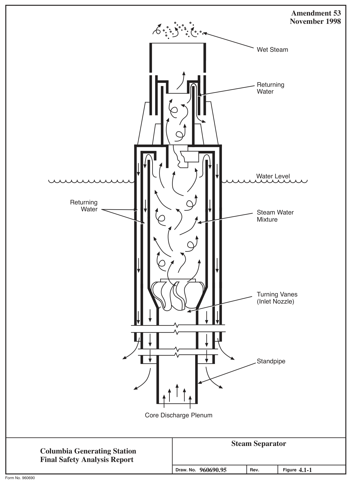
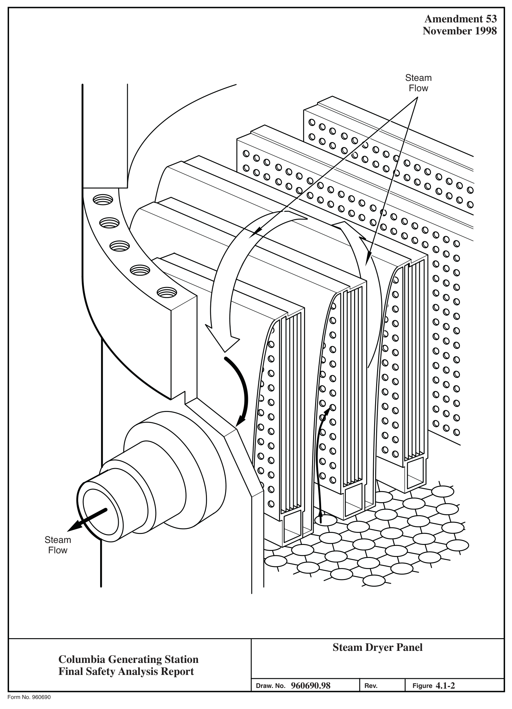

# 4.1 Summary Description

> Columbia Generating Station FSAR — Chapter 04: Reactor
> Source: `04_chapter-1911-2041.pdf`, PDF pages 12–31 (of 131)
> Amendment 67 compilation (individual pages carry varying amendment dates)

---
<!-- p.12 -->
Chapter 4

#### REACTOR
### 4.1 SUMMARY DESCRIPTION
This section was prepared using the licensing topical report, “General Electric Standard Application for Reactor Fuel” (GESTAR II) Reference 4.1-1, GESTAR II compliance document (Reference 4.1-4), the cycle-specific design report (Reference 4.1-2) and the “Fuel Bundle Information Report” (Reference 4.1-3).

The reactor assembly consists of the reactor vessel, internal components of the core, shroud, steam separator and dryer assemblies, and jet pumps. Also included in the reactor assembly are the control rods, control rod drive housings, and the control rod drives. Figure 5.3-5 shows the arrangement of reactor assembly components. A summary of the important design and performance characteristics is given in Section 1.3. Loading conditions for reactor assembly components are specified in Section 3.9. The core load varies for each cycle and is shown in Reference 4.1-2.

#### 4.1.1 REACTOR VESSEL
The reactor vessel design and description are discussed in Section 5.3.

#### 4.1.2 REACTOR INTERNAL COMPONENTS
The major reactor internal components are the core (fuel, channels, control blades, and instrumentation), the core support structure (including the shroud, top guide and core plate), the shroud head and steam separator assembly, the steam dryer assembly, the feedwater spargers, the core spray spargers, and the jet pumps. Except for the Zircaloy and NSF
(Niobium-Sn-Fe) in the reactor core, these reactor internals are stainless steel or other corrosion resistant alloys. All major internal components of the vessel can be removed except the jet pump diffusers, the jet pump risers, the shroud, the core spray lines, spargers, and the feedwater sparger. The removal of the steam dryers, shroud head and steam separators, fuel assemblies, in-core assemblies, control rods, orificed fuel supports, and control rod guide tubes can be accomplished on a routine basis.

<!-- p.13 -->
##### 4.1.2.1 Reactor Core
###### 4.1.2.1.1 General
The reactor core is composed of fuel assemblies manufactured by Global Nuclear Fuel (GNF).

A number of important features of the BWR core design are summarized in the following paragraphs:

a. The BWR core mechanical design is based on conservative application of stress limits, operating experience, and experimental test results. The moderate pressure levels characteristics of a direct cycle reactor (approximately 1035 psia) result in moderate cladding temperatures and stress levels;

b. The low coolant saturation temperature, high heat transfer coefficients, and neutral water chemistry of the BWR are significant, advantageous factors in minimizing Zircaloy temperature and associated temperature-dependent corrosion and hydride buildup;

The relatively uniform fuel cladding temperatures throughout the core minimize migration of the hydrides to cold cladding zones and reduce thermal stresses;

c. The basic thermal and mechanical criteria applied in the design have been proven by irradiation of statistically significant quantities of fuel. The design heat transfer rates and linear heat generation rates are similar to values proven in fuel assembly irradiation;

d. The design power distribution used in sizing the core represents a worst expected state of operation;

e. The thermal margin analyses ensure that more than 99.9% of the fuel rods in the core are expected to avoid boiling transition for the most severe anticipated operational occurrences described in Chapter 15. The possibility of boiling transition occurring during normal reactor operation is insignificant; and

f. Because of the large negative moderator density coefficient of reactivity, the BWR has a number of inherent advantages. These are the uses of coolant flow for load following, the inherent self-flattening of the radial power distribution, the ease of control, the spatial xenon stability, and the ability to override xenon to follow load.

<!-- p.14 -->
Boiling water reactors do not usually have instability problems due to xenon. This has been demonstrated by special tests which were conducted on operating BWRs and by calculations.
Xenon transients are highly damped in a BWR due to the large negative power coefficient of reactivity (Reference 4.1-7).

Columbia Generating Station (CGS) has installed a stability detect and suppress system to ensure hydrodynamic stability while operating in regions susceptible to instability. Stability system limits are specified in the Technical Specifications and in the Core Operating Limits Report.

Important features of the reactor core arrangement are as follows:

a. The original bottom-entry cruciform control rods consist of B4C in stainless steel tubes surrounded by a stainless steel sheath;

b. The bottom-entry cruciform Duralife 215 control rods consist of 18 high-purity stainless steel tubes at each wing filled with boron-carbide and three hafnium rods at the edge of each wing and a hafnium plate at the top;

c. The bottom-entry cruciform Marathon control rods consist of 17 high-purity stainless steel tubes in each wing. Eleven of the tubes are filled with boron-carbide, two of the tubes are partially filled with boron-carbide and four tubes are filled with hafnium rods (three at the outer edge of each wing and one at the center of the wing). See Figure 4.2-1.5 for details;

d. The in-core location of the startup and power range instruments provides coverage of the large reactor core and provides an acceptable signal-to-noise ratio and neutron-to-gamma ratio. All in-core instrument leads enter from the bottom and the instruments are in service during refueling. In-core instrumentation is further discussed in Sections 7.6.1.4 and 7.7.1.6;

e. As shown by experience obtained at other plants, the operator, utilizing the in-core flux monitor system, can maintain the desired power distribution within a large core by proper control rod scheduling;

f. The Zircaloy-4 and NSF channels provide a fixed flow path for the boiling coolant, serve as a guiding surface for the control rods, and protect the fuel during handling operations;

g. The mechanical reactivity control permits criticality checks during refueling and provides maximum plant safety. The core is designed to be subcritical at any time in its operating history with any one control rod fully withdrawn; and

<!-- p.15 -->
h. The selected control rod pitch represents a practical value of individual control rod reactivity worth and allows ample clearance below the pressure vessel between control rod drive mechanisms for ease of maintenance and removal.

###### 4.1.2.1.2 Core Configuration
The reactor core is arranged as an upright circular cylinder containing a large number of fuel cells and is located within the reactor vessel. The coolant flows upward through the core. The BWR core is composed of essentially two components: fuel assemblies and control rods. The General Electric Company (GE) control rod mechanical configuration (see Figure 4.2-1) is basically the same as used in all GE BWRs.

###### 4.1.2.1.3 Fuel Assembly Description
The GNF reload fuel assemblies are GNF2 (Reference 4.1-4).

###### 4.1.2.1.3.1 Fuel Rod. A fuel rod consists of UO2 pellets and a Zircaloy-2 cladding tube.
A fuel rod is made by stacking pellets into a Zircaloy-2 cladding tube, which is sealed by welding Zircaloy end plugs in each end of the tube. The GNF fuel rods are pressurized to 10 atmospheres (Reference 4.1-4).

The BWR fuel rod is designed as a pressure vessel. The ASME Boiler and Pressure Vessel
(B&PV) Code, Section III, is used as a guide in the mechanical design and stress analysis of the fuel rod.

The rod is designed to withstand the applied loads, both external and internal. The fuel pellet is sized to provide sufficient volume within the fuel tube to accommodate differential expansion between fuel and clad. Overall fuel rod design is conservative in its accommodation of the mechanisms affecting fuel in a BWR environment. Fuel rod design bases are discussed in more detail in Section 4.2.1.

###### 4.1.2.1.3.2 Fuel Bundle. The fuel bundle has two important design features:

a. The bundle design places minimum external forces on a fuel rod; each fuel rod is free to expand in the axial direction, and

b. The unique structural design permits the removal and replacement, if required, of individual fuel rods.

<!-- p.16 -->
The fuel bundles are designed to meet all the criteria for core performance and to provide ease of handling. Selected fuel rods in each bundle differ from the others in uranium enrichment.
This arrangement produces more uniform power production across the fuel bundle and thus allows a significant reduction in the amount of heat transfer surface required to satisfy the design thermal limitations.

The GNF reload bundle contains 92 fuel rods and 2 large central water rods, all in a 10 x 10 array.

###### 4.1.2.1.4 Assembly Support and Control Rod Location
Some peripheral fuel assemblies are supported by the core plate. Otherwise, individual fuel assemblies in the core rest on fuel support pieces mounted on top of the control rod guide tubes. Each guide tube, with its fuel support piece, bears the weight of four assemblies and is supported by a control rod drive penetration nozzle in the bottom head of the reactor vessel.
The core plate provides lateral support and guidance at the top of each control rod guide tube.

The top guide, mounted inside the shroud, provides lateral support and guidance for each fuel assembly. The reactivity of the core is controlled by cruciform control rods and their associated mechanical hydraulic drive system. The control rods occupy alternate spaces between fuel assemblies. Each independent drive enters the core from the bottom and can accurately position its associated control rod during normal operation and yet insert the control rod in less than 7 sec during the scram mode of operation. Bottom entry allows optimum power shaping in the core, ease of refueling, and convenient drive maintenance.

##### 4.1.2.2 Shroud
The shroud is a cylindrical, stainless-steel structure which surrounds the core and provides a barrier to separate the upward flow through the core from the downward flow in the annulus and also provides a floodable volume in the unlikely event of an accident which would otherwise drain the reactor pressure vessel. A flange at the top of the shroud mates with a flange on the shroud head and steam separators. The upper cylindrical wall of the shroud and the shroud head form the core discharge plenum. The jet pump discharge diffusers penetrate the shroud support below the core elevation to introduce the coolant to the inlet plenum. To prevent direct flow from the inlet to the outlet nozzles of the recirculation loops, the shroud support is welded to the vessel wall. The shroud support is designed to support and locate the jet pumps, core support structure, and some peripheral fuel assemblies.

Mounted inside the upper shroud cylinder in the space between the top of the core and the upper shroud flange are the core spray spargers with spray nozzles for injection of cooling

<!-- p.17 -->
water. The core spray spargers and nozzles do not interfere with the installation or removal of fuel from the core.

##### 4.1.2.3 Shroud Head and Steam Separators
The shroud head consists of a flange and dome onto which is welded an array of standpipes, with a steam separator located at the top of each standpipe. The shroud head mounts on the flange at the top of the cylinder and forms the cover of the core discharge plenum region. The joint between the shroud head and shroud flange does not require a gasket or other replacement sealing technique. The fixed axial flow type steam separators have no moving parts and are made of stainless steel.

In each separator, the steam-water mixture rising from the standpipe impinges on vanes which give the mixture a spin to establish a vortex wherein the centrifugal forces separate the steam from the water. Steam leaves the separator at the top and passes into the wet steam plenum below the dryer. The separated water exits from the lower end of the separator and enters the pool that surrounds the standpipes to enter the downcomer annulus. An internal steam separator diagram is shown in Figure 4.1-1.

For ease of removal, the shroud head is bolted to the shroud top flange by long shroud head bolts that extend above the separators for easy access during refueling. The shroud head is guided into position on the shroud via guide rods on the inside of the vessel and locating pins located on the shroud head. The objective of the shroud head bolt design is to provide direct access to the bolts during reactor refueling operations with minimum-depth underwater tool manipulation during the removal and installation of the assemblies.

##### 4.1.2.4 Steam Dryer Assembly
The steam dryer assembly is mounted in the reactor vessel above the shroud head and forms the top and sides of the wet steam plenum. Vertical guide rods on the inside of the vessel provide alignment for the dryer assembly during installation. The dryer assembly is supported by pads extending from the vessel wall and is locked into position during operation by the reactor vessel top head. Steam from the separators flows upward into the dryer assembly.
The steam leaving the top of the dryer assembly flows into vessel steam outlet nozzles which are located alongside the steam dryer assembly. Moisture is removed by the dryer vanes and flows first through a system of troughs and pipes to the pool surrounding the separators and then into the downcomer annulus between the core shroud and reactor vessel wall. The diagram of a typical steam dryer panel is shown in Figure 4.1-2.

<!-- p.18 -->
#### 4.1.3 REACTIVITY CONTROL SYSTEMS
##### 4.1.3.1 Operation
The control rods perform dual functions of power distribution shaping and reactivity control.
Power distribution in the core is controlled during operation of the reactor by manipulation of selected patterns of rods. The rods, which enter from the bottom of the near-cylindrical reactor core, are positioned in such a manner to counter-balance steam voids in the top of the core and effect significant power flattening.

These groups of control elements, used for power flattening, experience a somewhat higher duty cycle and neutron exposure than the other rods in the control system.

The reactivity control function requires that all rods be available for either reactor “scram”
(prompt shutdown) or reactivity regulation. Because of this, the control elements are mechanically designed to withstand the dynamic forces resulting from a scram. They are connected to bottom-mounted, hydraulically actuated drive mechanisms which allow either axial positioning for reactivity regulation or rapid scram insertion. The design of the rod-to-drive connection permits each blade to be attached or detached from its drive without disturbing the remainder of the control system. The bottom-mounted drives permit the entire control system to be left intact and operable for tests with the reactor vessel open.

##### 4.1.3.2 Description of Rods
The cruciform shaped control rods contain 76 stainless steel tubes (19 tubes in each wing of the cruciform) filled with vibration compacted boron-carbide powder. The tubes are seal welded with end plugs on either end. Stainless steel balls are used to separate the tubes into individual compartments. The stainless steel balls are held in position by a slight crimp in the tube. The individual tubes act as pressure vessels to contain the helium gas released by the boronneutron capture reaction.

The tubes are held in a cruciform array by a stainless steel sheath extending the full length of the tubes. A top handle, shown in Figure 4.2-1, aligns the tubes and provides structural rigidity at the top of the control rod. Rollers, housed in the handle, provide guidance for control rod insertion and withdrawal. A bottom casting is also used to provide structural rigidity and contains positioning rollers and a parachute-shaped velocity limiter. The handle and lower casting are welded into a single structure by means of a small cruciform post located in the center of the control rod. A steel stiffener is located approximately at the midspan of D each cruciform wing. The control rods can be positioned at 6-in. steps and have a nominal withdrawal and insertion speed of 3 in./sec.

The foregoing description of the control rods applies to the design of the original control rods.
There have been two different replacement control rods used, Duralife 215 and Marathon

<!-- p.19 -->
control rods. These replacement rods have design changes that increase the neutron absorption and make other material property improvements. The newer control rods are similar to and are fully interchangeable with the original control rod assemblies and are compatible with the existing nuclear steam supply system hardware.

The Duralife 215 control rods differ from the previous control rods in that a hafnium absorber plate is used at the top of each cruciform section, hafnium absorber rods replace several of the boron carbide absorber rods on the periphery of each cruciform section, and the stainless steel I stiffener is removed from each wing. There are 21 absorber rods in each wing, of which 18 are stainless-steel tubes containing boron carbide and three are hafnium rods. The outside diameter remains the same. The length of the absorber column in these rods has been reduced I from 143 in. to 137 in. to accommodate the top 6-in.-high hafnium plate. The increased volume of neutron absorber material increases the relative reactivity worth in the cold condition and increases the nuclear lifetime.

The Marathon control rod blades are an improved version of the Duralife 215 control blades and have the absorber and sheath arrangement replaced with an array of square tubes, which results in reduced weight and increased absorber volume. The square tubes each have four lobes to allow adjacent tubes to be welded to each other. The absorber tubes are welded lengthwise to form the four wings of the control rod. Each wing is comprised of 17 absorber tubes. The absorber tubes each act as an individual pressure chamber for the retention of helium. The region between each pair of square tubes is filled with helium and sealed top and bottom by welding. The four wings are then welded to the tie rod to form the cruciform-shaped member of the control rod. The Marathon control rod blade has the full-length tie rod replaced with a segmented tie rod, which also reduces weight.

The square tubes are circular inside and are loaded with either B4C or hafnium. The B4C is contained in separate capsules to prevent its migration. The capsules are placed inside the square absorber tubes and are smaller than the absorber tube inside diameter, allowing the B4C to swell before making contact with the absorber tubes thereby increasing stress corrosion resistance. Empty tubes may be used adjacent to the tie rods to achieve the desired reactivity worth. The combination of absorbers and absorber tubes is based on the needed initial reactivity worth. In addition, empty capsules are used in some absorber tubes to provide a plenum for helium released during B4C burnup.

The velocity limiter, shown in Figure 4.2-2, is a device which is an integral part of the control rod and protects against the low probability of a rod drop accident. It is designed to limit the free fall velocity and reactivity insertion rate of a control rod so that minimum fuel damage would occur. It is a one-way device, in that control rod scram time is not significantly affected.

<!-- p.20 -->
Control rods are cooled by the core leakage (bypass) flow. The core leakage flow is made of recirculation flow that leaks through the several leakage flow paths, which are as follows:

a. The area between fuel channel and fuel assembly nosepiece,

b. The area between fuel assembly nosepiece and fuel support piece,

c. Holes in the lower tie plate,

d. The area between fuel support piece and core plate,

e. The area between core plate and shroud,

f. Holes in the core plate near power range monitor instrument guide tubes,

g. Various leakage paths around the control rod guide tubes, and

h. Control rod drive cooling water.

##### 4.1.3.3 Supplementary Reactivity Control
Supplemental reactivity control is achieved with burnable poison. The supplementary burnable poison is gadolinia (Gd2O3) mixed with UO2 in selected fuel rods in each fuel bundle.

#### 4.1.4 ANALYSIS TECHNIQUES
##### 4.1.4.1 Reactor Internal Components
Computer codes used for the analysis of the internal components as a basis for the original operating license are listed as follows:

a. MASS b. SNAP (MULTISHELL)
c. GASP d. NOHEAT e. FINITE f. DYSEA g. SHELL 5 h. HEATER i. FAP-71 j. CREEP-PLAST

<!-- p.21 -->
The following italicized detailed descriptions of these programs are historical and were provided to support the application for an operating license.

###### 4.1.4.1.1 MASS (Mechanical Analysis of Space Structure)
4.1.4.1.1.1 Program Description. This is a proprietary program of GE and is an outgrowth of the PAPA (Plate and Panel Analysis) program originally developed by L. Beitch in the early 1960s. The program is based on the principle of the finite element method. Governing matrix equations are formed in terms of joint displacements using a “stiffness-influence-coefficient” concept originally proposed by L. Beitch (Reference 4.1-9). The program offers curved beam, plate, and shell elements. It can handle mechanical and thermal loads in a static analysis and predict natural frequencies and mode shapes in a dynamic analysis.

4.1.4.1.1.2 Program Version and Computer. The Nuclear Energy Division is using a past revision of MASS. This revision is identified as revision “0” in the computer production library. The program operates on the Honeywell 6000 computer.

4.1.4.1.1.3 History of Use. Since its development in the early 1960s, the program has been successfully applied to a wide variety of jet-engine structural problems, many of which involve extremely complex geometries. The use of the program in the Nuclear Energy Division also started shortly after its development.

4.1.4.1.1.4 Extent of Application. Besides the Jet Engine and Nuclear Energy Divisions, the Missile and Space Division, the Appliance Division, and the Turbine Division of GE have also applied the program to a wide range of engineering problems. The Nuclear Energy Division uses it mainly for piping and reactor internals analyses.

###### 4.1.4.1.2 SNAP (MULTISHELL)
4.1.4.1.2.1 Program Description. The SNAP Program, which is also called MULTISHELL, is the GE code which determines the loads, deformations, and stresses of axisymmetric shells of revolution (cylinders, cones, discs, toroids, and rings) for axisymmetric thermal boundary and surface load conditions. Thin shell theory is inherent in the solution of E. Peissner’s differential equations for each shell’s influence coefficients. Surface loading capability includes pressure, average temperature, and liner through wall temperature gradients; the latter two may be linearly varied over the shell meridian. The theoretical limitations of this program are the same as those of classical theory.

4.1.4.1.2.2 Program Version and Computer. The current version maintained by the GE Jet Engine Division at Evandale, Ohio, is being used on the Honeywell 6000 computer in

#### GE/NED.
<!-- p.22 -->
4.1.4.1.2.3 History of Use. The initial version of the Shell Analysis Program was completed by the Jet Engine Division in 1961. Since then, a considerable amount of modification and addition has been made to accommodate its broadening area of application. Its application in the Nuclear Energy Division has a history longer than 10 years.

4.1.4.1.2.4 Extent of Application. The program has been used to analyze jet engine, space vehicle and nuclear reactor components. Because of its efficiency and economy, in addition to reliability, it has been one of the main shell analysis programs in the Nuclear Energy Division of GE.

###### 4.1.4.1.3 GASP
4.1.4.1.3.1 Program Description. GASP is a finite element program for the stress analysis of axisymmetric or plane two-dimensional geometries. The element representations can be either quadrilateral or triangular. Axisymmetric or plane structural loads can be input at nodal points. Displacements, temperatures, pressure loads, and axial inertia can be accommodated.
Effective plastic stress and strain distributions can be calculated using a bilinear stress-strain relationship by means of an iterative convergence procedure.

4.1.4.1.3.2 Program Version and Computer. The GE version, originally from the developer, Professor E. L. Wilson, operates on the Honeywell 6000 computer.

###### 4.1.4.1.3.3 History of Use. The program was developed by Professor E. L. Wilson in 1965
(Reference 4.1-10). The present version in GE/NED has been in operation since 1967.

4.1.4.1.3.4 Extent of Application. The application of GASP in GE/NED is mainly for elastic analysis of axisymmetric and plane structures under thermal and pressure loads. The GE version has been extensively tested and used by engineers in the company.

###### 4.1.4.1.4 NOHEAT
4.1.4.1.4.1 Program Description. The NOHEAT program is a two-dimensional and axisymmetric transient nonlinear temperature analysis program. An unconditionally stable numerical integration scheme is combined with iteration procedure to compute temperature distribution within the body subjected to arbitrary time- and temperature-dependent boundary conditions.

This program utilizes the finite element method. Included in the analysis are the three basic forms of heat transfer, conduction, radiation, and convection, as well as internal heat generation. In addition, cooling pipe boundary conditions are also treated. The output includes temperature histories of all the nodal points established by the user. The program can handle multitransient temperature input.

<!-- p.23 -->
4.1.4.1.4.2 Program Version and Computer. The current version of the program is an improvement of the program originally developed by I. Farhoomand and Professor E. L.
Wilson of University of California at Berkeley (Reference 4.1-11). The program operates on the Honeywell 6000 computer.

4.1.4.1.4.3 History of Use. The program was developed in 1971 and installed in GE Honeywell computer by one of its original developers, I. Farhoomand, in 1972. A number of heat transfer problems related to the reactor pedestal have been satisfactorily solved using the program.

4.1.4.1.4.4 Extent of Application. The program using finite element formulation is compatible with the finite element stress-analysis computer program GASP. Such compatibility simplified the connection of the two analyses and minimizes human error.

###### 4.1.4.1.5 FINITE
4.1.4.1.5.1 Program Description. FINITE is a general-purpose finite element computer program for elastic stress analysis of two-dimensional structural problems including (1) plane stress, (2) plane strain, and (3) axisymmetric structures. It has provisions for thermal, mechanical, and body force loads. The materials of the structure may be homogeneous or inhomogeneous and isotropic or orthotropic. The development of the FINITE program is based on the GASP program (see Section 4.1.4.1.3).

4.1.4.1.5.2 Program Version and Computer. The present version of the program at GE/NED was obtained from the developer J. E. McConnelee of GE/Gas Turbine Department in 1969
(Reference 4.1-12). The NED version is used on the Honeywell 6000 computer.

4.1.4.1.5.3 History of Use. Since its completion in 1969, the program has been widely used in the Gas Turbine and the Jet Engine Departments of the GE for the analysis of turbine components.

4.1.4.1.5.4 Extent of Use. The program is used at GE/NED in the analysis of axisymmetric or nearly-axisymmetric BWR internals.

###### 4.1.4.1.6 DYSEA
4.1.4.1.6.1 Program Description. The DYSEA (Dynamic and Seismic Analysis) program is a GE proprietary program developed specifically for seismic and dynamic analysis of RPV and internals/building system. It calculates the dynamic response of linear structural system by either temporal modal superposition or response spectrum method. Fluid-structure interaction effect in the RPV is taken into account by way of hydrodynamic mass.

<!-- p.24 -->
Program DYSEA was based on program SAPIV with added capability to handle the hydrodynamic mass effect. Structural stiffness and mass matrices are formulated similar to SAPIV. Solution is obtained in time domain by calculating the dynamic response mode-bymode. Time integration is performed by using Newmark’s β-method. Response spectrum solution is also available as an option.

4.1.4.1.6.2 Program Version and Computer. The DYSEA version now operating on the Honeywell 6000 computer of GE, Nuclear Energy Systems Division, was developed at GE by modifying the SAPIV program. Capability was added to handle the hydrodynamic mass effect due to fluid-structure interaction in the reactor. It can handle three-dimensional dynamic problems with beam, trusses, and springs. Both acceleration time histories and response spectra may be used as input.

4.1.4.1.6.3 History of Use. The DYSEA program was developed in the Summer of 1976. It has been adopted as a standard production program since 1977 and it has been used extensively in all dynamic and seismic analysis of the RPV and internals/building system.

4.1.4.1.6.4 Extent of Application. The current version of DYSEA has been used in all dynamic and seismic analysis since its development. Results from test problems were found to be in close agreement with those obtained from either verified programs or analytic solutions.

###### 4.1.4.1.7 SHELL 5
4.1.4.1.7.1 Program Description. SHELL 5 is a finite shell element program used to analyze smoothly curved thin shell structures with any distribution of elastic material properties, boundary constraints, and mechanical thermal and displacement loading conditions. The basic element is a triangle whose membrane displacement fields are linear polynomial functions, and whose bending displacement field is a cubic polynomial function (Reference 4.1-13).
Five degrees of freedom (three displacements and two bending rotations) are obtained at each nodal point. Output displacements and stresses are in a local (tangent) surface coordinate system.

Due to the approximation of element membrane displacements by linear functions, the in-plane rotation about the surface normal is neglected. Therefore, the only rotations considered are due to bending of the shell cross section and application of the method is not recommended for shell intersection (or discontinuous surface) problems where in-plane rotation can be significant.

4.1.4.1.7.2 Program Version and Computer. A copy of the source deck of SHELL 5 is maintained by GE/NED by Y. R. Rashid, one of the originators of the program. SHELL 5 operates on the UNIVAC 1108 computer.

<!-- p.25 -->
4.1.4.1.7.3 History of Use. SHELL 5 is a program developed by Gulf General Atomic Incorporated (Reference 4.1-14) in 1969. The program has been in production status at Gulf General Atomic, GE, and at other major computer operating systems since 1970.

4.1.4.1.7.4 Extent of Application. SHELL 5 has been used at GE to analyze reactor shroud support and torus. Satisfactory results were obtained.

###### 4.1.4.1.8 HEATER
4.1.4.1.8.1 Program Description. HEATER is a computer program used in the hydraulic design of feedwater spargers and their associated delivery header and piping. The program utilizes test data obtained by GE using full scale mockups of feedwater spargers combined with a series of models which represents the complex mixing processes obtained in the upper plenum, downcomer, and lower plenum. Mass and energy balances throughout the nuclear steam supply system are modeled in detail (Reference 4.1-15).

4.1.4.1.8.2 Program Version and Computer. This program was developed at GE/NED in FORTRAN IV for the Honeywell 6000 computer.

4.1.4.1.8.3 History of Use. The program was developed by various individuals in GE/NED beginning in 1970. The present version of the program has been in operation since January 1972.

4.1.4.1.8.4 Extent of Application. The program is used in the hydraulic design of the feedwater spargers for each BWR plant, in the evaluation of design modifications, and the evaluation of unusual operational conditions.

###### 4.1.4.1.9 FAP-71 (Fatigue Analysis Program)
4.1.4.1.9.1 Program Description. The FAP-71 computer code, or Fatigue Analysis Program, is a stress analysis tool used to aid in performing ASME-III Nuclear Vessel Code structural design calculations. Specifically, FAP-71 is used in determining the primary plus secondary stress range and number of allowable fatigue cycles at points of interest. For structural locations at which the 3Sm (P+Q) ASME Code limit is exceeded, the program can perform either (or both) of two elastic-plastic fatigue life evaluations: 1) the method reported in ASME Paper 68-PVP-3, 2) the present method documented in Paragraph NB-3228.3 of the 1971 Edition of the ASME Section III Nuclear Vessel Code. The Program can accommodate up to 25 transient stress states on as many as 20 structural locations.

4.1.4.1.9.2 Program Version and Computer. The present version of FAP-71 was completed by L. Young of GE/NED in 1971 (Reference 4.1-16). The program currently is on the NED Honeywell 6000 computer.

<!-- p.26 -->
4.1.4.1.9.3 History of Use. Since its completion in 1971, the program has been applied to several design analyses of GE BWR vessels.

4.1.4.1.9.4 Extent of Use. The program is used in conjunction with several shell analysis programs in determining the fatigue life of BWR mechanical components subject to thermal transients.

###### 4.1.4.1.10 CREEP/PLAST
4.1.4.1.10.1 Program Description. A finite element program is used for the analysis of twodimensional (plane and axisymmetric) problems under conditions of creep and plasticity. The creep formulation is based on the memory theory of creep in which the constitutive relations are cast in the form of hereditary integrals. The material creep properties are built into the program and they represent annealed 304 stainless steel. Any other creep properties can be included if required.

The plasticity treatment is based on kinemetic hardening and von Mises yield criterion. The hardening modulus can be constant or a function of strain.

4.1.4.1.10.2 Program Version and Computer. The program can be used for elastic-plastic analysis with or without the presence of creep. It can also be used for creep analysis without the presence of instantaneous plasticity. A detailed description of theory is given in Reference 4.1-17. The program is operative on UNIVAC-1108.

###### 4.1.4.1.10.3 History of Use. This program was developed by Y. R. Rashid (Reference 4.1-17)
in 1971. It underwent extensive program testing before it was put on production status.

4.1.4.1.10.4 Extent of Application. The program is used at GE/NED in the channel cross section mechanical analysis.

##### 4.1.4.2 Fuel Rod Thermal Analysis
Thermal design analyses of the fuel and core were performed to verify that design criteria are met (see References 4.1-1 and 4.1-4).

##### 4.1.4.3 Reactor Systems Dynamics
The analysis techniques used in reactor systems dynamics are described in Sections S.1.3 and S.4 of Reference 4.1-1. A complete stability analysis for the reactor coolant system is provided in Section 4.4.4.2.

<!-- p.27 -->
##### 4.1.4.4 Nuclear Engineering Analysis
The analysis techniques are described in the fuel design reports (see Reference 4.1-1).

##### 4.1.4.5 Neutron Fluence Calculations
See Section 4.3.2.8.

##### 4.1.4.6 Thermal Hydraulic Calculations
The digital computer program uses a parallel flow path model to perform the steady-state BWR reactor core thermal-hydraulic analysis. Program input includes the core geometry, operating power, pressure, coolant flow rate, inlet enthalpy, and the power distribution within the core.
Output from the program includes core pressure drop, coolant flow distribution, critical power ratio, and axial variations of quality, density, and enthalpy for each fuel type.

#### 4.1.5 REFERENCES
4.1-1 General Electric Standard Application for Reactor Fuel, NEDE-24011-P-A, and Supplement for United States, NEDE-24011-P-A-US (most recent approved version referenced in COLR).

4.1-2 Supplemental Reload Licensing Report for Columbia (most recent version referenced in COLR).

4.1-3 Fuel Bundle Information Report for Columbia (most recent approved version referenced in COLR).

4.1-4 “GNF2 Advantage Generic Compliance with NEDE-24011-P-A (GESTAR II),” NEDC-33270P, (most recent version referenced in COLR).

4.1-5 Deleted.

4.1-6 Deleted.

4.1-7 Crowther, R. L., Xenon Considerations in Design of Boiling Water Reactors, APED-5640, June 1968.

4.1-8 Deleted.

<!-- p.28 -->
4.1-9 Beitch, L., Shell Structures Solved Numerically by Using a Network of Partial Panels, AIAA Journal, Volume 5, No. 3, March 1967.

4.1-10 E. L. Wilson, A Digital Computer Program For the Finite Element Analysis of Solids With Non-Linear Material Properties, Aerojet General Technical, Memo No. 23, Aerojet General, July 1965.

4.1-11 I. Farhoomand and E. L. Wilson, Non-Linear Heat Transfer Analysis of Axisymmetric Solids, SESM Report SESM71-6, University of California at Berkeley, Berkeley, California, 1971.

4.1-12 J. E. McConnelee, Finite-Users Manual, General Electric TIS Report DF 69SL206, March 1969.

4.1-13 R. W. Clough and C. P. Johnson, A Finite Element Approximation For the Analysis of Thin Shells, International Journal Solid Structures, Vol. 4, 1968.

4.1-14 A Computer Program For the Structural Analysis of Arbitrary Three-Dimensional Thin Shells, Report No. GA-9952, Gulf General Atomic.

4.1-15 Burgess, A. B., User Guide and Engineering Description of HEATER Computer Programs, March 1974.

4.1-16 Young, L. J., FAP-71 (Fatigue Analysis Program) Computer Code, GE/NED Design Analysis Unit R. A. Report No. 49, January 1972.

4.1-17 Rashid, Y. R, Theory Report for Creep-Plast Computer Program, GEAP-10546, AEC Research and Development Report, January 1972.

<!-- p.29 -->

*figure on PDF page 29*

[Vector original (SVG, lossless): fig_page-29.svg](../figures/fig_page-29.svg)

<!-- labels/text on this figure page -->
Amendment 53 November 1998
Wet Steam
Returning Water
Water Level
Returning Water Steam Water Mixture
Turning Vanes
(Inlet Nozzle)
Standpipe
Core Discharge Plenum
Steam Separator Columbia Generating Station Final Safety Analysis Report 960690.95 4.1-1 Draw. No.
Rev. Figure Form No. 960690

<!-- p.30 -->

*figure on PDF page 30*

[Vector original (SVG, lossless): fig_page-30_2.svg](../figures/fig_page-30_2.svg)

<!-- labels/text on this figure page -->
Amendment 53 November 1998
Steam Flow
0 Jo Co Oo Oo Oo Oo Oo Oo Oo
Steam Flow
Steam Dryer Panel Columbia Generating Station Final Safety Analysis Report 960690.98 4.1-2 Draw. No.
Rev. Figure Form No. 960690

<!-- p.31 -->

*figure on PDF page 31*

[Vector original (SVG, lossless): fig_page-31_2.svg](../figures/fig_page-31_2.svg)

<!-- labels/text on this figure page -->
Amendment 61 December 2011
DELETED
Columbia Generating Station Final Safety Analysis Report I I 910402.33 Figure 4.1-3 Draw. No. Rev.
Form No. 960690
LDCN-10-029

