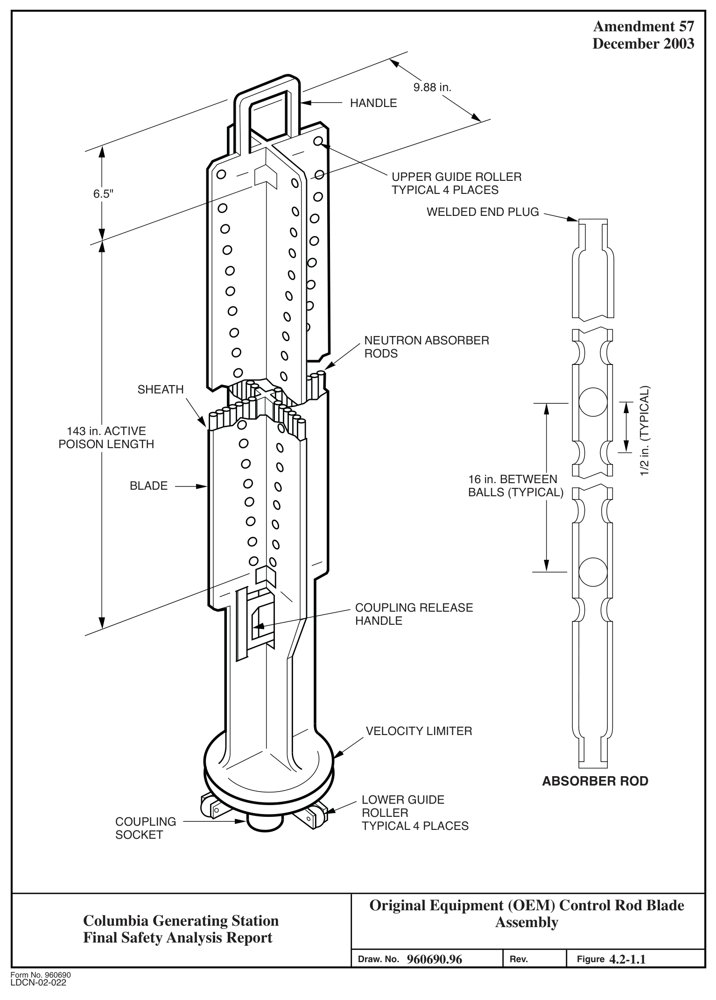
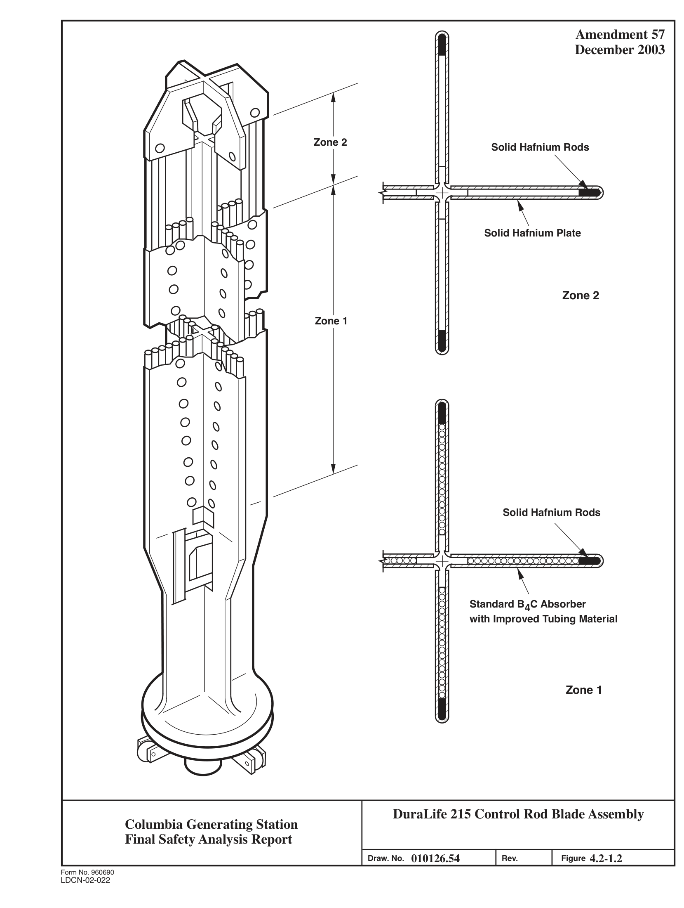
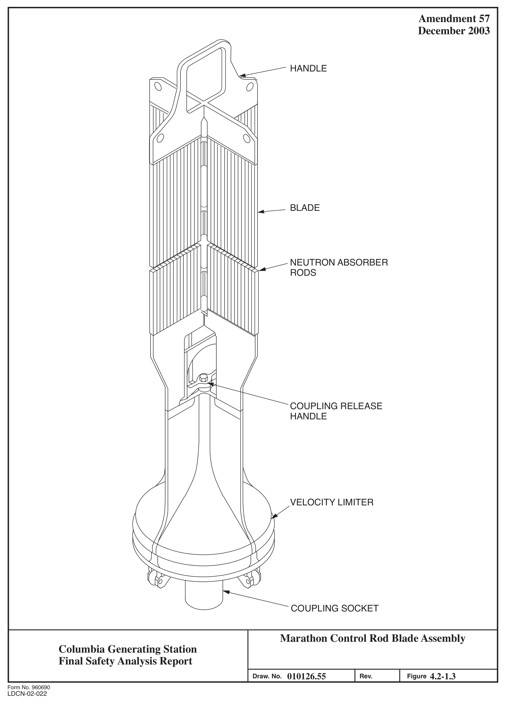
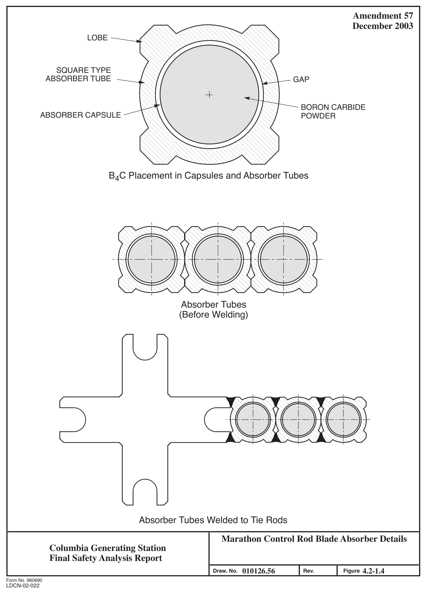
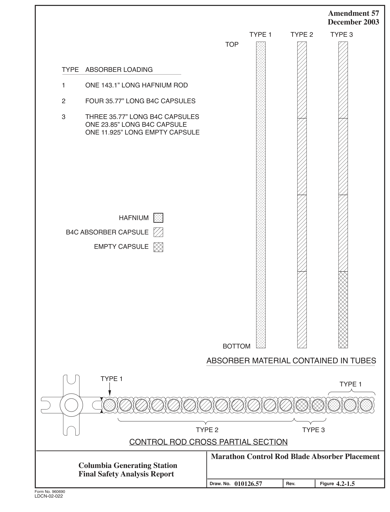
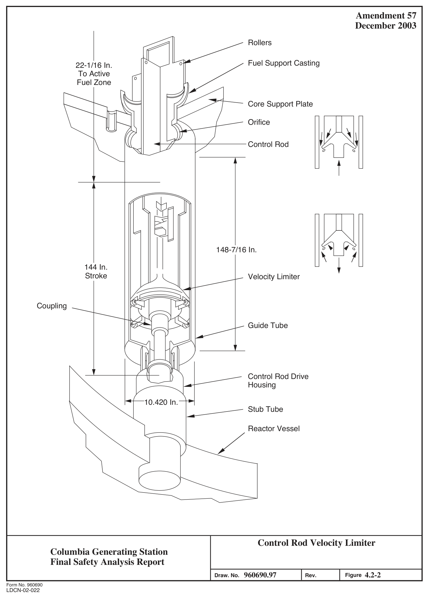

# 4.2 FUEL SYSTEM DESIGN

> Columbia Generating Station FSAR — Chapter 04: Reactor
> Source: `04_chapter-1911-2041.pdf`, PDF pages 32–51 (of 131)
> Amendment 67 compilation (individual pages carry varying amendment dates)

---
<!-- p.32 -->
### 4.2 FUEL SYSTEM DESIGN
See Appendix A, Section A.4.2 of Reference 4.2-1.

#### 4.2.1 DESIGN BASES
General Electric BWR fuel assembly and channel design bases, analytical methods, and evaluation results are described in Reference 4.2-1 (Appendix A, subsection A.4.2.1), Reference 4.2-6 and Reference 4.2-25.

##### 4.2.1.1 Fuel System Damage Limits
###### 4.2.1.1.1 Stress/Strain Limits
See subsection 2.2.1.1.2 of Reference 4.2-1.

###### 4.2.1.1.2 Fatigue Limits
See subsections 2.2.1.2.2 of Reference 4.2-1.

###### 4.2.1.1.3 Fretting Wear Limits
Fretting wear is considered in the mechanical design analysis of the assembly. See subsection 2.2.1.3.2 of Reference 4.2-1.

###### 4.2.1.1.4 Oxidation, Hydriding, and Corrosion Limits
See subsection 2.2.1.4.2.2 of Reference 4.2-1 for the hydriding limit. Oxidation and corrosion are considered in the mechanical design analysis. See subsection 2.2.1.4.1.2 of Reference 4.2-1.

###### 4.2.1.1.5 Dimensional Change Limits
See Reference 4.2-6 and subsection 2.2.1.5.2 of Reference 4.2-1.

###### 4.2.1.1.6 Internal Gas Pressure Limit
See subsection 2.2.1.6.2 of Reference 4.2-1

.

<!-- p.33 -->
###### 4.2.1.1.7 Hydraulic Loads Limits
See subsection 2.2.1.7.2 of Reference 4.2-1.

###### 4.2.1.1.8 Control Rod Reactivity Limits
See Section 3.2 and 3.3 of Reference 4.2-1 and Reference 4.2-7.

##### 4.2.1.2 Fuel Rod Failure Limits
###### 4.2.1.2.1 Hydriding Limits
See subsection 2.2.2.1 of Reference 4.2-1.

###### 4.2.1.2.2 Cladding Collapse Limits
See subsection 2.2.2.2.2 of Reference 4.2-1.

###### 4.2.1.2.3 Fretting Wear Limits
See subsection 2.2.1.3.2 of Reference 4.2-1.

###### 4.2.1.2.4 Overheating of Cladding Limits
See subsections 2.2.2.4 and 4.3.1 of Reference 4.2-1.

###### 4.2.1.2.5 Overheating of Pellet Limits
See subsection 2.2.2.5.2 of Reference 4.2-1.

###### 4.2.1.2.6 Excessive Fuel Enthalpy Limits
See subsection 2.2.2.6 of Reference 4.2-1.

###### 4.2.1.2.7 Pellet-Cladding Interaction Limits
See subsection 2.2.2.7.2 of Reference 4.2-1.

###### 4.2.1.2.8 Bursting Limits
See subsections 2.2.2.8 and 2.2.3.4 of Reference 4.2-1.

<!-- p.34 -->
###### 4.2.1.2.9 Mechanical Fracturing Limits
See subsection 2.2.2.9.2 of Reference 4.2-1.

##### 4.2.1.3 Fuel Coolability Limits
###### 4.2.1.3.1 Cladding Embrittlement Limits
See Reference 4.2-10, subsection 2.2.3.1 of Reference 4.2-1.

###### 4.2.1.3.2 Violent Expulsion of Fuel Limits
See subsection 2.2.3.2 of Reference 4.2-1.

###### 4.2.1.3.3 Generalized Cladding Melt Limits
Same as Section 4.2.1.3.1 and subsection 2.2.3.3 of Reference 4.2-1.

###### 4.2.1.3.4 Fuel Rod Ballooning Limits
Same as Section 4.2.1.2.8.

###### 4.2.1.3.5 Structural Deformation Limits
See subsection 2.2.3.5 of Reference 4.2-1.

#### 4.2.2 DESCRIPTION AND DESIGN DRAWINGS
See Reference 4.2-2.

##### 4.2.2.1 Control Rods
The control rods (typical configuration shown in Figures 4.2-1.1, 4.2-1.2, and 4.2-1.3)
perform the dual function of power shaping and reactivity control. Power distribution in the core is controlled during operation of the reactor by manipulating selected patterns of control rods. Control rod withdrawal tends to counterbalance steam void effects at the top of the core and results in significant axial power flattening.

The original control rods consists of a sheathed cruciform array of stainless steel tubes filled with boron-carbide (B4C) powder. The control rods are 9.88 in. in total span and are separated uniformly throughout the core on a 12-in. pitch maximum. Each control rod is surrounded by four fuel assemblies.

<!-- p.35 -->
The main structural member of a control rod is made of type 304 stainless steel and consists of a top handle, an original bottom casting with a velocity limiter and control rod drive coupling, a vertical cruciform center post, and four U-shaped absorber tube sheaths. The top handle, bottom casting, and center post are welded into a single skeletal structure. The U-shaped sheaths are resistance welded to the center post, handle, and castings to form a rigid housing to contain the boron-carbide-filled absorber rods. Rollers at the top and bottom of the control rod guide the control rod as it is inserted and withdrawn from the core. The control rods are cooled by the core bypass flow. The U-shaped sheaths are perforated to allow the coolant to circulate freely about the absorber tubes. Operating experience has shown that control rods constructed as described above are not susceptible to dimensional distortions.

The boron-carbide (B4C) powder in the absorber tubes is compacted to about 70% of its theoretical density. The boron-carbide contains a minimum of 76.5% by weight natural boron.
The boron-10 (B-10) minimum content of the boron is 18% by weight. Absorber tubes are made of type 304 stainless steel. Each absorber tube is 0.188-in. O.D. and has a 0.025-in.
wall thickness. Absorber tubes are sealed by a plug welded into each end. The boron-carbide is longitudinally separated into individual compartments by stainless steel balls at approximately 16-in. intervals. The steel balls are held in place by a slight crimp of the tube.
Should boron-carbide tend to sinter in service, the steel balls will keep the resulting void spaces distributed over the length of the absorber tube.

Some of the control rods have been replaced with Duralife 215 or Marathon control rods. The main structural member of the Duralife 215 control rod design is made of stainless steel and consists of a top handle, a tie rod, a bottom control rod drive coupling, and four sheaths containing the neutron absorber. The top handle, tie rod, velocity limiter, and sheaths are welded into a single structure. The neutron absorber in each wing of the sheath consists of 18 high-purity stainless-steel tubes filled with boron-carbide, three hafnium rods at the edge of the wing, and a hafnium plate at the top.

The sheaths of the Duralife 215 blades are attached to the structure with full fusion corner welds to the handle, tie rod, and velocity limiter to form a rigid housing. Inconel X750 rollers at the top and bottom of the control rod guide the control rod as it is inserted and withdrawn from the core. These rollers rotate on PH 13-8 Mo pins. The sheaths are perforated and the hafnium absorber plate has coolant grooves to allow the coolant to circulate freely about the absorber and flush the joint between the sheath and handle.

The number of boron carbide absorber rods in each wing has been changed from 19 rods with an I.D. of 0.138 in. to 18 rods with an I.D. of 0.148 in. The outside diameter remains the same. The length of the absorber column in these rods has been reduced from 143 in. to 137 in. to accommodate a top 6-in.-high hafnium plate. In addition, three 0.188 in. O.D.
hafnium rods have been added to the edge of each wing.

<!-- p.36 -->
The Marathon control rod blade consists of a top handle, a segmented tie rod (for weight savings), a bottom control rod coupling/velocity limiter and four wings consisting of an array of square tubes. The square tubes each have four lobes to allow adjacent tubes to be welded to each other. The absorber tubes are welded lengthwise to form the four wings of the control rod. Each wing is comprised of 17 absorber tubes. The four wings are then welded to the tie rod to form the cruciform-shaped member of the control rod.

The square tubes are circular inside and are loaded with either B4C or hafnium. The combination of absorbers and absorber tubes is based on the needed initial reactivity worth. In addition, empty capsules are used in some absorber tubes to provide a plenum for helium released during B4C burnup.

A comparison of the original, the Duralife 215 and the Marathon control rod dimensions and materials is given in Table 4.2-1.

##### 4.2.2.2 Velocity Limiter
The control rod velocity limiter (see Figure 4.2-2) is an integral part of the bottom assembly of each control rod. This feature protects against a high reactivity insertion rate by limiting the control rod velocity in the event of a control rod drop accident. It is a one-way device in that the control rod scram velocity is not significantly affected but the control rod dropout velocity is reduced to a permissible limit.

The velocity limiter is in the form of two nearly mated conical elements that act as a large clearance piston inside the control rod guide tube. The lower conical element is separated from the upper conical element by four radial spacers 90 degrees apart.

The hydraulic drag forces on a control rod are approximately proportional to the square of the rod velocity and are negligible at normal rod withdrawal or rod insertion speeds. However, during the scram stroke the rod reaches high velocity, and the drag forces must be overcome by the drive mechanism.

To limit control rod velocity during dropout but not during scram, the velocity limiter is provided with a streamlined profile in the scram (upward) direction. Thus, when the control rod is scrammed water flows over the smooth surface of the upper conical element into the annulus between the guide tube and the limiter. In the dropout direction, however, water is trapped by the lower conical element and discharged through the annulus between the two conical sections. Because this water is forced in a partially reversed direction into water flowing upward in the annulus, a severe turbulence is created, and this slows the descent of the control rod assembly to less than 5 ft/sec.

<!-- p.37 -->
#### 4.2.3 DESIGN EVALUATION
See Appendix A, subsection A.4.2.3 of Reference 4.2-1.

##### 4.2.3.1 Fuel System Damage Evaluation
###### 4.2.3.1.1 Stress/Strain Evaluation
Fuel rod internal pressure has been shown to remain below system pressure for rod peak burnups well beyond anticipated achieved burnup. For GNF fuel see section 2.2.1.1.3 of Reference 4.2-1.

###### 4.2.3.1.2 Fatigue Evaluation
See subsection 2.2.1.2.3 of Reference 4.2-1.

###### 4.2.3.1.3 Fretting Wear Evaluation
See Reference 4.2-12, subsection 2.2.1.3.3 of Reference 4.2-1.

###### 4.2.3.1.4 Oxidation, Hydriding, and Corrosion Evaluation
See subsections 2.2.1.4.1.3 and 2.2.1.4.2.3 of Reference 4.2-1.

###### 4.2.3.1.5 Dimensional Change Evaluation
See Reference 4.2-6, subsection 2.2.1.5.3 of Reference 4.2-1.

###### 4.2.3.1.6 Internal Gas Pressure Evaluation
See Section 3.2.6 of reference 4.2-2. The internal pressure is used in conjunction with other loads on the fuel rod cladding when calculating cladding stresses and comparing these stresses to the design criteria. The analysis results show that the calculated cladding stresses are below allowable limits even with internal gas pressure and other loads at end of life normal and transient conditions, respectively.

<!-- p.38 -->
###### 4.2.3.1.7 Hydraulic Load Evaluation
See subsection 2.2.1.7.3 of Reference 4.2-1, 4.2-12 and Section 3.9.

###### 4.2.3.1.8 Control Rod Reactivity Evaluation
I See Appendix A, subsection A.4.3.2 of Reference 4.2-1. Energy Northwest calculates the fluence of each control blade using an appropriate conversion factor for fuel exposures adjacent to the control blade. Control blade shuffling or replacement is based on the calculated blade fluence as compared to vendor allowed values (Reference 4.2-22). The vendor allowed values account for the reduction in control blade worth due to a combination of boron-10 depletion and boron loss resulting from cracking of the absorber tubes.

##### 4.2.3.2 Fuel Rod Failure
###### 4.2.3.2.1 Hydriding Evaluation
See Section 4.2.3.1.4.

###### 4.2.3.2.2 Cladding Collapse Evaluation
See Section 3.2.8 of Reference 4.2-2.

###### 4.2.3.2.3 Fretting Wear Evaluation
See Section 4.2.3.1.3.

###### 4.2.3.2.4 Overheating of Cladding Evaluation
See Section 3.6 of Reference 4.2-2.

###### 4.2.3.2.5 Overheating of Pellet Limits
See Section 3.2.9 of Reference 4.2-2.

###### 4.2.3.2.6 Excessive Fuel Enthalpy Evaluation
See Section 15.4.9 Section 3.12 of Reference 4.2-2.

<!-- p.39 -->
###### 4.2.3.2.7 Pellet-Cladding Interaction Evaluation
Calculated results do not exceed the 1% cladding strain or MCPR99.9%; thus fuel pellet melting does not occur. These are the most applicable general design criteria for pellet cladding interaction (PCI) phenomena. While PCI-induced fuel failures remain a commercially undesirable problem, they are not a safety concern. Boiling water reactors (BWRs) have been designed and licensed with provisions to accommodate operating with fuel cladding perforation, and field experience confirms that plants do indeed operate within radiological release limits.

Operation below the thermal-mechanical limits historically has resulted in very few pelletcladding interaction (PCI) fuel failures. Furthermore power maneuvering guidelines have been developed that have further reduced fuel failures due to the PCI mechanism.

###### 4.2.3.2.8 Bursting Evaluation
See 3.11.1 of Reference 4.2-2.

###### 4.2.3.2.9 Mechanical Fracturing Evaluation
See Reference 4.2-12 and subsection 2.2.2.9.3 of Reference 4.2-1.

##### 4.2.3.3 Fuel Coolability Evaluation
###### 4.2.3.3.1 Cladding Embrittlement Evaluation
See FSAR Section 4.2.3.2.8 and subsection 2.2.3.1 of Reference 4.2-1.

###### 4.2.3.3.2 Violent Expulsion of Fuel Evaluation
See FSAR Section 15.4.9 and Section 3.12 of Reference 4.2-2.

###### 4.2.3.3.3 Generalized Cladding Melt Evaluation
See FSAR Section 4.2.3.2.8 and Section 3.11.2 of Reference 4.2-2.

###### 4.2.3.3.4 Fuel Rod Ballooning Evaluation
See FSAR Section 4.2.3.2.8 and Section 3.11.1 of Reference 4.2-2.

<!-- p.40 -->
###### 4.2.3.3.5 Structural Deformation Evaluation
See Section 4.2.3.2.9.

#### 4.2.4 TESTING, INSPECTION, AND SURVEILLANCE PLANS
##### 4.2.4.1 Fuel Testing, Inspection, and Surveillance
See Appendix A, subsection A.4.2.4 of Reference 4.2-1.

##### 4.2.4.2 Online Fuel System Monitoring
Columbia Generating Station (CGS) has two independent radiation detection systems that are directly capable of detecting fission product releases from failed fuel rods in an online manner.
The main steam line radiation (MSLR) monitors are described in Section 11.5.2.1.1. Because the MSLR monitors are located relatively close to the reactor core, they are capable of sensing gross fission product releases in a few seconds.

The offgas system radiation (OGSR) monitors are capable of detecting low-level emissions of noble gases in 2 to 3 minutes after the gases leave the fuel. The OGSR monitors are described in more detail in Section 11.5.2.2.1.

##### 4.2.4.3 Post-Irradiation Surveillance
The following fuel surveillance will be conducted after the refueling outage for the CGS unit on fuel discharged during the refueling outage that has given indication of gross cladding defects or anomalies during plant operation.

Scope

The fuel surveillance program, developed to provide verification of the reliable performance of the CGS fuel design, will consist of the following inspections and measurements:

a. Visual inspection of the peripheral rods will be performed on discharged fuel, that has given indication of gross cladding defects or anomalies during plant operation, after each refueling outage. The examination will be capable of detecting and characterizing generic gross cladding defects or anomalies; and

b. If anomalous behavior of the fuel cladding, components of the fuel assembly, or significant rod bow are detected by visual examination, further investigation, and measurements of such significant anomalies will be conducted after the refueling outages.

<!-- p.41 -->
Implementation

a. Onsite receiving inspection of all the initial core fuel assemblies and subsequent reloads will be documented. Any significant anomalies detected will be documented;

b. Fuel performance history and related plant operational data will be monitored and analyzed during operation;

c. Assemblies discharged during each refueling outage that have given indication of gross cladding defects or anomalies during plant operation will be selected for visual inspection. The visual examination of the peripheral rods will include observations for cladding defects, fretting, rod bowing, missing components, corrosion, crud deposition, and geometric distortions. The defects or anomalies on the cladding surface area examined will be either videotaped or photographed to document and characterize the anomaly;

d. In the event that significant anomalies are observed during the refueling examination, all other discharged assemblies may also be visually inspected.
The results will be analyzed to determine fuel utilization strategy and possible safety implications in accordance with the operating procedures and applicable licensing requirements;

e. If unusual defects are observed, the fuel with the defects and the applicable operational data will be investigated and further appropriate tests and examination of the defected fuel will be performed; and

f. If defects of an unusual nature are detected, an oral report will be made to the NRC after the completion of the inspection activities. Under normal conditions, the report will contain visual examination summaries confirming the reliable performance of the fuel assemblies. In the event that significant anomalies or unusual defects are observed, the report will contain the description and related data of onsite receiving inspection and operational conditions. Evaluation and studies to identify causes for any encountered anomalies or defects will be assessed and the results will be reported to the NRC as they become available.

##### 4.2.4.4 Channel Management Program
Fuel channels are subject to bulge, bow, and elongation when irradiated in reactors. Excessive deformations (bow and bulge) could produce traversing in-core probe asymmetries and control blade frictional resistance.

<!-- p.42 -->
All new reload fuel will be loaded with new channels. Energy Northwest has in the past reinserted requalified channels in CGS but has transitioned away from channel reuse
(References 4.2-13, 4.2-14, and 4.2-15).

The Safety Evaluation Report Related to the Operation of WPPSS Nuclear Project No. 2, Supplement 3 (Reference 4.2-16), discusses measurement of selected discharged fuel channels for deflection. The intent of this deflection measurement was to qualify channels for reuse.
Because Energy Northwest no longer reuses channels, the qualification of channel reuse has been discontinued.

In addition to the above channel management program, Energy Northwest is taking a number of operational actions to monitor channel distortion in the core. These include Technical Specifications requirements for periodic scram testing and rod notch testing, which would provide an indication of pending driveline friction between control rod and bowed channels.
Should either of these tests suggest a driveline friction problem, the tests described in NEDE-21354-P, Reference 4.2-6, would then be used to isolate the cause.

#### 4.2.5 REFERENCES
4.2-1 General Electric Company, General Electric Standard Application for Reactor Fuel (NEDE-24011-P-A), and Supplement for United States
(NEDE-24011-P-A-US) (most recent approved version referenced in COLR).

4.2-2 “GNF2 Advantage Generic compliance with NEDE-24011-P-A (GESTAR II),” NEDC-33270P, (most recent version referenced in COLR).

4.2-3 Deleted.

4.2-4 Deleted.

4.2-5 Deleted.

4.2-6 General Electric Company, BWR Fuel Channel Mechanical Design and Deflection, NEDE-21354-P, September 1976.

4.2-7 General Electric Company, Control Blade Lifetime with Potential B4C Loss, NEDO-24226 and Supplement 1.

<!-- p.43 -->
4.2-8 Deleted.

4.2-9 Deleted.

4.2-10 General Electric Company, Analytical Model for Loss-of-Coolant Analyses in Accordance with 10 CFR 50 Appendix K, NEDO-20566-A, September 1986.

4.2-11 Deleted.

4.2-12 General Electric Company, GE Duralife 215 Control Rod Safety Evaluation, GENE-778-028-0790, Revision 2, July 1992.

4.2-13 Letter and Attachment from G. C. Sorensen, Manager, Regulatory Programs, Supply System to NRC, Subject: Nuclear Plant No. 2, Operating License NPF-21, Modification to WNP-2 Cycle Reload Submittal and Response to NRC Bulletin 90-02: Loss of Thermal Margin Caused by Channel Box Bow, GO2-90-075, April 13, 1990.

4.2-14 Letter from G. C. Sorensen, Manager, Regulatory Programs, Supply System to NRC, Subject: Nuclear Plant No. 2, Operating License NPF-21, Final Response to NRC Bulletin 90-02; Loss of Thermal Margins Caused by Channel Box Bow, GO2-90-162, September 28, 1990.

4.2-15 Letter and Attachments from P. L. Eng., Project Manager, NRC to G. C. Sorensen, Manager, Regulatory Programs, Supply System, Evaluation of Response to NRC Bulletin 90-92; Loss of Thermal Margins Caused by Channel Box Bow (TAC No. 76354), April 22, 1991.

4.2-16 Nuclear Regulatory Commission, Safety Evaluation Report Related to the Operation of WPPSS Nuclear Project No. 2, NUREG-0892, Supplement 3, Washington, D.C., May 1983.

4.2-17 Deleted.

4.2-18 Deleted.

4.2-19 Deleted.

4.2-20 General Electric Company, GE Marathon Control Rod Assembly
(NEDE-31758P-A), October 1991.

<!-- p.44 -->
4.2-21 Deleted.

4.2-22 General Electric Company, GE BWR Control Rod Lifetime, NEDE-30931
(most recent revision specified in CVI 768-00,91).

4.2-23 Deleted.

4.2-24 Deleted.

4.2-25 General Electric Company, Fuel Assembly Evaluation of Combined Safe Shutdown Earthquake (SSE) and Loss-of-Coolant Accident (LOCA) Loadings, NEDE-21175-3-P, July 1982.

4.2-26 Deleted.

<!-- p.45 -->
Table 4.2-1

Control Rod Parameters

Original Equipment Duralife 215 Marathon

Control rod weight, lb (kg) 186 (84.4) 204 (92.5)
197 (89.4)

Absorber rod - boron-carbide Number per control rod 76 72 52 Length, in. (mm) 143 (3632) 137 (3480)
143.7 (3650)
Inside diameter, in. (mm) 0.138 (3.51) 0.148 (3.76)
0.189 (4.80)
Density, grams/cm3
1.76 (Nominal) 1.76 (Nominal)
1.76 (70% Theoretical)

Absorber tube Cladding material Stainless steel High purity stainless steel 304S O.D., in. (mm)
0.188 (4.78) 0.188 (4.78)
0.246 (6.248)
Wall thickness, in. (mm) 0.025 (0.635) 0.020 (0.508)
0.021 (0.533)

Absorber rods - hafnium Number per control rod - 12 16 Length, in. (mm) - 143 (3632)
143.4 (3642)
Diameter, in. (mm) - 0.188 (4.78)
0.188 (4.78)
Density, grams/cm3 13.1 13.0

Absorber plate - hafnium Number per control rod - 4
- Length, in. (mm) - 6 (152)
- Width, in. (mm)
-
3.42 (86.87)
- Thickness, in. (mm) - 0.188 (4.78)
- Density, grams/cm3 - 13.1
-

Sheath thickness, in. (mm) 0.030 (0.762) 0.034 (0.864)
- Stiffener Yes No
-

Pin material Haynes Alloy 25 PH 13-8 MO

#### PH 13-8 MO
Roller material Stellite 3 Inconel X750 Inconel X750

<!-- p.46 -->

*figure on PDF page 46*

[Vector original (SVG, lossless): fig_page-46.svg](../figures/fig_page-46.svg)

<!-- labels/text on this figure page -->
Amendment 57 December 2003 ~ 9.88 in.
HANDLE
UPPER GUIDE ROLLER
TYPICAL 4 PLACES
6.5" 0
WELDED END PLUG
() 0 0
() 0 0 0 0 0 0
NEUTRON ABSORBER
0 RODS T T
SHEATH
1/2 in. (TYPICAL)
143 in. ACTIVE
POISON LENGTH
0
()
16 in. BETWEEN
0 BLADE
()
BALLS (TYPICAL)
0
()
_j 0
()
0
()
0 ()
----
COUPLING RELEASE
HANDLE
VELOCITY LIMITER
ABSORBER ROD
LOWER GUIDE
ROLLER
COUPLING
TYPICAL 4 PLACES
SOCKET
Original Equipment (OEM) Control Rod Blade Columbia Generating Station Assembly Final Safety Analysis Report 960690.96 4.2-1.1 Draw. No.
Rev. Figure Form No. 960690
LDCN-02-022

<!-- p.47 -->

*figure on PDF page 47*

[Vector original (SVG, lossless): fig_page-47.svg](../figures/fig_page-47.svg)

<!-- labels/text on this figure page -->
Amendment 57 I
December 2003
Zone 2 Solid Hafnium Rods
Solid Hafnium Plate
Zone 2
Zone 1
0 <;:)
0 <;:)
0 <;:)
0 <;:)
0 <;:)
<;:) - 0
Solid Hafnium Rods
Standard B4C Absorber with Improved Tubing Material
Zone 1
DuraLife 215 Control Rod Blade Assembly Columbia Generating Station Final Safety Analysis Report 010126.54 4.2-1.2 Draw. No.
Rev. Figure Form No. 960690
LDCN-02-022

<!-- p.48 -->

*figure on PDF page 48*

[Vector original (SVG, lossless): fig_page-48_2.svg](../figures/fig_page-48_2.svg)

<!-- labels/text on this figure page -->
Amendment 57 December 2003
HANDLE
BLADE
NEUTRON ABSORBER
RODS
COUPLING RELEASE
HANDLE
VELOCITY LIMITER
COUPLING SOCKET
Marathon Control Rod Blade Assembly Columbia Generating Station Final Safety Analysis Report 010126.55 4.2-1.3 Draw. No.
Rev. Figure Form No. 960690
LDCN-02-022

<!-- p.49 -->

*figure on PDF page 49*

[Vector original (SVG, lossless): fig_page-49_2.svg](../figures/fig_page-49_2.svg)

<!-- labels/text on this figure page -->
Amendment 57 December 2003 LOBE
SQUARE TYPE
ABSORBER TUBE
GAP
BORON CARBIDE
ABSORBER CAPSULE
POWDER
B4C Placement in Capsules and Absorber Tubes
Absorber Tubes
(Before Welding)
Absorber Tubes Welded to Tie Rods Marathon Control Rod Blade Absorber Details Columbia Generating Station Final Safety Analysis Report 010126.56 4.2-1.4 Draw. No.
Rev. Figure Form No. 960690
LDCN-02-022

<!-- p.50 -->

*figure on PDF page 50*

<!-- labels/text on this figure page -->
Amendment 57 December 2003
TYPE 1 TYPE 2 TYPE 3
TOP
TYPE ABSORBER LOADING
1 ONE 143.1” LONG HAFNIUM ROD
2 FOUR 35.77” LONG B4C CAPSULES
3 THREE 35.77” LONG B4C CAPSULES
ONE 23.85” LONG B4C CAPSULE ONE 11.925” LONG EMPTY CAPSULE
HAFNIUM
B4C ABSORBER CAPSULE
EMPTY CAPSULE
BOTTOM
ABSORBER MATERIAL CONTAINED IN TUBES
TYPE 1
·.···.··.· .···.
t
TYPE 1
@ . .
-- . · , ·~··. · ~ ·· ~- ~ ~~~-~~-~~~~~ · ~-.••.
~=~~~=~~··
TYPE 2
TYPE 3
CONTROL ROD CROSS PARTIAL SECTION
Marathon Control Rod Blade Absorber Placement Columbia Generating Station Final Safety Analysis Report 010126.57 4.2-1.5 Draw. No.
Rev. Figure Form No. 960690
LDCN-02-022

<!-- p.51 -->

*figure on PDF page 51*

[Vector original (SVG, lossless): fig_page-51_2.svg](../figures/fig_page-51_2.svg)

<!-- labels/text on this figure page -->
Amendment 57 December 2003 Rollers
Fuel Support Casting 22-1/16 In.
To Active Fuel Zone
Core Support Plate
Orifice ~ Control Rod t
148-7/16 In.
144 In.
Stroke Velocity Limiter
Coupling
Guide Tube
Control Rod Drive Housing
10.420 In.
Stub Tube
Reactor Vessel
Control Rod Velocity Limiter Columbia Generating Station Final Safety Analysis Report 960690.97 4.2-2 D r a w . N o .
R e v . Figure Form No. 960690
LDCN-02-022

