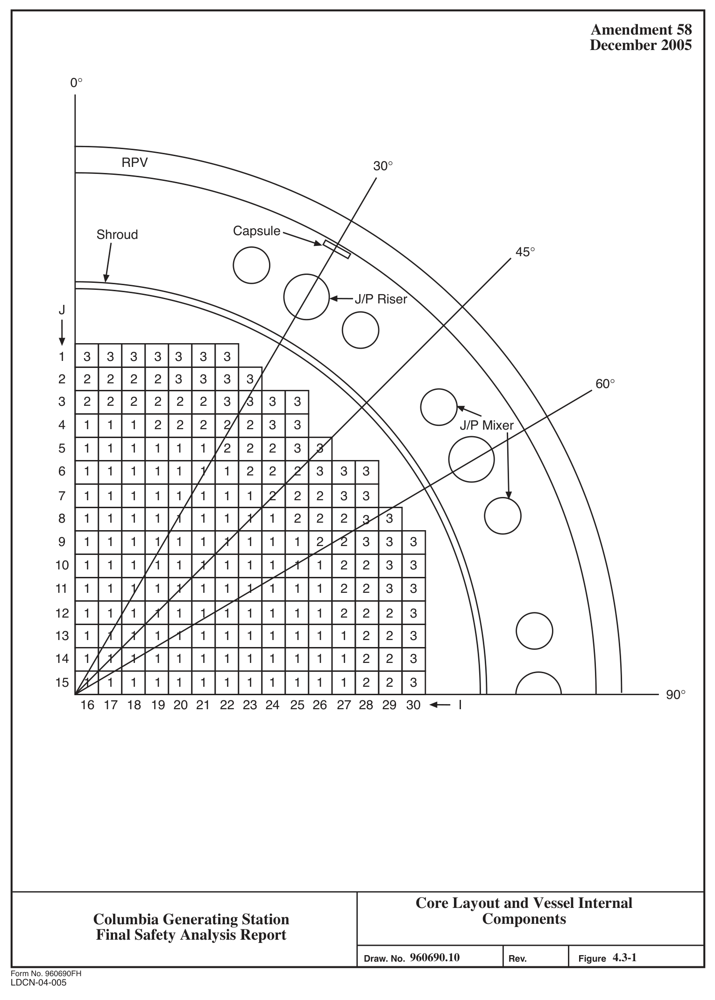

# 4.3 NUCLEAR DESIGN

> Columbia Generating Station FSAR — Chapter 04: Reactor
> Source: `04_chapter-1911-2041.pdf`, PDF pages 52–61 (of 131)
> Amendment 67 compilation (individual pages carry varying amendment dates)

---
<!-- p.52 -->
### 4.3 NUCLEAR DESIGN
#### 4.3.1 DESIGN BASES
See Appendix A, subsection A.4.3.1 of Reference 4.3-4.

##### 4.3.1.1 Reactivity Basis
See Appendix A, subsection A.4.3.1.1 of Reference 4.3-4.

##### 4.3.1.2 Overpower Bases
See Appendix A, subsection A.4.3.1.2 of Reference 4.3-4.

#### 4.3.2 DESCRIPTION
See Appendix A, subsection A.4.3.2 of Reference 4.3-4.

##### 4.3.2.1 Nuclear Design Description
See Appendix A, subsection A.4.3.2.1 of Reference 4.3-4. The reference core loading pattern is provided in the Supplemental Reload Licensing Report (Reference 4.3-7). Table 4.3-3, Table 2-1 of Reference 4.3-1 and Reference 4.3-8 provide reload fuel neutronic design values.

##### 4.3.2.2 Power Distribution
See Appendix A, subsection A.4.3.2.2 of Reference 4.3-4.

###### 4.3.2.2.1 Power Distribution Calculations
See References 4.3-7 and 4.3-3.

###### 4.3.2.2.2 Power Distribution Measurements
See Appendix A, subsection A.4.3.2.2.2 of Reference 4.3-4.

###### 4.3.2.2.3 Power Distribution Accuracy
See Appendix A, subsection A.4.3.2.2.3 of Reference 4.3-4.

###### 4.3.2.2.4 Power Distribution Anomalies
See Appendix A, subsection A.4.3.2.2.4 of Reference 4.3-4.

<!-- p.53 -->
##### 4.3.2.3 Reactivity Coefficients
See Appendix A, subsection A.4.3.2.3 of Reference 4.3-4.

##### 4.3.2.4 Control Requirements
See Appendix A, subsection A.4.3.2.4 of References 4.3-4.

###### 4.3.2.4.1 Shutdown Reactivity
See Appendix A, subsection A.4.3.2.4.1 of Reference 4.3-4.

The cold shutdown margin for the reference core loading pattern is provided in Reference 4.3-7.

As discussed in Section 4.6.3.1.1.5, the shutdown margin with the highest worth control rod withdrawn shall be analytically determined to be at least 0.38% k/k or shall be determined by test to be at least 0.28% ∆k/k. To ensure that the safety design basis for shutdown margin is satisfied, additional design margin is adopted during design development so that a shutdown margin of at least 1.00% ∆k/k is calculated with the highest worth control rod fully withdrawn.

###### 4.3.2.4.2 Reactivity Variations
See Appendix A, subsection A.4.3.2.6 of Reference 4.3-4.

The excess reactivity designed into the core is controlled by the control rod system supplemented by gadolinia-urania fuel rods (Reference 4.3-3).

Control rods are used during the cycle partly to compensate for burnup and partly to control the power distribution.

Reactivity balances are not used in describing BWR behavior because of the strong interdependence of the individual constituents of reactivity. Therefore, the design process does not produce components of a reactivity balance at the conditions of interest. Instead, it gives the keff representing all effects combined. Further, any listing of components of a reactivity balance is quite ambiguous unless the sequence of the changes is clearly defined.

##### 4.3.2.5 Control Rod Patterns and Reactivity Worths
See References 4.3-1 and 4.3-3.

<!-- p.54 -->
##### 4.3.2.6 Criticality of Reactor During Refueling
See Appendix A, subsection A.4.3.2.6 of Reference 4.3-4.

Compliance with Technical Specification shutdown margin requirements is demonstrated through plant procedures and reactivity analyses performed for reload specific refueling activities.

##### 4.3.2.7 Stability
See Appendix A, subsection A.4.3.2.7 of Reference 4.3-4.

###### 4.3.2.7.1 Xenon Transients
See Appendix A, subsection A.4.3.2.7.1 of Reference 4.3-4.

###### 4.3.2.7.2 Thermal Hydraulic Stability
See Appendix A, subsection A.4.3.2.7.2 of Reference 4.3-4.

##### 4.3.2.8 Vessel Irradiations
The reactor pressure vessel (RPV) irradiation calculation provides a best-estimate prediction of the fluence rather than a conservative prediction as was the case with earlier methods. The methodology for the neutron flux calculation conforms to Licensing Topical Report (LTR)
NEDC-32983P-A (Reference 4.3-10). In general, the methodology described in the LTR adheres to the guidance in Regulatory Guide 1.190 for neutron flux evaluation and was approved by the U.S. NRC in the Safety Evaluation Report (SER) for referencing in licensing actions.

The fluence calculations are performed with the DORTG01V discrete ordinates transport code.
The LTR provides a description of the DORT calculation used to determine the RPV fluence, as well as the calculations used to predict the measured dosimetry and validate the transport model. The calculational model includes a representation of the peripheral fuel assemblies and the core-internals, downcomer and vessel geometry. Calculations are performed to determine the bundle-average power distribution in the peripheral fuel bundles for input to the DORT core neutron source. Calculations employ a relatively fine (r, , z) spatial mesh and are carried out using an S12 angular quadrature set. The eighty-group MATXS cross section library is the basic nuclear data set. The cross section data used in these calculations is based on the ENDF/B-V nuclear data except for iron, hydrogen and oxygen. Since the cross sections for these elements have changed significantly in the more recent ENDF/B-VI data set, ENDF/B-VI cross sections were used for oxygen, hydrogen, and individual iron isotopes. The cross section library is used in performing the energy and spatial self-shielding and removal

<!-- p.55 -->
calculations. The scattering cross sections are represented using a P3 Legendre expansion.
The calculations are performed in azimuthal (r, ) and axial (r, z) geometries. A synthesis technique is used to determine the three-dimensional fluence distribution.

The impact on the P-T curves due to variation in the RPV flux relating to changes in the water density in regions above the core are appropriately addressed by conservatisms in the fluence analysis.

Figure 4.3-1 shows a quadrant of the core and the vessel internal components that are relevant to the flux calculation (Reference 4.3-5). The reactor core is divided into three radial zones, based on the geometric layout of the bundles and their relative contribution to the shroud and RPV flux. The (r, ) analysis used the polar coordinates to define the calculation model as a planar sector between pre-selected reactor azimuths (typically 0° and 90°). A single bounding set of results are constructed from the maximum flux and fluence values between the GNF2 and GNF3 fuel-results at each radial position, elevation, and azimuth. The model includes several material regions radially: three in-core regions, the bypass water region, shroud, downcomer water, jet-pump riser, jet-pump inlet mixer, surveillance capsule holder/bracket, and the RPV cladding and base metal.

The core model for the axial (r,z) calculation is a cylinder simulating the cross-sectional area of the core at a pre-selected azimuth. For the capsule flux calculation, the (r,z) calculations were performed at the 30° and 120° azimuth (capsule locations). A single bounding set of results are constructed from the maximum flux and fluence values between the GNF2 and GNF3 fuel-results at each radial position, elevation, and azimuth. The core cylinder contains the afore-mentioned three radial zones for each of the 25 axial fuel nodes. Each axial fuel node is sub-divided into bundle-dependent radial regions so that each core region is modeled with its respective water density, structure material density, and actinide concentration.
Similar to the (r, ) model, there are bypass water, Jet Pump Assemblies, shroud, downcomer water, and RPV regions beyond the core.

Table 4.3-1 summarizes the neutron fluence results (Reference 4.3-5). Fluence results are provided at 54 EFPY based on the current licensed thermal power (CLTP) of each historical cycle and assuming a power level of 3,544 MWt for the projected cycles. Additional fluence results are provided at 31, 43, and 54 EFPY based on the original licensed thermal power
(OLTP) of 3,343 MWt for every cycle. These additional OLTP fluence results correspond to 29.8, 41.0, and 51.3 EFPY based on CLTP.

Note: Columbia Generating Station is evaluated for a fluence that bounds the required value for operation at 3544 MWt from cycle 24 through the end of life (Reference 4.3-14).

The RPV peak fluence (at 54 EFPY) given in Table 4.5 of Reference 4.3-6 is used for development of the P-T limit curves. The 1/4 T fluences were calculated in accordance with RG 1.99, Revision 2..

<!-- p.56 -->
#### 4.3.3 ANALYTICAL METHODS
See Appendix A, subsection A.4.3.3 of Reference 4.3-4

#### 4.3.4 CHANGES
See Appendix A, subsection A.4.3.4 of Reference 4.3-4.

#### 4.3.5 REFERENCES
4.3-1 “GNF2 Advantage Generic compliance with NEDE-24011-P-A (GESTAR II),” NEDC-33270P, (most recent version referenced in COLR).

4.3-2 Deleted.

4.3-3 Nuclear Design Report (most recent version referenced in COLR).

4.3-4 General Electric Standard Application for Reactor Fuel, NEDE-24011-P-A, and Supplement for United States, NEDE-24011-P-A-US (most recent approved version referenced in COLR).

4.3-5 GEH/GNF Company Proprietary, “Energy Northwest Columbia Generating Station Neutron Fluence Projection,” 005N1411, November 2019. (CVI 1012- 00,21)

4.3-6 GE Hitachi Nuclear Energy Proprietary, “Pressure-Temperature Curves Report for Energy Northwest Columbia Generating Station 60 Year Plant License Extension,” 005N4603, November 2020. (CVI 1012-00,23)

4.3-7 Supplemental Reload Licensing Report for Columbia (most recent version referenced in COLR).

4.3-8 Fuel Bundle Information Report for Columbia (most recent version referenced in COLR).

4.3-9 Deleted.

4.3-10 GE Nuclear Energy, “Licensing Topical Report, General Electric Methodology for Reactor Pressure Vessel Fast Neutron Flux Evaluations,” NEDC-32983P-A, Revision 2, January 2006.

4.3-11 Deleted.

<!-- p.57 -->
4.3-12 GE Nuclear Energy, Washington Public Power Supply System Nuclear Project 2, “WNP-2 Power Uprate Transient Analysis Task Report,” GE-NE-208-08-0393, September 1993.

4.3-13 GE Nuclear Energy, “Licensing Topical Report, General Electric Methodology for Reactor Pressure Vessel Fast Neutron Flux Evaluations,” NEDC-32983-P-A, December 2001.

4.3-14 GE-Hitachi Nuclear Energy, “Safety Analysis Report for Columbia Generating Station Thermal Power Optimization,” NEDC-33853P, March 2016.

<!-- p.58 -->
Table 4.3-1

Key Flux and Fluence Results

OLTP Fluence1 CLTP
(n/cm2) Flux Fluence2 Component
(n/cm2 s)
(n/cm2)

## 31 EFPY 43 EFPY 54 EFPY
RPV (Peak) 6.16E+08 7.62E+17 1.00E+18 1.22E+18 1.28E+18 RPV 4.60E+08 6.29E+17 8.07E+17 9.72E+17 1.01E+18
(Midplane)
Shroud 1.35E+12 1.64E+21 2.15E+21 2.63E+21 2.75E+21
(Peak)
Top Guide 1.84E+13 1.17E+22 1.87E+22 2.53E+22 2.70E+22 Core Plate 6.55E+11 3.16E+20 5.69E+20 8.03E+20 8.63E+20 Jet Pump 1.31E+11 1.61E+20 2.11E+20 2.58E+20 2.70E+20 Risers Capsule at 3.99E+08 N/A N/A N/A N/A 30° Capsule at 3.97E+08 N/A N/A N/A N/A 120°

## 1 Calculated using EFPY values based on OLTP power level of 3,323 MWt
## 2 Calculated using EFPY values based on CLTP of each historical cycle and 3,544 MWt for
projected cycles.

<!-- p.59 -->
Table 4.3-2

#### DELETED
<!-- p.60 -->
Table 4.3-3

Neutronic Design Values

Parameter Value

Core data

Number of fuel assemblies 764

Rated power, MWt 3544

Rated core flow, Mlbm/hr 108.5

Core inlet enthalpy, Btu/lbm 528.5

Reactor dome pressure, psia 1035

Fuel assembly pitch, in.
6.00

Control rod dataa

Absorber material B4C

Total blade span, in.
9.75

Total blade support span, in.
1.58

Blade thickness 0.260

Blade face-to-face internal dimension, in.
0.200

Absorber rods per blade 76

Absorber rods outside diameter, in.
0.188

Absorber rods inside diameter, in.
0.138

Absorber density, % of theoretical 70.0 a Original equipment control rods. Some of the control blades are replaced with Duralife 215 and Marathon control blades.

<!-- p.61 -->

*figure on PDF page 61*

[Vector original (SVG, lossless): fig_page-61_2.svg](../figures/fig_page-61_2.svg)

<!-- labels/text on this figure page -->
Amendment 58 December 2005
0°
RPV 30°
Capsule Shroud 45°
J/P Riser J
1 3 3 3 3 3 3 3 2 2 2 2 2 3 3 3 3 60° 3 2 2 2 2 2 2 3 3 3 3 4 1 1 1 2 2 2 2 2 3 3 J/P Mixer 5 1 1 1 1 1 1 2 2 2 3 3 6 1 1 1 1 1 1 1 2 2 2 3 3 3 7 1 1 1 1 1 1 1 1 2 2 2 3 3 8 1 1 1 1 1 1 1 1 1 2 2 2 3 3 9 1 1 1 1 1 1 1 1 1 1 2 2 3 3 3 10 1 1 1 1 1 1 1 1 1 1 1 2 2 3 3 11 1 1 1 1 1 1 1 1 1 1 1 2 2 3 3 0 12 1 1 1 1 1 1 1 1 1 1 1 2 2 2 3 13 1 1 1 1 1 1 1 1 1 1 1 1 2 2 3 14 1 1 1 1 1 1 1 1 1 1 1 1 2 2 3 15 1 1 1 1 1 1 1 1 1 1 1 1 2 2 3 90° 16 17 18 19 20 21 22 23 24 25 26 27 28 29 30 I
Core Layout and Vessel Internal Components Columbia Generating Station Final Safety Analysis Report 960690.10 4.3-1 Draw. No.
Rev. Figure Form No. 960690FH
LDCN-04-005

