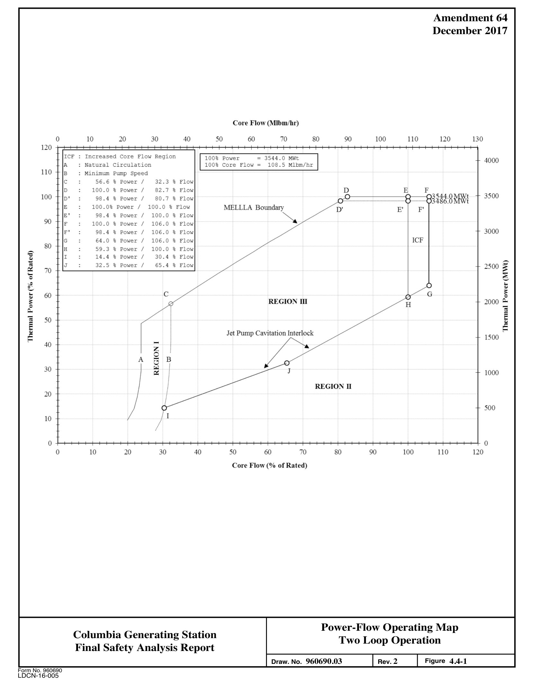
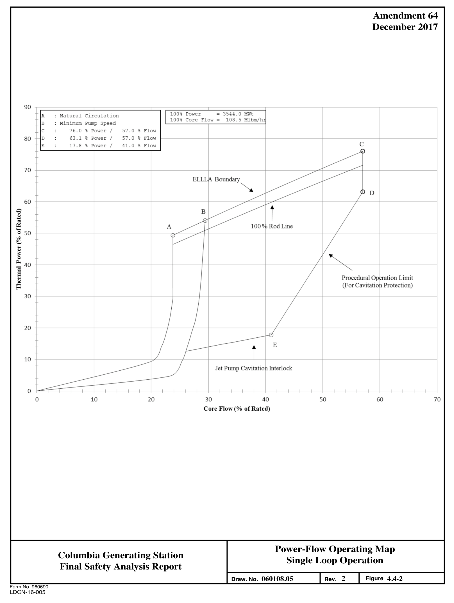

# 4.4 THERMAL-HYDRAULIC DESIGN

> Columbia Generating Station FSAR — Chapter 04: Reactor
> Source: `04_chapter-1911-2041.pdf`, PDF pages 62–77 (of 131)
> Amendment 67 compilation (individual pages carry varying amendment dates)

---
<!-- p.62 -->
### 4.4 THERMAL-HYDRAULIC DESIGN
#### 4.4.1 DESIGN BASES
##### 4.4.1.1 Safety Design Bases
See Appendix A, subsection A.4.4.1.1 of Reference 4.4-1.

##### 4.4.1.2 Requirements for Steady-State Conditions
See Appendix A, subsection A.4.4.1.2 of Reference 4.4-1.

For purposes of maintaining adequate thermal margin during normal steady-state operation, the minimum critical power ratio (MCPR) must not be less than the required MCPR operating limit, and the maximum linear heat generation rate (MLHGR) must be maintained below the design linear heat generation rate (LHGR) for the plant. This does not specify the operating power nor does it specify peaking factors. These parameters are determined subject to a number of constraints including the thermal limits given previously. The core and fuel design basis for steady-state operation (i.e., MCPR and LHGR limits) have been defined to provide margin between the steady-state operating conditions and any fuel damage condition to accommodate uncertainties and to ensure that no fuel damage results even during the worst anticipated transient condition at any time in life.

##### 4.4.1.3 Requirements for Anticipated Operational Occurrences (AOOs)
See Appendix A, subsection A.4.4.1.3 of Reference 4.4-1.

##### 4.4.1.4 Summary of Design Bases
See Appendix A, subsection A.4.4.1.4 of Reference 4.4-1, and Reference 4.4-4.

#### 4.4.2 DESCRIPTION OF THERMAL-HYDRAULIC DESIGN OF REACTOR CORE
See Appendix A, subsection A.4.4.2 of Reference 4.4-1.

##### 4.4.2.1 Summary Comparison
An evaluation of plant performance from a thermal and hydraulic standpoint is provided in Section 4.4.3. A tabulation of thermal and hydraulic parameters of the core is given in Table 4.4-1. Any changes for reload cores will be indicated in the Supplemental Reload Licensing Report (Reference 4.4-4).

<!-- p.63 -->
##### 4.4.2.2 Critical Power Ratio
See Appendix A, subsection A.4.4.2.2 of Reference 4.4-1 and Reference 4.4-2.

##### 4.4.2.3 Linear Heat Generation Rate
See Appendix A, subsection A.4.4.2.3 of Reference 4.4-1 and Reference 4.4-2.

##### 4.4.2.4 Void Fraction Distribution
See Appendix A, subsection A.4.4.2.4 of Reference 4.4-1 and Reference 4.4-3.

##### 4.4.2.5 Core Coolant Flow Distribution and Orificing Pattern
Correct distribution of core coolant flow among the fuel assemblies is accomplished by the orifices fixed at the inlet of each fuel assembly in the fuel support pieces. The orifices control the flow distribution and, hence, the coolant conditions within prescribed bounds throughout the design range of core operation. The sizing and design of the orifices ensure stable flow in each fuel assembly during normal operating conditions.

The core is divided into two orifice flow zones. The outer zone is a narrow, reduced-power region around the core periphery. The inner zone is the core central region. No other flow or steam distribution, other than that provided by adjusting power distribution with control rods, is used or needed.

###### 4.4.2.5.1 Flow Distribution Data Comparison
Design core flow calculations were made using the design power distributions. The flow distribution to the fuel assemblies was calculated based on the assumption that the pressure drop across all of the fuel assemblies is the same. This assumption has been confirmed by measuring the flow distribution in BWRs. Therefore, there is a reasonable assurance that the calculated flow distribution throughout the core is in close agreement with the actual flow distribution (Reference 4.4-1).

###### 4.4.2.5.2 Effect of Channel Flow Uncertainties on the MCPR Uncertainty
The channel flow uncertainty has been inherently considered in its contribution to the MCPR uncertainty when evaluating the probability of a fuel rod subject to a boiling transition in establishing the MCPR99.9%.

<!-- p.64 -->
The channel flow uncertainty is not an independent parameter contributing to the MCPR uncertainty. Its effect has been included in evaluating the probability of a boiling transition during a core wide power and flow calculation.

##### 4.4.2.6 Core Pressure Drop and Hydraulic Loads
See Appendix A, subsection A.4.4.2.6 of Reference 4.4-1 and Reference 4.4-2.

##### 4.4.2.7 Correlation and Physical Data
See Appendix A, subsection A.4.4.2.7 of Reference 4.4-1 and Reference 4.4-2.

##### 4.4.2.8 Thermal Effects of Operational Transients
See Appendix A, subsection A.4.4.2.8 of Reference 4.4-1 and Reference 4.4-2.

##### 4.4.2.9 Uncertainties in Estimates
See Appendix A, subsection A.4.4.2.9 of Reference 4.4-1 and Reference 4.4-2.

<!-- p.65 -->
##### 4.4.2.10 Flux Tilt Considerations
See Appendix A, subsection A.4.4.2.10 of Reference 4.4-1.

#### 4.4.3 DESCRIPTION OF THE THERMAL AND HYDRAULIC DESIGN OF THE
#### REACTOR COOLANT SYSTEM
##### 4.4.3.1 Plant Configuration Data
###### 4.4.3.1.1 Reactor Coolant System Configuration
The reactor coolant system is described in Section 5.4 and shown in isometric perspective in Figure 5.4-1. The piping sizes, fittings, and valves are listed in Table 5.4-2.

###### 4.4.3.1.2 Reactor Coolant System Thermal Hydraulic Data
The steady-state distribution of temperature, pressure, and flow rate for each flow path in the reactor coolant system is shown in Figure 5.1-1.

###### 4.4.3.1.3 Reactor Coolant System Geometric Data
Coolant volumes of regions and components within the reactor vessel are shown in Figure 5.1-2.

Table 4.4-3 provides the flow path length, height, liquid level, minimum elevations, and minimum flow areas for each major flow path volume within the reactor vessel and recirculation loops of the reactor coolant systems.

Table 4.4-4 provides the lengths and sizes of all safety injection lines to the reactor coolant system.

##### 4.4.3.2 Operating Restrictions on Pumps
Expected recirculation pump performance curves are shown in Figures 5.4-2 and 5.4-7. These curves are valid for all conditions with a normal operating range varying from approximately 25% to 105% of rated pump flow.

The pump characteristics, including considerations of net positive suction head (NPSH)
requirements, are the same for the conditions of two-pump and one-pump operation as described in Section 5.4.1. Subsection 4.4.3.3 gives the operating limits imposed on the recirculation pumps by cavitation, pump loads, bearing design flow starvation, and pump speed.

<!-- p.66 -->
##### 4.4.3.3 Power-Flow Operating Map
###### 4.4.3.3.1 Limits for Normal Operation
The power-flow operating map for the power range of operation is shown in Figure 4.4-1.
The boundaries of this map are as follows.

a. Natural circulation line: The operating state of the reactor moves along this line for the normal control rod withdrawal sequence in the absence of recirculation pump operation,

b. Maximum Extended Load Line Limit Analysis (MELLLA) Boundary: The line passes through 100% power at 82.7% core flow,

c. Rated power line: Constant 100% power line,

d. ICF line: Constant 106% increased core flow line, and

e. Pump cavitation interlock line: This line is required to protect either the recirculation pumps or the jet pumps from cavitation damage.

###### 4.4.3.3.2 Regions of the Power-Flow Map
a. Region I This region defines the system startup operational capability with the recirculation pumps and motors being driven by the adjustable speed drives (ASDs). Flow is controlled by the variable speed pump, and power changes during normal startup and shutdown will be in this region;

b. Region II This is the low power area of the operating map where cavitation can be expected in the recirculation pumps and jet pumps.
Operation within this region is precluded by system interlocks that run back the pumps to minimum speed; and

c. Region III This represents the normal operating zone of the map where power changes can be made by either control rod movement or by core flow changes through use of the variable speed pumps.

###### 4.4.3.3.3 Design Features for Power-Flow Control
The following limits and design features are employed to maintain power-flow conditions to the required values shown in Figure 4.4-1:

<!-- p.67 -->
a. Minimum power limits at intermediate and high core flows. To prevent cavitation in the recirculation pumps and jet pumps, the recirculating system is provided with an interlock to run back the pump speed to 15 Hz if the difference between steam line temperature and recirculation pump inlet temperature is less than a preset value (10.7°F). This action is initiated electronically through a time delay.

b. Minimum power limit at low core flow. During low power, low loop flow operations, the temperature differential interlock provides cavitation protection.
Activation of the temperature differential interlock will run back the pump speed to 15 Hz. The ASD output speed/frequency is measured by instrumentation provided for monitoring the ASD. The speed change action is electronically initiated.

c. Pump bearing limit. For pumps as large as the recirculation pumps, practical limits of pump bearing design require that minimum pump flow be limited to D 25% of rated. To ensure this minimum flow, the system is designed so that the minimum pump speed will allow this rate of flow.

d. Valve position. To prevent structural or cavitation damage to the recirculation pump due to pump suction flow starvation, the system is provided with an interlock to prevent starting the pumps or to trip the pumps if the suction or D discharge block valves are at less than 90% open position. This circuit is activated by a position limit switch and is active before the pump is started, during individual loop manual control mode, or during ganged loop manual control.

The cavitation limits are established for two-pump operation, but will not protect the jet pumps and recirculation pumps on one-pump operation. Therefore, additional procedural operational limits are established to prevent cavitation damage during the single loop operation. One-pump operation is restricted to the Extended Load Line Limit Analysis (108% rodline) boundary because extended operation in the MELLLA domain has not been evaluated. The procedural operational limits are shown in Figure 4.4-2.

Flow Control. The principal modes of normal operation with ASD flow control are summarized as follows: The recirculation pumps are started when the suction and discharge block valves are full open; with the pump speed at 15 Hz the reactor heatup and pressurization can commence. When operating pressure has been established, reactor power can be increased. This power-flow increase will follow a line within Region I of the flow control map shown in Figure 4.4-1.

When reactor power is greater than approximately 20% of rated, the steam line to recirculation pump inlet differential temperature low feedwater flow interlock is cleared and the main

<!-- p.68 -->
recirculation pump speed can be manually increased from 15 Hz. The system is then brought to the desired power-flow level within the normal operating area of the map (Region III) by individual loop control or manual ganged control of the ASD system output frequency and by withdrawing control rods.

Recirculation pump speed increases resulting from ASD system output frequency increases toward 63 Hz with constant control rod position will result in power/flow changes along, or nearly parallel to, the 100% rod line.

##### 4.4.3.4 Temperature-Power Operating Map
Not applicable.

##### 4.4.3.5 Load-Following Characteristics
The automatic load following feature has been deleted from the system. All load increases or decreases on CGS are manually controlled by the operator.

##### 4.4.3.6 Thermal and Hydraulic Characteristics Summary Table
The thermal-hydraulic characteristics are provided in Table 4.4-1 for the core and tables of Section 5.4 for other portions of the reactor coolant system.

#### 4.4.4 EVALUATION
See Appendix A, subsections A.4.4.4 – A.4.4.4.5 of Reference 4.4-1 and Reference 4.4-2.

##### 4.4.4.1 Bypass Flow
Reference 4.4-3 shows the bypass flows for the GNF2 core.

##### 4.4.4.2 Thermal Hydraulic Stability Analysis
Core thermal-hydraulic analyses are performed in accordance with the Long-Term Stability Solutions Option III methodology described in Reference 4.4-1. The analysis supporting the OPRM System Period Based Detection Algorithm (PBDA) setpoints is presented in Reference 4.4-4. A backup stability protection may be used on an interim basis as allowed by Technical Specifications. The analysis supporting the backup stability protection is presented in Reference 4.4-4, and the methods used in the backup stability protection analysis are presented in Reference 4.4-1.

<!-- p.69 -->
#### 4.4.5 TESTING AND VERIFICATION
See Appendix A, subsection A.4.4.5 of Reference 4.4-1.

#### 4.4.6 INSTRUMENTATION REQUIREMENTS
See Appendix A, subsection A.4.4.6 of Reference 4.4-1.

##### 4.4.6.1 Loose Parts
The instrumentation for online monitoring for loose parts in the reactor vessel has been deactivated.

See Section 7.7.1.12 for further information.

#### 4.4.7 REFERENCES
4.4-1 General Electric Company, General Electric Standard Application for Reactor Fuel, NEDE-24011-P-A, and Supplement for United States, NEDE-24011-P-A-US (most recent approved version referenced in COLR).

4.4-2 “GNF2 Advantage Generic Compliance with NEDE-24011-P-A (GESTAR II),” NEDC-33270P, (most recent version referenced in COLR).

4.4-3 Global Nuclear Fuel, “GNF2 Thermal Hydraulic Compatibility with Columbia Generating Station Legacy Fuel,” 002N3118, Revision 0, December 2014.

4.4-4 Supplemental Reload Licensing Report for Columbia (most recent version referenced in COLR).

<!-- p.70 -->
4.4-9 GEXL97 Correlation Applicable to ATRIUM-10 Fuel, NEDC-33419P, Revision 0, June 2008.

4.4-10 Methodology and Uncertainties for Safety Limit MCPR Evaluations, NEDC-32601P-A, August 1999.

4.4-11 Power Distribution Uncertainties for Safety Limit MCPR Evaluations, NEDC-32694P-A, August 1999.

4.4-12 Fuel Bundle Information Report for Columbia (most recent version referenced in COLR).

<!-- p.71 -->
Table 4.4-1

Thermal and Hydraulic Design Characteristics of the Reactor Core

General Operating Conditions Parameter

Reference design thermal output, MWt 3544

37021 Power level for engineered safety features, MWt

Steam flow rate, at 422.1F final feedwater temperature, millions lb/hr 15.28

Core coolant flow rate range, millions lb/hr 89.7-115

Feedwater flow rate, millions lb/hr 15.25

System pressure, nominal in steam dome, psia 1035

Core exit pressure, nominal, psia 1050

Coolant saturation temperature at core design pressure, F 551

Average power density, kW/liter 52.40

Average linear heat generation rate, kW/ft 4.18

Core total heat transfer area, ft2 86,499

Core total heat transfer area, ft2 134,750

(see COLR)2 Design operating minimum critical power ratio (MCPR)

Core inlet enthalpy at 422.1F FFWT, Btu/lb 528.5

Core inlet temperature, at 422.1F FFWT, F 533.6

Core total heat transfer area, ft2 72.4

Core total heat transfer area, ft2 121.53

## 22.9393 Core pressure drop, psid

1 Per data on page 18 of NEDC-32141P, Power Uprate with Extended Load Line Limit Safety Analysis for WNP-2, June 1993.

## 2 Core Operating Limits Report
3 Based on full core of GNF2, (1035 psia dome pressure, 3544 MWt power and 108.5 Mlbm/hr (100% of rated core flow)).

<!-- p.72 -->
Table 4.4-2

Deleted

<!-- p.73 -->
Table 4.4-3

Reactor Coolant System Geometric Data

Flow Path Height and Elevation of Minimum Length Liquid Bottom of Flow Areas
(in.) Level (in.) Each Volumea (ft2)

Lower plenum 216 216 -172.5 71.5 216

Core 164 164 44.0 142.0 164

Upper plenum and 178 178 208.0 49.5 separators 178

Dome (above normal 312 312 386.0 343.5 water level)
0

Downcomer area 321 321 -51.0 79.5 321

132.5 in2 Recirculation loops and 108.5 ft 403 -394.5 jet pumps (one loop)
403

a Reference point is recirculation nozzle outlet centerline.

<!-- p.74 -->
Table 4.4-4

Lengths and Sizes of Safety Injection Lines

Line O.D. Line Length
(in.) (ft)

HPCS line Pump discharge to valvea 16 319 From HPCS-V-4 inside containment to RPV 12.75 108 Total 427

LPCI lines Loop A
1. Pump discharge to reducer 18 421
2. Reducer to injection valve,a RHR-V-42A 14 6
3. From RHR-V-42A to RPV 14 94 Total 521

Loop B
1. Pump discharge to reducer 18 394
2. Reducer to injection valve RHR-V-42B 14 6
3. Inside containment to RPV 14 93 Total 493

Loop C
1. Pump discharge to reducer 18 71
2. Reducer to injection valve RHR-V-42C 14 138
3. Inside containment to RPV 14 99 Total 308

LPCS line Pump discharge to valvea 16 222 Inside containment to RPV 12.75 117 Total 339

a Injection valve located as near as possible to outside of containment wall.

<!-- p.75 -->
Table 4.4-5

Deleted

<!-- p.76 -->

*figure on PDF page 76*

[Vector original (SVG, lossless): fig_page-76.svg](../figures/fig_page-76.svg)

<!-- labels/text on this figure page -->
Amendment 64 December 2017
Core Flow (Mihm/hr)
0 10 20 30 40 50 60 70 80 90 100 110 120 130 120 ICF Increased Core Flow Region 100% Power 3544. 0 MWt 4000 Natural Circulation 100% core Flow 108.5 Mlbm/hr A 110 Minimum Pump Speed B C 56.6 % Power I 32 . 3 % Flow
E F D
D 100 . 0 % Power/ 82 . 7 % Flow 1i~:8~i 3500 100 D' 98 . 4 % Power/ 80 .7 % Flow E 100 . 0% Power / 100 . 0 % Flow MELLLA Boundary
D' E' F'
E' 98 . 4 % Power I 100 . 0 % Flow ~ 90 F 100 . 0 % Power I 106 . 0 % Flow 3000 F' 98 . 4 % Power I 106 . 0 % Flow !CF G 64 . 0 % Power I 106 . 0 % Flow 80 59 . 3 % Power I 100.0 % Flow H 'c 14 . 4 % Power I 30 .4 % Flow - ..:l
C' "
32 . 5 % Power I 65 .4 % Flow J 2500 ;$ 0:: 70 ::; ... ..
0 '--' l ..
...
G :SC C 60 0 REGION m 2000 c..
:SC H
-; 0 ..
c..
E
-; ..
50 E ~ V ... Jet Pump Cavitation Interlock g5 1500 40 :z:
0 ts A B 30 [a;l J 1000 0::
REGION II
20 500 / I 10 //
0 0 0 10 20 30 40 50 60 70 80 90 100 110 120 Core Flow (% of Rated)
Power-Flow Operating Map Columbia Generating Station Two Loop Operation Final Safety Analysis Report 960690.03 2 4.4-1 Figure Draw. No. Rev.
Form No. 960690
LDCN-16-005

<!-- p.77 -->

*figure on PDF page 77*

[Vector original (SVG, lossless): fig_page-77.svg](../figures/fig_page-77.svg)

<!-- labels/text on this figure page -->
Amendment 64 December 2017
90 100% Power = 3544 . 0 MWt I A : Natural Circulation 100% Core Flow = 108 . 5 Mlbm/ hr Minimum Pump Speed B :
C 76 . 0 % Power I 57. 0 % Flow :
80 : 63 . 1 % Power I 57.0 % Flow D C E : 17 . 8 % Power I 41. 0 % Flow
-~~ 70 ELLL f\ Boundary ~ ~ ~ / D ~)
I ~ 60 B ~ ~ , Rod Line A ~
-~ I I "' Procedural Op ~ration Limit
(For Cavitatio ti Protection)
I 30 / )
J-l----T 20 4 E
---------~ 10
- Jet Pump Cavitatio 1 Interlock
------==== 0 so 10 30 40 60 70 0 20 Core Flow(% of Rated)
Power-Flow Operating Map Columbia Generating Station Single Loop Operation Final Safety Analysis Report 2 4.4-2 060108.05 Draw. No.
Rev. Figure Form No. 960690
LDCN-16-005

