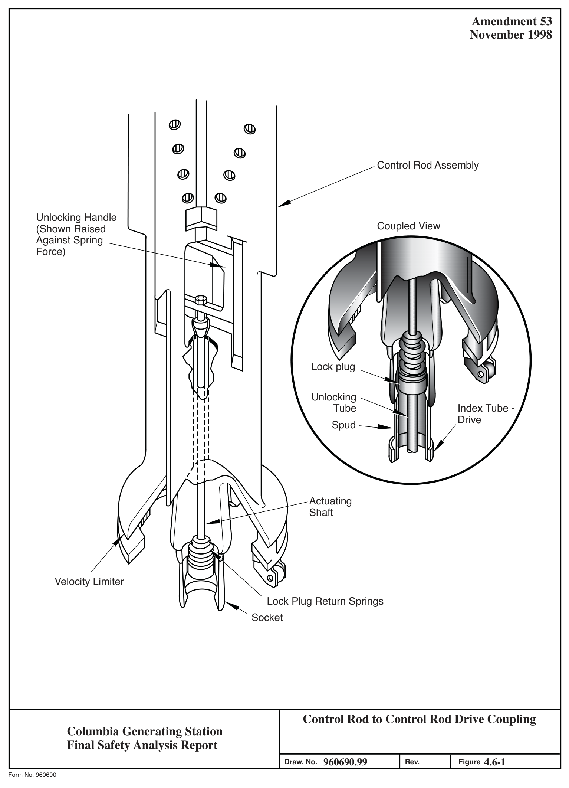
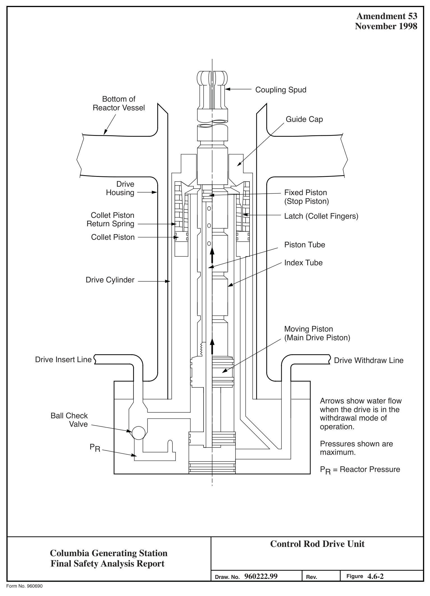
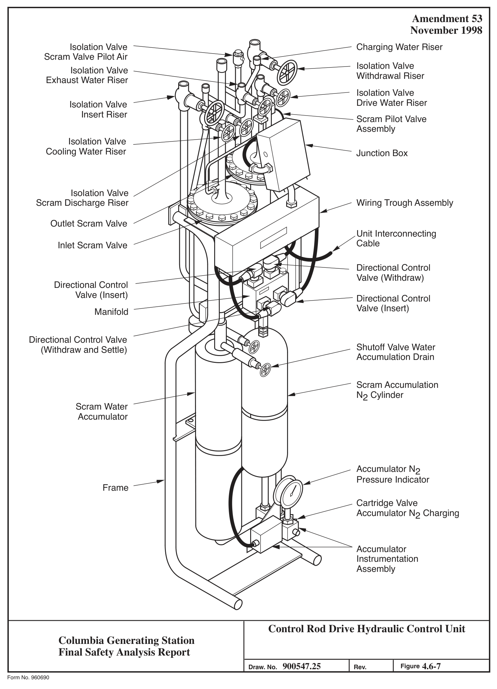
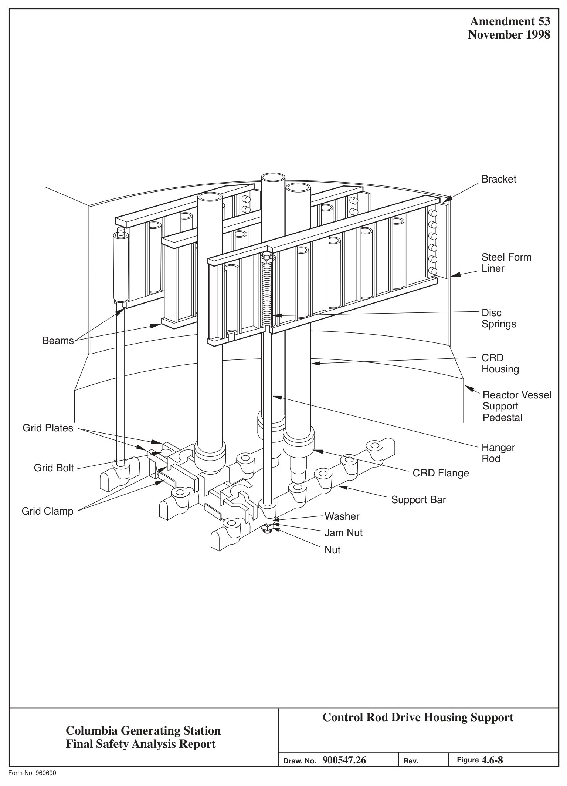

# 4.6 FUNCTIONAL DESIGN OF REACTIVITY CONTROL SYSTEMS

> Columbia Generating Station FSAR — Chapter 04: Reactor
> Source: `04_chapter-1911-2041.pdf`, PDF pages 87–131 (of 131)
> Amendment 67 compilation (individual pages carry varying amendment dates)

---
<!-- p.87 -->
November 1998

### 4.6 FUNCTIONAL DESIGN OF REACTIVITY CONTROL SYSTEMS
Functional design of the control rod drive (CRD) system is discussed below. Functional designs of the recirculation flow control system and the standby liquid control (SLC) system are described in Sections 5.4.1 and 9.3.5, respectively.

#### 4.6.1 INFORMATION FOR THE CONTROL ROD DRIVE SYSTEM
##### 4.6.1.1 Control Rod Drive System Design
###### 4.6.1.1.1 Design Bases
###### 4.6.1.1.1.1 Safety Design Bases. The CRD mechanical system meets the following safety design bases:

a. The design provides for a sufficiently rapid control rod insertion that no fuel damage results from any abnormal operating transient.

b. The design includes positioning devices, each of which individually supports and positions a control rod.

c. Each positioning device

1. Prevents its control rod from initiating withdrawal as a result of a single malfunction,

2. Is individually operated so that a failure in one positioning device does not affect the operation of any other positioning device, and

3. Is individually energized when rapid control rod insertion (scram) is signaled so that failure of power sources external to the positioning device does not prevent other positioning devices’ control rods from being inserted.

4.6.1.1.1.2 Power Generation Design Basis. The CRD system design provides for positioning the control rods to control power generation in the core.

###### 4.6.1.1.2 Description
The CRD system controls gross changes in core reactivity by incrementally positioning neutron absorbing control rods within the reactor core in response to manual control signals. It is also required to quickly shut down the reactor (scram) in emergency situations by rapidly inserting withdrawn control rods into the core in response to a manual or automatic signal. The CRD

<!-- p.88 -->
November 1998

system consists of locking piston CRD mechanisms, and the CRD hydraulic system (including power supply and regulation, hydraulic control units (HCUs), interconnecting piping, instrumentation and electrical controls).

4.6.1.1.2.1 Control Rod Drive Mechanisms. The CRD mechanism (drive) used for positioning the control rod in the reactor core is a double-acting, mechanically latched, hydraulic cylinder using water as its operating fluid (see Figures 4.6-1 through 4.6-4). The individual drives are mounted on the bottom head of the reactor pressure vessel (RPV). The drives do not interfere with refueling and are operative even when the head is removed from the RPV.

The drives are also readily accessible for inspection and servicing. The bottom location makes maximum utilization of the water in the reactor as a neutron shield and gives the least possible neutron exposure to the drive components. Using water from the condensate treatment system and/or condensate storage tanks as the operating fluid eliminates the need for special hydraulic fluid. Drives are able to utilize simple piston seals whose leakage does not contaminate the reactor water but provides cooling for the drive mechanisms and their seals.

The drives are capable of inserting or withdrawing a control rod at a slow, controlled rate, as well as providing rapid insertion when required. A mechanism on the drive locks the control rod at 6-in. increments of stroke over the length of the core.

A coupling spud at the top end of the drive index tube (piston rod) engages and locks into a mating socket at the base of the control rod. The weight of the control rod is sufficient to engage and lock this coupling. Once locked, the drive and rod form an integral unit that must be manually unlocked by specific procedures before the components can be separated.

The drive holds its control rod in distinct latch positions until the hydraulic system actuates movement to a new position. Withdrawal of each rod is limited by a seating of the rod in its guide tube. Withdrawal beyond this position to the over-travel limit can be accomplished only if the rod and drive are uncoupled. Withdrawal to the over-travel limit is annunciated by an alarm.

The individual rod indicators, grouped in one control panel display, correspond to relative rod locations in the core. A separate, smaller display is located just below the large display on the vertical part of the benchboard. This display presents the positions of the control rod selected for movement and the other rods in the affected rod group.

For display purposes the control rods are considered in groups of four adjacent rods centered around a common core volume. Each group is monitored by four local power range monitor
(LPRM) strings (see Section 7.6.1.4). Rod groups at the periphery of the core may have less than four rods. The small rod display shows the positions, in digital form, of the rods in the

<!-- p.89 -->
November 1998

group to which the selected rod belongs. A white light indicates which of the four rods is the one selected for movement.

###### 4.6.1.1.2.2 Drive Components. Figure 4.6-2 illustrates the operating principle of a drive.
Figures 4.6-3 and 4.6-4 illustrate the drive in more detail. The main components of the drive and their functions are described below.

###### 4.6.1.1.2.2.1 Drive Piston. The drive piston is mounted at the lower end of the index tube.
This tube functions as a piston. The drive piston and index tube make up the main moving assembly in the drive. The drive piston operates between positive end stops, with a hydraulic cushion provided at the upper end only. The piston has both inside and outside seal rings and operates in an annular space between an inner cylinder (fixed piston tube) and an outer cylinder (drive cylinder). Because the type of inner seal used is effective in only one direction, the lower sets of seal rings are mounted with one set sealing in each direction.

A pair of nonmetallic bushings prevents metal-to-metal contact between the piston assembly and the inner cylinder surface. The outer piston rings are segmented step-cut seals with expander springs holding the segments against the cylinder wall. A pair of split bushings on the outside of the piston prevents piston contact with the cylinder wall. The effective piston area for down-travel or withdrawal is approximately 1.2 in.2 versus 4.1 in.2 for up-travel or insertion. This difference in driving area tends to balance the control rod weight and ensures a higher force for insertion than for withdrawal.

4.6.1.1.2.2.2 Index Tube. The index tube is a long hollow shaft made of nitrided stainless steel. Circumferential locking grooves, spaced every 6 in. along the outer surface, transmit the weight of the control rod to the collet assembly.

4.6.1.1.2.2.3 Collet Assembly. The collet assembly serves as the index tube locking mechanism. It is located in the upper part of the drive unit. This assembly prevents the index tube from accidentally moving downward. The assembly consists of the collet fingers, a return spring, a guide cap, a collet housing (part of the cylinder, tube, and flange), and the collet piston.

Locking is accomplished by fingers mounted on the collet piston at the top of the drive cylinder. In the locked or latched position the fingers engage a locking groove in the index tube.

The collet piston is normally held in the latched position by a force of approximately 150 lb supplied by a spring. Metal piston rings are used to seal the collet piston from reactor vessel pressure. The collet assembly will not unlatch until the collet fingers are unloaded by a short, automatically sequenced, drive-in signal. A pressure, approximately 180 psi force, slide the collet up against the conical surface in the guide cap, and spread the fingers out so they do not engage a locking groove.

<!-- p.90 -->
November 1998

A guide cap is fixed in the upper end of the drive assembly. This member provides the unlocking cam surface for the collet fingers and serves as the upper bushing for the index tube.

If reactor water is used during a scram to supplement accumulator pressure, it is drawn through a filter on the guide cap.

4.6.1.1.2.2.4 Piston Tube. The piston tube is an inner cylinder, or column, extending upward inside the drive piston and index tube. The piston tube is fixed to the bottom flange of the drive and remains stationary. Water is brought to the upper side of the drive piston through this tube. A buffer shaft, at the upper end of the piston tube, supports the stop piston and buffer components.

4.6.1.1.2.2.5 Stop Piston. A stationary piston, called the stop piston, is mounted on the upper end of the piston tube. This piston provides the seal between reactor vessel pressure and the space above the drive piston. It also functions as a positive end stop at the upper limit of control rod travel. Piston rings and bushings, similar to those used on the drive piston, are mounted on the upper portion of the stop piston. The lower end of the stop piston is threaded on to the top of the piston tube forming a space for a set of spring washers which serve to protect both the drive piston and the stop piston from damage as the drive piston reaches its end of travel. The upper end of the piston tube has a series of orifices which hydraulically dampen the drive piston motion as the inner seals (or buffer seals) slide past them, effectively cutting off the exhaust path for the over-piston water. The high pressures generated in the buffer are confined to the cylinder portion of the stop piston, and are not applied to the stop piston and drive piston seals.

The center tube of the drive mechanism forms a well to contain the position indicator probe.
The probe is an aluminum extrusion attached to a cast aluminum housing. Mounted on the extrusion are hermetically sealed, magnetically operated, position indicator switches. The entire probe assembly is protected by a thin-walled stainless steel tube. The switches are actuated by a ring magnet located at the bottom of the drive piston.

The drive piston, piston tube, and indicator tube are all of nonmagnetic stainless steel, allowing the individual switches to be operated by the magnet as the piston passes. Two switches are located at each position corresponding to an index tube groove, thus allowing redundant indication at each latching point. Two additional switches are located at each midpoint between latching points to indicate the intermediate positions during drive motion.
Thus, indication is provided for each 3 in. of travel. Duplicate switches are provided for the full-in and full-out positions. Redundant over-travel switches are located at a position below the normal full-out position. Because the limit of down-travel is normally provided by the control rod itself as it reaches the backseat position, the drive can pass this position and actuate the over-travel switches only if it is uncoupled from its control rod. A convenient means is

<!-- p.91 -->
November 1998

thus provided to verify that the drive and control rod are coupled after installation of a drive or at any time during plant operation.

4.6.1.1.2.2.6 Flange and Cylinder Assembly. A flange and cylinder assembly is made up of a heavy flange welded to the drive cylinder. A sealing surface on the upper face of this flange forms the seal to the drive housing flange. The seals contain reactor pressure and the two hydraulic control pressures. Teflon coated, stainless steel rings are used for these seals. The drive flange contains the integral ball, or two-way, check (ball-shuttle) valve. This valve directs either the reactor vessel pressure or the driving pressure, whichever is higher, to the underside of the drive piston. Reactor vessel pressure is admitted to this valve from the annular space between the drive and drive housing through passages in the flange.

Water used to operate the collet piston passes between the outer tube and the cylinder tube.
The inside of the cylinder tube is honed to provide the surface required for the drive piston seals.

Both the cylinder tube and outer tube are welded to the drive flange. The upper ends of these tubes have a sliding fit to allow for differential expansion.

4.6.1.1.2.2.7 Lock Plug. The upper end of the index tube is threaded to receive a coupling spud. The coupling (see Figure 4.6-1) accommodates a small amount of angular misalignment between the drive and the control rod. Six spring fingers allow the coupling spud to enter the mating socket on the control rod. A plug then enters the spud and prevents uncoupling.

Two means of uncoupling are provided. With the reactor vessel head removed, the lock plug can be raised against the spring force of approximately 50 lb by a rod extending up through the center of the control rod to an unlocking handle located above the control rod velocity limiter.
The control rod, with the lock plug raised, can then be lifted from the drive.

The lock plug can also be pushed up from below, if it is desired to uncouple a drive without removing the RPV head for access. In this case, the central portion of the drive mechanism is pushed up against the uncoupling rod assembly, which raises the lock plug and allows the coupling spud to disengage the socket as the drive piston and index tube are driven down.

The control rod is heavy enough to force the spud fingers to enter the socket and push the lock plug up, allowing the spud to enter the socket completely and the plug to snap back into place.
Therefore, the drive can be coupled to the control rod using only the weight of the control rod.
However, with the lock plug in place, a force in excess of 50,000 lb is required to pull the coupling apart.

4.6.1.1.2.3 Materials of Construction. Factors that determine the choice of construction materials are discussed in the following subsections.

<!-- p.92 -->
4.6.1.1.2.3.1 Index Tube. The index tube must withstand the locking and unlocking action of the collet fingers. A compatible bearing combination must be provided that is able to withstand moderate misalignment forces. The reactor environment limits the choice of materials suitable for corrosion resistance. The column and tensile loads can be satisfied by an annealed, single phase, nitrogen strengthened, austenitic stainless steel. The wear and bearing requirements are provided by malcomizing the complete tube. To obtain suitable corrosion resistance, a carefully controlled process of surface preparation is employed.

4.6.1.1.2.3.2 Coupling Spud. The coupling spud is made of Inconel 750 that is aged for maximum physical strength and the required corrosion resistance. Because misalignment tends to cause chafing in the semispherical contact area, the part is protected by a thin chromium plating (electrolized). This plating also prevents galling of the threads attaching the coupling spud to the index tube.

4.6.1.1.2.3.3 Collet Fingers. Inconel 750 is used for the collet fingers, which must function as leaf springs when cammed open to the unlocked position. Colmonoy 6 hard facing provides a long-wearing surface, adequate for design life, to the area contacting the index tube and unlocking cam surface of the guide cap.

Experience at some operating boiling water reactors (BWR) indicates that failures can occur in the collet fingers of the CRD mechanism. To resolve this problem, some BWR facilities installed a revised collet retainer design. However, CGS does not have the revised collet retainer design. General Electric (GE) has demonstrated by testing and operating experience that the existing CRDs meet all safety and licensing requirements and are expected to give full life performances. However, as a result of examining operating drives, GE has discovered evidence of intergranular stress corrosion cracking (IGSCC) in some CRD drive components and has made design improvements to preclude IGSCC in the future. The spare parts for CRD components purchased by Energy Northwest incorporate this revised design. Along with the other parts of the drive, the collet retainer tube, piston tube, and index tube will be routinely checked and changed out, if necessary, with the parts incorporating the revised design.

4.6.1.1.2.3.4 Seals and Bushings. Carbon Graphite material is selected for seals and bushings on the drive piston and stop piston. The material is inert, has a low friction coefficient when water-lubricated and is resistant to degradation at high temperatures. The Carbon Graphite material is relatively soft, which is advantageous when an occasional particle of foreign matter reaches a seal. The resulting scratches in the seal reduce sealing efficiency until worn smooth, but the drive design can tolerate considerable water leakage past the seals into the reactor vessel.

4.6.1.1.2.3.5 Summary. All drive components exposed to reactor vessel water are made of austenitic stainless steel except the following:

<!-- p.93 -->
a. Seals and bushings on the drive piston and stop piston are Carbon Graphite material,

b. All springs and members requiring spring action (collet fingers, coupling spud, and spring washers) are made of Inconel-750,

c. The ball check valve is a Haynes Stellite cobalt-base alloy,

d. Elastomeric O-ring seals are ethylene propylene,

e. Metal piston rings are Haynes 25 alloy,

f. Certain wear surfaces are hard faced with Colmonoy 6,

g. Nitriding by a proprietary new malcomizing process and chromium plating are used in certain areas where resistance to abrasion is necessary, and

h. The drive piston head is made of Armco 17-4 PH.

Pressure containing portions of the drives are designed and fabricated in accordance with requirements of the American Society of Mechanical Engineers (ASME) Boiler and Pressure Vessel (B&PV) Code, Section III.

###### 4.6.1.1.2.4 Control Rod Drive Hydraulic System. The CRD hydraulic system (Figure 4.6-5)
supplies and controls the pressure and flow to and from the drives through hydraulic control units (HCU). The water discharged from the drives during a scram flows through the HCU to the scram discharge volume (SDV). The water discharged from a drive during a normal control rod positioning operation flows through the HCU, the exhaust header, and is returned to the reactor vessel via the HCUs of nonmoving drives. Each CRD has an associated HCU.

4.6.1.1.2.4.1 Hydraulic Requirements. The CRD hydraulic system design is shown in Figures 4.6-5 and 4.6-6. The hydraulic requirements, identified by the function they perform, are as follows:

a. An accumulator hydraulic charging pressure of approximately 1400 to 1500 psig is required. Flow to the accumulators is required only during scram reset or system startup;

b. Drive water header pressure of approximately 260 psi above reactor vessel pressure is required. A flow rate of approximately 4 gpm to insert a control rod and 2 gpm to withdraw a control rod is required;

<!-- p.94 -->
c. Cooling water to the drives is required at a flow rate of approximately 0.34 gpm per drive unit. (Cooling water to a drive can be interrupted for short periods without damaging the drive);

d. The SDV is sized to receive and contain all the water discharged by the drives during a scram; a minimum volume of 3.34 gal per drive is required (excluding the instrument volume);

e. Purge water flow to the RPV level instrumentation reference leg backfill system at a flow rate from 0.6 gal/hr to 2.4 gal/hr.

4.6.1.1.2.4.2 System Description. The CRD hydraulic systems provide the required functions with the pumps, filter, valves, instrumentation, and piping shown in Figure 4.6-5 and described in the following.

Duplicate components are included, where necessary, to ensure continuous system operation if an inservice component requires maintenance.

4.6.1.1.2.4.2.1 Supply Pump. One supply pump pressurizes the system with water from a condensate supply header, which takes suction from the condensate treatment system and/or condensate storage tanks depending on plant operation. One installed spare pump is provided for standby. A discharge check valve prevents backflow through the nonoperating pump. A portion of the pump discharge flow is diverted through a minimum flow bypass line to the condensate storage tank. This flow is controlled by an orifice and is sufficient to prevent immediate pump damage if the pump discharge is inadvertently closed.

Condensate water is processed by two filters in the system. The normal CRD pump suction flow path includes a 25- filter with a 250- Y-strainer upstream of the filter. The filtration capacity of these two in-series elements is limited by and therefore characterized by, the 25- filter (see Figure 4.6-5).

The filters used on the CRD system are of a rugged design and failure of the filters are not considered likely. Alarms are provided to give an early warning to the operator that maintenance is required.

The only known mode of failure of the filter element is for it to collapse due to high differential pressure. The CRD pump suction filter can withstand a maximum differential pressure of 20 psi and an alarm indicates in the control room high suction filter differential pressure at 8 psi. The filter element is additionally protected and strengthened by a stainless steel, perforated center tube. The CRD pump discharge filter can withstand a maximum differential pressure of 300 psi and an alarm indicates in the control room high differential pressure at 20 psi. The filter element is constructed entirely of stainless steel.

<!-- p.95 -->
November 1998

If the CRD systems pump suction and discharge filters were bypassed completely, possible presence of corrosion particles would not affect the reliability of the scram function of the CRD system. The presence of corrosion particles may accelerate wear of the drive components over a period of time. However, such wear is not a safety concern since this degradation in drive performance already occurs during normal rod operations and is detectable.

4.6.1.1.2.4.2.2 Accumulator Charging Pressure. Accumulator charging pressure is established by the discharge pressure of the system supply pump. During scram the scram inlet (and outlet) valves open and permit the stored energy in the accumulators to discharge into the drives. The resulting pressure decrease in the charging water header allows the CRD supply pump to “run out” (i.e., flow rate to increase substantially) into the CRDs via the charging water header. The flow sensing system upstream of the accumulator charging header detects high flow and closes the flow control valve. This action maintains increased flow through the charging water header.

Pressure in the charging header is monitored in the control room with a pressure indicator and low pressure alarm. Charging water header pressure is not essential to successfully scram the plant. Each of the accumulators are prevented from leaking back to the charging water header by a check valve. Therefore, the pressure required to scram each rod is maintained. The integrity and leaktightness of these check valves are routinely tested as part of the surveillance test program. In addition, when the reactor is at rated pressure, no accumulator pressure is necessary to scram the plant.

During normal operation the flow control valve maintains a constant system flow rate. This flow is used for drive flow, drive cooling, and system stability.

4.6.1.1.2.4.2.3 Drive Water Pressure. Drive water pressure required in the drive header is maintained by the drive/cooling water pressure control valve, which is manually adjusted from the control room. A flow rate of approximately 6 gpm (the sum of the flow rate required to insert and withdraw a control rod) normally passes from the drive water pressure stage through two solenoid-operated stabilizing valves (arranged in parallel) and then goes into the cooling water header. The flow through one stabilizing valve equals the drive insert flow; that of the other stabilizing valve equals the drive withdrawal flow. When operating a drive, the required flow is diverted to that drive by closing the appropriate stabilizing valve while at the same time opening the drive directional control and exhaust solenoid valves. Thus, flow through the drive/cooling water pressure control valve is always constant.

Flow indicators in the drive water header and in the line downstream from the stabilizing valves allow the flow rate through the stabilizing valves to be adjusted when necessary.
Differential pressure between the reactor vessel and the drive pressure stage is indicated in the control room.

<!-- p.96 -->
November 1998

4.6.1.1.2.4.2.4 Cooling Water Header. The cooling water header is located downstream from the drive/cooling water pressure valve. The drive/cooling water pressure control valve is manually adjusted from the control room to produce the required drive/cooling water pressure balance.

The flow through the flow control valve is virtually constant. Therefore, once adjusted, the drive/cooling water pressure control valve will maintain the correct drive pressure and cooling water pressure, independent of reactor vessel pressure. Changes in setting of the pressure control valve are required only to adjust for changes in the cooling requirements of the drives, as drive seal characteristics change with time. A flow indicator in the control room monitors cooling water flow. A differential pressure indicator in the control room indicates the difference between reactor vessel pressure and drive/cooling water pressure. Although the drives can function without cooling water, temperatures above 350°F can result in fluid flashing and measurable delays in scram times. The temperature of each drive is monitored by a temperature recorder.

4.6.1.1.2.4.2.5 Scram Discharge Volume. The CGS SDV header system is designed as a continually expanding path from the 185 individual 0.75-in. scram discharge (withdrawal)
lines to one of two integrated scram discharge volume/instrument volume (SDV/IV) systems
(one system per approximately half the drives). Each integrated SDV/IV system consists of a continuously downsloping piping run expanding from the SDV (consisting of seven 6-in.
Return headers from the individual HCU banks to an 8-in. combined return header) to the 12-in. vertically oriented IV. The only location where blockage need be assumed (piping less than 2-in. diameter) is in the 0.75 in. discharge line from the individual HCU. Blockage here would only cause failure of one control rod to insert. This is an acceptable consequence for a single failure and has been evaluated as part of the plant design basis. The header piping is sized to receive and contain all the water discharged by the drives during a full scram (3.34 gal per drive) independent of the IV.

During normal plant operation each SDV is empty and vented to the atmosphere through its open vent and drain valve. When a scram occurs on a signal from the safety circuit, these vent and drain valves are closed to conserve reactor water. Redundant vent and drain valves are incorporated in the design of the SDV to ensure that no single failure can result in uncontrolled loss of reactor coolant. Lights in the control room indicate the position of these valves.

During a scram, the SDV partly fills with water discharged from above the drive pistons.
After scram is completed, the CRD seal leakage from the reactor continues to flow into the SDV until the discharge volume pressure equals the reactor vessel pressure. A check valve in each HCU prevents reverse flow from the scram discharge header volume to the drive. When the initial scram signal is cleared from the reactor protection system (RPS), the SDV signal is overridden with a key lock override switch, and the SDV is drained and returned to atmospheric pressure.

<!-- p.97 -->
November 2017

Remote manual switches in the pilot valve solenoid circuits allow the discharge volume vent and drain valves to be tested without disturbing the RPS. Closing the SDV valves allows the outlet scram valve seats to be leak tested by timing the accumulation of leakage inside the SDV.

Two transmitter/level switches (non-indicating) and two transmitter/level indicating switches directly connected to each instrument volume monitor the volume for abnormal water level.
They provide redundant and diverse input to the RPS scram function. One transmitter on each instrument volume also provides input for the control room annunciation and control rod withdrawal block function. There are three different actuation levels. At the lowest level, a level switch on each instrument volume actuates to indicate that the volume is not completely empty during post-scram draining or to indicate that the volume starts to fill through leakage accumulation at other times during reactor operation. At the second level, one level switch on each instrument volume produces a rod withdrawal block to prevent further withdrawal of any control rod, when leakage accumulates to half the capacity of the instrument volume. The two level switches and the two level indicating switches on each instrument volume are interconnected (one of each per trip channel) with the RPS and will initiate a reactor scram on high water level while sufficient volume for a full scram still exists within the SDV. To provide diversity for the RPS function the two transmitters per channel use a different sensing operating principle and have a different transmitter manufacturer. The level switches and the level indicating switches in each channel are also from different manufacturers.

In the event of a slow or partial loss of air pressure, the high-level scram setpoint and the SDV/IV system capacity ensure that scram capability is maintained even in the event of maximum inleakage into the SDV prior to a scram. Analysis, assuming the maximum inleakage of 5 gpm and using the actual calculation piston-over area to determine the scram volume requirements, shows that adequate scram discharge volume will remain in the SDV system at the time that a scram is initiated.

A partial loss of air pressure does not result in the uncontrolled release of reactor coolant to the reactor building should all or most of the scram discharge valves lift. When the water buildup reaches scram initiation level in the IV, a scram signal is produced. This will cause the air supply to the vent and drain valves to vent, thereby ensuring that the vent and drain valves close and isolate. For leakage rates that do not result in buildup in the IV, the leak will drain to the reactor building equipment drain system.

4.6.1.1.2.4.3 Hydraulic Control Units. Each HCU furnishes pressurized water, on signal, to a drive unit. The drive then positions its control rod as required. Operation of the electrical system that supplies scram and normal control rod positioning signals to the HCU is described in Section 7.7.1.2.

The basic components in each HCU are manual, pneumatic, and electrical valves; an accumulator, related piping, electrical connections, filters, and instrumentation (see Figures 4.6-5, 4.6-6, and 4.6-7). The components and their functions are described in the following.

<!-- p.98 -->
November 1998

4.6.1.1.2.4.3.1 Insert Drive Valve. The insert drive valve 123 is solenoid operated and opens on an insert signal. The valve supplies drive water to the bottom side of the main drive piston.

4.6.1.1.2.4.3.2 Insert Exhaust Valve. The insert exhaust solenoid valve 121 also opens on an insert signal. The valve discharges water from above the drive piston to the exhaust water header.

4.6.1.1.2.4.3.3 Withdraw Drive Valve. The withdraw drive valve 122 is solenoid operated and opens on a withdraw signal. The valve supplies drive water to the top of the drive piston.

4.6.1.1.2.4.3.4 Withdraw Exhaust Valve. The solenoid operated withdraw exhaust valve 120 opens on a withdraw signal and discharges water from below the main drive piston to the exhaust header. It also serves as the settle valve, which opens following any normal drive movement (insert or withdraw) to allow the control rod and its drive to settle back into the nearest latch position.

4.6.1.1.2.4.3.5 Speed Control Units. The insert drive valve and withdraw exhaust valve have a speed control unit. The speed control unit regulates the control rod insertion and withdrawal rates during normal operation. The manually adjustable flow control unit is used to regulate the water flow to and from the volume beneath the main drive piston. A correctly adjusted unit does not require readjustment except to compensate for changes in drive seal leakage.

4.6.1.1.2.4.3.6 Scram Pilot Valves. The scram pilot valves are operated from the RPS. Two scram pilot valves control both the scram inlet valve and the scram exhaust valve. The scram pilot valves are identical, three-way, solenoid-operated, normally energized valves. On loss of electrical signal to the pilot valves, such as the loss of external ac power, the inlet ports close and the exhaust ports open on both valves. The pilot valves (Figure 4.6-5) are arranged so that the trip system signal must be removed from both valves before air pressure can be discharged from the scram valve operators.

This prevents the inadvertent scram of a single drive in the event of a failure of one of the pilot valve solenoids.

4.6.1.1.2.4.3.7 Scram Inlet Valve. The scram inlet valve opens to supply pressurized water to the bottom of the drive piston. This quick opening globe valve is operated by an internal spring and system pressure. It is closed by air pressure applied to the toe of its diaphragm operator. A position indicator switch on this valve energizes a light in the control room as soon as the valve starts to open.

4.6.1.1.2.4.3.8 Scram Exhaust Valve. The scram exhaust valve opens slightly before the scram inlet valve, exhausting water from above the drive piston. The exhaust valve opens faster than the inlet valve because of the higher air pressure spring setting in the valve

<!-- p.99 -->
November 1998

operator. A position indicator switch on this valve energizes a light in the control room as soon as the valve starts to open.

4.6.1.1.2.4.3.9 Scram Accumulator. The scram accumulator stores sufficient energy to fully insert a control rod at lower vessel pressures. At higher vessel pressures the accumulator pressure is assisted or supplanted by reactor vessel pressure. The accumulator is a hydraulic cylinder with a free-floating piston. The piston separates the water on top from the nitrogen below. A check valve in the accumulator charging water line prevents loss of water pressure in the event supply pressure is lost.

During normal plant operation the accumulator piston is seated at the bottom of its cylinder.
Loss of nitrogen decreases the nitrogen pressure, which actuates a pressure switch and sounds an alarm in the control room.

To ensure that the accumulator is always able to produce a scram, it is continuously monitored for water leakage. A float type level switch actuates an alarm if water leaks past the piston barrier and collects in the accumulator instrumentation block.

4.6.1.1.2.5 Control Rod Drive System Operation. The CRD system performs rod insertion, rod withdrawal, and scram. These operational functions are described below.

4.6.1.1.2.5.1 Rod Insertion. Rod insertion is initiated by a signal from the operator to the insert valve solenoids. This signal causes both insert valves to open. The insert drive valve applies reactor pressure plus approximately 90 psi to the bottom of the drive piston. The insert exhaust valve allows water from above the drive piston to discharge to the exhaust header.

As is illustrated in Figure 4.6-3, the locking mechanism is a ratchet-type device and does not interfere with rod insertion. The speed at which the drive moves is determined by the flow through the insert speed control valve, which is set for approximately 4 gpm for a shim speed
(nonscram operation) of 3 in./sec. During normal insertion, the pressure on the downstream side of the speed control valve is 90 psi to 100 psi above reactor vessel pressure. However, if the drive slows for any reason, the flow through, and pressure drop across, the insert speed control valve will decrease; the full differential pressure (260 psi) will then be available to cause continued insertion. With 260 psi differential pressure acting on the drive piston, the piston exerts an upward force of 1040 lb.

###### 4.6.1.1.2.5.2 Rod Withdrawal. Rod withdrawal is by design more involved than insertion.
The collet finger (latch) must be raised to reach the unlocked position (see Figure 4.6-3). The notches in the index tube and the collet fingers are shaped so that the downward force on the index tube holds the collet fingers in place. The index tube must be lifted before the collet fingers can be released. This is done by opening the drive insert valves (in the manner described in the preceding paragraph) for approximately 1 sec. The withdraw valves are then opened, applying driving pressure above the drive piston and opening the area below the piston

<!-- p.100 -->
to the exhaust header. Pressure is simultaneously applied to the collet piston. As the piston raises, the collet fingers are cammed outward, away from the index tube, by the guide cap.

The pressure required to release the latch is set and maintained at a level high enough to overcome the force of the latch return spring plus the force of reactor pressure opposing movement of the collet piston. When this occurs, the index tube is unlatched and free to move in the withdraw direction. Water displaced by the drive piston flows out through the withdraw speed control valve, which is set to give the control rod a shim speed of 3 in./sec. The entire valving sequence is automatically controlled and is initiated by a single operation of the rod withdraw switch.

4.6.1.1.2.5.3 Scram. During a scram the scram pilot valves and scram valves are operated as previously described. With the scram valves open, accumulator pressure is admitted under the drive piston, and the area over the drive piston is vented to the SDV.

The large differential pressure (initially approximately 1500 psi and always several hundred psi, depending on reactor vessel pressure) produces a large upward force on the index tube and control rod. This force gives the rod a high initial acceleration and provides a large margin of force to overcome friction. After the initial acceleration is achieved, the drive continues at a nearly constant velocity. This characteristic provides a high initial rod insertion rate. As the drive piston nears the top of its stroke the piston seals close off the large passage (buffer orifices) in the stop piston tube, providing a hydraulic cushion at the end of travel.

Prior to a scram signal the accumulator in the HCU has approximately 1450-1510 psig on the water side and 1000-1200 psig on the nitrogen side. As the inlet scram valve opens, the full water-side pressure is available at the CRD acting on a 4.1 in.2 area. As CRD motion begins, this pressure drops to the gas-side pressure less line losses between the accumulator and the CRD system; at low vessel pressures the accumulator completely discharges with a resulting gas-side pressure of approximately 575 psi. The CRD accumulators are required to scram the control rods when the reactor pressure is low, and the accumulators retain sufficient stored energy to ensure the complete insertion of the control rods in the required time.

The ball check valve in the drive flange allows reactor pressure to supply the scram force whenever reactor pressure exceeds the supply pressure at the drive. This occurs due to accumulator pressure decay and inlet line losses during all scrams at higher vessel pressures.
When the reactor is close to or at fully operating pressure, reactor pressure alone will insert the control rod in the required time, although the accumulator does provide additional margin at the beginning of the stroke.

The CRD system provides the following performance at full power operation and with accumulators. The scram insertion time is measured from the instant the scram pilot valve solenoids are deenergized.

<!-- p.101 -->
Position inserted from 45 39 25 5 fully withdrawn

Tech Spec scram insertion 0.528 0.866 1.917 3.437 time (sec)

4.6.1.1.2.6 Instrumentation. The instrumentation for both the control rods and CRDs is defined by that given for the manual control system. The objective of the reactor manual control system is to provide the operator with the means to make changes in nuclear reactivity so that reactor power level and power distribution can be controlled. The system allows the operator to manipulate control rods.

The design bases and further discussion are contained in Chapter 7.

##### 4.6.1.2 Control Rod Drive Housing Supports
###### 4.6.1.2.1 Safety Objective
The CRD housing supports prevent any significant nuclear transient if a drive housing breaks or separates from the bottom of the reactor vessel.

###### 4.6.1.2.2 Safety Design Bases
The CRD housing supports shall meet the following safety design bases:

a. Following a postulated CRD housing failure, control rod downward motion shall be limited so that any resulting nuclear transient could not be sufficient to cause fuel damage, and

b. The clearance between the CRD housings and the supports shall be sufficient to prevent vertical contact stresses caused by thermal expansion during plant operation.

###### 4.6.1.2.3 Description
The CRD housing supports are shown in Figure 4.6-8. Horizontal beams are installed immediately below the bottom head of the reactor vessel, between the rows of CRD housings.
The beams are supported by brackets welded to the steel form liner of the drive room in the reactor support pedestal.

Hanger rods, approximately 10 ft long and 1.75 in. in diameter, are supported from the beams on stacks of disc springs. These springs compress approximately 2 in. under the design load.

<!-- p.102 -->
November 1998

The support bars are bolted between the bottom ends of the hanger rods. The spring pivots at the top and the beveled, loose fitting ends on the support bars prevent substantial bending moment in the hanger rods if the support bars are overloaded.

Individual grids rest on the support bars between adjacent beams. Because a single piece grid would be difficult to handle in the limited work space and because it is necessary that CRDs, position indicators, and in-core instrumentation components be accessible for inspection and maintenance, each grid is designed for in-place assembly or disassembly. Each grid assembly is made from two grid plates, a clamp, and a bolt. The top part of the clamp guides the grid to its correct position directly below the respective CRD housing that it would support in the postulated accident.

When the support bars and grids are installed, a gap of approximately 1 in. at room temperature (approximately 70°F) is provided between the grid and the bottom contact surface of the CRD flange. During system heatup, this gap is reduced by a net downward expansion of the housings with respect to the supports. In the hot operating condition, the gap is approximately 0.25 in.

In the postulated CRD housing failure, the CRD housing supports are loaded when the lower contact surface of the CRD flange contacts the grid. The resulting load is then carried by two grid plates, two support bars, four hanger rods, their disc springs, and two adjacent beams.

For purposes of mechanical design, the postulated failure resulting in the highest forces is an instantaneous circumferential separation of the CRD housing from the reactor vessel, with an internal pressure of 1250 psig (reactor vessel design pressure) acting on the area of the separated housing. The weight of the separated housing, CRD, and blade, plus the pressure of 1250 psig acting on the area of the separated housing, gives a force of approximately 35,000 lb. This force is multiplied by a factor of three for impact, conservatively assuming that the housing travels through a 1-in. gap before it contacts the supports. The total force
(105,000 lb) is then treated as a static load in design.

All CRD housing support subassemblies are fabricated of commonly available structural steel, except for the disc springs, which are Schnorr, Type BS-125-71-8.

#### 4.6.2 EVALUATION OF THE CONTROL ROD DRIVES
Safety evaluation of the control rods, CRDs, and CRD housing supports is described below.
Further description of control rods is contained in Section 4.2. The evaluation of the effects of pipe breaks on the CRDs may be found in Section 3.6.

<!-- p.103 -->
November 1998

##### 4.6.2.1 Control Rods
###### 4.6.2.1.1 Materials Adequacy Throughout Design Lifetime
The adequacy of the materials throughout the design life was evaluated in the mechanical design of the control rods. The primary materials, B4C powder, hafnium, and type 304 austenitic stainless steel, have been found suitable in meeting the demands of the BWR environment.

###### 4.6.2.1.2 Dimensional and Tolerance Analysis
Layout studies are done to ensure that, given the worst combination of extreme detail part tolerance ranges at assembly, no interference exists which will restrict the passage of control rods.

The italicized information is historical and was provided to support the application for an operating license.

In addition, during initial preoperational testing, an observer who is in direct communication with the control room will observe the operation of each individual control rod and verify that there is no binding or restriction to rod motion and will listen for any scraping or binding noises which may signify rod misalignment. In addition, the function of each CRD line will be measured as indicated by the differential pressure developed across the CRD piston during notch withdrawal. These differential pressure traces will be compared to reference traces to proper operation and the absence of abnormal friction.

###### 4.6.2.1.3 Thermal Analysis of the Tendency to Warp
The various parts of the control rod assembly remain at approximately the same temperature during reactor operation, negating the problem of distortion or warpage. What little differential thermal growth could exist is allowed for in the mechanical design. A minimum axial gap is maintained between absorber rod tubes and the control rod frame assembly for the purpose. In addition, dissimilar metals are avoided to further this end.

###### 4.6.2.1.4 Forces for Expulsion
An analysis has been performed that evaluates the maximum pressure forces which could tend to eject a control rod from the core. The results of this analysis are given in Section 4.6.2.2.2.2. In summary, if the collet were to remain open, which is unlikely, calculations indicate that the steady-state control rod withdrawal velocity would be 2 ft/sec for a pressure-under line break, the limiting case for rod withdrawal.

<!-- p.104 -->
November 1998

###### 4.6.2.1.5 Functional Failure of Critical Components
The consequences of a functional failure of critical components have been evaluated and the results are discussed in Section 4.6.2.2.2.

###### 4.6.2.1.6 Precluding Excessive Rates of Reactivity Addition
To preclude excessive rates of reactivity addition, analysis has been performed both on the velocity limiter device and the effect of probable control rod failures (see Section 4.6.2.2.2).

###### 4.6.2.1.7 Effect of Fuel Rod Failure on Control Rod Channel Clearances
The CRD mechanical design ensures a sufficiently rapid insertion of control rods to preclude the occurrence of fuel rod failures that could hinder reactor shutdown by causing significant distortions in channel clearances.

###### 4.6.2.1.8 Mechanical Damage
Analysis has been performed for all areas of the control system showing that system mechanical damage does not affect the capability to continuously provide reactivity control.

In addition to the analysis performed on the CRD (see Sections 4.6.2.2.2 and 4.6.2.2.3) and the control rod blade, the following discussion summarizes the analysis performed on the control rod guide tube.

The guide tube can be subjected to any or all of the following loads:

a. Inward load due to pressure differential, b. Lateral loads due to flow across the guide tube, c. Dead weight, d. Seismic (vertical and horizontal), and e. Vibration.

In all cases analysis was performed considering both a recirculation line break and a steam line break. These events result in the largest hydraulic loadings on a control rod guide tube.

Two primary modes of failure were considered in the guide tube analysis: exceeding allowable stress and excessive elastic deformation. It was found that the allowable stress limit will not be exceeded and that the elastic deformations of the guide tube never are great enough to cause the free movement of the control rod to be jeopardized.

<!-- p.105 -->
November 1998

###### 4.6.2.1.9 Evaluation of Control Rod Velocity Limiter
The control rod velocity limiter limits the free fall velocity of the control rod to a value that cannot result in nuclear system process barrier damage. This velocity is evaluated by the rod drop accident analysis in Chapter 15.

##### 4.6.2.2 Control Rod Drives
###### 4.6.2.2.1 Evaluation of Scram Time
The rod scram function of the CRD system provides the negative reactivity insertion required by safety design basis Section 4.6.1.1.1.1. The scram time shown in the description is adequate as shown by the transient analyses in Chapter 15.

###### 4.6.2.2.2 Analysis of Malfunction Relating to Rod Withdrawal
There are no known single malfunctions that cause the unplanned withdrawal of even a single control rod. However, if multiple malfunctions are postulated, studies show that an unplanned rod withdrawal can occur at withdrawal speeds that vary with the combination of malfunctions postulated. In all cases the subsequent withdrawal speeds are less than that assumed in the rod drop accident analysis as discussed in Chapter 15. Therefore, the physical and radiological consequences of such rod withdrawals are less than those analyzed in the rod drop accident.

4.6.2.2.2.1 Drive Housing Fails at Attachment Weld. The bottom head of the reactor vessel has a penetration for each CRD location. A drive housing is raised into position inside each penetration and fastened by welding. The drive is raised into the drive housing and bolted to a flange at the bottom of the housing. The housing material is seamless, type 304 stainless-steel pipe with a minimum tensile strength of 75,000 psi. The basic failure considered here is a complete circumferential crack through the housing wall at an elevation just below the J-weld.

Static loads on the housing wall include the weight of the drive and the control rod, the weight of the housing below the J-weld, and the reactor pressure acting on the 6-in.-diameter cross-sectional area of the housing and the drive. Dynamic loading results from the reaction force during drive operation.

If the housing were to fail as described, the following sequence of events is foreseen. The housing would separate from the vessel. The CRD and housing would be blown downward against the support structure by reactor pressure acting on the cross-sectional area of the housing and the drive. The downward motion of the drive and associated parts would be determined by the gap between the bottom of the drive and the support structure and by the deflection of the support structure under load. In the current design, maximum deflection is approximately 3 in. If the collet were to remain latched, no further control rod ejection would occur (Reference 4.6-1); the housing would not drop far enough to clear the vessel

<!-- p.106 -->
November 1998

penetration. Reactor water would leak at a rate of approximately 220 gpm through the 0.03-in.-diametral clearance between the housing and the vessel penetration.

If the basic housing failure were to occur while the control rod is being withdrawn (this is a small fraction of the total drive operating time) and if the collet were to stay unlatched, the following sequence of events is foreseen. The housing would separate from the vessel. The drive and housing would be blown downward against the CRD housing support. Calculations indicate that the steady-state rod withdrawal velocity would be 0.3 ft/sec. During withdrawal, pressure under the collet piston would be approximately 250 psi greater than the pressure over it. Therefore, the collet would be held in the unlatched position until driving pressure was removed from the pressure-over port.

4.6.2.2.2.2 Rupture of Hydraulic Line(s) to Drive Housing Flange. There are three types of possible rupture of hydraulic lines to the drive housing flange: (1) pressure-under line break;
(2) pressure-over line break; and (3) coincident breakage of both of these lines.

4.6.2.2.2.2.1 Pressure-Under Line Break. For the case of a pressure-under line break, a partial or complete circumferential opening is postulated at or near the point where the line enters the housing flange. Failure is more likely to occur after another basic failure wherein the drive housing or housing flange separates from the reactor vessel. Failure of the housing, however, does not necessarily lead directly to failure of the hydraulic lines.

If the pressure-under line were to fail and if the collet were latched, no control rod withdrawal would occur. There would be no pressure differential across the collet piston and, therefore, no tendency to unlatch the collet. Consequently, the associated control rod could not be withdrawn, but if reactor pressure is greater than 600 psig, it will insert on a scram signal.

The ball check valve is designed to seal off a broken pressure-under line by using reactor pressure to shift the check ball to its upper seat. If the ball check valve were prevented from seating, reactor water would leak to the atmosphere. Because of the broken line, cooling water could not be supplied to the drive involved. Loss of cooling water would cause no immediate damage to the drive. However, prolonged exposure of the drive to temperatures at or near reactor temperature could lead to deterioration of material in the seals. Temperature is monitored by a temperature recorder. A second indication would be high cooling water flow.

If the basic line failure were to occur while the control rod is being withdrawn, the hydraulic force would not be sufficient to hold the collet open, and spring force normally would cause the collet to latch and stop rod withdrawal. However, if the collet were to remain open, calculations indicate that the steady-state control rod withdrawal velocity would be 2 ft/sec.

4.6.2.2.2.2.2 Pressure-Over Line Break. The case of the pressure-over line breakage considers the complete breakage of the line at or near the point where it enters the housing flange. If the line were to break, pressure over the drive piston would drop from reactor

<!-- p.107 -->
pressure to atmospheric pressure. Any significant reactor pressure (approximately 600 psig or greater) would act on the bottom of the drive piston and fully insert the drive. Insertion would occur regardless of the operational mode at the time of the failure. After full insertion, reactor water would leak past the stop piston seals. This leakage would exhaust to the atmosphere through the broken pressure-over line. The leakage rate at 1000 psi reactor pressure is estimated to be 4 gpm nominal but not more than 10 gpm, based on experimental measurements. If the reactor were hot, drive temperature would increase. This situation would be indicated to the reactor operator by the drift alarm, by the fully inserted drive, by a high drive temperature, and by operation of the drywell sump pump.

4.6.2.2.2.2.3 Simultaneous Breakage of the Pressure-Over and Pressure-Under Lines. For the simultaneous breakage of the pressure-over and pressure-under lines, pressures above and below the drive piston would drop to zero, and the ball check valve would close the broken pressure-under line. Reactor water would flow from the annulus outside the drive, through the vessel ports, and to the space below the drive piston. As in the case of pressure-over line breakage, the drive would then insert (approximately 600 psig or greater) at a speed dependent on reactor pressure. Full insertion would occur regardless of the operational mode at the time of failure. Reactor water would leak past the drive seals and out the broken pressure-over line to the atmosphere, as described above. Drive temperature would increase. Indication in the control room would include the drift alarm, the fully inserted drive, and operation of the drywell sump pump.

4.6.2.2.2.3 All Drive Flange Bolts Fail in Tension. Each CRD is bolted to a flange at the bottom of a drive housing. The flange is welded to the drive housing. Bolts are made of alloy steel, with a minimum tensile strength of 125,000 psi. Each bolt has an allowable load capacity of 15,200 lb. Capacity of the eight bolts is 121,600 lb. As a result of the reactor design pressure of 1250 psig, the major load on all eight bolts is 30,400 lb.

If a progressive or simultaneous failure of all bolts were to occur, the drive would separate from the housing. The control rod and the drive would be blown downward against the support structure. Impact velocity and support structure loading would be slightly less than that for drive housing failure because reactor pressure would act on the drive cross-sectional area only and the housing would remain attached to the reactor vessel. The drive would be isolated from the cooling water supply. Reactor water would flow downward past the velocity limiter piston, through the large drive filter, and into the annular space between the thermal sleeve and the drive. For worst-case leakage calculations, the large filter is assumed to be deformed or swept out of the way so it would offer no significant flow restriction. At a point near the top of the annulus, where pressure would have dropped to 350 psi, the water would flash to steam and cause choke-flow conditions. Steam would flow down the annulus and out the space between the housing and the drive flanges to the drywell. Steam formation would limit the leakage rate to approximately 840 gpm.

<!-- p.108 -->
November 1998

If the collet were latched, control rod ejection would be limited to the distance the drive can drop before coming to rest on the support structure. There would be no tendency for the collet to unlatch, because pressure below the collet piston would drop to zero. Pressure forces, in fact, exert 1435 lb to hold the collet in the latched position.

If the bolts failed during control rod withdrawal, pressure below the collet piston would drop to zero. The collet, with 1650-lb return force, would latch and stop rod withdrawal.

4.6.2.2.2.4 Weld Joining Flange to Housing Fails in Tension. The failure considered is a crack in or near the weld that joins the flange to the housing. This crack extends through the wall and completely around the housing. The flange material is forged, type 304 stainless steel, with a minimum tensile strength of 75,000 psi. The housing material is seamless, type 304 stainless steel pipe, with a minimum tensile strength of 75,000 psi. The conventional, full penetration weld of type 308 stainless steel has a minimum tensile strength approximately the same as that for the parent metal. The design pressure and temperature are 1250 psig and 575°F. Reactor pressure acting on the cross-sectional area of the drive; the weight of the control rod, drive, and flange; and the dynamic reaction force during drive operation result in a maximum tensile stress at the weld of approximately 6000 psi.

If the basic flange-to-housing joint failure occurred, the flange and the attached drive would be blown downward against the support structure. The support structure loading would be slightly less than that for drive housing failure because reactor pressure would act only on the drive cross-sectional area. Lack of differential pressure across the collet piston would cause the collet to remain latched and limit control rod motion to approximately 3 in. Downward drive movement would be small; therefore, most of the drive would remain inside the housing.
The pressure-under and pressure-over lines are flexible enough to withstand the small displacement and remain attached to the flange. Reactor water would follow the same leakage path described above for the flange-bolt failure, except that exit to the drywell would be through the gap between the lower end of the housing and the top of the flange. Water would flash to steam in the annulus surrounding the drive. The leakage rate would be approximately 840 gpm.

If the basic failure were to occur during control rod withdrawal (a small fraction of the total operating time) and if the collet were held unlatched, the flange would separate from the housing. The drive and flange would be blown downward against the support structure. The calculated steady-state rod withdrawal velocity would be 0.13 ft/sec. Because pressure-under and pressure-over lines remain intact, driving water pressure would continue to the drive, and the normal exhaust line restriction would exist. The pressure below the velocity limiter piston would drop below normal as a result of leakage from the gap between the housing and the flange. This differential pressure across the velocity limiter piston would result in a net downward force of approximately 70 lb. Leakage out of the housing would greatly reduce the pressure in the annulus surrounding the drive. Thus, the net downward force on the drive piston would be less than normal. The overall effect of these events would be to reduce rod

<!-- p.109 -->
November 1998

withdrawal to approximately one-half of normal speed. With a 560 psi differential across the collet piston, the collet would remain unlatched; however, it should relatch as soon as the drive signal is removed.

4.6.2.2.2.5 Housing Wall Ruptures. This failure is a vertical split in the drive housing wall just below the bottom head of the reactor vessel. The flow area of the hole is considered equivalent to the annular area between the drive and the thermal sleeve. Thus, flow through this annular area, rather than flow through the hole in the housing, would govern leakage flow. The housing is made of type 304 stainless-steel seamless pipe, with a minimum tensile strength of 75,000 psi. The maximum hoop stress of 11,900 psi results primarily from the reactor design pressure (1250 psig) acting on the inside of the housing.

If such a rupture were to occur, reactor water would flash to steam and leak through the hole in the housing to the drywell at approximately 1030 gpm. Choke-flow conditions would exist, as described previously for the flange-bolt failure. However, leakage flow would be greater because flow resistance would be less; that is, the leaking water and steam would not have to flow down the length of the housing to reach the drywell. A critical pressure of 350 psi causes the water to flash to steam.

No pressure differential across the collet piston would tend to unlatch the collet, but the drive would insert as a result of loss of pressure in the drive housing causing a pressure drop in the space above the drive piston.

If this failure occurred during control rod withdrawal, drive withdrawal would stop, but the collet would remain unlatched. The drive would be stopped by a reduction of the net downward force action on the drive line. The net force reduction would occur when the leakage flow of 1030 gpm reduces the pressure in the annulus outside the drive to approximately 540 psig, thereby reducing the pressure acting on top of the drive piston to the same value. A pressure differential of approximately 710 psi would exist across the collet piston and hold the collet unlatched as long as the operator held the withdraw signal.

4.6.2.2.2.6 Flange Plug Blows Out. To connect the vessel ports with the bottom of the ball check valve, a hole of 0.75-in. diameter is drilled in the drive flange. The outer end of this hole is sealed with a plug of 0.812-in. diameter and 0.25-in. thickness. A full-penetration, type 308 stainless steel weld holds the plug in place. The postulated failure is a full circumferential crack in this weld and subsequent blowout of the plug.

If the weld were to fail, the plug were to blow out, and the collet remained latched, there would be no control rod motion. There would be no pressure differential across the collet piston acting to unlatch the collet. Reactor water would leak past the velocity limiter piston, down the annulus between the drive and the thermal sleeve, through the vessel ports and drilled passage, and out the open plug hole to the drywell at approximately 320 gpm. Leakage calculations assume only liquid flows from the flange. Actually, hot reactor water would flash

<!-- p.110 -->
November 1998

to steam, and choke-flow conditions would exist. Thus, the expected leakage rate would be lower than the calculated value.

If this failure were to occur during control rod withdrawal and if the collet were to stay unlatched, calculations indicate that control rod withdrawal speed would be approximately 0.24 ft/sec. Leakage from the open plug hole in the flange would cause reactor water to flow downward past the velocity limiter piston. A small differential pressure across the piston would result in an insignificant driving force of approximately 10 lb, tending to increase withdraw velocity.

A pressure differential of 295 psi across the collet piston would hold the collet unlatched as long as the driving signal was maintained.

Flow resistance of the exhaust path from the drive would be normal because the ball check valve would be seated at the lower end of its travel by pressure under the drive piston.

4.6.2.2.2.7 Ball Check Valve Plug Blows Out. As a means of access for machining the ball check valve cavity, a 1.25-in.-diameter hole has been drilled in the flange forging. This hole is sealed with a plug of 1.31-in. diameter and 0.38-in. thickness. A full-penetration weld, using type 308 stainless steel filler, holds the plug in place. The failure postulated is a circumferential crack in this weld leading to a blowout of the plug.

If the plug were to blow out while the drive was latched, there would be no control rod motion. No pressure differential would exist across the collet piston to unlatch the collet. As in the previous failure, reactor water would flow past the velocity limiter, down the annulus between the drive and thermal sleeve, through the vessel ports and drilled passage, through the ball check valve cage and out the open plug hole to the drywell. The leakage calculations indicate the flow rate would be 350 gpm. This calculation assumes liquid flow, but flashing of the hot reactor water to steam would reduce this rate to a lower value. Drive temperature would rapidly increase.

If the plug failure were to occur during control rod withdrawal (it would not be possible to unlatch the drive after such a failure), the collet would relatch at the first locking groove. If the collet were to stick, calculations indicate the control rod withdrawal speed would be 11.8 ft/sec. There would be a large retarding force exerted by the velocity limiter due to a 35 psi pressure differential across the velocity limiter piston.

4.6.2.2.2.8 Drive/Cooling Water Pressure Control Valve Failure. The pressure to move a drive is generated by the pressure drop of practically the full system flow through the drive/cooling water pressure control valve. This valve is either a motor-operated valve or a standby manual valve; either one is adjusted to a fixed opening. The normal pressure drop across this valve develops a pressure 260 psi in excess of reactor pressure.

<!-- p.111 -->
November 1998

If the flow through the drive/cooling water pressure control valve were to be stopped, as by a valve closure or flow blockage, the drive pressure would increase to the shutoff pressure of the supply pump. The occurrence of this condition during withdrawal of a drive at zero vessel pressure will result in a drive pressure increase from 260 psig to no more than 1750 psig.
Calculations indicate that the drive would accelerate from 3 in./sec to approximately 6.5 in./sec. A pressure differential of 1670 psi across the collet piston would hold the collet unlatched. Flow would be upward past the velocity limiter piston, but retarding force would be negligible. Rod movement would stop as soon as the driving signal was removed.

Conversely, if the PCV were to fail to a full open position, the cooling water pressure would increase and the drive water pressure would decrease. The resulting cooling water pressure increase could cause control rods to drift inward. The existence of rod drifts would be alarmed to the control room operator for appropriate action. The resulting drop in drive water pressure would make normal control rod notch movements impossible but would not affect the ability of the scram function.

In both of the cases described above, the manually operated bypass PCV in conjunction with the isolation gate valves located upstream and downstream of the PCV would enable the operators to take corrective action.

In conclusion, although the failure to the full open or full closed position of the drive/cooling water PCV will cause perturbation in the CRD system operation, it does not present a safety problem to affect the scram capability of the CRD system.

4.6.2.2.2.9 Ball Check Valve Fails to Close Passage to Vessel Ports. Should the ball check valve sealing the passage to the vessel ports be dislodged and prevented from reseating following the insert portion of a drive withdrawal sequence, water below the drive piston would return to the reactor through the vessel ports and the annulus between the drive and the housing rather than through the speed control valve. Because the flow resistance of this return path would be lower than normal, the calculated withdrawal speed would be 2 ft/sec. During withdrawal, differential pressure across the collet piston would be approximately 40 psi.
Therefore, the collet would tend to latch and would have to stick open before continuous withdrawal at 2 ft/sec, could occur. Water would flow upward past the velocity limiter piston, generating a small retarding force of approximately 120 lb.

4.6.2.2.2.10 Hydraulic Control Unit Valve Failures. Various failures of the valves in the HCU can be postulated, but none could produce differential pressures approaching those described in the preceding paragraphs and none alone could produce a high velocity withdrawal. Leakage through either one or both of the scram valves produces a pressure that tends to insert the control rod rather than to withdraw it. If the pressure in the SDV should exceed reactor pressure following a scram, a check valve in the line to the scram discharge header prevents this pressure from operating the drive mechanisms.

<!-- p.112 -->
4.6.2.2.2.11 Collet Fingers Fail to Latch. The failure is presumed to occur when the drive withdraw signal is removed. If the collet fails to latch, the drive continues to withdraw at a fraction of the normal speed. This assumption is made because there is no known means for the collet fingers to become unlocked without some initiating signal. Because the collet fingers will not cam open under a load, accidental application of a down signal does not unlock them.
(The drive must be given a short insert signal to unload the fingers and cam them open before the collet can be driven to the unlock position.) If the drive withdrawal valve fails to close following a rod withdrawal, the collet would remain open and the drive continue to move at a reduced speed.

4.6.2.2.2.12 Withdrawal Speed Control Valve Failure. Normal withdrawal speed is determined by differential pressures in the drive and is set for a nominal value of 3 in./sec.
Withdrawal speed is maintained by the pressure regulating system and is independent of reactor vessel pressure. Tests have shown that accidental opening of the speed control valve to the full-open position produces a velocity of approximately 6 in./sec.

The CRD system prevents unplanned rod withdrawal and it has been shown above that only multiple failures in a drive unit and its control unit could cause an unplanned rod withdrawal.

4.6.2.2.2.13 Slow or Partial Loss of Air to the Scram Discharge Valves. The CGS IV is adequately hydraulically coupled to the SDV, i.e., the IV is connected directly to the SDV with piping of a diameter equal to or greater than the diameter of the SDV headers. This allows for direct detection of liquid buildup so that the ability to scram is ensured.

The basis of the instrument volume high level scram setpoint and the SDV/IV physical arrangement provides for scram action before significant SDV reduction occurs which could affect scram capability.

The high-level scram setpoint and the SDV/IV system capacity ensure that scram capability is maintained even in the event of maximum inleakage into the SDV prior to a scram. Analysis, assuming the maximum inleakage of 5 gpm and using the actual calculated piston-over area to determine the scram volume requirements, shows that adequate SDV will remain in the SDV system at the time that a scram is initiated.

The partial loss of air pressure does not result in the uncontrolled release of reactor coolant to the reactor building. The vent and drain valves are spring to close-held open by air. Flow through the valve tends to close it. As air pressure decreases the valves will begin to close to limit coolant inventory loss. When the water buildup reaches scram initiation level in the IV, a scram signal is produced.

This will cause the air supply to the vent and drain valves to vent, thereby ensuring that the vent and drain valves close and isolate. For leakage rates which do not result in buildup in the IV, the leak will drain to the reactor building equipment drain system.

<!-- p.113 -->
###### 4.6.2.2.3 Scram Reliability
High scram reliability is the result of a number of features of the CRD system. For example

a. Two reliable sources of scram energy are used to insert each control rod:
individual accumulators at low reactor pressure, and the reactor vessel pressure itself at power;

b. Each drive mechanism has its own scram and pilot valves so only one drive can be affected if a scram valve fails to open. Two pilot valves are provided for each drive. Both pilot valves must be deenergized to initiate a scram;

c. The RPS and the HCUs are designed so that the scram signal and mode of operation override all others;

d. The collet assembly and index tube are designed so they will not restrain or prevent control rod insertion during scram; and

e. The SDV is monitored for accumulated water and the reactor will scram before the volume is reduced to a point that could interfere with a scram.

###### 4.6.2.2.4 Control Rod Support and Operation
Each control rod is independently supported and controlled as required by the safety design bases.

##### 4.6.2.3 Control Rod Drive Housing Supports
Downward travel of the CRD housing and its control rod following the postulated housing failure equals the sum of these distances: (1) the compression of the disc springs under dynamic loading, and (2) the initial gap between the grid and the bottom contact surface of the CRD flange. If the reactor were cold and pressurized, the downward motion of the control rod would be limited to the spring compression (approximately 2 in.) plus a gap of approximately 1 in. If the reactor were hot and pressurized, the gap would be approximately 0.25 in. and the spring compression would be slightly less than in the cold condition. In either case, the control rod movement following a housing failure is substantially limited below one drive “notch” movement (6 in.). Sudden withdrawal of any control rod through a distance of one drive notch at any position in the core does not produce a transient sufficient to damage any radioactive material barrier.

<!-- p.114 -->
November 1998

The CRD housing supports are in place during power operation and when the reactor coolant system is pressurized. If a control rod is ejected during shutdown, the reactor remains subcritical because it is designed to remain subcritical with any one control rod fully withdrawn at any time.

At plant operating temperature, a gap of approximately 0.25 in. exists between the CRD housing and the supports. At lower temperatures the gap is greater. Because the supports do not contact any of the CRD housing except during the postulated accident condition, vertical contact stresses are prevented.

#### 4.6.3 TESTING AND VERIFICATION OF THE CONTROL ROD DRIVES
##### 4.6.3.1 Control Rod Drives
###### 4.6.3.1.1 Testing and Inspection
4.6.3.1.1.1 Development Tests. The development drive (prototype) testing included more than 5000 scrams and approximately 100,000 latching cycles. One prototype was exposed to simulated operating conditions for 5000 hr. These tests demonstrated the following:

a. The drive easily withstands the forces, pressures, and temperatures imposed;

b. Wear, abrasion, and corrosion of the nitrided stainless parts are negligible.
Mechanical performance of the nitrided surface is superior to that of materials used in earlier operating reactors;

c. The basic scram speed of the drive has a satisfactory margin above minimum plant requirements at any reactor vessel pressure; and

d. Usable seal lifetimes in excess of 1000 scram cycles can be expected.

4.6.3.1.1.2 Factory Quality Control Tests. Quality control of welding, heat treatment, dimensional tolerances, material verification, and similar factors is maintained throughout the manufacturing process to ensure reliable performance of the mechanical reactivity control components. Some of the quality control tests performed on the control rods, CRD mechanisms, and HCU are listed below:

a. Control rod drive mechanism tests

1. Pressure welds on the drives are hydrostatically tested in accordance with ASME codes;

<!-- p.115 -->
November 1998

2. Electrical components are checked for electrical continuity and resistance to ground;

3. Drive parts that cannot be visually inspected for dirt are flushed with filtered water at high velocity. No significant foreign material is permitted in effluent water;

4. Seals are tested for leakage to demonstrate correct seal operation;

5. Each drive is tested for shim motion, latching, and control rod position indication; and

6. Each drive is subjected to cold scram tests at various reactor pressures to verify correct scram performance.

b. Hydraulic control unit tests

1. Hydraulic systems are hydrostatically tested in accordance with the applicable code;

2. Electrical components and systems are tested for electrical continuity and resistance to ground;

3. Correct operation of the accumulator pressure and level switches is verified;

4. The unit’s ability to perform its part of a scram is demonstrated; and

5. Correct operation and adjustment of the insert and withdrawal valves is demonstrated.

4.6.3.1.1.3 Operational Tests. After installation, all rods and drive mechanisms can be tested through their full stroke for operability.

During normal operation each time a control rod is withdrawn a notch, the operator can observe the in-core monitor indications to verify that the control rod is following the drive mechanism. All control rods that are partially withdrawn from the core can be tested for rod-following by inserting or withdrawing the rod one notch and returning it to its original position, while the operator observes the in-core monitor indications.

To make a positive test of control rod to CRD coupling integrity, the operator can withdraw a control rod to the end of its travel and then attempt to withdraw the drive to the over-travel position. Failure of the drive to over-travel demonstrates rod-to-drive coupling integrity.

<!-- p.116 -->
Hydraulic supply subsystem pressures can be observed from instrumentation in the control room. Scram accumulator pressures can be observed on the nitrogen pressure gages.

4.6.3.1.1.4 Acceptance Tests. Criteria for acceptance of the individual CRD mechanisms and the associated control and protection systems were incorporated in specifications and test procedures covering three distinct phases: (1) pre-installation, (2) after installation prior to startup, and (3) during startup testing.

The pre-installation specification defined criteria and acceptable ranges of such characteristics as seal leakage, friction, and scram performance under fixed test conditions which must be met before the component was shipped.

The after installation, prestartup tests (Section 14.2) included normal and scram motion and were primarily intended to verify that piping, valves, electrical components and instrumentation were properly installed. The test specifications included criteria and acceptable ranges for drive speed, time settings, scram valve response times, and control pressures. These tests were intended more to document system condition than as tests of performance.

As fuel was placed in the reactor, the startup test procedure (Chapter 14) was followed. The tests in this procedure were intended to demonstrate that the initial operational characteristics meet the limits of the specifications over the range of primary coolant temperatures and pressures from ambient to operating.

###### 4.6.3.1.1.5 Surveillance Tests. The surveillance requirements for the CRD system are as follows:

a. Prior to each in-vessel fuel movement during fuel loading sequence, the shutdown margin with the highest worth control rod withdrawn shall be analytically determined to be at least 0.38% k/k or shall be determined by test to be at least 0.28% ∆k/k;

b. Once within 4 hr after criticality following fuel movement within the RPV or control rod replacement, the shutdown margin with the highest worth control rod withdrawn shall be analytically determined to be at least 0.38% ∆k/k or shall be determined by test to be at least 0.28% k/k;

c. Each withdrawn control rod shall be exercised one notch (i.e., inserted at least one notch and then may be returned to its original position) in accordance with the Technical Specifications.

<!-- p.117 -->
The control rod exercise tests serve as a periodic check against deterioration of the control rod system and also verifies the ability of the CRD to scram. If a rod can be moved with drive pressure, it may be expected to scram since higher pressure is applied during scram;

d. The coupling integrity shall be verified for each withdrawn control rod as follows:

1. When the rod is first withdrawn, observe discernible response of the nuclear instrumentation, and

2. When the rod is fully withdrawn each time, observe that the drive will not go to the over-travel position.

Observation of a response from the nuclear instrumentation during an attempt to withdraw a control rod indicates indirectly that the rod and drive are coupled.
The over-travel position feature provides a positive check on the coupling integrity, for only an uncoupled drive can reach the over-travel position;

e. During operation, accumulator pressure and level at the normal operating value shall be verified.

Experience with CRD systems of the same type indicates that weekly verification of accumulator pressure and level is sufficient to ensure operability of the accumulator portion of the CRD system;

f. At the time of each major refueling outage, each operable control rod shall be subjected to scram time tests from the fully withdrawn position.

Experience indicates that the scram times of the control rods do not significantly change over the time interval between refueling outages. A test of the scram times at each refueling outage is sufficient to identify any significant lengthening of the scram times; and

g. A channel functional test of the accumulator leak detectors and a channel calibration of the accumulator pressure detectors, which verifies an alarm setpoint 940 psig on decreasing pressure, is performed as necessary based on performance history and the preventative maintenance program requirements.

4.6.3.1.1.6 Functional Tests. The functional testing program of the CRDs consists of the 5-year maintenance life and the 1.5X design life test programs as described in Section 3.9.4.4.

<!-- p.118 -->
There are a number of failures that can be postulated on the CRD but it would be very difficult to test all possible failures. A partial test program with postulated accident conditions and imposed single failures is available.

The following tests with imposed single failures have been performed to evaluate the performance of the CRDs under these conditions:

a. Simulated ruptured scram line test, b. Stuck ball check valve in CRD flange, c. HCU drive down inlet flow control valve (V122) failure, d. HCU drive down outlet flow control valve (V120) failure, e. CRD scram performance with V120 malfunction, f. HCU drive up outlet control valve (V121) failure, g. HCU drive up inlet control valve (V123) failure, h. Cooling water check valve (V138) leakage, i. CRD flange check valve leakage, j. CRD stabilization circuit failure, k. HCU filter restriction, l. Air trapped in CRD hydraulic system, m. CRD collet drop test, and n. CR qualification velocity limiter drop test.

Additional postulated CRD failures are discussed in Sections 4.6.2.2.2.1 through 4.6.2.2.2.12.

##### 4.6.3.2 Control Rod Drive Housing Supports
CRD housing supports are removed for inspection and maintenance of the CRDs. The supports for one control rod can be removed during reactor shutdown, even when the reactor is pressurized, because all control rods are then inserted. When the support structure is reinstalled, it is inspected for correct assembly with particular attention to maintaining the correct gap between the CRD flange lower contact surface and the grid.

#### 4.6.4 INFORMATION FOR COMBINED PERFORMANCE OF REACTIVITY
#### CONTROL SYSTEMS
##### 4.6.4.1 Vulnerability to Common Mode Failures
The two reactivity control systems, the CRD and SLC systems, do not share any instrumentation or components. Thus, a common mode failure of the reactivity systems would be limited to an accident event which could damage essential equipment in the two independent systems.

<!-- p.119 -->
A seismic event or the postulated accident environments (see Section 3.11) are not considered potential common mode failures since the essential (scram) portions of the CRD system are designed to Seismic Category I standards and to operate as required under postulated accident environmental conditions. The SLC system is also designed to Seismic Category I standards.

No common mode power failure is considered credible. The scram function of the CRD system is “fail-safe” on a loss of power and is designed to override any other CRD function.
The SLC system has two independent power supplies to its essential redundant pumps and valves. The power supplies to the SLC system are considered vital and as such are switched to the onsite standby diesels on a loss of normal power sources.

Essential components (including cabling and piping) for the SLC system are separated from essential CRD components in the secondary containment by physical barriers and/or by at least 40 ft of physical separation. The various safety studies performed by the architect-engineer verified that this separation is sufficient to prevent simultaneous failure of the reactivity systems due to pipe break and whip, credible fires, and all potential missiles. The location of the primary components of these systems is shown in Figures 1.2-7 through 1.2-12. The CRD insert and withdrawal lines penetrate at the bottom of the RPV whereas the SLC lines connect to the HPCS line which penetrates the RPV. Protection of the reactivity control systems from postulated events, such as pipe breaks, is discussed in Section 3.6.

A fault tree analysis was completed for both of these systems, and the calculated unreliability is less than 10-7/reactor year. This unreliability is an estimate of the failure to fully insert the control rods into the core, combined with a failure to inject boron into the vessel by the SLC.
Failure to insert control rods is defined to be noninsertion of the CRDs in the following manner: 50% in a “checkerboard pattern,” 31% in a random pattern, or 4% in a cluster.

##### 4.6.4.2 Accidents Taking Credit for Multiple Reactivity Systems
There are no postulated accidents evaluated in Chapter 15 that take credit for two or more reactivity control systems preventing or mitigating each accident.

#### 4.6.5 EVALUATION OF COMBINED PERFORMANCE
As indicated in Section 4.6.4.2, credit is not taken for multiple reactivity control systems for any postulated accidents in Chapter 15.

#### 4.6.6 ALTERNATE ROD INSERTION SYSTEM
##### 4.6.6.1 System Description
The alternate rod insertion (ARI) system provides an alternate means to scram the control rods which is diverse and independent from the RPS. The ARI system may be actuated either

<!-- p.120 -->
manually or automatically. The automatic signal to initiate ARI comes from high reactor vessel pressure or low reactor water level. The setpoints for ARI automatic initiation have been chosen such that a normal scram should already have been initiated by the above parameters prior to ARI initiation. The ARI system causes a scram by relieving the scram air header through four sets of solenoid valves. This, in turn, causes the scram inlet and outlet valves to open. The CRD units then insert the control blades to shutdown the reactor.

The ARI system has been designed to ensure that rod motion begins within sufficient time to ensure the ARI design objectives of Reference 4.6-2 are satisfied. These rod movement times are based on plant unique conditions and compliance with ARI design objectives to ensure that plant safety considerations will be met.

##### 4.6.6.2 Alternate Rod Insertion Redundancy
The ARI system constitutes a redundant back-up to the normal scram system and is, therefore, not redundant in itself. That is, the ARI system is only one system with two divisions. Both divisions must function properly for the design basis rod insertion times to be met.

The ARI system is, however, redundant in the aspect of preventing spurious scrams. Each vent point for ARI in the scram air header consists of two valves in series (see Figure 4.6-5).
The valves must be energized to vent the air header. This design is intended to prevent spurious scrams and unnecessary cycling of the power plant.

#### 4.6.7 REFERENCES
4.6-1 Benecki, J. E., “Impact Testing on Collet Assembly for Control Rod Drive Mechanism 7RD B144A,” General Electric Company, Atomic Power Equipment Department, APED-5555, November 1967.

4.6-2 NEDE-31096-P, “Licensing Topical Report, Anticipated Transient Without Scram,” Response to NRC ATWS Rule 10 CRF 50.62, February 1987.

<!-- p.121 -->

*figure on PDF page 121*

[Vector original (SVG, lossless): fig_page-121.svg](../figures/fig_page-121.svg)

<!-- labels/text on this figure page -->
Amendment 53 November 1998
Control Rod Assembly
Unlocking Handle Coupled View
(Shown Raised Against Spring Force)
Lock plug
Unlocking Tube Index Tube - Drive Spud
Actuating Shaft
Velocity Limiter Lock Plug Return Springs Socket
Control Rod to Control Rod Drive Coupling Columbia Generating Station Final Safety Analysis Report 960690.99 4.6-1 Draw. No.
Rev. Figure Form No. 960690

<!-- p.122 -->

*figure on PDF page 122*

[Vector original (SVG, lossless): fig_page-122.svg](../figures/fig_page-122.svg)

<!-- labels/text on this figure page -->
Amendment 53 November 1998
Coupling Spud Bottom of Reactor Vessel Guide Cap
Drive Housing Fixed Piston
(Stop Piston)
Collet Piston Latch (Collet Fingers)
Return Spring Collet Piston Piston Tube
Index Tube
Drive Cylinder
Moving Piston
(Main Drive Piston)
Drive Insert Line Drive Withdraw Line
Arrows show water flow when the drive is in the Ball Check withdrawal mode of Valve operation.
Pressures shown are PR maximum.
PR = Reactor Pressure
Control Rod Drive Unit Columbia Generating Station Final Safety Analysis Report 960222.99 4.6-2 Figure Draw. No. Rev.
Form No. 960690

<!-- p.123 -->
Amendment 53 November 1998 Spud

Control Rod Guide Tube

Index Tube Index Tube

Outer Filter Outer Filter Inner Filter

Stop Guide Guide Reactor Reactor Piston Cap Cap Pressure Pressure Vessel Vessel

Thermal Sleeve Drive Housing Drive Housing Thermal Sleeve Buffer Hole Coll. Pist.
Coll. Pist.
Index Tube Index Tube Inner Tube Outer Tube Outer Tube Inner Tube Pressure Pressure Over Under Port Port Drive Piston Drive Piston Rod Piston Information Detector Probe Piston Tube Housing Housing Piston Tube Flange Flange Cooling Orifice Circumferential Screen

Drive Tube Head Piston Main Flange

Inst Tube

Control Rod Drive Unit (Schematic)
Columbia Generating Station Final Safety Analysis Report 9 6 0 2 2 9.2 6 6.4 - 3 D r a w . N o .
R e v . Figure Form No. 960690

<!-- p.124 -->
Amendment 65 8 7 2 15 14 13 12 11 10 December 2019 ~ 1"CR0(55,t;-I = CRD- SPV- 258 ,
-- ARI CHN-INEL "El"

1. ALL PRESSURE ANO FLOW INSTRUMENT ROOT VALVES NOT LABELED WILL BE 3/4" CLOBE Cf!O-SPV-25.'. ,
-- ARI CH.ANNEL "A"

#### UNLESS SPECIFICALLY NOTED OTHERWISE
## 2 THES( COMPONENTS AR( SUPPLIED WITH 1·c ss - J- 15
TH[ ASSOCJATE0£0UIPM(NT i"CR0(55) - J- 15
(B/7)
J PIP!NG VALVES AND .\SSOCIATED COMPON[ N"TS ON THJS DRAWH-IG S1-1.ALL BE

#### CLASSIFIED 1'S FOLLOWS (BREAK POINTS
#### ARE INDICATED ON THE FLOW DIAGRAM)
#### A.. ALLPIPINGANOVALVES,EXCEPTAS
#### NOTED
1 1/2" PIPET W/BLIND SEISI.IIC CATEGORY llel FLANGE, 7 PLCS. QUALITY CLASS II r><'-ll-~~==---iC>---l < 1--D>-~--G-'--ll

#### COOE GROUP D
> $HANGERS TO BE OESIGNED TO

#### SEISMIC CATEGORY I LOADS
#### C. PIPING ANO VALVES OF SUBSYSTEM
(1 0 ).(11),( 12). (50),(53),{55).

#### ANO (60) AS NOTED
SEIS~IC CATEGORY I rlf-~~----K )t----1 ; f-'--,C,---f F-ll

#### QUALITY CLASS I
#### COOE GROUP 8
o . ~~~~uc~~N_:C1!~2~01!gLJg:~-~~~GN.
INSTRUMElflS CRD- LT-1 3,,1, THRU CRO- LT- 13D INCLUDES 011!.PHRAGM ,\NO HOUSING)

E. INSTRUMENT IMPULSE LINES AND I/ALY£S AS NOTED 1\iu ::g:gmi::Er:~ "CRO( ll)-•s-5• rnRU 6

#### SEISMIC CATEGORY I 6
#### QUALITY CLASS I
........ ~~-

CODE GROUP 8 R~UHCu - xnx(c12 -0001 # UNJOUE LI NE NUMBERS 1 THRU 185 ARE H DIRECTLYRELATED TOTH[HYORAULIC

#### CONTROL UNIT (HCU) I.IPL NUMBERS
ASSIGNED BY G.E. THE 185 UNIQUE EPN•s ARE DENOTED BY ·• ·· (CRD- V- 105/XXXX).

## 5 ALL INSTRUMENTATION ON THIS DRAWING TO
BE IDENTffl ED BY THE PREFIX "CRO"

#### UNLESS OTHERWISE NOTED
t---t--+-+,,- / -,,+-,.-,,+,-,,-, +--~--r,< ); XXX(Cl2 6. CODE BRLJ,.K OUIN ITIDNS FOR THERMOWELLS ARE SHOWN ON M610, NINSTALLATION Of THERMOWELLS AND SAMPLE PROBES" .
.,_,c,_,,,,,,,~:::::: - - - - 7. HCU PIPING ANO VALVES AS NOTED ,=t:'.:: : - -

#### SEISMIC CATEGORY I
#### DUALITY CLASS I
#### CODE GROUP D
l"CRD( 1I)-•S-2J THRU 3-11 !rn~im::E~i~T%\ lsw G 9. w>.NUAL HANOWHEEL LOCKED IN THE CRO-HCU-XXXX(C I2-DOOl-2J) - .I.RI CflANNEL "B" '""

#### NEUTRAL POSITJON
.,_,c,-m,(1~:.:.:!; - - - t:'.::-#-:--

t---t--+-+-+---tr--+--' ;-:S:g:g!~l=!Elg~\~u "CRD(l l )-•s - , ornRU22 2 11. THE POSITION O[T[CTO~ AND TEMPERAT\JRE ~~w = ELEMEITT ARE PART OF THE DRIVE UNlT f~~UHCU-XXXX(C12-0001-1 0) SCRAM AND DD NOT HAVE SEPARATE EPNs.
RD-HCu - xnx(c12-0001- 22)
INSTR VOLUME "A"

12. THIS JSACTUALLY ADPJSBUTISUSEO AS ~ ....+-: : : -

#### A OPI, WIRES AND SWITCH ARE SPARED IN
#### CRO TK SOIVIA
#### PLACE.
13. FLEX HOSE IS SHOWN BETWEEN CRO -SP\1- 117/•, CRD-SP\1-1 18/•. &

#### CRD - V- 116/'. COPPER TUBING IS AN
#### ACCEPTABLE ALTERNATIVE.
2"CRO(:lo0)- J-l

1J.i"CAS(5)-1S

TGHPOINTVENTS{TYP)

#### CHARGING WATER HEADER
(ORI\IE WATER HDDER) 1"CRD{5-,s

(EXHAUST'll'AT[R I-OJ)[R)

~ i LEGEND:
S I
1. ALL VALVES SUFFIXED WITH A (TH)
DENOTE A THROTTLED VALVE. ~I l!JIBQG.EII I

#### I CHARGING UNIT
I I D I ,-~ I I I I SPS L--- ~i~ts:-L~~; _J Ir-----------, I 11 I ~ f ROMR[-'ClOR I ,...~PROTECTIONS'rSTEM :

#### TOCRO-V-160 11 I
ZONE{K/6) I L___ I I I L_ ~ I ~ I 01>,::, TOCRO-V- \8 \ RPS \wa(TH)
ZONE (F/6) %,,, CR0- Y- l 60C CRD-J.-182 ¾

I I I

#### TOSCFW.I
#### DISCH. HEAOER
I I ,- _J "'"'"} ' ' NSERT P~~~Tl~~~~ M

#### F1J6 FROI.IREACTOR
w..NUAI. CONIROL ~JEWw

#### TO CR0- 1.1/A- D009A & B
M~28- 2 (F/6)

DETAIL " B"

"'"

#### WATER
DETAIi "A" HYDRAULIC CONTROL UNIT (HCU) (* SEE NOTE 4)

Control Rod Drive Hydraulic System Columbia Generating Station Final Safety Analysis Report

#### M528-1
85 4.6-5.1 Draw. No.
Rev. Figure Form No. 960690ai

<!-- p.125 -->
Amendment 66 December 2021 14 13 12 10 2 15 11

#### CONTFRDM
#### M528-1 (D/5)
[ CRD-Y-718

rno~(•),o, ¼" ~ ½_" OD SS C12-NDH 'f 4 ½" OD SS

#### CRD-V-717 C12-R004 CONTONM529
(J/12)
~ " lci7

#### CONT FROM
#### M528-1 (C/B)
GciJ C12-Rl305

C0NT0Nt.A529
(K/6)

6 B

#### -- -->-----------_..J
~ ~ IC12-R60.3 1 c12- R005 I L __________ _J

#### CRD-V-711 16
- CONTONt.A529
(J/5)

#### FOUR ORIFICES
CONNECTED IN SERIES d3B e<o-ec-a ~"-=' """ CRD-Y-6I .f.RE.SS..IIBE r---v~fi-'-{_};;,;._ ___ ___:::..._ ____ _

#### I,~-~~ -"'IIJlli
: Cl2-R015 2" G ~--t>'-;c1----s,.;------l ' r~ LJ ce ~:rt [12-FOOJ C12-N600 C12-NOOS o TOC12-dPT-I\Q11

#### ZONE(H/5)
#### CONTONM529
(J/12)
l"CR0(7)-4S

CRD-V-~~• ]

½" Pl{1)-4S-CRD-Fl-4C

#### CRD 1 MS
#### FLOW CONTROL PANEL 4C
,- ~@'ID -n~eo+ao, I ½" oc ss ½_" OD SS I Fl rr~---;--->.-------.---ctk>--:-----<»--,."-="----"-!_,'_,J-,S-D----!~_J_-,-,_-tV,~tg;---S L CONTONM529 CRD-V- 4C4 I CRD-F-,4C 4C - __J
(H/4)
':.CR~-::_ -
(REF)
I ,f;-~

#### CRD-Y-752
[ic,]L2J Cl2-R604 C12-RD03

#### CONT ON DWG
M523-2(C/10} "' I r:,-----'---:;..;.="'--C►..,L;_ _ _;l.-,'Si21TJN(Ji,i)
"DW(30)-1S FLUSHCONN DWG M517 ZONE (B/B) ¾"CRD(~1)-1 ¼"NPT

#### TO RWCU PUMPS
#### DRAIN
~ 'i

#### MOTOR PURGE
'1'

,i,. ,h < D ff~H-rCR □-.
~ ¾"CR0(50)-1 ¾"CR 14)-4S 2"CRD(54)-1 ' I 4"CRD(l)-1 ti o CONT. ON :t.D ZONE (D/9) 1---.._ __ I ¼"CR 51 -1S I n_<;;;;O(C;;_)-_;<S'---icoNT FROM ZOOE (F/ B)

filIAfL_J;
~ f-----L ____ _J C ,-==~~-= _, , __ I LcaD+,rn e, I I I ~ r"-"" '"'"'"-""-'--'-' ------1-~ I l CRD-V I I

## 4 CR □- s
CRD-ST-28 =w I I w 2"CRD(2)-4S "'"'

#### SEE DWG M525-2
#### P-1A(B/10)
fRD-4 1 CR □-.

#### P- 18 (8/11)
¾"CRD(S0)-1

#### LUBRICATION DETAIL FOR CRD P 1 (A & 8)
1.□.R.
(ALL EPN NUMBERS ARE FOLLOWED BY EITHER

#### A OR B DEPENDING ON THE PUMP THEY SERVE)
#### TOCONDENS'.TESTORAGETANK
(SEE DWG M527-1 (8/7)

Control Rod Drive Hydraulic System Columbia Generating Station A Final Safety Analysis Report

#### M528-2
11 4.6-5.2 Draw. No. Rev. Figure Form No. 960690ai

<!-- p.126 -->
Amendment 53 November 1998 CEl£11AL(j)mc11111: I 6 .7 8 3:
5 4 2 ·.•,, P E !AGRAM 92109h6 CONTROL ROD DRIVE HYO SYS 'lo\l lll('f 'O• NU: L(.AA ~~L~R s y s ✓ ~ .. ~,.~re~ )i{l((t11·,. ·.IP'!'ll:,.,S: A"{ u.o,t,U(L' 6"' ~l.11PH. ..-~ .. 1rc-.-i ~hft""'S

#### REFERENCE DOCUMENTS
MPL llEM No
(C12•10201 A l CONTROL ROD Dli'IVE HYO SYS P&IO - - - - - - - - - -- Cl:?·1010

## 2 CONTROL ROD ORIIIE HYD SYS l'CO - - - - - - - - -- - Cl2·1030
,---, --- STABILIZING VAL VE ASSEMBLY, f"007

## 3 DES.IGN SPECIFICAT'ON - - - - - - - - - - - - - - -- - C12·4010
<I HYDRAULIC CONTROL UNIT-- - - - - - - - - - - - -- - Cl2·DOOI

## 5 PIPING & INSTRUMENT SYMBOLS - - - - - - - - - - -- - A4'Z.•l010
## 6 PROCESS DATA - - - - - - - - - - - - - - - - - -- - Cl2·1020
## 7 REACTOR WATER CLEAN VP SYS P&1D - - - - -- ·- - - - - - - 333· 10 10
NOTEs: 8 REACTOR REC1RC 51S F>&ID- - - - - - - - - - - - - - 13JS- 1010 I. FOR DA.TA PERTAINING TO NUMSERS, WITHiN

#### H(XAGONS REFER TO PROCESS DATA REI' 6-
2, SOURCE OF CRO SYSTEM WATER SMALL BE

#### NORMALLY FROM CONOENS4TE TREATMENT
B

#### SYSTEM. CONDENSATE STORAGE TANK IS THE
ALTERN4TE SOURCE IF CONDENSATE lR'EMMENT svsro-1 IS !1;0T iN OPERATION. FOR C[iAILEO OE.SIGN REQUIREMENTS FOR SOURCE ANO ~UALITY Of" WATER, SFE REF J,

#### REACTOR
#### J. DELE TEO VESSEL
4. MAXIMUM ALLOWABLE PUMP SUCTION PRESSURE

#### SHALL BE 50 PSIG.
C

6-u_Jl ~ AECIRCULAT•ON SY~TEM

#### SEAL PUR/3E LINE.
D

#### CONTROL
#### ROD DRIYE
#### DRIVE WATER
D003 OPEN AT 2 gpm & 80p~•<l

#### FILTER
1N'.>FRT OTMEI< HCU'S

#### WITHDRAWAL
,coNTAINMENT

....................................... " ............... u.

#### WITHDRAWAL
#### INSERT
'RO'

#### COOLING HE ADER
• 00 CONDENSATE • 00()1 STORAGE l~NK - •

#### CONDENSATE
~
• .STORAGE

#### DRIVE HEADER
#### I SEE
• • ROM 38

#### MOTE Z CONDENSATE
TREATMEf'.IT SYSTEM
• EFFLUENT PUMP CHARGING HEADER --ti•"'"""'I SUCT!ON•l'x'.'}-__ _ ftl TER _ •. ,. · oo,o

#### HYDRAULIC
#### CONT R'OL
UNJT

Control Rod Drive System (Process Diagram)
Columbia Generating Station Final Safety Analysis Report Draw. No. 02C12-04,25,l Rev. 1 Agure 4.6-6.1 Form No. 960690

<!-- p.127 -->
- Amendment 53
-- November 1998 ! Ii 3 ! ' I IUtal .. ~- a-ta••"· ! I I I j Ii 9: ~ I ...
7 I 8

## 5 I I ,,&
U■IIIL(i)lllffllC I 2 I ,,, .. , PROCESS OIAG DATA 4 ·---■
•.. 1::0 I i..11111.HI Of'"l..-,\1 S"fC.1hlD U':I. 1•C •Ol.1.0~-. - ~ I -·••---cn-1 i.•••m - - -·-· - r::__ ,__ , ,_,._,oa 9'2.1D966AA !
················--····-···· 1 I: 1! I:

#### CONTROL ROD DRIVE HYO SYSTEM
:.MOOE A NORMAL OPERATION

#### LOCATION 0
I :t ·,.,! •- " MPL NO. Cl2-IOZO IA I 5 SA 6 12 13 2 3 7 8 9 10 I ◄

CONDITIONS:
93 93 20 73 13 10 63 63 57 57 63 0 0 2 F'LOW • GPM 93 I. DRIVES LATCHED
2. PRESSURE Of" REACTOR IPRI AT 1000 PSIG.
, .. ss
3. MAXIMUM COOLING l"LOW TO DRIVES. MfNlltCUM REQUIRED PR 19 1487 1476 1~2 PR • 260 PR • 260 PR• 30 PR • 30 PR PR• 30 PRESSURE fJS1G 21 1◄87 1◄6Z PRESSURE AT POSITION IA IS 20 f"EET Of" WATER AT 200 GPN.
j

#### LOCATION 0
SIZES THE COOLING WATER HEADERS. ~ i

#### ZS 14 15 16 17 18 20 21 22 23 24 26 27
LINE LOSS f"ROM LOCATION 10 TO LOCATION 20 SHALL NOT EICCEEO 3 PSIG.

FLOW. GPM 4 6 0 0 0 .3-4 MAX .34 t.lAX .3-4 MAX .3◄ MAX 0 0 0 0 ,.ss PR• 14 PR • PR PR PR 0 PRESSURE PSIG PR • 30 PR• 30 PR • IS I ◄
•• ROD INSERTION .~,..;MOOE B

#### LOCATION 0
#### IZ 13 IA 2 3 5 SA II
I
- 6 7 8 9 10 ◄ ...
CONDITIONS:
zo z 93 73 73 10 63 63 57 57 59 0 .7 t? f; FLOW • Gflll 93 93 :;
z. PRESSURE or REACTOR IPR! AT 1000 PSIG. 1. DRIVE INSERTING
3. MAXIMUM DRIVING f'LOW TO DRIVES PR • 30 •PA• 8 PR• 30 I4S5 PR • 260 PR • 260 PR• 30 <PR• 8 r ◄6Z . '.j PRESSURE PSIG 21 19 ,.,.97 1487 1-476 1◄62
-.,

#### MODE 8 SIZES THE DRIVE WATER HEADERS.
LOCATION 0 ·1
c 15 16 17 18 20 21 22 23 24 25 26 27 1• ·.•.
..
·:~ .. • I -
• 4 4 0 4 4 1.3 .7 .7 .7 0

#### FLOW. GPM 0 2 0
PR • 260 PR • zso PR• 20 PR • 20 PR• 8 PRESSURE PSIG PR,JO 0 I PR• 15 PR • 91 Pa• 90 PR PR• 30 1<155

#### MAX MAX M/IX I
·- _;f . ' '. l MOOE C ., SCRAM . ·:f :1 • , .! 0 . .. .-1 ... ·.• z

#### LOCATION IA I
3 -4 5 SA 6 .7 8 9 10 II 12 13

~ FLOW, GPM CONDITIONS:
45 45 20 25 25 10 15 15 15 15 15 15 14.9 0 <15 D.

#### I. DRIVES SCRAMMING
....

2. PRESSURE Of" REACTOR IPFU AT 1000 PSIG •

#### SEE SEE
3. f"LOWS BASED ON MAXIMUM ROD VELOCITY Of" 85 INCHES PER SECOND. :: .•• ,·

#### PRESSURE PSIG 21 21 1S50 1550
#### NOTE 9 NOTE 9
#### LOCATION 0
MOOE C SIZES THE INSERT AND WITHDRAW LINES .• ..
-~ ;I 20 21 22 23 24 25 26 27 14 15 16 17 18

0.1 • SEE APPROX JO 0 90 90 -3.6 30 I ·ii 5565
-:.·.: FLOW. GPM 0 0 0 0 0

#### NOTE 9
"
• _.:_;_ :-Ii.
1167 MIN ?31 MIN PR 256 MAX ·• I;:; PRESSURE PSIG 94 65 MAX :
. J ., '

#### J MOOE 0
SEE

#### NOTE 10
- SCRAM COJ,tPLETED .. .. LOCATION O· z

## 5 SA 6 7 8 9 10 II 12 13
"IA I 3 CONDITIONS:

#### ' - zoo zoo
I, SCRAM WING OF' DRIVES COMPLETED FLOW. GPM· 200 180 10 15 15 15 15 15 20 180 15 14.9 0 2. PRESSURE Of REACTOR IPRI AT o PSIG.
3. MAXIMUM CRO SUPPLY PUMP fLOW.

#### ZI 19 1210
>PR :,,PR »PR >PR :,,pff PRESSURE PSIG >PR

#### MOOE 0 SIZES THE PUMP SUCTION LINE.
#### r,
NOTE: MINIMUM ACCUMULATOR PRECHARGE PRESSURE IS 565 PSIG.
LOCATION_Q 17 23 14 15 16 18 20 21 22 25 26 27 2◄
(_

#### SEE SEE I FLOW, GPM
0 0.92 0.92 0.92 0 0 0 -0 155 0.1 0

#### NOTE 9 NOTE 9
~ 988 PRESSU11£ PSIG 76 76 PR SS MAX 65 MA)( 65 MAX ~ ,::.·· :-·· SEE NOTE 10 ~· ...
II I-ti f.
Control Rod Drive System (Process Diagram) i ~ Is ... -:,,·_ Columbia Generating Station F= r:·. ,·,• Final Safety Analysis Report : ~ .

, .....

I Rev. 1 I Rgure . • -:I Draw. No. 02Cl2-04,26,l 4.6-6.2 Form No. 960680

<!-- p.128 -->
Amendment 63 ... ~ -·-1 I I I ii 3 I I I s I I 1J 6 I I 7 2 4

- J__ ____ -''2:..'.l::"~=·~~---'----------__._ ___ __.~__,___...__ _ __,, _________ __. _________ __...___......___....._ ...... ____ ,__ _______ _

NOTES:

#### TABLE I
A I. DEf"tNITION Of SYMBOLS 7. MAXIMUM ALLOWABLE PUMP SUCTION PRESSURE SHALL BE 50 PSIG.
IA-I8 18--1 2---6 '3A-::3B 6--9 7A-7B 78-7C . LOCATION PR - · INDICATES PRESSURE OF THE REACTOR 8. PROCESS DIAGRAM CJZJD'"'' SHALL BE USED WITH AND FORIA PART OF THIS PROCESS DATli. IF THERE ARE ANY ~CONfLICTS BETWEEN THE

#### DESIGN PRESS.
150 150 1750 1750 1750 1750 l750 . - 2. MAXIMUM OPERATING TEMPERATURES

#### PROCESS DIAGRAM AND THIS PROCESS DATA, THE PROCESS DATA CPSIG.J
- THE MAXIMUM SYSTEM OPERATING TEMPERATURE WILL NOT EXCEED 150 DEG. F. SHALL GOVERN. - FROM LOCATION I THROUGH 27 W!Tf.l THE FOLLOWING EXCEPTIONS. DESIGN TEMP.
·9-. DURING SCRAM, THIS fLOW WILL BE DIRECTED INTO THE SCRAM DIS- (DEG Fl 150 150 150 150 150 .150 150

#### LOCATION
MAXIMUM TEMP. IOEG. F.I CHARGE VOLUME. f"OLLOWING SCRAM, THIS FLOW WILL DECLINE AS V·ALVE rooz CLOSES ANO AS THE SCRAM DISCHARGE VOLUME PRES-

#### MOOE A -
23 200 ESTIMATED LINE

#### SURIZES TO EQUAL THE REACTOR PRESSURE. AFTER THE SCRAM DIS- 4 .4 2 I 1.5 I 0.75
#### SIZE CINCHES)
546 MOOE A - . 23.

#### CHARGE VOLUME AND THE REACTOR VESSEL PRESSURE HAVE EQUAL-
- MOOE A-/ LEAklNG SCRAMJ24 IZED, FLOW WILL BE DIVERTED TO THE REACTOR VESSEL VIA THE ~
• , \DISCHAIIGE VALVE 25 CRD WITHDRAW LINES· AT A FLOW RATE DEPENDENT ON THE REACTOR - !500 B I 27 280 10-20 11-12 I58-I5C 15-158 I6-I6A 17-18 12-26 PRESSURE: . : LOCATION ·I.E. IA.I APPROX. 15 GPM AT "0" PSIG. REACTOR PRESSURE. ,475

#### MOOE O -
23
- IB.I APPROX. 6 GPM AT "tOOO" PSIG. REACTOR PRESSURE.
,475 24

#### DESIGN PRESS. 1750 1750 1750 1750 1750 1750 1750
475 (PSIG.J 25 10. THIS VALUE APPLIES IMMEDIATELY FOLLOWING COMPLETION Of SCRAM. • 27 4~8

#### PRESSURE WILL SUBSEQUENT LY EQUALIZE WITH REACTOR PRESSURE.
#### DESIGN TEMP.
3. MOOE A - ..:... (DEG Fl 150 150 150 150 150 150 150 11. DESIGN PRESSURE ANO TEMPERATURE SHOWN IN "TABLE I" IS FOR A. MAXIMUM CHARGING WATER PR£SSURE SHALL BE • 1600 PSIG NOMINAL. INFORMATION ONL y. ANO IS THE BASIS fOR DESIGN Of" BWRS SUP- PLIED EQUIPMENT. ESTIMATED LINE SIZES ARE FOR INFORMATION .ESTIMATED LINE ACCUMUtATOR PRECHARGE PRESSURE SHALL BE · 575 PSlG NOMINAL .
2•• I 0.75 I 2 I I SIZE CINCHES)

#### ONLY. ACTUAL LINE SIZES AS DETERMINED BY THE PIPING DESIGNER
5 80 PSI G MAXIMUM, AT 70° F.

#### SHALL MEET THE PROCESS DATA HYDRAULIC REQUIREMENTS. -
8 . DELETED • C. LOCATION 20 - THE CRO COOLING WATER PRESSURE SHALL BE. UITTRMINEi:> 12. ALL VALUES SHOWN IN MODES A, B, C, l'INO DARE NOMINAL UNLESS-

#### LOCATION 21-22 24-25 27A-27B 278-27 27-27C 27C-27D SA
#### BY THE COOLING WATER FLOW .
OTHERWISE NOTED. C "SEH/OTE 13" "SEEaNOTEI3" "SEE ""10TEI3" · c;~i:: unrE 13' "SEE t.lOTE 14 • '"SEE IJOTE 14" O. LOCATION 23 - MAXIMUM DRIVE COOUNG REQUIREMENTS WILL NOT EXCEED 13. INSERT AND WITHDRAWAL PIPING SHALL BE DESIGNED FOR

#### DESIGN PRESS.
0.34 GPM/ORIVE FOR THE CONDITIONS LISTED. MINIMUM DRIVE COOLING 1750 1750 1250 1250 1250 1250 1750 HY.DRCDYNAMIC LOADS A':. A RESULT OF A NORMAL SCRAM AT

#### CPSIG.)
#### REQUIREMENTS WILL NOT BE LESS THAN 0.20 GPM/ORIVE.
ZERO!. fJORMAL REACTOR PRESSURE.'i:. SHORT STROKE AND

,--.....,

#### FULL STROKE SC.RAM AND A SCRAM WITI-I FAILED CRD BUFFER . DESIGN TEMP.
150
-4&0 8 ..eo 8 ,4608 150 ~ ~ ~ 4. MOOE B - PLANT LOAD COMBINATIONS SHOULD INCLUDE CONSIDERATIOt-J OF (DEG Fl

#### (~ (PEAK) (PEAi() (PEAK) PEAK)
- THOSE SYSTEM HYDRODYNAMIC LOADS . A. LOCATION 13 AND 14 - INSERT VALVE F007-A CLOSES ON DRIVE INSERT
•• 2 INCH HEADER TO EACH HALF OF THE TOTAL QUANTITY OF HCU'S. ~ 3 • ESTIMATED LINE

#### SIGNAL. WITHDRAW VALVE F007-B CLOSES ON DRIVE WITHDRAW SIGNAL
10 ·2 .75

#### I 0.75 0.75
## 14 THE SCRAM DISCHARGE VOLUME (SDV) MJD ITS VBIT AND DRAIN SIZE CINCHES)
#### BUT DOES NOT STAY CLOSED DURING SETTLING.
#### PIPING DESIGI-J SHAL L CONS.IDE.R THE HYDRODYNAMIC. LOADS --..
B. LOCATION 18 • THE CRO DRIVE WATER PRESSURE SHALL .NOT BE LESS THAN WHICI-I MAY OCCUR DUE TO I )SDV ISOLATION AND 2) SDV VENTING PR • 250 PSIG. FOR THE CONDITIONS INDICATED. • SEE CRO SYSTEM DESIGN SPECIFICATION.
AND DRAll-JING FOLLOWING. A SCRAM COMPLETION AT REACTOR

#### OPERATING PRESSURE .
5. MOOE C -
( **' MOMENTARY TEMPERATURE THAT OCCURS AT 65 PSIG. REFER TO SPEC 1 FOR MAXIMUM DESIGN PRESSURE

#### A.DELETED
#### AND TEMPERATURE.
D - ~'--"~"-.__/~~ B. THE TEMPERATUMS LISTED IN NOTE 2 FOR POSITION 24, 25 »«l 27 MAY BE ASSUMED TO OCCUit LESS THAN I ftERC£NT OF THE OPERATING LIFE 01" THE

#### SYSTEM. SEE THE CRO HYDRAULIC SYSTEM DESIGN SPECIFICATION TO
#### DETERMINE CYCLIC STRESS OUE TO THERMAL EXPANSION.
#### C. LOCATION 21 TO 22 - THE PRESSURE DROP FROM LOCATION 21 TO 22 SHALL
#### NOT EXCEED 435 PSI AT 90 GPM FOR ANY CRO.
#### D. LOCATION 23 - A NEGATIVE FLOW RATE INDICATES FLOW FROM THE REACTOR
#### THROUGH THE DRIVE SEAL. INTO THE CRO. THE MAXIMUM LEAK RATE FROM THE
#### THE REACTOR CAN REACH 10 GPM PER DRIVE.
E E. LOCATION 24 TO 25 - THE PRESSURE DROP FROM LOCATION Z~ TO 2~ SHALL

#### NOT EXCEED 162 PSI AT 30 GPM FOR ANY CRD.
#### F. RESPONSE TIME OF FCV-F002 IS SUCH THAT SCRAM IS COMPLETED BEFORE
#### FCV-F002 STARTS TO CLOSE.
G. SCRAM DRAIN VALVE FOIi AND VENT VALVE FOIO CLOSE WITH A SCRAM SIGNAL
- 6. MODE D -

#### A. DELETED
B. LOCATION 27 - THE SCRAM DISCHARGE VOLUME SHALL BE SliEO SO THAT
• THE RESULTING PRESSURE AFTER JOO PERCENT STROKE IS LESS THAN 65

#### PSIG . .
F

#### FSAR FIG.
Control Rod Drive System (Process Diagram)
Columbia Generating Station Final Safety Analysis Report I I 02C12-04,26,2 3 4.6-6.3 Draw. No.
Rev. Figure Form No. 960690ai

<!-- p.129 -->

*figure on PDF page 129*

[Vector original (SVG, lossless): fig_page-129.svg](../figures/fig_page-129.svg)

<!-- labels/text on this figure page -->
Amendment 53 November 1998 Isolation Valve Charging Water Riser Scram Valve Pilot Air Isolation Valve Isolation Valve Withdrawal Riser Exhaust Water Riser Isolation Valve Drive Water Riser Isolation Valve Insert Riser Scram Pilot Valve Assembly Isolation Valve Cooling Water Riser Junction Box
Isolation Valve Scram Discharge Riser Wiring Trough Assembly
Outlet Scram Valve Unit Interconnecting Cable Inlet Scram Valve
Directional Control Valve (Withdraw)
Directional Control Valve (Insert)
Directional Control Valve (Insert)
Manifold
Directional Control Valve Shutoff Valve Water
(Withdraw and Settle)
Accumulation Drain
Scram Accumulation N2 Cylinder Scram Water Accumulator
Accumulator N2 Pressure Indicator Frame Cartridge Valve Accumulator N2 Charging
Accumulator Instrumentation Assembly
Control Rod Drive Hydraulic Control Unit Columbia Generating Station Final Safety Analysis Report 900547.25 4.6-7 Figure Draw. No. Rev.
Form No. 960690

<!-- p.130 -->

*figure on PDF page 130*

[Vector original (SVG, lossless): fig_page-130.svg](../figures/fig_page-130.svg)

<!-- labels/text on this figure page -->
Amendment 53 November 1998
Bracket
Steel Form Liner
Disc Springs Beams CRD Housing
Reactor Vessel Support Pedestal Grid Plates Hanger Rod Grid Bolt CRD Flange
Support Bar Grid Clamp Washer Jam Nut Nut
Control Rod Drive Housing Support Columbia Generating Station Final Safety Analysis Report 900547.26 4.6-8 Figure Draw. No. Rev.
Form No. 960690

<!-- p.131 -->

April 2000

Chapter 5

#### REACTOR COOLANT SYSTEM AND CONNECTED SYSTEMS

#### TABLE OF CONTENTS

Section Page

5.1 SUMMARY DESCRIPTION ............................................................ 5.1-1

5.1.1 SCHEMATIC FLOW DIAGRAM ................................................... 5.1-3

5.1.2 PIPING AND INSTRUMENTATION DIAGRAM ............................... 5.1-3

5.1.3 ELEVATION DRAWING ............................................................. 5.1-3

5.2 INTEGRITY OF REACTOR COOLANT PRESSURE BOUNDARY........... 5.2-1

5.2.1 COMPLIANCE WITH CODES AND CODE CASES ........................... 5.2-1

5.2.1.1 Compliance with 10 CFR Part 50, Section 50.55a .............................. 5.2-1

5.2.1.2 Applicable Code Cases ............................................................... 5.2-1

5.2.2 OVERPRESSURIZATION PROTECTION ........................................ 5.2-2

5.2.2.1 Design Bases ........................................................................... 5.2-2

5.2.2.1.1 Safety Design Basis................................................................. 5.2-2

5.2.2.1.2 Power Generation Design Bases ................................................. 5.2-2

5.2.2.1.3 Discussion............................................................................ 5.2-3

5.2.2.1.4 Safety Valve Capacity.............................................................. 5.2-3

5.2.2.2 Design Evaluation..................................................................... 5.2-4

5.2.2.2.1 Method of Analysis................................................................. 5.2-4

5.2.2.2.2 System Design....................................................................... 5.2-4

5.2.2.2.3 Evaluation of Results............................................................... 5.2-5

5.2.2.2.3.1 Safety Valve Capacity ........................................................... 5.2-5

5.2.2.2.3.2 Pressure Drop in Inlet and Discharge......................................... 5.2-6

5.2.2.2.3.3 Reload Specific Confirmatory Analysis ...................................... 5.2-6

5.2.2.3 Piping and Instrument Diagrams.................................................... 5.2-6

5.2.2.4 Equipment and Component Description........................................... 5.2-6

5.2.2.4.1 Description........................................................................... 5.2-6

5.2.2.4.2 Design Parameters.................................................................. 5.2-9

5.2.2.4.2.1 Safety/Relief Valve .............................................................. 5.2-9

5.2.2.5 Mounting of Pressure Relief Devices.............................................. 5.2-10

5.2.2.6 Applicable Codes and Classification ............................................... 5.2-10

5.2.2.7 Material Specification ................................................................ 5.2-10

5.2.2.8 Process Instrumentation .............................................................. 5.2-10

5.2.2.9 System Reliability ..................................................................... 5.2-10

5.2.2.10 Inspection and Testing .............................................................. 5.2-11

5.2.3 REACTOR COOLANT PRESSURE BOUNDARY MATERIALS ............ 5.2-16

5.2.3.1 Material Specifications ............................................................... 5.2-16

5-i

