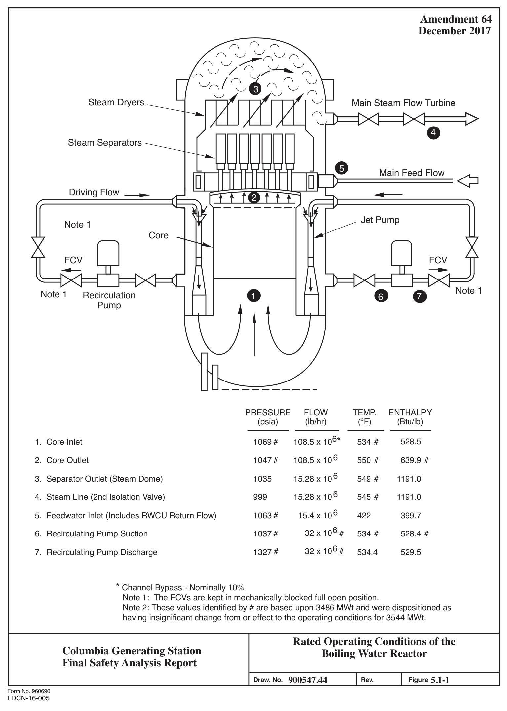
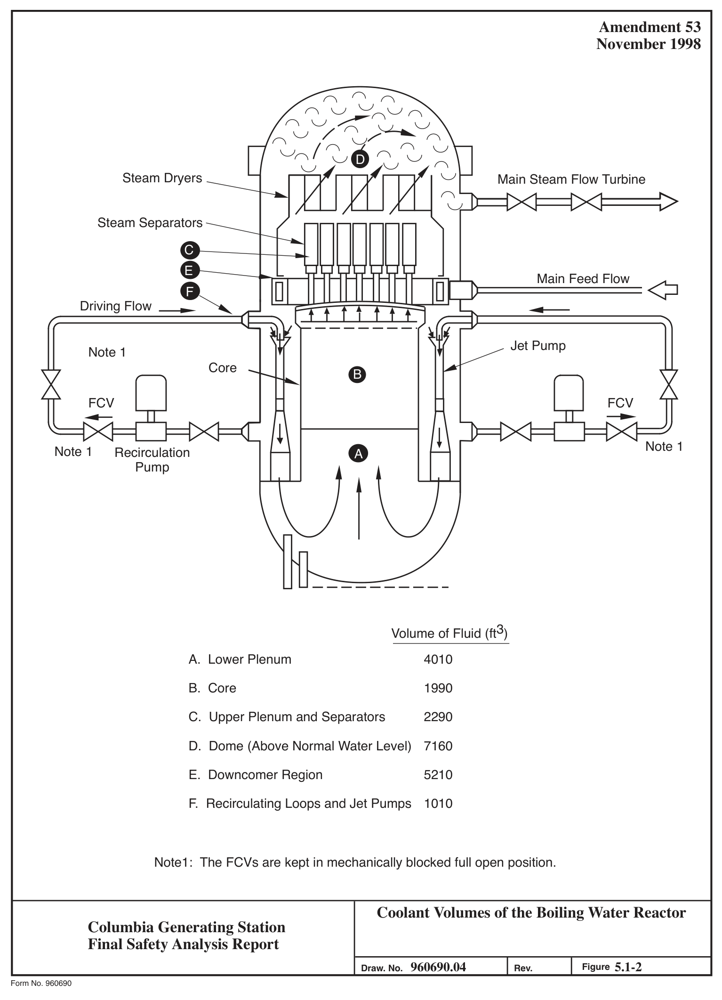

# 5.1 Summary Description

> Columbia Generating Station FSAR — Chapter 05: Reactor Coolant System and Connected Systems
> Source: `05_chapter-2042-2256.pdf`, PDF pages 12–16 (of 215)
> Amendment 67 compilation (individual pages carry varying amendment dates)

---
<!-- p.12 -->
November 1998

Chapter 5

#### REACTOR COOLANT SYSTEM AND CONNECTED SYSTEMS
### 5.1 SUMMARY DESCRIPTION
The reactor coolant system includes those systems and components which contain or transport fluids coming from, or going to the reactor core. These systems form a major portion of the reactor coolant pressure boundary (RCPB). This chapter provides information regarding the reactor coolant system and pressure-containing appendages out to and including isolation valving. This grouping of components is defined as follows:

The RCPB includes all pressure-containing components such as pressure vessels, piping, pumps, and valves, which are

a. Part of the reactor coolant system, or

b. Connected to the reactor coolant system, up to and including any and all of the following:

1. The outermost containment isolation valve in system piping that penetrates primary reactor containment,

2. The second of the two valves normally closed during normal reactor operation in system piping that does not penetrate primary reactor containment, and

3. The reactor coolant system safety/relief valves.

Section 5.4 discusses the various subsystems to the RCPB.

The nuclear system pressure relief system protects the reactor coolant pressure boundary from damage due to overpressure. To protect against overpressure, pressure-operated relief valves are provided that can discharge steam from the nuclear system to the suppression pool. The pressure relief system also acts to automatically depressurize the nuclear system in the event of a loss-of-coolant accident (LOCA) in which the high-pressure core spray (HPCS) system fails to maintain reactor vessel water level. Depressurization of the nuclear system allows the lowpressure core cooling systems to supply enough cooling water to adequately cool the fuel.
Section 5.2.5 establishes the limits on nuclear system leakage inside the drywell so that appropriate action can be taken before the integrity of the nuclear system process barrier is impaired.

<!-- p.13 -->
November 1998

The reactor vessel and appurtenances are described in Section 5.3. The major safety consideration for the reactor vessel is concerned with the ability of the vessel to function as a radioactive material barrier. Various combinations of loading are considered in the vessel design. The vessel meets the requirements of various applicable codes and criteria. The possibility of brittle fracture is considered, and suitable design, material selection, material surveillance activities, and operational limits are established that avoid conditions where brittle fracture is possible.

The reactor recirculation system provides coolant flow through the core. Adjustment of the core coolant flow rate changes reactor power output, thus providing a means of following plant load demand without adjusting control rods. The recirculation system is designed to provide a slow coast down of flow so that fuel thermal limits cannot be exceeded as a result of recirculation system malfunctions. The arrangement of the recirculation system routing is such that a piping failure cannot compromise the integrity of the floodable inner volume of the reactor vessel.

Main steam line flow restrictors of the venturi-type are installed in each main steam line inside the primary containment. The restrictors are designed to limit the loss-of-coolant resulting from a main steam line break outside the primary containment. The coolant loss is limited so that reactor vessel water level remains above the top of the core during the time required for the main steam isolation valves (MSIVs) to close. This action protects the fuel barrier.

The MSIVs automatically isolate the reactor coolant pressure boundary in the event a pipe break occurs downstream of the isolation valves. This action limits the loss-of-coolant and the release of radioactive materials from the nuclear system. Two isolation valves are installed on each main steam line; one is located inside, and the other is located outside the primary containment. In the event that a main steam line break occurs inside the containment, closure of the other isolation valve outside the primary containment acts to seal the containment itself.

The reactor core isolation cooling (RCIC) system provides makeup water to the core during a reactor shutdown in which feedwater flow is not available. The system is started automatically upon receipt of a low reactor water level signal or manually by the operator. Water is pumped to the core by a turbine pump driven by reactor steam.

The residual heat removal (RHR) system includes a number of pumps and heat exchangers that can be used to cool the nuclear system under a variety of situations. During normal shutdown and reactor servicing, the RHR system removes residual and decay heat. The RHR system allows decay heat to be removed whenever the main heat sink (main condenser) is not available
(e.g., hot standby). One mode of RHR operation allows the removal of heat from the primary containment following a LOCA. Another operational mode of the RHR system is

<!-- p.14 -->
low-pressure coolant injection (LPCI). The LPCI operation is an engineered safety feature for use during a postulated LOCA. This operation is described in Section 6.3. The low-pressure core spray (LPCS) system also provides protection to the nuclear system.

The reactor water cleanup system recirculates a portion of reactor coolant through a filter-demineralizer subsystem to remove particulate and dissolved impurities from the reactor coolant. It also removes excess coolant from the reactor system under controlled conditions.

#### 5.1.1 SCHEMATIC FLOW DIAGRAM
Schematic flow diagrams of the reactor coolant system denoting all major components, principal pressures, temperatures, flow rates, and coolant volumes for normal steady-state operating conditions at rated power are presented in Figures 5.1-1 and 5.1-2.

#### 5.1.2 PIPING AND INSTRUMENTATION DIAGRAM
Piping and instrumentation diagrams covering the systems included within the reactor coolant system and connected systems are presented in the following:

a. The nuclear boiler, main steam, and feedwater systems shown in Figure 10.3-2, b. Recirculation system shown in Figure 5.4-7, c. RCIC system shown in Figure 5.4-11, d. RHR system shown in Figures 5.4-16 and 5.4-17, e. Reactor water cleanup system shown in Figure 5.4-22, f. HPCS system shown in Figure 6.3-4, g. LPCS system shown in Figure 6.3-4, and h. Standby liquid control system shown in Figure 9.3-14.

#### 5.1.3 ELEVATION DRAWING
An elevation drawing showing the principal dimensions of the reactor and coolant system in relation to the containment is shown in Figures 1.2-11 and 1.2-12.

<!-- p.15 -->

*figure on PDF page 15*

[Vector original (SVG, lossless): fig_page-15.svg](../figures/fig_page-15.svg)

<!-- labels/text on this figure page -->
Amendment 64 December 2017
3 Steam Dryers Main Steam Flow Turbine • 4 Steam Separators
- .. 5 Main Feed Flow Driving Flow 2
Jet Pump Note 1 Core
FCV FCV
• Note 1 Note 1 Recirculation 1 7 6 Pump
PRESSURE FLOW TEMP. ENTHALPY
(psia) (lb/hr) (°F) (Btu/lb)
108.5 x 106* 534 # 528.5 1069 #
1. Core Inlet 108.5 x 10 6 550 # 639.9 # 1047 #
2. Core Outlet 15.28 x 10 6 549 # 1191.0 1035
3. Separator Outlet (Steam Dome)
15.28 x 10 6 545 # 1191.0 999 4. Steam Line (2nd Isolation Valve)
15.4 x 10 6 422 399.7 5. Feedwater Inlet (Includes RWCU Return Flow) 1063 # 32 x 106 1037 # 6. Recirculating Pump Suction # 534 # 528.4 # 32 x 106 # 7. Recirculating Pump Discharge 1327 # 534.4 529.5
* Channel Bypass - Nominally 10% Note 1: The FCVs are kept in mechanically blocked full open position.
Note 2: These values identified by # are based upon 3486 MWt and were dispositioned as having insignificant change from or effect to the operating conditions for 3544 MWt.
Rated Operating Conditions of the Columbia Generating Station Boiling Water Reactor Final Safety Analysis Report 900547.44 5.1-1 Draw. No.
Rev. Figure Form No. 960690
LDCN-16-005

<!-- p.16 -->

*figure on PDF page 16*

[Vector original (SVG, lossless): fig_page-16.svg](../figures/fig_page-16.svg)

<!-- labels/text on this figure page -->
Amendment 53 November 1998
D Steam Dryers Main Steam Flow Turbine
Steam Separators C E ..
Main Feed Flow F Driving Flow
Jet Pump Note 1 Core B
FCV FCV
• Note 1 Note 1 Recirculation A Pump
Volume of Fluid (ft3)
A. Lower Plenum 4010
B. Core 1990
C. Upper Plenum and Separators 2290
D. Dome (Above Normal Water Level) 7160
E. Downcomer Region 5210
F. Recirculating Loops and Jet Pumps 1010
Note1: The FCVs are kept in mechanically blocked full open position.
Coolant Volumes of the Boiling Water Reactor Columbia Generating Station Final Safety Analysis Report 960690.04 5.1-2 Figure Draw. No. Rev.
Form No. 960690

