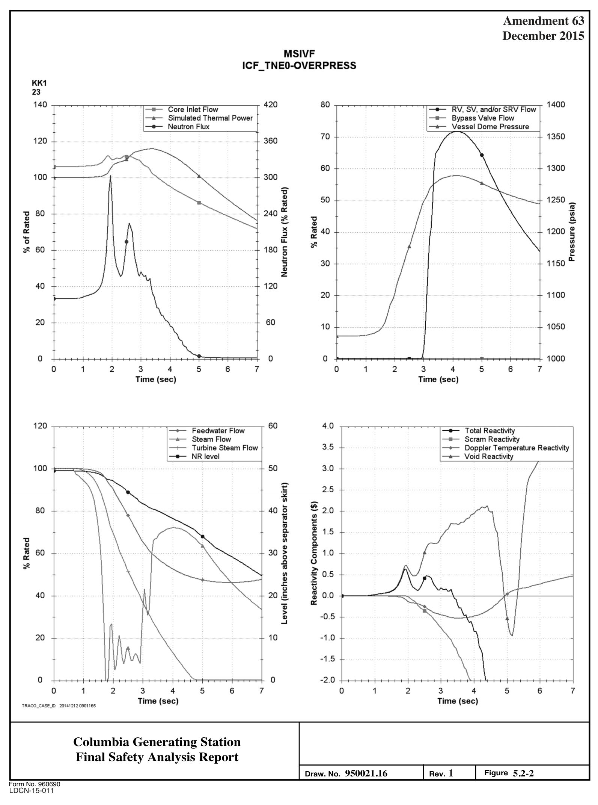
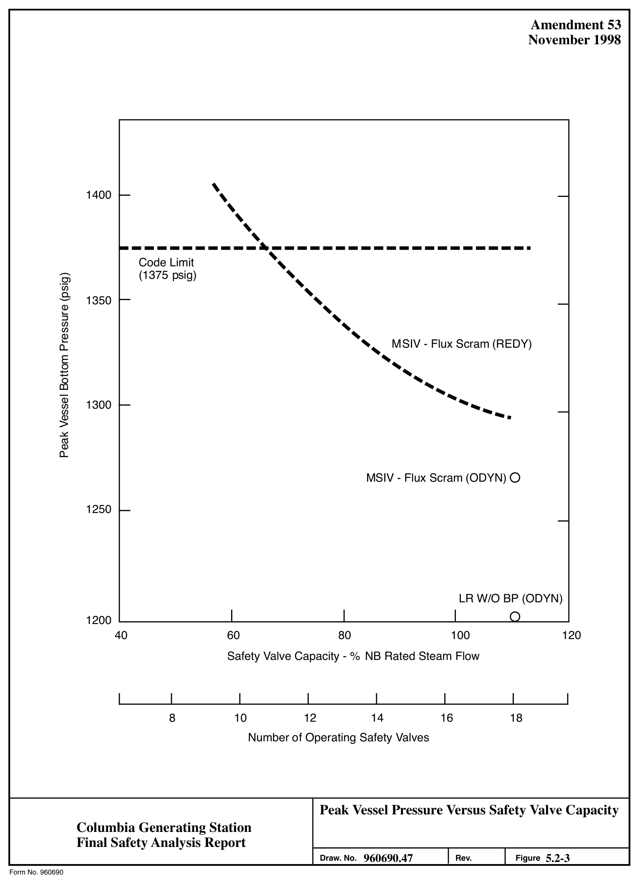
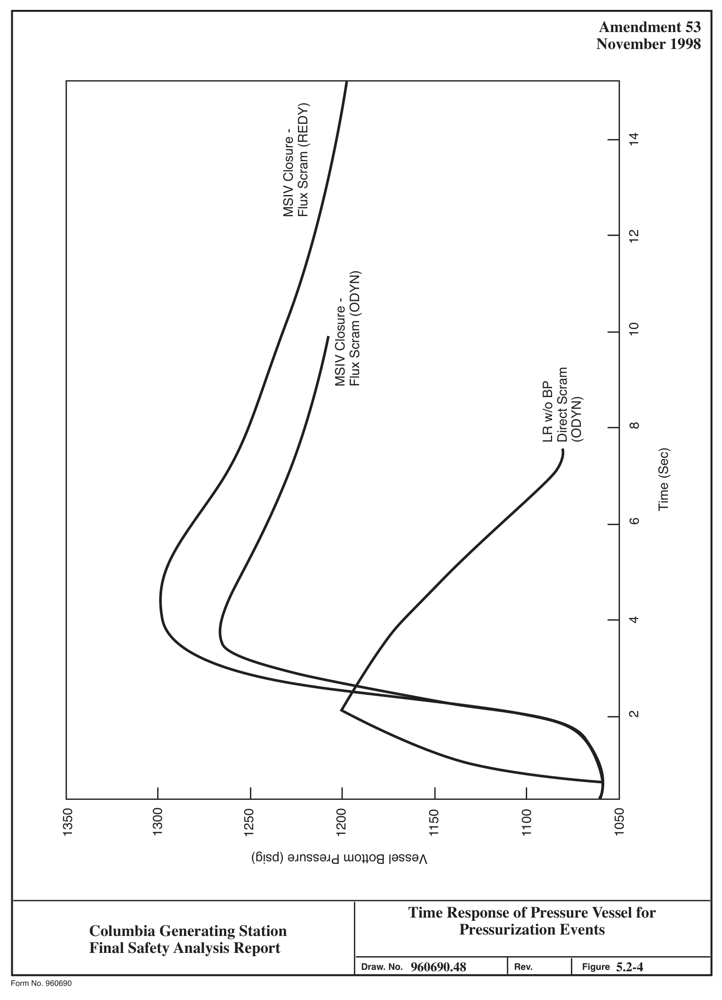
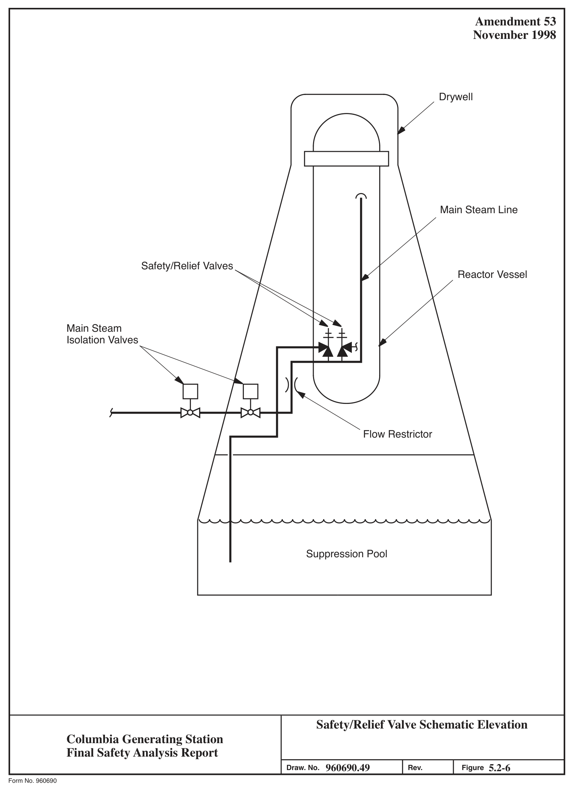
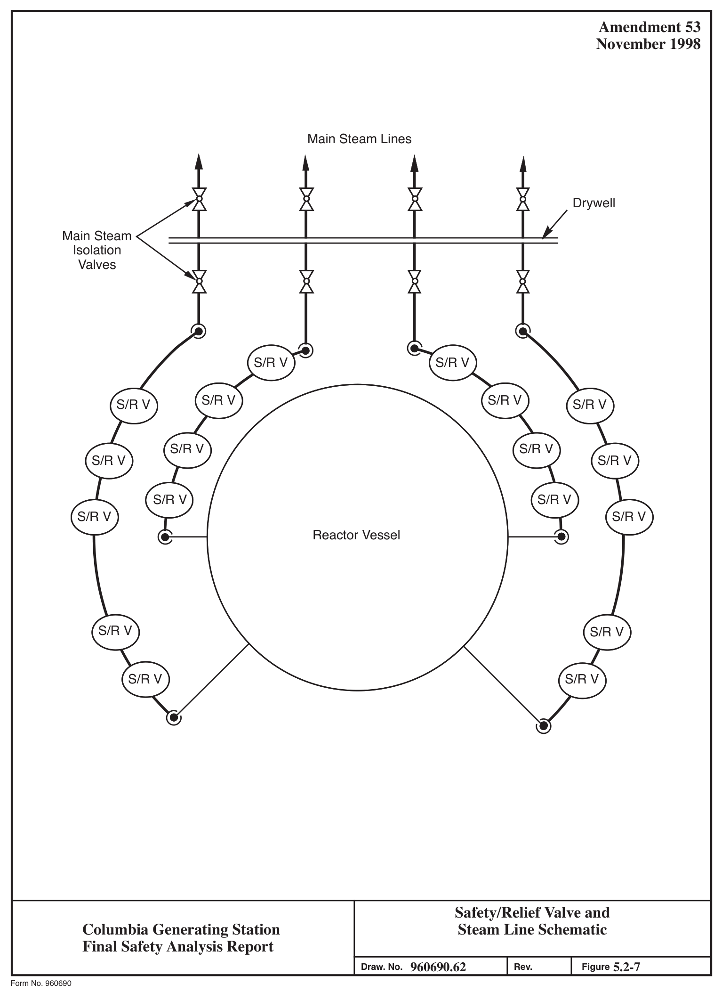
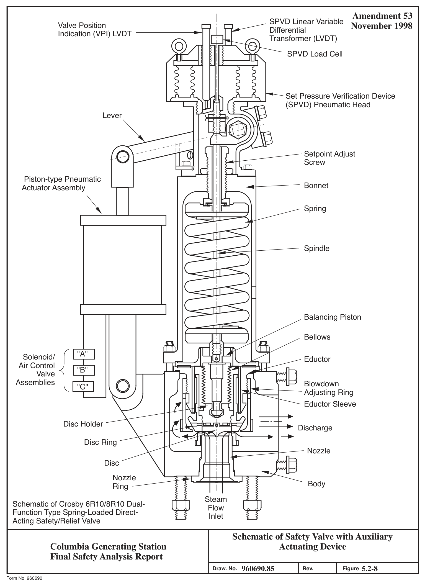
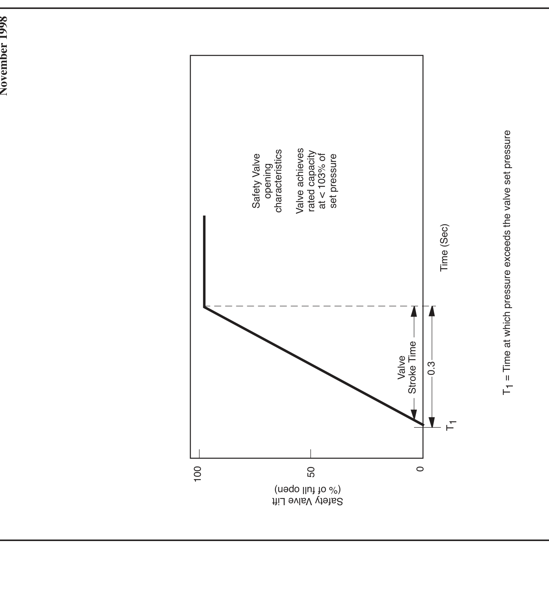
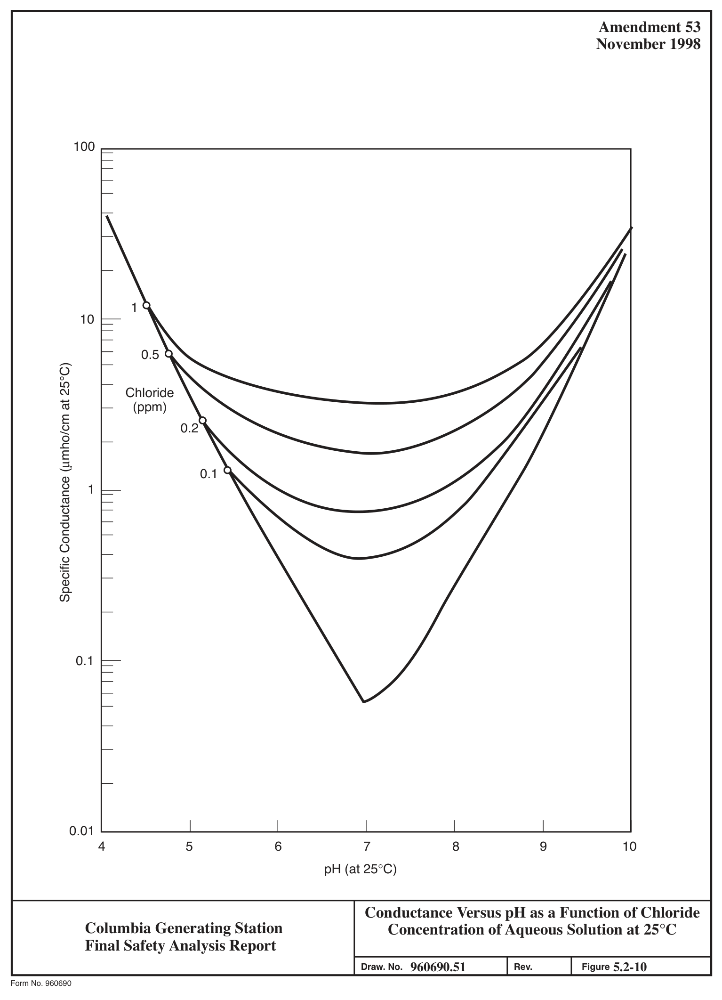
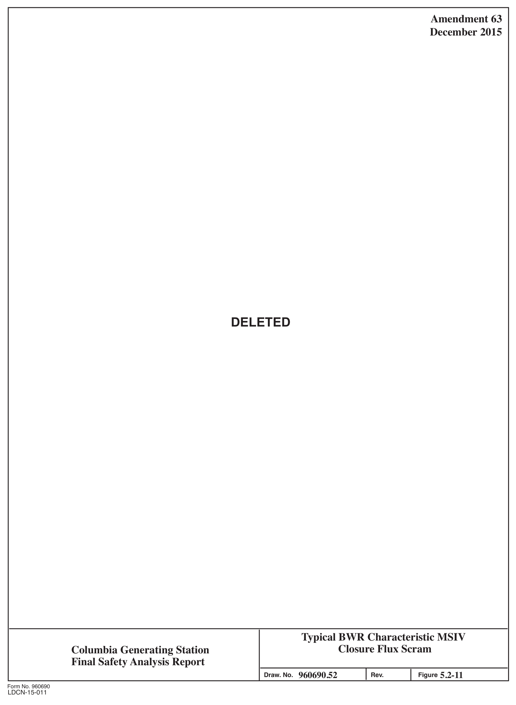

# 5.2 Integrity Of Reactor Coolant Pressure Boundary

> Columbia Generating Station FSAR — Chapter 05: Reactor Coolant System and Connected Systems
> Source: `05_chapter-2042-2256.pdf`, PDF pages 17–78 (of 215)
> Amendment 67 compilation (individual pages carry varying amendment dates)

---
<!-- p.17 -->
April 2000

### 5.2 INTEGRITY OF REACTOR COOLANT PRESSURE BOUNDARY
This section discusses measures employed to provide and maintain the integrity of the reactor coolant pressure boundary (RCPB) for the plant design lifetime.

#### 5.2.1 COMPLIANCE WITH CODES AND CODE CASES
##### 5.2.1.1 Compliance with 10 CFR Part 50, Section 50.55a
Table 3.2-1 shows compliance with the rules of 10 CFR Part 50.55a “Codes and Standards.” The American Society of Mechanical Engineers (ASME) Code edition, applicable addenda, and component dates are in accordance with 10 CFR 50.55a except for those RCPB components listed in Table 5.2-1. The design, fabrication, and testing of the RCPB components listed in Table 5.2-1 were in accordance with the recognized codes and standards in effect at the time the components were ordered as shown in the table. The code edition and applicable addenda that would be required by strict interpretation of the rules set forth in 10 CFR 50.55a are identified in Table 5.2-1.

Application for Columbia Generating Station (CGS) was filed with the Commission in August 1971. At that time a construction permit was expected before the end of the 1972, but requests for additional seismic data in August 1972 caused the issuance of the construction permit to go beyond the end of the year to March 19, 1973. As is common practice in the utility industry, Energy Northwest proceeded with the engineering, design, and material and components procurement in anticipation of the award of a construction permit to meet construction schedules. Had the construction permit been issued as initially expected, the requirements of 10 CFR 50.55a would have been met to the letter of the law.

However, in each instance of exception the ASME Code version applied was one addenda earlier (6 months) than the code version required by the rules of 10 CFR 50.55a. The changes embodied in the later ASME Code addenda were reviewed. It was concluded that the addenda required by the rules of 10 CFR 50.55a affected documentation format but imposed no new technical requirements or changes in quality control procedures from the code version applied in the procurement of the components. The level of safety and quality provided by conformance to the earlier code edition and addenda applied in procurement is equivalent to that which would be required by strict application of the rules of 10 CFR 50.55a. The effort and expense of recertification of these components, which had all been shipped to the construction site, would not have provided a compensating increase in the level of safety and quality.

##### 5.2.1.2 Applicable Code Cases
The reactor pressure vessel (RPV) and appurtenances and the RCPB piping, pumps and valves, were designed, fabricated, and tested in accordance with the applicable edition of the ASME

<!-- p.18 -->
April 2000

Code, Section III, including the addenda that were mandatory at the order date for the applicable components. This is in compliance with the intent of Regulatory Guides 1.84 and
1.85. Section 50.55a of 10 CFR Part 50 requires code case approval only for Class 1 components. These code cases contain requirements or special rules which may be used for the construction of pressure-retaining components of Quality Group Classification A. The various ASME Code case interpretations that were applied to components in the RCPB are listed in Table 5.2-2. Code cases listed in Table 5.2-2 are those used in the original construction of CGS. Other code cases that are adopted for use, as approved by Regulatory Guides 1.147, 1.84, 1.85, or specifically approved by the Regulatory Authority for use at CGS, are specified in the component’s design specification as required by ASME Section III.

#### 5.2.2 OVERPRESSURIZATION PROTECTION
##### 5.2.2.1 Design Bases
Overpressurization protection is provided in conformance with 10 CFR 50, Appendix A, General Design Criterion 15.

###### 5.2.2.1.1 Safety Design Basis
The nuclear pressure-relief system is designed to

a. Prevent overpressurization of the nuclear system that could lead to the failure of the RCPB,

b. Provide automatic depressurization for small breaks in the nuclear system occurring with maloperation of the high-pressure core spray (HPCS) system so that the low-pressure coolant injection (LPCI) and the low-pressure core spray
(LPCS) systems can operate to protect the fuel barrier (see Section 6.3.2.2.2),

c. Permit verification of its operability, and

d. Withstand adverse combinations of loadings and forces resulting from operation during abnormal, accident, or special event conditions.

###### 5.2.2.1.2 Power Generation Design Bases
The nuclear pressure relief system safety/relief valves (SRV) have been designed to meet the following power generation bases:

a. Discharge to the containment suppression pool, and

<!-- p.19 -->
April 2000 t I b. Correctly reclose following operation so that maximum operational continuity can be obtained.

###### 5.2.2.1.3 Discussion
The ASME Boiler and Pressure Vessel Code (B&PV Code) requires that each component designed to meet Section III be protected from overpressure under upset conditions. The code allows a peak allowable pressure of 110% of design pressure under upset conditions. The code specifications for safety valves require that (a) the lowest safety valve setpoint will be set at or below design pressure, and (b) the highest safety valve setpoint will be set so that total accumulated pressure does not exceed 110% of the design pressure for upset conditions. The SRVs are designed to open by means of either of two modes of operation as discussed in Chapter 15. The safety (spring) setpoints are listed in Table 5.2-3 and satisfy the first of the above-mentioned ASME Code specifications for safety valves because all valves open at less than the nuclear system design pressure of 1250 psig.

The automatic depressurization capability of the nuclear system pressure relief system is evaluated in Sections 6.3 and 7.3.

The following detailed criteria are used in selection of SRVs:

a. Must meet requirements of ASME Code, Section III,

b. Valves must qualify for 100% of nameplate capacity credit for overpressure protection function, and

c. Must meet other performance requirements such as response time, etc., as necessary to provide relief functions.

The SRV discharge piping is constructed in accordance with the ASME Code, Section III, 1971 Edition through the Winter 1973 Addenda.

###### 5.2.2.1.4 Safety Valve Capacity
The safety valve capacity of this plant is adequate to limit the primary system pressure, including transients, to the requirements of the ASME B&PV Code, Section III, 1971 Edition through the Summer 1971 Addenda.

Table 5.2-4 lists the systems which could initiate during the safety valve capacity overpressure event.

<!-- p.20 -->
##### 5.2.2.2 Design Evaluation
###### 5.2.2.2.1 Method of Analysis
To design the pressure protection for the nuclear boiler system, extensive analytical models representing all essential dynamic characteristics of the system are simulated on a large computing facility. These models include the hydrodynamics of the flow loop, the reactor kinetics, the thermal characteristics of the fuel and its transfer of heat to the coolant, and all the principal controller features, such as feedwater flow, recirculation flow, reactor water level, pressure, and load demand. These are presented with all their principal nonlinear features in models that have evolved through extensive experience and favorable comparison of analysis with actual boiling water reactor (BWR) test data.

A detailed description of the models is documented in licensing topical reports, References 5.2- 1 and 5.2-7. Safety/relief valves are simulated in the nonlinear representation, and the models thereby allow full investigation of the various valve response times, valve capacities, and actuation setpoints that are available in applicable hardware systems.

The typical capacity characteristic as modeled is represented in Figure 5.2-1 for the spring mode of operation. The associated turbine bypass, turbine control valve (TCV), and main steam isolation valve (MSIV) characteristics are also simulated in the models.

The associated bypass, TCV, main steam isolation characteristics, and anticipated transients without scram (ATWS) pump trip are also represented fully in the models.

###### 5.2.2.2.2 System Design
The overpressure protection system must accommodate the most severe pressurization transient. There are two major transients, the closure of all MSIVs and a turbine generator trip with a coincident failure of the turbine steam bypass system valves, that represent the most severe abnormal operational transients resulting in a nuclear system pressure rise. The evaluation of transient behavior with final plant configuration has shown that the isolation valve closure is slightly more severe when credit is taken only for indirect derived scrams;
therefore, it is used as the overpressure protection basis event and shown in Figure 5.2-2.
Table 5.2-5 lists the sequence of events of the various systems assumed to operate during the main steam line isolation closure with flux scram event.

Compliance to ASME Code overpressure protection requirements for introduction of GNF2 fuel has been conservatively demonstrated for the limiting overpressure event. The GE thermal-hydraulic and nuclear coupled transient code TRACG (References 5.2-7 and 5.2-8)
was used to obtain system response and peak vessel pressure. The setpoints are listed in Table 5.2-3. The evaluation, based on reactor operation at 100% of uprated power, end-of-cycle nuclear dynamic parameters, an initial dome pressure of 1035 psia (nominal uprated dome

<!-- p.21 -->
pressure), six SRVs with lowest safety setpoints out of service, and SRV opening pressures at 3% above nominal setpoint values resulted in a maximum reactor pressure of 1311 psig.

The scram reactivity curve is shown in Figure 5.2-2.

###### 5.2.2.2.3 Evaluation of Results
5.2.2.2.3.1 Safety Valve Capacity. The required SRV capacity is determined by analyzing the pressure rise from an MSIV closure with flux scram transient. The plant is assumed to be operating at the turbine-generator design conditions at a nominal vessel dome pressure of 1035 psia. The analysis hypothetically assumes the failure of the direct MSIV position scram. The reactor is shut down by the backup, high neutron flux scram. For the analysis, the spring-action safety valve setpoints used are in the range of 1236 to 1256 psia. The TRACG analysis indicates that the design valve capacity is capable of maintaining adequate margin below the peak ASME Code allowable pressure in the nuclear system (1375 psig).
Figure 5.2-2 shows the result of the TRACG analysis. The sequence of events in Table 5.2-5, assumed in these analyses, were investigated to meet code requirements and to evaluate the pressure relief system exclusively.

Under Section III of the ASME B&PV Code, credit can be allowed for a scram from the reactor protection system. In addition, credit is also taken for the protection circuits which are indirectly derived when determining the required SRV capacity.

The backup reactor high neutron flux scram is conservatively applied as a design basis in determining the required capacity of the pressure relieving dual purpose SRVs. Application of the direct position scrams in the design basis could be used since they qualify as acceptable pressure protection devices when determining the required SRV capacity of nuclear vessels under the provisions of the ASME Code. The SRVs are operated in a relief mode
(pneumatically) at setpoints lower than those specified under the safety function. This ensures sufficient margin between anticipated relief mode closing pressures and valve spring forces for proper seating of the valves.

The typical parametric relationship between peak vessel (bottom) pressure and SRV capacity for the MSIV transient with high flux scram is described in Figure 5.2-3. Also shown in Figure 5.2-3 is the peak vessel (bottom) pressure for position scram with 18-valve capacity.
Pressures shown for flux scram will result only with multiple failure in the redundant direct scram system.

The typical time response of the vessel pressure to the MSIV transient with flux scram is illustrated in Figure 5.2-4. This shows that the pressure at the vessel bottom exceeds 1250 psig for less than 7 sec and does not reach the limit of 1375 psig.

<!-- p.22 -->
5.2.2.2.3.2 Pressure Drop in Inlet and Discharge. Pressure drop in the piping from the reactor vessel to the valves is taken into account in calculating the maximum vessel pressures.

Pressure drop in the discharge piping to the suppression pool is limited by proper discharge line sizing to prevent back-pressure on each SRV from exceeding 40% of the valve inlet pressure, thus ensuring choked flow in the valve orifice and no reduction of valve capacity due to the discharge piping. Each SRV has its own separate discharge line.

5.2.2.2.3.3 Reload Specific Confirmatory Analysis. The calculated vessel pressure for MSIV inadvertent closure may be dependent upon the fuel design and core loading pattern.
Compliance with the ASME upset limit is demonstrated by cycle-dependent analysis just prior to the operation of that cycle. The results are reported in Supplemental Reload Licensing Report (Reference 5.2-11).

##### 5.2.2.3 Piping and Instrumentation Diagrams
See Figure 5.2-5 which shows the schematic location and number of pressure-relieving devices. The schematic arrangement of the SRVs is shown in Figures 5.2-6 and 5.2-7.

##### 5.2.2.4 Equipment and Component Description
###### 5.2.2.4.1 Description
The nuclear pressure relief system consists of SRVs located on the main steam lines between the reactor vessel and the first isolation valve within the drywell.

Chapter 15 discusses the events which are expected to activate the primary system SRVs. The chapter also summarizes the number of valves expected to operate during the initial blowdown of the valves and the expected duration of this first blowdown. For several of the events it is expected that the lowest set SRV will reopen and reclose as generated heat drops into the decay heat characteristics. The pressure increase and relief cycle will continue with lower frequency and shorter relief discharges as the decay heat drops off and until such time as the residual heat removal (RHR) system can dissipate this heat. The duration of each relief discharge should, in most cases, be less than 30 sec. Remote manual actuation of the valves from the control room is recommended to minimize the total number of these discharges, with the intent of achieving extended valve seat life and reducing challenges to the SRV.

A schematic of the main SRV is shown in Figure 5.2-8. It is opened by either of two modes of operation:
l l a. The spring mode of operation which consists of direct action of the steam pressure against a spring-loaded disk that will pop open when the valve inlet

<!-- p.23 -->
April 2000

pressure force exceeds the spring force. Figure 5.2-9 depicts typical valve lift versus opening time characteristics; and

b. The power-actuated mode of operation which consists of using an auxiliary actuating device consisting of a pneumatic piston/cylinder and mechanical I linkage assembly which opens the valve by overcoming the spring force, even with valve inlet pressure equal to zero psig.

The pneumatic operator is so arranged that if it malfunctions it will not prevent the valve disk from lifting if steam inlet pressure reaches the spring lift set pressure.

For overpressure SRV operation (self-actuated or spring lift mode), the spring load establishes the safety valve opening setpoint pressure and is set to open at setpoints designated in Table 5.2-3. In accordance with the ASME Code, full lift in this mode of operation is attained at a pressure not greater than 3% above the setpoint.

To prevent backpressure from affecting the spring lift setpoint, each valve is provided with a bellows and balancing piston to counteract the effects of any static backpressure which may be present in the discharge line before the valve is opened to discharge steam. The bellows isolates steam in the valve discharge chamber from the valve’s internals. If the bellows fails, the balancing piston serves as a functional backup by presenting an effective piston area to the back pressure equal to the valve seat area, thus balancing it so there is essentially no net back pressure effect on the setpoint (Figure 5.2-8).

The safety function of the SRV is a backup to the relief function described below. The spring-loaded valves are designed and constructed in accordance with ASME III, 1971 Edition, Paragraph NB-7640, as safety valves with auxiliary actuating devices.

Each SRV is provided with its own pneumatic accumulator and inlet check valve to provide high assurance the valve will actuate in the power-actuated (relief) mode when its pneumatic I solenoid valve is energized. The pneumatic accumulator has sufficient capacity to provide I one SRV actuation at approximately 1000 psig valve inlet pressure. Although no credit is taken under ASME Code Section III for overpressure protection by the SRVs in their poweractuated mode, power actuation of the SRV will limit peak reactor pressure in the majority of overpressure transients.

Safety/relief valve actuation in the relief mode is initiated by pressure switches (one per valve)
which sense reactor steam space pressure at lower values than the spring mode inlet steam opening pressure. The pressure switches initiate the opening of the SRVs by energizing the pneumatic solenoids (one per valve) at the relief setpoints designated in Table 5.2-3.
l l When the solenoid is actuated, the delay time, maximum elapsed time between receiving the overpressure signal at the valve actuator and the actual start of valve motion, will not exceed

<!-- p.24 -->
April 2000 t I 0.1 sec. The maximum full stroke opening time will not exceed 0.15 sec with 1000 psig steam at the valve inlet.

The SRVs can be operated in the power-actuated mode by remote-manual controls from the main control room.

The SRVs are designed to operate to the extent required for overpressure protection in the following accident environments:

a. 340°F for a 3-hr period, at drywell design pressure, b. 320°F for an additional 3-hr period, at drywell design pressure, c. 250°F for an additional 18-hr period, at 25 psig drywell pressure, and d. 200°F during the next 99 days at 20 psig drywell pressure.

The automatic depressurization system (ADS) utilizes selected SRVs for depressurization of the reactor (see Section 6.3). Each of the SRVs utilized for automatic depressurization is equipped with an air accumulator and check valve arrangement. These accumulators ensure that the I valves can be held open following failure of the air supply to the accumulators. The designed pneumatic supply to the ADS accumulator is such that, following a failure of the safety-related pneumatic supply to the accumulator, at least two valve actuations can occur with the drywell I at 70% of design pressure. For a discussion of the noninterruptible air supply to the ADS I valves, see Section 9.3.1. Three ADS SRVs and their associated solenoid pilot valves (SPV)
are qualified for the full post-LOCA time frame for long-term cooling. All other SRVs and their SPVs are qualified for 24 hr post-LOCA to provide overpressure protection capability.

The valve position indication (VPI) and the tailpipe temperature indication systems are discussed in Section 7.5.2.

Each SRV discharges steam through a discharge line to a point below the minimum water level in the suppression pool. Safety/relief valve discharge line piping from the SRV to the suppression pool consists of two parts. The first part is attached at one end to the SRV and at its other end penetrates and is welded to a 28-in. downcomer (considered a pipe anchor). The main steam piping, including this portion of the SRV discharge piping, is analyzed as a complete system. This portion of the SRV discharge line is classified as Quality Group C and Seismic Category I down to the jet deflector plate just above the diaphragm floor (through which it is rigidly guided) and Quality Group B and Seismic Category I from the jet deflector plate to the downcomer.

The second part of the SRV discharge piping extends from the downcomer (anchor) to the suppression pool. Because of the anchor on this part of the line, it is physically decoupled from the main steam header and is, therefore, analyzed as a separate piping system. In analyzing this part of the discharge piping in accordance with the requirements of Quality Group B, the following load combination was considered as a minimum:

<!-- p.25 -->
April 2000

a. Pressure and temperature, b. Dead weight, and c. Fluid dynamic loads due to SRV operation.

As a part of the preoperational and startup testing of the main steam lines, movement of the SRV discharge lines were inspected with negligible vibration observed.

The SRV discharge piping is designed to limit valve outlet pressure to 40% of maximum valve inlet pressure with the valve open. Water in the line more than a few feet above suppression pool water level would cause excessive pressure at the valve discharge when the valve is again I opened. For this reason, redundant 10-in. vacuum relief valves are provided on each SRV discharge line to prevent drawing an excessive amount of water up into the line as a result of steam condensation following termination of relief operation. Each vacuum relief valve pair is situated with the valves in parallel, the discharge being routed to a common tee in the SRV discharge line.

The nuclear pressure relief system automatically depressurizes the nuclear system sufficiently to permit the LPCI and LPCS systems to operate as a backup for the HPCS system. Further descriptions of the operation of the automatic depressurization feature are found in Sections 6.3 and 7.3.1.1.1.

###### 5.2.2.4.2 Design Parameters
Table 5.2-6 lists design temperature, pressure, and maximum test pressure for the RCPB components. The specified operating transients for components within the RCPB are given in Section 3.9. Refer to Section 3.7 for discussion of the input criteria for design of Seismic Category I structures, systems, and components.

A summary of the number of cycles for transients used in design and fatigue analysis is listed in Table 3.9-1 and categorized under the appropriate design condition (i.e., normal, upset, emergency, and faulted).

The design requirements established to protect the principal components of the reactor coolant system against environmental effects are discussed in Section 3.11.

5.2.2.4.2.1 Safety/Relief Valve. The discharge area of the valve is 16.117 in.2 and the coefficient of discharge KD is equal to 0.966, as certified by the National Board of Boiler and Pressure Vessel Inspectors.

The design pressure and temperature of the valve inlet and outlet are 1250 psig at 575°F and 625 psig at 500°F, respectively.

<!-- p.26 -->
April 2000

The valves have been designed to achieve the maximum practical number of actuations consistent with state-of-the-art technology. Cyclic testing has demonstrated that the valves are capable of at least 60 actuation cycles between required maintenance.

See Figure 5.2-8 for a schematic cross section of the valve.

##### 5.2.2.5 Mounting of Pressure Relief Devices
The pressure relief devices are located on the main steam piping headers. The mounting consists of a special contour nozzle and an oversized flange connection. This provides a high integrity connection that accounts for the thrust, bending, and torsional loadings which the main steam pipe and relief valve discharge pipe are subjected to.

In no case will allowable valve flange loads be exceeded nor will the stress at any point in the piping exceed code allowables for any specified combination of loads. The design criteria and analysis methods for considering loads due to SRV discharge is contained in Section 3.9.3.3.

##### 5.2.2.6 Applicable Codes and Classification
The RCPB overpressure protection system is designed to satisfy the requirements of Section III, Subsection NB, of the ASME B&PV Code. The general requirements for protection against overpressure as given NB-7120 of Section III of the code recognize that RCPB overpressure protection is one function of the reactor protective systems and allows the integration of pressure relief devices with the protective systems of the nuclear reactor.
Hence, credit is taken for the scram protective system as a complementary pressure protection device.

##### 5.2.2.7 Material Specification
Pressure retaining components of SRVs are constructed only from ASME Section III, Class 1 designated materials.

##### 5.2.2.8 Process Instrumentation
Overpressure protection process instrumentation is listed in Table 1 of Figure 5.2-5 and shown in Figure 10.3-2.

##### 5.2.2.9 System Reliability
Overpressure protection system reliability is principally a function of the SRVs in their spring-opening mode of operation. No credit is taken in the ASME Code Section III required overpressure protection report for power actuation of the SRVs to provide protection against overpressure.

<!-- p.27 -->
April 2000

Section 5.2.2.10 discusses the inspection and testing conducted to ensure high SRV reliability.
As demonstrated by the extensive qualification and production testing, the valves are very reliable.

In addition to SRV testing to ensure high SRV quality, an extensive in-depth quality assurance program was followed in the manufacture and production testing of the valves to provide assurance of high quality.

A significant amount of BWR operating experience was been accumulated on this type of SRV, approximately 150 individual valve years, only one “stuck-open relief valve” had occurred.
This was due to an air solenoid valve sticking open after it was deenergized, thus holding the SRV open in the power-actuated mode. Proper maintenance procedures are incorporated into the instruction manual to preclude recurrence.

This type of SRV has demonstrated good inservice operability similar to that demonstrated by the qualification test program.

In summary, this type of SRV has demonstrated excellent reliability, both in qualification testing and in actual BWR operation.

##### 5.2.2.10 Inspection and Testing
To verify the design of the SRV used will reliably operate, several SRVs were subjected to qualification test programs. These qualification test programs demonstrated the design of the valve is capable of performing its overpressure protection function under normal, upset, emergency, and faulted conditions and its designated mechanical motion(s) to fulfill its safety function to shut down the plant or mitigate the consequence of a postulated event. To ensure that valves to be installed are operable, each valve is manufactured, inspected, and production tested in accordance with quality control procedures to verify compliance with both ASME Code and operability assurance acceptance criteria.

The SRV design used at CGS successfully completed the following qualification tests:

a. Life Cycle Test

Following the prequalification production tests, each modified SRV was then subjected to life cycle qualification tests with saturated steam conditions, in accordance with GE specification 22A6595. This included approximately 300 relief (power) and safety (pressure) actuations to demonstrate and characterize each valve for acceptable BWR service. Tests parameters included:

1. Seat tightness/leakage characteristics,

<!-- p.28 -->
April 2000

2. Set pressure,

3. Opening and closing response time,

4. Blowdown,

5. Safety/relief valve lift-achieving rated flow capacity lift during each activation,

6. Safety/relief valve reclosure without chattering, disc oscillation, or sticking open, and

7. Capability to open without inlet steam when activated on demand.

Test conditions were varied according to facility capability to ensure valve operability across the design limits to which the SRV may be subjected while in service. These included temperature, pressure ramp rates, pneumatic operating pressure, solenoid voltage, inlet pressure, and the dynamically imposed backpressure.

Test results indicate essentially zero leakage for both the relief (power) and safety (pressure) modes of SRV operation. All valves demonstrated seat-tightness capability to meet the 20 lb/hr specification limit under saturated steam conditions. Each valve demonstrated safety actuation within the nameplate value plus 1% at a confidence level of 0.95. The response is also linear with ambient temperature in the negative direction; i.e., at temperatures above 135°F the actual pop pressure is lower than the nameplate value. The temperature correction value is 0.2 psi/°F for this SRV. Set pressure is independent of ramp rate variance. Response of the SRV is directly related to the effective differential pressure force acting to open the SRV; therefore, outlet static pressure at the exit can be accurately accounted for.

Opening times were as follows during the test set up:

Safety actuation time - 0.020 < t < 0.30 sec

Relief actuation time - 0.020 < t < 0.15 sec

Actual installation times could result in a delay time >0.10 sec due to wire lengths and other non-SRV wire losses. Closing times were:

Safety actuation - none, controlled by blowdown requirement.

<!-- p.29 -->
April 2000

Relief actuation - time to deenergize solenoid < 0.90 sec disc travel after solenoid < 1.50 sec was deenergized

Blowdown within the required range of 2% to 11% was demonstrated. Each SRV is adjusted by full flow testing for acceptable blowdown.

Qualification test results demonstrate the SRV will open to rated capacity lift in either the relief or safety modes of operation when actuated.

The SRV reclosure was demonstrated throughout the qualification tests without sticking, chatter, or disc oscillation during the closure stroke. When inlet pressure was increased to repressurize to the set pressure, the SRV reactuated to the full open position. The modified SRV will open to its full rated capacity lift position when operated in the relief mode with the inlet pressure at zero psig, thus demonstrating its emergency operability capability.

Six SRVs were included in this life cycle qualification test program. Test anomalies corrected during this demonstration do not invalidate the adequacy of the test results obtained; the finalized modified SRV design is considered acceptable for BWR main steam applications.

b. Seismic and Moment Transfer Test

One valve specimen was subjected to operating basis earthquake (OBE) and safe shutdown earthquake (SSE) accelerations and flanged end connection moment loading with valve inlet pressurized with saturated steam. Valve operability was demonstrated during and after application of loading. Maximum test loads were 8 x 105 in. pound moment at valve inlet and 6 x 105 in. pound moment at valve outlet. Seismic accelerations of 5.0g horizontal and 4.2g vertical are the established maximum for any frequency between 5 to 200 Hz unless otherwise specified for a smaller frequency range.

c. Emergency Environmental Qualification Test

The solenoid valves and the pneumatic actuator assembly were subjected to a test sequence as follows:

1. Thermal aging equivalent to 343°F for 96 hours,

2. Radiation aging to greater than or equal to 30 x 106 rads,

<!-- p.30 -->
April 2000

3. Mechanical aging for 1000 cycles (500 per solenoid),

4. Seismic testing as described in item b. above,

5. Exposure to emergency environmental conditions of 340°F at 65 psig decreasing to 250°F at 25 psig for 4 days, and

6. Separate solenoid valve test 340°F, 3 hrs, 45 psig 320°F, 3 hrs, 45 psig 250°F, 18 hrs, 25 psig 200°F, 99 days, 20 psig.

Operability of the actuator assembly was demonstrated during and after exposure to the emergency environment.

d. Low-Pressure Water Discharge Test

Low-pressure water discharge tests as described and reported in GE Report NEDE-24988 to satisfy the requirements of II.D.1 of NUREG-0737.

Test reports/records of the above qualification tests are available for inspection.

Each SRV is production tested at the vendor's shop to ensure, by demonstration, each SRV manufactured will reliably perform its required function(s). The SRV production test consist of

a. Inlet and outlet hydrostatic tests at specified conditions to satisfy ASME Code requirements,

b. Emergency operability test to verify capability of actuator to open the SRV without inlet pressure applied to the valve,

c. Actuator system leakage test to assure pneumatic leaktightness is compatible with plant air system make-up requirements,

d. Nitrogen set pressure and leakage test to rough adjust setpoint and ensure seat quality of seating surface prior to steam tests (optional),

e. Set pressure and blowdown test under thermally stabilized and saturated steam conditions,

f. Response time tests to verify relief opening and closing times under thermally stabilized and saturated steam conditions, and

<!-- p.31 -->
April 2000

g. Steam leakage tests to verify leaktightness.

The valves are normally installed as received from the factory providing there is no apparent evidence of damage during transportation, handling, and storage. For valves stored longer than one year, it is recommended they be recertified to ensure operability. The GE equipment specification requires certification from the valve manufacturer that design and performance requirements have been met.

Testing to satisfy the ASME Code requirements is normally performed in situ. Testing can be performed locally or remotely. The local test method is conducted using a test fixture that is temporarily mounted on the SRV and then removed on completion of the test. Remote testing is accomplished using a permanently mounted pneumatic head assembly that is controlled by a remote computer. This method does not require any personnel entry into the containment for the purpose of testing.

During the startup test program, all of the main steam SRVs were tested for proper operation.
These tests include a documentation review to ensure that the valves were properly installed, properly handled during transportation, storage, and installation, and were properly maintained as to cleanliness prior to performance of any tests. In addition, the air accumulator capacity, SRV nameplate set pressure, and capacity were compared with the system design documentation for compliance.

Actual mechanical tests included an operability check of the SRV discharge line vacuum breakers, actuation of the individual SRVs by each remote manual switch (main control room and/or remote shutdown panel) to demonstrate full lift, smooth stroke, and opening time characteristics, actuation of each SRV in the relief mode by stimulating its pressure switch, and a demonstration that each SRV accumulator (ADS and/or normal) has sufficient capacity to operate the SRV air actuator as required by the system design documentation. Finally, the ADS logic was fully tested for proper performance. Note that only the air actuator was exercised during many of the startup tests. This minimizes valve wear and unnecessary maintenance.

During the power ascension phase of the startup test program, each SRV was manually actuated at approximately 250 psig reactor pressure to demonstrate valve operability. At approximately 50% power each SRV was actuated a second time to measure discharge capacity and to demonstrate that no blockage in the SRV discharge line existed.

At commercial turnover the scope of SRV testing was governed by ASME B&PV Code Section XI, Article IWV and the Technical Specifications. This article specifies the rules and requirements for inservice testing to verify operational readiness of the SRVs. This code section is applied to both ADS and non-ADS valves alike. Supplemental tests of the ADS

<!-- p.32 -->
April 2000

valves each operating cycle are required by the Technical Specifications. Applying Section XI, the SRV test schedule (in part) is as follows:

Time Period Number of Total Elapsed
(Cycle) Valves Tested Tested Time (years)

1 6 6
1.5 2 4 10
2.5 3 4 14
3.5 4 4 18 4.5 5 4 4
1.0 6 4 8
2.0 7 4 12
3.0 8 4 16 4.0 9 2 18 5.0

Note that following the return to service of the testing SRVs, an operability demonstration will be performed in compliance with Section XI, Article IWV-3200.

This combination of the startup test program, Technical Specifications surveillance, and inservice inspection testing satisfies industry standards for SRV operability demonstrations.
Energy Northwest participated in the BWR Owners’ Group for TMI concerns on SRV reliability. The final test program description was submitted to the NRC by the BWR Owners’ Group and is endorsed by Energy Northwest.

#### 5.2.3 REACTOR COOLANT PRESSURE BOUNDARY MATERIALS
##### 5.2.3.1 Material Specifications
Table 5.2-7 lists the principal pressure retaining materials and the appropriate material specifications for the RCPB components.

##### 5.2.3.2 Compatibility with Reactor Coolant
###### 5.2.3.2.1 Pressurized Water Reactor Chemistry of Reactor Coolant
Not applicable to BWRs.

###### 5.2.3.2.2 Boiling Water Reactor Chemistry of Reactor Coolant
Regulatory Guide 1.56 compliance is addressed in Section 1.8.

<!-- p.33 -->
Reactor feedwater (RFW) quality is maintained in accordance with the Licensee Controlled Specifications (LCS) and as described in Section 10.4.6.

Materials in the primary system are primarily austenitic stainless steel and Zircaloy cladding.
The reactor water chemistry limits are established to provide an environment favorable to these materials. Limits are placed on conductivity and chloride concentrations. Conductivity is limited because it can be continuously and reliably measured and gives an indication of abnormal conditions and the presence of unusual materials in the coolant. Chloride limits are specified to prevent stress corrosion cracking of stainless steel. For further information, see Reference 5.2-2.

Periodically an On-Line NobleChem application will be performed to create a catalytic layering of the noble metal platinum to reduce the hydrogen injection rate required to achieve a low electrochemical corrosion potential (ECP). The low ECP achieves intergranular stress corrosion cracking (IGSCC) and irradiation assisted stress corrosion cracking (IASCC)
protection while minimizing the effects of high dose rates attributed to regular hydrogen injection rates.

When conductivity is in its normal range, pH, chloride, and other impurities affecting conductivity will also be within their normal range. When conductivity becomes abnormal, chloride measurements are made to determine whether or not they are also out of their normal operating values. Conductivity could be high due to the presence of a neutral salt, which would not have an effect on pH or chloride. In such a case, high conductivity alone is not a cause for shutdown. In some types of water-cooled reactors, conductivities are high because of the purposeful use of additives. In BWRs, however, where no additives which significantly affect conductivity are used and where near neutral pH is maintained, conductivity provides a good and prompt measure of the quality of the reactor water. A depleted zinc oxide (DZO)
skid is connected to the RFW system which maintains DZO concentration in reactor water.
This has a small effect on conductivity. Significant changes in conductivity provide the operator with a warning mechanism so he can investigate and remedy the condition before reactor water limits are reached. Methods available to the operator for correcting the off-standard condition include operation of the reactor cleanup system, reducing the input of impurities, and placing the reactor in the cold shutdown condition. The major benefit of cold shutdown is to reduce the temperature-dependent corrosion rates and provide time for the cleanup system to reestablish the purity of the reactor coolant.

During normal plant operation, the dynamic oxygen equilibrium, in the reactor vessel water phase, established by steam-gas stripping and radiolytic formation (principally) rates, corresponds to a nominal value of approximately 200 ppb (0.2 ppm) of oxygen at rated operating conditions. Slight variations around this value have been observed as a result of differences in neutron flux density, core-flow, and recirculation flow rate.

<!-- p.34 -->
A reactor water cleanup (RWCU) system is provided for removal of feedwater input impurities plus corrosion and fission products originating from primary system components. The cleanup process consists of filtration and ion exchange and serves to maintain a high level of water purity in the reactor coolant.

Additional water input to the reactor vessel originates from the control rod drive (CRD)
cooling water. The CRD water is of feedwater quality. Additional filtration of the CRD water to remove insoluble corrosion products takes place within the CRD system prior to entering the drive mechanisms and reactor vessel.

An iron addition system is used to inject an iron oxalate/demineralized water solution into the suction line of the condensate booster pumps. The injection flow rate is extremely small when compared to condensate system flow rate. This iron injection system will have a negligible affect on the oxygen concentration in the RFW.

A hydrogen injection system is installed across the condensate booster pumps. This hydrogen injection system will have a negligible affect on the oxygen concentration in the RFW.

No other inputs of water or sources of oxygen are present during normal plant operation.
During plant conditions other than normal operation, additional inputs and mechanisms are present as reactor coolant water could contain up to 8 ppm dissolved oxygen.

Conductivity of the primary coolant is continuously monitored with instruments connected to the reactor water recirculation loop and the RWCU system inlet. The effluent from the I RWCU system is also monitored for conductivity on a continuous basis. These measurements provide reasonable surveillance of the reactor coolant.

Grab sample points are provided at the locations shown in Table 5.2-8, for special measurements such as pH, oxygen, chloride, and radiochemical content.

The relationship of chloride concentration to specific conductance measured at 25°C for chloride compounds such as sodium chloride and hydrochloric acid can be calculated (see Figure 5.2-10). Values for these compounds essentially bracket values of other common chloride salts or mixtures at the same chloride concentration. Surveillance requirements are based on these relationships.

In addition to this program, limits, monitoring, and sampling requirements are established for the condensate, condensate treatment, and feedwater system. Thus, a total plant water quality surveillance program is established providing assurance that off specification conditions will quickly be detected and corrected.

#### LDCN-02-046, 03-069
<!-- p.35 -->
The sampling frequency established for primary coolant at normal conductivity levels is I adequate for instrument checks and routine audit purposes. When specific conductance increases and higher chloride concentrations are possible or when continuous conductivity monitoring is unavailable, sampling frequency is increased according to LCS.

The primary coolant conductivity monitoring instrumentation, ranges, sensor, and indicator locations are shown in Table 5.2-8. The sampling is coordinated in a reactor sample station especially designed with constant temperature control and sample conditioning and flow control equipment.

Water Purity During a Condensate Leakage

Due to improved water quality limits, any appreciable circulating water inleakage would result in water chemistry conditions outside acceptable limits and require action(s) to return the water quality to within applicable limits for continued plant operation.

###### 5.2.3.2.3 Compatibility of Construction Materials with Reactor Coolant
The materials of construction exposed to the reactor coolant consist of the following:

a. Solution annealed austenitic stainless steels (both wrought and cast) types 304, 304L, 316 and 316L,

b. Nickel base alloys - Inconel 600 and Inconel X750 and Inconel 82 and 182 weld metal,

c. Carbon steel and low alloy steel,

d. Some 400 series martensitic stainless steel (all tempered at a minimum of 1100°F), and

e. Cobalt, chromium, nickel, and iron based alloy hardfacing material

All of these materials of construction are generally resistant to stress corrosion in the BWR coolant. General corrosion on all materials, except carbon and low alloy steel, is negligible.
Conservative corrosion allowances are provided for all exposed surfaces of carbon and low alloy steels.

Contaminants in the reactor coolant are controlled to very low limits by the reactor water quality specifications. No detrimental effects will occur on any of the materials from allowable contaminant levels in the high purity reactor coolant. Radiolytic products in the BWR have no adverse effects on the construction materials.

<!-- p.36 -->
The recirculation system piping and normally flooded sections of the reactor vessel are coated as needed utilizing the GEH On-Line NobleChem application process with a microscopic layer of noble metals. This coating serves to prevent as well as mitigate IGSCC by eliminating the dissolved oxygen at the metal surface when an amount of hydrogen gas is added in a molar ratio of greater than 2 to 1 hydrogen to oxygen.

Type 304 stainless steel has been replaced with type 316L stainless steel in the recirculation inlet line safe ends. The bypass lines and the CRD hydraulic return line were eliminated and nozzles capped. The core spray lines are fabricated of carbon steel. The piping components that do not comply with the requirements of the Generic Letter 88-01 (GL 88-01), NRC Position on IGSCC BWR austenitic Stainless Steel Piping, will be subjected to the augmented inspection requirements of GL 88-01 as modified in Energy Northwest response (see Section 5.2.4 and Tables 5.2-9 and 5.2-10).

###### 5.2.3.2.4 Compatibility of Construction Materials with External Insulation and Reactor
Coolant

The materials of construction exposed to external insulation are

a. Solution annealed austenitic stainless steels (e.g., types 304, 304L, and 316), and

b. Carbon and low alloy steel.

Two types of external insulation are used. Reflective metal insulation used does not contribute to any surface contamination and has no effect on construction materials. The fibrous insulation used meets the requirements of Regulatory Guide 1.36.

DZO and iron are additives in the BWR coolant. Leakage would expose materials to high purity demineralized water, DZO, and iron. Exposure to demineralized water, DZO, and iron would cause no detrimental effects.

##### 5.2.3.3 Fabrication and Processing of Ferritic Materials and Austenitic Stainless Steels
Fracture toughness requirements for the ferritic materials used for piping and valves (no ferritic pumps in RCPB) of the RCPB were as follows:

Safety/relief valves were exempted from fracture toughness requirements because Section III of the 1971 ASME B&PV Code did not require impact testing on valves with inlet connections of 6 in. or less nominal pipe size.

Main steam isolation valves were also exempted because the mandatory ASME Code, 1971 Edition through the Winter 1971 Addenda, required brittle fracture testing on ferritic pressure

<!-- p.37 -->
boundary components only if required in the Design Specification. The Design Specification did not require brittle fracture testing because the system temperature is in excess of 250°F at pressure above 20% of the design pressure. Material information pertaining to the MSIVs is contained in Table 5.2-11.

Main steam piping was tested in accordance with and met the fracture toughness requirements of Paragraph NB-2300 of the 1972 Summer Addenda to ASME Code, Section III.

The ferritic pressure boundary material of the RPV was qualified by impact testing in accordance with the 1971 Edition of Section III ASME Code and Addenda to and including the Summer 1971 Addenda.

Austenitic stainless steels with a yield strength greater than 90,000 psi are not used.

The degree of compliance with Regulatory Guides 1.31, 1.34, 1.37, 1.43, 1.44, 1.50, 1.66, and 1.71 is addressed in Section 1.8.

#### 5.2.4 INSERVICE INSPECTION AND TESTING OF THE REACTOR COOLANT
#### PRESSURE BOUNDARY
The structural integrity of ASME Code Class 1, 2, and 3 components are maintained as required by the ISI program in accordance with 10 CFR 50.55a. With the structural integrity of any component not conforming to the above requirements, the structural integrity will be restored to within its limits or the affected component will be isolated. For Class 1 components, this isolation will be accomplished prior to increasing reactor coolant system temperature more than 50°F above the minimum temperature required by nil-ductility transition (NDT) considerations. For Class 2 components, isolation will be accomplished prior to increasing reactor coolant system temperature above 200°F.

Inservice Inspections are performed in accordance with the requirements of 10 CFR 50.55a subparagraph (g) as described in the Inservice Inspection Program Plan.

##### 5.2.4.1 System Boundary Subject to Inspection
The system boundary subject to inspection is defined in the Inservice Inspection Program Plan.
The RPV was examined prior to service in accordance with the requirements of the 1974 Edition of the ASME B&PV Code, Section XI, including the Summer 1975 Addenda. All Class 1 piping, pumps, and valves were examined prior to service in accordance with the requirements of the 1974 Edition of the ASME B&PV Code, Section XI, with Addenda through Summer 1975, including Appendix III from the Winter 1975 Addenda.

The design of the RPV shield wall and external inservice inspection system was completed prior to the promulgation of amendments to 10 CFR 50.55a which require the upgrading of the

<!-- p.38 -->
utility's inservice inspection code commitment for examinations subsequent to the baseline examination. The design has allowed some additional access for inspections and coverages anticipated to be required by later codes, where possible. The result of this effort has increased the areas on the RPV available to inservice inspection (approximately 84% of the vessel weld volume is accessible) and has allowed the piping examination to be upgraded to conform to the requirements of the Summer 1975 Addenda to Section XI as far as practical.

The preservice examination was performed on Class 1 components and piping pursuant to the requirements of the 1974 Edition of the ASME B&PV Code, Section XI, including the Summer 1975 Addenda for both the RPV and associated piping, pumps, and valves. It is described in the Preservice Inspection Program Plan (Reference 5.2-6).

##### 5.2.4.2 Arrangement of Systems and Components to Provide Accessibility
Access for the purpose of inservice inspection is defined as the design of the plant with the proper clearances for examination personnel and/or equipment to perform inservice examinations. The RCPB for the RPV is designed to provide compliance with the provisions for access as required by Subarticle IWA-1500 of the 1974 Edition of the ASME B&PV Code, Section XI, including the Summer 1975 Addenda. The RCPB for piping, pumps, and valves is designed to provide compliance with the provisions for access as required by Subarticle IWA-1500 of the 1974 Edition of the ASME B&PV Code, Section XI, with addenda through Summer 1975.

Access is provided for volumetric examination of the pressure containing welds from the external surfaces of components and piping by means of removable insulation, removable shielding, and permanent tracks for remote inspection devices in areas where personnel access is restricted. The provisions for suitable access for inservice inspection examinations minimizes the time required for these inspections and, hence, reduces the amount of radiation exposure to both plant and examination personnel. Working platforms are provided at most strategic locations in the plant which permit ready access to those areas of the RCPB which are designated as inspection points in the inservice inspection program. Temporary scaffolding will be used as required to gain access for examination.

Energy Northwest retained Southwest Research Institute to provide an independent assessment as to the suitability of plant access provisions for inservice inspection. This overview provided for identification of design modification or inspection technique development needs to ensure maximum practical compliance with code requirements.

<!-- p.39 -->
###### 5.2.4.2.1 Reactor Pressure Vessel
Access for inspection of the RPV is as follows:

a. Access to the exterior surface of the RPV for inservice inspection is provided by removable insulation and shield plugs. Hinged shield wall plugs around nozzles are used to gain access for nozzle inspection. A minimum annular space of 8.25 in. is provided between the vessel exterior surface and the insulation interior surface to permit the insertion of remotely operated inspection devices between the insulation and the reactor vessel. The RPV nozzle insulation is removable. This design allows sufficient clearances for the mounting of a nozzle-to-shell examination device from tracks located either at the nozzle safe-end or at the pipe area. Examinations that can be performed from these tracks include the required coverage of the nozzle-to-shell welds and depending on technique, could provide examination coverage of the nozzle inner radius section and nozzle-to-safe-end weld. Access, geometry and radiation level considerations will determine those nozzles scheduled for manual examination.

b. The vessel flange area and vessel closure head can be examined during refueling outages using manual ultrasonic techniques. With the closure head removed, access is afforded to the upper interior clad surface of the vessel by removal of a steam dryer and steam separator assembly. Removal of these components also enables the examination of remaining internal components by remote visual techniques. The volumetric examination of the vessel-to-flange weld and closure head-to-flange weld can be performed by applying the search units directly to the seal surface areas. The vessel-to-flange weld is also examined from vessel shell surface.

c. The closure head is dry stored during refueling which facilitates direct manual examination. Removable insulation allows examination of the head welds from the outside surface. Reactor vessel nuts and washers are removed to dry storage for examination during refueling.

Selected studs are examined during refueling in accordance with the Inservice Inspection Program Plan.

d. Openings in the RPV support skirt are provided to permit access to the RPV bottom head for purposes of inservice examination. The examinations performed include volumetric examinations of circumferential welds, portions of the meridional welds, portions of the dollar plate longitudinal welds, and visual examination of accessible penetration welds.

<!-- p.40 -->
###### 5.2.4.2.2 Piping, Pumps, and Valves
The physical arrangement of piping, pumps, and valves is designed to allow personnel access to welds requiring inservice inspection. Modifications to the initial plant design have been incorporated where practicable to provide inspection access on Class 1 piping systems.
Removable insulation is provided on those piping systems requiring inspection. In addition, the placement of pipe hangers and supports with respect to those welds requiring inspection have been reviewed and modified where necessary to reduce the amount of plant support required in these areas during inspection. Working platforms are provided to facilitate servicing most of the pumps and valves. Temporary platforms, scaffolding, and ladders will be provided to gain additional access for piping and some pump and valve examinations. An effort has been made to minimize the number of fitting-to-fitting welds within the inspection boundary. Welds requiring inspection are located to permit ultrasonic examinations from at least one side, but where component geometries permit, access from both sides of the weld is provided. The surface of welds within the inspection boundary are prepared to permit effective ultrasonic examination.

##### 5.2.4.3 Examination Techniques and Procedures
Examination techniques and procedures for the preservice examination, including any special technique and procedure, met the requirements of Table IWB-2600 of the 1974 Edition of the ASME B&PV Code, Section XI, including the Summer 1975 Addenda for both the RPV and the associated piping, pump, and valve examinations. Examination techniques and procedures for inservice inspections are in accordance with the Inservice Inspection Program Plan. During plant design, an effort was made to upgrade the requirement for calibration standards. Where upgrading was not feasible, material of the same P series with similar acoustic characteristics were used.

###### 5.2.4.3.1 Equipment for Inservice Inspection
Access for inservice inspection of the RPV seam welds is accomplished through openings in the sacrificial shield. These openings are provided at each nozzle location. Permanently installed tracks between the vessel surface and the insulation can be used for mounting remotely operated devices. Access is also provided for devices that do not require use of these tracks.

Remote ultrasonic scanning equipment for examination of the nozzle-to-vessel welds will be supported and guided from tracks temporarily mounted on the pipe connected to the nozzle.
The examination equipment will provide radial and circumferential motion to the ultrasonic transducer while rotating about the nozzle. Installation of the equipment will be accomplished through the access openings in the sacrificial shield which are provided at each nozzle location.

<!-- p.41 -->
###### 5.2.4.3.2 Coordination of Inspection Equipment With Access Provisions
Access to areas of the plant requiring inservice inspection is provided to allow use of standard equipment wherever practicable. Design in general provides for free space envelopes both radially and axially from welds to be examined so standard manual examination equipment may be utilized. Any special equipment or techniques used will achieve the sensitivities required by the codes.

###### 5.2.4.3.3 Manual Examination
In areas where manual ultrasonic examination is performed, all reportable indications are recorded consistent with current inservice inspection codes in effect. Radiographic techniques may be used where ultrasonic techniques are not practical. In areas where manual surface or direct visual examinations are performed, all recordable indications will be in accordance with the Inservice Inspection Program Plan.

##### 5.2.4.4 Inspection Intervals
Inspection intervals are defined in the Inservice Inspection Program Plan.

##### 5.2.4.5 Examination Categories and Requirements
Examination categories and requirements for the preservice inspection are defined in the Preservice Inspection Program Plan and closely follow the categories and requirements specified in Tables IWB-2500 and IWB-2600 of the 1974 Edition with Addenda through Summer 1975 of the ASME B&PV Code, Section XI, for the RPV and the associated piping, pumps, and valves.

Examination categories and requirements for inservice inspections are in accordance with the requirements of ASME Section XI and are contained in the Inservice Inspection Program Plan.

##### 5.2.4.6 Evaluation of Examination Results
Evaluation of results for the RPV, pump, and valve baseline examinations were conducted in accordance with Article IWB-3000 of the 1974 Edition of the ASME B&PV Code, Section XI, including the Summer 1975 Addenda. Evaluation of examination results for piping baseline examinations were conducted in accordance with Article IWB-3000 of the 1974 Edition of the ASME B&PV Code, Section IX, with Addenda through Winter 1975. Energy Northwest recognized that Section XI had been promulgated as an effective code by 10 CFR 50.55a, for the baseline examinations, only through the Summer 1975 Addenda. However, Energy Northwest also recognized that even though the code through Summer 1975 Addenda included evaluation criteria which could be interpreted to apply to piping (Category B-J) welds, the evaluation criteria found in the Winter 1975 Addenda clearly provides evaluation criteria which

<!-- p.42 -->
are applicable to these welds. Energy Northwest was unaware that the NRC staff was opposed to these evaluation criteria and anticipates that the criteria which will appear in the future codes will be consistent therewith. Evaluations are performed in accordance with the Inservice Inspection Program Plan.

##### 5.2.4.7 System Leakage and Hydrostatic Pressure Tests
The requirement for baseline hydrostatic test for the RPV was satisfied by the hydrostatic test performed in accordance with the requirements of ASME Section III. Similarly, the requirements for the baseline piping system leakage and hydrostatic tests were satisfied by reference to the Section III hydrostatic test report as permitted by ASME Section XI, IWA-5210(b). Subsequent hydrostatic and system leak tests are conducted to the code in effect in accordance with the Inservice Inspection Program Plan.

##### 5.2.4.8 Inservice Inspection Commitment
All quality Group A components were examined once prior to startup in accordance with the above requirements. This preoperational examination served to satisfy the requirements of IWB-2100 of the 1974 Edition of the ASME B&PV Code, Section XI, including the Summer 1975 Addenda for the RPV and associated piping, pumps, and valves. Inservice inspection of Columbia Generating Station is performed in accordance with the Inservice Inspection Program Plan.

##### 5.2.4.9 Augmented Inservice Inspection to Protect Against Postulated Piping Failures
An augmented Inservice Inspection Program Plan has been implemented for Columbia Generating Station, on high energy* Class 1 piping systems which penetrate containment for which the effects of postulated pipe breaks would be unacceptable. This program is described in the Inservice Inspection Program Plan.

* High-energy lines include those systems that, during normal plant conditions, are either in operation or maintained pressurized and where either the maximum operating pressure exceeds 275 psig or maximum operating temperature exceeds 200°F. If, for a particular line, the above pressure and temperature limits are not exceeded more than 2% of the time that the system is in operation, then that line is considered moderate energy and is exempt from the requirement for augmented inservice inspection.

<!-- p.43 -->
##### 5.2.4.10 Augmented Inservice Inspection of Reactor Pressure Vessel Feedwater Nozzles
###### 5.2.4.10.1 Preservice Examination
Energy Northwest performed a preservice inspection ultrasonic examination of the RFW nozzle inner radii, bore, and safe end regions as described in the Preservice Inspection Program Plan.

In addition, a preservice liquid penetrant examination was performed on the accessible areas of all RFW nozzle inner radius surfaces.

###### 5.2.4.10.2 Inservice Examination
Inservice examinations of RFW nozzles are performed in accordance with the Inservice Inspection Program Plan.

##### 5.2.4.11 Augmented Inservice Inspection for Intergranular Stress Corrosion
Cracking

Energy Northwest performed an ultrasonic examination of all Code Class 1 piping which is considered susceptible to IGSCC. The results are reported in the Preservice Inspection Summary Report (References 5.2-9 and 5.2-10).

GL 88-01 weld categories and augmented inspection requirements are described in the Inservice Inspection Program Plan.

##### 5.2.4.12 ASME Section XI Repairs/Replacements
The repair or modification of N-stamped components will be performed in accordance with the Edition and Addenda of ASME Section XI defined in the Inservice Inspection Program Plan and in accordance with ASME Section III (Code Edition and Addenda to which the component was fabricated).

Deviations to the above referenced code edition and addenda as allowed by code will be reviewed by Energy Northwest and authorized on a case-by-case basis.

<!-- p.44 -->
#### 5.2.5 DETECTION OF LEAKAGE THROUGH REACTOR COOLANT
#### PRESSURE BOUNDARY
##### 5.2.5.1 Leakage Detection Methods
The nuclear boiler leak detection system consists of temperature, pressure, and flow sensors with associated instrumentation and alarms. This system detects, annunciates, and isolates (in certain cases) leakages in the following systems:

a. Main steam lines, b. RWCU system, c. RHR system, d. Reactor core isolation cooling (RCIC) system, e. Feedwater system, f. HPCS, g. LPCS, and h. Coolant system within the primary containment.

Isolation and/or alarm of affected systems and the detection methods used are summarized in Table 5.2-12.

Small leaks (5 gpm and less) are detected by temperature and pressure changes, drain sump pump activities, floor drain flow monitoring, and fission product monitoring. Large leaks are also detected by changes in reactor water level and changes in flow rates in process lines.

The 5-gpm leakage rate is the limit on unidentified leakage. The leak detection system sensitivity and response is discussed in Section 7.6.2.4.

Compliance with Regulatory Guide 1.45 is described in Section 1.8.

Table 5.2-12 summarizes the actions taken by each leakage detection function. The table shows that those systems which detect gross leakage initiate immediate automatic isolation.
The systems which are capable of detecting small leaks initiate an alarm in the control room.
The operator can manually isolate the violated system or take other appropriate action.

###### 5.2.5.1.1 Detection of Abnormal Leakage Within the Primary Containment
Leaks within the drywell are detected by monitoring for abnormally high-pressure and temperature within the drywell, high fillup rates of equipment and floor drain sumps, excessive temperature difference between the inlet and outlet cooling water for the drywell coolers, a decrease in the reactor vessel water level, and high levels of fission products in the drywell atmosphere. Temperatures within the drywell are monitored at various elevations. Also the temperature of the inlet and exit air to the atmosphere is monitored. Excessive temperatures in

<!-- p.45 -->
H the drywell, increased drywell drain sump flow rate, and drywell high-pressure are I annunciated by alarms in the control room. Drywell high pressure and low reactor vessel I water level will cause automatic primary containment isolation. In addition, low reactor vessel water level will isolate the main steam lines. The systems within the drywell share a common area; therefore, their leakage detection systems are common. Each of the leakage detection systems inside the drywell is designed with a capability of detecting leakage rates less than those established by the Technical Specifications.

###### 5.2.5.1.2 Detection of Abnormal Leakage Outside the Primary Containment
Outside the drywell, the piping within each system monitored for leakage is in compartments or rooms, separate from other systems where feasible, so that leakage may be detected by area temperature indications. Each leakage detection system discussed in the following paragraphs is designed to detect leak rates that are less than those established by the Technical Specifications. The method used to monitor for leakage for each RCPB component is described in Table 5.2-12.

a. Ambient and differential room ventilation temperature

A differential temperature sensing system is installed in each room containing equipment that is part of the RCPB. These rooms are the RCIC, RHR, and the RWCU systems equipment rooms and main steam line tunnel. Temperature sensors are placed in the inlet and outlet ventilation ducts or across room boundaries. Other sensors are installed in the equipment areas to monitor ambient temperature. A differential temperature monitor reads each set of sensors and/or ambient temperature and initiates an alarm and isolation when the temperature reaches a preset value. Annunciator and remote readouts from temperature sensors are indicated in the control room.

Spurious isolations of systems due to a relatively sharp drop in outside ambient temperature is highly unlikely. For example, the normal approximate operating differential temperature for the RHR and RCIC pump rooms is 26°F and 32°F respectively. The temperature elements are located at the face of the supply and return ductwork in each pump room. The setpoint differential for isolation is 50°F and 55°F for RCIC and RHR to allow for heat released from a predetermined steam leak. Analysis has shown that it would take a 30°F/hr ambient (outside) temperature decrease for about 2 hr to cause isolation. This magnitude of temperature drop is not supported historically because meteorological data for Hanford has not recorded changes of this magnitude.

<!-- p.46 -->
b. Reactor building sump flow measurement

Instrumentation monitors and indicates the amount of leakage into the reactor building floor drainage system. The normal leakage collected in the system consists of leakage from the RWCU and CRD systems and from other miscellaneous vents and drains.

c. Visual and audible inspection I Accessible areas are inspected periodically and the temperature and flow indicators discussed above are monitored regularly as required by the Technical Specifications. Any instrument indication of abnormal leakage will be investigated.

d. Differential flow measurement (cleanup system only)

Because of the arrangement of the RWCU systems, differential flow I measurement provides an accurate leakage detection method. The flow from the reactor vessel is compared with the flow back to the vessel. An alarm in the control room and an isolation signal are initiated when higher flow out of the reactor vessel indicates that a leak may exist.

##### 5.2.5.2 Leak Detection Devices
a. Drywell floor drain sump measurement

The normal design leakage collected in the floor drain sump consists of leakage from the CRDs, valve flange leakage, floor drains, closed cooling water system drywell cooling unit drains, and potential valve stem leaks. The floor drain sump collects unidentified leakage. Design details are given in Section 9.3.3.

b. Drywell equipment drain sump

The equipment drain sump collects only identified leakage. This sump receives condensate drainage from pump seal leakoff and the reactor vessel head flange vent drain. Collection in excess of background leakage would indicate reactor coolant leakage. Design details are given in Section 9.3.3.

c. Drywell air sampling

The primary containment radiation monitoring system is used to supplement the temperature, pressure, and flow variation method described previously to detect

<!-- p.47 -->
leaks in the nuclear system process barrier. This system is described in Sections 11.5 and 7.6.

Radiation monitors are useful as leak detection devices because of their sensitivity and rapid response to leaks. After several weeks of full power operation, a set level of background radiation is established. Any sudden or unexplained increase in background radiation indicates a possible primary coolant leak within the primary containment. If an increase is noted, a comparison with other leak detection devices having a relationship to each other is made, particularly the equipment and floor drain flow rate monitors, and the reactor building sump pumps activation on high sump level. Using the flow rate monitors as a reference, the comparisons provide independent indications of a leak within the primary containment. This provides diversity in leak detection.

d. Reactor vessel head closure

The reactor vessel head closure is provided with double seals with a leak off connection between seals that is piped to the equipment drain sump. Leakage I through the first seal is annunciated in the control room. When pressure between the seals increases, an alarm in the control room is actuated. The second seal then operates to contain the vessel pressure.

e. Reactor water recirculation pump seal

Reactor water recirculation pump seal leaks are detected by monitoring the drain line. Leakage, indicated by high flow rate, alarms in the control room.
Leakage is piped to the equipment drain tank.

f. Safety/relief valves

Tail pipe temperature sensors connected to a multipoint recorder are provided to detect SRV leakage during reactor operation. Safety/relief valve temperature elements are mounted, using a thermowell, in the SRV discharge piping several feet from the valve body. Temperature rise above ambient is recorded in the main control room.

##### 5.2.5.3 Indication in the Control Room
Details of the leakage detection system indications are included in Section 7.6.1.3.

<!-- p.48 -->
##### 5.2.5.4 Limits for Reactor Coolant Leakage
###### 5.2.5.4.1 Total Leakage Rate
The total leakage rate consists of all leakage, identified and unidentified, that flows to the drywell floor drain and equipment drain sumps. The total leakage rate limit is established so that, in the absence of normal ac power with loss of feedwater supply, make-up capabilities are provided by the RCIC system.

The equipment sump and the floor drain sump collect all leakage. The equipment sump is drained by one 50-gpm pump and the floor drain sump is drained by two 50-gpm pumps. The total leakage rate limit from inside containment is established at 25 gpm, which includes no more than 5 gpm unidentified leakage. The total leakage rate limit is low enough to prevent overflow of the drywell sumps.

###### 5.2.5.4.2 Normally Expected Leakage Rate
The pump packing glands and other seals in systems that are part of the RCPB and from which normal design leakage is expected, are provided with drains or auxiliary sealing systems.
I Nuclear system pumps inside the drywell are equipped with double seals. Leakage from the I primary recirculation pump seals is piped to the equipment drain sump. Leakage in the discharge lines from the main steam SRVs is monitored by temperature sensors that transmit a signal to the control room. Any temperature increase above the drywell ambient temperature detected by these sensors indicates valve leakage.

Thus, the leakage rates from pumps and the reactor vessel head seal are measurable during plant operation. These leakage rates, plus any other leakage rates measured while the drywell is open, are defined as identified leakage rates.

The identified leakage is measured continuously and the leakage rate will be calculated and recorded on a frequency of at least once per 12 hr in accordance with the Technical Specifications. The procedures describing how the identified leakage rate is determined include provisions for showing the identified leakage rate has not exceeded the maximum allowable value of 25 gpm, including no more than 5 gpm unidentified leakage.

Each equipment leak-off connection has been provided with a temperature element which will identify to the operator that a higher than normal temperature exists at that particular location.

<!-- p.49 -->
##### 5.2.5.5 Unidentified Leakage Inside the Drywell
###### 5.2.5.5.1 Unidentified Leakage Rate
The unidentified leakage rate is the portion of the total leakage rate received in the drywell sumps that is not identified as previously described. A threat of significant compromise to the nuclear system process barrier exists if the barrier contains a crack that is large enough to propagate rapidly (critical crack length). The unidentified leakage rate limit must be low because of the possibility that most of the unidentified leakage rate might be emitted from a single crack in the nuclear system process barrier.

An allowance for leakage that does not compromise barrier integrity and is not identifiable is made for normal plant operation.

The unidentified leakage rate limit is established at the 5-gpm rate to allow time for corrective action before the process barrier could be significantly compromised.

The following indications are available to the control room operator for evaluating and detecting unidentified leakage:

Drywell pressure recorders, Drywell temperature recorders, Drywell floor drain total flow recorder, Reactor building floor drain sump fillup rate timer, Reactor building floor drain sump pump out rate timer, Drywell cooler cooling water differential temperature recorder, Reactor vessel water level, and Drywell atmosphere radiation monitors.

While the indications listed above have no definitive correlation between their engineering units, they provide an early warning of a potential leak to the operator. The actual unidentified leak rate is determined by observing the drywell floor drain system flow rate recorders provided in the control room. Since the monitoring is not computerized, a computer failure would not affect indications.

###### 5.2.5.5.2 Length of Through-Wall Flaw
Experiments conducted by GE and Battelle Memorial Institute (BMI) permit an analysis of critical crack size and crack opening displacement (References 5.2-4 and 5.2-5). This analysis relates to axially oriented through-wall cracks and provides a realistic estimate of the leak rate to be expected from a crack of critical size. In every case, the leak rate from a crack of critical size is significantly greater than the 5-gpm criterion.

<!-- p.50 -->
If either the total or unidentified leak rate limits are exceeded, an orderly shutdown would be initiated and the reactor would be placed in a cold shutdown condition in accordance with the Technical Specifications.

###### 5.2.5.5.3 Criteria to Evaluate the Adequacy and Margin of the Leak Detection System
For process lines that are normally open, there are at least two different methods of detecting abnormal leakage from each system within the nuclear system process barrier located in the drywell, reactor building, and auxiliary building as shown in Table 5.2-12. The instrumentation is designed so it can be set to provide alarms at established leakage rate limits and isolate the affected system, if necessary. The alarm points are determined analytically or based on measurements of appropriate parameters made during startup and preoperational tests. Some alarm points require hot operation data for their determination. Preoperational testing verified proper operation of the instrumentation for the alarm point used.

The unidentified leakage rate limit is based with an adequate margin for contingencies on the crack size large enough to propagate rapidly. The established limit is sufficiently low so that, even if the entire unidentified leakage rate were coming from a single crack in the nuclear system process barrier, corrective action could be taken before the integrity of the barrier would be threatened with significant compromise.

The leak detection system sensitivity and response time is discussed in Section 7.6.2.4 such that an unidentified leakage rate increase of 1 gpm in less than 1 hr will be detected.

##### 5.2.5.6 Safety Interfaces
The balance of plant/GE nuclear steam supply system safety interfaces for the leak detection system are the signals from the monitored balance-of-plant equipment and systems that are part of the nuclear system process barrier and associated wiring and cable lying outside the nuclear steam supply equipment. These balance-of-plant systems and equipment include the main steam line tunnel, the SRVs, and the turbine building sumps.

##### 5.2.5.7 Testing and Calibration
Provisions for testing and calibration of the leak detection system are described in Section 7.6.

#### 5.2.6 REFERENCES
5.2-1 “Qualification of the One–Dimensional Core Transient Model (ODYN) for BWR’s,” NEDO-24154–A, Vol. 1 and 2, General Electric, August 1986.

5.2-2 J. M. Skarpelos and J. W. Bagg, “Chloride Control in BWR Coolants,” June 1973, NEDO-10899.

#### LDCN-10-029, 11-005
<!-- p.51 -->
5.2-3 W. L. Williams, Corrosion, Vol. 13, 1957, p. 539t.

5.2-4 GEAP-5620, “Failure Behavior in ASTM A106B Pipes Containing Axial Through-Wall Flows,” by M. B. Reynolds, April 1968.

5.2-5 “Investigation and Evaluation of Cracking in Austenitic Stainless Steel Piping of Boiling Water Reactor Plants,” NUREG-76/067, NRC/PCSG, dated October 1975.

5.2-6 Washington Public Power Supply System, 1985, “WNP-2 Preservice Inspection Program Plan,” Washington Public Power Supply System, Richland, Washington.

5.2-7 NEDE-32906P Supplement 3-A, “Migration to TRACG04/PANAC11 fromTRACG02/PANAC10 for TRACG AOO and ATWS Overpressure Transients,” April 2010.

5.2-8 “Columbia Generating Station TRACG Implementation for Reload Licensing Transient Analysis,” (T1309), 001N9271-R1, Revision 1, January 2015.

5.2-9 Letter GO2-85-110 from G. C. Sorenson, Supply System, to A. Schwencer, NRC, Subject: Nuclear Project No. 2, CPPR-93 Preservice Inspection Program Plan, Amendment No. 4, Summary Report Supplement No. 1, NIS-1 Code Data Report, dated February 28, 1985.

5.2-10 Letter GO2-83-401 from G. D. Bouchay, Supply System, to A. Schwencer, NRC, Subject: Nuclear Project No. 2, CPPR-93, Preservice Inspection Program Plan, Volume No. 4, "Preservice Inspection Summary Report", dated May 3, 1983.

5.2-11 “Supplemental Reload Licensing Report for Columbia” (most recent version referenced in COLR).

<!-- p.52 -->
Component Status FSa

#### FS FS FS FS
1971 Summer Addenda 1971 Summer Addenda 1971 Summer Addenda 1971 Summer Addenda 1971 Winter Addenda Code Required by

## 10 CFR 50.55(a)
Reactor Coolant Pressure Boundary Components Exceptions to Conformance to 10 CFR 50.55a 1971 Summer Code Applied 1971 Edition 1971 Edition 1971 Edition 1971 Edition Section III ASME Addenda

Table 5.2-1 October 1971 Order Date April 1971 April 1971 June 1971 June 1971 Purchase

(B35-F023/F067) System Number
(B22-F013 A-V)
Identification

#### MS-RV-1 A-D MS-RV-2 A-D MS-RV-3 A-D MS-RV-4 A-D MS-RV-5 B-C
(B35-C001) Plant RRC-V-23/ (B35-F060)

#### RRC-P-1A RRC-V-67 RRC-V-60
#### B35-G001
Quantity 1 lot a FS = Fabricated and Shipped 18 2 4 2

Recirc flow control Recirc gate valves Main steam safety Component Description Recirc pumps Recirc piping relief valves valve

<!-- p.53 -->
Table 5.2-2

Reactor Coolant Pressure Boundary Component Code Case Interpretations

Number Title Remarks

1. 1332 - Requirements for steel forgings Regulatory Guide 1.85, Revision 6 Revision 6
2. 1401 - Welding repairs to cladding of Class I, Revision 0 Section III, components after heat treating
3. 1420 - 5b-167 Ni-Cr-Fe alloy pipe or tube Revision 0 4. 1441 - Waiving of 3 Sm requirement for Revision 1 Section III construction 5. 1141 - Foreign produced steel Regulatory Guide 1.85, Revision 1 Revision 5 6. 1361 - Socket welds, Section III Regulatory Guide 1.84, Revision 2 Revision 9 7. 1525 Pipe descaled by means other than pickling, Section III 8. 1535 - Hydrostatic test of Class 1 nuclear valves, Regulatory Guide 1.84, Revision 2 Section III Revision 9 9. 1567 Testing lots of carbon and low alloy steel Regulatory Guide 1.85, covered electrodes, Section III Revision 6 10. 1621 - Internal and external valve items, Regulatory Guide 1.84, Revision 1 Section III, Class 1 Revision 12
(for 1621-2)
11. 1588 Electro-etching of Section III code Regulatory Guide 1.84, symbols Revision 9 12. 1820 Alternative ultrasonic examination Regulatory Guide 1.85, technique Section III, Division 1 Revision 11 13. N181 Steel castings refined by the argon oxygen decarbonization process Section 3, Division 1 construction 14. 1711 Pressure relief valve, design rules, Section III, Division 1, Class 1, 2, 3

<!-- p.54 -->
Table 5.2-3

Nuclear System Safety/Relief Setpoints

Spring Set ASME Rate Capacity at Pressure Setpoint for the Number of Pressure 103% Spring Set Power Actuated Mode Valves (psig) Pressure (lb/hr each)
(psig)

2 1165 876,500 1091

4 1175 883,950 1101

4 1185 891,380 1111

4 1195 898,800 1121

4 1205 906,250 1131

Note: Seven of the safety/relief valves serve in the automatic depressurization function.

<!-- p.55 -->
Table 5.2-4

Systems Which May Initiate During Safety Valve Capacity Overpressure Event

Initiating/Trip Signal(s)a System

Reactor Protection System Reactor trips “OFF” on high flux

RCIC “ON” when reactor water level ≤L2

“OFF” when reactor water level ≥L8

HPCS “ON” when reactor water level ≤L2

“OFF” when reactor water level ≥L8

Recirculation system “OFF” when reactor water level ≤L2

“OFF” when reactor pressure ≤1143 psig

RWCU “OFF” when reactor water level ≤L2

a Note: Vessel level trip settings L2 and L8 shown in Figure 5.3-3.

<!-- p.56 -->
Table 5.2-5

Sequence of Events for Figure 5.2-2

Time-Sec Event

0 Initiate closure of all main steam isolation valves (MSIV).

0.45 MSIVs reached 85% open and initiated reactor scram. However, hypothetical failure of this position scram was assumed in this analysis.

Neutron flux reached the high APRM flux scram setpoint and
2.0 initiate reactor scram.

2.9 Steam line pressure reached the group safety relief valve pressure setpoint (spring-action mode and safety relief valves started to open).

## 3.0 MSIVs completely closed.

## 3.5 All safety relief valves opened.

## 3.9 Vessel bottom pressure reached its peak value.

<!-- p.57 -->
Table 5.2-6

Design Temperature, Pressure and Maximum Test Pressure for RCPB Components

Design Design Maximum Test Temperature (°F) Pressure (psig) Pressure (psig)
Component

Reactor vessel 575 1250 1563

Recirculation system Pump discharge piping, through 575 1650
(a)
valves Pump discharge piping, beyond 575 1550
(a)
valves Pump suction piping 575 1250
(a)
Pump and discharge valves 575 1650
(b)
Suction valves 575 1250
(b)
Flow control valve 575 1675
(a)
Vessel drain line 575 1275
(a)

Main steam system Main steam line 575 1250
(a)
Main steam line valves 575 1250
(b)

Residual heat removal system Shutdown suction Recirculation header to second isolation valve Piping 575 1250
(a)
Valves 575 1250
(b)
Pump discharge Reactor vessel to second isolation valve Piping 575 1250
(a)
Valves 575 1250
(b)

<!-- p.58 -->
Table 5.2-6

Design Temperature, Pressure and Maximum Test Pressure for RCPB Components (Continued)

Design Design Maximum Test Temperature (°F) Pressure (psig) Pressure (psig)
Component

Shutdown return Recirculation header to second isolation valve Piping 575 1575
(a)
Valves 575 1575
(b)

Reactor feedwater Reactor vessel to manual valve
(F011)
Piping 575 1300
(a)
Valves 575 1300
(b)

Reactor core isolation cooling system Steam to RCIC.
575 1250
(a)
Pump turbine Reactor vessel to second isolation valve Piping 575 1250
(a)
Valves 575 1250
(b)
Pump discharge to reactor 170 1500
(a)
Reactor vessel to second isolation valve Piping 575 1500
(a)
Valves 575 1500
(b)

High-pressure core spray system Outboard containment isolation valve to and including maintenance valve inside containmentc Piping 575 1250
(a)
Valves 575 1250
(b)

<!-- p.59 -->
Table 5.2-6

Design Temperature, Pressure and Maximum Test Pressure for RCPB Components (Continued)

Design Design Maximum Test Temperature (°F) Pressure (psig) Pressure (psig)
Component

From maintenance valve to reactor vessel Piping 575 1250
(a)
Valves 575 1250
(b)

Low-pressure core spray system Outboard isolation valve to reactor vessel Piping 575 1250
(a)
Valves 575 1250
(b)

Standby liquid control Pump discharge to reactor vessel Reactor to second isolation valved Piping 150 1400
(a)
Valves 150 1400
(b)

Reactor water cleanup system Pump suction Recirculation piping to isolation valve outside drywell Piping 575 1250
(a)
Valves 575 1250
(b)

Control rod drive system Piping to HCUs 150 1750 2187 a Test pressure at the bottom of the reactor vessel is nominally 1565. The piping is field tested with the reactor vessel.
b Test pressure is based on ASME III Table NB-3531-9 (1971 Edition through Winter 1973 Addenda).
c For dual design conditions, see Figure 6.3-3.1.
d The design temperature and pressure of the original injection piping were 575°F and 1250 psig. This portion of piping was rerouted to the HPCS injection and was tested in accordance with ASME Section XI, 1980 Edition, Winter Addenda.

<!-- p.60 -->
Table 5.2-7

Reactor Coolant Pressure Boundary Materials

Specification Component Form Material
(ASTM/ASME)

Reactor vessel Rolled plate Low alloy steel SA-533 grade B class 1

Heads, shells Forgings SA-508 class 2 Welds Low alloy steel SFA-5.5

Closure flange Forged ring Low alloy steel SA-508 class 2 Welds Low alloy steel SFA-5.5

Nozzle safe ends Forgings or Stainless steel SA-182, F304 or F316 Plates SA-336, F8 or F8 M SA-240, 304 or 316 Welds Stainless steel SFA-519, TP-308L or 316L

Nozzle safe ends Forgings Ni-Cr-Fe SB-166 or SB-167 Welds Ni-Cr-Fe SFA-5.14, TP ERNiCr-3 or SFA-5.11, TP ENCrFe-3

Nozzle safe ends Forgings Carbon steel SA-105 grade 2, SFA-5.18 grade A, or

#### SFA-5.17 F70
Nozzle safe ends Forgings Austenitic SA-182 grade F, 316L stainless steel

Cladding Weld overlay Austenitic SFA-5.9 or SFA-5.4 stainless steel TP-309 with carbon content on final surface limit to 0.09% maximum

Control rod Pipe Austenitic SA-312 type 304 drive housings Forgings stainless steel SFA-5.11 Welds Inconel type ENiCrFe-3 or

#### SFA-5.14
type ERNiCr-3

<!-- p.61 -->
Table 5.2-7

Reactor Coolant Pressure Boundary Materials (Continued)

Specification Component Form Material
(ASTM/ASME)

In-core housings Pipe Austenitic SA-312 type 304 Forgings stainless steel SFA-5.11 Welds Inconel type ENiCrFe-3 or

#### SFA-5.14
type ERNiCr-3

Additional RCPB component materials and specifications to be used are specified below.

Depending on whether impact tests are required and depending on the lowest service metal temperature when impact tests are required, the following ferritic materials and specifications are used:

Pipe SA-106 grade B and C; SA-333 grade 5; SA-155 grade KCF 70

Valves SA-105 grade II-normalized; SA-350 grade LF1 or LF2 and SA-216 grade WCB, normalized; and SA-352 grade LCB

Fittings SA-105 grade II-normalized; SA-350 grade LF1 or LF2-normalized;
SA-234 grade WPB-normalized; and SA-420 grade WPL1

Bolting SA-193 grade B7, SA-194 grades 7 and 2H, or SA-540 B23/24 Class 3

Welding Material Welding materials conform to the applicable SFA specifications listed in ASME B&PV Code Section IIc. Individual selection of filter metals are reviewed for conformity to the base materials being welded by the Consulting Engineers’ review of welding procedures.

For those systems or portions of systems such as the reactor recirculation system, which require austenitic stainless steel, the following materials and specifications are used:

Pipe SA-376 type 304; SA-312 type 304; SA-358 type 304

Valves SA-182 grade F-304 and F-316; SA-351 grades CF-3, CF-3M, CF-8 and CF-8M

<!-- p.62 -->
Table 5.2-7

Reactor Coolant Pressure Boundary Materials (Continued)

Pump SA-182 grade F-304; SA-351 grades CF-8 and CF-8M

Flanges SA-182 grade F-316

Bolting SA-193 grade B7; SA-194 grades 7 and 2H

Welding SFA-5.4 (E308-15, E308L-15, E316-15); SFA-5.9 (ER-308, ER-308L, ER-316)

Fittings SA-182 grade F304; SA-351 grade CF-8; SA-403 grade WP-304, 304W

<!-- p.63 -->
Alarm

### 0.15 High
1.0 1.0

I Low 0.0 0.0 NA

mho/cm Range 0-0.3 0-1 0-1

Recorder Location Control room Control room Control room Water Sample Locations Table 5.2-8 Indicator Location Sample station Sample station Sample station

Sensor Location Sample line Sample line Sample line

Reactor water cleanup Reactor water cleanup Sample Origin recirculation loop system outlets Reactor water system inlet

<!-- p.64 -->
Table 5.2-9

IHSI Summary Prior to First Refueling GL 88-01, Category B Welds

Energy Northwest ISI Weld Number Welds

Stainless steel to stainless steel 24RRC(2)-A-2 thru 24RRC(2)-A-12 11 24RRC(1)-A-13 thru 24RRC(1)-A-22 10 16RRC(1)-A-1 thru 16RRC(1)-A-4 4 12RRC(1)-N2A-1, 1A 2 12RRC(1)-N2B-1, 1A 2 12RRC(1)-N2C-1, 1A 2 12RRC(1)-N2D-1, 1A 2 12RRC(1)-N2E-1, 1A 2 20RRC(6)-1 thru 20RRC(6)-7, 7A, 8 9 4RRC(8)-2A-1, 2 2 4RRC(8)-1A-1, 2 2 12RRC(7)-A-1 thru 12RRC(7)-A-6 6 12RHR(1)-A15 thru 12RHR(1)-A18 4 24RRC(2)-B-2 thru 24RRC(2)-B-10 9 16RRC(1)-B-1 thru 16RRC(1)-B-4 4 24RRC(1)-B-11 thru 24RRC(1)-B-20 10 12RRC(1)-N2F-1, 1A 2 12RRC(1)-N2G-1, 1A 2 12RRC(1)-N2H-1, 1A 2 12RRC(1)-N2J-1, 1A 2 12RRC(1)-N2K-1, 1A 2 4RRC(8)-2B-1, 2 2 4RRC(8)-1B-1, 2 2 12RRC(7)-B-1, 2, 2A thru 12RRC(7)-B-6 7 12RHR(1)-B-11 thru 12RHR(1)-B-13 3 20RHR(2)-1 1 Stainless steel to stainless steel caps 24RRC(1)-A13/8CAP-1, A20/12CAP-1 2 24RRC(1)-B-11/CAP-1, 18/12CAP-1 2 Stainless steel to carbon steel 20RHR(2)-2 1 12RHR(1)-A14 1 12RHR(1)-B-10 1

#### TOTAL 113
<!-- p.65 -->
Table 5.2-10

IHSI Summary During First Refueling GL 88-01, Category B Welds

Energy Northwest ISI Weld Number Welds

4RRC(4) A-1 thru 4RRC(4) A-11 11 4RRC(4) B-1 thru 4RRC(4) B-12 12 24RRC(2) A-10/4RRC(8)-4S 1 24RRC(2) A-10/4RRC(4)-4S 1 24RRC(1) A-13/4RRC(8)-4S 1 24RRC(1) A-13/8 Cap 1 24RRC(1) A-20/12 Cap 1 24RRC(1) A-20/12RRC(7)-4S 1 24RRC(2) B-8/4RRC(8)-4S 1 24RRC(2) B-8/4RRC(4)-4S 1 24RRC(1) B-11/8 Cap 1 24RRC(1) B-11/4RRC(8)-4S 1 24RRC(1) B-18/12 Cap 1 24RRC(1) B-18/12RRC(7)-4S 1

#### TOTAL 35
Type 304 Welds with Low Carbon Content

a4JP (NZ) A-1 Inconel 182 buttering 1 a4JP (NZ) B-1 Inconel 182 buttering 1 a4JP (NZ) A-2 1 a4JP (NZ) B-2 1

#### TOTAL 4
a Confirmed by CMTR review safe end material used was type 304 with a carbon content of ≤ 0.025%.

<!-- p.66 -->
Table 5.2-11

Main Steam Isolation Valves Material Information

Material Minimum Design Item Spec Material Type Wall Thickness

Body

#### SA-216
#### GR WCB
1.58 in.

Bonnet

#### SA-105
#### GR II
7.66 in.

Stem disca

#### SA-105
N/A
1.56 in.

Disc pistona

#### SA-105
N/A
3.24 in.

Stema SA-564 or Tp 630 H1100

#### A-182
#### GR F6A C1 3
Bonnet studs SA-540 Class 4 1-5/8 in. diameter

Bonnet nuts SA-194 GR 7 1-5/8 in. diameter

See Section 5.2.3.3 for fracture toughness response.

Piping connecting the MSIV Outside diameter 12 in.
Nominal wall thickness = 1.103 in. plus 0.125 in.

a Redesign/replacement materials

<!-- p.67 -->
Products Fission Higha

#### A X X X X X X
Differential a All systems within the drywell share a common detection system.
Pressure High X X A

b Break downstream of flow element will isolate the system.
Reactor Water Level Low A/I

#### X X X X X X X X
RWCU Flow (High)
A/I

#### X X X
High Exhaust Line Pressure Diaphragm RCIC A/I X Summary of Isolation/Alarm of System Monitored d Alarm only (steam tunnel).
High Flow Rateb A/I and the Leak Detection Methods Used Variable Monitored

#### X X X X X X X
c In run mode only.
Pressure
(High)

#### A/I PC
Xb X X X X X

Table 5.2-12 Flow Rate RB Sump or Drain High

#### X X X X X X X X
A

NOTE:
Pressure Steam Low Line A/I Xc Xc X

Equip- High T and T ment Area A/I Xd X X X X

well Cooler Condensate High/Dry- Flowa

#### A X X X X X X
Flow Rate PC Sump High

#### A X X X X X X X X
- Reactor water cleanup
- Closed cooling water - Primary containment PC F High
- Reactor building

#### A X X X X X X
RB cold RB hot Location

#### PC RB PC RB PC RB PC RB PC PC RB PC RB PC RB
Main steam line Reactor coolant I - Isolation RWCU water A - Alarm ECCS water FUNCTION Source of RCIC steam RCIC water Leakage Feedwater RWCU CCW RHR

#### PC RB
<!-- p.68 -->
Amendment 53 November 1998

1.05

1.04

"Opening" Path "Closing" Path
## 1.03 Code Approved Capacity t
## 1.02 I I I Pressure/Pressure Set Point I
1.01 \--------7l
1.00 l 0.99

0.98

## 0.97 I I i 0.96 100 80 20 60 40 0

Simulated Safety Relief Valve Spring Mode Columbia Generating Station Characteristic used for Capacity Sizing Analysis Final Safety Analysis Report 9 6 0 6 9 4.0 6
2.5 - 1 D r a w . N o .
R e v . Figure Form No. 960690

<!-- p.69 -->

*figure on PDF page 69*

<!-- labels/text on this figure page -->
Amendment 63 December 2015
MSIVF
ICF _ TNE0-OVERPRESS
KK1 23
-- 140 420 80 1400
--- ----- Core Inlet Flow
--- RV, SV, and/or SRV Flow Simulated Thermal Power
----- Bypass Valve Flow Neutron Flux
-- Vessel Dome Pressure 70 1350 120 360
60 1300 100 300 ,;- 1250 _ Q) ii 50 ltl 240 tt: .iii "C 80 .9: Q) ii ~ "C l:t: ...
Q)
1200 ~ X ii 40 ::J l:t:
::J ii:
0 II)
';/!. 60
II) ...
180 § Q)
1150 Ii: 30 ·········••:•••··• '5 Q) z 40 120 1100 20
60 20 1050 10
0 1000 0 0 0 2 3 4 5 6 7 0 2 3 4 5 6 7 Time (sec)
Time (sec)
--
---
--
-- 120 60 4.0 Feedwater Flow
-- Total Reactivity
---
----- Steam Flow Scram Reactivity
3.5 --r- Turbine Steam Flow Doppler Temperature Reactivity NR level Void Reactivity 100 50 3.0 t
2.5 :ii:
II) 40 B E 2.0
80 ltl ...
II)
C:
ltl Q) 1.5 Cl.
C:
Q) 0 "C II)
Cl. Q) ii 60 Q) E 1.0 30 > 0 u 0 l:t:
..0 ~ ltl 0
-~ 0.5 II) .:? ti Q)
.s::. u 20 :§. ltl 0.0 40 Q)
l:t:
G)
>
-0.5 Q)
.J 20 10 -1 .0
-1.5
0 0 -2.0 0 2 3 4 5 6 7 0 2 3 4 5 6 7 Time (sec)
Time (sec)
TRACG_CASE_O: 20141212.0901165
Columbia Generating Station Final Safety Analysis Report 1 950021.16 5.2-2 Draw. No.
Rev. Figure Form No. 960690
LDCN-15-011

<!-- p.70 -->

*figure on PDF page 70*

[Vector original (SVG, lossless): fig_page-70_2.svg](../figures/fig_page-70_2.svg)

<!-- labels/text on this figure page -->
Amendment 53 November 1998
- '
- ' 1400 ' ', ' ' ', ', -----------~--------------------■ Code Limit
(1375 psig)
Peak Vessel Bottom Pressure (psig)
',
- 1350 ---- ', ,, ,, ,, ,, ,, MSIV - Flux Scram (REDY)
--------.
1300
-
----
MSIV - Flux Scram (ODYN) 0
- 1250
-
LR W/O BP (ODYN)
I I I
() 1200 40 60 80 100 120 Safety Valve Capacity - % NB Rated Steam Flow
I I I I I I I I
8 10 12 14 16 18 Number of Operating Safety Valves
Peak Vessel Pressure Versus Safety Valve Capacity Columbia Generating Station Final Safety Analysis Report
I I 960690.47 5.2-3
Draw. No.
Rev. Figure Form No. 960690

<!-- p.71 -->

*figure on PDF page 71*

[Vector original (SVG, lossless): fig_page-71.svg](../figures/fig_page-71.svg)

<!-- labels/text on this figure page -->
Amendment 53 November 1998
Flux Scram (REDY)
MSIV Closure - 14
12
Flux Scram (ODYN)
MSIV Closure - 10
Direct Scram LR w/o BP
(ODYN)
8
Time (Sec)
6
4
2
1300 1050 1350 1250 1200 1150 1100
Vessel Bottom Pressure (psig)
Time Response of Pressure Vessel for Pressurization Events Columbia Generating Station Final Safety Analysis Report 960690.48 5.2-4 Draw. No.
Rev. Figure Form No. 960690

<!-- p.72 -->
Amendment 61 10 2 3 4 5 6 9 7 8 December 2011 ORI VlNG REC IR.C LOOP

CALl&RA"TE"O .jEi PUMPS N0"-l-C.ALl5RA7"ED JEl PUMPS

#### M PL NO. 822-1040 (4PI..AC.ES) (IE, PLACE'3)
TABLE Yf, ELEVATION CORRELATION CHART A

CONTROL ROOM WATER LEVEL fNDtCA.T!ON ANO TRIP LEVEL'5

#### TO FT
NOTES:
~EFERENCE (COLD DESCRJPTION INSTRUM[NT(Sl REACTOR

#### SEE NOTE 3
VE:SSELl Of TRJPS PROVIDING VESSEL l. REF. DOC. 1 SHALL BE USED WITH AND FORM PART OF THIS P&ID TO FT t,JQ34C.

#### INCI-IES
TRIP L[Vtl 5AF'EGUAROS -"EEOWATER

#### DATA, IF THERE ARE ANY CONFLICTS BETWEEN THE P&ID AND THIS
#### ABOVE
#### IDENTITY
P&ID DATA, THE P&ID DATA SHALL GOVERN. F"UEL ZONE WIDE RANGE NARROW f.!ANGE UPSET SHUTDOWN VESS[L SEE IU:F.25
2. MPL NO'S ARE PREFIXED BY B22 UNLESS OTHERWISE NOTED.
OF PtlO LR·R015 LR/PR-R623AB C34 LR-R608 C34- Ll·R605
•0 F", N034E ZERO
3. WATER LEVEL INSTRUMENTS FOR VARIOUS RANGES ARE CALIBRATED LI-R610 LI-R~04 C 34 LI- R606A,B,C LR-R608 AS STATED BELOW. All WATER LEVEL SWITCH SET POINTS ARE NOMINAL: IE, THE ANAU'SES ARE PERFORMED WITH THE SWITCH +400" + /BOW TR IP UNCERTAINTY . !1-ICLUDED. REACTOR BU I LO I NG TEMPERATURE TOP OF HEAD ►LAt.16£ ~ "l

#### ASSUMED TO BE 75 F.
B

#### l STEAM LIN[ 648
A. FUEL ZONE: THE INSTRUMENTS ARE CALIBRATED FOR SATURATED

#### NOZZLE N3
#### WATER STEAM CONDITIONS AT O PSIG IN THE
599 INSTRUMENT LINE

#### VESSEL AND THE ORYWELL WITH NO JET PUMP
+GO" +{,o" H)O" NOZZLE N,4 J FLOW. WATER LEVEL SWITCH TRIP UNCERTAINTY T~IP RCIC &. CLOSE O ~ IS±. 6" OF WATER LEVEL AT CALIBRATION HPCS INJECTION VALVE e - - - - - -- - - - +54-5" +54.5" CONDITIONS, TABLE n:t

#### CLOSE MA.IN TURBINE
! REF. 2 B. WIDE RANGE: THE INSTRUMENTS ARE CALIBRATED FOR 1000 PSIG STOP VALVES.
1~ I~~l~~s~~~to6CT~~ ~~l~ET~r~~55l~N~ATER TRIP F£[D PUMPS.
------ ------- - ---- +40-5'' - 7 HIGH LEVEL ALAi;!M REF. 2 5,6
----+----- LEVEL NOZ:Z.LE AND SATURATED CONDITIONS ABOVE NORMAL WATEJl LEVEL- REF. 2

#### THE MIDDLE WATER LEVEL NOZZ.LE WITH NO JET 4 ---
- - - - -- ----- +31.5'' RUN RECIRC FLOW BACK * LOW LEVEL ALARM - REF.2

#### PUMP FLOW. WATER LEVEL SWITCH TRIP UNCERTAINTY
IS±. 6" OF WATER LEVEL AT CALIBRATION CONDITIONS, c:;_ SCRAM &CLO".>E RHR C. NARROW RANGE: (SAFEGUARDS AND FEEDWATER}: THE I1':STRUMENTS SHUTDOWN COOLIN( + 13 11 +13"

#### ARE CALIBRATED FOR SATURATED WATER STEAM 3
SOL.ATION VAL.YES. >-- TABLE TIT
----- ----- CONglTIONS AT 1000 PSIG IN THE VESSEL AND REF. 2 CONTli! lBUT£ TO AUTO 135 F IN THE DRYWELL. WATER LEVEL SW!TCH !~I 1

#### DEPRESSURIZATION.
!~l~A~~~~=i~6~Tfo~61f16Nr OF WATER LEVEL

#### RUN 8AC.K. RECIRC
WATER L£\1EL INSTRU- FLOW D. UPSET RANGE: ~~~E~ Ng~~~E~~~ti ~ T ~~~~ B=~T~~6D~S ~~ T~~Ai~~ I~ J O" O" o" O"
- -- O" Q" MENT ZERO r::.27_,;

#### INITIATE RC-IC& HPCS,
VESSEL AND 135 FIN THE ORYWELL, -f),.
BOTTOM OF OQYf.R SJ(IRT AT o PS I G ~~N!d~E~A~~gR:6~~ ~S\~f0~~v~:[~~ t Vt CLO';E PRIMARY E. SHUTDOWN, THE INSTR -t,,...

#### SYSTEMS ISOLATION
INSTRUMENT Llr,.IE 5'7 VALVES EXCEPT RHR NOZZLE N 13 I C:.HUTOOWN COOLING.
- so" ~I~IE sbR~~~N v1I~~~.\ 1- TAe.LE I:SZ" 2
----- D
-110" I HIP R.:.U C 1-'UMI-'':>

#### TOFT N034D
TOl=""T NOj4-R !N\TlATE RHRt CORE. SPRAY SYS '- TABLE Ill I -12.'3''" 180" - -- --- CONTRIE!.UTE. TO
-f',Q" AU10 DEPl<E55Uli?- CLOSEMSIVs, MAINSTEA.M , REFERENCE QOC~: IZATION. 'START TO FT N034V STAND-f->Y DIE5EL. a•• ~ F", No33c INSTRUMENT LINE I. I NUCLEAR BOILER SYSTEM P&ID---·-----
----822-1010 2 • FEEOWATER CONTROL SYSTEM IED--------- NOZZ:LE Nl2

#### LINE DRAIN VALVES
~

#### TOP OF ACTIVE FUEL
3{;6.3 3, ~~CLEAR BOILER SYSTEM FCO--·---------=============~!;=~~~~
---- 4. EC EQ SEP SAFEGUARD SYS-------------------------A62 4050 5. REMOTE SHUTOCJ',,i'N SYS IED•--------------------------CSl=lOIO JET PUMP IN'a,TRUMEl,ff1 152-0 -310"

#### NOZZLE N9 143.5
JET PUMP O!FFUSfR TAP E * FUNCTION IS IN FEEDWATER CONTROL SYS(REF 2) FOR LOSS OF ONE FEED PUMP TABLE J: SAFETY /RELIEF VALVE LOCATION SUFFIX ASSIGNMENT ASSOCIATED EQUIPMENT R * u@ v@ L M* Nil p S* F013 A B C D E F G H J K SAFETY I RELIEF VALVE TABLE Il' JE, PUMP INSTRUMENTATION '30FFIX LE.,,ER ASSIGNMENT 15 , .. M N R V p s u

#### A003 (ADS)
B A
--- LOOP ACCUMULATORS s u

#### V A004
F A B C D E F G H J K L M N p R 19 zo

#### I 2 3 7 8 9 10 II
12 1'3 14 17 18 ,,.
.JP l'JO. 4 5 G s u F G H J K L M N p R V

#### R ' e.
#### F036 A B C D E
w F, N034 A C E J L N V D F H M p u CHECK VALVE'S s u G I< V F040(AO<;)
M N p R E/5K61", u F G H J K L M N p R s V VACUUM BREAKER F037 A 8 C D E R ' u A L N F p s w

#### V B D H IS M
u dPI R<>08 C E G J L M N p R s V PRESSURE SWITCH N039 A B C D E F G H J K r.,- k600 A p w C E. G J L N R. T V B D F H I< M s u e----.
COMPUTER INPUTS FOR VALVE PQ':,(REF 3)/4\ Cl732 Cl733 C1734 C 1735 C1736 C 1737 (1738 C1739 C1740 C 1741 C1742 (1743 C1744 C17 45 C 1746 C1747 C 1748 C1749 _:E __ 14-- KE,OIC- 1------o, KfD7A I+- ~KE.01~ ~K60IA K601D- K607B s u TEMPERATURE ELEMENT I N004 F G H J K L M N p R V

#### A B C D E
'E Al7'52 A17'53 A!754 A!755 Al75• .,,,, Al75& """ K.602A

#### K602B
#### YES YES YES YES YES YES YES ADS FUNCTION
A11•1 A.11,z A.17~1 ""'· ~ Al751 Al~~ Al7'4 Al767 A1768 A17&9 A1770

#### A.I7',0
- * -CONTROL PROVIDED IN REMOTE SHUTDOWN SYS (REF 5) -
- ADS SAFETY /RELIEF \ALVE FOR AUTO DEPRESSURIZA TION F"T N033 - - - -
- - - - - - - - - - C I!> D A
- .,,,---1<.,05 - - - - - - - - - - - - ® - (01\!TP..DL PR,OVibEb IN P--LIE.R.NA.IE. -RE\vl.O\E. Sl-hJTUOWN S'IS (S"E."'E. REFS)
- I!> - - D C A
- - FIR609 - - - - - - - - - - H @@ NS 4 EXC EPT MS!Vs, MAIN STEAM LlNE DRAIN VALVES.

## 0 C &
A @@@ MS!Vs, MAIN STEAM LINE DRAIN VALVES.

#### THE SUPPLY SYSTEM IS RESPONSIBLE. FOR
DESIGN C\-\1'-NGE. CONTROL OF l"\-IIS DOCUMEf-!T

TABLE :iz:, PRESSURE INSTRUMENT CONTACT UTILIZATION \A&LE. n;z: WATER LEVEL INSTRUME.NT CONTACT UTILIZATION UPPE.ii2 RANGE.
LEVEL TRAt.t.S INSTRUMENT INSTR\JMENT o,v iRIP 2-A DIV TRIP IF NUMl3E.lc. Tli?lP 1-e,

#### NUMBER.
: • ~~M:- Ll5-N02-t& f IA Ll5-N0 -tA PS N020A RPS IB RC-I" (t) PS N020B RPS e. PS N020C II A RPS C D Ll~-N02.-tC A Ll~-N0Z.'tD "R,1c;. (Il)
P5 N0200 II B RPS LIS- NIOOA J-1.PC.!, ~ IA RPS LtS-J,J!QOi,o I·\PC,S PS N023A

#### PS N023B IB RPS
PS N023C II A RPS tir-~iiii 1 APHA)
MA.IN '3TEAM LlMES PS N023D PS N039 * II B RPS A175(1>)
I 02- RELIEF VALVE -- 02822-04 26 22 ll5-N037A I RCIC 2 LPC5~RHl<(A AD5(A)

#### PS N045A RECIRC (A) --
PS N0458 RECIRC (BJ -- Ll'S-N037B Il RCIC 2 RHR(l!,)f~HR(C ADS(!!,)

#### CVI NO CVI SHT REV DWG SHT RECIRC(A) -- PS N045C
a• VESSEL PS N045D RECIRC(B) --- L!S-N037C 1 RC lC 2 LPC':> ~ lii!HR(A. A05(A)
~i ~g:;i•.% m US- N0'37D II RC 1 C 2 RHR(l!>)~RHe(c) ADS(e.)
HPCS -- m NS4 (II~)

#### HPCS --
us~N031 A. ill HPC-5 2 RP'S(Il BJ K PS N048A,C I II ~~~{Ei).RHR(C)RHRLA] -- Ll5·N03l B ill HPCS P':i N048 B, D 2 ill HPC.S 2 IA L!S-N031 C PT N051A K6 l 3A IB LIS·N031D ID 2 PT N05iB K613B HPCS

#### IA PS N015A
#### IB C72A-K613A P5 N015B
2 v".~~._ 2 C72A-K613B _ __._l ____.,,a_" _,__.2" :i2"

#### PS N015C IIA
#### II B MS-LS-JOOC 2 C72A-K613C PS N015D
L f 24''.
D - • TA 2

#### C72A-K613D VS N056A I B
#### MS-LS-JOOD
#### VS N056B
IIA LIS- No,oA 2 VSN056C

#### IIB VSN0560
12' 2 Ll5- N031c.a K615 180° LT N02 l LIS- N03bC 2 L

#### K615 LIS-N036D 2
dPT N032

#### FIGURE II
#### L.T -N027
l(.(ol5 1ao0 E 12 dPT-N03Z KGIS O!V\'510N ORIENTATION FEE"0WAiER PIPING. DETAIL FlGU~E I K<;o3A PT-NO IS SR.V TEST FOR VE':JSEL IN'5TRUMENTA110N C72A-K613A ~~:~:I1!;~E S.AFE.TY/fl.ELlEF VALVE LOCATION 1 n RHR(A) 1 LPCS
(TYP,CAL) ('5EE REF 4)
t SPRING SET PRESSURE

#### C72A-K6138
#### RHRCB) &,.CC)
MS-LlS-200C

#### C72A-K613C
MS-LlS-2000

#### C72A-K613D
Nuclear Boiler System - P&ID Columbia Generating Station M Final Safety Analysis Report 02B22-04,26,1 22 5.2-5 Draw. No. Rev. Figure Form No. 960690ai

<!-- p.73 -->

*figure on PDF page 73*

[Vector original (SVG, lossless): fig_page-73.svg](../figures/fig_page-73.svg)

<!-- labels/text on this figure page -->
Amendment 53 November 1998
Drywell
Main Steam Line
Safety/Relief Valves Reactor Vessel
Main Steam Isolation Valves
Flow Restrictor
Suppression Pool
Safety/Relief Valve Schematic Elevation Columbia Generating Station Final Safety Analysis Report 960690.49 5.2-6 Draw. No.
Rev. Figure Form No. 960690

<!-- p.74 -->

*figure on PDF page 74*

[Vector original (SVG, lossless): fig_page-74.svg](../figures/fig_page-74.svg)

<!-- labels/text on this figure page -->
Amendment 53 November 1998
Main Steam Lines
Drywell
Main Steam Isolation Valves
S/R V
S/R V
S/R V
S/R V
S/R V
S/R V
S/R V
S/R V
S/R V
S/R V
S/R V
S/R V
S/R V
S/R V
Reactor Vessel
S/R V
S/R V
S/R V
S/R V
Safety/Relief Valve and Steam Line Schematic Columbia Generating Station Final Safety Analysis Report 960690.62 5.2-7 Draw. No.
Rev. Figure Form No. 960690

<!-- p.75 -->

*figure on PDF page 75*

[Vector original (SVG, lossless): fig_page-75.svg](../figures/fig_page-75.svg)

<!-- labels/text on this figure page -->
Amendment 53 SPVD Linear Variable November 1998 Valve Position Differential Indication (VPI) LVDT Transformer (LVDT)
SPVD Load Cell
Set Pressure Verification Device
(SPVD) Pneumatic Head Lever
Setpoint Adjust Screw
Piston-type Pneumatic Bonnet Actuator Assembly
Spring
Spindle
Balancing Piston
Bellows
"A" Solenoid/ Eductor Air Control "B" Valve Assemblies Blowdown "C" Adjusting Ring Eductor Sleeve
Disc Holder Discharge Disc Ring Nozzle Disc Nozzle Body Ring Steam Schematic of Crosby 6R10/8R10 Dual- Flow Function Type Spring-Loaded Direct- Inlet Acting Safety/Relief Valve Schematic of Safety Valve with Auxiliary Actuating Device Columbia Generating Station Final Safety Analysis Report 960690.85 5.2-8 Draw. No.
Rev. Figure Form No. 960690

<!-- p.76 -->

*figure on PDF page 76*

[Vector original (SVG, lossless): fig_page-76_2.svg](../figures/fig_page-76_2.svg)

<!-- labels/text on this figure page -->
Amendment 53 November 1998
100
------------------f~ Safety Valve opening characteristics Safety Valve Lift (% of full open)
Valve achieves 50 rated capacity at < 103% of set pressure
Valve Stroke Time 0 0.3 Time (Sec)
T1
T1 = Time at which pressure exceeds the valve set pressure
Safety Valve Lift Versus Time Characteristics Columbia Generating Station Final Safety Analysis Report 960690.50 5.2-9 Draw. No.
Rev. Figure Form No. 960690

<!-- p.77 -->

*figure on PDF page 77*

[Vector original (SVG, lossless): fig_page-77_2.svg](../figures/fig_page-77_2.svg)

<!-- labels/text on this figure page -->
Amendment 53 November 1998
100
1 10
0.5 Specific Conductance (µmho/cm at 25°C)
Chloride
(ppm)
0.2
0.1 1
0.1
0.01 4 5 6 7 8 9 10 pH (at 25°C)
Conductance Versus pH as a Function of Chloride Columbia Generating Station Concentration of Aqueous Solution at 25°C Final Safety Analysis Report 960690.51 5.2-10 Draw. No.
Rev. Figure Form No. 960690

<!-- p.78 -->

*figure on PDF page 78*

[Vector original (SVG, lossless): fig_page-78.svg](../figures/fig_page-78.svg)

<!-- labels/text on this figure page -->
Amendment 63 December 2015
DELETED
Typical BWR Characteristic MSIV Closure Flux Scram Columbia Generating Station Final Safety Analysis Report
I I 960690.52 5.2-11
Draw. No.
Rev. Figure Form No. 960690
LDCN-15-011

