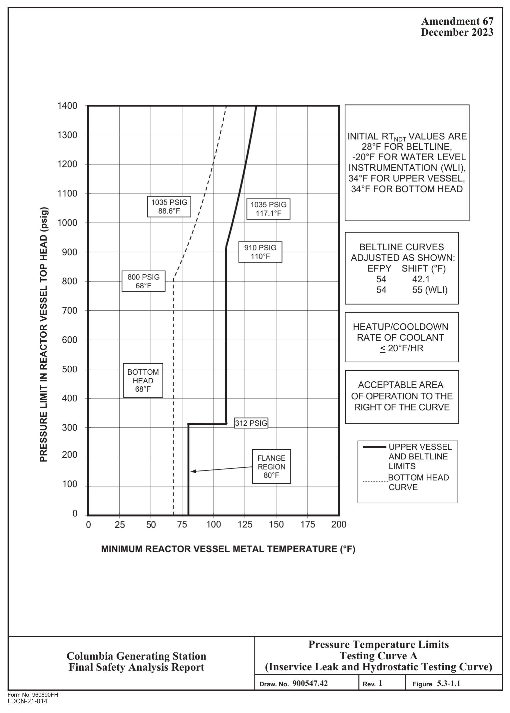
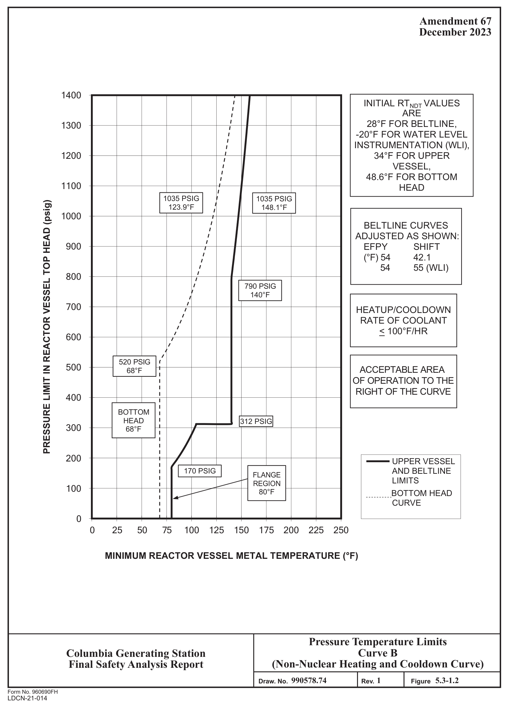
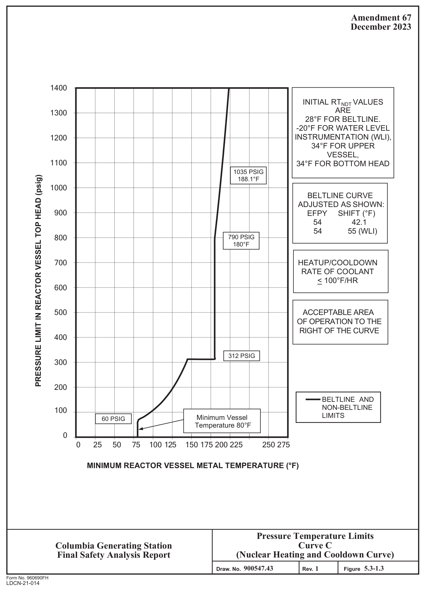
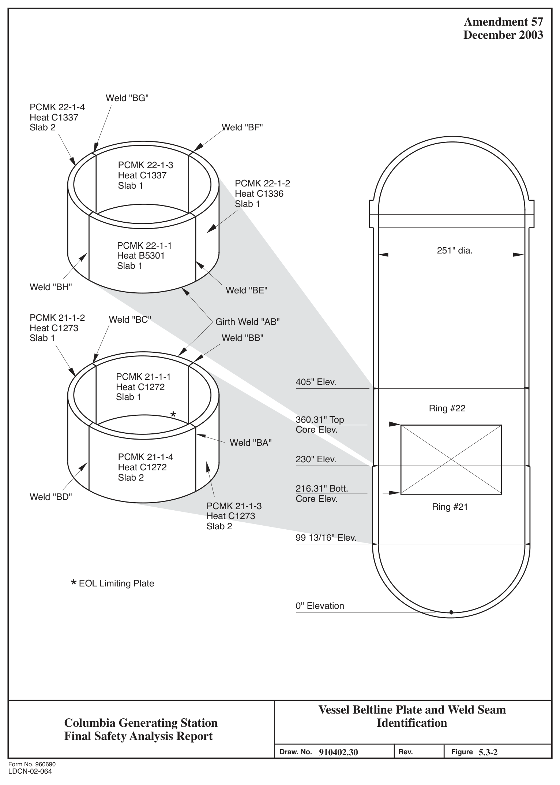
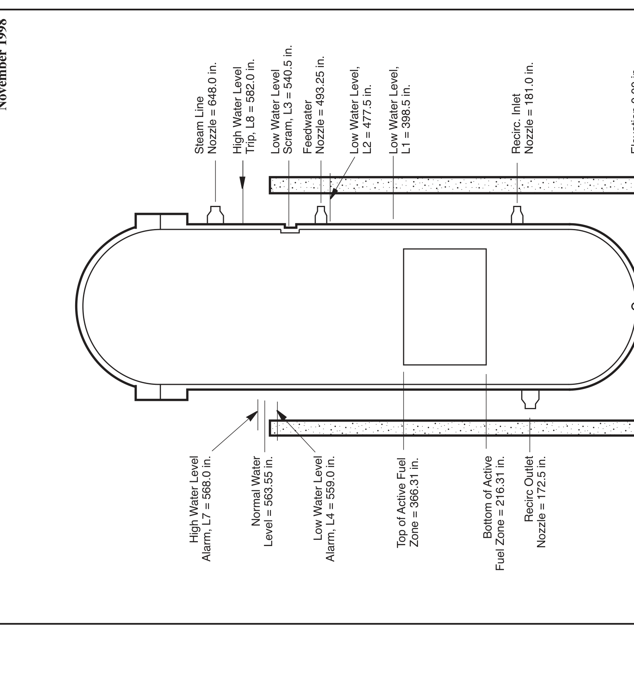
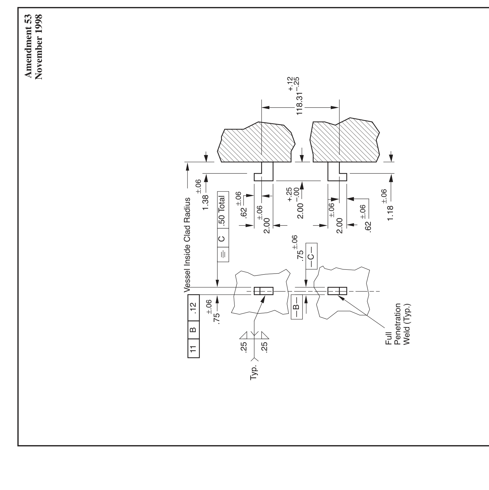
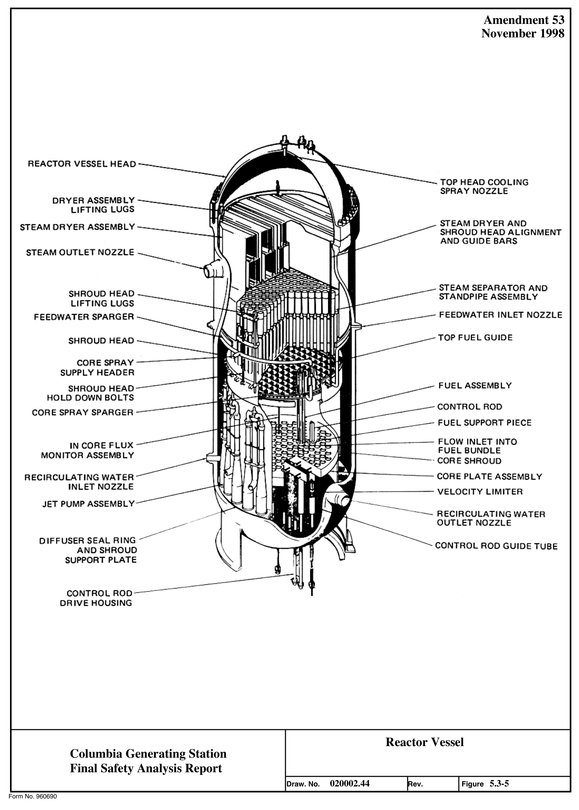
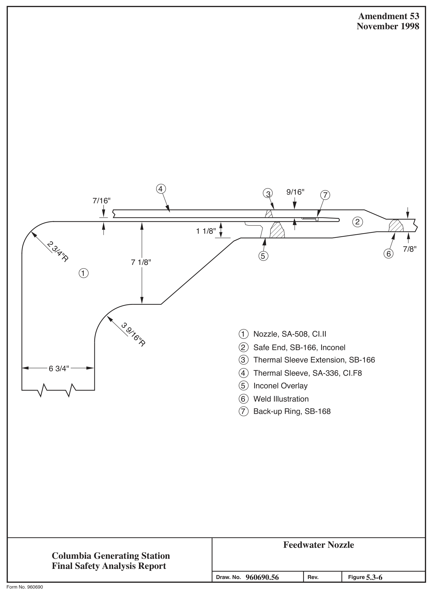
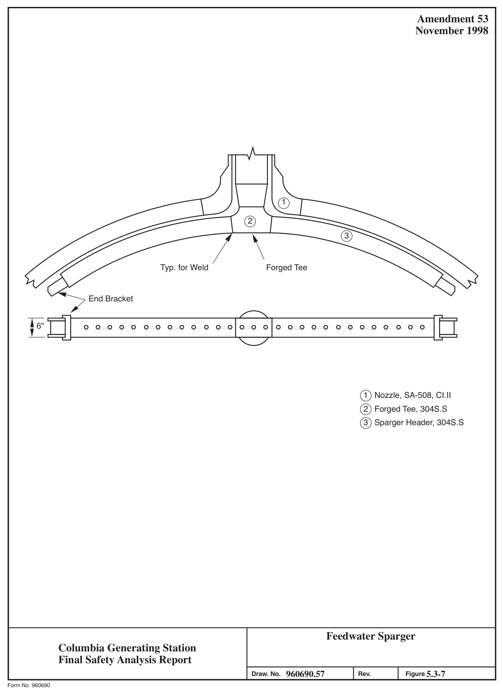

# 5.3 REACTOR VESSEL

> Columbia Generating Station FSAR — Chapter 05: Reactor Coolant System and Connected Systems
> Source: `05_chapter-2042-2256.pdf`, PDF pages 79–119 (of 215)
> Amendment 67 compilation (individual pages carry varying amendment dates)

---
<!-- p.79 -->
### 5.3 REACTOR VESSEL
#### 5.3.1 REACTOR VESSEL MATERIALS
##### 5.3.1.1 Materials Specifications
The materials used in the reactor pressure vessel and appurtenances are shown in Table 5.2-7 together with the applicable specifications.

##### 5.3.1.2 Special Processes Used for Manufacturing and Fabrication
The reactor pressure vessel is primarily constructed from low alloy, high strength steel plate and forgings. Plates are ordered to ASME SA-533, Grade B, Class 1, and forgings to ASME SA-508, Class 2. These materials are melted to fine grain practice and are supplied in the quenched and tempered condition. Further restrictions include a requirement for vacuum degassing to lower the hydrogen level and improve the cleanliness of the low alloy steels.

Studs, nuts, and washers for the main closure flange are ordered to ASME SA-540, Grade B23 or Grade B24. Welding electrodes are low hydrogen type ordered to ASME SFA 5.5.

All plate, forgings, and bolting are 100% ultrasonically tested and surface examined by magnetic particle methods or liquid penetrant methods in accordance with ASME Section III Subsection Nuclear Boiler (NB) standards. Fracture toughness properties are also measured and controlled in accordance with subsection NB requirements.

All fabrication of the reactor pressure vessel is performed in accordance with the General Electric Company (GE) approved drawings, fabrication procedures, and test procedures. The shells and vessel heads are made from formed plates and the flanges and nozzles from forgings. Welding performed to join these vessel components is in accordance with procedures qualified per ASME Section III and IX requirements. Weld test samples are required for each procedure for major vessel full penetration welds. Tensile and impact tests are performed to determine the properties of the base metal, heat-affected zone (HAZ) and weld metal.
Submerged arc and manual stick electrode welding processes are employed. Electroslag welding is not permitted. Preheat and interpass temperatures employed for welding of low alloy steel meet or exceed the requirements of ASME Section III, Subsection NB. Postweld heat treatment at 1100°F minimum is applied to all low alloy steel welds.

Radiographic examination is performed on all pressure containing welds in accordance with requirements of ASME Section III, Subsection NB-5320. In addition, all welds are given a supplemental ultrasonic examination.

<!-- p.80 -->
The materials, fabrication procedures, and testing methods used in the construction of boiler water reactor (BWR) reactor pressure vessels meet or exceed requirements of ASME Section III, Class 1 vessels.

##### 5.3.1.3 Special Methods for Nondestructive Examination
The materials and welds on the reactor pressure vessel were examined in accordance with methods prescribed and met the acceptance requirements specified by ASME Boiler and Pressure Vessel (B&PV) Code Section III. In addition, the pressure retaining welds were ultrasonically examined using manual techniques. The ultrasonic examination method, including calibration, instrumentation, scanning sensitivity, and coverage was based on the requirements imposed by ASME Code Section XI in Appendix I. Acceptance standards were equivalent or more restrictive than required by ASME Code Section XI.

##### 5.3.1.4 Special Controls for Ferritic and Austenitic Stainless Steels
The degree of compliance with Regulatory Guides 1.31, 1.34, 1.43, 1.44, 1.50, 1.71, and
1.99 is described in Section 1.8.

##### 5.3.1.5 Fracture Toughness
###### 5.3.1.5.1 Compliance with Code Requirements
The ferritic pressure boundary material of the reactor pressure vessels was qualified by impact testing in accordance with the 1971 edition of Section III ASME Code and Summer 1971 Addenda. From an operational standpoint, the minimum temperature limits for pressurization defined by the 1998 Edition of Section XI ASME Code and 2000 Addenda, Appendix G, Protection Against Nonductile Failure, are used as the basis for compliance with ASME Code Section III.

###### 5.3.1.5.2 Compliance with 10 CFR 50 Appendix G
A major condition necessary for full compliance to Appendix G was satisfaction of the requirements of the Summer 1972 Addenda to Section III. This was not possible with components which were purchased to earlier Code requirements. For the extent of the compliance, see Table 5.3-1.

Ferritic material complying with 10 CFR 50 Appendix G must have both drop-weight tests and Charpy V-notch (CVN) tests with the CVN specimens oriented transverse to the maximum material working direction to establish the RTNDT. The CVN tests must be evaluated against both an absorbed energy and a lateral expansion criteria. The maximum acceptable RTNDT must be determined in accordance with the analytical procedures of ASME Code Section III, Appendix G. Appendix G of 10 CFR 50 requires a minimum of 75 ft-lb upper shelf CVN

<!-- p.81 -->
energy for beltline material. It also requires at least 45 ft-lb CVN energy and 25 mils lateral expansion for bolting material at the lower of the preload or lowest service temperature.

By comparison, material for the Columbia Generating Station (CGS) reactor vessels was qualified by either drop-weight tests or longitudinally oriented CVN tests (both not required), confirming that the material nil-ductility transition temperature (NDTT) is at least 60°F below the lowest service temperature. When the CVN test was applied, a 30 ft-lb energy level was used in defining the NDTT. There was no upper shelf CVN energy requirement on the beltline material. The bolting material was qualified to a 30 ft-lb CVN energy requirement at 60°F below the minimum preload temperature.

From the previous comparison it can be seen that the fracture toughness testing performed on the CGS reactor vessel material cannot be shown to comply with 10 CFR 50 Appendix G.
However, to determine operating limits in accordance with 10 CFR 50 Appendix G, estimates of the beltline material RTNDT and the highest RTNDT of all other material were made and are discussed in Section 5.3.1.5.2.2. The method for developing these operating limits is also described therein.

On the basis of the last paragraph on page 19013 of the July 17, 1973, Federal Register, the following is considered an appropriate method of compliance.

5.3.1.5.2.1 Intent of Proposed Approach. The intent of the proposed special method of compliance with 10 CFR 50 Appendix G for this vessel is to provide operating limitations on pressure and temperature based on fracture toughness. These operating limits ensure that a margin of safety against a nonductile failure of this vessel is very nearly the same as that for a vessel built to the Summer 1972 Addenda.

The specific temperature limits for operation when the core is critical are based on 10 CFR 50 Appendix G, Paragraph IV, A.2.C.

5.3.1.5.2.2 Operating Limits Based on Fracture Toughness. Operating limits which define minimum reactor vessel metal temperatures versus reactor pressure during normal heatup and cooldown and during inservice hydrostatic testing were established using the methods of □ Appendix G of Section XI of the ASME B&PV Code, 1998 Edition, 2000 Addenda. The results are shown in Figure 5.3-1.

All the vessel shell and head areas remote from discontinuities plus the feedwater nozzles were evaluated, and the operating limit curves are based on the limiting location. The boltup limits for the flange and adjacent shell region are based on a minimum metal temperature of RTNDT +60°F. The maximum through-wall temperature gradient from continuous heating or cooling at 100°F/hr was considered. The safety factors applied were as specified in ASME Section XI Appendix G. □

<!-- p.82 -->
For the purpose of setting these operating limits the reference temperature, RTNDT, is determined from the toughness test data taken in accordance with requirements of the code to which this vessel is designed and manufactured. This toughness test data, CVN and/or dropweight NDT, is analyzed to permit compliance with the intent of 10 CFR 50 Appendix G.
Because all toughness testing needed for strict compliance with Appendix G was not required at the time of vessel procurement some toughness results are not available. For example, longitudinal CVNs, instead of transverse, were tested, usually at a single test temperature of D +10°F or -20°F, for absorbed energy. Also, at the time either CVN or NDT testing was permitted; therefore, in many cases both tests were not performed as is currently required. To substitute for this absence of certain data, toughness property correlations were derived for the vessel materials to operate on the available data to give a conservative estimate of RTNDT compliant with the intent of Appendix G criteria.

These toughness correlations vary, depending upon the specific material analyzed, and were derived from the results of Welding Research Council (WRC) Bulletin 217, “Properties of Heavy Section Nuclear Reactor Steels,” and from toughness data from the CGS vessel and other reactors. In the case of vessel plate material (SA-533 Grade 8, Class 1), the predicted limiting toughness property is either NDT or transverse CVN 50 ft-lb temperature minus 60°F.
NDT values are available for CGS vessel shell plates. The transverse CVN 50 ft-lb transition temperature is estimated from longitudinal CVN data in the following manner. The lowest longitudinal CVN 50 ft-lb value is adjusted to derive a longitudinal CVN 50 ft-lb transition temperature by adding 2°F per ft-lb to the test temperature. If the actual data equals or exceeds 50 ft-lb, the test temperature is used. Once the longitudinal 50 ft-lb temperature is derived, an additional 30°F is added to account for orientation effects and to estimate the transverse CVN 50 ft-lb temperature minus 60°F, estimated in the preceding manner.

Using the above general approach, an initial RTNDT of 28°F was established for the core beltline region.

For forgings (SA-508 Class 2), the predicted limiting property is the same as for vessel plates.
CVN and NDT values are available for the vessel flange, closure head flange, and feedwater nozzle materials for CGS. RTNDT is estimated in the same way as for vessel plate.

For the vessel weld metal the predicted limiting property is the CVN 50 ft-lb transition temperature minus 60°F, as the NDT values are -50°F or lower for these materials. This temperature is derived in the same way as for the vessel plate material, except the 30°F addition of orientation effects is omitted since there is no principal working direction. When NDT values are available, they are also considered and the RTNDT is taken as the higher of NDT or the 50 ft-lb temperature minus 60°F. When NDT is not available, the RTNDT shall not be less than -50°F, since lower values are not supported by the correlation data.

<!-- p.83 -->
For vessel weld HAZ material the RTNDT is assumed the same as for the base material as ASME Code weld procedure qualification test requirements, and postweld heat treatment indicates this assumption is valid.

Figure 5.3-2 provides a sketch of the reactor vessel, including the basic dimensions, all longitudinal and circumferential welds, and all plates of the beltline region. Tables 5.3-2 through 5.3-7 contain the supporting information for Figure 5.3-2, such as piece mark, heat number, and impact data for the plates and filler material used in the beltline region.

Closure bolting material (SA-540 Grade B24) toughness test requirements for CGS were for 30 ft-lb at 60°F below the boltup temperature. Current code requirements are for 45 ft-lb and 25 mils lateral expansion at the preload or lowest service temperature, including boltup. All CGS closure stud materials meet current requirements at +10°F.

The effect of the main closure flange discontinuity was considered by adding 60°F to the RTNDT to establish the minimum temperature for boltup and pressurization. The minimum boltup temperature of 80°F for CGS, which is shown on Figure 5.3-1, is based on an initial RTNDT of +20°F for the shell plate connecting to the closure flange forgings.

The effect of the feedwater nozzle discontinuities were considered by adjusting the results of a BWR/6 reactor discontinuity analysis to the reactor. The adjustment was made by increasing n the minimum temperatures required by the difference between the CGS and BWR/6 feedwater nozzle forging RTNDT. The feedwater nozzle adjustment was based on an RTNDT of 0°F.

The reactor vessel closure studs have a minimum Charpy impact energy of 45 ft-lb and 26 mils lateral expansion at 10°F. The lowest service temperature for the closure studs is 10°F.

Vessel irradiation embrittlement of beltline materials, as measured by adjusted reference temperatures and upper shelf energies due to increased flux, was evaluated against the requirements of 10 CFR 50 Appendix G. For a predicted RPV peak fluence of 1.28E+18 n/cm2 at 54 EFPY, fracture toughness values are acceptable and remain within Appendix G limits for the pressure temperature limit curves provided in Figure 5.3-1.

5.3.1.5.2.3 Temperature Limits for Boltup. A minimum temperature of 10°F is required for the closure studs. A sufficient number of studs may be tensioned at 70°F to seal the closure flange O-rings for the purpose of raising reactor water level above the closure flanges to assist I in warming them. The flanges and adjacent shell are required to be warmed to a minimum I temperature of 80°F before they are stressed by the full intended bolt preload. The fully preloaded boltup limits are shown in Figure 5.3-1.

<!-- p.84 -->
5.3.1.5.2.4 Inservice Inspection Hydrostatic or Leak Pressure Tests. Based on 10 CFR 50 Appendix G, and Regulatory Guide 1.99, Revision 2, requirements, pressure/temperature limit curves were established based on an RTNDT of 28°F for the limiting beltline material; see Figure 5.3-1. The fracture toughness analysis for inservice inspection of leak test resulted in curve A shown in Figure 5.3-1. The predicted shift in the RTNDT temperature was determined using the methodology outlined in Regulatory Guide 1.99, Revision 2.

Technical Specification 3.10.1 allows inservice leak and hydrostatic testing to be performed in Mode 4 when the metallurgical characteristics of the reactor pressure vessel require testing at temperatures greater than 200F, given specified Mode 3 Limiting Conditions for Operations are met. This exemption is only applicable provided reactor coolant temperature does not exceed 275F.

5.3.1.5.2.5 Operating Limits During Heatup, Cooldown, and Core Operation. The fracture toughness analysis was done for the normal heatup or cooldown rate of 100°F/hr. The temperature gradients and thermal stress effects corresponding to this rate were included. The results of the analysis are operating limits defined by Figure 5.3-1. Curves A, B, and C give the limits for hydrotest, nonnuclear heating, and nuclear heating. The minimum boltup temperature of 80°F is based on an RTNDT at 20°F for a shell plate which connects to the lower flange (Heat and Slab No. C-1307-2); above 80°F the core beltline plate (Heat and Slab No. C-1272-1), which has an initial RTNDT of 28°F, is most limiting for inservice hydrostatic or leak pressure tests (curve A). The feedwater nozzles, which have a maximum RTNDT of 0°F, are more restrictive than the core beltline at lower pressures during nonnuclear and nuclear heating (curves B and C).

5.3.1.5.2.6 Reactor Vessel Annealing. Inplace annealing of the reactor vessel to counteract radiation embrittlement is unnecessary because beltline material adjusted reference temperature of the NDT is well within the 10 CFR 50 Appendix G 200°F screening limit.

##### 5.3.1.6 Material Surveillance
The materials surveillance program monitors changes in the fracture toughness properties of ferritic materials in the reactor vessel beltline region resulting from exposure to neutron irradiation and thermal environment. See also FSAR A.2.1.46

The CGS plant-specific RPV materials surveillance program is replaced by the NRC approved BWR Vessel and Internals Project (BWRVIP) Integrated Surveillance Program (ISP), as described in the latest approved revision of BWRVIP-86 (Reference 5.3.4-2). The ISP meets the requirements of 10 CFR 50, Appendix H.

The current surveillance capsule withdrawal schedule for the representative materials for the CGS vessel is based on the latest approved revision of BWRVIP-86 (Reference 5.3.4-2). No capsules from the CGS vessel are included in the ISP. The withdrawal of capsules for the

<!-- p.85 -->
CGS plant-specific surveillance program is permanently deferred by participation in the ISP.
Capsules from other plants will be removed and tested in accordance with the ISP implementation plan. The results from these tests will provide the necessary data to monitor embrittlement for the CGS vessel.

Materials for the plant-specific materials surveillance program were selected to represent materials used in the reactor beltline region. The specimens were manufactured from a plate actually used in the beltline region and a weld typical of those in the beltline region and thus represent base metal, weld metal, and the transition zone between base metal and weld. The plate and weld were heat treated in a manner which simulates the actual heat treatment performed on the core region shell plates of the completed vessel. WPPSS-ENT-089
(Reference 5.3.4-1) provides additional detail and supporting information for the materials surveillance program.

For the extent of compliance to 10 CFR 50 Appendix H, see Table 5.3-8. NEDO-21708 also addressed the requirements of Appendix H to 10 CFR 50 and supports the current application of Regulatory Guide 1.99.

###### 5.3.1.6.1 Positioning of Surveillance Capsules and Method of Attachment for Plant-Specific
Surveillance Program

Surveillance specimen capsules are located at two azimuths at a common elevation in the core beltline region. The sealed capsules are not attached to the vessel but are in welded capsule holders. The capsule holders are mechanically restrained by capsule holder brackets as shown in Figure 5.3-4. The capsule holder brackets allow the capsule holder to be removed at any desired time in the life of the plant for specimen testing. A positive spring-loaded locking device is provided to retain the capsules in position throughout any anticipated event during the lifetime of the vessel.

The capsule holder brackets are designed, fabricated, and analyzed to the requirements of the ASME B&PV Code Section III. The surveillance brackets are welded to the clad material which surfaces the pressure vessel walls. As attached, the brackets do not have to comply with specifications of the ASME Code.

###### 5.3.1.6.2 Time and Number of Dosimetry Measurements
General Electric provides a separate neutron dosimeter so that fluence measurements may be made at the vessel ID during the first fuel cycle to verify the predicted fluence at an early date in plant operation. This measurement is made over this short period to avoid saturation of the dosimeters now available. Once the fluence-to-thermal power output is verified, no further dosimetry is considered necessary because of the linear relationship between fluence and power output.

<!-- p.86 -->
###### 5.3.1.6.3 Neutron Flux and Fluence Calculations
A description of the methods of analysis for neutron flux and fluence calculations is contained in Sections 4.1.4.5 and 4.3.2.8.

##### 5.3.1.7 Reactor Vessel Fasteners
The reactor vessel closure head (flange) is fastened to the reactor vessel shell flange by multiple sets of threaded studs and nuts. The lower end of each stud is installed in a thread hole in its vessel shell flange. A nut and washer are installed on the upper end of each stud.
The proper amount of preload can be applied to the studs by sequential tensioning using hydraulic tensioners. The design and analysis of this area of the vessel is in full compliance with all Section III Class 1 Code requirements. The material for studs, nuts, and washers is SA-540, Grade B23 or B24. The maximum reported ultimate tensile stress for the bolting material was 167,000 psi which is less than the 170,000 psi limitation in Regulatory Guide 1.65. Also the Charpy impact test recommendations of Paragraph IV.A.4 of Appendix G to 10 CFR 50 were not specified in the vessel order since the order was placed prior to issuance of Appendix G to 10 CFR 50. However, impact data from the certified materials report shows that all bolting material has met the Appendix G impact properties. For □ example, the lowest reported CVN energy was 45 ft-lb at 10°F versus the required 45 ft-lb at 70°F and the lowest reported CVN expansion was 26 mils at 10°F versus the required 25 mils at 70°F.

Hardness tests are performed on all main closure bolting to demonstrate that heat treatment has been properly performed. Studs, nuts, and washers are ultrasonically examined in accordance with Section III, NB-2585 and the following additional requirements:

a. Examination is performed after heat treatment and prior to machining threads.

b. Straight beam examination is performed on 100% of each stud. Reference standard for the radial scan is 0.5-in. diameter flat bottom hole having a depth equal to 10% of the material thickness. For the end scan the reference standard is a 0.5-in. flat bottom hole having a depth of 0.5 in. For additional details of the techniques used to examine the reactor vessel studs, see the response to Regulatory Guide 1.65, Revision 0, October 1973, in Section 1.8.

c. Nuts and washers are examined by angle beam from the outside circumference in both the axial and circumferential directions.
I There are no metal platings applied to closure studs, nuts, or washers. A phosphate coating is applied to threaded areas of studs and nuts and bearing areas of nuts and washers to act as a rust inhibitor and to assist in retaining lubricant on these surfaces.

<!-- p.87 -->
#### 5.3.2 PRESSURE-TEMPERATURE LIMITS
##### 5.3.2.1 Limit Curves
Limits on pressure and temperature for inservice leak and hydrostatic tests, normal operation
(including heatup and cooldown), and reactor core operation are shown in Figure 5.3-1. The basis used to determine these limits is described in Section 5.3.1.5.

##### 5.3.2.2 Operating Procedures
By comparison of the pressure versus temperature limits in Figure 5.3-1 with intended normal operating procedures for the most severe upset transient, it is shown that the limits will not be exceeded during any foreseeable upset condition. Reactor operating procedures have been established such that actual transients will not be more severe than those for which the vessel design adequacy has been demonstrated. Of the design transients, the upset condition producing the most adverse temperature and pressure condition anywhere in the vessel head and/or shell areas has a minimum fluid temperature of 250°F and a maximum pressure peak of 1180 psig. Scram automatically occurs with initiation of this event, prior to the reduction in fluid temperature, such that the applicable operating limits are bounded by curve A of Figure 5.3-1. Figure 5.3-1 show that at the maximum transient pressure of 1180 psig, the minimum allowable reactor vessel metal temperature conservatively bounds the minimum 250°F reactor fluid temperature.

#### 5.3.3 REACTOR VESSEL INTEGRITY
The reactor vessel was fabricated for GE’s Nuclear Energy Division by CBI Nuclear Co., and was subject to the requirements of GE’s Quality Assurance program.

Assurance was made that measures were established requiring that purchased material, equipment, and services associated with the reactor vessel and appurtenances conform to the requirements of the subject purchase documents. These measures included provisions, as appropriate, for source evaluation and selection, objective evidence of quality furnished, inspection at the vendor source, and examination of the completed reactor vessel.

Energy Northwest’s agent provided inspection surveillance of the reactor vessel fabricators in process manufacturing, fabrication, and testing operations in accordance with GE’s Quality Assurance program and approved inspection procedures. The reactor vessel fabricator was responsible for the first level inspection of manufacturing, fabrication, and testing activities, and GE was responsible for the first level of audit and surveillance inspection.

Adequate documentary evidence that the reactor vessel material, manufacture, testing, and inspection conforms to the specified quality assurance requirements contained in the procurement specification is available in plant records.

<!-- p.88 -->
##### 5.3.3.1 Design
###### 5.3.3.1.1 Description
5.3.3.1.1.1 Reactor Vessel. The reactor vessel shown in Figure 5.3-5 is a vertical, cylindrical pressure vessel of welded construction. The vessel is designed, fabricated, tested, inspected, and stamped in accordance with the ASME Code Section III, Class 1, including the addenda in effect at the date of order placement. Design of the reactor vessel and its support system meets Seismic Category I equipment requirements. The materials used in the reactor pressure vessel are shown in Table 5.2-7.

The cylindrical shell and bottom head sections of the reactor vessel are fabricated of low alloy steel, the interior of which is clad with stainless steel weld overlay. Nozzle and nozzle weld zones are unclad except for those mating to stainless steel piping systems.

Inplace annealing of the reactor vessel is unnecessary because shifts in transition temperature caused by irradiation during the 40-year life can be accommodated by raising the minimum pressurization temperature. Radiation embrittlement is not a problem outside of the vessel beltline region because the irradiation in those areas is less than 1 x 1018 nvt with neutron energies in excess of 1 MeV. The inside diameter and minimum wall thickness of the reactor vessel beltline is provided in Table 5.3-9.

The extent of RV embrittlement, with respect to USE and ART, is projected for 60 years in accordance with RG 1.99, Revision 2. These projections will be updated throughout the remaining operating life if new information becomes available.

Quality control methods used during the fabrication and assembly of the reactor vessel and appurtenances ensure that design specifications were met. The vessel top head is secured to I the reactor vessel by studs and nuts. These nuts are tightened with a stud tensioner. The vessel flanges are sealed with two concentric metal seal rings designed to permit no detectable I leakage through the inner or outer seal at any operating condition, including heating to operating pressure and temperature at a maximum rate of 100°F/hr in any 1-hr period. To detect seal failure, a vent tap is located between the two seal rings. A monitor line is attached to the tap to provide an indication of leakage from the inner seal ring seal.

###### 5.3.3.1.1.2 Shroud Support. The shroud support is a circular plate welded to the vessel wall.
This support is designed to carry the weight of the shroud, shroud head, peripheral fuel elements, neutron sources, core plate, top guide, the steam separators, the jet pump diffusers, jet pump slip joint clamps, and to laterally support the fuel assemblies. Design of the shroud support also accounts for pressure differentials across the shroud support plate, for the restraining effect of components attached to the support, and for earthquake loadings. The shroud support design is specified to meet appropriate ASME Code stress limits.

<!-- p.89 -->
5.3.3.1.1.3 Protection of Closure Studs. The BWR does not use borated water for reactivity control. This section is therefore not applicable.

###### 5.3.3.1.2 Safety Design Bases
Design of the reactor vessel and appurtenances meet the following safety design bases:

a. The reactor vessel and appurtenances will withstand adverse combinations of loading and forces resulting from operation under abnormal and accident conditions, and

b. To minimize the possibility of brittle fracture of the nuclear system process barrier, the following are required:

1. Impact properties at temperatures related to vessel operation have been specified for materials used in the reactor vessel.

2. Expected shifts in transition temperature during design life as a result of environmental conditions, such as neutron flux, are considered in the design. Operational limitations ensure that NDTT shifts are accounted for in reactor operation.

3. Operational margins to be observed with regard to the transition temperature are specified for each mode of operation.

###### 5.3.3.1.3 Power Generation Design Basis
The design of the reactor vessel and appurtenances meets the following power generation design basis:

a. The reactor vessel has been designed for a useful life of 40 years,

b. External and internal supports that are integral parts of the reactor vessel are located and designed so that stresses in the vessel and supports that result from reactions at these supports are within ASME Code limits, and

c. Design of the reactor vessel and appurtenances allow for a suitable program of inspection and surveillance.

d. The application of the Columbia AMPs verifies that the identified structures, systems, and components will continue to provide their identified intended function(s) during the period of extended operation.

###### 5.3.3.1.4 Reactor Vessel Design Data
Reactor vessel design data are contained in Tables 5.2-6 and 5.2-7.

<!-- p.90 -->
5.3.3.1.4.1 Vessel Support. The concrete and steel vessel support pedestal is constructed as an integral part of the building foundation. Steel anchor bolts set in the concrete extend through the bearing plate and secure the flange of the reactor vessel support skirt to the bearing plate and thus to the support pedestal.

5.3.3.1.4.2 Control Rod Drive Housings. The control rod drive (CRD) housings are inserted through the CRD penetrations in the reactor vessel bottom head and are welded to the reactor vessel. Each housing transmits loads to the bottom head of the reactor. These loads include the weights of a control rod, a CRD, a CRD tube, a four-lobed fuel support piece, and the four fuel assemblies that rest on the fuel support piece. The housings are fabricated of Type 304 austenitic stainless steel.

5.3.3.1.4.2.1 Control Rod Drive Return Line. To preclude CRD return line cracking on CGS, the return line was deleted and the system modified. The modification consists of adding pressure equalizing valves between the exhaust and cooling water headers and the use of reverse flow through multiple hydraulic control unit (HCU) solenoid valves as the CRD system exhaust flow path. The acceptance of this modification is based on system analyses and performance tests conducted on operating BWRs which have shown satisfactory system operation. The system tests showed that system pressure transients, CRD settling times, and CRD speeds were all unchanged. The tests also showed that all systems functions performed normally.

5.3.3.1.4.3 In-Core Neutron Flux Monitor Housings. Each in-core neutron flux monitor housing is inserted through the in-core penetrations in the bottom head and is welded to the inner surface of the bottom head.

An in-core flux monitor guide tube is welded to the top of each housing and either a source range monitor/intermediate range monitor drive unit or a local power range monitor is bolted to the seal/ring flange at the bottom of the housing.

5.3.3.1.4.4 Reactor Vessel Insulation. The insulation panels for the cylindrical shell of the vessel are self-supporting, with seismic restraints attached to the sacrificial shield wall. The insulation is designed to be removable over those portions of the vessel where required for the purpose of in-service inspection.

5.3.3.1.4.5 Reactor Vessel Nozzles. All piping connecting to the reactor vessel nozzles has been designed so as not to exceed the allowable loads on any nozzle.

The vessel top head nozzle is provided with a flange with large groove facing. The drain nozzle is of the full penetration weld design. The recirculation inlet nozzles (located as shown in Figure 5.3-5), feedwater inlet nozzles, core spray inlet nozzles, low-pressure coolant injection (LPCI) nozzles, and the CRD hydraulic system return nozzle all have thermal sleeves. Nozzles connecting to stainless steel piping have safe ends or extensions made of

<!-- p.91 -->
stainless steel. These safe ends or extensions were welded to the nozzles after the pressure vessel was heat treated to avoid furnace sensitization of the stainless steel. The material used is compatible with the material of the mating pipe.

The nozzle for the standby liquid control (SLC) pipe was designed to minimize thermal shock effects on the reactor vessel in the event of injection of cold SLC solution. However, the SLC injection pipe has been relocated to a nozzle on the high-pressure core spray (HPCS) injection line and no longer uses the old nozzle in the bottom head of the reactor pressure vessel. The old nozzle is still in service as the connection for pressure sensing below the core plate, but there is no flow through the nozzle under any operating condition.

In the past, thermal fatigue cracking of feedwater nozzles and vibrational cracking of sparger arms have been observed at other operating BWRs. The mechanisms which have caused cracking in other operating BWRs are understood. A summary discussion of these problems and the solutions incorporated in the CGS design is presented in the following.

A detailed evaluation of the problems of the feedwater nozzle and sparger is presented in NEDE-21821, “BWR Feedwater Nozzle/ Sparger Final Report,” March 1978. The solution of the feedwater nozzle and sparger cracking problems involved several elements, including material selection and processing, nozzle clad elimination, and thermal sleeve and sparger redesign. The following summarizes the problems and solutions that have been implemented in the CGS design.

Problem Cause Fix

Sparger arm cracks Vibration Eliminated clearance between thermal sleeve and safe end

RPV feedwater Thermal Eliminated clad, thermal fatigue eliminated leakage with a welded joint between the sparger and safe end

The sparger vibration has been attributed to a self-excitation caused by instability of leakage flow through the annular clearance between the thermal sleeve and safe end. Tests have shown that the vibration is eliminated if the clearance is reduced sufficiently or sealed. The solution that was selected for CGS uses a welded joint to ensure no leakage. This feature is also an essential part of the solution of the nozzle cracking problem. Freedom from vibration over a range of conditions has been demonstrated by the tests reported in NEDE-23604 (see Figures 5.3-6 and 5.3-7).

<!-- p.92 -->
The cracking of the feedwater nozzles is a two-part process. The crack initiation mechanism as discussed above is the result of self-initiated thermal cycling. If this were the only mechanism present, the cracks would initiate, grow to a depth of approximately 0.25 in., and arrest. This degree of cracking could be tolerated; however, there is another mechanism which supports crack growth. This mechanism is the system induced transients, primarily the startup/shutdown transients. Because of CGS’s welded thermal sleeve arrangement, leakage flow is eliminated and the heat transfer between the feedwater and the nozzle are reduced to the point where the thermal stresses in the nozzle are not high enough to cause a significant crack growth. Analyses presented in NEDE-21821, Section 4.7, demonstrated the benefits of the welded thermal sleeve and of using unclad nozzles. With these demonstrated benefits and inservice surveillance, CGS found it unnecessary to install instrumentation for design verification.

CGS has installed two automatic feedwater low flow control valves, RFW-FCV-10A and 10B.
These valves have the capacity to control flow down to 362 gpm, or about 1.25% of total flow.
This valve configuration will substantially reduce the temperature differential between the feedwater and the water in the RPV during low power operation, also reducing the thermal stresses in the nozzle.

5.3.3.1.4.6 Materials and Inspection. The reactor vessel was designed and fabricated in accordance with the appropriate ASME B&PV Code as defined in Section 5.2.1.2.
Table 5.2-7 defines the materials and specifications. Table 5.3-8 defines the compliance with reactor vessel material surveillance program requirements.

5.3.3.1.4.7 Reactor Vessel Schematic (BWR). The reactor vessel schematic is contained in Figure 5.3-3. Trip system water levels are indicated as shown.

##### 5.3.3.2 Materials of Construction
All materials used in the construction of the reactor pressure vessel conform to the requirements of ASME Code Section II materials. The vessel heads, shells, flanges, and nozzles are fabricated from low alloy steel plate and forgings purchased in accordance with ASME specifications SA533 Grade B Class 1 and SA-508 Class 2. Special requirements for the low alloy steel plate and forgings are discussed in Section 5.3.1.2. Cladding employed on the interior surfaces of the vessel consists of austenitic stainless steel weld overlay.

These materials of construction were selected because they provide adequate strength, fracture toughness, fabricability, and compatibility with the BWR environment. Their suitability has been demonstrated by long-term successful operating experience in reactor service.

<!-- p.93 -->
##### 5.3.3.3 Fabrication Methods
The reactor pressure vessel is a vertical cylindrical pressure vessel of welded construction fabricated in accordance with ASME Code Section III, Class 1, requirements. All fabrication of the reactor pressure vessel was performed in accordance with buyer-approved drawings, fabrication procedures, and test procedures. The shells and vessel heads were made from formed low alloy steel plates and the flanges and nozzles from low alloy steel forgings.
Welding performed to join these vessel components was in accordance with procedures qualified per ASME Section III and IX requirements. Weld test samples were required for each procedure for major vessel full penetration welds.

Submerged arc and manual stick electrode welding processes were employed. Electroslag welding was not permitted. Preheat and interpass temperatures employed for welding of low alloy steel met or exceeded the requirements of ASME Section III, Subsection NB. Postweld heat treatment of 1100°F minimum was applied to all low alloy steel welds.

All previous BWR pressure vessels have employed similar fabrication methods. These vessels have operated for periods up to 16 years and their service history is excellent.

The vessel fabricator, CBI Nuclear Co., has had extensive experience with GE, reactor vessels, and has been the primary supplier for GE domestic reactor vessels and some foreign vessels since the company was formed in 1972 from a merger agreement between Chicago Bridge and Iron Co. and GE. Prior experience by the Chicago Bridge and Iron Co. with GE reactor vessels dates back to 1966.

##### 5.3.3.4 Inspection Requirements
All plate, forgings, and bolting were 100% ultrasonically tested and surface examined by magnetic particle methods or liquid penetrant methods in accordance with ASME Section III requirements. Welds on the reactor pressure vessel were examined in accordance with methods prescribed and met the acceptance requirements specified by ASME Section III. In addition, the pressure-retaining welds were ultrasonically examined using acceptance standards which were required by ASME Section XI.

##### 5.3.3.5 Shipment and Installation
The completed reactor vessel was given a thorough cleaning and examination prior to shipment. The vessel was tightly sealed for shipment to prevent entry of dirt or moisture.
Preparations for shipment were in accordance with detailed written procedures. On arrival at the reactor site the reactor vessel was carefully examined for evidence of any contamination as a result of damage to shipping covers. Suitable measures were taken during installation to ensure that vessel integrity was maintained; for example, access controls were applied to

<!-- p.94 -->
personnel entering the vessel, weather protection was provided, periodic cleanings were performed, and only approved miscellaneous materials were used during assembly.

##### 5.3.3.6 Operating Conditions
Restrictions on plant operation to hold thermal stresses within acceptable ranges are included in the Technical Specifications. These restrictions on coolant temperature are

a. The average rate of change of reactor coolant temperature during normal heatup and cooldown,

b. Coolant temperature difference between the dome (inferred from Psat) and the bottom head drain, and

c. Idle reactor recirculation loop and average reactor coolant temperature differential.

The limit regarding the normal rate of heatup and cooldown (item a) assures that the vessel closure, closure studs, vessel support skirt, and CRD housing and stub tube stresses and usage remain within acceptable limits. The vessel temperature limit on recirculating pump operation and power level increase restriction (item b) augments the item a limit in further detail by ensuring that the vessel bottom head region will not be warmed at an excessive rate caused by rapid sweep out of cold coolant in the vessel lower head region by recirculating pump operation or natural circulation (cold coolant can accumulate as a result of control drive inleakage and/or low recirculation flow rate during startup or hot standby). The item c limit further restricts operation of the recirculating pumps to avoid high thermal stress effects in the pumps and piping, while also minimizing thermal stresses on the vessel nozzles.

The above operational limits when maintained insure that the stress limits within the reactor vessel and its components are within the thermal limits to which the vessel was designed for normal operating conditions. To maintain the material integrity of the vessel in the event that these operational limits are exceeded the reactor vessel has also been designed to withstand a limited number of transients caused by operator error. Reactor vessel material integrity is also maintained during abnormal operating conditions where safety systems or controls provide an automatic response in the reactor vessel. The special and transient events considered in the design of the vessel are discussed or referenced in Section 5.2.2.

##### 5.3.3.7 Inservice Surveillance
Inservice inspection of the reactor pressure vessel is in accordance with the requirements as discussed in Section 5.2.4. The vessel was examined once prior to startup to satisfy the preoperational requirements of IS-232 or the ASME Code, Section XI. Subsequent inservice

<!-- p.95 -->
inspection will be scheduled and performed in accordance with the requirements of 10 CFR 50.55a subparagraph (g).

The materials surveillance program monitors changes in the fracture toughness properties of ferritic materials in the reactor vessel beltline region resulting from their exposure to neutron irradiation and thermal environment. See Section 5.3.1.6 for description of the materials surveillance program. Operating procedures will be modified in accordance with test results to ensure adequate brittle fracture control.

Material surveillance programs and inservice inspection programs are in accordance with applicable ASME Code requirements and provide assurance that brittle fracture control and pressure vessel integrity will be maintained throughout the service lifetime of the reactor pressure vessel.

#### 5.3.4 REFERENCES
5.3.4-1 WPPSS-ENT-089, “WNP-2 RPV Surveillance Program,” Current Revision.

5.3.4-2 BWRVIP-86, Revision 1-A, “BWR Vessel and Internals Project, Updated BWR Integrated Surveillance Program (ISP) Implementation Plan,” Final Report, October 2012.

<!-- p.96 -->
November 1998

is in accordance with Regulatory Guide 1.88, Revision 2, GE Alternative Section III code, Summer 1971 addenda, were met. For the discussions Machines calibration data are retained until the next recalibration. This however, the individuals were qualified by on-the-job training and past No written procedures were in existence as required by the regulation; experience. For the discussion of the GE interpretation of compliance Paragraph NB-2360 of the ASME B&PV Code Section III was not in existence at the time of purchase of the CGS reactor pressure vessel.
However, the requirements of the 1971 edition of the ASME B&PV Position 1.88, and ANSI N45.2.9-1974. Therefore, the instrument References 1 and 2. The temperature instruments and Charpy Test of the GE interpretations of compliance and NRC acceptance see Compliance except for CVN orientation and CVN upper shelf.
calibration data for CGS would not be currently available.
Alternative Actions or Comments and NRC acceptance see References 1 and 2.
See Section 5.3.1.5.2 for discussion.
See III.A, III.B.2 above.
See References 1 and 2.
See III.A above.

## 10 CFR 50 Appendix G Matrix
Table 5.3-1 or N/A Comply Yes/No Yes Yes Yes No No No No
--

Compliance with ASME Code, Section NB-2300 Location and Orientation of Impact Test Spec Calibration of Temperature Instruments and Materials Used to Prepare Test Specimens Test Results Recording and Certification Qualification of Testing Personnel Topic Introduction; Definitions Charpy Test Machines Test Conditions

Appendix G Paragraph

#### III.B.1 III.B.2 III.B.3
#### III.B.4 III.B.5 III.C.1
#### III.A
#### I, II
<!-- p.97 -->
April 2000

Current toughness requirements for closure head studs are met at +10°F An estimate of compliance to requirements should be made from the first Main steam line piping is in compliance. See 5.2.3.3 for discussions on Compliance on base metal and weld metal tests. Test weld not made on Weld and longitudinal CVN data were taken at -20°F and +10°F only.
For feedwater nozzles the results of the BWR/6 analysis was adjusted to Plus 60°F was added to the RTNDT for the reactor vessel flanges.
even though testing was done per the 1971 ASME code.
Alternative Actions or Comments surveillance capsule results per MTEB 5-2.
Comply with 10 CFR 50 Appendix G.
same heat of base plate necessarily.

## 10 CFR 50 Appendix G Matrix (Continued)
CGS RTNDT conditions.
pumps and valves.
Table 5.3-1 or N/A Comply Yes/No Yes Yes Yes Yes Yes No No No
--

RPV Metal Temperature Requirement When Core Minimum Permissible Temperature During Hydro Minimum Upper Shelf Energy for RPV Beltline Materials Used to Prepare Test Specimens for Requirements for Nozzles, Flanges, and Shell Materials for Bolting and Other Fasteners Materials for Piping, Pumps, and Valves Region Near Geometric Discontinuities Acceptance Standard of Materials Calculates Stress Intensity Factor Topic Reactor Vessel Beltline is Critical Test

Appendix G Paragraph IV.A.2.a IV.A.2.b IV.A.2.c IV.A.2.d

#### IV.A.1
#### IV.A.3 IV.A.4 III.C.2
IV.B

<!-- p.98 -->
35, 39, 40 ft-lb; 60% shear at +10°F) and Heat 05P018/Lot D211A27A 33, 33, 30, 30, 34, 35 ft-lb; 10% shear at +10°F). Beltline welds were tested with CVNs at 10°F or -20°F only. Lowest weld values are found 20 and 30% shear at -20°F). Heat C3L46C/Lot J020A27A (0.02% Cu; contents, it is anticipated that end-of-life upper shelf CVN values would Beltline plates were tested with longitudinal CVNs at +10°F only. The document (WPPSS-ENT-089, Reference 5.3.4-1). See Section 5.3.1.6 minimum values are for Heat C1272-1 (0.15% Cu; 34, 26, 30, 31, 34, The Surveillance Program demonstrates compliance with Appendix G, for Heat 04P046/Lot D217A27A (0.06% Cu; 34, 36, 37, 39, 40 ft-lb;
30 ft-lb; 10 and 40% shear at +10°F) and Heat C1273-1 (0.14% Cu;
Specifications and the Reactor Pressure Vessel Surveillance Program
(0.09% Cu; 29, 30, 31, 36, 38 ft-lb; 30 and 40% shear at -20°F).
Section IV. See Section 5.3.1.6 for description of the Materials Because of the preceding relatively low test temperatures and Cu Requirements for continued operations are covered in Technical □ for description of the Materials Surveillance Program.
Alternative Actions or Comments

## 10 CFR 50 Appendix G Matrix (Continued)
be in excess of 50 ft-lb.
Surveillance Program.
Table 5.3-1 Yes/No or N/A Comply Table N/A 5.3-8 N/A Yes See

Requirements for Material Surveillance Program Requirements for Annealing when RTndt >200 Alternative if V.B Cannot be Satisfied Conditions for Continued Operation Topic

IV.B (continued)
Appendix G Paragraph IV.C V.A

#### V.C V.B
#### LDCN-04-005, 04-033
<!-- p.99 -->
November 1998

Alternative Actions or Comments
1. Letter MFN-414-77 from G. G. Sherwood, GE, to Edson G. Case, NRC, dated October 17, 1977.
2. Letter from Robert B. Minoque, NRC, to G. G. Sherwood, GE, dated February 14, 1978.

## 10 CFR 50 Appendix G Matrix for (Continued)
Table 5.3-1 Yes/No or N/A Comply

#### N/A N/A
Requirement for RPV Thermal Annealing if V.C Reporting Requirements for V.C and V.D Topic

Cannot be Met

#### REFERENCES
Appendix G Paragraph

#### V.D V.E
<!-- p.100 -->
November 1998

Table 5.3-2

Plate Material Cross Reference

Heat Slab

Ring 21

#### PCMK 21-1-1 C1272
1

#### PCMK 21-1-2 C1273
1

#### PCMK 21-1-3 C1273
2

#### PCMK 21-1-4 C1272
2 Ring 22

#### PCMK 22-1-1 B5301
1

#### PCMK 22-1-2 C1336
1

#### PCMK 22-1-3 C1337
1

#### PCMK 22-1-4 C1337
2

<!-- p.101 -->
November 1998

Table 5.3-3

Weld Material Cross Reference

Weld Identification Type Heat Lot

AB - Girthweld E8018NM 492L4871 A422B27AF

#### RAC01NMM 5P6756
0342

#### RAC01NMM 3P4955
0342

#### E8018NM
04T931

#### A423B27AG
Ring 21 BA

#### E8018NM
04P046

#### D217A27A
#### E8018NM
07L669

#### K004A27A
#### RAC01NMM 3P4966
1214

BB

#### E8018NM
04P046

#### D217A27A
#### E8018NM
07L669

#### K004A27A
#### E8018NM
#### C3L46C
#### J020A27A
#### RAC01NMM 3P4966
1214

#### E8018NM
08M365

#### G128A27A
BC

#### E8018NM
09L853

#### A111A27A
#### E8018NM
#### C3L46C
#### J020A27A
#### RAC01NMM 3P4966
1214 BD

#### E8018NM
#### C3L46C
#### J020A27A
#### RAC01NMM 3P4966
1214

#### E8018NM
04P046

#### D217A27A
#### E8018NM
#### C3L46C
#### J020A27A
Ring 22 BE

#### RAC01NMM 3P4966
1214

BF

#### E8018NM
04P046

#### D217A27A
#### E8018NM
05P018

#### D211A27A
#### RAC01NM 3P4966
1214

BG

#### E8018NM
624063

#### C228A27A
#### E8018NM
624039

#### D224A27A
#### RAC01NMM 3P4966
1214 BH

#### E8018NM
04P096

#### D217A27A
#### E8018NM
624039

#### D205A27A
#### RAC01NMM 3P4966
1214

<!-- p.102 -->
November 1998

Table 5.3-4

Plate Material

Charpy Impact Charpy Expansion Drop Weight RTNDT ft-lb @ +10°F MLE NDT (°F) (°F)

Ring 21 PCMK 21-1-1 34, 26, 30/31, 34, 30 30, 34, 24/27, 26, 32 −10 28 Heat C1272-1 PCMK 21-1-2 33, 33, 30/30, 34, 35 30, 31, 27/26, 34, 32 −20 20 Heat C1273-1 PCMK 21-1-3 38, 48, 55/66, 61, 71 44, 39, 34/53, 52, 56 −30 4 Heat C1273-2 PCMK 21-1-4 40, 42, 44/51, 55, 50 32, 36, 38/41, 44, 42 −30 0 Heat C1272-2 Ring 22 PCMK 22-1-1 64, 62, 66/52, 52, 55 56, 56, 56/45, 44, 44 −30 −20 Heat B5301-1 PCMK 22-1-2 70, 72, 71/60, 44, 66 59, 60, 62/56, 41, 51 −30 −8 Heat C1336-1 PCMK 22-1-3 71, 76, 74/70, 72, 55 61, 60, 60/63, 61, 52 −30 −20 Heat C1337-1 PCMK 22-1-4 62, 72, 82/73, 67, 73 51, 61, 66/52, 59, 61 −50 −20 Heat C1337-2

<!-- p.103 -->
Table 5.3-5

Weld Material

Charpy Test Temperature RTNDT Charpy Impact Charpy Expansion MLE Type/Heat/Lot/Control (ft-lb)
(°F) (°F)

Girth Weld AB E8018NM/492L4871 78, 82, 105, 93, 55, 60, 72, 74, −20a −50 Lot A422B27AF 81 60 RAC01NMM/5P6756b 76, 79, 77, 80, 64, 72, 55, 69, +10 −50 Lot 0342 72 60 RAC01NMM/5P6756c 76, 79, 77, 80, 64, 72, 55, 69, +10 −50 Lot 0342 72 60 RAC01NMM/3P4955b 49, 63, 47, 49, 39, 48, 36, 43, +10 −20 Lot 0342 64 57 RAC01NMM/3P4955c 52, 37, 45, 55, 44, 30, 43, 50, +10 −16 Lot 0342 33 32 E8018NM/04T931 86, 84, 102, 63, 69, 58, 60, 57, −20 −50 Lot A423B27AG 61 70

Ring 21BA E8018NM/04P046 34, 36, 37, 39, 23, 28, 24, 20, −20a −48 Lot D217A27A 40 24

#### E8018NM/07L669 50, 50, 54 44, 44, 46
+10a −50 Lot K004A27A RAC01NMM/3P4966c 40, 71, 75, 63, 41, 63, 68, 58, +10a −30 Lot 1214/3482 59 53 RAC01NMM/3P4966b 65, 70, 67, 69, 60, 60, 63, 55, +10a -48 Lot 1214/3482 49 44

Ring 21BB E8018NM/04P046 34, 36, 37, 39, 23, 28, 24, 20, −20a −48 Lot D217A27A 40 24

#### E8018NM/07L669 50, 50, 54 44, 44, 46
+10a −50 Lot K004A27A

#### E8018NM/C3L46C 35, 39, 40 34, 39, 39
+10a −20 Lot J020827A

<!-- p.104 -->
Table 5.3-5

Weld Material (Continued)

Charpy Test Charpy Impact Charpy Expansion Temperature RTNDT MLE Type/Heat/Lot/Control (ft-lb)
(°F) (°F)

RAC01NMM/3P4966c 40, 71, 75, 63, 41, 63, 68, 58, +10a −30 Lot 1214/3482 59 53 RAC01NMM/3P4966b 65, 70, 67, 69, 60, 60, 63, 55, +10a −48 Lot 1214/3482 49 44

#### E8018NM/08M365 49, 50, 51 38, 40, 43
+10a −48 Lot G128A27A

Ring 21BC

#### E8018NM/09L853 78, 78, 79 60, 62, 62
+10a −50 Lot A111A27A

#### E8018NM/C3L46C 35, 39, 40 34, 39, 39
+10a −20 Lot J020A27A RAC01NMM/3P4966c 40, 71, 75, 63, 41, 63, 68, 58, +10a −30 Lot 1214/3482 59 53 RAC01NMM/3P4966b 65, 70, 67, 69, 60, 60, 63, 55, +10a −48 Lot 1214/3482 49 44

Ring 21BD

#### E8018NM/C3L46C 35, 39, 40 34, 39, 39
+10a −20 Lot J020A27A RAC01NMM/3P4966c 40, 71, 75, 63, 41, 63, 68, 58, +10a −30 Lot 1214/3482 59 53 RAC01NMM/3P4966b 65, 70, 67, 69, 60, 60, 63, 55, +10a −48 Lot 1214/3482 49 44 E8018NM/04P046 34, 36, 37, 39, 23, 28, 24, 20, −20a −48 Lot D217A27A 40 24

Ring 22BE RAC01NMM/3P4966c 39, 38, 38, 82, 68, 64, 63, 81, +10 −20 Lot 1214/3481 84 72 RAC01NMM/3P4966b 28, 84, 63, 75, 18, 62, 57, 51, +10 −6 Lot 1214/3481 78 57

<!-- p.105 -->
Table 5.3-5

Weld Material (Continued)

Charpy Test Charpy Impact Charpy Expansion Temperature RTNDT MLE Type/Heat/Lot/Control (ft-lb)
(°F) (°F)

Ring 22BF E8018NM/04P046 34, 36, 37, 39, 23, 28, 24, 20, −20a −48 Lot D217A27A 40 24 E8018NM/05P018 29, 30, 31, 36, 26, 26, 31, 33, −20a −38 Lot D211A27A 38 35 RAC01NMM/3P4966c 39, 38, 38, 82, 68, 64, 63, 81, +10 −20 Lot 1214/3481 84 72 RAC01NMM/3P4966b 28, 84, 63, 75, 18, 62, 57, 51, +10 −6 Lot 1214/3481 78 57

Ring 22BG E8018NM/624063 37, 40, 51, 57, 33, 34, 41, 47, −20a −50 Lot C228A27A 70 55 E8018NM/624039 28, 33, 34, 36, 29, 32, 33, 34, −20a −36 Lot D224A27A 42 42 RAC01NMM/3P4966c 39, 38, 38, 82, 68, 64, 63, 81, +10 −20 Lot 1214/3481 84 72 RAC01NMM/3P4966b 28, 84, 63, 75, 18, 62, 57, 51, +10 −6 Lot 1214/3481 78 57

Ring 22BH E8018NM/04P046 34, 36, 37, 39, 23, 28, 24, 20, −20a −48 Lot D217A27A 40 24 E8018NM/624039 41, 44, 49, 54, 32, 36, 40, 41, −20a −50 Lot D205A27A 58 45 RAC01NMM/3P4966c 39, 38, 38, 82, 68, 64, 63, 81, +10 −20 Lot 1214/3481 84 72 RAC01NMM/3P4966b 28, 84, 63, 75, 18, 62, 57, 51, +10 −6 Lot 1214/3481 78 57

a Drop weight NDT not applicable.
b Tandem wire process.
c Single wire process.

<!-- p.106 -->
Table 5.3-6

Vessel Beltline Plate

Plate P Cu C Mn Si S Ni Mo V

#### C1272-1 0.013 0.15 0.23 1.31 0.26 0.02 0.60 0.55 --
#### C1272-2 0.013 0.15 0.23 1.31 0.26 0.02 0.60 0.55 --
#### C1273-1 0.014 0.14 0.23 1.28 0.23 0.018 0.60 0.57 --
#### C1273-2 0.014 0.14 0.23 1.28 0.23 0.018 0.60 0.57 --
D

#### B5301-1 0.017 0.13 0.20 1.34 0.23 0.014 0.50 0.52 --
#### C1336-1 0.017 0.13 0.21 1.36 0.22 0.013 0.50 0.49 --
#### C1337-1 0.018 0.15 0.22 1.32 0.21 0.013 0.51 0.50 --
#### C1337-2 0.018 0.15 0.22 1.32 0.21 0.013 0.51 0.50 --
Peak I.D. EOL RPV peak fluence of 1.28E+18 n/cm2 at 54 EFPY.

<!-- p.107 -->
Table 5.3-7

Vessel Beltline Weld Material Chemistrya

Weld Heat/Control Cu C Mn Si S Ni Mo V P

492L4871b 0.03 0.07 1.17 0.32 0.02 0.98 0.51 0.02 0.02

5P6756/0342c 0.08f 0.063 1.27 0.57 0.011 0.936f 0.45 0.006 0.01 5P6756/0342d 0.08f 0.936f 0.078 1.24 0.53 0.012 0.46 0.006 0.01

3P4955/0342d 0.027f 0.035 1.33 0.56 0.011 0.921f 0.52 0.006 0.016 3P4955/0342c 0.027f 0.921f 0.054 1.28 0.55 0.010 0.54 0.007 0.016

04T931b 0.03 0.05 1.03 0.28 0.024 1.00 0.53 0.01 0.02

04P046b 0.06 0.044 1.04 0.40 0.021 0.90 0.58 0.02 0.009

07L996b 0.03 0.05 1.24 0.48 0.016 1.02 0.54 -- 0.014

3P4966/3481d 0.025f 0.074 1.38 0.36 0.013 0.913f 0.49 0.006 0.010 3P4966/3481c 0.025f 0.913f 0.067 1.39 0.38 0.014 0.53 0.008 0.011

3P4966/3482c 0.025f 0.059 1.35 0.38 0.013 0.913f 0.50 0.005 0.013 3P4966/3482d 0.025f 0.077 1.42 0.41 0.013 0.913f 0.53 0.005 0.014

C3L46Cb 0.02 0.063 0.96 0.32 0.017 0.87 0.53 -- 0.019

08M365b 0.02 0.057 1.23 0.47 0.023 1.10 0.57 -- 0.02

09L853b 0.03 0.052 1.23 0.46 0.023 0.86 0.51 -- 0.018

05P018b 0.09 0.057 1.21 0.44 0.021 0.90 0.53 0.01 0.008

624063b 0.03 0.041 1.12 0.41 0.018 1.00 0.54 0.01 0.009

624039b,e 0.07 0.060 1.11 0.45 0.025 1.01 0.57 0.02 0.015

624039b,e 0.10 0.041 1.12 0.45 0.02 0.92 0.53 0.01 0.01

a As deposited.
b M = Manual Welding Process c S = Single Wire Process d T = Tandem Wire Process e Different lot numbers f GE Hitachi Nuclear Energy, “Pressure-Temperature Curves Report for Energy Northwest Columbia Generating Station 60 Year Plan License Extension,” 005N4603, November 2020,
(CVI CAL 1012-00,23) Table 4-5.

<!-- p.108 -->
may not have necessarily been taken from alongside specimens required Plant-specific Surveillance Program: Noncompliance in that specimens limiting beltline material. Specimens are from actual beltline material, E185-73 in that the surveillance specimens are not necessarily from the however, and can be used to predict behavior of the limiting material.
Heat and heat/lot numbers for surveillance specimens were supplied.
See Section 5.3.1.6. Starting RTNDT of limiting material is based on employed. However, representative materials have been used, and Plant-specific Surveillance Program: Noncompliance with ASTM CGS Plant-specific RPV Surveillance Program is replaced by the Code basis is used for attachment of brackets to vessel cladding.
by Section III of Appendix G and transverse CVNs may not be RTNDT shift appears to be independent of specimen orientation.
alternative action (see paragraph III.A of Appendix G).
Alternative Actions or Comments BWRVIP ISP. See Section 5.3.1.6.
See Section 5.3.1.6.
See Section 5.3.1.6.

## 10 CFR 50 Appendix H Matrix
Table 5.3-8 Yes/No or N/A Comply N/A N/A N/A Yes Yes N/A No No

Withdrawal Schedule of Capsules, RTNDT <100°F Withdrawal Schedule of Capsules, RTNDT <200°F Withdrawal Schedule of Capsules, RTNDT >200°F Standards Requirements (ASTM) for Surveillance Locations Alongside the Fracture Test Specimens Locations of Surveillance Capsules in RPV Surveillance Specimen Shall be Taken for
(Section III.B of Appendix G)
Topic

Fluence 1017n/cm2 Introduction

Appendix H Paragraph II.C.3.b II.C.3.a II.C.3.c

#### II.C.1
#### II.C.2
#### II.A II.B
I

<!-- p.109 -->
addressed in the BWRVIP ISP implementation plan (Reference 5.3.4-2).
requirements is found in the BWRVIP implementation plan (Reference Method of determining adjusted reference temperatures found in the Requirements for postirradiation testing of surveillance material are A discussion of the pressure/temperature limits and reporting Dosimetry requirements are discussed in the BWRVIP ISP Reporting requirements are discussed in the BWRVIP ISP BWRVIP ISP implementation plan (Reference 5.3.4-2).
Alternative Actions or Comments implementation plan (Reference 5.3.4-2). implementation plan (Reference 5.3.4-2).

## 10 CFR 50 Appendix H Matrix (Continued)
5.3.4-2).
Table 5.3-8 Yes/No or N/A Comply Yes Yes Yes Yes Yes

Reporting Requirements of Pressure/Temperature Temperature for Base Metal, HAZ, and Weld Fracture Toughness Testing Requirements of Method of Determining Adjusted Reference Requirement for Dosimetry Measurement Reporting Requirements of Test Results Topic

Specimens Limits Metal

Appendix H Paragraph

#### IV.A III.A III.B IV.B IV.C
<!-- p.110 -->
Table 5.3-9

Reactor Vessel Beltline Minimum Wall Thickness and Diameter

Inside diameter with clad = 251 in. (minimum)
Wall thickness (ring #22, lower intermediate shell) = 6.188 in. (minimum)
Wall thickness (ring #21, lower shell)
= 9.5 in. (minimum)
Clad thickness = 0.1875 in. (nominal)
= 0.125 in. (minimum)

Refer to Figure 5.3-2 and CVI 02B13-06,2 Rev. 8 (VPF #3133-001-9) CBI Nuclear Company Drawing No. 1, Rev. 8, “Vessel Outline.”

#### LDCN-04-005, 04-033
<!-- p.111 -->

*figure on PDF page 111*

[Vector original (SVG, lossless): fig_page-111.svg](../figures/fig_page-111.svg)

<!-- labels/text on this figure page -->
Amendment 67 December 2023
.
1400 I I I
I 1300
INITIAL RTNDT VALUES ARE
I 28°F FOR BELTLINE, I I
-20°F FOR WATER LEVEL f 1200
INSTRUMENTATION (WLI),
I 34°F FOR UPPER VESSEL, I J I /1 34°F FOR BOTTOM HEAD I 1100 I/ I 1035 PSIG 1035 PSIG PRESSURE LIMIT IN REACTOR VESSEL TOP HEAD (psig)
88.6°F 117.1°F
I 1000 I
I I I
I I I
BELTLINE CURVES 910 PSIG
I 900 I I 110°F ADJUSTED AS SHOWN: ~ ' EFPY SHIFT (°F) I l .' 800 PSIG 54 42.1 800 I I 68°F 54 55 (WLI)
I I I 700 I I
HEATUP/COOLDOWN
I I
RATE OF COOLANT
600 I < 20°F/HR I - I I I I 500
BOTTOM
I HEAD
I .
ACCEPTABLE AREA I
68°F
OF OPERATION TO THE
400 I
RIGHT OF THE CURVE
I I I I
I I 312 PSIG
I 300
-r
- I .
I
UPPER VESSEL
I 200
AND BELTLINE
FLANGE
I -
LIMITS REGION
I 80°F I
BOTTOM HEAD ----------
I 100
CURVE
I I I I 0 0 25 50 75 100 125 150 175 200
MINIMUM REACTOR VESSEL METAL TEMPERATURE (°F)
Pressure Temperature Limits Testing Curve A Columbia Generating Station
(Inservice Leak and Hydrostatic Testing Curve)
Final Safety Analysis Report l 900547.42 1 5.3-1.1 Draw. No. Rev. Figure Form No. 960690FH
LDCN-21-014

<!-- p.112 -->

*figure on PDF page 112*

[Vector original (SVG, lossless): fig_page-112.svg](../figures/fig_page-112.svg)

<!-- labels/text on this figure page -->
Amendment 67 December 2023
1400
INITIAL RTNDT VALUES I
I ARE I 28°F FOR BELTLINE, I 1300 I
-20°F FOR WATER LEVEL I .
I I
INSTRUMENTATION (WLI),
34°F FOR UPPER 1200 I
VESSEL,
I I 48.6°F FOR BOTTOM I 1100 HEAD I
I I I I I 1035 PSIG 1035 PSIG
PRESSURE LIMIT IN REACTOR VESSEL TOP HEAD (psig)
. 123.9°F 148.1°F 1000
BELTLINE CURVES I
I ADJUSTED AS SHOWN:
I
I 900
EFPY SHIFT
I I
(°F) 54 42.1 I 54 55 (WLI) I
I 800
I
I 790 PSIG
~ 140°F ' I
I 700
HEATUP/COOLDOWN
I I
RATE OF COOLANT
I I
- < 100°F/HR
I 600
I I H Ir' 520 PSIG 500 ACCEPTABLE AREA 68°F
1.
OF OPERATION TO THE
I I
RIGHT OF THE CURVE
I 400
I I I I
BOTTOM
I I ,
HEAD I
312 PSIG
- 300 68°F
I I J
- I , I I 200
UPPER VESSEL
I
AND BELTLINE I
170 PSIG
FLANGE
I
LIMITS
---1-- REGION I 100
I j....,,,-'"" 80°F
BOTTOM HEAD
----------
i....-
I
CURVE
I I 0 0 25 50 75 100 125 150 175 200 225 250
MINIMUM REACTOR VESSEL METAL TEMPERATURE (°F)
Pressure Temperature Limits Curve B Columbia Generating Station
(Non-Nuclear Heating and Cooldown Curve)
Final Safety Analysis Report l 990578.74 1 5.3-1.2 Draw. No. Rev. Figure Form No. 960690FH
LDCN-21-014

<!-- p.113 -->

*figure on PDF page 113*

[Vector original (SVG, lossless): fig_page-113.svg](../figures/fig_page-113.svg)

<!-- labels/text on this figure page -->
Amendment 67 December 2023
1400
INITIAL RTNDT VALUES
ARE 1300 28°F FOR BELTLINE.
-20°F FOR WATER LEVEL
INSTRUMENTATION (WLI), 1200
34°F FOR UPPER
VESSEL,
1100 34°F FOR BOTTOM HEAD 1035 PSIG I PRESSURE LIMIT IN REACTOR VESSEL TOP HEAD (psig)
188.1°F 1000
BELTLINE CURVE
ADJUSTED AS SHOWN:
900 EFPY SHIFT (°F)
54 42.1 54 55 (WLI)
I I 800 790 PSIG
180°F
HEATUP/COOLDOWN
700
RATE OF COOLANT
< 100°F/HR - I
I 600
ACCEPTABLE AREA
500
OF OPERATION TO THE
RIGHT OF THE CURVE
I I 400
I
I 312 PSIG
300 1- / 200 1,:: ---
BELTLINE AND
NON-BELTLINE
100 LIMITS I Minimum Vessel
60 PSIG
Temperature 80°F 0 0 25 50 75 100 125 150 175 200 225 250 275
MINIMUM REACTOR VESSEL METAL TEMPERATURE (°F)
Pressure Temperature Limits Curve C Columbia Generating Station
(Nuclear Heating and Cooldown Curve)
Final Safety Analysis Report I I 900547.43 1 5.3-1.3 Draw. No. Rev. Figure Form No. 960690FH
LDCN-21-014

<!-- p.114 -->

*figure on PDF page 114*

[Vector original (SVG, lossless): fig_page-114.svg](../figures/fig_page-114.svg)

<!-- labels/text on this figure page -->
Amendment 57 December 2003
Weld "BG"
PCMK 22-1-4
Heat C1337 Slab 2 Weld "BF"
PCMK 22-1-3
Heat C1337 PCMK 22-1-2 Slab 1 Heat C1336 Slab 1
PCMK 22-1-1
251" dia.
Heat B5301 Slab 1
Weld "BH" Weld "BE"
PCMK 21-1-2 Weld "BC" Girth Weld "AB" Heat C1273 Slab 1 Weld "BB"
PCMK 21-1-1
405" Elev.
Heat C1272 Slab 1 Ring #22 * 360.31" Top Core Elev.
Weld "BA"
PCMK 21-1-4
230" Elev.
Heat C1272 Slab 2 216.31" Bott.
Weld "BD" Core Elev.
PCMK 21-1-3
Ring #21 Heat C1273 Slab 2 99 13/16" Elev.
* EOL Limiting Plate
0" Elevation
Vessel Beltline Plate and Weld Seam Identification Columbia Generating Station Final Safety Analysis Report 910402.30 5.3-2 Draw. No. Rev. Figure Form No. 960690
LDCN-02-064

<!-- p.115 -->

*figure on PDF page 115*

[Vector original (SVG, lossless): fig_page-115.svg](../figures/fig_page-115.svg)

<!-- labels/text on this figure page -->
Amendment 53 November 1998
High Water Level Steam Line Alarm, L7 = 568.0 in.
Nozzle = 648.0 in.
/1 High Water Level Trip, L8 = 582.0 in.
Normal Water Level = 563.55 in.
Low Water Level Scram, L3 = 540.5 in.
Feedwater Low Water Level Nozzle = 493.25 in.
Alarm, L4 = 559.0 in.
~ Low Water Level, L2 = 477.5 in.
. .....
Low Water Level, Top of Active Fuel L1 = 398.5 in.
Zone = 366.31 in.
. ··: ._-. ;·.· . • •. '.· .. .- ~ Bottom of Active Fuel Zone = 216.31 in.
::-_:.].:< .· . • •. '.· .. .- Recirc. Inlet ~ . • ...
Recirc Outlet Nozzle = 181.0 in.
Nozzle = 172.5 in.
.··: .• ... . ··:( ~-- . . ··: .•.; . ~ . :
. • ... . .
Elevation 0.00 in.
.... .
•. : : .! : ·~ : ·; • . ~. ·: :, :
. •: . · ...
.. .
Nominal Reactor Vessel Water Level Trip and Alarm Elevation Settings Columbia Generating Station Final Safety Analysis Report 960690.53 5.3-3 Draw. No.
Rev. Figure Form No. 960690

<!-- p.116 -->

*figure on PDF page 116*

[Vector original (SVG, lossless): fig_page-116.svg](../figures/fig_page-116.svg)

<!-- labels/text on this figure page -->
Amendment 53 November 1998
Vessel Inside Clad Radius
11 B .12
''™™j_~~_i
.06 ±
1.38 ±.06 .75 C .50 Total 111
± .06 .25 .62 Typ.
±.06 .25
2.00
+.25 +.12 —B— ±.06 –.00 118.31–.25 .75 2.00 —C—
±.06
2.00
±.06 .62
± .06 Full
1.18 Penetration Weld (Typ.)
Bracket for Holding Surveillance Capsule Columbia Generating Station Final Safety Analysis Report 960690.54 5.3-4 Draw. No.
Rev. Figure Form No. 960690

<!-- p.117 -->

*figure on PDF page 117*

[Vector original (SVG, lossless): fig_page-117.svg](../figures/fig_page-117.svg)

<!-- labels/text on this figure page -->
Amendment 53 November 1998
REACTOR VESSEL HEAD
TOP HEAD COOLING
SPRAY NOZZLE
DAYER ASSEMBLY
LIFTING LUGS
STEAM DRYER AND
STEAM DAY EA ASSEMBLY
SHROUD HEAD ALIGNMENT
AND GUIDE BARS
STEAM SEPARATOR AND
SHROUD HEAD
STANDPIPE ASSEMBLY
LIFTING LUGS
FEEDWATER INLET NOZZLE FEEDWATER SPARGER
TOP FUEL GUIDE
SHROUD HEAD
CORE SPRAY ------1
SUPPLY HEADER
FUEL ASSEMBLY
SHROUD HEAD
HOLD DOWN BOLTS
CONTROL ROD
CORE SPRAY SPARGER~---
FUEL SUPPORT PIECE
-'---- - - - FLOW INLET INTO
IN CORE FLUX
FUEL BUNDLE
MONITOR ASSEMBLY
• CORE SHROUD
'"1C::.,'1------- - CORE PLATE ASSEMBLY RECIRCULATING WATER
INLET NOZZLE
:..___,..__ _ _____ VELOCITY LIMITER
JET PUMP ASSEMBLY
------------ RECIRCULATING WATER
OUTLET NOZZLE
DIFFUSER SEAL RING --------
CONTROL ROD GUIDE TUBE
AND SHROUD
SUPPORT PLATE
CONTROL ROD
DRIVE HOUSING
Reactor Vessel Columbia Generating Station Final Safety Analysis Report 020002.44 5.3-5 Draw. No. Rev. Figure Form No. 960690

<!-- p.118 -->

*figure on PDF page 118*

[Vector original (SVG, lossless): fig_page-118.svg](../figures/fig_page-118.svg)

<!-- labels/text on this figure page -->
Amendment 53 November 1998
4 9/16" 3 7 7/16" 1 2 1 1/8" 2 3/4"R 7/8" 6 5 7 1/8" 0 1
3 9/16"R 0
1 Nozzle, SA-508, CI.II
0
2 Safe End, SB-166, Inconel
0
3 Thermal Sleeve Extension, SB-166
6 3/4" 0
4 Thermal Sleeve, SA-336, CI.F8
0
5 Inconel Overlay
0
6 Weld Illustration
0
7 Back-up Ring, SB-168
Feedwater Nozzle Columbia Generating Station Final Safety Analysis Report 960690.56 5.3-6 Draw. No.
Rev. Figure Form No. 960690

<!-- p.119 -->

*figure on PDF page 119*

[Vector original (SVG, lossless): fig_page-119.svg](../figures/fig_page-119.svg)

<!-- labels/text on this figure page -->
Amendment 53 November 1998
1
2 3
Typ. for Weld Forged Tee
End Bracket L o o o o o o o o o o o o olSI}I o o o o o o o o o o o o o [g 6"
0
1 Nozzle, SA-508, CI.II
0
2 Forged Tee, 304S.S
0
3 Sparger Header, 304S.S
Feedwater Sparger Columbia Generating Station Final Safety Analysis Report 960690.57 5.3-7 Draw. No.
Rev. Figure Form No. 960690

