# 5.4 COMPONENT AND SUBSYSTEM DESIGN

> Columbia Generating Station FSAR — Chapter 05: Reactor Coolant System and Connected Systems
> Source: `05_chapter-2042-2256.pdf`, PDF pages 120–215 (of 215)
> Amendment 67 compilation (individual pages carry varying amendment dates)

---
<!-- p.120 -->
November 1998

### 5.4 COMPONENT AND SUBSYSTEM DESIGN
Pumps and valves within the reactor coolant pressure boundary (RCPB) are described in Table 5.4-1.

#### 5.4.1 REACTOR RECIRCULATION PUMPS
##### 5.4.1.1 Safety Design Bases
The reactor recirculation system (RRC) has been designed to meet the following safety design bases:

a. An adequate fuel barrier thermal margin shall be ensured during postulated transients,

b. A failure of piping integrity shall not compromise the ability of the reactor vessel internals to provide a refloodable volume, and

c. The system shall maintain pressure integrity during adverse combinations of loadings and forces occurring during abnormal, accident, and special event conditions.

##### 5.4.1.2 Power Generation Design Bases
The RRC meets the following power generation design bases:

a. The system shall provide sufficient flow to remove heat from the fuel, and

b. System design shall minimize maintenance situations that would require core disassembly and fuel removal.

##### 5.4.1.3 Description
The RRC consists of the two recirculation pump loops external to the reactor vessel. These loops provide the piping path for the driving flow of water to the reactor vessel jet pumps (see Figure 5.4-1). Each external loop contains one high-capacity variable-speed motor-driven recirculation pump. The motor is powered by an adjustable speed drive (ASD). The external loop also contains two motor-operated gate valves (for pump maintenance). Each pump suction line contains a flow measuring system. The recirculation loops are part of the RCPB I and are located inside the drywell structure. The jet pumps are reactor vessel internals. Their location and mechanical design are discussed in Section 3.9.5. The important design and performance characteristics of the RRC is shown in Table 5.4-2.

<!-- p.121 -->
The head, flow, torque, net positive suction head (NPSH), BHP, and efficiency curves are shown in Figures 5.4-2, 5.4-3, and 5.4-4. Instrumentation and control description is provided in Sections 7.6 and 7.7.

The recirculation system piping and normally flooded section of the reactor vessel is periodically coated with a microscopic layer of noble metals. This coating serves to create a catalytic layering of the noble metal platinum to reduce the hydrogen addition injection rate required to achieve a low electrochemical corrosion potential (ECP). The low ECP achieves intergranular stress corrosion cracking (IGSCC) and irradiation assisted stress corrosion cracking (IASCC) protection while minimizing the effects of high dose rates attributed to regular hydrogen injection rates.

The recirculated coolant consists of saturated water from the steam separators and dryers that have been subcooled by incoming feedwater. This water passes down the annulus between the reactor vessel wall and the core shroud. A portion of the coolant flows from the vessel, through the two external recirculation loops, and becomes the driving flow for the jet pumps.
Each of the two external recirculation loops discharges high pressure flow into an external manifold from which individual recirculation inlet lines are routed to the jet pump risers within the reactor vessel. The remaining portion of the coolant mixture in the annulus provides the driven flow for the jet pumps. This flow enters the jet pump at suction inlets and is accelerated by the driving flow. The flows, both driving and driven, are mixed in the jet pump throat section and result in partial pressure recovery. The balance of recovery is obtained in the jet pump diffusing suction (see Figure 5.4-5). The adequacy of the total flow to the core is discussed in Section 4.4.

The allowable heatup rate for the recirculation pump casing is the same as the reactor vessel.
If one loop is shut down, the idle loop can be kept hot by leaving the loop valves open; this permits the reactor pressure plus the active jet pump head to cause reverse flow in the idle I loop. When starting the pump in an idle recirculation loop with the other loop in operation, the operating loop flow will be verified to be less than 50% of rated loop flow within 15 minutes prior to pump start.

Because the removal of the reactor recirculation gate valve internals would require unloading the core, the objective of the valve trim design is to minimize the need for maintenance of the valve internals. The valves are provided with high quality backseats that permit renewal of stem packing while the system is full of water.

The 20-in. motor-operated gate valves provide pump and flow control valve (FCV) isolation during maintenance. The suction valve is capable of closing with up to 50 psi differential, while the discharge valve can close with up to 400 psi differential. Both valves are remote manually operated.

<!-- p.122 -->
The FCV is blocked open (seized in the full open position). This condition does not affect the pressure integrity or impact the transient duty cycle of the valve or allow the ball to break away from the shaft.

The required NPSH for the recirculation pumps and jet pumps is supplied by the subcooling provided by the feedwater flow. Accurate temperature detectors are provided in the recirculation lines. Steam dome temperature is provided through pressure conversion. The difference between these two readings is a direct measurement of the subcooling. If the subcooling falls below the time-delayed setpoint 10.7°F, the ASD system is reduced to minimum frequency 15 Hz (25% pump speed) on both of the RRC loops. Each loop has independent instrumentation for cavitation protection.

When preparing for hydrostatic tests, the nuclear system temperature must be raised above the vessel nil ductility transition (NDT) temperature limit. The vessel is heated by core decay heat and/or by operating the recirculation pumps.

Connections to the piping on the suction and discharge sides of the pumps provide a means to flush and decontaminate the pump and adjacent piping. The piping low point drain, designed for the connection of temporary piping, is used during flushing or decontamination.
I Each recirculation pump is driven by an adjustable speed motor and is equipped with a two-stage mechanical seal cartridge. Each of the two seals in the package is subject to one-half the total pressure being sealed. Each seal is structurally capable of sealing full pressure for limited periods of operation. The two seals can be replaced without removing the motor from the pump. The pump shaft passes through a breakdown bushing in the pump I casing to reduce leakage in the event of a gross failure of both shaft seals. The cavity temperature and pressure drop across each individual seal can be monitored.

Each recirculation pump motor is a vertical, solid-shaft, totally enclosed, air-water-cooled, induction motor. The combined rotating inertias of the recirculation pump and motor provide a slow coastdown of flow following loss of ASD-supplied power to the drive motors so that they are adequately cooled during the transient. This inertia requirement is met without a flywheel.

The ASD can vary the discharge flow of the pump proportionally to a reactor operator remote manually adjusted demand signal. The RRC GE-FANUC digital control scheme is described in Sections 7.6 and 7.7. The recirculation loop flow rate can be varied, within the expected flow range, in response to changes to system demand.

The design objective for the recirculation system equipment is to provide units that will not require removal from the system for rework or overhaul. Pump casing and valve bodies are designed for a 40-year life and are welded to the pipe.

<!-- p.123 -->
The application of the Columbia AMPs verifies that the identified structures, systems, and components will continue to provide their identified intended function(s) during the period of extended operation.

The pump drive motor, impeller, and wear rings are designed for as long a life as is practical.
Pump mechanical seal parts and the valve packing have life expectancies which afford convenient replacement during the refueling outages.

The ASD system selected to drive the recirculation pump induction motor is a dual channel system. Two ASDs are provided, capable of 11,200 hp at 66 Hz per RRC loop. If one channel fails, the RRC loop flow capability must be reduced to the capability of a single channel ASD. The dual channel ASD system provides for high availability of the ASD system. The ASD system is a solid-state frequency converter with overall high availability.
Sections 7.6 and 7.7 provide more detail of the system design.

The recirculation system piping is designed and constructed to meet the requirements of the applicable ASME and ANSI codes.

The RRC pressure boundary equipment is designed as Seismic Category I equipment. The pump is assumed to be filled with water for the analysis. Snubbers located at the top of the motor and at the bottom of the pump casing are designed to resist the horizontal reactions.

The recirculation piping, valves, and pumps are supported by hangers to avoid the use of piping expansion loops that would be required if the pumps were anchored. In addition, the recirculation loops are provided with a system of restraints designed so that reaction forces associated with any split or circumferential break do not jeopardize drywell integrity. This restraint system provides adequate clearance for normal thermal expansion movement of the loop. The criteria for the protection against the dynamic effects associated with a loss-of-coolant accident (LOCA) are contained in Section 3.6.

The recirculation system piping, valves, and pump casings are covered with thermal insulation having a total maximum heat transfer rate of 65 Btu/hr-ft2 with the system at rated operating conditions. This heat loss includes losses through joints, laps, and other openings that may occur in normal application.

The insulation is primarily the all-metal reflective type. It is prefabricated into components for field installation. Removable insulation is provided at various locations to permit periodic inspection of the equipment.

The residual heat removal (RHR) system can use the recirculation loop jet pumps to provide circulation through the reactor core. Operating restrictions limit RHR operation to regions where jet pump cavitation does not occur.

<!-- p.124 -->
###### 5.4.1.3.1 Recirculation System Cavitation Consideration
Cavitation Coefficients

The recirculation pump, jet pump, and FCV were tested to determine their cavitation coefficients so that prolonged operation in cavitating regimes can be avoided.

Equipment Damage Provisions

Cavitation interlocks are provided for the recirculation pump and jet pumps; since cavitation produces material damage after long-term operation and the damage potential decreases with an increase in water temperature, short periods of cavitation during a transient or accident are not a concern. However, long-term operation that might occur is of sufficient concern to call for inspections during the next refueling outage. Consequently, to avoid the need for such inspections, automatic interlocks are installed. Class 1E equipment is not necessary for power generation design requirements, so the automatic interlocks are non-Class 1E.

The consequences of cavitation would require inspection of the affected component and repair or replacement if the inspection showed unacceptable damage. Consequently, cavitation could call for increased scheduled outage time for inspection/repair affecting plant availability power generation design goals.

The ASD and its GE-FANUC digital control system is a non-safety-related system. The ASD and control system have alarm and protective systems and are provided with on-line video diagnostic displays at the main control room operating benchboard.

##### 5.4.1.4 Safety Evaluation
Reactor recirculation system malfunctions that pose threats of damage to the fuel barrier are described and evaluated in Section 15.3. It is shown in Section 15.3 that none of the malfunctions result in significant fuel damage. The RRC has sufficient flow coastdown characteristics to maintain fuel thermal margins during abnormal operational transients.

The core flooding capability of a jet pump design plant is discussed in detail in the emergency core cooling system (ECCS) document submitted to the NRC (Reference 5.4-1). The ability to reflood the boiling water reactor (BWR) core to the top of the jet pumps is shown schematically in Figure 5.4-6 and is discussed in Reference 5.4-1.

Piping and pump design pressures for the RRC are based on peak steam pressure in the reactor dome, appropriate pump head allowances, and the elevation head above the lowest point in the recirculation loop. Piping and related equipment pressure parts are chosen in accordance with applicable codes. Use of the listed code design criteria ensures that a system designed, built,

<!-- p.125 -->
and operated within design limits has an extremely low probability of failure caused by any known failure mechanism.

Purchase specifications require that the recirculation pumps first critical speed shall not be less than 130% of operating speed. Calculation submittal was required and approved.

Purchase specifications require that integrity of the pump case be maintained through all transients and that the pump remain operable through all normal and upset transients. The design of the motor bearings are required to be such that dynamic load capability at rated operating conditions is not exceeded during the safe shutdown earthquake (SSE). Calculation submittal was required of the vendor and has been received and approved by GE.

Pump overspeed occurs during the course of a LOCA due to blowdown through the broken loop’s pump. Design studies determined that the overspeed was not sufficient to cause destruction of the motor; consequently no pump overspeed protection provision was made.

A failure modes effects analysis (FMEA) was performed on the block valves. In addition, an analysis was made to determine the effect of block valve closure on recirculation pump coastdown. The analysis postulates that coincident with a recirculation pump trip, the block valves begin to close. It was concluded that any closure time greater than 1 minute will have no effect on coastdown times. The consequences of an inadvertent closure without a coincident pump trip is covered in the FMEA.

##### 5.4.1.5 Inspection and Testing
Quality control methods were used during fabrication and assembly of the RRC to ensure that design specifications were met. Inspection and testing is carried out as described in Chapter 3.
The reactor coolant system was thoroughly cleaned and flushed before fuel was loaded initially.

During the preoperational test program, the RRC was hydrostatically tested at 125% reactor vessel design pressure. Preoperational tests on the RRC also included checking operation of the pumps, flow control system, and gate valves, and are discussed in Chapter 14.

During the startup test program, horizontal and vertical motions of the RRC piping and equipment were observed as described in Section 5.4.14.

#### 5.4.2 STEAM GENERATORS (Pressurized Water Reactor)
This is not applicable to BWR plants.

<!-- p.126 -->
#### 5.4.3 REACTOR COOLANT PIPING
The RCPB piping is discussed in Sections 3.9.3.1 and 5.4.1. The recirculation loops are shown in Figures 5.4-1 and 5.4-7. The design characteristics are presented in Table 5.4-2.
Avoidance of stress corrosion cracking is discussed in Section 5.2.3.

#### 5.4.4 MAIN STEAM LINE FLOW RESTRICTORS
##### 5.4.4.1 Safety Design Bases
The main steam line flow restrictors were designed to

a. Limit the rate of vessel blowdown to 200 percent of the normal rated flow in the event of a steam line break outside containment. This limits the reactor depressurization rate to a value which will ensure that the steam dryer and other reactor internal structures remain in place.

b. Withstand the maximum pressure difference expected across the restrictor, following complete severance of a main steam line,

c. Limit the amount of radiological release outside of the drywell prior to main steam isolation valve (MSIV) closure, and

d. Provide trip signals for MSIV closure.

##### 5.4.4.2 Description
A main steam line flow restrictor (see Figure 5.4-8) is provided for each of the four main steam lines. The restrictor is a complete assembly welded into the main steam line. It is located between the last main steam line safety/relief valve (SRV) and the inboard MSIV.

The restrictor limits the coolant blowdown rate from the reactor vessel in the event a main steam line break occurs outside the containment. The restrictor assembly consists of a venturi-type nozzle insert welded, in accordance with applicable code requirements, into the main steam line. The flow restrictor is designed and fabricated in accordance with the ASME “Fluid Meters,” 6th edition, 1977.

The flow restrictor has no moving parts. Its mechanical structure can withstand the velocities and forces associated with a main steam line break. The maximum differential pressure is conservatively assumed to be 1375 psi, the reactor vessel ASME Code limit pressure.

The ratio of venturi throat diameter to steam line inside diameter of approximately 0.55 results in a maximum pressure differential (unrecovered pressure) of about 10 psig at 100% of rated

<!-- p.127 -->
flow. This design limits the steam flow in a severed line to less than 200% rated flow, yet it results in negligible increase in steam moisture content during normal operation. The restrictor is also used to measure steam flow to initiate closure of the MSIVs when the steam flow exceeds preselected operational limits.

##### 5.4.4.3 Safety Evaluation
A postulated guillotine break of one of the four main steam lines outside the containment results in mass loss from both ends of the break. The flow from the upstream side is initially limited by the flow restrictor upstream of the inboard isolation valve. Flow from the downstream side is initially limited by the total area of the flow restrictors in the three unbroken lines. Subsequent closure of the MSIVs further limits the flow when the valve area becomes less than the limiter area and finally terminates the mass loss when full closure is reached.

Analysis of the main steam break accident outside containment demonstrates that the radioactive materials released to the environs results in calculated doses that are in compliance with 10 CFR 50.67 and Regulatory Guide 1.183 dose limits.

Tests on a scale model determined final design and performance characteristics of the flow restrictor. The characteristics include maximum flow rate of the restrictor corresponding to the accident conditions, unrecoverable losses under normal plant operating conditions, and discharge moisture level. The tests showed that flow restriction at critical throat velocities is stable and predictable.

The steam flow restrictor is exposed to steam of 0.10% to 0.20% moisture flowing at velocities approximately 150 ft/sec (steam piping I.D.) to 600 ft/sec (steam restrictor throat).
The cast austenitic stainless steel (ASME SA351, or ASTM A351, Type CF8) was selected for the steam flow restrictor material because it has excellent resistance to erosion-corrosion in a high velocity steam atmosphere. The excellent performance of stainless steel in high velocity steam appears to be due to its resistance to corrosion. A protective surface film forms on the stainless steel which prevents any surface attack and this film is not removed by the steam.

Hardness has no significant effect on erosion-corrosion. For example, hardened carbon steel or alloy steel will erode rapidly in applications where soft stainless steel is unaffected.

Surface finish has a minor effect on erosion-corrosion. Experience shows that a machined or a ground surface is sufficiently smooth and that no detrimental erosion will occur.

##### 5.4.4.4 Inspection and Testing
Because the flow restrictor forms a permanent part of the main steam line piping and has no moving components, no testing program is planned. Only very slow erosion will occur with

<!-- p.128 -->
time, and such a slight enlargement will have no safety significance. Stainless steel resistance to corrosion has been substantiated by turbine inspections at the Dresden Unit 1 facility, which have revealed no noticeable effects from erosion on the stainless steel nozzle partitions. The Dresden inlet velocities are about 300 ft/sec and the exit velocities are 600 to 900 ft/sec.
However, calculations show that, even if the erosion rates are as high as 0.003 in. per year, after 60 years of operation the increase in restrictor choked flow rate would not exceed 5%.
The impact on calculated accident radiological releases would be minimal.

#### 5.4.5 MAIN STEAM LINE ISOLATION SYSTEM
The MSIV leakage control system has been deactivated.

##### 5.4.5.1 Safety Design Bases
The MSIVs, individually or collectively, shall

a. Close the main steam lines within the time established by design-basis accident analysis to limit the release of reactor coolant,

b. Close the main steam lines slowly enough that simultaneous closure of all steam lines will not induce transients that exceed the nuclear system design limits,

c. Close the main steam line when required despite single failure in either valve or in the associated controls, to provide a high level of reliability for the safety function,

d. Use separate energy sources as the motive force to close independently the redundant isolation valves in the individual steam lines,

e. Use local stored energy (compressed air and/or springs) to close at least one isolation valve in each steam pipe line without relying on the continuity of any variety of electrical power to furnish the motive force to achieve closure,

f. Have capability to close the steam lines, either during or after seismic loadings, to ensure isolation if the nuclear system is breached, and

g. Have capability for testing during normal operating conditions to demonstrate that the valves will function.

<!-- p.129 -->
##### 5.4.5.2 Description
Two isolation valves are welded in a horizontal run of each of the four main steam pipes;
one valve is as close as possible to the inside of the drywell and the other is just outside the primary containment.

Figure 5.4-9 shows an MSIV. Each is a 26-in. Y-pattern, globe valve. Rated steam flow rate through each valve is 3.85 x 106 lb/hr. The main disc or poppet is attached to the lower end of the stem. Normal steam flow tends to close the valve, and higher inlet pressure tends to hold the valve closed. The bottom end of the valve stem closes a small pressure balancing hole in the poppet. When the hole is open, it acts as a pilot valve to relieve differential pressure forces on the poppet. Valve stem travel is sufficient to give flow areas past the wide open poppet approximately equal to the seat port area. The poppet travels approximately 90% of the valve stem travel to close the main disc and approximately the last 10% of travel to close the pilot hole. The air cylinder can open the poppet with a maximum differential pressure of 200 psi across the isolation valve in a direction that tends to hold the valve closed.

A 45-degree angle permits the inlet and outlet passages to be streamlined; this minimizes pressure drop during normal steam flow and helps prevent debris blockage. The pressure drop at 105% of rated flow is 7 psi maximum. The valve stem penetrates the valve bonnet through a stuffing box that has Grafoil packing. To help prevent leakage through the stem packing, the poppet backseats when the valve is fully open.

Attached to the upper end of the stem is an air cylinder that opens and closes the valve and a hydraulic dashpot that controls its speed. The speed is adjusted by a valve in the hydraulic return line bypassing the dashpot piston. Valve closing time is adjustable to between 3 and 10 sec.

The air cylinder is supported on the valve bonnet by actuator support and spring guide shafts.
Helical springs around the spring guide shafts maintain the valve in the closed position if air pressure is not available.

The valve is operated by pneumatic pressure and by the action of compressed springs. The control unit is attached to the air cylinder. This unit contains three types of control valves that open and close the main valve and exercise it at slow speed. Remote manual switches in the control room enable the operator to operate the valves.

Operating air is supplied to the outboard valves from the plant air system and to the inboard valves from the containment instrument system (nitrogen). An air accumulator between the control valve and a check valve provides backup operating air. The outboard MSIVs will close on spring force or air cylinder pressure; the inboard valves require spring force and air pressure to close.

<!-- p.130 -->
Each valve is designed to accommodate saturated steam at plant operating conditions, with a moisture content of approximately 0.25%, an oxygen content of 30 ppm, and a hydrogen content of 4 ppm. The valves are furnished in conformance with a design pressure and temperature rating in excess of plant operating conditions to accommodate plant overpressure conditions.

In the worst case if the main steam line should rupture downstream of the valve, steam flow would quickly increase to 200% of rated flow. Further increase is prevented by the venturi flow restrictor inside the containment.

During approximately the first 75% of closing, the valve has little effect on flow reduction because the flow is choked by the venturi restrictor. After the valve is approximately 75% closed, flow is reduced as a function of the valve area versus travel characteristic.

The design objective for the valve is a minimum of 40-years service at the specified operating conditions. Operating cycles (excluding routine exercise cycles) are estimated to be 100 cycles per year during the first year and 50 cycles per year thereafter.

In addition to minimum wall thickness required by applicable codes, a corrosion allowance of 0.120-in. minimum is added to provide for 40 years of service.

The application of the Columbia AMPs verifies that the identified structures, systems, and components will continue to provide their identified intended function(s) during the period of extended operation.

Design specification ambient conditions for normal plant operation are 135°F normal temperature, 150°F maximum temperature, 100% humidity, in a radiation field of 15 rad/hr I gamma and 25 rad/hr neutron plus gamma, continuous for design life. The inside valves are not continuously exposed to maximum conditions, particularly during reactor shutdown, and valves outside the primary containment and shielding are in ambient conditions that are considerably less severe.

The MSIVs are designed to close under accident environmental conditions of 340°F for 1 hr at drywell design pressure. In addition, they are designed to remain closed under the following postaccident environment conditions:

a. 340°F for an additional 2 hr at drywell design pressure of 45 psig maximum, b. 320°F for an additional 3 hr at 45 psig maximum, c. 250°F for an additional 24 hr at 25 psig maximum, and d. 200°F during the next 100 days at 20 psig maximum.

To resist sufficiently the response motion from the SSE, the main steam line valve installations are designed as Seismic Category I equipment. The valve assembly is manufactured to withstand the SSE forces applied at the mass center of the extended mass of the valve operator,

<!-- p.131 -->
assuming the cylinder/spring operator is cantilevered from the valve body and the valve is located in a horizontal run of pipe. The stresses caused by horizontal and vertical seismic forces are assumed to act simultaneously. The stresses in the actuator supports caused by seismic loads are combined with the stresses caused by other live and dead loads, including the operating loads. The allowable stress for this combination of loads is based on the allowable stress set forth in applicable codes. The parts of the MSIVs that constitute a process fluid pressure boundary are designed, fabricated, inspected, and tested as required by the ASME Code Section III.

##### 5.4.5.3 Safety Evaluation
The analysis of a complete, sudden steam line break outside the containment is described in Chapter 15, “Accident Analyses.” The shortest closing time (approximately 3 sec) of the MSIVs is also shown in Chapter 15, to be satisfactory. The switches on the valves initiate reactor scram when specific conditions (extent of valve closure, number of pipe lines included, and reactor power level) are exceeded (see Section 7.2.1.1).

The ability of this 45-degree, Y-design globe valve to close in a few seconds after a steam line break, under conditions of high pressure differentials and fluid flows with fluid mixtures ranging from mostly steam to mostly water, has been demonstrated in a series of dynamic tests. A full-size, 20-in. valve was tested in a range of steam-water blowdown conditions simulating postulated accident conditions (Reference 5.4-2).

The following specified hydrostatic, leakage, and stroking tests, as a minimum, were performed by the valve manufacturer in shop tests:

a. To verify valve capability to close at settings between 3 and 10 sec,* each valve was tested at rated pressure (1000 psig) and no flow. The valve was stroked several times, and the closing time recorded. The valve was closed by spring only and by the combination of air cylinder and springs. The closing time is slightly greater when closure is by springs only;

b. Leakage was measured with the valve seated and backseated. The specified maximum seat leakage, using cold water at design pressure, was 2 cm3/hr/in. of nominal valve size. In addition, an air seat leakage test was conducted using 50 psi pressure upstream. Maximum permissible leakage was 0.1 scfh/in. of nominal valve size. There was no visible leakage from the stem packing at hydrostatic test pressure. The valve stem was operated a minimum of three times from the closed position to the open position, and the packing leakage was zero by visual examination;

* Response time for full closure is set prior to plant operation for 3 sec minimum, 5 sec maximum.

<!-- p.132 -->
c. Each valve was hydrostatically tested in accordance with the requirements of the applicable edition and addenda of the ASME Code. During valve fabrication, extensive nondestructive tests and examinations were conducted. Tests included radiographic, liquid penetrant, or magnetic particle examinations of castings, forgings, welds, hardfacings, and bolts; and

d. The spring guides and guiding of the spring seat member on support shafts and rigid attachment of the seat member ensure correct alignment of the actuating components. Binding of the valve poppet in the internal guides is prevented by making the poppet in the form of a cylinder longer than its diameter and by applying stem force near the bottom of the poppet.

After the valves were installed in the nuclear system, each valve was tested as discussed in Chapter 14.

Two isolation valves provide redundancy in each steam line so either can perform the isolation function, and either can be tested for leakage after the other is closed. The inside valve, the outside valve, and their respective control systems are separated physically.

Electrical equipment that is associated with the isolation valves and operates in an accident environment is limited to the wiring, solenoid valves, and position switches on the isolation valves. The expected pressure and temperature transients following an accident are discussed in Chapter 15.

##### 5.4.5.4 Inspection and Testing
The MSIVs can be functionally tested for operability during plant operation and refueling outage. The test provisions are listed below. During refueling outage the MSIVs can be functionally tested, leak tested, and visually inspected.

The MSIVs can be tested and exercised individually to the 90% open position, because the valves still pass rated steam flow when 90% open.

The MSIVs can also be tested and exercised individually to the fully closed position if reactor power is reduced sufficiently to avoid scram from reactor overpressure or high flow through the steam line flow restrictors.

Leakage from the valve stem packing will become suspect during reactor operation from measurements of leakage into the drywell, or from observation or similar measurements in the steam tunnel.
l l The leak rate through the pipe line valve seats (pilot and poppet seats) can be measured accurately during shutdown by the procedure described in the following:

<!-- p.133 -->
a. With the reactor at approximately 125°F and normal water level and decay heat being removed by the RHR system in the shutdown cooling mode, all MSIVs are closed utilizing both spring force and air pressure on the operating cylinder;

b. Air from the instrument air system is introduced between the isolation valves at 25 to 26 psig. A pressure decay test or an air makeup test is used to determine combined inboard and outboard isolation valve seat leakage;

c. If combined inboard and outboard isolation valve seat leakage is above the allowed leakage for a single isolation valve, the outboard isolation valve is then tested for seat leakage;

d. To leak-test the outboard isolation valves, the reactor vessel side of the inboard valves is pressurized to approximately the same pressure as the test pressure between the inboard and outboard valves using nitrogen gas or a hydrostatic head. A pressure decay or makeup leak test is then performed on the area between the isolation valves. This ensures essentially zero leakage through the inboard valves with test results indicating outboard valve seat leakage. The volume between the closed valves is accurately known. Corrections for temperature variation during the test period are made to obtain the required accuracy; and

e. At each refueling outage, the MSIVs are slow closed to verify the stem packing I is not too tight. Also, the inboard MSIV containment instrument air (CIA)
supply pressure boundary from the accumulator check valve to the actuator is verified to not exceed the allowable leak rate.

Such a test and leakage measurement program ensure that the valves are operating correctly and that any leakage trend is detected.

During prestartup tests following an extensive shutdown, the valves will receive the same pressure boundary leakage or hydro tests (approximately 1000 psi) that are imposed in the primary system.

#### 5.4.6 REACTOR CORE ISOLATION COOLING SYSTEM
##### 5.4.6.1 Design Bases
The reactor core isolation cooling (RCIC) system initiates the discharge of a specified constant I flow into the reactor vessel over a specified pressure range within a 30-sec time interval. The RCIC water discharge into the reactor vessel varies between a temperature of 40°F up to and

<!-- p.134 -->
December 2015 t j including a temperature of 140°F. The mixture of the RCIC water and the hot steam does the following:

a. Quenches the steam,

b. Removes reactor residual heat by reducing the heat level (enthalpy) due to the temperature differential between the steam and water, and

c. Replenishes reactor vessel inventory.

The RCIC system uses an electrical power source of high reliability, which permits operation with either onsite power or offsite power.

The steam supply to the RCIC turbine is automatically isolated on detection of abnormal conditions in the RCIC system or in RCIC equipment areas. See Section 7.4.1.1.2.

The RCIC system is neither an ECCS nor an engineered safety feature (ESF) system; however, it is included in these sections because of its similar functions. No credit (simulation) is taken in the accident analysis of Chapter 6 or 15 for its operation. However, the system is designed to initiate during plant transients that cause low reactor water level. The design bases with respect to General Design Criteria 34, 55, 56, and 57 are provided in Chapter 3. Reactor core isolation cooling containment isolation valve arrangements are described in Section 6.2.

The RCIC system as noted in Table 3.2-1 is designed commensurate with the safety importance of the system and its equipment. Each component was individually tested to confirm compliance with system requirements. The system as a whole was tested during both the startup and preoperational phases of the plant to set a base mark for system reliability. To confirm that the system maintains this mark, functional and operability testing is performed at predetermined intervals throughout the life of the plant.

In addition to the automatic operational features, provisions have been included for remote-manual startup, operation, and shutdown of the RCIC system, provided initiation or shutdown signals have not been actuated for startup and operation.

The RCIC system is physically located in a different quadrant of the reactor building and uses different divisional power (and separate electrical routings) than the HPCS system. The system operates for the time intervals and the environmental conditions specified in Section 3.11.

<!-- p.135 -->
##### 5.4.6.2 System Design
###### 5.4.6.2.1 General
5.4.6.2.1.1 Description. The RCIC system consists of a turbine, pump, piping, valves, accessories, and instrumentation designed to ensure that sufficient reactor water inventory is maintained in the reactor vessel to permit adequate core cooling. This prevents reactor fuel overheating should the vessel be isolated and accompanied by loss-of-coolant flow from the reactor feedwater system.

Following a reactor shutdown, steam generation will continue at a reduced rate due to the core fission product decay heat. At this time the turbine bypass system will divert the steam to the main condenser, and the feedwater system will supply the makeup water required to maintain reactor vessel inventory.

In the event the reactor vessel is isolated and the feedwater supply is unavailable, relief valves are provided to automatically (or remote manually) maintain vessel pressure within desirable limits. The water level in the reactor vessel will drop due to continued steam generation by decay heat.

On reaching a predetermined low level, the RCIC system is initiated automatically. The RCIC turbine is driven with a portion of the decay heat steam from the reactor and exhausts to the suppression pool. The turbine-driven pump takes suction from the condensate storage tank
(CST) during normal modes of operation and injects into the reactor vessel. Condensate storage tank freeze protection is discussed in Section 9.2.6. Since the CST is a covered tank, I the water supply is not affected by dust storms. If the water supply from the CST becomes exhausted there is an automatic switchover to the suppression pool as the water source for the I RCIC pump. This automatic switchover feature for RCIC consists of two Class 1E level switches mounted on a standpipe in the pump suction line. This standpipe is located on the condensate supply line inside the reactor building at the reactor building/service building interface.

The standpipe is open ended and is used to indicate either a low water level condition in the CST or a loss-of-suction supply from the CST. The standpipe is designed, fabricated, and installed to Seismic Category I, Quality Class I, and ASME Section III, Class 2 standards.

The piping from the reactor building/service building interface to the RCIC system is Seismic Category I; each circumferential buttweld has been radiographically examined per ASME Section III, NC-5230, and a chemical analysis has been performed on all piping materials and as-deposited weld materials.

The inline suction reserve from the CST has sufficient volume to maintain the minimum required NPSH for the RCIC pump plus an approximate four-ft margin while the switchover

<!-- p.136 -->
I occurs, thus ensuring a water supply for continuous operation of the RCIC system. The CST switchover level of 448 ft 3 in. provides an additional submergence of 2 ft (above the top of the CST outlet pipe), which is more than adequate to preclude vortex formation in the CST since less than 6 in. of additional submergence for vortex prevention is required for RCIC.

The available NPSH for worst-case operating conditions (i.e., 625 gpm rated flow, maximum water temperature) was calculated for the RCIC pump suction from the suppression pool and the CST. Using the conservative water temperature of 140°F, the NPSH available from the suppression pool is approximately 60 ft. For the CST, using 100°F water, the NPSH available I is 48 ft. In both cases, the NPSH available is greater than the required NPSH of 20 ft indicated in Figure 5.4-10 for the RCIC turbine high speed setpoint of 4500 rpm.

The RCIC suction line from the suppression pool has also been evaluated for vortex formation.
The RCIC system has adequate NPSH and will not vortex under the conditions it would be expected to operate.

During RCIC operation, the suppression pool acts as the heat sink for steam generated by reactor decay heat. This will result in a rise in pool water temperature. Heat exchangers in the RHR system are used to maintain pool water temperature within acceptable limits by cooling the pool water directly.

The RCIC turbine discharges into a 10-in. exhaust pipe (see Figure 5.4-11), which has been installed as a sparger to prevent flow-induced oscillations due to steam bubble formation and collapse in the suppression pool. Also, a vacuum breaker system has been installed close to the RCIC turbine exhaust line suppression pool penetration to avoid siphoning water from the suppression pool into the exhaust line as steam in the line condenses during and after turbine operation. The vacuum breaker line runs from the suppression pool air volume to the RCIC exhaust line through two normally open motor-operated gate valves and two swing check valves arranged to allow air flow into the exhaust line and to preclude steam flow to the suppression pool air volume. Condensate buildup in the turbine exhaust line is removed by a drain pot in the low point of the line near the turbine exhaust connection. The condensate collected in the drain pot drains to the barometric condenser.

###### 5.4.6.2.1.2 Diagrams. The following diagrams are included for the RCIC systems:

a. A schematic “Piping and Instrumentation Diagram” (Figures 5.4-11) shows all components, piping, points where interface system and subsystems tie together and instrumentation and controls associated with subsystem and component actuation,

b. A schematic “Process Diagram” (Figure 5.4-12) shows temperature, pressures, and flows for RCIC operation and system process data hydraulic requirements, and

<!-- p.137 -->
c. RCIC turbine and pump performance curves; Constant Pump Flow Figure 5.4-10 and Constant Pump Speed Figure 5.4-13.

###### 5.4.6.2.1.3 Interlocks. The following defines the various electrical interlocks:

a. There are four key-locked valves, RCIC-V-63 (F063), RCIC-V-8 (F008), RCIC-V-68 (F068), and RCIC-V-69 (F069), and two key-locked resets, the “isolation resets;”

b. RCIC-V-31 (F031) limit switch activates when fully open and closes RCIC-V-10 (F010), RCIC-V-22 (F022), and RCIC-V-59 (F059);

c. RCIC-V-68 (F068) limit switch activates when fully open and clears RCIC-V-45
(F045) permissive so RCIC-V-45 (F045) can open;

d. RCIC-V-45 (F045) limit switch activates when RCIC-V-45 (F045) is not fully closed and energizes 15-sec time delay for low pump suction pressure trip and also initiates startup ramp function. This ramp resets each time RCIC-V-45
(F045) is closed;

e. RCIC-V-45 (F045) limits switch activates when fully closed and permits RCIC-V-4 (F004), RCIC-V-5 (F005), RCIC-V-25 (F025), and RCIC-V-26 I
(F026) to open and closes RCIC-V-13 (F013), RCIC-V-46 (F046) and RCIC-V-19 (F019). RCIC-V-13 (F013) and RCIC-V-46 (F046) auto open on initiation signal if RCIC-V-45 (F045) and RCIC-V-1 (F001) are open;

f. The turbine trip throttle valve RCIC-V-1 limit switch activates when fully closed and closes RCIC-V-13 (F013), RCIC-V-46 (F046) and RCIC-V-19 (F019);

g. The combined pressure switches at reactor low pressure and high drywell pressure when activated closes RCIC-V-110 and 113 (F080 and F086);

h. RCIC high turbine exhaust pressure, low pump suction pressure, low discharge header pressure(1), or an isolation signal actuates and closes the turbine trip throttle valve. When signal is cleared, the trip throttle valve must be reset from control room;

i. 125% overspeed trips both the mechanical trip at the turbine and the trip throttle valve. The former is reset at the turbine and then the later is reset in the control room;

NOTE: (1) This equipment protection feature has been disabled by placing the RCIC-RMS-PIS1 switch in the OVERRIDE position.

<!-- p.138 -->
j. Valves RCIC-V-8 (F008), RCIC-V-63 (F063), and RCIC-V-76 (F076)
automatically isolate on low reactor pressure, high turbine exhaust line pressure, high ambient temperature in RCIC equipment areas (leak detection) and high I turbine steam supply flow rate (>300% - break detection). A setpoint of 300% for break isolation provides sufficient operating margin to prevent inadvertent isolations due to startup transients and yet is low enough to detect large pipe breaks. Small breaks are detected by the leak detection system. Steam condensing supply valve RCIC-V-64 (F064) has been lock closed as a part of the steam condensing mode deactivation. Note, the key-locked switches for RCIC-V-8 (F008) and RCIC-V-63 (F063) do not prevent automatic isolation of these valves. The key-locked switches are provided to prevent inadvertent manual isolation of the RCIC steam supply during system operation;

k. An initiation signal opens RCIC-V-10 (F010) if closed, RCIC-V-45 (F045), and RCIC-V-46 (F046) if RCIC-V-1 and RCIC-V-45 (F045) are not closed. The initiation signal also starts barometric condenser vacuum pump; and closes RCIC-V-22 (F022) and RCIC-V-59 (F059) if open;

l. The combined signal of low flow plus high discharge pressure opens and with increased flow closes RCIC-V-19 (F019). Also see items e and f above;

m. The signal of in-line reserve tank low water level opens valve RCIC-V-31
(F031);

n. High reactor water level closes RCIC-V-45 (F045); and

o. Main turbine trips if RCIC-V-13 and RCIC-V-45 are open.

###### 5.4.6.2.2 Equipment and Component Description
5.4.6.2.2.1 Design Conditions. Operating parameters for the components of the RCIC systems defined in the following are shown in Figure 5.4-12.

a. One 100% capacity turbine and accessories,

b. One 100% capacity pump assembly and accessories, and

c. Piping, valves, and instrumentation for

1. Steam supply to the turbine,

2. Turbine exhaust to the suppression pool,

<!-- p.139 -->
3. Makeup supply from the CST to the pump suction,

4. Makeup supply from the suppression pool to the pump suction, and

5. Pump discharge to the head cooling spray nozzle, including a test line to the CST, a minimum flow bypass line to the suppression pool, and a coolant water supply to accessory equipment.

5.4.6.2.2.2 Design Parameters. Design parameter for the RCIC system components are listed below. See Figure 5.4-11 for cross reference of component numbers listed below:

a. RCIC pump operation RCIC-P-1 (Reference to Figures 5.4-11 and 5.4-13)
(C001)

Flow rate Injection flow - 600 gpm Lube oil cooling water flow - 16-25 gpm Total pump discharge - 625 gpm
(includes no margin for pump wear)

Water temperature range 40°F to 140°F

NPSH 21 ft minimum

Developed head 3016 ft @ 1225 psia reactor pressure 610 ft @ 165 psia reactor pressure

BHP, not to exceed 761 HP @ 3016 ft developed head 130 HP @ 610 ft developed head

Design pressure 1500 psia

Design temperature 40°F to 140°F

b. RCIC turbine operation HP condition LP condition

#### RCIC-DT-1 (C002)
Reactor pressure (saturation 1225 psia 165 psia temperature)

Steam inlet pressure 1210 psia 150 psia

Turbine exhaust press 15 to 25 psia 15 to 25 psia

Design inlet pressure 1265 psia + saturated temperature

Design exhaust pressure 165 psia + saturated temperature

<!-- p.140 -->
c. RCIC orifice sizing

Coolant loop orifice Sized with piping arrangement to ensure

#### RCIC-RO-9 (D009)
maximum pressure of 75 psia at the lube oil cooler inlet and a minimum pressure of 45 psia at the spray nozzles at the barometric condenser

Minimum flow orifice Sized with piping arrangement to ensure

#### RCIC-RO-5 (D005)
minimum flow of 100 gpm with RCIC-V-19 (MO-F019) fully open

Test return orifice Sized with piping arrangement to simulate

#### RCIC-RO-6 (D006)
pump discharge pressure required when the RCIC system is injecting design flow with the reactor vessel pressure at 165 psia

Leak-off orifices Sized for 1/8-in. diameter minimum, RCIC-RO-8 and RCIC-RO-10 3/16-in. diameter maximum
(D008 and D010)

d. Valve operation requirements

NOTE: Differential pressures listed in the following were obtained from the RCIC system design specification data sheet and are listed for information.
Detailed differential pressure requirements are contained in engineering calculations.

Steam supply valve Open and/or close against full steam

#### RCIC-V-45 (F045)
pressure

Pump discharge valve Open and/or close against full pump

#### RCIC-V-13 (F013)
discharge pressure and open in thermal over-pressure conditions in the RCIC discharge header

<!-- p.141 -->
Pump minimum flow bypass Open and/or close against full pump valve RCIC-V-19 (F019) discharge pressure

Steam supply isolation valves Open and/or close against full differential RCIC-V-08/RCIC-V-63 (F008) pressure of 1210 psi

Turbine lube oil/cooling Capable of maintaining constant water pressure control downstream pressure of 75 psia valve RCIC-PCV-15 (F015) through lube oil cooler

Pump discharge header relief 1500 psig relief setting; less than 1 gpm valve (RCIC-RV-3)
required capacity; the maximum allowable discharge is less than 20 gpm

Pump suction relief valve 122 psig relief setting; 20 gpm required

#### RCIC-RV-17 (F017)
capacity

Cooling water relief Sized to prevent overpressurization of valve (RCIC-RV-19T)
piping valves and equipment in the turbine lube oil coolant loop in the event of failure of pressure control valve RCIC-PCV-15 (F015). Set pressure is 99 psig; required flow is 33.1 gpm

Pump test return valve Qualified to open, close, and throttle

#### RCIC-V-22 (F022)
against full pump discharge pressure

Pump test return valve Qualified to close (not open) against full

#### RCIC-V-59 (F059)
pump discharge pressure

Relief valve barometric Relief valve is capable of retaining condenser vacuum tank 10 in. of mercury vacuum at 140°F

#### RCIC-RV-33 (F033)
ambient, with a set pressure of 6 psig;
required flow is 20 gpm

Pump suction valve Located as close as practical to the suppression pool primary containment

#### RCIC-V-31 (F031)
Pump suction valve Open and/or close against full suction condensate storage head from the condensate storage tank tank RCIC-V-10 (F010)

<!-- p.142 -->
Main pump discharge System test mode bypasses this valve.
check valve Its functional capability is demonstrated RCIC-V-65/RCIC-V-66 separately
(F065/F066)

Warm-up line Valve will open and/or close against full isolation valve steam pressure

#### RCIC-V-76 (F076)
Vacuum breaker isolation Valves will open and/or close against valves RCIC-V-110 (F080) turbine exhaust pressure and RCIC-V-113 (F086)

e. Rupture disc

Assemblies Utilized for turbine casing protection, RCIC-RD-1/RCIC-RD-2 includes a mated vacuum support to
(D001/D002)
prevent rupture disc reversing under vacuum conditions

Rupture pressure 150 psig ± 10 psig Flow capacity 60,000 lb/hr @ 165 psig

f. Condensate storage requirements

Total reserve storage for reactor pressure valve makeup is 135,000 gal.

g. Piping RCIC water temperature

The maximum water temperature range for continuous system operation will not exceed 140°F. However, due to potential short-term operation at higher temperatures, piping design is based on 170°F.

h. Turbine exhaust vertical reaction force

Unbalanced pressure due to opening and discharge under the suppression pool water level is 20 psi.

<!-- p.143 -->
i. Ambient conditions

Relative Temperature Humidity

Normal plant operations 60F to 100°F 95%

Isolation conditions 148°F 100%

j. Water leg pump

Design pressure 125 psig Design temperature 170°F

k. Barometric condenser

Design pressure 50 psig Design temperature 650°F

l. Vacuum tank

Design pressure 15 psig Design temperature 212°F

m. Condensate pump

Design pressure 50 psig Design temperature 650°F Capacity 23 gpm @ 10 in. Hg vac., 70°F 50 psig discharge

n. Turbine and steam supply drain pots

Design pressure 1250 psig Design temperature 575°F

o. Turbine governing and trip throttle valves

Design pressure 1250 psig Design temperature 575°F

<!-- p.144 -->
p. Pump suction strainers in the suppression pool

The suction strainers have been procured to the following specifications:

Primary service rating: ANSI 1501-1

Quality Class I

Seismic Category I

Cleanliness Class B

Applicable Code: Strainer materials and fabrication meets ASME Section III, Class 2 requirements. The “N” stamp is not be applied since the strainers cannot be hydrostatically tested.

Materials: Strainer body is stainless steel 304 or 316, or engineer approved equal, suitable for submergence in high quality water during a 40-year lifetime.

Quantity: 2

Diameter: 13.5 in.

Length: 5.25 in.

Rated flow: 300 gpm (per strainer)

The strainers are cylindrical, as shown in Figure 5.4-14. Strainer hole diameter is 0.09375 in.
Strainers are attached to ANSI 150# RF Flanges.

Head loss is limited to 4 ft of water assuming the strainers are 50% clogged and the water temperature is 220°F.

The application of the Columbia AMPs verifies that the identified structures, systems, and components will continue to provide their identified intended function(s) during the period of extended operation.

5.4.6.2.2.3 Overpressure Protection. Referring to Figure 5.4-11, four RCIC pipe lines have a low design pressure and, therefore, require relief devices or some other basis for addressing overpressure protection.

<!-- p.145 -->
The design pressure of the other major pipe lines is equal to the vessel design pressure and subject to the normal overpressure protection system. In addition, the RCIC discharge header has a relief valve, RCIC-RV-3, to protect against thermal overpressurization when the system is in standby mode, isolated from the reactor.

Below are the overpressure protection bases for the low pressure piping lines.

a. RCIC pump suction line

A relief valve [RCIC-RV-17 (F017)] is located on the pump suction line in Figure 5.4-11 to accommodate any potential leakage through the isolation valves [RCIC-V-13 (F013) and RCIC-V-66 (F066)]. A high pump suction pressure alarm is provided in the control room.

b. RCIC turbine exhaust line

This line is normally vented to the suppression pool and is not subject to reactor pressure during normal operation. Rupture discs RCIC-RD-1 (D001) and RCIC-RD-2 (D002), as shown in Figure 5.4-11, are installed on this line to prevent exceeding piping design pressure should the exhaust line isolation valve RCIC-V-68 (F068) be closed when the RCIC turbine is operating. The RCIC system will automatically isolate if the rupture discs were to blow open.

c. Portions of the RCIC minimum flow line downstream of RCIC-V-19 (F019)

This line is normally vented to the suppression pool and is separated from reactor pressure by the pump discharge isolation valves [RCIC-V-13, RCIC-V-65, and RCIC-V-66 (F013, F065, and F066)], pump discharge check valve RCIC-V-90, and one additional normally closed isolation valve in the minimum flow line [RCIC-V-19 (F019)] as shown in Figure 5.4-11.

d. Portions of the RCIC cooling water line downstream of RCIC-PCV-15 (F015)

In the standby condition this line is separated from reactor pressure by the pump discharge valves [RCIC-V-13, RCIC-V-65, and RCIC-V-66 (F013, F065 and F066)], pump discharge check valve RCIC-V-90, and one additional normally closed shut-off valve in the cooling water line [RCIC-V-46 (F046)] as shown in Figure 5.4-11. During system operation a relief valve [RCIC-RV-19T (F018)] is provided to prevent overpressurizing piping, valves, and equipment in the coolant loop in the event of failure of pressure control valve RCIC-PCV-15
(F015) as shown in Figure 5.4-11.

<!-- p.146 -->
###### 5.4.6.2.3 Applicable Codes and Classifications
The RCIC system components within the drywell up to and including the outer isolation valve are designed in accordance with ASME Code Section III, Class 1, Nuclear Power Plant Components. Safety-related portions of the RCIC system are Seismic Category 1.

The RCIC system component classifications and those for the condensate storage system are given in Table 3.2-1.

###### 5.4.6.2.4 System Reliability Considerations
To ensure that the RCIC will operate when necessary, the power supply for the system is taken from immediately available energy sources of high reliability. Added assurance is given by the capability for periodic testing during station operation. Evaluation of reliability of the instrumentation for the RCIC shows that no failure of a single initiating sensor either prevents or falsely starts the system.

To ensure RCIC availability for the operational events noted previously, the following are considered in the system design.

a. The RCIC and HPCS are located in different quadrants of the reactor building.
Piping runs are separated and the water delivered from each system enters the reactor vessel via different nozzles.

b. Prime mover independence is achieved by using a steam turbine to drive the RCIC and an electric motor-driven pump for the HPCS system.

c. The RCIC and HPCS control independence is secured by using different battery systems to provide control power to each system for system operation. Separate detection initiation logic is used for each system.

d. Both systems are designed to meet appropriate safety and quality class requirements. Environment in the equipment rooms is maintained by separate auxiliary systems.

e. A design flow functional test of the RCIC is performed during plant operation by taking suction from the CST and discharging through the full flow test return line back to the CST. The discharge valve to the head-spray line remains closed I during the test, and reactor operation is undisturbed. All components of the RCIC system are capable of individual functional testing during normal plant operation. Control system design provides automatic return from test to operating mode if system initiation is required. The three exceptions are as follows:

<!-- p.147 -->
1. The auto/manual station on the flow controller. This feature is required for operator flexibility during system operation.

2. Steam inboard/outboard isolation valves. Closure of either or both of these valves requires operator action to properly sequence their opening.
An alarm sounds when either of these valves leaves the fully open position.

3. Bypassed or other deliberately rendered inoperable parts of the system are automatically indicated in the control room.

f. Periodic inspections and maintenance of the turbine-pump unit are conducted in accordance with manufacturer’s instructions. Valve position indication and instrumentation alarms are displayed in the control room.

g. Specific operating procedures relieve the possibility of thermal shock or water hammer to the steam line, valve seals, and discs. Key lock switches are I provided for positive administrative control of valve position. Operating procedures require throttling open the outboard isolation valve RCIC-V-8 to remove any condensate trapped between the isolation valves, warming up the steam line by throttling open the warmup valve RCIC-V-76 located on a pipe line bypassing the inboard isolation valve, and then opening the inboard I isolation valve RCIC-V-63. All the condensate is removed from the steam supply line by a drain pot located at the lowest point. An alarm sounds when any of these valves leaves the fully open position.

h. Emergency procedures address the operation of RCIC during a station blackout
(SBO) event. The RCIC keepfill pump, RCIC-P-3, is powered by a Class 1E ac source, and will be unavailable during an SBO. Upon loss of ac power, the operator manually initiates RCIC. RCIC may be used during an SBO event by maintaining the RCIC discharge header continuously pressurized. The system can be operated in this manner without its keepfill function.

###### 5.4.6.2.5 System Operation
5.4.6.2.5.1 Automatic Operation. Automatic startup or restart (after level 8 shutdown) of the RCIC system due to an initiation signal from reactor low water level requires no operator I action. To permit this automatic operation, Technical Specifications operability requirements ensure that all necessary components are available to perform their required functions. In addition, the following are periodically verified:

a. The flow controller has the correct flow setpoint and is in automatic mode;

<!-- p.148 -->
b. Each RCIC manual, power-operated, and automatic valve in the flow path that is not locked, sealed, or otherwise secured in position, is in the correct position;
and

c. The RCIC system piping is filled with water from the pump discharge valve to the injection valve.

The turbine is equipped with a mechanical overspeed trip. The mechanical overspeed trip must be reset out of the control room at the turbine itself. Once the mechanical overspeed trip is reset, the trip throttle valve can be reset.

RCIC System Operation and Shutdown:

During extended periods of operation and when the normal water level is again reached, the HPCS system may be manually tripped and the RCIC system flow controller may be adjusted and switched to manual operation. This prevents unnecessary cycling of the two systems. The RCIC flow to the vessel is controlled by adjusting flow to the amount necessary to maintain vessel level. Subsequent starts of RCIC will occur automatically if the water level decreases to the low level initiation point (Level 2) following a high level shutdown (Level 8). Should RCIC flow be inadequate, HPCS flow will automatically initiate.

RCIC flow may be directed away from the vessel by diverting the pump discharge to the CST.
This is accomplished by closing injection valve RCIC-V-13 and opening the test return valves
(RCIC-V-22 and 59). The system is returned to injection mode by closing RCIC-V-59 or RCIC-V-22 and then opening RCIC-V-13. This mode of operation will not be used during events where an unacceptable source term is identified in primary containment. Diverting RCIC flow to the CST is not a safety-related function nor does it affect the ability of RCIC to initiate during plant transients. The system automatically switches to injection mode if the water level decreases to the low level initiation point (Level 2).

When RCIC operation is no longer required, the RCIC system is manually tripped and returned to standby conditions.

5.4.6.2.5.2 Test Loop Operation. This operating mode (described in Section 5.4.6.2.4) is conducted by manual operation of the system.

5.4.6.2.5.3 Steam Condensing (Hot Standby) Operation. The steam condensing mode of RHR for Columbia Generating Station has been deactivated. However, the major pieces of equipment are installed with the exception of the steam supply relief valves and are shown on the RCIC and RHR piping and instrumentation diagrams (P&IDs) (Figures 5.4-11 and 5.4-15, respectively). Deletion of this mode of operation for RCIC and RHR will not adversely affect either system’s capability to bring the reactor to cold shutdown.

<!-- p.149 -->
5.4.6.2.5.4 Manual Actions. The RCIC system will automatically initiate and inject into the reactor when the reactor water level drops to a low level (L2, -50 in.). No manual actions are required to operate the system. However, control room operators can manually initiate the system prior to reaching the low level.

5.4.6.2.5.5 Reactor Core Isolation Cooling Discharge Line Fill System. See Section 6.3.2.2.5. The description in this section is also applicable to the RCIC line fill system.

##### 5.4.6.3 Performance Evaluation
The RCIC system makeup capacity is sufficient to avoid the need for ECCS for normal shutdowns and shutdowns resulting from anticipated operational occurrences.

##### 5.4.6.4 Preoperational Testing
The preoperational and initial startup test program for the RCIC system is presented in Chapter 14. Regulatory Guide 1.68 compliance is described in Section 1.8.

##### 5.4.6.5 Safety Interfaces
The balance-of-plant/GE nuclear steam supply system safety interfaces for the RCIC system are (a) preferred water supply from the CST, (b) all associated wire, cable, piping, sensors, and valves that lie outside the nuclear steam supply system scope of supply, and (c) air supply for testable check and solenoid-actuated valve(s).

#### 5.4.7 RESIDUAL HEAT REMOVAL SYSTEM
##### 5.4.7.1 Design Bases
The RHR system is comprised of three independent loops. Each loop contains its own motor-driven pump, piping, valves, instrumentation, and controls. Each loop has a suction source from the suppression pool and is capable of discharging water to the reactor vessel via a separate nozzle, or back to the suppression pool via a separate suppression pool return line. In addition, the A and B loops have heat exchangers which are cooled by standby service water.
Loops A and B can also take suction from the RRC suction and can discharge into the reactor recirculation discharge or to the suppression pool and drywell spray spargers. Spool-piece interties are available to permit the RHR heat exchangers to be used to supplement the cooling capacity of the fuel pool cooling (FPC) system (see Section 9.1.3 for details). A spool piece intertie was also used to provide a preoperational flushing path for the low-pressure core spray
(LPCS). The A and B loops also have connections to the RCIC steam line. However, these are not used because the steam condensing mode has been eliminated.

<!-- p.150 -->
###### 5.4.7.1.1 Functional Design Basis
The RHR system is designed to restore and maintain the coolant inventory in the reactor vessel and to provide primary system decay heat removal following reactor shutdown for both normal and postaccident conditions. The primary design operating modes associated with performing these functions are briefly described as follows:

a. Low-pressure coolant injection (LPCI) mode - The RHR system automatically initiates into this mode and pumps suppression pool water into separate lines and core flooder nozzles for injection into the core region of the reactor vessel following a LOCA. The system’s LPCI mode operates in conjunction with the other ECCS to provide adequate core cooling for all design basis LOCA conditions.

The functional design bases for the LPCI mode is to pump a total of 7450 gpm of water per loop using the separate pump loops from the suppression pool into the core region of the vessel when there is a 26 psi differential between reactor pressure and the pressure of the suppression pool air volume. Injection flow commences at 225 psid vessel pressure above drywell pressure.

The initiating signals are vessel level 1, 32 in. above the active core or drywell pressure equal to 2.0 psig. The pumps will attain rated speed in 27 sec and injection valves fully open in 46 sec.

These original LPCI mode performance capabilities bound the power uprate conditions and ensure adequate core cooling can be provided following a LOCA at uprated power conditions;

b. Suppression pool cooling (SPC) and containment spray cooling (CSC) modes - The RHR system’s SPC and CSC modes provide heat removal from the suppression pool and containment by pumping suppression pool water through the system’s heat exchangers and discharging the water either directly back to the suppression pool (i.e., in the SPC mode) or discharging the water to the wetwell and drywell spray spargers (i.e., in the CSC mode) where the water is then returned, by drainage, back to the suppression pool. These modes of operation are designed to provide cooling to maintain containment and suppression pool temperatures and pressures following major transients.
Suppression pool cooling is manually initiated by the operator; however, at least one RHR loop is placed in the SPC mode to maintain suppression pool I temperature <110°F. The drywell spray function removes radioactive fission products from the containment atmosphere during a LOCA and is manually initiated within 15 minutes after the event occurs;

<!-- p.151 -->
c. Shutdown cooling mode - The RHR system’s normal shutdown cooling mode removes reactor core decay and sensible heat from the primary reactor system to permit refueling and servicing. This heat removal function is initiated manually after the reactor pressure has been reduced to less than 48 psig (295°F) by discharge of steam to the main condenser. This mode of operation provides the capability to cool down the reactor under controlled conditions with minimal availability impact. Refer to Section 5.4.7.3.1 for shutdown cooling time to reach 212°F;

d. Alternate shutdown cooling mode - The RHR system’s alternate shutdown cooling mode is utilized during normal plant operation and design basis events when the normal shutdown cooling mode is not available to remove reactor core decay and sensible heat. This heat removal function is safety related, initiated manually and pumps suppression pool water into the core and allows the water to return to the suppression pool through the SRVs. The design objective of this mode (as established by Regulatory Guide 1.139) is to reach cold shutdown within 36 hrs and to meet the requirements of GDC 34;

e. Fuel pool cooling mode - During normal plant shutdown, when the reactor vessel head has been removed, the RHR system is designed to be capable of being aligned to assist the FPC and cleanup system in maintaining the fuel pool temperature within acceptable limits. In this mode the system is designed to cool water drawn from the fuel pool by passing it through an RHR system heat exchanger and then discharge the water back to the fuel pool;

f. Minimum flow bypass mode - The RHR system minimum flow bypass mode is designed to provide cooling for the RHR pumps during a small break LOCA that does not result in rapid reactor vessel depressurization to below the RHR system shutoff discharge pressure. This mode cools the pumps by providing a pump flow return line to the suppression pool that allows sufficient pump cooling flow to return to the pool until flow in the main discharge line is sufficient to provide adequate pump cooling. When flow in the main discharge lines is sufficient for cooling of the pumps, motor-operated valves in the minimum flow bypass line to the suppression pool automatically close so that all of the system’s flow is directed into the main discharge lines;

g. Standby mode - During normal power operation the RHR system is required to be available for the LPCI mode in the event a LOCA occurs. The system is normally maintained in the standby mode. In this mode the system is aligned with the pumps’ suction from the suppression pool and all other valves aligned so that only the injection valves are required to open and the RHR pumps started for LPCI flow to be delivered to the reactor following depressurization.

<!-- p.152 -->
Until adequate flow is established, the RHR pumps are cooled automatically by flow through the minimum flow valves;

h. Reactor steam condensing mode - The reactor steam condensing mode has been deactivated and will no longer be utilized for CGS. No credit has been taken for the steam condensing mode in any safety analysis; and

i. The potential for exceeding the 100°F/hr cooldown limit during the cooldown mode is minimized by precautions and limitations in the appropriate operating procedures.

###### 5.4.7.1.2 Design Basis for Isolation of Residual Heat Removal System from Reactor
Coolant System

Interlocks are provided to inhibit shutdown cooling mode alignment whenever reactor pressure is above the design pressure of the low pressure portions of the RHR system (approximately 135 psig).

The low pressure portions of the RHR system are isolated from full reactor pressure whenever the primary system pressure is above the RHR system design pressure. The minimum pressure above which LPCI protection is required is below the design pressure of the low pressure portions of the RHR system. These interlocks also provide protection of the low pressure portions of the RHR system. These interlocks can be reset when pressure has been reduced to approximately 135 psig. The LPCI injection valves are interlocked to prevent opening when reactor pressure is above approximately 460 psig, which also provides protection for the low pressure portions of the RHR system. In addition, automatic isolation may occur for reasons of vessel water inventory retention which is unrelated to piping pressure ratings. See Section 5.2.5 for an explanation of the leak detection system and the isolation signals.

The RHR pumps are protected against damage from a closed discharge valve by means of automatic minimum flow valves, which open when the main line flow is low and close when the main line flow is greater than the setpoint specified in the Technical Specifications.

###### 5.4.7.1.3 Design Basis for Pressure Relief Capacity
The relief valves in the RHR system are sized for one or both of the following bases:

a. Thermal relief, b. Valve bypass leakage

Relief valves are set to ensure that the design pressure plus 10% accumulation is not exceeded anywhere in the system being protected. A check valve, RHR-V-209, is installed across RHR-V-9 to prevent thermal overpressurization between RHR-V-8 and RHR-V-9.

<!-- p.153 -->
The relief valves protecting the RHR system are listed below (see Figure 5.4-15):

Nominal Required Setpoint Capacity Design Relief Valve (psig) (gpm) Piping Location Pressure (psig)

RHR-RV-88A 205 1 RHR pump suction 220 (loop A)
RHR-RV-88B 205 1 from suppression 220 (loop B)
RHR-RV-88C 110 1 pool 125 (loop C)
RHR-RV-5 183 1 RHR pump suction 220 from recirculation pipe RHR-RV-25A 487 1 RHR discharge 500 RHR-RV-25B 488 1 RHR discharge 500 RHR-RV-25C 493 1 RHR discharge 500 RHR-RV-30 103 1 RHR flush line to 125 radwaste RHR-RV-36*

All RHR relief valves are purchased to ASME Section III, Class 2, requirements to match the requirements of the piping they are protecting. As such, the setpoint tolerance is plus or minus 3% for setpoints above 70 psi per ASME Section III, Paragraph NC-7600. Pressure buildups in isolated lines will be slow and discharges from relief valves on these lines will be small.
Water hammer and other hydrodynamic loads are not considered a potential problem in RHR relief valve piping.

Redundant interlocks prevent opening valves to the low-pressure suction piping when the reactor pressure is above the shutdown range. These same interlocks initiate valve closure on increasing reactor pressure.

A pressure interlock prevents connecting the discharge piping to the primary system whenever the primary pressure is greater than the design value. In addition a high-pressure check valve will close to prevent reverse flow if the pressure should increase. Relief valves in the discharge piping are sized to account for leakage past the check valve.

The RHR cooling system is connected to higher pressure piping at (a) shutdown cooling suction, (b) shutdown cooling return, (c) LPCI injection, and (d) head spray. The vulnerability to overpressurization of each location is discussed in the following paragraphs:

* RHR-RV-36 has been permanently removed from Columbia Generating Station. It has been replaced with a blind-flanged “Testable Pipe Spool Assembly,” RHR-TPSA-1.

<!-- p.154 -->
The shutdown cooling suction piping has two gate valves (RHR-V-8 and RHR-V-9) in series which have independent pressure interlocks to prevent opening at high reactor pressure. No single active failure or operator error will result in overpressurization of the lower pressure piping. With the RHR pumps normally lined up to the suppression pool (RHR-V-6A and RHR-V-6B closed), the shutdown cooling suction line is protected from thermal expansion or I from leakage past RHR-V-8 by RHR-RV-5. A bypass around RHR-V-6A may also be used to route leakage past RHR-V-8 and RHR-V-9 to the suppression pool. With all the RHR suction valves closed, the suction piping is protected from thermal expansion or leakage past the discharge check valves by RHR-RV-88A, RHR-RV-88B, and RHR-RV-88C. When the bypass around RHR-V-6A is not in service, it will be isolated using a single valve. This will allow the installed relief valves discussed above to protect the bypass piping.

The shutdown cooling return line has swing check valves (RHR-V-50A and RHR-V-50B) to protect it from higher vessel pressures. Additionally, a gate valve (RHR-V-53A and RHR-V-53B) is located in series and has a pressure interlock to prevent opening at high reactor pressures. No single active failure or operator error will result in overpressurization of the lower pressure piping.

Each LPCI injection line has a swing check valve (RHR-V-41A, RHR-V-41B, and RHR-V-41C) to protect it from higher vessel pressures. Additionally, a gate valve
(RHR-V-42A, RHR-V-42B, and RHR-V-42C) is located in series and has pressure interlocks to prevent opening at high reactor vessel pressure. No single active failure or operator error will result in overpressurization of the lower pressure piping.

The head spray piping has three swing check valves in series [two belonging to the RCIC system and one (RHR-V-19) belonging to the RHR system], to protect it from higher vessel I pressures. Two of the swing check valves have air operators but are only capable of opening the testable check valve if the differential pressure is less than 5.0 psid. Additionally, a globe valve (RHR-V-23) is located in series and has a pressure interlock to prevent opening at high reactor pressures. No single active failure or operator error will result in the overpressurization of the lower pressure piping.

Overpressurization protection of the RHR discharge piping for thermal expansion or from leakage past the head spray, shutdown injection, and LPCI isolation valves is provided by RHR-RV-25A, RHR-RV-25B, and RHR-RV-25C.

The RHR drain system to radwaste is protected from thermal expansion or from leakage past the isolation valves RHR-V-71A, RHR-V-71B, RHR-V-71C, RHR-V-72A, RHR-V-72B, and RHR-V-72C by RHR-RV-30.

<!-- p.155 -->
###### 5.4.7.1.4 Design Basis With Respect to General Design Criterion 5
The RHR system for this unit does not share equipment or structures with any other nuclear unit.

###### 5.4.7.1.5 Design Basis for Reliability and Operability
The design basis for the shutdown cooling modes of the RHR system is that these modes are I controlled by the operator from the control room. The operations performed outside of the control room using the normal shutdown is manual operation of a local flushing water admission valve, which is the means of ensuring that the suction line of the shutdown portions of the RHR system is filled and vented. In addition, the 0.75-in. bypass around RHR-V-6A would be isolated if necessary.

Two modes of operation provide the shutdown cooling function for the RHR system.
One mode, the normal Shutdown Cooling Mode, is the preferred operational mode. Although preferred, this mode of RHR does not meet the redundancy and single failure requirements of IEEE 279 and 10 CFR 50 Appendix A, GDC 34. As a result, a second shutdown cooling mode, the Alternate Shutdown Cooling Mode, is provided and is the shutdown cooling mode credited to meet the requirements of IEEE 279 and GDC 34. This mode is safety related, Quality Class 1, Seismic Category 1, redundant and single failure proof. Since the normal Shutdown Cooling Mode of RHR is preferred for CGS, the components required for the operation of this mode are maintained as safety related, Quality Class 1.

For the normal shutdown cooling mode, two separate shutdown cooling loops are provided.
The reactor coolant temperature can be brought to 212°F in less than 36 hr with only one loop I in operation. With the exception of the shutdown suction including the reactor recirculation loop suction and discharge valves, and shutdown return, the entire RHR system is safety grade and redundant, is part of the ECCS and containment cooling systems, and is designed with the flooding protection, piping protection, power separation, etc., required of such systems. See I Section 6.3 for an explanation of the design bases for ECCS systems. Shutdown cooling suction and discharge valves are required to be powered from both offsite and standby emergency power for purposes of isolation and shutdown following a loss of offsite power. In the event that the outboard shutdown cooling suction supply valve (RHR-V-8) fails to open from the control room, an operator may be sent to open the valve by hand.

If the attempt to open the outboard valve proves unsuccessful, or the inboard shutdown cooling suction supply valve (RHR-V-9) fails to open, the operator will establish the alternate shutdown cooling mode path as described in the notes to Figure 15.2-10, Activity C1 or C2.

For the alternate shutdown cooling mode, if vessel depressurization were to be achieved by manual actuation of relief valves, three valves would need to be actuated to pass sufficient steam flow to depressurize the vessel.

<!-- p.156 -->
Low-pressure liquid flow test results are presented in NEDE-24988-P. This test program adequately demonstrated the ability to use SRVs in the alternate shutdown cooling mode.
I Following reactor depressurization (i.e., 100°F/hr), an alternate shutdown coolant flow rate of I 2600 gpm would be required to bring the reactor to a shutdown condition. This flow capacity can be achieved by using one ADS valve. However, three valves are always available.

Calculations demonstrate that in the alternate shutdown cooling mode, with one RHR pump in operation, the total system resistance head is 550 ft using one SRV valve. At this calculated head, the pump capacity is 4000 gpm and the reactor pressure is 160 psig.

The air supply for the ADS valves is discussed in Sections 5.2.2, 6.2.2, and 7.3.1.

###### 5.4.7.1.6 Design Basis for Protection from Physical Damage
The RHR system is designed to the requirements of Table 3.2-1. With the exception of the common shutdown cooling line, redundant components of the RHR system are physically located in different quadrants of the reactor building, and are supplied from independent and redundant electrical divisions. Further discussion on protection from physical damage is provided in Section 6.3.

##### 5.4.7.2 Systems Design
###### 5.4.7.2.1 System Diagrams
All of the components of the RHR system are shown in Figure 5.4-15. A description of the controls and instrumentation is presented in Section 7.3.1.1.1.

A process diagram and process data are shown in Figures 5.4-16 and 5.4-17. All of the sizing modes of the system are shown in the process data. The functional control diagram for the RHR system is shown in Figure 7.3-10.

Interlocks are provided (a) to prevent draining vessel water to the suppression pool, (b) to prevent opening vessel suction valves above the suction line design pressure, or above the discharge line design pressure with the pump operating at shutoff head, (c) to prevent inadvertent opening of drywell spray valves, and (d) to prevent pump start when suction valve(s) are not open. This interlock is defeated for the RHR FPC assist mode (see Section 9.1.3).

The RHR system may be used to supplement the cooling capacity of the FPC system. This mode requires the installation of spool pieces and the opening of normally locked closed valves
(see Section 9.1.3.2 for details).

<!-- p.157 -->
The normal shutdown cooling mode of RHR loop B can be aligned to return a portion of the cooling flow back into the reactor vessel via the RCIC head spray nozzle.

The LPCS system may be cross tied with the RHR system to provide a flow path from the CST to the LPCS system via RHR. This preoperational alignment provided clean water to the LPCS system during flushing and provided a flowpath to the vessel for the core spray sparger test. This spoolpiece is not expected to be used again during the lifetime of the plant.

The administrative controls used for these spoolpieces, interlocks, and valves are procedurally regulated to ensure proper system function.

###### 5.4.7.2.2 Equipment and Component Description
a. System main pumps

The RHR main system pumps are motor-driven deepwell pumps with mechanical seals. The pumps are sized on the basis of the LPCI mode I
(modes A1 and A2, see Figure 5.4-17). Design pressure for the pump suction structure is 220 psig with a temperature range from 40°F to 360°F. Design I pressure for the pump discharge structure is 500 psig. The bases for the design temperature and pressure are maximum shutdown cut-in pressures and temperature, minimum ambient temperature, and maximum shutoff head. The pump housing is carbon steel and the shaft is stainless steel. System configuration (elevation, piping design, etc.) ensures that minimum pump NPSH requirements are met with margin.

Figures 5.4-18 through 5.4-20 are the actual pump performance curves.

The RHR pumps are designed for the life of the plant (40 years) and tested for operability assurance and performance as follows:

1. In-shop tests, including: (a) hydrostatic tests of pressure retaining parts at 1.5 times the design pressure, (b) performance tests to determine the total developed head at zero flow and design flow, and (c) NPSH requirements.

2. After the pumps were installed in the plant, they underwent (a) the system hydro test, (b) functional tests, (c) periodic testing to verify operability in accordance with the Inservice Testing (IST) Program Plan, and (d) about 1 month of operation each year for a refueling shutdown
(shutdown operation time has been reduced coincident with reduced outage times).

<!-- p.158 -->
3. In addition, the pumps are designed for a postulated single operation of 3 to 6 months for one accident during the 40 year life of the plant.

4. The application of the Columbia AMPs verifies that the identified structures, systems, and components will continue to provide their identified intended function(s) during the period of extended operation.

A listing of GE operating experience of Ingersoll-Rand RHR pumps is provided in Tables 5.4-3 and 5.4-4.

b. Heat exchangers

The RHR system heat exchangers are sized on the basis of the duty for the shutdown cooling mode (mode E of the Process Data). All other uses of these exchangers require less cooling surface.

Flow rates are 7450 gpm (rated) on the shell side and 7400 gpm (rated) on the tube side (service water side). Rated inlet temperature is 95°F tube side.
Design temperature range of both shell and tube sides are 40°F to 480°F. The tube side water temperature may be as low as 32°F. The low temperature condition is acceptable, based on compliance with the ASME III, Class 2, code.
Design pressure is 500 psig on both sides. Fouling allowances are 0.0005 shell side and 0.002 tube side. The construction materials are carbon steel for the pressure vessel with stainless steel tubes and stainless steel clad tube sheet.

c. Valves

All of the directional valves in the system are conventional gate, globe, and check valves designed for nuclear service. The injection valves, reactor coolant isolation valves, and pump minimum flow valves are high speed valves, as operation for LPCI injection or vessel isolation requires. Valve pressure ratings are specified as necessary to provide the control or isolation function: i.e., all vessel isolation valves are rated as Class 1 nuclear valves rated at the same pressure as the primary system.

The pump minimum flow valves (RHR-FCV-64) open automatically at main line flows less than approximately 800 gpm. This allows flow to return to the suppression pool through the minimum flow bypass line, which branches off the main line upstream of the flow element. The minimum flow valve closes at main line flows greater than approximately 900 gpm and forces the entire pump I discharge flow through the main line. The minimum flow valve controls meet IEEE-279 requirements.
l I To prevent loss of vessel inventory to the suppression pool when operating shutdown cooling or RHR/FPC assist mode, the minimum flow valve is not

<!-- p.159 -->
December 2019 l permitted to open. Administrative controls ensure that the valve is returned to J normal status following the conclusion of shutdown cooling.

d. Restricting orifices

The metering orifices in the discharge lines do not serve as restricting orifices.
The piping for each mode of RHR operation has been investigated to ensure that the resistance is low enough to allow the rated flows given in Figure 5.4-17 yet high enough to prevent pump runout. A restricting orifice is necessary in the system test line to prevent excessive runout during SPC and test modes and in the main discharge line to prevent excessive runout for LPCI C system.
In addition, restriction orifices are installed ahead of the RHR-V-53A and RHR- V-53B valves to prevent excessive pump runout or valve cavitation during the shutdown cooling mode. Figure 5.4-15 indicates the location of restricting orifices.

Additionally, two orifices are installed in the FPC system to minimize cavitation and limit flow when RHR is used to assist FPC.

e. ECCS portions of the RHR system

The ECCS portions of the RHR system include those sections described in Figure 5.4-16.

The route includes suppression pool suction strainers, suction piping, RHR pumps, discharge piping, injection valves, and drywell piping into the vessel nozzles and core region of the reactor vessel.

The SPC components include pool suction strainers, suction piping, pumps, heat exchangers, and pool return lines.

Containment spray components are the same as SPC except that the spray headers replace the pool return lines.

###### 5.4.7.2.3 Controls and Instrumentation
Controls and instrumentation for the RHR system are described in Section 7.3. The RHR system relief valve capacities and settings are listed in Section 5.4.7.1.3.

###### 5.4.7.2.4 Applicable Codes and Classifications
See Section 3.2.

<!-- p.160 -->
###### 5.4.7.2.5 Reliability Considerations
The RHR system has included the redundancy requirements of Section 5.4.7.1.5.
Two redundant loops have been provided to remove residual heat. With the exception of the common shutdown cooling line and the shutdown return valves (RHR-V-53A and RHR-V-53B)
which are powered from the same division power source, all mechanical and electrical components are separate. Either loop is capable of cooling down the reactor within a reasonable length of time.

###### 5.4.7.2.6 Manual Action
RHR (shutdown cooling mode)

In the shutdown cooling mode of operation, when reactor vessel pressure is 48 psig or less, a service water pump is started and cooling water flow established through a heat exchanger.
The RHR pump suction valve RHR-V-4A and/or RHR-V-4B is then closed and shutdown cooling isolation valves RHR-V-9 and RHR-V-8 opened. RHR pump suction valve RHR-V-6A and/or RHR-V-6B is then opened. Pump suction piping is prewarmed and provided a nominal flush by opening valves to radwaste. These effluent valves to radwaste are then closed and the RHR pump is started. The cooldown rate is controlled by adjusting the heat exchanger outlet valve and heat exchanger bypass valve to achieve the desired temperature of the water returning to the reactor vessel while maintaining the total flow at approximately 7450 gpm.

If prewarming valves were accidentally left open following initiation of shutdown cooling, reactor pressure vessel (RPV) coolant inventory would drain to radwaste. If loss of inventory remained undetected and makeup did not occur, isolation valves RHR-V-8 and RHR-V-9 would automatically close at the RPV scram level specified in the Technical Specifications;
depressurization or loss of water from the RHR system causes a low pressure alarm in the RHR discharge piping.

If the bypass around RHR-V-6A were inadvertently left open following the initiation of shutdown cooling using RHR loop B, the RPV coolant inventory would drain to the suppression pool at a flow rate of 1 gpm or less. If this loss of inventory remained undetected and makeup did not occur, RHR-V-8 and RHR-V-9 would automatically close at the RPV scram level.

The manual actions required for the most limiting failure are discussed in Section 5.4.7.1.5.

##### 5.4.7.3 Performance Evaluation
l I Thermal performance of the RHR heat exchangers is based on the capability to remove enough sensible and decay heat from the reactor system to reduce the bulk reactor coolant temperature

<!-- p.161 -->
to 125°F within 25 hours after control rod insertion, with two RHR loops in operation.
Because cooldown is usually a controlled operation, maximum service water temperature less 10°F is used as the service water inlet temperature. These are nominal design conditions; if the service water temperature is higher, the exchanger capabilities are reduced and the cooldown time may be longer or vice versa.

###### 5.4.7.3.1 Shutdown Cooling With All Components Available
No typical curve is included here to show vessel cooldown temperatures versus time due to the infinite variety of such curves due to (a) clean steam systems that use the main condenser as the heat sink when nuclear steam pressure is insufficient to maintain steam air ejector performance, (b) the fouling of the heat exchangers, (c) operator use of one or two cooling loops, (d) coolant water temperature, and (e) system flushing time. Since the exchangers are designed for the fouled condition with relatively high service water temperature, the units have excess capability to cool when first used at high vessel temperatures. Total flow mix temperature is controlled to avoid exceeding 100°F/hr cooldown rate. See Figure 5.4-21 for minimum shutdown cooling time to reach 212°F.

###### 5.4.7.3.2 Shutdown Cooling With Most Limiting Failure
Shutdown cooling under conditions of the most limiting failure is discussed in Section 5.4.7.1.5. The capability of the heat exchanger for any time period is balanced against residual heat, pump heat, and sensible heat. The excess over residual heat and pump heat is used to reduce the sensible heat.

##### 5.4.7.4 Preoperational Testing
The preoperational test program and startup test program were used to generate data to verify the operational capabilities of equipment in the system, such as each instrument, setpoint, logic element, pump, heat exchanger, valve, and limit switch. In addition these programs verified the capabilities of the system to provide the flows, pressures, cooldown rates, and reaction times required to perform all system functions as specified for the system or component in the System Data Sheets and Process Data. Logic elements were tested electrically; valves, pumps, controllers, relief valves were tested mechanically; finally the system was tested for total system performance against the design requirements as specified above using both the offsite power and standby emergency power. Preliminary heat exchanger performance was evaluated by operating in the pool cooling mode, but a vessel cooldown was used for the final check due to the small temperature differences available with pool cooling (see Section 14.2).

<!-- p.162 -->
#### 5.4.8 REACTOR WATER CLEANUP SYSTEM
The reactor water cleanup (RWCU) system is an auxiliary system, a small part of which is part of the RCPB up to and including the outermost containment isolation valve. The other portions of the system are not part of the RCPB and are isolated from the reactor.

##### 5.4.8.1 Design Bases
###### 5.4.8.1.1 Safety Design Bases
The RCPB portion of the RWCU system meets the requirements of Regulatory Guides 1.26 and 1.29 to

a. Prevent excessive loss of reactor coolant,

b. Prevent the release of radioactive material from the reactor,

c. Isolate the cleanup system from the RCPB, and

d. Prevents loss of liquid reactivity control material from the reactor vessel during standby liquid control (SLC) system operation.

###### 5.4.8.1.2 Power Generation Design Bases
The RWCU system

a. Removes solid and dissolved impurities from reactor coolant such that the water purity meets Regulatory Guide 1.56,

b. Discharges excess reactor water during startup, shutdown, and hot standby conditions,

c. Minimizes temperature gradients in the recirculation piping and vessel during periods when the main recirculation pumps are unavailable,

d. Minimizes cleanup system heat loss, and

e. Enables the major portion of the RWCU system to be serviced during reactor operation.

<!-- p.163 -->
##### 5.4.8.2 System Description
The RWCU system (see Figures 5.4-22 and 5.4-23) continuously purifies reactor water during I all modes of reactor operation. The system takes suction from the inlet of each reactor main recirculation pump and from the reactor pressure vessel bottom head. Processed water is returned to the reactor pressure vessel, to the main condenser, or radwaste.

The cleanup system can be operated at any time during planned operations, or it may be shut down. The cleanup system is classified as a primary power generation system. The cleanup system is not an engineered safety system.

Major equipment of the RWCU system is located in the reactor building. This equipment includes the pumps and the regenerative and nonregenerative heat exchangers.
Filter-demineralizers and supporting equipment are located in the radwaste building. The entire system is connected by associated valves and piping; controls and instrumentation I provide proper system operation. Design data for the major pieces of equipment are presented in Table 5.4-5.

Reactor water is cooled in the regenerative and nonregenerative heat exchangers, filtered, demineralized, and returned to the reactor pressure vessel through the shell side of the regenerative heat exchanger.

The system pump is capable of producing a nominal flow of 181,300 lbm/hr. Two filter demineralizer units are used to process this quantity of water. The system can operate at reduced flow rates with one filter demineralizer unit.

The temperature of water processed through the filter-demineralizers is limited by the resin operating temperature. Therefore, the reactor water must be cooled before being processed in the filter-demineralizers. The regenerative heat exchanger transfers heat from the tube side
(hot process) to the shell side (cold process). The shell side flow returns to the reactor. The nonregenerative heat exchanger cools the process further by transferring heat to the reactor building closed cooling water system.

The filter-demineralizers (see Figure 5.4-24) are pressure precoat type filters using ion exchange resins. Spent resins are not regenerable and are sluiced from the filterdemineralizers to a backwash receiving tank from which they are transferred to the radwaste I system for processing and disposal. To prevent resins from entering the RRC in the event of complete failure of a filter-demineralizer resin septum, a strainer is installed on each filter- I demineralizer. Each strainer and filter-demineralizer vessel has a control room alarm that is energized by high differential pressure. Further increase in differential pressure will isolate I the filter-demineralizer. The backwash and precoat cycle for a filter-demineralizer is automatic to prevent operational errors such as inadvertent openings of valves that would initiate a backwash or contaminate reactor water with resins. The filter-demineralizer piping

<!-- p.164 -->
configuration is arranged to ensure that transfers are complete and crud traps are avoided.
A bypass line is provided around the filter-demineralizers.

On low flow or loss of flow in the system, flow is maintained through each filter-demineralizer by its own holding pump. Sample points are provided in the common influent header and in each effluent line of the filter-demineralizers for continuous indication and recording of system I conductivity. High conductivity is annunciated in the control room. The influent sample point is also used as the normal source of reactor coolant grab samples. Sample analysis also indicates the effectiveness of the filter-demineralizers.

The suction line of the RCPB portion of the RWCU system contains two motor-operated isolation valves that automatically close in response to signals from the RPV low water level and the leak detection system. The outboard isolation valve, RWCU-V-4, automatically closes in response to signals from actuation of the SLC system and high nonregenerative heat I exchanger outlet water temperature. These actions prevent (a) loss of reactor coolant,
(b) release of radioactive material from the reactor, (c) removal of liquid reactivity control material, and (d) thermal damage to ion-exchange resins. The RCPB isolation valves may be remote manually operated to isolate the system equipment for maintenance or servicing.

A remote manual-operated gate valve on the return line to the reactor provides long-term leakage control. Instantaneous reverse flow isolation is provided by check valves in the RWCU piping.

Operation of the RWCU system is controlled from the main control room. Resin-changing operations, which include backwashing and precoating, are controlled from the radwaste control room in the radwaste building.

A functional control diagram is provided in Figure 7.3-1.

##### 5.4.8.3 System Evaluation
The RWCU system in conjunction with the condensate treatment system and FPC and cleanup system maintains reactor water quality during all reactor operating modes (normal, standby, startup, shutdown, and refueling). The RWCU components provide a system with the capability to support reactor operations at power levels up to 3629 MWt.

The component pressure and temperature design conditions are shown in Table 5.4-5. The process containing components (piping, valves, vessels, heat exchangers, pumps) are designed to the requirements of Section 3.2. The control requirements for the RCPB isolation valves are designed to the requirements of Table 7.3-5. The nonregenerative heat exchanger is sized to maintain the process temperature required for the cleanup demineralizer resin when the cooling capacity of the regenerative heat exchanger is reduced at times when flow is partially bypassed to the main condenser or radwaste.

<!-- p.165 -->
##### 5.4.8.4 Demineralizer Resins
Regulatory Guide 1.56 compliance is described in Section 1.8.

##### 5.4.8.5 Reactor Water Cleanup Water Chemistry
###### 5.4.8.5.1 Analytical Methods
Chemical analyses methods used for determination of conductivity, pH, and chloride content of primary coolant are as follows:

Conductivity measured in accordance to ASTM-D-1125

pH measured in accordance to ASTM-D-1293

Chloride determined by ion chromatography in accordance with the vendor’s operating manual

###### 5.4.8.5.2 Relationship of Filter-Demineralizer Condition to Water Chemistry
The filter-demineralizer condition during normal power operation is related to inlet conductivity and water volume processed through the unit. The inlet conductivity is related to impurity concentration through the equivalent conductance of the constituents of the process fluid. System flow rates are measured and recorded to determine quantity of water processed.

Periodically, an On-Line NobleChem application will be performed, which injects platinum into the reactor coolant, resulting in a microscopic layer of the noble metal to be deposited onto the reactor internals.

Conductivity instrumentation is calibrated against laboratory flow cells in accordance with ASTM-D-1125. The alarm setpoints for the conductivity instrumentation at the inlet and outlet of the filter-demineralizers are set to indicate marginal performance or breakthrough of the filter-demineralizers.

The quantity of the principle ion(s) likely to cause demineralizer breakthrough are not calculated using conductivity as discussed in position 4.C of Regulatory Guide 1.56. Instead, actual ion sample data is taken and used to determine ion levels at the outlet of the filterdemineralizer. When sample data indicates resin breakthrough or the allowable pressure drop is exceeded, the filter-demineralizer is regenerated.

<!-- p.166 -->
#### 5.4.9 MAIN STEAM LINES AND FEEDWATER PIPING
##### 5.4.9.1 Safety Design Bases
To satisfy the safety bases, the main steam and feedwater lines have been designed

a. To accommodate operational stresses, such as internal pressures and SSE loads, without a failure that could lead to the release of radioactivity in excess of the guideline values in published regulations, and

b. With suitable accesses to permit IST and inspections.

##### 5.4.9.2 Power Generation Design Bases
To satisfy the design bases

a. The main steam lines have been designed to conduct steam from the reactor vessel over the full range of reactor power operation, and

b. The feedwater lines have been designed to conduct water to the reactor vessel over the full range of reactor power operation.

##### 5.4.9.3 Description
The main steam piping is described in Section 10.3. The main steam and feedwater piping is shown in Figure 10.3-2.

The feedwater piping consists of two 24-in. O.D. lines which penetrate the containment and drywell and branch into three 12-in. lines each, which connect to the reactor vessel. Each 24-in. line includes three containment isolation valves consisting of one check valve inside the I drywell and one motor-operated gate valve and one check valve outside the containment. The design pressure and temperature of the feedwater piping between the reactor and maintenance I valve is 1300 psig and 575°F. The Seismic Category I design requirements are placed on the feedwater piping from the reactor through the outboard isolation valve and connected piping up to and including the first isolation valve in the connected piping.

The materials used in the piping are in accordance with the applicable design code and supplementary requirements described in Section 3.2.

The feedwater system is further described in Sections 7.7.1, 7.7.2, and 10.4.7.

<!-- p.167 -->
##### 5.4.9.4 Safety Evaluation
Differential pressure on reactor internals under the assumed accident condition of a ruptured steam line is limited by the use of flow restrictors and by the use of four main steam lines. All main steam and feedwater piping is designed in accordance with the requirements defined in Section 3.2.

##### 5.4.9.5 Inspection and Testing
Inspection and testing of the main steam lines and feedwater piping is performed in accordance with the ISI Program Plan to ensure compliance with applicable codes.

#### 5.4.10 PRESSURIZER
Not Applicable to BWRs.

#### 5.4.11 PRESSURIZER RELIEF DISCHARGE SYSTEM
Not Applicable to BWRs.

#### 5.4.12 VALVES
##### 5.4.12.1 Safety Design Bases
Line valves such as gate, globe, and check valves are located in the fluid systems to perform a mechanical function. Valves are components of the system pressure boundary and, having moving parts, are designed to operate efficiently to maintain the integrity of this boundary.

The valves operate under the internal pressure/temperature loading as well as the external loading experienced during the various system transient operating conditions. The design criteria, the design loading, and acceptability criteria are as required in Section 3.9.3 for ASME Class 1, 2, and 3 valves. Compliances with ASME Codes are discussed in Section 5.2.1.

##### 5.4.12.2 Description
Line valves furnished are manufactured standard types, designed and constructed in accordance with the requirements of ASME Section III for Class 1, 2, and 3 valves. All materials, exclusive of seals, packing and wearing components, are designed to endure the 40-year plant life under the environmental conditions applicable to the particular system when appropriate maintenance is periodically performed.

The application of the Columbia AMPs verifies that the identified structures, systems, and components will continue to provide their identified intended function(s) during the period of extended operation.

<!-- p.168 -->
Power operators have been sized to operate successfully under the maximum differential pressure determined in the design specification or design basis calculations.

##### 5.4.12.3 Safety Evaluation
Line valves are shop tested by the manufacturer for performability. Pressure retaining parts are subject to the testing and examination requirements of Section III of the ASME Code. To minimize internal and external leakage past seating surfaces, maximum allowable leakage rates are stated in the design specifications for both back seat as well as the main seat for gate and globe valves.

Valve construction materials are compatible with the maximum anticipated radiation dosage for the service life of the valves.

##### 5.4.12.4 Inspection and Testing
Valves serving as containment isolation valves and which must remain closed or open during normal plant operation may be partially exercised during this period to assure their operability at the time of an emergency or faulted conditions. Other valves, serving as a system block or throttling valves, may be exercised when appropriate.

Motors used with valve actuators are furnished in accordance with applicable industry standards. Each motor actuator has been assembled, factory tested or tested in-situ, and adjusted on the valve for proper operation, position and torque switch setting, position transmitter function (where applicable), and speed requirements. A selected set of motoroperated valves with active safety functions (Generic Letter 89-10 Program and Generic Letter 96-05 Program) have additionally been tested to demonstrate adequate stem thrust (or torque) capability to open (or close) the valve within the specified time at specified maximum expected differential pressure. Modifications have been made to several gate valves to eliminate the possibility for internal pressure locking forces which could prevent the actuator from unseating the valve (Generic Letter 95-07 Program).

Tests verified no mechanical damage to valve components during full stroking of the valve.
Suppliers were required to furnish assurance of acceptability of the equipment for the intended service based on any combination of

a. Test stand data, b. Prior field performance, c. Prototype testing, and d. Engineering analysis.

<!-- p.169 -->
Preoperational and operational testing performed on the installed valves consists of total circuit check out and performance tests to verify design basis capability including speed requirements at specified differential pressure.

#### 5.4.13 SAFETY AND RELIEF VALVES
A listing of the safety and relief valves is provided in Table 5.4-6.

##### 5.4.13.1 Safety Design Bases
Overpressure protection is provided at isolatable portions of systems in accordance with the rules set forth in the ASME Code, Section III for Class 1, 2, and 3 components.

##### 5.4.13.2 Description
Pressure relief valves are designed and constructed in accordance with the same code class as that of the line valves in the system.

The design criteria, design loading, and design procedure are described in Section 3.9.3.

##### 5.4.13.3 Safety Evaluation
The use of pressure relieving devices will ensure that overpressure will not exceed 10% above the design pressure of the system. The number of relieving devices on a system or portion of a system have been determined on an individual component basis.

##### 5.4.13.4 Inspection and Testing
The valves are inspected and tested in accordance with ASME Section XI, if required.

Other than the main steam relief valves, no provisions are to be made for inline testing of pressure relief valves, other than set pressure and leakage. Certified set pressures and relieving capacities are stamped on the body of the valves by the manufacturer and further examinations would necessitate removal of the component. For subsequent set pressure changes, the valve body will be stamped or a stamped tag will be attached indicating the new pressure.

#### 5.4.14 COMPONENT AND PIPING SUPPORTS
Support elements are provided for those components included in the RCPB and the connected systems.

<!-- p.170 -->
##### 5.4.14.1 Safety Design Bases
Design loading combinations, design procedures, and acceptability criteria are as described in Section 3.9.3. Flexibility calculations and seismic analysis for Class 1, 2, and 3 component and piping supports within the ASME boundary of jurisdiction conform with the appropriate requirements of ASME Section III, Subsection NF. Outside the ASME boundary steel structures conform to the AISC manual of Steel Construction.

Spacing and size of pipe support elements were based on the piping analysis performed in accordance with ASME Section III and further described in Section 3.7. Standard manufacturer hanger types were used and fabricated of materials per ASME Section III, Subsection NF.

##### 5.4.14.2 Description
The use and location or rigid-type supports, variable or constant spring-type supports, and anchors or guides are determined from the results of static and dynamic analyses of the associated piping systems. The normal and transient (including seismic) support point loads generated by the piping analyses are combined as prescribed by Sections 3.9.3 and 3.7, and then utilized as the design basis loadings for each affected pipe support.

Typically, components support elements are manufacturers’ standard items which are purchased with certified load capacity data reports. Nonstandard support structures and pressure boundary attachments are qualified by detailed structural analyses in compliance with applicable load combinations and governing design codes.

As described by Sections 5.4.14.1 and 5.4.14.2, each component support system has been rigorously evaluated with all due consideration for extreme loading conditions and satisfaction of conservative design allowable stresses. This demonstration of structural adequacy combined with a comprehensive testing and inspection program (see Section 5.4.14.3) constitutes the safety evaluation basis for these passive support elements.

##### 5.4.14.3 Inspection and Testing
After completion of the installation and balancing of a support system, all hanger elements were visually examined to ensure that they were in correct adjustment to their cold setting position. On initial hot startup operations, thermal growth was observed and it was confirmed that all spring-type hangers and snubbers were functioning properly between their hot and cold setting positions. In addition, during power ascension testing critical systems were instrumented and monitored for vibration response under normal and plant transient conditions.
The results of these tests showed all systems to be functioning as predicted by design analyses and thus all systems were accepted as operable and in compliance with the governing ASME Code.

<!-- p.171 -->
#### 5.4.15 HIGH-PRESSURE CORE SPRAY SYSTEM
See Section 6.3 for a description of the HPCS system.

#### 5.4.16 LOW-PRESSURE CORE SPRAY SYSTEM
See Section 6.3 for a description of the LPCS system.

#### 5.4.17 STANDBY LIQUID CONTROL SYSTEM
See Section 9.3.5 for a description of the SLC system.

#### 5.4.18 REFERENCES
5.4-1 Ianni, P. W., “Effectiveness of Core Standby Cooling Systems for General Electric Boiling Water Reactors,” APED-5458, March 1968.

5.4-2 “Design and Performance of General Electric Boiling Water Reactor Main Steam Line Isolation Valves,” APED-5750, General Electric Co., Atomic Power Equipment Department, March 1969.

5.4-3 “Power Uprate with Extended Load Line Limit Safety Analysis for WNP-2,” NEDC-32141P, General Electric Company.

5.4-4 “Generic Evaluations of General Electric Boiling Water Reactor Power Uprate - Volume I,” NEDC-31984P, General Electric Company.

5.4-5 “Reactor Core Isolation Cooling System (RCIC),” Design Basis Document, Section 315.

<!-- p.172 -->
April 2000

Table 5.4-1

Reactor Coolant Pressure Boundary Pump and Valve Descriptiona

Location Active/Inactive Valve Reference Figure

Valve Description RHR vessel in Active

#### RHR-V-41A
5.4-15 Active

#### RHR-V-41B
5.4-15 Active

#### RHR-V-41C
(E12F041A, B, C)
Active

#### RHR-V-42A
5.4-15 Active

#### RHR-V-42B
5.4-15 Active

#### RHR-V-42C
(E12F042A, B, C)
Inactive

#### RHR-V-111A
5.4-15 Inactive

#### RHR-V-111B
5.4-15 Inactive

#### RHR-V-111C
(E12F111A, B, C)

#### RHR-V-50A
RHR/recirculation Active 5.4-15

#### RHR-V-50B
line in Active
(E12F050A, B)

#### RHR-V-53A
Active 5.4-15

#### RHR-V-53B
Active
(E12F053A, B)

#### RHR-V-112A
Inactive 5.4-15

#### RHR-V-112B
Inactive D
(E12F112A,B)

#### RHR-V-123A
Inactive

#### RHR-V-123B
5.4-15 Inactive
(E12F099A, B)
Head spray Active

#### RHR-V-19 (E12F019) 5.4-15
Active

#### RHR-V-23 (E12F023) 5.4-15
RHR shutdown Active

#### RHR-V-8 (E12F008) 5.4-15
cooling suction Active

#### RHR-V-9 (E12F009) 5.4-15
Inactive

#### RHR-V-113 (E12F113) 5.4-15
RCIC vessel out Active

#### RCIC-V-8 (E51F008) 5.4-11
Active

#### RCIC-V-63 (E51F063) 5.4-11
Active

#### RCIC-V-64 (E51F064) 5.4-11
Active

#### RCIC-V-76 (E51F0076) 5.4-11
<!-- p.173 -->
April 2000

Table 5.4-1

Reactor Coolant Pressure Boundary Pump and Valve Descriptiona (Continued)

Location Active/Inactive Valve Reference Figure

(Nuclear boiler)
Reactor vessel head Inactive

#### MS-V-1 (B22F001) 10.3-2
Inactive

#### MS-V-2 (B22F002) 10.3-2
Feedwater in Active

#### RFW-V-10A
10.3-2 Active

#### RFW-V-10B
(B22F010A, B)
Inactive

#### RFW-V-11A
10.3-2 Inactive

#### RFW-V-11B
(B22F011A, B)
Active

#### RFW-V-32A
10.3-2 Active

#### RFW-V-32B
(B22F032A, B)
Active

#### RFW-V-65A
10.3-2 Active

#### RFW-V-65B
(B22F065A, B)

#### MS-RV-2A
Safety relief Active 10.3-2

#### MS-RV-3A
Active 10.3-2

#### MS-RV-2D
Active 10.3-2

#### MS-RV-2C
Active 10.3-2

#### MS-RV-1B
Active 10.3-2

#### MS-RV-2B
Active 10.3-2

#### MS-RV-3C
Active 10.3-2

#### MS-RV-3B
Active
(B22F013A-H)

#### MS-RV-1A
Active 10.3-2

#### MS-RV-1D
Active 10.3-2

#### MS-RV-1C
Active 10.3-2

#### MS-RV-4C
Active 10.3-2

#### MS-RV-5C
Active
(B22F013J-N)

#### MS-RV-4D
Active
(B22F013P)

#### MS-RV-4B
Active 10.3-2

#### MS-RV-4A
Active

<!-- p.174 -->
November 1998

Table 5.4-1

Reactor Coolant Pressure Boundary Pump and Valve Descriptiona (Continued)

Location Active/Inactive Valve Reference Figure

(B22F013R-S)
Active

#### MS-RV-5B
10.3-2 Active

#### MS-RV-3D
(B22F013U-V)
Reactor water Inactive

#### RWCU-V-103
5.4-22 cleanup system
(G33F103)

#### RWCU-V-1 (G33F001) 5.4-22
Line suction Active

#### RWCU-V-4 (G33F004) 5.4-22
Active

#### RWCU-V-100 (G33F100) 5.4-22
Inactive 5.4-22

#### RWCU-V-101
Inactive
(G33F101)
Inactive 5.4-22

#### RWCU-V-102
Inactive
(G33F102)

#### RWCU-V-106
(G33F106)
Line discharge Active

#### RWCU-V-40
(G33F040)
Drain to condenser Active

#### MS-V-16
10.3-2 Active
(B22F016)

#### MS-V-19
(B22F019)

#### MS-V-22A
10.3-2 MSIV Active

#### MS-V-22B
10.3-2 Active 10.3-2 Active

#### MS-V-22C
#### MS-V-22D
Active
(B22F022)
Active

#### MS-V-28A
10.3-2 Active 10.3-2 Active

#### MS-V-28B
#### MS-V-28C
Active 10.3-2

#### MS-V-28D
(B22F028)

<!-- p.175 -->
Table 5.4-1

Reactor Coolant Pressure Boundary Pump and Valve Descriptiona (Continued)

Location Active/Inactive Valve Reference Figure

Drain to condenser Active

#### MS-V-67A
(Recirculation) Active

#### MS-V-67B
10.3-2 Active

#### MS-V-67C
10.3-2 Active

#### MS-V-67D (B22F067) 10.3-2
Recirculation pump Inactive

#### RRC-V-23A
5.4-7 suction Inactive

#### RRC-V-23B (B35F023) 5.4-7
Flow control (pump Inactiveb 5.4-7

#### RRC-V-60A
Inactiveb discharge)

#### RRC-V-60B
(B35F060)

#### RRC-V-67A
Inactive 5.4-7

#### RRC-V-67B
Inactive
(B35F067)

RCIC vessel head in Active

#### RCIC-V-13 (E51F013) 5.4-11
Active

#### RCIC-V-65 (E51F065) 5.4-11
Active

#### RCIC-V-66 (E51F066) 5.4-11
HPCS in Active

#### HPCS-V-4 (E22F005) 6.3-4
Active

#### HPCS-V-5 (E22F004) 6.3-4
Inactive

#### HPCS-V-38 (E22F038) 6.3-4
LPCS in Active

#### LPCS-V-5 (E21F005) 6.3-4
Active

#### LPCS-V-6 (E21F006) 6.3-4
Inactive

#### LPCS-V-51 (E21F051) 6.3-4
D Standby liquid Active

#### SLC-V-4A
9.3-14 control in Active 9.3-14

#### SLC-V-4B
#### SLC-V-6
Active 9.3-14

#### SLC-V-7
9.3-14 Active Inactive

#### SLC-V-8
Pump description

Recirculation pump Inactive

#### RRC-P-1A
5.4-7 Inactive

#### RRC-P-1B (B35C001) 5.4-7
#### LDCN-05-009, 06-000
<!-- p.176 -->
November 1998

Table 5.4-1

Reactor Coolant Pressure Boundary Pump and Valve Descriptiona (Continued)

a In addition to the process valves listed herein, there are instrument test conditions, drain valves, and sampling valves less than 1 in. nominal size within the RCPB. See associated system flow diagram figures.

b Mechanically blocked in the full open position.

NOTE:

Active components are those whose operability is relied on to perform a safety function during the transients or accidents.

Inactive components are those whose operability (e.g., valve opening or closure, pump operation or trip) is not relied on to perform the system’s safety function during the transients or accidents.

<!-- p.177 -->
Table 5.4-2

Reactor Recirculation System Design Characteristics

Description

External loops 2

Pump sizes (nominal O.D.)
Pump suction, in.
24 Pump discharge, in.
24 Discharge manifold, in.
16 Recirculation inlet lines, in.
12 Design pressure (psig)/design temperature (F)
Suction piping and valve up to and including pump 1250/575 suction nozzle Pump, discharge valves, and piping between 1650/575 Piping after discharge blocking valve up to vessel 1550/575 Vessel bottom drain 1275/575 Operation at pump related conditions Recirculation pump Flow, gpm 47,200 17.85 x 106 Flow, lb/hr D Total developed head, ft 805 Suction pressure (static), psia 1025 Required NPSH, ft 115 Water temperature (maximum), F 533 Pump brake hp (minimum)
8340 Flow velocity at pump suction (approximate), 41.5 ft/sec Pump motor Voltage rating 6600 Speed, rpm 1780 Motor rating, hp 8900 Phase 3 Frequency 60 Motor rotor inertia (lb-ft2)
21,500 Serial: 8385348 21,500 Serial: 8385347 20,600 Serial: 139160-1 Jet pumps Number 20 108.5 x 106 Total jet pump flow, lb/hr Total I.D., in.
6.4

<!-- p.178 -->
November 1998

Table 5.4-2

Reactor Recirculation System Design Characteristics (Continued)

Description

Diffuser I.D., in.
## 19.0 Nozzle I.D. (five each), in.
1.3 Diffuser exit velocity, ft/sec 16.2 Jet pump head, ft 88.19 Flow control valvea Type Ball Material Austenitic stainless steel Valve wide open CV (minimum), gpm/psi 7000 Valve size diameter, in.
24 Recirculation block valve Type Gate valve Actuator Motor Material Austenitic stainless steel Valve size diameter, in.
24 Recirculation pump flow measurement Type Elbow taps Rated flow (gpm)
47,200 Flow element location Pump suction line Range 20-115% rated pump flow ± 9% Accuracy (% rated pressure drop)
± 4% Repeatability (% rated pressure drop)

a Mechanically blocked in the full open position.

<!-- p.179 -->
November 1998

Table 5.4-3

Operating Experience of Ingersoll-Rand Emergency Core Cooling Systems Pumpsa,b

Plant Pump Time (hr)

Hatch 2

#### RHR 2A
864 2B 1112 2C 629 2D 569

#### LPCS 2A
13.5 2B 11.8

Chinshan 1 RHR 100 Core spray 30

Chinshan 2 RHR 75 Core spray 20

a The italicized information is historical and was provided to support the application for an operating license.

bNo problems have been reported on these pumps. Pump design principles applied by Ingersoll-Rand to these units are not unique. Assurance of a predictable functional reliability is also provided by a history of design, production, and application of pumps for similar pumping requirements in other nuclear and nonnuclear applications.

<!-- p.180 -->
November 1998

Table 5.4-4

Operating Experience of Similar Ingersoll-Rand Pumps for BWR Projects Under Reviewa,b

Year Size Range (gpm)
Number of Pumps 1963 <4000 12 1964 <3000 24 1965 <5000 32 1966 <4500 39 1967 <5000 39 8000 3 1968 <6500 25 9000 6 11000 9 1969 <6500 39 8000-9000 9 1970 <6500 33 8000 14 12,000 6 1971 <6500 53 9000 3 10,000-12,000 12 1972 <6500 44 8000 18 10,000-12,000 18 1973 <6500 41 8000 8 10,000-13,800 20 1974 <6500 32 8000 2 10,000-13,800 30 1975 <7500 76 8500 18 10,000-13,800 50 1976 8500 9

a The italicized information is historical and was provided to support the application for an operating license.

b The vertical pumps used for ECCS functions at CGS are sized at 1200 to 8100 gpm. They are multistaged axial pumps. Included here is a partial list of the application history for similar pumps made by the same vendor.

Although the operating experience in nuclear applications is just beginning, the postoperating experience in nonnuclear applications with these vertical pumps is very extensive. It indicates that the CGS ECCS pumps can be expected to operate as required. In reviewing this table, the generic pump design should be recalled because larger capacity pumps are configured from stages that comprise the smaller capacity pumps. Design refinements are evident in the capacity growth of these stages, whether in single, double, or multiple axial stackups.

<!-- p.181 -->
November 1998

Table 5.4-5

Reactor Water Cleanup System

Equipment Design Data

Main Cleanup Recirculation Pumps Number 2 Capacity (each)
100% (@90 bhp)
Design temperature, °F 575

Design pressure, psig 1420 Discharge head at shutoff, ft 575 Minimum available NPSH, ft 16

Heat Exchangers Regenerative Nonregenerative Number 1 (3 shells)
1 (2 shells)
Shell design pressure, psig 1420 150 Shell design temperature, °F 575 370

Tube design pressure, psig 1420 1420 Tube design temperature, °F 575 575

Filter-Demineralizers Type Pressure precoat Number 2 Design temperature, °F 150

Design pressure, psig 1450

<!-- p.182 -->
Table 5.4-6

Safety and Relief Valves for Piping Systems Connected to the Reactor Coolant Pressure Boundary

Main steam line safety/relief valves

#### MS-RV-1A (B22F013J-N)
#### MS-RV-1B (B22F013A-H)
#### MS-RV-1C (B22F013J-N)
#### MS-RV-1D (B22F013J-N)
#### MS-RV-2A (B22F013A-H)
#### MS-RV-2B (B22F013A-H)
#### MS-RV-2C (B22F013A-H)
#### MS-RV-2D (B22F013A-H)
#### MS-RV-3A (B22F013A-H)
#### MS-RV-3B (B22F013A-H)
#### MS-RV-3C (B22F013A-H)
#### MS-RV-3D (B22F013U-V)
#### MS-RV-4A (B22F013R-S)
#### MS-RV-4B (B22F013R-S)
#### MS-RV-4C (B22F013J-N)
#### MS-RV-4D (B22F013P)
#### MS-RV-5B (B22F013U-V)
#### MS-RV-5C (B22F013J-N)
RCIC system discharge line

#### RCIC-RV-3
RCIC system suction line

#### RCIC-RV-17 (E51F017)
RCIC lube oil cooler supply line

#### RCIC-RV-19T
RCIC-RV-33 (E51F033)a RCIC vacuum tank

Shutdown cooling supply line

#### RHR-RV-5 (E12F005)
Shutdown cooling return line

#### RHR-RV-25A
#### RHR-RV-25B (F12F025A, B)
Suppression pool supply for RHR

#### RHR-RV-88A
#### RHR-RV-88B
#### RHR-RV-88C
(E12F088A, B, C)
RHR flush line

#### RHR-RV-30 (E12F030)
RHR heat exchanger (shell side)

#### RHR-RV-1A
#### RHR-RV-1B
RWCU regenerative heat exchanger (shell side) RWCU-RV-1

<!-- p.183 -->
November 2017

Table 5.4-6

Safety and Relief Valves for Piping Systems Connected to the Reactor Coolant Pressure Boundary (Continued)

RWCU regenerative heat exchanger (tube side) RWCU-RV-3 RWCU blowdown to radwaste system or condenser RWCU-RV-36 (G33F036)
HPCS suction line

#### HPCS-RV-14 (E22F014)
HPCS discharge line

#### HPCS-RV-35 (E22F035)
LPCS discharge line

#### LPCS-RV-18 (E21F018)
LPCS suction line

#### LPCS-RV-31 (E21F031)
SLC pump discharge line

#### SLC-RV-29A
#### SLC-RV-29B (C41F029A, B)
a These relief valves are installed in a B31.1 system; not subject to Section XI testing and inspection.

<!-- p.184 -->
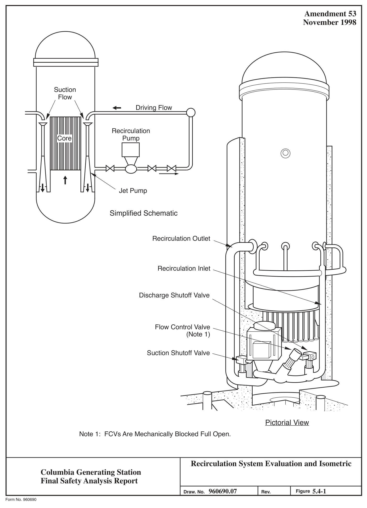

*figure on PDF page 184*

[Vector original (SVG, lossless): fig_page-184_2.svg](../figures/fig_page-184_2.svg)

<!-- labels/text on this figure page -->
Amendment 53 November 1998
Suction Flow Driving Flow
Recirculation Core Pump
Jet Pump
Simplified Schematic
Recirculation Outlet
Recirculation Inlet
Discharge Shutoff Valve
Flow Control Valve
(Note 1)
Suction Shutoff Valve
Pictorial View Note 1: FCVs Are Mechanically Blocked Full Open.
Recirculation System Evaluation and Isometric Columbia Generating Station Final Safety Analysis Report 960690.07 5.4-1 Figure Draw. No. Rev.
Form No. 960690

<!-- p.185 -->
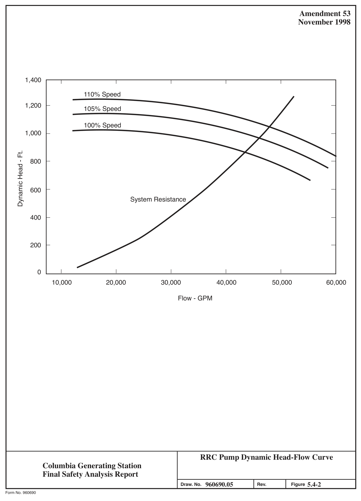

*figure on PDF page 185*

[Vector original (SVG, lossless): fig_page-185_2.svg](../figures/fig_page-185_2.svg)

<!-- labels/text on this figure page -->
Amendment 53 November 1998
1,400
110% Speed 1,200 105% Speed
100% Speed 1,000
Dynamic Head - Ft.
800
600 System Resistance
400
200
0 10,000 20,000 30,000 40,000 50,000 60,000
Flow - GPM
RRC Pump Dynamic Head-Flow Curve Columbia Generating Station Final Safety Analysis Report 960690.05 5.4-2 Draw. No.
Rev. Figure Form No. 960690

<!-- p.186 -->
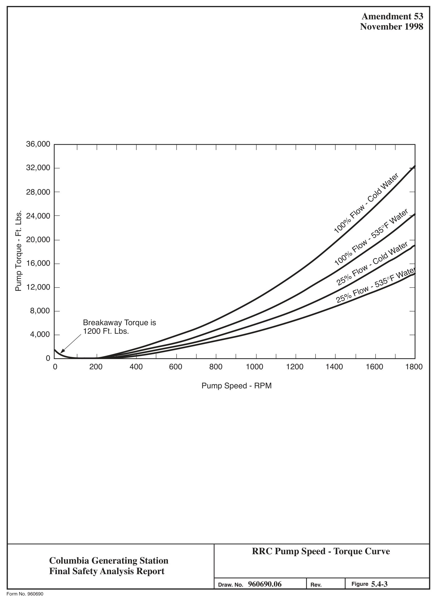

*figure on PDF page 186*

[Vector original (SVG, lossless): fig_page-186_2.svg](../figures/fig_page-186_2.svg)

<!-- labels/text on this figure page -->
Amendment 53 November 1998
36,000
32,000 100% Flow - Cold Water 28,000
100% Flow - 535°F Water 24,000 Pump Torque - Ft. Lbs.
20,000 25% Flow - Cold Water 16,000 25% Flow - 535°F Water 12,000
8,000 Breakaway Torque is 1200 Ft. Lbs.
4,000
0 0 200 400 600 800 1000 1200 1400 1600 1800
Pump Speed - RPM
RRC Pump Speed - Torque Curve Columbia Generating Station Final Safety Analysis Report 960690.06 5.4-3 Figure Draw. No. Rev.
Form No. 960690

<!-- p.187 -->
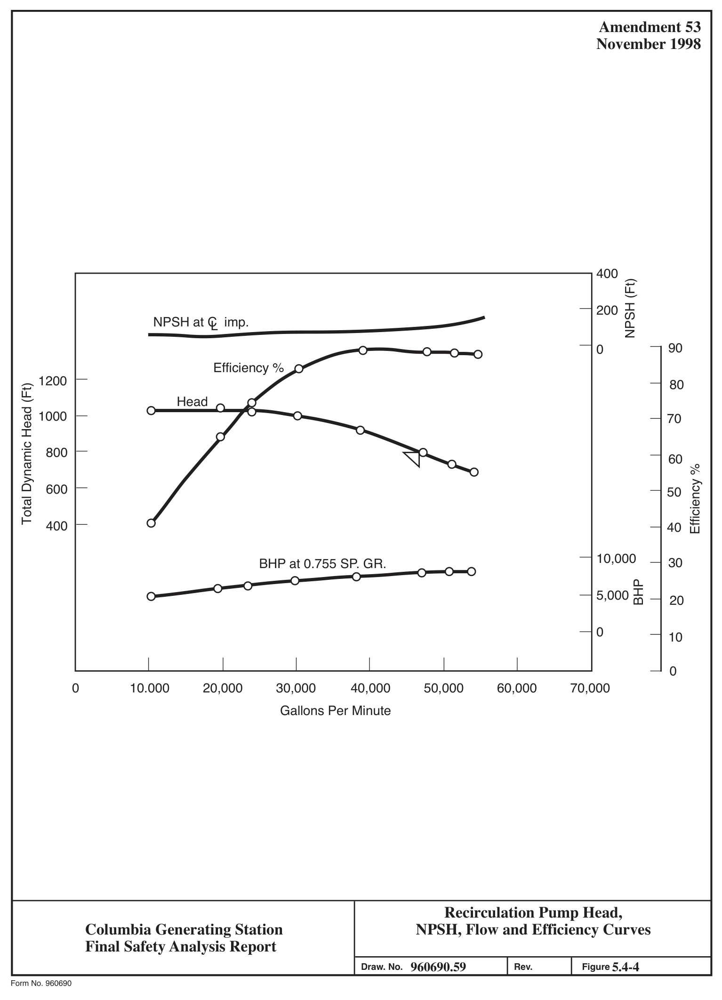

*figure on PDF page 187*

[Vector original (SVG, lossless): fig_page-187_3.svg](../figures/fig_page-187_3.svg)

<!-- labels/text on this figure page -->
Amendment 53 November 1998
400 NPSH (Ft)
200 NPSH at C imp.
L 90 0 Efficiency % 1200 80 Total Dynamic Head (Ft)
Head 1000 70
800 60 Efficiency % 600 50
400 40
10,000 30 BHP at 0.755 SP. GR.
BHP 5,000 20
0 10
0 0 10.000 20,000 30,000 40,000 50,000 60,000 70,000 Gallons Per Minute
Recirculation Pump Head, NPSH, Flow and Efficiency Curves Columbia Generating Station Final Safety Analysis Report 960690.59 5.4-4 Draw. No.
Rev. Figure Form No. 960690

<!-- p.188 -->
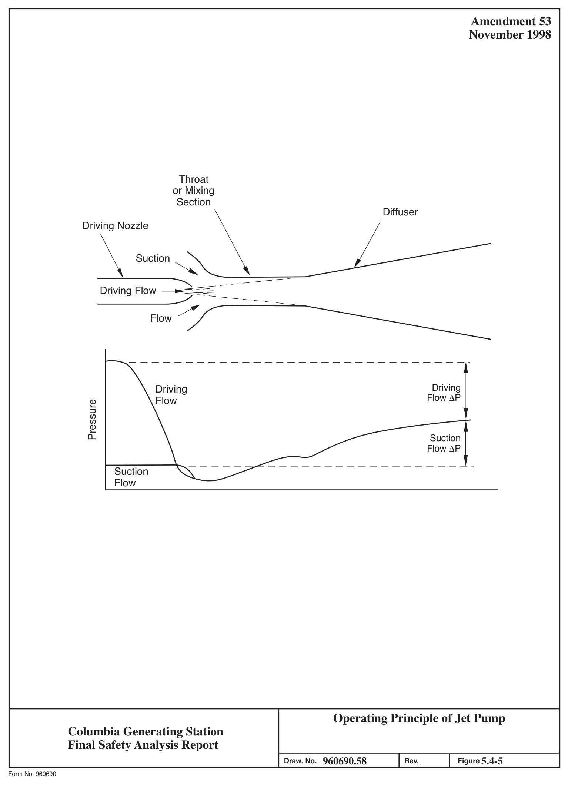

*figure on PDF page 188*

[Vector original (SVG, lossless): fig_page-188_2.svg](../figures/fig_page-188_2.svg)

<!-- labels/text on this figure page -->
Amendment 53 November 1998
Throat or Mixing Section Diffuser Driving Nozzle
Suction
Driving Flow
Flow
Driving Driving Flow ∆P Flow Pressure Suction Flow ∆P
Suction Flow
Operating Principle of Jet Pump Columbia Generating Station Final Safety Analysis Report 960690.58 5.4-5 Draw. No.
Rev. Figure Form No. 960690

<!-- p.189 -->
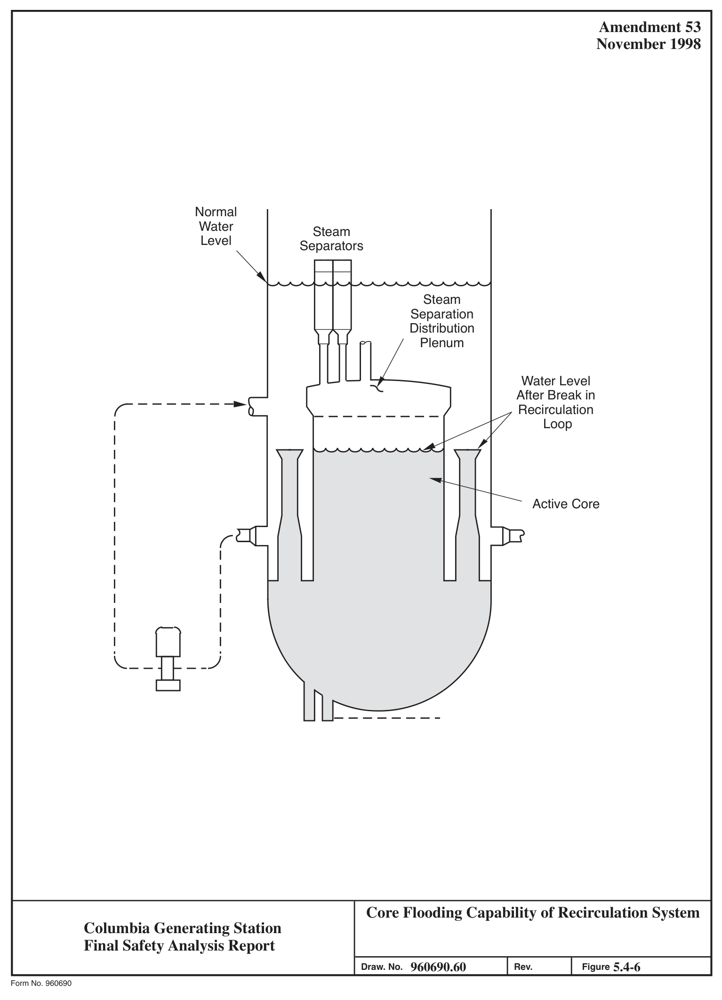

*figure on PDF page 189*

[Vector original (SVG, lossless): fig_page-189_2.svg](../figures/fig_page-189_2.svg)

<!-- labels/text on this figure page -->
Amendment 53 November 1998
Normal Water Steam Level Separators
Steam Separation Distribution Plenum
Water Level After Break in ,------~ Recirculation Loop I
Active Core
( I I I I ~--g __ j I
Core Flooding Capability of Recirculation System Columbia Generating Station Final Safety Analysis Report 960690.60 5.4-6 Draw. No.
Rev. Figure Form No. 960690

<!-- p.190 -->
Amendment 66 15 14 13 12 11 10 December 2021 1iQ1E.S_; CONT. FROM (B/2) l:!..QIE..S__;
l"PI(1)-4S-X-40f & I "P1(1)-4S-X-~ 11

## 12 COD E BR E.&.K DEFINITIONS FOR THERs! OWELLS I ALL ITEMS M,i,,RKED • ARE FURNISHED WI TH
t,RE SHOWN ON M610, "INSTALLATION OF ASSOCIATEOEO\J[PMENT THERl<HJWELLS AND SAMPLE PROBES" 2 PIP[~ . VALVES, ANO AS SOCIATED cm.l PONENTS ON INSTRUMENTATIONSONOTED SHALL BE THIS DWG. SHALL BE CLASSIFIED AS FOI._LOWS lJ
(BREAK POINTS ARE INDICATED ON FLOW

#### PIPING AN D VALVESOFS.UBSYSTEMRRC
(7)AND INSTRUf.lENT AfOPROCESS
--------,

## 15 SEEVENOOR DWG81999-F-OOl(CV102835-15,5)
SE[St,[CCATEGORYI I PUlaP FOR INTERNALS INFORIMTION & FLOW PATHS ON L-1~-- STUFFING

#### QUALITY CLASS I
#### CODE GRQUP
0

## 17 FOR SAMPLE FUNCTI~ & INSTRUM ENTATION AS SOCIATED
#### WITH THE SAMPLE POI NTS SEE DWG. SERIES M607
#### STEAM & LIQUID SAMPLING FLOW DIAGRAMS AND DWG.
INSTRU~ENT AND PROCESS PI PING AN D VALVES SERI ES 6DA- OO SAMPLE RACKS DETAILS & FLOW

#### AS NOTED DIAGRAMS
(NOTES CONTINUED ON DWG. 1,530-2) SEIS~IC CATEGORY II 4) )

#### QUALITY CLASS II 0
#### CODE GROU P D
d PU~P SE,O.L ORA!N LINESA~ INSTRIJMrnT PIPING Ki NOTED S[ IS~IC CATEGORY I

#### QUALITY CLASS I
#### CODE GROU P C
4) HANGERS TO BE DESIGNcD TO SEIS~JC CATE GORY I LOAD S.
J ALL INSTRU~ ENT ROOT VALVES NOT LABELED WILL 8[ J/4" GLOBEVALYES UNLESSSPECI FICALLYNOTED OTHER\\II SE ALL PIPING SYSTE~S IDENTIFIED BY THE PREFIX "Pl " &: "PSR" SHALLB [S U PPL I E □ ANOINSTAL_L(08YCONTRACTj 220 we-~• ,;;~f VA.t_\/ESSUFFIXED WITH A 5 DETAIL SHOWS VALVE STEM LEAK-OFF CONNECTION WITH

#### DENOTE A THRDTTLED
4"Egi~+:)~~ T ~ 1@L□

#### EJ1-R608
rna-, ~ ,-,

TO CR □ SYSTE~ CRD- OPT-8. C12-NODB DWG. ~'.137 COOT. ON ~528-2 (F/3)
SEE TABLE •• FOR ZONE -------------..I =j=.,-- J/ 4 RRC(50)-1 j:i----------CL (OO DYORAIN)
'

#### TO HPCS SYSTD. HPCS-DP1S-9.
E22-N009 CONT. ON DWG. ~520 (J/7)
Ti-£ FOLLOWING VALVES ARE PROVIDED WI TH .l, THISARRA~ rnENT *T[ ANO

#### LEAK-OFF .. FG
VALVE SUFFIX SUFFIX LINENo ---------
(D/10) 3/4"RRC(50)-4S-5 J/4"RRC(50)-4S-7
(D/8) J/4"RRC(50)-4S-6 J/4"RRC(50)-4S-B
-, 16"RRC(1)-4S-4(GE) 16"RRC(1)-4S-4(GE)
~ RRC-V-110(V) ~------- PI(1)-4S-X44Bo ~--w----§------- RRC-FR-61 4 PI(1)-45-X448b 1"PI(1)-4S-X75a l-'-======"-1-----<I
(F/ H )
Pl(1)-4S-X44Bc PI(1)-45-X44Bd ~--- ,7, 835- NOI O-C

#### SEE (J/11)
PI(1)- 45-X44Bf PI(1)-4S-X44B<J

--B~Sfl,'s:i:,.=, =::::'.:::'.:'.::::'.::::'.:'....J

~ Pl(1)-4S-X44Bh Pl(1)- 45-X44Bj X-44Bj

#### SEE (J/11)
Pl(1)- 4S-X44Aa Pl(1)-4S-X44Ab ___ _F~O~ RCC-T[ -98 (BJ~ - N □098)
PI(1)-4S-X44Ac DWG.M525-1(F/7)
PI(1)-4S-X44M MS-J P-14 ___ _F~ ~ RCC-TE- 18 (BJ5 - N00 1B)

#### SEE (J/7) MS-J P-1 5
#### OWG. M'.12'.1-1 (F/7)
PI(1)-4S-X44Af FROf.lRCC-TE-BOJB (BJ5-NOOJB)
::-7 PI(1)-4S-X44AQ X-44Ag DWG. M'.12~-1 (F/7)
PI(1)- 4S-X44Ah ' PI(1)-45-X44Aj X-44Aj 's, ~ ~ ~} ~;y~) RECIRC. PU~P "8" TE'S

#### SEE (J/7)
#### RS 72 B 0
~~~} ~;y~2)RECIRC, PU~ P "A" TE "S

## 6 THIS EQUI P~ ENT IS NOR~ALLY CONTRQLED
FROMTHE MAINCONTRClL ROOM.IF THE ~A[N CONTROL ROO~ MUST BE VACATED FRO~ RCC-TE -9A (B35- N009A)
THIS CONTROL POINT ~AY BE ISOLATED owe. M525-1 (F/ 9)

#### ANOCONTROLTRANSFERREO TO THE
#### REMOTE SHUT-DOWN PANEL C61-P001
#### SEE DWG. M530-2 FOR RRC MISCELLANEOUS
FROM RCC-TE -80:5A ( B35-NDOJA)

#### SYSTEMS.
PI-EFC-X{PENETRATIONNO.)

Q CON TAIN~ENT INSTRUMENTATION ROOT VAL\/£

#### SHALL BE AS
E/S-83~-K600

## 10 ALL INSTRUMENTATION ON THIS DRAWING TD BE
I DENTIFIEDBY PREFIX"RRC"~LESSSPECIFICALLY

#### NOTED OTHERWISE
ALL INSTR. LINES ARE DESIGNATED BY CCC£ & LI NE f 11 A. EXA~PLE: LINES ORIGINATING INSIDE CONTAIN~ENT 1/2" PI(1)-4S ~ CODE DESIGNATION 8. EXAA1PLE:CONTINUATIONOFTHEABOVELI NE OUT- SIDE CONTAIN~ENT IS DESIGNATED AS FOLLOWS.

#### WITH LI NE NUMBERSNOTSHOWN.
~ ( H22-P021)-

#### NOTESCDNT.AT ZONE (K/4)
#### J/4 RRC 56)-4S-1
#### RRC-Y-512(0)
{PU~ P SEAL PURGE)

#### RRC-V-617(0)
#### PRIMARY
#### CONTAINMENT
Reactor Recirculation System - P&ID A Columbia Generating Station Final Safety Analysis Report

#### M530-1
98 5.4-7.1 Draw. No. Rev. Figure Form No. 960690ai

<!-- p.191 -->
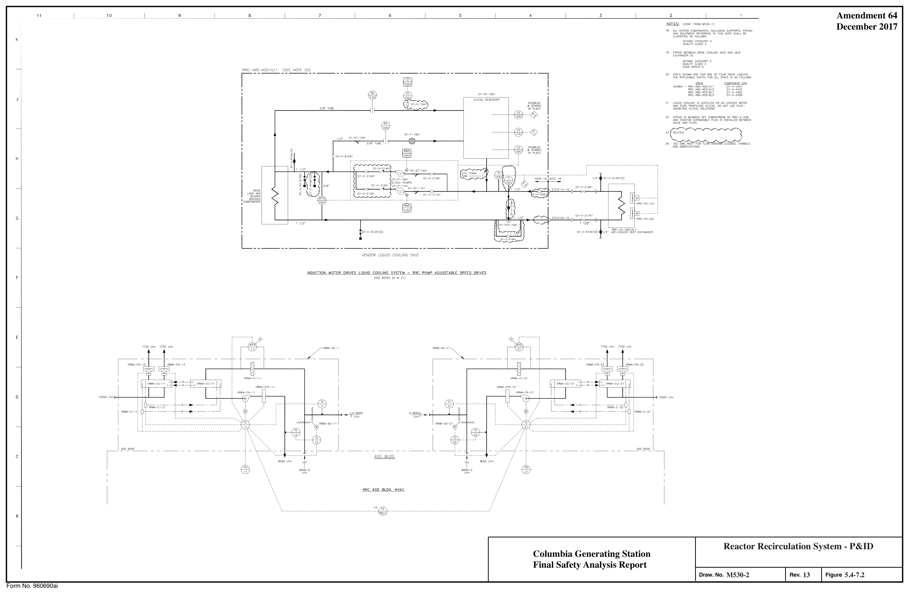

*figure on PDF page 191*

[Vector original (SVG, lossless): fig_page-191.svg](../figures/fig_page-191.svg)

<!-- labels/text on this figure page -->
Amendment 64 4 2 11 10 December 2017 liQIE_S_;_ (CONT.FROt.1M530-1)
SEIS~IC CATEGORY II
QUALITYCLASS2
19. PIPING BETWEEN DRIVE COOLING SKID AND HEAT EXCHANGER IS:
RRC-IMD-ASD1A/1 (SEE NOTE 20)
--------------7 ,----------------- CI
EPN'S SHOWN ARE FOR ONE OF FOUR DRIVE LINEUPS
THE AP PLICABLE SUFFIX FOR ALL EPN'S IS AS FOLLOWS: I ~ ' I ~~-I-~~
GLYCOL RESERVOIR
1 3/8" TUBE
----+--+,~~'--+---<$> 1 ~ ~''"'1'~---+--,~;,~--rn-,,., I f------11---------., CY-S,-1"1 24. SEE DWG M501 FOR FLO
AND ABBREVIATIONS.
G
VENDOR LIQUID COOLING SKID
INDUCTION MOTOR DRIVES LIQUID COOLING SYSTEM - RRC PUMP ADJUSTABLE SPEED DRIVES
(SEE NOTES 20 & 21)
----..--R--
'. ___ --$ $-- ___ '.' I I L __ + ~-- eccc dm eccc dm ----f -~
ASDR00F
ASDR00F - - - - - ---, -
-----
--- ,--- --- --- ---
----- C
ASD BLDG
8000-0 8000-0 dm dm
RRC AS □ BLDG. HVAC
Reactor Recirculation System - P&ID Columbia Generating Station Final Safety Analysis Report
M530-2
13 5.4-7.2 Draw. No.
Rev. Figure Form No. 960690ai

<!-- p.192 -->
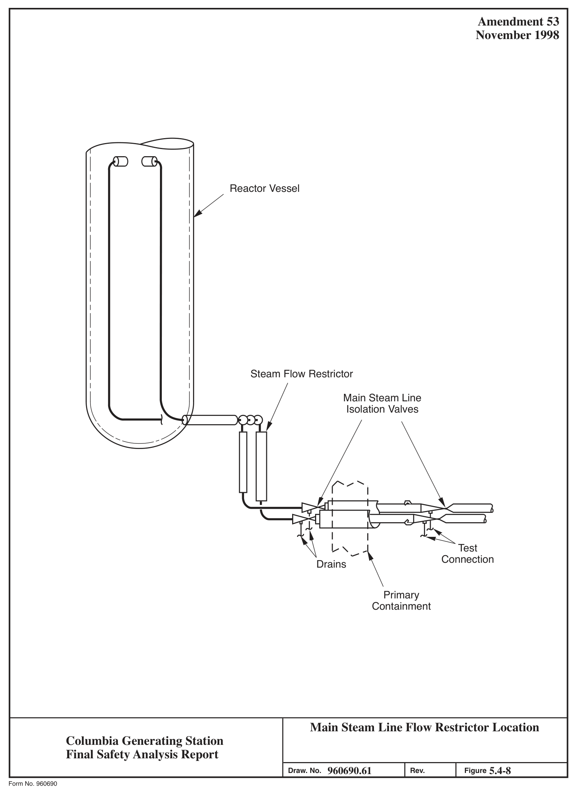

*figure on PDF page 192*

[Vector original (SVG, lossless): fig_page-192.svg](../figures/fig_page-192.svg)

<!-- labels/text on this figure page -->
Amendment 53 November 1998
Reactor Vessel
Steam Flow Restrictor
Main Steam Line Isolation Valves
Test Connection Drains
Primary Containment
Main Steam Line Flow Restrictor Location Columbia Generating Station Final Safety Analysis Report 960690.61 5.4-8 Draw. No.
Rev. Figure Form No. 960690

<!-- p.193 -->
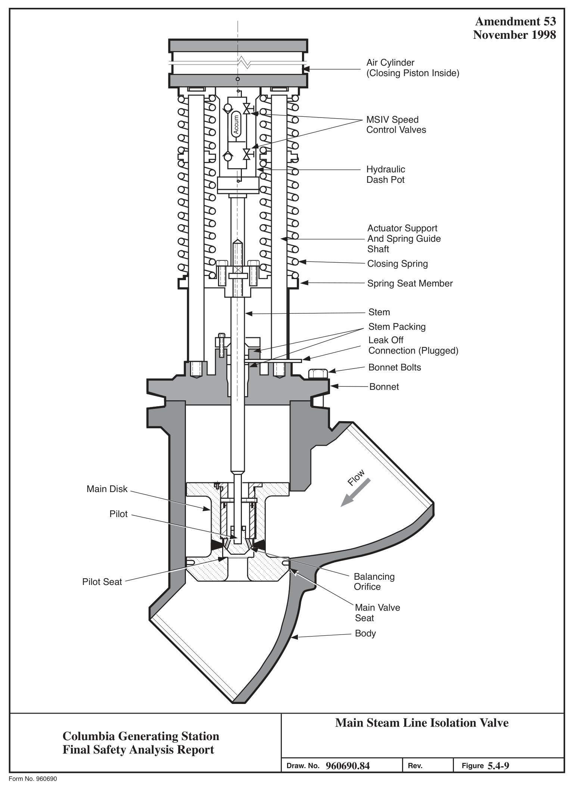

*figure on PDF page 193*

[Vector original (SVG, lossless): fig_page-193.svg](../figures/fig_page-193.svg)

<!-- labels/text on this figure page -->
Amendment 53 November 1998
Air Cylinder
(Closing Piston Inside)
MSIV Speed Accum Control Valves
Hydraulic Dash Pot
Actuator Support And Spring Guide Shaft Closing Spring Spring Seat Member
Stem Stem Packing Leak Off Connection (Plugged)
Bonnet Bolts Bonnet
Flow Main Disk
Pilot
Balancing Pilot Seat Orifice
Main Valve Seat Body
Main Steam Line Isolation Valve Columbia Generating Station Final Safety Analysis Report 960690.84 5.4-9 Draw. No.
Rev. Figure Form No. 960690

<!-- p.194 -->
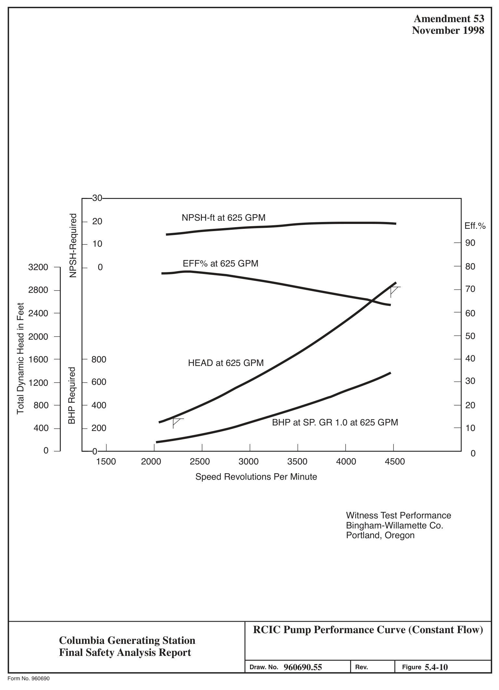

*figure on PDF page 194*

[Vector original (SVG, lossless): fig_page-194.svg](../figures/fig_page-194.svg)

<!-- labels/text on this figure page -->
Amendment 53 November 1998
30
NPSH-ft at 625 GPM NPSH-Required 20 Eff.% 90 10
EFF% at 625 GPM 80 3200 0
70 2800
Total Dynamic Head in Feet 2400 60
50 2000
40 1600 800 HEAD at 625 GPM BHP Required 30 1200 600
800 400 20 BHP at SP. GR 1.0 at 625 GPM 400 200 10
0 0 0 1500 2000 2500 3000 3500 4000 4500 Speed Revolutions Per Minute
Witness Test Performance Bingham-Willamette Co.
Portland, Oregon
RCIC Pump Performance Curve (Constant Flow)
Columbia Generating Station Final Safety Analysis Report 960690.55 5.4-10 Draw. No.
Rev. Figure Form No. 960690

<!-- p.195 -->
Amendment 65 7 4 ~i- ~0RCIC- 00 15 14 13 11 December 2019 ~ I _ ~~ J!Qlli.
\ /2"Pl(l)sT~-l'S-9~ '1 \ , Al..l. !~MOO ROOT VAL',£!; NOT lJSEI.LD
-~~11) --~!

#### DE',OCT1VA1EOAND
r----J ce1-R001-1

#### SPAREDINPIACE
~ (F/11) SEEl«lTE21 V IO"IICIC(\ 6}-l-1(REF.) :troll£~~ VALVES IJM.ESS SP£Clf1CAU.Y .,,_~® 3

#### , ":B:-~~~+-S1 [~ ,E 1 ""-"
E51-H009 : (REF.) I ,:r:1:Et.lOTE 2. ~~;NT~ ruRNISHEO WITll "'1;:';J~ J.c J. J::,~'&.,~~ :1""~g>".,~"' ""' lsi"lfr, !ca~~C6~~'i¥J11! A !~ '""'1 ' '-+- ' ,.,,_, 'fncl ,0,0-, ~r%:" ~ s;r~~:o ~Tttl~l ~ 4 ~ L.~--r-~..!-J :
,J._ ~ l/2"P1(1)ST-RC!C- PS- 9A ) (IIR£N( Cl1-R600~ Cl1 a.Al.l.P[PlHGN'IOVAI.VES, EXCEP"IASNO'iED llilAIL2 S, --~ --..rTOIICIC- ~E51-R600- I 2 °JSQL--C002L,J sas.1uc C\TEGORY 1 * (£/12) = grrv~J.
(f/11) I 0C ~ l;(~ NOT[ 19 I 0 ,.,_ °FOR"'<llmONSDrSYSfEMNOT"8lUIRINGCOOE C L-- STAMP,SYSTEMSI-W.LBEOESJGNEO.FABRICA.lUl,
1. ALLVAL~((XC(PTTHOS£o+I =~!~~~~RIIE~~ B !~UMEHT LINES) sumxED WITH ~~eo~s ,.._ __ _ A (V) DEt.OTE A J/4" VENT VALVE EXCEPT WHERE NOTED. M:127-1(1'1/8) b. PORTlONS or SUIISYST£M RQC (1), (12) ANO
2. AU. VAL~ (EXCEPT THOSE o+I (1J)ANO Pl(l)AS NOlEtl !~VMEKr LINES) sumxED wm;
A (0) DENOTE A J/4" OIWN VAI.Vf.. grrr~ 1 SElSMICCI.TEOOffYI
3. AU.VAL~SUfflXEDWllttA{Tli)
DENOTE A lttROTTlEO VAL\/£..
b::~---~ c, ~~U'=~ONC~Al~:rmf~~OfT IICIC-V-7&J "" VALVES:
=~ii·i/=~1¥a8[ ~ • *

#### LUBE OIL COOLER
IICIC~ COOCGROI.IP O ~~CIJ'EOORY .D.EIAILi I RCIC-V-901,1,(V)--..::i:.c..;,;
d. lNSTRUMOffATION NR UNCS ANO l.EIJ(-<lfT PJP!NGJHSID£COHT"'INMCNTISOLAT101'1 AaCTIJIIBINIEOILDIIIGRAM 1/2'1'1(1}-ST-(1'22-POI VALVES: (flrTU!B 1.W1ur.o1CTUR£RJ 1/2"P!(1)-ST-(H22 ,;, SflSMlCC\TEOOln'I \O"'RC!C(12)-♦- 1(CL1)
QlW..flYa.ASS ] COOCGROI.IP 8 RaC-V-53 1 1"RCIC(12)- 4- 5 J..
0"~7C'TIASON~~ Me19, ]HST!!UMO(f 26"\tS(1)-4-2 UNE B DWG"4529(H/10)
4. (DEl.ETEO) I 5. Al.l.P!P!NGSVS"fEMSlllOITIFIEOBYTMCPMFlX "l>J" SIW..L BE SUPf'U[D ANO JHSTAI..I.EO BY CONTRACTf220.

#### REACTOR
e. ~~~!~~~Y~~ VESiEL ROOM MUSf8[VACAlUl, lHISCON1ROt..POJHTl,l,\Y BEISOlAtmNfOCONTl!Ol"fRAHSFERREOTOTHE R(MOl(SHUTDOWNPANELC61-P001.
7. (Ofl£TEO) I e. EXCESS now CHECK VAL',£5 SIW..L BE TAGGED AS FOU.OWS: PI- ER:- X (POfETRATION NO.)
I 9. CONTAINMENT INSTRUMOITATlON ROOT VALVES SIW.l BE TAGGED AS FOU..OWS: PI-V-X (PENETRATION NO.) EXco>T lfflER( NOlED ON FN:;£, OF DRAWING. ~ --+---l---t---t-J/4, (1)- 4S- )(T PRlll4ARY CONTAINll4ENT \O.(Dfl£TED)
!=i=c!==cf-1'Rc!C(1J)-4-l (Cl.1)
\ 1.(QU!PMENfANO]NSTJI\JMENTSAR£PREflX(D WllHRCICUNI.ESSOTHERWlSCNOTEO.
' I J/4"Pl(\)-4S- XJ8e \2. ~~NG09>.":-tW~ ~~~OWS~ ,; . .,,,. ,_.,_,,,.. I
(BREN<POJN"TSARE[NO!CAl(QONTH!SOIAGRAM)
SOSM!CCI.TEGORY!
ilU'J..ITYCIASS I COOEGROUP D"
•STIWNERSSIW.LHloVEAl.l.f"8R!CATIONANO ~~:z~=;f~~or R(QU!MDANO P(RfORAT(Q PLATE 1,1,\Y BCASTM =~~~~t~!S NOT

\3. Al.l. PIPIHGOOWNSTR£,1MorTHELASTISO- LATIONVALVEANOOPENTOlHEATWOSPHERE WITHTHESUBSYST£MDCSJGNATJON"'SYSTEM" :6i:\!-1~ ~~u°~~~ {50} lHRU {~9) SW.U. BE ClASSJFl£D AS C00E

\ 4. AU. INSTRUMENT UHCS ARE DCSIGHATm BY CXlO£

#### TOCMS-TR-6/MUXI
ANO UNE Nol.lMBER.
1,1,5,,U,-; (J/5)
a. g:...7f~N(S ORIG!HAJ!HG OUTSIDE: or I SUPPRESSION CHAll48ER I __________, __________, 1/2"P1(1)-ST - (H22- P021)-A6 ""' CXlO£ EIESIGNATlON UNE NUMB£R

#### V-113
55)- \ b. £)(AMP!.£: UNCS ORIGIHAJ!HG INSIDE or

#### CONTAINMENT
21 )-l-:Z 1/:Z"P[(1)-4S

CXl0£0CSIGNAT10N WIENUMIICR c, EXAMP1.£: cotfflN~TIONOfTMCNJ/CN£.U~ OIJfSID£ CONTAINMENT IS OCSIGl'wl.TED AS FOU..OWS, WITH Utff'. NUMBERS NOf SHOWN.
1/2"P1(1)- ST - X\ 06 - (H22- P021)- ~~

\5. (XlO£ 8REAK D[F!NmOKS FOR THERMOWW.S ARE SHOWN ONM6\0, iNSTN..l.ATIOHorTHatwOWEU.S ANOSAMP!.EPROBES".

#### SEAL CIRCULAIION PIPING
(CV! 02~1-06.J)

17. RCIC-RV-11JT !SA PERMANENT VALVE. IT WllJ.
~~:• OESl~TIONTOAU.OWOOCUMENT C PRESSURE T£ST :ii ta. ~~NGOAA":,:S~ ~~~

#### ! L,..Jq? ,.
CONNECTl~ n, ::!. FROM RCIC-PIS-34 1 1/2"RCIC(7)-1 - 1
(BREN<POlN"TSAREINO!CAltOONTH!SOIAGRAM) ZONC(H/6) '""' ~ 11/2" •2" J ~ SOSMIC CATEOOffY n e ew.NGCRS TO 8E 01.WJTYCIASS ll+ OESIGHEO TOSElSMlC Rc1C:-WA~R ~ 1 112• 1• R£D

r'r--,,,>-LH'--,.....

COOE GROUP O CATtCMY l LCW>S RClc-v-152 AOC-v-e, LEG PUMP • Ci1-ro&2 Ci1-roe1 \I.D..EClRONIC~TRIPHo\SBEDlll[- ~g::_cboj ACTl\lATEDPERMOCl~268--0t.. ~ 20.~~:ai~~~ii-66

#### PRESSURE TEST ( RCIC-V-67 RCIC
CONNECTION RCIC-V-759 ~I:_~ ES1-f"()67 F\HIGf INSTALi.ED. RCIC-SPV-66 (LOCATED !N [R-7\)JSOE,l,CTI\IAT!l>ANOSPAREO[N PIJ,C(.
[ 21.~~~rnl~NOOFL=,Q'~ 3/8"P1{1)-Sf-(!R- SMS " )-Sf- (1R-82)-2 PERMN"PL.JCABl..£Pf'M.
=:.._l()ff(l(/~)f- 5.l)- HOT"EJolSEENOTE1:Z 22. SEI 0WG M50I FOR fl.OW 01-...w LEGOIDS, SYMBOLS ANO Al!BREVIAT!ONS. '"''

#### RCIC-Y-10
u !?ot: ~~118~5-:'~:~ - 1-1 23. RCIC-RMS--fl!S\ HAS llllN PUaD !M CMRRIDE

#### REFERENCES TO CONTRACT NUMBERS,
~YF'£R(C1Hll7-0lNGI.DW Ym l'RC[C{::~~~5 SUCH AS 215, 206, 220, FOUNO !N THE OISCIW!OEPflfSSlM:1111~.
!021-1(8/6)
NOTts ON THIS DRAWING REFER TO FSAR FIG.
OR!GlNAL CONSTRUCTION OESlGN

#### RCIC-Y-60J(O)
6"RCIC(2)-1-1 S"IICJC(2)-1- 1 REOOIREMENTS. ~/4"11clc(52)-1-1 ~~~SI~ ~~Q~~c:~r:J 1RCIC-1 = l~~~g:~ :?c~u. Cf~

A

RCIC System - P&ID Columbia Generating Station Final Safety Analysis Report M519 103 5.4-11 Draw. No. Rev. Figure Form No. 960690ai

<!-- p.196 -->
Amendment 59 s

#### II 10
11 12 2 3 8 7 December 2007 DESIGN PRESSURES AND TEI\PERATURES GIVEN ARE THE BASIS FOR DESIGN OF GE 15, MAXIMUM LINEAR LENGTH BETWEEN POSITIONS @ AND @ EQUALS GO FEET. 12.

#### THE SUPPLIED EQUIPMENT, ESTIMATED LINE SIZES ARE FOR INFORMATION ONLY. ACTUAL
INTERNAL CROSS-SECTIONAL AREA OF THE VACUUM BREAKER PIPING THAT IS SHARED LINE SIZES AS DETERIIINED BY PIPING DESIGNER, SHALL MEET THE PROCESS DATA
(5EE NOTE 12? 13) ,,

#### BY THE RCIC AND RHR SHALL BE EQUAL TO OR GREATER THAN THE COMBINED INTERNAL
HYDRAULIC REQUIREI\ENTS. LOCATION Q MPL IT£M.N9 :E5l-l0'2.0 1·2 3-11), 111~4 7-e 8-BA BA-"'! 1-12. 12.-13 11-14 17 18-2 19•.19A 19tt.lw-20A 2DA-I l!Dilli ~~/i~: :i:r:EST MODE F AT POSITION 9, 10 AND ll ARE BASED UPON A PUMP CROSS-SECTIONAL AREAS OF THE INDIVIDUAL RCIC AND RHR VACUUM BREAKER LINES.

#### ID-II
"PEAK PRESSURE" IS THE 11AXINUM PRESSURE ANTICIPATED DURING A TRANSIENT PER• A 15. 13.
ATl10SPHERIC PRESSURE OF 14.7 PSIA WAS USED IN CALCULATIONS, PEAK PRESSURE IOD WITH ALL OF THE CONTRIBUTING ELEI\ENTS Al A 11AXINUM, IT WOUL] BE EX· ]. N/A 1481 (481 N/A 1137 1137 \4BI N/A N/A N/A N/A N/A 160 1481 N/Ajl48l Nj~ PSIG PECTED TO OCCUR LESS THAN 1% OF SYSTE"!i OPERATING TIJIIE, 2, WATE'R FLOWS ARE SHOWN-I-N-Gf!f!l,- STEM FLOWS IN 1000 LB/HR, _ y RElDMMENDEC 75 75 15"0 17. RHR ">fMM. C.ONt>f.>\Sll-lt. MOt>f. HAS M.f.N Pe,AC.TIVA-Tc~. ICO 1500 1500 l'.JO ,'l'JO IZfO 1500 100 100 100 1500 100 11500 100 FLOW VALUES SHOWN IN MODES C & D ARE BASED UPON SUCTION PIPING DES_lGN l, THE MAXIMUl'I POOL WATER TEMPERATURE FOR CONTINUOUS SYSTEM OPERATION WILL NOT DF':ilCN PRE~SU r..::
PERIIITTING THE MINIMUM REQUIRED NPSH TO CONTINUE TO BE PROVIDED TO THE EXCEED 14QOf, HOWEVER, DUE TO POTENTIAL SHORT TERP'! OPERATION AT HIGHER DESICN IB. ~~&c"ci:-'l\'oi~~S~l~ENmgf~;~y~~tr FORRPU ,M:=6i~Dj5 ]4, 170 m 170 170 575 <;7) 170 170 !7U 250 1qo 190 170 1701110 17' 267 TEMPtRATURE 'F RCIC PUMP WHEN THE SUP!'RESSION POOL SUCTION STRAINER IS 50% PLUGGED, , I 4 TEI\PERATURES, PIPING EXPANSION SHALL BE BASED ON llO'F.
z ESTIMATED " " 2 4 ID G G 4 2 2 I I /4 2 10 4. THE UNRECOVERED FLOW NOZZLE PRESSURE DROP OF 4.5 PSI IS A FIXED LOSS LNE JiZE IN. BETWEEN LOCATIONS Q) AND 0 ~ b r a ~ * THE PRESSURE AT THI_S LOCAT_ICN DEP£ND~ ~ PIPING ARRANGEMENT, ~ I THE LUBE OIL COOLER PRESSURE DROP OF 3.0 PS! !SA F!XED LOSS BETWEEN AND MAY BE VAFiI£D WITHIN TttE fOc.-OwirtG Lii.;!TS.
LOCATIONS@AND@ ~I°' ~ 0 6. THE CONTROLLING MODES FOR LINE S[Z!NG AND A.RRANGEMENT ARE: t',I NIMJM NPSH .4.T PUMP SUCTIO- • 21 FEET B Diec SUCTION FROM COND STORAGE - - - - - - - - l'KlDE A &. B 0 :Iii~ W>.XIMJM PUMP TOTAL. OYt-lAMIC '1C:/.I.D

#### CONDENSATE
COODENSAff 30I1o fl:ET FOR MODES A t. C SUCTION FROM SUPPRESSION POOL • • • • - - MODE C & D

#### STORAGE
#### ST0RAGE
610 FEET FOR MODES B & D "' '2 PUMP DISCHARGE· - - - - - - - - • • • - - - • • • - IIODE C & D w TANK C< 0

#### TP..NK
STEAM SUPPLY- - - • • • • • - • • • - - - NODE A & B ~ ~ MAXIMJM PRESSURE DRoP B£T\.IEEN LDCATIO- © ANO © - 0 G)

#### TURBINE EXHAUST - - - - - - - MODE A. & C
®

## 15 PS1 (SH.NOTE G.)
#### TEST LINE - - - - - - - - - - - MODE F
I-IA.X!l•IJM PRESSURE ALL0\.IED - 25 PSIA

#### COOLING SYSTEM- - - - - - - - - - - - - - MODE A
MAXlt,f,.IM PRESSURE ALLOWED"' 75 PSlA SYSTEI\ OPERATION IS POSSIBLE WITH INTERl\£ll!ATE PRESSURES IN THE REACTOR ),

#### VESSEL AND THE SUPPRESSION POOL, HOMEYER, THESE CONDITIONS DO NOT CONTROL
SUFFlCI ENT VACUUM TO PREVENT TURBINE SH4rT-::xJT-LEAKAC.E.

#### PIPE OR VA.LYE SIZING OR SPECIFICATION, AND NO DATA JS SHOWN,
C M4Xlt-UM PRESSURE AVAILABLE - 25 PSIA 8. PUMP MINIMUM FLOW REQUIREMENT MAY OCCUR DURING A.NY OPERATING MODE. FLOW REQUIREl'IENT IS 75. GPM MINIMUM, MAXI14JM PRESSURE AVA!'LA6LE - 65 PSIA 5EC0.N0_t._RY C0NTAINMOJT FOR VALVE AND FLOW iNFORi'lATiOi'i, REFER TO THE RHR SYSTEM P&iD MPL El2-1010 SUJ- J- i-.ilNI /-'Nl!):,i,iNt. IU Nt.lUN!"i 9, SuPPRESS;o,·· POOL A.ND PROCESS DIAGRAM MPl E12-1020, SUFFICIENT PRESSURE TO RETURN TO COND. STORAGE RE"ACTOR 10, DURING SYSTEJ1 STANDBY. EQUIPKENT IS NOT OPERATING. JNTERPIITTENT FLD\tl OC- CURS THROUGH THE STEAM SUPPLY LINE DRAIN TRAP SYSTEI\ AT 1000 PSIA AND IGO'F.
HEAD SPRAY NOZZLE PRESSURE DROP IS lil PSI. II.
MODE A ~UCTION f"ROM CONOCNSA1E STORAC:oE R(ACTCP: AT HIGH PRE":1':>URE,SUP?RESSION l'OQ\_ Ai HlGH PRE.S'=i, 1 I B 11 I 1s

#### LOCATION 0
o 9 10 11 12 13 14 1 s 16 19 20

D

#### FLOW- SEE NOTE 'Z.
122s * * 19 • .9 7~ * 45 * 9.a * I * * ~ '4.7 * * ·12~5 18
- EXPEC ED 100 100 100 100 110 -]565 ';,AT ~AT 2'28 100 100 ,\00 no llO l'Z.0 j1-z.o 100 ,----- TEMPERATURE. °F
-lV¾ 573/, "%, "'/2' "'%a ''o/40 "'%, "%0 ";).(, '%1"%, 1'o/,a - '°%,"%,'°%','"to "%, - ~~~~~~

#### TO RHR
5U(.nc ... FROM CONOCNSATE STORtouE VACUUM MOOE 8 REb(_TOR AT LOW PRE~UR.E SUPPRESSION POOL AT HlGH PRE55 5 • 7 BREAKER 0 2 ' a 10 12 " 14 15 ,s 19 20 LOCATION I 4 9 II 1• 17 a - - FLOW -5(.E NOH 2: bl)Q Cl6 SOD - 16 re 10 0.1s - 0.01 ic• - 0 F.: <;::>.30 9.15 9.15 14.7 * * 178 18 - - 165 * * 19.0 75 * 45 * 9.a * * * - PSIA 100 100 100 IQO 140 - - 100 DO 120 120 12D 100 - X -";,'10 "¾, ,,,., l.~% "%ol''¼o 10%o I"% 11%0 1,%0 1%0110¾0 - %6 SAT SAT 227 100 100 RE°F
- TEVIPER.ATURE °F 1"%,;"o/.., "'%,11'%, 17%0 - MAX/Mll>J NOTE 15) FROM Vbt:.. PUMP

#### F008 BB
M·7

Fo4o F REAC10R AT k\GH PRES':,URE. '5UPPR.ESSION POOl. AT LOW PRl~ MODE C SUCTION FROM ~'JPPRE':::i'SID"N POOL l.~.6 15 .
0 • 7 45 . ... " • • - 8 • 10
('J 2 ' 2.9.51 ,,.., t%, is ZS 25 0.15 - LOCATION 4 II )2 " 14 IS 1• )7 18 19 20 I 600 - '1-5+. -

#### O.CM 0
#### FLOW - 5H NOTE 'Z. - 600 025 600 - -
* * l'l.~5 14.1 \9.2 18.8 12.'25 * * g~S;':-!',"T~~l'.!I_ P.::i\A -
- "%0 11r401'%0 "%a "%al''?'.., srr"' ,,,., z5r:u 250/10 "%,,,''%,, "%, "%0 ''?'40 i~oi 19%o 17%0 - 140 •40 040 140 ,.s ~AT. SAT. 218 140 140 140 2'0 160 160 ••a "o - EXPEC."TEO 140 140 TEMPERAT\JRE. °F ~\iRE°F - F0fb

0)
MOOE D SUCTION FROM suPPRESSIOfll POOL REACTOR AT lO'l,j PRESSURE, 51.JPPRES~ION POOL AT LOW Pl'.E.!:6

#### I I 2
:i 'l_Q LOCATION () 4 S f, B 9 10 11 12. t3 14 t5 I" l"'1 IB 19 FLOW-SEE NOT( l. - \600 lollo 600 - - 600 - 8.40 B.2.5 6.2.5 IG IS:. 10, Q.t~ - 0,01 II;,+ - 0 H ~~i~G1~·P5lA - I JIE- * 1?8 14.7 \9.2 IB.6 1~5 * * lb.5 15 * 45 * 9.8 * * *

DRAIN OUR.llJ~ ~--lf►O◄cl-5~-,;ST;:i~~-~~~~

?!:lo NOTEc 17 MOOE. f-1 5UCT10N FROM RHR MEA"'T E)(.C.MANC..LR.5, REACTOR AT HIGH PRE~~., .::!,UPP.~!:>. FOOL AT~ P~.
JI I 1 2. I ~ I 4 I !> I " I 1 I s I g I 10 I 11 I 12 I 1l I 14 I 1s I '" I 11 I 1a I 19 l-zo I 21 I kno,T10N lo ,~ I ~
- o.or j1'=>+ - 300 3% 300[- 0 - 'l0.15 10.00 '1:0.lll lo 0.15 0 "201.3 FLOW - ;)(E_ NOTE ~ - - ·- * • IOE5I 14.7 - !015 * • l~.6 75 • 45 • 9,B •I• • - OPERA"TlN6
- 1015 PR<:"'"'=i'5URE PSIA SAT. 218 140 140 140 2,0 1~0 lt:DOl;"'O 140 - -- ,.o SAT E:XPECTEO - 140 140 1401 !40 - -~;;; lh I'% ,~;,, l"feo '''.¼o I¾, 1'"'.l(o 1/40 1'"%ol'''.¾o "%0 - ,,,, 5/,()
T£MPER,ATURE °F TEMPERATuRE °F "°%, '%, I%, '¾ol''%o -

#### MAX/MIN
#### SEE. NOTE 17
TOTAL LEAIWFF" MOOE E-Z. SUCflOH FROM RHR He.AT El(.C.MAUGERS, R~Oll. AT LOW -PRt:SS, 5UPPR.~. PDOL Al" LOW PCl~SS.
FROM TURe,IN[ 0 • 1 • • IQ \6.6 -,5 * 45 • .
14 " 0 2 ' @ LOC.O.TIOJI.I I 4 !5.1~ 5.00 5.00 '" ,. '" 12 13 16 17 IS '9 20 2.1 I) "' + - ~LOW - ~EE MOTE i - 21!'> 21>1 2.1!'> - 0,\5 - .. * * * ~PERATl_!'I~- PnlA - " * - 0.0\ a ll"iU• 0 - 19 K '"'° * *
- 150 10,3 14_---; - - 35& SAT s.r 218 140 140 140 2'0 11,0 11,0 '"" 140 - E.X.PECTED 140 140 140 )40 - - TEMPERATU~l: °F - 358 _3s¾o r7',o '~o ~;. "'/,., ''10/401110/4'0 1'%o l'lo/40 l'l¾o ,.,,40 ,.,._.;, i'o/10 FOl9 rE~1,E~!~RE"F 1°?""°111¾0 '70/40 '%0 17%o - F022 19 ~ ®

#### MIN FLOW LINE
@ ., MODE ,::- TEST MODE: SUCTION FROM CONDENSATE STORAGE REACTOR AT HIGH PRESS SUPPRESS POOL AT LOW PRESS.
23.50 ?;1.35 "" , .. '"' '" lOCAT10N O I I w ~ 5 6 7 8 9 10 II 12 13 14 15 16 17 18 19 20 2 , I •
- "'"" L ~ o,1c,I- - 0 1000 • • '"·" 7> • 45 • ~-· • • • • - 0.01 11: - i.oo "i;;'i:._~~~P!)IAi 14.7 • .. !- FLOW-SEE \..IOU: 'l.' - 0.15 i:J,P :4.~ PS.I
- 14.7 - 5~5 :>AT. """ ,.,. \CO 100 100 ?30 l'ZO 12.0 1-Z.O 100 )00 ~it~:f~;'uiu: •J" i 100 100 1001- cO 100 - ~~t/E¾1.,'.~~£ of" I'% 'o/.,1 "ZJ - '¾, - - "'X ""X. '% '½."%, ''.%a '% % '% '¾I'% "%, '% - S'l'~lEM TEST LINE RCIC System Process Diagram Columbia Generating Station 2 Final Safety Analysis Report POOL M

02E51-04,4,1 10 5.4-12 Draw. No. Rev. Figure Form No. 960690ai

<!-- p.197 -->
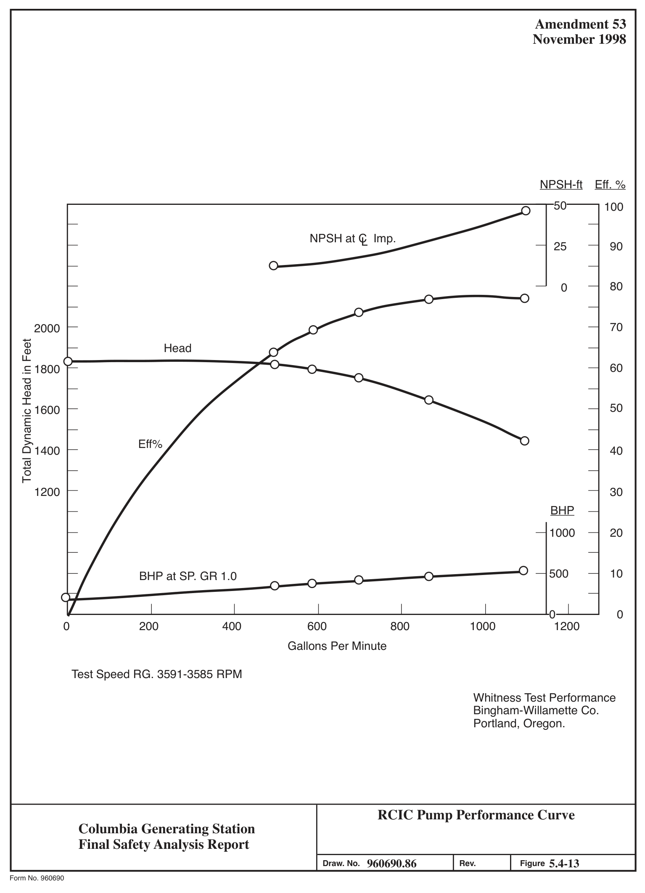

*figure on PDF page 197*

[Vector original (SVG, lossless): fig_page-197.svg](../figures/fig_page-197.svg)

<!-- labels/text on this figure page -->
Amendment 53 November 1998
NPSH-ft Eff. % 50 100
NPSH at C Imp.
L 25 90
0 80
70 2000 Head Total Dynamic Head in Feet 60 1800
50 1600
Eff% 1400 40
1200 30 BHP 1000 20
500 10 BHP at SP. GR 1.0
0 0 0 200 400 600 800 1000 1200 Gallons Per Minute
Test Speed RG. 3591-3585 RPM Whitness Test Performance Bingham-Willamette Co.
Portland, Oregon.
RCIC Pump Performance Curve Columbia Generating Station Final Safety Analysis Report 960690.86 5.4-13 Draw. No.
Rev. Figure Form No. 960690

<!-- p.198 -->
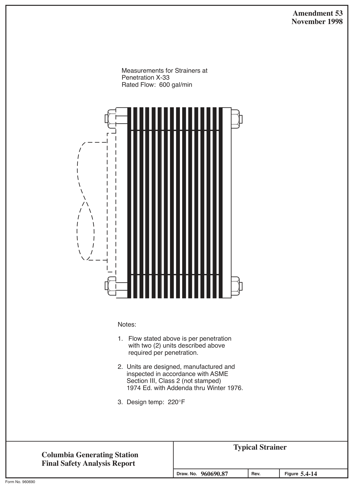

*figure on PDF page 198*

[Vector original (SVG, lossless): fig_page-198.svg](../figures/fig_page-198.svg)

<!-- labels/text on this figure page -->
Amendment 53 November 1998
Measurements for Strainers at Penetration X-33 Rated Flow: 600 gal/min
.....,-
- 0-.---
-
\.......,'
r ...J /--- / I I I \ \ \ \ I\ I \ I \ \ I I I I I \ I \ I \.L--,
- I ::::J [ I
:......J -
-
Notes:
1. Flow stated above is per penetration with two (2) units described above required per penetration.
2. Units are designed, manufactured and inspected in accordance with ASME Section III, Class 2 (not stamped)
1974 Ed. with Addenda thru Winter 1976.
3. Design temp: 220°F
Typical Strainer Columbia Generating Station Final Safety Analysis Report 960690.87 5.4-14 Draw. No.
Rev. Figure Form No. 960690

<!-- p.199 -->
#### = 15 14 13 12 11 10 4
1. ALI. f'RESSURE & FLOW lHSTRUWENT ROOT VALVES MOT Lo\llEU.ED WILL BE J/4" Gt..OBE VALVES(UNUSSSPEaFtCALl.YNOTEDOTHERWISE).
2.. ALL ITEMS ~ED • ME FURNISHED WrTM ASSOCIAfED EOUIPMOO .
PIPINC, VN..VES, N-ID -'SSOCIATEXl COMPONENl'S ON n11s owe. SIWl. BE ClASSll'IED AS .5.
f'tu.OWS.EXCEPTASstATEDINNOTE:S1:ldt17(BRE"AKPOINTSAREINOlCATEDONFl.OW DIAGRAM):
A. PIPINGANDVN..VESOUTTHROIJGHOUTERMOSl'RE:AC.ISOI..VAl.'>€5: l}Ja ~~TEGOff1 B. PIPINGANDVALVESll(YDNDOUTOIMOSTRl'AC.lSOl.VALVES,OCCEP'TTHOS( ~- LINES 0£SIG. AS 3/♦"RHR(5e}-2: ~~noo«r J}m C. [NS'fM. AIR LINES • l.[Al(-()F'F' PIPINC INSIOC CONT. ISOL VAL'-£$:
SEISMJCCATrGO!!Y ' I e COOE"'°"' D. IMSTR. AIR LINES OOl"S!DE CONTAIHWENT lSOL VALVES:

[. E~BEYONOJ±_DFTrsot..VM..~•n£LIN£SD£51GNATEDAS 3t;;::lc58t~ n• ~~ JI

F.Pl~~EDR{irl:FDR(4.:5):

•HO.NCERST09EDESIGN£DTOSEISMlCCATECOR'l'IU:,,,.OS.
0EXCEPTASNOTEDONU81111NSlR.CONN.OIACltWS. ♦ SEE Nll1E 12, --z Sl'[C., SECT. l!IB.I , TM!l.f 2 NOT£S.
, . CODE BREN< DEF1NITIONS FOR THERWOmJ..S ME SHOWN ON US10, 'TMST,1UATION OF THERMOWEUS AND SAMPLE PR08ES."

6. ALI.PIPINCS'l'SIEMSIDENTIFlEDBYTHCl'RlTIX"f'l"stw..t.BESUPf'UID.t:JNSTAI..L.ED!JY OCMRACTfUD.

#### RHR HEAT EXCHANGER
.Blil!=Jjll=.JA 7. TI-US EQl.JIPMENT IS HORI.WJ.YCONTROI.Ull FROM THC MAIN CONTROL ROOM. If TifE t.lAIN il2=lllllll ~~TO~ :=~C:Lc~!_~fY 9E ISOlATED ANO COKTROl

9. AL1.DW MJ(QU,\T( PIPING SURf,ICf N!fA FOR COOIJNC OF PUMP RHR-P-J.
10. ALI.TESTCONNECTIONPIPINC WIU.ASSUUE "RATINC"OF SOURCEPIJ>EAND BE IOENTlflED AS J/4"RHR(!>!i)•" ," UNU5S OTI1[1!W!SE NOTED BY SPECIFIC LINE NUMBER.
11. EXCESSF\.OWCl£CKVAL~ SHilrU.EIETMlGEDASf'OL.l.OWS: PI- Erc-x• cm; ___0 RHR-V-7~
(*-PDE'RATION NUMBER). l!!!!)

#### NOTEJ1
CONTAINWOO !~WENTATION ROOT VN..VES SH,l,LL BE T~ AS fOU.OWS:
----♦--&, !
(••PENETRATION) EXCEPT ffll'.RE HOTED ON FACE: OF DRAWING.
EOlJIPILNT...,.OIHSTRUMENTSME.PRCFIXEOWITWRHRVNl..ESSOTHCRWISENOTED. j~

#### C0HTR SP
"" ' G '""" ' 14. ~NT~.t/0 UST FOR MOTOR W]NDINC AHO O(NUNC T'OFERATURE El.O,IOffl AND 2\~ 2.20 RH'!-V- ____ ...,~(~)~:
174:32 :
PIPIHG, VN..','ES, ANO -'SSOCIATED COUPONEWS ON rnts owc. SH,lrU. BE ClASSIFlEO AS ~:co~ l Ir----- : fa.LOWS(BR(N(POINl'SNIEJ~ICATEDONTHISD!,l,Gl!AM):
_yfll_J A M.521- ♦ (H/\2)
(OCAC'TlVAlED)
1m.R-2
-a- (AsME llt/2 WllM EXCEPTlOHS. SEE PROCl.f!EMOO SPEClf'lCATION 12023)
(C/1S)YEDR (50)-1 17. ALI. PIPINCOOWNSTR£N.IOFTI-£ USflSDlATIONVALVEANDOf'EN TOTHE AT\IOSPl£RE ==~~~~~.t~~~:OWii\~ro ~

ALI. INSJRUWENT LI~ AA£. OESIGNot.TED Ir!' COO[N<j(I LINE NUMBER.
~2:;:~- ':;:~:>a A. EX,IMPI.£: LI~ ORIGIMTINGOUTSIDECONTAINWDIT.

#### =~ 5-----Mf---~----< J"RHR(17)- 2- \
RHR-V-6.l,I, B. EX.o\WPI..E: U'46 ORIGIMTING INSIDECOHTAINMOO. J"CON0(152)- 1 [ \2-f06J 1/2"P1(1)- 4S - X106 M527-I {f"/8) ~~,1~~-:
!
~TK>lt UNE HUMBER - ::-=- ~ C. EXN,IPLE: C0HttNllllTIONOFT1-£AIIO',{ Ut«:OUTSIDECONTAINMt'.HTJS ~~y' DESIGtW'ED AS FOU.OWS (Wmf UNE NUM8£RS NOT SHOWN).
12 1 -2-2 1 [12- 11812'\ 1/2"Pl(1)-ST-XHl8 ' !

#### COHT. ONOWG.
lil52.7-\ (f"/ 6) RHR-V-206 r ROIC,'AII.E SPOOL PIECE (RHR- RSP- 1)

## 19 ALI. ITEMS IN CROSSHATCHED MEA ARE PART OF THE RHR SITAM CONDENSING l,IOOC
YIHlCH tw; BEEN DE'.ACTIVATED. THC PIPING, VALVES, ANO !NSlRUMENTATION M. SHOWN
----~~ _ _ ,_, ON THE Ot,laW,I ARE INSTN..Ull. WOTOR OPERATED VAL',f;S THAT W.VE BEEM &---l--~"~-i-~=:::::::::;:r::;;i l~~-~::-ii~~~=~FLt:S :E;=#~A~· DE-ENEJICIZOI ANO UX:KO) Cl.DSC) ARE RHR-V-52A a, B, RHR-V-l1A a, B, RHR-V-2611 ~ -- er- 1 ri-V-637 "j' UfTEDNO SPNIEDAU. Flfl.D CAIUS, ANO SPAAEO IN PIJ£EALI. PROCESS 1 lNSl'l!tlMf'.HtAllDN. J/♦"RHR(55)- 2-26 " !
~~~l!_-7;~1,RHR- I 20. lttESE INSTRUMENTS ARE UlCATED ON TI£ ALTERN,1,.TE R£MO'IE SHUTD0WH PANEL B"RHR(B)- 2- 1
-~~~~-~-~-<---Jf-~-, E-cP-,t,11:S
• ON DIIIU. RHR-V-102

#### 21.TI-IISEQl.JIPMENTISHORMAl..LYCONTROU.EDFROMTHEMAJNCONTROLl!OOM.IF THEMAIN t
19(£/7) [ 12-f"\02 ~~TO~ ~r:w~~~~E~t~~TED ANO COKTROl POW(JI HAS BUN R(M(Ml) fl!OM n!IS MOV ErYA MAINTAINED OP(N OISCONN(CT SWJlOI ROIOTEFROMMI.WNCONTROLROOMW!lKTttl:VALV£MAINTAINOlCLost:D.NJ.
Al.110MATIC ttm:RI.OCKS STtU.ruNCTlONWHfJl™EMOTOfl fll:D(R ,>ow(RSWllCH IS ro~.=-· M(~,~~~•-o•Q"""t'""'"'""'~-----.
Cl.OStD.CONTROl.Of'fH!SVALVEISR£-E'ST"8..ISHEDN<IDAH!/L.(l¥1 RPYPRESSURE ]NTffl"AC( A1AAM FOR I.WN C0HtR0L ROOM OPOWlON DURING A DESICN Bo\SIS FIRE !S __ , ________ ..,._ .. , PR<7tilll(DFOROPO!ATOf!INFORMA1lON. _________ .. _ Rlll:- LPCS CROSSTIE SPOOL PIECE JS NOl !~ALL.ED.

#### RHR- V- 110,,.
.... _,_,.

2,. E\2- f098 _ __ , lttESEVAL'olSARfl/Z"VN..','ES,BUTTWOJ>(DTOSf'(CIALI.Yl'REPN!ED3/♦"•Nll'f'LES.
t 1/4"HOl.£DRll1£DONREJCTORSlDEOFRHR- V• 8WEOO€.
26. VALVES RHR-V-47A .t B HI.VE BEEN 0£AettVAt(D. THE PIPING NID VAL\-H AS SHOWN r1 1/2"1.PCS(s)-1-1 ON THIS DIAGRAM AR( IMSTAU!D. M nECTRICAL POWER, COHTROl ROOM AND ROIOIE ...,._ CONT. ON DWG.
CONT.f!IOMOWG.
SHUTOOl'NCONTROLSWITCNES,PANEl.WIRING,N«lflEl..DCABl..ES{EXCEFTAT THEVAI.~ I W520(A/11) 11/2"RttR(1 ♦)-2- 1 MS2 1-♦ {f"/12)
OUETORADIOUICICM..CONCERNS)WM:BEOIRl)O,U). 1RttR-V--MA
(O(ACltVAlt:D)
t [12- Fll84 27. AIROF'£RATOIINOAIRSUPF\.YFDIITESTABI..ECHECKVAl.~IIHR-V---41A,41B,41C.
50,I,, 508 a, 89 .lrR£ OCACTIVATED NO SPAA£D Ht Pl.AC[, Tl-£SEVAL-.t:S NIE TESTED PER X A I\/\ I\ I\ I\ I\ I\ I\ lHE]!;TPRCX:IW.I. POIE1RATIONAND!sa..A11DH/T[STVAJ.VESNl£STJU.ACfM..

3/•"IIHR{55)-I

#### TOADSNUCID.II
BOII.Dl:1"1'ERI..OCK "'"' 2-DOOI Ol=E~ AA£. !NSTM..1£D ON THC RHR WATEJI OUTI.Lf SIOC OF Rlt'I-HX- 1A ANO AN ut.TRASONIC '1.0W D..EMDIT lS ON n£ ltttR WATEJII rr« . .ET Plf'£ OF RHll-ttX-1,\, TI-£SE AA£. MOUN'TEO ~-.J L-7 " " C

#### SUPPRESSION CHAMBER
OCII+, SC IW.
fOIIP£lll:IODICTHERt.W..PERf'ORIU.NCETES'Tl'4COFRHR-HX-1B,fOUftlNERMlSTOffS llliR-2 RHR M " ~ l~~ :: ~ :: :!~ ~ 'ff'C(15)-2-1 RHR 51£EocOl"Of'RH,:;~x:~•/1,$g ~=c .-"'"""='-Cr;:1::~-< 11--1 1 ~~:-1r--- CONT. FROM DWG. (REf,)
fLOW El.fMOO JS ON THf RttR WATER lr«..ET PIP£ Of RHR-H)H II. 1t£SE A.RE MOUNTED - ~ - ~-+~-•- I -♦ (~~l s---~-o-,o>--~--- OCD+, SC IM. (F/12) fPC-2
-'1• e1f\'J:Vi~~-iv~~~°.t1W~W~FU>WP£Rrc111011.
S-1 RHR- (SUl'f'f!£SSIONPOOt.SUl'PI.Y
------~ I (B)-2-1 I 32. ~N~ WVISl~/w~';''Z~f-..JJll~'llmi~~~s=~ /2"P1(1)-ST Iii~ (ciifi

SYSTEMAHOMAYBCLEFTINPLACC. \-;,-J;;;;;I=-•°' ___ _._._ __ l•-+------'=== ......... '-=== --

=~i:CE: M RHR-Sf-1 SEEOWC U!l(l1 f0Rf\.OWOIACRAJ,ll£GCNOS,S'l'MBOI.SANOA8BR£VIATIOHS. R-V-l2A RH (SEE NOTE ==
-f012 J/4"Rtfi{~)-2
1. Al.I. VN.~ (O:CEPr n«>Sf ON IKSTRUMOO Ut£S N40 AS NOTID ON DIAGAAM) sumxED

#### SUPPRESSION POOL
wml A (V) DO«lTE A 3/~• VDf'T VAL~ 2, ~~~-(0:CEPr TH0S£ ON INSTRIMENT LINES) SUff1l(E0 WITH A (0) DEH0TE A 3/~" M..LVALVESSUfflXEDWllHA{TH)DDIOTEAlHROTlLEDVN..YE. .3. ,.,,,,.
AN0-~~[---5~)1,152\-3 "' REFEREHCES TO COHTRACT NUWIIERS, SUCH AS 2 15, 206, 220, FOl/ND IN THE NOlES ON 'MS OR.AWING REFER TO OfUGIIW. CONSTRUCTION OESIGN 10--(1)-2-11

#### REOJIREMENTS. )-2-5
CURREKt DESIGN REQUIFIEMEHT'S ARE OOCUWEKtED !N THE STATION 0£SIGN SPECIFICATIONS ANO ,\CTM CONTRACT SP£CIF1CATIONS WHICH STIU. APPLV.
!~ l TOl'Sft-V-003/A 1,1,998 (E/13)
A

Residual Heat Removal System – P&ID Columbia Generating Station Final Safety Analysis Report

#### M521-1
119 5.4-15.1 Draw. No. Rev. Figure Form No. 960690ai

<!-- p.200 -->
Amendment 65 15 14 13 12 11 10 December 2019 .tillitS;

1. AU.VN..YES(EXC£PT1"05£0NIHSTltt/M£NTU~)
~=D.W!THAMDEH01EAJ/♦"VENTVN..Vf.O:Cf1'T

#### I -------- -------- ------
- 7 2. AU. VAi.YES (EXCCPT TH0SC ON IHSTRUl,l£NT UHES)
~2~~ sumXEDWITHA(D)DENOTEAJ/4"0AAINVN..VE. - - -- _U l.tlT OF' RHR HEAT EXCHANGER 18 ROOM - - -- - - -- - - -- - - -- - - -- - - -- - - -- - 3- AU.VAi.',£$ SIJf'FlX£D Win-I A{™) DENOTE AtHROTTUl)VALVE. RHR-V-23 [12- F'O:U

#### CONT.ONOWC.
#### MS21 - 4 (J/S)
(DfACflVAT£D) 'I'

-~ );,.
(12-H012
- sw-2

"S'#~2oir!c.

#### MS24-2 (C/14)
' / 4"RHR(")-2-.Jll )TESTCOHN.
RHR-V-1428 r--U:~ ' !!-----f-=+--d~~ I I I l
-2J ~~-- ~-~~
--2 EDR-1
---3:J:~ 4"RHR(111)-2-2~ 0 C ~;_t~-- .. -"='"-'---rfo--"'ro- ="''-'-..a'---n

G RHR-V-49 E12-fl)4g i ------ __ __J ~=~ 1~~)-~I S,0.- - I M.524-2 (F/1i)
~ J RHR-V-8IB RHR HEAT EXCHANGER J/♦"RHR(M>J-1 R~IR2-:_HBXO~~ B E12-roa1 ;, --,~-• ,,,;;r • ,_,_,

L _·:'.""".'::'.::_' --- --- --- --- --""........J - - - I

- J
- "°" '
- - - - - - ~ ' ---------------""= ..
,. _______ ...;a"""" =aa " '- )-;_ '-a,.
,o._- ;_,-a,., --,----------{)4--==~'--j -(~;,!;,2!;,4) (G/!!)
r--------------...,.====:-------------1 .J/4"RHR(S.)-1-1 Q

............. , ,..,

,. ______ ..;";;.;""" ='aa'l-..;•..;-"'---"!------"<--•.,...,.....,...,;,-;..,a..;..;;...._~":'"""T ____ l2"Rt«{1)-2-S I >--<J---,,----~-J .._-0-►'~'"" =("~)~ -•~-~•--, ~~)

(C/5)

-, ' : I T j RPVJ I : EL 5~ 1/♦"c!rr _J T014°Rl«(1)- 4-7 M.521-J([/IJ)

#### RECIRCULATION
PUl.4P ~ 835-C00 1B z t 0 0

J/ 4"RMR(53}-2 ~;_<~,\~) SI-'''-' ---'\syw:e, """,S:l\'!!!'""'--'"""'-~1,"-""l"~,'--' ";R)~:S-, -""'°"'~l\"'----1~,~ ,~, ~/\~~/\- >------j;.-:,,;il----'c;::.~~=cf---'---""""~~"==:..._+'+--'--"""=--_J-"------4-~ J/ 4"RHR(:52}-2 ~-"' ., """' !
ysct.ll"PERDAAIN + 'io PSR-V--ool/B Mllllfi(0/1J) C

#### RHR-V-J1B SUPPRESSION CHAMBER
E12-rOJ1

- 1tRIIII: 2 RHR-V- 8~ ""'""°" 11/2"RHR(12}-1-1 ( \2-l'OB5 ~1~Bfo)~--r s ~2~~ s.c.
K£YlOCI( W!>.21- 1 (0/1 &-,
(WATIR L(G !NfERTIE TO LOOP "B1J !, .. l/4"RHll(52)- 1- l N0:7 REF"EREHCES TO CONTRACT NUM8£RS, £f!1 SUCH ~ 2\5, 206, 220, FOUND IN THE &!~ 1 1/2"RHR{\2)-2- NOTES ON THIS DRAWING R£fER TO l ORIGINAi... CONSTRUCTION DESIGN

#### SUPPRESSION POOL
REQUIR£MDITS.
~-5 CURRENT DESIGN REQUIREMENTS ARE ZONE{D/8)
OOCUMEKTfl) IN THE STATION DESIGN SPECIFlCATIONS 1'ND ACT1I/E CONTRACT J"IM!(9)-1-2 SPECIFlCATIOHS WHICH STILL APPI.Y.
4"mR(20)-1

#### FSAR FIG.
<X>NT fROM OWG. ~~:1(t/~~r- CONT f1IOM llWC. J~~-ca1ir- - -

Residual Heat Removal System - P&ID Columbia Generating Station Final Safety Analysis Report

#### M521-2
117 5.4-15.2 Draw. No. Rev. Figure Form No. 960690ai

<!-- p.201 -->
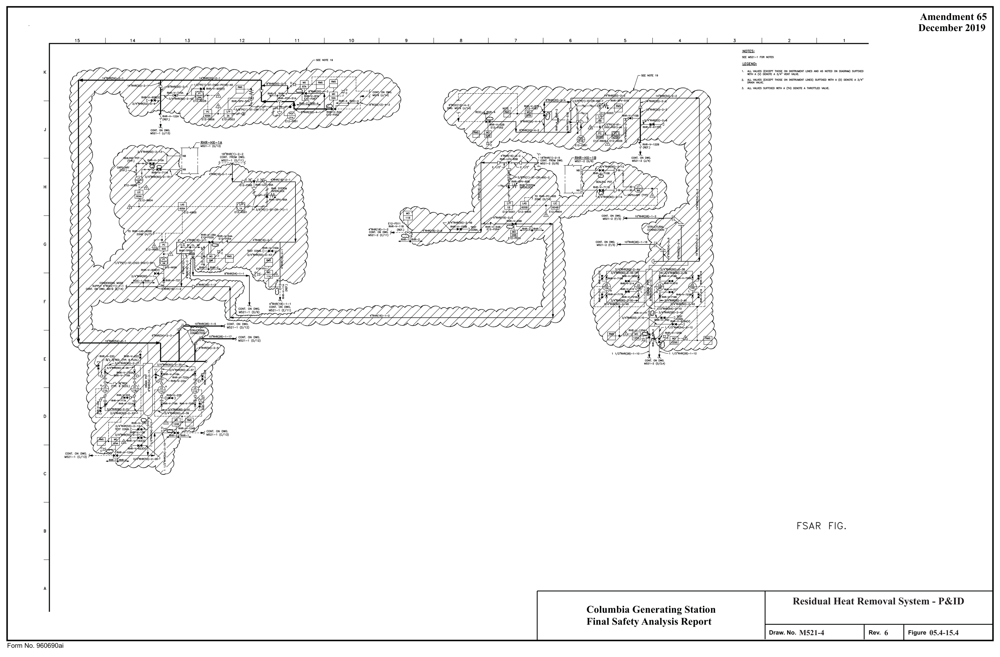

*figure on PDF page 201*

<!-- labels/text on this figure page -->
Amendment 65 December 2019
15 14 13 12 11 10
I . ,'JJ. VAi.YES (EXCEPT n;os[ ON INSTR\ll,IOfl" UH£S ANO ,S H0T£D ON DIAGR.<,M) SUfflX£D WITH AMDrNOTEAJ/4"'vEHTVIJ..l/f..
2. ~~~~VE.(EXCEPT TH0S£ ON INSTR\.IMDIT UH£S) SUFFlXED WITH A (0) DENOTE A J/4°
J. AU.VN.~SIJf'fl)([OWJn-lA(ni)DEHOTEAlHRCITT\.EDVALVE.
G
C
FSAR FIG.
A Residual Heat Removal System - P&ID Columbia Generating Station Final Safety Analysis Report
M521-4
6 05.4-15.4 Draw. No. Rev. Figure Form No. 960690ai

<!-- p.202 -->
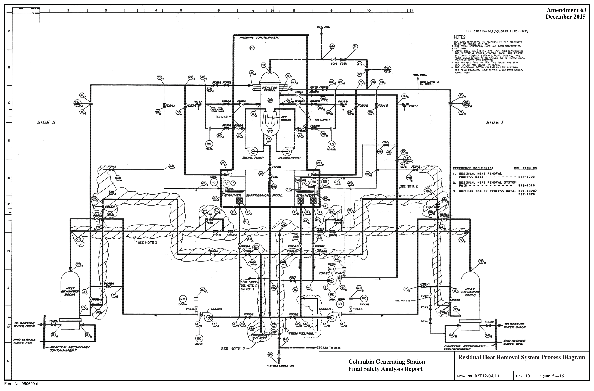

*figure on PDF page 202*

<!-- labels/text on this figure page -->
Amendment 63 •
•
• a n . II 10 December 2015
FCF Z'6Xl6'+ Gl,t;,,'+,8 ♦10 (EIZ- 1020)
A 1::lQlli.;_ PR/Ml/Irr CONT"AINM£Nr l FOR DATA PERT.A.ININC.i TO NUMBERS WITHIN HEXAQONS RfFER ro PROCEM n.lfA REF I.
2 RHR mAM CONOEl<SINQ MOCE 1-"'5 BEEN DEACnVA1EI>
~..,,-USED.
~ VALVES RltR-V•47A l RHR-V•+7S HAVE SEEN DfMlW,'fU THE EUGTRICAI. Pol-lEI\, CONTROL ROOM ,',ND REMOTE r,<.lf];Di~f~We'la~ ~%H~t~~•&i,Li~'~1cx.'tr!lcAL CONCERNS) H-'VE eEEN REMOVED.
, THE TE5TAIIL£ FUNCTION FOR nus y,i..VE HAS l!l!EN
• DfN:.TIVATED ANO Sl'ARoll IN PLACE.
'°' FOR 1'DDITlON,._L OE'Tl,L 0~ RHR 1'ND 8W S'f5TE.1"'~, 5£.E FLOW D\'-C,Rlt.M.~ tf\!)'l\ ~Hl":I \• 4 ».lO l#i~'l.~ '!I~\-~ IC5PEC"fl~EL'Y,
F025C
SIDE I SID£ JI
D
REFERENCE DOCUNENTS; ltPL ITEM NO.
I, RESIDUAL HEAT REl'IOYAL
PROCESS DATA - - - - - EIZ-1020
2; RESIDUAL HEAT REl'IOWAL SYSTEM
PIID - - - - -
EIZ- 101D
NUCLEAR BOILER PROCESS DATA- 121-1020/
122-1020 ,, -
H
I~ &-¥· J ~
-
DOOIA
DOOi ■
A
R£1/CTOR SECONOl#RY
• CONTAINMENr
Residual Heat Removal System Process Diagram ~
Columbia Generating Station L Final Safety Analysis Report Sl£AM fROM lb
02E12-04,1,1 10 5.4-16 Draw. No.
Rev. Figure Form No. 960690ai

<!-- p.203 -->
• •
• • " 10 11 December 2019 ..
MOD£F MODE A•I ,, /0 ,.

tJ • s " IS ¾ s "

FlOW-6- - ... -/TIONQ I 2 J 7 II 11.9 2 3

POSlnoNC I 4 «9 7 8 9 /0 I 745G -so

l't.Ol'f-G,,,,, l'4SO ...... ,.. ,.., X I'>< X X IX X X X X X

- ·

X X X X

~ ~ ,.. 7 f'(l£8S.,,.,,,,. ~
-.z:
-~ % ·;:;.
AUIOOIT WUM ~IIICl,IU.Tl(N 1.INl -.U.ot IN IUMilll II OIE ANO~ l'ENIP"F TCMP•~ 1'\11" Ol'Olt,TIClt. SEE NOTE Z'5 """'--m,,.zr.r, vIK• 17
•TDH't~7• --

.... 1 AUIKN'T 1fl1" IIUIIIClllATIOI 1,.1• KM Ill lll1C.lf SI« Ml)~ ,MAr. A<>tSS: ,4K•40

1'\11" Cl"'Olll,mlll. SEE NOTE 25 110 MIN) {)ROP.FIELr
• OROP·FUT

#### RDW-6- - I

8 POSTActlDl:IIT C(lli'a1•on Sf'MY WITN ICAT ltC.lttYICN '"'" IN:

1'\11" OPUllnca. !,EE NOTE 2 5 IP"CM SUl"l'IICSSION Jllla.. --1

ac: ec -~ ec ec

-.,.CTIII INU.flClf • 2NI 1'11:AN aN:11:NSIIC 11/2 ~I 'SEE Na1'E 1<1 /SEE NOTE 27 C•J IICACTOR UOl.ATICIJI • 1NI STCNI CGICIDISltlli A1C1 5U. lffl!. '!cf .. .. {IrlNIT~ ,-,J MOD£A-2 Rw PR£6S. m PSIS MODE G 4 " • .z ,,, u UMf'OCt.toOLI .. Ul/2tltJ z 5 " T a/ " 6 ' I :, I C.-3 IIIUCTClll9CLATICII - 2 .. STUJICAN:IUISIW.,4191) SEE~ t't l'OSITl()Ah 29 4 -f'& 24 I POS/TIONQ 25 2G I 2.
/0 /6 II l9 $ 4 n.o-,w lNII' STUNaJIDO&Sltc C8 •J &.E lMJTt'M 550 - - V4 IIUCTOR IIOL.A~CN - 550 - 550 550 D ..._. Slolll1Dlil AH[lt ktM;ll;MIII TO lao!N alll'.lOl!llilll

X ,..,

APESS.-"51.,f /4.7 y X X X X X X iX X X X N-7 Al'ESS.,.,,,. /$0 X X X X /4.7 IX X X 'x IX M.7 [ ~fl-tlON C, NOINU. SMJlllOIIII nQII f'I.Allr 1GX •o• I.U O ,SIG.I

AIG IUC.TIOIAI. ,..... rt:ST Af'l'Dr SN.ITDlllll.

C I~ TCMP•F ,. '"' SY'STDI TUT -II-- Pl.MT Of'[Mfua. TE.-O•F J58 ~~ .§8

...... -,

·-•··· ~ ~

G. Nl ■J IUI '1DII ............

_.TD:;:~ g,N • C,.~Q MAK. Pff'II •TlJlt(•l:?6 I S fflTOI ON STMlllY 'IIIJTT ,,..,p.
' I DROl'-FIZT' I I
-lit ·~ I 't:.. 1. ... t,. ~. .. l. .• A7.a 1.s

1w: ,_ ·- .... , ... A.8 "'"

MODE B

"4< "'" ,., A8 IA.a MODES

.... 74,0 - 450 - .,,

20 • :.B 5 "
- ,. ..

sz ~o' 2 k: 4 18 /9 AS '" 20 9 IO II 48 i!I 50 Z7 51 & 53

«, AS AB •• Ill •• AB 10 15 21 60 I~ H I "" "-'IC . All A.8 P06/no,/Q A8 AB AB All WLDW-&P# "" A8 D A/"A 7'fOCl !HOO X X 10,s X ,.. X 1015' X 1015 IX X

~":' ..... "":':1!-.1. rrsfbtHID • • • - • ~

rz. ~-- H .7 'x X X X X X X X X X X ;x. X X X X X X X PPE55-f'S/A ".t:
X X
2. KSIDW,l t«.AT IIQICMIL S'l'SltM DHI• M:C ·• ~J-40lt - ~- 212. 17'.3 17'.> 1711f.!I 171.3 •~.J 17'1.3 17'.3 171.3 111.3 - •• 9%: 5♦7 ~ /35 9%: 5♦7 '%: S<7 1% ~ 17\3 - ~. lltlC NOC[H DIAc;llll•M - • - - - - - - - - [St•lO!t T£/IIP•F' 1/4, Tl!JIP'Jlf' llZ 121.1 4. M:Clllt IYSTDI ,-.:us now OIMIIIII • • • •
- S • • LOW ,CS-.- CmE Sf'MY ,re, • • • • • • - MAJl. - -~ --- IA<AX_.
•fD~t»• 0 ~p.rn:r DllOP·FtET
- 3cc I01'E T<TYl'J 'INOICAll.S Ft.DIii . i-, - - HEAT REMOVAL PER HX '"'' 'AT (I HX OPERATING) SEE NOTE ID

MODE C-1 315 "li• l,7A8 11..,., J9A8 .,,..,., a,A ..... i,,, • ., :.o,.., 41 ,,~ ·~\ ~ .....

E R MES .S IOtlO ,s,6 (~E~ -"OH: ?< )
!60 •• 6( ...
P0$1noNQ 29 .34 I t. IWICZalHMillUIDl~~KUXOWITNMD,.(lllllitAMIITOITN1$ 191.I 187./ '1> 1-f--- u, /90 190 - l!JO 380 3110 '"' l'll0CUS DUA. I,. ff€M: Ml l«Y UINF'I..ICTS ICTIICDI M M0CtSS NJW-~~f~ - OUliMN,.,., tNIS MOCU:S O,,fA, fN[ MIUSS DUA 9liM..l GOliCal.
~-PSIA io,s y - ... , 54 546 '67.7 .!117.1 'lal1 /'fO X )( 214-7 IX X X X X X X IX X I. l"ll'IIC ln'C!M f'IDIIITS WITH Ol"'TT Cit.TA._.., IK[ ALSO TA&[ II 51.7 14.7

StMLI.. Sllto BY..., MS[D ca SP[Clf"l[D QP[MJIIG UN>ln(NS. Ol"TY OUA ......, CAN I[ nuc:o IN

8l!!ICO., AC'NIL ~ ,,., 8Tl€ltS /40 - ,dP•2Cx:J - l'Ol/i' "F

15 IZZ.4 ~- lmtCAltS TN[ OUA IS ICIT si•nCMT •

,. ,..,..AS TYl"ICM.. ""CN: um,. -- IFl.OOl"I CIN SUit I AID SUI[ II All( NOT flllllll[PIICAU.1' -..::D, 'IN.Ulll ,_ mtN SIIIIU ~ ... no. . - ~:PS, 4,-i

JJP.-155

... II' --.s (Olt GlUlrDEff WITNI■ lit-a.t!O SC....: - as ll>Tm. _,;

H[flT REM0VALPC.tl lb( Rf re oru/w. (2 HI. ST£AN CONDENSING)
.. ~rr~-:o~•~,:i :t:i IJ.""nc~•~A~.
114.4 5l2 --

L ~ ~ UCHCATU NUlta.M Ill IMO .... ._. ITI taul:S ,_ M FZJ/111 :IC£ - .... IH.f -

~ .,.. ,. l6 ,, ... , .. ,. , ... .. , ... , ... ... , ... J8 ,, MODE C-2 Ha)[_C-3 tnl':S/6.e_,,lltm A:)5/TIONd 29 .,,, /84 19A ,.,,. NA ."I, «>A 4/ 4~ NIID[Sf'[t1nto. •HRS "°A "',.

o,1,s,m l.l~ IICllCATC naw oats imr MSS ntl.l , .. ll'QIIITS. .!II " 1.

1,1) "'

..... .....

17 l!D ,0 41 42

HZ ,,.

'15 Jl6A J7A 17A R,8 ll8 R:JSfTDIQ l9 64 L fN[ W9N A•llMLt I ■ ICIOtS 8 I O Af TN£ <OffDLI• OT THE -TlON ,,,,,,,. -,,inc ,\RE tlUINEt) IN CALCULATION '5. 11.,, TCMP•r I- 5"t. z,z z,z
- ...
277 ll<Ql HID ~W .:Ef.151 13'.2 "62. lll //6

.. IOt'IIC[ IAJO C.SSTU. '"'u • StltO TO new .......

X X '% ~&6•PISIAIIOl5 X X X i!/4.1 C>< X X IX 51.7 IX X ntlS ,_TICIII Of" l"t'"9- TO. SllCD •sto ON nOlll ttOlt DI TII[ Ix' X X •60 X X X X X 10..
S«. !1117.7 ,,,,, §7.1 /40 PRlSS.-PSIA l5o nJl.L f'IOal. MDCLS.S DIAGMIII.
u . ...
•• 134.8 11. Tlilll"T l_..C .. UCS T'l'PICAL ""L\I?: POSITION~ CII.MJMC, VA~ HOOU OP£Jt.A1't.O. rcHP·r uo H )H ""
•5 111.8 /40
-

MAXPRCS,

.,MAX Pll£5Sill- dP•tDO IJP•%:3 .dP=IS' I

OROP-P91

OROP-PSI

14.. TTPICM. -...S f'CII NU. AHO II•. tuf'PtltSSIOI IIIIIXll. TOIi' ,..._ r11ML rtWCMnatS OCPOCI Cit INITIAi. POil. W.ffl fflll'[Mn.- I ~ DUTY PEit 5r£AM CONDENSING N~ lfU 1.IO• 8TU/~ {I Hx STCAH llJl/00,JSIIJ(;} -- HEAT REMOVAL l'fR STE/11'1 CONDO/S■iG I/JI 62.l!J I ,oe 871.1/HR /2 NX 5Tt:NI (I1,/()£A/S/NG/

...._ W.TOlll:I..I.N:.

lS. WlTOtn.CIIIS,._ 111--. Sff#lln..SdC 1111-l.lll(Nlt.
1L Nil DUTT MSCD 1#011 MM ""NU SIO( now. ~,lff,, .. , ,1.'i IJI. l.a:i ~- ,q ~ .. ?,; 'l, IC MODE C·2 6:;oNT'D , ... - 39 '° ., '!l. ~ .. ll~PS/G Rx-~ MOO[ C-4 a HRS PQS/77'11O Z'I "' •• ,. ,s -"'

(SEENOrE u) ~IM01'1!2"') rait UC SllllG 1 ...... TION !C[ N:r. I.

'° " • • J7 II .... l90

• • A • A 18 a, l8 42 19 ~ q 14 I !'05/T/OKQ I z • .., ~J! 4 • ., s.
P«SS-/lfllA /4.7 X X X X X X X X X X IX IX IX X X , ...

A A A A

-- l'l.OW/GPM - I"'°" 7HO ~ /90 ~SPSIA /10 X X X X "'° X IX % X X IX X It. Jlll"IJli, fflTOII •91• flllC1Wlt[ iNll -ro.a:M1'.: MCI TC Ull*TtD •• 1.1• sun #Ill. f'Olt 1WCINl'tl(IN <N.T.
- ,n TEMP•F -~ o\C.TUM. 0(91 .. ,___ I •s 122.S I'% 103.1 103.1 103.1 IOJ.I 103.1 103.1 103.1 ~A1.~fl :.,o:=:=-lfl,~.,. onos StN.t. ccr ,n HO TC!lf'.,- 103.2 ~ lfO "· ..:.., lJlt.Nllillli(illl u.,.,..,un 9'Dlll ,., KIWICl w,T[lt WJLU ~-
•TDH•lli1 ..
HAX.Pll£S5 ~P•~-> OT 1.2t•1. ORDP·PSJ
-ff•

n. ,.... SNll'Of'F ..:AO - n. NU •

HEAT REMOVAL Pf/I STEAM {.[)N[)£J/SMIG11r IDl,l,K,0 BTV/Hl (IM STEAH CDAIOl!AISJUG)
HEAT REMOVAL PCIU'IXJL COOLIK6 Ill( ZIO.O X fO BTU/HR (1 HI OPE~ATING)
t,. THE M)I STUN INLET PRESSURE SHALL IIE GREATER TNAN iO PSIA TO MIMMIZE THE POSSIBILITY OF now INDUCED

Vl&RATION . POSmoN0 .?9 25 2.~ 4,,,,,. 5AII ,;_.,.. ,e.,. J9A, ..... 9--1• '°"" MODED

(SEE:NOTE 28)
SI .,., c, K

1.'t, ~ TME. '::iTE.....,_ toMOEJ•H:olNb l.400i ~ &UM O'-M:1'1\',lo,UO,

3. STRAI\.JER PU./UlNG, 14 ~ Z8 80 41 '°A,I CRITERIA ARE 'tlEACTID IN CAILULAT~ "A• s.rr .• , so-i-- "50 '.Z ::?.: •7o ·Yo ~ ";% - ,_ HID ME. - 02 - "7- 0 3 7450 7450 ,..so mo 7450

l'IOO 25• :ti}~l~~~&~~·G~E ~ T~l ~~LJ~OOEJ~· ~ tEll~ ":i"J1~8.io... ...... ,'UW/GPM'

IX X X X X X X X X '>< X l,il.1 Ix' X 'P«SS·fl8IA l,il.1 Ill/ 27. W.X FLOW ( RI.JNOVT) FO~R- P-281S 81 00 CPM. zqs ~5 2,s 2,s 2,s 2'5 2'5 l.'15 l.'15 2'5 z,s 2"5 -
as 125 TEMP•F Z'l5
--- --- ~!'! 4.., •TDN=llil• ~b!'! l!:
MArMQ5 ~p,nrr L

#### THE SUPPLY SYSTEM IS RESPONSIBLE.

'5££ RCIC/11£rll HEAT REMOVAL PER HX fil.!jJ BTU/ HR (1 HX OPERATING) IEE NOTE 21

#### FOR DESIGN CHANGE CONTROL OF

#### THIS DOCUMEMT

M

Residual Heat Removal System Process Data Columbia Generating Station Final Safety Analysis Report 02E12-04,22,1 9 5.4-17.1 Draw. No. Rev. Figure Form No. 960690ai

<!-- p.204 -->
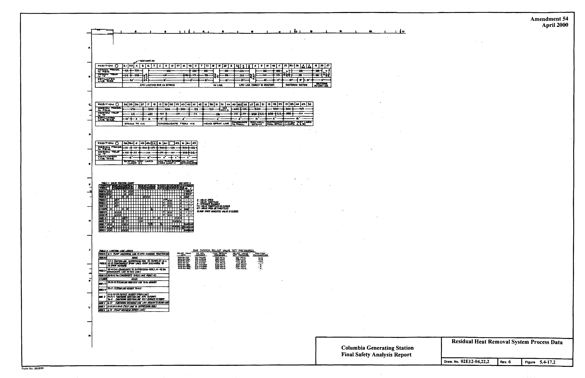

*figure on PDF page 204*

<!-- labels/text on this figure page -->
Amendment 54 April 2000
• • • •
•
• •
• II
"
POOtTtO .. 0
IO 41 16
..
D
•
..
~-- ORiDi ~ ~ HD DIJ -oo DO
1 00 0
IT 00 0
C-1 ·Z•.aO 00 ~ 0
T OD 0
QI ODO
T Clo 0 Cl Cl Olli< 0 Cl 00 ~
IIIIIW n- /D'E1ll'JII:
5111111'!!ifillll l'IU 111 l'lll'll'l.f1•1U.
Sl'IW 1.11/fJ PIHfP DJStJIIIIIIM ID- .
T[JD SIJl'l'ttESStl/MA:IIO,ft-C(Jb,.
1/CJCl.Kl 'It 11/ICIC IINE P()INT 411 llNII.
"
..
..
Residual Heat Removal System Process Data Columbia Generating Station Final Safety Analysis Report Draw. No. 02El2-04,22,2 Rev.6 Figure 5.4-17.2 Form No. 960690

<!-- p.205 -->
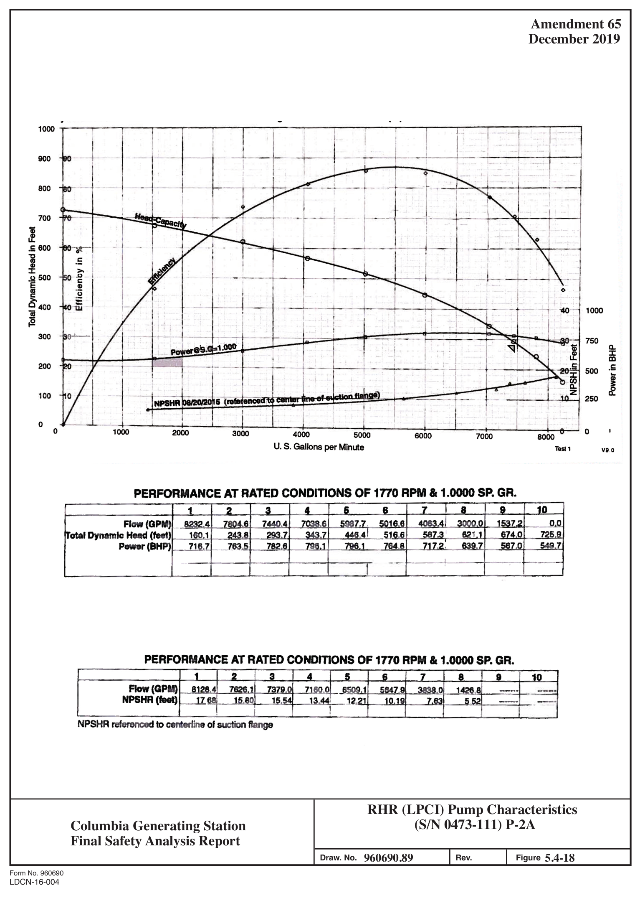

*figure on PDF page 205*

<!-- labels/text on this figure page -->
Amendment 65 December 2019
__ -J_
--1
1000 ------------...----,----,--....--....----.--~--,---r_-_- _-:-, - ---.---,
900
-- l
800
700 l .5 600 al :::c tll .s,i 500 i
- ~400 1000 iii j2 300 750 ll. :::c CD I 200 J__ .5 500 j 250 I · 0 o ,.__ ...__-----'-:;;1000 ~--'----;;:: 2000±:--..L.-.--:: 30±:oo:----1..---:-:4000±----504,oo ___ _j._-1 _ __._:__J _ __,~_.J 0 6000 7000 8000 U. S. Gallons per Minute Te&11 V9 D
PERFORMANCE AT RATED CONDITIONS OF 1770 RPM & 1.0000 SP. GR.
Flaw (OPM) -2i!!;B..!14-l.9!,l!.t.2¼-~~!t.f-.J.!,!ii.t!Lll.jf-illlZ2Lt!;,--.il!t-UWil~ =ll:u..--!tf---1.21l!.L.6.Jl---=:'""-J
otal Dynamic Head (fNt)11--.....im/..U..--';!b?.llJ--Ell!>Z..4---':a.z..q_-.!t!!L!l,!___'illj!,Jl.f-__.;!!ll.,:iz.,._-!!!i.!...Lf- = ~--!.!~
Power (BHP),1--...,_._,.~4-
PERFORMANCE AT RATED CONDmONS OF 1770 RPM & 1.0000 SP. GR.
NPSHR referenced to centerline of suction flange
RHR (LPCI) Pump Characteristics
(S/N 0473-111) P-2A Columbia Generating Station Final Safety Analysis Report 960690.89 5.4-18 Draw. No.
Rev. Figure Form No. 960690
LDCN-16-004

<!-- p.206 -->
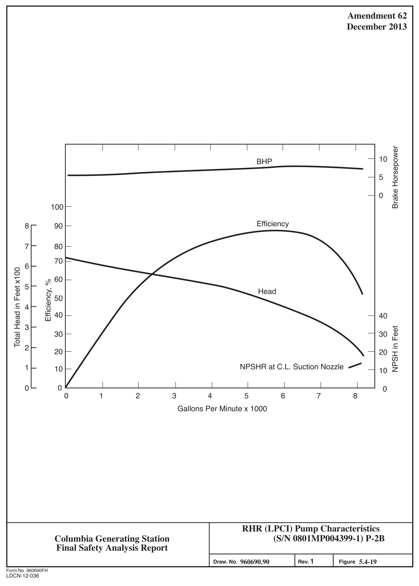

*figure on PDF page 206*

[Vector original (SVG, lossless): fig_page-206.svg](../figures/fig_page-206.svg)

<!-- labels/text on this figure page -->
Amendment 62 December 2013
Brake Horsepower 10 BHP
5
0 100
Efficiency 8 90
7 80 70 6 Total Head in Feet x100 60 Efficiency, % 5 Head 50 4 40 40 3 NPSH in Feet 30 30 2 20 20 NPSHR at C.L. Suction Nozzle 1 10 10
0 0 0 0 1 2 3 4 5 6 7 8 Gallons Per Minute x 1000
RHR (LPCI) Pump Characteristics
(S/N 0801MP004399-1) P-2B Columbia Generating Station Final Safety Analysis Report Rev. 1 Draw. No. 960690.90 Figure 5.4-19 Form No. 960690FH
LDCN-12-036

<!-- p.207 -->
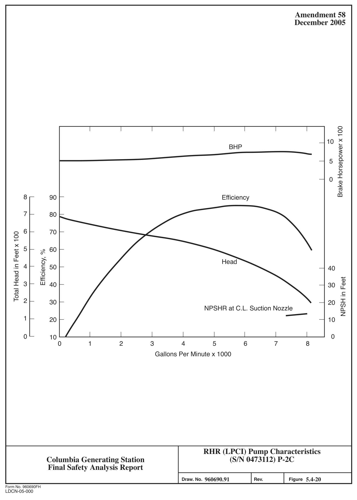

*figure on PDF page 207*

[Vector original (SVG, lossless): fig_page-207.svg](../figures/fig_page-207.svg)

<!-- labels/text on this figure page -->
Amendment 58 December 2005
Brake Horsepower x 100 10 BHP
5
0
8 90 Efficiency
7 80
6 70 Total Head in Feet x 100 5 60 Efficiency, % Head 4 50 40 NPSH in Feet 3 40 30
2 30 20 NPSHR at C.L. Suction Nozzle 1 20 10
0 0 10 0 1 2 3 4 5 6 7 8 Gallons Per Minute x 1000
RHR (LPCI) Pump Characteristics
(S/N 0473112) P-2C Columbia Generating Station Final Safety Analysis Report 960690.91 5.4-20 Draw. No. Rev. Figure Form No. 960690FH
LDCN-05-000

<!-- p.208 -->
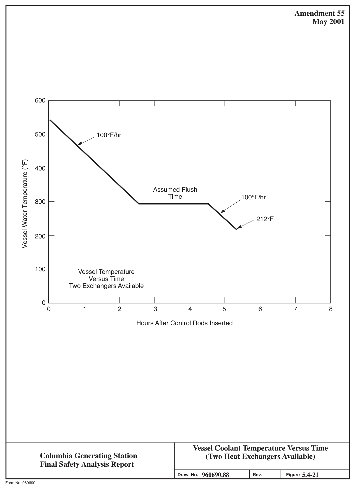

*figure on PDF page 208*

[Vector original (SVG, lossless): fig_page-208.svg](../figures/fig_page-208.svg)

<!-- labels/text on this figure page -->
Amendment 55 May 2001
600
500 100°F/hr
Vessel Water Temperature (°F)
400
Assumed Flush Time 100°F/hr 300
212°F
200
100 Vessel Temperature Versus Time Two Exchangers Available
0 0 1 2 3 4 5 6 7 8
Hours After Control Rods Inserted
Vessel Coolant Temperature Versus Time Columbia Generating Station
(Two Heat Exchangers Available)
Final Safety Analysis Report 960690.88 5.4-21 Draw. No.
Rev. Figure Form No. 960690

<!-- p.209 -->
Amendment 66 December 2021 15 14 13 12 11 10 7 6 5 4 3 .HllIES:
LEGEND:
1. ALL VALVES (EXCEPT Tl-lOSE a'I INSTRUMENT 1. AU. ITEMS MARKED • ARE FURNISHED WITH ASSOCIATED EQUIPMENT.
LINES) SUFfJXED WITH A (V) DENOTE A ... --------------------------------------------------------------------------------------------------------------------1 4"RFW(l1)-+ 3/4-" VENT VN...Vf. EXCEPT AS NOTED . 2. PIPING. VALVES, AND ASSOCIATED COMPONENTS ON THIS DRAWING SHALL BE CLASSIFIED AS FOLLOWS, EXCEPT AS STATED IN NOTE 10:
2. AU. VALVES (EXCEPT THOSE ON INSTRUMENT {BREAK POINTS INDICATED ON FLOW DIAGRAM).
UNES) sumxED WITH A (D) DENOTE A 3/4" PIPING ANO VALVES OUT THROUGH TttE OUTERMOST ISOLATION K

#### DRAIN VALVE.
VALVES, EXCEPT INSTRUI.IENT PIPING AS NOTED:
SEISMIC CATEGORY: I J. Al..L VALVES SUFFIXED WITH A (TI-I) DENOTE A QLL'UTY CL.ASS: I THROTTLED V/ILVE.
CODE GROUP: A b. PIPING AND VALVES BEYOND OUTERMOST ISOLATION VALVES IN REH:TOR BUILDING:
SEISMIC CATEGORY: II } QUALITY CLASS: II •

#### TO RWCU-T/SS-601
CODE GROUP: C

#### ZONE (C/11)
'1' INSTRUI.IENT LINES AND LEAK OFF PIPING AS NOTED:
SEISMIC CATEGORY: I } QUALITY CLASS: I • CODE GROUP: B j[ d. INSTRUI.IENT LINES ANO LEAK OFF PIPING AS NOTED:
THERWJ..~ """"'"----' g }e "1llER..SLllO g}.
SEISMIC CATEGORY:
(LINE "A")
QUALITY CLASS: 24"RFW(1)-4 f- - ►- - -------------- - ---------- I CODE GROUP: DWG. M529 (G/13)

#### PIPING AND VALVES IN RADWASTE BUILDING EXCEPT AS NOTED IN
I 2f AND 2h.
SEISMIC CATEGORY: II QUALITY CLASS: II+ CODE GROUP: 0 + I AU. PIPING, VALVES AND ASSOCIATED EQUIPt.!ENT EXCLUDING {CODE GROUP C) IN THE RWCU (SWU BORE DEWINERALJZER

#### EACTORI VESSEL
#### PIPES), CF, COND, CPR, MWR AND SA SYSTEMS IN RADWASTE
BUILDING:
SEISMIC CATEGORY: II QUALITY CLASS: II I Q CODE GROUP: 0 g. PIPING, VALVES, AND ASSOCIATED COMPONENTS REFERRING TO THIS H gg~R0~1r: I I NOTE:
~g ~ } • I
-------, ~-, PIPING AND VALVES BEYOND OUTERMOST ISOLATION VALVES IN gg~J~:~r II ftWCU 1011 F100 24"RRC(2)-45 GJJ-F1011 RADWASTE BUILDING AND RADWASTE CORRIDOR:
DWG. M530-l1 (8/5)
8'~{:
• } • 24"RRC{2)-1-S
-----, DWG. M530-1 (B/13)
TO l£AK DET. SYSTEM HANGERS TO BE DESIGNED TO SEISMIC CATEGORY I IN SEISMIC AREA, ----- ~li:
SUCH AS THE REACTOR BUILDING AND TttE RADWASTE BUILDING

#### LD-SUM-604, ZONE (D/11)
Rl'Vl~ mo,: 1 I '1'

#### HANGERS IN THE RADWASTE BLDG ARE QUALIFIED TO ELEV 521'- 0 1/4 CORRIDOR.
SEISMICILCW)ING. I -:-!:S_-:_1_ ~ t4"RRC(4)--4S-2:
"""" e GJ3-R609 I EXCEPT AS NOTED ON M619 lNSTRUMENT CONNECTION DIAGRAMS.

#### CIRCUI.A RECIRCULATION
PUMP

#### PUI.IP
+------_J + SEE NOTE 12, CONTRACT 215, SECTION 158, TABLE 2 NOTES.
G ~ J. AU. PIPING SYSTEMS IDENTIFIED BY THIS PREFIX "pI• SH,1,1...L BE SUPPLIED AND INSTALLED BY CONTRACT 220. ~""""
-4. DELETED lfrs--+ EJ1-K602 5. AU. INSTRUMENT ROOT V>LVES NOT LABEL.ED WILL BE J/4" GLOBE

#### VALVES UNLESS SPECIFICALLY NOTED OTHERWISE.
6. (DEL£TED)
7. EXCESS FLOW CHECK VALVES SHAU. BE TAGGED AS FOLl.OWS:
PI-EFC-X {PENETRATION NO.)
8. CONTAINMENT INSTRUMENTATION ROOT VALVES SHAU. BE TAGGED 1>S FOLLOWS: PI-V-X (PENETRATION).

9. (DELETED)

## 1 O. AU. PIPING DOWN STREAM OF THE LAST ISOLATION VALVE, AND OPEN
TO THE ATt.lOSPHERE Willi THE SUBSYSTEM DESIGNATION "SYSTEM" (50)
THRU (59), SHALL BE CLASSIFIED AS CODE GROUP "D", WITH QUALITY CLASS AND SEISWIC CATEGORY PRO'v10ED BY THE APPLICABLE NOTES IN

#### THIS DRAWING. EXCEPT WHERE THE APPLICABLE NOTES CAU. FOR
QUALITY CLASS II+, PIPING SHALL BE QUALITY CLASS II.
11. VALVES RWCU-V-210AAc8 ARE TO BE INSTALLED WITH THEIR FLOW ARROWS POINTED IN THE DIRECTION OF VALVES RWCU-V-2J-4.-Yl:B.
12. LINE NUMBERS IN PARENTHESES DENOTE RWCU-DM-1A SYSTEM IDENTlnCATION.

13. NO UNIQUE LINE NUMBERS GIVEN FOR RWCU(AU.)-1 PIPING l>S THESE

#### ARE RADWASTE LINES.
R'M'.:ll-V-1514(V) RWCU-V-151JM 14. AU. INSTRUMENT LINES ARE DESIGNATED BY CODE AND LINE NUMBER.

#### EXAMPLE, LINES ORIGJNATING OUTSIDE CONTAINMENT.
1/2"f>I(1)-ST - {H22-P021)-M (D)
)-4-2 ~TIO~ J/+"¥sR(53)-4S CONT ON

#### M607-4 (H/10)
b. EXAMPLE: LINES ORIGINATING INSIDE CONTAINMENT.
1/2"PI(1)--4S - X106 &--~fisl ' ~ ~~ CODE DESIGNATION LINE NUMBER FROI.I: SQRT-602 I EJl_oNII05A _j- -:S'zONE {G/15)
EJ~R&21A [i,J_ _ -t-~ _ EXAMPLE: CONTINUATION OF THE ABCM: LINE OUTSIDE
- - -51SOL A.J,E,Y,W SIGNAL

#### CONTAINMENT JS DESIGNATED AS FOLLOWS, WITH LINE NUMBERS
C§:} ~---, --JFROt.l: SQRT-l!OJ

#### NOT SHOWN.
ZONE {H/9)

#### TO RWCU-FCV-33
1/2"Pl(1)-ST-X106 - (H22-P021) E (B/8) &--~: f:rw7 EJ1-R820 I EJ1-Kl504 L - ~Ot.l: SQRT-605
--------------- '---v---" CODE DESIGNATION LINE NUMBER ZONE {C/7)
~ FROW 15. CODE BREAK DEFINITIONS FOR THERMOWELLS ARE SHOWN ON M510, D ~~

#### CRD-FS-2A
.,,_,,,,, ::"'"' "INSTALLATION OF THERt.lOWELLS AND SAMPLE PROBES.•

#### DWG. M523-2
#### ZONE (H/9)
16. RWCU-PS-114 CONTN::TS JUMPERED CLOSED TO INDICATE NORMAL 'f' PUMP SUCTION PRESSURE. . ,..,1,.,..,,~,,,-.. ,""'· I FROt.l RWCU-DPlS-25 IZONE~14-)
17. VALVES RWCU-V-443 AND RWCU-SPV--143 HAVE BEEN DEACTIVATED TO PREVENT INADVERTENT RESIN SPILLS. ~-let--- J" ONM607-4(D/10) y-.

#### RWCU-V-IIZJM
18. FOR SAWPL.E FUNCTION & INSTRUMENTATION ASSOCIATED WITH THE SAMPLE POINTS SEE DWG. SERIES M807 STEN.I & LIQUID SAMPLING I ~ I PUMP~AG.:5J-t«l02A I J TI GJJ-R607 "'""'i. rr=;:.-:-=-=--=-=-:-::_-_-=1 __

#### FLOW DIAGRAMS AND DWG. SERIES 801.-00 SAMPLE RACKS DETAILS &
#### FLOW DIAGRAMS . RWCU
...J ~

#### I 11 INTERLOCK I ROM R'NCU-TE-19
L ---1J. I I I I ~ONE (K/6)
111. SLUDGE LEVEL RWCU-LE-!12A AND !128, RWCU-LS-11GA1/A2 AND RWCU-V-624 ,---------------~-----------,

#### RWCU-LS-11681/82 ARE SPARED IN PLACE. THEY HAVE BEEN
,..,,_,__ .. ,(V)~Cl.!.l.~

#### HISTORICALLY UNREI..IABL.E. SLUDGE LEVEL IS PRESENTLY MORE
ltN/1 T/SS ! ~~/: !

#### RELIABLY DETERMINED AND CONTROLLED BY USING THE PPM (SOLID
#### WASTE PROCESSING SYSTEM).
1!101 -- 1501 RWCU

#### RWCU GJJ-N601 C GJJ-K601 I
1 (SEENOTE20) 1 20. PRIOR TO 1gg5 RWCU PROCESS PIPING, PUMPS AND VALVES IN i : CLEAN-UP i l TE -£ BETWEEN RWCU-V-5.A/B AND RWCU-V-40 (IIUT NOT INCLUDING TttESE : RECIRCULATION PUMPS :

#### RWCU-V-459M
#### VALVES OR SAFETY RELATED INSTRUMENT LINES) WERE ASME 111/J.
IN 1 ;115 BOC 55-21127-0,I, RECLASSIFIED THESE VALVES, PUMPS, AND
(SEE M523-2)

#### RWCU-V-.J2
#### PROCESS PIPING TO ANSI 831.1. FROM 2013 THESE VALVES, PUMPS,
BYPASS LINE J/4"RWc:U(~)-+-2 AND PROCESS PIPING HAVE BEEN RECLASSIFIED ASME lll/J

#### SEE NOTE 25
(REF AR 282022).
6"RWCU(J)-4-1(CL.J)

#### PUMPIB
21. SEE DWG M501 FOR FLOW DIAGRAt.l LEGENDS, SYMBOLS AND INlERLOCK I I REFERENCES TO CON"l"RACT NUMBERS, RWCU-V-109 'f' ABBREVIA NS, SUCH AS 215, 2~. 220, FOUND IN THE FROM ~ ! L!..J RWCU-V-110 I ! ,~(F/14)
NOTES ON THIS ORA.WING REFER TO I 22. RELIEF VALVES RWCU-RV-.:56 AND RWCU-RV-26A/8 ARE ASME SECTION

#### ORIGINAL CONSTRUCTION DESIGN VIII QUALITY CLASS II.
#### REQUIREMENTS.
23. RWCU-V-34 AND RWCU-V-J5 UPSTREAM DISC/WEDGE IS DRILLED :~GI 1-- fRMsl CURRENT DESIGN REQUIREMENTS ARE
(0.25" DIAMETER :1:0.005") TO PREVENT PRESSURE LOCKING. : AH 28 DOCUMENTED IN TttE STATION DESIGN : J, 1""0

#### SPECIFICATIONS AND ACTIVE CONTRACT
24. PER EC 15262, THESE VALVES, PUMPS & PROCESS PIPING LOCATED IN l FROM CRD-FS-28 I SPECIFICATIONS WHICH STILL APPLY.
B

#### THE RAOWASTE BLDG HAVE BEEN RECLASSIFIED TO ANSI BJ1.1
l I DWG. M52J-2
(REF AR 282022).
t_ ___ zoNE (c/9) ~~ 1 6"cPR(28)-1

~g~~?"w,.,.,."""T-----'""1-'"'1111'5~in----===~-!-!?-C::::::J--~--=='-'--'""'-<"•_"" ..... _ _,,---<::i------"'

25. PER EC 18434 A BYPASS LINE AROUND RWCU-V-32 IS INSTM..LED
----------~ BETWEEN RWCU-Pl-8 AND RWCU-PS-13 WITHIN E-IR-P002. REFER TO CV! 02H22-05,26.
4"RWCU(60)-J--28 {S~JN~J20)
(SEENOT£20)

6•RWCu 8 -1 !l"RWcU{S)-J--2

,,,,,..,-J"IIWCU(ll)-1

A Reactor Water Cleanup System – P&ID 4"CPRJ4 -1 Columbia Generating Station Final Safety Analysis Report

#### M523-1
124 5.4-22.1 Draw. No. Rev. Figure Form No. 960690ai

<!-- p.210 -->
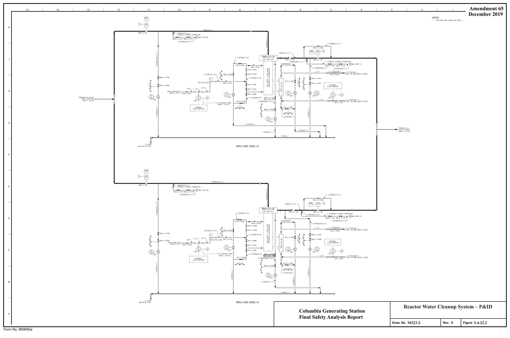

*figure on PDF page 210*

<!-- labels/text on this figure page -->
Amendment 65 15 8 1 4 13 12 1 1 10 4 December 2019 ~
NOTES ANO LECEND SEE M52J-1.
1/2"RWCU( l )-4- I
4"RWCU(1)- 4 - I
CHEMICAL CLEANING CONNECTION RWCU- ODC - 1A
RWCu -v-ng RWCU-\1-760 __ J ____ +_,_~ ::_--0-- ;;:,cc~-':.,-';",.;:;,.;-- -- J/•"RWCU{S9)-4-l 1 l/4" 2 l/2"RCC(29)-1 ;g,.r~~c(i!i- ~525- 2 (D/8)
CR0-V-502A
l/2"CRD(14)-4S
H
CRD- V- 50&,,
<~fN~Tr762~) '"ii':~~-~-:,~ 112·cR0(50)- 4s r-=- " G l/2"EOR( l)-1 1/2"[0R(1J-, I
2"EOR(1)-1
J"EDR'r RWCU PUMP ROOM IA DWG M5J7 (f/10)
4"RWCU(J)-•-S
4~W';~iri~~~NG COl<IN[CT:U-ODC-29 '
J/4RWCU()
1/2"CRD(51) - 4S RWCu-v-1JB CHEMICAL CLEANING CONN[CTl:cu-ODC-19 4"RWCU(57)-.t-5 RWCU-V-?SS RWCU- V-756 D )/4"RWCU(57) - 4- 6 CRD-\1-510B
CRD-V- 503B
C
J"CORY DWG M5J7 (f/9)
Reactor Water Cleanup System – P&ID Columbia Generating Station A Final Safety Analysis Report
M523-2
9 5.4-22.2 Draw. No. Rev. Figure Form No. 960690ai

<!-- p.211 -->
nr>- --1 Amendment 66 15 14 11 10 12 3 2 ~ i! i; E====l- December 2021 2"RWCU{51)-J TE 2e 2"RWCU(5 1)-1 J"COl\0(10)-1

· ~~~~~~~~~___j SC;.<J _____ --{),,,1--------!----,-.._-----'+"''""'"+-+...,,, 3"SA(1._) _;.1 .. (<::;; <e_;;Sa:,N>;.,a 1SA-1~ RWCU-3, I' ~=--=--==~--r-:-::::~-~~-i--::::~':::::::---r:=-::--:=--.- 2·~wR(66)-I (CHrnlCAL CLEANING IN)

EL.472'-g"

----ii 2·~wR(66)-1 SEE l;:'

#### DWG. M5.34 (E/1)
~ r

1:

j_l .......... ......,.......,... I ( PRECOATRETURN&:

#### BACKWASH SUPPLY)
~

#### G33-Z001-3B
I~

#### CLEAN-UP
1a I~~ f" L. EL.467°-0" G e e I,," ,:
CF-V-303(V) ~ g "'!
~ ¥ 1i ---~~----{--t--=~
•:~~~~~~T~-~r 3"RWCU(27)-J
-'---------------7 !
I 7 I '
- 2!, 3"RWCU2-3

I ~ .... ---.....,, CHEMICAL CLEAN CONN

#### I ... --
,- -nf----~-~--+-"-o----~' ~' =rc=o=,o="=-='~'="='="'="="=s"~'=o="'='=s•="=""=""='~' ~ I

~' * " l.....:i.~~~~~i!il.=::::::::.:;___~:.:..:.:+----'..1.o--.:...i..:+--4--1-..U NOTE 2b NOTE2h

I I I 2•~ wR(67)-1 (CHD.IICAL CLEANING OUT)
2"~WR(67)-1 (CHE~ICAL CLEANING OUT) I ro 2·~ wR(59)-1 (CHEMICAL WASTE) ZON E (G/ H J ;+--'1----~---,,----,,---i--'·~""~'-"~'--t' I ...

#### SH SEE
NOTE 2b N0TE 2h 4"RWCU(27)-1 (RESIN BACKWASH)

4"CF(50)-1 (OVERFLOW)
4"cr (~o)- l(OVERFLOW)

TO 4"RWCu{1)-3 {INFLUENT)
,--- -----------------------

#### DWG. M523-1 (J/4)
4"RWCU27-1

c~ TO RWCU- LIS-1DB t---7 ~ _____ J

#### ZDNE (D/6) I
•---- ~G11- ' I RWCU N11 JA "'°'

#### RMS J
I

FRO~ Rl\fCU-T □S -2

#### ZONE (C/9)
C e--"---t-+-U---w- f ____ 4- __ _

e,s

= 1

4"RWCU 15)-1 2"RWCU(19)-1 rn o~~c~-5~~(:}~) B 5--- - - - iowe. ~532 (E/1 4)

rno~ RWCU-TOS-2J 5------_.
5~ (c/10) ~I 4"RWCU(18)-1

Gl1eoo, Nl 14 r --- -t,..J- -
- ~c-",..~--ci~t~4if1 Reactor Water Cleanup System – P&ID Columbia Generating Station (REF.)="'c=~i<=-'=c--c-> A

4"RWCU(18)-1 Final Safety Analysis Report Draw. No. M523-3 Rev. 13 Figure 5.4-22.3

Form No. 960690ai

<!-- p.212 -->
Amendment 53 November 1998 I I e a 2 4 9 3 7

A

#### ISOLATION
#### VALVES
. ~
1. POSITIONS 28 & 29 IIIIICATE Cl.EAIIIP CmlDITIOIIS 111TH VARIOOS RBCCII INLET TOO'EIIATIIRES. =e.;::=-
2. FOR BAtKIIASII & PIIECIIAT FREraJEICY SEE SUPPL, DOC, q "TOR£M:TOR IIEtiilt PuMP e.

#### OR 8.
R£11£.T0A.
J, FOIi DETAILS ON FILTER I IIEIIINERALIZER SYSTEJI SEE

#### VE5SEL. B
#### PROCESS FUM D IA&RNI F ILTER/DEIIIIIERALIZER SUPPL,
#### DOC. 7,
4. VALVES ARE SIIOIIII IN THEIR QML OPERATING POSITIOII,
• . •
• .. - 5, FOIi DETAILS IF TIIE REACTOR 'ftSSEL BOTTII! DRAIII

#### CDIIIECTIOHS SEE SUPPL, DOC, 6,
•--•-► l!IE MXlllll'I All.OltABl£ PIPE FRICTIOII DRCP FOR THE '--·· 6.
SIZIN6 IF TIE Cl.£AlllP RECIRDILATIIIII flllllS' SIICTIIM

I '\...... Rec.c.w PRIMARY

PIPJlli FRIii POSITIONS 1 THRIIIGII II S1W.L IE CIIIITIIIU.EII COt,!T1'1~11,/T BY "1IIE •r AIID TIIE IIPSH SIIALL MIT BE 8EUN TIE 111111- 1111 AS SIIINII. DE "A" S1W.L COIITRll. TIE SIZING IF TitE DISCIIAR6E PIPIII& AIID TIE IIUIIIII AI.UJIMlE PIPE I ••. -------• •----C•U:._Ml_-U•P.•. •~•,i..:•~:R7 C

#### FRICTION DU AS SIIOIIII SIDAJI NOT IE EXCEEDED,
7. FOR DATA PERT A !NIii& TO IUIIIERS 111TH Ill IIEIAlilllS, RERII

#### TO PROCESS DATA SUPPL DOC. 1,
IIIIIE "A" DESIGII BASIS FOR HEAT EXtlWlifllS AIID NO FUJII 8, IS REAUIRED AT POSITIGa 16, 17, 21 TIII006ll 27, fllllE •r IIESIGII BASIS FOR MIii Cl.EM-UP NIP OWi,

fl'EEDM~ ◄t--R1i-----.... ---··-

9, , ' .

#### RETIJRI&
CAPACITY AIID "Ill, NPSII> AIID SIZl116 OF MIii PlftlS • OltUIWlr.llA.l.lZltt:l.
sucnoa PIPING, Ill FUJII IO'D II 1111£ ·r l"ISIT!tJI R£Fa Ut.&11" •A.•

## 8 Tllmll lS I 21 T1lllll6II 29, ,-, I
I I 10. Dn.E1EI I - I /4,c.,\ I I t---4 ._,.,

I -~--.... ···---~*··--···--·--·-·----, ~--------"4.. I

"1TES CIIIITIIIIIEI OIi Sll£ET NO, 2 D I I I I I

#### • ootlll!"!'lll".11!!'!,~- '!.~!!!!!"'"'!~'!"I"!!'!~~ .. J \ , I
I SUPPlEIUTAL DOCIIDTS UlllER Tl£ FOI.LINl116 IDEIIT ITIES AltE TO IE USED I ,_, I

#### IN CONJIIIICTIOII 111TH THIS DIWIIN&,
#### L_
~ ,.'.EE-!IU_,,..,,"' ...
IIEffB[ IPtfiMDI E
1. ll£ACTOR 11.\TER Cl.EM-UP SYS PltDCESS 11,\TA- • • • ·GJJ-101>
2. ~ 11.\TER Cl.EM-UP SYSlEJII PIID - - • - - - -GJJ-1010 llfACTQR. IMlU Cl.EM-UP SYS DESl&II W,- • • - .;&J3-ll01D J, II, RADIIASTE SYSTEII PD - - - • - - - - • - • - - • -611-1020 RFAClOA SYSTEJI OUTLlltE Dii6,- • - - - - - - - - ·W-2050 5, REACTGR VESSEl. ()IITI.IN£ 1116.- - - - - - • • - - ·Bll-llOOJ &.
FILTEIIIDEJIIII suam D~ICE LIST ITEJI 201 - • - ·6SHOD1 7, 8, RADIOACTIVE WASTE- - • - - - • • - - • - - - .• ·A62-'IUD 9. DELETED 10. oru:rm F WA'!ITE C.(M.EC.TOA. . ._ ______ __,.1L,_ ____ ._.,_ ____ __, ' '5U(GI 'TIIIIII. ""

H

Reactor Water Cleanup System Process Diagram Columbia Generating Station Final Safety Analysis Report 02G33-04,20,l 7 Draw. No. Rev.
5.4-23.1 Figure Fonn No. 960690

<!-- p.213 -->
..... ---

Amendment 53 I November 1998 I I ii s I a I 1le I

#### I 2 I 4
I I ~31 I I

#### I 7 I 8
- -

HOD[ A SCE NOTES I,) AND ' OM SH. I NORKAL OPERATION R.S.S. •~20, PSIA , .. ., ,, ..
A ' z I 6 7 8

## 12 LOCATION ) 5 10 11 IJ
16 17 18 ~; J ~ ..
145 FLOW, CiPH 83 352. JS2. JSZ.
358. 287. 287. 276,. I )lo, 134. 269. J18, I I 318. JIii.
- JEHP. r.
uo~·: 533. S3J. 533. SJJ. 5Z3,

533. · SZli, :ru----- l0,·---•------10.------ ~---·59.-····••··•-IO.·---.... 521o. 230 .• 120. 120. 120, 120. 1137. I I 437. li37. ◄·-----i,------...

"AA1r,uH
• 11•· ··--I • ---- --t • llllEh PAfSSURI
•--·---165,-----• 1111 . . .
.

.,. __ -·· ··-·------------·-· --- --· -------------····· .--·-----------·-·----.,.,a,..-----------· ------. ---- ----. -------·-... -- . ----·-· .. ---. ---·--· ......... ··-.. __ ..,

#### DIIOI'
ALLOWABLE PIPE FRlt TION ORO..S- (SEE NOIE 6 ON SH. I)
11. TIIE llflllllll REDUIRED IIPSB IF THE ClEAlllP RECIRC, Pllll'S IS ~'IO FEET PSIO BASED Oil COIDITlOII HIii! IR IIJilE I,
•
(SU NOTE 14,)
12, SEE~ q,z.s IF~R-STAIIIIIP PIIIICDIIIIE, ll, IIURllli ll>T STAIIDBY 111TH DIE CW111P PllP IR l»'EJIATIOll, BlOIIIOIII B 30, 23 24 lS. 26 27 28 28 2, 28 29 28 29 2,

#### LOCATION
10 • 21 22 RATE IS AffllOXIMTELf 126,0 1iP11 I 5115 IE&ll£ES F, ,,a.
111. COll.1116 MATER FUJII VWES 111T TO BE EmEDE11 8' 1UE THAii 61, 7. I I I I 469. "75. 516. 524. 610. 678, 678, 686.
HOW, CiPH

#### I I I
15, All AUXILIARY PIPIIIG IS DESl&IED TO 1511, PSIG 150. DES, F, TEHP. r.
437 I ! I I I I 85. 95. I 150. 154_ 100.
150. IDS. 150, 120. -- ~100111 CAl'r.c.lt'f PUMP$ ARE. Al:fll::_A'TII> l)Ull~~ ~:N~~r

~- • • -10.◄---►◄-- --- IOr---♦♦----10, ----.... ····--10,----~

• 'oom.. JA IS THE POIIIJ IIIRE TIE BOTTiii DMi. liiE coiiiiicticill EXiTS DROP PS1n AUi Tl£ C,R,D';-IKIUSIII& AREA, ., i. ••• ••• ··-·· ••••••••• - -- -- --- ---· ••••••• --- -- - - ------ -------- ---- ---------. --- -----·---· -· ·-··--. -· ••• -· --··. ·---·-· ----. --- - • -·---- .
.. l.OCATltllf 18 IS THE POINT llNEIIE TIE IIOTTlll DRAIII LIIE CINIETIIII EXITS FIVI TIIE REACTOR YE5$El.. PEDESTAL. C S(E NOlES l AND 9 ON SH. I. HOD[ 8 HOT SHUTDOWN OPERATION ( WITH LOSS OF RPV RECIRC PUMPSJ. R.S. S. 100), PSIA
(:Gll!lmc.fs M T1IE ~mi P1P1■ <BY 0T111S>. - m •
- . .
..
/ l■l~TES a-.iHIGIS ~ 0 RJlll RATE, " ' " a

#### LOCATION
#### I 2 J 5 7
## 10 IJ 12 13 14 15 17 18 9
- . . @£)
IGo::> - ,,a. ,n.
~ ,a.

#### FLOW, GPH
162. )58, J58, 358. I I

#### I I I JSR,
#### I I I
s .. ,. s .. ,. si.o. TEHP. F.
•-·---•.-----• 5 .. 3. Slt3, $44. I I I I I I I 545 • I Sltlo, Slolo. ),,.,.. si.~.
••--ll;o,-•--• .. ---•r. .• .,. •••••
- KAXIMIJH _..

#### PRESSURE
◄- ►165,•TDH-►

#### DROPS
ALLOWABLE PIPE fRICllON DROPS SEE N01E6 ON SH .. I !4----•···••··••·-·-··--· -••· · • • · · • • · ·• •- · • •- -• •·- ·-•· ··•·DELTA P•-- ···-·-·--• -· •• ---· ·--•·- -- ·- ••·-·•·-•••• •- •· -- •· -- - ----- -·- ---- ·-·· ··-· ---- ·-··· ··•· _______ _, PSIO

#### D -
21 23 2i, 25 26 27 28 29 LOCATION 10 22
- :,,a. HOW I I I I I I I I (ip" I 1cll'. r.
544, I I
( I I I I ( I KAXl&«J/1

#### PRESSURE
~---------··--·· ·-...... --.. ·-----.. --.. --··-. -··. -·. ·--.. ---.. ------ -... ---·-····--

DROP PSIO E DESIGN PAESSUAE ' T£,.[AATURE GIY(N IUIJW IS FOR INFOAHATION ONLY AND IS THE WIS FOR PlrlNG DESl'N. ESTINA TED LI NE SIZES ME FOR INFOIIHATUIN ONLY, AClUAL LINE SIZES AS DETEIUtlN£D 8Y THE PIPIN5 OESlliNER SHALL NUT THE PROCESS DATA HTIIUULIC: REQUIREJIENIS,
- S7S. ... 21A-2D 21-JJI LOCATION i --IA* j4.11•• IC-ID 2A-21 21-SA SA·' 7.74 lA-8 9-10 11,111 IIA-111 111-llJ lli-U1 IJA-)Jj iS-214 18-1£ ..
• •• 11,zo. uso.
11,20. ,i.20. llt2D, DISIGN PRl:55.(PSl&I 12SO, 12SO, 1250, 11120. li.2D. 11,20.
1250.
1250. 12JO. 11120. 1'20. 11120n.s.
ns. rn.
S?S. S7S, S7S. 575. SJS, 150. S7S. 575. ISO.
DESIGN TEMP. (DtG.FI 150. \SO, 150. 1SD.
\,a 1i.o,,.o z.o ,.o lt.o ... o lSTIKATED LINE SIZI ( IN) 2., 1.0 6,0 J,D i..o i..o 4.0 ).0 li.0 li,0 i..o lt.O F

-

H

Reactor Water Cleanup System Process Diagram Columbia Generating Station - Final Safety Analysis Report l Rev.

## 5 I Figure
Draw. No. 02G33-04,20,2 5.4-23.2 Form No. 960690

<!-- p.214 -->
Amendment 53 November 1998

~~ATIII CN1UT . -:::.· . ,! ! <j> <fl ' <fl 'f POlofflllN Mott••~ ·=" ~"i-:1::,:=. :;;..'~~ F"-', ~-=·:r.'U :--1 ... ,. !:=. :..i: jnllMmAM ~AU.. '.WI.D L--:·=t~ DIIIIN.
. ,.-

'-MT ....

' ti ta : ta I S t I H U : 'LS tt 111 I 10 , l • '9. ; '!I tD. U I t'i) : 10 ;
•o , •o r.iO ! IO 90 ! N 10 !JO : IC, IO .0 : C.O 10 Wt • Ml • --~ ,. IO n.ow CO'N'1'NI.. \IAL.'¥1'.

·11, ... 111if1111..,, .......... 'IU.ltll&IIIB,._..Knl.U&M_N~••tu11 WMl9'&M,t.llOll~LUll•.._,..1qf.l'lt ll1ir1'11 1.Z.Glllllll'M GIii

1 ,o ,o

fUIW .......... I

I 'I tC • I S 1 :.. I ID 1. 't ,0 !. l l I. J "ftn&PUNf iBG.&L~ISWl.ffl.'-'L. Ill"" mw •111'•"' •tu-!ltr;.al,tu

·• ., TIii- CONOl,,,._9Aff D

-- - ....... IClt-ofB),o,-r--f

,..-r -·

, 10 1 to , to ~ to ! o I ,. 1 s· ,... :o I ta I m

CN --

~llll!llLM,I.• ~·~·~ ~·~ ~ ~,~ ~ ...,..., __ ... __ 'tDUVPHA.'11' i.,'.

... :, . ~ ..... TM CNt

,, ;, ..
_.._,,._
•.•.
IOftDl11(#1 ~-~.

'TOTilL&.9 .... 1

,:J·.•---:·
- in~ -,1~·""'0,li.=';
• .. -
---__ ., ,,
-rT'W ll'/IIAIIUo•I..- ""'-

-~=f.=w .. ~:.;g--t Fu. ,= -::ti:-- -: r:: .. ,:·:t: ....... ;GIWJ1ff-..,. _,, -- ;:.,-.f-~.:.:::"gj flll!Xa .......... c. .. o '51'.._TtCJN ~-ct.•

•UtAU·T Adi 1&..MDUNII, ,I I

~a.a.~ ...... ,---~-, .. _..,._ .. --·---_ IIADIDACTIW

.r.'U i••I/D CClfO••~ QIG9, taml, PIIIIUIATT.INll SUNl~-..a Al■ •t1• •PJD 1&lft. MIUal 'MIUUI Rt'IWM I ;

© © 010:@l@l©I@ @ @I@ @ @l®.@1@ ®!® @ @ @)l@!@l@!@i@® ·- la''lOJ10 •• ! .,. .. ' ... .....

----· ... _ ..... ______ -1--;~ ... ---------'

IOIIOIMtl - a:' -R•nl'

¾ !ID""'-1.,.u. .,....,,,. ... 1,_,._.... -........... , ....... -'9• i""11<1 !IIOD , ...... , ....... ~.J1'teo ,eo 100 I•,..., ... ~'""l•o ... , ...

...... -----~ .. ·-•--El'Mftll.atMI& ft-j,l>-!a- ,;;;;& '° , 1 •

J'ljl.!I U,•HjtsJ'tO 10 •o!UIIO \ I 5 o • .. ~ ti.a I• ·.c, IIIIIO 1••• 1'IO IO 1 Ml,• 1-1-:- -, ..
--- ROWMT• -- -
• I 1 ! • i ,. ,a I Ut I r ro I I ' 11, I •I I , .. I ,.a I,. I 1 I ,o I,.

I ....,-.,._ ,- I ,- ~

MoG'W,... .......

I 10 l I - I

- •Nllilll MW-lflaUL••r.a ~~lll06II· .... _

1-1 I 11• -•-I n•t ..-1
-- I. .,. --
--- .. _..._.,,...
-

.... -· ... .....

I -- --- ·-=~ . .,.. -~, m:
.
--

- IID.---~ - ...,,. ''"· .. _ .... "-"'Ill :a1~ ,~ -- =-= ; &~TAIA".....,_

STATl_,. ---.&S __,,
-- j , __

Ol"IR. """ ,._ -- ~aATII·

@ @ @ @ @· @ i

,.~ ............ ""4 - .. .. ... ·to·- "'· ·~-.. ~ ..... -·- .. Id .. ..... 10, .. , .... . ..

== -·- @t@ ©I@ @ @:@ @ ©··@ @j@!@ @ !@ ® @ @I@ ®

IO .. .. ...... ... ·- .. .. .., I• .. ---..... - .. ....

,:..llfO. -.. .
.. ·- o._...=..

.._ .... ~-ili

..
!Ill-
-·' _.,,
--·- ...
s ~ .• I• ,. i .• \IO .~ ~-- /, "'' :_""!'
-~ -~ l .. • ..
- .., ~,
---

29!""-.; ___ -i -

• 'L9 •. I - I • I •·• • ---·a • i •

•·• ·-------------- ......... .._ .... _. ...

I L• I L 1,r I l • -· .... IT :·I ~~- ,· t:<i ,•;~1. i

_, - 17.IJ

I - n• rtoCoAo. .... ..._1..,11&1JNIA -- !A)G•--,u,_..,, ,,. .... DlialllUI • .,,,-4t .. dlU lrD

•. t:-""" ·•r.M.,-.r ~.:..: • I I - ' •·-1-- 1·- I - I I ! ·,

IIIIJD.

.. r-.. ~c,· 916TWM v.awn: I ='~· t. f'Clllt TIIIII. IIIA.I.Ul.1,, Mm RIEMAlftOO; ~ t ._. M.tt.CTQfl WA"fC.R ~-iJP ,...,~,-t:N PO.
·-, • .ti - ___ ,,
-
• L ::~""=~Al•--T'°!". ..
Mm~'\ ,
•· ___ .._, ~~~.~!.~

~

Filter/Demineralization System - P&ID Columbia Generating Station Final Safety Analysis Report 02G33-04,14,1 5 Draw. No. Rev. Figure 5.4-24

Form No. 960690

<!-- p.215 -->
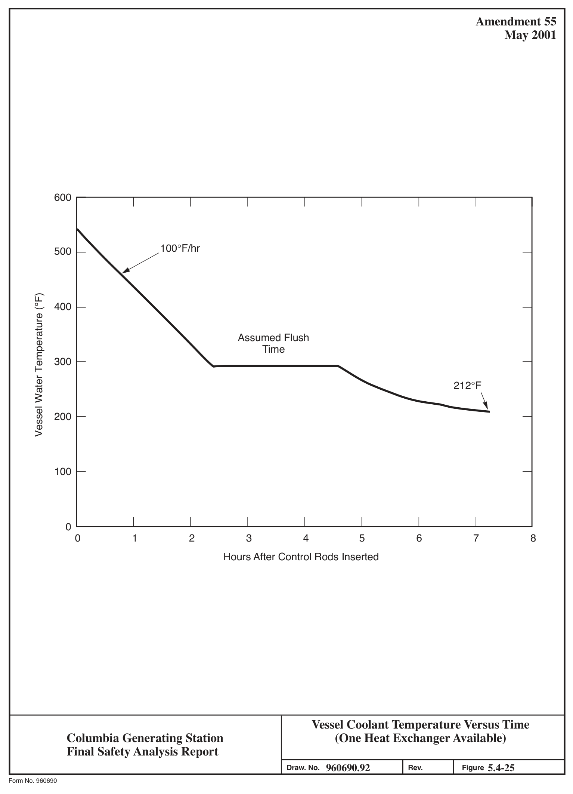

*figure on PDF page 215*

[Vector original (SVG, lossless): fig_page-215.svg](../figures/fig_page-215.svg)

<!-- labels/text on this figure page -->
Amendment 55 May 2001
600
100°F/hr 500
Vessel Water Temperature (°F)
400
Assumed Flush Time 300
212°F
200
100
0 0 1 2 3 4 5 6 7 8 Hours After Control Rods Inserted
Vessel Coolant Temperature Versus Time
(One Heat Exchanger Available)
Columbia Generating Station Final Safety Analysis Report 960690.92 5.4-25 Draw. No.
Rev. Figure Form No. 960690

