# 6.2 CONTAINMENT SYSTEMS

> Columbia Generating Station FSAR — Chapter 06: Engineered Safety Features
> Source: `06_chapter-2257-2549.pdf`, PDF pages 27–218 (of 293)
> Amendment 67 compilation (individual pages carry varying amendment dates)

---
<!-- p.27 -->
### 6.2 CONTAINMENT SYSTEMS
#### 6.2.1 CONTAINMENT FUNCTIONAL DESIGN
##### 6.2.1.1 Pressure Suppression Containment
###### 6.2.1.1.1 Design Basis
The pressure suppression containment system, including subcompartments, meets the following functional capabilities:

a. The containment has the capability to maintain its functional integrity during and following the peak transient pressures and temperatures which would occur following any postulated loss-of-coolant accident (LOCA). The LOCA includes the worst single failure (which leads to maximum containment pressure and temperature) and is further postulated to occur simultaneously with loss of offsite power. In developing the load combinations, a safe shutdown earthquake
(SSE) is postulated to occur simultaneously with the LOCA;

b. The containment in combination with other accident mitigation systems limits fission product leakage during and following the postulated design basis accident
(DBA) to values less than leakage rates which would result in offsite doses greater than those set forth in 10 CFR 50.67;

c. The containment system will withstand coincident fluid jet forces associated with the flow from the postulated rupture of any pipe within the containment;

d. The containment design permits removal of fuel assemblies from the reactor core after the postulated LOCA;

e. The containment system is protected from or designed to withstand missiles from internal sources and excessive motion of pipes which could directly or indirectly endanger the integrity of the containment;

f. The containment system provides means to channel the flow from postulated pipe ruptures in the drywell to the pressure suppression pool;

g. The containment system is designed to allow for periodically conducting tests at the peak pressure calculated to result from the postulated DBA to confirm the leaktight integrity of the containment and its penetrations; and

h. The containment system, which includes the wetwell-to-drywell and the reactor building-to-wetwell vacuum breaker systems, can withstand the maximum

<!-- p.28 -->
November 1998

calculated external pressure on the containment vessel and upward pressure on the drywell floor due to containment spray actuation under the most severe conditions.

###### 6.2.1.1.2 Design Features
A general description of the primary containment and its compliance with applicable codes, standards and guides is given in Section 3.8.2. The design of the primary containment incorporates the following:

a. Protection against dynamic effects

The design of the containment takes into account dynamic effects such as pipe whip, missiles, and jet loads which could result from a postulated LOCA. The design ensures that the capability of the containment and other engineered safety feature (ESF) equipment which mitigate the consequences of an accident are not impaired by the dynamic effects of the accident. The design provisions are discussed in Section 3.8.2.

The capability of the primary steel containment vessel to withstand the hydrodynamic effects of safety/relief valve (SRV) actuation or a LOCA and the proposed modifications, if any, for those portions and components of the vessel which are determined to have insufficient capability to accommodate these hydrodynamic effects are discussed in References 6.2-7 and 6.2-8.

b. Pressure suppression

The primary containment conforms to the fundamental principles of a MKII pressure suppression system. A comparison of the containment with similar containments is made in Table 1.3-4. The water stored in the suppression pool is capable of condensing the steam displaced into the wetwell through the downcomer vents, and the amount of water is sufficient such that operator action is not required for at least 10 minutes immediately following initiation of a LOCA. In addition, the design allows the water from any pipe break within the primary containment to drain back to the suppression pool. This “closed loop” ensures a continuous, adequate supply of water for core cooling.

c. Negative loading

The primary containment is designed for the following negative loadings:
l
1. A drywell pressure of 2.0 psi below reactor building pressure, l
2. A wetwell pressure of 2.0 psi below reactor building pressure, and

<!-- p.29 -->
April 2000 t j
3. An upward pressure across the diaphragm floor of 6.4 psid.

The nine 24-in. wetwell-to-drywell (WW-DW) and the three 24-in. reactor building-to-wetwell (RB-WW) vacuum breaker lines are sized to ensure that negative loadings are not exceeded. The vacuum breaker systems are described in Section 3.8.2.

The primary containment is designed for a total external pressure of 4 psid.
However, since the compressed insulation between the concrete biological shield and the containment exerts a uniform 2 psid external pressure (half of the total external pressure differential allowed) the drywell pressure may be no less than 2 psi below the reactor building pressure.

d. Environmental conditions

The means to maintain the required environmental conditions inside the primary containment during normal operation is discussed in Section 6.2.1. With the exception of energy removal from the suppression pool, there are no requirements for environmental controls during a LOCA. All equipment required to mitigate the consequences of an accident is designed to perform the required functions for the required duration of time in the accident environment.
The equipment accident environment is listed in Table 3.11-2.

e. Insulation

Inside the primary containment, the type of thermal insulation used for piping is primarily reflective metal panel. Nonmetallic mass insulation may also be used, in limited applications, where configuration of the component to be insulated precludes the use of reflective insulation (i.e., at pipe whip restraints, pipe supports, and interferences), and as stop gaskets between circumferential joints of reflective insulation. Also, nonmetallic insulation has been used to expedite the replacement of damaged reflective insulation panels when as low as is reasonably achievable (ALARA) considerations apply.

Reflective metal insulation panels used for the pipes are typically 2 ft long, 3 in.
to 4 in. thick, and cover half of the pipe’s circumference. These panels have 24-gauge stainless steel sheets which fully encase the 6 mil aluminum sheets.
The panels used for the reactor pressure vessel (RPV) are larger, typically 2 ft x 6 ft, and are encased by 18-gauge stainless steel.

Panels on piping covering areas which require inservice inspection, such as welds, are fastened by quick-release buckle bands. Nonremovable insulation panels around pipes are fastened. The fasteners have been designed to be

<!-- p.30 -->
April 2000

weaker than the panels; therefore, it is postulated that some panels near a pipe break will be blown away, but that the panels themselves will not be sheared open.

The insulation panels and nonmetallic mass insulation that may be blown off constitute a credible debris source within the primary containment following a LOCA and seismic event. Equipment within the primary containment, if not designed to Seismic Category I standards, is at least supported so as to remain fastened during a seismic event.

Large pieces of insulation debris could be lodged against the perimeter of the jet deflectors, but the square footage of panels blown off the piping would not be sufficient to result in significant blockage of the downcomers. If metallic or nonmetallic insulation were blown off in a pipe break accident, it is probable that most debris would remain in large pieces and would be lodged against piping, equipment, or grating before it reached the drywell floor, or remain on the floor or be lodged against the jet deflector stiffener plates rather than be swept through the downcomers into the suppression pool. Insulation fibers and bits of foil liberated by the rupture has a higher potential of reaching the suppression pool, either during the immediate aftermath of the rupture or in the subsequent washdown by the containment sprays.

Insulation that is transported to the suppression pool could affect the performance of strainers in the wetwell. For this reason, the design of the strainers uses the following conservative bases:

1. Unlimited amounts of reflective metal insulation will be transported to the suppression pool;

2. Dependent on location in the drywell, from 21% to 76% of nonmetallic (fibrous) insulation dislodged by a pipe rupture event is transported to the wetwell. The higher transport percentage, 76%, is used when dislodged insulation is below drywell grating that would hinder the transport of insulation to the wetwell; and

3. All metallic and fibrous insulation that reaches the suppression pool following a LOCA is assumed to be entrained on the beds of operating ECCS strainers.

Strainers on the RHR and LPCS suction lines are located at a centerline of 11 ft 9 in. to 12 ft 4 in. above the pool bottom. The HPCS suction strainers are located 3 ft 6 in. above the pool bottom. These strainers are designed to operate with their beds entrained with the insulation and debris postulated in the

<!-- p.31 -->
suppression pool following a LOCA. Based on the above, neither the metallic insulation panels nor the nonmetallic mass insulation will cause the degradation of the ECCS systems due to clogging of suction strainers. The analysis is discussed in Section 6.3.2.2.6.

###### 6.2.1.1.3 Design Evaluation
6.2.1.1.3.1 Summary Evaluation. The key design parameters for the pressure suppression containment are shown in Table 6.2-1.

The design parameters are not determined from a single event but from an envelope of accident conditions.

A maximum drywell and suppression chamber pressure occurs near the end of a blowdown phase of a LOCA. Approximately the same peak pressure occurs for either the break of a recirculation line or a main steam line. Both accidents are evaluated.

The most severe drywell temperature condition (peak temperature and duration) occurs for a small primary system rupture above the reactor water level that results in the blowdown of reactor steam to the drywell (small steam break). To demonstrate that breaks smaller than the rupture of the largest primary system pipe will not exceed the containment design parameters, the containment system responses to an intermediate size liquid break and a small size steam break are evaluated. The results show that the containment design conditions are not exceeded for these smaller break sizes.

A single recirculation loop operation (SLO) containment analysis was performed. The peak wetwell pressure, diaphragm download and pool swell containment responses were evaluated over the entire SLO power/flow region.

The highest peak wetwell pressure during SLO occurred at the maximum power/flow condition of 73.8% power/64.3% core flow. This peak wetwell pressure decreased by about 1%
(0.5 psi) compared to the rated two-loop operation pressure. The diaphragm floor download and pool swell velocity evaluated at the worst power/flow condition during SLO were found to be bounded by the rated power analysis.

The analytical results and method of analysis utilized to determine the seismic sloshing effects in the wetwell are discussed in Section 3.8.2.

6.2.1.1.3.2 Containment Design Parameters. Table 6.2-1 provides a listing of the key design parameters of the primary containment system including the design characteristics of the drywell, suppression pool, and pressure suppression vent system.

<!-- p.32 -->
The downcomer loss coefficient is 2.77. This value was used in the assessment of the limiting containment performance analysis. The nonlimiting events not reanalyzed for the power uprate assumed a loss of coefficient of 1.9.

There are eighty-four 24-in. diameter downcomers and eighteen 28-in. downcomers. Three of the downcomers are capped.

No known studies have been performed to experimentally determine 4T test downcomer vent loss coefficients. However, in Pool Swell Analytical Model (PSAM)/4T test data comparisons
(References 6.2-27 and 6.2-28), General Electric (GE) used downcomer vent loss coefficients of 2.51 and 3.50 for the 4T test 20-in. downcomers and 24-in. downcomers, respectively.
These values were used as input to the GE PSAM and were calculated using information from Reference 6.2-15. The Columbia Generating Station (CGS) downcomer friction loss coefficient (fl/D) that is used in pool swell studies is equal to 1.9 (see Table 3.8-1). Use of a value of 1.9 versus a 4T value ensures conservatism in CGS pool swell studies in that lower values of fl/D maximizes pool swell velocity (see Figure 4-24 of Reference 6.2-5).

Table 6.2-2 provides the performance parameters of the related ESF systems which supplement the design conditions of Table 6.2-1 for containment cooling purposes during post blowdown long-term accident operation. Performance parameters given include those applicable to full capacity operation and to those conservatively reduced capacities assumed for containment analyses.

In addition to the power uprate analysis (Reference 6.2-35), an additional containment analysis was performed (Reference 6.2-42) to evaluate reduced ECCS flow rates (RHR/LPCI and LPCS). Tables 6.2-2 through 6.2-6 detail this analysis. The power uprate analysis remains bounding.

Additionally, Reference 6.2-42 documents an analysis to address General Electric (GE) Safety Communication (SC) 06-01. GE SC 06-01 indicated that long-term low-pressure injection with all pumps operating and one RHR heat exchanger inoperable may impact suppression pool temperature. The analysis concludes that, when only one RHR heat exchanger is operable, two LPCI pumps and the LPCS pump must be secured. The timing for this action is detailed in Reference 6.2-42. This action is required to not exceed the bounding suppression pool temperature of 204.5°F.

6.2.1.1.3.3 Accident Response Analysis. The containment functional evaluation was initially based on the consideration of several postulated accident conditions resulting in release of reactor coolant to the containment. These accidents include

a. An instantaneous guillotine rupture of a recirculation line, b. An instantaneous guillotine rupture of a main steam line, c. An intermediate size liquid line rupture, and

<!-- p.33 -->
d. A small size steam line rupture.

The containment response to the main steam line, intermediate liquid line, and small size steam line breaks, were bounded by the recirculation line break. As part of the evaluations to support the reactor power uprate to 3486 MWth (References 6.2-32, 6.2-33, and 6.2-35), only the recirculation line rupture (Case C), the bounding event for containment response, was reanalyzed. The containment response analyses are not cycle specific nor are they part of the analyses performed to support core reload analyses. For further discussion, see Sections 6.2.1.1.3.3.4 and 6.2.1.1.3.3.5.

For the containment analysis performed to evaluate reduced ECCS flow rates (RHR/LPCI and LPCS), the recirculation line rupture (Cases A, B, and C) were re-analyzed. For further discussion, see Section 6.2.1.1.3.2.

6.2.1.1.3.3.1 Recirculation Line Rupture. Immediately following the rupture of the recirculation line, the flow out both sides of the break will be limited to the maximum allowed by critical flow consideration. Figure 6.2-2 shows a schematic view of the flow paths to the break. In the side adjacent to the suction nozzle, the flow will correspond to critical flow in

the pipe cross section. In the side adjacent to the injection nozzle, the flow will correspond to critical flow at the 10 jet pump nozzles associated with the broken loop. In addition, the cleanup line cross tie will add to the critical flow area. Table 6.2-3 provides a summation of the break areas. References 6.2-1 and 6.2-2 provide a detailed description of the analytical models and assumptions for this event.

6.2.1.1.3.3.1.1 Assumptions for Reactor Blowdown. The response of the reactor coolant system during the blowdown period of the accident is analyzed using the following assumptions:

a. The initial conditions for the recirculation line break accident are such that the system energy is maximized and the system mass is minimized. That is

1. For the nonlimiting events which were not reanalyzed for power uprate, the reactor is operating at 104.2% of maximum power (3323 MWt).
This maximizes the postaccident decay heat.

2. For the limiting events, the reactor is operating at 3702 MWt. This power corresponds to 102% of 3629 MWt. The analysis power was chosen to support a future uprate to 3629 MWt and bounds a power uprate to 3544 MWt (current).

3. For the containment analysis performed to evaluate reduced ECCS flow rates (RHR/LPCI and LPCS), the reactor is operating at 3556 MWt.

<!-- p.34 -->
This power corresponds to 100.34% of 3544 MWt. ANS 5.1-1979+2σ with GE Service Information Letter (SIL) 636 is used to determine decay heat release.

4. For the nonlimiting events which were not reanalyzed for power uprate, the standby service water (SW) temperature is assumed to be 95F, which exceeds the maximum expected temperature. For power uprate, a less conservative value of 90F was assumed. For the containment analysis performed to evaluate reduced ECCS flow rates (RHR/LPCI and LPCS), 85°F is assumed for the first 10 hours and 90°F thereafter.

5. The suppression pool mass is at the low water level.

6. The suppression pool temperature is assumed to be at the maximum value allowed for power operation.

b. The recirculation line is considered to be severed instantly. This results in the most rapid coolant loss and depressurization of the vessel, with coolant being discharged from both ends of the break.

c. Reactor power generation ceases at the time of accident initiation because of void formation in the core region. Scram also occurs in less than 1 sec from receipt of the high drywell pressure signal. The difference between the shutdown times is negligible.

d. The vessel depressurization flow rates are calculated using Moody’s critical flow model (Reference 6.2-3) assuming “liquid only” outflow, since this assumption maximizes the energy releases to the drywell. “Liquid only” outflow implies that all vapor formed in the RPV by bulk flashing rises to the surface rather than being entrained in the existing flow. In reality, some of the vapor would be entrained in the break flow which would significantly reduce the RPV discharge flow rates. Further, Moody’s critical flow model, which assumes annular, isentropic flow, thermodynamic phase equilibrium, and maximizes slip ratio, accurately predicts vessel outflows through small diameter orifices.
Actual rates through larger flow areas, however, are less than the model indicates because of the effects of a near homogeneous two-phase flow pattern and phase nonequilibrium. These effects are conservatively neglected in the analysis.

e. The core decay heat and the sensible heat released in cooling the fuel to approximately 550F are included in the RPV depressurization calculation. The rate of energy release is calculated using a conservatively high heat transfer coefficient throughout the depressurization period. The resulting high-energy

<!-- p.35 -->
release rate causes the RPV to maintain nearly rated pressure for approximately 20 sec. The high RPV pressure increases the calculated blowdown flow rates which is again conservative for analyses purposes. The sensible energy of the fuel stored at temperatures below approximately 550F is released to the vessel fluid along with the stored energy in the vessel and internals as vessel fluid temperatures decrease below approximately 550F during the remainder of the transient calculation.

f. The main steam isolation valves (MSIV) start closing at 0.5 sec after the accident. They are fully closed in the shortest possible time of 3 sec following closure initiation. In actuality, the closure signal for the MSIV will occur from low reactor water level, so the valves will not receive a signal close for at least 4 sec, and the closing time may be as long as 5 sec. By assuming rapid closure of these valves, the RPV is maintained at a high pressure, which maximizes the calculated discharge of high-energy water into the drywell. For the containment analysis performed to evaluate reduced ECCS flow rates (RHR/LPCI and LPCS), MSIV closure was assumed to start at 0 seconds after the accident.

g. For the nonlimiting events which are not reanalyzed for power uprate, reactor feedwater flow was assumed to stop instantaneously at time zero. Since feedwater flow tends to depressurize the RPV, thereby reducing the discharge of steam and water into the drywell, this assumption is conservative for the analysis since MSIV closure cuts off motive power to the steam-driven feedwater pumps.

For the limiting events, reactor feedwater flow is assumed to continue until all high-energy feedwater is injected into the reactor.

h. A complete loss of offsite power occurs simultaneously with the pipe break.
This condition results in the loss of power conversion system equipment and also requires that all vital systems for long-term cooling be supported by onsite power supplies.

<!-- p.36 -->
6.2.1.1.3.3.1.2 Assumptions for Containment Pressurization. The pressure response of the containment during the blowdown period of the accident is analyzed using the following assumptions:

a. Thermodynamic equilibrium exists in the drywell and suppression chamber.
Since nearly complete mixing is achieved, the analysis assumes complete mixing;

b. The fluid flowing through the drywell-to-suppression pool vents is formed from a homogeneous mixture of the fluid in the drywell. The use of this assumption results in complete carryover of the drywell air and a higher positive flow rate of liquid droplets which conservatively maximizes vent pressure losses;

c. The fluid flow in the drywell-to-suppression pool vents is compressible except for the liquid phase; and

d. No heat loss from the gases inside the primary containment is assumed. In reality, condensation of some steam on the drywell surfaces would occur.

6.2.1.1.3.3.1.3 Assumptions for Long-Term Cooling. Following the blowdown period, the ECCS provides water for core flooding, containment spray, and long-term decay heat removal.
The containment pressure and temperature response during this period is analyzed using the following assumptions:

a. The low-pressure coolant injection (LPCI) pumps are used to flood the core prior to 600 sec after the accident. The HPCS is assumed available for the entire accident;

b. After 600 sec, the LPCI pump flow may be diverted from the RPV to the containment spray. This is manual operation. Actually, the containment spray need not be activated at all to keep the containment pressure below the containment design pressure. Prior to activation of the containment cooling mode (assumed at 600 sec after the accident) all of the LPCI pump flow will be used to flood the core. In response to indications of significant core damage the operators are directed to initiate containment spray to reduce potential radioactivity released;

6.2-9a

<!-- p.37 -->
c. The effects of decay energy, stored energy, and energy from the metal-water reactor on the suppression pool temperature are considered;

d. The suppression pool is assumed to be the only heat sink available in the containment system;

e. After approximately 600 sec, it is assumed that the RHR heat exchangers commence to remove energy from the containment by means of recirculation cooling from the suppression pool with the SW system; and

f. The performance of the ECCS equipment during the long-term cooling period is evaluated for each of the following three cases of interest:

Case A: Offsite power available - all ECCS equipment and containment spray operating.

Case B: Loss of offsite power, minimum diesel power available for ECCS and containment spray.

Case C: Same as Case B except no containment spray.

Case C is limiting as it results in the highest peak suppression pool temperature and containment pressure. Since power uprate does not change the results of the three cases relative to each other, Case C was reevaluated for power uprate conditions.

6.2.1.1.3.3.1.4 Initial Conditions for Accident Analyses. Table 6.2-4 provides the initial reactor coolant system and containment conditions used in the accident response evaluation.
The tabulation includes parameters for the reactor, the drywell, the suppression chamber, and the vent system. Table 6.2-3 provides the initial conditions and numerical values assumed for the recirculation line break accident as well as the sources of energy considered prior to the postulated pipe rupture. The assumed conditions for the reactor blowdown are also provided.
The mass and energy release sources and rates for the containment response analyses are given in Section 6.2.1.3.

6.2.1.1.3.3.1.5 Short-Term Accident Response. The calculated containment pressure and temperature responses for the recirculation line break are shown in Figures 6.2-3 and 6.2-4, respectively.

The suppression chamber is pressurized by the carryover of noncondensables from the drywell and by heatup of the suppression pool. As the vapor formed in the drywell is condensed in the suppression pool, the temperature of the suppression pool water peaks and the suppression chamber pressure stabilizes. The drywell pressure stabilizes at a slightly higher pressure; the

<!-- p.38 -->
difference being equal to the downcomer submergence. During the RPV depressurization phase, most of the noncondensable gases initially in the drywell are forced into the suppression chamber. However, following the depressurization, noncondensables will redistribute between the drywell and suppression chamber by means of the vacuum breaker system. This redistribution takes place as steam in the drywell is condensed by the relatively cool ECCS water which is beginning to cascade from the break causing the drywell pressure to decrease.

The ECCS supplies sufficient core cooling water to control core heatup and limit metal-water reaction to less than 0.07%. After the RPV is flooded to the height of the jet pump nozzles, the excess flow discharges through the recirculation line break into the drywell. This flow of water (steam flow is negligible) transports the core decay heat out of the RPV, through the broken recirculation line, in the form of hot water which flows into the suppression chamber by means of the drywell-to-suppression chamber vent system. This flow provides a heat sink for the drywell atmosphere and thereby causes the drywell to depressurize.

Table 6.2-5 provides the peak pressure, temperature, and time parameters for the recirculation line break as predicted for the conditions of Table 6.2-4 and corresponds with Figures 6.2-3 and 6.2-4. Figure 6.2-5 shows the time dependent response of the floor (deck) differential pressure.

During the blowdown period of the LOCA, the pressure suppression vent system conducts the flow of the steam-water gas mixture in the drywell to the suppression pool for condensation of the steam. The pressure differential between the drywell and suppression pool controls this flow. Figure 6.2-6 provides the mass flow versus time relationship through the vent system for this accident.

6.2.1.1.3.3.1.6 Long-Term Accident Responses. To assess the adequacy of the containment following the initial blowdown transient an analysis was made of the long-term temperature and pressure response following the accident. The analysis assumptions are those discussed in Section 6.2.1.1.3.3.1.3 for the three cases of interest. The initial pressure response of the containment (the first 600 sec after break) is the same for each case. As can be seen from Figures 6.2-7, 6.2-8, and 6.2-9, Case C is the limiting event.

Case A: All ECCS equipment operating - with containment spray

This case assumes that offsite ac power is available to operate all cooling systems.
During the first 600 sec following the pipe break, the HPCS, LPCS, and all LPCI pumps are assumed operating. All flow is injected directly into the reactor vessel.

After 600 sec, both RHR heat exchangers are activated to remove energy from the containment. During this mode of operation the flow from two of the LPCI pumps is routed through the RHR heat exchangers where it is cooled before being discharged into the containment spray header.

<!-- p.39 -->
The containment pressure response to this set of conditions is shown as Curve A in Figure 6.2-7. The corresponding drywell and suppression pool temperature responses are shown as Curve A in Figures 6.2-8 and 6.2-9. After the initial blowdown and subsequent depressurization due to core spray and LPCI core flooding, energy addition due to core decay heat results in a gradual pressure and temperature rise in the containment. When the energy removal rate of the RHR system exceeds the energy addition rate from the decay heat, the containment pressure and temperature reach a second peak value and decrease gradually. Table 6.2-6 summarizes the cooling equipment operation, the peak long term containment pressure following the initial blowdown peak, and the peak suppression pool temperature.

Case B: Loss of offsite power - with delayed containment spray

This case assumes no offsite power is available following the accident and that only the HPCS and one LPCI diesel (Divisions 3 and 2, respectively) are available. For the first 600 sec following the break, one HPCS, and two LPCI pumps are used exclusively for core cooling. After 600 sec, the RHR heat exchanger is activated.
The flow from one pump is routed through the heat exchanger and is discharged to the containment spray line. The second LPCI pump is assumed to be shut down.
The containment pressure response to this set of conditions is shown as Curve B in Figure 6.2-7. The corresponding drywell and suppression pool temperature responses are shown as Curve B in Figures 6.2-8 and 6.2-9. A summary of this case is given in Table 6.2-6.

Case C: Loss of offsite power - no containment spray

This case assumes no offsite power is available following the accident and that only the HPCS and one LPCI diesel (Divisions 3 and 2, respectively) are available. For the first 600 sec following the accident, one HPCS, and two LPCI pumps are used exclusively to cool the core.

After 600 sec, one RHR heat exchanger is activated to remove energy from the containment, but containment spray is not activated. The LPCI flow cooled by the RHR heat exchanger is discharged into the RPV. The second LPCI pump is assumed to be shut down. The containment pressure response to this set of conditions is shown in Figure 6.2-10. The corresponding drywell and suppression pool temperature responses are shown in Figures 6.2-11 and 6.2-12. A summary of this case is given in Table 6.2-6.

When comparing the “spray” Case B with the “no spray” Case C at the same power level, the same RHR heat exchanger duty is obtained since the suppression pool temperature response is approximately the same as shown in Figure 6.2-9. Thus, the same amount of energy is

<!-- p.40 -->
removed from the pool whether the exit flow from the RHR heat exchanger is injected into the reactor vessel or into the drywell as spray. Although the peak containment pressure is higher for the “no spray” case, the pressure is significantly less than the containment design pressure.

Figure 6.2-13 shows the rate at which the RHR system heat exchanger will remove heat from the suppression pool following a LOCA.

6.2.1.1.3.3.1.7 Chronology of Accident Events. A complete description of the containment response to the design basis recirculation line break has been given in Sections 6.2.1.1.3.3.1.5 and 6.2.1.1.3.3.1.6. Results for this accident are shown in Figures 6.2-3 through 6.2-6, 6.2-10, 6.2-11, 6.2-12, and 6.2-13. A chronological sequence of events for this accident from time zero is provided in Table 6.2-8.

6.2.1.1.3.3.2 Main Steam Line Break. The sequence of events immediately following the rupture of a main steam line between the reactor vessel and the flow limiter have been determined. The flow in both sides of the break will accelerate to the maximum allowed by the critical flow considerations. In the side adjacent to the reactor vessel, the flow will correspond to critical flow in the steam line break area. Blowdown through the other side of the break will occur because the steam lines are all interconnected at a point upstream of the turbine by the bypass header. This interconnection allows primary system fluid to flow from the three unbroken steam lines, through the header and back into the drywell by means of the broken line. Flow will be limited by critical flow in the steam line flow restrictor. The total effective flow area is given in Figure 6.2-14 which is the sum of the steam line cross sectional area and the flow restrictor area. A slower closure rate of the isolation valves in the broken line would result in a slightly longer time before the total valve area of the three unbroken lines equals the flow limiter area in the broken line. The effective break area in this case would start to reduce at 5 sec rather than 4.3 sec as demonstrated in Table 6.2-10. The drywell design temperature (340°F) was determined based on a bounding analysis of the superheated gas temperature. The short-term peak drywell temperature is controlled by the initial steam flow rate during a large steam line break. Since the vessel dome pressure assumed for the original rated analysis (1055 psia) is unchanged by power uprate, the initial break flow rate for this event is not impacted. This event was not reanalyzed for power uprate as there would be no impact on the original rated short-term peak drywell temperature value. The peak drywell pressure occurs before the reduction in effective break area due to MSIV closure and is, therefore, insensitive to a possible slower closure time of the isolation valves in the broken lines. The mass and energy release rates are provided in Section 6.2.1.3.

Immediately following the break, the total steam flow rate leaving the vessel would be approximately 8600 lb/sec, which exceeds the steam generation rate in the core of 4140 lb/sec.
This steam flow to steam generation mismatch causes an initial vessel depressurization of the reactor vessel at a rate of approximately 42 psi/sec. Void formation in the reactor vessel water causes a rapid rise in the water level, and it is conservatively assumed that the water level reaches the vessel steam nozzles 1 sec after the break occurs. The water level rise time of

<!-- p.41 -->
1 sec is the minimum that could occur under any reactor operating condition. From that time on, a two-phase mixture corresponding to the overall average vessel quality would be discharged from the break. The use of the overall average vessel quality results in fluid qualities which are considerably lower than would actually occur. Thus, the drywell peak pressure, which increases with decreasing break flow quality, is maximized. During the first second of the blowdown, the blowdown flow will consist of saturated steam. This steam will enter the containment in a super-heated condition of approximately 330F.

Figures 6.2-15 and 6.2-16 show the pressure and temperature responses of the drywell and suppression chamber during the primary system blowdown phase of the steam line break accident for original rated power. The short-term performance is not affected by power uprate. The long-term response is bounded by the recirculation suction line break. Therefore, no steam line break analysis was performed for the power uprate condition.

Figure 6.2-16 shows that the drywell atmosphere temperature approaches 330°F after 1 sec of primary system steam blowdown. At that time, the water level in the vessel will reach the steam line nozzle elevation and the blowdown flow will change to a two-phase mixture. This increased flow causes a more rapid drywell-pressure rise. The peak differential pressure occurs shortly after the vent clearing transient. As the blowdown proceeds, the primary system pressure and fluid inventory will decrease, resulting in a decrease in the vent system and the differential pressure between the drywell and suppression chamber.

Table 6.2-5 presents the peak pressures, peak temperatures, and times of this accident as compared to the recirculation line break.

Approximately 50 sec after the start of the accident, the primary system pressure will have dropped to the drywell pressure and the blowdown will be over. At this time the drywell will contain primarily steam, and the drywell and suppression chamber pressures will stabilize.
The pressure difference corresponds to the hydrostatic pressure of vent submergence.

The drywell and suppression pool will remain in this equilibrium condition until the reactor vessel refloods. During this period, the emergency core cooling pumps will be injecting cooling water from the suppression pool into the reactor. This injection of water will eventually flood the reactor vessel to the level of the steam line nozzles and the ECCS flow will spill into the drywell. The water spillage will condense the steam in the drywell and, thus, reduce the drywell pressure. As soon as the drywell pressure drops below the suppression chamber pressure, the drywell vacuum breakers will open and noncondensable gases from the suppression chamber will flow back into the drywell until the pressure in the two regions equalize.

<!-- p.42 -->
###### 6.2.1.1.3.3.3 Hot Standby Accident Analysis. This section is not applicable to BWR-5.

6.2.1.1.3.3.4 Intermediate Size Breaks. The failure of a recirculation line results in the most severe pressure loading on the drywell structure. However, as part of the original containment performance evaluation, the consequences of intermediate breaks were also analyzed. This classification covers those breaks for which the blowdown will result in reactor depressurization and operation of the ECCS. This section describes the consequences to the containment of a 0.1 ft2 break below the RPV water level. This break area was chosen as being representative of the intermediate size break area range. These breaks can involve either reactor steam or liquid blowdown. The consequences of an intermediate size break are less severe than from a recirculation line rupture. Because these breaks are not limiting, they were not reanalyzed for power uprate.

Following the 0.1 ft2 break, the drywell pressure increases at approximately 1 psi/sec. This drywell pressure transient is sufficiently slow so that the dynamic effect of the water in the vents is negligible and the vents will clear when the drywell-to-suppression chamber differential pressure is equal to the vent submergence hydrostatic pressure.

Figures 6.2-17 and 6.2-18 show the drywell and suppression chamber pressure and temperature response for original rated power conditions at 3323 MWt. The ECCS response is discussed in Section 6.3. Approximately 5 sec after the 0.1 ft2 break occurs, air, steam, and water will start the flow from the drywell to the suppression pool. The steam will be condensed and the air will enter the suppression chamber free space. The continual purging of drywell air and steam to the suppression chamber will result in a pressurization of both the wetwell and drywell to about 25 and 30 psig, respectively. The containment will continue to gradually increase in pressure due to long-term pool heatup until the vessel is depressurized and reflooded.

The ECCS will be initiated as the result of the 0.1 ft2 break and will provide emergency cooling of the core. The operation of these systems is such that the reactor will be depressurized in approximately 600 sec. This will terminate the blowdown phase of the transient.

In addition, the suppression pool end of blowdown temperature will be the same as that of the recirculation line break because essentially the same amount of primary system energy is released during the blowdown. After reactor depressurization and reflood, water from the ECCS will begin to flow out the break. This flow will condense the drywell steam and eventually cause the drywell and suppression chamber pressures to equalize in the same manner as following a recirculation line rupture.

The subsequent long-term suppression pool and containment heatup transient that follows is essentially the same as for the recirculation line break.

<!-- p.43 -->
###### 6.2.1.1.3.3.5 Small Size Breaks.

6.2.1.1.3.3.5.1 Reactor System Blowdown Consideration. This section discusses the containment transient associated with small primary systems blowdowns. The sizes of primary system ruptures in this category are those blowdowns that will not result in reactor depressurization due either to loss of reactor coolant or automatic operation of the ECCS equipment. Following the occurrence of a break of this size, it is assumed that the reactor operators will initiate an orderly plant shutdown and depressurization of the reactor system.
The thermodynamic process associated with the blowdown of primary system fluid is one of constant enthalpy. If the primary system break is below the water level, the blowdown flow will consist of reactor water. Blowdown from reactor pressure to the drywell pressure will flash approximately one-third of this water to steam and two-thirds will remain as liquid. Both phases will be at saturation conditions corresponding to the drywell pressure.

If the primary system rupture is located so that the blowdown flow consists of reactor steam only, the resultant steam temperature in the containment is significantly higher than the temperature associated with liquid blowdown. This is because the constant enthalpy depressurization of high pressure, saturated steam will result in superheated conditions inside containment.

A small reactor steam leak (resulting in superheated steam) will impose the most severe temperature conditions on the drywell structures and the safety equipment in the drywell. For larger steam line breaks, the superheat temperature is nearly the same as for small breaks, but the duration of the high temperature condition for the larger break is less. This is because the larger breaks will depressurize the reactor more rapidly than the orderly reactor shutdown that is assumed to terminate the small break. Like the main steam line break, the small steam line break is also governed by the dome pressure. The small break response is also governed by the operator actions. Since the vessel dome pressure assumed for the original rated analysis
(1055 psia) is unchanged by power uprate the initial break flow rate for this event will be unchanged. Assuming the operator action is the same, the event would be terminated in the same manner as for the original rated power analysis. Thus, the small steam line break was not reanalyzed for power uprate.

6.2.1.1.3.3.5.2 Containment Response. For drywell design consideration, the following sequence of events is assumed to occur. With the reactor and containment operating at the maximum normal conditions, a small break occurs that allows blowdown of reactor steam to the drywell. The resulting pressure increase in the drywell will lead to a high drywell pressure

<!-- p.44 -->
signal that will scram the reactor and activate the containment isolation system. The drywell pressure will continue to increase at a rate dependent on the size of the steam leak. The pressure increase will lower the water level in the vents until the level reaches the bottom of the vents. At this time, air and steam will start to enter the suppression pool. The steam will be condensed and the air will be carried over to the suppression chamber free space. The air carryover will result in a gradual pressurization of the suppression chamber at a rate dependent upon the size of the steam leak. Once all the drywell air is carried over to the suppression chamber, pressurization of the suppression chamber will cease and the system will reach an equilibrium condition. The drywell will contain only superheated steam and continued blowdown of reactor steam will condense in the suppression pool. The suppression pool temperature will continue to increase until the RHR heat exchanger heat removal rate is greater than the decay heat release rate.

6.2.1.1.3.3.5.3 Recovery Operations. The plant operators will be alerted to the incident by the high drywell pressure signal and the reactor scram. For the purposes of evaluating the duration of the superheat condition in the drywell, it is assumed that their response is to shut the reactor down in an orderly manner while limiting the reactor cool down rate to 100°F/hr.
This will result in the reactor primary system being depressurized within 6 hr. At this time, the blowdown flow to the drywell will cease and the superheat condition will be terminated. If the plant operators elect to cool down and depressurize the reactor primary system more rapidly than at 100°F/hr, then the drywell superheat condition will be shorter.

6.2.1.1.3.3.5.4 Drywell Design Temperature Consideration. For drywell design purposes, it is assumed that there is a blowdown of reactor steam for the 6-hr cool down period. The corresponding design temperature is determined by finding the combination of primary system pressure and drywell pressure that produces the maximum superheat temperature. Drywell design temperature requirements are defined by the most limiting environmental conditions assumed to exist inside primary containment during a design basis accident (see Table 3.11-2).
As noted in Table 3.11-2, the design temperature of 340°F is the superheat temperature based on a steam leak with the reactor vessel pressure of 400-500 psi and a design containment pressure of 45 psig.

###### 6.2.1.1.3.4 Accident Analysis Models.

6.2.1.1.3.4.1 Short-Term Pressurization Model. The analytical models, assumptions, and methods used by GE to evaluate the containment response during the reactor blowdown phase of a LOCA are described in References 6.2-1 and 6.2-2.

6.2.1.1.3.4.2 Long-Term Cooling Mode. During the long-term, post-blowdown containment cooling transient, the ECCS flow path is a closed loop and the suppression pool mass will be constant. This closed cooling loop provides subcooled water to the vessel from the suppression pool removing residual decay heat. As a result long-term steaming will not occur. This approach is conservative since removal of energy by steaming would require that more energy

<!-- p.45 -->
be retained in the vessel, and therefore, not released to the containment to maintain the vessel fluid inventory at saturation temperature. The cooling model loop is shown in Figure 6.2-19.
There is no change in mass storage in the system (the RPV is reflooded during the blowdown phase of the accident).

The break flow area is assumed to remain constant as a function of time following decompression of the broken line and/or closure of the MSIV during the first few seconds of the reactor blowdown.

###### 6.2.1.1.3.4.3 Analytical Assumptions. The key assumptions employed in the model are as follows:

a. The drywell and suppression chamber atmosphere are both saturated
(100% relative humidity),

b. The drywell atmosphere temperature is equal to the temperature of the coolant spilling from the RPV or to the spray temperature if the sprays are activated,

c. The suppression chamber atmosphere temperature is equal to the suppression pool temperature or to the spray temperature if the sprays are activated, and

d. No credit is taken for heat losses from the primary containment or to the containment internal structure.

6.2.1.1.3.4.4 Energy Balance Consideration. The energy balance in the suppression pool is described in References 6.2-1 and 6.2-2.

###### 6.2.1.1.4 Negative Pressure Design Evaluation
Columbia Generating Station does not have automatic initiation of any drywell spray and controls operation of the sprays through procedural guidance. The design and sizing of the reactor building to wetwell (RB-WW) and wetwell to drywell (WW-DW) vacuum breakers considered inadvertent operation of containment sprays as limiting transients. Although this is conservative for design considerations, inadvertent spraying of the drywell is considered more than one single failure or operator error.

The simultaneous operation of both containment spray loops after large and small-break LOCA could be a limiting transient for the containment negative pressure. However this event is based on more than one single failure or operator error and neglects the consideration for adequate core cooling by using both RHR loops. Using the single-failure criterion and considering the need for adequate core cooling following a large-break LOCA, the containment sprays would not be initiated until later in the event by spraying WW first followed by DW with the worse single failure being a RB-WW vacuum breaker to open. This scenario is nonlimiting with respect to floor uplift or negative pressure.

<!-- p.46 -->
The limiting transient for negative containment pressurization is a small-break LOCA with a coincident single failure of an RB-WW vacuum breaker. This transient uses both WW and DW sprays of a single RHR loop. WW/DW sprays are initiated when required by the Emergency Operating Procedures. The small break within the drywell forces the noncondensables into the wetwell airspace, leaving a steam atmosphere inside the drywell.
Once drywell sprays are initiated, pressure rapidly drops and the RB-WW and WW-DW vacuum breakers open to mitigate the transient.

The analysis performed to determine peak negative pressure after large and small-line-break LOCA made the following conservative assumptions:

a. Maximum spray flow of 8200 gpm (combined drywell and wetwell flow),

b. 100% spray efficiency,

c. 50F spray temperature,

d. Noncondensable gases are purged into the wetwell as a result of the

#### LOCA,
e. The drywell is full of steam at a pressure above wetwell due to the hydrostatic head from downcomer submergence, and

f. Single failure of RB-WW vacuum breaker.

g. Reactor Power is 3702 MWth.

The initial conditions used in the analysis are provided in Table 6.2-19. A summary of the results is provided in Table 6.2-19a.

Drywell spray is not required to maintain the primary containment below design pressure nor is it required for containment cooling. If, following a small-line-break LOCA, the noncondensable gases are purged into the wetwell airspace, the EOPs would direct the operator to initiate wetwell sprays to control wetwell pressure. If containment pressure continues to increase, drywell sprays will be initiated. The appropriate plant procedures direct the operator to initiate drywell sprays in response to indications of significant fuel failures during a LOCA.
For the scenario in which containment sprays are initiated, the limiting single failure (or operator error) would be the failure of a RB-WW vacuum breaker. The results of the analysis indicate that the maximum negative pressure differential will be less than 2.0 psid and within the design values as stated in Section 6.2.1.1.2(c).

<!-- p.47 -->
Multiple valve failure is not considered or expected. The analysis considers two WW-DW vacuum breakers initially out of service, in addition to the single failure of the RB-WW vacuum breaker, to preclude unnecessary shutdowns due to failure of the testing mechanism or position indication. Failure of the testing mechanism is considered more probable than failure of the vacuum breakers to open. It should also be noted that a single failure of a RB-WW vacuum breaker is more limiting than the single failure of a DW-WW vacuum breaker.

###### 6.2.1.1.5 Suppression Pool Bypass Effects
6.2.1.1.5.1 Protection Against Bypass Paths. The pressure boundary between drywell and suppression chamber including the vent pipes, vent header, and downcomers is fabricated, erected, and inspected by nondestructive examination methods in accordance with the applicable ASME Codes. The design pressure differential for this boundary is 25 psid, which is substantially greater than conditions during a DBA. Actual peak accident differential pressure across this boundary is provided in Table 6.2-5.

Penetrations of this boundary except the vacuum breaker seats and vacuum breaker to downcomer flange are welded. The penetrations can be visually inspected.

Potential bypass leakage paths (such as the purge and vent system) have been considered.
Each path has at least two isolation valves in the leakage path during normal system lineup.
These valves are leaktight containment isolation valves which are all normally closed.

6.2.1.1.5.2 Reactor Blowdown Conditions and Operator Response. In the unlikely event of a primary system leak in the drywell accompanied by a simultaneous open bypass path between the drywell and suppression chamber, several postulated conditions may occur. For a given primary system break area, the maximum allowable leakage capacity can be determined when the containment pressure reaches the accident pressure at the end of reactor blowdown. The most limiting conditions would occur for those primary system break sizes which do not cause rapid reactor depressurization but rather have long leakage duration. These break sizes which are less than 0.4 ft2 require operator action to terminate the reactor blowdown if there is a bypass path.

There would also be an increase in drywell pressure which leads to drywell venting to the wetwell by means of the downcomers. Both noncondensables and vapor are vented. If no bypass leakage exists, the maximum suppression chamber pressure would be 28 psig, the pressure resulting from displacing all containment noncondensables into the suppression chamber.
l I Operator action is required to mitigate the consequences of any bypass leakage. Emergency Operating procedures direct initiation of suppression chamber sprays at a chamber pressure

<!-- p.48 -->
less than the value analyzed in Section 6.2.1.1.5.4. Drywell sprays are initiated if the chamber pressure limit is exceeded.

Class 1E indication is available in the control room allowing the operator to track chamber pressure. Additionally, a two-division system of alarms is provided to alert the operator if the suppression chamber spray initiation value is reached.

6.2.1.1.5.3 Analytical Assumptions. When calculating the allowable leakage capacities for a spectrum of break sizes, the following assumptions are made:

a. Flow through the postulated leakage path is pure steam. For a given leakage path, if the leakage flow consists of a mixture of liquid and vapor, the total leakage mass flow rate is higher but the steam flow rate is less than for the case of pure steam leakage. Since only the steam entering the suppression chamber free space results in the additional containment pressurization, this is a conservative assumption; and

b. There is no condensation of the leakage flow on either the suppression pool surface or the containment and vent system structures. Since condensation acts to reduce the suppression chamber pressure, this is a conservative assumption.
For an actual containment there will be condensation, especially for the larger primary system break where vigorous agitation at the pool surface will occur during blowdown.

6.2.1.1.5.4 Analytical Results. The containment has been analyzed to determine the allowable leakage between the drywell and suppression chamber. Figure 6.2-20 shows the _J allowable leakage capacity ( ) as a function of primary system break area. The area of

#### A / K
the leakage flow path is A, and K is the total geometric loss coefficient associated with the leakage flow path.

Figure 6.2-20 is a composite of two curves. If the break area is greater than approximately 0.4 ft2, natural reactor depressurization will rapidly terminate the transient. For break areas less than 0.4 ft2, however, continued reactor blowdown limits the allowable leakage to small values.

Burns and Roe, Inc., confirmed the results of the above analysis by GE in Reference 6.2-7.
_t Further evaluation assigned the maximum allowable leakage capacity at A/ K = 0.050 ft2.
Since a typical geometric loss factor would be three or greater, the maximum allowable flow path would be about 0.1 ft2. This corresponds to a 4-in. line size.

A transient analysis using the CONTEMPT-LT (Reference 6.2-8) computer code was performed. The code was modified to include the mass and energy transfer to the suppression

<!-- p.49 -->
pool from relief valve discharge. The limiting case was a very small reactor system break which would not automatically result in reactor depressurization. For this limiting case, it was assumed that the response of the plant operators was to initiate the drywell sprays when the suppression chamber pressure exceeds 30 psig, and then to proceed to cool the reactor down in an orderly manner of 100°F/hr cool down rate. Heat sinks considered were items such as major support steel inside containment, the reactor pedestal, the diaphragm floor and support columns, and the steel and concrete of the primary containment. Based on this analysis, the allowable bypass leakage used was 0.050 ft2. The drywell pressure transient is shown in Figure 6.2-21 along with the corresponding curves of wetwell pressure, wetwell temperature, and suppression pool temperature for the original rated power condition.

The mandated allowable bypass leakage of 0.050 ft2 is above the Technical Specifications containment bypass leakage limits. Periodic testing is performed to confirm that the _f containment bypass leakage does not exceed ( A / K = 0.0045 ft2. Figure 6.2-22 presents )
the resulting containment transient of 0.0045 ft2. The peak containment pressure shown in Figure 6.2-22 is well below the containment design pressure.

An evaluation of this scenario with power uprate indicates that the time available for the operator to manually activate the containment spray is not significantly affected by power uprate. Therefore the effect of power uprate on the steam bypass event is determined to be insignificant.

###### 6.2.1.1.6 Suppression Pool Dynamic Loads
A generic discussion of the suppression pool dynamic loads and asymmetric loading conditions is given in Mark II Dynamic Forcing Function Information Report, Reference 6.2-4. A unique plant assessment of these dynamic loads is made in Reference 6.2-5.

The impact of power uprate on the suppression pool dynamic loads defined in Reference 6.2-5 was evaluated for a power uprate to 102% of 110% of the original rated power (3323 MWt)
and considering operation with extended load line limit analysis (ELLLA) and SRV out-of-service plus a setpoint tolerance increase to 3%. This evaluation confirmed that there are sufficient conservatism in the suppression pool dynamic loads defined in Reference 6.2-5.

###### 6.2.1.1.7 Asymmetric Loading Conditions
See Section 6.2.1.1.6.

###### 6.2.1.1.8 Primary Containment Environmental Control
6.2.1.1.8.1 Temperature, Humidity, and Pressure Control During Reactor Operation. The drywell is maintained at its normal operating temperature 135°F maximum average/150°F maximum by the use of three lower containment coolers and two upper containment coolers

<!-- p.50 -->
December 2011 l J mounted in the drywell area. The cooling coils for these units are supplied with water at 95°F, or less, from the reactor building closed cooling water system. There is no air cooling equipment in the wetwell since there is no heat producing equipment and the air space is normally less than 95F. However, leakage past the seating surfaces of MSRVs may cause the wetwell air space temperature to increase due to heat transfer from the MSRV tailpipes to the wetwell atmosphere. In this case, the wetwell air space can be periodically cooled by spraying with RHR to maintain wetwell air space temperatures at or below 117F, the limit for equipment qualification.

The unit coolers are sufficient to control the temperature and humidity from all expected heat sources and leaks during normal reactor operation. The containment purge system is not used to control containment temperature or humidity during reactor operation.

To relieve pressure during reactor operation, the operator can establish a flow path from the drywell to the standby gas treatment (SGT) system through the drywell purge exhaust line.
After the first 24 hr of venting, and assuming the containment atmosphere does not contain unacceptable levels of radioactivity, venting can be valved to the reactor building exhaust system. By opening the 2-in. bypass valves around the purge exhaust valves rather than the purge exhaust valve, flow can be limited to 170 scfm. This flow is adequate for a drywell atmosphere temperature rise from 70F to 150°F in 3 hr while maintaining the primary containment at no greater than 0.5 psi above the reactor building pressure. The 2-in. bypass valves would limit the radioactivity released prior to valve closure to a very small amount in the unlikely event a LOCA occurs with the vent path open. If necessary, the wetwell can be vented in a similar way to relieve pressure.

The RB-WW and WW-DW vacuum breakers operate automatically to control containment vacuum.

6.2.1.1.8.2 Primary Containment Purging. The primary containment is provided with a purge system to reduce residual contamination and deinert the containment prior to personnel access.
This system is designed to produce a purge rate equivalent to three air changes per hour to the net free volume.

The drywell is purged of nitrogen for the scheduled refueling shutdown period and as required for inspection or maintenance. The maximum drywell purge rate is 10,500 cfm. For the first 24 hr of a drywell purge, or if residual airborne contamination is higher than allowable limits for direct release to the atmosphere, the purge is routed through the SGT system. Purge air is taken from the reactor building ventilation supply duct through two 30-in. normally closed isolation valves into the primary containment. The purged nitrogen is extracted from the drywell through two 30-in. normally closed isolation valves and is routed to one of two systems. The discharge can be routed through a normally closed isolation valve to the ! l reactor building exhaust air plenum or to the SGT system. If a high airborne activity occurs,

<!-- p.51 -->
December 2013 t I the radiation monitors at the exhaust air plenum would cause the reactor building ventilation and primary containment purge systems to isolate.

Provision is also made to purge the nitrogen from the suppression chamber section of the primary containment. Purge air is taken from the reactor building supply duct through two 24-in. normally closed isolation valves into the suppression chamber. The nitrogen is extracted from the suppression chamber through two 24-in. normally closed isolation valves and routed to the exhaust air plenum or SGT system in the same manner as the drywell purge exhaust.

The systems are designed to purge either the drywell or the suppression chamber or the two chambers in series or in parallel. To protect the pressure suppression function of the suppression pool, only one vent line and one purge line will be open at any one time during reactor operation.

Purge system operation during reactor operation including startup, hot standby, and hot shutdown will be limited to inerting (through the purge system), deinerting, and pressure control. The containment purge system will not be used for temperature or humidity control during reactor operation.

All containment purge valves, including the 2-in. bypass valves, are designed to shut within 4 sec of receipt of a containment isolation signal and to shut against full containment design pressure. The containment isolation signals and the purge valves are part of the containment I isolation system which is an ESF system. Each purge line has two isolation valves. These valves are opened by allowing compressed air to oppose a spring in the valve actuator. The valve is shut on a loss of compressed air, loss of electrical signal, or on a containment isolation I signal. If the purge system is operating at the time of a LOCA, the system will automatically be secured. The level of the activity released through the purge system before isolation would be limited to the activity present in the coolant prior to the accident since the purge system will be isolated before any postulated fuel failure could occur. Dual isolation valves are also provided on the nitrogen inerting makeup piping connecting to the purge piping downstream of the 30-in. and 24-in. isolation valves. The nitrogen inerting system permits up to 75 cfh of nitrogen to be added to the containment during reactor operation to compensate for the postulated leakage listed in Table 6.2-1.

The 2-in. bypass valves, used for pressure control during operations, are located in parallel with each purge system exhaust valve. These 2-in. 150# globe valves meet the design requirements of the containment isolation system. They are designed to the same pressure/temperature ratings of the containment and purge valves and are designed to close within 4 sec against the containment design pressure. All four bypass valves can be remotely operated from the control room; are designed to close on F, A, and Z isolation signals; and are operationally qualified against applicable seismic and hydrodynamic loads.

<!-- p.52 -->
6.2.1.1.8.3 Post-LOCA. The unit coolers are not required after a LOCA since heat removal is then accomplished by the containment cooling system, a subsystem of the RHR system. The Emergency Operating Procedures stipulate that nitrogen inerting is used as long as nitrogen is available. The operation of purge and vent transitions from oxygen control to hydrogen control upon loss of the ability to continue to inert with oxygen levels increasing. The containment purge system has the capability for a controlled purge of the containment atmosphere to aid in atmospheric control, if necessary, in accordance with the guidance provided in the Emergency Operating Procedures.

Any equipment located inside the primary containment which is required to operate subsequent to a LOCA has been designed to operate in the worst anticipated accident environment for the required period of time.

###### 6.2.1.1.9 Postaccident Monitoring
A description of the postaccident monitoring systems is provided in Section 7.5.

##### 6.2.1.2 Containment Subcompartments
The subcompartments in the primary containment analyzed to determine the effects of subcompartment pressurization are the annulus between the sacrificial shield wall and vessel annulus pressurization and the drywell head. For the power uprate and MELLLA evaluation, the limiting breaks in these two regions were analyzed considering reactor operation throughout the power flow map with power uprate, including final feedwater temperature reduction and single loop operation.

Peak subcompartment pressures occur very quickly (during the first few seconds) during the limiting subcompartment pressurization events. Therefore, the pressurization is controlled by the initial break flow rates which are governed by the break size and location and the initial reactor thermal-hydraulic conditions, such as reactor pressure and enthalpy. The limiting operating condition with power uprate with respect to subcompartment pressurization was determined to occur at 3702 MWt, 102% of design power limit 3629 MWt; therefore, the controlling parameters with power uprate were compared to the original values at this condition. The comparison shows that there are negligible differences between the controlling parameters for the original conditions used as the basis for the annulus pressurization and drywell head pressurization analyses and the corresponding parameters with power uprate and MELLLA (Reference 6.2-32 and 3.6-24). Therefore, the basis for the subcompartment pressurization loads is not affected by power uprate.

<!-- p.53 -->
Original Conditions Power Uprate Conditions
(at 3463 MWt)
(at 3702 MWt)

Vessel dome pressure (psia) 1055 1055

Core inlet enthalpy (Btu/lbm) 532 532

Recirculation line break 8900 8900 critical mass flux
(lbm/ft2-sec)

Feedwater enthalpy 403 406
(Btu/lbm)

19,200 Feedwater line break critical 19,300 mass flux (lbm/ft2_sec)

The two areas within the primary containment considered to be subcompartments are the area within the sacrificial shield wall and the area above the refueling bulkhead plate at el. 583 ft.

Potential pipe breaks within the sacrificial shield wall have been evaluated. The information is contained in References 3.8-5, 3.8-6, 3.8-7, and 3.8-23.

Two analyses were performed based on original rated power (3323 MWt) to ensure the adequacy of the refueling bulkhead and inner refueling bellows at el. 583 ft. The first analysis, a break of the RCIC head spray line, determines the maximum downward loading due to pipe breaks. The second analysis, a break of the RRC suction line, determines the maximum upward loading.

Subcompartment analyses for a postulated high-energy pipe break in the primary containment were performed for the annulus inside the sacrificial shield wall, and the regions above and below the bulkhead plate which divides the drywell into the upper head region and the lower region.

The analyses for the annulus were reported in References 6.2-9 through 6.2-11 and 6.2-42.
The result of the case of a 60-node model of the shield wall annulus for pressure transient calculation was confirmed by the NRC, and the analysis was considered acceptable for the shield wall base design and the design of the shield wall above the base, as stated in NRC letters (References 6.2-12 and 6.2-13). For the MELLLA evaluation a 400-node model of the shield wall was analyzed and the results were bounded by the original 60-node model.
(Reference 3.6-24).

Peak and transient loading used to establish the adequacy of the sacrificial shield wall, including the time/space dependent forcing functions, are presented in References 6.2-9 through 6.2-11 and 6.2-34.

<!-- p.54 -->
These loads were used to produce response spectra for use in evaluating secondary effects such as the dynamic effects on piping systems, equipment, and components attached to the sacrificial shield wall of the RPV. The following changes were made in the original assumptions used in the sacrificial shield wall analysis:

a. The volume in the annulus was utilized to receive the blowdown, with the RPV installation volume conservatively assumed not to be available;

b. A finite time-dependent blowdown was used for the recirculation break utilizing NSSS supplier methodology (Reference 6.2-22). The effect of subcooling was taken into account; and

c. The feedwater pressurization analysis was developed utilizing blowdown values developed by computer analysis.

Annulus pressurization calculations are briefly summarized as follows:

a. Annular volume

The annular volume excluded RPV insulation volume which is conservatively assumed not to be available. This approach is conservative and more realistic than other analyses where only the annular volume on one side of the RPV insulation was available;

b. Finite time dependent blowdown

The blowdown loading values in Reference 6.2-11 were derived with the assumption that the pipe break would occur instantaneously and that the annulus area would see the maximum blowdown at the same time. In actuality, the full flow from the severed pipe ends separate at a distance equal to one-half the pipe diameter. Movement occurs in a finite time and is a function of the stiffness characteristics of the pipe and the restraining capability of the pipe whip restraints.

Displacement versus time data for a finite break opening was developed and a GE analytical method was used for determining the short-term mass and energy release (Reference 6.2-22). The analysis was used for the recirculation loop break but not for the feedwater line since it was determined that the small percentage reduction for the feedwater would not warrant the additional calculations; and

<!-- p.55 -->
c. Feedwater break blowdown data

The blowdown analysis for the postulated feedwater line break was based on a comprehensive model developed for the entire feedwater system from the condenser to the reactor vessel. This model, in conjunction with the RELAP4/MOD5 computer program (Reference 6.2-14), was used to calculate the transient and energy blowdown data.

Information pertaining to the analyses for the upper head and lower regions is as follows:

a. For the subcompartment analysis in the upper head region, the worst case is a double-ended guillotine break in the 6-in. RCIC line above the RPV head at approximately el. 595 ft. For the analysis in the lower region, the worst case is a double-ended guillotine break in the 24-in. recirculation line anywhere inside the drywell. The pipe breaks were postulated for the subcompartment structural and component support designs;

b. The blowdown mass and energy release rates as functions of time for the 6-in.
RCIC line break are shown in Tables 6.2-20 and 6.2-21. The blowdown mass and energy release rates as functions of time for the 24-in. recirculation line break are shown in Tables 6.2-22 and 6.2-23;

c. The subcompartment analyses for the case of a 6-in. RCIC line break in the upper head region and the case of a 24-in. recirculation line break were performed with the Computer Code RELAP4/MOD5 (Reference 6.2-14).

Figure 6.2-23 shows the nodalization scheme in the drywell. Figure 6.2-24 depicts the plane view of vents in the bulkhead plate and shows the sectional views and dimensions of the bulkhead vents;

d. The nodal volume data used for the analysis of a 6-in. RCIC line break in the upper head region and the analysis of a 24-in. recirculation line break in the lower region is shown in Table 6.2-24. Table 6.2-25 shows the flow path data for the analysis of a 6-in. RCIC line break and Table 6.2-26 shows the flow path data for the analysis of a 24-in. recirculation line break;

e. Since there are no significant obstructions in the proximity of the pipe break considered in the analysis, significant pressure variation in any direction is not expected. The two-node model used for the analyses is considered to be adequate and a sensitivity study is not necessary;

<!-- p.56 -->
f. There are no movable obstructions in the vicinity of the vents. Insulation for piping and components was assumed to remain intact during the accident, and volume of insulation was subtracted from the nodal volumes;

g. The absolute pressure responses as a function of time in the upper head region and the lower region in the drywell are shown in Figure 6.2-25 for the case of a 6-in. RCIC line break and in Figure 6.2-26 for the case of a 24-in. recirculation line break. Figures 6.2-27 and 6.2-28 represent the pressure differential across the bulkhead plate for the cases of a 6-in. RCIC line break and a 24-in.
recirculation line break;

h. The peak differential pressure and the time of the peak for the cases of a 6-in. RCIC line break and a 24-in. recirculation line break are shown in Table 6.2-27; and

i. Peak and transient loading used to establish the adequacy of the sacrificial shield wall, including the time/space-dependent forcing functions are contained in References 6.2-9 through 6.2-11 and 3.8-23.

Peak and transient loading in other major compartments such as the drywell and the upper head region of primary containment were included in the basic design.
Since these compartments are large and relatively unencumbered, the loads are time-dependent but relatively uniform throughout. The time-dependent loads were applied as equivalent static loads, utilizing the appropriate dynamic loads factors. Following a LOCA, the refueling bulkhead would require requalification prior to use. This is acceptable because the refueling bulkhead does not perform a safety-related function and would not become a missile during the postulated LOCA.

The analyses for the annulus are contained in References 6.2-9 through 6.2-11.
Evaluation of potential pipe breaks within the sacrificial shield wall are in Reference 3.8-5, 3.8-6, 3.8-7, and 3.8-23.

##### 6.2.1.3 Mass and Energy Release Analyses for Postulated Loss-of-Coolant Accidents
Where the ECCS enter into the determination of energy released to the containment, the single failure criterion has been applied to maximize the energy release to the containment following a LOCA.

###### 6.2.1.3.1 Mass and Energy Release Data
Table 6.2-9 provides the mass and enthalpy release data for the recirculation line break.
Blowdown flow rates do not change significantly during the 24-hr period following the

<!-- p.57 -->
accident. Figures 6.2-29 and 6.2-30 show the blowdown flow rates for the recirculation line break. This data was employed in the DBA containment pressure-temperature transient analyses.

Table 6.2-10 provides the mass and enthalpy release data for the main steam line break.
Blowdown flow rates do not change significantly during the 24-hr period following the accident. Figure 6.2-31 shows the vessel blowdown flow rates for the main steam line break as a function of time after the postulated rupture. This information has been employed in the containment response analyses.

###### 6.2.1.3.2 Energy Sources
The reactor coolant system conditions prior to the line break are presented in Tables 6.2-3 and 6.2-4. Reactor blowdown calculations for containment response analyses are based on those conditions during a LOCA.

The energy released to the containment during a LOCA is comprised of the following:

a. Stored energy in the reactor system, b. Energy generated by fission product decay, c. Energy from fuel relaxation, d. Sensible energy stored in the reactor structures, e. Energy being added by the ECCS pumps, and f. Metal-water reaction energy.

All but the pump heat energy addition is discussed or referenced in this section. The pump heat rate was used in evaluating the containment response to the LOCA and is conservatively selected as a constant input of 4890 Btu/sec to the system. The pump heat rate is added to the decay heat rate for inclusion in the analysis.

Following each postulated accident event, the stored energy in the reactor system and the energy generated by fission product decay will be released. The rate of release of core decay heat for the evaluation of the containment response to a LOCA is provided in Table 6.2-11 as a function of time after accident initiation.

Following a LOCA, the sensible energy stored in the reactor primary system metal will be transferred to the recirculating ECCS water and will, thus, contribute to the suppression pool and containment heatup.

###### 6.2.1.3.3 Reactor Blowdown and Core Reflood Model Description
The reactor primary system blowdown flow and core reflood rates were evaluated with the model described in References 6.2-1 and 6.2-2.

<!-- p.58 -->
###### 6.2.1.3.4 Effects of Metal-Water Reaction
The containment systems are designed to accommodate the effects of metal-water reactions and other chemical reactions which may occur following a LOCA. The amount of metal-water reaction which can be accommodated is consistent with the performance objectives of the ECCS. Section 6.2.5 provides a discussion on the generation of metal-water hydrogen within the containment.

###### 6.2.1.3.5 Thermal Hydraulic Data for Reactor Analysis
Sufficient data to perform confirming thermodynamic evaluations of the containment has been provided within Section 6.2.1.1.3.3.

###### 6.2.1.3.6 Long Term Cooling Model Description
The long term cooling model is described in Section 6.2.1.1.3.4.

###### 6.2.1.3.7 Single Failure Analysis
Containment analysis results assuming the worst single active failure are presented in Section 6.2.1.

#### 6.2.1.4 Not applicable to BWR plants.

#### 6.2.1.5 Not applicable to BWR plants.

##### 6.2.1.6 Testing and Inspection
###### 6.2.1.6.1 Structural Integrity Test
The test for structural integrity is discussed in Section 3.8.

###### 6.2.1.6.2 Integrated Leak Rate Test
Leak rate tests are conducted to verify that leakage out of the primary containment does not exceed 0.375% per day at 38 psig. This test is discussed in Section 6.2.6.

###### 6.2.1.6.3 Drywell Bypass Leak Test
Tests are conducted, in accordance with the Technical Specifications, to verify that the _f drywell-wetwell bypass leakage does not exceed an equivalent leakage of A / K equal to 0.0045 ft2. This is less than the bypass leakage allowed.

<!-- p.59 -->
###### 6.2.1.6.4 Vacuum Relief Testing
Tests are conducted in accordance with the Technical Specifications to verify the proper operation of the vacuum relief valves.

##### 6.2.1.7 Required Instrumentation
The instrumentation required to monitor containment parameters and to initiate safety functions is discussed in Chapter 7.

#### 6.2.2 RESIDUAL HEAT REMOVAL CONTAINMENT HEAT REMOVAL SYSTEM
##### 6.2.2.1 Design Bases
The RHR containment heat removal function is accomplished by the use of an operational mode of the RHR system. The purpose of this system is to prevent excessive containment temperatures and pressures, thus maintaining containment integrity following a LOCA. To fulfill this purpose, the RHR containment cooling system meets the following safety design bases:

a. The system will limit the long term bulk temperature of the suppression pool to I ≤204.5°F when considering the energy additions to the containment following a I LOCA. These energy additions, as a function of time, are provided in Section 6.2.1;

b. The single failure criterion applies to the system;

c. The system is designed to safety grade requirements including the capability to perform its function following an SSE;

d. The system will remain operational during those environmental conditions imposed by a LOCA;

e. Each active component of the system is testable during normal operation of the nuclear power plant;

f. Minimum net positive suction head (NPSH) is maintained on the RHR pumps even with the containment at atmospheric pressure, the suppression pool at a maximum temperature, and postaccident debris entrained on the beds of the suction strainers; and

<!-- p.60 -->
g. Withstands dynamic effect of pipe breaks inside and outside of containment (see Section 3.6).

The primary containment unit coolers provide for containment heat removal during nonaccident conditions. These coolers are not an ESF and no credit is taken for them during accident events.

##### 6.2.2.2 Residual Heat Removal Containment Cooling System Design
The RHR containment cooling system is an integral part of the RHR system. Water is drawn from the suppression pool, pumped through one or both RHR heat exchangers and delivered to the vessel, the suppression pool, the drywell spray header, or the suppression pool vapor space spray header.

Water from the SW system is pumped through the heat exchanger tube side to remove heat from the process water. Two cooling loops are provided, each mechanically and electrically separate from the other to achieve redundancy. The process diagram including the process data from all design operating modes and conditions is provided in Section 5.4.

All portions of the RHR containment cooling system are designed to withstand operating loads and loads resulting from natural phenomena.

Construction codes and standards are covered in Section 3.2. Seismic and environmental qualifications are discussed in Section 3.10 and 3.11, respectively.

There are no signals which automatically initiate containment cooling; however, the SW system is automatically initiated by the same signals which start up the ECCS. The capacity of power sources, including the standby diesels, is sufficient to allow operation of the SW pumps simultaneously with the ECCS pumps. An ECCS pump need not be secured prior to starting RHR containment cooling.

To start RHR containment cooling after a LOCA resulting from a large break, the operator needs only to verify that the normally open RHR heat exchanger isolation valves are open and I then shut the heat exchanger bypass valve. The rated containment cooling flow, 7450 gpm, can be achieved through the LPCI line, the drywell spray line, or through the test line and I wetwell spray line, which directs the heat exchanger discharge directly into the suppression pool. Thus, the design allows containment cooling simultaneously with core flooding or containment spray. If the break size is small enough to limit reactor depressurization, the rated I containment cooling flow cannot be established through the LPCI line. The operator must then direct the RHR containment cooling flow through the drywell spray line or through the test line; however, the operator must not divert LPCI flow away from the reactor until adequate core cooling is ensured. In addition, an electrical interlock prevents actuation of a drywell I spray loop until the corresponding LPCI injection valve has been shut. A second electrical

<!-- p.61 -->
interlock prevents actuation of drywell spray if there is no high drywell pressure signal present.

When allowed, the operator may start drywell spray by shutting the LPCI injection valve and then opening the drywell spray valves. Similarly, the operator may divert the flow directly to the suppression pool by shutting the LPCI injection valve and then opening the test line valve.

Preoperational tests were performed to verify individual component operation, individual logic element operation, and system operation up to the drywell spray spargers. A sample of the sparger nozzles were bench tested for flow rate versus pressure drop to evaluate the original hydraulic calculations. The spargers were tested by air and visually inspected to verify that all nozzles were clear.

##### 6.2.2.3 Design Evaluation of the Containment Cooling System
The containment spray system is discussed in Section 5.4.7. Containment spray is not required for heat removal.

In the event of the postulated design basis LOCA, the short-term energy release from the reactor primary system will be dumped to the suppression pool. This will cause a pool temperature rise of approximately 56F in the short term. Subsequent to the accident, fission product decay heat will result in a continuing energy input to the pool. The RHR containment cooling system will remove this energy which is input to the primary containment system, thus resulting in acceptable suppression pool temperatures and containment pressures.

To evaluate the adequacy of the containment cooling system, the following sequence of events is assumed to occur.

a. With the reactor initially at the reactor power level specified in Table 6.2-4, a LOCA occurs;

b. A loss of offsite power occurs and either Division 1 or 2 diesel fails to start and remains out of service during the entire transient. This is the worst single failure;

c. Only three ECCS pumps are activated and operated as a result of there being no offsite power and minimum onsite power; and

d. After 10 minutes it is assumed that the plant operators shut the bypass valve on one RHR heat exchanger to start containment heat removal. Once containment cooling has been established, no further operator actions are required.

<!-- p.62 -->
Each RHR pump suppression pool suction consists of a pipe “T” with a suction strainer at each end. During normal operation, some fiber and corrosion products have accumulated on the strainers. This accumulation is considered in the design of the strainers, which will entrain additional debris following a LOCA. The potential for the additional accumulation of debris during a LOCA is discussed in Section 6.2.1. Wetwell strainers are periodically cleaned to ensure that post-LOCA accumulation of debris on the strainer beds is within acceptable limits.

The relative locations of the RHR suction and return lines in the suppression pool are shown in Figure 6.2-32. Mixing in the pool is primarily accomplished by the vertical and horizontal displacement between the suction and discharge line for a loop. The structures in the suppression pool act as baffles and improve mixing. Vertical thermal stratification in the suppression pool is prevented by locating the discharge lines above the suction lines.

Required operator actions are minimal. Even without operator action, some heat removal will occur from the suppression pool to the spray ponds. The ECCS initiation signals start up both SW and LPCI flow. The LPCI flow is primarily through the RHR heat exchanger bypass line since the bypass valve is signaled to open. Since the heat exchanger isolation valves are normally open, some of the LPCI flow (approximately 40%) will flow through the heat exchanger. It is estimated that for break sizes resulting in RPV depressurization and rated LPCI flow, the heat exchangers’ duty with the partial shell side flow (i.e., no operator action)
will be approximately 75% of the heat exchangers’ duty with full shell side flow. Thus it is estimated that operator delays after a large break would result in only a moderate increase in suppression pool temperatures.

Summary of Containment Cooling Analysis

When calculating the long-term, post-LOCA pool temperature transient, it is assumed that the initial suppression pool temperature is at its maximum value and that the SW temperature is as described in Table 6.2-4 throughout the accident period. These assumptions conservatively bound the heat sink temperature to which the containment heat is rejected. In addition, the RHR heat exchanger is assumed to be in a fully fouled condition at the time the accident occurs. This conservatively minimizes the heat exchanger heat removal capacity. The resultant suppression pool temperature transient is described in Section 6.2.1 and is shown in Figure 6.2-12. Even with the degraded conditions outlined above, the maximum uprate temperature is 204.5F, which is less than the original 220°F. The results of the containment analysis performed to evaluate reduced ECCS flow rates (RHR/LPCI and LPCS) are bounded by the power uprate analysis.

When evaluating this long-term suppression pool transient, all heat sources in the containment are considered with no credit taken for any heat losses other than through the RHR heat exchanger. These heat sources are discussed in Section 6.2.1. Figure 6.2-13 shows the actual heat removal rate of the RHR heat exchanger.

<!-- p.63 -->
GE SC 06-01 addresses the unlikely event of an inoperable RHR heat exchanger with all ECCS pumps running post-accident. This event was evaluated in Reference 6.2-42 and found that if all four low pressure pumps (LPCS, 3-LPCI) were injecting post-accident the suppression pool bounding temperature may be exceeded. The timing for this action is detailed in Reference 6.2-42. In the event of an inoperable RHR heat exchanger, operating procedures ensure that the three low pressure pumps not providing operational heat exchanger flow will be secured before suppression pool temperature limits are exceeded.

It can be concluded that the conservative evaluation demonstrates that the RHR system in the suppression pool cooling mode limits the post-DBA containment temperature transient.

6.2-35a

<!-- p.64 -->
##### 6.2.2.4 Tests and Inspections
The preoperational test program of the containment cooling system is described in Sections 14.2.12 and 5.4.7. Operational testing is in accordance with the Technical Specifications.

##### 6.2.2.5 Instrumentation Requirements
The details of the instrumentation are provided in Chapter 7. The containment cooling mode of the RHR system is manually initiated from the control room.

#### 6.2.3 SECONDARY CONTAINMENT FUNCTIONAL DESIGN
The secondary containment system includes the secondary containment structure and the safety-related systems provided to control the ventilation and cleanup of potentially contaminated volumes of the secondary containment structure following a DBA. This section discusses the secondary containment design. The SGT system is used to depressurize and clean the secondary containment atmosphere and is discussed in Section 6.5.1.

The secondary containment structure is synonymous with the reactor building. Sufficient openings exist among all areas of the reactor building to ensure that no significant long-term pressure gradients can exist within the secondary containment. In addition, with the exception of the steam tunnel, there are sufficient vent areas in all confined or enclosed spaces such that pressure can be safely relieved into the rest of secondary containment for all postulated pipe breaks within those spaces.

The steam tunnel runs through the reactor building and into the turbine generator building.
The portion of the steam tunnel within the reactor building is physically and functionally part of the secondary containment during normal operation, expected transients, and all postulated accident events except for a pipe break within the steam tunnel. The steam tunnel relieves pressure through blowout panels which normally separate the turbine generator and reactor building portions of the steam tunnel.

##### 6.2.3.1 Design Bases
The secondary containment structure completely encloses the primary containment. The secondary containment provides an additional barrier to fission product release when primary containment is operable.

<!-- p.65 -->
The secondary containment structure, in conjunction with other secondary containment systems, provides the means of controlling and minimizing leakage from the primary containment to the outside atmosphere during a LOCA.

The reactor building pressure control system operates together with the reactor building ventilation system during normal operation to maintain building pressure greater than or equal to 0.25 in. of vacuum water gauge as indicated at the reactor building el. 572 ft. During emergency operation the pressure control system operates together with the SGT system to maintain a vacuum in secondary containment at greater than or equal to 0.25 in. vacuum water gauge on all building surfaces. This ensures that leakage is into the secondary containment during normal and emergency operation. Thus, all the reactor building air is either exhausted through the exhaust air plenum, where it is constantly monitored, or discharged through the filtration units of SGT system. The reactor building pressure control system and the reactor building ventilation system are described in Section 9.4.

The secondary containment isolation signals, secondary containment isolation valves, isolation valves for the reactor building ventilation system, SGT system, and reactor building pressure control system are all designed to Seismic Category I, Class 1E requirements. The design bases loads for the SGT system are given in Section 6.5.1. These systems can be periodically inspected and functionally tested.

The secondary containment structure houses the refueling and reactor servicing equipment, the new and spent fuel storage facilities, and other reactor auxiliary or service equipment, including all or part of the reactor core isolation cooling system, reactor water cleanup demineralizer system, standby liquid control system, control rod drive (CRD) system equipment, the ECCS, SGT system, and electrical equipment components. The secondary containment structure protects the equipment from Seismic Category I disturbances, the design basis tornado and tornado-generated missiles, and the design basis wind. The secondary containment structure is designed to meet the following design bases:

a. The reactor building is designed to meet Seismic Category I requirements;

b. The reactor building is designed and constructed in accordance with the structural design criteria presented in Section 3.8, and provides for low inleakage and outleakage during reactor operation. The building is designed to limit the inleakage rate to 100% of the reactor building free volume per day when maintained at a negative building pressure of 0.25 in. of water;

c. The reactor building is designed to withstand applied wind pressures resulting from the design basis wind velocity, including gusts of 100 mph at an elevation of 30 ft above grade. The pressure of the design basis wind velocity on the reactor building is discussed in Section 3.3;

<!-- p.66 -->
d. The reactor building is designed to withstand pipe whip loads plus jet impingement of jet reaction loads due to high-energy pipe breaks outside primary containment;

e. The reactor building design allows for periodic inspections and functional tests of the penetrations, ventilation system (including automatic isolation), pressure control system, and SGT system;

f. The reactor building is designed to withstand applied wind pressures resulting from the design basis tornado. The effects of the design basis tornado pressures on the structure are discussed in Section 3.3 and tornado-generated missiles are discussed in Section 3.5; and

g. The reactor building is designed for all probable combinations of the design basis wind and the design basis tornado velocities and associated differences of pressure within the structure and atmospheric pressure outside the structure.

##### 6.2.3.2 System Design
See Figures 1.2-7 through 1.2-12 for general arrangement drawings of the reactor building.
Also see Figures 3.8-1 and 3.8-2. See Table 6.2-12 for the design and performance data for the secondary containment structure.

The major design provisions that prevent primary containment leakage from bypassing the SGT system, except for those lines identified as potential bypass leakage paths in Table 6.2-16, are the reactor building pressure control system, the reactor building ventilation isolation system, the isolation signals, and the standby power system.

Normal reactor building ventilation system is not required to operate during accident I conditions. The system is automatically shut down and the SGT system started in the event of any of the following isolation signals:

a. Reactor vessel low-low water level, b. High drywell pressure, and c. High radiation level in the reactor building exhaust air plenum.

All ventilation system penetrations of secondary containment (except those of the SGT system)
are fitted with two fail-closed, air-operated butterfly dampers in series. All dampers automatically close on any one of the isolation signals.

Penetrations of the secondary containment associated with the SGT system are fitted with two motor operated butterfly valves in series. The motor operated valves, which are powered

<!-- p.67 -->
from the essential power buses, are opened automatically, and the SGT system is started by any of the signals which isolate the secondary containment.

Penetrations of the reactor building are designed with leakage characteristics consistent with leakage requirements of the entire building. Entrance to the reactor building is through interlocking double door personnel air locks. Entrance to the reactor building vehicle air lock
(railroad bay) is through an interlocking air lock system.

The storage/receiving area for casks is the vehicle air lock (railroad bay). The vehicle air lock
(railroad bay) is completely within and along the south side of the reactor building at el. 441 ft.
One of the interlocked doors is the exterior vehicle door at the east end of the vehicle air lock, and the other interlocked door is the interior person door at the west end of the vehicle air lock. There are also two hatches that are interlocked with the vehicle air lock entrance doors.

All entrances to the reactor building are through interlocking double door air lock systems and, therefore, building ingress and egress do not jeopardize the integrity of the secondary containment. All openings such as personnel doors leading into the secondary containment are under administrative control and are provided with position indication and alarm in the main control room if they are not closed after the time allowed for ingress/egress. An exception is an access hatch which has been provided in one of the steam tunnel blowout panels. When not in use, the hatch is secured closed by security bolts and padlocks. Another exception is the CRD rebuild room drop chute which is used to dispose of contaminated CRD components.
The drop chute penetrates the reactor building floor at el. 471 ft and becomes a part of secondary containment when the vehicle air lock (railroad bay) exterior doors are open.
A valve at el. 501 ft allows CRD components (e.g., filters) to be dropped down the chute without breaching secondary containment.

The reactor building pressure control system is designed to mitigate fluctuations in reactor building pressure by such factors as wind gusts. Reactor building pressure is indicated and recorded in the main control room and loss of negative pressure is alarmed.

The reactor building pressure control system automatically maintains a subatmospheric pressure in the reactor building by monitoring the differential pressure between the reactor building interior and the external atmosphere. The differential pressure is monitored by eight differential pressure transmitters, four in each division, which measure the differential pressure between the internal reactor building and each of the four external sides of the reactor building. The signal which indicates the least differential pressure controls the position of the I blades in the normal reactor building exhaust fan units. In the event of reactor building isolation, the reactor building pressure control system controls reactor building pressure by SGT system fan flow.

Piping that connects to primary containment and passes through secondary containment is not considered a potential secondary containment bypass leak path if isolated by blind flanges or a rupture disc.

<!-- p.68 -->
Condensate from the condensate storage tanks can be used to flush ECCS and RHR shutdown cooling lines. Blind flanges are installed in the condensate system at spool piece COND-RSP-4 and in the RHR system downstream of RHR-V-108 and RHR-V-109 and at spool piece RHR-RSP-1 to isolate potential secondary containment bypass leak paths. The spool pieces are installed to comply with the piping support analyses. The spool pieces COND-RSP-1, COND-RSP-2, COND-RSP-3, COND-RSP-5, and COND-RSP-6 are connected to the condensate piping with blind flanges at the other end. If connected to the corresponding RHR lines, blind flanges would be necessary to isolate potential secondary containment bypass leak paths.

Table 6.2-16 presents a tabulation of primary containment process piping penetrations. The lines that penetrate both the primary and secondary containment were evaluated for potential bypass leakage paths as summarized in Table 6.2-16. The guidance of the NRC Branch Technical Position Containment Systems Branch (BTP CSB) 6-3 (Reference 6.2-40) were addressed in considering potential bypass leakage paths. Designs provided to prevent throughline leakage are dependent on whether the working fluid in the associated system is gaseous or liquid. Lines that vent (gaseous release) into the reactor building, will be treated by the SGT system. Lines that penetrate primary and secondary containment that normally contain water provide a water seal between the primary containment and the environment upon the primary isolation valve closure. If a break were to occur in the lines, the water or gas would evacuate into the reactor building, and any leakage through the failed line would be collected by the floor drain system or processed by the SGT system. Some lines that penetrate both the primary and secondary containment are seismically qualified outside of the secondary containment. These lines are considered closed systems and are not categorized as potential bypass paths. Lines that penetrate the primary and secondary containment are contained in one or more of the categories listed below.

a. Operate post-LOCA at pressure higher than the primary containment pressure or are seismically qualified.

b. Are vented to the secondary containment.

c. Are provided with water seal assessed against primary containment valve leakage characteristics.

Therefore, the primary containment isolation valve leak rate tests and SGT system operability tests are adequate to ensure that bypass leakage will not occur and separate leakage testing of the secondary containment isolation valves is not required. An additional conservative assumption of secondary containment bypass leakage of 0.04% volume per day, the secondary containment bypass limit, for the first 24 hr and 0.02% volume per day after 24 hr was included in dose consequence analyses in Chapter 15. The analyses demonstrated that the potential bypass leakage contribution from water lines to the dose consequences were negligible.

<!-- p.69 -->
The design and construction codes, standards, and guides applied to the buildings and SSCs are discussed in Chapter 3.

##### 6.2.3.3 Design Evaluation
The SGT system will maintain the secondary containment at a negative pressure with respect to the external environment following the design basis loss-of-coolant accident. The design flow rate of the exhaust system is based on the following criteria:

a. The rate of in-leakage assumption in based on the 100% of the secondary containment volume per day.

b. The exhaust flow rate is based on maintaining containment vacuum greater than or equal to 0.25 in. of vacuum water gauge.

The SGT system is described in Section 6.5.

###### 6.2.3.3.1 Calculation Model
The parametric analysis of secondary containment responses following a LOCA were performed using the general purpose thermal-hydraulic computer program GOTHIC
(Reference 6.2-39). The GOTHIC program solves conservation of mass, momentum, and energy equations for multi-component, multi-phase flows. The phase balance equations are coupled by mechanistic models for interface mass, momentum, and energy transfers that cover the entire flow regime as well as single-phase flows. Aspects of the reactor building taken into consideration for the model include:

a. Heat loads modeled in the respective rooms (multiple volumes), b. Heat transfer for primary to secondary containment (negligible), c. Heat transfer between secondary containment and the outside environment, d. Heat transfer between rooms and reactor building floors (multiple elevations), e. Room cooler efficiency, and f. Secondary containment relative humidity.

<!-- p.70 -->
###### 6.2.3.3.2 Results
A series of parametric studies were performed to evaluate varying meteorological conditions and heat loads on the drawdown analyses. Representative temperature and pressure response curves are provided as Figures 6.2-34 and 6.2-35. These analyses are based on the following:

#### PARAMETER
#### VALUE
a) The reactor building was modeled using lumped Approximately 3,500,000 ft3 parameter volumes totaling

b) Exhaust rate during drawdown 4800 cfm

c) Secondary containment in leakage rate 2430 cfm

d) Initial reactor building temperature range 50°F to 75°F

e) Outside temperature range 0°F to 94°F

f) Wind speeds range 0 mph to 17 mph

The drawdown analyses for secondary containment determined that the SGT system can establish and maintain the secondary containment pressure at less than 0.25 inches of vacuum water gauge within 20 minutes.

#### 6.2.3.4 Tests and Inspections.

Components of the SGT system are tested periodically to ensure operability. The capability of the SGT system to maintain the secondary containment operability is tested in accordance with Technical Specifications. Tests are performed by isolating the secondary containment and starting either of the two SGT units. Design pressure is maintained in the secondary containment by operation of one SGT unit for a period of 1 hr. During the test, flow measurements of the SGT system and differential pressure measurements of the secondary containment are taken. If during testing the SGT system fails to maintain the secondary containment pressure at 0.25 inches of water gauge or greater below atmospheric pressure at or below an SGT system air flow rate of 2240 cfm, the reactor building is visually inspected for leakage paths. Leakage paths are repaired permanently (no temporary sealing mechanisms such as tape are used), and the tests are repeated until the acceptance level is met.

Tests are limited to 1 hr because isolation of the secondary containment necessitates the shutdown of the normal reactor building ventilation system which is required for the operation of non-ESF equipment housed in the secondary containment.

<!-- p.71 -->
##### 6.2.3.5 Instrumentation Requirements
Secondary containment negative pressure is automatically maintained by the reactor building pressure control system. During normal operations, this system controls the position of the blades in the normal reactor building exhaust fan units. During accident conditions, the SGTS is started and the secondary containment is isolated by the primary containment and reactor vessel isolation control system. Under this condition, the system controls reactor building negative pressure by controlling the SGT system fans.

Descriptions of the instrumentation and controls for the reactor building pressure control system, primary containment and reactor vessel isolation control system, and SGT system are contained in Section 7.3.1. The analyses are described in Section 7.3.2.

#### 6.2.4 CONTAINMENT ISOLATION SYSTEM
##### 6.2.4.1 Design Bases
Safety Design Bases

The containment isolation provisions for the lines penetrating containment conform to the requirements of GDC 55, 56, or 57 as appropriate. As provided by GDC 55 and 56, there are containment penetrations whose isolation provisions do not have to satisfy the explicit requirements of the GDC but can be acceptable on some other defined basis.

Most of those penetrations not satisfying the explicit requirements of the GDC were found acceptable based on their meeting alternative criteria specified in Section 6.2.4, item II of the SRP.

Other lines penetrating the containment described in FSAR 6.2.4.3.2.1.1.1 do not meet either the explicit requirements of the GDC or the alternative SRP acceptance bases but meet acceptable isolation criteria on other defined acceptance bases.

a. Isolation valves provide for the necessary isolation of the containment in the event of accidents or other conditions when the unfiltered release of containment contents cannot be permitted,

b. Capability for rapid closure or isolation of all pipes or ducts that penetrate the containment is achieved by means that provide a containment barrier in such pipes or ducts sufficient to maintain leakage within permissible limits,

c. The design of isolation valving for lines penetrating the containment follows the requirements of General Design Criteria (GDC) 54 through 57 as noted in Table 6.2-16,

<!-- p.72 -->
d. Isolation valving for instrument lines which penetrate the containment conforms to the requirements of Regulatory Guide 1.11, Revision 0,

e. Isolation valves, actuators, and controls are protected against loss of safety function by missiles,

f. The design of the containment isolation valves and associated piping and penetrations is to Seismic Category I requirements,

g. Containment isolation valves and associated piping and penetrations meet the requirements of the ASME Boiler and Pressure Vessel Code, Section III, Classes 1 or 2, as applicable, and

h. Containment isolation valve closure limits radiological effects from exceeding established requirements (10 CFR 50.67), including the effects of sudden isolation valve closure.

The primary objective of the containment isolation system is to provide protection against releases of radioactive materials to the environment as a result of accidents occurring to the nuclear boiler system, auxiliary systems, and support systems. This objective is accomplished by automatic isolation of appropriate lines that penetrate the containment system. Actuation of the containment isolation systems is automatically initiated at specific limits.

The containment isolation systems, in general, close those fluid lines penetrating containment that support systems not required for emergency operation. Those fluid lines penetrating containment which support ESF systems have remote manual isolation valves which may be closed from the control room.

Redundancy and physical separation are required in the electrical and mechanical design to ensure that no single failure in the containment isolation system prevents the system from performing its intended functions.

The isolation system is designed to Seismic Category I. Classification of equipment and systems is shown in Table 3.2-1.

Actuation of the containment isolation systems is initiated by the signals listed in Table 6.2-16.

The criteria for the design of the containment and reactor vessel isolation control system are listed in Section 7.3.1 and Table 7.3-5. The bases for assigning certain signals for containment isolation are contained in Section 7.3.1.

On signals of high drywell pressure or low-low water level in the reactor vessel, isolation valves that are part of systems not required for emergency shutdown of the plant are closed.

<!-- p.73 -->
The same signals will initiate the operation of systems associated with the ECCS. The isolation valves which are part of the ECCS may be closed remote manually from the control room or can close automatically.

##### 6.2.4.2 System Design
The general criteria governing the design of the containment isolation systems is provided in Sections 3.1.2 and 6.2.4.1. Table 6.2-16 summarizes the containment penetrations and contains information pertaining to:

a. Open or closed status under normal operating conditions and accident situations, b. Primary and secondary modes of actuation provided for isolation valves, c. Parameters sensed to initiate isolation valve closure, d. Closure time for principal isolation valves to secure containment isolation, and e. Applicable GDC.

Protection is provided for isolation valves, actuators, and controls against damage from missiles. All potential sources of missiles are evaluated. Where possible hazards exist, protection is afforded by separation, missile shields, or by location. See Section 3.5 for a discussion of evaluation techniques.

Isolation valves are designed to be operable under the most adverse environmental conditions
(see Section 3.11) such as operation under maximum differential pressures, extreme seismic occurrences, steam laden atmosphere, high temperature, and high humidity. Electrical redundancy is provided for power-operated valves. Power for the actuation of two isolation valves in line (inside and outside of containment) is supplied by two redundant, independent power sources without cross ties. In general, outboard isolation valves receive power from a Division 1 power supply while isolation valves within containment receive power from a Division 2 power supply. In general, the supply is ac for Division 2 valves and dc for Division 1 valves depending on the system under consideration. The ability to provide appropriate containment integrity during a station blackout is discussed in Section 1.5.2.

The main steam line isolation valves are pneumatic spring-loaded, piston-operated globe valves designed to fail closed. The valves are held open by air pressure against spring force that will close or help close the valve in case of loss of power or air supply. Each main steam line isolation valve has an air accumulator to assist in its closure on loss of the air supply to the solenoid pilot valve. The separate and independent action of either air pressure or spring force will close the outboard MSIV. The inboard MSIV will close on air or springs and air.

Air-operated valves (not applicable to air-testable check valves) close on loss of air, except the butterfly valves on the RB-WW vacuum breaker lines.

<!-- p.74 -->
The design of the isolation valve system includes consideration of the possible adverse effects of sudden isolation valve closure when the plant systems are functioning under normal operation.

##### 6.2.4.3 Design Evaluation
###### 6.2.4.3.1 Introduction
The main objective of the containment isolation system is to provide protection by preventing releases of radioactive materials to the environment. This is accomplished by complete isolation of system lines penetrating the primary containment. Redundancy is provided to satisfy the design requirement that any active failure of a single valve or component does not prevent containment isolation.

Mechanical components in process lines, such as isolation valve arrangements or extraordinary ex-containment system quality, are redundant and provide back-up in the event of accident conditions. Instrument lines, in many cases, rely on a single mechanical barrier in the event of accident conditions. These isolation valve arrangements satisfy the requirements specified in GDC 54, 55, 56, and 57, and Regulatory Guide 1.11, Revision 0.

The arrangements with appropriate instrumentation are described in Table 6.2-16 and Figures 6.2-36 through 6.2-59. The isolation valves have redundancy in the mode initiation.
Generally, the primary mode is automatic and the secondary mode is remote manual.
A program of testing, described in Section 6.2.4.4, is maintained to ensure valve operability and leaktightness.

The design specifications require each isolation valve to be operable under the most severe operating conditions. Each isolation valve is protected by separation and/or adequate barriers from the consequences of potential missiles.

Electrical redundancy is provided in isolation valve arrangements which eliminates dependency on one power source to attain isolation. Electrical cables for isolation valves in the same line have been routed separately.

Provisions are in place to control the position of nonpowered process line, vent, drain, and test connection valves that are containment isolation valves. These provisions meet the applicable requirements of GDC 55 and 56. For power-operated valves, the position is indicated in the main control room. Discussion of instrumentation and controls for the isolation valves is included in Chapter 7.

<!-- p.75 -->
###### 6.2.4.3.2 Evaluation Against General Design Criteria
###### 6.2.4.3.2.1 Evaluation Against Criterion 55. The reactor coolant pressure boundary (RCPB)
consists of the RPV, pressure retaining appurtenances attached to the vessel, and valves and pipes which extend from the RPV up to and including the outermost isolation valve. The lines of the RCPB which penetrate the containment include provisions for isolation of the containment, thereby precluding any significant release of radioactivity. Similarly, for lines which do not penetrate the containment but which form a portion of the RCPB, the design ensures that isolation of the reactor coolant pressure can be achieved.

6.2.4.3.2.1.1 Influent Lines. Influent lines which penetrate the primary containment and connect directly to the RCPB are equipped with at least two isolation valves, one inside the drywell and the other as close to the external side of the containment as practical.

Table 6.2-16 contains those influent pipes that comprise the RCPB and penetrate the containment.

6.2.4.3.2.1.1.1 Feedwater Lines. The feedwater lines are part of the RCPB as they penetrate the drywell to connect with the RPV. The isolation valve inside the drywell is a swing check valve, located as close as practicable to the containment wall. Outside the containment another swing check valve is located as close as practicable to the containment wall and farther away from the containment is a motor-operated gate valve. Should a break occur in the feedwater line, the check valves prevent significant loss of reactor coolant inventory and offer immediate isolation. During the postulated LOCA, it is desirable to maintain reactor coolant makeup from all sources of supply. For this reason, the outermost valve does not automatically isolate upon a signal from the protection system. Instead of using a leakage detection system in conjunction with use of a remote manual valve, this valve will be procedurally controlled and remotely closed from the control room to provide long-term leakage protection 20 minutes after a postulated LOCA. If information indicates a degraded core condition before 20 minutes, the operator will take action to close the feedwater block valve at this time.

The time required to close this valve is approximately the same as if a leakage detection system were employed.

The design allows the condensate and condensate booster pumps to supply feedwater to the vessel through a bypass line around the reactor feed pumps (which are tripped on a loss of steam supply) as soon as the vessel is partially depressurized. For this reason, the outermost gate valve does not automatically isolate upon signal from the protection system. The gate valve meets the same environmental and seismic qualifications as the outside check valve. The valve is capable of being remotely closed from the control room to provide long-term leakage protection in the event that feedwater makeup is unavailable or unnecessary. In the control

<!-- p.76 -->
room, the operator can determine if makeup from the feedwater system is unavailable by the use of the feedwater flow indicator which will show high flow for a feedwater pipe break, or no flow for a feedwater pump trip.

The operator can also determine if makeup from the feedwater system is unnecessary by verifying that the ECCS is functioning properly and the reactor water level is being adequately maintained. The ECCS operation signals and reactor vessel water level indication are provided in the control room.

There is no need to specifically alert the operator to isolate the feedwater lines other than as described above since the lines both have check valves. However, for long-term isolation purposes, the operator may close the motor-operated gate valves at any time.

Emergency procedures require the operator to close reactor feedwater block valves within 20 minutes following cessation of feedwater flow. No credit is taken for feedwater flow in assessing core and containment response to a LOCA.

The applicable generic anticipated transients without scram (ATWS) studies (References 6.2-23 and 6.2-24) assumed the use of turbine driven feed pumps and simulated the loss of steam to the turbine and feedwater flow in the most limiting case in which all main steam lines were isolated. In the ATWS situation, the loss of feedwater flow (or limiting of the flow to near zero) causes a decrease in core flow and inlet subcooling which results in a power reduction.
This leads to a benefit in mitigating the peak vessel pressure, containment pressure and suppression pool temperature.
I 6.2.4.3.2.1.1.2 High-Pressure Core Spray Line. The HPCS line penetrates the drywell to inject directly into the RPV. Isolation is provided by a check valve located inside the drywell, and a remote-manually actuated gate valve located as close as practicable to the exterior wall of I I the containment. Long-term leakage control is maintained by this gate valve. If a LOCA occurred, the gate valve would receive an automatic signal to open.
I 6.2.4.3.2.1.1.3 Low-Pressure Coolant Injection Lines. Satisfaction of isolation criteria for the three LPCI injection lines of the RHR system is accomplished by use of remote-manually
-----------------------...----__,I .__ _______________________ I.________. operated gate valves and check valves. Both types of valves are normally closed with the gate valves receiving an automatic signal to open at the appropriate time to ensure that acceptable ____. 1-- -fuel design limits are not exceeded in the event of a LOCA. The check valves are located as close as practicable to the RPV. The normally closed check valves protect against overpressurization in the reactor coolant pressure boundary (RCPB) by preventing highpressure reactor water from entering the RHR system low pressure piping. When the reactor pressure is lower than the RHR system pressure, the low energy of the influent fluid
(220F maximum) can open the check valve and inject water into the reactor.

<!-- p.77 -->
6.2.4.3.2.1.1.4 Control Rod Drive Lines. The CRD system insert and withdraw lines penetrate the drywell. The classification of these lines is Code Group B and they are designed in accordance with ASME Section III, Class 2. The basis to which the CRD insert and withdraw lines are designed is commensurate with the safety importance of maintaining pressure integrity of these lines. The Hydraulic Control Units (HCUs) and scram discharge headers as well as the hydraulic lines are Seismic I, and are qualified to the appropriate accident environment. The failure and scram position of all power operated valves are compatible with system isolation and, at the same time, rod insertion on a scram.

The inboard isolation of insert and withdraw lines for the primary containment is provided by the double seals in the control rod drives and the outboard isolation for the primary containment is provided by valves within the HCUs. The HCU manual isolation valves 101 and 102 are provided for positive isolation in the unlikely event of a pipe break within the HCU. Additional isolation is provided by normally closed, fail-closed, solenoid operated Directional Control Valves (DCV) in the HCUs (see Figure 4.6-5). The DCVs open only during routine movement of their associated control rod and during a reactor scram. In addition, a ball check valve located in the CRD flange housing automatically seals the insert line in the event of a break.

Insert and withdraw lines that extend outside the primary containment are small and terminate in the Reactor building which is served by the SGT system. Containment overpressurization will not result from a line break in containment since these lines contain small volumes at low energy levels. External leak detection of CRD piping outside of primary containment is provided by operations during routing routine inspections.

Two Quality Class I check valves in series (CRD-V-524/525) are located at the discharge of the CRD pumps to prevent significant bypass leakage through the Quality Class II CRD piping to the condensate storage tank that could result if any leakage past the HCU were to exist. If the Quality Class II CRD piping breaks between the check valves and the CRD HCUs, the SGT system will process the effluent prior to release from secondary containment. Thus, the potential bypass path by means of this CRD path is minimized to prevent any significant offsite consequence.

The NRC staff concluded in NUREG-0803, “Safety Evaluation Report Regarding Integrity of BWR Scram Systems,” that although the CRD system represents a departure from GDC 55, the CRD containment isolation provision stated above is considered acceptable.

<!-- p.78 -->
6.2.4.3.2.1.1.5 Residual Heat Removal and Reactor Core Isolation Cooling Head Spray Lines. The RHR head spray and RCIC lines meet outside the containment to form a common line which penetrates the drywell and discharges directly into the RPV. The check valve inside the drywell is normally closed. The check valve is located as close as practicable to the RPV.
I Two remote-manual block valves are utilized as isolation valves located outside the I containment. The check valve ensures immediate isolation of the containment in the event of a I line break. The block valve on the RHR line receives an automatic isolation signal while the block valve on the RCIC line is remote manually actuated to provide long-term leakage control.
I 6.2.4.3.2.1.1.6 Standby Liquid Control System Lines. The standby liquid control system line penetrates the drywell and connects to the HPCS system injection line. In addition to a check valve inside the drywell, a parallel pair of explosive actuated valves are located outside the I drywell. Since the standby liquid control line is a normally closed, nonflowing line, rupture of this line is extremely remote. The explosive actuated valves function as outboard isolation valves. These valves provide a seal for long-term leakage control as well as preventing leakage of sodium pentaborate into the RPV during SLC system testing.
I 6.2.4.3.2.1.1.7 Reactor Water Cleanup System. The RWCU pumps, heat exchangers, and I filter demineralizers are located outside the drywell. The return line from the filter demineralizers connects to the feedwater line outside the containment between the block valve and the outside containment feedwater check valve. Isolation of this line is provided by the .__ _____ feedwater system check valve inside the containment, the feedwater system check valve outside ____. _______________ I

#### I ----
the containment, and an RWCU motor-operated gate valve outside the containment. The ____.
motor-operated gate valve functions as a third isolation valve.

<!-- p.79 -->
In support of the RWCU Quality Group classification exception discussed in Section 1.8
(Regulatory Guide 1.26, Revision 3), additional defense in depth isolation, in the event of a I RWCU HELB in the Radwaste Building, is provided by valves RWCU-V-5A, RWCU-V-5B, RWCU-V-768, and RWCU-V-769. Valve RWCU-V-5A is the suction side isolation valve for RWCU-P-1A and valve RWCU-V-B is the suction side isolation valve for RWCU-P-1B. The pumps are in a parallel arrangement such that either pump is capable of supplying the RWCU system. As such, both valves are required to close to isolate RPV. These valves isolate the 4" RWCU suction lines to their respective pumps. These valves are motor operated valves capable of being closed from an easily accessible, local control panel outside the RWCU pump room.

A small bore line provides a continuous source of cooler water to the RWCU pump suction to ensure adequate net positive suction head available (NPSHa). This line taps off the discharge of the RWCU non-regenerative heat exchanger and directs water to the common RWCU pump suction. Since this line effectively bypasses RWCU-V-5A and RWCU-V-5B, the two ¾ inch diameter valves RWCU-V-768 and RWCU-V-769 provide defense in depth break isolation.
RWCU-V-768 is a Code Group D check valve inline for the small bore pump suction cooling line, while RWCU-V-769 is a Quality Group C manually operated valve downstream of the check valve along the normal cooling flow path (upstream in a postulated break with reverse flow through this line.)
I

6.2-50A

<!-- p.80 -->
During the postulated LOCA, it may be desirable to restore reactor coolant cleanup. For this .----I reason, the motor-operated gate valve in the RWCU return line does not automatically isolate I I upon a containment isolation signal. If reactor coolant cleanup is not required, the return isolation valve RWCU-V-40 can be shut remotely from the control room when the motor-operated feedwater block valves are closed 20 minutes or more after the beginning of a I LOCA. Should a break occur in the reactor water cleanup return line, the check valves would prevent significant loss of inventory and offer immediate isolation, while the outermost isolation valve would provide long-term leakage control.
I 6.2.4.3.2.1.1.8 Recirculation Pump Seal Water Supply Line. The recirculation pump seal water line extends from the recirculation pump through the drywell and connects to the CRD supply line outside the primary containment. The seal water line forms a part of the RCPB.
The recirculation pump seal water line is Code Group B from the recirculation pump through the outboard motor operated isolation valve. From this valve to the CRD connection the line I is Code Group D. Should this line fail, the flow rate through the broken line has been calculated to be substantially less than that experienced by a broken instrument line.

6.2.4.3.2.1.1.9 Low-Pressure Core Spray Line. The LPCS line penetrates the drywell to inject directly into the RPV. Isolation is provided by a check valve located inside the drywell and a remote-manually actuated gate valve located as close as practicable to the exterior wall of I the containment. Long-term leakage control is maintained by this gate valve. If a LOCA occurs, this gate valve will receive an automatic signal to open, delayed only by control circuitry that ensures that the fluid pressure inside the RPV is less than the design pressure of the piping.
I 6.2.4.3.2.1.1.10 Residual Heat Removal Shutdown Cooling Return Lines. The two shutdown cooling return lines inject into the RRC lines downstream of the RRC pumps. Isolation is accomplished by a normally-closed, motor-operated gate valve outside containment and the parallel arrangement of a full-flow check valve and a normally closed, partial-flow, I motor-operated gate valve inside the containment. Both motor-operated valves receive signals to close if RHR system water is needed to support the ECCS mode of the RHR system.

6.2.4.3.2.1.2 Effluent Lines. Effluent lines which form part of the RCPB and penetrate containment are equipped with at least two isolation valves; one inside the drywell and the other outside, located as close to the containment as practicable.

Table 6.2-16 also contains those effluent lines that comprise the RCPB and which penetrate the containment.
I 6.2.4.3.2.1.2.1 Main Steam, Main Steam Drain Lines, and Residual Heat Removal/Reactor Core Isolation Cooling Steam Supply Lines. The main steam lines extend from the RPV to the I main turbine and condenser system, and penetrate the primary containment. Isolation is

<!-- p.81 -->
afforded inside by a normally-open, fail-close, automatic, air-operated, y-pattern globe valve and outside by a similar in-line globe valve paralleled by smaller automatic motor-operated gate valves, one each in the between-MSIV drain line and in the MSLC system tap (isolated – MSLC system is deactivated). The main steam drain line, which comes off a common manifold tapping off each main steam line just upstream of each inside MSIV, also penetrates the containment and is isolated by automatic motor-operated gate valves, one inside the containment and one outside the containment. The RHR steam supply line and RCIC turbine steam line connect to the main steam line inside the drywell and penetrate the primary containment. For these lines, isolation is provided by automatically actuated block valves, two parallel valves inside the containment common to both the RHR steam supply line and the RCIC turbine steam line, and one for each line just outside the containment. The outside RHR steam supply line isolation valve has been deactivated and locked in the closed position.
I 6.2.4.3.2.1.2.2 Recirculation System Sample Lines. A 0.75-in. diameter sample line from the recirculation system penetrates the drywell and is designed to ASME, Section III, Class l.
A sample probe with a 1/8-in. diameter hole is located inside the recirculation line inside the I drywell. In the event of a line break, the probe acts as a restricting orifice and limits the escaping fluid. Two automatic valves which fail close are provided; one inside and one outside I the containment.

6.2.4.3.2.1.2.3 Reactor Water Cleanup System. The RWCU pumps, heat exchangers, and filter demineralizers are located outside the drywell. The supply line to the RWCU system connects to the reactor recirculation system lines on the suction side of the reactor recirculation pumps and to the RPV by means of the RPV drain line. Isolation of the RWCU lines is provided by two automatically actuated motor-operated gate valves. One valve is located inside containment and the other is located outside containment. Both valves are capable of remote manual operation from the control room.
I 6.2.4.3.2.1.2.4 Residual Heat Removal Shutdown Cooling Line. This line is common to the two trains of RHR shutdown cooling and is located on the A train RRC line just upstream of the pump. The inside motor-operated isolation gate valve, located as close as practical to the RPV, is paralleled by a small check valve. The valve is oriented to relieve a pressure build-up in the long section of line between the inside isolation valve and the outside isolation valve during those times when both valves are closed and the trapped line fluid heats and expands.
The outside motor-operated containment isolation gate valve is located as close as practical to the containment. Both motor-operated valves automatically isolate on Level 3 to prevent further inventory loss in the event of a line break.

6.2.4.3.2.1.3 Conclusion on Criterion 55. To ensure protection against the consequences of accidents involving the release of radioactive material, pipes which form the RCPB have been shown to provide adequate isolation capabilities. A minimum of two barriers were shown to protect against the release of radioactive materials.

<!-- p.82 -->
In addition to meeting the isolation requirements stated in Criterion 55, the pressure retaining components which comprise the RCPB are designed to meet other appropriate requirements which minimize the probability or consequences of an accidental pipe rupture. The quality requirements for these components ensure that they are designed, fabricated, and tested to the highest quality standards of all reactor plant components. The classification of components which comprise the RCPB are designed in accordance with the ASME, Section III, Class l.

Therefore, design of piping system which comprises the RCPB and penetrates containment satisfies Criterion 55.

6.2.4.3.2.2 Evaluation Against Criterion 56. Criterion 56 requires that lines which penetrate the containment and communicate with the containment interior must have two isolation valves, one inside the containment and one outside, unless it can be demonstrated that the containment isolation provisions for a specific class of lines are acceptable on some other basis.

Table 6.2-16 includes those lines that penetrate the primary containment and connect to the drywell and suppression chamber.

For the lines wherein only a single isolation valve exists, the discussion in Section 6.2.4.3.2.2.1.1 is germane. Also see Table 6.2-16 for further information on specific lines.

For those lines wherein both isolation valves are located outside containment, the discussions in Sections 6.2.4.3.2.2.3.2, 6.2.4.3.2.2.3.10 and 6.2.4.3.2.2.3.11 apply. Also see Table 6.2-16 for further information on specific lines such as the HCV system.

###### 6.2.4.3.2.2.1 Influent Lines to Suppression Pool.

6.2.4.3.2.2.1.1 Low-Pressure Core Spray, High-Pressure Core Spray, and Residual Heat Removal Test and Minimum Flow Bypass Lines. The LPCS, HPCS, and RHR test lines have test isolation capabilities commensurate with the importance to safety of isolating these lines.
Each line has a normally closed, motor-operated valve located outside the containment.
Containment isolation requirements are met on the basis that the test lines are closed, low pressure lines constructed to the same quality standards as the containment. Furthermore, these lines are connected to ESF systems for which a single isolation valve is acceptable [as stated in NRC Standard Review Plan (SRP) 6.2.4, Section II, paragraph 6.e] based on the following prerequisites:

a. System reliability is improved with only one isolation valve in the line,

b. The system is closed outside containment and a single active failure can be accommodated with only one isolation valve,

<!-- p.83 -->
c. The closed system is protected from missiles,

d. The closed system is designed to Seismic Category I, Safety Class 2, requirements and a minimum temperature and pressure rating at least equal to that for the containment, and

e. The piping between the isolation valve and containment is enclosed in the leak-tight housing, or conservative design of the piping and valve, conforming to SRP 3.6.2, precludes a breach of piping integrity.

The test return lines are also used for suppression chamber return flow during other modes of operation. In this manner the number of penetrations is reduced, minimizing the potential I pathways for radioactive material release. Typically, pump minimum flow bypass lines join the respective test return lines downstream of the test return isolation valve. The bypass lines are isolated by motor-operated valves with a restricting orifice downstream of the motor-operated valve.

6.2.4.3.2.2.1.2 Reactor Core Isolation Cooling Turbine Exhaust, Vacuum Pump Discharge, and RCIC Pump Minimum Flow Bypass Lines. These lines, which penetrate the containment and discharge to the suppression pool, are equipped with a motor-operated, remote manually actuated gate valve located as close to the containment as possible. In addition, there is a simple check valve upstream of the gate valve which provides positive actuation for immediate isolation in the event of a break upstream of the check valve. The gate valve in the RCIC turbine exhaust is key-locked open in the control room and interlocked to preclude opening of the inlet steam valve to the turbine while the turbine exhaust valve is not in a full open position. The RCIC vacuum pump discharge line is also normally open but has no requirement Lt;lllt;
for interlocking with steam inlet to the turbine. The RCIC pump minimum flow bypass line is isolated by a normally closed valve. The single valve is allowable because the water side of the RCIC system is a closed system analogous to the lines discussed in Section 6.2.4.3.2.2.1.1.

6.2.4.3.2.2.1.3 Residual Heat Removal Heat Exchanger Vent Lines. The RHR heat exchanger vent lines discharge through the RHR heat exchanger relief valve discharge lines to the suppression pool. Two globe valves in each vent line provide the system pressure boundary and are used to control venting during the RHR heat exchanger filling and draining

#### I ----
operations. The outboard globe valve in each line is and meets the criteria for a containment I system isolation valve. Both valves are normally closed, remotely controlled motor-operated globe valves. Each vent line is also equipped with a manual block valve and the test connections necessary for Type C testing of the isolation valve.

6.2.4.3.2.2.1.4 Low-Pressure Core Spray, High-Pressure Core Spray, and Residual Heat Removal Relief Valve Discharge Lines. These relief valves discharge to the suppression pool directly. They will not normally lift during operation and, therefore, can be considered as normally closed.

<!-- p.84 -->
6.2.4.3.2.2.1.5 Fuel Pool Cooling and Cleanup Return Lines. Line is isolated by two normally-closed automatically actuated motor-operated gate valves, which are located outside the containment per NRC SRP 6.2.4, Section II, paragraph 6.d.

6.2.4.3.2.2.1.6 Deactivated Residual Heat Removal Steam Condensing Mode Steam Line I Relief and Drain Lines. The four steam line relief valves (two per train) have been removed and the line flanges are blanked by “structural connections.”

The two parallel-installed drain pot motor-operated globe valves (per train) are deactivated I electrically and locked closed to maintain compliance with Criterion 56. Single isolation barriers are warranted on the basis that the RHR system is a closed system.

The RHR heat exchanger vents and relief valves along with the disabled CAC hydrogen recombiner drains and the discharge from RHR-RV-30 return to the wetwell through the deactivated steam condensing mode lines.
I 6.2.4.3.2.2.1.7 Process Sampling Suppression Pool Sample Return Line. Dual normally closed remote manual solenoid valves offer containment isolation. The valves are located I outside the containment based on NRC SRP 6.2.4, Section II, paragraph 6.d.

###### 6.2.4.3.2.2.2 Effluent Lines From Suppression Pool.

6.2.4.3.2.2.2.1 High-Pressure Core Spray, Low-Pressure Core Spray, Reactor Core Isolation Cooling, and Residual Heat Removal Suction Lines. These lines contain motor-operated, remote manually actuated, gate valves which provide assurance of isolating these lines in the event of a break. These valves also provide long-term leakage control. In addition, the suction piping from the suppression chamber is considered an extension of containment since it must be available for long-term usage following a design basis LOCA and, as such, is designed to the same quality standards as the containment. Thus, the need for isolation is conditional.
The ECCS and RCIC fill systems (ECCS waterleg pumps) take suction from ECCS pump suppression pool suctions downstream of the isolation valve. This system is isolated from the containment by the respective ECCS pump suction valve from suppression pool as listed in Table 6.2-16.

6.2.4.3.2.2.2.2 Fuel Pool Cooling Suction Line. Two normally closed automatic motor-operated gate valves, located outside the containment (based on NRC SRP 6.2.4, Section II, paragraph 6.d), provide containment isolation.

6.2.4.3.2.2.2.3 PSR Suppression Pool Sample Line. Dual normally-closed remote manual solenoid valves offer containment isolation. The valves are located outside the containment
(based on NRC SRP 6.2.4, Section II, paragraph 6.d).

<!-- p.85 -->
###### 6.2.4.3.2.2.3 Influent and Effluent Lines From Drywell and Suppression Chamber Free Volume.
I 6.2.4.3.2.2.3.1 Containment Atmosphere Control Lines (Deactivated). The containment atmosphere control system lines which penetrate the containment are equipped with two power-operated valves in series, normally closed. Since the CAC system has been deactivated, these valves have been de-energized. The motor operated gate valves have been I locked closed, and the electrohydraulic operated valves are de-energized spring-closed. These valves provide assurance of isolating these lines in the event of a break and also provide long-term leakage control. In addition, the piping is considered an extension of containment boundary since it must remain intact following a design basis LOCA and, as such, is designed to the same quality standards as the primary containment.

6.2.4.3.2.2.3.2 Containment Purge Supply, Exhaust, and Inerting Makeup Lines. The drywell and suppression chamber purge lines have isolation capabilities commensurate with the importance to safety of isolating these lines. Each line has two air-operated spring closing isolation valves located outside the primary containment that are fully qualified to close under accident conditions. Containment isolation requirements are met on the basis that the purge lines are low pressure lines constructed to the same quality standards as the containment.
Valve operability and reliability are enhanced by placement of both valves outside of the containment. The isolation valves for the purge lines are interlocked to preclude their being opened while a containment isolation signal exists as noted in Table 6.2-16.

Stainless-steel grills are installed across both purge supply line openings (one low in the drywell and the other low in the suppression chamber) and across the purge exhaust line opening high in the drywell. These prohibit debris from entering the purge lines, thus preventing the isolation valves from seating. The two remaining line openings (one purge exhaust and the single vacuum relief line that is not tied into a purge line, both of which are high in the suppression chamber) do not require debris screens because there is no probability of airborne debris during an accident (pipe insulation is not used in the suppression chamber)
and the maximum anticipated suppression pool swell elevation is not sufficient to bring the surface of the water to either of these two openings.

There is a small branch line, which provides a makeup supply of nitrogen to inert containment, connected to the purge supply lines for both the drywell and suppression chamber. Each nitrogen makeup taps into its associated purge supply line inboard of the air-operated, spring-closing isolation valves. Therefore, each of these nitrogen lines is equipped with two automatic containment isolation valves, located as close as possible to primary containment.

<!-- p.86 -->
6.2.4.3.2.2.3.3 Drywell and Suppression Chamber Air Sampling Lines. The radiation monitor lines penetrate the primary containment and are used for continuously sampling I containment air during normal operation as part of the leak detection system. The supply lines are equipped with two automatic solenoid-operated isolation valves located outside and as close as possible to the containment. The return lines are equipped with a remotely operated solenoid isolation valve outside of containment and a check valve inside the containment.

The PSR system sample and return lines are normally isolated by dual solenoid valves. These do not receive automatic isolation signals since they may be used to sample the drywell and suppression chamber atmosphere in a post-LOCA situation.

6.2.4.3.2.2.3.4 Suppression Chamber Spray Lines. The suppression chamber spray lines penetrate the containment to remove energy by condensing steam and cooling noncondensable gases in the suppression chamber. Each line is equipped with a normally closed motoroperated valve located outside and as close as possible to the primary containment. This normally closed valve receives an automatic isolation signal. Containment isolation requirements are met on the basis that the spray header injection lines are normally closed, low pressure lines constructed to the same quality standards as the containment.
I 6.2.4.3.2.2.3.5 Reactor Building to Wetwell Vacuum Relief Lines. The three RB-WW vacuum relief lines are each equipped with a positive closing swing check valve in series with I an air-operated, fail-open, butterfly valve. The air operator on the swing check valve is used I only for testing. The air-operated butterfly valve is controlled by a differential pressure indicating switch which senses the pressure difference between the suppression chamber and the reactor building. When the negative pressure in the suppression chamber exceeds the I instrument setpoint, the butterfly valve opens. The valves are not susceptible to fouling by ingested debris during such an event because they are not targets of missiles and are adequately protected from pipe break damage. The arrangement of valves and instruments is shown in Figure 9.4-8.

6.2.4.3.2.2.3.6 Drywell Spray Lines. The drywell spray lines are equipped with two normally closed, motor-operated gate valves located outside and as close as possible to I primary containment. The drywell spray must be manually initiated. The piping from the outermost isolation valve to the spray ring header is constructed to withstand containment design conditions.

<!-- p.87 -->
6.2.4.3.2.2.3.7 Reactor Closed Cooling Water Supply and Return Lines. Dual motor-operated automatic gate valves isolate each line, the former having both outside the containment and the latter having one inside and one outside the containment. In response to the concerns addressed in Generic Letter 96-06, Energy Northwest installed a bypass line around the inboard isolation valve on the return line. This bypass line is equipped with a check valve oriented against normal system flow. Thus, the check valve functions as an isolation valve in parallel with the main inboard isolation valve and as a means to dissipate pressure built up between the inboard and outboard isolation valves.

###### 6.2.4.3.2.2.3.8 Air Supply Lines.

6.2.4.3.2.2.3.8.1 Check Valve Air Supply Lines. All lines are isolated by two locked-closed manual globe valves located outside the containment and as close as practical to the containment. The air test function is not used. Therefore, the valves are normally closed all of the time.
I 6.2.4.3.2.2.3.8.2 Primary Containment Instrument Air System Nitrogen Supply Lines. These lines consist of a check valve inside the containment and a motor-operated remote-manual I globe valve outside the containment. The globe valves are under the control of the operator who can isolate the single nonsafety-related header should the containment nitrogen (CN)
supply be unavailable. The operator can also isolate either or both safety-related headers should either, or both, experience nitrogen supply problems or otherwise require isolation.
See Table 6.2-16 for further information.

6.2.4.3.2.2.3.8.3 Service Air System Maintenance Supply Line to the Drywell. This single line is capped with a threaded pipe cap inside the containment and isolated outside the containment by a locked-closed manual globe valve.

6.2.4.3.2.2.3.9 Demineralized Water Maintenance Supply Line to the Drywell. Dual manual gate valves, one inside and one outside the containment, isolate this line at all times except when high purity water is required inside the drywell for maintenance-related activities.

6.2.4.3.2.2.3.10 Drywell Equipment and Floor Drain Lines. Containment isolation is provided by two normally open, air-operated, fail-close automatic valves located outside and as close as practical to the containment.

<!-- p.88 -->
6.2.4.3.2.2.3.11 Traversing In-Core Probe (TIP) System Guide Tubes. The TIP system consists of five guide tubes which penetrate the containment and interface with the containment atmosphere because of indexer leakage and built-in relief valves that prevent the indexers from collapsing on high pressure. The isolation design basis for these TIP lines is a “specific class of line” considered acceptable under General Design Criterion 56.

Isolation is accomplished by a seismically qualified solenoid-operated ball valve, which is normally closed. To ensure isolation capability, an explosive shear valve is installed in each I line. Upon receipt of a signal (manually initiated by the operator) this explosive valve will shear the TIP cable and seal the guide tube.

When the TIP system is inserted, the ball valve of the selected tube opens automatically so that the probe and cable may advance. A maximum of five valves may be opened at any one time I to conduct calibration and any one guide tube is used, at most, a few hours per year.

If closure of the line is required during calibration, a signal causes a cable to be retracted and the ball valve to close automatically after completion of cable withdrawal. If a TIP cable fails I to withdraw or a ball valve fails to close, the explosive shear valve is actuated. The ball valve position is indicated in the control room.

The ball valve and shear valve are located outside the drywell and as close as practical to the containment. These valves are designed to Code Group B requirements, therefore they are of the same quality class as the containment.

6.2.4.3.2.2.4 Conclusion on Criterion 56. To ensure protection against the consequences of accidents involving release of significant amounts of radioactive materials, pipes that penetrate the containment have been demonstrated to provide isolation capabilities in accordance with Criterion 56 or other defined bases.

In addition to meeting the above isolation requirements, the pressure retaining components of most of these systems are designed to the same quality standards as the containment. For exceptions, see Section 6.2.4.3.2.4.

6.2.4.3.2.3 Evaluation Against Criterion 57. Lines forming a closed system outside the primary reactor containment must have one isolation valve outside if the system boundary penetrates the containment. All closed systems outside primary containment at Columbia have at least one isolation valve if they penetrate primary containment which provides isolation capabilities in accordance with Criterion 57.

<!-- p.89 -->
6.2.4.3.2.4 Evaluation Against Regulatory Guide 1.11, Revision 0. Instrument lines which penetrate the containment from the RCPB are equipped with a restricting orifice located inside the drywell and an excess flow check (EFC) valve located outside and as close as practicable to the containment. Those instrument lines which do not connect to the RCPB are equipped with single solenoid-operated or EFC isolation check valves. Valve position indication is available in the control room.

The EFC valves have no active safety function requirements. However, the RCPB instrument line EFC valves close to limit the flow in the respective instrument lines in the event of an instrument line break downstream of the EFC valve outside containment. The instrument lines are Seismic Category I and are assumed to maintain integrity for all accidents except for the instrument line break accident (ILBA) as described in Section 15.6.2. Isolation of the instrument line by the EFC valve is not credited for mitigating the ILBA.

Each EFC valve has an integral manual bypass valve which may be used to reset an actuated disc. The bypass valves are periodically verified to be closed.

The hydrogen/oxygen monitoring lines penetrate primary containment and are used to continuously monitor the containment air during the post-LOCA accident period. These lines are equipped with single solenoid-operated or EFC valves located outside and as close as possible to the containment. Containment isolation requirements are met on the basis that these are low pressure lines constructed to the same quality standards as the containment. The solenoid-operated valves are required to remain open during normal operation and postaccident for those DBAs for which containment isolation is required to limit offsite dose consequences to less than established requirements. Accordingly, they receive no automatic isolation signal or leak rate testing. No credit is taken for either the automatic or remote manual closing of these valves for containment isolation for the DBAs. Therefore, position indication requirements do not apply to the solenoid-operated valves.

###### 6.2.4.3.3 Failure Mode and Effects Analyses
In single failure analysis of electrical systems, no distinction is made between mechanically active or passive components. All fluid system components such as valves are considered electrically active whether or not mechanical action is required.

Electrical as well as mechanical systems are designed to meet the single failure criterion for both mechanically active and passive fluid system components regardless of whether that component is required to perform a safety action. Even though a component such as an electrically operated valve is not designed to receive a signal to change state (open or closed) in a safety scheme, it is assumed as a single failure that the system component changes state or fails. Electrically operated valves include those that are electrically piloted but air operated as well as those that are directly operated by an electrical device. In addition, all electrically

<!-- p.90 -->
operated valves that are automatically actuated can also be manually actuated from the main control room. Therefore, a single failure in any electrical system is analyzed regardless of whether the loss of a safety function is caused by a component failing to perform a requisite mechanical motion or a component performing an unnecessary mechanical motion.

###### 6.2.4.3.4 Operator Actions
A trip of an isolation control system channel is annunciated in the main control room. Most motor-operated and air-operated isolation valves have open-close status lights. The following general information is presented to the operator by the isolation system:

a. Annunciation of each process variable which has reached a trip point,

b. Computer readout of trips on main steam line tunnel temperature or main steam line excess flow,

c. Control power failure annunciation for each channel, and

d. Annunciation of steam leaks in each of the systems monitored (main steam, reactor water cleanup, and reactor heat removal).

If the primary containment and reactor vessel isolation system does not automatically shut an isolation valve, the “isolation signal” column of Table 6.2-16 references the applicable note which discusses the isolation criteria including operator action based on specific input available to the operator.

This information will enable the operator to determine the need to operate a remote manual valve in the event of a LOCA.

##### 6.2.4.4 Tests and Inspections
The containment isolation system is periodically tested during reactor operation and shutdown.
The functional capabilities of power operated isolation valves are tested remote manually from the main control room. By observing position indicators and/or changes in the affected system operation, the closing ability of a particular isolation valve is demonstrated. A discussion of testing and inspection pertaining to isolation valves is provided in Section 6.2.1. Table 6.2-16 lists the process line isolation valves.

The EFC valves used as single reactor instrument sensor line isolation valves are periodically tested to meet the requirements of Regulatory Guide 1.11 and the Technical Specifications I Surveillance Requirements. As these valves are outside the containment and accessible, periodic visual inspection is performed in addition to the operational check. Sensor lines

<!-- p.91 -->
emanating from the suppression pool, the suppression chamber, or the drywell free volume are periodically tested on a sampling basis in accordance with the plant maintenance program.

Preoperational testing is discussed in Section 14.2.12. Containment isolation valve leakage rate testing is discussed in the notes in Figures 6.2-36 through 6.2-59.

#### 6.2.5 COMBUSTIBLE GAS CONTROL IN CONTAINMENT
Combustible gas control is provided to ensure containment integrity when hydrogen and oxygen gases are generated following a postulated LOCA. The RHR system operating in containment spray mode and redundant reactor head area return fans augment the natural processes to mix the containment atmosphere. The oxygen and hydrogen concentrations in the containment atmosphere are monitored by instrumentation discussed in Section 7.5.1.5. To supplement the combustible gas control system, the containment nitrogen inerting system provides a nitrogen atmosphere in primary containment.

##### 6.2.5.1 Design Bases
The design bases for the containment atmosphere control system are as follows:

a. The system is designed in accordance with 10 CFR 50.44;

b. Primary containment will be inerted to an oxygen concentration of less than or equal to 3.5% by volume during normal plant operation;

c. Containment sprays, natural turbulence resulting from diffusion and convection caused by the elevated temperatures, and operation of the containment head area return fans, if necessary, ensure that no local pocket with greater than 5% oxygen can occur within containment;

##### 6.2.5.2 System Design
The system consists of the following:

a. An atmosphere mixing system which could operate if necessary to ensure a well mixed atmosphere in both the drywell and suppression chamber. This system consists of the containment spray system which can be actuated approximately 10 minutes after the postulated LOCA, and containment head area return fans which start on receipt of a reactor scram signal;

b. A monitoring system measures the concentration of hydrogen and oxygen in the drywell and suppression chamber atmosphere; and

<!-- p.92 -->
###### 6.2.5.2.1 Atmosphere Mixing System
The function of the atmosphere mixing system is to provide a well mixed atmosphere in the drywell and suppression chamber.

Using experimental results (Reference 6.2-18) as a basis for hydrogen and oxygen mixing within the containment, hydrogen or oxygen distribution in the steam nitrogen-oxygen atmosphere would simulate that of the iodine fission products (References 6.2-19 and 6.2-20)
and it would be uniform throughout the containment. Accordingly, it is extremely unlikely that an atmosphere mixing system would be required.

However, the RHR system operating in containment spray mode and redundant reactor head area return fans are available to augment these natural processes.

The RHR system containment spray system is described in Section 5.4.7. It may be manually actuated from the main control room to provide mechanical mixing of the drywell atmosphere.

The two head area return fans are part of the primary containment cooling system, discussed in Section 9.4.11.2.

The redundant reactor head area return fans are available to exhaust atmospheric gases and vapors from the reactor head area above the refueling bulkhead plate to the main portion of the drywell. Both fans start automatically upon reactor scram and are powered from different I Class 1E electrical divisions. Atmospheric gases and vapors exhausted from the reactor head area by the fan(s) are replaced by flow from the drywell area through the two vent paths through the bulkhead plate as portrayed in Figure 6.2-24. This recirculation prevents formation of pockets of combustible gases both in the reactor head area and in the drywell below the bulkhead plate.

###### 6.2.5.2.2 Hydrogen and Oxygen Concentration Monitoring System
Both the oxygen and the hydrogen concentrations are continuously monitored during normal operation and following the postulated LOCA, and are displayed in the control room. A visual and audible alarm initiates in the control room if the oxygen concentration reaches 3.5% by volume. This alarm alerts operators to take action to limit the pre-LOCA oxygen concentration to 3.5% or less to ensure that post-LOCA oxygen concentrations will not exceed I the limit of 4.8%. If oxygen concentration approaches 4.4% by volume, a visual and audible high-high level alarm initiates in the control room.

The hydrogen and oxygen gas analyzers, number and location of sampling points, and instrumentation are discussed in Section 7.5.1.5.

<!-- p.93 -->
Calibration tests are routinely performed to calibrate and verify instrument accuracy against known gas compositions.

Two redundant hydrogen and oxygen concentration monitoring systems are provided.

###### 6.2.5.2.3 Containment Purge
Containment purge is discussed in Section 6.2.1.1.8.

##### 6.2.5.3 Design Evaluation
The determination of the time-dependent oxygen and hydrogen concentrations in the drywell and suppression chamber atmospheres is based on a two-region model of the primary containment: a drywell and suppression chamber atmosphere. The rate of radiolytic hydrogen and oxygen generation varies linearly with power.

The released fission products, excluding noble gases, that are mixed with the coolant are assumed to be swept out of core as the core cooling waters exit the break and flow by gravity by means of the downcomers to the suppression chamber.

Hydrogen generated from the metal-water reaction and both hydrogen and oxygen generated from core radiolysis are assumed released to the drywell atmosphere and mix homogeneously.
Hydrogen as well as oxygen generated from suppression pool radiolysis are assumed released to the suppression chamber atmosphere and mix homogeneously.

The hydrogen and oxygen monitors are accurate at the anticipated concentration in the primary containment.

###### 6.2.5.3.1 Hydrogen and Oxygen Generation
In the period immediately after the postulated LOCA, hydrogen can be generated by radiolysis, metal-water, and metallic paint-water reactions. However, in evaluating short-term hydrogen generation, the contribution from radiolysis and metallic paint-water reactions are insignificant in comparison with the hydrogen generated by the metal-water reaction.

During the same time period oxygen is generated by radiolysis only. However, the contribution from radiolysis is small compared with the initial 3.5% oxygen concentration within containment prior to the postulated LOCA.

The generation of hydrogen by metal-water reaction is dependent on the temperature of the cladding at the time the postulated LOCA occurs. Based on LOCA calculations and ECCS performance in accordance with 10 CFR 50.46, the extent of metal-water reaction in the BWR/5 core is negligible. The design of the BWR/5 ECCS is such that the peak Zircaloy clad

<!-- p.94 -->
temperature is less than 2000F. At this temperature virtually no metal-water reaction occurs and, therefore, hydrogen production by this means is insignificant.

##### 6.2.5.4 Testing and Inspections
The RHR drywell spray mode of operation is tested in accordance with Technical Specifications. The head area return fan testing is discussed in Section 9.4.11.4. Testing of the hydrogen and oxygen monitoring is discussed in Section 7.5.1.5.4.

##### 6.2.5.5 Instrumentation Requirements
See Sections 7.5.1.5.4 and 9.4.11.5.

##### 6.2.5.6 Materials
See Section 6.2.5.2.

##### 6.2.5.7 Containment Nitrogen Inerting System
The system is designed to establish and maintain a nitrogen atmosphere in which the oxygen concentration can be controlled at less than 3.5% by volume in both the drywell and suppression pool during normal operation. The system is designed to comply with NRC staff position of April 2, 1981, requiring that “the GE pressure suppression containment systems identified by Mark I and Mark II, be inerted.”

#### 6.2.6 CONTAINMENT LEAKAGE TESTING
General Design Criteria 52, 53, and 54 have been met.

##### 6.2.6.1 Containment Leakage Rate Tests
The primary containment system is a steel pressure suppression system of the over and under configuration with a designed leakage rate of 0.5% by volume per day at 45 psig. A maximum allowable integrated vessel leak rate of 0.5% by weight per day at 38 psig has been established to limit leakage during and following the postulated DBA to less than that which would result in offsite doses greater than those specified in 10 CFR 50.67. Leakage rate tests at reduced pressures may be established such that the measured leakage rate does not exceed the maximum allowable at that reduced pressure.

A structural integrity test involving pneumatic pressurization of the drywell and suppression chamber was performed at 51.8 psig, 1.15 times the containment vessel design pressure of 45 psig. This test was conducted in accordance with the ASME Boiler and Pressure Vessel

<!-- p.95 -->
Code, Section III, 1971 Edition through the Summer 1972 Addenda, Subarticle NE-6300.
See Section 3.8.2.7 for a description of the test.

Testing involves performing periodic Type A, B, and C tests. These tests are conducted in accordance with the Technical Specifications and 10 CFR 50, Appendix J. Table 6.2-14 lists the containment penetrations subject to Type B tests. Table 6.2-16 lists the primary containment isolation valves subject to Type C tests unless otherwise noted.

##### 6.2.6.2 Special Testing Requirements
The secondary containment is tested at each refueling outage to ensure the maximum allowable leakage rate of 100% of secondary containment free volume per day at negative 0.25-in. water I gauge pressure with respect to outside atmospheric pressure. Further testing is summarized in Section 6.2.3.4. Other testing requirements are contained in the Technical Specifications.

#### 6.2.7 REFERENCES
6.2-1 James, A. J., “The GE Pressure Suppression Containment Analytical Model,” NEDO-10320, March 1971.

6.2-2 James, A. J., “The GE Pressure Suppression Containment Analytical Model,” Supplement 1, NEDO-10320, May 1971.

6.2-3 Moody, F. J., “Maximum Two-Phase Vessel Blowdown from Pipes,” Topical Report APED-4824, GE Company.

6.2-4 “MK II Containment Dynamic Forcing Functions Information Report
(Revision 2),” GE and Sargeant and Lundy, NEDO-21061, September 1976.

6.2-5 “Plant Design Assessment Report for SRV and LOCA Loads (Revision 3),” Washington Public Power Supply System, August 1979.

6.2-6 J. D. Duncan and J. E. Leonard, “Emergency Cooling in BWRs Under Simulated Loss-of-Coolant (BWR PLECMP) Final Report,” GEAP-13197, GE, June 1971.

6.2-7 WPPSS Report, “Drywell to Wetwell Leakage Study,” WPPSS-74-2-R5, July 1974. (Supply System to NRC, Letter G02-74-17, dated August 9, 1974).

6.2-8 Wheat, L. L., Wagner, R. J., Niederauer, G. F., Obenchain, C. F., CONTEMPT-LT-- A Computer Program For Predicting Containment Pressure-Temperature Response To A Loss-Of-Coolant Accident, ANCR-1219, Aeroject Nuclear Company, June 1975.

<!-- p.96 -->
6.2-9 Washington Public Power Supply System, Nuclear Project No. 2, Report No. WPPSS-74-2-R2-A, “Sacrificial Shield Wall Design Supplemental Information,” February 11, 1975.

6.2-10 Washington Public Power Supply System, WPPSS Nuclear Project No. 2 Response to NRC Comments, Report No. WPPSS-74-2-R2-A, “Sacrificial Shield Wall Design Supplemental Information,” June 26, 1975.

6.2-11 Washington Public Power Supply System, Nuclear Project No. 2, Report No. WPPSS-74-2-R2-B, “Sacrificial Shield Wall Design Supplemental Information,” August 19, 1975.

6.2-12 Letter from R. C. DeYoung, NRC, to J. J. Stein, WPPSS, dated August 13, 1975, Subject: Sacrificial Shield Wall Design.

6.2-13 Letter from R. C. DeYoung, NRC, to J. J. Stein, WPPSS, dated October 15, 1975, Subject: Sacrificial Shield Wall Design.

6.2-14 ANCR-NUREG-1335, “RELAP4/MOD5 - A Computer Program for Transient Thermal-Hydraulic Analysis of Nuclear Reactor and Related Systems Users Manual,” 3 Volumes, September 1976.

6.2-15 AEC-TR-6630, “Handbook of Hydraulic Resistance, Coefficients of Local Resistance and of Friction,” by I. E. Idel’Chick, 1960.

6.2-16 Bilanin, W. J., “The GE Mark III Pressure Suppression Containment System Analytical Model,” NEDO-20533.

6.2-17 “Loss-of-Coolant Accident and Emergency Core Cooling Models for GE Boiling Water Reactors,” Licensing Topical Report, NEDO-10329, GE.

6.2-18 A. K. Post and B. M. Johnson, “Containment Systems Experiment Final Program Summary,” BNWL-1592, Battelle Northwest, Richland, Washington, July 1971.

6.2-19 J. G. Knudsen and R. K. Hilliard, “Fission Product Transport by Natural Processes in Containment Vessels,” BNWL-943, Battelle Northwest, Richland, Washington, January 1969.

6.2-20 R. K. Hilliard and L. F. Coleman, “Natural Transport Effects on Fission Product Behavior in the Containment Systems Experiment,” BNWL-1457, Battelle Northwest, Richland, Washington, December 1970.

<!-- p.97 -->
6.2-21 R. K. Hilliard, “Removal of Iodine and Particles from Containment Atmospheres by Sprays -- Containment Systems Experiment Interim Report,” BNWL-1244, Battelle Northwest, Richland, Washington, February 1970.

6.2-22 D. K. Sharma, “Technical Description Annulus Pressurization Load Adequacy Evaluation,” January 1979 (NEDO 24548).

6.2-23 “Studies of BWR Design for Mitigation of Anticipated Transients Without Scram,” NEDO-20626, October 1974.

6.2-24 GE Response to NRC Status Report, “GE ATWS Report,” and Appendices, June and September, 1976 (Proprietary).

6.2-26 “Flow of Fluids Through Valves, Fittings, and Pipe,” Technical Paper No. 410, Crane Company, 1980.

6.2-27 NEDE-21544-P, “Mark II Pressure Suppression Containment Systems: An Analytical Model of the Pool Swell Phenomenon.”

6.2-28 Response to NRC Question 020.071, transmitted by Letter MFN-275-78 to J. F. Stolz, Chief Light Water Reactor Branch No. 1, NRC, from L. J. Sobon, Manager BWR Containment Licensing, GE Company on “Responses to NRC Request for Additional Information (Round 3 Questions),” dated June 30, 1978.

6.2-29 Burns and Roe Calculation Number 5.07.10.1, “Blowdown of 6 inch RCIC
(1)-4 at RPV - Constant Blowdown Model.”

6.2-30 Burns and Roe Calculation Number 5.07.10.2, “Blowdown of 6 inch RCIC
(1)-4 at RPV - Relap 4 Model.”

6.2-31 Letter from GE to Washington Public Power Supply System, GEWP 2-77-533, Transmittal of the Mass/Energy Report Entitled, “Mass and Energy Release for Suppression Pool Temperature Analysis During Relief Valve and LOCA Transients.”

6.2-32 Request for Amendment to the Facility Operating License and Technical Specifications to Increase Licensed Power Level From 3323 MWt to 3486 MWt with Extended Load Line Limit and a Change in Safety Relief Valve Setpoint Tolerance, Supply System to NRC Letter G02-93-180, dated July 9, 1983.

<!-- p.98 -->
6.2-33 Letter, JW Clifford (NRC) to JV Parrish (Washington Public Power Supply System), “Issuance of Amendment for the Washington Public Power Supply System Project No. 2 (TAC NOS. M87076 and M88625),” dated May 2, 1995.

6.2-34 Engineering Evaluation of the Sacrificial Shield Wall, Supply System to NRC Letter GO2-80-172, August 8, 1980.

6.2-35 GE Nuclear Energy, “WNP-2 Power Uprate Project NSSS Engineering Report,” GE-NE-208-17-0993, Revision 1, December 1994.

6.2-36 Deleted.

6.2-37 GE Nuclear Energy, “Washington Public Power Supply System Nuclear Project 2, SAFER/GESTR-LOCA Loss-of-Coolant Accident Analysis,” NEDC-32115P, Class III (Proprietary), DRF A00-05078, Revision 2.

6.2-38 GE Nuclear Energy, “Washington Public Power Supply System Nuclear Project 2, SRV Setpoint Tolerance and Out-of-Service Analysis,” GE-NE-187-24-0992, Revision 2.

6.2-39 Numerical Applications, Inc., “GOTHIC Containment Analysis Package Users Manual,” Version 7.1, January 2003.

6.2-40 NRC Branch Technical Position CSB 6-3, “Determination of Bypass Leakage Paths in Dual Containment Plants.”

6.2-41 Calculation NE-02-01-05, “Secondary Containment Drawdown.”

6.2-42 GE Hitachi Nuclear Energy, “Technical Specification Change Support for RHR/LPCI and LPCS Flow Rate Long-Term LOCA Containment Response and ECCS/Non-LOCA Evaluations,” NEDC-33813P, Class III (Proprietary), Revision 2, September 2013.

6.2-43 ARTS/MELLLA Task T0401A (CVI-1133-00,20) “Subcompartment (Annulus)
Pressurization Loads-Mass and Energy Releases.”

6.2-44 GE-Hitachi Nuclear Energy, “Safety Analysis Report for Columbia Generating Station Thermal Power Optimization,” NEDC-33853P, March 2016.

<!-- p.99 -->
Table 6.2-1

Containment Design Parameters

Suppression Drywell Chamber A. Drywell and Suppression Chamber
1. Internal design pressure, psig 45 45
2. External design pressure, psig 2 2
3. Drywell deck design differential pressure, 25 (downward)
psid 6.4 (upward)
4. Design temperature, °F 340 275 5. Net free volume, ft3 (drywell includes 200,540 144,184 vents)
maximum 6. Maximum allowable leak rate, %/day 0.5 0.5 7. Suppression chamber free volume, 142,500 minimum, ft3 112,197 8. Suppression chamber water volume minimum,a ft3 9. Pool cross section area, ft2 5,770 10. Pool free surface cross section area, ft2 4,520 11. Pool depth (normal), ft 31

B. Vent System
1. Number of downcomers 99
2. Downcomer inside diameter, ft
## 1.995 Total vent area, ft2 3.
309 4. Downcomer maximum submergence, ft 12 5. Downcomer loss factor
2.77

a This volume does not include the water within the pedestal (10,065 ft3) nor the water 12 ft below the downcomer exits (15,000 ft3)

<!-- p.100 -->
Reduced ECCS Flow Case C Value Used in Containment Analysis 6713 N/A N/A N/A N/A N/A N/A N/A N/A N/A N/A 1

Case C 7067b Engineered Safety Systems Information

#### N/A N/A N/A N/A N/A N/A N/A N/A N/A
N/A for Containment Response Analyses 1a

Case B 6713b 7067b 100 353b 100 Table 6.2-2 1 1 1 1 1 1 1

Case A 6713b,d 7067b 353b 100 100 2 2 1 2 2 1 2

Capacity Full 7900 D 7450 100 450 100 2 2 1 2 2 1 2

Spray thermal efficiency, % Spray thermal efficiency, % Spray flow rate, gpm/pump Spray flow rate, gpm/pump Pump capacity, gpm/pump C. Containment Cooling System Number of headers/line Number of headers/line B. Suppression Pool Spray A. Drywell Spray System Number of pumps Number of pumps Number of pumps Number of lines Number of lines

1. 2. 3. 4. 5. 1. 2. 3. 4. 5. 1. 2.

<!-- p.101 -->
Amendment 67 December 2023 FINAL SAFETY ANALYSIS REPORT

Reduced ECCS Flow Case C Value Used in Containment Analysis 7641 N/A 195 1 f f

Case C for Containment Response Analyses (Continued)
7641 N/A Engineered Safety Systems Information 195 289 90 1a 83.23 x 106 Case B 7641 7400 N/A 195 95b Table 6.2-2 1

Case A 7641 7400 N/A 195 95b 2

195(fouled) 414(fouled)
Capacity 400(clean) 849(clean)
Full 32°F 85°F 7641 7400 2

f. Design service water temperature c. Overall heat transfer coefficient, RHR system inverted U tube, single pass shell, multi pass tubes, vertical d. Standby service water flow rate capability per loop, using 85°F service water and 165°F pool e. RHR heat exchanger K value b. Heat transfer area, ft2/Unit g. Containment heat removal minimum, °F maximum, °F per exchanger, gpm temperature; Btu/hr Btu/hr ft2 F
3. Heat Exchangers Btu/sec-°F a. Number mounting

<!-- p.102 -->
Amendment 67 December 2023

Reduced ECCS Flow Case C Value Used in Containment Analysis 6713 6250 1 1 0 0 0 1 1

Case C 7067a,b for Containment Response Analyses (Continued )
6250a Engineered Safety Systems Information 1a 1a 0a 0a 0a 1a 1a

Case B 7067b 6250 1 1 0 0 0 1 1 Table 6.2-2 Case A 6250 7067b 6250 1 1 1e 1e 1 1

Capacity Full 7450c 6350 6350 1 1 1 1 3 3

3. Low-pressure coolant injection (LPCI)
1. High pressure core spray (HPCS)
2. Low pressure core spray (LPCS)
c. Flow rate, gpm 1 pump a. Number of pumps a. Number of pumps a. Number of pumps b. Number of lines b. Number of lines b. Number of lines c. Flow rate, gpm c. Flow rate, gpm D. ECCS Systems

6.2-72a

<!-- p.103 -->
Amendment 67 December 2023 FINAL SAFETY ANALYSIS REPORT

f SW temperature is 85°F for 10 hours then 90°F thereafter; RHR heat exchanger K value varies from 284.5 to 288.8 Btu/sec-°F e Three LPCI pumps available; 2 pumps directed to drywell sprays after 600 seconds, with third pump continuing in LPCI mode.
Reduced ECCS Flow Case C Value Used in Containment Analysis 0 0

Case C for Containment Response Analyses (Continued)
Engineered Safety Systems Information 0 0

c Increase to 7900 gpm with zero differential pressure between RPV and wetwell.
Case B Standby service water d Only 2 of 3 LPCI pumps available for spray, and only after 600 seconds.
0 0 Table 6.2-2 Case A 0 0

Capacity Full 7450 7400 18a 7a b Represents conservative value used in analysis.
a No change due to uprate. Reference 6.2-35
1. Total number of safety/relief valves shell side tube-side with suppression pool temperature.
E. Automatic Depressurization System 4. Residual heat removal (RHR)
b. Source of cooling water
2. Number actuated on ADS a. Pump flow rate:

6.2-72b

<!-- p.104 -->
Table 6.2-3

Accident Assumptions and Initial Conditions for Recirculation Line Break

A. Effective accident break area (total), ft2
3.106/3.189d

B. Components of effective break area:

1. Recirculation line suction nozzle area, ft2
2.508a
2. RWCU cross tie line ft2 0.078a
3. Jet pump nozzles, ft2 0.520a

0.0105/0.0103d C. Break area/vent area ratio

D. Primary system energy distributionb

1. Steam and liquid energy, 106 Btu 414/361d

2. Sensible energy, 106 Btu

106.1/220d a. Reactor vessel

58.6e b. Reactor internals (less core)

34.6e c. Primary system piping

d. Fuel
(c)

E. Assumptions used in pressure transient analysis

1. Feedwater flow coastdown time 39.6
3.5/3.0d
2. MSIV closure time (sec)
<1a
3. Scram time (sec)
100a 4. Liquid carryover, % 5. Turbine throttle valve closure (sec)
0.2

a No change due to uprate.
b All energy values except fuel are based on a 32°F datum.
c Fuel energy is based on a 285°F datum.
d Second value represents conservative value used in analysis.
e Reactor vessel sensible energy includes reactor internals (less core) and primary system piping.

<!-- p.105 -->
Table 6.2-4

Initial Conditions Employed in Containment Response Analyses

Original Rated Uprated Reduced Power Cases Power ECCS Flow

A. Reactor coolant system (at 105% of rated steam flow and at normal liquid levels)

1. Reactor power level, MWt 3462 3702 3556

2. Average coolant pressure, psig 1020 1020 1020

Peak coolant pressure, psia 1055 1055 1055

3. Average coolant temperature, °F 547 551 551

4. Mass of reactor coolant system liquid, lb 676,700 634,300 634,300

5. Mass of reactor coolant system steam, lb 24,900 24,740 24,740

6. Volume of water in vessel,a ft3 12,743 13,282 13,282

7. Volume of steam in vessel,b ft3 10,167 10,397 10,397

8. Volume of water in recirculation loops, ft3 670 (a) (a)

9a. Volume of water in feedwater line,c ft3 543

9b. Mass of water in feedwater line, lb 693,034 693,034

10. Volume of water in miscellaneous 121 (a) (a)
lines,c ft3

11. Total reactor coolant volume, ft3 23,580 23,679 23,679

12. Stored water

a. Condensate storage tanks, gal (min) 135,000 N/A N/A

b. Fuel storage pool, gal 350,000 N/A N/A

<!-- p.106 -->
Table 6.2-4

Initial Conditions Employed in Containment Response Analyses (Continued)

Original Rated Uprated Reduced Power Cases Power ECCS Flow

Drywell/ Drywell/ Drywell/ Suppression Suppression Suppression Chamber Chamber Chamber

B. Containment

1. Pressure, psig 0.7/0.7 2.0/2.0 2.0/2.0

2. Inside temperature, °F 135/90 135/90 150/90

3. Outside temperature, °F

#### NA/NA NA/NA NA/NA
4. Relative humidity, % 50/100 50/100 20/100

5. Service water temperature, °F 95/95 90/90 (d)/(d)

6. Water volume, ft3 NA/

#### NA/ NA/
107,850 107,850 107,850

7. Vent submergence, ft

#### NA/12 NA/12 NA/12
a Item 6 includes items 8 and 10.
b Item 7 includes the main steam lines up to the inboard MSIV.
c Up to inboard isolation valve.
d 85°F for 10 hours then 90°F thereafter

<!-- p.107 -->
Uprated Power Reduced ECCS Recirculation Line Break Flow 148.3 203.8 281c 35.3c 24.6 30.3
(g)
(g) (f)
(f) (f) (f)
0

Recirculation Line Break Summary of Accident Results for Containment 37.4c,d 204.5 11.9 283c 21.7 31.3 16.9 30.4 13.2 174 139 146 Response to Limiting Line Breaks 0

Steam Line Original Rated Power Breakb 34.0 12.0 24.5 38.0 Table 6.2-5 19.1 328 23.6 204 140 220 55 0

Recirculation Line Breaka 34.69 280.2 19.39 22.44 22.9 38.6 19.0 27.3 260 140 220 55 0

12. Energy released to containment at time of 5. Peak suppression chamber pressure, psig 7. Peak suppression pool temperature during
2. Peak drywell diaphragm floor differential 13. Energy absorbed by passive heat sinks at 10. Calculated suppression chamber margin, 8. Peak suppression pool temperature, long 11. Calculated deck differential pressure 6. Time of peak suppression chamber
3. Time (S) of Peak Pressures, Sec.
time of peak pressure, 106 Btu 9. Calculated drywell margin, %e Accident Parameters 4. Peak drywell temperature, °F
1. Peak drywell pressure, psig blowdown, °F (~100 sec.)
peak pressure, 106 Btu pressure, psid pressure, sec.
margin, % term, °F %e

<!-- p.108 -->
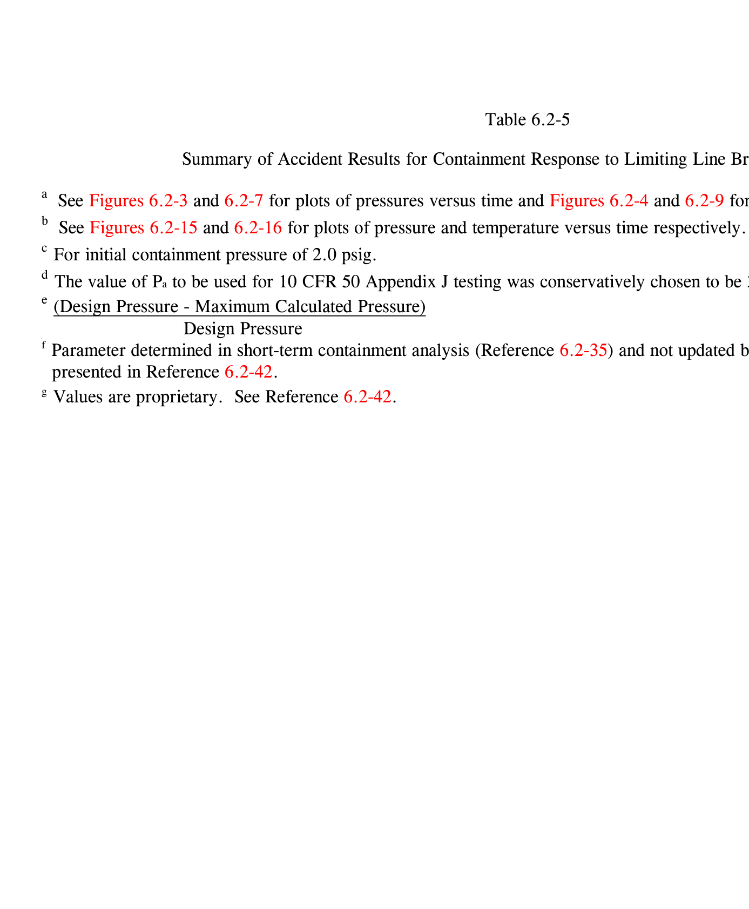

*figure on PDF page 108*

<!-- labels/text on this figure page -->
COLUMBIA GENERATING STATION
Amendment 67
FINAL SAFETY ANALYSIS REPORT
December 2023
f Parameter determined in short-term containment analysis (Reference 6.2-35) and not updated based on the long term analysis a See Figures 6.2-3 and 6.2-7 for plots of pressures versus time and Figures 6.2-4 and 6.2-9 for plots of temperature versus time.
Summary of Accident Results for Containment Response to Limiting Line Breaks (Continued)
d The value of Pa to be used for 10 CFR 50 Appendix J testing was conservatively chosen to be 38 psig.
b See Figures 6.2-15 and 6.2-16 for plots of pressure and temperature versus time respectively.
Table 6.2-5
e (Design Pressure - Maximum Calculated Pressure)
g Values are proprietary. See Reference 6.2-42.
c For initial containment pressure of 2.0 psig.
Design Pressure presented in Reference 6.2-42.
6.2-76a

<!-- p.109 -->
Peak Pressure Secondary
(psig)
14.3 18.3 13.5 7.3

Peak Pool Temp (F)
204.5 180 220 220

21,200/6250 7067/6250 LPCI and
(gal/min)
14,134/0 14,134/0 14,134/0 LPCS 7067/0 7067/0 7067/0

Primary Containment Response Summary
(gal/min)
Loss-of-Coolant Accident Long-Term HPCS 6250 6250 6250 6250 6250 6250 6250 6250

Containment
(gal/min)
Table 6.2-6 0 14,134 0 7067 0 0 0 0 Spray

Service Pumps Water 3 3 2 2 2 2 2 2

LPCI and Pumps LPCS 3/1 3/1 2/0 1/0 2/0 1/0 2/0 1/0

Before 600 seconds After 600 seconds Before 600 seconds After 600 seconds Before 600 seconds After 600 seconds Before 600 seconds After 600 seconds Original rated power Original rated power Original rated power Uprated power Case 3462 MWt 3462 MWt 3702 MWt 3462 MWt

A C C B

<!-- p.110 -->
Peak Pressure Secondary
(psig)
15.9

Peak Pool Temp (F)
203.8

LPCI and (gal/min) 13,426/0 6713/0 LPCS

Primary Containment Response (Continued)
(gal/min)
Loss-of-Coolant Accident Long-Term HPCS 6250 6250

Containment
(gal/min)
Table 6.2-6 0 0 Spray

Service Pumps Water 2 2

LPCI and Pumps LPCS 2/0 1/0

Before 600 seconds After 600 seconds Reduced ECCS Flow Case 3556 MWt

C

6.2-77a

<!-- p.111 -->
Table 6.2-7

Energy Balance for Design Basis Recirculation Line Break Accident

Time of Peak Pressure Prior to DBA Difference Across End of Time of Peak a
(0 sec) Drywell Deck Blowdown Unit Containment Pressure

1) Reactor coolant 414.0 x 106 400 x 106 12.2 x 106 49.4 x 106/44.8 x 106 Btu
(vessel & pipe inventory)

2) Fuel and cladding

34.5 x 106 32.3 x 106 12.3 x 106 4.42 x 106/4.0 x 106 Btu Fuel

Cladding 3.05 x 106 3.05 x 106 2.99 x 106 1.07 x 106/0.972 x 106 Btu

3) Core internals, also 91.2 x 106 91.2 x 106 91.2 x 106 34.0 x 106/57.4 x 106 Btu reactor coolant piping, pumps, and valves

4) Reactor vessel 107 x 106 107 x 106 107 x 106 40 x 106/66.6 x 106 Btu metal

5) Reactor coolant Included in item 3 piping, pumps, and valves

6) Blowdown enthalpy NA 551 NA NA Btu/lbm

0.463 x 106 8.8 x 106 1020 x 106/222 x 106 Btu 7) Decay heat 0

0.01 x 106 0.471 x 106/0.471 x 106 Btu 8) Metal-water 0 0 reaction heat

9) Drywell structures 0 0 0 0

10) Drywell air 1.3 x 106 1.6 x 106 0 1.61 x 106/1.41 x 106

11) Drywell steam 0.759 x 106 7.75 x 106 24.8 x 106 8.43 x 106/6.06 x 106

12) Containment air 0.951 x 106 0.951 x 106 2.35 x 106 1.13 x 106/1.24 x 106

13) Containment steam 0.365 x 106 0.365 x 106 1.18 x 106 6.04 x 106/2.9 x 106

14) Suppression pool 639 x 106 629 x 106 1040 x 106 1450 x 106/1200 x 106 water

15) Heat transferred by 0 0 0 818 x 106/289 x 106 heat exchangers

a Values given are for minimum ECCS available and for all ECCS available. The information presented in this table is based on the original design basis conditions and represents the general characteristics of the recirculation line break analysis results.

<!-- p.112 -->
Table 6.2-8

Accident Chronology Design Basis Recirculation Line Break Accident

Minimum ECCS Time (sec)
Original Rated Uprated Power Power

1. Vents cleared 0.776 0.709

2. Drywell reaches peak pressure 19.08 11.9

3. Maximum positive differential pressure occurs 0.749 0.600

4. ECCS initiation sequence completed 30 30

5. End of blowdown 53.24 131

6. Vessel reflooded 160 153

7. Introduction of RHR heat exchanger 600 600

8. Containment reaches peak secondary pressure 29,463 25,382

<!-- p.113 -->
Table 6.2-9a

Reactor Blowdown Data for Recirculation Line Break

Original Rated Power

Time Steam Flow Liquid Flow Steam Enthalpy Liquid Enthalpy
(sec) (lb/sec) (lb/sec)
(Btu/lb)
(Btu/lb)

0 0 25,690
---- 550.73

10.33 0 26,020
---- 555.9

19.08 0 25,570
---- 548.79

19.12 3679 13,320 1190 550

25.33 3213 8,493 1200.6 502

32.02 2420 4,974 1205.4 446.68

39.05 1494 2,423 1203.13 396.1

45.02 729.2 2,003 1193.79 325.16

53.37 0 0
----
----

<!-- p.114 -->
Table 6.2-9b

Reactor Blowdown Data for Recirculation Line Break

Uprated Power

Pressure (psia)a Time (sec) Liquid Flow (lbm) Steam Flow (lbm)

1.01 1018
3.246E+04 0

5.04 1027
2.625E+04 0

10.23 1039
2.485E+04 31.07

15.04 919
1.161E+04 3112

20.04 774.3
1.180E+04 2404

25.04 641.1
1.076E+04 1985

30.04 533.1 8.849E+03 1759

34.42 433.9 7.179E+03 1559

49.76 205.4
1.162E+04 0

62.26 147.0 9708 0

71.63 122.0 8858 0

81.01 105.6 8306 0

90.38 88.42 7560 0

102.88 71.76 6752 0

112.26 62.71 6369 0

121.63 50.97 5976 0

131.01 42.81 741.6 0

a Containment codes assume saturated conditions in vessel.

<!-- p.115 -->
Table 6.2-10

Reactor Blowdown Data for Main Steam Line Break

Time Steam Flow Liquid Flow Steam Enthalpy Liquid Enthalpy
(sec) (lb/sec) (lb/sec)
(Btu/lb)
(Btu/lb)

0 8646 0 1190.16
----

4.3 1308 27,480 1190.45 549.66

10.43 2084 24,220 1192.72 540.93

20.43 2843 15,730 1201.0 499.0

30.12 2380 7386 1205.6 432.78

40.21 1110 2734 1197.45 344.32

54.65 0 0
----
----

<!-- p.116 -->
Table 6.2-11

Core Decay Heat Following Loss-of-Coolant Accident for Containment Analyses

Uprated Power Original Rated Power Normalized Core Heata Normalized Core Heatb Time (sec)

0.0
1.0
1.0029

0.9 0.9330 0.7053

2.1 0.7662 0.5468

5.0 0.5005 0.5533

6.93 0.3850 0.4975

9.03 0.2955 0.4119

15.93 0.1491 0.2182

30.0 0.0471 0.07730

102 0.0381 0.03436

103 0.0223 0.01956

104 0.0119 0.01012

105 0.00668 0.00546

106 0.00267

3 x 106 0.00190

a A normalized power level of 3462 MWt was used for analyses of original rated power and includes fuel relaxation energy.
b A normalized power level of 3702 MWt was used for analyses at uprated power. Uprated power case includes metal water reaction and fuel relaxation energy. The measurement uncertainty recapture project did not change the results obtained from the Uprated Power Normalized Core Heat.

<!-- p.117 -->
Table 6.2-12

Secondary Containment Design and Performance Data

I. Secondary Containment Design

A. Free volume:

3.5 x 106 ft3; the entire secondary containment is considered as one volume.

B. Pressure

1. Normal operation:

Vacuum greater than or equal to 0.25 in. of vacuum water gauge as indicated at the reactor building el. 572 ft

2. Postaccident:

Vacuum greater than or equal to 0.25 in. of vacuum water gauge on all building surfaces

C. Infiltration rate during postaccident period:

100% of free volume in a 24-hr period.

D. Exhaust fans (SGT system):

Two independent and redundant filter trains each with two full capacity exhaust fans (see Section 6.5.1)

E. The secondary containment model after a design basis LOCA is discussed in Section 6.2.3.3.1.

<!-- p.118 -->
Table 6.2-14

Containment Penetrations Subject to Type B Tests

Penetration Number Type Service Comments

I. Electrical Penetrations X-100 A, B, C, and D Neutron monitoring Electrical penetrations are X-101 A, B, C, and D Control rod position indicator provided with double seals X-102 A and B Thermocouple and RTD and are separately testable.
X-103 A, B, C, and D Medium voltage power The test taps and seals are X-104 A, B, C, and D Low voltage power located such that tests of X-105 A, B, C, and D Control and indication the primary can be X-106 C and D neutron monitoring conducted without entry X-107 A and B Low voltage power control into or pressurization of and indication containment

II. Personnel And Equipment Access Penetrations X-15 Equipment hatch Separately testable without pressurization of the primary containment.
X-16 Personnel access lock X-28 CRD removal hatch X-51 Suppression chamber access hatch X-1A through 1H Inspection ports X27-A through 27F TIP drive flanges N/A Drywell head X-23

#### EDR-V-18
Inboard flange X-24

#### FDR-V-15
Inboard flange

Inboard & outboard X-77Aa

#### RRC-V-19
flanges

#### RRC-V-20
Inboard flange X-77Ac

#### PSR-V-X77A/1
Inboard & outboard flanges

#### PSR-V-X77A/2
Inboard flange X-77Ad

#### PSR-V-X77A/3
Inboard & outboard flanges

#### PSR-V-X77A/4
Inboard flange

<!-- p.119 -->
Table 6.2-14

Containment Penetrations Subject to Type B Tests
(continued)

Penetration Number Type Service Comments

II. Personnel And Equipment Access Penetrations (continued)
X-3

#### CEP-V-2A
Inboard flange

X-53

#### CSP-V-2
Inboard flange X-66

#### CSP-V-4
Inboard flanges

#### CSP-V-5
X-67

#### CSP-V-4A
Inboard flanges

#### CSP-V-6
- X-119

#### CSP-V-9
Inboard flange

6.2-85a

<!-- p.120 -->
56, 52 44, 54 44, 54 Notes 4, 48a 4, 48a 54 53 27 56 56 56 56 56 56 56 56 52 56

#### SBO (62)
5 5 5 5 5 5 5 4 4 5 5 2 5 2 5 2 5 2 5 5 5 5

Bypass Leak Yes Yes Yes Yes Pot No No No No No No No No No No No No No No No No No No

Term Zone (13)

#### SB RB RB RB RB RB RB RB RB RB RB RB RB RB RB RB RB RB RB -- -- --
Leak Bar (13) Cap Vlv Vlv Vlv Vlv Cap Cap Vlv Vlv Vlv Vlv Vlv Vlv Vlv Vlv Vlv Vlv Vlv Vlv Vlv
-- --

Proc Fld
-- -- A -- -- -- -- W W A A A A A A A A A A A A A

to ESF Leads No No No No No No No No No Yes No No No No No No -- -- -- -- -- --

Dist to Pent
-- -- -- -- -- -- -- -- -- 5 -- 12 12 8 8 12 12 10 10 10 15

Close (7,11) Time No No -- -- -- -- -- -- -- -- -- -- -- 4 4 4 4 4 4 4 4

1/1.5 1/1.5 .75/1 .75/1 Valve Size (14)
.75 .75 .75 .75 30 30 24 24 .5
-- -- 2 1 1 2 2 2 2

Fail Pos As is As is
(6) -- -- -- -- -- -- -- -- -- -- -- C C C C C C C C --

Primary Containment Isolation Valves LOCA Post LC

#### LC LC -- -- O O O O C C C C C C C C C C O C O
SD Pos O/C

#### LC LC -- -- O O O O C C C C C C C C C C O C O
Pos (10)
Norm O C O Table 6.2-16 -- -- -- C C C C C C C C C C

#### O O O O LC LC
Back Up

#### RM RM RM RM RM RM RM RM RM RM
--
-- -- -- -- -- -- -- -- -- --

#### F,A,Z F,A,Z F,A,Z F,A,Z F,A,Z F,A,Z F,A,Z F,A,Z
Iso sig
(9) -- -- -- -- -- -- -- -- 41 -- 42

Close (5)
Process Pwr to Spring Spring Spring Spring Spring Spring Spring Spring Manual Manual Manual Manual

#### EF EF
ac ac -- -- -- -- --

Open (5)
Process Pwr to Spring Spring Manual Manual Manual Manual Air Air Air Air Air Air Air Air -- -- -- -- -- ac ac

Loc -- -- O O O O O O O O O O O O O O O O

#### I I I
I

MO globe MO globe EF check EF check AO butfy AO globe AO butfy AO globe AO butfy AO globe AO butfy AO globe Pipe cap Pipe cap Pipe cap Valve Type Check -- -- Globe Globe Globe Globe

CAS-VX-82e Valve EPN

#### CIA-V-30A CEP-V-1A
#### CAS-V-730
#### CEP-V-1B CEP-V-2A CEP-V-2B CEP-V-3A CEP-V-3B CEP-V-4A CEP-V-4B CIA-V-20 CIA-V-21
-- -- -- -- -- -- -- -- --

Code Gp
(12)

#### B B B B B A A B B B B B B B B B B B B B B B
#### GDC 55 55 56 56 56 55 55 56 56 56 56 56 56 56 56 56 56 56 56 56 56 56

6.2-59 6.2-59 6.2-41 6.2-53 6.2-45 6.2-45 6.2-45 6.2-45 6.2-45 6.2-45 6.2-45 6.2-45 6.2-38 6.2-38 6.2-38 Figure 6.2-55 4.6-5 4.6-5
-- -- -- --

Pent 89B 82e 82e 10 93 95 94 67 67 67 67 56 56 9 -- -- -- -- 3 3 3 3

Air line WW-DW vac Air line WW-DW vac All inst lines from pri All inst lines from pri CRD 185 insert lines CRD 185 withdrawal RB to WW vac bkrs RB to WW vac bkrs CIA for SRV accum CIA for SRV accum CIA line A for ADS Deacon soltn return Deacon soltn supply All inst lines from All inst lines from Line Description WW vent ex WW vent ex maintenance DW vent ex DW vent ex DW vent ex DW vent ex Air line for header header accum RPV RPV RVs RVs cont cont lines

<!-- p.121 -->
48a, 56 48a, 56 56, 52 26, 56 56, 52 56, 52 56, 52 26, 56 26, 56 52, 56 52, 56 52, 56 52, 56 Notes 56 56 56 56 56 56 56 56

#### SBO (62)
5 5 5 2 3 2 2 2 C C 3 3 C 5 5 5 5 5 5 2 2 2 2 P P

Bypass Leak Yes Yes Yes Yes Yes Yes Yes Yes Pot No No No No No No No No No No No No No Yes Yes Yes Yes

Term Zone (13) RB RB RB RB RB RB RB RB RB RB RB RB RB RW RW RB RB

#### SB SB RB RB RB RB RB RB
Leak Bar (13) Vlv Vlv Vlv Vlv Vlv Vlv Vlv Vlv Vlv Vlv Vlv Vlv Vlv Vlv Vlv Vlv Vlv Vlv Vlv Vlv Vlv Vlv Vlv Vlv Vlv

Proc Fld

#### A A A A A A A A A A A A A A A A A W W W W W W W W
to ESF Leads No No No No Yes No No No Yes Yes Yes Yes Yes No No No No No No No No No No No No

Dist to Pent 15 -- -- 4 4 1 17 14 7 9 10 16 1 4 3 5 6 5 -- 2 4 2 3 41 2

Close (7,11) Time Std Std Std Std 35 35 -- -- 4 -- 4 4 4 -- -- 4 4 4 4 -- -- No No No No

Valve Size (14)
.5 .5 .5 30 24 30 24 24 24 24 24 24 24 1 1 1 1 2 2 3 3 3 3 6 6 Primary Containment Isolation Valves (Continued)
Fail Pos As is As is As is
(6) -- -- C -- C C C O O -- -- O C C C C -- -- C C C C

LOCA Post

#### LC LC O C C C C C C C C C C C C C C C C C C C C C C
SD Pos

#### LC LC O C C C C C C C C C C C C C C C C O O O O C C
Pos (10)
Norm

#### LC LC O O O O
O C C C

#### C C C C C C C C C C C C C
C C Table 6.2-16 Back Up RM RM RM RM RM RM RM RM RM RM RM RM RM RM RM RM RM RM RM RM RM
-- --
-- --

#### F,A,Z F,A,Z F,A,Z F,A,Z
#### F,A,Z F,A,Z F,A,Z F,A,Z
Iso sig

#### F,A F,A F,A F,A F,A F,A (9) 42
-- -- -- 40 40 -- -- 40
-- --

Close (5) Process Process Process Process Process Manual Manual Pwr to Spring Spring Spring Spring Spring Spring Spring Spring Spring Spring Spring Spring Air Air Air ac ac ac

Open (5) Process Process Process Process Process Manual Manual Pwr to Spring Spring Spring □ Air Air Air Air Air Air Air Air ac ac ac ac ac ac ac

Loc

#### O O O O O O O O O O O O O O O O O O O O O I I I I
MO globe AO butfy PC check AO butfy AO butfy AO butfy AO butfy AO butfy PC check PC check AO butfy SO globe SO globe SO globe SO globe AO butfy AO butfy MO gate MO gate AO gate AO gate Valve Type Check Check Gate Gate

Valve EPN CIA-V-30B CIA-V-31A CIA-V-31B

#### FPC-V-149 FPC-V-153 DW-V-156 DW-V-157 EDR-V-19 EDR-V-20
#### CSP-V-93 CSP-V-96 CSP-V-97 CSP-V-98
#### CSP-V-10
#### FDR-V-3 FDR-V-4
#### CSP-V-1 CSP-V-2 CSP-V-3 CSP-V-4 CSP-V-5 CSP-V-6 CSP-V-7 CSP-V-8 CSP-V-9
Code Gp
(12)

#### B B B B B B B B B B B B B B B B B B B B B B B B B
#### GDC 56 56 56 56 56 56 56 56 56 56 56 56 56 56 56 56 56 56 56 56 56 56 56 56 56

Figure 6.2-38 6.2-38 6.2-38 6.2-37 6.2-52 6.2-37 6.2-37 6.2-37 6.2-52 6.2-45 6.2-52 6.2-52 6.2-45 6.2-52 6.2-52 6.2-37 6.2-37 6.2-37 6.2-37 6.2-47 6.2-47 6.2-46 6.2-46 6.2-46 6.2-46 6.2-50 6.2-44

Pent 89B 119 101 100 119 91 91 53 53 66 66 66 67 66 67 66 53 53 66 92 92 23 23 24 24

SP pool cleanup return CIA line B for ADS CIA line A for ADS CIA line B for ADS RB to WW vac bkrs RB to WW vac bkrs RB to WW vac bkrs RB to WW vac bkrs RB to WW vac bkrs RB to WW vac bkrs RB to WW vac bkrs RB to WW vac bkrs Drywell equip drain Drywell equip drain Drywell floor drain Drywell floor drain Line Description WW vent supply WW vent supply DW vent supply DW vent supply DW vent supply DW vent supply DW service line DW service line SP pool cleanup and vent supply and vent supply suction accum accum accum

<!-- p.122 -->
56,48b, 19, 18, 19, 18, 56, 18, 56, 18, 3, 48b, 56, 66, 19, 18, 19, 18, 18, 56, 3, 48b, 52, 56, 48b, 18 48a, 56 56, 48a 56, 18 56, 18 58, 66 18, 58 18, 58 16, 17 16, 17 Notes 48a, 48a 48a 48a 48a 48a, 56, 66 66 18 18 15

#### SBO (62)
#### M 5 5 H C 3 5 5 5 5 L C 3 5 5 2 2
#### M M H H
N N

Bypass Leak Yes Yes Yes Pot No No No No No No No No No No No No No No No No No No Yes Yes

Term Zone RBx RBx (13) RB RB RB RB RB RB RB RB RB RB RB RB RB RB RB RB RB RB RB RB TB

Leak Bar (13) Vlv Vlv Vlv Vlv Vlv Vlv Vlv Vlv Vlv Vlv Vlv Vlv Vlv Vlv Vlv Vlv Vlv Vlv Vlv Vlv Vlv Vlv Vlv

Proc Fld

#### A,S A,S W W W W W W W W W
#### A A W W W W W W W A A S
to ESF Leads No No Yes Yes Yes Yes Yes Yes Yes No No Yes Yes Yes Yes Yes Yes Yes No No No No No

Dist to Pent 7 3 65 70 53 3 6 9 -- 7 7 87 50 25 2 4 22 -- 7 7 -- 33 68

Close (7,11) Time No No Std 27 25 -- -- -- -- -- -- -- -- -- -- -- -- 35 35 20 18 Std 17

Valve Size (14)
16 16 18 12 12 12 24 12 12 12 1 1 3 1 1 3 2 1 6 6 1 2 4 Primary Containment Isolation Valves (Continued)
Fail Pos As is As is As is As is As is As is As is As is As is As is As is
(6) -- --
-- -- -- C C
-- -- -- -- --

LOCA

#### O/C O/C O/C O/C O/C O/C O/C O/C LC LC LC LC
Post

#### C C C
#### C C C C C
#### C C C
SD Pos

#### LC LC C C C C C C C C C C C C O C C C C C C
#### LC LC
Pos (10)
Norm C C LC LC C O C LC LC Table 6.2-16 C C C C C C C C C C C C C C Manual Manual Manual Manual Back Up RM RM RM RM RM RM

#### RM RM RM
-- -- -- -- --
-- -- --
-- --

Iso sig

#### V,G, F,A F,A F,A F,V D,P
(9) -- -- 38 46 46 -- -- 38 -- -- 46 46 -- -- -- -- --

Close (5)
Process Manual Manual Process Manual Manual Pwr to Spring Spring Spring Spring Spring Spring ac ac ac ac ac ac ac ac ac ac ac

Open (5)
Process Manual Manual Process Manual Manual Pwr to Air Air ac ac pp pp ac ac ac ac ac pp pp ac ac ac ac

Loc O O O O O O O O O O O O O O O O O O O O I I I

MO globe MO globe MO globe AO butfy AO butfy MO gate MO gate MO gate MO gate MO gate MO gate MO gate MO gate Valve Type Check Globe Globe Relief Relief Check Globe Globe Relief Relief

#### LPCS-FCV-11
#### HPCS-RV-14 HPCS-RV-35
#### LPCS-RV-18 LPCS-RV-31
Valve EPN FPC-V-154 FPC-V-156 HPCS-V-12 HPCS-V-15 HPCS-V-23 HPCS-V-65 HPCS-V-68

#### LPCS-V-12 LPCS-V-66 LPCS-V-67 HPCS-V-4 HPCS-V-5
#### LPCS-V-1 LPCS-V-5 LPCS-V-6
#### HCV-V-1 HCV-V-2 MS-V-16
Code Gp
(12)

#### B B B B B B B A A B B B B B B B A A B B A B B
#### GDC 56 56 56 56 56 56 56 55 55 56 56 56 56 56 56 56 55 55 56 56 55 56 56

Figure 6.2-44 6.2-50 6.2-41 6.2-41 6.2-41 6.2-49 6.2-41 6.2-47 6.2-47 6.2-53 6.2-53 6.2-41 6.2-41 6.2-41 6.2-49 6.2-41 6.2-47 6.2-47 6.2-53 6.2-53 6.2-41 60A 60A 6.2- 6.2-

Pent 100 101 78d 78d 78e 78e 63 63 63 34 63 22 58 58 49 49 49 31 49 6 6 8 8

Air line for LPCS-V-6 Air line for LPCS-V-6 SP pool cleanup return HPCS suction from SP Air line for HPCS-V-5 Air line for HPCS-V-5 MS lines drain inboard Hardened Containment Hardened Containment LPCS discharge RV LPCS pump suction HPCS suction relief LPCS suction RV Line Description SP pool cleanup HPCS discharge HPCS min flow LPCS min flow HPCS test line LPCS test line LPCS to RPV LPCS to RPV HPCS to RPV HPCS to RPV suction Vent Vent

<!-- p.123 -->
52, 56, 15, 56, 15, 56, 15, 56, 15, 56, Notes 1, 15, 56, 63 1, 15, 56, 63 1, 15, 56, 63 1, 15, 56, 63 1, 15, 56, 63 1, 15, 56, 63 1, 15, 56, 63 1, 15, 56, 63 15 63 63 63 63 63 63 63 63

#### SBO (62)
#### N 2 2 2 2 2 2 2 2 5 5 5 5 5 5 5 5 5
Bypass Leak Yes Yes Yes Yes Yes Pot Yes Yes Yes Yes Yes Yes Yes Yes Yes Yes Yes Yes No

Term Zone (13)

#### TB TB TB TB TB TB TB TB TB TB TB TB TB RB RB RB RB RB
Leak Bar (13) Vlv Vlv Vlv Vlv Vlv Vlv Vlv Vlv Vlv Vlv Vlv Vlv Vlv Vlv Vlv Vlv Vlv Cap

Proc Fld

#### S S S S S S S S S S S S S S S S S W
to ESF Leads No No No No No No No No No No No No No No No No No No

Dist to Pent 6 -- -- -- -- 4 4 4 4 5 5 5 5 10 10 10 10 --

Close (7,11) Time 25 3-5 3-5 3-5 3-5 3-5 3-5 3-5 3-5 15 15 15 15 -- -- -- -- --

Valve Size (14)
1.5 1.5 1.5 1.5 1.5 1.5 1.5 1.5 .75 26 26 26 26 26 26 26 26 3 Primary Containment Isolation Valves (Continued)
Fail Pos As is As is As is As is As is
(6) C C C C C C C C
-- -- -- -- --

LOCA Post

#### LC C C C C C C C C C C C C C C C C C
SD Pos

#### O/C O/C O/C O/C O/C O/C O/C O/C
#### LC C C C C C C C C C
Pos (10)
Norm LC

#### O O O O
C

#### O O O O C C C C C C C C
Table 6.2-16 Back Up RM RM RM RM RM RM RM RM RM RM RM RM RM
-- -- -- -- --

Iso sig V,G, V,G, V,G, V,G, V,G, V,G, V,G, V,G, V,G, V,G, V,G, V,G, V,G,

#### D,P D,P D,P D,P D,P D,P D,P D,P D,P D,P D,P D,P D,P (9)
-- -- -- -- --

Close (5)
Manual Manual Manual Manual Manual Pwr to Air/sp Air/sp Air/sp Air/sp Air/sp Air/sp Air/sp Air/sp dc ac ac ac ac

Open (5)
Manual Manual Manual Manual Manual Pwr to Air Air Air Air Air Air Air Air dc ac ac ac ac

Loc O

#### O O O O O O O O O O O O O I I I I
AO globe AO globe AO globe AO globe AO globe AO globe AO globe AO globe MO gate MO gate MO gate MO gate MO gate Valve Type Globe Gate Gate Gate Gate

#### MSLC-V-3A MSLC-V-3C MSLC-V-3D MWR-V-124 MSLC-V-3B
Valve EPN MS-V-22A MS-V-22B MS-V-22C MS-V-22D MS-V-28A MS-V-28B MS-V-28C MS-V-28D MS-V-67A MS-V-67B MS-V-67C MS-V-67D

#### MS-V-19
Code Gp
(12) A A A A A

#### A A A A A A A A A A A A B
#### GDC 55 55 55 55 55 55 55 55 55 55 55 55 55 55 55 55 55 56

Figure 6.2-41 6.2-45 6.2-45 6.2-45 6.2-45 6.2-45 6.2-45 6.2-45 6.2-45 6.2-45 6.2-45 6.2-45 6.2-45 6.2-45 6.2-45 6.2-45 6.2-45 6.2-59

Pent 18A 18B 18C 18D 18A 18B 18C 18D 18A 18B 18C 18D 18A 18B 18C 18D 22 94

MS line A outboard MS line C outboard MS line D outboard MS line B outboard Decon soltn supply MS line A inboard MS line B inboard MS line C inboard MS line D inboard Line Description MS line A drain MS line B drain MS line C drain MS line D drain MS line A loop MS line B loop MS line C loop MS line D loop MS lines drain outboard isolation isolation isolation isolation isolation isolation isolation isolation header

#### MSIV MSIV MSIV MSIV MSIV MSIV MSIV MSIV
<!-- p.124 -->
Notes 53 53 53 53 56 56 56

#### SBO (62)
5 5 5 5 5 5 5 5 5 5 5 5 5 5 5 5 5 5 5 5 5 5

Bypass Leak Pot No No No No No No No No No No No No No No No No No No No No No No

Term Zone (13)

#### RB RB RB RB RB RB RB RB RB
#### RB RB RB RB RB RB
Leak Bar (13) Cap Vlv Vlv Vlv Vlv Vlv Vlv Vlv Vlv Vlv Vlv Vlv Vlv Vlv Vlv Vlv Vlv Vlv Vlv Vlv Vlv Vlv

A, S Fld

#### A, S A, S A, S
Proc

#### W A A
#### A A A A A A A A
to ESF Leads Yes No No No No No No No No No No No Yes Yes Yes

Dist to Pent
-- 7 7 7 7 7 -- -- --
-- -- -- -- -- --

Close (7,11) Time
-- -- -- -- -- -- 5 5 5
-- -- -- -- -- --

Valve Size (14)
.75 1 1 1 1 1 1 1 1 1 1 1 1 1 1 1 1 1 1 1 1 1 Primary Containment Isolation Valves (Continued)
Fail Pos
(6) -- -- -- -- -- -- -- -- -- -- -- -- -- -- -- -- -- -- -- C C C

LOCA Post LC

#### LC LC LC LC LC C C O O O O O O O O O O O C C C
SD Pos

#### LC LC LC LC LC O O O O O O O O O O O O O O O O
LC

Pos (10)
Norm

#### LC LC LC LC LC
LC

#### O O O O O O O O O O O O O
#### O O O
Table 6.2-16 Back Up

#### RM RM RM
-- -- -- -- -- -- -- -- -- -- -- -- -- -- -- -- -- -- --

Iso sig

#### F,A F,A F,A (9)
-- -- -- -- -- -- -- -- -- -- -- -- -- -- -- -- -- -- --

Close (5) Manual Process Process Manual Manual Manual Manual Manual Manual Manual Manual Manual Manual Manual Manual Manual Manual Pwr to Spring Spring Spring

#### EF EF
Open (5)
Pwr to Manual Process Process Spring Spring Manual Manual Manual Manual Manual Manual Manual Manual Manual Manual Manual Manual Manual Manual ac ac ac

Loc

#### O O O O O O O O O O O O O O O O O O O O I I
EF check EF check SO globe SO globe SO globe Valve Type Globe Check Check Globe Globe Globe Globe Globe Globe Globe Globe Globe Globe Globe Globe Globe Globe

#### PI-EFC-X42C PI-EFC-X78A
#### MWR-V-125 PI-V-X73E/1
Valve EPN PI-V-X72f/l PI-V-X42C PI-V-X72C PI-V-X72D PI-V-X73C PI-V-X73D PI-V-X78A PI-V-X82C PI-V-X72E PI-V-X84B PI-VX-216 PI-VX-218 PI-VX-219 PI-VX-220 PI-VX-221 PI-VX-250 PI-VX-251 PI-VX-253

Code Gp
(12)

#### B B B B B B B B B B B B B B B B B B B B B B
#### GDC 56 56 56 56 56 56 56 56 56 56 56 56 56 56 56 56 56 56 56 56 56 56

Figure 6.2-59 6.2-54 6.2-54 6.2-53 6.2-53 6.2-53 6.2-53 6.2-53 6.2-54 6.2-54 6.2-54 9.4-8 9.4-8 9.4-8 9.4-8 9.4-8 9.4-8 9.4-8 9.4-8 9.4-8 9.4-8 9.4-8

85a/c 85a/c 54Bf Pent 73e 42c 78a 42c 72c 72d 72e 73c 73d 78a 82c 84b 42d 69c 72f 61f 62f 72f 95

Inst lines - H2 fm cont Inst lines - H2 fm cont Inst lines - H2 fm cont Inst lines - H2 fm cont Inst lines - H2 fm cont Inst lines - H2 fm cont Inst lines - H2 fm cont Inst lines - H2 to cont Inst lines - H2 to cont Inst lines - H2 to cont Inst lines - H2 to cont Decon soltn return Line Description Rad mon supply Rad mon supply Rad mon return Rad mon return Rad mon return

#### RHR-V-50A RHR-V-41A RHR-V-41C RHR-V-41B RHR-V-50B
Air line for Air line for Air line for Air line for Air line for
(S-SR-20) (S-SS-21)
(S-SR-20) (S-SR-20) (S-SR-20)
header

<!-- p.125 -->
50, 56, 50, 56, 50, 56, 50, 56, 50, 56, 50, 56, Notes 48a 48a 48a 48a 52 52 56 56 56 53 53 53 53 53 53 53

#### SBO (62)
5 5 5 5 5 5 5 5 5 5 5 5 5 5 5 5 5 5 5 5 5

Bypass Leak Pot No No No No No No No No No No No No No No No Yes Yes Yes Yes Yes Yes

Term Zone (13)

#### RB RB RB RB RB RB RB RB RB RB RB RB RB RB RB RW RW RW RW RW RW
Leak Bar (13) Vlv Vlv Vlv Vlv Vlv Vlv Vlv Vlv Vlv Vlv Vlv Vlv Vlv Vlv Vlv Vlv Vlv Vlv Vlv Vlv Vlv

A, S A, S A, S A, S A, S A, S A, S Fld Proc

#### A A A A A A A W W W W
#### A A A
to ESF Leads No No No Yes Yes Yes Yes Yes Yes Yes No No No No No No No No No No No

Dist to Pent
-- -- -- -- -- -- -- -- -- -- 7 7 7 7 7 -- -- -- -- -- --

Close (7,11) Time

#### NA NA NA NA NA NA NA
No No No No No No 5 5 5 -- -- -- -- --

Valve Size (14)
1 1 1 1 1 1 1 1 1 1 1 1 1 1 1 1 1 1 1 1 1 Primary Containment Isolation Valves (Continued)
Fail Pos
(6) C C C C C C C C C C -- -- -- -- -- C C C C C C

LOCA Post

#### LC LC LC LC LC C C C O O O O O O O O O O O O O
SD Pos

#### LC LC LC LC LC O O O O O O O O O O C C C C C C
Pos (10)
Norm

#### LC LC LC LC LC
#### O O O O O O O O O O
#### C C C C C C
Table 6.2-16 Back Up RM RM RM RM RM RM RM RM RM RM

#### RM RM RM RM RM RM
-- -- -- -- --

Iso sig

#### F,A F,A F,A (9)
-- -- -- -- -- -- -- -- -- -- -- -- -- -- -- -- -- --

Close (5)
Manual Manual Manual Manual Manual Pwr to Spring Spring Spring Spring Spring Spring Spring Spring Spring Spring Spring Spring Spring Spring Spring Spring

Open (5)
Manual Manual Manual Manual Manual Pwr to ac ac ac ac ac ac ac ac ac ac ac ac ac ac ac ac

Loc

#### O O O O O O O O O O O O O O O O O O I I I
SO globe SO globe SO globe SO globe SO globe SO globe SO globe SO globe SO globe SO globe SO globe SO globe SO globe SO globe SO globe SO globe Valve Type Globe Globe Globe Globe Globe

#### PSR-V-X77A1 PSR-V-X77A2 PSR-V-X77A3 PSR-V-X77A4 PSR-V-X73-1 PSR-V-X73-2
PI-VX-54Bf Valve EPN PI-VX-256 PI-VX-257 PI-VX-259 PI-VX-262 PI-VX-263 PI-VX-264 PI-VX-265 PI-VX-266 PI-VX-268 PI-VX-269 PI-VX-42d PI-VX-61f PI-VX-62f PI-VX-69c

Code Gp
(12)

#### B B B B B B B B B B B B B B B B B A A A A
#### GDC 56 56 56 56 56 56 56 56 56 56 56 56 56 56 56 56 56 55 55 55 55

Figure 6.2-54 6.2-54 6.2-54 6.2-53 6.2-53 6.2-53 6.2-53 6.2-53 6.2-57 6.2-57 6.2-57 6.2-57 6.2-57 6.2-57 9.4-8 9.4-8 9.4-8 9.4-8 9.4-8 9.4-8 9.4-8

29a/c 29a/c 77Ac 77Ac 77Ad 77Ad Pent 54Bf 73e 72c 72d 72e 82c 73c 73d 84b 42d 69c 61f 62f 73f 73f

Inst lines - H2 fm cont Inst lines - H2 fm cont Inst lines - H2 fm cont Inst lines - H2 fm cont Inst lines - H2 fm cont Inst lines - H2 fm cont Inst lines - H2 fm cont PASS jet pump #10 PASS jet pump #10 PASS jet pump #20 PASS jet pump #20 Line Description Rad mon return Rad mon return Rad mon return PASS DW atm PASS DW atm

#### RHR-V-50A RHR-V-41A RHR-V-41C RHR-V-41B RHR-V-50B
Air line for Air line for Air line for Air line for Air line for
(S-SR-21) (S-SR-21) (S-SR-21)

<!-- p.126 -->
50, 48a 64, 48a 50, 56, 50, 56, 50, 56, 50, 56, 50, 56, 50, 56, 50, 56, 50, 56, 50, 56, 50, 56, 50, 56, 22, 56, 18, 66 Notes 48b, 48a 48a, 56 56 56 56, 52 52 56 52 52 52 52 52 52 64 56 18

#### SBO (62)
5 5 5 5 5 5 5 5 5 5 5 5 4 4 4 3 4 C 5 5

Bypass Leak Pot Yes Yes Yes Yes Yes Yes Yes Yes Yes Yes Yes Yes Yes No No No Yes No No No

Term Zone (13) RW RW RW RW RW RW RW RW RW RW RW RW

#### RB RB RB RB RB RB RB RB
Leak Bar (13) Vlv Vlv Vlv Vlv Vlv Vlv Vlv Vlv Vlv Vlv Vlv Vlv Vlv Vlv Vlv Vlv Vlv Vlv Vlv Vlv

Proc Fld

#### A A W A A A A A A A W W W W W W W W W W
to ESF Leads No No No No No No No No No No No No No No No No No No No No

Dist to Pent
-- -- -- -- -- -- -- -- -- -- -- -- 5 3 -- -- 3 21 7 7

Close (7,11) Time No No No No No No No No No No No No 60 60 60 60 15 22 -- --

Valve Size (14)
0.5 10 10 10 10 6 1 2 1 1 1 1 1 1 1 1 1 1 1 1 Primary Containment Isolation Valves (Continued)
Fail Pos As is As is As is As is As is As is
(6) C C C C C C C C C C C C -- --

LOCA

#### O/C O/C LC
Post

#### O O O O O O O O O O O O C C C C C
SD Pos

#### O/C LC
#### C C C C C C C C C C C C O O O C O C
Pos (10)
Norm LC

#### C C C C C C C C C C C C O O O C O C C
Table 6.2-16 Back Up RM RM RM RM RM RM RM RM RM RM RM RM

#### RM RM
-- -- -- -- -- --

Iso sig

#### F,A F,A F,A F,A (9)
-- -- -- -- -- -- -- -- -- -- -- -- -- 34 -- 33

Close (5)
Process Manual Pwr to Spring Spring Spring Spring Spring Spring Spring Spring Spring Spring Spring Spring ac ac ac ac dc dc

Open (5)
Process Manual Pwr to ac ac ac ac ac ac ac ac ac ac ac ac ac ac ac ac dc dc

Loc

#### O O O O O O O O O O O O O O O O O I I I
MO globe SO globe SO globe SO globe SO globe SO globe SO globe SO globe SO globe SO globe SO globe SO globe SO globe MO gate MO gate MO gate MO gate MO gate Valve Type Check Globe

PSR-V-X80-1 PSR-V-X80-2 PSR-V-X82-1 PSR-V-X82-2 PSR-V-X82-7 PSR-V-X82-8 PSR-V-X83-1 PSR-V-X83-2 PSR-V-X84-1 PSR-V-X84-2 PSR-V-X88-1 PSR-V-X88-2 RCIC-V-184 Valve EPN RCC-V-104 RCC-V-219

#### RCIC-V-13 RCIC-V-19 RCC-V-21 RCC-V-40
#### RCC-V-5
Code Gp
(12)

#### B B B B B B B B B B B B B B B B B A B B
#### GDC 56 56 56 56 56 56 56 56 56 56 56 56 56 56 56 56 56 55 56 56

Figure 6.2-57 6.2-57 6.2-58 6.2-58 6.2-58 6.2-58 6.2-58 6.2-58 6.2-58 6.2-58 6.2-58 6.2-58 6.2-55 6.2-50 6.2-50 6.2-50 6.2-55 6.2-40 6.2-53 6.2-43

54Aa Pent 80b 80b 82d 82d 83a 83a 82f 82f 84f 84f 88 88 46 46 46 65 5 5 2

PASS WW atm return PASS WW atm return RCC outlet header RCC outlet header RCC outlet header RCC inlet header RCC inlet header Line Description RPV head spray PASS SP return PASS SP return PASS WW atm PASS WW atm PASS WW atm PASS WW atm Air line - spare RCIC min flow PASS DW atm PASS DW atm PASS line SP PASS line SP

<!-- p.127 -->
48b, 18 51, 56, 22, 56, 51, 56, 16, 52, 16, 52, 56, 52, 56, 52, 18, 56, 18, 56, Notes 18, 66 56, 18 22, 56 18, 66 56, 52 52, 31 52, 31 48a, 48b 49 52 39 52 31 31 31 31 66 66

#### SBO (62)
#### M 5 N 3 1 3 C 5 5 5 5 P 3 3 3 3 C C L L
Bypass Leak Yes Yes Yes Yes Yes Yes Yes Yes Pot No No No Yes No No No No No No No No

Term Zone (13)

#### RB RB RB RB RB RB RB RB RB RB RB RB TB TB TB TB TB TB RB RB
Leak Bar (13) Vlv Vlv Vlv Vlv Vlv Vlv Vlv Vlv Vlv Vlv Vlv Vlv Vlv Vlv Vlv Vlv Vlv Vlv Vlv Vlv

Proc Fld

#### W W S S S W S W A W S S W W W W W W W W
to ESF Leads No No No Yes Yes No No No No No No No No No No No No No Yes Yes n Dist to Pent 5 2 17 -- 2 -- 10 3 7 3 -- 2 -- -- 2 2 8 8 22 22

Close (7,11) Time No No 20 20 -- -- -- -- -- -- -- -- -- -- No 16 No No 22 26

Valve

### 0.75 Size (14)
1.5
1.5 10 10 10 10 24 24 24 24 24 24 3 3 6 1 1 4 8 Primary Containment Isolation Valves (Continued)
Fail Pos As is As is As is As is As is As is As is As is As is As is As is
(6) -- -- -- -- -- -- -- -- --

LOCA

#### O/C O/C O/C O/C O/C O/C O/C O/C O/C LC LC LC
Post O/C O/C O/C O/C O/C O/C O/C C

SD Pos

#### O/C O/C O/C O/C O/C O/C O/C O/C LC LC LC
C C

#### O O C O O O C
Pos (10)
Norm

#### LC O O LC LC C O O O O O O O C C
#### C C O O C
Table 6.2-16 Manual Manual Back Up RM RM RM RM RM RM

#### RM RM
-- -- -- -- -- -- -- -- -- --

Iso sig
(9) -- 32 -- K -- -- 35 36 -- -- K K -- -- -- -- 31 31 38 38

Close (5)
Process/ Process/ Process Process Manual Process Manual Manual Process Process Pwr to spring spring ac ac ac ac dc ac dc dc ac dc

Open (5)
Process Manual Manual Process Process Process Process Pwr to Process Process Manual ac ac ac ac dc ac dc dc ac dc

Loc O

#### O O O O O O O O O O O O O O I I I I I
MO globe MO globe MO globe PC check PC check MO gate MO gate MO gate MO gate MO gate MO gate MO gate MO gate Valve Type Check Check Check Globe Globe Check Check

#### RHR-FCV-64A RHR-FCV-64B
RCIC-V-740 RCIC-V-742 RFW-V-10A RFW-V-10B RFW-V-32A RFW-V-32B RFW-V-65A RFW-V-65B Valve EPN

#### RCIC-V-28 RCIC-V-31 RCIC-V-40 RCIC-V-63 RCIC-V-64 RCIC-V-66 RCIC-V-68 RCIC-V-69 RCIC-V-76
#### RCIC-V-8
Code Gp
(12)

#### B B B A A A B B B A A A A A A A A A B B
#### GDC 56 56 56 55 55 55 56 56 56 55 55 55 55 55 55 55 55 55 56 56

Figure 6.2-52 6.2-49 6.2-58 6.2-40 6.2-40 6.2-40 6.2-58 6.2-52 6.2-53 6.2-40 6.2-40 6.2-40 6.2-37 6.2-37 6.2-37 6.2-37 6.2-37 6.2-37 6.2-51 6.2-51

4/116 21/45 4/116 54Aa 21/45 Pent 17A 17B 17A 17B 17A 17B 47 48 64 33 21 64 45 2 2

RHR cond mode steam RCIC turb ex and ex RCIC turb ex and ex RCIC vacuum pump RCIC turbine steam RCIC vac pump dis RCIC suct from SP RCIC steam supply RCIC turb steam vacuum breaker RPV head spray vacuum breaker RPV head spray Line Description Pump min flow Pump min flow Air line - spare RFW line A RFW line B RFW line A RFW line B RFW line A RFW line B bypass supply supply supply dis

<!-- p.128 -->
48b, 18 48b, 18 18, 56, 18, 19, 18, 19, 18, 19, 18, 19, 18, 19, 18, 19, 18, 19, 18, 19, 18, 39, 18, 39, 54, 18, 54, 18, 38, 18, 39, 18, 18, 48a 18, 48a Notes 48a 48a 48a 48a 48a 48a 48a 48a 56, 56, 66 66 66 66 66 66 66

#### SBO (62)
#### L 5 5 5 5 5 5 5 5 5 5 1 1 1 1 5 5 5 5
Bypass Leak Pot No No No No No No No No No No No No No No No No No No No

Term Zone (13) RB RB RB RB RB RB RB RB RB RB RB RB RB RB RB RB RB RB RB

Leak Bar (13) Vlv Vlv Vlv Vlv Vlv Vlv Vlv Vlv Vlv Vlv Vlv Vlv Vlv Vlv Vlv Vlv Vlv Vlv Vlv

Proc Fld W W W W W W W W W W W W W W W W W W W

to ESF Leads Yes No No Yes Yes Yes No Yes Yes Yes Yes Yes Yes No No Yes Yes Yes Yes

Dist to Pent 30 188 189 33 30 30 34 20 30 30 37 18 No 7 6 -- -- 11 12 u Close (7,11) Time 20 15 15 Std Std -- -- -- -- -- -- -- -- -- -- -- -- -- --

Valve Size (14)
1.5 1.5 .75 .75 .75 .75 .75 .75 3 1 1 1 1 4 4 3 3 1 1 Primary Containment Isolation Valves (Continued)
Fail Pos As is As is As is As is As is As is As is
(6) -- -- -- -- -- -- -- -- -- -- -- --

LOCA Post O/C

#### LC LC LC LC LC LC C C C C C C C C C C -- --
SD Pos

#### O/C O/C LC LC LC LC LC LC
#### C C C C C C C C C C C
Pos (10)
Norm

#### LC LC LC LC LC LC
C C C

#### C C C C C C C C C C
Table 6.2-16 Back Up RM

#### RM RM RM RM
-- -- -- -- -- -- -- -- -- -- -- -- -- --

Iso sig

#### F,L F,L (9) 38
-- -- -- -- -- -- -- -- -- -- -- -- -- -- 39 39

Close (5)
Manual Manual Manual Manual Manual Manual Pwr to Spring Spring Spring Spring Spring Spring Spring Spring Spring Spring ac ac ac

Open (5)
Manual Manual Manual Manual Manual Manual Pwr to ac pp pp pp pp pp pp pp pp pp pp ac ac

Loc O O O O O O O O O O O O O O O O O I I

MO globe MO globe MO globe MO gate MO gate MO gate MO gate Valve Type Relief Relief Relief Relief Relief Relief Relief Relief Relief Relief Gate Gate

#### RHR-FCV-64C
#### RHR-RV-25A RHR-RV-25B RHR-RV-25C RHR-RV-88A RHR-RV-88B RHR-RV-88C
#### RHR-V-123A RHR-V-124A RHR-RV-1A RHR-V-123B RHR-V-124B
#### RHR-RV-1B
RHR-V-11A RHR-V-11B Valve EPN RHR-V-120 RHR-V-121

#### RHR-RV-30
#### RHR-RV-5
Code Gp
(12)

#### B B B B B B B B B B B B B B B A A B B
#### GDC 56 56 56 56 56 56 56 56 56 56 56 56 56 56 56 55 55 56 56

Figure 6.2-41 6.2-39 6.2-39 6.2-51 6.2-51 6.2-41 6.2-39 6.2-51 6.2-51 6.2-51 6.2-41 6.2-51 6.2-51 6.2-51 6.2-51 6.2-48 6.2-48 6.2-39 6.2-39

Pent 117 118 19A 19B 117 117 118 26 47 48 26 48 47 48 26 47 48 47 47

RHR cond pot drain A RHR cond pot drain A Pump A and B suction Heat exch thermal RV Heat exch thermal RV Discharge header RV Discharge header RV Discharge header RV Pump A suction RV Pump B suction RV Pump C suction RV FDR system intertie FDR system intertie Line Description Pump min flow Heat exch cond Heat exch cond SDC return A SDC return B Flush line RV RV

<!-- p.129 -->
48b, 18 59,48b, 39, 18, 39, 18, 18, 65, 18, 65, 18, 56, 56, 57, 66, 28, 66, 56, 56, 48a 48b, 18 3, 48b, 18, 57, 3, 48b, 56, 18 56, 18 56, 18 56, 18 60, 66 Notes 57, 59 56,48a 18, 60 2, 18, 2, 18, 2, 18, 2, 18, 3, 28, 66 66 66 66 18 56 59

#### SBO (62)
5 5 5 5 I I I I 5 L C N N N N 3 3 3

Bypass Leak Pot No No No No No No No No No No No No No No No No No No

Term Zone (13)

#### RB RB RB RB RB RB RB RB RB RB RB RB RB RB RB RB RB RB
Leak Bar (13) Vlv Vlv Vlv Vlv Vlv Vlv Vlv Vlv Vlv Vlv Vlv Vlv Vlv Vlv Vlv Vlv Vlv Vlv

Proc Fld

#### W W W W W W W W W W W W W W W W W W
to ESF Leads Yes Yes No No Yes Yes Yes Yes No Yes Yes Yes Yes Yes Yes Yes Yes Yes

Dist to Pent 17 14 44 44 26 12 24 2 -- 34 28 12 12 5 6 -- -- --

Close (7,11) Time Std Std No No Std Std Std Std Std Std Std Std -- 36 36
-- -- --

Valve Size (14)
.75 16 16 16 16 18
1.5 1.5 18 18 14 14 14 2 2 6 6 6 Primary Containment Isolation Valves (Continued)
Fail Pos As is As is As is As is As is As is As is As is LC LC As is As is As is As is
(6)
--
-- -- --

LOCA

#### O/C O/C O/C O/C LC LC LC LC
Post

#### O/C O/C O/C O/C O/C -- C C
C C

SD Pos O/C

#### LC LC LC LC
#### C C C O C C C C C C C C C
Pos (10)
Norm

#### LC LC LC LC
#### C C C C C C C C C C C C C C
Table 6.2-16 Back Up RM RM RM RM RM RM RM RM RM RM RM RM
-- --
--
-- -- --

Iso sig

#### L, U, M, R F,V
#### F,V F,V F,V F,V (9) 39 39 -- -- 46 46 46 46 --
-- -- --

Close (5) Manual Manual Manual Manual Process Process Process Process Pwr to ac ac ac ac ac dc ac ac ac ac

Open (5)
Process Process Process Process Pwr to Manual Manual Manual Manual ac ac ac ac ac ac ac ac ac ac

Loc O O O O O O O O I O O

#### O O O O I I I
MO globe MO globe MO globe MO globe MO globe MO globe MO globe MO globe MO gate MO gate MO gate MO gate Valve MO gate MO gate Type Check Check Check Check

#### RHR-V-125A RHR-V-125B RHR-V-134A RHR-V-134B
#### RHR-V-16A RHR-V-16B RHR-V-17A RHR-V-17B
RHR-V-24A Valve EPN RHR-V-209 RHR-V-24B RHR-V-27A RHR-V-27B RHR-V-41A RHR-V-41B RHR-V-41C

#### RHR-V-21 RHR-V-23
Code Gp
(12)

#### B B B B B B B B A B A B B B B A A A
#### GDC 56 56 56 56 56 56 56 56 55 56 55 56 56 56 56 55 55 55

Figure 6.2-39 6.2-39 6.2-39 6.2-39 6.2-42 6.2-42 6.2-42 6.2-42 6.2-46 6.2-41 6.2-40 6.2-51 6.2-51 6.2-43 6.2-43 6.2-47 6.2-47 6.2-47

Pent 118 118 117 118 11A 11B 11A 11B 25A 25B 12A 12B 12C 20 26 47 48 2

RHR cond pot drain B RHR cond pot drain B Line Description Drywell spray A Drywell spray A Drywell spray B Drywell spray B RHR test line C RPV head spray CAC drain A CAC drain B RHR test A RHR test B SP spray A SP spray B

#### LPCI A LPCI B LPCI C
SDC

<!-- p.130 -->
48b,56, 56, 18, 48b,56, 56, 61, 56, 61, 56, 61, 3, 48b, 3, 48b, 18, 57, 56,48b, 56, 57, 48b, 18 18, 56, 18, 56, 56, 20, 56, 61, Notes 18, 28 57, 59 18, 60 18, 20 18, 20 18, 20 18, 28 18, 28 61, 18 18, 20 48b, 48b, 48b, 48a, 48a, 48a, 59, 59 66 66
-- --

#### SBO (62)
#### C C C L L L 3 3 C C 5 5 N N 5 5
Bypass Leak Pot No No No No No No No No No No No No No No No No

Term Zone (13)

#### RB RB RB RB RB RB RB RB RB RB RB RB RB RB RB RB
Leak Bar (13) Vlv Vlv Vlv Vlv Vlv Vlv Vlv Vlv Vlv Vlv Vlv Vlv Vlv Vlv Vlv Vlv

Proc Fld

#### A/W A/W
#### W W W W
#### W W W W W W W W W W
to ESF Leads Yes Yes No No No No Yes Yes Yes Yes Yes Yes Yes Yes Yes Yes

Dist to Pent 21 20 20 2 2 2 -- -- 5 5 175 190 14 -- -- --

Close (7,11) Time No No No No No No No 27 27 27 -- -- 40 40 40 40

Valve Size (14)
.75 .75 14 14 14 24 24 24 12 12 12 12 20 20 2 2 Primary Containment Isolation Valves (Continued)
Fail Pos As is As is As is As is As is As is As is As is As is As is As is As is (6)
-- --
-- --

LOCA Post O/C O/C O/C

#### O O O -- -- -- -- C C -- -- O O
SD Pos

#### O/C O/C O/C
#### O/C O/C
#### O O O O C C C
#### O O O O
Pos (10)
Norm

#### C C C O O O C C C C C C C C O O
Table 6.2-16 Manual Back

#### RM RM RM RM RM
Up RM RM RM RM RM RM
-- --
-- --

Iso sig

#### M, L, M, L,
#### L, U, M, R L, U, M, R U, R U, R
(9) 46 46 46 46 46 46 39 39 -- --
-- --

Close (5)
Process Process Pwr to Process Process ac ac ac ac ac ac ac ac ac ac dc ac

Open (5)
Process Process Process Process Pwr to ac ac ac ac ac ac ac ac ac ac dc ac

Loc

#### O O O O O O I I O O O O O I I I
MO globe MO globe MO gate MO gate Valve MO gate MO gate MO gate MO gate MO gate MO gate MO gate MO gate Type Check Check Check Check

RRC-V-13A Valve EPN RHR-V-42B RHR-V-42C RHR-V-50B RHR-V-53B RHR-V-73B RRC-V-13B

#### RHR-V-42A
#### RHR-V-50A RHR-V-53A RHR-V-73A
#### RHR-V-4A RHR-V-4B RHR-V-4C
#### RHR-V-8 RHR-V-9
Code Gp
(12)

#### A A A B B B A A A A B B A A B B
#### GDC 55 55 55 56 56 56 55 55 55 55 56 56 55 55 56 56

Figure 6.2-47 6.2-47 6.2-47 6.2-49 6.2-49 6.2-49 6.2-48 6.2-48 6.2-48 6.2-48 6.2-39 6.2-39 6.2-46 6.2-46 6.2-38 6.2-38

Pent 12A 12B 12C 43A 43B 117 118 19A 19B 19A 19B 20 20 35 32 36

RHR SP suction A RHR SP suction B RHR SP suction C RRC pump A seal RRC pump B seal Line Description Heat exch vent Heat exch vent SDC return A SDC return B SDC return A SDC return B

#### LPCI A LPCI B LPCI C
#### SDC SDC
<!-- p.131 -->
56, 48a 56, 48a 48a, 56 48a, 56 Notes 56, 52 29, 56 52, 56 29, 56 29, 56 29, 56 29, 56 51, 51, 56 56 54 21 21 29 29 52 29 29 29

#### SBO (62)
5 5 5 5 M 2 C 5 5 5 5 5 5 5 5 5 5 5 5 5 5 5 5

Bypass Leak Pot No No Yes Yes Yes Yes Yes No No No No No Yes No No No No Yes No No No No No

Term Zone (13)

#### RW RW RB RB TB TB TB SB RB RB RB RB RB RB RB RB RB RB RB RB RB RB RB
Leak Bar (13) Vlv Vlv Vlv Vlv Vlv Vlv Vlv Cap Vlv Vlv Vlv Vlv Vlv Vlv Vlv Vlv Vlv Vlv Vlv Vlv Vlv Vlv Vlv

Proc Fld

#### W W W W W W W A W W W A A A A A A A A A A A A
to ESF Leads No No No No No No No No No No No No No No No No No No No No No No No

Dist to Pent 2 2 -- -- -- 4 24 1 136 136 -- 2 2 2 2 2 2 2 2 1 2 2 2

16.25 16.25 Time Close (7,11)
No No No 5 5 -- -- -- -- 5 -- -- -- 5 5 5 5 -- -- -- --

Valve .375 .375 .375 .375 .375 Size (14) .375 .375 .375 .375 .375 .75 .75 .75 .75
1.5 1.5 1.5 .5 6 2 6 6 1 Primary Containment Isolation Valves (Continued)
Fail Pos As is As is As is As is As is (6)
C C
-- -- -- -- C O O C C C C C -- O O O

LOCA Post C/O C/O O/C LC

#### O O C C C C C C O O C C C C C C O O O
SD Pos

#### O O O O LC
#### O O O
#### O O O C C O C C C C C C C C C
Pos (10)
Norm LC Table 6.2-16 O O O O O O O C C C C O O O C C C C O O O O Manual Back

#### RM RM RM RM RM
Up RM RM RM RM RM RM
-- -- -- -- -- -- -- -- -- -- --

Iso sig

#### A,J,E A,J,E, Y, W A,C A,C
#### A,F A,F A,F A,F A,F A,F (9) 45 45 47 43 43 43 43 43
--
-- -- --

Close (5)
Process Pwr to Spring Spring Manual Spring Spring Spring Spring Spring Spring Process Exp Exp Exp Exp Exp ac ac ac dc ac
-- --

Open (5)
Process Manual Process Pwr to ac ac ac ac ac dc ac ac ac ac ac ac ac -- -- -- -- -- -- --

Loc

#### O O I O I O O O O O I O O O O O O O O I O O O
Exp Shear Exp Shear Exp Shear Explosive Explosive Exp shear Exp shear SO globe MO gate MO gate SO globe SO globe MO gate MO gate MO gate Valve Type SO ball SO ball SO ball SO ball SO ball Check Check Gate

RWCU-V-40 RRC-V-16A Valve EPN RRC-V-16B

#### RWCU-V-1 RWCU-V-4
#### SLC-V-4A RRC-V-19 RRC-V-20 SA-V-109 SLC-V-4B
#### TIP-V-10 TIP-V-11 TIP-V-15 SLC-V-7
#### TIP-V-1 TIP-V-2 TIP-V-3 TIP-V-4 TIP-V-5 TIP-V-6 TIP-V-7 TIP-V-8 TIP-V-9
Code Gp
(12)

#### B B A A A A A B A A A B B B B B B B B B B B B
#### GDC 56 56 55 55 55 55 55 56 55 55 55 56 56 56 56 56 56 56 56 56 56 56 56

Figure 6.2-38 6.2-38 6.2-39 6.2-39 6.2-46 6.2-46 6.2-37 6.2-55 6.2-48 6.2-48 6.2-48
-- -- -- -- -- -- -- -- -- -- -- --

77Aa 77Aa Pent 17A/ 43A 43B 27A 27D 27E 27F 27B 27C 27D 27E 27F 27A 27B 27C 17B 14 14 93 13 13 13

RWCU from reactor RWCU from reactor RRC pump A seal RRC pump B seal Line Description RRC sample line RRC sample line SLC to RPV SLC to RPV SLC to RPV RFW line A maintenance Air line for TIP lines TIP lines TIP lines TIP lines TIP lines TIP lines TIP lines TIP lines TIP lines TIP lines TIP lines TIP lines

<!-- p.132 -->
Table 6.2-16

Primary Containment Isolation Valves (Continued)

ISOLATION SIGNAL CODESa

Signal Description Ab Reactor vessel low-low water level (Trip level 2)
Cb High radiation - main steam line Db Line break - main steam line (steam line tunnel high temperature, high differential temperature or steam line high flow)
Eb Reactor water cleanup system high differential flow or high blowdown flow Fb High drywell pressure Gb Low condenser vacuum Jb Line break in RWCU system – area high temperature or high differential temperature Kb Line break in RCIC system (RCIC area high temperature, high differential temperature, or high steam flow), [Low steam pressure or turbine exhaust diaphragm high pressure are other signals not part of PCRVICS] Lb Reactor vessel low water level (Trip level 3) (A scram occurs at this level. This is the higher of the three low water level signals)
Mb Line break in RHR shutdown cooling (high suction flow)
Pb Low main steam line pressure at turbine inlet (RUN mode only)
Rb RHR equipment area high temperature or high differential temperature RM Remote manual switch located in main control room U High reactor vessel pressure Vc Reactor vessel low-low-low water level (Trip level 1)
W High temperature at outlet of RWCU system nonregenerative heat exchanger Y Standby liquid control system actuated Zb Reactor building ventilation exhaust plenum high radiation

a See notes 30 through 46 for isolation signals generated by the individual system process control signals or for remote-manual closure based on information available to the operators.
These notes are referenced in the “isolation signal” column.

b These are the isolation functions of the primary containment and reactor vessel isolation control system (PCRVICS). Other functions are provided for information only.

c Reactor vessel low-low-low water level (Trip level 1) is an isolation function of the primary containment and reactor vessel isolation control system (PCRVICS) for Group 1 valves only.

<!-- p.133 -->
Table 6.2-16

Primary Containment Isolation Valves (Continued)

#### ABBREVIATIONS/LEGEND
Valve Type AO air-operated EHO electrohydraulic operated MO motor-operated PC positive closing SO Solenoid operated

Location I inside containment O outside containment

Power to Open/Close AC ac electrical power DC dc electrical power EF excess flow pp process fluid overpressurization pro process, process flow spr spring

Normal Position C closed LC locked closed LO locked open O open SC sealed closed (lead)

Process Fluid A air H hydraulic fluid S steam W water

Termination Zone CS condensate storage tank RB reactor building RBx reactor building external RW radwaste building SB service building TB turbine building

<!-- p.134 -->
Table 6.2-16

Primary Containment Isolation Valves (Continued)

#### NOTES
Type C testing is discussed in Figures 6.2-36 through 6.2-60A which shows the isolation valve arrangement. Unless otherwise noted all valves listed in Table 6.2-16 are Type C tested.

1. Main steam isolation valves require that both solenoid pilots be deenergized to close valves. Accumulator air pressure plus spring set act together to close valves when both pilots are deenergized. Voltage failure at only one pilot does not cause valve closure.
The valves are designed to fully close in less than 10 sec.

2. Suppression cooling valves have interlocks that allow them to be manually reopened after automatic closure. This setup permits suppression pool spray, for high drywell pressure conditions and/or suppression water cooling. When automatic signals are not present, these valves may be opened for test or operating convenience.

3. The air test function is not used.

4. The CRD insert and withdraw lines are not subject to Type A testing since these pathways are not open to the Primary Containment atmosphere under post-DBA conditions (ANSI/ANS-56.8-2002, Section 3.2.5). These lines would always remain filled with water and provide a water seal following a design basis accident (DBA) and therefore do not represent a gaseous fission product release pathway.

The CRD insert and withdraw lines are not subject to Type C testing, since these Primary Containment boundaries do not constitute potential Primary Containment Atmospheric pathways during and following a design basis accident (NEI 94-01, Section 6.0, and ANSI/ANS-56.8-2002, Section 3.3.1(1)).

See Section 6.2.4.3.2.1.1.4 for additional design information.

5. Alternating current motor-operated valves required for isolation functions are powered from the ac standby power buses. Direct current operated isolation valves are powered from station batteries.

6. All motor-operated isolation valves remain in the last position upon failure of valve power. All air-operated valves close in the safest position on motive air failure.

<!-- p.135 -->
Table 6.2-16

Primary Containment Isolation Valves (Continued)

#### NOTES
7. STD - The close limit is based on a standard minimum closing rate of 12 in. of nominal valve diameter per minute for gate valves and 4 in. of valve stem travel per minute for globe valves.

No - No limiting value of full stroke closure time is specified. The close limit is based on results from testing performed in accordance with ASME/ANSI OM Part 10 Section 3 Testing Requirements.

8. Reactor building ventilation exhaust plenum high radiation signal (Z) is generated by two trip units in each safety division. This requires a trip from both units in a division
(fail-safe design) to initiate isolation.

9. Primary containment and reactor vessel isolation signals (PCRVIS) are indicated by letters. Isolation signals generated by the individual system process control signals or for remote manual closure based on information available to the operator are discussed in the referenced notes in the “isolation signal” column.

10. Normal status position of valve (open or closed) is the position during normal power operation of the reactor (see Normal Position column). Valves, blind flanges, and deactivated automatic valves that are within the primary containment or other areas administratively controlled to prohibit access for reasons of personnel safety are locked, sealed, or otherwise secured in the closed position. Valves 1.5 in. and smaller connected to vents, drains, or test connections must be closed but need not be sealed.

11. The specified closure rates are as required for containment isolation or system operation, whichever is less. Reported times are in seconds.

12. All isolation valves are Seismic Category I.

13. Used to evaluate primary containment leakage which may bypass the secondary containment emergency filtration system.

14. Reported sizes are the valve nominal diameters in inches. Size indicated is containment side of relief valve when relief valve size is not equal on both sides.

15. Reactor vessel low-low-low water level (Trip level 1) is an isolation function of the primary containment and reactor vessel isolation control system (PCRVICS) for Group 1 valves only.

<!-- p.136 -->
Table 6.2-16

Primary Containment Isolation Valves (Continued)

#### NOTES
16. Utilizes rupture discs downstream of the PCIVs and upstream of the secondary containment penetration to establish a closed system for compliance with GDC 56.

17. Rupture discs prevent secondary containment bypass leakage.

18. These lines connect to systems outside of the primary containment which meet the requirements for a closed system. These systems are considered an extension of the primary containment. Any external leakage out of these systems, within the Reactor Building, is processed by the SGT system.

19. Relief valve setpoint greater than 77.5 psig (1.5 times containment design pressure).

20. The condensate system can be used to flush ECCS when connected by a spool piece.
The connection creates a potential secondary containment bypass leak path. This penetration is isolated from a potential secondary containment bypass leak path through the condensate system by a blind flange installed on the RHR piping flange. The spool piece, COND-RSP-1, is connected to the condensate system with a blind flange on the other end.

21. Cannot be reshut after opening without disassembly.

22. See 6.2.4.3.2.2.1.2.

23. See 6.2.4.3.2.2.2.

24. Not Used.

25. DELETED.

26. The disc on the check valve is maintained in the close position during normal operation by means of a spring actuated lever arm and magnets embedded in the periphery of the disc. The magnetic and spring forces maintain the disc shut until the differential force to open the valve exceeds approximately 0.2 psid. The check valves have position indication lights which can alert the operators to the fact that the check valve is not fully closed. The operator can then remotely shut the valve by means of a pneumatic operator. The operating switch is spring-return to neutral so the vacuum breaker function will not be impaired.

<!-- p.137 -->
Table 6.2-16

Primary Containment Isolation Valves (Continued)

#### NOTES
27. Instrument lines that penetrate primary containment conform to Regulatory Guide 1.11.
The lines that connect to the reactor pressure boundary include a restricting orifice inside containment, are Seismic Category I and terminate in instruments that are Seismic Category I. The instrument lines also include manual isolation valves and excess flow check (EFC) valves. Manual and EFC valves have no active safety
(containment isolation) function requirements. These penetrations will not be Type C tested since the integrity of the lines are continuously demonstrated during plant operations where subject to reactor operating pressure. In addition, all lines are subject to the Type A test pressure on a regular interval. Leaktight integrity is also verified with completion of functional and calibration surveillance activities as well as by visual inspection.

28. The condensate system can be used to flush ECCS when connected by a spool piece.
The connection creates a potential secondary containment bypass leak path. This penetration is isolated from a potential secondary containment bypass leak path through the condensate system by a blind flange installed on the RHR piping flange. The spool piece, COND-RSP-2, is connected to the condensate system with a blind flange on the other end.

29. The ball valves are Type C tested in accordance with Appendix J of 10 CFR 50.
Because the shear valves have explosive squibs and require testing to destruction, they are not Type C tested. Technical Specifications surveillance requirements ensure shear valve operability.

See subsection 6.2.4.3.2.2.3.11 for a TIP system isolation evaluation against General Design Criterion 56.

30. Deleted.

31. PCRVIS is not desirable since the feedwater system, although not an ESF system, could be a significant source of makeup after a LOCA which is not concurrent with a seismic event.

Feedwater check valves on either side of the containment can provide immediate leak isolation. The feedwater block valves can, however, be remote-manually closed if there is no indication of feedwater flow.

<!-- p.138 -->
Table 6.2-16

Primary Containment Isolation Valves (Continued)

#### NOTES
32. The RCIC suppression pool suction valve is normally closed and does not receive an automatic isolation signal.
I Operator action can be taken to remote-manually shut isolation valve RCIC-V-31. The system would be manually isolated on a reactor building sump high level alarm if RCIC is determined to be the source of leakage in the reactor building.

33. The RCIC minimum flow valve is open only between the time of system initiation and the time at which the system flow to the RPV exceeds the pump minimum flow requirement. The valve is shut at all other times. Valve RCIC-V-19 auto closes when the turbine throttle valve is closed following a turbine trip. Should a leak occur when the valve is open, it will be detected by a high level alarm in the appropriate reactor building sump.
I 34. The RCIC injection valve is open only during RCIC turbine operation. Injection line check valves on either side of the containment can provide immediate leak isolation.
Valve RCIC-V-13 auto closes when the turbine throttle valve is closed following a turbine trip.

35. The RCIC steam exhaust valve, RCIC-V-68, is normally open at all times. Should a leak occur, it would be detected and alarmed by the RCIC room high temperature leak detection system.

36. The RCIC vacuum pump discharge valve, RCIC-V-69, is normally open at all times.
The valve could be remote-manually closed by the operator upon control room indication that vacuum can no longer be maintained in the barometric condenser.

37. DELETED

38. The minimum flow valve for an ECCS pump is open whenever the pump is running and the flow in the pump discharge line is below the trip setpoint. The valve is shut at all other times. Should a leak occur when the valve is open, it will be detected by a high level alarm in the appropriate reactor building sump.

39. These valves are deactivated. The valves are shown as motor operated, however, the power leads to the motors have been disconnected and the handwheels have been chained and padlocked in the closed position.

<!-- p.139 -->
Table 6.2-16

Primary Containment Isolation Valves (Continued)

#### NOTES
40. Normally closed. Signaled to open if reactor building pressure exceeds wetwell pressure by 0.5 psid (analytical limit). Valves automatically reshut when the above condition no longer exists. Operators use valve position indicator as confirmation of valve status.

41. Indication of containment instrument air main header pressure and a low pressure alarm exist in the main control room. The operator can remote-manually shut valve CIA-V-20 should the supply from the CN system or from the CAS cross-tie becomes unavailable. Isolation check valve CIA-V-21 provides immediate isolation.

42. Indication of nitrogen bottle header pressure and a low pressure alarm exist in the main control room. The operator can remote-manually shut valve CIA-V-30(A, B) should the nitrogen bottle bank pressure decrease below the alarm setpoint. Isolation check valves CIA-V-31(A, B) provide immediate isolation.

43. The TIP shear valves are remote-manually closed following control room indication of the failure of the TIP ball valves to close.

44. Normally closed. Opened only when testing wetwell-to-drywell (WW-DW) vacuum breakers. Test connection upstream of outer isolation valve is normally open. Closed during testing.

45. The isolation valve can be remote-manually closed upon indication that the CRD or the RRC pumps have tripped. Isolation check valves RRC-V-13 (A, B) provide immediate isolation.

46. These valves are the ECCS and drywell spray suction and discharge isolation valves.
There are no automatic isolation signals. The valve closure requirement is indicated by a high level alarm in the appropriate reactor building sump.

47. The isolation valve can be remote-manually closed upon indication that the RWCU pumps have tripped. The reactor feedwater isolation check valves provide immediate isolation.

48a. Not subject to Type C leak testing, per Primary Containment Leakage Rate Testing Program. Prepared per Option B of 10 CFR 50 Appendix J.

<!-- p.140 -->
Table 6.2-16

Primary Containment Isolation Valves (Continued)

#### NOTES
I 48b. The isolation valve is tested with water. The maximum allowable leakage rate is included in the Technical Specifications.

49. Isolation for the RCIC turbine exhaust vacuum breaker lines (X-116) is provided by containment isolation valves in the RCIC turbine exhaust line (X-4) and the RHR combined return line (X-47, X-48) to the suppression pool. Valves RCIC-V-110 and RCIC-V-113 serve as an extension of containment but do not function as containment isolation valves and will not require Type C testing.

50. System isolation valves are normally closed. The system is placed in operation following a LOCA for post accident sampling. Valve position indication is provided in the main control room.

51. The limiting times for valve closure are based on the pipe break isolation times used in the Environmental Equipment Qualification Program to establish the environmental profiles for qualifying safety-related equipment within the reactor building.

52. The sum of the Type C leak rate tests for the potential bypass leak paths will not exceed 0.04 percent of primary containment volume per day.

53. Instrument lines that penetrate primary containment conform to Regulatory Guide 1.11.
These lines include manual isolation valves and excess flow check (EFC) valves, or solenoid-operated valves capable of remote operation from the control room. These lines are Seismic Category I and terminate at instrument racks that are Seismic Category I. Manual and EFC valves have no active safety (containment isolation)
function requirements. These penetrations will not be Type C tested since the communicating lines are extensions of primary containment and the valves do not receive automatic isolation signals. In addition, all lines are subject to the Type A test on a regular interval (excluding some local pressure instruments which are over-ranged or initiate RPS actuations by Type A test pressure). Section 6.2.4.4 discusses periodic actuation testing requirements.

54. These paths are not potential secondary containment bypass leakage paths and are not required to meet the requirements for secondary containment design. The piping system outside of the outermost containment isolation valve is aligned such that leakage past these valves will be released to secondary containment and be processed by standby gas treatment.

<!-- p.141 -->
Table 6.2-16

Primary Containment Isolation Valves (Continued)

#### NOTES
55. Not Used.

56. A channel check and channel calibration is required of the remote valve position indication.

57. The condensate system can be used to flush ECCS when connected by a spool piece.
The connection creates a potential secondary containment bypass leak path. This penetration is isolated from a potential secondary containment bypass leak path through the condensate system by a blind flange installed on the RHR piping flange. The spool piece, COND-RSP-3, is connected to the condensate system with a blind flange on the other end.

58. The condensate system can be used to flush ECCS when connected by a spool piece.
The connection creates a potential secondary containment bypass leak path. This penetration is isolated from a potential secondary containment bypass leak path through the condensate system by a blind flange installed on the LPCS piping flange. The spool piece, COND-RSP-5, is connected to the condensate system with a blind flange on the other end.

59. The condensate system can be used to flush ECCS when connected by a spool piece.
The connection creates a potential secondary containment bypass leak path. This penetration is isolated from a potential secondary containment bypass leak path through the condensate system by a blind flange installed on the RHR piping flange. The spool piece, COND-RSP-6, is connected to the condensate system with a blind flange on the other end.

60. The condensate system can be used to flush LPCI C through a spool piece. The connection creates a potential secondary containment bypass leak path. This penetration is isolated from a potential secondary containment bypass leak path through the condensate system by a blind flange installed on the RHR piping flange of

#### COND-RSP-4.
<!-- p.142 -->
Table 6.2-16

Primary Containment Isolation Valves (Continued)

#### NOTES
61. A blind flange is installed downstream of valves RHR-V-108 and RHR-V-109. This blind is located in the RHR pump room C and ensures that there is no by-pass leakage from the RHR pump suction line to the condensate storage tanks. The condensate system can be used to flush RHR shutdown cooling through a spool piece. The connection creates a potential secondary containment bypass leak path. This penetration is isolated from a potential secondary containment bypass leak path through the condensate system by a blind flange installed on RHR-RSP-1.

62. This column provides the station blackout (SBO) criterion that was used for each primary containment isolation valve to establish whether or not the valve needed to be assessed for closure capability in the event of an extended SBO. The values provided in this column are defined as follows:

Criterion Basis for Exclusion

1 Valve is normally locked closed during operation.

2 Valve auto closes or fails closed on loss of ac power or air.

3 Valve is a check valve.

4 Valve is in nonradioactive closed-loop systems not expected to be breached during a SBO (the valve cannot be in a line that communicates directly with the containment atmosphere).

5 Valve is less than 3 in. nominal diameter.

<!-- p.143 -->
Table 6.2-16

Primary Containment Isolation Valves (Continued)

#### NOTES
Valves that did not meet one of these exclusion criteria were considered as “valves of concern.” The alphabetic data provided in this column identifies how this set of valves was addressed:

Criterion Additional Basis for Exclusion

C Valve has an in-series check valve that will provide for isolation of the penetration.

D Valve has an in-series valve that fails closed on an SBO.

M Valve has an in-series valve with SBO closure capability.

I The penetration is provided with an interlock that ensures closure of at least one of the containment isolation valves during operation.

H Valve is required to provide for HPCS operation.

L For the associated penetration, GDC 56 is satisfied by a single isolation valve, connected to the suppression pool with the line submerged and a high integrity closed loop system outside containment.

N Valve is required to be closed during power operation (open for brief periods for the purpose of performing a surveillance is acceptable) and the piping outside containment being a high integrity closed loop system.

P Valve is included in the table as being associated with a potential secondary containment bypass leakage path. It is not a primary containment isolation valve.

<!-- p.144 -->
Table 6.2-16

Primary Containment Isolation Valves (Continued)

#### NOTES
63. Leakage rate not included in sum of Type B and C test.

64. These are potential secondary containment bypass leakage paths whenever the railroad bay doors are open. The valves are tested for leakage to ensure requirements for limiting secondary containment bypass leakage are satisfied.

65. Valves RHR-V-134A and RHR-V-134B have been deactivated. Blind flanges CAC-BF-3A and CAC-BF-3B provide containment pressure boundaries in the lines outboard of valves.

66. These valves are in lines that are below the minimum water level in the suppression pool and are part of closed systems outside of the primary containment. Therefore, 10 CFR 50 Appendix J Type C and hydraulic local leak rate testing is not required.

<!-- p.145 -->
Table 6.2-17

#### DELETED
<!-- p.146 -->
Table 6.2-19

Assumptions and Initial Conditions for Negative Pressure Design Evaluation

A. Containment preincident conditions used for sizing internal vacuum breakers (wetwell to drywell)
Drywell (DW) Suppression Chamber (WW)
1. Pressure, psig 0 0
2. Temperature, °F 150 50
3. Relative humidity, % 100 100

B. Containment preincident conditions used for sizing external vacuum breakers (reactor building to wetwell).

Drywell (DW) Suppression Chamber (WW)
1. Pressure, psig
-1.0
-0.5
2. Airspace temperature, °F 135 50 Pool temperature, F N/A 50

3. Relative humidity, % 100 100

Spray temperature is equivalent to suppression pool temperature.

<!-- p.147 -->
Table 6.2-19a

Limiting Conditions for Maximum Negative Pressure Differentials Applied to Columbia Generating Station Specifications

Maximum Negative Pressure Differential (psid)

#### DW-WW RB-WW DW
Hypothetical Event VBs VBs Sprays WW-DW RB-WW DW-RB Remarks

(1) Inadvertent spray 7 3 NA - - - Not possible due to activation containment high pressure interlock

(2) Small pipe break

liquid 7 2 1a 0.57 1.38 1.88

steam 7 2 1a 0.55 0.61 1.11

(3) DBA 7 2 1a 0.55 0.71 1.21 1 RB-WW VB failure

7 3 2 0.67 0.81 1.31 Use of two sprays No VB failure VBs adequate

(4) Vented drywell 7 3 NA - - - Included in small with a small pipe break event (2)
steam leak

(5) Normal heating 7 3 NA - - - Controlled with the and cooling primary containment cycles cooling system

a Drywell and wetwell sprays used in event mitigation from one RHR loop only.

<!-- p.148 -->
Table 6.2-20

Blowdown Mass/Energy Release Rates for a Double Ended Guillotine Break in 6-in. RCIC Line* Steam

Time Mass Rate Energy Rate
(Btu/sec x 103)
(sec)
(lb/sec)

0.0 398.2 474.694

3.0 398.2 474.694

* Original rated power – Reference 6.2-29.

<!-- p.149 -->
Table 6.2-21

Blowdown Mass/Energy Release Rates for a Double Ended Guillotine Break in 6-in. RCIC Line* Water

Time Mass Rate Energy Rate
(Btu/sec x 103)
(sec)
(lb/sec)

0.0 0.0 0.0

0.001 331.1 388.347

0.004 205.6 195.094

0.010 398.3 231.811

0.015 598.8 329.639

0.020 700.0 381.430

0.025 724.4 392.915

0.050 580.0 311.576

0.10 394.2 198.953

0.20 144.6 59.387

0.30 52.4 18.555

0.40 35.1 8.884

0.50 46.1 11.046

1.00 45.9 10.585

1.50 36.0 7.639

1.90 30.4 6.314

* Original rated power – Reference 6.2-30.

<!-- p.150 -->
Table 6.2-21

Blowdown Mass/Energy Release Rates for a Double Ended Guillotine Break in 6-in. RCIC Line* Water (Continued)

Time Mass Rate Energy Rate
(Btu/sec x 103)
(sec)
(lb/sec)

2.00 21.1 4.378

2.50 23.3 4.523

3.00
3.2 0.611

* Original rated power – Reference 6.2-30.

<!-- p.151 -->
Table 6.2-22

Blowdown Mass/Energy Release Rates for a Double Ended Guillotine Break in 24-in. Recirculation Line* Steam

Energy Rate Time Mass Rate
(lb/sec x 103)
(Btu/sec x 106)
(sec)

0.0 0.0 0.0

21.0 0.0 0.0

21.01
3.2
3.815

30.00
2.4
2.861

40.00
1.3
1.550

47.00
2.0
2.384

47.01 4.0 4.768

48.00 0.0 0.0

50.00 0.0 0.0

* Original rated power – Reference 6.2-31.

<!-- p.152 -->
Table 6.2-23

Blowdown Mass/Energy Release Rates for a Double Ended Guillotine Break in 24-in. Recirculation Line* Water

Energy Rate Time Mass Rate
(lb/sec x 103)
(Btu/sec x 106)
(sec)

0.00 22.72 12.393

0.00159 22.72 12.393

0.00171 34.07 18.585

1.537 34.07 18.585

1.568 27.56 15.033

2.037 27.56 15.033

2.040 25.00 13.637

21.00 25.00 13.637

21.01 11.80 6.437

30.00 7.00
3.818

40.00
3.50
1.909

45.00
3.80
2.073

47.00
3.70
2.018

47.01 0.0 0.0

50.00 0.0 0.0

* Original rated power – Reference 6.2-31.

<!-- p.153 -->
Table 6.2-24

Nodal Volume Data for the Case of a 6-in. RCIC Line Break and the Case of a 24-in. Recirculation Line Break*

Height Node Net Volume Elevation
(Bottom, ft)
(ft)
Number Description (ft3)

## 1 Drywell above 4,789.5
582.6 15.98 Bulkhead Plate

## 2 Drywell below 195,759.5
499.6 83.1 Bulkhead Plate

* Original rated power.

<!-- p.154 -->
Table 6.2-25

Flow Path Data for the Case of a 6-in. RCIC Line Break*

Friction Form Loss Factor From To Flow Area Inertia Coefficient f Node Node (ft2) (L/A, ft-1)
KF* KR**

1 2 4.926 0.4107 1.6 1.6 (See Note)

1 2 4.666 1.60 4.090 4.102 (See Note)

Note: The fanning friction factor is automatically included by an internal calculation in the computer program and is variable with reynolds number.
KF* = KForward KR** = KReverse

* Original rated power.

<!-- p.155 -->
Table 6.2-26

Flow Path Data for the Case of a 24-in. Recirculation Line Break*

Friction Form Loss Factor From To Flow Area Inertia Coefficient f Node Node (ft2) (L/A, ft-1)
KF* KR**

2 1 4.926 0.4107 1.6 1.6 (See Note)

2 1 4.666 1.60 4.102 4.090 (See Note)

Note: The fanning friction factor is automatically included by an internal calculation in the computer program and is variable with reynolds number.
KF* = KForward KR** = KReverse

* Original rated power.

<!-- p.156 -->
Table 6.2-27

Peak Differential Pressure and Time of Peak*

Peak Time of Peak Differential Differential Case Pressure, psi Pressure, sec

6 in. RCIC Line Break 11.46 0.75 In Upper Head Region

24 in. Recirculation Line 11.17
## 1.10 In Lower Region

* Original rated power.

<!-- p.157 -->
Table 6.2-28

Analytical Sequence of Events in Secondary Containment

Post-LOCA Time Events in Secondary Containment

0
- Reactor building differential pressure is 0.0-in. w.g. between inside and outside of building

- Loss of offsite power

- All normal operating equipment ceases to function

0.1 seca - Emergency building lighting on (automatic)

15 sec - Emergency power on (automatic)

120 sec - Standby gas treatment system on (automatic)

300 sec - Full service water flow to ECCS pump room coolers

20 min - Building pressure reduced to -0.25-in. w.g.

1 hrb - Normal lighting off (manual)

12 hr - One fuel pool cooling loop on (manual)

a Analysis conservatively assumes emergency lighting is on after 0.1 sec even though diesels take 15 sec to restore power.

b Normal lighting terminates on FAZ. Analysis conservatively assumes failure to terminate for 1 hr.

<!-- p.158 -->
Table 6.2-30

Post-LOCA Transient Heat Input Rates to Secondary Containment

Heat Source Heat Input, Btu/hr Remarks

Primary q1 = 33,161 (tpcw-tair), for tair< tpcw tpcw = 105°F containment q1 = 0, for tair > tpcw constant walls (PCW)
tair, r = reactor building air temperature

Normal Electrical equipment (combined)
Max. eq. surface equipment decay heat q2 = 1475 (150e-T-tair), for tair < 150e-T Temperature = 150°F for T < 0 q2 = 0, for tair > 150e-T Piping (combined)
Max. eq. surface Surface temp= 182°F q3 = 664 (182e-T -tair ), for tair < 182 e-T for t < 0

q3 = 0, for tair > 182e-T

Emergency Emergency lighting (t > 0 sec)
equipment q4 = 203,700

Standby gas treatment system (T > 34 sec)
q5 = 8800

Emergency core cooling system (T > 30 sec) T,hr tcw,* oF q6 = 4476 (tcw - tair), for tair < tcw 0 95 2 180 q6 = 0, for tair > tcw 50 143 100 132 *cw = cooling water

<!-- p.159 -->
Table 6.2-30

Post-LOCA Transient Heat Input Rates to Secondary Containment (Continued)

Heat Source Heat Input, Btu/hr Remarks

tpw= pool water temp. oF Fuel pool q7 = 299.2 (tpw-tair)4/3 sensible heat

q8 = 1385.19 (tpw - tair)1/3 (Wps- Wair)p Pool tpw = pool water temp. °F evaporation Wps = humidity ratio  heat Saturated moist air Evaluated at tpw of wet surface (1bw/1ba)

Wps = humidity ratio of moisture air (1bw/1ba)

p = heat of vaporization
(1bw/1ba)

Infiltration air q9 = -0.24945 (tair - 100)> heat-up

Structural q10 = - 11400 (tair - tsteel)4/3 tsteel = steel temp (°F)
steel heat-up

Total Q = q1 + q2 + q3 + q4 + q5 + q6 + q7 10 Q  q +q8+ q9 +q10 1 10  1

<!-- p.160 -->
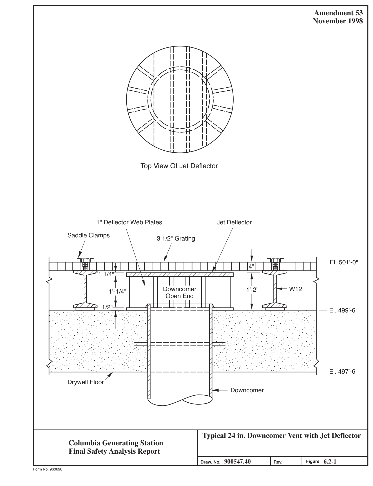

*figure on PDF page 160*

[Vector original (SVG, lossless): fig_page-160.svg](../figures/fig_page-160.svg)

<!-- labels/text on this figure page -->
Amendment 53 November 1998
I 11 I
::::i:t ~ I I 11"" I 11 11 11 11 I I\\-_
11 II 111 1
11 11 1/ L 11 11 Vi/:::::.
11 11 /.J¾:
::tt- ✓i1 11
Top View Of Jet Deflector
1" Deflector Web Plates Jet Deflector Saddle Clamps 3 1/2" Grating
El. 501'-0" 4" 1 1/4"
Downcomer 1'-2" W12 1'-1/4" Open End 1/2" El. 499'-6"
El. 497'-6" Drywell Floor Downcomer
Typical 24 in. Downcomer Vent with Jet Deflector Columbia Generating Station Final Safety Analysis Report 900547.40 6.2-1 Figure Draw. No. Rev.
Form No. 960690

<!-- p.161 -->
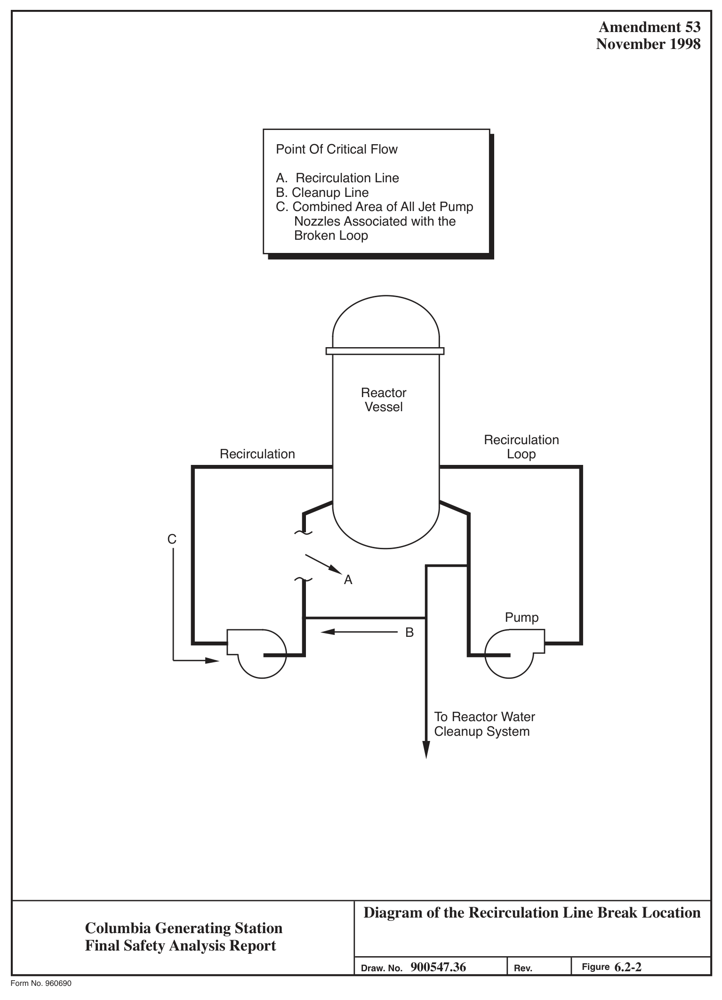

*figure on PDF page 161*

[Vector original (SVG, lossless): fig_page-161.svg](../figures/fig_page-161.svg)

<!-- labels/text on this figure page -->
Amendment 53 November 1998
Point Of Critical Flow
A. Recirculation Line B. Cleanup Line C. Combined Area of All Jet Pump Nozzles Associated with the Broken Loop
Reactor Vessel
Recirculation Recirculation Loop
C
A
Pump B
To Reactor Water Cleanup System
Diagram of the Recirculation Line Break Location Columbia Generating Station Final Safety Analysis Report 900547.36 6.2-2 Figure Draw. No. Rev.
Form No. 960690

<!-- p.162 -->
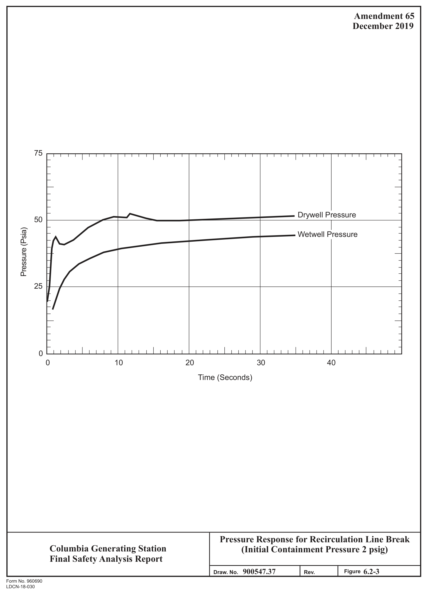

*figure on PDF page 162*

[Vector original (SVG, lossless): fig_page-162.svg](../figures/fig_page-162.svg)

<!-- labels/text on this figure page -->
Amendment 65 December 2019
75
Drywell Pressure 50 Pressure (Psia)
Wetwell Pressure
25
0 0 10 20 30 40 Time (Seconds)
Pressure Response for Recirculation Line Break Columbia Generating Station
(Initial Containment Pressure 2 psig)
Final Safety Analysis Report 900547.37 6.2-3 Draw. No.
Rev. Figure Form No. 960690
LDCN-18-030

<!-- p.163 -->
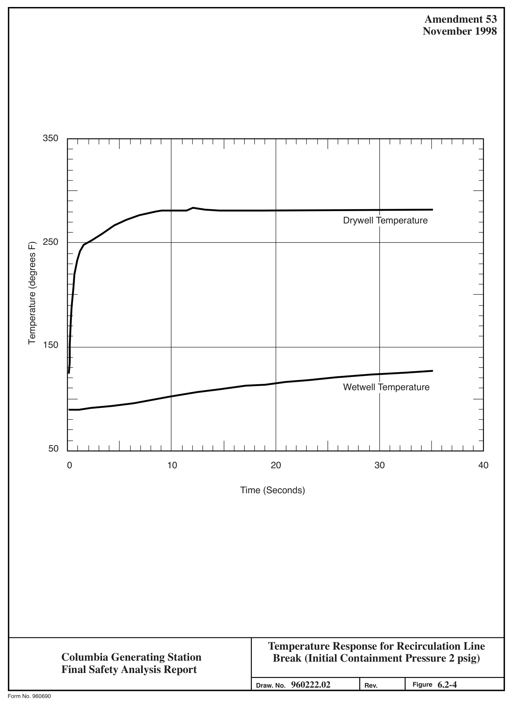

*figure on PDF page 163*

[Vector original (SVG, lossless): fig_page-163.svg](../figures/fig_page-163.svg)

<!-- labels/text on this figure page -->
Amendment 53 November 1998
350
Drywell Temperature
250 Temperature (degrees F)
150
Wetwell Temperature
50 0 10 20 30 40
Time (Seconds)
Temperature Response for Recirculation Line Columbia Generating Station Break (Initial Containment Pressure 2 psig)
Final Safety Analysis Report 960222.02 6.2-4 Figure Draw. No. Rev.
Form No. 960690

<!-- p.164 -->
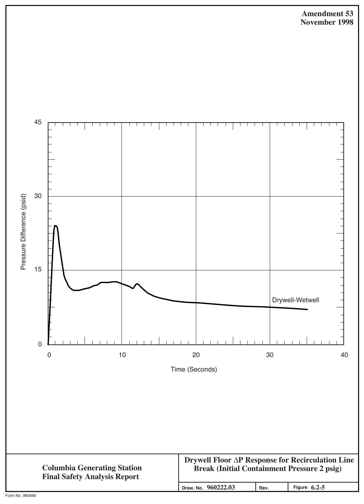

*figure on PDF page 164*

[Vector original (SVG, lossless): fig_page-164.svg](../figures/fig_page-164.svg)

<!-- labels/text on this figure page -->
Amendment 53 November 1998
45
30 Pressure Difference (psid)
15
Drywell-Wetwell
0 0 10 20 30 40
Time (Seconds)
Drywell Floor ∆P Response for Recirculation Line Columbia Generating Station Break (Initial Containment Pressure 2 psig)
Final Safety Analysis Report 960222.03 6.2-5 Figure Draw. No. Rev.
Form No. 960690

<!-- p.165 -->
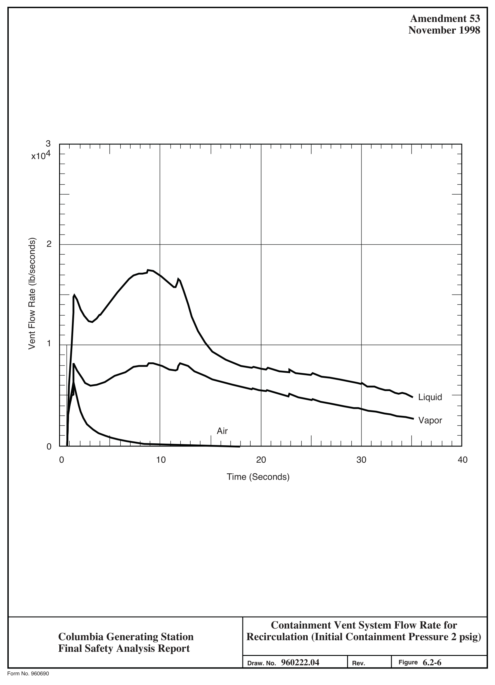

*figure on PDF page 165*

[Vector original (SVG, lossless): fig_page-165.svg](../figures/fig_page-165.svg)

<!-- labels/text on this figure page -->
Amendment 53 November 1998
3 x104
2 Vent Flow Rate (lb/seconds)
1
Liquid
Vapor Air 0 0 10 20 30 40 Time (Seconds)
Containment Vent System Flow Rate for Columbia Generating Station Recirculation (Initial Containment Pressure 2 psig)
Final Safety Analysis Report 960222.04 6.2-6 Figure Draw. No. Rev.
Form No. 960690

<!-- p.166 -->
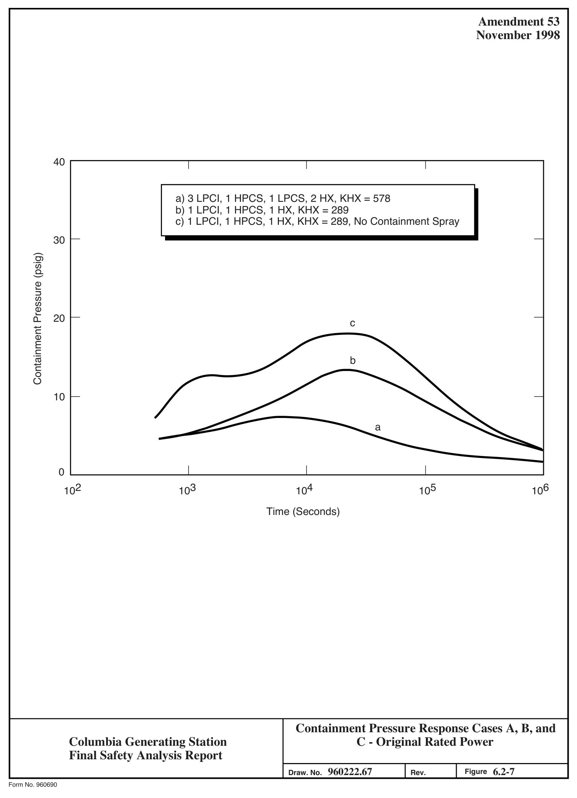

*figure on PDF page 166*

[Vector original (SVG, lossless): fig_page-166.svg](../figures/fig_page-166.svg)

<!-- labels/text on this figure page -->
Amendment 53 November 1998
40 I a) 3 LPCI, 1 HPCS, 1 LPCS, 2 HX, KHX = 578 b) 1 LPCI, 1 HPCS, 1 HX, KHX = 289 c) 1 LPCI, 1 HPCS, 1 HX, KHX = 289, No Containment Spray 30 Containment Pressure (psig)
20 c
b
10
a
0 102 103 104 105 106 Time (Seconds)
Containment Pressure Response Cases A, B, and C - Original Rated Power Columbia Generating Station Final Safety Analysis Report 960222.67 6.2-7 Figure Draw. No. Rev.
Form No. 960690

<!-- p.167 -->
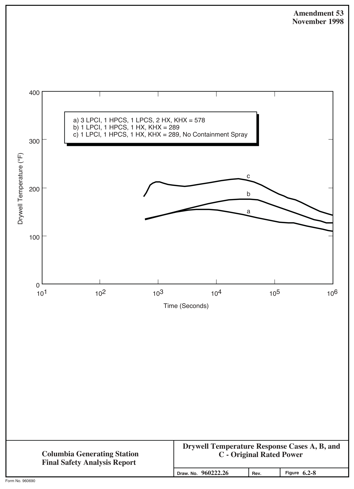

*figure on PDF page 167*

[Vector original (SVG, lossless): fig_page-167.svg](../figures/fig_page-167.svg)

<!-- labels/text on this figure page -->
Amendment 53 November 1998
400 I a) 3 LPCI, 1 HPCS, 1 LPCS, 2 HX, KHX = 578 b) 1 LPCI, 1 HPCS, 1 HX, KHX = 289 c) 1 LPCI, 1 HPCS, 1 HX, KHX = 289, No Containment Spray 300
Drywell Temperature (°F)
c 200 b
a
100
0 101 102 103 104 105 106 Time (Seconds)
Drywell Temperature Response Cases A, B, and Columbia Generating Station C - Original Rated Power Final Safety Analysis Report 960222.26 6.2-8 Figure Draw. No. Rev.
Form No. 960690

<!-- p.168 -->
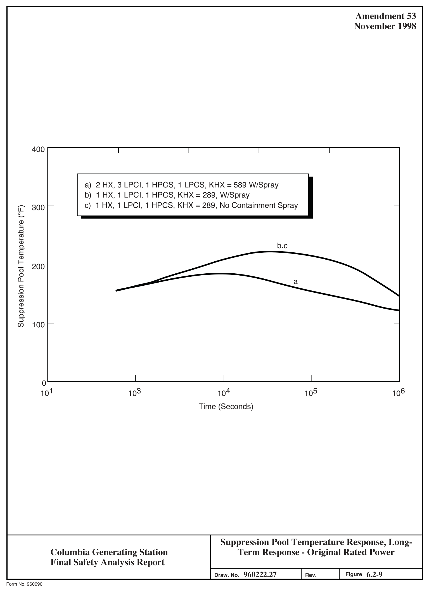

*figure on PDF page 168*

[Vector original (SVG, lossless): fig_page-168.svg](../figures/fig_page-168.svg)

<!-- labels/text on this figure page -->
Amendment 53 November 1998
400 I a) 2 HX, 3 LPCI, 1 HPCS, 1 LPCS, KHX = 589 W/Spray b) 1 HX, 1 LPCI, 1 HPCS, KHX = 289, W/Spray c) 1 HX, 1 LPCI, 1 HPCS, KHX = 289, No Containment Spray 300 Suppression Pool Temperature (°F)
b.c
200 a
100
0 101 103 104 105 106 Time (Seconds)
Suppression Pool Temperature Response, Long- Term Response - Original Rated Power Columbia Generating Station Final Safety Analysis Report 960222.27 6.2-9 Figure Draw. No. Rev.
Form No. 960690

<!-- p.169 -->
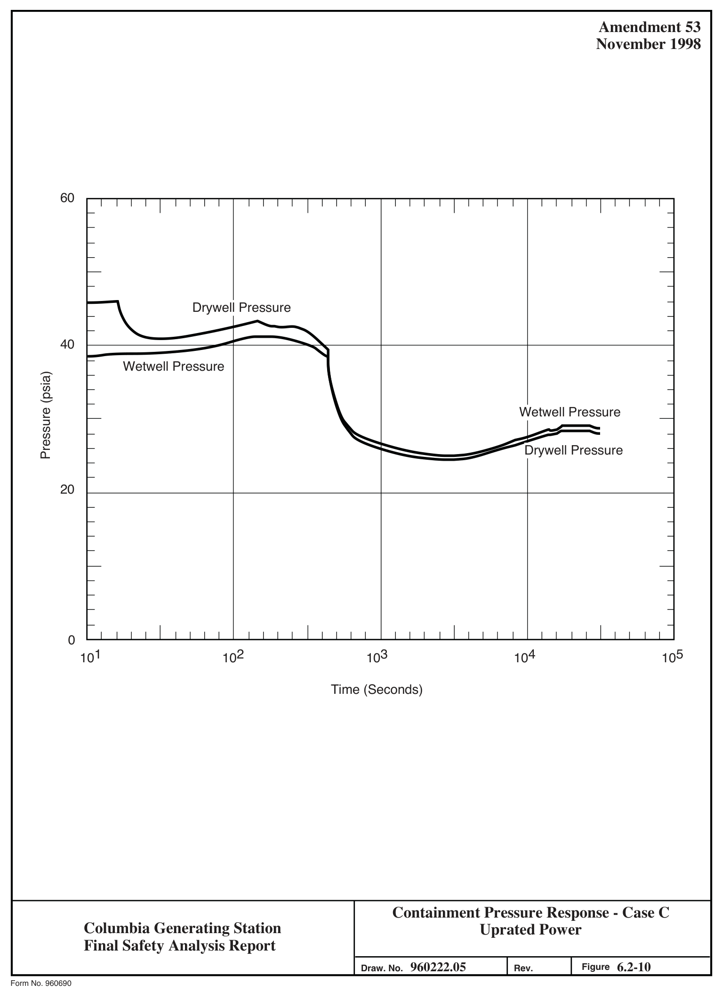

*figure on PDF page 169*

[Vector original (SVG, lossless): fig_page-169.svg](../figures/fig_page-169.svg)

<!-- labels/text on this figure page -->
Amendment 53 November 1998
60
Drywell Pressure
40 Wetwell Pressure Pressure (psia)
Wetwell Pressure
Drywell Pressure
20
0 101 102 103 104 105
Time (Seconds)
Containment Pressure Response - Case C Columbia Generating Station Uprated Power Final Safety Analysis Report 960222.05 6.2-10 Figure Draw. No. Rev.
Form No. 960690

<!-- p.170 -->
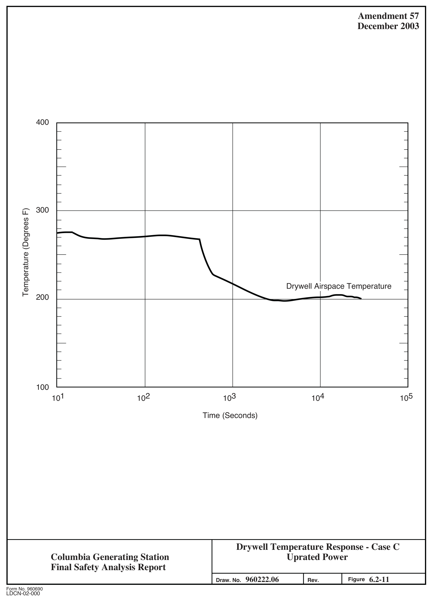

*figure on PDF page 170*

[Vector original (SVG, lossless): fig_page-170.svg](../figures/fig_page-170.svg)

<!-- labels/text on this figure page -->
Amendment 57 December 2003
400
300 Temperature (Degrees F)
Drywell Airspace Temperature 200
100 101 102 103 104 105
Time (Seconds)
Drywell Temperature Response - Case C Uprated Power Columbia Generating Station Final Safety Analysis Report 960222.06 6.2-11 Draw. No.
Rev. Figure Form No. 960690
LDCN-02-000

<!-- p.171 -->
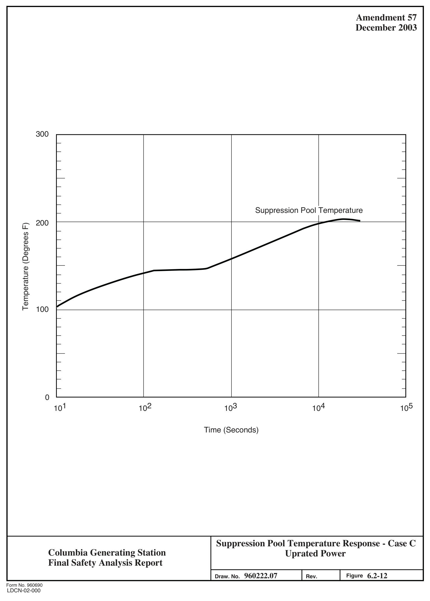

*figure on PDF page 171*

[Vector original (SVG, lossless): fig_page-171_2.svg](../figures/fig_page-171_2.svg)

<!-- labels/text on this figure page -->
Amendment 57 December 2003
300
Suppression Pool Temperature 200 Temperature (Degrees F)
100
0 101 102 103 104 105
Time (Seconds)
Suppression Pool Temperature Response - Case C Columbia Generating Station Uprated Power Final Safety Analysis Report 960222.07 6.2-12 Figure Draw. No. Rev.
Form No. 960690
LDCN-02-000

<!-- p.172 -->
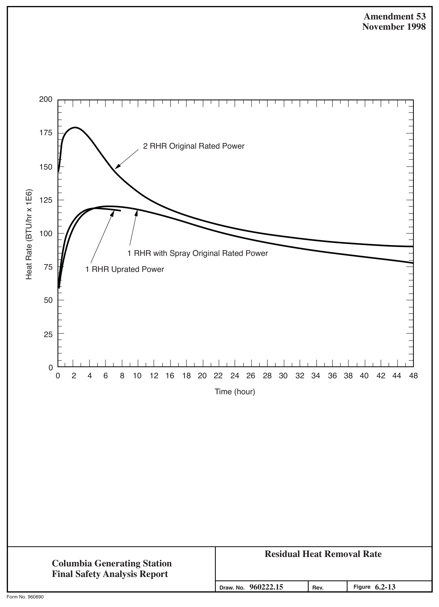

*figure on PDF page 172*

[Vector original (SVG, lossless): fig_page-172_2.svg](../figures/fig_page-172_2.svg)

<!-- labels/text on this figure page -->
Amendment 53 November 1998
200
175
2 RHR Original Rated Power
150
Heat Rate (BTU/hr x 1E6)
125
100
1 RHR with Spray Original Rated Power
75
1 RHR Uprated Power
50
25
0 0 2 4 6 8 10 12 16 18 20 22 24 26 28 30 32 34 36 38 40 42 44 48 Time (hour)
Residual Heat Removal Rate Columbia Generating Station Final Safety Analysis Report 960222.15 6.2-13 Figure Draw. No. Rev.
Form No. 960690

<!-- p.173 -->
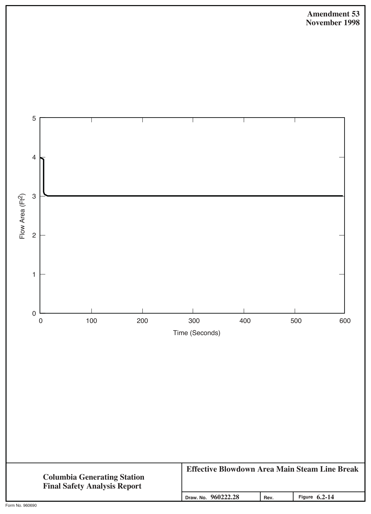

*figure on PDF page 173*

[Vector original (SVG, lossless): fig_page-173_2.svg](../figures/fig_page-173_2.svg)

<!-- labels/text on this figure page -->
Amendment 53 November 1998
5
I I I I I
4
- ~
3 Flow Area (Ft2)
2 -
-
1 -
-
I I I I I 0 0 100 200 300 400 500 600 Time (Seconds)
Effective Blowdown Area Main Steam Line Break Columbia Generating Station Final Safety Analysis Report
I I 960222.28 6.2-14
Figure Draw. No. Rev.
Form No. 960690

<!-- p.174 -->
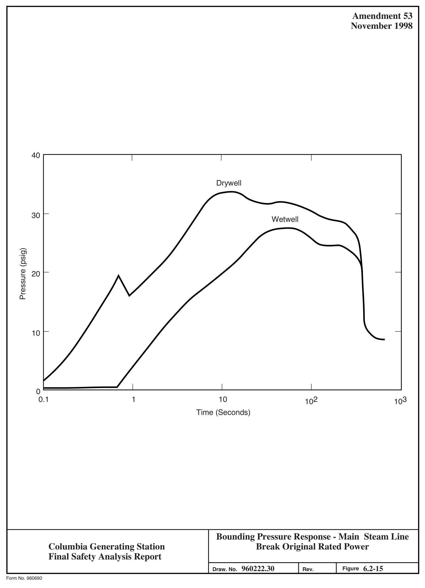

*figure on PDF page 174*

[Vector original (SVG, lossless): fig_page-174_2.svg](../figures/fig_page-174_2.svg)

<!-- labels/text on this figure page -->
Amendment 53 November 1998
40
Drywell
30 Wetwell
Pressure (psig)
20
10
0 0.1 1 10 102 103 Time (Seconds)
Bounding Pressure Response - Main Steam Line Break Original Rated Power Columbia Generating Station Final Safety Analysis Report 960222.30 6.2-15 Figure Draw. No. Rev.
Form No. 960690

<!-- p.175 -->
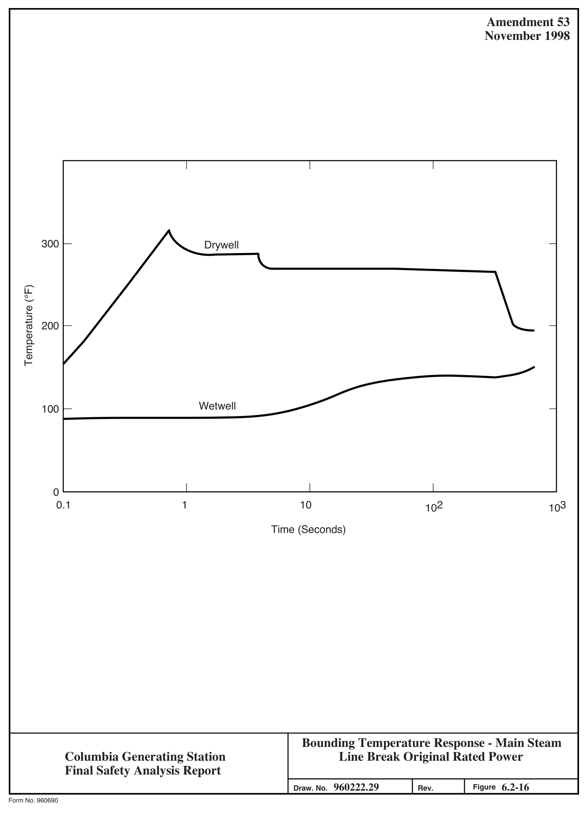

*figure on PDF page 175*

[Vector original (SVG, lossless): fig_page-175_2.svg](../figures/fig_page-175_2.svg)

<!-- labels/text on this figure page -->
Amendment 53 November 1998
300 Drywell
Temperature (°F)
200
Wetwell 100
0 0.1 1 10 102 103 Time (Seconds)
Bounding Temperature Response - Main Steam Line Break Original Rated Power Columbia Generating Station Final Safety Analysis Report 960222.29 6.2-16 Figure Draw. No. Rev.
Form No. 960690

<!-- p.176 -->
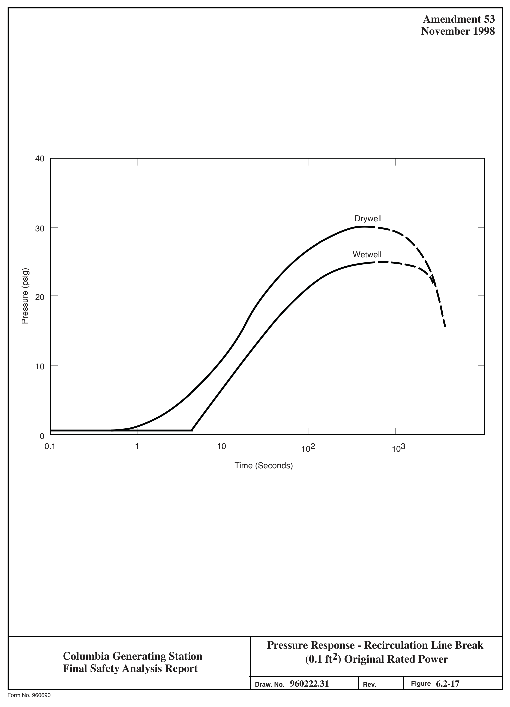

*figure on PDF page 176*

[Vector original (SVG, lossless): fig_page-176_2.svg](../figures/fig_page-176_2.svg)

<!-- labels/text on this figure page -->
Amendment 53 November 1998
40
Drywell 30
Wetwell
Pressure (psig)
20
10
0 0.1 1 10 102 103 Time (Seconds)
Pressure Response - Recirculation Line Break Columbia Generating Station
(0.1 ft2) Original Rated Power Final Safety Analysis Report 960222.31 6.2-17 Figure Draw. No. Rev.
Form No. 960690

<!-- p.177 -->
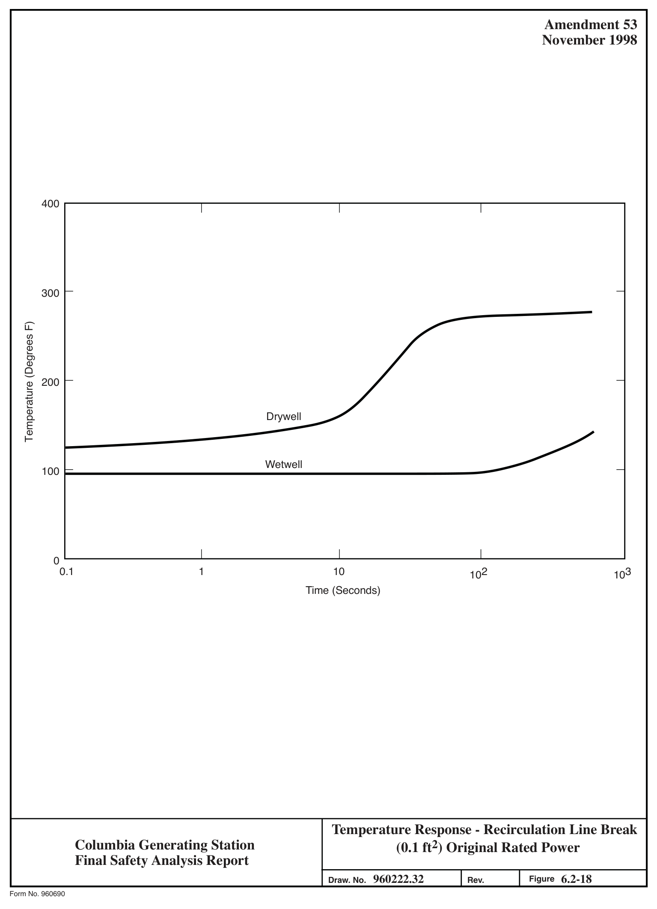

*figure on PDF page 177*

[Vector original (SVG, lossless): fig_page-177_2.svg](../figures/fig_page-177_2.svg)

<!-- labels/text on this figure page -->
Amendment 53 November 1998
400
300
Temperature (Degrees F)
200
Drywell
Wetwell 100
0 0.1 1 10 102 103 Time (Seconds)
Temperature Response - Recirculation Line Break Columbia Generating Station
(0.1 ft2) Original Rated Power Final Safety Analysis Report 960222.32 6.2-18 Figure Draw. No. Rev.
Form No. 960690

<!-- p.178 -->
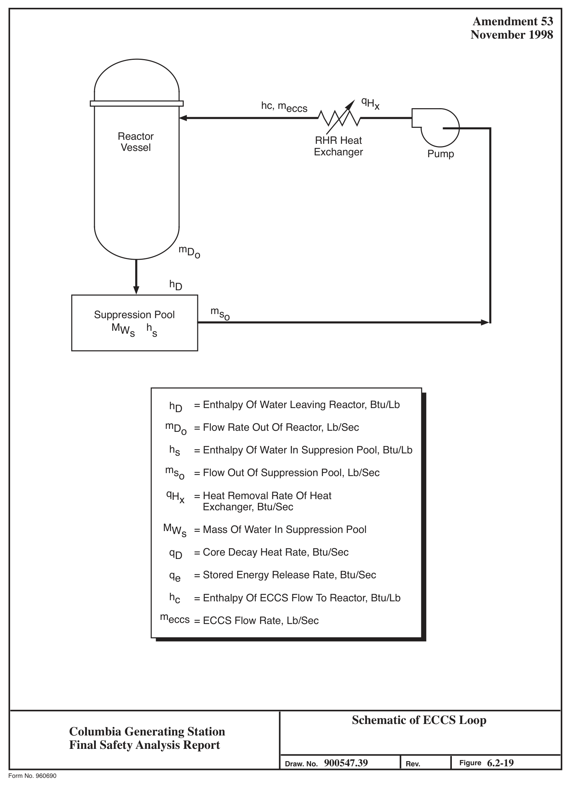

*figure on PDF page 178*

[Vector original (SVG, lossless): fig_page-178_2.svg](../figures/fig_page-178_2.svg)

<!-- labels/text on this figure page -->
Amendment 53 November 1998
qHx hc, meccs
Reactor RHR Heat Vessel Exchanger Pump
mDo
hD
mso Suppression Pool MWs hs
= Enthalpy Of Water Leaving Reactor, Btu/Lb hD mDo = Flow Rate Out Of Reactor, Lb/Sec hs = Enthalpy Of Water In Suppresion Pool, Btu/Lb mso = Flow Out Of Suppression Pool, Lb/Sec qHx = Heat Removal Rate Of Heat Exchanger, Btu/Sec MWs = Mass Of Water In Suppression Pool qD = Core Decay Heat Rate, Btu/Sec qe = Stored Energy Release Rate, Btu/Sec hc = Enthalpy Of ECCS Flow To Reactor, Btu/Lb meccs = ECCS Flow Rate, Lb/Sec
Schematic of ECCS Loop Columbia Generating Station Final Safety Analysis Report 900547.39 6.2-19 Figure Draw. No. Rev.
Form No. 960690

<!-- p.179 -->
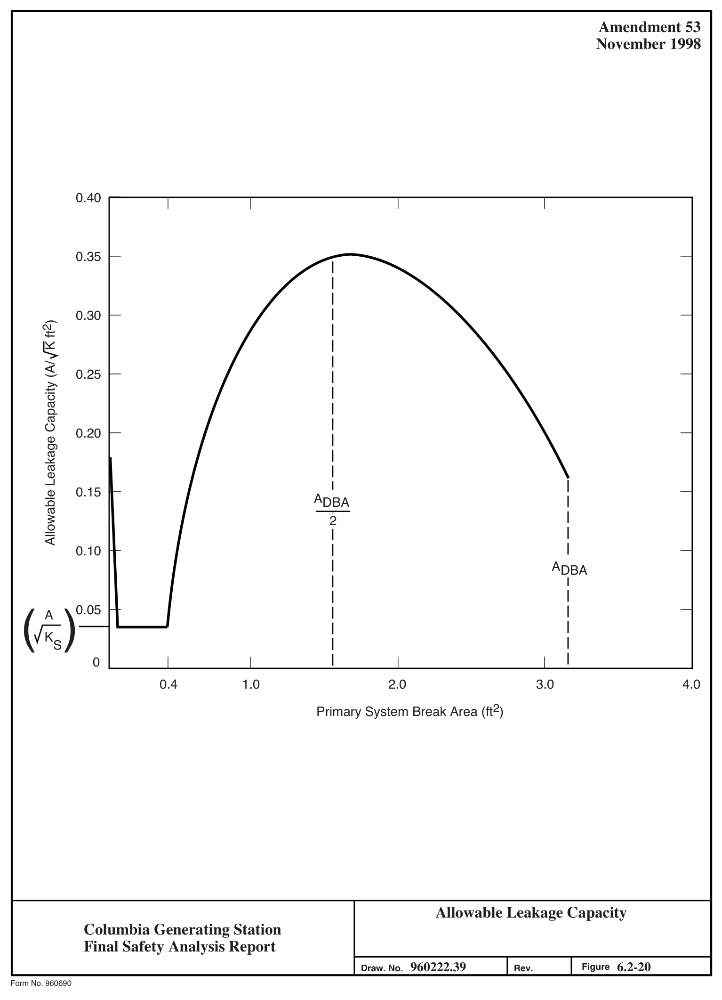

*figure on PDF page 179*

[Vector original (SVG, lossless): fig_page-179.svg](../figures/fig_page-179.svg)

<!-- labels/text on this figure page -->
Amendment 53 November 1998
0.40
0.35
0.30 Allowable Leakage Capacity (A/ K ft2)
0.25
0.20
0.15 ADBA 2
0.10 ADBA
( )
0.05 A KS 0 0.4 1.0
2.0
3.0 4.0 Primary System Break Area (ft2)
Allowable Leakage Capacity Columbia Generating Station Final Safety Analysis Report 960222.39 6.2-20 Figure Draw. No. Rev.
Form No. 960690

<!-- p.180 -->
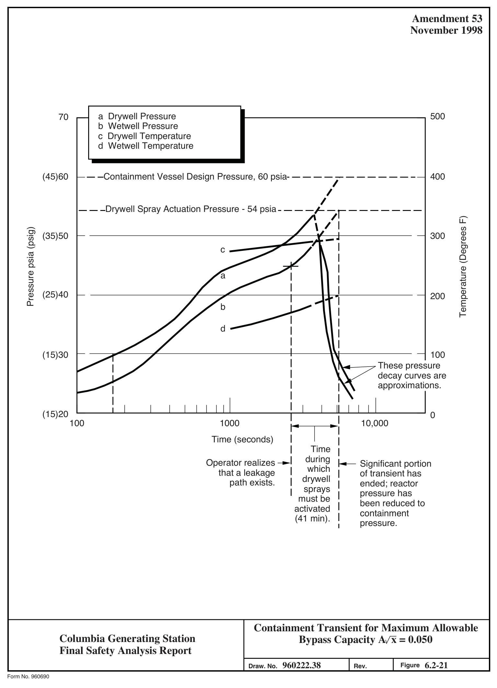

*figure on PDF page 180*

[Vector original (SVG, lossless): fig_page-180_2.svg](../figures/fig_page-180_2.svg)

<!-- labels/text on this figure page -->
Amendment 53 November 1998
500 70 a Drywell Pressure b Wetwell Pressure c Drywell Temperature d Wetwell Temperature
(45)60 Containment Vessel Design Pressure, 60 psia -----✓ ------- 400 I I ~-r------- Drywell Spray Actuation Pressure - 54 psia
---- I Temperature (Degrees F) \ I I Pressure psia (psig) (35)50 300 c
a
(25)40 200 b ~ d I I
(15)30 100 These pressure decay curves are approximations.
(15)20 0 I 100 1000 10,000
I .. .. I
Time (seconds) I I I Time I during --I 1--- Significant portion Operator realizes which I that a leakage of transient has drywell 1 path exists. I ended; reactor I sprays pressure has I I must be been reduced to I activated containment
(41 min). I pressure.
I
Containment Transient for Maximum Allowable
r Columbia Generating Station
Bypass Capacity A x = 0.050 Final Safety Analysis Report 960222.38 6.2-21 Figure Draw. No. Rev.
Form No. 960690

<!-- p.181 -->
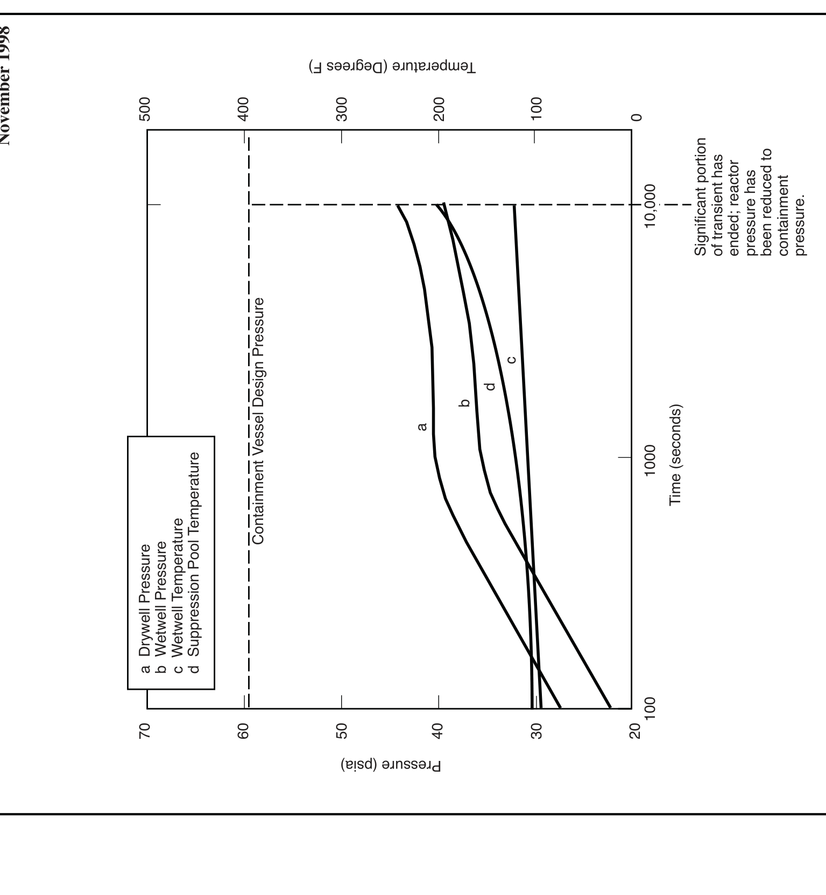

*figure on PDF page 181*

[Vector original (SVG, lossless): fig_page-181_2.svg](../figures/fig_page-181_2.svg)

<!-- labels/text on this figure page -->
Amendment 53 November 1998
70 a Drywell Pressure 500 b Wetwell Pressure c Wetwell Temperature d Suppression Pool Temperature
60 400 Containment Vessel Design Pressure I I _______ _ I I Temperature (Degrees F)
50 300 Pressure (psia)
a 40 200 b d c 30 100
20 0 100 1000 10,000 Time (seconds)
Significant portion of transient has ended; reactor pressure has been reduced to containment pressure.
Containment Transient for A/ K = 0.0045 ft2 l Columbia Generating Station Final Safety Analysis Report 960222.37 6.2-22 Figure Draw. No. Rev.
Form No. 960690

<!-- p.182 -->
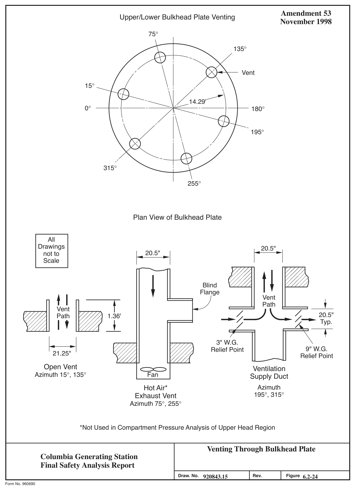

*figure on PDF page 182*

[Vector original (SVG, lossless): fig_page-182_2.svg](../figures/fig_page-182_2.svg)

<!-- labels/text on this figure page -->
Amendment 53 Upper/Lower Bulkhead Plate Venting November 1998 75°
135°
Vent 15° ''/' ~
- 14.29' \ 0° -+---+--
---+--~--------- , 180° II - '
- 195°
I I
,, 315° I I
255°
Plan View of Bulkhead Plate All □ Drawings 20.5" 20.5" not to Scale
Blind Flange d ♦ I b Vent
t
Path Vent 20.5" Path 1.36'
Typ. ~1.~_L
H 3" W.G.
9" W.G. Relief Point 21.25" Relief Point Open Vent Ventilation Azimuth 15°, 135° Fan Supply Duct Hot Air* Azimuth 195°, 315° Exhaust Vent Azimuth 75°, 255°
*Not Used in Compartment Pressure Analysis of Upper Head Region
Venting Through Bulkhead Plate Columbia Generating Station Final Safety Analysis Report Draw. No. 920843.15 Rev. Figure 6.2-24 Form No. 960690

<!-- p.183 -->
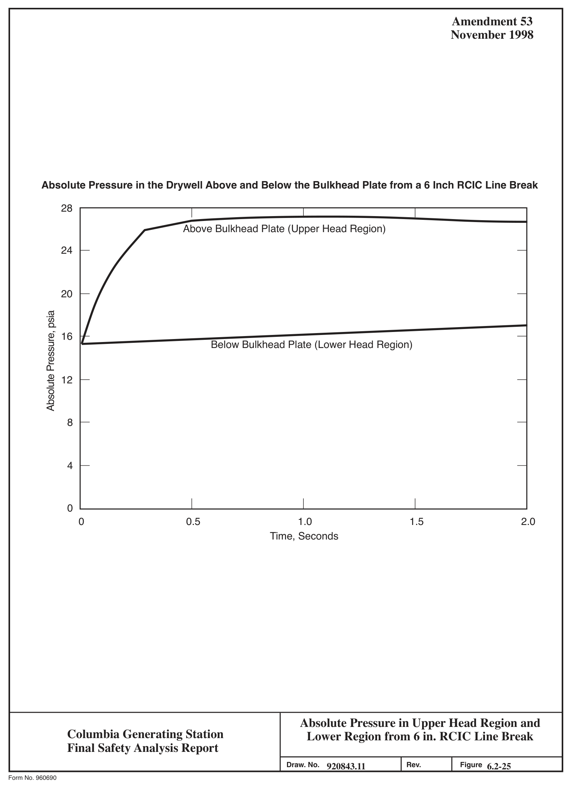

*figure on PDF page 183*

[Vector original (SVG, lossless): fig_page-183_2.svg](../figures/fig_page-183_2.svg)

<!-- labels/text on this figure page -->
Amendment 53 November 1998
Absolute Pressure in the Drywell Above and Below the Bulkhead Plate from a 6 Inch RCIC Line Break
28 Above Bulkhead Plate (Upper Head Region)
24
20
Absolute Pressure, psia 16 Below Bulkhead Plate (Lower Head Region)
12
8
4
0 0 0.5
1.0
1.5
2.0 Time, Seconds
Absolute Pressure in Upper Head Region and Columbia Generating Station Lower Region from 6 in. RCIC Line Break Final Safety Analysis Report Draw. No. 920843.11 Rev. Figure 6.2-25 Form No. 960690

<!-- p.184 -->
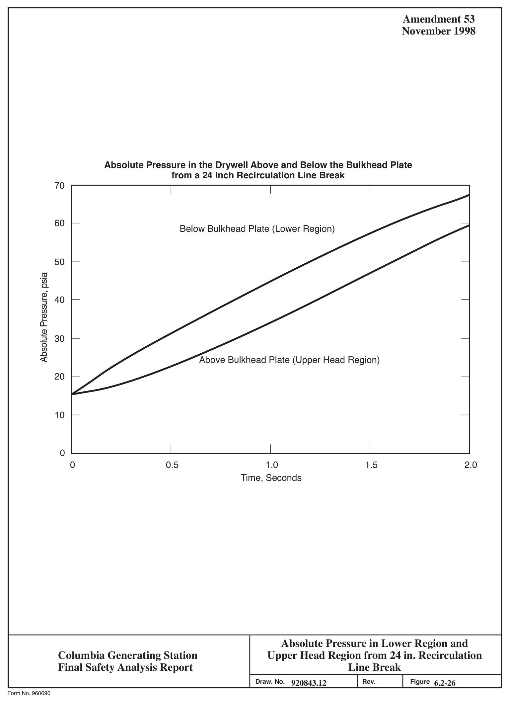

*figure on PDF page 184*

[Vector original (SVG, lossless): fig_page-184_3.svg](../figures/fig_page-184_3.svg)

<!-- labels/text on this figure page -->
Amendment 53 November 1998
Absolute Pressure in the Drywell Above and Below the Bulkhead Plate from a 24 Inch Recirculation Line Break 70
60 Below Bulkhead Plate (Lower Region)
50 Absolute Pressure, psia 40
30
Above Bulkhead Plate (Upper Head Region)
20
10
0 0 0.5
1.0
1.5
2.0 Time, Seconds
Absolute Pressure in Lower Region and Upper Head Region from 24 in. Recirculation Columbia Generating Station Line Break Final Safety Analysis Report Draw. No. 920843.12 Rev. Figure 6.2-26 Form No. 960690

<!-- p.185 -->
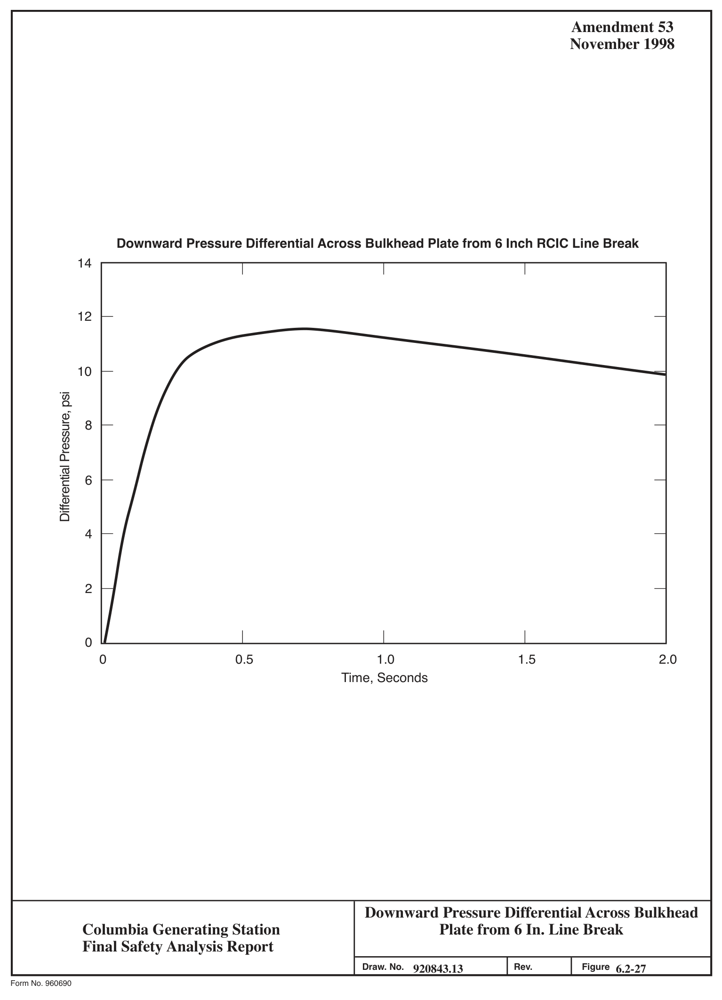

*figure on PDF page 185*

[Vector original (SVG, lossless): fig_page-185_3.svg](../figures/fig_page-185_3.svg)

<!-- labels/text on this figure page -->
Amendment 53 November 1998
Downward Pressure Differential Across Bulkhead Plate from 6 Inch RCIC Line Break 14
12
10
Differential Pressure, psi 8
6
4
2
0 0 0.5
1.0
1.5
2.0 Time, Seconds
Downward Pressure Differential Across Bulkhead Plate from 6 In. Line Break Columbia Generating Station Final Safety Analysis Report Draw. No. 920843.13 Rev. Figure 6.2-27 Form No. 960690

<!-- p.186 -->
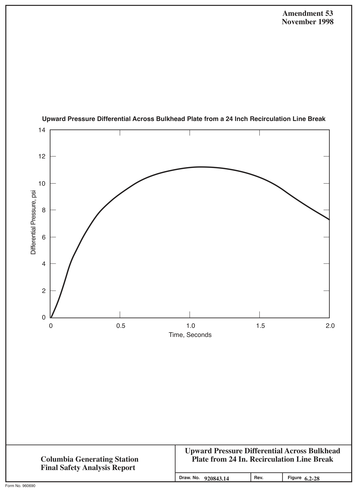

*figure on PDF page 186*

[Vector original (SVG, lossless): fig_page-186_3.svg](../figures/fig_page-186_3.svg)

<!-- labels/text on this figure page -->
Amendment 53 November 1998
Upward Pressure Differential Across Bulkhead Plate from a 24 Inch Recirculation Line Break 14
12
10 Differential Pressure, psi 8
6
4
2
0 0 0.5
1.0
1.5
2.0 Time, Seconds
Upward Pressure Differential Across Bulkhead Plate from 24 In. Recirculation Line Break Columbia Generating Station Final Safety Analysis Report Draw. No. 920843.14 Rev. Figure 6.2-28 Form No. 960690

<!-- p.187 -->
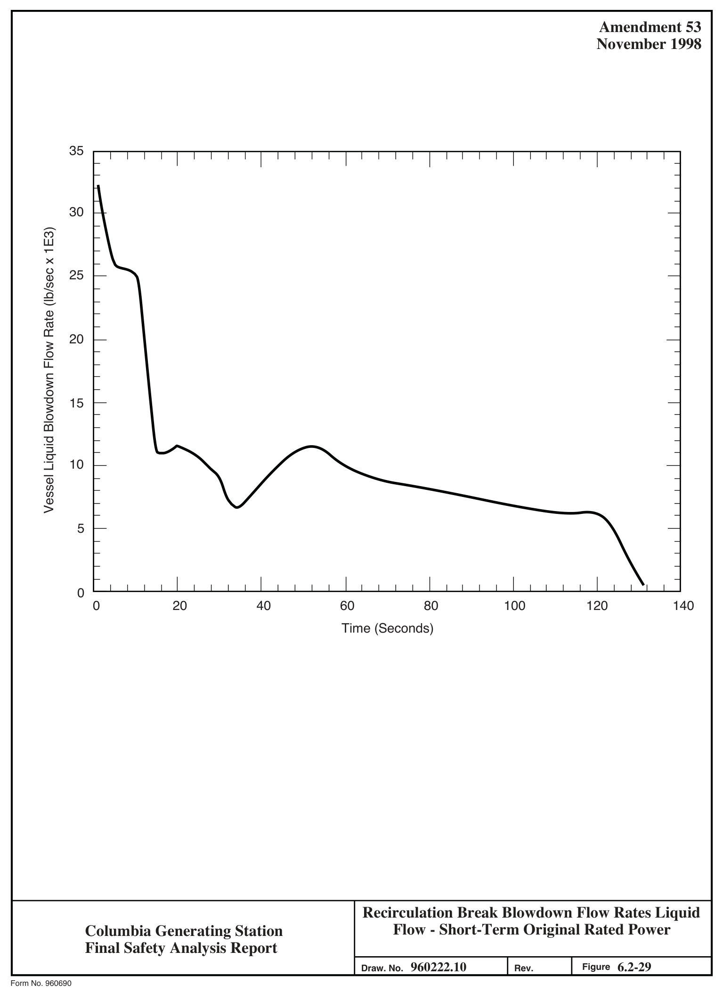

*figure on PDF page 187*

[Vector original (SVG, lossless): fig_page-187_4.svg](../figures/fig_page-187_4.svg)

<!-- labels/text on this figure page -->
Amendment 53 November 1998
35
30 Vessel Liquid Blowdown Flow Rate (lb/sec x 1E3)
25
20
15
10
5
0 0 20 40 60 80 100 120 140 Time (Seconds)
Recirculation Break Blowdown Flow Rates Liquid Flow - Short-Term Original Rated Power Columbia Generating Station Final Safety Analysis Report 960222.10 6.2-29 Figure Draw. No. Rev.
Form No. 960690

<!-- p.188 -->
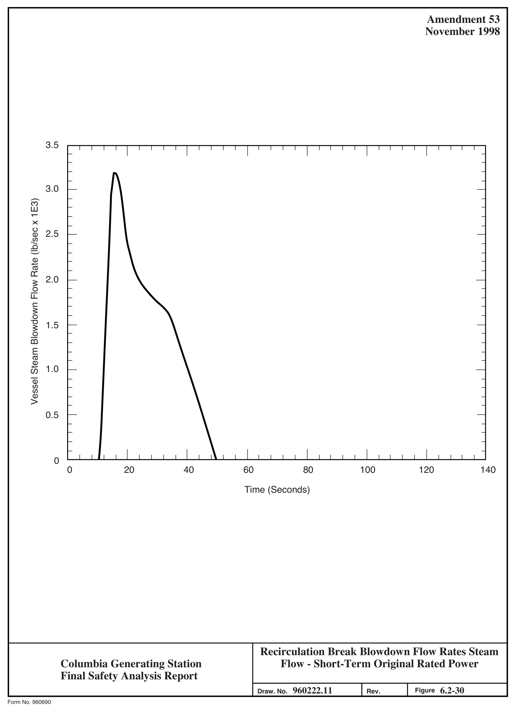

*figure on PDF page 188*

[Vector original (SVG, lossless): fig_page-188_3.svg](../figures/fig_page-188_3.svg)

<!-- labels/text on this figure page -->
Amendment 53 November 1998
3.5
3.0 Vessel Steam Blowdown Flow Rate (lb/sec x 1E3)
2.5
2.0
1.5
1.0
0.5
0 0 20 40 60 80 100 120 140 Time (Seconds)
Recirculation Break Blowdown Flow Rates Steam Flow - Short-Term Original Rated Power Columbia Generating Station Final Safety Analysis Report 960222.11 6.2-30 Figure Draw. No. Rev.
Form No. 960690

<!-- p.189 -->
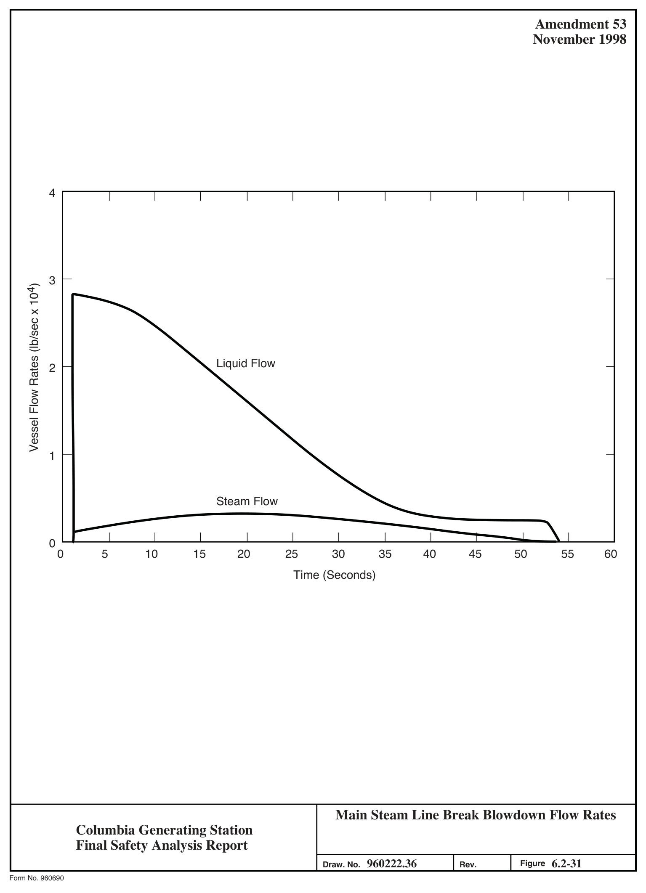

*figure on PDF page 189*

[Vector original (SVG, lossless): fig_page-189_3.svg](../figures/fig_page-189_3.svg)

<!-- labels/text on this figure page -->
Amendment 53 November 1998
4
3 Vessel Flow Rates (lb/sec x 104)
Liquid Flow 2
1
Steam Flow
0 0 5 10 15 20 25 30 35 40 45 50 55 60 Time (Seconds)
Main Steam Line Break Blowdown Flow Rates Columbia Generating Station Final Safety Analysis Report 960222.36 6.2-31 Figure Draw. No. Rev.
Form No. 960690

<!-- p.190 -->
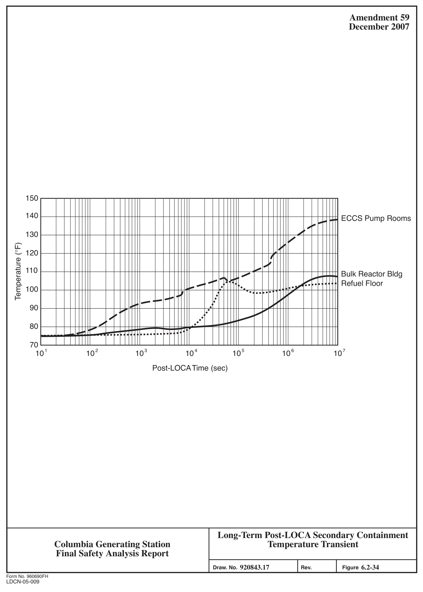

*figure on PDF page 190*

[Vector original (SVG, lossless): fig_page-190_2.svg](../figures/fig_page-190_2.svg)

<!-- labels/text on this figure page -->
Amendment 59 December 2007
150 I I~ I ~ I_' I 'I I l I I ' 11 1 I l 11 I I l 140 ECCS Pump Rooms I 11 TI -nttttttt-+-4---1--WillL-1 ~ I I 130 i
1 J I if)
L.
1 1 Temperature (°F)
I 11 1111 - 11 120 I I Th I I . 11 11 II I I .!fl I 110 Bulk Reactor Bldg 11 ij Refuel Floor I l
...-1 I 1
• l'"" J --~·'H1 I l, - •"~•
100 I I I ,•' - - l 11
11 er .:1 ~ ~ I I I ~
90 ~ ~- I I
I L .
• •' j I 80 L 11 I I I I 11 • • ., ·11'1 • • • • • • • • • • •
I I I I I 11
70 10 1 10 2 10 3 10 4 10 5 10 6 10 7 Post-LOCA Time (sec)
Long-Term Post-LOCA Secondary Containment Columbia Generating Station Temperature Transient Final Safety Analysis Report 920843.17 6.2-34 Draw. No. Rev. Figure Form No. 960690FH
LDCN-05-009

<!-- p.191 -->
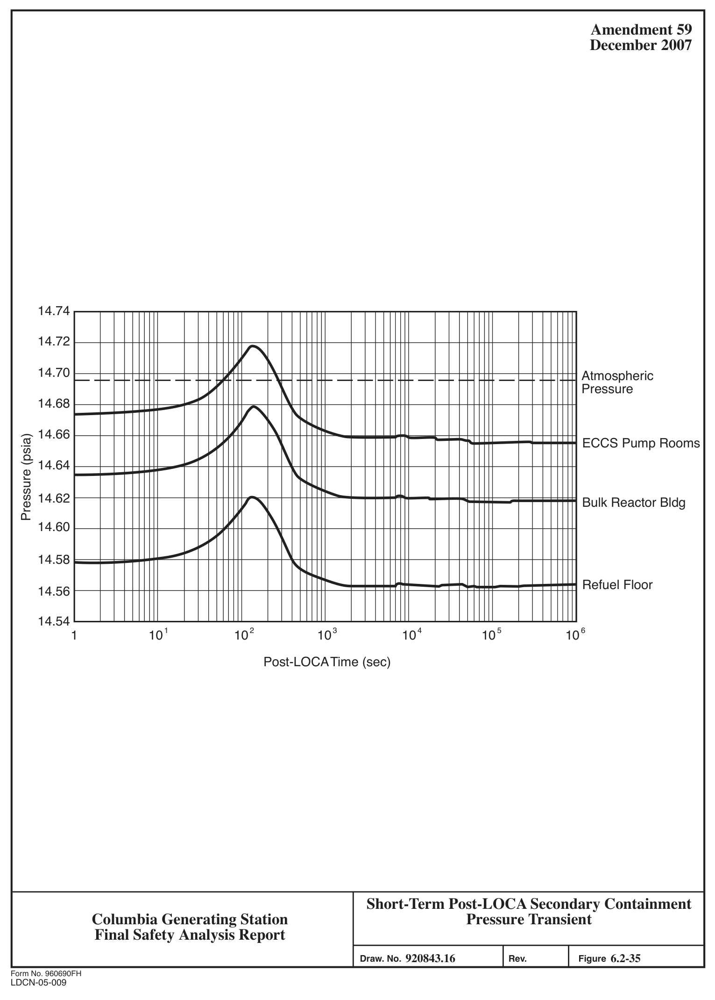

*figure on PDF page 191*

[Vector original (SVG, lossless): fig_page-191_2.svg](../figures/fig_page-191_2.svg)

<!-- labels/text on this figure page -->
Amendment 59 December 2007
14.74
14.72
- - -
--... - Iii'~ -- ,_ ~ \ 14.70
--- --
--- - - Atmospheric --- --- - ' Pressure ~ ~I 14.68
A ~ '"'~ ....
, 14.66 ~, ' ECCS Pump Rooms Pressure (psia)
~;
14.64 """"' -~, '"'~ 14.62
i.....
Bulk Reactor Bldg \ , 14.60
-- ' ;'' ~ ~ 14.58 '"'~
Refuel Floor i.....
14.56
14.54 1 10 1 10 2 10 3 10 4 10 5 10 6 Post-LOCA Time (sec)
Short-Term Post-LOCA Secondary Containment Columbia Generating Station Pressure Transient Final Safety Analysis Report I I 920843.16 6.2-35 Draw. No. Rev. Figure Form No. 960690FH
LDCN-05-009

<!-- p.192 -->
Amendment 67 December 2023

Notes on Type C Testing (Isolation Valve Leakage Testing)

1. Type C testing is performed by applying a differential pressure in the same direction as seen by the valves during containment isolation.

2. Type C testing is performed by pressurizing between the two-piece disk gate valve.

3. Type C testing is performed by pressurizing between the isolation valves. The test yields conservative results since the inboard, globe valve is pressurized under the seat during the test; whereas, during containment isolation, it is pressurized above the seat.

4. Type C testing is performed by pressurizing between the isolation valves. The test yields equivalent results for the inboard gate or butterfly valve. *

5. Type C testing is not required since a water seal is provided by the suppression pool.

6. Type C testing is performed by pressurizing between the isolation valves. The test yields equivalent results for the inboard gate valve. * The one-inch globe valve will have test pressure applied under the seat; however, the difference between testing a one-inch globe valve over or under the seat is considered negligible being less than 10% of the normal seating force.

7. Type C testing is performed by pressurizing between the isolation valves. The one-inch globe valve will have test pressure applied over the seat for the inboard isolation valve and under the seat for the outboard isolation valve. The difference between testing under and over the seat for a one-inch globe valve is considered negligible being less than 10% of the normal seating force.

8. Type C testing is performed by pressurizing between the isolation valves. The one-inch globe valve will have test pressure applied under the seat; however, the difference between testing a one-inch globe valve over or under the seat is considered negligible being less than 10% of the normal seating force.

9. This penetration does not constitute potential primary containment atmospheric pathways during and following a DBA. Type C testing not required. Leakage testing conducted to satisfy requirements of TS 5.5.2

* The gate and butterfly valves are because of symmetry of design and because of construction equally leak tight in either direction. This fact has been confirmed by review of leakage test data and other information supplied by the valve manufacturers.

Notes on Type C Testing Columbia Generating Station Final Safety Analysis Report I I 920843.20 1 6.2-36 Draw. No. Rev. Figure Form No. 960690FH

<!-- p.193 -->
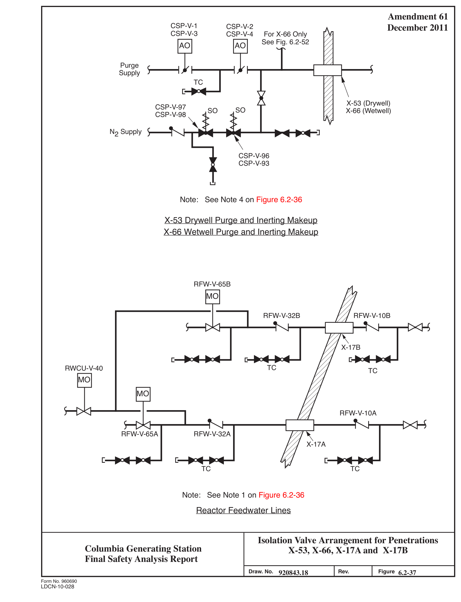

*figure on PDF page 193*

[Vector original (SVG, lossless): fig_page-193_2.svg](../figures/fig_page-193_2.svg)

<!-- labels/text on this figure page -->
Amendment 61
CSP-V-1 CSP-V-2
December 2011 CSP-V-3 CSP-V-4 For X-66 Only See Fig. 6.2-52
AO AO
Purge 5 Supply TC
X-53 (Drywell)
CSP-V-97
SO SO
X-66 (Wetwell)
CSP-V-98
N2 Supply
CSP-V-96
CSP-V-93
Note: See Note 4 on Figure 6.2-36
X-53 Drywell Purge and Inerting Makeup X-66 Wetwell Purge and Inerting Makeup
RFW-V-65B
MO
RFW-V-32B
RFW-V-10B
X-17B
TC RWCU-V-40
TC MO MO
RFW-V-10A
RFW-V-65A RFW-V-32A
X-17A
TC TC
Note: See Note 1 on Figure 6.2-36 Reactor Feedwater Lines
Isolation Valve Arrangement for Penetrations Columbia Generating Station X-53, X-66, X-17A and X-17B Final Safety Analysis Report Draw. No. 920843.18 Rev. Figure 6.2-37 Form No. 960690
LDCN-10-028

<!-- p.194 -->
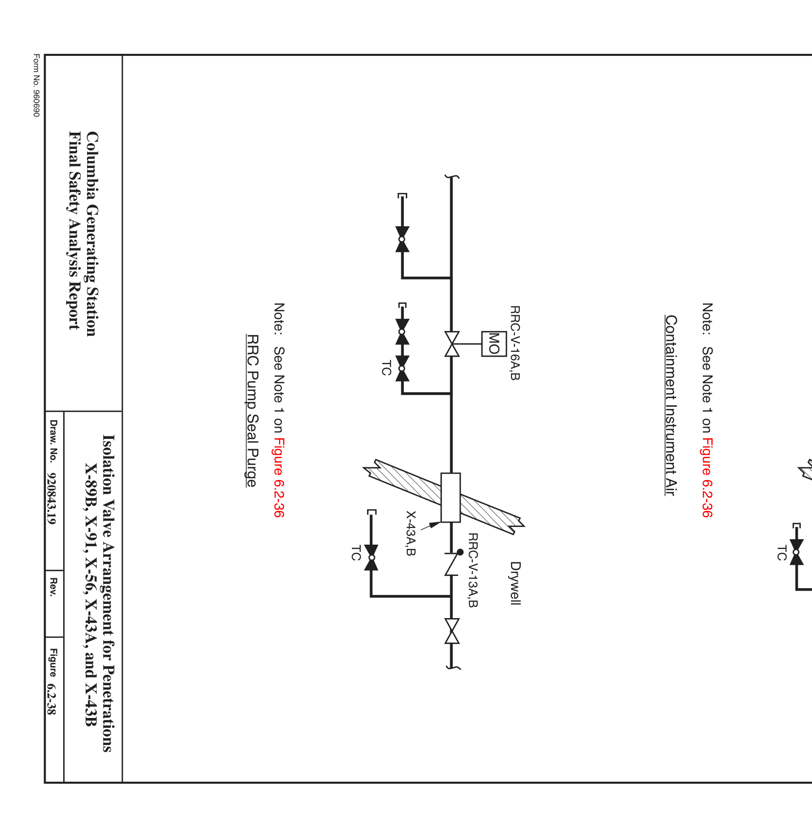

*figure on PDF page 194*

[Vector original (SVG, lossless): fig_page-194_2.svg](../figures/fig_page-194_2.svg)

<!-- labels/text on this figure page -->
Amendment 53 November 1998 Drywell
CIA-V-30A
CIA-V-30B
CIA-V-20
CIA-V-31A
MO
CIA-V-31B
CIA-V-21
X-89B
X-91 r:1 r., X-56 TC
l;'I TC
Note: See Note 1 on Figure 6.2-36
Containment Instrument Air
Drywell RRC-V-16A,B MO
RRC-V-13A,B
X-43A,B
r:, TC
TC
Note: See Note 1 on Figure 6.2-36 RRC Pump Seal Purge
Isolation Valve Arrangement for Penetrations Columbia Generating Station X-89B, X-91, X-56, X-43A, and X-43B Final Safety Analysis Report Draw. No. 920843.19 Rev. Figure 6.2-38 Form No. 960690

<!-- p.195 -->
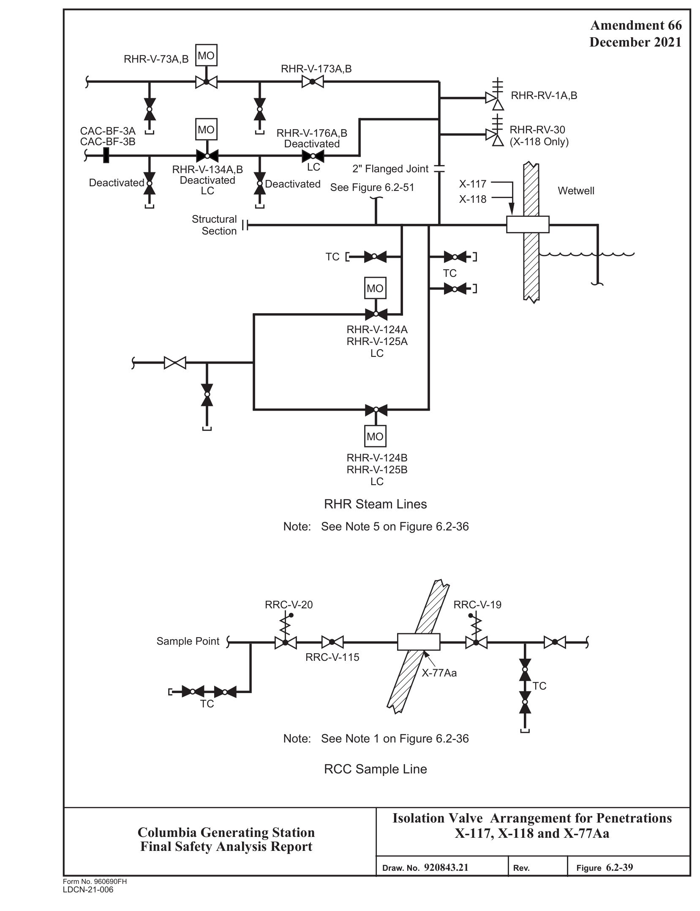

*figure on PDF page 195*

[Vector original (SVG, lossless): fig_page-195.svg](../figures/fig_page-195.svg)

<!-- labels/text on this figure page -->
Amendment 66 December 2021 MO
RHR-V-73A,B
RHR-V-173A,B
RHR-RV-1A,B
RHR-RV-30
CAC-BF-3A MO
RHR-V-176A,B L..J L..J
CAC-BF-3B
(X-118 Only) Deactivated
LC 2" Flanged Joint RHR-V-134A,B Deactivated Deactivated
X-117
Deactivated See Figure 6.2-51 LC Wetwell
X-118
L..J Structural Section
TC TC MO
RHR-V-124A
RHR-V-125A
LC
L..J MO
RHR-V-124B
RHR-V-125B
LC RHR Steam Lines Note: See Note 5 on Figure 6.2-36
RRC-V-20
RRC-V-19
Sample Point
RRC-V-115
X-77Aa TC TC
L..J Note: See Note 1 on Figure 6.2-36
RCC Sample Line
Isolation Valve Arrangement for Penetrations Columbia Generating Station X-117, X-118 and X-77Aa Final Safety Analysis Report 920843.21 6.2-39 Draw. No. Rev. Figure Form No. 960690FH
LDCN-21-006

<!-- p.196 -->
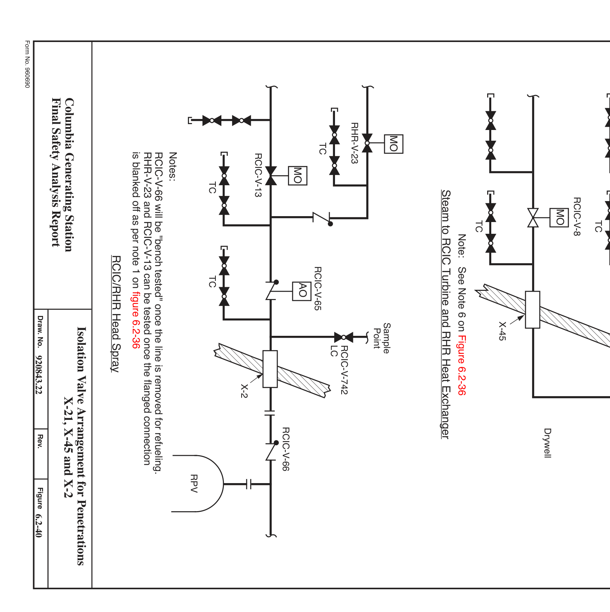

*figure on PDF page 196*

[Vector original (SVG, lossless): fig_page-196.svg](../figures/fig_page-196.svg)

<!-- labels/text on this figure page -->
Amendment 53 November 1998
RCIC-V-76
MO
RCIC-V-64
MO MO
To MS Line LC
RCIC-V-63
X-21 r.i r:i TC
RCIC-V-8
MO Drywell
/ X-45 r:, TC Note: See Note 6 on Figure 6.2-36 Steam to RCIC Turbine and RHR Heat Exchanger
MO Sample Point
RHR-V-23
RCIC-V-742
LC r., TC
RCIC-V-65
AO MO
RCIC-V-66
I
RCIC-V-13
I! •=• •=• X-2
r., r., TC TC RPV Notes:
RCIC-V-66 will be "bench tested" once the line is removed for refueling.
RHR-V-23 and RCIC-V-13 can be tested once the flanged connection is blanked off as per note 1 on figure 6.2-36 RCIC/RHR Head Spray
Isolation Valve Arrangement for Penetrations Columbia Generating Station X-21, X-45 and X-2 Final Safety Analysis Report Draw. No. 920843.22 Rev. Figure 6.2-40 Form No. 960690

<!-- p.197 -->
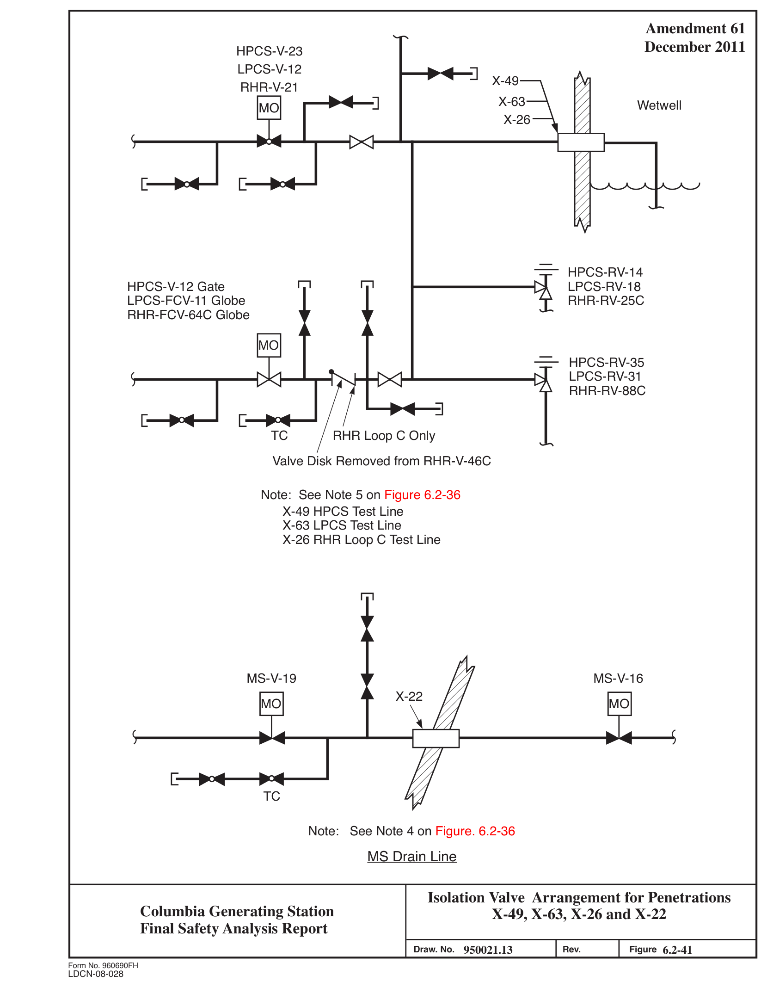

*figure on PDF page 197*

[Vector original (SVG, lossless): fig_page-197_2.svg](../figures/fig_page-197_2.svg)

<!-- labels/text on this figure page -->
Amendment 61 December 2011
HPCS-V-23
LPCS-V-12
X-49
RHR-V-21
X-63 Wetwell MO X-26
HPCS-RV-14
r., r., HPCS-V-12 Gate
LPCS-RV-18
LPCS-FCV-11 Globe
RHR-RV-25C
RHR-FCV-64C Globe
MO
HPCS-RV-35
LPCS-RV-31
RHR-RV-88C
TC RHR Loop C Only Valve Disk Removed from RHR-V-46C
Note: See Note 5 on Figure 6.2-36 X-49 HPCS Test Line X-63 LPCS Test Line X-26 RHR Loop C Test Line
r.,
MS-V-19
MS-V-16
X-22 MO MO
TC
Note: See Note 4 on Figure. 6.2-36 MS Drain Line
Isolation Valve Arrangement for Penetrations Columbia Generating Station X-49, X-63, X-26 and X-22 Final Safety Analysis Report 950021.13 6.2-41 Draw. No. Rev. Figure Form No. 960690FH
LDCN-08-028

<!-- p.198 -->
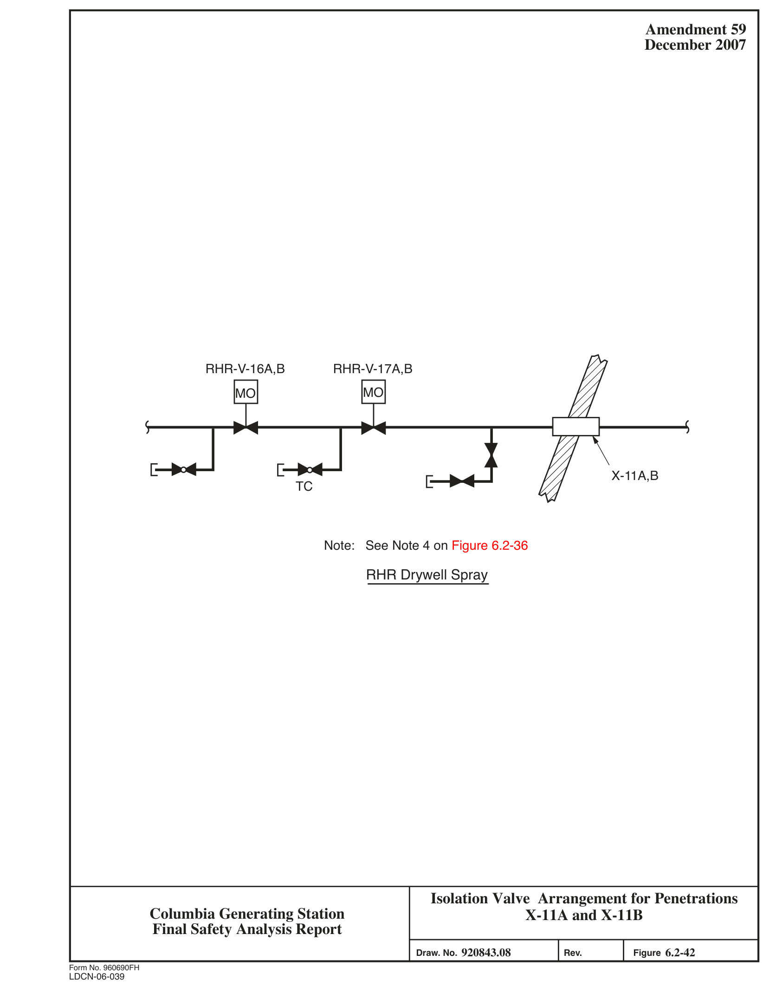

*figure on PDF page 198*

[Vector original (SVG, lossless): fig_page-198_2.svg](../figures/fig_page-198_2.svg)

<!-- labels/text on this figure page -->
Amendment 59 December 2007
RHR-V-16A,B RHR-V-17A,B
MO MO
X-11A,B
TC
Note: See Note 4 on Figure 6.2-36 RHR Drywell Spray
Isolation Valve Arrangement for Penetrations Columbia Generating Station X-11A and X-11B Final Safety Analysis Report 920843.08 6.2-42 Draw. No. Rev. Figure Form No. 960690FH
LDCN-06-039

<!-- p.199 -->
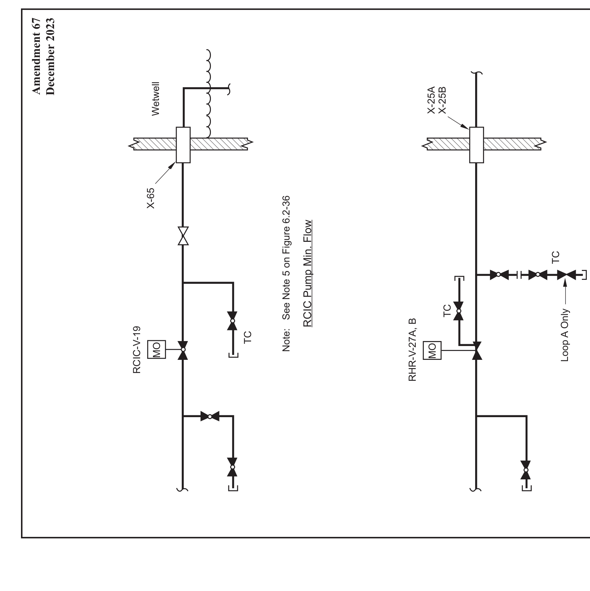

*figure on PDF page 199*

[Vector original (SVG, lossless): fig_page-199.svg](../figures/fig_page-199.svg)

<!-- labels/text on this figure page -->
Amendment 67 December 2023
RCIC-V-19
X-65 Wetwell MO
L!J L!.J TC
Note: See Note 5 on Figure 6.2-36
RCIC Pump Min. Flow
RHR-V-27A, B
X-25A
MO
X-25B
TC l'i1
I 1111=11111 L!J TC Loop A Only 11-: ◄ :] t
Note: See Note 9 on Figure 6.2-36 RHR Wetwell Spray
Isolation Valve Arrangement for Penetrations Columbia Generating Station X-65, X-25A and X-25B Final Safety Analysis Report 920843.09 1 6.2-43 Draw. No. Rev. Figure Form No. 960690FH
LDCN-23-005

<!-- p.200 -->
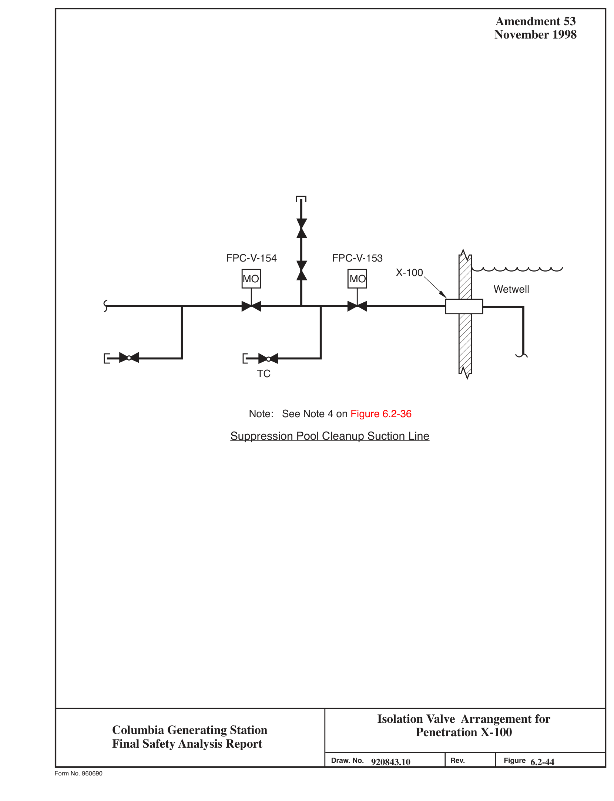

*figure on PDF page 200*

[Vector original (SVG, lossless): fig_page-200.svg](../figures/fig_page-200.svg)

<!-- labels/text on this figure page -->
Amendment 53 November 1998
FPC-V-154 FPC-V-153
X-100
MO MO Wetwell
TC
Note: See Note 4 on Figure 6.2-36 Suppression Pool Cleanup Suction Line
Isolation Valve Arrangement for Columbia Generating Station Penetration X-100 Final Safety Analysis Report Draw. No. 920843.10 Rev. Figure 6.2-44 Form No. 960690

<!-- p.201 -->
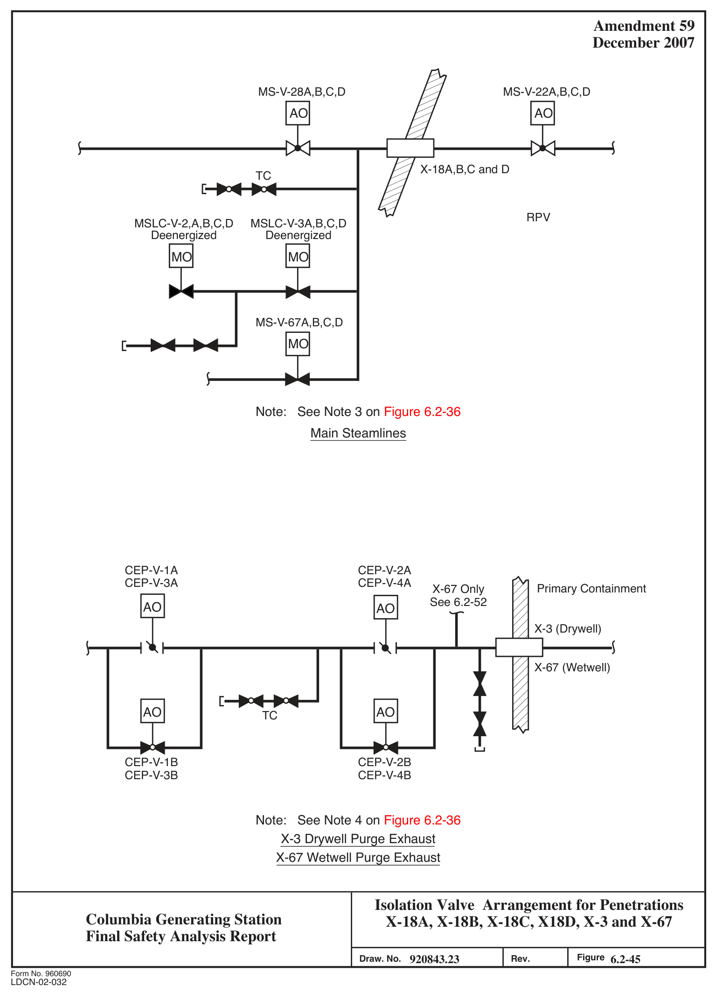

*figure on PDF page 201*

[Vector original (SVG, lossless): fig_page-201_2.svg](../figures/fig_page-201_2.svg)

<!-- labels/text on this figure page -->
Amendment 59 December 2007
MS-V-28A,B,C,D
MS-V-22A,B,C,D
AO AO
X-18A,B,C and D TC
RPV
MSLC-V-2,A,B,C,D MSLC-V-3A,B,C,D
Deenergized Deenergized MO MO
MS-V-67A,B,C,D
MO
Note: See Note 3 on Figure 6.2-36 Main Steamlines
CEP-V-1A
CEP-V-2A
CEP-V-3A
CEP-V-4A
X-67 Only Primary Containment See 6.2-52 AO AO X-3 (Drywell)
X-67 (Wetwell)
[ ~ AO AO TC
CEP-V-1B
CEP-V-2B
CEP-V-3B
CEP-V-4B
Note: See Note 4 on Figure 6.2-36 X-3 Drywell Purge Exhaust X-67 Wetwell Purge Exhaust
Isolation Valve Arrangement for Penetrations Columbia Generating Station X-18A, X-18B, X-18C, X18D, X-3 and X-67 Final Safety Analysis Report 920843.23 6.2-45 Draw. No. Rev. Figure Form No. 960690
LDCN-02-032

<!-- p.202 -->
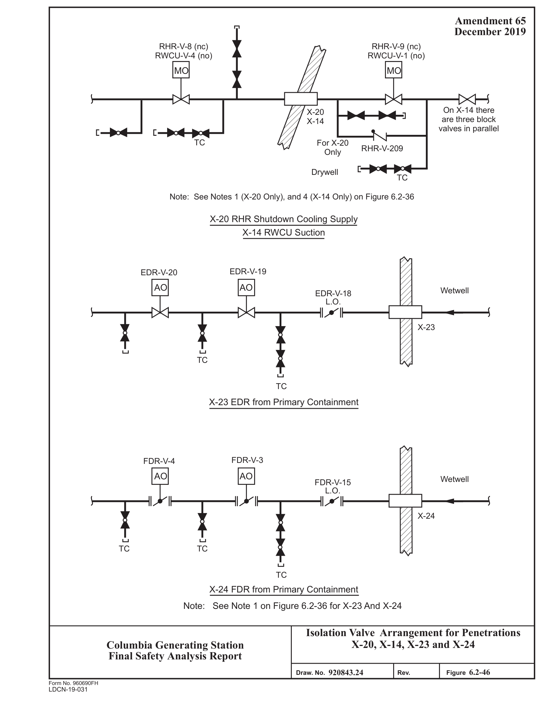

*figure on PDF page 202*

[Vector original (SVG, lossless): fig_page-202_2.svg](../figures/fig_page-202_2.svg)

<!-- labels/text on this figure page -->
Amendment 65 December 2019 RHR-V-9 (nc)
RHR-V-8 (nc)
RWCU-V-1 (no)
RWCU-V-4 (no)
MO MO
On X-14 there X-20 are three block X-14 valves in parallel TC For X-20
RHR-V-209
Only
Drywell TC
Note: See Notes 1 (X-20 Only), and 4 (X-14 Only) on Figure 6.2-36
X-20 RHR Shutdown Cooling Supply X-14 RWCU Suction
EDR-V-19 EDR-V-20
AO AO Wetwell
EDR-V-18
L.O.
i---......------11/li--------i .......................
X-23
u u TC
u TC X-23 EDR from Primary Containment
FDR-V-3
FDR-V-4
AO AO Wetwell
FDR-V-15
L.O.
X-24
u u TC TC
u TC X-24 FDR from Primary Containment Note: See Note 1 on Figure 6.2-36 for X-23 And X-24
Isolation Valve Arrangement for Penetrations X-20, X-14, X-23 and X-24 Columbia Generating Station Final Safety Analysis Report 6.2-46 Draw. No. Rev. Figure 920843.24 Form No. 960690FH
LDCN-19-031

<!-- p.203 -->
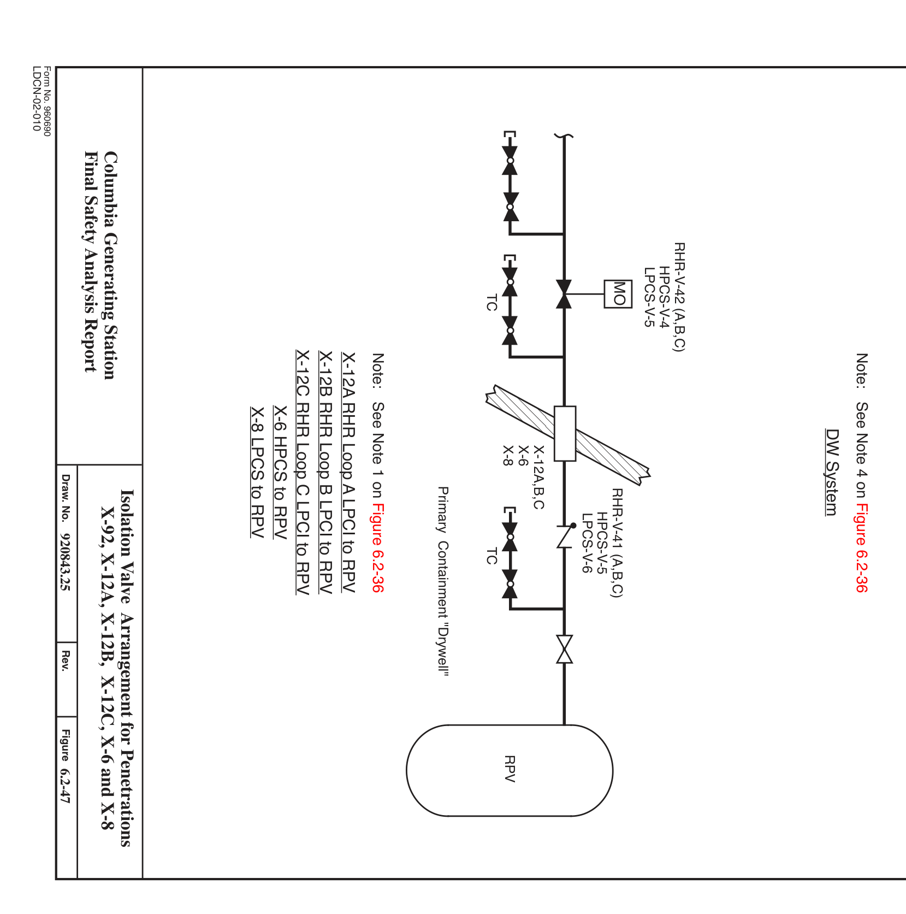

*figure on PDF page 203*

[Vector original (SVG, lossless): fig_page-203.svg](../figures/fig_page-203.svg)

<!-- labels/text on this figure page -->
Amendment 57 December 2003
DW-V-156
DW-V-157
LC X-92
LC
r., TC
Note: See Note 4 on Figure 6.2-36 DW System
RHR-V-42 (A,B,C)
HPCS-V-4
LPCS-V-5
MO
RHR-V-41 (A,B,C)
HPCS-V-5
LPCS-V-6
X-12A,B,C
X-6 RPV r:, r:, X-8 ...
TC TC
Primary Containment "Drywell"
Note: See Note 1 on Figure 6.2-36 X-12A RHR Loop A LPCI to RPV X-12B RHR Loop B LPCI to RPV X-12C RHR Loop C LPCI to RPV X-6 HPCS to RPV X-8 LPCS to RPV
Isolation Valve Arrangement for Penetrations Columbia Generating Station X-92, X-12A, X-12B, X-12C, X-6 and X-8 Final Safety Analysis Report 920843.25 6.2-47 Draw. No. Rev. Figure Form No. 960690
LDCN-02-010

<!-- p.204 -->
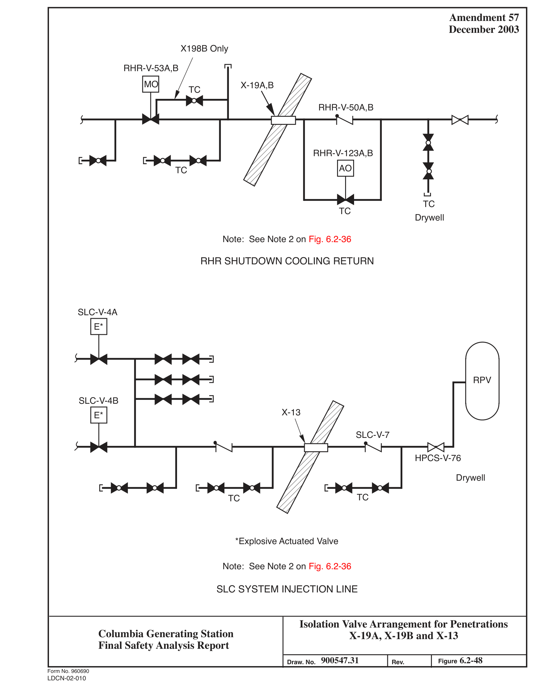

*figure on PDF page 204*

[Vector original (SVG, lossless): fig_page-204_2.svg](../figures/fig_page-204_2.svg)

<!-- labels/text on this figure page -->
Amendment 57 December 2003 X198B Only
RHR-V-53A,B r., MO
X-19A,B
TC
RHR-V-50A,B
RHR-V-123A,B
AO TC
TC TC Drywell
Note: See Note 2 on Fig. 6.2-36
RHR SHUTDOWN COOLING RETURN
SLC-V-4A
E*
.,.._~-----------------3
...... -~-~-3
RPV
...... -~-~-3 SLC-V-4B
X-13 E*
SLC-V-7
HPCS-V-76
Drywell
TC TC
*Explosive Actuated Valve
Note: See Note 2 on Fig. 6.2-36
SLC SYSTEM INJECTION LINE
Isolation Valve Arrangement for Penetrations Columbia Generating Station X-19A, X-19B and X-13 Final Safety Analysis Report 900547.31 6.2-48 Draw. No.
Rev. Figure Form No. 960690
LDCN-02-010

<!-- p.205 -->
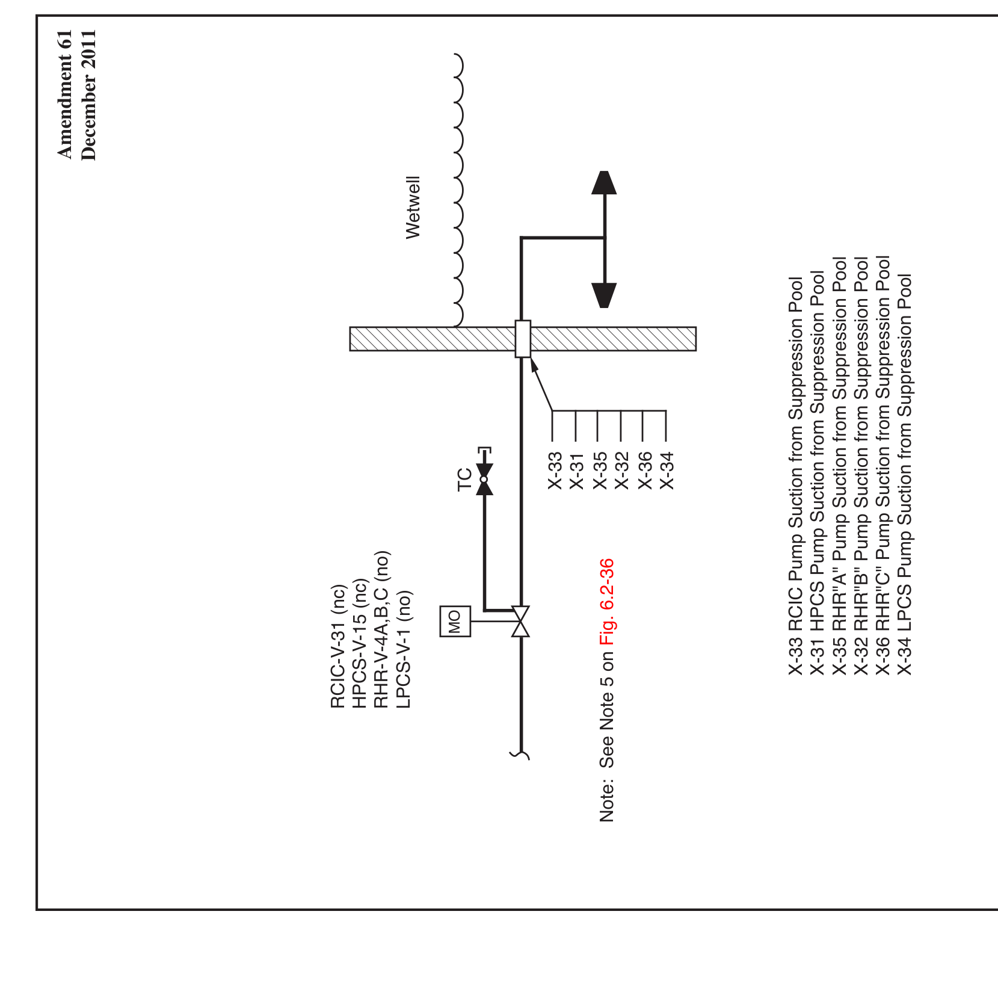

*figure on PDF page 205*

[Vector original (SVG, lossless): fig_page-205_2.svg](../figures/fig_page-205_2.svg)

<!-- labels/text on this figure page -->
Amendment 61 December 2011
RCIC-V-31 (nc)
HPCS-V-15 (nc)
RHR-V-4A,B,C (no)
LPCS-V-1 (no)
Wetwell
MO TC l"i1
X-33 X-31 X-35 Note: See Note 5 on Fig. 6.2-36 X-32 X-36 X-34
X-33 RCIC Pump Suction from Suppression Pool X-31 HPCS Pump Suction from Suppression Pool X-35 RHR"A" Pump Suction from Suppression Pool X-32 RHR"B" Pump Suction from Suppression Pool X-36 RHR"C" Pump Suction from Suppression Pool X-34 LPCS Pump Suction from Suppression Pool
Isolation Valve Arrangement for Penetrations X-33, X-31, X-35, X-32, X-36 and X-34 Columbia Generating Station Final Safety Analysis Report 920843.04 6.2-49 Draw. No. Rev. Figure Form No. 960690FH
LDCN-08-028

<!-- p.206 -->
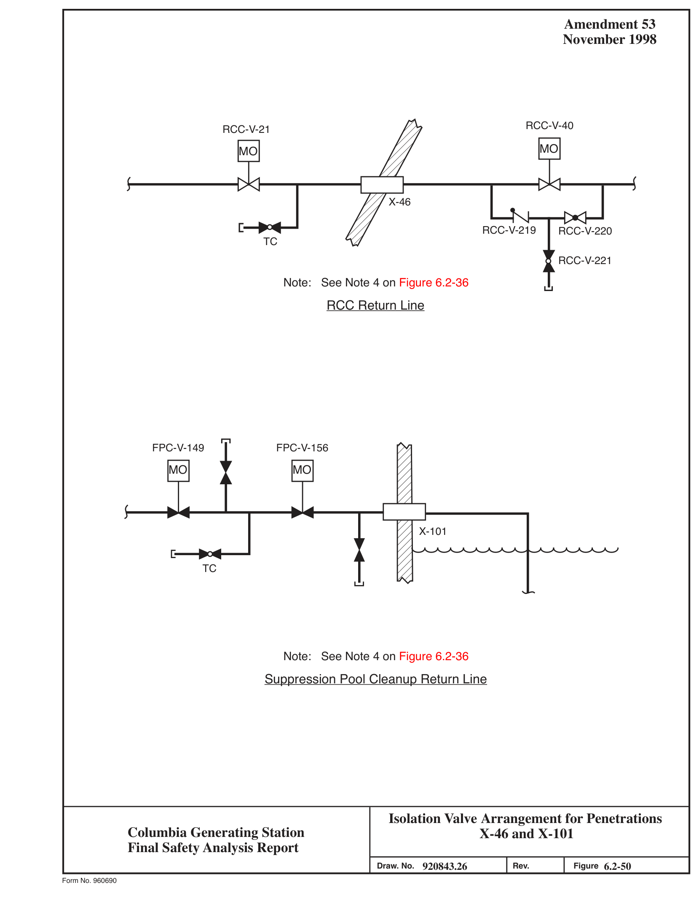

*figure on PDF page 206*

[Vector original (SVG, lossless): fig_page-206_2.svg](../figures/fig_page-206_2.svg)

<!-- labels/text on this figure page -->
Amendment 53 November 1998
RCC-V-40
RCC-V-21
MO MO
X-46
RCC-V-219 RCC-V-220
TC
RCC-V-221
Note: See Note 4 on Figure 6.2-36 RCC Return Line
r:,
FPC-V-149
FPC-V-156
MO MO
X-101
TC
Note: See Note 4 on Figure 6.2-36 Suppression Pool Cleanup Return Line
Isolation Valve Arrangement for Penetrations Columbia Generating Station X-46 and X-101 Final Safety Analysis Report 920843.26 6.2-50 Draw. No. Rev. Figure Form No. 960690

<!-- p.207 -->
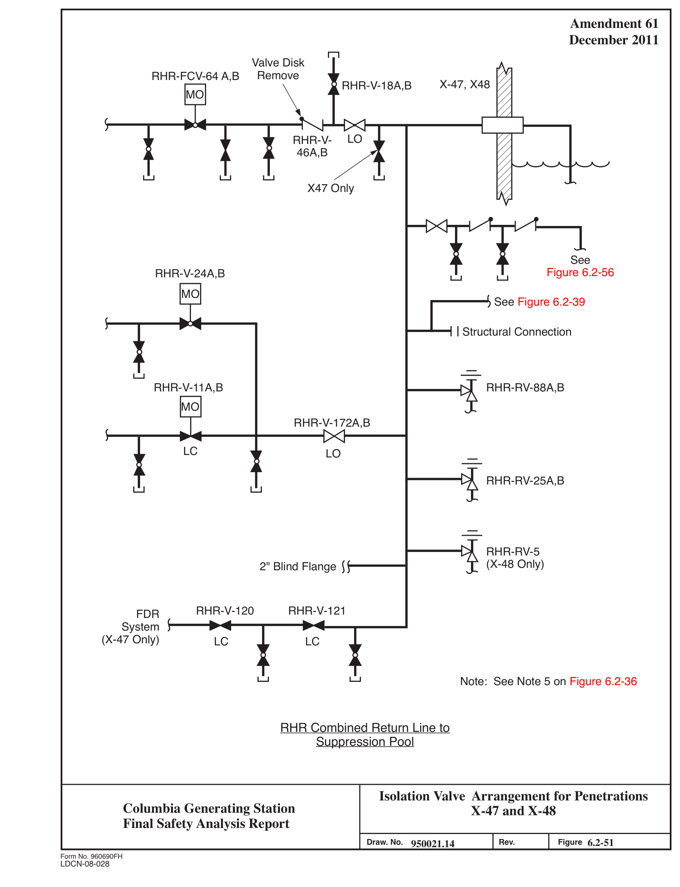

*figure on PDF page 207*

[Vector original (SVG, lossless): fig_page-207_2.svg](../figures/fig_page-207_2.svg)

<!-- labels/text on this figure page -->
Amendment 61 December 2011 r:, Valve Disk Remove RHR-FCV-64 A,B
X-47, X48 RHR-V-18A,B
MO
LO RHR-V-
46A,B
L.:.J L.:.J L.:.J L.:.J X47 Only
See Figure 6.2-56
RHR-V-24A,B
L.J L.J
MO See Figure 6.2-39
Structural Connection
L.J
RHR-V-11A,B
RHR-RV-88A,B
MO
RHR-V-172A,B
LC LO
RHR-RV-25A,B
L.:.J L.:.J
RHR-RV-5
(X-48 Only) 2" Blind Flange
RHR-V-120 RHR-V-121
FDR System
(X-47 Only) LC LC
Note: See Note 5 on Figure 6.2-36 L.J L.J
RHR Combined Return Line to Suppression Pool
Isolation Valve Arrangement for Penetrations Columbia Generating Station X-47 and X-48 Final Safety Analysis Report 6.2-51 Draw. No. 950021.14 Rev. Figure Form No. 960690FH
LDCN-08-028

<!-- p.208 -->
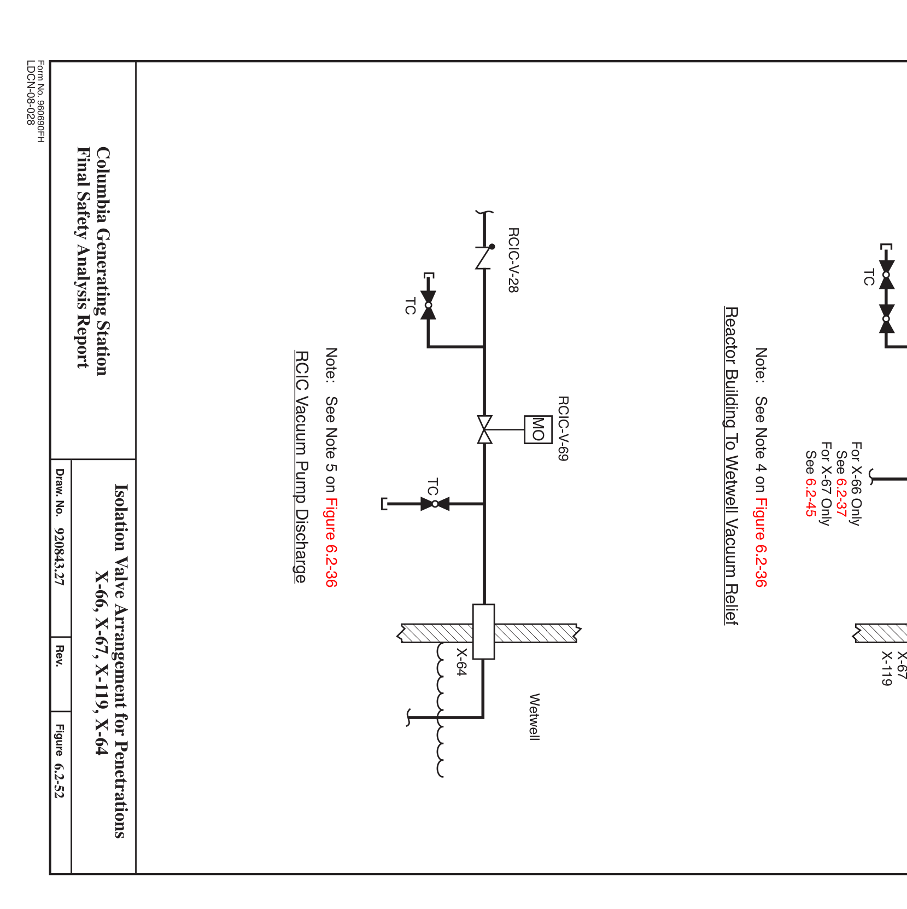

*figure on PDF page 208*

[Vector original (SVG, lossless): fig_page-208_2.svg](../figures/fig_page-208_2.svg)

<!-- labels/text on this figure page -->
Amendment 61 December 2011
:I
CSP-V-7
CSP-V-5
X-119 CSP-V-8
CSP-V-6
Only CSP-V-10
CSP-V-9
S-----0
AO AO Wetwell
X-66 X-67
X-119
TC For X-66 Only See 6.2-37 For X-67 Only See 6.2-45
Note: See Note 4 on Figure 6.2-36 Reactor Building To Wetwell Vacuum Relief
RCIC-V-69
MO Wetwell
RCIC-V-28
I
X-64 .. =• TC r., TC i:
Note: See Note 5 on Figure 6.2-36 RCIC Vacuum Pump Discharge
Isolation Valve Arrangement for Penetrations Columbia Generating Station
X-66, X-67, X-119, X-64
Final Safety Analysis Report 920843.27 6.2-52 Draw. No. Rev. Figure Form No. 960690FH
LDCN-08-028

<!-- p.209 -->
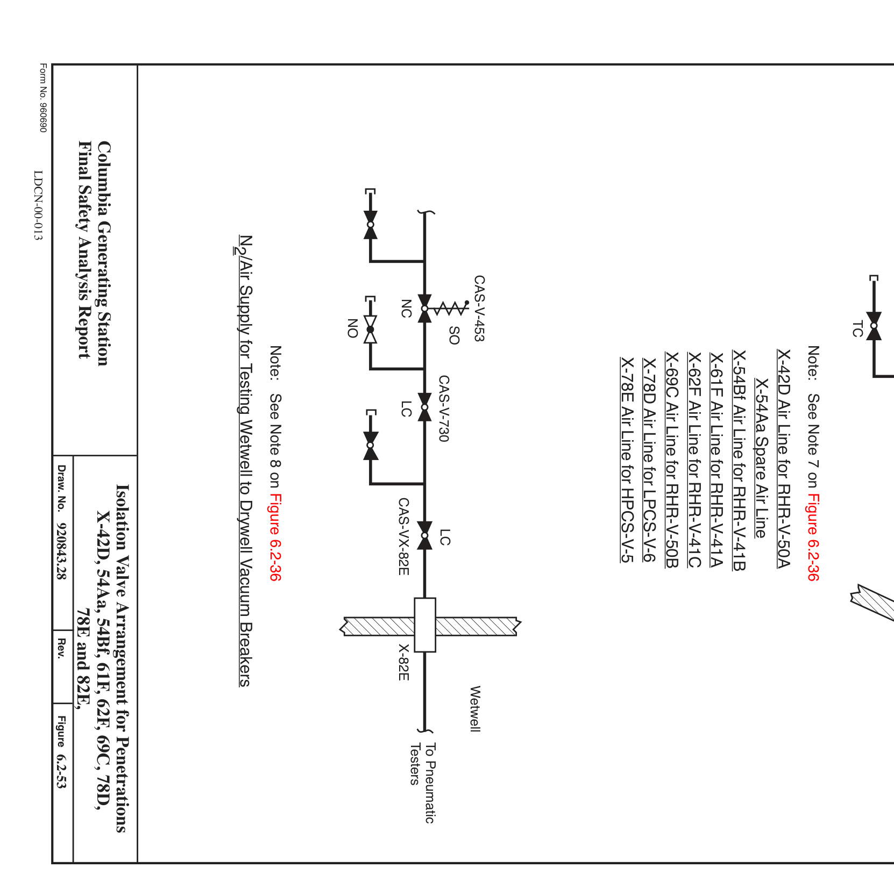

*figure on PDF page 209*

[Vector original (SVG, lossless): fig_page-209.svg](../figures/fig_page-209.svg)

<!-- labels/text on this figure page -->
Amendment 56 December 2001
PI-V-X-42D
PI-V-X-216
RCIC-V-740
RCIC-V-184
PI-V-X-54Bf
PI-V-X-218
PI-V-X-61F
PI-V-X-219
PI-V-X-62F
PI-V-X-220
PI-V-X-69C
PI-V-X-221
Drywell
LPCS-V-66
LPCS-V-67
HPCS-V-65
HPCS-V-68
To Pneumatic Tester on Check LC Valves LC
r:i TC
Note: See Note 7 on Figure 6.2-36 X-42D Air Line for RHR-V-50A X-54Aa Spare Air Line X-54Bf Air Line for RHR-V-41B X-61F Air Line for RHR-V-41A X-62F Air Line for RHR-V-41C X-69C Air Line for RHR-V-50B X-78D Air Line for LPCS-V-6 X-78E Air Line for HPCS-V-5
CAS-V-453
Wetwell SO
LC CAS-V-730
To Pneumatic Testers
NC LC CAS-VX-82E X-82E
r:, r., NO
Note: See Note 8 on Figure 6.2-36 N2/Air Supply for Testing Wetwell to Drywell Vacuum Breakers I I
Isolation Valve Arrangement for Penetrations Columbia Generating Station X-42D, 54Aa, 54Bf, 61F, 62F, 69C, 78D, Final Safety Analysis Report 78E and 82E, 920843.28 6.2-53 Draw. No. Rev. Figure Form No. 960690 LDCN-00-013

<!-- p.210 -->

*figure on PDF page 210*

[Vector original (SVG, lossless): fig_page-210_2.svg](../figures/fig_page-210_2.svg)

<!-- labels/text on this figure page -->
Amendment 64 November 2017
PI-VX-250
PI-VX-251
PI-VX-256
PI-VX-257
SO SO Drywell
X-85A
X-29A
r:, TC
X-85C
X-29C
Note: See Note 1 on Figure 6.2-36 Radiation Monitor Supply Line Division A Radiation Monitor Supply Line Division B
PI-VX-253
PI-VX-259
SO
X-72F
PI-V-X72F/1
X-73E
PI-V-X73E/1
r:,
Note: See Note 1 on Figure 6.2-36 Radiation Monitor Return Line Division A Radiation Monitor Return Line Division B
Isolation Valve Arrangement for Penetrations Columbia Generating Station X-85A, X-29A, X-85C, X-29C, X-72F, and X-73E Final Safety Analysis Report 920843.29 6.2-54 Draw. No.
Rev. Figure Form No. 960690
LDCN-17-001

<!-- p.211 -->

*figure on PDF page 211*

[Vector original (SVG, lossless): fig_page-211.svg](../figures/fig_page-211.svg)

<!-- labels/text on this figure page -->
Amendment 53 November 1998
RCC-V-104 RCC-V-5
Drywell MO MO
X-5 I •=• :] •=• □ I
Note: See Note 4 on Figure 6.2-36 RCC Supply Line
Drywell
SA-V-109
- □- I ~... I I I( GI I \ X-93 Pipe Cap
l"i"I
Note: See Note 1 on Figure 6.2-36 Service Air for Maintenance
Isolation Valve Arrangement for Penetrations Columbia Generating Station X-5 and X-93 Final Safety Analysis Report 920843.30 6.2-55 Draw. No. Rev. Figure Form No. 960690

<!-- p.212 -->

*figure on PDF page 212*

[Vector original (SVG, lossless): fig_page-212.svg](../figures/fig_page-212.svg)

<!-- labels/text on this figure page -->
Amendment 53 November 1998
Wetwell
X-116
MO
r.i
See Fig 6.2-51 n
r:,
MO
r.i
C:
RCIC-V-68
Wetwell a,11
TC MO
RCIC-V-40
r:i
I X-4
l!I TC
Note: See Note 4 on Figure 6.2-36 RCIC Turbine Exhaust and Turbine Exhaust Vacuum Breaker
Isolation Valve Arrangement for Penetrations Columbia Generating Station X-4 and X-116 Final Safety Analysis Report 920843.31 6.2-56 Draw. No. Rev. Figure Form No. 960690

<!-- p.213 -->

*figure on PDF page 213*

[Vector original (SVG, lossless): fig_page-213.svg](../figures/fig_page-213.svg)

<!-- labels/text on this figure page -->
Amendment 63 December 2015
PSR-V-X77A2
PSR-V-X77A1
PSR-V-X77A4
PSR-V-X77A3
SO SO
X-77Ac X-77Ad TC
Note: See Note 1 on Figure 6.2-36 u X-77Ac Jet Pump #10 Sample Line X-77Ad Jet Pump #20 Sample Line
PSR-V-X73-2
PSR-V-X73-1
PSR-V-X80-2
PSR-V-X80-1
SO SO Drywell
X-73F
X-80B
TC L.:.I
Note: See Note 1 on Figure 6.2-36 X-80B Drywell Atmosphere Sample Line X-73F Drywell Atmosphere Sample Line
Isolation Valve Arrangement for Penetrations Columbia Generating Station X-73F, X-77Ac, X-77Ad, X-80B Final Safety Analysis Report 920843.32 1 6.2-57 Draw. No.
Rev. Figure Form No. 960690
LDCN-15-036

<!-- p.214 -->

*figure on PDF page 214*

[Vector original (SVG, lossless): fig_page-214.svg](../figures/fig_page-214.svg)

<!-- labels/text on this figure page -->
Amendment 63 December 2015
PSR-V-X82-2 PSR-V-X82-1
PSR-V-X88-2 PSR-V-X88-1
SO SO Wetwell
(X-88 Only)
X-82D
X-88
TC (X-88 Only)
Note: See Note 1 on Figure 6.2-36 X-82D - Sample Return to Suppression Pool X-88 - Suppression Pool Sample Line
PSR-V-X83-2 PSR-V-X83-1
PSR-V-X84-2 PSR-V-X84-1
PSR-V-X82-8 PSR-V-X82-7
SO SO Wetwell
X-83A
X-84F
[l __ .. .,,_ ...
X-82F
TC
Note: See Note 1 on Figure 6.2-36 X-82F- Suppression Pool Atm. Sample Return X-83A- Suppression Pool Atm. Sample Line X-84F- Suppression Pool Atm. Sample Line
Isolation Valve Arrangement for Penetrations Columbia Generating Station
X-82D, X-82F, X-83A, X-84F, X-88
Final Safety Analysis Report 920843.33 1 6.2-58 Draw. No.
Rev. Figure Form No. 960690
LDCN-15-036

<!-- p.215 -->

*figure on PDF page 215*

[Vector original (SVG, lossless): fig_page-215_2.svg](../figures/fig_page-215_2.svg)

<!-- labels/text on this figure page -->
Amendment 53 November 1998
MWR-V-124
Drywell
MWR-V-125
T.C.
X-94 X-95
X-94 - Decon Solution Supply Header X-95 - Decon Solution Return Header
Isolation Valve Arrangement for Penetrations Columbia Generating Station X-94 and X-95 Final Safety Analysis Report 920843.34 6.2-59 Draw. No. Rev. Figure Form No. 960690

<!-- p.216 -->

*figure on PDF page 216*

[Vector original (SVG, lossless): fig_page-216.svg](../figures/fig_page-216.svg)

<!-- labels/text on this figure page -->
Amendment 54 April 2000
DELETED
(SHEETS 1 THROUGH 4)
Columbia Generating Station Final Safety Analysis Report
I I 960222.68 6.2-60
Figure Draw. No. Rev.
Form No. 960690

<!-- p.217 -->

*figure on PDF page 217*

[Vector original (SVG, lossless): fig_page-217.svg](../figures/fig_page-217.svg)

<!-- labels/text on this figure page -->
Amendment 64 December 2017
HCV-V-1 '
HCV-V-2
~ Wetwell ~ ~ ~ ,, :1 : .I ,.
I ~ V. ~ LC ~ LC
• • ••
~ X-58
~ I LC ~ ~ LC I • I • I,:, I,' I
TC TC
Isolation Valve Arrangement for Penetration Columbia Generating Station X-58 Final Safety Analysis Report
I I 170619.1 6.2-60A
Draw. No.
Rev. Figure Form No. 960690
LDCN-15-033

<!-- p.218 -->

*figure on PDF page 218*

[Vector original (SVG, lossless): fig_page-218.svg](../figures/fig_page-218.svg)

<!-- labels/text on this figure page -->
Amendment 58 December 2005
Minimum ECCS I 200 Service Water Temperature = 95°F
Metal Sensible Energy (BTUx106)
100
0 102 103 104 105 106 107 30
Time (Seconds)
Sensible Energy Transient in the Reactor Vessel Columbia Generating Station and Internal Metals - Original Rated Power Final Safety Analysis Report 960222.66 6.2-61 Draw. No.
Rev. Figure Form No. 960690FH
LDCN-05-002

