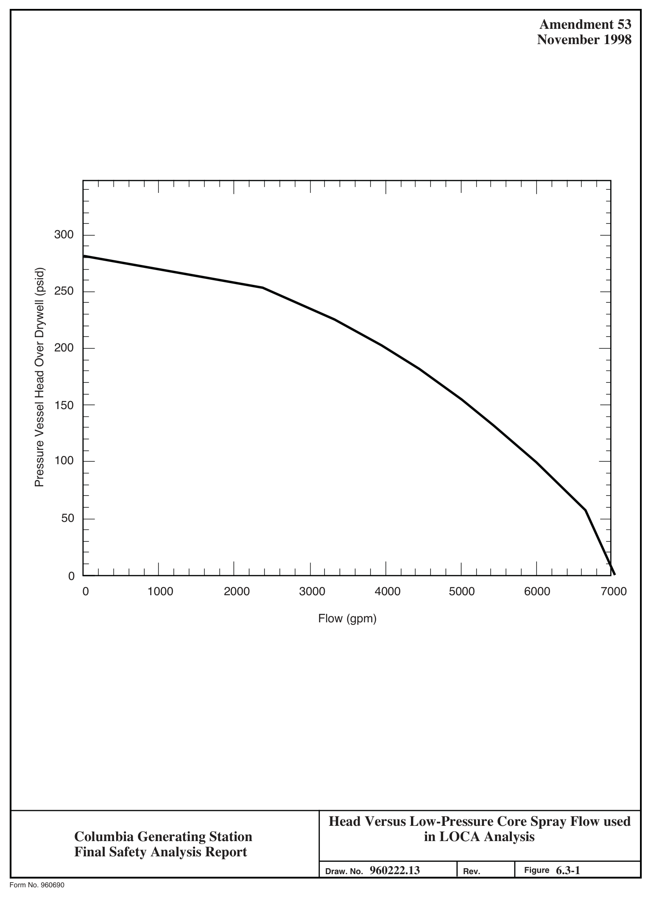
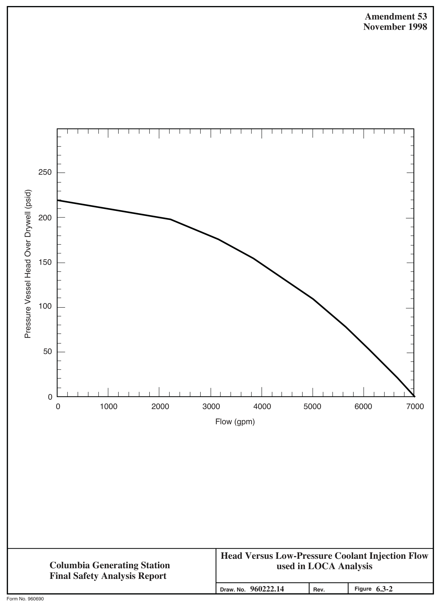
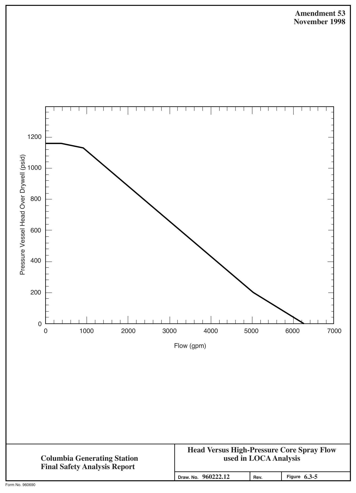
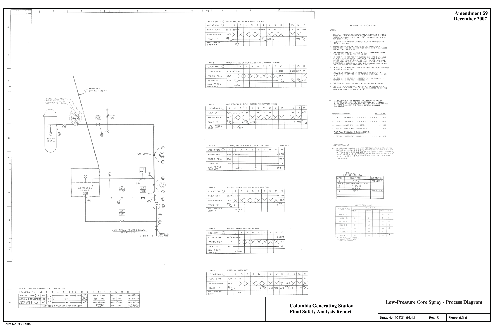
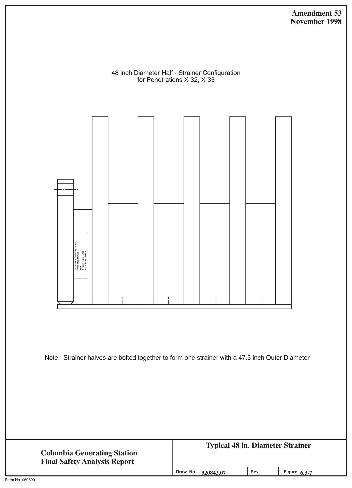
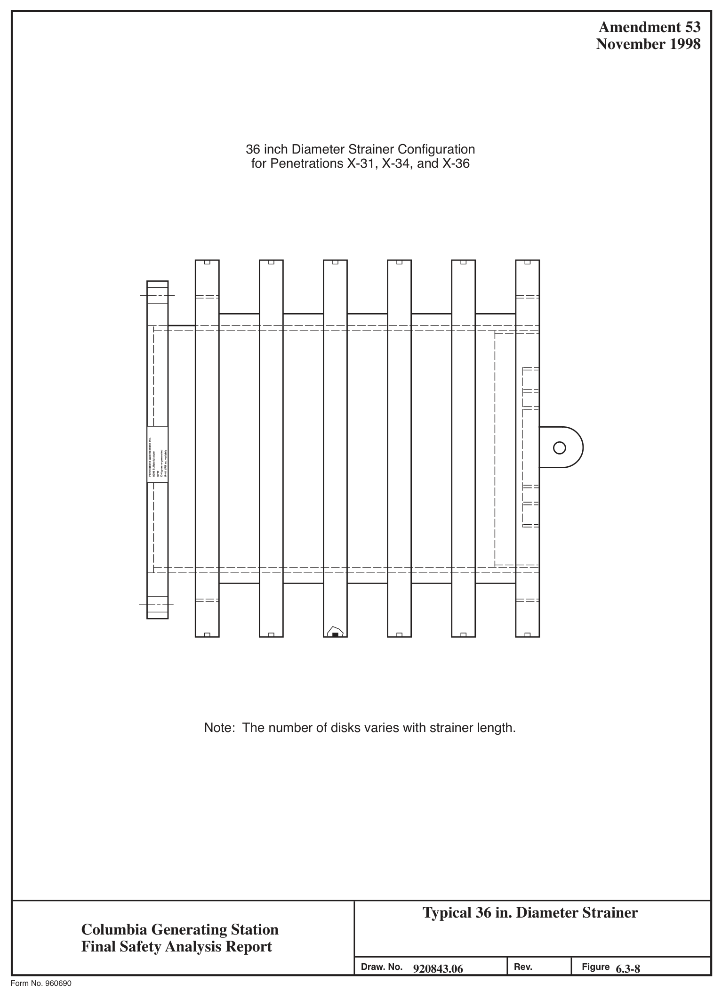
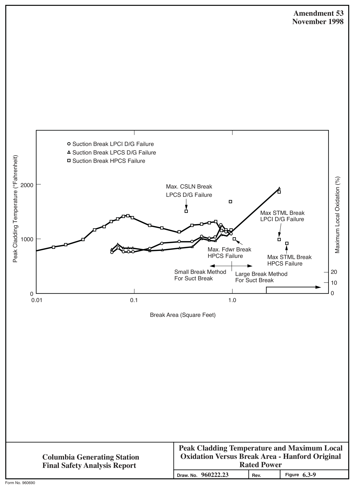

# 6.3 EMERGENCY CORE COOLING SYSTEM

> Columbia Generating Station FSAR — Chapter 06: Engineered Safety Features
> Source: `06_chapter-2257-2549.pdf`, PDF pages 219–271 (of 293)
> Amendment 67 compilation (individual pages carry varying amendment dates)

---
<!-- p.219 -->
### 6.3 EMERGENCY CORE COOLING SYSTEM
This section provides the design bases for the emergency core cooling systems (ECCS), the description of the systems, the postulated ECCS response to a spectrum of accidents, and a performance evaluation. Subsection 6.3.1 discusses the design bases. Subsection 6.3.2 describes the systems. Subsection 6.3.3 discusses the system responses and the evaluation of the system performance. The ECCS design and postulated response are based on information developed by the original nuclear steam supply system (NSSS) vendor, General Electric.

#### 6.3.1 DESIGN BASES AND SUMMARY DESCRIPTION
Reload analysis performed by the fuel vendor in support of the current cycle of operation is performed in a manner that maintains the validity of the design analysis discussed in this section. The operational limits resulting from this cycle-specific analysis are reported in the cycle-specific Core Operating Limits Report (COLR).

##### 6.3.1.1 Design Bases
###### 6.3.1.1.1 Performance and Functional Requirements
The ECCS is designed to provide protection against postulated loss-of-coolant accidents
(LOCAs) caused by ruptures in primary system piping. The functional requirements are such that the system performance under all postulated LOCA conditions satisfies the requirements of

## 10 CFR 50.46. The ECCS is designed to meet the following requirements:
a. Protection is provided for any primary line break up to and including the double-ended guillotine (DEG) break of the largest line,

b. Two independent and diverse cooling methods (flooding and spraying) are provided to cool the core,

c. One high-pressure cooling system is provided which is capable of maintaining water level above the top of the core and preventing automatic depressurization system (ADS) actuation for line breaks less than 1 in. nominal diameter,

d. No operator action is required until 10 minutes after an accident, and

e. A sufficient water source and the necessary piping, pumps, and other hardware are provided so that the containment and reactor core can be flooded for possible core heat removal following a LOCA.

<!-- p.220 -->
###### 6.3.1.1.2 Reliability Requirements
The following reliability requirements apply:

a. The ECCS conforms to licensing requirements and design practices of isolation, separation, and single failure considerations.

b. The ECCS network has a built-in redundancy so that adequate cooling can be provided, even in the event of specified failures. The following equipment makes up the ECCS:

1. High-pressure core spray (HPCS),
2. Low-pressure core spray (LPCS),
3. Low-pressure coolant injection (LPCI), three loops, and 4. Automatic depressurization system (ADS).

c. The ADS is designed to remain operational following a single active or passive component failure, including power buses, electrical and mechanical parts, cabinets, and wiring.

d. In the event of a break in a pipe that is not a part of the ECCS, no single active component failure in the ECCS can prevent automatic initiation and successful operation of less than the following combination of ECCS equipment:

1. Three LPCI loops, the LPCS and the ADS (i.e., HPCS failure), or

2. Two LPCI loops, the HPCS and the ADS (i.e., LPCS diesel generator failure), or

3. One LPCI loop, the LPCS, the HPCS and ADS (i.e., LPCI diesel generator failure).

e. In the event of a break in a pipe that is a part of the ECCS, no single active component failure in the ECCS can prevent automatic initiation and successful operation of less than the following combination of ECCS equipment:

1. Two LPCI loops and the ADS, or
2. One LPCI loop, the LPCS and the ADS, or
3. One LPCI loop, the HPCS and the ADS, or 4. The LPCS, the HPCS, and ADS.

<!-- p.221 -->
These are the minimum ECCS combinations which result after assuming any single active component failure and assuming that the ECCS line break disables the affected system.

f. Long term (10 minutes after initiation signal) cooling requires the removal of decay heat by means of the standby service water system. In addition to the break which initiated the loss of coolant event, the system is able to sustain one failure, either active or passive, and still have at least one ECCS pump (LPCI, HPCS, or LPCS) operating with a residual heat removal (RHR) heat exchanger loop with 100% service water flow.

g. Offsite power is the preferred source of power for the ECCS network and every reasonable precaution is made to ensure its high availability. However, onsite emergency power is provided with sufficient diversity and capacity so that all the above requirements can be met if offsite power is not available.

h. The onsite diesel fuel reserve is designed in accordance with IEEE 308-1971 criteria.

i. Diesel-load configuration is as follows:

l. LPCI loop A (with heat exchanger) and the LPCS connected to the Division 1 diesel generator.

2. LPCI loop B (with heat exchanger) and loop C connected to the Division 2 diesel generator.

3. The HPCS connected to the Division 3 diesel generator.

j. Systems which interface with but are not part of the ECCS are designed and operated such that failure(s) in the interfacing systems do not propagate to and/or affect the performance of the ECCS.

k. Non-ECCS systems interfacing with the ECCS buses are automatically shed from and/or isolated from the ECCS buses when a LOCA signal exists and offsite ac power is not available.

l. No more than one storage battery is connected to a dc power bus.

m. The logic required to automatically initiate the ECCS is capable of being tested during plant operation. Each system of the ECCS including flow rate and sensing network is capable of being tested during shutdown or during reactor operation. Pump discharge is routed to the suppression pool or condensate

<!-- p.222 -->
storage tank through a test line. The injection line isolation valves and isolation check valves are tested in accordance with Section 3.9.6.

n. Provisions for testing the ECCS network components (electronic, mechanical, hydraulic, and pneumatic, as applicable) are installed in such a manner that they are an integral and nonseparable part of the design.

###### 6.3.1.1.3 Emergency Core Cooling System Requirements for Protection from Physical
Damage

The ECCS piping and components are protected against damage from movement, thermal stresses, the effects of the LOCA, and the safe shutdown earthquake (SSE).

The ECCS is protected against the effects of pipe whip which might result from piping failures up to and including the LOCA. This protection is provided by separation, pipe whip restraints, or energy absorbing materials. Any of these three methods is applied to provide protection against damage to ECCS piping and components which otherwise could result in a reduction of ECCS effectiveness to an unacceptable level.

Physical separation outside the drywell is achieved as follows:

a. The ECCS is separated into three functional groups:

1. HPCS

2. LPCS and LPCI loop A with 100% service water and one RHR heat exchanger

3. LPCI loops B and C with 100% service water and one RHR heat exchanger

b. The equipment in each group is separated from that in the other two groups. In addition, HPCS and the reactor core isolation cooling (RCIC) (which is not an ECCS) are separated.

c. Separation barriers exist between the functional groups and between HPCS and RCIC as required to ensure that environmental disturbances affecting one functional group will not affect the remaining groups.

###### 6.3.1.1.4 Emergency Core Cooling System Environmental Design Basis
The only active components in the HPCS, LPCS, or LPCI systems located in the drywell are the check valves. These safety-related, injection/isolation check valves are qualified for the

<!-- p.223 -->
accident environmental requirements specified in Section 3.11 and are installed above the expected flood level in the drywell. The ADS valves are located in the drywell and are qualified to the accident environmental conditions specified in Section 3.11.

The balance of the ECCS equipment (e.g., pumps, motors) is qualified for accident environmental requirements specified in Section 3.11.

Note: “Qualification” of safety-related mechanical (SRM) equipment is not part of the Columbia Generating (CGS) Station Environmental Qualification (EQ) 10 CFR 50.49 program but is part of the process that maintains the plant design basis.

##### 6.3.1.2 Summary Descriptions of Emergency Core Cooling System
The ECCS injection network consists of an HPCS system, an LPCS system, and the LPCI mode of the RHR system. The ADS assists the injection network under certain conditions.
These systems are briefly described in this section as an introduction to more detailed system descriptions in Section 6.3.2.

###### 6.3.1.2.1 High-Pressure Core Spray
The HPCS pumps water through a peripheral ring spray sparger mounted above the reactor core. Coolant is supplied over the entire range of system operation pressures. The primary purpose of HPCS is to maintain reactor vessel inventory after small breaks which do not depressurize the reactor vessel. The HPCS also provides spray cooling heat transfer during breaks which uncover the core. The standby liquid control (SLC) system also injects to the reactor pressure vessel (RPV) by means of the HPCS core spray header. An SLC injection will occur with HPCS flow either on or off.

###### 6.3.1.2.2 Low-Pressure Core Spray
The LPCS is an independent loop similar to the HPCS, the primary difference being the LPCS delivers water over the core at low reactor pressures. The primary purpose of the LPCS is to provide inventory makeup and spray cooling during large breaks which uncover the core.
When assisted by the ADS, LPCS also provides protection for small breaks.

###### 6.3.1.2.3 Low-Pressure Coolant Injection
The LPCI is an operating mode of the RHR system. Three pumps deliver water from the suppression pool to the bypass region inside the shroud through three separate reactor vessel penetrations to provide inventory makeup following large pipe breaks. When assisted by the ADS, LPCI also provides protection for small breaks.

<!-- p.224 -->
###### 6.3.1.2.4 Automatic Depressurization System
The ADS utilizes seven of the reactor safety/relief valves (SRVs) to reduce reactor pressure during small breaks in the event of HPCS failure. When the vessel pressure is reduced to within the capacity of the low pressure systems (LPCS and LPCI), the systems provide inventory makeup so that acceptable postaccident temperatures are maintained in the core.

#### 6.3.2 SYSTEM DESIGN
##### 6.3.2.1 Schematic Piping and Instrumentation Diagrams
The process and flow diagrams for the ECCS are specified in the various Sections of 6.3.2.2.

##### 6.3.2.2 Equipment and Component Descriptions
The starting signal for the ECCS comes from at least two independent and redundant sensors I of drywell pressure and low reactor water level, except ADS which requires low reactor water I level and indication that LPCI or LPCS is available. The ECCS is actuated automatically and requires no operator action during the first 10 minutes following the accident.

The preferred source of power for all three ECCS divisions is from regular ac power to the plant. Regular ac power is from the main transformers [TR-N(1) and (2)] during plant operation or from the startup transformer (TR-S) (an offsite power source) when the main generator is off-line. Should regular ac power be lost, Division 1 (LPCS and LPCI loop A)
and Division 2 (LPCI loops B and C) would be transferred to a second offsite power supply and backup transformer (TR-B). Division 3 (HPCS) would be powered from its onsite standby diesel. If the backup transformer were also lost, Divisions 1 and 2 would then be powered from their respective and independent onsite standby diesels. A more detailed description of the power supplies for the ECCS is contained in Section 8.3.

###### 6.3.2.2.1 High-Pressure Core Spray System
Process and flow diagrams are shown in Figures 6.3-3 and 6.3-4. The HPCS system consists of a single motor-driven centrifugal pump, a spray sparger in the reactor vessel located above the core (separate from the LPCS sparger), and associated system piping, valves, controls, and instrumentation. The system is designed to operate from regular ac or from a standby diesel generator supply if offsite power is not available. The system is designed to the requirements of ASME Section III.

With the exception of the check valve on the discharge line, all active HPCS equipment is located outside the primary containment. Suction piping is provided from the condensate I storage tanks and the suppression pool. This arrangement provides HPCS the capability to use high quality water from the condensate storage tanks. In the event that the condensate storage

<!-- p.225 -->
H water supply becomes exhausted or is not available, automatic switchover to the suppression pool water source will ensure a closed cooling water supply for continuous operation of the HPCS system. The HPCS pump suction is also automatically transferred to the suppression I pool if the suppression pool water level exceeds a prescribed value. The condensate storage tanks contain a reserve of approximately 135,000 gal of water just for use by HPCS and RCIC.

Remote controls for operating the motor-operated components and diesel generator are provided in the main control room. The HPCS controls and instrumentation are described in Section 7.3.1.

The system is designed to pump water into the reactor vessel over a wide range of pressures.
For small breaks that do not result in rapid reactor depressurization, the system maintains reactor water level. For large breaks the HPCS system cools the core by a spray. The HPCS also provides for core cooling in the event of a station blackout. If a LOCA should occur, a low water level signal or a high drywell pressure signal initiates the HPCS and its support equipment. The system can also be manually placed in operation.

The HPCS injection automatically stops with a high water level in the reactor vessel by signaling the injection valve to close and it automatically starts again when a low water level signals the injection valve to open. The HPCS system also serves as a back-up to the RCIC I system in the event the reactor becomes isolated from the main condenser during operation and feedwater flow is lost.

The HPCS system head flow characteristic used for LOCA analyses is shown in Figure 6.3-5.
When the system is started, initial flow rate is established by primary system pressure. As vessel pressure decreases, flow will increase.

When vessel pressure reaches 200 psid* the system reaches rated core spray flow. The HPCS motor size is based on peak horsepower requirements.

The elevation of the HPCS pump is sufficiently below the water level of both the condensate storage tanks and the suppression pool to provide a flooded pump suction and to meet pump net positive suction head (NPSH) requirements with the containment at atmospheric pressure and the suction strainer bed entrained with debris washed into the wetwell following a LOCA.
The available NPSH at the pump suction is sufficient to meet the NPSH required (see Section 6.3.2.2.6). The available NPSH also ensures that no cavitation occurs anywhere in the pump suction line between the wetwell strainers and the pump suction.

A motor-operated valve is provided in the suction line from the suppression pool. The valve is located as close to the suppression pool penetration as practical. This valve is used to isolate the suppression pool water source when HPCS system suction is from the condensate storage

* psid - differential pressure between the reactor vessel and the suction source.

<!-- p.226 -->
system and to isolate the system from the suppression pool in the event of a leak in the HPCS system.

A check valve, flow element, and restricting orifice are provided in the HPCS discharge line from the pump to the injection valve. The check valve is located below the minimum suppression pool water level and is provided so the piping downstream of the valve can be I maintained full of water by the discharge line fill system. The flow element is provided to measure system flow rate during LOCA and test conditions and for automatic control of the minimum low flow bypass gate valve. The measured flow is indicated in the main control I room. The restricting orifice was sized during the system preoperational test to limit system flow to prescribed values.

A low flow bypass line with a motor-operated gate valve connects to the HPCS discharge line I upstream of the check valve on the pump discharge line. The line bypasses water to the suppression pool to prevent pump damage from overheating when other discharge line valves are closed. The valve automatically closes when flow in the main discharge line is sufficient to provide required pump cooling.

To ensure continuous core cooling, primary containment isolation does not interfere with HPCS operation.

The HPCS system incorporates relief valves to protect the components and piping from inadvertent overpressure. One relief valve with required capacity is located on the discharge side of the pump downstream of the check valve to relieve thermally-expanded fluid or leakage. A second relief valve is located on the suction side of the pump. The HPCS components and piping are positioned to avoid damage from the physical effects of design basis accidents such as pipe whip, missiles, high temperature, pressure, and humidity. The HPCS equipment and support structures are designed in accordance with Seismic Category I criteria.
The system is assumed to be filled with water for seismic analysis.

Provisions are included in the HPCS system which will permit the HPCS system to be tested.
These provisions are

a. Active HPCS components are testable during normal plant operation and/or during shutdown,

b. A full flow test line is provided to route water from and to the condensate storage tanks without entering the RPV,

c. A full flow test line is provided to route water from and to the suppression pool without entering the RPV,

<!-- p.227 -->
d. Instrumentation is provided to indicate system performance during normal and test conditions,

e. Check valves and motor-operated valves are capable of operation for test purposes, and

f. System relief valves are removable for bench-testing during plant shutdown.

###### 6.3.2.2.2 Automatic Depressurization System
If the HPCS cannot maintain reactor water level, the ADS, which is independent of any other ECCS, reduces the reactor pressure so that flow from LPCI and LPCS systems can enter the reactor vessel for core cooling.

The ADS employs seven of the nuclear system pressure relief valves to relieve high pressure steam to the suppression pool. The design, location, description, operational characteristics, and evaluation of the pressure relief valves are discussed in detail in Section 5.2.2. The operation of the ADS is discussed in Section 7.3.1.

###### 6.3.2.2.3 Low-Pressure Core Spray System
Process and flow diagrams are shown in Figures 6.3-4 and 6.3-6. The LPCS system consists of a single motor-driven centrifugal pump, a spray sparger in the reactor vessel above the core
(separate from the HPCS sparger), piping and valves to convey water from the suppression pool to the sparger, and associated controls and instrumentation. Design pressure and temperature of system components are based on ASME Section III.

The LPCS is designed to provide cooling to the reactor core only when the reactor vessel pressure is low, as is the case for large LOCA break sizes. However, when the LPCS operates in conjunction with the ADS, the effective core cooling capability of the LPCS is extended to all break sizes because the ADS can rapidly reduce the reactor vessel pressure to the LPCS operating range. The system head flow characteristic assumed for LOCA analyses is shown in Figure 6.3-1.

The LPCS pump and all motor-operated valves can be operated individually in the control room. Operating flow and valve position indication is provided in the control room.

To ensure continuity of core cooling, primary containment isolation signals do not interfere with LPCS operation.
l The LPCS discharge line to the reactor is provided with two isolation valves. One of these valves is a check valve located inside the drywell as close as practical to the reactor vessel.
The LPCS injection flow causes this valve to open during LOCA conditions (i.e., no power is

#### LDCN-02-010, 03-003
<!-- p.228 -->
required for valve actuation during LOCA). If the LPCS line should break outside the containment, the check valve in the line inside the drywell will prevent loss of reactor water outside the containment.

The other isolation valve (which is also referred to as the LPCS injection valve) is a motor-operated gate valve located outside the primary containment as close as practical to I LPCS discharge line penetration into the containment. The valve is capable of opening against a differential pressure equal to normal reactor pressure, minus the minimum LPCS system I shutoff pressure. A permissive switch prevents the valve operator from being energized to I open until the reactor vessel pressure is less than the value in Table 6.3-1. This valve is I normally closed to back up the inside check valve for containment integrity purposes. A test I line is provided between the two valves. The test connection line has two normally closed valves to ensure containment integrity.

The LPCS system components and piping are arranged to avoid damage from the physical effect of design-basis accidents, such as pipe whip, missiles, high temperature, pressure, and humidity.

With the exception of the check valve on the discharge line, all active LPCS equipment is located outside the primary containment.

A check valve, flow element, and restricting orifice are provided in the LPCS discharge line I from the pump to the injection valve. The check valve is located below the minimum suppression pool water level and is provided so the piping downstream of the valve can be 5 maintained full of water by the discharge line fill system. The flow element is provided to measure system flow rate during LOCA and test conditions and for automatic control of the minimum low flow bypass globe valve. The measured flow is indicated in the main control room. The restricting orifice was sized during the system preoperational test to limit system flow to prescribed values.

A low flow bypass line with a motor-operated globe valve connects to the LPCS discharge line I upstream of the check valve on the pump discharge line. The line bypasses water to the suppression pool to prevent pump damage due to overheating when other discharge line valves are closed or reactor pressure is greater than the LPCS system discharge pressure following system initiation. The valve automatically closes when flow in the main discharge line is sufficient to provide required pump cooling.

The LPCS flow passes through a motor-operated pump suction valve that is normally open.
This valve can be closed from the control room to isolate the LPCS system from the suppression pool should a leak develop in the system. This valve is located as close to the suppression pool penetration as practical. Since the LPCS takes a suction on the suppression pool, a closed loop is established for the water escaping from the break.

#### LDCN-02-010, 03-003
<!-- p.229 -->
The LPCS pump is located in the reactor building sufficiently below the water level in the suppression pool to ensure a flooded pump suction and to meet pump NPSH requirements with the containment at atmospheric pressure and postaccident debris entrained on the beds of the suction strainers. A pressure gauge is provided to indicate the suction head. The available NPSH at the pump suction is sufficient to meet the NPSH required (see Section 6.3.2.2.6).
The LPCS system incorporates relief valves to prevent the components and piping from I inadvertent overpressure conditions. One relief valve is located on the pump discharge.
A second relief valve is located on the suction side of the pump.

The LPCS system piping and support structures are designed in accordance with Seismic I Category I criteria. The system is assumed to be filled with water for seismic analysis.
Provisions are included in the LPCS system which will permit the system to be tested. These provisions are

a. All active LPCS components are testable during normal plant operation and/or shutdown,

b. A full flow test line is provided to route water from and to the suppression pool without entering the RPV,

c. A suction test line supplying high quality water is provided to test pump discharge into the RPV during normal plant shutdown,

d. Instrumentation is provided to indicate system performance during normal and test operations,

e. Check valves and motor-operated valves are capable of operation for test purposes, and

f. Relief valves are removable for bench-testing during plant shutdown.

###### 6.3.2.2.4 Low-Pressure Coolant Injection System
The LPCI system is an operating mode of the RHR system. The LPCI system is automatically actuated by low water level in the reactor and/or high pressure in the drywell and, when reactor vessel pressure is low enough, uses the three RHR motor-driven pumps to draw suction from the suppression pool and inject cooling water flow into the reactor core to cool the core I by flooding. Each loop has its own suction and discharge piping and separate vessel nozzle which connects with the core shroud to deliver flooding water on top of the core. The system is a high volume core flooding system. The design pressure and temperature of system components is based on ASME Section III.

<!-- p.230 -->
The LPCI system, like the LPCS system, is designed to provide cooling to the reactor core only when the reactor vessel pressure is low, as is the case for large LOCA break sizes.
However, when the LPCI operates in conjunction with the ADS, then the effective core cooling capability of the LPCI is extended to all break sizes because the ADS will rapidly reduce the reactor vessel pressure to the LPCI operating range. The head flow characteristic assumed in the LOCA analyses for the LPCI system is shown in Figure 6.3-2.

The process and flow diagram for the RHR system is contained in Section 5.4.7.

The pumps, piping, controls, and instrumentation of the LPCI loops are separated and protected so that no single physical event, including missiles, can make all loops inoperable.

To ensure continuity of core cooling, primary containment isolation signals do not interfere with the LPCI mode of operation.

Each LPCI discharge line to the reactor is provided with two isolation valves. The valve inside the drywell is a check valve and the valve outside the drywell is a motor-operated gate I valve. No power is required to operate the check valve inside of the drywell since it opens with LPCI injection flow. If a break were to occur outboard of the check valve, the valve would shut isolating the reactor from the line break.

The motor-operated isolation valve outside of the drywell is also the LPCI injection valve and I it is located as close as practical to the drywell wall. It is capable of opening against a differential pressure equal to normal reactor pressure minus the upstream pressure with the I RHR pump running at minimum flow. A permissive switch prevents the valve operator from energizing open until the reactor vessel pressure is as shown in Table 6.3-1.

Figure 5.4-16 process diagram shows the additional flow paths available other than the LPCI mode. However, the low water level or high drywell pressure signals which automatically initiate the LPCI mode are also used to isolate all other modes of operation and revert system valves to the LPCI lineup. Inlet and outlet valves from the heat exchangers however receive no automatic signals. The heat exchanger inlet valves are key-locked open and the outlet valves are administratively controlled in the open position. The RHR system continues in the LPCI mode until the operator determines that another mode of operation is needed (such as containment cooling) and takes action to manually initiate that mode. The LPCI will not be diverted to any other mode of operation until adequate core cooling is ensured. No operator actions are needed during the short term.

A check valve in the pump discharge line is used together with a discharge line fill system to keep the discharge lines full of water, thereby, preventing water hammer on pump start.
A flow element in each pump discharge line is used to provide a measure of system flow and to l l originate automatic signals for control of the pump minimum flow valves. The minimum flow

<!-- p.231 -->
December 2007 t J valve permits a small flow to the suppression pool in the event no discharge valve is open or in the case of a LOCA where vessel pressure is higher than pump shutoff head.

Using the suppression pool as the source of water, the LPCI pump establishes a closed loop for recirculation of LPCI water escaping from the break.

The design pressures and temperatures, at various points in the system, during each of the several modes of operation of the RHR system can be obtained from the RHR process diagram in Figures 5.4-16 and 5.4-17.

The LPCI pumps and equipment are described in detail in Section 5.4.7. The RHR heat exchangers are not associated with the emergency core cooling function. The heat exchangers are discussed in Section 6.2.2. The portions of the RHR required for accident protection including support structures are designed in accordance with Seismic Category I criteria. The available NPSH at the pump suction is sufficient to meet the NPSH required (see Section 6.3.2.2.6). The characteristics for the RHR (LPCI) pumps are shown in Figures 5.4-18, 5.4-19, and 5.4-20.

The LPCI system incorporates a relief valve on each of the pump discharge lines which protects the components and piping from overpressure conditions.

There is a relief valve on the common suction header from the reactor recirculation piping for loops A and B. In addition, each of the three suction pipes from the suppression pool for loops A, B, and C is provided with a relief valve.

The following provisions are included in the LPCI system to permit testing of the system:

a. Active LPCI components are designed to be testable during normal plant operation and/or during plant shutdown,

b. A discharge test line is provided for the three pumps to route suppression pool water back to the suppression pool without entering the RPV,

c. A suction test line, supplying high quality water, is provided to test discharge into the RPV during normal plant shutdown,

d. Instrumentation is provided to indicate system performance during normal and test operations,

e. Check valves and motor-operated valves are capable of operation for test purposes,

<!-- p.232 -->
f. Lines taking suction from the recirculation system are provided for loops A and B to provide for shutdown cooling and to test pump discharge into the RPV during plant shutdown, and

g. System relief valves are removable for bench-testing during plant shutdown.

###### 6.3.2.2.5 Emergency Core Cooling System Discharge Line Fill System
The ECCS discharge line fill system is designed to maintain the pump discharge lines in a filled condition to ensure the time between the signal to start the pump and the initiation of flow into the RPV is minimized.

Since the ECCS discharge lines are elevated above the suppression pool, check valves are provided near the pumps to prevent back flow from emptying the lines into the suppression pool. To ensure that any leakage from the discharge lines is replaced and the lines are always kept full, a water leg pump system is provided for each of the three ECCS divisions. The power supply to these pumps is classified as essential when the main ECCS pumps are not operating. Indication is provided in the control room as to whether the water leg pumps are operating.

###### 6.3.2.2.6 Emergency Core Cooling System Suction Strainers
NRC Bulletin 96-03, Potential Plugging of Emergency Core Cooling Suction Strainers by Debris in Boiling Water Reactors, requested that the ECCS suction strainers be evaluated with regard to the potential for plugging during accident conditions. The ECCS suction strainers were replaced to conform with the requirements of the bulletin.

There are two suction strainers for each ECCS pump. Each strainer is Quality Class I, Seismic Category I, Cleanliness Class B, and has a service rating of ANSI 150#. Strainer materials and fabrication meet ASME Section III, Class 2 requirements. The “N” stamp is not applied since the strainers cannot be hydrostatically tested. The strainer body is stainless steel 304 or 316, or engineer approved equal, suitable for submergence in high quality water.

The ECCS suction strainers have a cylindrical stacked disk configuration, as shown on Figures 6.3-7 and 6.3-8. The strainers are attached to ANSI 150# RF flanges. The following information identifies the overall dimensions, rated flow conditions, and other considerations used in the design of the ECCS strainers.

Strainer sizes were selected based on several criteria. The strainer beds had to be big enough to entrain post-LOCA wetwell debris without exceeding the maximum allowable head losses.
The maximum head losses across the strainers were determined based on maintaining sufficient pressure in the pump suction lines to preclude cavitation under run-out conditions with the

<!-- p.233 -->
suppression pool water at 204.5°F. The strainer sizes were also limited by physical constraints in the suppression pool and hydrodynamic design considerations.

The screen size for the suction strainers on the RHR system is based on the more restrictive criteria set by the pump manufacturer or the spray nozzle orifice opening. The pump manufacturer imposed a maximum particle size of 0.09375 in., based on the size of the smallest orifice/flow path in the pump mechanical seal. This is significantly more restrictive than the requirement imposed by the spray nozzles which have an orifice opening of 0.26563 in. Accordingly, the strainers were specified to prevent the passage of particles 0.09375 in. or greater. The diameter of the holes in the strainer perforated plate is 0.09375 in.
Particles smaller than 0.09375 in. (3/32 in.) would normally pass through the ECCS strainers.
However, following a LOCA, fibrous debris is postulated to be in the wetwell. This debris, once deposited on the strainers, would cause particles finer than 3/32 in. to be entrained on the strainer bed.

Hydrodynamic and pressure loads were developed which were applied concurrently with the load due to process flow through the strainer. The hydrodynamic pressure loads on the strainer address actual strainer geometries and the drag effects resulting from the strainers, dimensional, and porous properties.

The following information provides details regarding location, size, and submergence of each ECCS strainer, relative to the minimum suppression pool water level of 466 ft 0.75 in. The location of the RHR strainers is also shown in Figure 6.2-32.

Minimum Outer Centerline Approximate Submergence Diameter Length ECCS Pump Quantity Elevation Azimuth (ft) (in.) (in.)
RHR-P-2A 2 447 ft 26° 17.1 47.5 28 RHR-P-2B 2 447 ft 17.1 47.5 28 153° RHR-P-2C 1 447 ft 7 in. 38° 17.0 36 42 RHR-P-2C 1 447 ft 7 in.
17.0 36 70 38° LPCS-P-1 1 447 ft 7 in. 58° 17.0 36 36 LPCS-P-1 1 447 ft 7 in. 38° 17.0 36 76 HPCS-P-1 2 438 ft 9 in. 90° 25.8 36 51

During normal operation, corrosion products accumulate in the suppression pool forming a sediment on the pool surfaces. Following a LOCA, those sediments are assumed to be resuspended in the suppression pool water and entrained on the strainer beds, together with other debris.

A spectrum of breaks were analyzed to determine the maximum amount of debris which could be in the wetwell following a LOCA. The ECCS strainers have been designed to provide a satisfactory head loss after entraining all wetwell debris following a LOCA. The analysis was

<!-- p.234 -->
performed using the guidance provided in Reference 6.3-3 and determined the maximum postulated quantities of debris that would be in the suppression pool following a LOCA. The debris types that are assessed in the analysis include the following:

Fiber TempMat Fiber Insulation, miscellaneous fiber sources (i.e., cloth, rope)

RMI Reflective Metal Insulation foils, equipment tags (modeled as RMI)

Sediment Suppression pool sediment, dirt, dust, and concrete dust

Coatings Qualified epoxy coating within the break zone of influence

Coatings Unqualified (latent) paint in drywell

Coatings Zinc unqualified coating in wetwell

Labels Adhesive backed labels

Rust Rust flakes from uncoated surfaces in drywell and wetwell

A portion of the strainer surface area was reserved (presumed unavailable in the analysis) to provide for additional design margin.

The debris that is postulated to reach the suppression pool is assumed to be fully entrained on the strainers of ECCS pumps that are available to operate, in proportion to their relative flow rates.

Calculations demonstrating the acceptability of the new strainers and the NPSH for all ECCS pumps were performed in accordance with Regulatory Guide 1.1.

NPSH = Wetwell air space pressure + static pressure - friction losses - vapor pressure

I The NPSH calculations are based on a peak suppression pool temperature of 204.5F and bounding flowrates for the time of peak pool temperature. This is the bounding configuration I for minimizing available NPSH. The analysis which established the 204.5F temperature used the following conservative assumptions:

a. The suppression pool is the only heat sink available to the containment system.
No credit is taken for passive structural heat sinks in the drywell, suppression chamber air space, or in the suppression pool;

<!-- p.235 -->
b. No cooling is assumed for 10 minutes. After 10 minutes, the RHR heat exchangers are assumed to remove energy by recirculating water from the suppression pool through the RHR heat exchangers; and

c. The suppression pool volume is at minimum Technical Specifications level
(112,197 ft3), with an initial condition of 90F. Standby service water, which cools the RHR heat exchanger, is also at 90F.

In addition, the NPSH calculation used the following conservative assumptions:

a. The suppression chamber is assumed to be at 14.7 psia throughout the event,

b. No credit is taken for expansion of the suppression pool volume from its initial volume at 90F to 204.5F, and

c. The NPSH required is the pump manufacturer's NPSH required plus two feet.

Vapor pressure at the peak suppression pool temperature of 204.5F is 12.6 psia (30.3 ft). In accordance with Regulatory Guide 1.1, “no increase in containment pressure from that present prior to postulated loss-of-coolant accidents” is assumed. Therefore, the wetwell air space pressure is assumed to be 0 psig. Based on a minimum suppression pool level of 466 ft 0.75 in., summary NPSH data for each of the ECCS systems is provided below:

Summary of ECCS Pumps NPSH

#### RHR LPCS HPCS
NPSH available at pump suction (ft)
32.2 37.7 40.7 NPSH required (ft)
19.6 15 26 NPSH margin at pump suction (ft)
12.6 22.7 14.7

The ECCS strainers were designed to ensure that with the strainers entrained with debris there was sufficient pressure in the suction line to preclude cavitation at the high points of the suction lines.

The strainer designs are based upon the suppression pool temperature and pressure of 204.5F and 14.7 psia, respectively. The actual suppression pool atmosphere is calculated to be higher than 14.7 psia following a LOCA, adding pressure to the suction lines, and increasing the margin to cavitation at the lines’ high points.

With no operator action, the RHR valve alignment will result in approximately 40% of its LPCI flow through the RHR heat exchangers, with the balance of the flow through the open heat exchanger bypass valve. For a design basis recirculation line break, the partial flow through the heat exchangers will remove heat at about 75% of their design heat rate. At 10 minutes, the operator must close the bypass valve to achieve full cooling.

<!-- p.236 -->
There are sufficient margins in the NPSH and suppression pool analyses to ensure that the lack of operator action for 20 minutes will not challenge the required NPSH for the ECCS pumps at the pump nozzles or allow cavitation anywhere in the suction lines.

All ECCS suction lines in the suppression pool have been designed with large diameter piping
(24 in.) to reduce the inlet velocity (maximum 6.67 ft/sec). This inlet velocity will support a vortex of no more than 2.5 ft in height. The inlet to each of the ECCS suction lines is at least 17 ft below the minimum suppression pool level. Vortex formation at the ECCS pump inlets as a result of lowered suppression pool level is thus not considered a problem.

Since it has been conservatively established that all ECCS suction lines are adequately submerged to preclude formation of an undesirable vortex, no confirmatory preoperational testing is required.

##### 6.3.2.3 Applicable Codes and Classifications
The applicable codes and classification of the ECCS are specified in Section 3.2. All vital piping systems and components (pumps, valves, etc.) for the ECCS comply with ASME Section III of the Edition and Addenda that were mandatory at the time of their order or a later Edition and Addenda. The piping and components of the ECCS which form part of the reactor coolant pressure boundary are Safety Class 1. The remaining piping and components are Safety Class 2, 3, or G, as indicated in Section 3.2. The equipment and piping of the ECCS are designed to the requirements of Seismic Category I. This seismic designation applies to all structures and equipment essential to the core cooling function. The IEEE codes applicable to the controls and power supplies are specified in Section 7.1.

##### 6.3.2.4 Materials Specifications and Compatibility
Materials specifications and compatibility for the ECCS are presented in Section 6.1.
Nonmetallic materials such as lubricants, seals, packings, paints and primers, insulation, as well as metallic materials, etc., are selected as a result of engineering evaluation for compatibility with other materials in the system and the surroundings pertaining to chemical, radiolytic, mechanical, and nuclear effects. Materials used were reviewed and evaluated and found to be acceptable with regard to radiolytic and pyrolytic decomposition and attendant effects on safe operation of the ECCS.

##### 6.3.2.5 System Reliability
A single failure analysis shows that no single failure prevents the starting of the ECCS or the delivery of coolant to the reactor vessel. No individual system of the ECCS is single failure proof, with the exception of the LPCI and ADS. Therefore, it is expected that single failures will disable individual systems of the ECCS. The consequences (remaining available systems)
of the most severe single failures are shown in Table 6.3-3. The LOCA caused by a pipe

<!-- p.237 -->
break in an ECCS, with the single failure of a DG in another division and the loss of offsite power, will result in the minimum available ECCS.

During a LOCA, for protection against and mitigation of a single passive ECCS failure (pump seal or valve bonnet leak), a Class 1E level instrument is mounted just above floor level in each ECCS pump room and in the RCIC pump room to detect such failures (after 24 hours)
during long-term cooling (assuming loss of the other non-Class 1E leak detection equipment).
The maximum leak rate postulated is 23 gpm, which results from the total failure of an RHR I pump seal. Operator action will isolate the source of the leak after detection and before it has any adverse effects on ECCS operation.

The functional testing and calibration of the ECCS is prescribed by the Technical Specifications.

##### 6.3.2.6 Protection Provisions
Protection provisions are included in the design of the ECCS. Protection is afforded against missiles, pipe whip, and flooding. Also accounted for in the design are thermal stresses, loadings from a LOCA, and seismic effects.

The ECCS piping and components located inside the ECCS and RCIC/CRD pump rooms are protected from flooding and missiles generated outside the room in which the particular pump is located by the reinforced-concrete structure, including doors and wall penetrations, which minimize the effects of missiles and flooding. Each pump room contains the majority of the active components of one emergency core cooling or RCIC/CRD subsystem.

The ECCS is protected against the effects of pipe whip which might result from piping failures up to and including the design basis LOCA. This protection is provided by separation, pipe whip restraints, and energy absorbing materials. These three methods are applied to provide protection against damage to piping and components of the ECCS which otherwise could result in a reduction of ECCS effectiveness.

The component supports which protect against damage from movement and from seismic events are discussed in Section 5.4.14. The methods used to provide assurance that thermal stresses do not cause damage to the ECCS are described in Section 3.9.3.

##### 6.3.2.7 Provisions for Performance Testing
Periodic system and component testing provisions for the ECCS are described in Section 6.3.2.2 as part of the individual system descriptions and in Section 6.3.1.1.2 as part of the overall system description.

<!-- p.238 -->
##### 6.3.2.8 Manual Actions
The ECCS is actuated automatically and requires no operator action during the first 10 minutes following an accident. During the long-term cooling period (after 10 minutes), the operator will initiate the RHR system heat exchangers in the suppression pool cooling mode.

#### 6.3.3 EMERGENCY CORE COOLING SYSTEM PERFORMANCE EVALUATION
The ECCS performance is evaluated using analytical methods in compliance with the requirements of 10 CFR 50 Appendix K to show conformance to the acceptance criteria of

## 10 CFR 50.46. The methods used analyze the full LOCA break spectrum, including small,
intermediate, and large size breaks. A spectrum of breaks and single failures is run using a consistent set of initial conditions to determine the resultant peak clad temperature (PCT). The PCT is calculated for the potentially limiting events and the design basis break is identified based on that parameter. The break spectrum analysis results confirm that considerable margin exists to the acceptance criteria of 10 CFR 50.46. The break spectrum analysis addresses two loop and single loop operation. The following Chapter 15 accidents require ECCS operation:

a. Steam system piping break - outside containment, Section 15.6.4, b. Loss-of-coolant accidents - inside containment, Section 15.6.5, and c. Feedwater line break - outside containment, Section 15.6.6.

The baseline analyses to verify the adequacy of ECCS design were performed by the NSSS vendor for the initial core, a GE 8 x 8 fueled core. The adequacy of the ECCS design was verified subsequently for Single Loop Operation (SLO), Maximum Extended Load Line Limit Analysis (MELLLA), reactor power uprate, changes in fuel design, and adjustable speed drive reactor recirculation pumps.

The NSSS vendor analysis established the large break in the reactor recirculation suction line, with failure of the HPCS diesel generator as the limiting design basis accident (DBA) event.
The NSSS vendor analyses are described in References 6.3-1, 6.3-2, 6.3-4, 6.3-5, and 6.3-7.

For the GNF2 analysis the small break of 0.07 ft2 in the recirculation suction line is limiting, with top peaked axial power shape and failure of the HPCS diesel generator assumed. The GNF2 analysis is described in Reference 6.3-16.

A summary description of the reload design basis LOCA analysis methods is provided in this section.

<!-- p.239 -->
##### 6.3.3.1 Emergency Core Cooling System Bases for Technical Specifications
The MAPLHGRs calculated in this performance evaluation provide a basis to ensure conformance with the acceptance criteria of 10 CFR 50.46. The MAPLHGR limits are determined from ECCS limits (PCT) only, because the thermal-mechanical limits are incorporated into the LHGR limits. The MAPLHGR limits are provided in the COLR.
Testing requirements for ECCS are discussed in Section 6.3.4. Limits on minimum suppression pool water level are discussed in Section 6.2.

##### 6.3.3.2 Acceptance Criteria for Emergency Core Cooling System Performance
The applicable acceptance criteria, extracted from 10 CFR 50.46, are listed and a discussion of conformance is provided.

Criterion 1, Peak Cladding Temperature “The calculated maximum fuel element cladding temperature shall not exceed 2200° F.”

Criterion 2, Maximum Cladding Oxidation “The calculated total local oxidation of the cladding shall nowhere exceed 0.17 times the total cladding thickness before oxidation.”

Criterion 3, Maximum Hydrogen Generation “The calculated total amount of hydrogen generated from the chemical reaction of the cladding with water or steam shall not exceed 0.01 times the hypothetical amount that would be generated if all the metal in the cladding cylinder surrounding the fuel, excluding the cladding surrounding the plenum volume, were to react.”

 Compliance with Criteria 1, 2, and 3 is summarized in Table 6.3-5 and Figure 6.3-9.

Criterion 4, Coolable Geometry “Calculated changes in core geometry shall be such that the core remains amenable to cooling.”

 Conformance to Criterion 4 is demonstrated by conformance to Criteria 1 and 2.

Criterion 5, Long-Term Cooling “After any calculated successful initial operation of the ECCS, the calculated core temperature shall be maintained at an acceptably low value and decay heat shall be removed for the extended period of time required by the long-lived radioactivity remaining in the core.”

#### LDCN-10-004, 15-011
<!-- p.240 -->
Compliance with this criterion was demonstrated during the original and uprate  review of the plant ECCS design (Reference 6.3-1 and 6.3-7). Compliance was also demonstrated for GNF2 fuel (Reference 6.3-6) Briefly summarized, the core remains covered to at least the jet pump suction elevation and spray cooling cools the uncovered region. Without core spray, two LPCI pumps alone submerge the core to an equilibrium level above the jet pump suction elevation and prevent substantial heatup and peak cladding temperature.

##### 6.3.3.3 Single Failure Considerations
The consequences of potential operator errors and single failures and potential for submergence of valve motors in the ECCS are discussed in Section 6.3.2. The following bounding single failures are described in Table 6.3-3:

a. Low-pressure coolant injection emergency diesel generator, which powers two LPCI pumps,

b. Low-pressure core spray emergency diesel generator, which powers one LPCI pump and one LPCS pump, and

c. High-pressure core spray.

The systems that remain operational after these failures are shown in Table 6.3-3. For large breaks, failure of one of the diesel generators is, in general, the more severe failure.
Substantial amounts of initial vessel inventory are lost through the break during the blowdown.
With fewer systems available, there is less ECCS flow available for reflooding the core and the core will reflood later. The later reflooding results in higher peak cladding temperatures. For small breaks LOCAs, a HPCS failure is the worst single failure.

As shown in Table 6.3-3, at least one core spray system remains operational, if the break is not in the ECCS piping. Long term core cooling is also assured without core spray (Reference 6.3-6). Two LPCI pumps alone submerge the core to an equilibrium level above the jet pump suction elevation and prevent substantial heatup and peak cladding temperature increase.

If the break occurred in the HPCS or LPCS and the single failure were the other spray system, no core spray system would be available to provide long term cooling. Because the remaining core cooling systems would be able to maintain the water level above the top of the fuel, adequate core cooling is provided without a spray system.

##### 6.3.3.4 System Performance During the Accident
In general, the system response to an accident is as follows:

a. Receiving an initiation signal, b. A small lag time (to open all valves and have pumps to rated speed), and

<!-- p.241 -->
c. ECCS flow entering the vessel.

Key operating parameters, fuel parameters and ECCS initiation parameters used in the LOCA analysis are provided in Tables 6.3-2a, 6.3-2b and 6.3-2c, respectively. The representative sequences of events are presented in Tables 6.3-4a and 6.3-4b. System flow curves are provided in Figures 6.3-1 and 6.3-2.

Operator action is not required during the short-term cooling period following the LOCA.
During the long-term cooling period (after 10 minutes), the operator may take actions to:

a. Use ECCS for vessel level control,

b. Use ADS or SRVs for vessel pressure control, or

c. Place systems into operation, such as containment cooling, standby liquid control, or drywell spray.

##### 6.3.3.5 Use of Dual Function Components for Emergency Core Cooling System
With the exception of the LPCI system, the systems of the ECCS are designed only to cool the reactor core following a loss of reactor coolant. To this extent, components or portions of these systems (except for pressure relief) are not required for operation of other systems that have emergency core cooling functions, or vice versa. Because the ADS initiating signal or the overpressure signal opens the SRVs there is no conflict between the two SRV functions.

The LPCI subsystem uses the RHR pumps and some of the RHR valves and piping. When reactor water level is low or a high drywell pressure exists, the LPCI subsystem has priority through the valve control logic over the other RHR subsystems for containment cooling or shutdown cooling. Immediately following a LOCA, the RHR system is aligned to the LPCI mode.

The primary storage facility for ECCS water is the suppression pool which is not shared with any other systems except as a secondary source for RCIC. The RCIC system, although not an ECCS, may supply water to the reactor during LOCA conditions while reactor pressure is above the minimum credited pressure. Since any leakage from the core and safety/relief discharge drains back to the suppression pool, sufficient quantity of water is available for core cooling (see Table 6.2-4).

The condensate storage tanks comprise the normal water source for HPCS and RCIC.
I A minimum of 135,000 gal is required exclusively for RPV makeup. The HPCS and RCIC systems will automatically switch suction to the suppression pool when the minimum condensate storage tank supply is exhausted. The HPCS system will also automatically switch suction to the suppression pool when suppression pool level reaches a predetermined high level limit.

<!-- p.242 -->
##### 6.3.3.6 Emergency Core Cooling System Analyses for Loss-of-Coolant Accident
A LOCA may occur over a wide spectrum of break locations and sizes. Responses to the break vary significantly over the break spectrum. The largest possible break is a DEG;
however, this is not necessarily the most severe challenge to the ECCS. Because of these complexities, an analysis covering the full range of break sizes and locations is required. The LOCA analysis also assumes a coincident loss of power and an additional single failure. See References 6.3-7 and 6.3-14 for more detail.

Regardless of the initiating break characteristics, the event response is separated into three phases; blow down, refill and reflood. The relative duration of each phase is dependant on break size and location.

During the blow down phase of the LOCA, there is a net loss of coolant inventory, an increase in fuel cladding temperature due to core flow degradation and, for the larger breaks, the core becomes fully or partially uncovered. There is a rapid decrease in pressure during the blow down phase. During the early phase of the depressurization, the exiting coolant provides core cooling. The HPCS and LPCS systems also provide some heat removal. The blow down phase is defined to end when LPCS reaches rated flow. When the LPCS diesel generator is the single failure, the blow down phase end is defined as when LPCS, if operational, would have reached rated flow.

During single loop operation (SLO) the break may occur in either loop. The results of a break in the inactive loop would be similar to those from a break in two-loop operation. The break in the active loop during SLO results in a more rapid loss of core flow and earlier degraded core conditions.

In the LOCA refill phase, the ECCS is functioning and there is a net increase of coolant inventory. During this phase the core sprays provide core cooling and, along with LPCI, supply liquid to refill the lower portion of the reactor vessel. In general, the core heat transfer to the coolant is less than the fuel decay heat rate and the fuel cladding temperature continues to increase during the refill phase.

In the reflood phase, the coolant inventory has increased to the point where the mixture level reenters the core region. During the core reflood phase, cooling is provided above the mixture level by entrained reflood liquid and below the mixture level by pool boiling. Sufficient coolant eventually reaches the core hot node and the fuel cladding temperature decreases, terminating the event.

###### 6.3.3.6.1 Loss-of-Coolant Accident Description
Immediately after the postulated double-ended recirculation suction line break, vessel pressure and core flow begin to decrease. The initial pressure response is governed by the closure of

<!-- p.243 -->
the main steam isolation valves and the relative values of energy added to the system by decay heat and energy removed from the system by the initial blowdown of fluid from the downcomer. The initial core flow decrease is rapid because the recirculation pump in the broken loop loses suction and almost immediately ceases to pump. The pump in the intact loop coasts down relatively slowly. This pump coast down governs the core flow response for the next several seconds. When the jet pump suctions uncover, calculated core flow decreases to near zero. When the recirculation pump suction nozzle uncovers, the pressure begins to decay more rapidly. As a result of the increased rate of vessel pressure loss, the initially subcooled water in the lower plenum saturates and flashes up through the core, increasing the core flow. This lower plenum flashing continues at a reduced rate for the next several seconds.

Heat transfer rates on the fuel cladding during the early stages of the blowdown are governed primarily by the core flow response. Nucleate boiling continues in the high power plane until shortly after the core flow loss that results from jet pump uncovery. Film boiling heat transfer rates then apply, with increasing heat transfer resulting from the core flow increase during the lower plenum flashing period. Heat transfer then slowly decreases until the high power axial plane uncovers. At that time, convective heat transfer is assumed to cease.

Water level inside the shroud remains high during the early states of the blowdown because of flashing of the water in the core. After a short time, the level inside the shroud has decreased to uncover the core. Several seconds later, the ECCS is actuated. As a result the vessel water level begins to increase. Some time later the lower plenum is filled and the core is then rapidly recovered.

The cladding temperature at the high power plane decreases initially because nucleate boiling is maintained, the heat input decreases, and the sink temperature decreases. A rapid, short duration cladding heatup follows the time of boiling transition when film boiling occurs and the cladding temperature approaches that of the fuel. The subsequent heatup is slower, being governed by decay heat and core spray heat transfer. Finally the heatup is terminated when the core is recovered by the accumulation of ECCS water.

###### 6.3.3.6.2 Loss-of-Coolant Accident Analysis Procedures and Input Variables
The GE Hitachi Nuclear Energy ECCS-LOCA licensing evaluation methodologies are described in References 6.3-7 through 6.3-14. The GNF2 analysis is documented in Reference 6.3-16, consistent with References 6.3-1, 6.3-2 and 6.3-5. These vendor methodologies cover the time from the event until the reactor has been reflooded. The NSSS vendor, GE, performed the long term ECCS evaluation, as described in Reference 6.3-7. The evaluation documents that the ECCS satisfy the requirements described in Section 6.3.3.2. As documented in Reference 6.3-1, the reactor power uprate and the new fuel did not impact the conclusions reached in Reference 6.3-7.

<!-- p.244 -->
###### 6.3.3.6.2.1 LOCA Analysis Methodology, GE Hitachi Nuclear Energy

Several computer models are used in the LOCA analysis to determine the LOCA response.
These models are LAMB, TASC, PRIME, and SAFER (References 6.3-7 through 6.3-14).
Together, these models evaluate the short-term and long-term reactor vessel blowdown response to a pipe rupture, the subsequent core flooding by ECCS, and the final rod heatup.

The LAMB model analyzes the short-term blowdown phenomena for postulated large pipe breaks in which nucleate boiling is lost before the water level drops sufficiently to uncover the active fuel. The LAMB output (primarily core flow as a function of time) is used in the TASC model for calculating blowdown heat transfer and fuel dryout time.

The TASC model completes the transient short-term thermal-hydraulic calculation for large recirculation line breaks. “TASC” is used to predict the time and location of boiling transition and dryout. The time and location of boiling transition is predicted during the period of recirculation pump coastdown. When the core inlet flow is low, TASC also predicts the resulting bundle dryout time and location. The calculated fuel dryout time is an input to the long-term thermal-hydraulic transient model, SAFER.

The PRIME model provides the parameters to initialize the fuel stored energy and fuel rod fission gas inventory at the onset of a postulated LOCA for input to SAFER. PRIME also establishes the transient pellet-cladding gap conductance for input to both SAFER and TASC.

The SAFER model calculates the long-term system response of the reactor over a complete spectrum of hypothetical break sizes and locations. SAFER is compatible with the GESTR- LOCA fuel rod model for gap conductance and fission gas release. SAFER calculates the core and vessel water levels, system pressure response, ECCS performance, and other primary thermal-hydraulic phenomena occurring in the reactor as a function of time. SAFER realistically models all regimes of heat transfer that occur inside the core, and provides the heat transfer coefficients (which determine the severity of the temperature change) and the resulting PCT as functions of time. For GE11 and later fuel analysis with the SAFER code, the part length fuel rods are treated as full-length rods, which conservatively overestimate the hot bundle power.

###### 6.3.3.6.2.2 Deleted.

###### 6.3.3.6.2.3 LOCA Analysis Input Variables

The significant input variables used by the LOCA codes are listed in Table 6.3-1, Table 6.3-2a and Table 6.3-2b. The limiting calculation was performed at 3629 MWt (102.4% power) and 108.5 Mlb/hr (100% core flow), References 6.3-5 and 6.3-16. Alternate operating modes of SLO, increased core flow (ICF), reduced core flow (MELLLA) and reduced feedwater temperature (FFWTR/FWHOOS) have been confirmed as non-limiting.

<!-- p.245 -->
##### 6.3.3.7 Break Spectrum Calculations
Break spectrum analyses have been performed to establish the limiting break for the CGS boiling water reactor BWR5 reactor system. Previous analyses by GE, the NSSS vendor have shown that a large pipe break in the recirculation line on the suction side of the recirculation pump is the most limiting break for a BWR5. The GE analysis includes breaks in both recirculation and non-recirculation piping. Figure 6.3-9 shows the original plant break spectrum analysis for initial core fuel. For reload fuel, the break spectrum is determined and documented in Reference 6.3-5 (MELLLA) and 6.3-16 (GNF2), consistent with the original plant break spectrum analysis in References 6.3-1 and 6.3-7.

Two break types (geometry) are considered for the recirculation pipe break; the DEG break and the split break. For the DEG break, the pipe is completely severed, resulting in two independent flow paths to the containment. The DEG break is modeled by setting the break area equal to the full pipe cross-sectional area and varying the discharge coefficient.
The split break is a longitudinal opening or hole that results in a single break flow path to the containment. Appendix K of 10 CFR 50 defines the cross-sectional area of the piping as the maximum split break area required for analysis.

###### 6.3.3.7.1 Break Spectrum Calculation, GE Hitachi Nuclear Energy
A sufficient number of breaks for recirculation suction line are analyzed with the potentially limiting single failures using nominal assumptions. This ensures that the limiting combination of break size, location, axial power shape and single failure has been identified. The limiting large break for nominal assumptions is the 100% DBA with mid-peaked axial power shape and HPCS DG failure. The overall limiting LOCA is the small recirculation suction line break of 0.07 ft2 for nominal assumptions with top peaked axial power shape and HPCS DG failure.

Using the Appendix K input assumptions, analyses of large breaks are also performed with the limiting single failure. The 100%, 80%, and 60% DBA cases also satisfy the Appendix K requirement for using the Moody Slip Flow Model with three discharge coefficients of 1.0, 0.8, and 0.6, respectively. The limiting Appendix K case for large break is the 100% DBA with top-peaked axial power shape and HPCS DG failure. The overall limiting LOCA is the small recirculation suction line break of 0.07 ft2 for Appendix K assumptions with top peaked axial power shape and HPCS DG failure.

The analysis also considers the non-recirculation line breaks (CS line, LPCI line and etc.) as well as alternate operating modes (MELLLA, ICF, FFWTR/FWHOOS and SLO) References 6.3-5 and 6.3-16 documents all the analysis results.

##### 6.3.3.7.2 Deleted.

<!-- p.246 -->
##### 6.3.3.8 Loss-of-Coolant Accident Analysis Conclusions
The ECCS will perform the required design functions and comply with 10 CFR 50.46 acceptance criteria.

The limiting large break for two loop operation is the recirculation suction line break of DBA with HPCS diesel generator failure at 102.4% rated power (3629 MWt)/100% rated flow conditions with a mid peaked axial power shape (References 6.3-5 and 6.3-16).

The overall limiting LOCA is the small recirculation suction line break of 0.07 ft2 for Appendix K and nominal assumptions, respectively, with high pressure core spray diesel generator failure at 102.4% rated power (3629 MWt)/100% rated flow conditions and a top peaked axial power shape (References 6.3-5 and 6.3-16).

The SLO case is performed at the maximum attainable power and flow on the ELLLA rod line. The case conservatively assumes the simultaneous dryout of all axial fuel nodes almost immediately following the initiation of the event. A SLO multiplier of 1.0 on MAPLHGR is applied (References 6.3-5 and 6.3-16). Extended operation in the MELLLA domain is not analyzed for SLO.

#### 6.3.4 TESTS AND INSPECTIONS
##### 6.3.4.1 Emergency Core Cooling System Performance Tests
The systems of the ECCS were tested for their operational ECCS function during the preoperational and/or startup test program. Each component was tested for power source, range, direction of rotation, set point, limit switch setting, torque switch setting, etc. Each pump was tested for flow capacity for comparison with vendor data (this test was also used to verify flow measuring capability.) The flow tests involved the same suction and discharge source; i.e., suppression pool or condensate storage tank.

All logic elements were tested individually and then as a system to verify complete system response to emergency signals including the ability of valves to revert to the ECCS alignment from other positions.

During preoperational tests each system was tested for response time and flow capacity while taking suction from its normal source and delivering flow into the reactor vessel.
See Section 14.2 for a thorough discussion of preoperational testing for these systems.
Pump and valve periodic tests are discussed in Section 3.9.6.

<!-- p.247 -->
##### 6.3.4.2 Reliability Tests and Inspections
Active components of the HPCS, ADS, LPCS, and LPCI systems are designed so that they may be tested during normal plant operation. Full flow test capability is provided by a testing path back to the suction source. The full flow test is used to verify the capacity of each ECCS pump loop while the plant remains undisturbed in the power generation mode. In addition, each individual valve may be tested in accordance with Inservice Testing Program requirements. Input jacks are provided such that each ECCS loop can be tested for response time.

Testing of the initiating instrumentation and controls portion of the ECCS is discussed in Section 7.3.1. The emergency power system, which supplies electrical power to the ECCS in the event that offsite power is unavailable, is tested as described in Section 8.3.1. The frequency of testing is prescribed by the Technical Specifications. Visual inspections of ECCS components located outside the drywell can be made at any time during power operation.
Components inside the drywell can be visually inspected only during periods of access to the drywell. When the reactor vessel is open, the spargers and other internals can be inspected.

###### 6.3.4.2.1 High-Pressure Core Spray Testing
The HPCS can be tested at full flow with suppression pool water at any time during plant operation, except when the reactor vessel water level is low. If an initiation signal occurs while the HPCS is being tested, the system automatically returns to the operating mode.

A design flow functional test of the HPCS over the operating pressure and flow range is performed by pumping water from the suppression pool and back through the full flow test return line to the suppression pool.

The suction valve from the suppression pool and the discharge valve to the reactor remain closed. These two valves are tested separately to ensure operability.

###### 6.3.4.2.2 Automatic Depressurization System Testing
The ADS valves are fully tested during the time when the reactor is being depressurized prior to or repressurized following a refueling outage. This testing includes simulated automatic actuation of the system throughout its emergency operating sequence, but excludes actual valve I actuation. Each individual ADS valve is manually actuated.

During plant operation the ADS system can be checked as discussed in Section 7.3.1.

<!-- p.248 -->
###### 6.3.4.2.3 Low-Pressure Core Spray Testing
The LPCS pump and valves are tested periodically. With the injection valve closed and the return line open to the suppression pool, full flow pump capability is demonstrated. The injection valve and the check valve are tested in a manner similar to that of the LPCI valves.

###### 6.3.4.2.4 Low-Pressure Coolant Injection Testing
Each LPCI loop can be tested during reactor operation. The test conditions are tabulated in Chapter 5. During plant operation, this test does not inject cold water into the reactor because the injection line check valve is held closed by vessel pressure, which is higher than the pump pressure. The injection line portion is tested with reactor water when the reactor is shut down and when a closed system loop is created. This prevents unnecessary thermal stresses.

To test an LPCI pump at rated flow, the test line valve to the suppression pool is opened and the pump suction valve from the suppression pool is opened (this valve is normally open). For loops A and B, the valve to the suppression chamber spray ring header is also opened. Correct operation is determined by observing the instruments in the control room.

If an initiation signal occurs during the tests, the LPCI system automatically returns to the operating mode. The valves in the test lines are closed automatically to ensure that the LPCI pump discharge is correctly routed to the reactor vessel.

#### 6.3.5 INSTRUMENTATION REQUIREMENTS
Design details including redundancy and logic of the ECCS instrumentation are discussed in Section 7.3.1.

Instrumentation required for automatic and manual initiation of the HPCS, LPCS, LPCI, and ADS is discussed in Section 7.3.1 and is designed to meet the requirements of IEEE 279 and other applicable requirements. The HPCS, LPCS, LPCI, and ADS can be manually initiated from the control room.

The HPCS, LPCS, and LPCI are automatically initiated on low reactor water level or high drywell pressure (see Table 6.3-1 for specific initiation levels for each system). The ADS is automatically actuated by sensed variables for reactor vessel low water level plus indication that at least one RHR or LPCS pump is operating. The HPCS, LPCS, and LPCI automatically return from system flow test modes to the emergency core cooling mode of operation following receipt of an initiation signal. The LPCS and LPCI system injection into the RPV begin when reactor pressure decreases to system discharge shutoff pressure. HPCS injection begins as

<!-- p.249 -->
soon as the HPCS pump is up to speed and the injection valve is open since the HPCS is capable of injecting water into the RPV over a pressure range from 0 psid* to 1160 psid.*

#### 6.3.6 REFERENCES
6.3-1 GE Nuclear Energy, “Washington Public Power Supply System Nuclear Project 2, SAFER/GESTR-LOCA Loss-of-Coolant Accident Analysis,” NEDC-32115P, Class III (Proprietary), DRF A00-05078, Revision 2.

6.3-2 GE Nuclear Energy, “Washington Public Power Supply System Nuclear Project 2, SRV Setpoint Tolerance and Out-of-Service Analysis,” GE-NE-187-24-0992, Revision 2.

6.3-3 GE BWROG Committee on ECCS Suction Strainers, “Utility Resolution Guidance for ECCS Suction Strainer Blockage,” NEDO-32686, Revision 0.

6.3-4 GE Nuclear Energy, Washington Public Power Supply System Nuclear Project 2, “WNP-2 Power Uprate Transient Analysis Task Report,” GE-NE-208-08-0393, DRF A00-05078 and -05371.

6.3-5 GE Hitachi Nuclear Energy Report 0000-0105-1741-R0, “Energy Northwest Columbia Generating Station ARTS/MELLLA Task T0407: ECCS-LOCA Evaluations,” October 2009.

6.3-6 GE Hitachi Nuclear Energy Report 002N5109-R0, “Columbia Long Term Cooling,” May 26, 2015.

6.3-7 General Electric Company, “General Electric Company Analytical Model for Loss-of-Coolant Analysis in Accordance with 10CFR50 Appendix K,” NEDO-20566-A, September 1986.

6.3-8 “The GESTR-LOCA and SAFER Models for the Evaluation of the Loss-of- Coolant Accident. Vol. 1, GESTR-LOCA – A Model for the Prediction of Fuel Rod Thermal Performance,” NEDE-23785-1-PA, Revision 1, October 1984.

6.3-9 “The GESTR-LOCA and SAFER Models for the Evaluation of the Loss-of- Coolant Accident. Vol. 2, SAFER – Long Term Inventory Model for BWR Loss-of-Coolant Analysis,” NEDE-23785-1-PA, Revision 1, October 1984.

6.3-10 “The GESTR-LOCA and SAFER Models for the Evaluation of the Loss-of- Coolant Accident. Vol. 3, SAFER/GESTR– Application Methodology,” NEDE- 23785-1-PA, Revision 1, October 1984.

* psid - differential pressure between RPV and pump suction source.

<!-- p.250 -->
6.3-11 “The GESTR-LOCA and SAFER Models for the Evaluation of the Loss-of- Coolant Accident. Vol. 3, Supplement 1, Additional Information for Upper Bound PCT Calculation,” NEDE-23785P-A, Revision 1, March 2002.

6.3-12 “TASC-03A A Computer Program for Transient Analysis of a Single Channel,” NEDC-32084P-A, Revision 2, July 2002.

6.3-13 “Compilation of Improvements to GENE’s SAFER ECCS-LOCA Evaluation Model,” NEDC-32950P, Revision 1, July 2007.

6.3-14 “The PRIME Model for Analysis of Fuel Rod Thermal-Mechanical Performance,” Part 1 – Technical Bases – NEDC-33256P-A, Part 2 – Qualification – NEDC-33257P-A, and Part 3 Application Methodology – NEDC-33258P-A, Revision 1, September 2010.

6.3-15 Deleted

6.3-16 “Columbia Generating Station GNF2 ECCS-LOCA Evaluation,” 001N0373-R2, February 2015.

6.3-17 GE-Hitachi Nuclear Energy, “Safety Analysis Report for Columbia Generating Station Thermal Power Optimization,” NEDC-33853P, March 2016.

<!-- p.251 -->
Table 6.3-1

Emergency Core Cooling System Design Parameters

Parameter Value Initiation Signals High drywell pressure
2.0 psig (not credited)
L2 (Low low water level)
9.26 ft above top of active fuel L1 (Low low low water level)
2.68 ft. above top of active fuel LPCS pump running 150 psig pump discharge pressure LPCI pump running 100 psig pump discharge pressure High Pressure Core Spray System Minimum rated flow at vessel pressure (differential psid gpm I I pressure between vessel head and suction source)
200 6350 1130 1550 1160 516 Vessel pressure that injection valve may open 1175 psia Maximum flow (runout)
7341 gpm Low Pressure Core Spray System Minimum rated flow at vessel pressure (differential psid gpm I D pressure between vessel head and suppression pool 128 6350 I air volume)
Vessel pressure that injection valve may open 485 psia Maximum flow (runout)
8100 gpm Low Pressure Coolant Injection Mode RHR System Minimum rated flow at vessel pressure (differential psid gpm D pressure between vessel head and suppression pool 26 7450 air volume)
Vessel pressure that injection valve may open 485 psia Maximum flow (runout) three pumps Pump A: 8100 gpm Pump B: 8100 gpm Pump C: 8000 gpm Automatic Depressurization System Number of safety relief valves with ADS function 7 valves 105 secondsa Time delay: - Initiation signal to valves open

a Either of both ADS trip systems may be manually inhibited, if necessary, to eliminate resetting the timer.

<!-- p.252 -->
Table 6.3-2a

Plant Operational Parameters

Nominal Appendix K Parameter Assumption Assumption

Rated Case Core Thermal Power (MW)
3629 3702

Rated Case Core Flow (Mlbm/hr)
108.5 108.5

MELLLA Case Core Thermal Power (MW) 3629 3702

MELLLA Case Core Flow (Mlbm/hr)
93.04 93.04

ELLLA SLO Case Core Thermal Power (MW) 2684.2 2737.9

ELLLA SLO Case Core Flow (Mlbm/hr)
61.845 61.845

Vessel Steam Dome Pressure (psia)
1055 1055

Feedwater Temperature (°F)
425.7 428

PLHGR Uncertainty (%)

#### N/A 2
Number of ADS Valves Assumed Available 5 5

65(1) 65(1) Feedwater Temperature Reduction (°F)

ICF Core Flow (Mlbm/hr)
115 115

(1) Feedwater temperature: Nominal - 65°F or 355°F, whichever is lower.

#### LDCN-10-004, 15-011
<!-- p.253 -->
Table 6.3-2b

Fuel Parameters

Parameter GNF2

PLHGR (kW/ft) – LOCA Analysis Limit 14.40 – Appendix K 14.40 × 1.02 – Nominal 13.75

MAPLHGR (kW/ft) – LOCA Analysis Limit 13.78

– Appendix K 13.78 ×1.02 – Nominal 13.15

Peak Pellet Exposure (MWd/MTU)
14600

## 1.25 Initial Operating MCPR – LOCA Analysis Limit
1.25 ÷ 1.02 – Appendix K
1.25 + 0.02 – Nominal

Fueled Rods per Assembly 92

<!-- p.254 -->
Table 6.3-2c

ECCS Parameters

Low Pressure Coolant Injection (LPCI) System

Analysis Variable Units Value

a. Maximum vessel pressure at which pumps can inject flow psid (vessel 222 to drywell)

b. Minimum rated flow (into shroud)
 Vessel pressure at which below listed flow rates are psid (vessel 20 to drywell)
quoted gpm 6,713  One (1) LPCI pump injecting inside shroud gpm 13,426  Two (2) LPCI pumps injecting inside shroud gpm 20,139  Three (3) LPCI pumps injecting inside shroud

c. Run-out flow at 0 psid (vessel to drywell)
 One (1) LPCI pump injecting inside shroud gpm 7,034 gpm 14,068  Two (2) LPCI pumps injecting inside shroud gpm 21,102  Three (3) LPCI pumps injecting inside shroud

d. Initiating signals  Low low low water level (Level 1)
inches above 378.5 vessel “zero”

e. Vessel pressure at which injection valve may open psig 336

f. Maximum delay time from pump start until pump is at rated sec 26 speed

g. Maximum injection valve stroke time-opening sec 26

h. Delay time to process initiation signal sec 5

<!-- p.255 -->
Table 6.3-2c

ECCS Parameters
(Continued)

Low Pressure Core Spray (LPCS) System

Analysis Variable Units Value

a. Maximum vessel pressure at which pumps can inject flow psid (vessel 285 to drywell)

b. Minimum rated flow at vessel-to-drywell pressure (into gpm 5625 shroud)
psid 122

c. Run-out flow at 0 psid (vessel to drywell)
gpm 7030

d. Initiating signals  Low low low water level (Level 1)
inches above 378.5 vessel “zero”

e. Vessel pressure at which injection valve may open psig 336

f. Maximum delay time from pump start until pump is at rated sec 7 speed

g. Maximum injection valve stroke time-opening sec 22

h. Delay time to process initiation signal sec 5

<!-- p.256 -->
Table 6.3-2c

ECCS Parameters
(Continued)

High Pressure Core Spray (HPCS) System

Analysis Variable Units Value

a. Vessel Pressure at which flow may commence psid (vessel 1160 to source)

b. Minimum rated flow and vessel pressure gpm/psid 413/1160
(vessel to 920/1130 source of 5000/200 suction) 6250/0

c. Run-out flow at 0 psid (vessel to source of suction)
gpm 6250

d. Initiating signals  Low low water level (Level 2)
inches above 437.5 vessel “zero”

e. Maximum delay time from pump start until pump is at rated sec 7 speed

f. Maximum injection valve stroke time-opening sec 17

g. Delay time to process initiation signal sec 5

<!-- p.257 -->
Table 6.3-2c

ECCS Parameters
(Continued)

Automatic Depressurization System (ADS)

Analysis Variable Units Value

a. Total number of valves with ADS function available 7

b. Number of ADS valves assumed in the analysis 5

c. Pressure at which below listed capacity is quoted psig 1205

d. Minimum flow capacity at pressure given in c with all lbm/hr 9.0 × 105 available ADS valves open

e. Initiating Signals  Low low low water level (Level 1) and inches above 378.5 vessel “zero”  ADS Timer Delay from initiating signal completed to the sec 120 time valves are open

f. Delay time to process initiation signal sec 5

<!-- p.258 -->
Table 6.3-3

Single Failure Considered in ECCS Performance Evaluation

Assumed Failure(1) Systems Remaining(2) (3)
Break Location

Recirculation Suction Line LPCI Emergency D/G ADS, HPCS, LPCS, 1 LPCI

Recirculation Suction Line LPCS Emergency D/G ADS, HPCS, 2 LPCI

Recirculation Suction Line HPCS Emergency D/G ADS, LPCS, 3 LPCI

Core Spray Line LPCS Emergency D/G ADS, 2 LPCI

Steamline Inside Containment LPCI Emergency D/G ADS, HPCS, LPCS, 1 LPCI

Steamline Outside Containment HPCS Emergency D/G ADS, LPCS, 3 LPCI

Feedwater Line HPCS Emergency D/G ADS, LPCS, 3 LPCI

LPCI Line HPCS Emergency D/G ADS, LPCS, 2 LPCI

(1) Other postulated failures are not specifically considered because they all result in at least as much ECCS capacity as one of the above assumed failures.
(2) Systems remaining, as identified in this table, are applicable to all non-ECCS line breaks.
For a LOCA from an ECCS line break, the systems remaining are those listed, less the ECCS system in which the break is assumed.
(3) The analyses are performed with two non-function ADS valves in addition to the single failure.

<!-- p.259 -->
Table 6.3-4a

Event Scenario for 100% DBA Recirculation Suction Line Break HPCS DG Failure (Appendix K)

Event GNF2

Time (sec)

Break Occurs 0.00

Scram Initiated and Occurs 0.01

Feedwater Flow Reaches Zero 4.00

Level 1 Trip 4.88

Jet Pump Suction Uncovers 5.94

First Peak PCT Occurs 6.90

Main Steamline Flow Stops 6.66

Suction Line Uncovers 8.76

Lower Plenum Flashes 9.61

LPCS/LPCI IV Pressure Permissive Reached 30.53

LPCS Injection Occurs 57.53

LPCI Injection Occurs 61.53

Second Peak PCT Occurs 142.50

<!-- p.260 -->
Table 6.3-4b

Event Scenario for 0.07 ft2 Recirculation Suction Line Break HPCS DG Failure (Appendix K)

GNF2 Event

Time (sec)

Break Occurs 0.00

Scram Initiated and Occurs 0.01

Feedwater Flow Reaches Zero 4.00

Level 1 Trip 107.23

SRVs Open 170.02

Jet Pump Suction Uncovers 212.86

ADS Valves Open 232.23

Main Steamline Flow Stops 240.12

Lower Plenum Flashes 242.98

Suction Line Uncovers 366.89

LPCS/LPCI IV Pressure Permissive Reached 384.79

LPCS Injection Occurs 411.79

LPCI Injection Occurs 415.79

Peak PCT Occurs 445.67

<!-- p.261 -->
Table 6.3-5

ECCS Performance Analysis Results

GNF2 Value Parameter Two loop operation Single loop operation

Thermal power (including .34% power 104.5% rated power 77.3% rated power uncertainty)
(3702 MWt) *(2737.9 MWt)

85.8% rated flow 57% rated flow Core flow
(93.04 Mlb/hr) (61.845 Mlb/hr)

0.07 ft2 100% DBA Limiting break Recirculation suction Recirculation suction line, HPCS DG failure line, HPCS DG failure

Peak cladding temperature (Appendix K) 1637°F 1316°F

Licensing basis peak cladding 1700°F temperature

≤ 1% Maximum cladding oxidation

≤ 0.1% Total core hydrogen generation

*Single Loop Operation is based upon the nominal power rating (2684.2 MWt) which is 2% less than rated power. 2684.2 MWt is 75.7% of rated power.

<!-- p.262 -->

*figure on PDF page 262*

[Vector original (SVG, lossless): fig_page-262_2.svg](../figures/fig_page-262_2.svg)

<!-- labels/text on this figure page -->
Amendment 53 November 1998
300
Pressure Vessel Head Over Drywell (psid)
250
200
150
100
50
0 0 1000 2000 3000 4000 5000 6000 7000
Flow (gpm)
Head Versus Low-Pressure Core Spray Flow used in LOCA Analysis Columbia Generating Station Final Safety Analysis Report 960222.13 6.3-1 Figure Draw. No. Rev.
Form No. 960690

<!-- p.263 -->

*figure on PDF page 263*

[Vector original (SVG, lossless): fig_page-263.svg](../figures/fig_page-263.svg)

<!-- labels/text on this figure page -->
Amendment 53 November 1998
250
Pressure Vessel Head Over Drywell (psid)
200
150
100
50
0 0 1000 2000 3000 4000 5000 6000 7000 Flow (gpm)
Head Versus Low-Pressure Coolant Injection Flow Columbia Generating Station used in LOCA Analysis Final Safety Analysis Report 960222.14 6.3-2 Figure Draw. No. Rev.
Form No. 960690

<!-- p.264 -->
Amendment 65 EIS.IDENT : MPCS ·sY1 December 2019

#### D I C'SEL CNGJNC
A ANO GENCRAroR PRIMARY MOO£S .!iQ.!lll soot

#### I . ALL EMPTY PRESSURE DATA BLANKS CAN BE FILLED IN BY OTHERS
(SE£ NOTE 2/)
(BASEO ON ACTUAL ARRAGNEMENT) OR EQUIV. HYDRAULI C DATA SUB- ACCIDENT OIi ii/CiC .&CA"lA'! IICACTOII .tr N/611 PIIOSQ/f£ SUC,ION F1KJM <D/IIIKN/S,lTC ~£ MITTED TO APED FOR REVIEW. ~INDICATES ·THE DATA IS NOT MOD£ A

#### SIGNIFICANT, POStrJON 0 a JO "
#### I 2 .! 4 5 7 9 Ii! 14 TEMP ,.. -
13 ~ z. iFIAll7Affl Hj,. 1~:lO INDICATES MAXIMUM & MINIMUM VALUE OF PARAMETER FOR I>:)() "'/.., FLOklG,,M TiiE11lSDE SPECIF !ED.
PRESS. PS/A f.4 .7 11145 IZ';(o AM8.
~- ELEVAT I ON S ARE NOT INCLUDED IN 4P VALUES GIVEN . EL EVATIONS • IZ% SHALL· BE INCLUDED WHEN DETERMINING FINAL VALUE S FOR THE 17!~:.r;,.;;'#,r t-l7&7-

#### EMPTY PRESSURE DATA BLANKS .
4. THE PUMP MAXIMUM SHUTOFF HEAD WILL NOT EXCEED 145 0 FT.

S . IN MODE E WITt-1 A PUMP TOH ·oF 8 65 FT AND A VESSEL PRESS URE OF Zit:; PSIA THE FLOW MUST BE EQUAL TO OR GREAT ER THAN 6150 GPM .
(SEE NOTE 21) P05tTIONQ ,, ~ ., b. THE PUMP TDH GIVEN FOR MODE E JS BASED ON A MA XIMUM CON- Mooe· B ACCID£NT, «ACTOR .JfT ,,,.11 Pl1ESSVN£ SI/CT/ON Fll'0/111 SVPPPCSSION POOi.
TAINMENT PRESSURE OF.• > PSIG . BW!ISD MUST BE ADVISED IF THE s 14 " zo 8 9 IO II Ii! Ill II CONTAINMENT DESIGN JS BASEO ON ~ HIGHER PRESSURE ANO THE ·~

'"" "I .. /5$0 ,!;o "I .. ...... ••o;. ""I~ -·

n.OWGPM '""°

#### IMPACT ON THE HIGH PRESSURE CORE SPRAY SYSTEM EVALUATED .
... ,

#### PRESS. PS/A
114$ 7. IN MODE F THE NET POSITIVE SUCTION HEAD ( NPSH ) AVAILABLE ~ '"'/40 AT THE CENTER LlltE OF THE PUMP SUCTION NOZZLE MUST EQUAL rEMR •,:-

#### OR EXCEED 32.2 FEET.
- z.u,1- 8. IN HOOE E ANO AT A FLOW RATE OF 7349 GPM OR LESS, THE AVAILABLE

#### NPSH MUST EQUAL OR EXCEED THE VALUE SPECIFIEO IN NOTE 7 ABOVE
9; THE FLOW SPEC! FI ED FOR MODES F" AND G l S APPROX IMA TE AND MUST

#### BE DETERMINED BASED ON FINAL SYSTEM DESIGN . THE FLOW GIVEN
It ·~ ,. " FOR TH[SE HODES IS THE HAXIHUH ALLOWABLE.
e. , 10 . THE 4P GIVEN FOR THE VALVES IN MODES G AND HIS THE MINIMUM MODEC J«.JOENr, SYSTEM JNJECnON AT ~D ClJIIE Sl'IIAY. '&JCT/ON rRIJM SAJPPR£$10t.J POCK

#### POSSIBLE AND MAY BE INCREASED BY OTHERS (THROTTLING) TO ...
#### = /A ~50 ""'° "/,. -1z.oo-e1-1000- POSITION< 4 5 6 10 II 20
7

#### ACCOMMODATE PIPING ARRANGEMENT.
, ... ., ~, 18 2elul3al31

i"'/ .. -· '"'!. 1,v"° ....... -95~

,:-lOWGPM i;,~50 11.
I J PIP(SS ~/A .
""/.
TEMP •F' 12. ORIFICE R0 - 2 PROVIDES NO RESTRICTION, AS ITS BORE COINCI DES WITH THE INNER
-Bt..s- -2.1- -2.;2.- ~198- -•z.~-1-..-- ~,i;l;,fl,'2·'?7' -~ DIAMETER OF THE 16" DISCHARGE HEADER. THE SYSTEM RESISTANCE-WITHOUT RESTRICTOR- 1S SUFFICIENT TO ENSURE PU MP RUN OUT WILL NOT EXCEED SPECIFIED LIMITS.

I~. THE MIMI MUM AVAI.LABLE NPSH TO THE DIESEL SERVICE WATER PUMP

#### MUST 8E 22 FT OR GREATER .
#### US6 . '/ .. --
14. VAL UES WI L L BE ADDED FOR lNDIYIDUAL PROJE CT BASED ON ~~ TUAL ~ ., 12 ,,. ,,, COOLING WATER TEMPERATURE. MOOE 0 AUIOfNT, SYSTEM IHJECTION AT RA1f0 COAE FLCIID, IUCJIOA/ FROM SLJPPRn~ION AXM.
,a ,. 19 "' ·POS!TIONt., 4 5 II .· 9 /0 II

l 5 • ·7 .. .... ·, .. -~; .. . ...

,v ..
l'l.OW ·SPM ... ,
- - I b. 4P VALUES FOR EQUIPMENT WITHIN GE-APEO SCOPE ARE AS NOTED .
P/1£~: /DISIA

#### •1 -H -
17. TABLE I INOICATES VALVE POSITION DURING VARIOUS OPERATING T~MR •F HODES . .._.s_. -u, l'J/'RA·-'"'J!:lo- la-$94- 18. PIPING SYSTEM DESIGN PRESSURE AND TEMPERATURE AND THE EST-

#### IMATED LINE SIZES ARE FOR INFORMATION ONLY. ACTUAL DESIGN
TEMPEUTUR£ AND PRESSURE AND LINE SIZES AS OETERMINEO BY OTHERS SHALL MEET THE PRO C ESS DI AGRAM HYDRAULIC REQU I R£MENTS 19.
- 20. IN MODE E AND WITH A VESSEL PRESSURE OF" 14,7 PS!A. THE FLOW ., FOl<i> llVIIT~IY /111.JECTION Kr 11,ffEI) cnl>E FLOOD . QJt:l10N FIi/OM CDAJ/J0/5A1£ Sl!>IIAlaC SHALL NOT EXCEED 7175/7300 GPM (SEE NOTE 27). MODE E AetJO[NT /.3 "' ..
~ITIONI,... I 2 4 5 6 B 9 10 ; II ' It 21. FOR MODES A & 8. ONE THIRD OF TABULATED FLOW SHALL BE DELIVERED !1,9~.f'Jll.a N/,. u,. ~ H

#### ' . ., .. ""'" N/A
TO THE VE55EL ·WITH REACTOR VE55EL PRESSURE AT 1175 PSIA AND

THE LOW FLOW BVPA5S VALV E (EZZ-FOIZ) OPEN . PRESS P!SIA • H.1 ,.... "o/ .. "!!!'

-1.s----

22 . THE FLOW SPECIFIED FOR MODE CC MU&T BE EQUALED OR EXCEEDED TCMP. •F l'D15 .... ..s -

WITH THE SUCTION FROM Tl-IE CONDENSATE STORAGE SYSTEM AND ,¥4§..,,:.--:;a-1' .. - .-79- ~,:594 _ __,. -211- WITH THE" REACTOR PRESSURE EQUAL TO lt25 PSIA .
TAl!ILE ~ ·VALVE PO'>ITIC>N T-E B . CAUTION '. TO AVOID PUMP DAMAGE/ FAILURE,T~E MA-,.IMUM RUN OUT FLOW FO!s ANV PUMP OPERATING MODE(e.,.PREOPERATION TEST. PREUMINARV PUMPO\EC~. START UP VALV~ l'OOI ffl04 R)IO f<:111 R)l1
-c ANO ALL MODES ON T'HE PROCESS DIAGRAM) SHALl. NOT EXCEED 7175/7300 GPM {SEE NOTE 27) & THI MODI: A 0 0 C C 0 C C

#### MINIMUM FLOW SHALL NOT BE BELOW 1150 GPM-
8 ::(NDTE S ··c.-oNT'.D.-.. Tl).· 'ZDNC.-8/ I} MOD£ C 0 C C C 0 C 0 SUPPLEMENTAL DOCUMENTS UNDER THE FOUOWING IDENTITIES NIE 1D 8[ USED IN C /3 ,.

#### MODE C C 0 C C C 0 0
c MOOEF ACCIDCNT. IV5Tl!:M ~AT/NG AT IWNCJIT, SUCT10N F1ICAA ~5ION POOL

#### CONJUNCTION WITH THIS DRAWING .
·MOD£ C 0 C C 0 C D 0 n. MODC ,.. POSITION( 4 7 8 9 /0 II 19 20 I& .s i;;

#### MODE E 0 0 C C C C C 0
"¼o -· 175 N/A ..t?.~ .. t?.~ "I .. ... , m•..J[';. 175 o · C I . HIGH PRESSURE CORE SPRAV P&ID ·- - - ------ - -E"l"l- 1010 0

#### C C C C 0
::.:;, ·c PRESS. P'11A l.tl.7 MODE G C C C C 0 0 0 uy.., !"Yoo ANO 2 . NUCLEAR BOILER SYSTEM PROC. DIA - ---------822-1020 rcMP •F

#### MOOE H C 0 0 C C C 0 0
3. HIGH PRESSURE CORE SPRAY DESIGN SPEC- ------EZZ-4010 -437 - .,___4 - MODE ;r

#### C 0 C C C 0 C 0
SEE NOTE 27 MOOE ~ 0 C C

#### C C C C 0
#### MOOE CC C 0 C C 0 0 C 0
## 0 VAL VE OPEN
#### C V,4 L VE CLOSE
UI ~~\...LA"-lE.OUS lt.JFt::IQUA"T,O"-l

(SIE.E. '-IOT~ 18) ....

(o , Sl'S7£M TEST, SUCTION FROM 6UPPRE55'01J POGL MOOE J PUMP OPERATING ON BYlll<SS 5UCTIOM FROM COIJCEl,;SATE STOP.AC,£ LOC~Tl()N 1 '!> '1 4 11.!I - 4. 5 c., 212 * lo?.'', I II 34 1110 t1 11.~21 3 • 7300 ,~; .. P05ITIOIJ Q a ' 212. I 1,.0 POSIT/ONO 4 5 t; 7 JO 21 2.S ?7 17 19 20 f& Dl51CN TlMP \•F)
I 2 5 15 1<. I? 11' 112.
I00 ~~ I~ 14-0 \21 .. - 2J2. ..
I * IRff.Ez ..
'>< ... , :ii~l~ ,s1s I 100 1575 I 100 .. =:i ..
..,, 1150 '1/A FL<::JN &PM

N/A .... , · ""'" 1150

100 ;.l 100 _,.,.,- -~- 7300 Dl.:',l\;.N PM»~ 10 0 100 1575 15751 100 ~~rr,~.~ \.'"'

. ..x.... 1..-><-. .;x... X X PR£5~. ~IA ~ 14. 'J'

I ~ /OPUS P$/A '><' X X X X X X X X X X X 14 16 I~ IZ 10

"%,, .....

IZQ'

\10~ ....e

..... 1'%,

~~ ..... t~~\ON :~~,-;~ TE'.M?, ·F" TEMP.•,:- 5~~~.: t..'+:lt': l~~rL-,-.. Lffllt: 10

!,Y..P"-':O ~i Tl51" wct1:i Litl- L oiiliP ,.n~· LIN(. .,.,n,,,!fl," .,...~,-:;_ ►,4..37 ~ ~i't.JO~

...... !_INl

#### SEE NOTE 27
NMES.(c.oHI'.D.::E!l:&fJ;<>Nr. J/ 11)
'U .. ONL."t'. M.O.Qe. . ..C.:.C ~ l?l».f"EO.EO.R..RP.U..:::rat-S. WAS COH!>IOERED TH..E:MQSI:"Af:F..El:.TEU'"ANIY UM"ITIN.6~.MDDE _Fdft _ RPU, 25, MAX. PRESS DROP FEET VALUES ARE APPROXIMATE. REFER TO DESIGN CALCULATION S FOR ACTUAL VALUES.
High-Pressure Core Spray - Process Diagram 26. FOR MODES D AND E, THE FLOWS INDICATED ARE APPROXl t.lATE. REFER TO DESIGN CALCULATIONS FOR ACTUAL VALUES.
""1 27.
Columbia Generating Station Final Safety Analysis Report 02E22-04,7,1 8 06.3-3.1 Draw. No. Rev. Figure Form No. 960690ai

<!-- p.265 -->
Amendment 65 December 2019 !a
---1
j 11 I I I " I I I I I I I I B 2 10 IEIElll~EUcnlC f73 /£CJ3'ZA D !5 ' 12 9 6 7 · 3 ; j ·- mu: PROC.ESS DIA&RAM -•- •• 2 F UJIUSSOf-Sl'COl'ICDIJSl fll( rOlLOotlr,(;, ..,,,..,u, ,...,eneu I -:;n } + l~~G!!,!f!§JJf!JiffEfCJ_,'fE,{f:,1fA~ ¾ - I• I: - \
(SEE NOTE 2s>')
8 ., 10 'ZI 'Z'Z 23 '24 ZS SYSTEM TEST . .SUCTION !=ROM CONDENSATE STORA(;£ MODE I-{ P05ITION Q I s " 2 3 4 7 A

#### FLOW GPM
- 14.1 X X X X X IX X IX IX X X X IX X

#### P RESS PS/A
#### "t AJ,//J '1t,
►95 _., _...,
-- TEMP °F MAX PRES:;
-594 ...

#### DROP FEET
'sEINITTf/0 '5l[Nlffll0

B

#### MOOE S SYSTEM ON STANDBY DUTY ...
- · POSIT/ONO I 2 3 4 5 7 8 9 10 II /2 13 /4- /.,, NIB -- FLOW GPM ¾ 0 .,I,. 0 PRESS PS /II /4,.7 IX X X IX IX IX IX IX IX X X ~E, IA.vi 119:, T'EMP °F AMB ~ -- 'ti~~,f'ffft#
-o--- -- ·-
-

ACCIDENT OR RCIC BACK-UP, REACTOR AT HIGH PRESSURE 41!.-1--,..... ~. --

MODE CC {SEE NOTE 22), SUCTION FROMT/.IE SUPPRESSION POOL 5 " POSIT/ONO 18.5 19 :to 4- 7 8 10 II 9 /2 / 3 14 IS /(o 17 IZ5 18 D r--J/50- f-e '%4 FLOWGPM 15"~

#### 172! 14.7 - - - -
#### PRESS PS /A -
,- ~ i-""ii i.-- f-e '"to i- TEMP °F
- MAX "'"'~'"' DIFFERENCE FT ~?.5 <,,5

E

TABLE ll

#### LIMITING LINE LOSS
MODE FLOW PATH - CDMMl=NT F JB .5- l<J-2 0 - 4--5 SEE NOTE 7

#### F E -
,.,-2-3-4- SEE NOTES

___:::,· CORc (.-7-8-9-10- I /-I t-1~ SEENO'r£5
- 1-15-/i:,- 1~-5 - 17 J

#### H JO -2 1- 22-Z3-14 -25 -Z.5.5
- G Zl-2,-Z7-l7- !7. 5

H

-

J

-
- ·-

····- K

~ -

I L

- High-Pressure Core Spray - Process Diagram Columbia Generating Station Final Safety Analysis Report "I 02E22-04,7,2 6 06.3-3.2 Draw. No. Rev. Figure I I Form No. 960690ai

<!-- p.266 -->
Amendment 65 15 14 13 12 11 10 = December 2019
1. ALL INSTRUM£NT ROOT VALVES NOT LAB£1..ED WIU. BE J/4" Gl.09£ VALVES UNLESS SPECIFICALLY NOTED

#### OTHERWISE.
2. PIPING, VALVES /vn ASSOCIATED COMPONENTS ON THIS DRAWll'iC SIW..L 9E ClASSlF1£0 AS roL.LOWS EXCEPT AS STATED IN NOTES 12 &: 13: (BREAK POll'iTS ARE lNOICATEO ON fLOW OIAGfW,,I)
o. PIPING ANO VALVES OVT THROVCH OUTERMOST RfACTOR ISOLATION VALVES saSM!C CATEGORY" I

#### OUIJJTYCL.ASS I
COO£GRO<F ' b. PIPING ANO VALVES BEVON() OU'ltRI.IOST .,_,,)-M .

#### REACTOR ISOLATION VALVES PLUS AU.
lNSTRUI.IENT LINES, EXCEPT n£ PUMP SW DRAIN LINES OCS!GNATED AS J/4-" LPCS(56)- 2 ~ J/4-"HPCs(56)-4- == SEISMIC CATEOOffY I ' COO[ CROUP B
-~=r.:/1J)
,;. !NSTRUMENTATlON AIR LINES ANO 1.EAK-OFF "' PIPING !NSlOE: CONTAINMENT ISOLATION VAtVE:.
SEISMIC CATEOOffY I QUALllY Cl.ASS I

#### COOE CROUP B
d. INSTRUMENTATION AIR LINE:S AND LEAK- OFF PlP!NC ~ OUTSIDE: CONTNNMOO ISOLATION VALVE: AND Tl£ PUMP SDil ORAIN LINES DESIGNATED Pll(SSMICMcall!f:PVi1't S(HSlNGUN( - Sfl:DWG.
~(i!~~-~~eAL¾t"H~~~tri> ~,DTHIS le30(G/1S)
""" SEISMIC CATEOOffY ll @ } · QUMJTYCI.ASS ll

#### COOE CROUP 0
EB HANGERS TO BE OES!GNEO TO SEISMIC CATEGORY I Lc:w>s.
" ~~ AS NOTED ON M619 INSTR. CONN.
J. FOR DRAIN OR l.£Ak-OFF LINES, THE PIPING Cl.ASSlflCATlON IS >S SHOWN ON DETAIL BELOW.

•·= '""""' S.. ALL P1P!HC SYSTEMS IDEN'11Fl£0 8Y THE J'AUI)( ""Pl" StW..L BE SUIPUED,lt,NOINSTM..L.mB'YCONTR.tl:"T#220. ,. oamn G '-.AIJ..OWE1)""1COU-.TEPIPIHC SURfACE"1(£AFORCOOI.JNGOF ,. """"' PUMPLPCS-P-2.
3"LPCS{11 )-2-1 10. DEt.EIIII IS"LPCS(l)-2- 1 11/2'\FCS($4)-2-1 lllt'f'CS(l)-4- 1

#### ASSOCIATED COMPONENTS ON MS ORAWIHC
,S FOU.OWS (BIICAK POINT'S NI/£, !NOICA.TED

#### HPCS-V-M(V)
HPCS-V-7~HPCS-V-87('1.l ~ SEE =~: ~~n: 2d

#### PCS-V-79-M
,,,_. ~"Hf'cs(~)-HI

1J. ALL PIPING 00WNSTR£AM OF ltt[ LAST ISOUt.llON Wrl....-£ ANO

1--~- -a OPOITOTHCAT\IOISPHEll£WlfttTHESV8SYSl[M DCSIGHATION =J~Ttl~<rJ.ss~B~~giff~COOE

#### V-1101
PROVIDEDB'YTHEN"l'Ur.AII..[ NOTES ON THIS ORAWlt+G.
14-. ALL INSTRUMENT UNES AA£: DESl(;HATED B'Y CODE ANO UHE C HUMIIDI. EXAMPLES:

#### A. UN(ORIGIHATINOOUTSIDCCONTAINIKNT.
1/21>1(1)-4-S-(H22-P021)-~ coo~~ ' B. UN£SORICl~TINGINSIDC CONTAIIIMCNT.
~ ~ ~(~~ SUPPBESSl~N CHAMBER - *~!.

----tce~L-----'==-'-'c......,""-'""--~-=_ , ___ -'-=re><>"~--,-; ¥1'

#### ,---1
COOE OESl~TlON UN£ NO. 12'\.Pcs(J)- 1- 1 {T£ST UHE)
~

#### 1
' C. CONTINUATION Of" THE ABCN£. UHE OUTSIDE CONTAINlilENT IS ~-s-~ DESIGNATED~ fOU.OWS 111'/UNE NUW8El!S NDl" SttOWN.
>/•'l"'(oo)+ f •'l"'(. ~)-1-2 ,._,.
=-< "' "' <-M r:5' U'C5- lPCS-2 W527- 1(J/J) _, " WATER LEVEL EU:V.1 466'-4 3/4" (MAX)7 lEST COHN. lEST COHN M)- FDR DETAIL.£D WIRING SEE: £WD-7E:-002J.
~-----<~z'f:,S~1~t &: 1B f )... H-1 :s _,,_,,.
111. fOR DETAll£D WIRING SC£ £'#D--8C-OOOII.

#### LPCS- S-1
.. ~::J.~ ,roH~;;'H "' CON0£><5'TE ---<~~~1~ 1s STORAGE TN>IK SE£ M~27- 1 (B/7)
TOl-f'CS-lS 5,J}-1-1
(II0)--4-2 M~-1 V-75('1)
ii-!
' 1 i "R'.:i~)~ 21-2 (8/B)
•••• •••► t Ji..PcS(ll)-1- 1 £h¾i:~~r ~-1.xf.i

#### VSH-OVT
19. ~~~ FOR fUl'/lt' DIAG!WI l£GEHOS, S'l'\IOOLS NfO l NN£CTION)
' :,?a;V-,~...-CS--V-11 NI£. ocs,&LO~ fu""=~ ~ SUPPRESSION POOL ½ i
1.021-2(8/11)

----@ + lwm DtlrCTIVATEDANDSPAAH)[Hf'I.JrCt
1. ti,~T;!-~J:.'o'l~ASI.!~~ WITH

#### SEENOTE17.
• MPCS-V-707 ~- 2 • .t'to)~~-"3t~.1i1.!!r""'IIOff UNE5) !IUfTIX[O WITH

#### HPCS- 1 -4
3. AI..I. ,,,,l!.C SIXflXED WIIH A (Tit) DfHOTt: A llltOTil£D IW.VE.

11)-4---2

C 0£..ICTNATEDANOSPAAE!llNPUrCE sa NOTE 17.

#### T--------------
~~)- ~,- SEE~]- \ (B/S)

;-¾"IJ'CS(M)--2

-=~ L!J l'ORl"Hll.ECOULCT"OR I P\MPf'IT _ , ~

~--1--.J~---·-~R:M':f'1~•iP-2"' C(SOW!CE ~------·-•- __ .,-_, __ , ____ RHII-V-11#(!!0"} JIDAL:A:

#### A (B/1J)
High–Pressure Core Spray and Columbia Generating Station Low–Pressure Core Spray Flow Diagrams Final Safety Analysis Report M520 105 6.3-4 Draw. No. Rev. Figure Form No. 960690ai

<!-- p.267 -->

*figure on PDF page 267*

[Vector original (SVG, lossless): fig_page-267.svg](../figures/fig_page-267.svg)

<!-- labels/text on this figure page -->
Amendment 53 November 1998
1200
Pressure Vessel Head Over Drywell (psid)
1000
800
600
400
200
0 0 1000 2000 3000 4000 5000 6000 7000
Flow (gpm)
Head Versus High-Pressure Core Spray Flow used in LOCA Analysis Columbia Generating Station Final Safety Analysis Report 960222.12 6.3-5 Figure Draw. No. Rev.
Form No. 960690

<!-- p.268 -->

*figure on PDF page 268*

[Vector original (SVG, lossless): fig_page-268.svg](../figures/fig_page-268.svg)

<!-- labels/text on this figure page -->
Amendment 59 10 6 December 2007
FCF ·239X.287A O (E2i·I020)
A
(Z1 INDIC~ES ,-,AXIM\.I~ 1, f~ l ~ l.'l,UM VALJt ~f r-'A~A~TER fOfi 2, rw.: WlDE ~P[C1r 1c_o,
B
6, IN /,1(:D[ B, THE Nl'SH AVft lLA!:lL[ MUST EQUAL THf '✓ALi.!f 5P£CiflED IN NQTC ~ PLUS ?.0 f T.
~
ACCIDENT, SYSTEM :JPt:RMING Al RUNOliT
-· --· ··- ------
Low-Pressure Core Spray - Process Diagram Columbia Generating Station M Final Safety Analysis Report 02E21-04,4,1 8 6.3-6 Draw. No. Rev. Figure Form No. 960690ai

<!-- p.269 -->

*figure on PDF page 269*

[Vector original (SVG, lossless): fig_page-269.svg](../figures/fig_page-269.svg)

<!-- labels/text on this figure page -->
Amendment 53 November 1998
48 inch Diameter Half - Strainer Configuration for Penetrations X-32, X-35
.--- .--- .--- .--- .---
.----
-
---- -
~
Penetrations Qualifications Inc.
D-4 gnm re-generated R-44 VPR vs. variable 8006 Sulfate Mixture BPM-
f---
I I I I I I I I I ~ I I
Note: Strainer halves are bolted together to form one strainer with a 47.5 inch Outer Diameter
Typical 48 in. Diameter Strainer Columbia Generating Station Final Safety Analysis Report I I Draw. No. 920843.07 Rev. Figure 6.3-7 Form No. 960690

<!-- p.270 -->

*figure on PDF page 270*

[Vector original (SVG, lossless): fig_page-270.svg](../figures/fig_page-270.svg)

<!-- labels/text on this figure page -->
Amendment 53 November 1998
36 inch Diameter Strainer Configuration for Penetrations X-31, X-34, and X-36
----'--- ---
I-- -- - --- -
I I I I I I I I
Penetrations Qualifications Inc.
8006 Sulfate Mixture D-4 gnm re-generated R-44 VPR vs. variable BPM-
Note: The number of disks varies with strainer length.
Typical 36 in. Diameter Strainer Columbia Generating Station Final Safety Analysis Report Draw. No. 920843.06 Rev. Figure 6.3-8 Form No. 960690

<!-- p.271 -->

*figure on PDF page 271*

[Vector original (SVG, lossless): fig_page-271.svg](../figures/fig_page-271.svg)

<!-- labels/text on this figure page -->
Amendment 53 November 1998
Suction Break LPCI D/G Failure 0 Suction Break LPCS D/G Failure Ii,.
Peak Cladding Temperature (°Fahrenheit)
a Suction Break HPCS Failure
Maximum Local Oxidation (%)
2000 Max. CSLN Break LPCS D/G Failure a Max STML Break LPCI D/G Failure
1000 Max. Fdwr Break HPCS Failure Max STML Break ... I ...
HPCS Failure Small Break Method 20 Large Break Method For Suct Break For Suct Break 10 0 0 0.01 0.1
1.0
Break Area (Square Feet)
Peak Cladding Temperature and Maximum Local Oxidation Versus Break Area - Hanford Original Columbia Generating Station Rated Power Final Safety Analysis Report 960222.23 6.3-9 Figure Draw. No. Rev.
Form No. 960690

