# 7.2 REACTOR PROTECTION (TRIP) SYSTEM

> Columbia Generating Station FSAR — Chapter 07: Instrumentation and Control Systems
> Source: `07_chapter-2550-2965.pdf`, PDF pages 36–77 (of 416)
> Amendment 67 compilation (individual pages carry varying amendment dates)

---
<!-- p.36 -->
November 1998

### 7.2 REACTOR PROTECTION (TRIP) SYSTEM
#### 7.2.1 DESCRIPTION
The reactor protection system (RPS) is designed to cause rapid insertion of control rods
(scram) to shut down the reactor when specific variables exceed predetermined limits.

##### 7.2.1.1 Reactor Protection System Description
Schematic arrangements of RPS mechanical equipment and information displayed to the operator are shown in Figure 7.2-1. The RPS component control logic is shown in Figure 7.2-2. The RPS instrumentation is listed in Table 7.2-1. The RPS channel and logic arrangement are shown in Figure 7.2-3. The RPS actuators and logic arrangement are shown in Figure 7.2-4. Trip system logic is shown in Figure 7.2-5. Sensor input arrangements are shown in Figures 7.2-6, 7.2-7, 7.2-8, 7.2-9, and 7.2-10.

The RPS instrumentation is divided into sensor trip channels, trip logic, and trip actuator logic.

During normal operation, all sensor contacts and trip contacts essential to safety are closed;
channels, logic, and actuators are energized.

There are at least four sensor trip channels for each variable. The sensor trip channels are designated as A1, A2, B1, and B2. Each sensor trip channel is associated with the trip logic of the same designation.

Trip actuator logics A1 and A2 (trip system A) outputs are combined in a one-out-of-two logic arrangement to control the “A” pilot scram valve solenoid in each of the four rod groups (a rod group consists of approximately 25% of the total of control rods). Trip actuator logic B1 and B2 (trip system B) outputs control the “B” pilot scram valve solenoids in each of the four rod groups.

When a sensor trip channel contact opens, the trip logic deenergizes the trip actuator logic which deenergizes the pilot scram valves associated with that trip actuator logic. However, the other pilot scram valves for each rod must also be deenergized before the scram valves provide a reactor scram.

There are two pilot scram valves and two scram valves for each control rod. Each pilot scram valve is solenoid operated, with the solenoids normally energized. The pilot scram valves control the air supply to the scram valves for each control rod. With either pilot scram valve energized, air pressure holds the scram valves closed. The scram valves control the supply and discharge paths for control rod drive (CRD) water.

<!-- p.37 -->
November 1998

When both actuator logic A1 or A2 and B1 or B2 are tripped, air is vented from the scram valves and allows CRD water to act on the CRD piston. Thus, all control rods are scrammed.
The water displaced by the movement of each rod piston is exhausted into a scram discharge volume (SDV).

To restore the RPS to normal operation following any single actuator logic trip or a scram, the trip actuators must be reset manually. After a 10-sec delay reset is possible only if the conditions that caused the scram have been cleared. The trip actuators are reset by operating switches in the main control room. Two reset push button switches (A1/B1 and A2/B2) are provided.

There are two 125-V dc solenoid-operated backup scram valves that provide a second means of controlling the air supply to the scram valves for all control rods. When the solenoid for either backup scram valve is energized, the associated backup scram valve vents the air supply for the scram valves. This action initiates insertion of any withdrawn control rods regardless of the action of the scram pilot valves. The backup scram valves solenoids are energized (initiate scram) when trip logic A1 or A2 and B1 or B2 are both tripped.

The RPS receives power from two high inertia ac motor generator (MG) sets. A flywheel provides high inertia sufficient to maintain voltage and frequency within 5% of rated values for at least 1 sec following a momentary loss of power to the drive motor (see Section 8.3.1.1.6).

Alternate power is available to each RPS bus and is manually switched to the bus as necessary for maintenance of the RPS MG sets. The alternate power switch is interlocked to prevent simultaneous feeding of both buses from the same source. The switch also prevents paralleling of an MG set with the alternate supply.

The RPS is designed to use a fail-safe logic and actuation scheme. Therefore, the power supplied by the RPS MG sets to hold RPS components energized is expendable and considered non-safety-related. However, to ensure that overvoltage, undervoltage, or underfrequency do not damage safety-related components within the RPS, two series redundant Class 1E bus monitoring and tripping devices are provided between the RPS bus and each of the non-Class 1E power sources. These devices trip whenever the voltage and frequency exceed predetermined limits (see Figure 8.3-2 and Section 8.3.1.1.6).

An electrical protection assembly (EPA) consisting of Class 1E protective circuitry is installed between the RPS and each of the power sources, which consists of two MG sets and alternate voltage supplies. The EPA provides redundant protection to the RPS and other systems which receive power from the RPS buses by acting to disconnect the RPS from the power source circuits. See Figure 7.2-11.

<!-- p.38 -->
Sensor trip channel inputs to the RPS causing reactor scram are discussed in the following paragraphs.

###### 7.2.1.1.1 Neutron Monitoring System Trip
To protect the fuel against high heat generation rates, neutron flux is monitored and initiates a reactor scram when predetermined limits are exceeded.

Neutron monitoring system instrumentation is described in Section 7.6. Figure 7.2-6 clarifies the relationship between neutron monitoring system (NMS) channels, NMS logic, and the RPS logic. The NMS sensor channels are considered to be part of the NMS and not the RPS;
however, the NMS logic channels are considered to be part of the RPS. Each NMS logic channel receives signals from one intermediate range monitor (IRM) channel and one average power range monitor (APRM) channel.

The NMS logic is arranged so that failure of any one logic channel cannot prevent the initiation of a high neutron flux or simulated thermal power scram. As shown in Figure 7.6-3, there are eight NMS logic channels associated with the RPS. Each RPS logic channel receives inputs from two NMS logic channels.

The source range monitors (SRMs) are not credited to perform any safety function in the plant design basis transients. For that reason, the trip signal inputs from the SRMs are normally removed from the RPS circuitry by the installation of “shorting links”. With the “shorting links” installed, the SRM indication and rod block remain fully operable but the SRM trip is bypassed.

The “shorting links” are required to be removed to support performance of shutdown margin testing in Mode 5 under Limiting Condition for Operation (LCO) 3.10.8, “Shutdown Margin
(SDM) Test — Refueling.” The removal of the “shorting links” during this testing provides a noncoincident NMS trip when any SRM exceeds the high-high flux trip setpoint, any IRM exceeds the high flux trip setpoint. The removal of the “shorting links” is required to be verified within 8 hours prior to placing the Mode switch into the startup/hot standby position and at least once per 12 hours during the time the Mode switch is in the startup/hot standby position when in Mode 5.

<!-- p.39 -->
7.2.1.1.1.1 Intermediate Range Monitors. The IRMs monitor neutron flux between the upper portion of the SRM range to the lower portion of the APRM range. The IRM detectors are positioned in the core remotely from the control room.

The IRM is divided into two groups of four IRM channels arranged in the core as shown in Figure 7.6-8. Two IRM channels are associated with each of the trip logic channels of the RPS. The arrangement of IRM channels allows one IRM channel in each group to be bypassed without compromising the IRM trip function.

The NMS scram logic trip contacts for IRM can be bypassed by selector switches located on the reactor control benchboard in the main control room. The IRM channels A, C, E, and G bypasses are controlled by one selector switch. Channels B, D, F, and H are controlled by a second selector switch. Each selector switch will bypass only one IRM channel at any time.
Bypassing an IRM channel will not inhibit the NMS from providing a protective action when required.

Each IRM channel includes four trip circuits. One trip circuit is used as an instrument trouble trip. It operates on four conditions: (1) when the high voltage drops below a preset level,
(2) when one of the modules is not plugged in, (3) loss of negative 15-V dc, or (4) the IRM not in the OPERATE position. Each of the other trip circuits is specified to trip when preset downscale or upscale levels are reached.

The reactor mode switch determines whether IRM trips are effective in initiating a reactor scram. With the reactor mode switch in REFUEL or STARTUP, an IRM upscale or inoperative trip signal actuates an NMS trip of the RPS. At least one IRM channel in each RPS trip system must trip to cause a scram.

7.2.1.1.1.2 Average Power Range Monitors. There are four APRM channels. Each APRM channel consists of an APRM instrument, 2/4 logic module, quad low voltage power supply, local power range instrument, and a calibration/monitoring panel. The APRM channels receive and average input signals from the local power range monitor (LPRM) channels and provide a continuous indication of average reactor power from a few percent to greater than rated reactor power.

The APRMs supply neutron flux high, simulated thermal power, and INOP trip signals to the 2-Out-of-4-Voters. The outputs from all four APRM channels instruments go to each 2-Outof-4-Voter (logic) module. Each of the 2/4 logic modules interface to one of the four RPS input channels (A1, A2, B1, and B2). The trip outputs from all four APRMs are sent to each 2/4 logic module, such that each input sent to the RPS is a voted result of all four APRMs. A trip output to the RPS is provided when at least two of the same type of trip inputs is in a tripped state for at least two non-bypassed ARPMs.

<!-- p.40 -->
APRM channel instrumentation trip inputs to the 2/4 logic modules can be bypassed by a single fiber optic selector switch on the reactor control benchboard in the main control room. Each 2/4 logic module is designed to receive a fiber optic bypass of its “home” APRM instrument.
The state of that bypass signal is retransmitted to the other 2/4 logic modules in an isolated manner. Each 2/4 logic module will bypass the appropriate channel trip inputs when a bypass signal is active (modulated light is detected) for the APRM channel. Each 2/4 logic module will provide trip outputs to RPS as a voted result of the three unbypassed APRMs when one channel is bypassed, resulting in a 2/3 logic configuration. Bypassing an APRM will not inhibit NMS from performing its safety function. If a bypass indication from more than one APRM channel is received, none of the APRM inputs to the 2/4 logic modules will be bypassed and a trouble alarm will be generated by the “home” APRM.

Each APRM channel receives an independent flow signal input from each of the two recirculation loops and determines the total recirculation driving flow by summing these loop flow inputs. A total of eight loop flow signals are sensed from four pairs of elbow taps. Each pair has an elbow tap in each recirculation loop.

Total recirculation flow rate is calculated by each APRM chassis by adding the flow values for each loop to obtain total flow. The total flow value is used to produce flow biased APRM scram and APRM rod block setpoint values increase proportionally with total recirculation flow rate. The total recirculation flow is also used in the OPRM enable logic.

The LPRM signals are averaged to achieve an APRM flux value. The APRM flux value is then adjusted by a manually entered or digitally transferred gain factor to allow calibration of the APRM. The APRM power is processed through a first order filter with a six second time constant to calculate simulated thermal power. Each APRM channel also calculates a flow signal that is used to determine the APRM’s flow –biased rod block and scram setpoints. The APRM simulated thermal power upscale rod block and scram trip setpoints are varied as a function of reactor recirculation flow. The slope of the upscale rod block and scram trip response curves is set to track the required trip setpoint with recirculation flow changes. These calculations are all performed by the digital processor and results in a digital representation of APRM and simulated thermal power, and of the flow-biased rod block and scram setpoints.

At least one APRM voter in each trip system of the RPS must trip to cause a scram. A simplified circuit arrangement is shown in Figure 7.6-11.

Each APRM also includes an Oscillation Power Range Monitor (OPRM) Upscale function.
The OPRM Upscale Function receives input signals from the LPRMs within the reactor core, which are combined into the “cells” for evaluation by the OPRM algorithms. Upon detection of thermal hydraulic oscillations, the OPRM initiates an automatic RPS trip signal (see Section 7.6.1.4.4).

7.2-4a

<!-- p.41 -->
In addition to the IRM upscale trip, a fast response APRM trip function with a setpoint of 15% power is active when the reactor mode switch is in the “startup” position.

Diversity of trip initiation for excursions in reactor power is provided by the NMS trip signals and reactor vessel high pressure trip signals. An increase in reactor power will initiate protective action from the NMS as discussed above. This increase in power will cause reactor pressure to increase due to a higher rate of steam generation with no change in turbine control valve position resulting in a trip from reactor vessel high pressure. These variables are independent of one another and provide diverse protective action for this condition.

###### 7.2.1.1.2 Reactor Vessel Pressure
A reactor vessel pressure increase during reactor operation compresses the steam voids and results in increased reactivity; this causes increased core heat generation that could lead to fuel failure and system overpressurization. A scram counteracts a pressure increase by quickly reducing core fission heat generation. The reactor vessel high pressure scram works in conjunction with the pressure relief system to prevent reactor vessel pressure from exceeding the maximum allowable pressure. The reactor vessel high pressure scram setting also protects the core from exceeding thermal hydraulic limits that result from pressure increases during events that occur when the reactor is operating below rated power and flow.

Reactor pressure is monitored by four redundant pressure switches, each of which provides a reactor high pressure signal input to one of the four RPS sensor trip channels.

###### 7.2.1.1.3 Reactor Vessel Water Level
Decreasing water level while the reactor is operating at power decreases the reactor coolant.
Should water level decrease too far, fuel damage could result as steam voids form around fuel rods. A reactor scram reduces the fission heat generation within the core.

Reactor vessel water level is monitored by four redundant differential pressure switches each of which provides a reactor vessel low water level (trip level 3) signal input to one of the four RPS sensor trip channels.

Diversity of trip initiation for breaks in the reactor coolant pressure boundary (RCPB) is provided by reactor vessel low water level trip signals and high drywell pressure trip signals.

<!-- p.42 -->
###### 7.2.1.1.4 Turbine Throttle Valve Position
With the reactor above 29.5% power, generator load rejection or a turbine trip will initiate closure of the turbine throttle valve which can result in a significant addition of positive reactivity to the core as the reactor vessel pressure rise causes steam voids to collapse. The turbine throttle valve closure scram initiates a scram earlier than either the NMS or reactor vessel high pressure to provide required margin below core thermal-hydraulic limits for this category of abnormal operational transients. The scram counteracts the addition of positive reactivity caused by increasing pressure by inserting negative reactivity with control rods.
Although the reactor vessel high pressure scram, in conjunction with the pressure relief system, is adequate to preclude overpressurizing the nuclear system, the turbine throttle valve closure scram provides additional margin to the reactor vessel pressure limit.

Turbine throttle valve closure inputs to the RPS originate from eight redundant valve stem position switches mounted on the four turbine throttle valves. Each of the switches opens before the valve is more than 10% closed to provide the earliest positive indication of closure.
Each switch provides an input signal to one of the four RPS sensor trip channels. The logic is arranged so that closure of three or more valves is required to initiate a scram. The switches are arranged so that no single failure can prevent a turbine throttle valve closure scram.

Diversity of trip initiation for increases in reactor vessel pressure due to termination of steam flow by turbine throttle valve or governor valve closure is provided by reactor vessel high pressure and high neutron flux trip signals.

Turbine throttle valve closure trip bypass is effected by four pressure switches sensing turbine first stage pressure. The turbine throttle valve closure scram is automatically bypassed if the turbine first stage pressure is less than that corresponding to 29.5% of rated reactor power.
The bypass is automatically removed above 29.5% of reactor power.

###### 7.2.1.1.5 Turbine Governor Valve Position
Generator load rejection or a turbine trip with the reactor above 29.5% power automatically initiates fast closure of the turbine governor valves which results in a significant addition of positive reactivity to the core as nuclear system pressure rises. The turbine governor valve fast closure scram initiates a scram earlier than either the NMS or nuclear system high pressure to provide required margin below core thermal-hydraulic limits for this category of abnormal operational transients. The scram counteracts the addition of positive reactivity resulting from increasing pressure by inserting negative reactivity with control rods. Although the nuclear system high pressure scram, in conjunction with the pressure relief system, is adequate to preclude overpressurizing the nuclear system, the turbine governor valve fast closure scram provides additional margin to the nuclear system pressure limit. The turbine governor valve fast closure scram setting is selected to provide timely indication of governor valve fast closure.

<!-- p.43 -->
Turbine governor valve fast closure inputs to the RPS originate from oil line pressure switches on each of four fast acting governor valve hydraulic mechanisms. Each pressure switch provides an input signal to one of the four RPS sensor trip channels. If hydraulic oil line pressure is lost, a turbine governor valve fast closure scram is initiated.

Automatic turbine governor valve fast closure scram bypass is provided as described above for the turbine throttle valve.

###### 7.2.1.1.6 Main Steam Line Isolation Valves Position
The main steam line isolation valve (MSIV) closure can result in a significant addition of positive reactivity to the core as nuclear system pressure rises.

Two redundant position switches mounted on each of the eight MSIVs provide an MSIV closure signal to the RPS. Each of the switches is arranged to open before the valve is more than 10% closed to provide the earliest positive indication of closure. Either of the two channels sensing isolation valve position can signal valve closure.

Each RPS sensor trip channel logic receives signals from the valves associated with two steam lines. The arrangement of signals within each logic requires closing of at least one valve in each of the two steam lines associated with that logic to cause a trip of that logic. Closure of at least one valve in three or more steam lines is required to initiate a scram.

At plant shutdown and during initial plant startup, a bypass is required for the MSIV closure scram trip to properly reset the RPS. This bypass is in effect when reactor pressure is less than scram setpoint pressure and the mode switch is in the shutdown, refuel, or startup position. The bypass allows plant operation when the MSIVs are closed during low power operation. The operating bypass is removed when the mode switch is placed in RUN.

Diversity of trip initiation due to main steam isolation is provided by reactor vessel high pressure and reactor power trip signals.

<!-- p.44 -->
###### 7.2.1.1.7 Scram Discharge Volume Water Level
Water displaced by the CRD pistons during a scram goes to the SDV. If the SDV fills with water so that insufficient capacity remains for the water displaced during a scram, control rod movement would be hindered during a scram. To prevent this situation, the reactor is scrammed when the water level in the discharge volume is high enough to verify that the volume is filling up, yet low enough to ensure that the remaining capacity in the discharge volume can accommodate a scram.

Two transmitter/level switches (non-indicating) and two transmitter/level indicating switches directly connected to each of two instrument volumes monitor the volumes for abnormal level.
They provide redundant and diverse input to the RPS scram function. One transmitter on each instrument volume also provides input for the control room annunciation and control rod withdrawal block function. The four level switches and the four level indicating switches are interconnected (one of each per trip channel) with the RPS system and initiate a reactor scram on high water level while sufficient volume for full scram still exists within the SDV. To provide diversity for the RPS function the two transmitters per channel use a different sensing operating principle and have a different transmitter manufacturer. The level switches and the level indicating switches in each channel are also from different manufacturers. This arrangement provides diversity, as well as redundancy, to ensure that no single event can prevent a scram caused by SDV high water level.

A scram is automatically initiated when sufficient capacity still remains in the discharge volume to accommodate a scram.

The SDV high water level trip bypass is controlled by the manual operation of two key-locked switches, a bypass switch, and the mode switch. The mode switch must be in the shutdown or refuel position to allow manual bypass of this trip. This bypass allows the operator to reset the RPS scram relays so that the SDV may be drained. Resetting the trip actuators opens the SDV vent and drain valves. An annunciator in the main control room indicates the bypass condition.

###### 7.2.1.1.8 Drywell Pressure
High pressure inside the drywell may indicate a break in the RCPB. Scram is initiated to minimize the possibility of fuel damage. Drywell pressure is monitored by four redundant pressure switches. Each switch provides an input to one of the four RPS sensor trip channels.

###### 7.2.1.1.9 Manual Scram
A scram can be initiated manually. There are four scram switches, one for each of the four RPS trip logic channels. The manual scram switches are arranged in two groups of two switches. One group contains the A1 and B1 switches and the other group contains the A2 and B2 switches. To initiate a manual scram, at least two switches in a group must be depressed. By operating the manual scram switch for one logic channel at a time and then resetting that logic, each actuator logic can be tested for manual scram capability.

<!-- p.45 -->
###### 7.2.1.1.10 Reactor Mode Switch Manual Scram
Even though the action is not a safety function, reactor scram can be initiated by placing the mode switch in the shutdown position. The mode switch consists of four independent banks of contacts. A shutdown position contact from each of the four banks is a scram input to the associated RPS trip logic channel. The relationship of the reactor mode switch position and its scram function is shown in Figure 7.2-2.

The scram signal, initiated by placing the mode switch in the shutdown position is automatically bypassed after 10 sec by a timer which allows the CRD hydraulic system valve lineup to be restored to normal before the control room operator can reset the RPS logic.

##### 7.2.1.2 Design Basis
The RPS is designed to provide timely protection against the onset and consequences of conditions that threaten the integrity of the fuel barrier and the RCPB. Chapter 15 identifies and evaluates events that jeopardize the fuel barrier and RCPB. The methods of assessing barrier damage and radioactive material releases, along with the methods by which abnormal events are identified, are presented in that chapter. Variables are monitored to provide protective actions to the RPS indicating the need for reactor scram.

###### 7.2.1.2.1 Variables Monitored to Provide Protective Actions
a. NMS trip, b. Reactor vessel system high pressure, c. Reactor vessel low water level, d. Turbine throttle valve closure, e. Turbine governor valve fast closure, f. Main steam line isolation, g. SDC high level, and h. Drywell high pressure.

The plant conditions that require protective action involving the RPS are described in Chapter 15.

###### 7.2.1.2.2 Location and Minimum Number of Sensors
Neutron flux is the only essential variable of significant spatial dependence that provides inputs to the RPS. The basis for the number and locations of sensors is discussed in the following.
The other requirements are fulfilled through the combination of logic arrangement.

Two transient analyses are used to determine the minimum number and physical location of required LPRMs for each APRM.

<!-- p.46 -->
The first analysis is performed with operating conditions of 100% reactor power and 100% recirculation flow using a continuous rod withdrawal of the maximum worth control rod.
In the analysis, LPRM detectors are mathematically removed from the APRM channels. This process is continued until the minimum numbers and locations of detectors needed to provide protective action are determined for this condition.

The second analysis is performed with operating conditions of 100% reactor power and 100% recirculation flow using a reduction of recirculation flow at a fixed design rate. Again, LPRM detectors are mathematically removed from the APRM channels. This process is continued until the minimum numbers and locations of detectors needed to provide protective action are determined for this condition.

The number of LPRM detector signals available as inputs to an APRM channel shall satisfy the following criteria:

a. The number of operable LPRM detector inputs shall be at least 20. The PRNM provides an alarm and rod block. CGS enforces operability administratively.
b. The number of operable LPRM detector inputs per core axial level (A, B, C, or D) shall be at least 3. The PRNM provides an alarm and rod block. CGS enforces operability administratively.
c. The number of LPRM detector inputs that have become inoperable (and bypassed) since the most recent APRM calibration shall be less than 10. This requirement is enforced by administrative means and the Operation and Maintenance (O&M) Manual.

###### 7.2.1.2.3 Prudent Operational Limits
Limits for each safety-related variable trip setting are selected with sufficient margin so that a spurious scram is avoided. It is then verified by analysis that the release of radioactive materials following postulated gross failures of the fuel or the RCPB is kept within acceptable bounds. Design basis operational limits, as listed in the Technical Specifications, are based on operating experience and constrained by the safety design basis and the safety analysis. The selection of tentative scram trip settings has been developed through analytical modeling, experience, historical use of initial setpoints, and adoption of new variables and setpoints as experience was gained. The initial setpoint selection method provided for settings which were sufficiently above the normal operating levels (to preclude the possibilities of spurious scrams or difficulties in operation), but low enough to protect the fuel and pressure barrier. As additional information becomes available or systems are changed, additional scram variables are provided using the above method for initial setpoint selection. The selected scram settings are analyzed to verify that they are conservative and that the fuel, fuel barriers, and nuclear system process barriers are adequately protected. In all cases, the specific scram trip point selected is a conservative value that prevents damage to the fuel or RCPB, taking into consideration previous operating experience and the analytical models.

<!-- p.47 -->
###### 7.2.1.2.4 Margin
The margin between operational limits and the limiting conditions of operation (scram) for the RPS are those parameters listed in the Technical Specifications. Annunciators are provided to alert the reactor operator of the onset of unsafe conditions.

###### 7.2.1.2.5 Levels
Levels requiring protective action are specified in the Technical Specifications. These levels are design basis limits and are provided in the Technical Specifications as allowable values.

###### 7.2.1.2.6 Malfunctions, Accidents, and Other Unusual Events Which Could Cause Damage
to Safety Systems

Unusual events are defined as malfunctions, accidents, and others which could cause damage to safety systems. Chapters 3, 6, 9, 15, and Appendix F describe the following credible accidents and events: floods, storms, tornadoes, earthquakes, fires, loss-of-coolant accident
(LOCA), pipe break outside containment, feedwater line break, and missiles. Each of these events is discussed below for the RPS.

All components essential to the operation of the RPS are designed, fabricated, and mounted to Class 1E standards. However, even though the sensors initiating reactor scram which monitor turbine throttle valve position and turbine governor valve fast closure are designed and purchased Quality Class 1, Seismic Category I, they are physically mounted on equipment which is not Seismic Category I/Quality Class 1, and are located in the turbine generator building which is not Seismic Category I but has been shown to maintain its structural integrity following an safe shutdown earthquake (SSE) (see Section 3.8).

For this reason other diverse variables (reactor pressure and neutron flux trips), which are Seismic Category I and Quality Class 1, may be relied on for reactor scram if components in the turbine generator building fail.

7.2.1.2.6.1 Floods. The buildings containing RPS components have been designed to meet the probable maximum flood (PMF) at the site location. See Section 2.4. For a discussion of internal flooding protection see Sections 3.4 and 3.6.

7.2.1.2.6.2 Storms and Tornadoes. The buildings containing RPS components, except the turbine generator building, have been designed to withstand all credible meteorological events and tornadoes as described in Section 3.3.

7.2.1.2.6.3 Earthquakes. The structures containing RPS components, except the turbine building, have been seismically qualified as described in Sections 3.7 and 3.8 and will remain functional during and following a SSE. However, as stated previously, other diverse variables
(reactor pressure and neutron flux trips) may be relied on for reactor scram if components in the turbine generator building fail. The design features that prevent the following postulated

<!-- p.48 -->
failures of turbine throttle and governor valve closure signals to the RPS during a seismic event from affecting other channels of the RPS from performing as required are the following:

a. Shorts to ground: Each trip function input circuit to the RPS is individually fused to prevent degradation of other channels if a short to ground occurs on one channel. This protection also applies to the turbine throttle and governor valve closure trip inputs to the RPS. Therefore, a short to ground would be interrupted by the protective fuses eliminating any interaction or degradation of other channels, as well as resulting in a channel trip due to “fail-safe” logic;

b. Opens: The normal operating state of the RPS trip inputs is a closed contact condition. Therefore, an open in an RPS input channel circuit would result in failure in the safe direction causing a trip of that channel with no degradation or interaction with other channels; and

c. Hot shorts: Reactor protection system cabling that is routed from trip instrumentation through the turbine generator building is enclosed in conduit.
Each trip channel has a separate and dedicated conduit. Therefore, hot shorts would be confined to one channel of trip instrumentation and would not degrade or interact with other protective channels.

7.2.1.2.6.4 Fires. To protect the RPS in the event of a postulated localized raceway or panel fire, the RPS trip logics have been divided into four separate sections within two separate RPS panels. The sections within a panel are isolated by electrical separation barriers. If a fire were to occur within one of the sections or in the area of one of the panels, the RPS functions would not be prevented by the fire. The use of separation and barriers ensures that, even though some portion of the system may be affected, the RPS will continue to provide the required protective action. See Appendix F for a discussion of Appendix R fire effects on the RPS.

Within the control room Power Generation Control Complex (PGCC) (underfloor cable routing ducts) heat detectors and products of combustion detectors are provided to initiate a Halon fire suppression system.

Throughout main plant areas, redundant RPS cables are routed in separate raceway divisions sufficiently separated such that a fire cannot affect more than one RPS division.

7.2.1.2.6.5 Loss-of-Coolant Accident. The following RPS system components are located inside the drywell and would be subject to the effects of a design basis LOCA:

a. NMS cabling from the detectors to the main control room,

b. MSIV (inboard) position switches,

c. Reactor vessel pressure and reactor vessel water level instrument taps and sensing lines, which terminate outside the drywell, and

<!-- p.49 -->
d. Drywell pressure instrument taps.

These items have been environmentally qualified to remain functional during and following a LOCA as discussed in Section 3.11.

7.2.1.2.6.6 Pipe Break Outside Primary Containment. Protection for pipe break outside primary containment is described in Section 3.6.

###### 7.2.1.2.6.7 Missiles. Missile protection for RPS components is described in Section 3.5.

###### 7.2.1.2.7 Minimum Performance Requirements
Minimum performance requirements for RPS instrumentation and controls are provided in the Technical Specifications.

##### 7.2.1.3 Final System Drawings
Functional and architectural design differences between the PSAR and FSAR are listed in Table 1.3-8.

#### 7.2.2 ANALYSIS
The RPS is designed such that loss of plant instrument air, a plant load rejection, or a turbine trip will not prevent the completion of the safety function.

##### 7.2.2.1 Conformance to 10 CFR 50, Appendix A - General Design Criteria
The following is a discussion of conformance to those General Design Criteria (GDC) which apply specifically to the RPS. See Section 3.1 for a discussion of GDC that apply equally to all safety-related systems.

GDC 12 - Suppression of Reactor Power Oscillations

The system design provides protection from excessive fuel cladding temperatures and protects the RCPB from excessive pressures which threaten the integrity of the system. Abnormalities are sensed, and if protection system limits are reached, corrective action is initiated through an automatic scram.

GDC 15 - Reactor Coolant System Design

The RPS provides sufficient margin to ensure that the design conditions of the RCPB are not exceeded during any condition of normal operation, including anticipated operational

<!-- p.50 -->
occurrences. If the monitored variables exceed their predetermined settings, the system automatically responds to maintain the variables and systems within allowable design limits.

GDC 20 - Protection System Functions

The RPS monitors the appropriate plant variables to maintain the fuel barrier and RCPB and initiates a scram automatically when the variables exceed predetermined limits.

GDC 21 - Protection System Reliability and Testability

The RPS is designed with two groups of redundant sensor channels and four independent and separated output channels. No single failure can prevent a scram and removal from service of any component or channel will not result in loss of required minimum redundancy.

GDC 22 - Protection System Independence

The redundant portions of the RPS are separated such that no single failure or credible natural disaster can prevent a scram, except the turbine scram inputs which originate from the Seismic Category II turbine building. Reactor pressure and power are diverse to the turbine scram variables. In addition, drywell pressure and vessel water level are diverse variables.

GDC 23 - Protection System Failure Modes

The RPS is designed (including logic and actuated devices) to be fail safe. A complete loss of electrical power or air supply will result in a reactor scram. Postulated adverse environments will not prevent a scram.

GDC 24 - Separation of Protection and Control Systems

The RPS has no direct interaction with any plant control system. However, the RPS does receive inputs from the reactor mode switch and the NMS which also provide inputs to plant control systems through isolation devices.

GDC 25 - Protection System Requirements for Reactivity Control Malfunctions

The RPS provides protection against the onset and consequences of conditions that threaten the integrity of the fuel barrier and the RCPB. Any monitored variable which exceeds the scram setpoint will initiate an automatic scram and not impair the remaining variables from being monitored, and if one channel fails the remaining portions of the RPS will function.

GDC 29 - Protection Against Anticipated Operational Occurrences

The RPS is highly reliable and will provide a reactor scram in the event of anticipated operational occurrences.

<!-- p.51 -->
##### 7.2.2.2 Conformance to IEEE Standards
The following is a discussion of conformance to IEEE 279-1971, Criteria for Protection Systems for Nuclear Power Generating Stations, that applies specifically to the RPS system.
See Section 7.1.2.3 for a discussion of IEEE standards that apply equally to all safety-related systems.

General Functional Requirement (IEEE 279-1971, paragraph 4.1)

The RPS automatically initiates the appropriate protective actions whenever the conditions described in Section 7.2.1.1 reach predetermined limits with precision and reliability assuming the full range of conditions and performance discussed in Section 7.2.1.2.

Single Failure Criterion (IEEE 279-1971, paragraph 4.2)

Each of the conditions (variables) described in Section 7.2.1.1 is monitored by redundant sensors supplying input signals to redundant trip logics. Independence of redundant RPS equipment, cables, instrument tubing, etc., is maintained and single failure criteria preserved through the application of the Columbia Generating Station separation criteria as described in Section 8.3.1.4 to ensure that no single credible event can prevent the RPS from accomplishing its safety function.

Quality of Components and Modules (IEEE 279-1971, paragraph 4.3)

For a discussion of the quality of RPS components and modules see Section 3.11.

Equipment Qualification (IEEE 279-1971, paragraph 4.4)

Vendor certification requires that the sensors associated with each of the RPS trip variables, manual switches, and trip logic components perform in accordance with the requirements listed on the purchase specification as well as in the intended application. This certification in conjunction with the existing field experience with these components in this application will serve to qualify these components.

For a complete discussion of RPS equipment protection and qualification see Sections 3.5, 3.6,
3.10, and 3.11.

Channel Integrity (IEEE 279-1971, paragraph 4.5)

For a discussion of RPS channel integrity under all extremes of conditions described in Section 7.2.1.2, see Sections 3.10, 3.11, 8.2.1, and 8.3.1.

<!-- p.52 -->
Channel Independence (IEEE 279-1971, paragraph 4.6)

The RPS channel independence is maintained through the application of the Columbia Generating Station separation criteria as described in Section 8.3.1.4.

Control and Protection System Interaction (IEEE 279-1971, paragraph 4.7)

See Section 7.2.2.1 (GDC24).

Derivation of System Inputs (IEEE 279-1971, paragraph 4.8)

The RPS trip variables are direct measures of a reactor overpressure condition, a reactor overpower condition, or abnormal conditions within the RCPB except as follows:

Due to the normal throttling action of the turbine governor valves with changes in the plant power level, measurement of governor valve position is not an appropriate variable from which to infer the desired variable, which is “rapid loss of the reactor heat sink.” Consequently, a measurement of governor valve closure rate is necessary.

Protection system design practice has discouraged use of rate sensing devices for protective purposes. In this instance, it was determined that detection of hydraulic actuator operation would be a more positive means of determining fast closure of the governor valves.

Loss of pressure in the hydraulic oil lines which initiates fast closure of the governor valves is monitored. These measurements provide indication that fast closure of the governor valves is imminent.

This measurement is adequate and a proper variable for the protective function taking into consideration the reliability of the chosen sensors relative to other available sensors and the difficulty in making direct measurements of governor valve fast-closure rate.

Capability for Sensor Checks (IEEE 279-1971, paragraph 4.9)

See Section 7.2.2.3 (Regulatory Guide 1.22).

Capability for Test and Calibration (IEEE 279-1971, paragraph 4.10)

See Section 7.2.2.3 (Regulatory Guide 1.22).

<!-- p.53 -->
Channel Bypass or Removal from Operation (IEEE 279-1971, paragraph 4.11)

The MSIV and the turbine throttle valve closure trip variables have no provision for sensor removal from service because of the use of valve position limit switches as the channel sensor.

During periodic tests of any one trip channel, a sensor may be valved out of service and returned to service under administrative control procedures. Since only one sensor is valved out of service at any given time during the test interval, protective action capability for RPS automatic initiation is maintained through the remaining redundant instrument channels.

A sufficient number of IRM channels is provided to permit any one IRM channel in a given trip system to be manually bypassed and still ensure that the remaining operable IRM channels comply with the IEEE 279 single failure design requirements.

One IRM manual bypass switch has been provided for each RPS trip system. The mechanical characteristics of this switch permit only one of the four IRM channels of that trip system to be bypassed at any time. To accommodate a single failure of this bypass switch, electrical interlocks have also been incorporated into the bypass logic to prevent bypassing of more than one IRM in that trip system at any time. Consequently, with any IRM bypassed in a given trip system, three IRM channels remain in operation to satisfy the protection system requirements.

A single manual APRM bypass switch is provided for all four APRM channels. This is a mechanical/optical switch that allows only one APRM channel to be bypassed at any time.
This interlock is accomplished independently in each of the APRM/OPRM 2-Out-of-4-Voter Channels. With any one APRM channel bypassed, the three remaining operating channels provide the necessary protection of the reactor. Bypassing an APRM channel bypasses both the APRM and OPRM trips from that channel. None of the 2-Out-of-4-Voter channels can be bypassed.

The mode switch produces operating bypasses which need not be annunciated because they are removed by normal reactor operating sequence.

Operating Bypasses (IEEE 279-1971, paragraph 4.12)

For a discussion of RPS operating bypasses see Sections 7.2.1.1 and 7.2.1.1.4 through 7.2.1.1.7.

Indication of Bypasses (IEEE 279-1971, paragraph 4.13)

For a discussion of bypass and inoperability indication see Section 7.1.2.4 (Regulatory Guide 1.47).

<!-- p.54 -->
Access to Means for Bypassing (IEEE 279-1971, paragraph 4.14)

Access to means of bypassing any safety action or safety function is under the administrative control of the control room supervisor/shift manager. Other approved methods of controlling access to bypasses are also used. These include key locks with administrative control of the access to keys, procedurally controlled equipment lineups, e.g., locked valve checklists, and the use of mechanical locking devices and annunciators and other indications, e.g., BISI
(Regulatory Guide 1.47, Bypass and Inoperable Status Indication for Nuclear Power Plant Safety Systems, described in Section 7.1.2.4). These additional methods help to prevent inadvertent bypasses or to alert the plant operators to safety function bypasses occurring either from equipment failures or from manually induced bypasses that result as part of testing, maintenance, or equipment repair activities.

Key-locked control switches that provide a means of controlling the access to a safety function bypass are designed to allow key removal only in the “safe” or “accident” positions. Access I to the associated keys is procedurally controlled. When not in use, keys are under the administrative control of the control room supervisor/shift manager and stored in a key locker.
The keys are audited once per day by the control room supervisor/shift manager. When operation of a key-locked control switch is required to be immediate, such as in the case of the reactor mode switch, the key may be left in the lock during normal plant operation to ensure timely actuation.

Multiple Set Points (IEEE 279-1971, paragraph 4.15)

There are no multiple setpoints within the RPS.

Completion of Protective Action Once it is Initiated (IEEE 279-1971, paragraph 4.16)

Once the RPS trip logic is deenergized as a result of a sensor trip channel becoming tripped or the depressing of a manual scram push button, the scram contractor seal-in contact opens and completion of protective action is achieved without regard to the state of the initiating sensor trip channel.

After initial conditions (variable trip and logic deenergization) return to normal, deliberate operator action is required to return (reset) the RPS logic to normal (energized).

Manual Initiation (IEEE 279-1971, paragraph 4.17)

See Section 7.2.2.3 (Regulatory Guide 1.62).

<!-- p.55 -->
Access to Set Point Adjustments, Calibration, and Test Points (IEEE 279-1971, paragraph 4.18)

During reactor operation, access to setpoint or calibration controls is not possible for the following RPS trip variables: SDV high water level, MSIV closure, and turbine throttle valve closure.

Access to setpoint adjustments, calibration controls, and test points for all other RPS trip variables are under the administrative control of the control room operator.

Identification of Protective Actions (IEEE 279-1971, paragraph 4.19)

When any one of the redundant RPS trip sensors exceeds its setpoint value, a control room annunciator is initiated to identify that variable and a printed record is available from the computer work stations.

Information Readout (IEEE 279-1971, paragraph 4.20)

The RPS is designed to provide the operator with accurate and timely information pertinent to its status. It does not give anomalous indications that would confuse the operator.

System Repair (IEEE 279-1971, paragraph 4.21)

During periodic testing of the RPS sensor channels (except as noted below), the operator can determine defective components and replace them during plant operation.

During reactor operation, the control room operator is able to determine failed sensors for the following RPS trip variables, but subsequent repair can only be accomplished during reactor shutdown: MSIV closure, turbine throttle valve closure, neutron monitoring (APRM) system, and neutron monitoring (IRM) system.

Replacement of IRM and LPRM detectors must be accomplished during plant shutdown.
Repair of the remaining portions of the NMS may be accomplished during plant operation by appropriate bypassing of the defective instrument channel. The design of the system facilitates rapid diagnosis and repair.

Identification of Protection Systems (IEEE 279-1971, paragraph 4.22)

The RPS components are identified with an RPS designation colored marker plate. Cabling outside the cabinets is identified specifically as RPS wiring. (See also Section 8.3.1.3.)
Redundant racks are identified by the identification marker plates of instruments on the racks.

<!-- p.56 -->
##### 7.2.2.3 Conformance to NRC Regulatory Guides
The following is a discussion of conformance to those Regulatory Guides that apply specifically to the RPS. See Section 7.1.2.4 for a discussion of Regulatory Guides which apply equally to all safety-related systems.

Regulatory Guide 1.22 (February 1972), Period Testing of Protection System Actuation Function

The RPS can be tested during reactor operation by the following separate tests:

The manual scram test verifies the ability to deenergize the scram pilot valve solenoids without scram by using the manual scram push button switches. By depressing the manual scram button for one trip logic, the trip actuators are deenergized, opening contacts in the actuator logics.

After the first trip channel is reset, the second trip channel is tripped manually and so forth for the four manual scram buttons. In addition to control room and computer printout indications, scram group indicator lights verify that the actuator contacts have opened and interrupted power to the scram solenoids.

The single rod scram test verifies the capability of each rod to scram. It is accomplished by operating two toggle switches on the hydraulic control unit for the particular CRD. Timing traces can be made for each rod scrammed.

The sensor test involves applying a test signal to each RPS sensor trip channel in turn and observing that a logic trip results. The test signals can be applied to the processing sensing instrumentation (pressure and differential pressure) through calibration taps.

During plant operation, the operator can set the turbine throttle valve or main steam line closure logic test switch in test position and actuate the other valve, which completes the respective channel trip with annunciation and computer logging. The operator can then confirm that the main steam line isolation and turbine throttle valve limit switches operate during valve motion, from full open to full closed and vice versa, by comparing the time that the RPS channel trip occurs with the time that the valve position indicator lights in the control room signal that the valve is fully open and fully closed. This test does not confirm the exact setpoint, but does provide the operator with an indication that the limit switch operates between the limiting positions of the valve. During reactor shutdown, calibration of the main steam line isolation and turbine throttle valve limit switch set point at a valve position of less than or equal to 10% closure is possible by physical observation of the valve stem.

<!-- p.57 -->
During reactor operation, a test and calibration of the individual hydraulic oil line pressure sensors associated with turbine control valve fast closure when the plant is operating above 29.5% of rated power may be accomplished by valving one sensor out-of-service at a time and introducing a test pressure input.

The APRMs are calibrated to reactor power by using a reactor heat balance and the traversing in-core probe (TIP) system to establish the relative local flux profile. The LPRM gain settings are determined from the local flux profiles measured by the TIP system once the total reactor heat balance has been determined.

The gain adjustment factors for the LPRMs are produced as a result of the computer calculations involving the reactor heat balance and the TIP flux distributions. The APRM and LPRM gains are adjusted using the instrument’s front panel display or accepting the APRM gain calculated from the Percent Core Thermal Power (%CTP) and LPRM Gain adjustment factors that are downloaded from the core monitoring system. These adjustments, when incorporated into the LPRMs, permit the nuclear calculations to be completed for the next operating interval and establish the APRM calibration relative to reactor power.

During reactor operation, one manual scram push button may be depressed to test the proper operation of the switch and trip logic relay. Once the RPS is reset, the other switches may be depressed to test their operation one at a time. For each such operation, a control room annunciation will be initiated and the process computer will print the identification of the pertinent trip.

Operation of the reactor mode switch from one position to another may be employed to confirm certain aspects of the RPS trip channels during periodic test and calibration at shutdown only. During tests of the trip channels, proper operation of the mode switch contacts can be easily verified by noting that certain sensors are connected into the RPS logic and that other sensors are bypassed in the RPS logic in an appropriate manner of the given position of the mode switch.

In the startup and run modes of plant operation, procedures may be used to confirm that SDV high water level trip channels cannot be bypassed as a result of the operating bypass switch. In the shutdown and refuel modes of plant operation, a similar procedure may be used to bypass all four SDV trip channels. Due to the discrete “on-off” nature of the bypass function, calibration is not meaningful.

Administrative control must be exercised to valve one turbine first-stage pressure sensor out-of-service for the periodic test. During this test, a variable pressure source may be introduced to operate the sensor at the setpoint value. When the condition for bypass has been

<!-- p.58 -->
achieved on an individual sensor under test, the control room annunciator for this bypass function will be initiated. If the RPS trip channel associated with this sensor is in its tripped state, the process computer will log the return to normal state for the RPS trip logic. When the plant is operating above 29.5% of rated power, testing of the turbine throttle valve and governor valve fast closure trip channels will confirm that the bypass function is not in effect.

Operation of the reset switch following a trip of one RPS trip system will confirm that the switch is performing its intended function. Operation of the reset switch following trip of both RPS trip systems will confirm that all portions of the switch and relay logic are functioning properly since half of the control rods are returned to a normal state for one actuation of the switch.

A manual scram switch permits each individual trip logic, trip actuator, and trip actuator logic to be tested on a periodic basis. Testing of each process sensor of the protection system affords an opportunity to verify proper operation of these components. Calibration of the time response of the trip channel relays and trip actuators may be accomplished by connection of external test equipment.

Regulatory Guide 1.53 (June 1973), Application of the Single Failure Criterion to Nuclear Power Plant Protection Systems

See Section 7.2.2.2 (IEEE 279-1971, Paragraph 4.2).

Regulatory Guide 1.62 (October 1973), Manual Initiation of Protective Actions

Means are provided for manual initiation of the RPS at the system level through the use of four push button switches located on the control room bench board.

Operation of two switches (one in each trip system) accomplishes the initiation of all actions performed by the automatic initiation circuitry.

Placing the reactor mode switch in the shutdown position will also cause a system level initiation.

<!-- p.59 -->
Table 7.2-1

Reactor Protection System Instrumentation

Instrumenta Function

Scram Reactor vessel high pressure Pressure switch
(B22-N023A-D)

#### MS-PS-23A-D
Drywell high pressure Pressure switch
(C72-N002A-D)

#### RPS-PS-2A-D
Reactor vessel low water level Level switch
(level 3)
(B22-N024A-D)

#### MS-LIS-24A-D
Transmitter/Level Scram discharge volume high Indicating Switch water level

#### CRD-LT-12A-D
#### CRD-LIS-601A-D
Transmitter/Level Switch

#### CRD-LT-13A-D
#### CRD-LS-613-A-D
Turbine throttle valve closure Position switch
(C72-N006A-D)

#### RPS-POS-33T/1A-4A
#### RPS-POS-33T/1B-4B
Turbine governor valve fast Pressure switch closure
(C72-N005A-D)

#### RPS-PS-5A-D
Main steam line isolation Position switch valve closure
(B22F022 A-D)

#### MS-V-22 A-D
(B22F028 A-D)

#### MS-V-28 A-D
Neutron monitoring system

#### IRM, APRM, OPRM
<!-- p.60 -->
November 1998

Table 7.2-1

Reactor Protection System Instrumentation (Continued)

Instrumenta Function

Bypass Discharge volume high water N/A level trip bypass

Turbine stop valve and governor Pressure switch valve fast-closure trip bypass
(C72-N003A-D)

#### MS-PS-3A-D
Main steam line isolation valve Pressure switch closure trip bypass
(B22-N020A-D)

#### MS-PS-20A-D
a Instruments in parentheses are the GE designation.

<!-- p.61 -->
Amendment 53 • • • •
•
• " " November 1998

A i .. ' • •
• • I • e ..
• I !Gt 0, ff .. --• I • 4 I a , a •
- ' • • I I • I •• I •• • • I I • I ~ -·
• • I • • • • • • • • • I • -• & I I a • • • • • 4 I a • .. ., • •
-· • • • I I I • I • • t • I 4 I a • I•

#### I •• I • • I 4 I
.
-• t a I • • I I • I a ' I 4

## 4 I 9 •• II I t • I I • t • - t
#### -a I I D I 4 I 9 I t 4 I • • I •
•• ••

#### er, - t •
I I • .. I II I 2 __ ,,:J I I 4 I I 4 I "6 I I ~ I II. t II I • i I II I • I L ________ R_ )

## 4 I I • • t I
I l II II I ,. #:-"'.«=:r.;,,5:1:.,--~ ... ~~-- "IAl1
•• 111t$IIOIU.e .a. MDDn. Cll..,..._.ICt IIC 1C1a CQl1,,tf09.
t. 1W:.-:S-..r.•uw -.1111•1111111••--•!0IS a,,_.,.,.
I I f'IO.I : =½ ll& Nim IT I=:
, .. ~-=i•:=r.un•• ..,••••.,,,..,.. c,,aa 0 I I CU,i2.°:'9

H 0 =•'=10:C,-,,J~OIC."1a•O, 11111Wl.llfllCC lll'ltllJOI L.-... --0.JD-m--_'_" ______ _, ~- - ---- - - ... =r. ::nu::. ~J':'J:.'==! -· • - ,.
,----------------------..
,0- J&'~~ f:t~ Al,_ ■ ,_ MMCM41' 11, ~

- -- - ...... - •.:.. tm

#### -------------------1------------ -~
:
"· ::-mcm-f."&C:.I~ &TC.I,·-·-·--·.
~~.
~ enewa ..,,,,,,

....-. 1

~·, I :> ,> ., ,> ... cua flllllCOGll 11'1 CIIKII we. • • • • • • • • • • • ,n-co10 .. ,-,---, I. tw.-..a1tt•"'611 ffllbMII IICC. • • • • • • • -IIJ-41to :
L.---Jr, ~ _m1
•• ~ _,fCltl. '" ltD • • • • • • • • • • • • • • • Ctt•lftl S-. --'811tot1• ffl ta, • • • • • • • • • • • • • • • Ctl-101t I■ llalll •U- tft ND • • ■ • • • ■,-IO>I
1. car-. .. Otl,t wet SI'S ,.ID • • • • • • • • • • • • • Cll,,l■D • • • ••••• • • • • ,. _,..•one._ sn no • • • • • • • • • • • •• ca&-10>0 iOOi i~Ji~I
•• aai. .. \CINJ-0 ······-··········-- ... ,11,

#### i~,.z..----------. It~ NDIU
II. 1&1-.CAtlOIIWIL 1tt•;11t • • • • •• • •• • • • •flt-lOJI

"· .... - - ,n ll(OID4MI CD •o ........... Olft.&OIO

e 11 ■ 1.0G1C1--., • • • • • • • • • • • • • .. •••••••"'MM UI• flt"N t ~ t--.1 • • • • • • • • • • • • • • • ..,..IOIO

t•• IWIISI.QWIVIP IIIIIIU'I~ ._...,,_ ■ • • ... •• C-tl .... f

.... tllCIKC, ....... f'CO•-----·--------~ ,S. 111-T-A IIICtr•••••••••••••••• -

..,_ AIClltOAATOil.._..,~ OIS4II ~-•----~ , .. ,i.u11nm -~:w=~*.:lhli<'PAl !SJ1!9 IP!!l"l!W:

#### <r, :f~'!~=~~ll-
tl-l/:1.!nal> l!,'Tllll.
e-J&II-V1c:.owQUl'I' «IIHQlnV~M'I' " "" -'-- IN ~:I --lll'T .,.,.,,. •• I?. ~~~~-n.c.~\~.ff .
.. _____ V_CONt __
----•H--8011t-VU

#### - --- _,, _ _,, llftC•
v-.'tltSQOSCO.
Wfe ,_.,,°" MMNltllMlllll'l"e,~a.
••""10IIIIII _ ♦• SIIPU1118'1CIMRS

II l ·'::'-.- I I ""'"" Q.a ~ I,
-.~...;;:==-----~c ~
-----·---------
-------· J Reactor Protection System - IED Columbia Generating Station Final Safety Analysis Report 02C72-04,l,1 Draw. No. 13 7.2-1.1 Rev. Figure Form No. 960690

<!-- p.62 -->
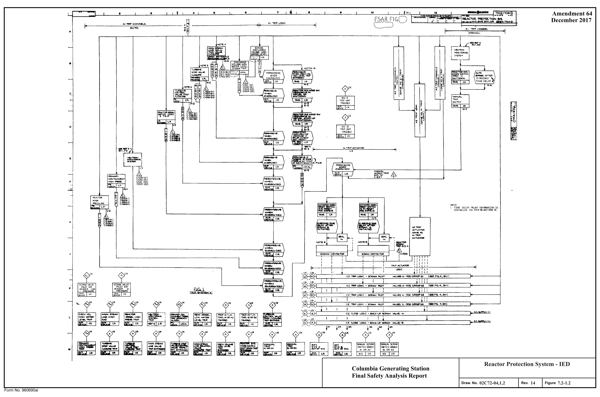

*figure on PDF page 62*

<!-- labels/text on this figure page -->
..
• •
• •
• Amendment 64 7 10 December 2017
FSAR FIG.Q
~ ..
• Z-·~ ii ...
..,,., <I> .J w z Q
- .J ;;
~A,FTER
- ~~&y)
~~ CR o~ M~ I5 ~ •
..........
C
-~ ffl ~ Cl
D
~i: :.",f:: -=-i LS
E
LS
~~~,..TI\IP C ~-~-- C C.153"'7 CISZ'I {All GIS30 (Bl)
F
CIS3I (AZ)
ClS~Z \B2)
NOTE:
I. TIME" OE"LAY PIHA.Y HJ.FOAA\ATION IS CDNTR01.LED ON El514-!0 AND £514-31.
1:2 TRIP LOGIC. - 3C~ Pll.OT
1: Z 'TAIP LO«.u:. - &CRAM PLOT K I
I I I
I I I
1: 2 'TAIIJ LOG,1 C - SCJV:....... Fl'L.0'r \IAL.v&.S A- ROO C.ftOUllli(.I
I I '
---.---~ ~ I
L "(+)
1 ~ M
Reactor Protection System - IED Columbia Generating Station Final Safety Analysis Report 02C72-04,1,2 14 7.2-1.2 Draw. No. Rev. Figure Form No. 960690ai

<!-- p.63 -->
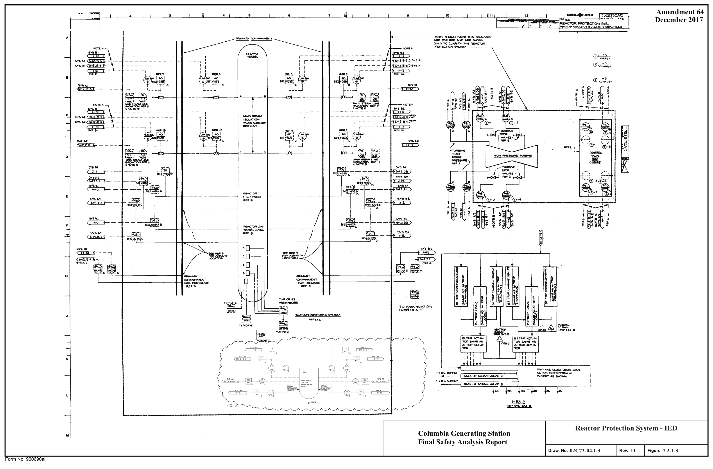

*figure on PDF page 63*

<!-- labels/text on this figure page -->
Amendment 64
•
• " s KWUM..ILICTltC 7 11 10 December 2017
A
---------~ ~ lNSIOE 7"MI$ ac)I.J",,IQARV
·.a.Al!!FOR .... 1///HO-"RE:~
CN-V TO ~FY "IHI! 1¥~'TOR MO"l'KTION l'\'ITIEM -----._ r---
(I):T_;a5- 1 ,---- I I @ ·:c.v~;'?S- I I _, I I
•
an~ f;j
T • 1 : ~ .~ / ;;~ i ~i~
-- ....J
~ "~ ~~: ~l.-~~., ..,, __ F-.. ··~ 11 ,, I I : l ... C 0-1
C
I
D
!:,V5C.t.
~
$"{ .... ~
-,f,·\ ~) __ E \
-----------;-------;----~"'---{'Z.1.·~0;i.
..
M.g:~-4 - - - - -
------------~ ..
~~ ..
GEl[3----, ~-, I ~'t"S.ca,,.t.
~§;17' 9~1. , .. i C I> i !i H I I :c~ 1 I ! n :~ I ii ~ -! r i .., ~ ii
10 A.N.NUf-"C.ll!l.i'\0~
(!>l<H"II.L•4l St§ff.M J N@J'!'90N ~ AEC4f!!i
K
"RaPAN0t~LOGIC$A,NIS L __
1-10.c . ......._v
Al. J.'0R T~lP ~"1'$"11EM .A.I r.AC.K·l.P SCRAM \Al.VIE ""- e"l(c.cs:rT AS~ @r:Wl sYS A1 0,2.~ .. ~ ...
UO<.~~""'-VIE'&
--,--~,-----,,---.---.--------' ~El L ~ '" !!e •• ~ SYS a,
- ~ ~8 ~ L
Reactor Protection System - IED Columbia Generating Station M Final Safety Analysis Report 02C72-04,1,3 11 7.2-1.3 Draw. No. Rev. Figure Form No. 960690ai

<!-- p.64 -->
Amendment 53 7 , --
•
• November 1998 " I fO I

Al I -I I j TABLE :c REACT0R PROTECl"ION SYSTEM 00MPUlU Al.ARM INPUTS

#### OCMPUIERINPUTS
0ESCAIPTION Cl!!l5 - CHANe. (IIIVl5ION)
Al IJ IMI 2 82on 31 L ~ •~P YCll#,4lt HIGH ei=o 0&02 0,0, Cl504 /l. lllll'WEU. HIGH l'IE$SIIR£TAIP ~ Cl$l4

:,.1;;,;-·--....... -

~ C$8 0519 CIRO 4 !'iu.,~,_ c:ea VESSII. U:W WATER 0'22 eJ!.23 c,sa4 e. MII.P.M,Ml•ta,lfflll' 0520 c:tN> c:ea !::.
~ ~.:=::.,. C!!!:/!ROI. VA&K f'AST 0~7 ee58 OM') eeeo 8.
7. MS1V NOi' FIU.Y OPEN 1RIP It 0501> Cl5IO o&n 0912 8. T- $101' VALVE QOIIJRE TRIP • • =63 Cl5&4 a.I&, Cl!!:IO la NEl1l'll0N MONl\"ClliUIG ,m;1'£M TRIP .. c:en ce30 c=3I 0'!32 CP.1'58 Ce37 ems 10. ll£AClat ~ &CRAM Cl!37

#### 0,,00 C"39 IL R£AC1'0ASCIW,I 0$39 - Cl!l40 -
D e,ae 12. RPr ffliTEM"A"'I• Cl866 - - -

## 13 RPf lmSTIM •a•Tll!P Clll34 c1e3, - C:1880 ,, .. - -
14 ~~~I~ CIB38 Ct837 - ~NT
- .. ~-.::" .. ~ " ~,~
- Ill =s •=~ r,~~-=- CLOSE Cl8U - - J1 :,"'lt,~'\f ~=f ~"t.os, ,,sa, II

.. tl.-.lHQICATIONCl'llOM 2 MS:IJNIS IWICIIIIEP NII OWtNll•
• 10•·--twll. s,w.v,,i,ws MIMR!lrPEln:tWINlL

#### PDNIHMIWIIOI
K.K_lffl<DI ..... It HMS TRll'5 ...,U. '1'1111' GIWtNEI.

'fllBINlf'IMTtl'ME-

H

'"''" con.

8EGl8' PUMP Tflf P flHEY A
--""-··-·•-DICJ

Reactor Protection System - JED Columbia Generating Station Final Safety Analysis Report 02C72-04,1,4 12 Draw. No.
7.2-1.4 Figure Rev.

Fonn No. 960690

<!-- p.65 -->
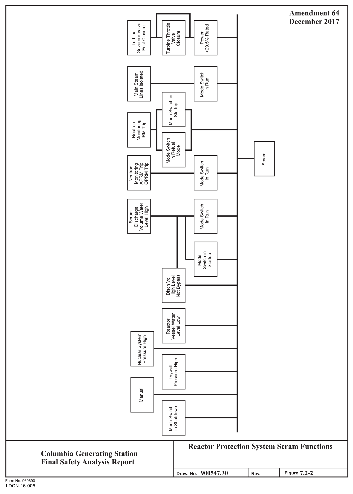

*figure on PDF page 65*

[Vector original (SVG, lossless): fig_page-65_2.svg](../figures/fig_page-65_2.svg)

<!-- labels/text on this figure page -->
Amendment 64 December 2017 Governor Valve -- Turbine Throttle >29.5% Rated Fast Closure Turbine Closure Power ""- Valve
Lines Isolated Mode Switch Main Steam in Run
- Mode Switch in
....
Startup
- Monitoring Neutron IRM Trip
- Mode Switch
.... in Refuel
Mode Scram ~ Mode Switch Monitoring APRM Trip OPRM Trip Neutron in Run
Volume Water Mode Switch Discharge Level High in Run Scram
- Switch in Startup Mode
Not Bypass High Level Disch Vol
Vessel Water Level Low Reactor Nuclear System Pressure High Pressure High Drywell
Manual
Mode Switch in Shutdown
Reactor Protection System Scram Functions Columbia Generating Station Final Safety Analysis Report I I 900547.30 7.2-2 Draw. No.
Rev. Figure Form No. 960690
LDCN-16-005

<!-- p.66 -->
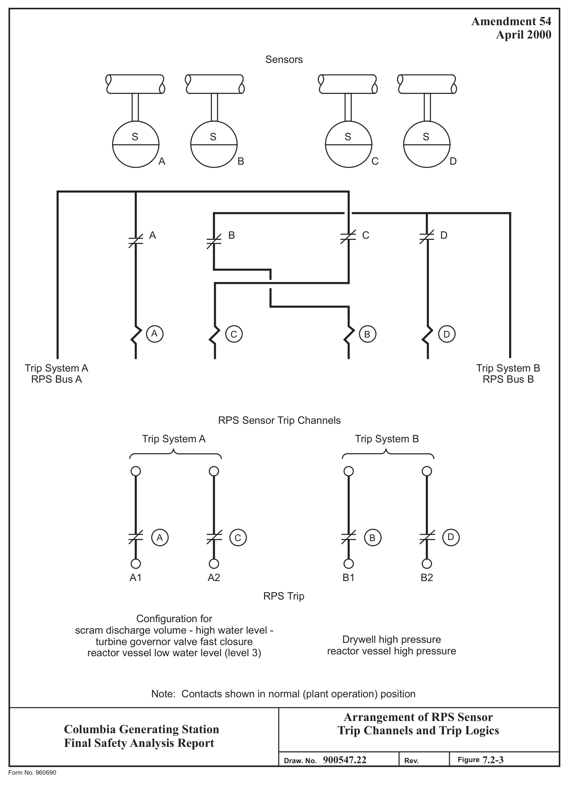

*figure on PDF page 66*

[Vector original (SVG, lossless): fig_page-66_2.svg](../figures/fig_page-66_2.svg)

<!-- labels/text on this figure page -->
Amendment 54 April 2000
Sensors
S S S S
A B C D
A B C D
0 0 0 0 A C B D
Trip System A Trip System B RPS Bus A RPS Bus B
RPS Sensor Trip Channels Trip System A Trip System B
r __ A..___---..,
r--A------,
0 0 0 0 D A C B
A1 A2 B1 B2 RPS Trip
Configuration for scram discharge volume - high water level - Drywell high pressure turbine governor valve fast closure reactor vessel high pressure reactor vessel low water level (level 3)
Note: Contacts shown in normal (plant operation) position
Arrangement of RPS Sensor Columbia Generating Station Trip Channels and Trip Logics Final Safety Analysis Report 900547.22 7.2-3 Draw. No.
Rev. Figure Form No. 960690

<!-- p.67 -->
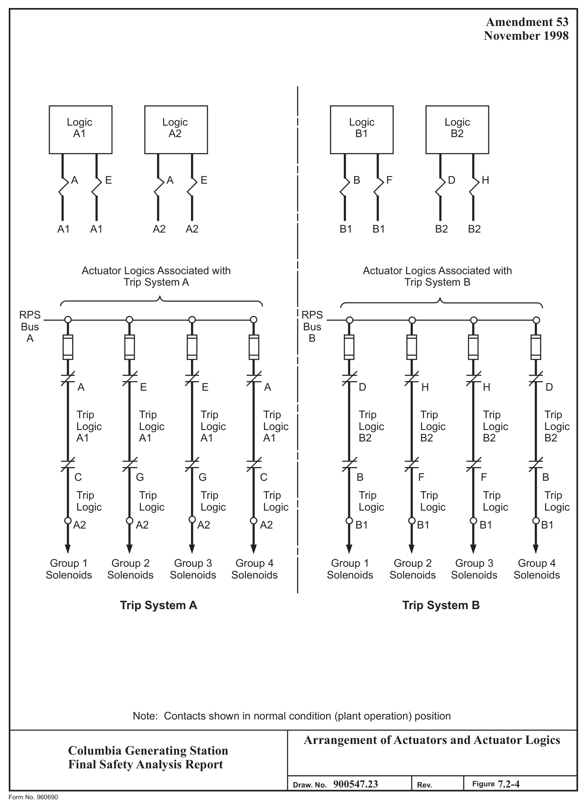

*figure on PDF page 67*

[Vector original (SVG, lossless): fig_page-67_2.svg](../figures/fig_page-67_2.svg)

<!-- labels/text on this figure page -->
Amendment 53 November 1998
Logic Logic Logic Logic A1 A2 B1 B2
A E A E
B F D H
A1 A1 A2 A2
B1 B1 B2 B2
Actuator Logics Associated with Actuator Logics Associated with Trip System A Trip System B
RPS RPS Bus Bus A B
A E E A
D H H D
Trip Trip Trip Trip Trip Trip Trip Trip Logic Logic Logic Logic Logic Logic Logic Logic
A1 A1 A1 A1
B2 B2 B2 B2
C G G C
B F F B
Trip Trip Trip Trip Trip Trip Trip Trip Logic Logic Logic Logic Logic Logic Logic Logic
A2 A2 A2 A2
B1 B1 B1 B1
Group 1 Group 2 Group 3 Group 4 Group 1 Group 2 Group 3 Group 4 Solenoids Solenoids Solenoids Solenoids Solenoids Solenoids Solenoids Solenoids
Trip System A Trip System B
Note: Contacts shown in normal condition (plant operation) position
Arrangement of Actuators and Actuator Logics Columbia Generating Station Final Safety Analysis Report 900547.23 7.2-4 Draw. No.
Rev. Figure Form No. 960690

<!-- p.68 -->
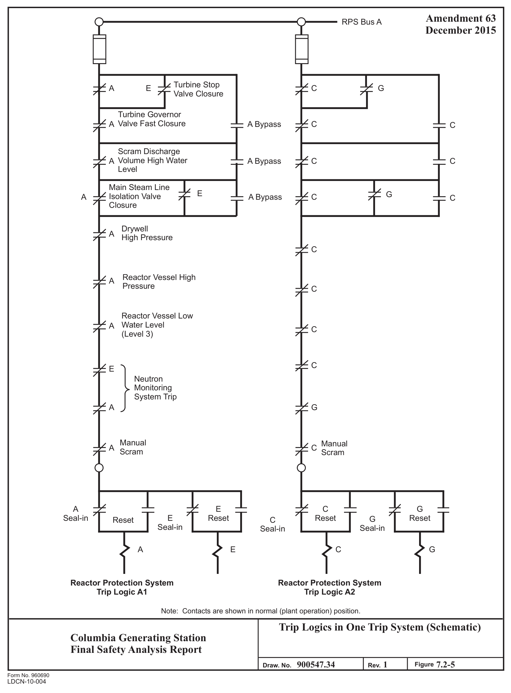

*figure on PDF page 68*

[Vector original (SVG, lossless): fig_page-68_2.svg](../figures/fig_page-68_2.svg)

<!-- labels/text on this figure page -->
Amendment 63 RPS Bus A December 2015
Turbine Stop G A E C Valve Closure
Turbine Governor Valve Fast Closure A A Bypass C C
Scram Discharge A Bypass C C A Volume High Water Level
Main Steam Line E G A Bypass C A Isolation Valve C Closure
Drywell A High Pressure C
Reactor Vessel High A Pressure C
Reactor Vessel Low Water Level A C
(Level 3)
C E Neutron Monitoring System Trip G A
Manual Manual C A Scram Scram
A E C G Seal-in E Reset Reset G Reset Reset C Seal-in Seal-in Seal-in
A E C G
Reactor Protection System Reactor Protection System Trip Logic A1 Trip Logic A2
Note: Contacts are shown in normal (plant operation) position.
Trip Logics in One Trip System (Schematic)
Columbia Generating Station Final Safety Analysis Report 900547.34 1 7.2-5 Draw. No.
Rev. Figure Form No. 960690
LDCN-10-004

<!-- p.69 -->
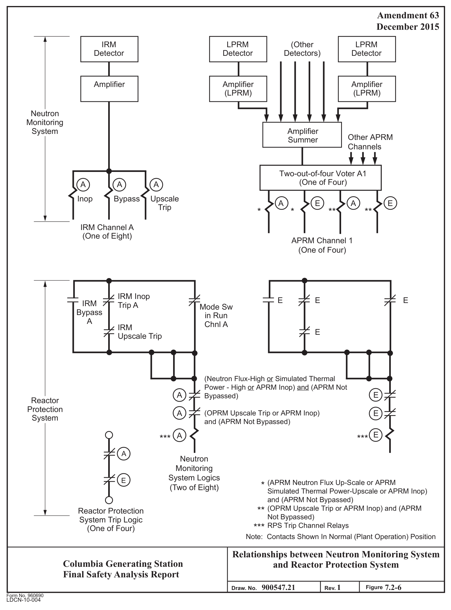

*figure on PDF page 69*

[Vector original (SVG, lossless): fig_page-69_3.svg](../figures/fig_page-69_3.svg)

<!-- labels/text on this figure page -->
Amendment 63 December 2015
IRM LPRM (Other LPRM Detector Detector Detectors) Detector
Amplifier Amplifier Amplifier
(LPRM)
(LPRM)
Neutron Monitoring System Amplifier Other APRM Summer Channels
Two-out-of-four Voter A1 0
(One of Four)
A A A
Inop Bypass Upscale
A E A E
Trip * * ** ** IRM Channel A
(One of Eight)
APRM Channel 1
(One of Four)
IRM Inop E E E IRM Trip A Mode Sw Bypass in Run A Chnl A IRM E Upscale Trip
(Neutron Flux-High or Simulated Thermal Power - High or APRM Inop) and (APRM Not E Bypassed)
A Reactor Protection E (OPRM Upscale Trip or APRM Inop)
A System and (APRM Not Bypassed)
E A *** ***
A Neutron Monitoring 0 System Logics E
(APRM Neutron Flux Up-Scale or APRM *
(Two of Eight)
Simulated Thermal Power-Upscale or APRM Inop)
and (APRM Not Bypassed)
** (OPRM Upscale Trip or APRM Inop) and (APRM Reactor Protection Not Bypassed)
System Trip Logic *** RPS Trip Channel Relays
(One of Four)
Note: Contacts Shown In Normal (Plant Operation) Position
Relationships between Neutron Monitoring System Columbia Generating Station and Reactor Protection System Final Safety Analysis Report 900547.21 1 7.2-6 Draw. No.
Rev. Figure Form No. 960690
LDCN-10-004

<!-- p.70 -->
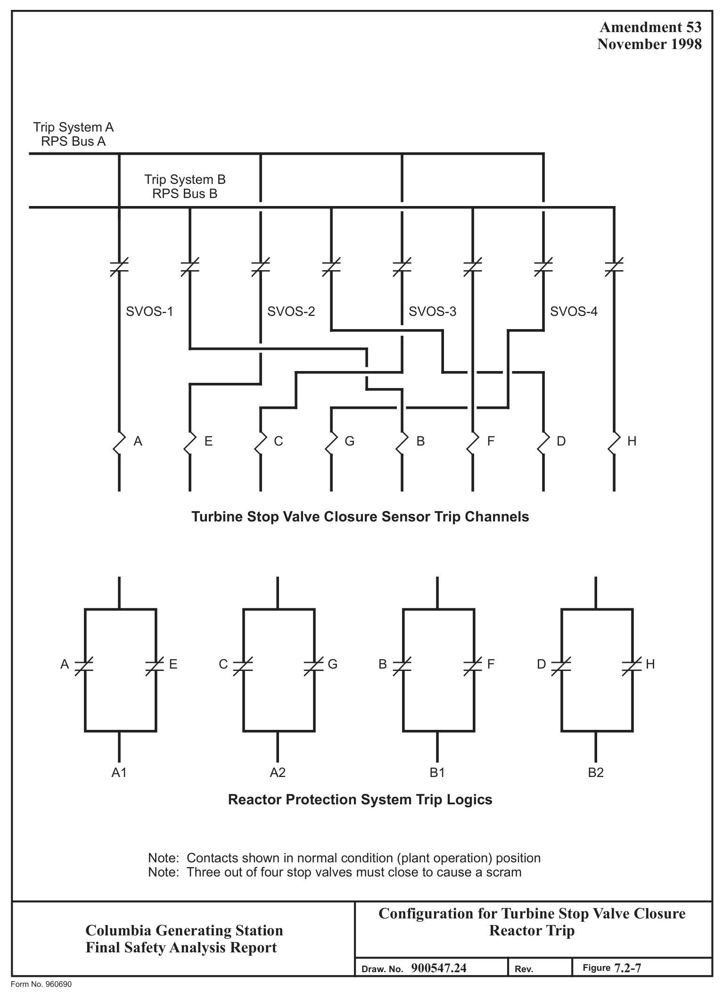

*figure on PDF page 70*

[Vector original (SVG, lossless): fig_page-70_3.svg](../figures/fig_page-70_3.svg)

<!-- labels/text on this figure page -->
Amendment 53 November 1998
Trip System A RPS Bus A
Trip System B RPS Bus B
SVOS-1
SVOS-2
SVOS-3
SVOS-4
A E C G B F D H
Turbine Stop Valve Closure Sensor Trip Channels
A E C G B F D H
A1 A2 B1 B2
Reactor Protection System Trip Logics
Note: Contacts shown in normal condition (plant operation) position Note: Three out of four stop valves must close to cause a scram
Configuration for Turbine Stop Valve Closure Reactor Trip Columbia Generating Station Final Safety Analysis Report 900547.24 7.2-7 Draw. No.
Rev. Figure Form No. 960690

<!-- p.71 -->
• • November 1998 a a II 10 4 D

#### IIOVACIIITIIM
~-J~Hn- ==== l~I =m:.W'".!!'-.!---, I
- - "' _, I ~~ .. ~----i ~ I I I crio._ i ••-
•if'-i...-:r-:
' .,...,;;!'=---.. I I Tr-----4.,~-----------r-<zu. <
• : !
1 :,A;.,.,~.,.w&us : , .::::.. ui¼:

:a&it&- ICIIOD f ,nrn,
•-• _j M~---------------- ------~., ... -rf == gt H ,-----, ! : ,..1r---------rr-------·-r-1·--------.J : 1 T •-•-•----•tl-J fl I I 11 I

## 1 I r-•♦+-----•-
1 :

#### 11A ==~ : CJ"
I I I ~ J , i 1 □ 11 : :
,111~-r r.n M :I. E l : □ : I lr-J~~ : I COIA-l>A DI-fl I I 1 1 o, THC lllffU, 11 110111 11 IIGIUo I I I. 1U Sll.lLL Ii UIIOII tK SYACCLOII nn IIID•l-111.

.. J r+ ...... I 1: ~

II II II N0Tt5 II l l II '1 ' 1 1 '-·- 4. ...,...ARI AC'fVATCO Bl' ftlAT$ IN l■IP AUX. VNl1$.
TAIPlillX --11 1 1 11 ,, 11 NOOI; _.,' '• c:,,, 11 I l ~,,~-~-., 11 I~+-- UIIT --~~ I D s OIi' -------•..I J l ! 1.- OIT

## 1 I 1 I I I
QMA- I t 11 11 l.fAao• ••-J • t I
- ~.!') ::I lo II l.:::_-:--------&1 - -

I I ..... I ' I ~ -

: II, @ @ @ •--. I Ir- UNIT ••-Lt• IOOM - IIM&TlllllttmCW
- L "~::• ~ •••l--r-, NO'l\:I 1 111 ! I l 1 -- .,, STtAIILJJ11:!1WleAL)
1 1IIC:Jl1l·1

## 0 ALLCAILUSHAI.LQOWLYWITHCIIE&IOl,flPIC:-:J. T, r.f~~- .ILMll d RADII.UTI-CUll>MDVAlft -ITN • ! I I I
: L I 111JP- I I .. •• ""11' L •~-~~: ---- ➔4_,

#### .., B•t~N~~..,.i..,~~-...
--~~~~ I I l I I MAIN STEAM LINE RADIATION MONITORS .

#### COIA•- llli.
9 fO,l'WC,,HICIM _,,.._..,,IOft(IWtHJ A t#i:N;IIOAIII , ... .., IIUOTOII IUIUIID ~~ IOllffl N.
~L l,n:tll.CJQl"IQJCICH 0,- TWO HION-- - CIIANHI TAIPI.QW<Na.S C AICO 01 IIIALL•
-&-ffWM)
p IIOLAKCl--1 --0 -- - \CNTI\.ATIOM 'S1'lflM.

TVO Dll fttlP sn;1 •1i• AlliO - &"'

#### D -- __ ,ICH,_Oll_,..,.,_ou,cw
~~WE,V ~<STIIUU.• R.I.DIATIOli tlANID ~OJFU:ICA.t. YACUVIJ (IIUD a C&.OU NICIIMIC&C.
!~::',f ,k::f ~~ TitlP CIWII SHALL ALMM.
IL FOi LOCAflOII AIID IDlllTlflCATIOII 0, 1llffltVIIUt11U
-fOATAIIIAf- aO'•). ,a ffl.°'f~ r.'J ~~.ru: lfft,n \Ill I'll.VI, N II ••="cilf~-- Olln.D f004 Qff-GA§ 64914UQN MQNIIQB§ § §AMfb;B§
-IH<ll.ffl .. tv,ftl,a,Al/0 - 1/Y -· D -•- -TIOlf WP SIIALL tJnUI.T .. U <RN -Bit CIJICIIT.
•II EITND NIOM OIi NIOM-MION ~TtON nt• $HALI. IICSUI.T bl AN Ol'CNCIIQA 17 _, ONlt NIOll•HIOH IIINIHIOII OOWllSCloLE CllA&.I - TRIP

#### SNALL AUIIM.
arranCE_,...
-ITDI._

#### AQ-1010
I. PJPIU I IIJIT. lffllOLS ea--------
2. -IIAOIATICflllOalTNIIODU.WIC Dlf-41110 I. SHCIII. VIII: I CA8U All-4D1D 4. JUOVAl'I& ITill'III PIID 011-- I. JIUCToa NOTICTIOII ffl t!D Cl'a•-

#### I. IUCUAII IOILII SYS ,CO
T, OFF-tH lffTJIN NJD I, °"-«IAI fltTJIN fCO 9. '""· w,.,-,.. 114.

#### IIIJ--
"

#### OCT -
~ IJH ll'UJI .ltf &II IA'.CTCIII Hf&CTOI UDIU1"1 AUIIN lll<N Nl&H Kl<N.
IUOIATIOll llllll lllClt lWI ll.UIATU)• IIIIM L ltM. MWIISCALE OI JJIST_,,f ,_ t-TQI ~ IRWI

'•""- now....-,_

IIL.SW ULCCTOR $WITCN

N

Process Radiation Monitoring System Columbia Generating Station
(Recombiner/Charcoal Bed) - IED Final Safety Analysis Report Draw. No. 02D17-04,1,1 Rev. 11 Figure 7.2-8.1 Fonn No. 960690

<!-- p.72 -->
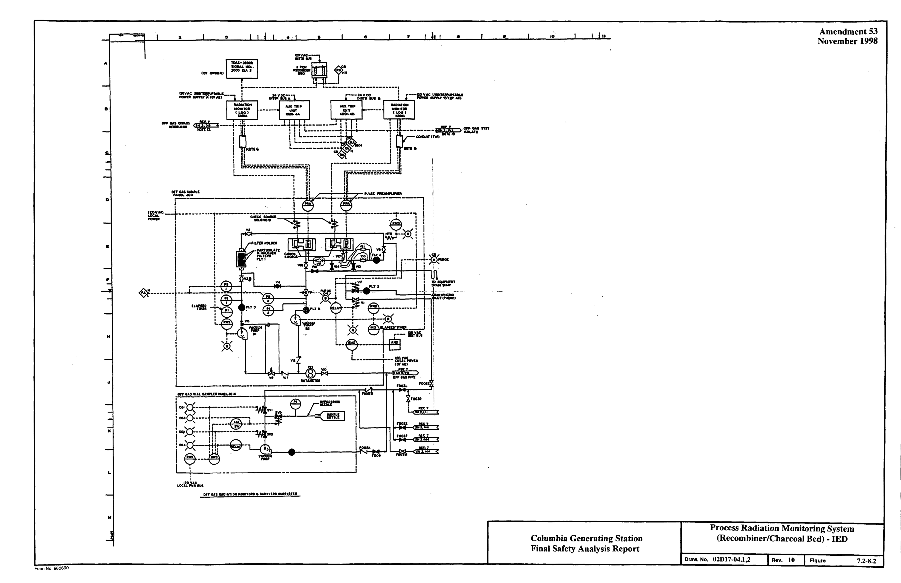

*figure on PDF page 72*

<!-- labels/text on this figure page -->
Amendment 53
• • •
• a a 11 7 ,0 November 1998
A
•
D
•
,,
M
.t
IC
I.
I I w.'l~,"Jlo,, OAS IIIDIATION IIHITOIS a -LEn IVIITITPI
M Process Radiation Monitoring System
(Recombiner/Charcoal Bed)• IED Columbia Generating Station Final Safety Analysis Report Draw. No. 02D17-04,1.2 Rev. 10 Figure 7.2-8.2 Form No. 960690

<!-- p.73 -->
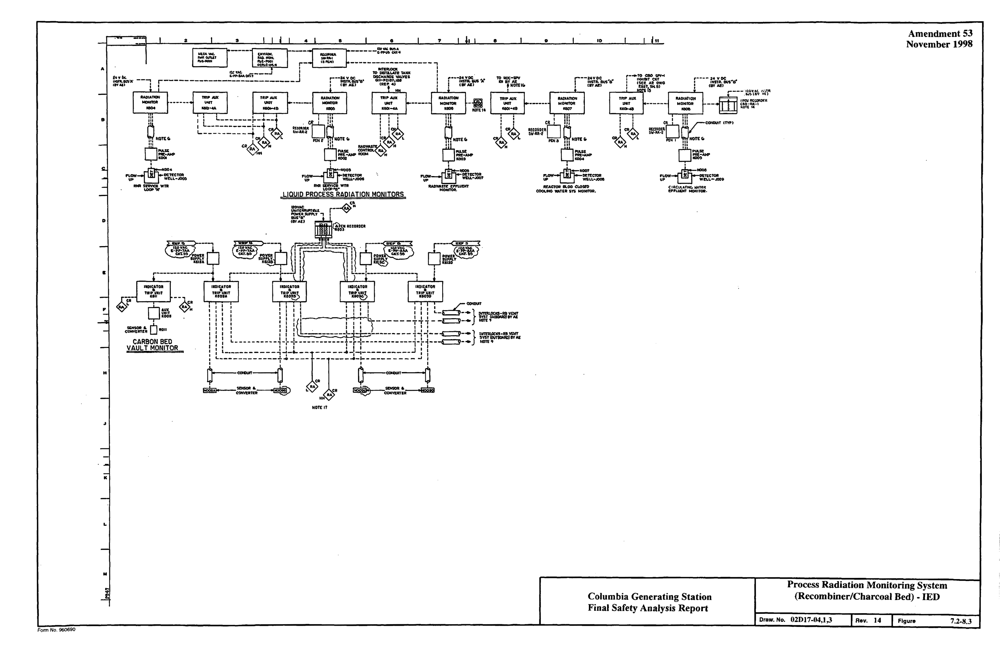

*figure on PDF page 73*

<!-- labels/text on this figure page -->
Amendment 53 .,
• • e a November 1998 2 11 4 9 10
A
D
D :-,a , y
ICIIIA
' r----------------~ O
--~R
P' &Ull ~H Ullf KOOi ceo,v&ll'rllt u 'IIOII 5a1$()1tl,r'-,
CARBON BED
VAULT MONITOR
H
NOT£ 11 .,
K
L
M Process Radiation Monitoring System
(Recombiner/Charcoal Bed) - IED Columbia Generating Station Final Safety Analysis Report Draw. No. 02D17-n4,l,3 Rev. 14 7.2-8.3 Figure Form No. 960690

<!-- p.74 -->
Amendment 53 November 1998

#### F022 A F022 A
#### F022 C F022 C F022 D F022 D F022 B F022 B
#### F028 A F028 A F028 B F028 B F028 C F028 C F028 D F028 D
--J
(RPS
(RPS Bus A)

#### BUS B)
#### A E C G B F D H
"--y--' "--y--' "--y--' "--y--' "--y--' "--y--' "--y--' "--y--' Steam Steam Steam Steam Steam Steam Steam Steam Line A Line B Line C Line D Line A Line C Line B Line D

Main Steam Line Isolation Trip Sensor Channels See Notes Below
(Switch Contacts shown in Positions When Isolation Valves Less than 10% Closed)
Trip System A Trip System B

Steam Line D Line A Steam Line B Steam Line C Steam Line D Line A Steam Line C Steam Line B Steam Steam A E C G B F D H

#### A1 A2 B1 B2

Reactor Protection System Trip Logics
(Contacts Shown in Normal (Plant Operation) Position)
Key F022A - Steam Line A Inboard Valve F022C - Steam Line C Inboard Valve F028A - Steam Line A Outboard Valve F028C - Steam Line C Outboard Valve F022B - Steam Line B Inboard Valve F022D - Steam Line D Inboard Valve F020B - Steam Line B Outboard Valve F028D - Steam Line D Outboard Valve

NOTE: 1. Wiring for the Two Switches on the Same Valve Is Physically Separated.
2. Isolation of Three or More Steam Lines Will Cause A Scram.

Configuration for Main Steam Line Isolation Reactor Trip Columbia Generating Station Final Safety Analysis Report 920843.53 Draw. No. Rev. Figure 7.2-9 Form No. 960690

<!-- p.75 -->
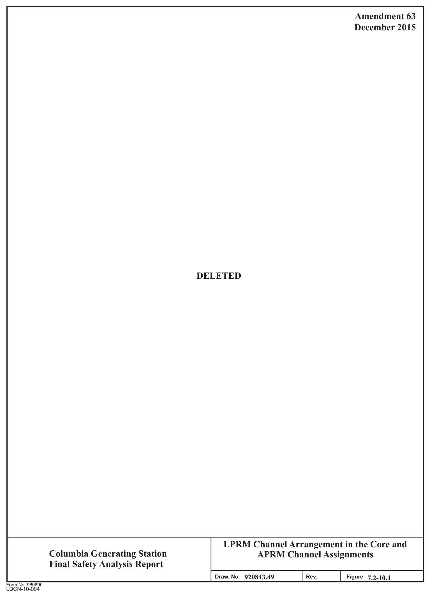

*figure on PDF page 75*

[Vector original (SVG, lossless): fig_page-75_2.svg](../figures/fig_page-75_2.svg)

<!-- labels/text on this figure page -->
Amendment 63 December 2015
DELETED
LPRM Channel Arrangement in the Core and Columbia Generating Station APRM Channel Assignments Final Safety Analysis Report I I 920843.49 Draw. No. Rev. Figure 7.2-10.1 Form No. 960690
LDCN-10-004

<!-- p.76 -->
Amendment 63 December 2015 0° 61 ,. t\ ,. t\ . 59

#### C B A D A D C B
••
• 57 '-= ~ '-= ~

#### D A B C B C D A
55 53

51

#### B A D C D C B A B A D C
r. ~ r. t'\ r. t'\ 49 '-= ~ '-= ~ '-= ~

#### C D A B A B C D C D A B
47 45 --
-- 43 .
.

#### A D A D C B C B A D A D C B
r. t'\ r. t'\ r. t'\ 41 -- ' ~ ~ '-= ~ '-= ~ ~

#### B C B C D A D A B C B C D A
39 -- 37 -- 35 --

#### D C B A B A D C D C B A B A
r. ~ r. t'\ r. t'\ r. ~
-- 33 ' '-= ~ '-= ~ '-= ~ ~

#### A B C D C D A B A B C D C D
90° 31 --
-- 29 .
-- 27 .

#### C B C B A D A D C B C B A D
r. I:'\ r. I:'\ r. t'\ 25 -- ' '-= ~ '-= ~ ~

#### D A D A B C B C D A D A B C --
23 21 -- ,. I:'\ .
19 -- .

#### B A D C D C B A B A D C D C
r. ~ r. I:'\ r. ~ 17 -- ' ' \.: ~ \.: ~ ~ ~

#### C D A B A B C D C D A B A B
15 13 ,. I:'\ ,. I:'\ .
11

#### A D C B C B A D A D
r. ~ ." ." ' 09 '-= ~ '-= ~ ~

#### B C D A D A B C B C
07 05

03 01

#### I I I I I I I I I I I I I I I
00 02 04 06 08 10 12 14 16 18 20 22 24 26 28 30 32 34 36 38 40 42 44 46 48 50 52 54 56 58 60

LPRM strings providing input to APRM channels 1, 2, 3, and 4 Upper left letter = input for APRM Channel 2 Lower left letter = input for APRM Channel 3 Lower right letter = input for APRM Channel 4 Upper right letter = input for APRM Channel 1

APRM System

LPRM Channel Arrangement in the Core and APRM Channel Assignments Columbia Generating Station Final Safety Analysis Report I 920843.48 1 7.2-10.2 Draw. No. Rev. Figure Form No. 960690

<!-- p.77 -->
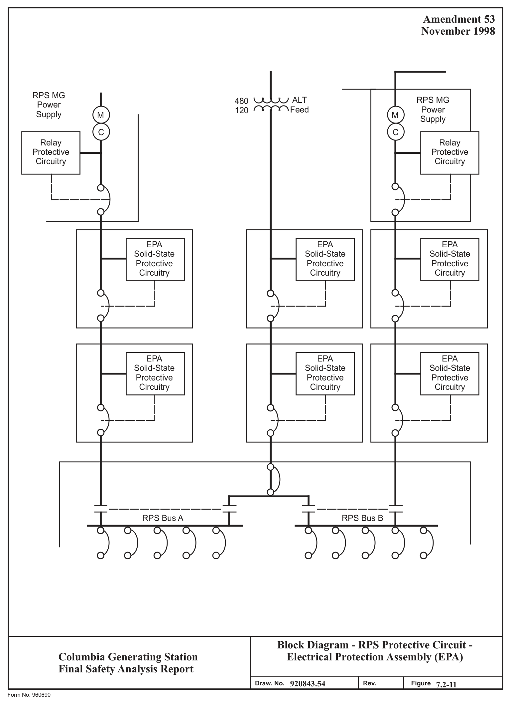

*figure on PDF page 77*

[Vector original (SVG, lossless): fig_page-77_3.svg](../figures/fig_page-77_3.svg)

<!-- labels/text on this figure page -->
Amendment 53 November 1998
RPS MG
RPS MG
480 ALT Power Power 120 Feed Supply M M Supply C C Relay Relay Protective Protective Circuitry Circuitry
EPA EPA EPA Solid-State Solid-State Solid-State Protective Protective Protective Circuitry Circuitry Circuitry
EPA EPA EPA Solid-State Solid-State Solid-State Protective Protective Protective Circuitry Circuitry Circuitry
RPS Bus A RPS Bus B
Block Diagram - RPS Protective Circuit - Electrical Protection Assembly (EPA)
Columbia Generating Station Final Safety Analysis Report 920843.54 Draw. No. Rev. Figure 7.2-11 Form No. 960690

