# 7.3 ENGINEERED SAFETY FEATURE SYSTEMS

> Columbia Generating Station FSAR — Chapter 07: Instrumentation and Control Systems
> Source: `07_chapter-2550-2965.pdf`, PDF pages 78–196 (of 416)
> Amendment 67 compilation (individual pages carry varying amendment dates)

---
<!-- p.78 -->
### 7.3 ENGINEERED SAFETY FEATURE SYSTEMS
#### 7.3.1 DESCRIPTION
The instrumentation and controls include the operation of the following engineered safety feature (ESF) systems (see Figures 7.3-1 through 7.3-15):

a. Emergency core cooling system (ECCS),

b. Primary containment and reactor vessel isolation control systems (PCRVICS),

c. Residual heat removal (RHR) system - containment spray cooling mode
(CSCM),

d. RHR system - suppression pool cooling mode (SPCM),

e. Standby service water (SW) system,

f. Main control room and critical switchgear rooms heating, ventilating, and air conditioning (HVAC) system,

g. Reactor building ventilation and pressure control system,

h. Standby gas treatment system (SGT),

i. Containment instrument air (CIA) system, and

The sources which supply power to the ESF systems originate from onsite ac and/or dc safety-related buses or, as in the case of the PCRVICS fail safe logic, from safety-related Division 1 and 2 power and the non-safety-related reactor protection system (RPS) motor generator (MG) sets. See Chapter 8 for a complete discussion of the ESF systems power sources.

##### 7.3.1.1 System Description
###### 7.3.1.1.1 Emergency Core Cooling Systems
The ECCS is a network of the following systems. See Sections 6.3.1 and 6.3.2.

a. High-pressure core spray (HPCS) system, b. Automatic depressurization system (ADS), c. Low-pressure core spray (LPCS) system, and d. Low-pressure coolant injection (LPCI) mode of the RHR system.

<!-- p.79 -->
The following plant variables are monitored and provide automatic initiation of the ECCS when these variables exceed predetermined limits:

a. Reactor vessel water level

A low water level in the reactor vessel could indicate that reactor coolant is being lost through a breach in the reactor coolant pressure boundary (RCPB)
and that the core is in danger of becoming overheated as the reactor coolant inventory diminishes. See Figure 10.3-2 for a schematic arrangement of reactor vessel instrumentation.

b. Drywell pressure

High pressure in the drywell could indicate a breach of the RCPB inside the drywell and that the core is in danger of becoming overheated as reactor coolant inventory diminishes.

###### 7.3.1.1.1.1 High-Pressure Core Spray System.

Function

The purpose of the HPCS is to provide high pressure reactor vessel core spray for a small line break loss-of-coolant accident (LOCA) which does not depressurize the reactor vessel. In addition HPCS is redundant to the ADS system for mitigation of the consequences of various events described in Chapter 15. The HPCS can provide core cooling or reactor vessel inventory makeup following accidents and various design basis transients described in Chapter 15. See also Section 6.3.2.2.1. The HPCS also provides for core cooling during a station blackout event.

Operation

Schematic arrangements of system mechanical equipment is shown in Figure 6.3-4. The HPCS system component control logic is shown in Figures 7.3-4 and 7.3-7. Instruments are listed in Table 7.3-1. Operator information displays are shown in Figures 7.3-7 and 7.3-4.

The HPCS is initiated automatically by either reactor vessel low water level (trip level 2) or drywell high pressure. The system is designed to operate automatically for at least 10 minutes without any actions required by the control room operator. Once initiated the HPCS logic seals-in and can be reset by the operator only when the initial conditions return to normal.
See Figure 7.3-7 for a schematic representation of the HPCS system initiation logic.

#### LDCN-04-027, 05-009
<!-- p.80 -->
Reactor vessel water level (trip level 2) is monitored by four redundant differential pressure switches. The switch contacts are arranged in a one-out-of-two twice logic arrangement to ensure that no single event can prevent the initiation of the HPCS.

Initiation diversity is provided by drywell pressure which is monitored by four redundant pressure switches. The switches are electrically connected in a one-out-of-two twice logic arrangement to ensure that no single instrument failure can prevent the initiation of the HPCS.

The HPCS components respond to an automatic initiation signal as follows (actions are simultaneous unless stated otherwise):

a. The HPCS diesel generator is signaled to start and its protective relays are bypassed. Once the diesel is started it signals its cooling water pump to start.
See Section 6.3.1.1;

b. The HPCS pump motor is signaled to start;

c. The normally open pump suction valve from the condensate storage tank HPCS-V-1 (MO F001), is signaled to open;

d. The test return valve HPCS-V-23 (MO F023) is signaled to close; and

e. The HPCS injection valve HPCS-V-4 (MO F004) is signaled to open.

If the pump is running but discharge flow is low enough that pump overheating may occur, the minimum flow return line valve HPCS-V-12 (MO F012) is signaled to open. The valve is automatically closed if flow is normal.

If water level in the condensate storage tanks falls below a predetermined level, the suppression pool suction valve HPCS-V-15 (MO F015) automatically opens. When HPCS-V-15 (MO F015) is fully open the condensate storage tank suction valve HPCS-V-1
(MO F001) automatically closes. Two level switches mounted on a Seismic Category I standpipe in the reactor building are used to detect low water level in the condensate storage tanks. Either switch can cause automatic suction transfer. If the condensate supply line fails, the suction supply for HPCS-P-1 pump transfers to the suppression pool. Either of two instruments mounted on the supply line in the reactor building sense a low water level in the supply line as a broken pipe. The suppression pool suction valve also automatically opens if high water level is detected in the suppression pool. Two level switches monitor suppression pool water level and either switch can initiate opening of the suppression pool suction valve.
To prevent losing suction to the pump, the suction valves are interlocked so that one suction path must be open before the other closes.

<!-- p.81 -->
The HPCS provides makeup water to the reactor until the vessel water level reaches the high level trip (trip level 8) at which time the injection valve HPCS-V-4 (MO F004) is automatically closed. The pump will continue to run on minimum flow recirculation. The injection valve will automatically reopen if vessel level again drops to the low level (trip level 2) initiation point.

The HPCS pump motor and injection valve are provided with manual override controls. These controls permit the reactor operator to manually control the system following automatic initiation.

###### 7.3.1.1.1.2 Automatic Depressurization System.

Function

The ADS is designed to provide automatic depressurization of the reactor vessel by activating seven safety/relief valves (SRVs). These valves vent steam to the suppression pool in the event the HPCS cannot maintain reactor water level following a LOCA. The ADS reduces reactor pressure so that flow from the low pressure ECCS, LPCI system and LPCS, can inject into the reactor vessel in time to cool the core and limit fuel cladding temperature. See also Section 6.3.2.2.2.

Operation

Schematic arrangements of system mechanical equipment is shown in Figure 10.3-2. The ADS component control logic is shown in Figure 7.3-8. Instruments are listed in Table 7.3-2.
Operator information displays are shown in Figures 10.3-2 and 7.3-8.

The ADS is made up of two independent trip systems (A&B).

To prevent inadvertent actuation of the ADS, two channels of logic for each ADS trip system are used. Both channels must be activated to actuate ADS. See Figure 7.3-5 for a schematic representation of the ADS initiation logic.

One channel includes two differential pressure sensor inputs monitoring reactor vessel low water level (trip level 3 and trip level 1). The low water level trip (trip level 3) provides confirmation of a reactor vessel low water level condition. The other channel includes only a single reactor vessel low water level (trip level 1) input.

To ensure that adequate makeup water is available after the vessel has been depressurized each logic channel includes a pump discharge pressure permissive signal indicating RHR or LPCS system available for vessel water makeup. Any one of the three RHR pumps or the LPCS pump is sufficient to permit automatic depressurization.

<!-- p.82 -->
After receipt of the initiation signals and a time delay, one or both of the two solenoid pilot air valves are energized. This allows pneumatic pressure from the accumulator to act on the air cylinder operator. Each ADS trip system timer can be reset manually to delay system initiation. If reactor vessel water level is restored by HPCS prior to the end of the time delay, ADS initiation will be prevented. Also, either or both ADS trip systems may be initially inhibited to eliminate resetting the timer.

The ADS trip system A actuates the “A” solenoid pilot valve on each ADS relief valve.
Similarly, the ADS trip system B actuates the “B” solenoid pilot valve on each ADS relief valve. Actuation of either solenoid pilot valve causes the ADS valve to open and provide depressurization.

Two control switches (one for each trip system solenoid) are located in the main control room for each SRV associated with the ADS. Each switch controls one of the two solenoid pilot valves.

###### 7.3.1.1.1.3 Low-Pressure Core Spray.

Function

The purpose of the LPCS is to provide low-pressure reactor vessel core spray following a LOCA when the vessel has been depressurized and vessel water level has not been restored by the HPCS. The LPCS is functionally diverse to the LPCI mode of the RHR system (see Section 6.3.2.2.3).

Operation

Schematic arrangements of system mechanical equipment is shown in Figure 6.3-4. The LPCS component control logic is shown in Figure 7.3-9. Instruments are listed in Table 7.3-3.
Operator information displays are shown in Figure 7.3-9.

The LPCS is initiated automatically by either reactor vessel low water level and/or drywell high pressure. The system is designed to operate automatically for at least 10 minutes without any actions required by the control room operator. Once initiated the LPCS logic seals-in and can be reset by the control room operator only when the initial conditions return to normal.
See Figure 7.3-9 for a schematic representation of the LPCS system initiation logic.

Reactor vessel water level (trip level 1) is monitored by two redundant differential pressure switches. To provide diversity drywell pressure is monitored by two redundant pressure switches. The vessel level switch contacts and the drywell pressure switch contacts are connected in a one-out-of-two twice logic arrangement so that no single instrument failure can prevent initiation of LPCS.

<!-- p.83 -->
The LPCS components respond to an automatic initiation signal simultaneously (or sequentially as noted) as follows:

a. The Division 1 diesel generator is signaled to start,

b. The normally closed test return line to the suppression pool valve LPCS-V-12
(MO F012) is signaled closed,

c. If power from the normal auxiliary or backup transformer is available at the pump motor bus, the LPCS pump is signaled to start. If the startup transformer is supplying the pump motor buses, sequential starts of ECCS pumps are required to prevent excessive voltage drops on the buses. This is accomplished by delaying the start of LPCS pump by 9.5 sec.

d. Reactor pressure is monitored by a pressure switch which senses the reactor vessel pressure. When the reactor vessel pressure is low enough to protect the LPCS from over-pressure and power is available to the pump motor bus, the injection valve is signaled to open.

The LPCS pump discharge flow is monitored by a flow indicating switch. When the pump is running and discharge flow is low enough that pump overheating may occur, the minimum flow return line valve LPCS-FCV-11 (MO F011) is opened. The valve is automatically closed if flow is normal.

The LPCS pump suction from the suppression pool valve LPCS-V-1 (MO F001) is normally open, the control switch is key locked in the open position, and thus requires no automatic open signal for system initiation.

The LPCS pump and injection valve are provided with manual override controls. These controls permit the operator to manually control the system subsequent to automatic initiation.

###### 7.3.1.1.1.4 Residual Heat Removal System - Low Pressure Coolant Injection Mode.

Function

Low-pressure coolant injection is an operating mode of the RHR system. The purpose of the LPCI system is to provide low-pressure reactor vessel coolant makeup following a LOCA when the vessel has been depressurized and vessel water level is not restored by the HPCS (see Section 6.3.2.2.4).

<!-- p.84 -->
Operation

Schematic arrangements of system mechanical equipment is shown in Figure 5.4-15. The LPCI component control logic is shown in Figure 7.3-10. Instruments are listed in Table 7.3-4. Operator information displays are shown in Figures 7.3-10 and 5.4-15.

The LPCI system is initiated automatically by either reactor vessel low water level or drywell high pressure (one-out-of-two-twice logic). The system is designed to operate automatically for at least 10 minutes without any actions required by the control room operator. Once initiated, the LPCI logic seals-in and can be reset by the control room operator only when initial conditions return to normal. See Figure 7.3-10 for a schematic representation of the LPCI initiation logic. To provide diversity, reactor vessel water level (trip level 1) and drywell pressure are monitored by two redundant differential pressure switches.

To initiate the Division 2 LPCI (loops B and C) the vessel level switch contacts and the two drywell pressure switch contacts are connected in a one-out-of-two-twice arrangement so that no single instrument failure can prevent initiation of LPCI.

The Division 1 LPCI (loop A) receives its initiation signal from the LPCS logic.

The LPCI system components respond to an automatic initiation signal simultaneously (or sequentially as noted) as follows (the loop A components are controlled from the Division 1 logic; the loop B and C components are controlled from the Division 2 logic):

a. The Division 2 diesel generator is signaled to start from the loop B and C initiation logic;

b. If offsite power is not available and the diesel generators are supplying the I pump motor buses, sequential loading of the diesel generators is required. This is accomplished by delaying the start of LPCI pumps A and B by 5 sec while I allowing the LPCS and LPCI C pumps to start immediately. The same start sequence is maintained for the LPCS and LPCI pumps when the pump motor buses are supplied from the normal auxiliary or backup transformer. If the startup transformer is supplying the pump motor buses, sequential starts of I ECCS pumps are required to prevent excessive voltage drops on starting. This is accomplished by delaying the start of LPCS and LPCI C pumps by 9.5 sec and delaying LPCI A and B pump starts by 19.4 sec;

c. Reactor pressure is monitored by a pressure switch for each LPCI injection valve RHR-V-42A, RHR-V-42B, and RHR-V-42C (MO FO42A, B, C). When the reactor pressure is low enough to protect the LPCI from overpressure and power is available at the associated pump motor bus, the injection valve is signaled to open;

<!-- p.85 -->
d. The following normally closed valves are signaled closed to ensure proper system lineup:

1. The test return line to the suppression pool valves RHR-V-24A, RHR-V-24B (MO F024 A, B), RHR-V-21, and

2. The suppression pool spray valves RHR-V-27A and RHR-V-27B
(MO F027 A, B).

e. The normally open heat exchanger bypass valves RHR-V-48A and RHR-V-48B I (MO F048 A, B) are signaled open. The open signal is automatically removed 10 minutes after system initiation to allow operator control of the valve for throttling purposes if cooling using RHR heat exchangers is required.
I The flow in each LPCI discharge line is monitored when the pump is running. Whenever the discharge flow is below the minimum flow setpoint, the respective minimum flow valve RHR-FCV-64A, RHR-FCV-64B, or RHR-FCV-64C (MO F064A, B or C) will automatically I I start to open in approximately 8 sec, to prevent pump overheating. The valve is automatically closed if the flow is above the minimum flow setpoint. The time delay is provided to limit reactor vessel inventory loss during the shutdown cooling mode of the RHR system (see Section 5.4.7.2.6).

The three RHR pump suction from the suppression pool valves RHR-V-4A, RHR-V-4B, RHR-V-4C (MO F004 A, B, C) and the RHR heat exchanger inlet valves RHR-V-47A, RHR-V-47B, (MO F047 A, B) which are locked open (with power removed) and outlet valves RHR-V-3A, RHR-V-3B (MO F003 A, B) have their control switches in the open position, and thus require no automatic open signal for system initiation.

The two series SW crosstie valves RHR-V-115 (MO F094) and RHR-V-116 (MO F093) have their control switches key locked in the close position, and thus require no automatic close signal for system initiation.

The two series containment spray valves RHR-V-16A, RHR-V-16B, (MO F016 A, B) and RHR-V-17 and RHR-V-17B (MO F017 A, B), the two series RHR heat exchanger vent valves RHR-V-73A, RHR-V-73B, RHR-V-74A, and RHR-V-74B (MO F073 A, B and MO F074 A, B), and the RHR shutdown cooling mode suction valves RHR-V-6A and RHR-V-6B (MO F006 A, B) are all normally closed and thus require no automatic close signal for system initiation.

The LPCI pump motors and injection valves are provided with manual override controls.
These controls permit the operator to manually control the system subsequent to automatic initiation.

<!-- p.86 -->
###### 7.3.1.1.2 Primary Containment and Reactor Vessel Isolation Control System (PCRVICS)
Function

The PCRVICS includes the instrument channels, trip logic, and actuation circuits that automatically initiate valve closure providing isolation of the primary containment and/or reactor vessel, and initiation of systems provided to limit the release of radioactive materials.

See Section 6.2.4 and Table 6.2-16 for a complete description of primary containment and reactor vessel process lines and isolation signals applied to each.

Operation

Schematic mechanical arrangements of containment isolation valves and other components B initiated by PCRVICS are shown in Figures 5.4-15, 10.3-2, 5.4-7, 5.4-11, 5.4-22, 9.3-9, 9.3-12, and 3.2-2. The PCRVICS component control logic is shown in Figures 7.3-1, 7.3-8, 7.3-10 and 7.4-1. Instruments are listed in Table 7.3-5. Operator information displays are shown on these figures.

During normal plant operation, the isolation control system sensors and trip logic that are essential to safety are energized. When abnormal conditions are sensed, instrument contacts open and deenergize the trip logic and thereby initiate isolation. Once initiated, then the PCRVICS trip logic seals-in and may be reset by the operator when the initiating conditions return to normal.

The PCRVICS trip logic provides isolation signals to the main steam line isolation valves
(MSIVs) MS-V-22A, MS-V-22B, MS-V-22C, MS-V-22D (AO F022 A, B, C, D) and MS-V-28A, MS-V-28B, MS-V-28C, MS-V-28D (AO F028 A, B, C, D); to the main steam line drain valves MS-V-16 (MO F016), MS-V-67A, MS-V-67B, MS-V-67C, MS-V-67D
(F067 A, B, C, D), and MS-V-19 (MO F019); to the reactor water sample valves RRC-V-19
(MO F019) and RRC-V-20 (F020); to the RHR shutdown cooling system valves RHR-V-8
(MO F008), RHR-V-9 (F009), RHR-V-23 (F023), RHR-V-40 (F040), RHR-V-49 (F049), RHR-V-53A, RHR-V-53B (F053 A, B), RHR-V-123A, RHR-123B (F099 A, B); to the reactor water cleanup (RWCU) system valves RWCU-V-1 (MO F001) and RWCU-V-4 (F004); to the drywell equipment drain valves EDR-V-19 (AO F019) and EDR-V-20 (F020); to the drywell floor drain valves FDR-V-3 (AO F003) and FDR-V-4 (F004); to the TIP system valves, TIP- V-1, TIP-V-2, TIP-V-3, TIP-V-4, TIP-V-5, and TIP-V-15; and to the RCIC system valves, RCIC-V-63 (MOF063), RCIC-V-8 (F008) and RCIC-V-76 (F076).

<!-- p.87 -->
Each MSIV has two control solenoids. Each solenoid receives inputs from two redundant logic channels. A signal from either can deenergize the solenoid. For any one valve to close automatically, both of its solenoids must be deenergized.

The MSIV logic has a minimum of four redundant instrument channels for each measured variable. One channel of each variable is connected to one trip logic. One group of redundant logic (A, C) is used to control one solenoid of both inboard and outboard valves of all four main steam lines, and the other group of redundant logic (B, D) is used to control the other solenoid of both inboard and outboard valves. The four PCRVICS trip logic channels are arranged in a one-out-of-two twice logic combination (trip logic A or C and B or D). See Figure 7.3-2.

The main steam line drain valves, drywell equipment and floor drain valves, reactor water sample valves, the RWCU system, and RHR system isolation valves also operate in pairs. The outboard valves close if the Division 1 isolation logic (A and B) is tripped, and the inboard valves close if the Division 2 logic (C and D) is tripped. See Figure 7.3-3. The RCIC system isolation valves are initiated closed by the leak detection system signals listed in Section 7.3.1.2.1.d. See Figure 7.4-1.

The PCRVICS also provides signals to start the SGT, to remove nonessential loads from essential buses, and to isolate the reactor building ventilation system and the primary containment purge and vent system.

The following variables provide inputs to the PCRVICS logics for initiation of reactor vessel and drywell isolation, as well as the initiation or trip of other plant functions when predetermined limits are exceeded. Combinations of these variables, as necessary, provide initiation of various isolating and initiating functions as identified in Table 6.2-16 and described below.

7.3.1.1.2.1 Reactor Vessel Low Water Level. A low water level in the reactor vessel could indicate that reactor coolant is being lost through a breach in the RCPB and that the core is in danger of becoming overheated as the reactor coolant inventory diminishes.

Reactor vessel low water level initiates closure of various valves. The closure of these valves is intended to isolate a breach of the pipelines, conserve reactor coolant by closing off process lines, and limit the escape of radioactive materials from the primary containment through process lines that communicate with the primary coolant boundary or primary containment.

Three reactor vessel low water level isolation trip settings are used to complete the isolation of the primary containment and the reactor vessel. The first (and higher) reactor vessel low water level isolation trip (trip level 3) initiates closure of all RHR system isolation valves. The main steam lines are left open to allow the removal of heat from the reactor core. The second (and lower) reactor vessel low-low water level isolation trip (trip level 2) isolates the Group 2, 3, 4

<!-- p.88 -->
and 7 primary containment isolation valves and also provides inputs to logic which trips or initiates other plant equipment.

The third (lowest) reactor vessel low-low-low water isolation trip (trip level 1) isolates the Group 1 primary containment isolation valves which include MSIVs and main steam line drain valves.

Reactor vessel low water level (Level 3) is monitored by four redundant differential pressure switches. Each provides a low water level input to one of the four PCRVICS trip logic.

Reactor vessel water low-low (Level 2) and low-low-low (Level 1) are monitored by four redundant differential pressure transmitters with dual trip units. Each trip unit provides a Level 2 or Level 1 input to the PCRVICS trip logic.

Diversity of trip initiation for pipe breaks inside of primary containment is provided by drywell high pressure sensors.

7.3.1.1.2.2 Drywell High Pressure. High pressure in the drywell could indicate a breach of the RCPB inside the drywell and that the core is in danger of becoming overheated as reactor coolant inventory diminishes.

Drywell pressure is monitored by four redundant pressure switches. Each switch provides an input to one of the four trip logic channels.

7.3.1.1.2.3 Main Steam Line - High Radiation. The main steam line radiation monitors sense the gross release of fission products from the fuel and initiates action to contain the released fission products.

Four redundant detectors monitor the gross gamma radiation from the main steam lines. Each provides an input to one of the four PCRVICS trip logic channels.

Each channel consists of a gamma-sensitive ion chamber and a log radiation monitor. Each log radiation monitor has three trip circuits. One upscale trip circuit is used to initiate closure of the reactor water sample valves, mechanical vacuum pump trip, gland seal condenser exhauster trip, and an isolation alarm. The second circuit is used for a high alarm and is set at a level below that of the upscale trip circuit. The third circuit is a downscale alarm. The inoperative condition actuates the isolation alarm and produces the same isolation described above for the upscale trip circuit.

7.3.1.1.2.4 Main Steam Line - Tunnel High Ambient Temperature or High Differential Temperature. A leak in a main steam line is indicated by a high ambient temperature or a high differential temperature for this area. The automatic closure of main steam line isolation and

<!-- p.89 -->
drain valves prevents the excessive loss of reactor coolant and the release of a significant amount of radioactive material from the RCPB.

There are four main steam line high ambient temperature channels within the steam tunnel and four high differential temperature channels between the main steam line tunnel and the reactor building. These eight channels monitor and actuate main steam line isolation logic which is deenergized by high ambient or high differential temperature condition.

Diversity of trip initiation signals for the main steam line tunnel high ambient or high differential temperature is provided by main steam line high flow and steam line low pressure instrumentation.

7.3.1.1.2.5 Main Steam Line - High Flow. Main steam line high flow could indicate a breach in a main steam line. Automatic closure of isolation valves prevents excessive loss of reactor coolant and release of significant amounts of radioactive material from the RCPB.

Sixteen redundant differential pressure switches, four for each main steam line, monitor the main steam line flow. Four differential pressure switches for each main steam line provide inputs to each of the four trip logic channels.

When a significant increase in main steam line flow is detected, trip signals initiate closure of all main steam line isolation and drain valves.

7.3.1.1.2.6 Main Steam Line - Low Pressure. Low steam pressure at the turbine inlet while the reactor is operating could indicate a malfunction of the nuclear system pressure regulator in which the turbine governor valves or turbine bypass valves become fully open, thus causing rapid depressurization of the reactor vessel. From reduced power the rate of decrease of nuclear system saturation temperature could exceed the allowable rate of change of vessel temperature. A rapid depressurization of the reactor vessel while the reactor is near full power could result in undesirable differential pressures across the channels (around some fuel bundles) of sufficient magnitude to cause mechanical deformation of channel walls. Such depressurizations without adequate preventive actions could require thorough vessel analysis or core inspection prior to returning the reactor to power operation.

Four redundant pressure sensors, one for each main steam line, monitor main steam line pressure and each provides an input to one of the four trip logic channels.

When a significant decrease in main steam line pressure is detected, the PCRVICS initiates closure of all main steam line isolation and drain valves.

The main steam line low pressure trip is bypassed by the reactor mode switch in the shutdown, refuel, and startup modes of reactor operation. In the run mode, the low pressure trip function is active.

<!-- p.90 -->
7.3.1.1.2.7 Reactor Building Ventilation Exhaust Radiation Monitor. There are four radiation monitors arranged in two sets of two channels each, (A, B) and (C, D), which make up the process radiation monitor (PRM) reactor building vent radiation monitor isolation system. Each channel has a trip signal output used for shutdown and isolation of the reactor building ventilation system, startup of the SGT, and trip and/or isolation of various other plant functions. The trip output is provided in response to either high radiation in the ventilation exhaust plenum (upscale trip) or instrument failure (downscale trip). The downscale trip also initiates an alarm to alert the operator to instrument trouble conditions. See Section 11.5 for additional details.

7.3.1.1.2.8 Reactor Water Cleanup System - High Differential Flow. High differential flow in the RWCU system could indicate a breach of the RCPB of the cleanup system. The flow at the inlet to the system is compared with the flow at the outlets of the system.

A differential flow signal is developed from the compared inlet-outlet flow signals and applied to the two (inboard or outboard) logic trip channels. When an increase in RWCU system differential flow is detected, the PCRVICS initiates closure of the RWCU system isolation valves. This isolation function is not credited in the accident analysis.

Diversity of trip initiation signals for RWCU system isolation is provided by instrumentation for reactor water level, differential flow, high blowdown flow, and ambient or differential temperature in RWCU equipment areas.

The RWCU system high differential flow trip is bypassed by an automatic timing circuit during normal RWCU system surges. This time delay bypass prevents inadvertent system isolations during system flow transients.

7.3.1.1.2.9 Reactor Water Cleanup System - Area High Ambient Temperature or High Differential Temperature. High temperature in the equipment room areas of the RWCU system could indicate a breach of the RCPB in the cleanup system.

Redundant ambient temperature or differential temperature sensors monitor the RWCU system area temperatures. When a significant increase in RWCU system area ambient or differential temperature is detected the PCRVICS initiates closure of RWCU system isolation valves.

The output trip signal of each sensor initiates a logic trip and closure of either the inboard or outboard RWCU system isolation valve.

Diversity of trip initiation signals for high differential temperature is provided by two pair of differential temperature elements and associated differential temperature switches. Each pair of temperature elements and its differential temperature switch are associated with one of two logic channels.

<!-- p.91 -->
7.3.1.1.2.10 Reactor Water Cleanup System - High Blowdown Flow. High flow conditions in the RWCU blowdown to the main condenser or radwaste line is indicative of a high-energy line break condition. Flow in this line is monitored by two redundant flow sensors which measure flow at the same point and apply flow signals to the trip logic channels. One flow signal is provided to the inboard trip channel and one to the outboard trip channel.

When an increase in RWCU blowdown flow is detected, the PCRVICS initiates closure of the RWCU system isolation valves.

The high blowdown flow trip logic contains a time delay feature which prevents inadvertent system isolations due to normal flow transients.

7.3.1.1.2.11 Residual Heat Removal System - Area High Ambient Temperature or High Differential Temperature. High temperature in the equipment room areas of the RHR system could indicate a breach in the RCPB in the RHR system.

Redundant ambient temperature or redundant differential temperature sensors monitor the RHR system area temperatures. Half of the ambient and differential temperature sensors are associated with one trip logic. The remaining temperature channels are associated with the other trip logic. The ambient temperature elements are located in each RHR equipment area.
The differential temperature elements are located in the ventilation supply and ventilation exhaust of RHR pump rooms A and B.

When an increase in RHR system area ambient temperature or differential temperature is detected, the PCRVICS initiates closure of the RHR system isolation valves.

The output trip signal of each sensor initiates a trip logic and closure of either the inboard or outboard RHR system isolation valve.

Diversity of trip initiation signals for RHR line break is provided by ambient temperature, differential temperature, and shutdown cooling flow instrumentation. An increase in ambient temperature, differential temperature, or flow will initiate RHR system isolation.

7.3.1.1.2.12 Residual Heat Removal System - Flow Rate Monitoring. High flow in the RHR system suction line from the reactor vessel could indicate a breach in the RCPB in the RHR system.

Two redundant differential pressure switches, one for each trip logic, monitor the RHR shutdown cooling mode suction line. The output trip signal of each sensor initiates a logic trip and closure of either the inboard or outboard RHR system isolation valve. The RHR suction high flow trip is not credited within the Columbia Generating Station (CGS) accident analysis.

<!-- p.92 -->
7.3.1.1.2.13 Main Condenser Vacuum Trip. The main turbine condenser low vacuum signal could indicate a leak in the condenser. Initiation of automatic closure of various valves will prevent excessive loss of reactor coolant and the release of significant amounts of radioactive material.

Four redundant vacuum switches monitor the main condenser vacuum. Each switch provides an input to one of four trip logic channels.

When a significant decrease in main condenser vacuum is detected, the PCRVICS initiates closure of all main steam line isolation and drain valves.

Main condenser low vacuum trip can be bypassed manually when the turbine throttle valve is less than 90% open and reactor pressure is below 1060 psig.

7.3.1.1.2.14 Reactor Core Isolation Cooling System Isolation Signals. The RCIC isolation signals for RCIC steam line high flow and RCIC pipe routing/equipment area high ambient temperature or high differential temperature are a subset of the RCIC leak detection system and are described in Section 7.6.1.3.4.

###### 7.3.1.1.3 DELETED
###### 7.3.1.1.4 Residual Heat Removal System - Containment Spray Cooling Mode
Function

The CSCM is an operating mode of the RHR system. It is designed to condense steam in the suppression chamber air volume and/or the drywell atmosphere following a LOCA. See Section 5.4.7. The drywell spray (with or without the RHR heat exchangers) is used to remove airborne radioactivity from the containment atmosphere in response to a LOCA.
Drywell sprays are started within the first 15 minutes post-LOCA.

Operation

The RHR system control logic is shown in Figure 7.3-10. Instruments are listed in Table 7.3-7. Operator information displays are shown in Figure 7.3-10.

The CSCM is initiated by the control room operator by diverting RHR flow to either the suppression pool or the drywell by opening valves RHR-V-27A, RHR-V-27B (MO F027A, B)
or RHR-V-16A, RHR-V-16B (MO F016A, B), and RHR-V-17A, RHR-V-17B (MO F017A, B).

<!-- p.93 -->
The following conditions must exist before the operator can initiate the drywell spray cooling loop:

a. The LOCA signal which automatically initiated LPCI must still exist;

b. One of the two redundant drywell pressure switches must indicate high pressure;
and

c. The operator must close the LPCI injection valve RHR-V-42A, RHR-V-42B
(MO F042A, B).

###### 7.3.1.1.5 Residual Heat Removal System - Suppression Pool Cooling Mode
Function

The SPCM is an operating mode of the RHR system. It is designed to prevent suppression pool temperature from exceeding predetermined limits following a reactor blowdown of the ADS or SRVs. The SPCM mode is also used during RCIC operation and SRV testing.

Operation

Component control logic is shown in Figure 7.3-10. Instruments are listed in Table 7.3-8.
Operator information displays are shown in Figure 7.3-10.

The SPCM is initiated by the control room operator either during normal plant operation or following a LOCA when the suppression pool temperature monitoring system (see Section 7.6)
indicates that pool temperature may exceed a predetermined limit.

During normal plant operation the operator initiates the SPCM as follows:

a. The RHR pump (A or B) is started. The standby SW pump is started and the RHR heat exchanger SW discharge valve RHR-V-68A, RHR-V-68B
(MO 0068 A, B) is signaled to open automatically when the SW pump starts.

b. The RHR test return line valve RHR-V-24A, RHR-V-24B (MO F024 A, B) is opened.

c. The RHR heat exchanger inlet valves RHR-V-47A, RHR-V-47B (MO F047 A, B) are locked open (with power removed) and outlet valves RHR-V-3A, RHR-V-3B (MO F003 A, B) are throttled as necessary. The heat exchanger bypass valve RHR-V-48A, RHR-V-48B (MO F048 A, B) and valve RHR-V-24A, RHR-V-24B (MO F024 A, B) are throttled as necessary.

<!-- p.94 -->
Subsequent to a LOCA the operator initiates the SPCM as follows:

a. Once reactor vessel water level has been restored, the LPCI flow must be terminated by closing the LPCI injection valve RHR-V-42A, RHR-V-42B
(MO F042 A, B). Closing the injection valve causes the LOCA initiation logic to be overridden and allows operator control of the system;

b. The RHR test return line valve RHR-V-24A, RHR-V-24B (MO F024 A, B)
control logic also has LOCA signal override provisions. This allows the operator to open the valve; and

c. The RHR heat exchanger inlet valves RHR-V-47A, RHR-V-47B (MO F047 A, B) are locked open (with power removed) and outlet valves RHR-V-3A, RHR-V-3B (MO F003 A, B) are throttled as necessary. The heat exchanger bypass valve RHR-V-48A, RHR-V-48B (MO F048 A, B) (a 10-minute timer keeps this valve open following a LOCA) and valve RHR-V-24A, RHR-V-24B
(MO F024 A, B) are throttled as necessary.

###### 7.3.1.1.6 Standby Service Water System
Function

The SW system provides cooling water to the diesel generators, the RHR heat exchangers, the HPCS, RCIC, LPCI, and LPCS auxiliary equipment (e.g., room cooler, pump motor bearing cooler, pump seal cooler), and the essential HVAC chillers. See Section 9.2.

Operation

Schematic arrangements of system mechanical equipment is shown in Figure 9.2-12. The SW component control logic is shown in Figure 7.3-12. Instruments are listed in Table 7.3-9.
Operator information displays are shown in Figures 7.3-12 and 9.2-12.

The SW system is automatically initiated as follows:

a. The Division 1 SW pump P-1A is started automatically when either the RHR A pump, the LPCS pump, or the Division 1 diesel generator is started,

b. The Division 2 SW pump P-1B is started automatically when either the RHR B pump, RHR C pump, the Division 2 diesel generator, or the RCIC pump is started, and

c. The HPCS SW pump HPCS-P-2 (C002) is automatically started when the HPCS diesel generator is started.

<!-- p.95 -->
Once the SW pumps are started the following occurs:

a. The RHR heat exchanger SW discharge valves RHR-V-68A and RHR-V-68B are signaled open, and

b. After the SW pumps discharge pressure exceeds a minimum value the pump discharge valves SW-V-2A, SW-V-2B, and SW-V-29 are signaled to open.

###### 7.3.1.1.7 Main Control Room and Critical Switchgear Rooms Heating, Ventilating, and Air
Conditioning System

Schematic arrangements of system mechanical equipment are shown in Figure 9.4-1.
Component control logic is shown in Figure 7.3-13. Instruments are listed in Table 7.3-10.
Operator information displays are shown in Figure 9.4-1 and Figure 7.3-13.

For a complete description of the main control room and critical switchgear rooms HVAC instrumentation and controls see Section 9.4.1.

###### 7.3.1.1.8 Standby Gas Treatment System
Schematic arrangements of system mechanical equipment are shown in Figure 3.2-2. The SGT component control logic is shown in Figure 7.3-14. Instruments are listed in Table 7.3-11. Operator information displays are shown in Figure 3.2-2 and Figure 7.3-14.

For a complete description of the SGT instrumentation and controls see Section 6.5.1.

###### 7.3.1.1.9 Reactor Building Ventilation and Pressure Control System
Function

The reactor building ventilation and pressure control system automatically maintains the reactor building or secondary containment at a negative pressure below atmospheric pressure by controlling the reactor building exhaust or SGT fan units. See Section 9.4.2.

Operation

Schematic arrangements of system mechanical equipment are shown in Figure 9.4-2. System component control logic is shown in Figure 7.3-14. Instruments are listed in Table 7.3-12.
Operator information displays are shown in Figure 9.4-2 and Figure 7.3-14.

The differential pressure is monitored by eight redundant differential pressure transmitters, four in Division 1 and four in Division 2, which measure the differential pressure across the

<!-- p.96 -->
exterior of four sides of the reactor building to inside the reactor building (572 ft el.). The signal indicating the least differential pressure from the four differential pressure transmitters in one division is selected and is used to control the position of the blades of the normal reactor building exhaust fan unit in that division. On the initiation of the SGT by containment isolation signals high drywell pressure, low reactor water level, or reactor building exhaust high radiation, the reactor building pressure control system then controls the secondary containment pressure by controlling the SGT fan units (see Section 6.5.1).

###### 7.3.1.1.10 Containment Instrument Air System
Function

The purpose of the CIA system is to provide clean, dry, pressurized gas to the main steam relief valves and isolation valves inside primary containment. The pressurized nitrogen or air is normally provided by a non-safety-related source to a single header which delivers the operating gas to the relief and isolation valves. Under normal conditions, the non-safety-related source also provides working pressure to two headers which serve as the safety-related backup system for seven relief valves designated for the ADS function.
However, a safety-related, bottled nitrogen source is available to maintain operating pressure to the seven divisionally separated ADS valves, in the event that the non-safety-related sources fail (see Figure 9.3-2).

In the event of failure of the non-safety-related portions of the system, which is indicated by low header pressure and detected by three pressure switches, the bottled nitrogen automatically maintains header pressure to the ADS valves. The non-safety-related portion of the system is isolated from the safety-related ADS portion upon receipt of the low header pressure signal.
See Section 9.3.1.5.2.

The local stepping controller used for sequential nitrogen bottle opening is equipped with a local wheel index counter. A remote counter display is also located near the backup N2 supply bottles inside of the reactor building (see Section 9.3.1.2.2). In addition, a low-header pressure alarm is provided to alert the operator to the loss of the ADS pneumatic supply.

Operation

Schematic arrangements of system mechanical equipment is shown in Figure 9.3-2. The CIA component control logic is shown in Figure 7.3-15. Instruments are listed in Table 7.3-13.
Operator information displays are shown in Figures 7.3-15 and 9.3-2.

The CIA system is always in operation. The instrumentation and controls of the system perform the following functions:

a. Monitor CIA system header pressure,

<!-- p.97 -->
b. Isolate the non-safety-related portion of system in the event of failure in this portion, and

c. Maintain CIA system header pressure in the event of item b by sequentially opening nitrogen bottles.

##### 7.3.1.2 Design Basis
The ESF systems are designed to provide timely protection against the onset and consequences of conditions that threaten the integrity of the fuel barrier and the RCPB. Chapter 15 identifies and evaluates events that jeopardize the fuel barrier and RCPB. The methods of assessing barrier damage and radioactive material releases, along with the methods by which abnormal events are identified, are presented in Chapter 15.

###### 7.3.1.2.1 Variables Monitored to Provide Protective Action
The following variables are monitored to provide protective actions by the ESF systems:

a. HPCS
1. Reactor vessel low water level (trip level 2),
2. Drywell high pressure;

b. ADS
1. Reactor vessel low water level (trip level 3),
2. Reactor vessel low water level (trip level 1);

c. LPCS and LPCI

1. Reactor vessel low water level (trip level 1),
2. Drywell high pressure;

d. PCRVICS

1. Reactor vessel low water level (trip level 3),

2. Reactor vessel low-low water level (trip level 2),

3. Reactor vessel low-low-low water level (trip level 1),

4. Main steam line high radiation,

5. Main steam line tunnel high ambient or high differential temperature,

<!-- p.98 -->
6. Main steam line high flow,

7. Main steam line low pressure,

8. Reactor building ventilation exhaust high radiation,

9. RWCU high differential flow or high blowdown flow,

10. RWCU pipe routing and equipment area high ambient temperature or high differential temperature,

11. RHR area high ambient temperature or high differential temperature,

12. RHR shutdown cooling suction high flow,

13. Main condenser low vacuum,

14. Drywell high pressure,

15. RCIC steam line high flow, and

16. RCIC pipe routing area high temperature, or equipment area high ambient temperature or high differential temperature;

e. DELETED;

f. CSCM - drywell high pressure,
- suppression chamber high pressure;

g. SPCM

1. Suppression pool temperature,
2. Drywell high pressure,
3. Reactor vessel low water level (trip level 1);

h. SW System - RHR, LPCS, RCIC, or diesel generator start;

i. Main control room and critical switchgear room HVAC

1. High room temperature;

<!-- p.99 -->
j. Reactor building ventilation and pressure control - reactor building to fuel pool area differential pressure;

k. SGT

1. Reactor vessel low water level (trip level 2),
2. Drywell high pressure,
3. Reactor building ventilation high radiation;

l. CIA System - instrument air header low pressure;

The plant conditions which require protective action involving the ESF systems are described in Chapter 15.

###### 7.3.1.2.2 Location and Minimum Number of Sensors
See the Technical Specifications for ESF systems, which identifies the minimum number of sensors to monitor safety-related variables. There are no sensors in the ESF systems which have a spatial dependence.

###### 7.3.1.2.3 Prudent Operational Limits
Operational limits for each safety-related variable trip setting are selected with sufficient margin so that a spurious ESF system initiation is avoided. It is then verified by analysis that the release of radioactive materials, following postulated gross failures of the fuel or the nuclear system process barrier, is kept within acceptable bounds.

###### 7.3.1.2.4 Margin
The margin between operational limits and the limiting conditions of operation of ESF systems are listed and the bases stated in the Technical Specifications.

###### 7.3.1.2.5 Levels
Levels requiring protective action are specified in the Technical Specifications.

###### 7.3.1.2.6 Range of Transient, Steady State, and Environmental Conditions
See Section 3.11 for environmental conditions. See Sections 8.2.1 and 8.3.1 for the maximum and minimum range of energy supply to ESF instrumentation and controls. All ESF instrumentation and controls are specified and purchased to withstand the effects of energy supply extremes.

<!-- p.100 -->
###### 7.3.1.2.7 Malfunctions, Accidents, and Other Unusual Events Which Could Cause Damage
to Safety System

Chapters 3, 6, 9, 15, and Appendix F describe the following credible accidents and events:
floods, storms, tornadoes, earthquakes, fires, LOCA, and pipe break outside containment.
Each of these events is discussed below for the ESF systems.

7.3.1.2.7.1 Floods. The buildings containing ESF systems components have been designed to meet the probable maximum flood (PMF) at the site location. See Section 2.4. For a discussion of internal flooding protection see Sections 3.4.1.4.1.2, 3.4.1.5.2, and 3.6.

7.3.1.2.7.2 Storms and Tornadoes. The buildings containing ESF systems components have been designed to withstand meteorological events described in Section 3.3.

7.3.1.2.7.3 Earthquakes. The structures containing ESF systems components have been seismically qualified as described in Sections 3.7 and 3.8 and will remain functional during and following a safe shutdown earthquake (SSE). Seismic qualification of instrumentation and electrical equipment is discussed in Section 3.10.

7.3.1.2.7.4 Fires. To protect the ESF systems in the event of a postulated fire, the redundant portions of the systems are isolated by electrical separation barriers. If a fire were to occur within one of the sections or in the area of one of the panels, the ESF systems functions would not be prevented by the fire. The use of spatial separation and barriers ensures that even though some portion of the systems may be affected, the ESF systems will continue to provide the required protective action. A fire detection system using heat detectors and combustion product detectors is provided in Power Generation Control Complex (PGCC) floor sections and in panels containing ESF systems components mounted on these floor sections. A Halon fire suppression system is provided in the same areas.

7.3.1.2.7.5 LOCA. The ESF systems components functionally required during and/or following a LOCA have been environmentally qualified to remain functional as discussed in Section 3.11.

7.3.1.2.7.6 Pipe Break Outside Primary Containment. The ESF systems are designed and qualified to remain functional during and/or following these events. See Section 3.6.

###### 7.3.1.2.7.7 Missiles. Protection for safety-related components is described in Section 3.5.

###### 7.3.1.2.8 Minimum Performance Requirements
Minimum performance requirements for ESF instrumentation and controls are provided in the Technical Specifications.

<!-- p.101 -->
##### 7.3.1.3 Final System Drawings
Functional and architectural design differences between the PSAR and FSAR are listed in Table 1.3-8.

#### 7.3.2 ANALYSIS
##### 7.3.2.1 Engineered Safety Feature Systems - Instrumentation and Controls
Chapter 15 and Chapter 6 evaluate the individual and combined capabilities of the ESF systems.

The ESF systems are designed such that a loss of instrument air, plant load rejection, or turbine trip will not prevent the completion of the safety function.

###### 7.3.2.1.1 Conformance to 10 CFR 50 Appendix A
The following provides information regarding conformance to those General Design Criteria
(GDC) which apply specifically to the ESF systems. See Section 3.1 for a discussion of GDC which apply equally to all safety-related systems.

#### GDC 33
See Sections 7.3.1.1.1.1 and 3.1.2.4.4.

#### GDC 34
See Section 7.3.1.1.6 and 3.1.2.4.5.

#### GDC 35
See Sections 7.3.1.1.1, 7.3.1.1.6, and 3.1.2.4.6.

GDC 36, 37, 39, 40, 42, 43, 45, 46, and 61

See Section 7.3.2.1.3, Regulatory Guide 1.22.

#### GDC 38
See Sections 7.3.1.1.4, 7.3.1.1.5, and 7.3.1.1.6, and 3.1.2.4.9.

<!-- p.102 -->
#### GDC 41
See Sections 7.3.1.1.8 and 3.1.2.4.12.

#### GDC 44
See Sections 7.3.1.1.6 and 3.1.2.4.15.

GDC 60 and 61

See Sections 7.3.1.1.8, 7.3.1.1.3, 3.1.2.6.1, and 3.1.2.6.2.

#### GDC 64
See Sections 7.3.1.1.2 and 7.3.1.1.8.

###### 7.3.2.1.2 Conformance to IEEE Standards
The following provides information regarding conformance to IEEE 279-1971, Criteria for Protection Systems for Nuclear Power Generating Stations, which apply specifically to the ESF systems. See Section 7.1.2.3 for a discussion of IEEE standards which apply equally to all safety-related systems.

General Functional Requirement (IEEE 279-1971, paragraph 4.1)

The ESF systems that automatically initiate appropriate protective actions, whenever the parameters described in Section 7.3.1.2.1 reach predetermined limits, with precision and reliability assuming the full range of conditions and performance are discussed in Sections 7.3.1.2 and Chapter 15.

Single Failure Criterion (IEEE 279-1971, paragraph 4.2)

The ESF systems are not required to meet the single failure criterion on an individual system
(division) basis. However, on a network basis, the single failure criteria does apply to ensure the completion of a protective function. Redundant sensors, wiring, logic, and actuated devices are physically and electrically separated such that a single failure will not prevent the protective function. See Section 8.3.1.4 for a discussion of the CGS separation criteria.

Quality Components (IEEE-279-1971, paragraph 4.3)

For a discussion of the quality of ESF system components and modules see Section 3.11.

<!-- p.103 -->
Equipment Qualification (IEEE 279-1971, paragraph 4.4)

Vendor certification requires that the sensors associated with the ESF system variables, manual switches, and trip logic components located in mild environments perform in accordance with the requirements listed on the purchase specification as well as in the intended application.
This certification, in conjunction with the existing field experience with these components in this application, will serve to qualify these components.

For a complete discussion of ESF equipment seismic and harsh environment qualification see Sections 3.10 and 3.11.

Channel Integrity (IEEE 279-1971, paragraph 4.5)

For a discussion of ESF systems channel integrity under extreme conditions described in Section 7.3.1.2, see Sections 3.10, 3.11, 8.2.1, and 8.3.1.

Channel Independence (IEEE 279-1971, paragraph 4.6)

The ESF systems channel independence is maintained through the application of the CGS separation criteria as described in Section 8.3.1.4.

Control and Protection Interaction (IEEE 279-1971, paragraph 4.7)

There are no ESF system and control system interactions.

Derivation of System Inputs (IEEE 279-1971, paragraph 4.8)

The ESF variables are direct measures of the desired variables requiring protective actions.
See Sections 7.3.1.1.1 through 7.3.1.1.10.

Capability of Sensor Checks (IEEE 279-1971, paragraph 4.9)

See Section 7.3.2.1.3, Regulatory Guide 1.22.

Capability for Test and Calibration (IEEE 279-1971, paragraph 4.10)

See Section 7.3.2.1.3, Regulatory Guide 1.22.

Channel Bypass or Removal from Operation (IEEE 279-1971, paragraph 4.11)

During periodic tests of any one ESF system channel, a sensor may be valved out of service and returned to service under the administrative control procedures. Since only one sensor is valved out of service at any given time during the test interval, protective action capability for

<!-- p.104 -->
ESF system automatic initiation is maintained through the remaining redundant instrument channels.

Operating Bypasses (IEEE 279-1971, paragraph 4.12)

The ESF systems contain the following operating bypasses.

The PCRVICS has two bypasses: (1) main steam line low pressure operating bypass which is imposed by means of the mode switch in the “startup” position (not in “run”). The mode switch cannot be left in this position above approximately 15% of rated power without initiating a scram. Therefore, the bypass is removed by placing the mode switch in the “run” I position via the normal reactor operating sequence, and (2) the low condenser vacuum bypass which is imposed by means of four manual bypass switches in conjunction with closure of the turbine throttle valves, the reactor mode switch in any position other than “run,” and reactor pressure below the low-pressure setpoint. Bypass removal is accomplished automatically by the opening of the turbine throttle valves or raising reactor pressure above the interlock pressure setpoint or manually by placing any of the four bypass switches in normal position or by placing the mode switch in the “run” position.

Indication of Bypasses (IEEE 279-1971, paragraph 4.13)

For a discussion of bypass and inoperability indication see Section 7.1.2.4, Regulatory Guide 1.47.

Access to Means for Bypassing (IEEE 279-1971, paragraph 4.14)

Access to means of bypassing any safety action or safety function is under the administrative control of the control room supervisor/shift manager. Other approved methods of controlling access to bypasses are also used. These include key locks with administrative control of the access to keys, procedurally controlled equipment lineups, e.g., locked valve checklists, and the use of mechanical locking devices and annunciators and other indications, e.g., BISI
(Regulatory Guide 1.47, Bypass and Inoperable Status Indication for Nuclear Power Plant Safety Systems, described in Section 7.1.2.4). These additional methods help to prevent inadvertent bypasses or to alert the plant operators to safety function bypasses occurring either from equipment failures or from manually induced bypasses that result as part of testing, maintenance, or equipment repair activities.

Key-locked control switches that provide a means of controlling the access to a safety function bypass are designed to allow key removal only in the “safe” or “accident” positions. Access to the associated keys is procedurally controlled. When not in use, keys are under the administrative control of the control room supervisor/shift manager and stored in a key locker.
The keys are audited once per day by the control room supervisor/shift manager. When operation of a key-locked control switch is required to be immediate, such as in the case of the

<!-- p.105 -->
reactor mode switch, the key may be left in the lock during normal plant operation to ensure timely actuation.

Multiple Trip Settings (IEEE 279-1971, paragraph 4.15)

There are no multiple set points within the ESF systems.

Completion of Protective Action Once Initiated (IEEE 279-1971, paragraph 4.16)

Each of the automatically ESF system initiation control logic channels seal-in electrically and remain energized after initial conditions return to normal. Deliberate operator action is required to return (reset) an ESF system logic to normal.

Manual Initiation (IEEE 279-1971, paragraph 4.17)

See the discussion of Regulatory Guide 1.62 in Section 7.3.2.1.3.

Access to Setpoint Adjustments (IEEE 279-1971, paragraph 4.18)

All access to ESF system setpoint adjustments, calibration controls, and test points are under the administrative control of the control room operator.

Identification of Protective Actions (IEEE 279-1971, paragraph 4.19)

The ESF protective actions are directly indicated and identified by annunciators located in the main control room and a printed record is available from the process computer and transient data acquisition system.

Information Readout (IEEE 279-1971, paragraph 4.20)

The ESF systems are designed to provide the operator with accurate and timely information pertinent to their status. They do not introduce signals that could cause anomalous indications confusing to the operator.

System Repair (IEEE 279-1971, paragraph 4.21)

The ESF systems are designed to permit repair or replacement of components.

Recognition and location of a failed component will be accomplished during periodic testing or by annunciation in the main control room.

<!-- p.106 -->
Identification (IEEE 279-1971, paragraph 4.22)

The ESF panels are identified by nameplates. The nameplate shows the division to which each panel or rack is assigned and also identifies the function in the system of each item of the control panel. The system to which each externally mounted relay belongs is identified on the relay panels.

Wiring and cabling outside of panels are labeled to indicate its divisional assignment as well as its system assignment (see Section 8.3.1.3).

###### 7.3.2.1.3 Conformance to Regulatory Guides
The following is a discussion of conformance to those Regulatory Guides which apply specifically to the ESF systems. See Section 7.1.2.4 for a discussion of Regulatory Guides which apply equally to all safety-related systems.

Regulatory Guide 1.22 - 1972

The ESF systems instrumentation and controls are capable of being tested during normal plant operation (unless that testing is detrimental to plant availability) to verify the operability of each system component. Testing of safety-related sensors is accomplished by valving out each sensor, one at a time, and applying a test pressure source or as in the case of the main steam line radiation sensors, the sensors may be removed and test sources applied. This verifies the operability of the sensor, sensor contacts, and the sensor setpoint. Associated logic components are typically tested during plant shutdown conditions when component activation is not detrimental to plant operation. Functional operability of temperature sensors may be verified by readout comparisons, applying a heat source to the locally mounted temperature sensing elements or by continuity testing.

For the HPCS, LPCS, and LPCI, testing for functional operability of the control logic relays can be accomplished by use of plug-in test jacks and switches in conjunction with single sensor tests. Annunciation is provided in the main control room whenever a test plug is inserted in a jack to indicate to the operator that an ECCS is in a test status.

Operability of air-operated, solenoid-operated, and motor-operated valves is verified by actuating the valve control switches and monitoring the position change by position indicating lights at the control switch.

The ESF systems are provided with indications, status displays, annunciation, and computer printouts which aid the control room operator during periodic system tests to verify component operability.

<!-- p.107 -->
Regulatory Guide 1.53 - 1973

See IEEE 279 paragraph 4.2 in Section 7.3.2.1.2.

Regulatory Guide 1.62 - 1973

The HPCS, LPCS, and the Division 2 LPCI system can be manually initiated at the system level from the main control room by actuation of armed push buttons. The LPCS push button also initiates the Division 1 LPCI system.

The ADS and the PCRVICS (except RCIC is manually isolated at the system level by its “Manual Isolation Push Button”) are manually initiated at the system (division) level by actuation of two armed push buttons (one for each logic channel). The CIA system provides pneumatic pressure for opening of the ADS valves and is normally in service. A safety-related source of pressurized nitrogen will automatically come on line if the normal supply cannot maintain system pressure above a preset pressure. There is no remote manual initiation of the CIA system.

The CSCM is manually initiated at the system (division) level by actuation of the RHR pump start control switch and by opening the containment spray or suppression chamber spray valves.

If SM-7 or SM-8 is powered from TR-S, then the LPCS, LPCI A/B/C pump will not start when actuated with the manual arm and depress pushbuttons unless there is an associated valid Drywell Pressure – High or Reactor Vessel Water Level – Low Low, Level 2 signal. If needed, the desired pump system can be manually initiated.

The SPCM is manually initiated from the main control room by actuation of system pump and valve controls.

The SW system is manually initiated at the system (division) level by actuation of the pump start control switch.

The main control room and critical switchgear HVAC is manually initiated at the system
(division) level by actuation of individual fan start control switches.

The SGT is manually initiated at the system (division) level by actuation of the system start control switch.

The actuation of the system level manual initiation switches simulates all the actions of automatic or manual (individual equipment initiation) system actuation.

<!-- p.108 -->
Table 7.3-1

High-Pressure Core Spray System Instrumentation

Instrumenta Function

Reactor vessel low water level (level 2)
Level switch
(B22-N031A-D)

#### MS-LIS-31A-D
Drywell high pressure Pressure switch
(B22-N047A-D)

#### MS-PS-47A-D
Reactor vessel high water level (level 8)
Level switch
(B22-N100A, B)

#### MS-LIS-100A, B
Pump minimum flow Flow switch
(E22-N006)

#### HPCS-FIS-6
Suppression pool high water level Level switch
(E22-N002A, B)

#### HPCS-LS-2A, B
Condensate storage tanks low level Level switch
(E22-N001A, B)

#### HPCS-LS-1A, B
Condensate supply line level Pressure switch

#### HPCS-PS-3A, B
a Instruments in parentheses are the GE designation.

<!-- p.109 -->
Table 7.3-2

Automatic Depressurization System Instrumentation

Instrumenta Function

Reactor vessel low water level (level 3)
Level switch
(B22-N038A, B)

#### MS-LIS-38A, B
Reactor vessel low water level (level 1)
Level switch
(B22-N037A-D)

#### MS-LIS-37A-D
Low-pressure coolant injection permissive Pressure switch
(E12-N016A-C)

#### RHR-PS-16A-C
(E12-N019A-C)

#### RHR-PS-19A-C
Low-pressure core spray permissive Pressure switch
(E21-N001)

#### LPCS-PS-1
(E21-N009)

#### LPCS-PS-9
Automatic depressurization time delay Timer

#### B22-K5AA
(MS-RLY-ADK5AA)

#### B22-K5BB
(MS-RLY-ADK5BB)

a Instruments in parentheses are the GE designation.

<!-- p.110 -->
Table 7.3-3

Low-Pressure Core Spray System Instrumentation

Instrumenta Function

Reactor vessel low water level (level 1)
Level switch

#### MS-LIS-37A, C
(B22-N037A, C)
Drywell high pressure Pressure switch

#### MS-PS-48A, C
(B22-N048A, C)
Injection valve permissive Pressure switch

#### MS-PS-413C
(B22-N413C)
Pump minimum flow bypass Flow switch

#### LPCS-FIS-4
(E21-N004)

a Instruments in parentheses are the GE designation.

<!-- p.111 -->
Table 7.3-4

Low-Pressure Coolant Injection Instrumentation

Instrumenta Function

Reactor vessel low water level (level 1)
Level switch

#### MS-LIS-37A-D
(B22-N037A-D)
Drywell high pressure Pressure switch

#### MS-PS-48A-D
(B22-N048A-D)
Low-pressure coolant injection pump delay Timer
(on loss of normal power)

#### RHR-RLY-K70A, B
Injection valve permissive Pressure switch

#### MS-PS-413A, B, D
(B22-N413A, B, D)
Pump minimum flow bypass Flow switch

#### RHR-FIS-10A-C
(E12-N010A-C)

a Instruments in parentheses are the GE designation.

<!-- p.112 -->
Table 7.3-5

Primary Containment and Reactor Vessel Isolation Control System Instrumentation

Instrumenta Function

Reactor vessel low water level (level 3)
Level switch

#### MS-LIS-24A-D
(B22-N024A-D)
Reactor vessel low-low water level (level 2)
Level transmitter

#### MS-LT-61A-D
Level switch

#### MS-LS-300A-D
Reactor vessel low-low-low water level Level transmitter
(level 1)

#### MS-LT-61A-D
Level switch

#### MS-LIS-200A-D
Main steam line high radiation Radiation monitor

#### MS-RIS-610A-D
[closes RRC-V-19 (20)]
(D17-K610A-D)
Main steam line tunnel high temperature Temperature monitor Main steam line tunnel high differential

#### LD-MON-2A (2B)
temperature Main steam line low pressure Pressure switch

#### MS-PS-15A-D
(B22-N015A-D)
Drywell high pressure Pressure switch

#### RPS-PS-2A-D
(C72-N002A-D)
Reactor building ventilation exhaust high Radiation monitor radiation

#### REA-RIS-609A-D
(D17-K609A-D)
Main condenser low vacuum Pressure switch

#### MS-PS-56A-D
(B22-N056A-D)

<!-- p.113 -->
Table 7.3-5

Primary Containment and Reactor Vessel Isolation Control System Instrumentation (Continued)

Instrumenta Function

Main steam line high flow Differential pressure switch

#### MS-DPIS-8A-D
(E31-N008A-D)

#### MS-DPIS-9A-D
(E31-N009A-D)

#### MS-DPIS-810A-D
(E31-N010A-D)

#### MS-DPIS-11A-D
(E31-N011A-D)
RWCU system high differential flow Flow Switch

#### LD-FS-605A,B
RWCU blowdown line high flow Flow Switch

#### LD-FS-15,16
RWCU equipment areas high temperature Temperature Monitor RWCU equipment areas high differential

#### LD-MON-1A,1B
temperature RHR shutdown cooling suction high flow Differential Pressure Switch

#### RHR-DPIS-12A,B
RHR equipment areas high temperature Temperature Monitor RHR equipment areas high differential

#### LD-MON-2A,2B
temperature RCIC steam supply line high flow Differential pressure switch

#### RCIC-DPIS-13A,B
#### RCIC-DPIS-7B
RCIC equipment areas high temperature Temperature Monitor RCIC equipment areas high differential

#### LD-MON-1A,1B
temperature

a Instruments in parentheses are the GE designation.

<!-- p.114 -->
Table 7.3-6

#### DELETED
#### LDCN-02-032, 05-009
<!-- p.115 -->
Table 7.3-7

Residual Heat Removal System - Containment Spray Cooling Mode System Instrumentation

Instrumenta Function

.
Drywell high pressure Pressure switch
(B22-N048A-D)

#### MS-PS-48A-D
Reactor vessel low water level (level 1)
Level switch
(B22-N037A-D)

#### MS-LIS-37A-D
a Instruments in parentheses are the GE designation.

<!-- p.116 -->
Table 7.3-8

Residual Heat Removal System - Suppression Pool Cooling Mode System Instrumentation

Instrumenta Function

Reactor vessel low water level (level 1)
Level switch
(B22-N037A-D)

#### MS-LIS-37A-D
Drywell high pressure Pressure switch
(B22-N048A-D)

#### MS-PS-48A-D
Suppression pool temperature - high Temperature recorder

#### CMS-TR-5, 6
Temperature indicator

#### SPTM-TI-5
a Instruments in parentheses are the GE designation.

<!-- p.117 -->
Table 7.3-9

Standby Service Water System Instrumentation

Function Instrument

Standby service water discharge pressure Pressure switch low SW-PS-1A, 1B, and 40B Spray pond temperature Temperature switch SW-TS-1A, 1B, 1C, and 1D

<!-- p.118 -->
Table 7.3-10

Main Control Room and Critical Switchgear Room HVAC System Instrumentation

Instrumenta Function

Control room temperature Temperature controller

#### WMA-TIC-11A, B
Switchgear rooms temperature Temperature controllers

#### WMA-TIC-52A, B
#### WMA-TIC-53A, B
Reactor vessel low-low water level (level 2)
Level transmitter

#### MS-LT-61A-D
Level switch

#### MS-LS-300A-D
Drywell high pressure Pressure switch
(C72-N002A-D)

#### RPS-PS-2A-D
Reactor building ventilation exhaust high Radiation monitor radiation
(D17-K609A-D)

#### REA-RIS-609A-D
___________ I a Instruments in parentheses are the GE designation.

<!-- p.119 -->
Table 7.3-11

Standby Gas Treatment System Instrumentation

Instrumenta Function

Level transmitter Reactor vessel low-low water level (level 2)

#### MS-LT-61A-D
Level switch

#### MS-LS-300A-D
Drywell high pressure Pressure switch
(C72-N002A-D)

#### RPS-PS-2A-D
Reactor building ventilation exhaust high Radiation monitor radiation
(D17-K609A-D)

#### REA-RIS-609A-D
a Instruments in parentheses are the GE designation.

<!-- p.120 -->
Table 7.3-12

Reactor Building Ventilation and Pressure Controller System Instrumentation

Function Instrument

Reactor building differential pressure Differential pressure transmitter

#### REA-DPT-1A1-1A4
#### REA-DPT-1B1-1B4
Differential pressure controller

#### REA-DPIC-1A, 1B
<!-- p.121 -->
Table 7.3-13

Containment Instrument Air System Instrumentation

Function Instrument

Safety-related header pressure - low Pressure switch

#### CIA-PIS-21A, B
Safety-related header pressure - low Pressure switch

#### CIA-PS-22A, B
Non-safety-related header pressure - low Pressure switch

#### CIA-PS-39A, B
<!-- p.122 -->
Table 7.3-14

#### DELETED
#### LDCN-02-032, 05-009
<!-- p.123 -->
Amendment 62 j 11 e 10 2 3 4 !5 ii 9 12 December 2013 I

#### I.IIPL NO G33-1020
A HI= DIFFERENTIAL r
-~------, -7

#### SEE SUPPL
DOC 5 &. NOTE 5 CONTROL Sw' tN "ST ART"

#### POSIT ION
#### RMS CR
B

~--

CONTROL S'w CONTROL SW MANUAL VAL VE. MO FOOi

#### VALVE MO F004 PU14P
SEAL-Hi CONTROL NOT FULLY SUCTION SEAL~ IN tN "OPEN" IN "CLOSE" NOT FULLY OPEN fLOW LOW

#### POS ITI ON POSITION
#### STATION
OPEN 42. * I L-'C:b~t

#### LIMIT ON
#### RMC LIMIT ON - CR RMS CR RMS C-G CR CR
R606

#### SWIT CH VALVE LOCAL
#### SWITCH VALVE
NOTE. t

.,.,.,.
A D

#### AIR CURRENT /
N00"2e, ~ PNEUMATIC /4 PERMISSIVE --. PUMP COOLIN G PCRM15-51VE UNLE~'.5 \ SUPPL y 1----co_N_V~E_R_TE_R_---I CONTROL '!:NI CONTROL swn CH PERMISSIVE UNLfS~ WHEN VALVE ) 1N •• A.u·ro - WAToR TEMP AUTO l~TION FOOi f'UL L Y ._.,,, IN "~TARI • 1/P PO?l"TtON .;, IGHAL IS PRf,;e'M T LOCA L OPEN H IGH PO~I T ION..
KOOi EXHAUST r LIMIT ON '---RM5 B-1 / AU }'. / \ DEVICE CA SWITCH VALVE RMS B·I i • PERM!&SIVE 1 i
• t E

#### OE -ENERGIZED
PERMISSIVE UNL£5..S\ PERMISSIVE ~,\ PERMISSIVE \ ,/ PERMISSIVE VALVE 15 FULLY

#### SOLENOID
#### PERMISSI VE /
#### UN LESS VALVE UNLESS VALVE PERMISSIVE
#### WHEN VALV.E. IS UNLESS VALVE /
/

#### PILOT OPEN WHEN WHEN
## 15 FULLY CLOSED IS OVER TORQUED
thl.TERMEDIATE tg, CLOSED IS OVER TORQUED VALVE \ u..,,T I ON j SOLENOI D IS SOLENO ID IS ~ DE-ENERGIZED LIMIT ON \ LIMIT ON /

#### ENERGIZED
• • SWIT CHGE AR DE VICE FUNCTIOIIIS SWITCH VALVE \ lsl/')1'r.,.c H ON / \TORQUE. • ON / P~~kr SWITCH VALVE SWITCH VALVE \\~w~fciE. V~E / ~•--+-V_A_L_V_E~ SWITCH VALVE L OCA L

#### NUMBERS USAS SPEC. C37.2.
#### l
~

F NOT~

#### I. INTERLOCK PUMP ST ART -UP CIRCUIT WITH
PUMP SIJGnON LOW f l.OW SW'ITCH ro PERMIT

#### PUMP TO BE STARTED. PUMP 15 TO TRIP
#### OFF AFTER SY AR T IF FLOW IS NOT ESTABLISHED
I AFTER A TIME DE L A Y OR IS ll'HERRUPTED.
I
2. INFORMAT ION ON ALARMS, VALVE INDI CA TING VALVE CLOSES

#### LIGHT REQU IREMENTS ANO PROCESS INSTRU- START STOP OPEN CLOSE PILOT DE-ENERGIZED
I

#### MENTATION REQUI REMENTS NOT SHOWN ON FCD MAY I AO F033
I I 8 £ OBTAINED FROH THE SYSTEM PlilO SUPP\. D OC. 3 . REVERSING CONTACTOR {'72) ..

#### LOC AL
3. NOTATION:
CONTROL SW• 3POSIT ION SWITCH SPRING RETURN TO CLEAN- UP RECIRC PUMP COOIA BLOW'OOWN FLOW CONTRO~L VALVE AO F033 CLEAN-UP S'l'STEM ISOLATION VALVE MO F004<DC OPERATED> 61..A.NK UNL.E!J5, O"JHERWl~E SPECll="IED
(TYP ICAL FOR CLEAN - UP RECIRC PUMP COOIB>

#### CONTROL SW
IN.,OPEN• <TYP IC AL FOR MO FOOi (42}_, (AC OPERATED) SEAL- IN

#### POSITION
• · FOR LOCATION ANO IOENTIFIC.l TION OF INSTRU- H MCC RMS CR MEt.TS SEE INSTRUMENT DATA SHEET $UPF"l. OOC.. tQ .

5. EQUIPMENT & INSTRUMENTS ARE PREFIXED l!V

#### SYSTEM NO. G3J UNLESS NOTED.
6. ALL MOTOR OPERA TED GATE VALVES REQUIRE

#### SEAL- IN. MOTOR OPERATED GLOBE TYPE VALVES
00 ti!OT REQUIRE SEAL-IN.
CONTROL SIi CONTROL SW'

#### CONTROL SW
7. SIGNAL USED TO CLOSE OUTBOARD ISOLATI ON ....

SEAL- IN IN " OPEN" IN "CLOSE" lN "CLOSED"

#### VALVE F004 ONLY. POSITION
#### POS ITION
#### POSITION
8. dFS-N605A, TIHER - R621A, LO-MON- IA . LD -FS- JS

#### FILTER DEMIN
#### FILTEA INLET
:JVMPCR ON AU. VALVf;S CLOSE ISOLA TIOH VAL VE i:'004.
J-6 420 MCC. F"AILURE TEMP~l6H

#### J - 1 E.Y.CCPT F040
#### RMS CR
dFS- NSO!iiB, TIMER-R62!1, LO-MON- IB U>·FS·J6 CLOSE ISOLATION VALVE Foo1. iao· 9 . o.> TIMER RESETS AUTOMA TIC.ill V AF YEM LOC.t\L TIMER DELA '( IS TIMED out.
b . l PART Of LE AK DE TECTI ON LOGIC 10. AN"'UNCIATOA.S ANO INDICATOA LIG HTS ARE IN THE CONTAOL Aoou UN LESS OTHERWISE NOTED.

#### PERMISSIVE
#### PERMISSI VE PERMISSIYE PERMISSIVE PERMISSIV E
#### WHEN VALVE UNLESS VAL VE WHEN VALVE UNLESS VALVE UNLESS VAJJ/E
IS FllLLY

#### IS FULLY OPEN
#### IS FULLY OPEN IS FULLY OPEN IS OVER TORQUED
OPEN o• LIMI T ON LIMIT ON TORQUE AUX ON LIMIT ON ON

#### VALVE SWITCH VALVE SWITCH VALVE SWITCH
DEVICt VAL VE SWITCH VALVE VALVE

K SUPPLEMEN'f"L OOCUM E.t..lT~: UN.Dt..R THE. F"OL1...0WIN~ ~~\~lTTc!i~wf~t TO BE. U~E.D IN C.ONJUNC.TION WITI-I

RE.F. DE.~IC..
I. B'l2- 1630 z.

#### OPEN CLOSED
#### CLOSE
C. ◄1- 103 0
3. &.3.3 -101 0 REVERSING CONT ACTOR <42>• RE VERSING COHTACTOR 42•

## 4 A◄2-1030
S. E~l- 1010

#### I.. G.33-3050
#### THROTTLING VALVES (SEE NOTE 6)
SATE VALVE CSE£ NOTE 6)
(TYPC.AL FOA VALVES F0-31_, F0421 \/A.\.\IE. ~ ITION L F0441 F\02 &.. FI04)

#### EXCEPT
#### F ULLY OPEN
#### LIMIT ON
SlA-iTCH VALVE
("T--tPICA.l. t:r..LL MOV )

Reactor Water Cleanup System Columbia Generating Station M Final Safety Analysis Report 02G33-02,9 11 7.3-1 Draw. No. Rev. Figure Form No. 960690ai

<!-- p.124 -->
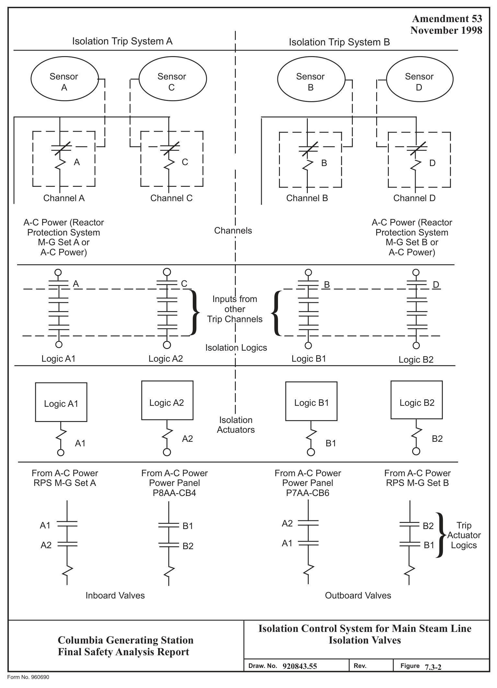

*figure on PDF page 124*

[Vector original (SVG, lossless): fig_page-124.svg](../figures/fig_page-124.svg)

<!-- labels/text on this figure page -->
Amendment 53 November 1998 Isolation Trip System A Isolation Trip System B
Sensor Sensor Sensor Sensor t I A C B D I I I I : ,-t-7 I r - 1,- -71 -7 ,- -71 I t I t Y-
-1_J - I_J
I I I
LI-# I I I I I A C B D I I L_ I I L _ I I I I I I L __ _J L __ _J _ _J _ _J Channel A Channel C Channel B Channel D
A-C Power (Reactor A-C Power (Reactor Channels Protection System Protection System M-G Set A or M-G Set B or A-C Power)
A-C Power)
A C B D } { Inputs from other Trip Channels
Isolation Logics Logic A1 Logic A2 Logic B1 Logic B2
Logic A2 Logic B1 Logic B2 Logic A1 Isolation Actuators A2 B2 A1 B1
From A-C Power From A-C Power From A-C Power From A-C Power RPS M-G Set A Power Panel Power Panel RPS M-G Set B
P8AA-CB4
P7AA-CB6
J_ _l J_ J_ }
I T I T I T A2
I T A1 B1 B2 Trip Actuator
A1 A2
B1 Logics B2
Inboard Valves Outboard Valves
Isolation Control System for Main Steam Line Isolation Valves Columbia Generating Station Final Safety Analysis Report 920843.55 Draw. No. Rev. Figure 7.3-2 Form No. 960690

<!-- p.125 -->
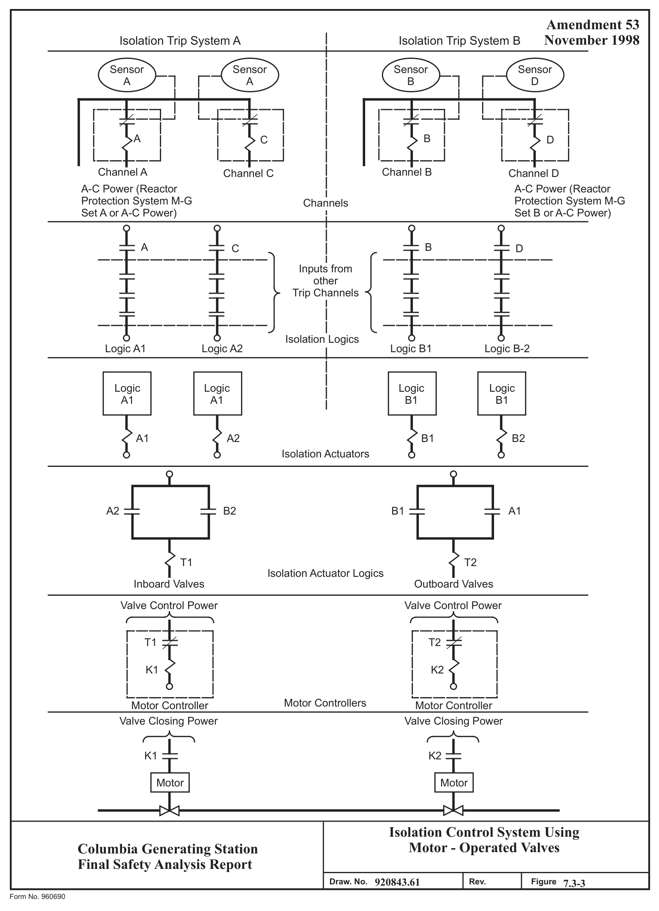

*figure on PDF page 125*

[Vector original (SVG, lossless): fig_page-125.svg](../figures/fig_page-125.svg)

<!-- labels/text on this figure page -->
Amendment 53 November 1998 Isolation Trip System A Isolation Trip System B
Sensor Sensor Sensor Sensor A A B D
A B C D
Channel B Channel A Channel D Channel C A-C Power (Reactor A-C Power (Reactor Protection System M-G Protection System M-G Channels Set A or A-C Power)
Set B or A-C Power)
1 1
1 1
- 1------r--- B C A D
-I-----~---- Inputs from I I I other I Trip Channels I I
- t------t--- I I -f----- ~---- Isolation Logics Logic A1 Logic A2 Logic B1 Logic B-2
Logic Logic Logic Logic A1 A1 B1 B1
A1 A2 B1 B2 Isolation Actuators
l 1
l 1
A2 B2 B1 A1
T1 T2 Isolation Actuator Logics Inboard Valves Outboard Valves
Valve Control Power Valve Control Power i-- --7 ' IA ' T1 T2 I I
K2 I I
K1
L _____ J
Motor Controllers Motor Controller Motor Controller Valve Closing Power Valve Closing Power ~ ~ K1 K2 _1l~1 ____ 1l~1 _ Motor Motor
Isolation Control System Using Motor - Operated Valves Columbia Generating Station Final Safety Analysis Report 920843.61 Draw. No. Rev. Figure 7.3-3 Form No. 960690

<!-- p.126 -->
.
..
Amendment 57 •
• •
• II to ,I December 2003

A

LI'

'°'e'lWJ&fflt amLtMY r1A:ni:uw !Ill.AT
- 40 D ...
o&LT .~t:J!~.
1Rm-l-~i.
.., Off~ L, • l, QI ID/II• o;i~• ll!Illl.
I. Jilli DIICUNhT ,OIIM9 A ,ur 0, rr,.a E,~
•• AU EDltlPIC[IT AIID IJl'IT~lll•T• AIIE ,urlUI) wnN •• ;•;A.,..~ib°.:!:Jll t~rN:ft tm::m =~ ,_ U2 UIIUH orWWIK 1111rm.
··M.:"'tffl~~~~O:.I\~

0, tnl lQVINIUT, .. f'CI ,lltGttCtLTt: lltt\.A'f GUUTCn, SYIC-Nl'Otl1ZIII ICIIIN .AND Nl"tl•UIII .a Ht. L ~U.~D 'f"

#### 'It AJtNJIICIA~ ANO 11Qc;A1'011 IJDNII - IN TMt COMTIIOL :cp: £ ~r~~':Er=:~~O:~ ~TED anew
• ;'I' RIGUU.'- tl,CI &.HNUNCP-n. .
'"" D I CI.0$1 I I
-HIIIII•

tttffl IHHtl(I !9, I TR .. ,, l'l)\T JIANtFQ!!D

~~\Wt IC IDNTOOWN Rnt'I' TO YOl.~fll~(.r■ Dtlln K!fflllmt rnn:c:trP!
IU.lTOll:l.1'1111::
NOP 1111!;-I• !cl •

IIOT&m "

- -lttUMfllT l!Q.AY • LI' ftrt!JNCJ QOCUll[!TI• "ftL !TIM ■0,
1. NlltM NE•- cllfll ., .. , ..-a ________ . ua-10«1 ·- Dl[l£I. u11u ... ~~ l'UT!CTIIW t. MlltM "1!_,,! COltE IPIIAY [L!CTllCAL ··=~ M!vtlQlt@i
-L.IIIC ·DIHJl.111---- - - - -- • -•---Ut-tO&O

'i'::""..:=....""'°'r------"'----U-IR_Y_DL_T ___________ .._ ____ .L..i.ovt,--VOI.--T&Clt----.L--------- a.HIIIH ... HIMSCGQ ...UY &'18-TCM pen ___ U3:-«Ja0

T_oa ____ x_L.--.:::.:.=:~:::.::=---------------l ------ ~ 1-------_;;;=.;.:;::.:.::.::::. __ H __,_~T-A_CI __ II __ CCU __ 4.I.OIIC -· -------- --- - - - --Ma·- WL·IN ,.
l~"+"aN~TIGN ... - - - - -A.a-..-, r ' ptna t;(ll(lrn9! !l'LIAS !fCUU.Tillt

..... n

- ... .,_,...
~~ ..mn..
av&IUIT call- IWIICII

....

l'CIITIGJI LP Cit '!IC;• LP - LP

#### u- __ .. _-_--..
_, ..
OVll.11

#### UC. MCC
lllltliHl<CY
-tn--

#### I ...
L.
----------- J

#### J I,, -
HPCS. Power Supply System - FCD M Columbia Generating Station Final Safety Analysis Report Draw. No. 02E22-04 6,1 Rev. 11 Figure 7.3-4.1 Form No. 960690

<!-- p.127 -->
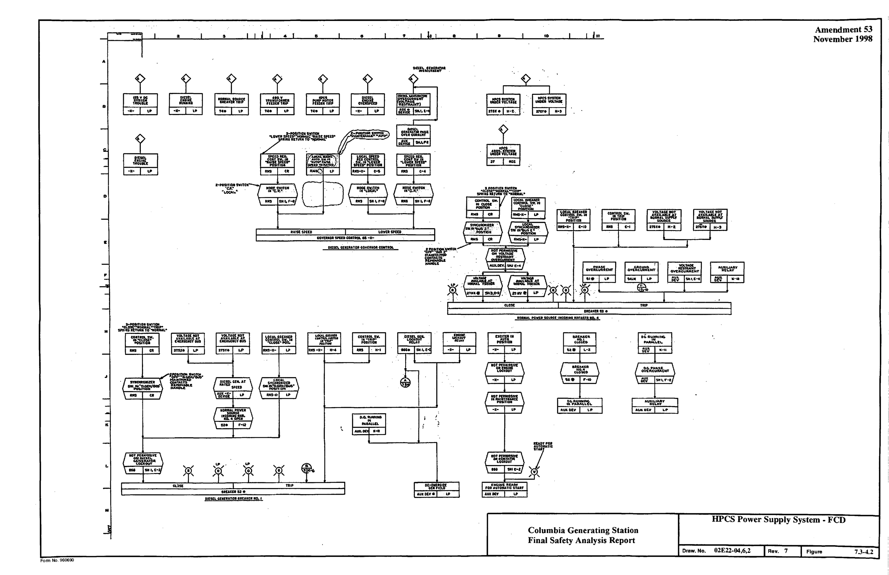

*figure on PDF page 127*

<!-- labels/text on this figure page -->
Amendment 53
• • • a November 1998 It 10
" ~-- 'lMl.f ICPC1S'llflM mafftol•■ HlDPf11QP tltOUBW B 21He ll•t-, '·. Tee lP U• LP _L ~ 11,?,n 111t1UitE
-x- I.I'
D RM$ 8111,F◄
LOVGSPUD.
RA!Stffl(D COYOIIIOI fflllD ~ II -llmun 1.t:IEU.10, COVtRMDII COIITROI.
-~ OVt:llC.UIUILCHr ~~ ~\l:•4
TRIP
ltOWl POVU tcvttt Utt(MJIIIC 812All:£ft ff: ..
" ~\In'" VOLfActtlOT AV&llHlto\T llllKlihtY eus ,... '°"110ll 1111$-X• Li'
" A DIIWL C[IL AT
IIAT VRO
.. UJI: •IC• IJI
DUICC
' ' -- 0.0,IIUIIHNII '" ea•
PAWAI.- ..... F-12
' ., ' ., t.
., ' C A ' Cl.m TIIP eHAXU112• ..
DStSn CUP'AT09 IHA•JR !9: I
HPCS Power Supply System - FCD Columbia Generating Station Final Safety Analysis Report Draw. No. 02E22-04,6,2 Rev. 7 7.3-4.2 Figure Form No. 960690

<!-- p.128 -->
, ,,

## 7 I ; B
10 4 5 9 2 3 Amendment 60 December 2009

A A A

OfESEL GENERATOR

#### BATTERY
#### VOL1AG E. NOT-- DIESEL GENERATOR
#### DEGRADED V'O L.TAGE
SAFETY SHUTDOWN DIESEL ENGINE HPCS CONTROL DIESEL GENERATOR BATTERY CHARGER AUX. 480V Bl - HPCS AT Cl - HPCS CRANKCASE CRANKING POWER F41LURE T RIP / LOCKOUT BREAKER OUT FEEDER TRIP AVAlL AaLe.-·Ar-

#### PRESSURE HIGM
BREAKER OPEN NORMAL 5uPPLV ~OURCE EMERG.ENCV &JS. OF SERVlC.E !ift!~lAND,- LP
-x- LP AUX.DEY. AUX.DEV. SM.l ,F-~ LP L P
-x- DL MCC - x- LP -x- LP B

#### HPCS DIESEL CB - 40G3 CB HPCS HPCS PUMP HPCS SERVICE
#### DIESEL GENERATOR
#### GENERATOR
#### ELEC TRICAL
#### OUT OF OUT OF
#### ROOM HVAC WATER ROOM HVAC ROOM HVAC
#### SERVICE SERVICE
OUT OF SERVICE OUT OF SERVICE OUT OF SERVICE OUT OF SE RVlCE
-x-
-x-
-x-
-x- LP LP LP L P LP L P
-x-
-x-

AU)( _ DEVIC E.
D 27NX * LP

DD

#### I REF 0 3 POSITI ON SWITCH
"S TOP ... NORMAL •"START" ffi.
SPRING RETURN TO "NORMAL" E DtESE L ENGINE HPCS SYSTEM

#### DIESEL I.EN. VOL T AGE NOT VOLT AGE NOT LOCAL DIE SEL LOCAL DIESEL DIESEL GEN.
CONTROL SW AVAILABLE Al AV AILABLE A·T GEN. CONTROL eEN. CONTROL CONTROL SW,

#### IN MAINTENANCE NOT READY
IN EMERGENC Y BUS EMERGENCY BUS S'W, IN "ST ART" S'W. IN "STOP" IN "S TOP "

#### POSI TION FOR AUTO START
#### POSITION POSITION POSIT ION
"START"POSlTION
-x- 27SY• SH.Z,H-3 RMS ·X.· LP RMS

#### LP AUX. DEV. SH.2,M-9
#### RMS CR
F

#### MODE SWITCH
#### MOOE SWITCH MODE SWITCH MODE SW ITCH
#### IN C.R.
#### IN LOCAL.. IN LOCAL ON C.R .
RMS

#### RMS RMS RMS
#### SH I F-'-
#### H PCS BREAKER NO. I
#### TEST IN LOWER
#### STATUS POSITION
- x- LP e.2Lf LP

H

#### NOT PERMISSIV E
#### ON O.G. BRK NO.I
#### CLOSE POSITION
#### BREA.KER NO. 2
#### IN LOWER
#### POSITION
LP

52L* LP J

#### NOT PERMISSIVE
ON G(NtRATOR

## 3 POSITION SWITCH
LOC~OUT
•g TARfltuTo'"'sroP'' 5PIVN6 RETURN Tti°AfJT{J ~

#### SH-I E- 2
CONT~OL SW

#### COMTROL 5W
IN "STOP• IN ''START"

#### POS IT ION
#### POSITIOII
J -a

#### RMS CR RMS NOT PERMI SS IVE
#### IN MAIN TENANCE
#### POSITION
-x- LP K /I/OT; PE~lffl~~IVE tONTR(JL ';WITCH IAJAUTO 0/i WHEN t:~02 ,M,,,f1A/ IJTART POSITION DISCH All,£ YLV /~CLOSED

J-8 LS 4Z. fTAKTEI?

L

#### NOT PERMISSIVE
#### WHEN STOP
#### SIGNAL JS
#### PRESENT
LP HPCS Power Supply System - FCD Columbia Generating Station QIESEL ENGINE COOLIN; WATER PUMP C002 Final Safety Analysis Report

#### START
M OlE.SEL ENGINE CVNTROL. S001 02E22-04,6,3 7 07.3-04.3 Draw. No. Rev. Figure Form No. 960690ai

<!-- p.129 -->
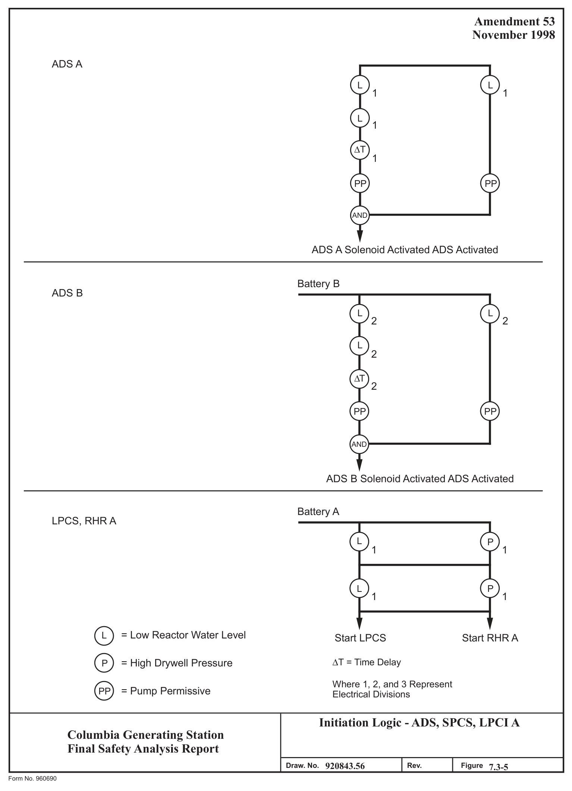

*figure on PDF page 129*

[Vector original (SVG, lossless): fig_page-129_2.svg](../figures/fig_page-129_2.svg)

<!-- labels/text on this figure page -->
Amendment 53 November 1998
ADS A
L L 1 1
L 1
∆T 1
PP PP
AND
ADS A Solenoid Activated ADS Activated
Battery B
ADS B
L L 2 2
L 2
∆T 2
PP PP
AND
ADS B Solenoid Activated ADS Activated
Battery A
LPCS, RHR A
P 1 L 1
P 1 L
1
0 L = Low Reactor Water Level Start LPCS Start RHR A 0 = High Drywell Pressure ∆T = Time Delay P 0 Where 1, 2, and 3 Represent PP = Pump Permissive Electrical Divisions
Initiation Logic - ADS, SPCS, LPCI A Columbia Generating Station Final Safety Analysis Report 920843.56 Draw. No. Rev. Figure 7.3-5 Form No. 960690

<!-- p.130 -->
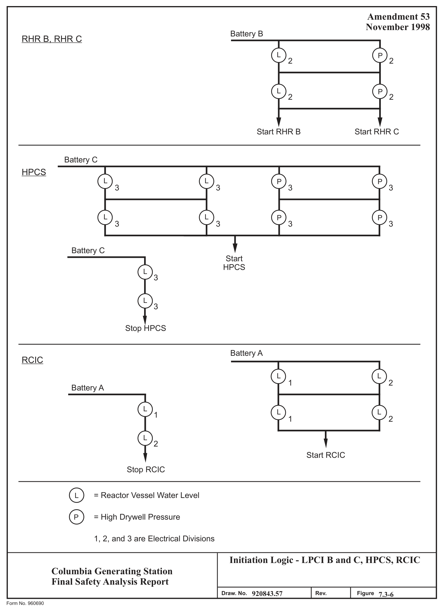

*figure on PDF page 130*

[Vector original (SVG, lossless): fig_page-130_2.svg](../figures/fig_page-130_2.svg)

<!-- labels/text on this figure page -->
Amendment 53 November 1998 Battery B
RHR B, RHR C
P 2 L 2
P 2 L 2
Start RHR B Start RHR C
Battery C HPCS P 3 P 3 L L 3 3
P 3 P 3 L L 3 3
Battery C Start HPCS L 3
L 3
Stop HPCS
Battery A RCIC
L L 1 2 Battery A
L L L 1 1 2
L 2 Start RCIC Stop RCIC 0 L = Reactor Vessel Water Level 0 = High Drywell Pressure P
1, 2, and 3 are Electrical Divisions
Initiation Logic - LPCI B and C, HPCS, RCIC Columbia Generating Station Final Safety Analysis Report 920843.57 Draw. No. Rev. Figure 7.3-6 Form No. 960690

<!-- p.131 -->
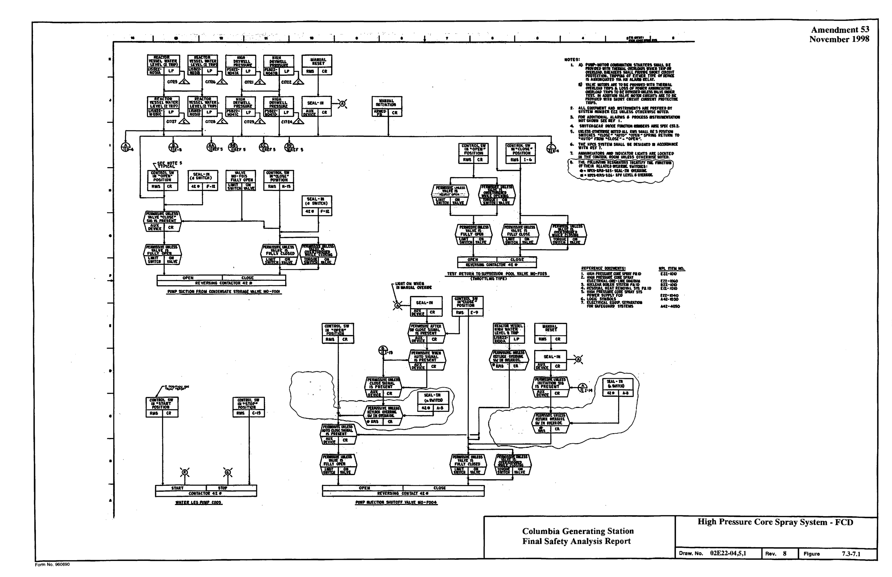

*figure on PDF page 131*

<!-- labels/text on this figure page -->
Amendment 53
•
• • • • •
•
• • November 1998
•
•or1s: -llAIIIAL ~T Cit
Cit
ca'i~\rilh
• U ■ f•II
UAL• ■
(Cl $1H11'tN)
4&e ·F•ll
•
11ft. ITn& 11D.
TOT RmJlt~ 'RISlfflfflioie f99', ftLff IIO-rffl
•
EU-IOIO
• tiHROm•i tiPi> • CLOS£ EN [ZZ•IOGO REV£1'111tG CCftW:1011 42 • ltt-lOID El2.•10IO PUMP UftOII FROM COll11USAT&: l10RMt )N,VE NO-l'OOI ftt-lCMO A4l•I030 M2·40SO
•
•
COll1IOL SIi
CQIUOLSW
IS•t.TMIT 11"111'.IP• l'OSITIOII
POSIT
All$ Cl RIIS C•i,
• .. , ' ., , ' R , ' 6
START $TOP anERIIIIG COIITACT 4t• COIITACTOI 42 •
• me, LIA mr taos 11G11P IUECTIOII SIIUTOFf VAi.ff IIO•f004
High Pressure Core Spray System - FCD Columbia Generating Station Final Safety Analysis Report 02E22-04,S,1 8 Draw. No. Rev. Figure 7.3-7.I
Fonn No. 960690

<!-- p.132 -->
• Amendment 58 12 10 14 13 11 December 2005

C I 5

CONrnOL SW CONTROL SW VAL VE

#### CONTROL SW
#### CONTROL SW
HPCS FLOW SE/\l-lN IN "OPEN" IN"CLOSE"

#### HPCS FLOW
ScAL-IN IN "OPEN'' IN "CLOSE" MO-FOIS NOT I• SWITCH) lo SWITC!) ABOVE SET PT LOW POSIT ION POSITION FULLY CLOSED 42 *

#### POSITION
#### POSIT ION
42 * FS

#### LIMIT ON
#### J-11 H-10
#### LOCAL
#### RMS CR RMS J-5 H-10 RMS CR RMS J-12
#### SWITH VALVE
#### NOOG.
#### PERMISSIVE WHEN PERMISSIVE UNLESS
VALVE IS ovl11H~R~UED

#### FULLY CLOSED WHILE OPENING
#### LIMIT ON TORQUE ON
#### SWITCH VALVE SWITCH VALVE
PERMISSIVE U!LESS PERMISSIVE UNLESS

#### PERMISSIVE UNLESS
#### VAL VE IS VALVE IS
#### VALVE IS OVER TORQUED
#### FULLY OPEN
FULLY CLO':,[ D WHILE CLO ING

#### LIMIT ON
#### LIMIT ON TORQUE ON
#### SWITCH VALVE SWITCH VALVE
#### SWITH VALVE
#### PERMISSIVE 1/NLESS PERMISSIVE UNLESS PERMISSIVE UNLESS
#### VALVE IS
#### VALVE IS VALVE IS OVERTORQUED
#### FULLY OPEN FULLY CLOSED WHILE CLOSING
OPEN LIMIT ON LIMIT ON TORQUE ON 42 * SWITCH VALVE SWITCH VALVE SWITrn VALVE

#### REVERSING CONTACTOR
H

## 0 LOW BYPASS TO SUPPRESSION POOL VALVE MO·FOIZ MINIMUM
#### CLOSE
REVERSING CONTACTOR 42 '<'

#### TEST RETURN TO CONDENSATE STORAGE TANK VALVE MO-FOIO
!THROTTLING TYPE) TYP FOR VALVE MO-FOIi

G I )~[1~::;ltr _ l~~~o~I" PIPE

#### ETECT
-lff'Cf, flJ:;?;

#### LOCAL LOCAL
#### ' / LIGHT ON l
#### A WHEN IN
, MANUAL /

#### OVERRIDE
....... ..

#### CONDENSATE CONDENSATE SUPPRESSION SUPPRES'SION
CONTROL SW srnL- IN INITll\ff INITIATE STORAGE STORAGE POOL WATER POOL WATER SEAL-IN IN "CLOSE" TANK ">'<'WATER TANK ''B'•WA TE R I a SWITCH) TIME DELAY TIME Dc'.AY

#### POSITION
#### LOW LEVEL LOW LEVEL HIGH LEVEL HIGH LEVEL
N53z A HF?,i~Y LOCAL H?,§;.fe_cY'. LOCAL LS LOCAL LS LOUL LOCAL LOCAL CR RMS D-12 42 of B-9 en~} B oN1fE

#### NOOIA NOOIB
#### PERMISSIVE AFTER
( SW CLOSE SIGNAL

#### IS PRESENT
I \ D~~h CR

PERMISSIVE \

#### WHEN AUTO SIGNAL
#### IS PRESENT
#### CR I AUX
CONTROL SW SEAL-!N \

#### DE VICE
IN \'QPEN 11 !• SWITCH)

#### POSITION
4? *

#### PERMISSIVE UNLESS 8-9 RMS (R
#### CLOSE SIGNAL IS /
#### PRESENT
I CR \ lEuv\cE

#### l
f WHl1 E Cl OSINC \ PERMISSIVE UNLESS \ /PERMISSIVs UNLESS PERMISSIVE IF \ VALVES FOIO & FOIi / VAL H IS ovltroVQ0h

#### ARE FULLY CLOSED
#### FULLY CLOSED
#### VALVE I LIMIT ON
ON / \TORQUE

#### SWITCH VALVE SWITCH
\ s1vlW[H VAO~E /

j PERMISSIVE UNLESs \ / VAL~E IS

#### FULLY OPEN
\ LIMIT ON /

#### SWITCH VALVE
I

#### I OPEN CLOSE
REVERSING CONTACTOR 42 * I I

#### PUMP SUCTION FROM SUPPRESSION POOL VALVE MO- FOIS
High Pressure Core Spray System - .FCD Colm:nbia Generating Station Fbwal Safety Analysis Repors Draw. No. 021:22-04,5,2 fiQlifC 7 .3-7 .2 orm No. ;cc•;Q6iflFH

<!-- p.133 -->
13 10 11 14 12 Amendment 60 December 2009

K ' 'Ci / A ' / I , /

#### SPRAY HEADER TO HPC S PUMP PUMP C003 REACTOR REACTOR HPCS MANUAL HIGH HIGH
#### HIGH HIGH HPCS SYS
TOP OF CORE SUCTION PRESS LOW DISCHARGE VESSEL WATER VESSEL WATER INITIATION SW DRY WE LL DRY WELL DRYWELL DRYWELL ACTIVATED PLATE HIGH d P HIGH/ LOW PRESSURE HIGH LEVEL(!'>TRIP) HIGH LEVEL(8 TRIP) IN ARMED POS PRESSURE PRESSURE PRESSURE PRESSURE ~)'&~Z- dPIS PS L15B22-

#### PSB22- LP LP PB CR
LP LOC/\L LP N009 N003 NIOO/\ CR N04?D

' ' ' / / / G R'

#### A / ' '
/

I I CONDEN'oATE CONDENSATE \/AL\/E VP,LVE RE!>.CTOR RE/\CTOR REACTOR

#### PUMP--- REACTOR SUPPRESSION SUPPRESSION
H LOW LEVEL LOW LEVEL NOT FULLY NOT FULLY VESSEL WATER VESSEL WATER VESSEL WATER VESSEL VVATER POOL WATER POOL WATER DISCHARGE

#### SWITCHOVER SWITCHOVER
LOW LEVEL (2 TRIP) LOW LEVEL (2 TRIP) I F-11 I F-10 OPEN CLO~E LOW LEVEL (2 TRIP) LOW LEVEL (2 TRIP) HIGH LEVEL HIGH LEVEL PRESSURE LOW ~~!ii2- ~~ii2t

#### LIMIT ON LIMIT ON
LS LS LSH F-9 L':.H F· S PS ♦ I SWITCH SWITCH VALVE I ♦ LP ~IJ!1~2- LP ~16~1~2- LP NOOIA SH . 2 NOOIB ~H. 2 VAL\/E LP

#### LOCA7- N002A SH. 2 NOOZB SH. 2
NOie L..=:= TYPICAL FOR MO&. AO VALVES =..J
( EXCEPT FOR FOIO & fall)
C Cl730 I I 8PCS PUMP DISCHARGE PRESS URE NOT LOW CONDENSATE CONDENSATE:
(cONTACT CLOSES LOIJ LtVEL LOW LEVEL

#### FOR-ALARM)
~PCS- ~I F·IO SWrTC.HOVER S\JITC.HOVER G HPCS· ,IF·IO RLY-62/3A SH. c RLY-62/38 SH 2.

#### PUSH BUTTON
IN • DEPRESSED"

#### POSITION
#### PB CR
' ' / / R G '

#### AIR SUPPLY
/ /

#### HPCS LOG IC MOV NETWORK
#### H PCS IN
#### VALVE VALVE
PERMISSIVE SOLE NOi D PERMISSIVE POWER POWER LOSS TEST ST!>.TUS FULLY OPEN FULL~ CLOSED PILOT FAILURE WHEN W~EN

#### OR OVER LOAD
#### VALVE 0 SOLE NO ID IS SOLENOID IS
l'R.1cn POS ON PO':, ON AUX

#### DE - ENE RGI ZED
- )( - LOCAL

#### ENERGII.ED
#### DEVICE
LOCAL SWITCII VALVE SWITCH Vil.LYE M/\NUAL INJECTION VII.LYE E22.- F03tl CONDEN',ATE UNK ./\,, MANU/>.L DISCHARGE VAL YE E 22- F009A CONOENS!>.TE TIINK "B" MANUAL DISC~ARGE VALVE E22-F009B

#### SOLENOID ENERGIZ.EV
#### VALVE OPEN
C

#### HPCS P-3
#### AO-FOOS LOCAL
#### POWER LOSS
OR OVERLO!>.D

#### TESTABLE CHECK VALVE AO-FOOS EE
#### AUX MCC
#### REF, 5 DEV ICE
High Pressure Core Spray System - FCD Columbia Generating Station Final Safety Analysis Report 02E22-04,5,3 8 07.3-07.3 Draw. No.
Rev. Figure Form No. 960690FH

<!-- p.134 -->
Amendment 61 3 2 4 5 6 7 9 8 10 December 2011

## 2 POSITION SWITCH REACTOR WATER REACTOR WATER
5W/TCH ''CLOSE"-"AUTO /OPEN" LEVEL IS ABO\IE LtVEL IS ABOVE A IN "AUTO/OPEN" MAINTAINED CONTACT LEVEL 2 TRIP LEVEL "2. TRIP

#### POSITION
#### RMS CR
CR CR

NOTES:

#### I. WHEN TEST SOLENOID PILOT IS ENERGIZED, THE MAIN STEAM ISOLATION
#### PERMISSIVE WHEN
#### VALVE OPERATOR IS SLOWLY EXHAUSTED (60 SEC CLOSURE TIMEJ WHILE VALVE
#### PERMISSIVE WHEN
PERMISSIVE W\.IEN PERMISSIVE WHEN REACTOR WATER MANVAl.

#### IS CLOSED BY ACTION OF THE VALVE SPRING WITHOUT AID OF AIR PRESSURE.
M-'lN STEA.M UNE. M"IN SffAM LINE

#### LEVEL ABOVE LEVEL ISOLATION
AUX OEVIC£ ·o·· [·en 2 TRIP RAD RAC

#### ENERGIZED
2. THE ALARMS AND VALVE INDICATING llGHTS SHOWN ON THE FCD ARE NOT H IGH-Hl(;,H NO\ Hl&H-Hl6H SYSTEM REQUIREMENTS IN ADDITION TO THOSE SHOWN ON THE SYSTEM PElilD

#### MS-LS-
PE> CR B ADDITIONAL INFORMATION ON ALARMS, VALVE POSITION INDICATING LIGHTS, CR ) \Ag 1g~IA- C,R R:21~s1A- CR 300C

#### ANO PROCESS INSTRUMENTATION NOT SHOWN ON THIS FCD MAY BE OBTAINED
[ 300A J FROM REF. I. AUXILIARY RELAYS a DEVICES ARE NOT SHOWN ON FCD EXCEPT [k!ol 013] [l<~IOAJ

#### WHERE REQUIRED TO CLARIFY FUNCTION.
4, MAIN STEAM LINE ISOLATION LOGIC A a, C, RPS "A" SOLENOID LOGIC AND THE VALVE TEST SOLENOID SHALL BE POWERED FROM T+IE REACTOR PROTECTION SYSTEM M-G SET A: LOGIC B a D ANO RPS "B" SOLENOID LOGIC FROM RPS M-G PERMISSIVE CR

#### SET B. UNLESS MANUAL NOTE 13
#### ISOLATION SIGNAL
5. ALL EQUIPMENT AND INSTRUMENTS ARE PREFIXED BY SYSTEM NO. B22 UNLESS 15 PRESENT ,._ _________ ~

#### OTHERWISE NOTED.
6. FOR LOCATION AND IDENTIFICATION OF INSTRUMENTS SEE INSTRUMENT DATA

#### AUX CR
#### SHEET LISTED IN MPL (REF. 22)
0EVICE 7, AUTO □[PRESSURIZATION CONTROL LOGIC ClRCUfT

#### SHALL HAVE REDUNDANT POWER SUPPLIES SO THAT A SINGLE FAILURE WILL NOT
F'"ROM LOGIC 'o'•

#### DISABLE THE AUTO DEPRESSURIZATION FUNCTION.
A B. THE NUCLEAR BOILER SYS SHALL BE DESIGNED IN ACCORDANCE WITH REr. 18 AND PERMl.551YE UNLES5 WITH "PROPOSED CRITERIA FOR NUCLEAR PONl'::R PLANT PROTl'::CTION SYSTEMS MANUAL ISOLATION

#### PERMISSIVE WHLN PERMISSIVE WHEN
IEEE 279" AS APPLICABLE TO THE CONTROL CIRCUITRY. INBOARD C./D .51GNAL \5 PRESEKT AUX DEVICE "RESE_Tu PUSHE>UHO 9. ISOLATION LOGIC SHALL BE "FAILSAFE", I.E~, L-OGIC SHALL BE DESIGNED DEPRES5£O ENERGIZED ----7

#### TO INITIATE ISOLATION FUNCTIONS WHEN DE-ENERGIZED. AUX C-2
I

#### DEVICE CR AUX D-2
10. RtMOVED PB I

#### DEVICE I
I I I II, REMCN'E"D I 0 I PERMISSIVE WHEN PERMIS$1VE_ WHE-N 12. THE DEVICES IN THIS AREA, AS WELL AS OTHER DEVICES IN THIS AUX DEVICE \S INBOARD CID AUXILIARY RELAY :

#### LOGIC ARE ESSENTIAL AND MUST MEET THE REQUIREMENTS OF
ENERGIZED RESET PUSH e,uTTON f--_E_NE_R_G_IZ_E_D_CN_D_R_M_AL_l_r---~

#### IEEE 279.
## 15 DEPRESSED
CR 13. ALARM f"ROM ROTARY CONTACT AUX DEVICE AUX e::.-e,

#### DEVICE
14 AE TO SUPPLY DEVICE T'r'.PE, NUMBERS ANO QUANTITY.
NOTE~

## 15 SEE REF. 4 F'OR INITIATION OF "SELECT ROD INSERT",
16. REMOVED

#### SOLENOID ENERGIZED
#### VALVE OPENS
#### AUXILIARY RELAY
l7 REM0/£0 ENEP.GlZED CNORMAU B35-FOl9 LOCAL AUXILIARY RELAY \8. % REACTOR POWER DER1VED FROM FIRST 'STl'>.GE TURBlNE PRESSURE. DE-ENERGIZED AUX E [ F'020 J DETERMINE GROUP OF Rt.LlEF VALVE TO BE OPEN

#### DEVICE CR
l..___ --------- INBOARD 'R!;:ACTOR Vi.ATER SAt-A'PL[ VALVE ISDLATii1no:>iN~S;;;,eis'ii1Ec°M.t::====='---------i•I \9. ~~~ :r~r-n~ALRrl1~cs~Mjc~.tpRErifKER CLOSf" fTRIP LOGI~ I AUX T'f P1CAL FOR OUTBOARD (OUTBOf>,:R1J DE\JICES IN 13RAC'!',ET5 [ Jl DEVICE 0~2
(~£:FB,SH. l ,1J 3)
NOTE.~ :c~g~~~~-~NoJ:!~-- • "-- CH S1-\llTCH cc "OPEN" SPRING IN OPEN RE:TURN TO NORMAL POSITION F

#### CR RMS
#### CLOSE DRYWELL EQUIP
DRAIN VALVE GII-F019 (F020]

#### SEAL-1N
I LOG IC "D" ["B") SWITCH MANUAL 42/0" I MCC REFERENCE DOCUMENTS:

#### MPL ITEM NO.
AUX DEVICE IN "tlOSE • ISOLATION

#### DE-ENERGIZED POSITION
I. NUCLEAR BOILER SYS Pli!O- - - - - - - - - - - - - - - - -822-1010 AUX
2. REACTOR RECIRC SYS FCD - - - - - - - - - - - - - - - - -835-10'20 AUX CR SH2.,Hl4 RMS F-~ DE~!CE PROCESS RAD MON SYS DE"VICE
3. NEUTRON MONITORING SYS FCO- - - - - - - - - - - - - - -C51-1020 HI-HI RADIATION OR

#### INOPERATIVE IN REACTOR
4. REACTOR PROTECTION SYS !ED- - - - - - - - - - - - - - -C72-IOIO

#### BLDG VENT EXHAUST SYS
• 5. PROCESS RADIATION SYS IED- - - - - - - - - - - - - - - -01',01-1-,C\7& O!&·lOI LOGICC.A,BJ C, D 6. RHR SYS PSID- - - - - - - - - - - - - - - - - - - - - -£12-1010 I 7, RHR SYS FCD- - - - - - - - - - - - - - - - - - - - - - - E12-1030 PERt-11SSIYE. W~EN' \ PERM ISSIV[ WHEN \ PERMISSIVE" WHEN \ LOGIC "D" c·s•] LOGIC 'C" [ " A'] LOGIC. 'C." [ "A"J 8. REACTOR RECIRC SYS PSID- - 9. RAOWASTE SYS P&ID * - - - - - - - - - - - - - - - - - -Cil!THRU G\<,,-1010 - - - - - - - - - - - - - - -835-1010 AUX DEVICE. Aux DEVICE AUX DEVICE / / tNERGlZED ENERGIZED DE-ENERGIZED H 10. RADWASTE SYS FCD * -- - - - - - - - - - - - - - - - - -GHTHP.UGl<D-1030 \ ~~~ICE \oE◊~tE !5H2,H-14 / \o~~~CE SH2.,HI\ / SH2,1--\ll / II. REACTOR WATER CLEANUP SYS PSID - - - - - - - - - - - -G33-1010 f------------/~---' RHR-5'-tC.
j 12. REACTOR WATER CLEANUP SYS. FCO - - - - - - - - - - - -G33-1020 ,REF:/ 13. SCHEMATIC CONTROL DJ AGRAM - - - - - - - - - - - - - - - 822-F022 & F028 14, LOGIC SYMBOLS - - - - - - - - - - - - - - - - - - - - -A42-llJ30 SHUTDOWN a ISOLATE REACTOR BLDG VENT SYS CREF. 5)
15. PIPING a INSTRUMENT SYMBOLS - - - - - - - - - - - - - A42-IOIO : ffRMJSSIVE \

#### UNLESS MANUAL
/ SEAL-lN 16. LOW PRESSURE CORE SPRAY P&ID- - - - - - - - - - - - - -E21-!0!0 ISOLATION. SIGNAL
---. CLOSE INBOARD PRIMP."R'f C.ON.TAlNMENT

#### IS 'PRESENT
17, LOW PRESSURE CORE SP-RAY FCD - - - - - - - - - - - - - -E21-1030

#### C-2 I
PURGE 8 VAL\JE5 [A113 ( RLI=". 5)
\ AUX
-12/C * 18. ELEC EQUIP. SEPARATION FOR SAFEGUARD SYS- - - - - - - -A62-4050 DEVICE MCC 19. LEAK DETECTION SYS P&ID - - - - - - - - - - - - - - - -E31-1010 20. NUCLEA,R BOILER SYS Pa!D DATA - - - - - - - - - - - - - - B22-1040 21. TURB GEN. 8: STM BYPASS SYS - - - - - - - - - - - - - - - A62-4120 j 22. INSTRUMENT DATA SHEET - - - - - - - - - - - - - -- - -822-3050 / 23. LE.AK DETECTION 5Y.5 DES SPEC-------------- E.31-+0tO P£RM155l'IE Vil--\ .. EN \ PEAMISSlYE W?)HEN. PERMISSIVE WHEN \ 'PERMISSIVE UNLESS\ VALVE rs 1/ALI/E TORQUE 1/A.LVE TORQUE / VALVE IS 24. R:EACTOR PR:OTECTION SYS. ELEM DfAG (C72A) C72-l0SO / Sl,,JtTCH IS BeLOW :SWITCH IS BELOW

#### WATER LEVEL VESSEL PRESSURE
"'FULLY CLOSED "tULL "i CLOSED. SEAL !N SET POINT SErPOINT 25. REMOVED IS BE"LOW \S ABOVE Hl&H 2G.. REMWED LEVEL 3 "TRIP PRESSURE SCRAM \' I I ~1:gcH I vttvE I 27. REtl\DVlD ToRQuE!ON \~~i+CH ON \ TORQUE ON

#### SWITCH I VALVE
#### VALVE SWITCH VALVE
LEGEND= POS. SW ON REC. PGS. SW. ON RE:t j IEEE INSTITUTE OF ELECTRICAL 8: ELECTRONICS ENGINEERS

#### ADS AUTO OEPRESSURIZA TION SYSTEM K
I P£RMISSIYE UNLESS

#### RPS REACTOR PROTECTION SYSTEM
#### RESET PUSHBUTTON
* • IS OEPRESSE 0 APPLIES II= lN GE SCOPE OF SUPPLY PERMISSIVE WHEN \ PERMISSIVE WHEN \ OVERLOAD OVEF!LOP.D

#### SWITCHGEAR DEVICE FUNCTION NO'S ASA SPEC C37.2 / NOT TRIPPED
#### NOT TRIPPED
RAM RADlA T!ON MONITOR

#### PB C.R
\49/0L * \"19/0L !ff' ON / VALVE vltvE /

CR L 7

#### I OPEN CLOSE
I AC REVERSING CONT ACTOR 42*

#### SWITCH CHART SPEED
TO HlGI-IER 5PEEO

#### MAIN STEAM LINE DRAIN VALVE MO F016
LR/PR-R•23~ ON REC TYPIC,._L FOR LR/PR-Rlo'Z.3B 14----------------,NBOARD MAIN STEAM LINE DRAIN VALVE ISOLATION SYSTEM,----------------.1

#### POST ACCIDENT MONITORING OF WATER
LE'V£L AND PRESSURE: ... ~~--~ TYPICAL FOR OUTBOARD tXCEPT DEVICES St-lOWN IN C] ----------------------------------~-----------------------------------1 I (MO F019). (MO f"Olo7A-DJ E'llCE.PT DC TYPE At,10 M Nuclear Boiler System - FCD CONTAC.TOR 72.. l Columbia Generating Station Final Safety Analysis Report 02B22-04,23,1 19 7.3-8.1 Draw. No. Rev. Figure Form No. 960690ai

<!-- p.135 -->
----"\'---'---'l'---1 --'-i __ 4_.,___ l __ ___Jl ___ ..Ll __ .LI _ _,_,!1---'---e=---__ .J..l __ --=.9 ___ 1._l __ :::•o:__ _ _JI __ ...L.._J..j _'._'._II

, -t------· __ :=:,,.,,~:-t-.1 _....cl ___ 3 __

2 ___ .,___ 1 ___
--=.!5 __ 6:.._ __ ...:_7 __ December 2011

LOGIC "A"

#### CNOTE 4J
A

REACTOR P£~MIS:Sl\f£ \ WHl;:N K£YL0CK WATER LEVEL AMVE LEVEL 0) TRIP BYPASS S'w JN

#### BYPASS POSITION
'-(ws-~200\ - us---- CR-----' j

#### RMS I CR /
#### REF. 4
PERMISSIVE WHEN \ PERMISSIVE \ L_~ l ____ MAIN STEAM LINE UNLESS RE...CTO"R / / ~A~-C-R FROM LOGIC "B" PRESS AT TURBINE MODE 5""1lTCH IN ABOVE SETPOINT "RUN" POSITION B \ N61iA LOCAL / \ RMS CR / I I LP w FROM LOGIC "B" ~----..J1 © I V: R : I Y,;-< POV'IER LOSS OR BATTERY 81-2 MANUAL ~ OVERLOAD OF

#### OUT OF ANY INBOARD
#### CR DL)T OF SERVICE PERMISSIVE CR SERVICE
I WHEN BYPASS isuoxLATIOIN VALVE ;-:HrnFtcrn~?N\ER_\_71 srs:r

#### AMS I CR
BISI BY BISI--~---, VAC IS GREATER SWITCH IS IN "BYPASS"

#### DEVICE MCC OTHERS
THAN SETPO!NT I POSITION I DIV 2- NS4 OUT OF SERVICE '11 \ NOV5S6A LOCAL / \ RMS CR /

#### PERMISSIVE WHEN MAIN
STEAM LINE "A" FLOW i REI'". 21

#### NORMAL OR BELOW
I I FROM LOGIC "B" I \ dP!S E3I -
---------+-----1 ----t--------------.--iR \ N008A LP / ll L__ PERMISSIVE WHEN \

#### TURBINE STOP
/ VALVES A.RE LESS

#### THAN 901. OPEN
I I \ POS-SW CR / ~s;®

#### PERMISSIVE WHEN MAIN
STEAM LINE "8" FLOW I BI~~® I

#### REF. 4
#### NORMAL OR BELOW
i

#### POWER LOS5 OR MANUAL BATTEA.Y BH BATTE RY B2-J
#### OYEPLOAD OF
\ dPIS E3I- OUT OF OUT OF OU! OF D N009A LP / ANY OUTBOARD ISOLATION VALVE SERVICE SEP.VICE SEAV!CE" L_ I \ /;P€RM!551VE WHEN REACTOR ffESSU~E BY OTHE1lS I LP I '--l-'---C-U_S_T_OM_E_,O," scm i, I BY OTHE~ LP Al.IX UEV!CEj MCC RMS I CR !
~Jff~~EJET DIV. I NS+ OUT OF SERVICE I \ Ja52-0A LP / i PERMISSIVE WHEN MAIN ,f--------..-- FROM LOGIC ":B" STEA/ill LINE "C" FLOW

#### NORMAL OR BELOW
\ dPIS E3I- ! ,__ ___ \ NOIOA LP / L__ REF. 19-< E

## 3 POSITION
""CLOSE •-... AUTO""-"' TEST"'
------...r--"L----~ L ___________ ! NOTE 12 MAINTAINED CONTACT

#### PERMISSIVE WHEN MAIN
#### SELECTOR SW
STEAM LINE "0" FLOW IN "CLOSE"

#### NORMAL OR BELOW
#### POSITION
\ dPlS E3I-

#### CR I I
\COMMON. TO ALL I N&O.t.RO M-'IN RMS I CR \ NOIIA LP /
-- \ 51"£1).M ISOLATION v.-.Lvt~ 1="022,1..,B,C,D INSO/cf?L5&?c PERMISSIVE WHEN PERMISSIVE \ I l F C&. 0 OUTBOARD-A/B RESET irl'HEN LOGIC "A" j RPS BUS ''A' SOLENOID LOGIC. RPS BUS -e-soLENOID L061C SWITCH IS IN "RESET" AUX DEVICE IS

#### POSITION ENERGIZED
#### CR L /
j j \ RMS PERMISSIVE w'HEN MAIN PERMISSIVE ',/HEN \ PERMISSIVE WHEN \ STEAM llNE TUNNEL LOGIC "8" t'O"] TEMP BELOW SETPOINT /
( LOGIC ''A" ["C"]

#### AUX DEVICE
#### AUX DEVI E
#### CR I MAIN STEAM LINE HIGH FLOW
#### ENERGIZED
ENE"GIZED I .-- FOR L06\C. •<,• t "D' I CR 7 I LD-MOtJ- Cl54I FOR LOGIC "A"]
- I P£RMISSIVE \ eA [ Cl542 FOR LOGIC ''8" AUX I I \ I "OUT BOARD~ BECOMES Cl543 FOR LOGIC ''C" I DEVICE L__ PERMISSIVE Wl-'EN "tN1'3oAAD" PERMISSIVE WHEN \ \ LD-MOIVlB Cl544 FOR LOGIC "D"

#### I EITHER MSIV ALL OUTBOARD MSIV
W/.IE:N KEY LOCK / / SOLENOID LOGIC IS CONT S'w''S ARE

#### BYPASS SW HI
#### ENERGIZED CLOSED POS BYPASS POSITION
\ RMS I E-I2 / \ RMS A-1 / PERMl5S!VE WHEN MAIN

#### MANUAL
150U,TlON $TE..._M LINE TUMNE'L j PERMISSIVE WHEN \ PERMISSIVE WtiEN \ "A" LOGIC "C" ("A"] 1:::.IFFri.RE tfTl~L TEMP TEST ~WITCH LOGIC "D" £•1!1"] / H

#### AUX DEVICE
'i?l't.LOW $E!P0I1ff

#### AUX DEVI E IN TEST POIITION
#### PB I CR
\-_____________ J ~R FROM LOG.IC'B"

#### ENERGIZED
ENE"GIZED

#### CP I CR /
\ LO·ft~-

#### PB I I
- \ ot~l~E LD-MOtJ-ZB UNLESS "IANU"-L PERMISSIVE SIGNAL IS ,_ /

#### PRESENT
i.
/1 l PE"RM!SSIVE WHEN \

#### SELECTOR SW ITC.M IS
1M TEST POSITION MAIN STEAM LINE LEAK DETECTION FROM LOGIC ''fl" Cl545 FOR LOGIC "A" [ Cl546 FOR LOGIC "C"] I l Cl547 FOR LOGIC "B" J \ RMS E-l'l / Cl548 FOR LOGIC "D"

#### AUXILIARY DEVICE
#### FSAR FIG.
[NERGIZED AIR SUPPLY AUX YJi-- I I

#### CR DEVICE A
II ~---~--------------~--------~---------~----- il / , ,_ I I MAIN STEAM LINE ISOLATION "A" I I TYPICAL FOR LOGJC B,cao EXCEPT -

#### FOR LETTER SUFFIXES WHICH SHALL
#### I ENERGIZE SOLENOID I BE B,C&D RESPECTIVELY CSEE NOTE 9)
~;v:~J __ -1~~~~0~~, I LD·MO'-l-2/\ fOR LOGIC. ''A' f "B "
-- ENERGIZE SOLENOID LD-MDIJ-2B FOR L06IC.:C • i "D"

#### PILOT VALVE
#### PILOT VALVE
I I I K A L.---REF.I:: I ~----------'--/CLOSES VALV~ AT HIGH I SPEED WHEN !OTH I ~~~rffs\t{~~~Vhff SLO'w'

#### PILOT VALVE SOLENOIDS PILOT VALVE SOLENOID I
I

#### ARE DE-ENERGIZED I -
#### IS ENERGIZED (NOTE I)
I '-----------------------------=----------------' L

MAIN STEAM ISOLATION VALVE AO F022A.rF02BA] I <TYPICAL FOR AO F0228,C,Ol [F021!1B,C,D]
- ~-----------------llNBOARD MAIN STEAM LINE !SOLATION VALVE SYSTEM------------------11 TYPICAL FOR OUTl!IOAR?ci11-e2□A4Rt 5iv1CES 1N BRACKETS [ J)
I ·1 Nuclear Boiler System - FCD ~M Columbia Generating Station '1 Final Safety Analysis Report I I 02B22-04,23,2 22 7.3-8.2 Draw. No. Rev. Figure Form No. 960690ai

<!-- p.136 -->
•
• ---l z s 3 Amendment 56

7 I ' II

10

,...,. .....

1,TATfi:l'f t~t•'I & NUCLEAR BOILER SYST[ M December 2001 ~ 5U •t, 1 t IT f'Ollt &DDITION,U ;-'UNCTI0.9 """ Of THU£ SWITCHES MIIN LOW PR[SSUWE DAYV[LL Dtlnt!.LL fllt1JI PUNf ·1,• C011E SPIAY Plt£'11URE PRESSURE RUNNIJU;
PUNP lll!UlOIIINC

....

F-f, LP

1.L.l,IIM FUNCTION INITIATING O(VICI i;;O.EPll[SSURIZATIOI POWER FAIL.LIi£ UIO,IIT P0W£A F'AllJ,,Rf'. RELAY PE:RIUSSIYE WHEN ... ~ IIMR PUMP •1,•

RUNNING

":o~~ir-•
•DS LO;IC •a• TIMIIIG Dl:VICI: •,a• INITIATED ADS LOCIC •9• TIMING D[VtCl "8"

#### INITIATED

aos LOGIC "C· PERl'tf'9SIY[ WHEN INITIATED I.UltllAR'I' OEVICE '"C REACTOR W&T£1t PERMISSIVE 'WHIII Lf'fEL B£L0W ~ ltEACTOllf ,.-&JUI 9E.IL-IN ADS LOGIC •o• L£YEL I TRI~ ~ LEVE:L 8£L0V I.IJl:_ILl&WY 0£YICE •o

#### IIITIATED

r--•o..;;L1.;;.l;.;A;_;;,.;...;.;;L;_P _ _, SEE REF 20 roR /'r--:':LE::,•c.:E:::L,..;'...;T.;;l;_IP_-1 &Ul

.....

#### RELAY .ADDITIONAL FUNCTIONS LP

OF T"UE SWITCHES P:CAC. 1'0• lDW W,\T~R LC.'\tt:\.
CONnAHICO

A.Ult CR

DCVIC.E

N0364' N036&

""" acv,c.1 Hlt41991YE WHEN Rkll PUMP •t:• ltUllllflC Pl i'.12• LP 0 tf018C '1~Q:~l!a":il'WE UNLE~ Drv. t l"IH,~ IT SW I~ •1 .. tll1t.1T" PD5,lfl,Otf RMS O·C> •NS CR tR tit

""'"'"''- MllNUIU,.

.......

INITll'TION •n• ATE TIJII[

#### INITIA.TION

#### PUSNBUTTON

4 PUIN&l.lTTON O,i.1..AY PO PD tR e•
--------- tll ..,.,.
A =~-£ ~-------- r.-~ tDS ,, PC~IS'ltVS' WNEN I.OW Nnl

.............. y

Pt:RMISSIYE \IIHEM PVfllP RIJIININ6 ~MIi PUMP "A"' ltUNfUfllC '::'o!.11.. L ...
lOWt-r.• ~V lftF I.,

Al.I.II IUAIIY RS'LAY CP.ER61Zlb u AUX. A(LAV AUJ(IUAA.'W' FtEL.AV IN!.RGtlZIP

#### I.OQIIC. C

t

3T,.TION BATT£11Y It.

'"°"" .. •AUT't'1 sw,n1-1 '"A"' l NIITION SWI TtM ffiOM L~, D, g COM'l0II Ut •Ofl'IN"' TOIUL -..ro DIPMftUllllVI.· Mll,tl(fAIN\.) P0111"ION TION W'rTY/ftl:U[r; ""'-"'IJ t,oNTA(.T

'-...¢A/ Cl/ ,rt,., o Rrr--,.--=-=,...:.:~==--..f"---1

0 R l-+'~;._o;==-1--1. G C

u I / ' II / '\

K Wto

L FSAR FIG. = 8UltN3aMEJU• ?-oe.-00.01 SOI. CNOID CN[Rl;.llEO V&LVt 0ftE115 ... <"LTV/OU.II~ _,,_.,E.
.3 fOIJ LOCAL fDl"3 Ol-otll:I: 'l!I 2.0 _:Sll:.:_:.:_1:_1=::_=:_-------------=~----------~=~=::'.-~~=~-~,-,~•==-==-=-=~-----------...J f jr--~========--------------------========~-- ~-----------.:__;_.::.:.::__::=:_ ___________ _..:::_:::_::UFllT/llllll VJl'll\111111110 ;,:;,-______
-n•w,.., •u n. nau.1 • '------------------------------------~-l_l_&_rA_~~c,,an:~•~:~,~~=;~•~~-~t=\Vf=•=W:':..'_'·_____ SAF£TY/ 11£LIEF VALVE$ _ Nuclear Boiler System - FCD Columbia Generating Station Final Safety Analysis Report Draw. No. 02B22-04,23,3 Rev.20 Figure 7.3-8.3 Foim No. 960690

<!-- p.137 -->
j 11 Amendment 62 2 3 4 !5 6 7 8 9 10 12 December 2013

A

LOOP "B" LOOP "A"

#### JET PUMP
#### JET PUMP
#### TOTAL FLOW
TOT AL FLO'w'

#### K6028 CR
#### K602A CR
~-------1 / REF 8 LRH8 ~-------Ll I I B

#### RECIRCULATION I
PERMISSIVE lo/HEN PERMISSIVE 'w'HEN

#### RECIRCULATION I
AUX DEVICE "B" AUX DEVICE" A • I PUMP "A" I CC

## 1 PUMP "B" I I
#### ENERGIZED
#### I I TRIPPED I
#### ENERGIZED
REF 2 s .7,J-B DtY1~:1PPEDLP i AUX AUX

#### AUX D -2.
#### DEVICE
#### DEVICE LP I
#### DEVICE
I I I I I I ~-t--~ I Cl656 Cl657 I I I PERMISSIVE lo/HEN

#### PERMISSIVE WHEN
#### PERMISSIVE WHEN I
#### I PERMISSIVE WHEN
I RECIRC PUMP "B" AUX DEVICE ·B" AUX DEVICE "A" RECIRC PUMP "A"

#### RUNNING
#### ENERGIZED
#### ENERGIZED
L __ =:- RUNNING I

#### I AUX LP D-2.
#### AUX I
AUX AUX

#### LP I DEVICE DEVICE
--~

LOOP "A" FLO'w' SIGNAL AUX DEVICE "A" AUX DEVICE "8"

#### FOR NATURAL
#### ENERGIZED
#### ENERGIZED
CIRCULATION OR w'HEN AUX AUX CR LOOP "B" FLOW SIGNAL LOOP "A" JET PUMPS FLOW SIGNAL CR

#### ALL JET PUMPS ARE
#### DEVICE
LOOP "B" JET PUMPS FLO'w SIGNAL

#### PROVIDING DRIVE FLOW
DEVICE FOR NATURAL CIRCULATION lo/HEN LOOP "A" JET PUMPS ONLV WHEN LOOP "A" JET PUMPS ONLY OR WHEN ALL JET PUMPS PROVIDING JET PUMP DRIVE FLOW

#### TOTAL JET
#### PROVIDING JET PUMP DRIVE FLOW D ARE PROVIDING DRIVE OR
OR PUMP FLOW FLO'w LOOP "B"JET PUMPS FLO'w SIGNAL LOOP "A"JET PUMPS FLOW SIGNAL

#### SUMMER
WHEN LOOP "B" JET PUMPS ONLY RECIRC LOOP "8" RECIRC LOOP "A" PROVIDING JET PUMP DRIVE FLOW WHEN LOOP "B" JET PUMPS ONLY

#### JET PUMPS ONLY
#### JET PUMPS ONLY
#### PROVIDING-JET PUMP DRIVE FLOW
#### PROVIDING DRIVE
#### K606 CR
#### PROVIDING DRIVE
#### FLOW FLOW

PERM/551\/E WHEN PfRMISSII/E WUEN

#### PERMISSIVE WHEN
#### PERMISSIVE WHEN PERMISSIVE WHEN
AUX DEVICE "A" AUX DEVICE "A" AUX DEVICE "B" REACTOR WATER REACTOR WATER

#### DE-ENERGIZED
#### DE-ENERGIZED DE-ENERGIZED
#### LEVEL ABOVE LEVEL LEVEL. A80VE LEVEL
## 3 TftlP E
## 3 TR P
#### AUX D-'.2.
AUX

#### AUX LIS LIS D-2.
L p

#### DEVICE LP
#### DEVICE
#### DEVICE
#### N0240
NOZ ◄C [No24 a] N02.4A] +

#### REACTOR WATER REACTOR WATER
--RPS BUS [A] LEVEL ASOVf LEVEL 9-1-~---,i LEVEL ABOVE LEVEL 3TRIP 3TRIP PERMISSIVE WHEN\ I LIS LIS

#### LP PERMISSIVE WHEN
LP

#### PERMISSIVE WHEN PERMISSIVE WHEN N024D
N024C ~SSIV~WUEN AUX DEVICE "8" AUX DEVICE ~s~ AUX DEVICE "A" I I [NOZ4B] (NOZ4A] DRYWELL PRESS PRYWHL PRES!>

#### DE-ENERGIZED
#### ENERGIZED ENERGIZED
I F I 8EJ.Ow' TRIP POIHT BEL.OW TRIP POINT AUX D-1"2> ';;o~;t-

#### P5C72- LP
#### DEVICE LP
#### N002 C
(i,002 B] PERMISSIVE (REF. 4) [NOOZA]

#### UNLESS '1ANIIAL
ISOlATIOH s,GNAL

#### IS PRESENT
#### RECORDER
#### CR DIFF PRESSURE/ R613
FROM LOGIC ,..0" PER'NISSIYE

#### FLOW RECORDER UH'LESS MAHIJAL
A

#### ISOLATIOM SIGNAL
#### IS PRESENT
PE!U"flSSIV~ WHEN

#### PERMISSIVE WHEN AUX - SH I IN80AR O C/D
----, AUX DEVICE "RESET" PUSll•UTTOH DEVfCE C-2 H

#### DEPRESSED ENERGIZED
I AUX

#### PB CR
#### TOTAL JET PUMP FLOW MEASUREMENT SYSTEM
J\2 I fROM LOGIC "D" DEVICE I A I I PERf'1155IVE WHE"' I

#### I AUX DEVICE
#### I I ----7
#### ENERGIZED
#### AUXILIARY RELAY 1
I I

#### AUX J-2.
._E_H_E_RG_IZ_E_D~(~H_O_R_M_A_L_) ...,-- _ ..,. .J

#### DEVICE
I

#### AUX DEVICE CR I
I NOT~ 9 I I I I

#### AUXILIARY RELAY I
>-E_H_£_R_G_1z_,_o-,----'-(H_O_R_H_A~0 _ _,---J

#### CR AUX DEVICE
#### AUXILIARY R'E'LAY
#### DE-ENERGIZED
AUX

#### DEVICE J I Z
#### NOTE9
#### AUXILIARY RELAY
K DE-£H£RGIZED HEAD SPRAY [£12- F023] AUX RHtf SUCTION El2-F009 [FOO SJ

#### J -2 DEVICE
#### SHUTDOWN COOL.ING IHJECTIOH
fl2-(FOS°3B] [F053AJ NOTf 9

14-------RHR 1Nl30IIRD I50LI\TION LOGIC _____________ _,
( DPICAL fOR OUTI30At\D l'<lTH DEVICES 5HOViN IN I: J)
L Nuclear Boiler System - FCD Columbia Generating Station Final Safety Analysis Report

#### RHR INBOA'RD ISOLATION LOGIC
02B22-04,23,4 17 7.3-8.4 Draw. No. Rev. Figure
(n1'1CI\L FOR OU"TBOl'.t\D l'l!TH DEVICE5 SHOl'IN IN L J)
Form No. 960690ai

<!-- p.138 -->
., Amendment 53 •
•
• ti 2 II 10 November 1998

e4t/C NCC OIIS Cit .. Z/O NCC

8

1'£RM\SSNI:
UNl.l55YAI.Vt IS
•rouv 0,01 • L.tlllT o,t SWl1Ctl ¥Al.VE

~.
lloitii&I Cit 0

Cl.OSI o\C OIYIIISIH C3UCTOR 42 e

ca,ce 11cc
- H CII

-- ---h ... ~ UMIIH stlif~ tAit.. !
IC I 4ttel.e NCC I
•- ---- J I

SOl.~e.:,=•m ac IIIUIIN CIMITACTOII ca.
o\O ,_& LOCAi.

N

Nuclear Boiler System - FCD Columbia Generating Station Final Safety Analysis Report Draw. No. 02822-04,23,6 Rev. 17 Figure 7 . .1-8.5 Fo nn No, 960690

<!-- p.139 -->
• Amendment 58 December 2005

hOHS;

#### MANUAL
iNITIATIOl'I

#### AHMED CR
PS

--------r-- HIGH

#### DRYWELL
#### PRESSURE
cc j (.ONTI\GL ~W \iF'G IN" OPlN PO'a\TI~ N I, YIGH PRESSURE COQE SPRAY SYST[M P.tlD -- E22-1010

#### REF 5
'2.
-----· • -·-E22 - ,060
3. N•JCLi:'AR BOILER SYSTE:'-.1 P &ID ------ 821/922•-IOIC RESIDUAL HEAT RE.MOV.\L SYSTEM P&.1D--- -£12-1010 :i. RESIDUAL 11£.IH REMOVAL SYSTEM rCD- -·-- EIZ-1030

## 6 NUCLEAR AO!Ll~ SYSTEM I-CD-- 82 /0??·-1030
I, LOG•C SYMBOLS

#### A42-IOJO
8. El EC"(RICAL c.QUIPMENT :>E.PAR/1TION FOR SAFEGUARD SY-STEMS - - --•'/>2 4050

L!;Gf~D· = SWITCHGEAR >!' DEVICE'. ~Jf<.CTIOI'-/ NO. ANSI SPEC CJ7.2 IEEE= INSTI TLJTE 01= ELECTRICAL ANQ EU:CTRON:IC.S E.NGNEEr-~S.

SE/\L- IN

AUX EON~ n,

0PE~I

R't.VEHSING CON1ACTOH 42 If:

TEST 1:rYPASS To ',LPPkESS10>,i POOL vALVF. MO F~'l2 COAf SPPAY 1;\Jl:CTIO", VAL.','E MC FOOS Low Prc,ssure Core Spray System - .FCD Colm:nbia Generating Station Fbwal Safety Analysis Repors Figli,e 7.3-9.l Draw. No. 02E21-04,6,1

<!-- p.140 -->
..
• " " Amendment 56 December 2001
•

.. ..
..
..
,;II CR CR CA CA CR

#### CR CA
A A

#### POTENTIAL FOR
LPCS 51.CTOI 'IAO'E • Puuc> DISCH Ll>C:5 LPCS LPC$ IIUCTI Ok VAlltE COltTIXlL $11 IN PRUS. IS PUMP MOTOII OQ.AININ<i RP. PUMP· SWliCN ~ ACTuATEll ov£RLOAO TC SIJPp. POOL TRIPPED IN TEST \T&TUS s.E• POSI llOM A8NOAWAL

#### SH. I
AUk PS AUl

#### LIMIT ON CR
CA G-10 RMS D-9 HOOS OfVICt ITCH YALYI 0£¥1

H CA .. ~ ,cA,, cci,, 'C.Q, , '

#### CR , ' A A
1IXSJ: / '

#### VALVE
01~ I MCC ¥Al¥!
RlACTOA' IIEACToR HtGN

#### ORYWUI.
NOT ~UllY 'V£.'i!tiL WAl[R ¥ESStL WATER kOT FUU,.'r

#### HVAC OUT
L.OW' L(Y[L LOW LEVEL ~lSSu"E Ol>EN CLOSEO <:if S(R'IIC( AUi U> LP LP I.P 0£Ytct
-~------~~!o~v':vl:ms,,.----------~====:::::::======..Jb=====:::::::===:::!:::===:::=:=:==:=:::::::::---~::;-----f
---- CR YI CR aux W ~:CSX 113:.!IZ. N ::::::::::;::~==:::---:::::::::1=-:::-~--- ~==::;----;:=:L:::::::::::;- ..----'s"'w .. ,._--- IIOV NU-It IATTEAT

#### LPCS PUMO DIV I 5WGA
#### PWR 81-1 OUT

#### OUI' ROO .. MVAC OUT AOOII HYAC OIJT
C1F SERVICE OF SEAv1Cl
(]IF SIRVI~ LOSS J'OL a, 51AVICI AUl LllC.lli.
I.Oc..L LOCAi.
OliYICE '--""'-'-=!-,-1.0CAL--• Of.~'c._ ~CAL '-"~~•~~~=-,1:---~

• U,C5

#### QJT OF
leAYICI ell

- PUSNBUfTON COIITAOL SW COAE-PUMP COtlTAOL 5W CORI!-- IN • OEPRUSEO• IN •OPU• FLOW 15 ll!LOW HI "'CL.Oir FUIW 1S GIIEATEA P0$1TION POSITION SET POINT POSITION 11W1 SET PolNT FIS FIS CII CA AIU F-14 woo, F-11 Pl Cl1 NOIM & Ll>C$~y,fu:; tP£::iv:pi:~N \

#### I IS PUNP 11, RUNNING
\ n •

#### STARIER/
£JMAU$f

coon~ sw

#### CCIITIIOL SW
... CONTIQ. SW 'SOLE,co,o 1101l)R IN •1,y(»• PERMISSIVE PEAMISSIYf: 5EAL--ltl PILOT IN •OPUf' IN •a.o,c-

#### SUL-IN
#### OVERLOAD
""EN WHEN l'OSITION POSITIOII POStTtON VIII.VE $0Lflj()IO 15 !iielit ~OLENOIO 1$ ENERGIZfO M OOlfT

#### OE--E,.EAGIZEO 1-12
#### NA. OOHT
#### LOCAL 1-12
4J! •

\ G P£Qlf1551'£ i5'>E UftLE55.~ PEII...UIYE \ PERM1~1YE t IS OVIR UN:LESS IJALYf UNLESS \'ALU u ... us ·- / / ,s FUU.Y CI.OSED •S FUlLY OPUt IS ~Ill.LY Cl.O:SEO Mill.! QQSING \~~ ,'?.'... I C

#### LIMIT OH LINIT OM
AUl LIMtT Lllllf

#### LOCAL
\ ,ft'v[ / \ SWITCI< $WITH V~f / SlttTOI VAi.VE SWITl:M VALVE

#### OE.VICE
.... ... -

I

#### CLOSE OP(N
~TART
•2 • I AOUISINc; CONTACTOA 4l • IIIVlRSING COIIIJACTOA WATER LEG ~UMP COOZ • TUTAILI CN£C•

Low Pressure Core Spray System - FCD Columbia Generating Station Final Safety Analysis Report " Draw. No. 02E21-04,6,2 Rev. 3 Figure 7.3-9.2 Form No. 900690

<!-- p.141 -->
II --

- -
•
• • I • • 1 • I
-- Amendment 57 - --7 I r I I J I I I 1 I I I I

I• .. 10

T I ~ I :t l ----1--~ 11

v .... 1.0DJlll6C

December 2003 I -.1 SIOV&L IIUI llttlOHL SY$ ~--------· -·--------------~----------~--------------~ I J I• 1..;.--~~ ' I :::;
1-..11 11Pt. NO. 1u.,a I tz auc,011 I A aJC,, l:l-,.\tJ-.\ I tow v-tn• ' LDiL • nu, ' I I µ;
,ci:i/ I'S •n.· ' I us •21~

E. - IIOUlo ....

- ' '""· ll> LP ' l(AL-IN ~' I ... c ' ~ I CR Df:Y1CI'.

CITO ..

ooo~•- ~ .. I PUIMISSl~t \
• •uuo•

MIC:11 11,.0'11 ....... 1(111 u,l~~ 1

l"l10:tt . .. ,r.\u,~~ Dlt,_,[LL

'IIIUl• UNLESS 'SI IU.1,. - ,

~«tSSllil•it 4 '· ,:.imt ;r.t.1;,~?'i't."=iif.t'=n.~~'ir ... ·.- ·• c-c • REUf ~•-2...J t ,.~ •n--- ,. ,,,,. -~ IMIU~lwltl ··-ON--- ,Ur(EltCII,. llltOflUlri; '1,11 ._,a .. _n,o IP IN( 5""' SNIU: llt lNE l,C:'5 IT'H(III lRt'F 1J., illO ., IO?U .. -•o LP CA. I u l Pll
m2'l,~IMI: ., I ,. ::.=c~trc: =t:: ffs~:1:: r:.n ::=1':.T.,J~~~ •• Jr,1':!U",:'11,Ml'.l1.:ir',lln ...
' '

.. ~~.U-!~~..;r_::.~~}.. ":1!:'\,'!J,~:~:a-:~~!'"Ofl .... I

I ' I cnoo srr NOTE 1 ~-·-------~----~---~~----- -------------------------~ • I - I .. =. ::1.fll1J:.tlfU-,__.'i '™ffl'~•s;tf=-:fll"l~ ~.rull•l-6 ' ' H,,ICU;,1,,111'°"'-Plll-d,.
~ --oe.
~ ~ ~-

11 M ,.,._ tllhill'tt'~

.....

' t• "
•t~,•\t,l'!ll!G F'()l.rdR~V f, TtC - '5'1.rlll- ~ MOU.IND ltl ac:c:Cll(lit.ilq •n1 u:r 11.
UtPDll"f'lflLL

,........~1'Nlll1Jfl' ·Ol'F~Tt. OIi \

1' •~Mf PfJ-..,(11 ~GellHU: O•IO 1ou,, -.-

....

IO
1. ntl Pltt-!tt14tl Cl T'MIS, PCl'WU. Wf'P'i._"'i' 'Slf."IH... •'!t ll{.C.LUl-wt &¥iltlf.,HLI[ AT ,., 0nitt11,, .. ' r-

.... ~

CII TMt. TR .. '9, POwU. '!HJP'Pl.."I' 'liC.N,W.. MO ~C,4 l!IDI..,.., ~ ill'"'"J tilOTO- 11.11, '~ \ ot:.~, di¥ GfNtllfSJ ,:· IUlll'itllf.lfl fF tk~ NV tVHfil~ .. ll'"T 1wm•t1 I "'"" ~ M.
co C.R 0<."1<.~

1/irtha'f.r. nl~ uz-Jlt\~ ~!u~ta) ,~ ..... RUl,r.:'1'¥3\ll"' tlTUT lK ~::~

!lffi1 1111<1

IIISTN.

,,:1:u; TIMt.O(~~ ,-.1.
t;IOMI Otl / --~:" N:E-.Ui " ' AFTlR~••c..
~

#### NAIIIIAL D

.s,S GVEHIDr
-~ .. at.
_J IUM!M. 11111.M .\ I LIG-tt-f OM

'il'H£'1 IM lllll*IIUAL "2.1:, 'liJ.Ji.?' ~ , ....

uum tttYOIL OYtHIDt '!.lA&.•tlll UMt Dtlh \ . _ ~n ~-\111111f. (
- I ••.
'~l11ll'i1

C.R..

tOITI°" l" Cl5.Y•"-I. I I \".t{t!ll " ' ~·· , 1Jol~,U.."" ' Lt

'Cit ....

NQTI, "J' D(VICI:
'"O.Vl I \ ol~,h GI I f
-:o", r.i3.?
v"'.\\fif.?
: 'f&l.'tt.r

M•I SU1..•III ..... er 'ULU'

Q,tO '·- . - ,tllfillHI-.: VftU '\ AUi tlCW&L C e~ s'.::\'l,, "" I rJ:,ic CR
- IS"lMIIJ oc~ D&V!.t..'11 CA. Jt.
IIWll!ll..lUIUU• VM.11'[ l"o ,0011 \ .tw..
!
,.u1.1a ~u~t~t: ~"3}: \~~,t Cl I I

I, lll•IOIO J 'l'Q-S.!Tt(w $,V,IT(.+t P'f.~il't.WE •· ru ... 10,0 t:: ::m: = =~ m ,~w --

- ~ ,. llll.•HIO ll. U,hlDtG :tt gt :~ at nn1: lm,, CUii. IOIUa l,IS'(ltt {F[el ~---·&u1cr-•f.toP'" UNU." ,i.u,; ""'. .
fl'U,...L'S11V( 4f U ~ .~

r-..~.~.f,:r.'."-,.\g.'l• .....

'G,l~ .... \,,.J.ft,-. ,U,11( ,,, • .At.

.......... I, tll-lOIO 1P,U\t.11o1,,- / I

•SHtll'.NT l ,, - \ct~ ..
~f .. -~;~,tv I r..rr .. ~·/'..-■-f~ tltltlll SIi / ,c•~nssn·r mu, .<JI \ ol.!',~, I ,Cflj,i;i,SlV[ uM\-tH:\
1. Ul-11130 ,os,nO'I
• 111 ·irtr l .aux tIc.N.&.L .
1. u1-10io U:iia Olfft'U• \1'5!1:111 (U•t l L/ .. (IIIMIS$1Y( WNtN \ -W / Cl

,a1I,I0111 .. , • -~ .... ~1, •

11,,,1::p:-ICISO ~:in: 11-:=•r '( •U.trOll Qc:PltUtHII HS CKUU \ .::,-... ta .. UA,IGJO
- P(tlUlH . II ••Ht•'f ';.
IUtJCll M(l~llml t::J_fCI) nm r• ""' 1 Cit I CR \ l~~~J .. 1M t• RMS I '1'40LN\'( /- :..:.:i;
--- ~ - --: / II. M2-.IG» I.D5,1C U,aQl$ 4U.._ SIUAL ,,. Cl,1"°'51) 1810Tll :,,«>YOOWN =• EL1!M """"(C61AI ~'S PllltSINf I I_ ... -o MEMOtt.~11"1"!1(110\ Lf \ ol:.~,

CR, /

II ~:~,r~;u-- ,-- I ;- ~ltl,Stwf _,.
... .. - . -- I
-·- IWIIML _. \ -;rt\M\111. Vil.Ill\ w,ma HU\UK a.TIIU Dll'•\I· / SIIITIH-' ,.:~IUT' • . I U$\ tiJ.11 ltt-. ~ I UAl•ll , I·' '!?,, IUJ,.•L• I ' i \ m•~~f.
\ I·. \':.is~ I ~s ~-1 / It
- MIUIT l-, I ,, ' , ,, ' G Cl
•t• ,,.. I" :er L·G I 111111111T f : .
I STIRt l!CI' I /2-~tltl .\ Nta•u· CL011:0 ~ I I I.~ CIJICUlt llft.U.111 •.J • a:ruu .rnu.Dt .. .
IA !_OM- Cl'fD•l .. •w• ,..,. c:~e ,llliF. tJJ : "''" h'UIIII!.. ··:
(t111 '- ..
--·-'-" Qar,M),.
* ti I I

bl.I •• \ ~ I.

n.nu: 1:,1'(.DllliL Nl,N\.mL l■Lt 1.1. \ I . ' / 'Q/!11111.11,1 ...
l,.lt'Nt OIi .'UK\..t.\.'\ HJ~ r•~-

~ ...... 1\,\1VC ~

I ~-~~Nt"·: • w,,tf ....

( IIDw'Ut1iUN"l.tf t J \ UII 0 "Ill.WAI. ('..,..,,u,•i u•LU1

#### RIIOMI.TMTW

DYtfHUD( i r Y~":1.~- - ,.,.
TAAR~Olll"ll.ft awNLilo6i.'E C.R.
- ·~tiLta:r , I

01,.v1C.t (.II ' :---

SUL•1N I \ rJ~,"tt co I
••• N-~~ffi- , CR I ot\llU 1

l•u,.,u,;( u"""'\

.. f,"N1J ,:t

.. TlN. ........... \ C,OMTJt~ IW

ll'UIM1$l11tff,lfT'Clt 1• -sto,- Pl~,~lvi:
--~t:-t,~l,o- H•Mt11••t 'llllllUI\ ·-
- /'Ol-1111•\ -H~ Y.&4.Y rl

OYltloaoutl!I \ ..,. ......... .. 11~,. /' wtUU c-..osuat

- ./ JJO'S'lllQllf "Al•~• " :-!
Cit I k \ ,"..."/'.& '4':r'v, I ~- \ Dt:,I, I LJ \ ,~r'UN .,fr"'c I \~~m L•I wa"•c / .., ~ -~ ' 1
- I) IIJ(.itNtHt-WC W'MII \ ~- ,rJt.
J,~lflO,,/: $AN,1"Ctl ~:,.1cn:, ... 'l'io: ~~ "!tf¥T"'•-~""n,r U ~ NQT~-7

I \ o::i~, OH.N

Ci..G-11 t~-~~~i,'-"" P{lltto\11,'St~[ ~t<t.
I £!1M.ilt AUll: Slt:a,1;.liil. <R I ..-01~uo11 ll(¥t•s111:Q. (OU4C.f0. 4l • 1,S. 11.'l:l•f \ 0tt,it co I L ' ntl CR 'Jr·,, lhlll !IIJICTION tALVt MO fO<li!! cCJ e•~'<:p , ' •, • et fllff.1, R)R R)42!1 I " ' tad. 14 GOii. irQ41,'l,.l,,,"1
-
(QTUlll ,..Ul suu tfOI' I ,,■ c:, ■c:u11 "'"•1• u • I .. UK(II~ I c CLO-HQ
- ,.,.. ,a,i,i C:~1t1 Resid ual Heat Removal System - FCD N Columbia Generating Station Final Safety Analysis Report Rev. 7 Figure 02El2-04,3,l 7.3-10.1 Draw.No.

Fonn No. 960690

<!-- p.142 -->
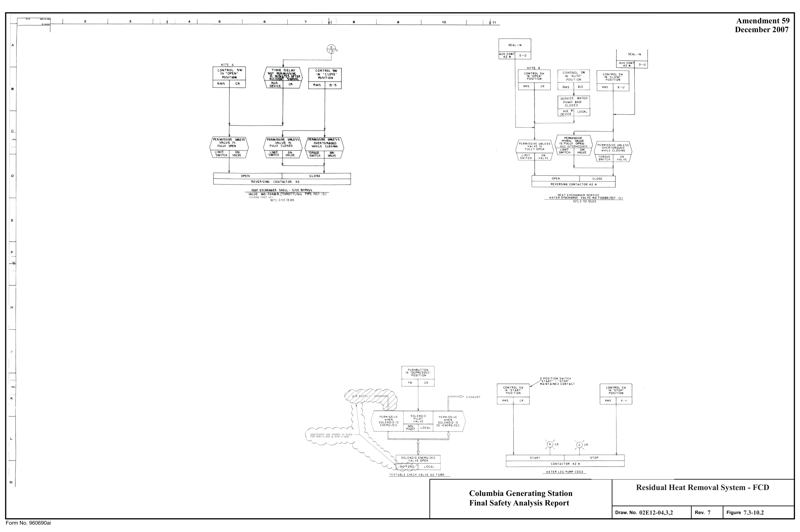

*figure on PDF page 142*

[Vector original (SVG, lossless): fig_page-142.svg](../figures/fig_page-142.svg)

<!-- labels/text on this figure page -->
•r==r Amendment 59 j 11 e 2 II 10 December 2007
SfAL~IN
Ai.JI( CONT 42 •
NOTE 4
U)NTI\Ol ~W C.ONTROL !iAI .~ I N ~o'Pf.N~ IW •~lD~l"
CONTROL SW
CQ;HROL SW I !
t- IN "OPEN" PO~\T\ON, l'O~\T ION iN "CLOSE" POSlTION
POSITION I
C'i\ I" r\M5
Vf.l.L\lf:. l!fitd ':'{'J._11\l\ ~°fl4M\tl1WC,, i'Wl RE.F ~EAT [i.CHA.NGtt~ SER\f!C[ i="iY',R,\ (P,;::,~ 141 Wl\',[;,J ~tSCHUG;:;: VAL\/f "iO F06Q2(RH. !3)
t-Fff_ ernR r~4SB NCTE.5 FOR f~~BB
PUSHBLiTTCN 'Ill "DEPRESSED'
POSITION
2 POSITION Sw'ITCrl
/'5 TART" - "STOP" ~-c-o,-,-R-01-. -,~--i/' MAIUTAIND (,:QIHJ\CT IN ''STti.RT" POSiTiON f_ XHAUS T Rl',5 CR
(,-{co /T"' I Sl"OP
Residual Heat Removal System - FCD Columbia Generating Station Final Safety Analysis Report 02E12-04,3,2 7 7.3-10.2 Draw. No. Rev. Figure Form No. 960690ai

<!-- p.143 -->
• Amendment 58
•
• 2 3 ,o II

## 7 I, i a
December 2005 11

A

l!I

#### NOT'E 4
COflTR'OL SW COMTROL SW IN "0:F'rN" NOiE 4

.... IN "CU)-$£'" S£Al-lN POSltiON

P091TION UGIH ON 'w'tt€N IN COJHROl Slii' M-AffUAl OV£1lf~1DE IN "(WtN~ CR C-8 42 • l+-10

#### POSITON
CR

G I (:-4 P£Rflll1$Sl\lf UllllESS AU)( SiGNA-L D

## 15 PR£$(Nt
AUX D(V!CE CR PERM1$$11/E °WHEN

#### VALVE IS
#### FULL V CLOSED
LIMIT FOl7B

#### SWIT-C,.
#### CONTROL SW
IN "CLOSE" FO" 1/ALI/E lllOSIT!Ot.i FOl78
•

#### THIS BLOCK
Rf45 C-2 w'ill lltAO F0t68 '
------~~- ,/;;:·:-·:. J ., .
PERM!SSIV[-.IJ~\\ I SEAL-Iii!
,.
LAUX S1G.f..AL ' tlX CONT J-2

PUtMIJf~tl ~:uss ovurto1t-Qtl-ED

#### FOK F027B
WHILE C.l05Hlt$ OOLY TORQV£ OH SWIJCH ~A.LYE L__ F'ER'M+S$tV£ \:IHl,.[!ii OPE.N VAL I/{ 1-S CLOSE·~--------7---1 OVEMT(,}RQ~tl REVERSlN-G CONTACTOR 42 ♦ ',,/-HlLf;: CLOSUtG TQRQ.U[ ON LIMIT ON i SWITCH • VAll/E SWITCH VALVE / CCNTAl~MENT SP'IU.Y VALVE MO FOIGS TYl'ICAL f'O~ VAL v-ts ~o F01t8 ;g:;:} ~f4 ,'(;C
(™)Tl 8 llliHH{d3)

#### I R F 5
OPEN Ci..OSE FOR I

#### MO F009 -
ll!£VERSlN-O COt.TA'CT'dfl 42 •

I J ...
'1~111,!lt°it'J.~ SHUTO-O'w'N

StwTOOWN ....

#### RETURN LINE
Rf.lU-iil'H Lltf£ su.t-t11 EXCESS FLOW U:CESS F'LOW POSITION ~ft L

#### CR LP
ctPIS E31 I LP

#### RMS J-'S N0128
#### L-7 '
#### S.EAL- IN-S
Off VAL VE NC>r ON F009 ONLY Ht~TTUHG
----. VALV€ I • MOt8J{J~ MO FOOQ RE,f. ll L• Stl:T!ON ISOLATION RMlWASTl 015-Gtl.lG( MO F040 1--N.JCCHOk- VAUl MO F053A,B ~f IJ;FOMB ONl' ~'TC OIKH:NIU MO f'049 AEF 13 U:ST CV avnss VALVE ~D F099A & 8 I Hfldl SMAY tSDUTION MO F023 R£F 13 W'CTHJN IS(U.TIOJII MO FOOS REF. Isle ..
/CO'::'t&A f<EF.
I L VAl E

#### TORQUE SWITCH JUMPERED 1
Oh-JLY 01\l. VALVES!
FOOB~ ~ooqi AJ>.JC> i:os3A,B ~EVf.lfilN{i CONfACT0Fl 42 AC l72 DCJ •

Residual Heat Removal System - F"CD

Draw. No. 02E12-04,3,3 Figli,e 7.3-10.3 om- No. (((•;Q6CflFH

<!-- p.144 -->
..
..,
• • Amendment 62 a I I 3 10 11 December 2013

A

#### NOTE 4
" RHA PUMP CONTROL SW AHR PUMP C0028 CONTROL Sw' IN C0028 IN "CLOSE" FL0\11 GREATER ·• □PEN'"

#### RUNNING POSITION THAN SET POINT
#### POSITION
dPIS 8··3 dPIS RMS CR LP BY AE Sw'GR RMS 8-2 NOIOB NOIDB l RMl~~m lnU.M

#### NOTE 4
"Ul 'S\C:,W•L \~ PM.SENT CONTROL S'w' CONTROL S'w' IN "OPEN" IN "CLOSE"

#### POSITION
POSITION S\1/GR c-o RMS CR RMS

#### LOOP 6
FLO._ (1719
(LOOP A Cl717;
(LOOP C

#### PERMISSIVE UNLESS
fsu~R5~~~~i i SEAL-!N (1720}
( \~fYr~E

#### AUX. CONT
F-S \ AUX CR 42 • CR \ DEVICE D SEAL-iN

AUX CO~T F-5 42 • ?ER~ISSIVE \ 11NL~~l~A6~~NIS \

Ll"'ilT ON sw1 TCH VALVE VALVE TORC.UI:.

#### PERMISSII/E UNLESS PERMISSII/E UNLESS
#### SW'I TCH PERMISSIVE
w"'11LE CLOS \G VALVE 15 0\/ERTOROUEO FULLY CLOSED 'w'HILE CLOSIN, E TORQUE 0~ \ Ll"I, T ON sw·:rcH VALVE ON TOfi!OUE ON

#### SWITCH VALVE VALVE
\~CH VALVE

#### CPEN CLOSE.
CPEN

#### CLOSE
" REVERSING CONT ACTOR -4.2 ♦ RE,ilRSi!\IG CGNTACTOR 42 •

R'1R '-'IN FLC·w· VALVE MO FQ648

#### TYPICAL FOR MC F064C
#### RHR TE.ST RETURN VALVE. MO F021
F'CbLA\Rf> 14 l
(T>iROTTLl"IGl (N.O\E. 8 FOR F0'14B)

H 51:RV ICE BOTH

#### WAHR. CROSSTIE
#### VALVES FULLY
#### CLOSED
#### A.MS 1 K-10
I

#### PUSH BUTTON
IN DEPl=:lESSEO P:iSITION

LP SERVICE WAT~A()~E ~AAIN S':2~ 'Z. f'M\TION KEYLOCK ~T<.M ·'oPEN·-··cLOSE' F0~7 MAINTAIN ED CONTACT ·- ======cc!:> EXHAUST KEY AEMD\IABLE IN ' CLOSE' POSITION ~----''--~ l.ONTN>L SW (OMTML 5.W IN Ol'tN l'-l C.lO~i:. SOLEMOIO l'O'J\TION POS\'tl~

#### PILOT
#### VALVE
#### LOC.AL
K

#### DEACTIVATED AND SPARED IN PLACE
#### FOR RHR-Y-89
UlAIT ON WITC.M ~~UE

L

Ul'"\t.l W~Tt,. CJOIJ.\"t\E 'ML'#l FO'" ( FO'IO

Residual Heat Removal System - FCD Columbia Generating Station Final Safety Analysis Report 02E12-04,3,4 7 7.3-10.4 Draw. No. Rev. Figure Form No. 960690ai

<!-- p.145 -->
Amendment 60 8 11 10 December 2009 '" ,.
'" ' ' C.R ' / " A / / / ' " " / ' ' ' / /

.... ,UMI' ·•· •(1Cl0'1:

>ALVES •t&C TOR •1"' RHR INJECTION HIGH Dt1CH P'IIEHUR£ f 006 &: F0648 'IILYf. IIOT W'6lWl 1101' . 1..ow WA1' U 0-MLL 0tl'fWHL \IA~VE KE'!' LOC.K LIii WA.TU LOW 80f H ENOS 'ULLY 0P£1 L[VEl I TIIP LlVlL l TIIP NUS~( ,aESSUIIE 5W IN iEST5TA 'ULLY CL0Sl0 o, '" LIMIT

#### PS 822 -
#### US B22-
#### PS 8 22 -
LIMIT ON LIMIT ON Cl RMS SH.1,J·T SWITCH VALVE NO~SB

#### N0.370
#### N048D
IWI TCN VAL Vl 1WlftN WAL¥[ v· TYP)CAI All MOTOR AND AIR QPfRAJfD VAI VES &; F020 [0) 18/C F112A F1 12B- t•
(EXCEPT VALVE F073B, F0748)
I '" ~-, lhfR H(AT UCHl,NGE• "&- ' " ttHIII ,uMP '"I'' R R ' '

£•CHANC.(.II - .... •w-. •e··rc"

DISCH A.9NORMAI.. OISCH PREBR ""' """'' ""C- OIi "I" COOLINC OR "I" tMLf T LINE IRE AK PRESSURE """ W&T(II OUTL[T ,.
tU(iH TE.MP '" .
'" '"'

#### RHR SYS 2
PIS T ..
Silll~w• RHR WATER LP MANUAL !NIT RHR SYS 2 •101 NO:Z21
•101 IUC flON H[AOElt HIGH

#### SWITCH IN
ACTIVATED HIGH P"ESS. CONDUCTIVITY "ARM ED" POS p,s CITS AUX

#### LP PB CR
CR CR

#### N0308
CR DEVICE w BIS!
w CR CR CR W CR

#### W BISI
#### W BISI
#### BISI BISI

SW I Cl AHA IC E12-FOO4C RHR PUMP !C IATTEAY 11-1

#### OUT OF OIJT OF NOT AM HYAC OUT OUT OF
PULLY 0P£N SERVICE Of SERVICE 5ERvrCE SERVICE LtMIT . ON

#### IY AE LOCAL IY AE LOCAL IY AE LOCAL BY AE ,WITCH VALVE
#### LOCN..
RrlR "8" OR "c" RHR PUMP "'B" WMA-FN-5U DIESEL GEN l

#### RHR B
#### SUCTJON VALVE
w UANUAI.
w w

#### OVER LAOO PO.,ER OUT OF CONTROL SW
#### PUI.AP TRIP OUT OF
IN "CLOSE" POSITION LOSS SERVICE

#### SERVICE
CR CR CR AUX AUX G RMS CR Dl'IIC[ , DEVICE SWGR BIS! BIS! IY AE LOCAL B!Sl IY AE LOCAL

#### TYP FOR PUMP C
#### TYP FOR PUMP C
RHR •c•

#### OUT OF
#### SERVICE
NOTES:
AUX CR CR CR CR w BISI w CR

#### DEVICE
1. CONTROL SWITCHES ARE LOCATED IN THE ALTERNATE RW OTE W BISI

#### W BISI
BISI

#### SHUTDOWN PANEL E-CP-AAS FOR VALVES F003A, F004A, & FQ06A
#### AND IN THE REMOTE SHUTDOWN PANEL E-CP-C61/P001 FO R VALVE DESCRIPTION
VALV;:S f OOJB, f00 48, & F0068.
AHR •P-, At<R B/C AHR 1/C Cl RHA 28 \IALV£ F0041 f-lx VENT VALVES MANUAL 3 PO$. SW "OPEN" - "STOP" - "CLOSE" POWER LOGIC PO.,EA IN TUT OIJT OF CR =-o7JB & F074B 2 VALVES RHR-V-47A ANO RHR-V-478 HAVE BEEN DEACTIVATED OUT Of NOT MAI NTAINED CONTACTS SER\llCE THE ELECTRICAL POWER, CONTROL ROOM ANO RrnOTE SHUTDOWN

#### SE RVICE
#### FULLY OPE N LOSS/OL FAILURE &TATUS
CONTROL SWITCHES, PANEL WlRJNG AND FIELD CABLES (EKCEPT AT SHUTDQIIIN COOLING \UCTION ,ALY[ F006B(REF. 13)
THE VALVES DUE TO RAOIOLOG!CAL. CONCERNS) HAVE BEEN H,: SW INt.U WALwt F006A (REF 14)

#### LIMIT ON I Y AE LOCAL
#### REMOVED CA IY AE LOCAL
#### SWITCH WALYE
._ P\l'IP SUCTION WALVL f004A {RCT". 14} ~Ttlltnw-""n"O~E ~ r 0048 (REF \.}) •~PEJil- .N1Alll1 A.IN'El) t.C1'TAC.TS ANOFOO+C "x IOIL T VALV~ (NcrrE 2) XEY.JtLM.aYAILl ~IPl.!O.fill'.' f047B (REF.n) J)DSTTIDN f047A{Rff 14) SW 8 DIESEL GEN I BATTERY lr-2 WMA-FN-531 H1 OUTLU WALft F0038 (REF. 13) OUT Of w

#### OUT OF OUT OF
#### POWER
#### FOD3A (REF 14)
#### SERVICE SERVICE SERVICE LOSS
#### NOT REQUIRED CR
#### FOR VALVES
l'I A£ LOCAL IY Af f004C, F073B IY AE LOCAL IY AE LOCN.. BISI & F074B

#### NOTE 1
CONTROL~ NOT REQUIRED IN "OPEN" SEAL-CR

#### FOR VALVE POSITION
FOO◄A(B)

#### FOOJA(B)
L•\I AHA PU .. P 21 ARA-FN- 10 RHR 8/C MOV w w ~ HVAC OUT VI POW£R NETWORK

#### OF SERVICE LOSS POWER LOSS/OL
CR CR CR

#### AUX BISI IV AE LOCAL BISI IY AE LOCAL BISI MCC
#### REQUIRED FOR VALVE
ll£VICE

#### NOT REQUIRED FOR VALVES F006B(A)ONLY
FOO<I-C, F0738, & F0748 ... , NOTE 1 D AHR •r OUT Of

#### REQUI RED FOR VALVE
#### F004A(B) ONLY
#### SERVICE
CONTROL S.w ,., HCL(Kt•

#### NOT REQUIRED
#### FOR VALVES
FIOStTION

#### F003A(B)
RM$ M-10 i:a:u CR CR CR BISI

#### W BISI W BISI W
rne PERMISSlV( UNLESS PERMISSIVE F0738 OVERTOROUED , or WHEN VALVES IS W.NUAL. VAL.V::F004A LPCS/RHR 'A' LPCS/RHR 'A' LPCS/ RHR 'A'

#### LOGIC PWR LOGIC
#### OUT OF
#### IN TEST
#### FULLY CLOSED F0748 WHILE OPENING ONLY
#### SERVICE FULLY OPEN FAIL
#### IN TEST
STAnJS o, o, LIMIT PERWSSII/£

#### TORQUE ON
'"' '"'

#### UNLESS VALVE IS CR SWITCH VALVE SWITCH VALVE
#### LIMIT
#### SWITCH VALVE DEVJCE
#### DEVICE
#### FULLY CLOSED
#### UMJTT
#### SWITCH
#### LPCS P-2 CB RH R 2A WMA-FN-53A RRA- FN-1 1 RHR PUMP 2/1.
#### PERMISSIVE UNLESS
#### POWER
#### POWER
#### OUT OF
#### POWER RM HVAC OUT
#### VALVE IS
#### LOSS/OL SERVICE
LOSS

#### LOSS OF SERVICE
#### FULLY OPEN
GY A[ LOCAL BY Ai. LOCAL BYAE LOCAL BY AE LOC"L

#### LI MIT ON
#### SWITCH VALVE
OHM ~ , MOV l OUT or w DIESEL GEN 1 BATTERY Bl - 1 SW A

#### OUT OF
#### OUT OF NETWORK
REVERSI NG CONTRACTOR 42•

#### SERVICE SERVICE SERVJCE PWR LOSS/OL
CR ,u, K,( T,i.al..l. 1 BIS! BISI 81S!

#### BY AE
#### DEVICE
( Nill I fllJ!•. f00l&, f004&,rt»l.ll)

Residual Heat Removal System - FCD

#### RHR 'A'
Columbia Generating Station OUT OF

#### SERVJCE
'"' Final Safety Analysis Report

#### DEVICE
02E12-04,3,5 12 07.3-10.5 A Draw. No. Rev. Figure Form No. 960690ai

<!-- p.146 -->
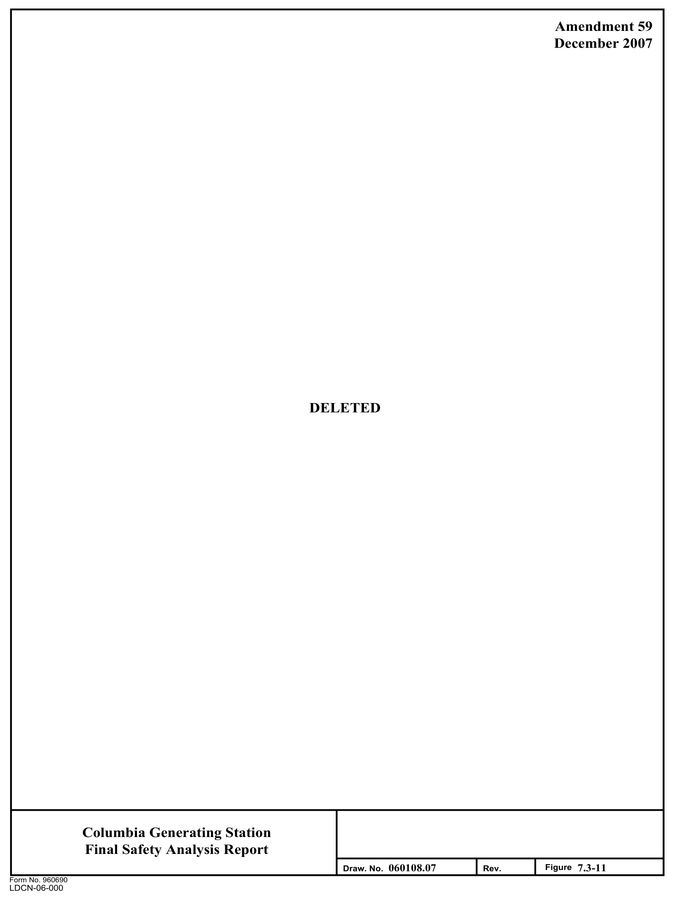

*figure on PDF page 146*

[Vector original (SVG, lossless): fig_page-146.svg](../figures/fig_page-146.svg)

<!-- labels/text on this figure page -->
Amendment 59 December 2007
DELETED
Columbia Generating Station Final Safety Analysis Report I I 060108.07 Figure 7.3-11 Draw. No. Rev.
Form No. 960690
LDCN-06-000

<!-- p.147 -->
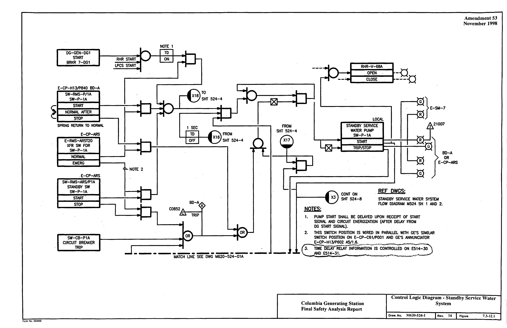

*figure on PDF page 147*

<!-- labels/text on this figure page -->
Amendment 53 November 1998
NOTE t
TD DG-GEN-DG1
START
RHR START
ON
BRKR 7-0G1
LPCS START
RHR-V-68A
_l'-< OPEN
..,.__C~-OS-E--1-~-n
E-CP-H13/P840 BO-A
SW-RMS-P/1A
sw-P-1A
START
~
NORMAL AFTER
STOP
LOCAL
STANDBY .SERVICE FROM
SPRING RETURN TO NORMAL
1 SEC
WATER PUMP
SHT 524-4
TD
E-CP-ARS
SW-P-1A
OFF
E-RMS-ARST20
START
XFR SW FOR
TRIP/STOP
SW-P-1A
BO-A
NORMAL
OR
E-CP-ARS
EMERG
NOTE 2
'----c:G .E-CP-ARS
SW-RMS-ARS/P1A
STANDBY SW
. REF DWG$;
SW-P-1A
CONT ON ·
START
SHT 524-8 STANDBY SERVICE WATER SY$TEt.t BD-A
FLOW DIAGRAM M524 SH 1 AND 2. STOP
A NOTES:
C0852
C TRIP
1. PUMP START SHALL BE DElAYEO UPON RECEIPT Of' START SIGNAL AND CIRCUIT ENERGIZATION (AFTER DELAY· FROM
DG START SIGNAL).
2. THIS SWITCH POSITION IS WIRED IN PARALLEL WITH GE•s SIMILAR
--
SWITCH POSITION ON E-CP-C61/P001 AND GE'S ANNUNCIATOR SW-CB-P1A
CIRCUIT BRE'AKER
E-CP-H13/P602 ~---.----------
----------------- TRIP TIME DELA:Y RELAY. INFORMATION JS CONTROLLED ON E~
..._.-.,;AN~D;;..;E5;;,.1.._4_-;..31 ..... __.,---- ·~ :"::_::_.;
MATCH LINE SEE OWG M620-524-01A
-
"'«.i__,-...,~ui,c:.ot ."1Pt-,:.,,"'u .... ~~r
Control Logic Diagram • Standby Service Water Columbia Generating Station System Final Safety Analysis Report 7.3-12.1 Rev. 14 Figure Draw. No. M620-524-1
Form No. 960690

<!-- p.148 -->
Amendment 60 December 2009
- ' -
• I E-CP-H13/P840 BD-A
- - - - - - --,- MATCH LINE SEE DWG M620-524-01

#### SW-RMS-V /2A
#### -n-
#### SW-V-2A
I OPEN
- - I
- - AUTO

#### CLOSE
- ~
- --

#### SPRING RETURN TO AUTO
~
- ~ AND

#### LOCAL -
-. -

#### L....-07 E-CP-ARS

#### SW-V-2A
#### -u
#### E-RMS-ARST15
- DISCH VLV FOR - ~

#### XFR SW FOR
,.._

#### --r-..._ __ SW-P-1A
-
-

#### I SW-V-2A
AND I
- -

#### o_P_EN __ _;-LJ----r-l-R
~
-- I I

#### NORMAL
~
-

#### CLOSE 1-------T------i G l@
BD-A

#### EMERG
OR

#### E-CP-ARS
-

#### E-CP-ARS
.___-1 G SW-RMS-ARS/V2A . n
- . -- -

#### FOR SW-V-2A
I I OPEN
- - I

#### NORMAL
-- -
-

#### CLOSE
I I

#### E-IR-21
#### SW-PS-1A
#### OPEN PERM FOR
#### SW-V-2A
#### L.-~ ss
~ -- ~

#### INCREASING
C)~o-

#### PRESSURE
j:C □851 I I

#### 0
#### BD-A MOTOR OVLD
TD

#### C C0968
NOTES:
--C)

j:......._ __ 0 BD-A

ON

#### UNDERVOLTAGE
#### 1--____ ___,_ ___
1. FOR NOTES AND REFERENCE DRAWINGS SEE M62O-524-01.

...._ _______ SM-7 BUS (27-7)

2. TIME DELAY RELAY INFORMATION IS CONTROLLED ON E514-3O

#### AND E514-31.
#### SW-RLY-86/P1A
3. REFER TO INSTRUMENT MASTER DATA SHEETS

#### CIRCUIT BKR
#### FOR SETPOINT INFORMATION.
#### BD-S INOPERATIVE
1-----~----......... -~A

#### OVERCURRENT
L.O.

Control Logic Diagram - Standby Service Columbia Generating Station Water System Final Safety Analysis Report M620-524-1A 5 07.3-12.2 Draw. No. Rev. Figure Form No. 960690ai

<!-- p.149 -->
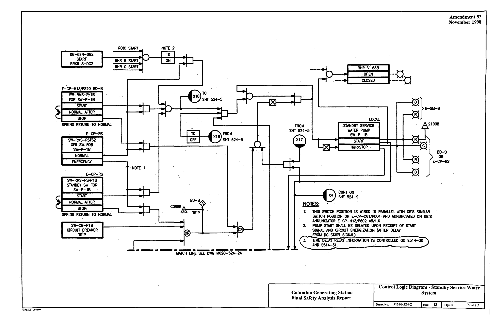

*figure on PDF page 149*

<!-- labels/text on this figure page -->
Amendment 53 November 1998
NOTE 2 RClC START
DG-GEN-DG2
TO
•• START ON
RHR B START
8RKR 8-002
RHR C START
RHR-V-68B
_ _>-< -OPEN ----------~--~
CLOSED
~
E-CP-H13/P820 BD-B
SW-.RMS-P/1 B
FOR SW ... P-1B
START
~
G }-SM-8
NORMAL AFTER
STOP
LOCAL
SPRING RETURN TO NORMAL
STANDBY SERVICE FROM
WAlER PUMP
SHT 524-5
TD
E-CP-RS
SW-P-1B
Off SW-RM$-RSTS2
START
XFR _SW FO~ TRIP/STOP·
SW~P....,18
BO-B
NORMAL
OR
E-CP-RS
EMERGENCY
NOTE 1
--◄G E-CP-RS SW-R~S-RS/P1B
STANDBY SW FOR
.SW-.P-1B
CONT ON
START
SHT 524-9
~ NORMAL AFTER· NOTES:
STOP
1 THIS SWITCH POSmON IS WIRED IN PARALLEL WITH GE'S SlMJt.AR
~
SPRING. RETURN TO NORMAL
SWITCH POSmON ON E-CP-C61/P001 · AND ANNUNCIATED ON GE'S •
ANNUNCIATOR E-CP-H13/P602 A5/1.6
2. PUMP • START SHAU. BE DElAYED UPON RECEIPT OF START
SW-CB-P1B
CIRCUIT BREAKER
SIGNAL ANO CJRCUIT ENERGIZATION (AFTER DElAY
TRJP.
FROM DG START SIGNAL).
-- -- - TIM. D LA R ':< INFORMATION JS CONTROLLED ON £514-30
----------- AND £514-31.
MATCH UN.E SEE OWG ·M620-524-2A
Control Logic Diagram• Standby Service Water Columbia Generating Station System Final Safety Analysis Report Draw. No. M620-524-2 Rev. 13 Figure 7.3-12.3 Form No. 9606SO

<!-- p.150 -->
Amendment 60 December 2009

#### ________ ...!...!MA!_C~LINE - SEE OWG. 524-2
,-~--------------------~~~TI-.----- SPRING REToTO I AUTO
i BO-B
-...

#### I RMS
I I

#### I . I I
#### LOCAL I
-
- -

#### SW-V-28
--- ~
----- I
-.

#### - p
...

#### SW-V-2B
#### ~ I ~"Y
OPEN I
-

#### PUMP 18
-

#### I ---
AUTO I l
--

#### DISCH.VA" . -
#### CLOSE
- I

#### I R -
#### I I I OPEN I I
-

#### P.STS- 2.
#### 1@ BD-B _,,,, -
CLOSE ~
-
-..

#### TRANSFER SW
OR I ANDl

#### FOR SW-V-2B
#### BO-RS
#### MAIN CONTR. P.M
I

#### BD-RS
#### -G
#### BO-RS
#### -h
RMS

#### u SW-V-28
-
- OPEN

#### I ...
#### NEUTRAL
#### - h -u
#### CLOSE
#### JR-22
NOTE:

#### PRESS . SW .
. TI ME DELAY RELAY INF0RMAT10kl JS I CONTROLLED ON E514-30 e E 514-31.

#### SW-PS-18
~ lssl(~ L..,. 0- i::=J _ JNCREA 6l~LG

#### REFER TO INSTRUMENT MASTE R
2.
I .. PRESSURE [T'ol DATA _5HEET5 FOR SETPO!NT
-~ A BO-RS L~c.oe54 ~ ( ~ - I NF0RMA1\0N .

#### MOTOR OVLO i----...L...--------+---~A BO-B
REf,OWGS.
STANDBY SERVICE WATER SYSv k-~0%~ I FLOW OlAG11M-524 A-.. so-a µNDERVOL TAGe:lr-~~;;--;--:-;;-____ I..,L_ _ _ '0-'"
- SM-8 \:>U ';.
( 1. 7- S) PMP SW-P-1 B

#### CJRCUIT BKR
#### INOPERATlVE 1 -----r------1---.../
#### A ao-s
C\/E:.RC.1JRR.a.l1' L.o.

Control Logic Diagram - Standby Service Columbia Generating Station Water System Final Safety Analysis Report M620-524-2A 10 07.3-12.4 Draw. No. Rev. Figure Form No. 960690ai

<!-- p.151 -->
Amendment 53 November 1998

- .....

#### LOCAL
-= · :E:1R-P028 ' lNPUT(DIESEL ________ ___, __ , -----ptiPCS __ 5ER\7. __

#### .,.,· "'.I FRON G.E.
#### WATER. PUMP ESS LOGJC
--
-HPcs.:p. 2.·
- - -•
-

#### R STARTl
RUN

.... .

I r-- 0rr J ~E::CE_~HtS/P'°f J I HECS~Ms·· P/'Z.

#### SIGNAL A
:J:O&J~ECS:P"'.2._ - SHT • 524--13 I
-·-·sri'/it.·R:r -----,--~--.J I
-·-· ... -···-·· -----
-=:Ko:m

- - -~--- ....

#### CONT.ON ---sJ"OP _________ .. __
#### SHT.,524 .. 10
I
--- .. - . .. - .
I 1 I

#### HOTOR
RE:f.,DWGS.
-~ ·E".;;CP;._JfJ?>/-e~OI

#### OVERLOAD
#### STANDBY SERVICE WATER SYSTEM
.r:

#### FLOW OIAG. M-524
I CP~Hl!>/P84o-aD-A NOTE . -\______ _.- -- ·- -. -·.
✓

,.... .-. ..... -- ,-. ---- -------h_, ·s~--·RMs.:.Vitz~-•

'. • • .... _.,· . , -. ·-._I

'•. ' .. . .. - ' - ·• . -
- --: 1. REFER TO JNSTRUM ENT MASTER DATA ) .
:J:o&:~~sw:'.v~i.CJ.~
- ·._ SHEETS FOR SETPOIN1 INF0RMAtlON . .. )

#### LOCAL
.
\ I

#### ...,_. ----1 I OPEN - - - -'
-----V ::-.1:n~FV~t.~- --- Amo --~,-----~ :o i$C.£LVL\C.FO R I
( '

#### CLOSE
_B£.C5 ~-.P'.'.Z..~.
SERIN~ "RETURN TO AUTO

#### L ... ... ...
OPEN __ E-:JR-24

#### CLOSE
-~-sw~_ee;.:.aoe, o.eersi_-_P.E.RM. FOR : ___ . sw-v.: 2.C,~---- CON'tON Sl-ll 524-10 \»t~\~C,t'Rf~-----_,,_ _______ __

Control Logic Diagram - Standby Service Water Columbia Generating Station System Final Safety Analysis Report M620-524-3 Draw. No. 8 Figure U-12.S Rev.
Form No. 960690

<!-- p.152 -->
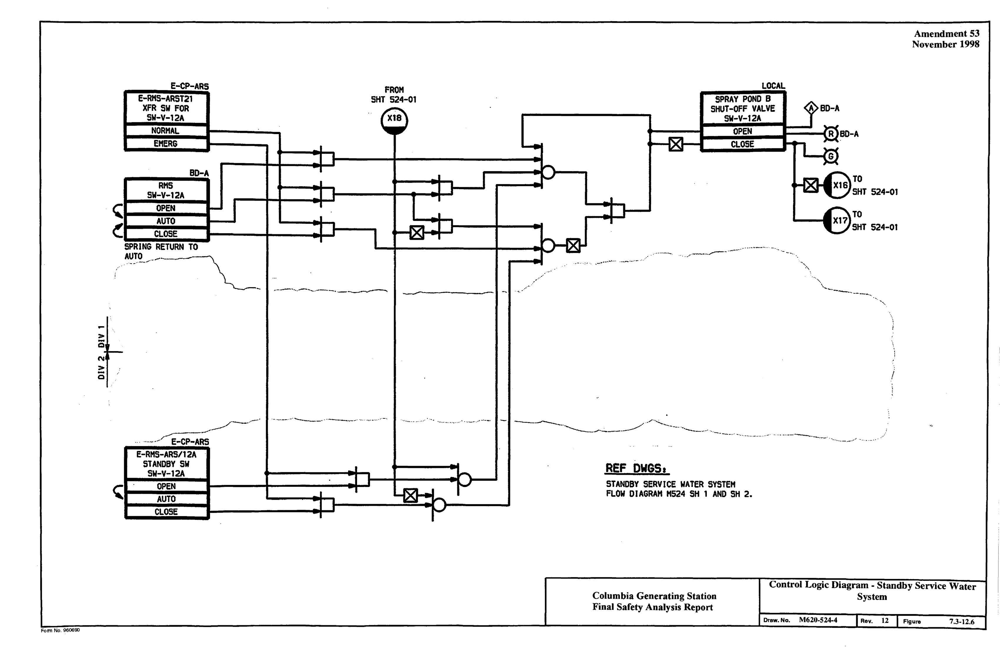

*figure on PDF page 152*

<!-- labels/text on this figure page -->
Amendment 53 November 1998
LOCAL E-CP-ARS
FROM
E-RHS-ARST21
SPRAY PONO B
SHT 524-01
XFR SW FOR
SHUT-OFF VALVE 80-A
SW-V-12A
SW-V-12A
NORMAL
OPEN
EHERG
CLOSE
, ______ __ BD-A TO RMS
SHT 524-01
SW-V-12A
r OPEN TO ~
SHT 524-01
AUTO --.. :-:_ ... __ -!1----tlll-_r---
\... CLOSE
-. ·--..,_ ...... - SPRING RETURN TO . _,,. .... - .... ~- ---·
AUTO .. .-~----, .--------_,.,.
••. "
'~ .... ·----... ... _____ ....
.,._.......--..... __.-..........._, ____ ~
> - Q > - N i Q
---------.'--------..:..-----·--/ •• /·•·,--.~---····--····· ··--
• -....... _____ ., ... -··
E-CP-ARS
- ... '"''•• -••••-•-•r- • •--•--•..___ ___ ...,.
E-RHS-ARS/12A
STANDBY SW
REF DWGSa
SW-V-12A
STANDBY SERVICE WATER SYSTEM r.-· __
oP_E_N ----
FLOW DIAGRAM M524 SH 1 AND SH 2.
" AUTO
CLOSE
Control Logic Diagram - Standby Service Water Columbia Generating Station System Final Safety Analysis Report M620-524-4 Draw. No. 12 7.3-12.6 Rev. Figure Fo,m No. 960690

<!-- p.153 -->
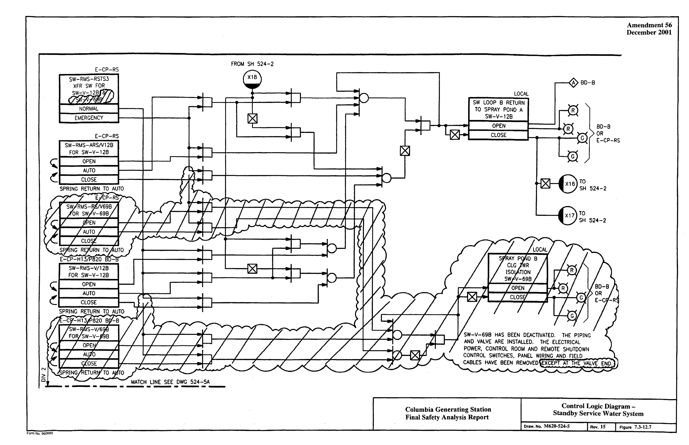

*figure on PDF page 153*

<!-- labels/text on this figure page -->
Amendment 56 December 2001
FROM SH 524-2
E-CP-RS
SW-RMS-RSTS3
XFR SW FOR
LOCAL
SW LOOP 8 RETURN
NORMAL
TO SPRAY POND A
SW-V-128 EMERGENCY
OPEN 80-8 OR
E-CP-RS
CLOSE
E-CP-RS
SW-RMS-ARStV128 , _____ FOR sw-V-128 <
\,_ ...... ___ _
_____ OPEN
AUTO -----
~ CLOSE "----li.-----4-~.,_.____.
TO
SH 524-2
TO
SH 524-2
SW-V-698 HAS BEEN DEACTIVATED. THE PIPING
AND VALVE ARE INSTAUEO. THE ELECTRICAL
POWER, CONTROL ROOM ANO REMOTE SHUTDOWN
CONTROL SWITCHES, PANEL WIRING AND FIELD
CABLES HAVE BEEN REMOVED EXCEPT AT THE VALVE ENO.
-------- --
MATCH LINE SEE DWG 524-SA
Control Logic Diagram - Columbia Generating Station Standby Service Water System Final Safety Analysis Report Draw. No. M620-524-5 Rev. 15 Figure 7.3-12.7 Form No. 960690

<!-- p.154 -->
Amendment 53 November 1998
------------------- MATCH LlNE•SEE DWG.524~5
-• > -

#### RSTS•l
#### XfR SW.f"OR
Cl

#### SN•V•70B
lN CONT Rf111------.
BD•RS

#### LOCAL
#### SPRAY POND
BD•RS B CLG.TWR • I
• Rt1S SHUT Of"f

#### SW•V•70B.
#### SW-V-70B
#### BD•A
#### OPEN OPEN DR
------- . -CLOS£ 1-~~~=U,J BD·RS f

#### BD-A
RMS } . l 9W•V•70B l OPEN

#### NEUT.
#### CLOSE
#### RU DWB.
#### STANDBY SERV.WTR.f'L•D•H-524
.
.

#### DESIGN CONTROL FOR START-UP SYSTEMCS)
68 _· ••• ·.: ·

#### TRANSFERRED TO WPPSS. ALL FUTUR.E CHANGES
TO THIS (THESE) SYSTEM (S) SHALL 8£ INITIATED
• AND-AP.PROVED BY THE SUPPLY SYSTEM.ALL .
REViSfONS TO THIS DRAWING REQUIRE APPROVAL
- OF THE SUPPLY SYSTEM • • •

Control Logic Diagram - Standby Service Water Columbia Generating Station System Final Safety Analysis Report Draw. No. M620-524-SA 10 7.J-12.8 Rev. Figure Fonn No. 960690

<!-- p.155 -->
Amendment 53 November 1998

0ESIGN-C-0NTR0L •• F0R-· START-UP. SYSTEM(S)

:S5 .....

TRANSFERRED TO WPPSS. ·ALL FUTURE CHANGES ~ TO THIS (THESE) SY.STEM (S) SHALL SE INITIATED CT *crafil;at.:~::_ __ AND APPROVED BY THE·SUPPLY SYSTEM.ALL

#### REV1S10NS TO THIS DRAWING REQUIRE APPROVAL
t ~u 1AJR

#### OF THE SUPPLY SYSTEM
LSPV•IA !
NC ~ F'D ~ TNU•LCV•IA Tt1U
----------

#### SPRAY POND A
--------

#### REY DWG.
#### STANDBY SERVICE WATER F'L••D
M•S24

#### IR•21
#### LOCAL
Non:

#### SPRAY POND
#### SPRAY
•• TMU-LS-tA4 MAS:BEEM.OISCONNECl'EO

#### A WATER
#### POND A
__ ER.OM-J'HE..SYSTEM. HOWEVER,TO

#### NAICE UP
NATER P1Al<E :::RE.ESTAS.USltAUTO LEVEL. CONTROL.

#### SOLENOID
#### lP SHUT
:·_AT.A-LA.1EROATE,THE ·sw1TCM MAS • VA

#### OFT VA.
#### NOT .. ·e-e.eN REMCNEO. OCR!I ilr154
TttU-LSPV• TttU-:-LCY.

#### IA
#### •IA
fl-~D£-ENERIIZE ............ ...._ ___ DPEN ........ ,..._---1

--4-,:.-~r:;;-~---------i~=I~-. ENERGIZE

#### CLOSE
#### DIV. I
#### SPRAY POND A WATER NAKE•UP
#### CONTROL SCHENATIC AND LOGIC DIAGRAtl
Control Logic Diagram - Standby Service Water Columbia Generating Station System Final Safety Analysis Report Draw. No. M620-524-6 4 73-12.9 Rev. Figure Form No. 960600

<!-- p.156 -->
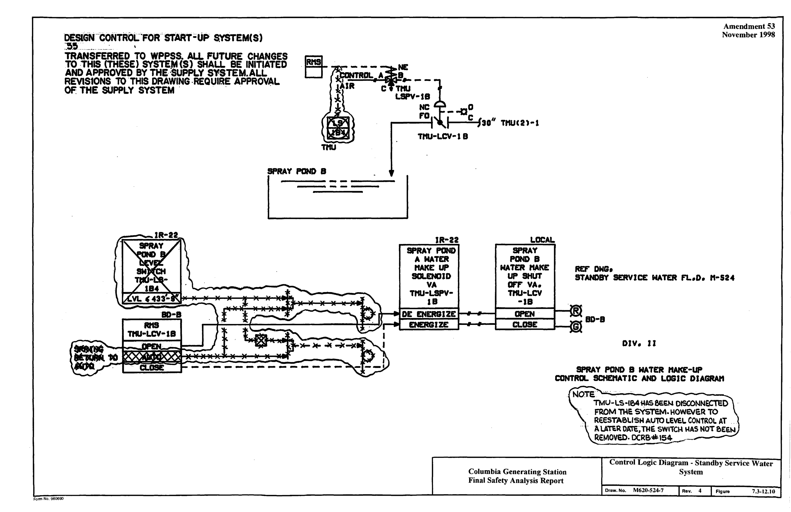

*figure on PDF page 156*

<!-- labels/text on this figure page -->
Amendment 53 November 1998 DEStar'CONTROL~FOR-'STARt~up SYSTEM(S)
~5.·: ........... _·... '
TRANSFERRED TO WPPSS. ALL FUTURE CHANGES
TO ·•HIS (THESE) SYSTEM(S) SHALL BE INITIATED AND APPROVED BY THE-·SUPPLY SY.STEM.ALL REVIS10NS TO 'THIS DRAWING .R£QUIBE APPROVAL OF THE SUPPLY SYSTEM •
••
•
Tt1U
SPRAY POND 8 ----------
------
JR•22
LOCAL
SPRAY POND
SPRAY
A WATER
POND 8
HAKE UP
WATER ~1<£ REF DNGe
SOLENOID
UP SHUT
STANDBY SERVICE WATER F'L•D• N•S24
VA
Df"f' VA.
TNU·LSPV• TNU•LCV
IB
•18
.. DE ENERGIZE ._. ...... __.....,_ ___ OPEN ______ ...,..
~ BD•B
-~-~:..,_--------+-1i;-..""Jr--.a ENERGIZE
CLOSE
DIV. JI
SPRAY POND 8 WATER NAKE-UP
CONTROL SCHENATJC AND LOGJ·C DIAGRAl1
. NOTE. --,· ..... -- ;....-....._..,,,,-__....,_ __ ...,...._ __
TMU-LS•Ce,4~AS BEE~ DISCONNECTED
FROM THE SYSTEM. HOWEVER TO
REESTAB\.ISM AUlO LEVEL CONTROL AT ...
A LATER O~~TI-IE SWITCH MAS NOT BEEW REtJIOVeD- DCRSil; 154
Control Logic Diagram - Standby Service Water Columbia Generating Station System Final Safety Analysis Report M620-524-7 4 Draw. No. Rev. Figure 7.3-12.JO Form No. 960600

<!-- p.157 -->
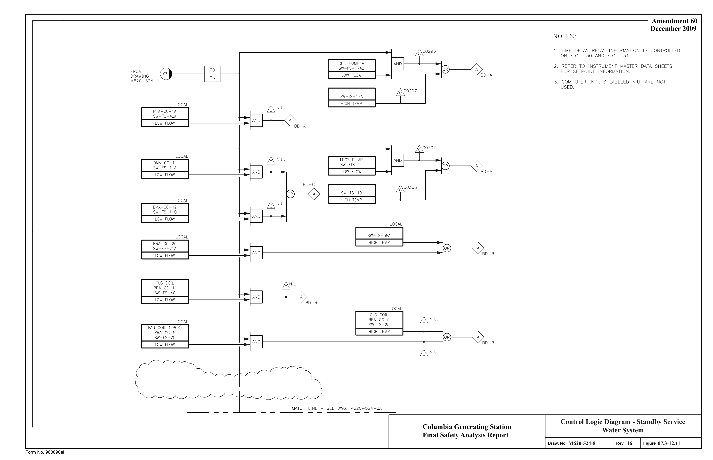

*figure on PDF page 157*

[Vector original (SVG, lossless): fig_page-157.svg](../figures/fig_page-157.svg)

<!-- labels/text on this figure page -->
Amendment 60 December 2009 NOTES:
1. TIME DELAY RELAY INFORMATION IS CONTROLLED
ON E514-30 AND E514-31.
RHR PUMP A
2. REFER TO INSTRUMENT MASTER DATA SHEETS
SW-FS-17A2
>-----< A
FOR SETPOINT INFORMATION.
FROM
BD-A DRAWING
LOW FLOW
M62O-524-1
3. COMPUTER INPUTS LABELED N.U. ARE NOT
USED.
SW-TS-17A
HIGH TEMP LOCAL
PRA-CC-1A
SW-FS-42A
LOW FLOW
BD-A
C CO3O2
LOCAL
LPCS PUMP
DMA-CC-11
SW-FIS-19
>-----< A
SW-FS-11A
BD-A LOW FLOW
LOW FLOW
BD-C
SW-TS-19
HIGH TEMP
LOCAL
DMA-CC-12
SW-FS-11B
LOW FLOW
LOCAL
SW-TS-38A LOCAL
HIGH TEMP RRA-CC-20
1-----< A SW-FS-71A BD-R
LOW FLOW
CLG COIL
RRA-CC-11
SW-FS-40
LOW FLOW
BD-R
LOCAL
CLG COIL
RRA-CC-5 C N.U.
LOCAL
SW-TS-25
FAN COIL (LPCS)
HIGH TEMP RRA-CC-5
t-----< A
SW-FS-25
BD-R
LOW FLOW
MATCH LINE - SEE DWG. M62O-524-8A
--i==-------------------,---------------_J
-- Control Logic Diagram - Standby Service Columbia Generating Station Water System Final Safety Analysis Report M620-524-8 16 07.3-12.11 Draw. No. Rev. Figure Form No. 960690ai

<!-- p.158 -->
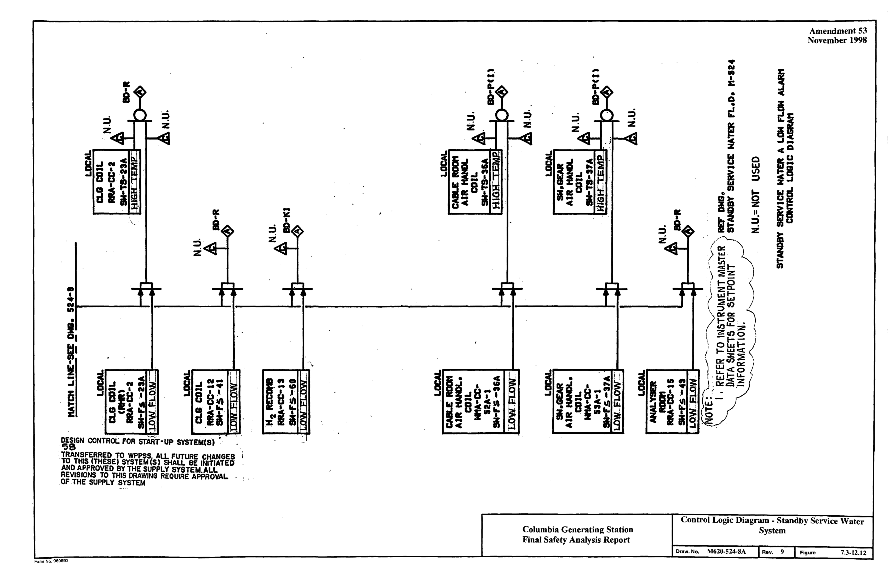

*figure on PDF page 158*

<!-- labels/text on this figure page -->
Amendment 53 November 1998
•
N .,,
I :c ◄'~ Iii ~ ,◄ ~ •:◄ 8 I .
.
.
. .
i"'~ :::, ::) .
., ::::, I ... •-- :::, 1"' -r. z ~ z z ~ z~ 11 ... = !; z..,.L
ZA,_
.A .A ~ ~ , I ·r- ~ -~ g ~ ~ ~
;I _,NC kl tit !
gll;!tl ~ 9 i"s~ e .,. I I =
8 H.c:'
• a=: I I! •s· Cl I ' ~ ·~ I ~:
... "
1 ....
c ii a:• d 4 "% °' °' , .
.
I ' . \ ·- I ' .
I B◄~ ::, . z~ lil◄~ :).A_ z~ ~- ~ ~ -
.. - ....
....
....
....
....
• I I • I • I • ' • ' • I • j
N .,.
I l j • a ·•
I I l .,. .. .
--.
.. ; I.
; -...
I .· .. " . .
' 4 I I
~ N .ft !
~ ~
.... ,~
ll;!iif ~ ~ i1li i-s1· ~: .,. . 4 _, w-
• C I -·
~ ., .. o_ ~ I ID _, a1t1 .I 8~ ... - .,._.., N ...
8 lJ .• :!Hi'f w u~ ti.
dii i - ~ w d~il ~tJ,
• 81"'"' : : I
-~. v,':9 ~ i ~ c ~ ~ I ~ i B
~ c,li I
' .~
• I
.... 0 R
;-, ..
' .
• i "---·-· ·- .. DESIGN CONTROL FOR START-UP SYSTEM(S)
'58 lRANSFERREO TO WPPSS. ALL FUTURE CHANGES i
TO THIS (THESE) SYSTEM (S) SHALL BE INITIATED -
AND APPROVED BY THE SUPPLY SYSTEM.ALL
REVISIONS TO THIS DRAWING REQUIRE APPROVAL
. OF THE SUPPLY SYSTEM
Control Logic Diagram - Standby Service Water Columbia Generating Station System Final Safety Analysis Report Draw. No. M620-524-8A 9 Rev. Figure 7.3-12.12 Fonn No. 96069'.l

<!-- p.159 -->
Amendment 65 December 2019 ~
-n -n )7° "JO
-Q

l?>P-1< BD-R

#### MATCH LINE-SEE DWB. 524-IA
HlGH'TEMP~ N.U. HIGH TEMP i-----;,.-,...
N.U. •N.U.
N,U.
"''

____.

~1 • H \GH TEM p.......,..__ __

H IG\4 TEIVIP I L.Oc.Al. SW-TS-3B6

#### SH-TS-23B
#### CLG COIL RRA-CC-6 SH-TS-29 RRA-CC-3
N,U:N01 USED RHR

#### LOCAL
#### LOCAL
LOW FLOWj 1 LOCAL J_. LOCAL ;W-f"S' • 17B.:-2

#### RHR PUMP B
#### SW-TS-178
#### BD·C
#### BD-B
N.U.
I~ N,U.

.... ..- I tt.

NU.
-- -- I I ►I 1 ►t '
- - - ,--_ - -
•

-- ....

#### TO ON
-

- LOW' FLOW ·1

#### LOW FLOW I ~ , ------.. LOCAL
#### LOCAL AL · · ______ _. LOCAL
#### LOCAL
#### LOCAL
#### LOCAL
-

#### sw-r:s -1 ◄I SW-f"$ -428 SW·FS -l ◄A -
.LOW F!,-0\N_ sw-rs '-238

#### PRA-CC·lB
~ ;I~ SW-fS-718 LOW FLOW

#### LOW .FLOW OMA-CC-21
#### DMA-CC-22 :z: RAA-CC-\9 'o, ;;,o o -1 <.n . LOW FLOW sw-rs· -21
RRA-cc.-&

#### CLG COJL RRA•CC-3
#### DJESEL
<RHR)
524 .. 2 SHE:ET f"ROM

• ~ / j ( 0 ;;!!!! . ~ :,;: ri ,=-< ~~ j:~ :z ::;: '"t) l"T1 C"1 r:i Z-=i. r" !.,4 Ci LN;:p ~Cf)~~- "T\ .,-v ..,., -< ~f"T"l -"'T'I :3 :::! QI --1 C, 0 :;;o LJ'1 c::::, ;:i:, ,..., flP :::0 c:::,, ,..,, ,-- O --i!'T'1.- r- ~ -
-
-z ;:i::,, ~ c ,Uc -

#### _z 0~ z~ --1,, (fl -I rn C,
)> CJ) :c rrt m )> ;;{J -~ -=-i U'> :;C)
I' !..._ ' ~
• -

Control Logic Diagram - Standby Service Columbia Generating Station Water System Final Safety Analysis Report M620-524-9 15 7.3-12.13 Draw. No. Rev. Figure Form No. 960690ai

<!-- p.160 -->
Amendment 53 November 1998
--... -
--...

#### a..
t l'¢

#### V 2;◄ 9.
.
lC I :

## 0 m .
#### . m Q . .
.
::::,
• (_,_ ::::, .
z ::::, .
::::, I ~ ::::, z z z z z..A'L_

L....A A

A_ .A ~ """ ~ ~ ~ ~ ~
• ..J _u I CD m Q..
le 0.. ' ~ .J a i§ pl z_."' co ~- 1r:s

#### ~ N ~
- I fl CE,c w 81yd, H I UJ . ~i..J ';' w: B- en 1-: •
---

m :a: .... rn t-.

la.I

• B .... Ill g g i I e

e;- ::c m ct-
- .J~ Q!: I ':ii LJ z - ..J d

#### CE -
i- i ~-
• ii I °'i t!J ~
-.
-a

## 9 UC ::r 9 ::x:
~ .
. I
-· ..J D: . ~ ~ - .J D: i© I ::> s~ ,. - .
I ~ 1' .•

, .... :c

#### ~ 0 m~
~ ::> =~ ....

z A- ~ 2 -, CD· Z_...-:t..._ J: I

A_ .... .A

.~
-~ ~ I u

.,.
--
-- -- -- ,.,..,
--
--

....

•• , • 4 I j l 4 4 4 • j I
• j • 4 I ' • j • j I '

.... -

""" ... -... ~ J. g
- I I g g m -- ..J ..J .J I .J ..J 8 i !

#### m
u

#### ~ ti ..J Q .m • m
J: 15 : ;= '

## 15 C
• "' ~ u i i co ;:
a, 3:
.J ..J I ..., co 3;
N g ~ g

#### ~ g C u-"'
C I ' C 8! ' .J C I 9 .J B !m ·' 8 .J

#### .J 0 .J - - fl .J a,z:• '
i.J87i ► cH "' .:J U I u

#### CE -.J I
u H VI I

#### • m. \II w
m~ 0 .=tmv, ..J u

#### -1-00 i N"' \J.. la.I ..J -
VI u.
l&I !l•zu la. L&. ~ --1· § Ll.; U:

#### i• "' u :c :: '=- .JD I
LL;_ m°' la.
I

#### CE CE la. ~ M I 3:
C, I ti..
1ft la. i

#### C CEi I ~ ~ °' i 8
#### I ' ..I 'W
ifi .:J ~ u 3 3 i g ~ u ~ I ~ u I ~ ifi 9 3 3

#### - 3 3 9 . a, :c
a, C U)
.. -- .• DESIGN CONTROL.FOR START-UP SYSTEM(S)
158
-

#### TRANSFERRED TO WPPSS. ALL FUTURE CHANGES
TO THIS (THESE) SYSTEM (S) SHALL BE INITIAT:::O ;ANO APPROVED BY THE SUPPLY SYSTEM.ALL :REVISIONS TO THIS DRAWING REQUIRE APPROVAL

#### OF THE SUPPLY SYSTEM
Control Logic Diagram - Standby Service Water Columbia Generating Station System Final Safety Analysis Report Draw. No. M620-524-9A 9 7.3-12.14 Rev. Figure Form No. 960600

<!-- p.161 -->
Amendment 53 November 1998

## 15 SEC.
--------------<~

#### BD•A
#### N.U ..
#### N.U.
#### • ·•:• ... cc-a2
• _.,.$--•·

#### N.U.
#### BD-A
#### • _ _.,. ····_; __ -.--LDCAL1 ·
#### fAN-COIL
#### CHPCSl
#### RRA•FC-4
#### Dl9CH•_TENP.
-SN~TS-27
-T~LL":..--_______________ ,._ __ ...,.

#### N.U.a NOT USED
#### -LOCAL
#### C0301
#### SW•f'IS•I. ,
#### 8D•A
#### HPCS SERVICE WATER 'LOW FLOW' ALARl1
#### LOW-FLOw··-1.· ----------~--...-1---~-------<~
#### _ CONTROL LOSJ~J)JAGRAM
Control Logic Diagram - Standby Service Water Columbia Generating Station System Final Safety Analysis Report M620-S24-10 10 Draw.No. Rev. Figura 7.3-12.15 Fonn No. 960690

<!-- p.162 -->
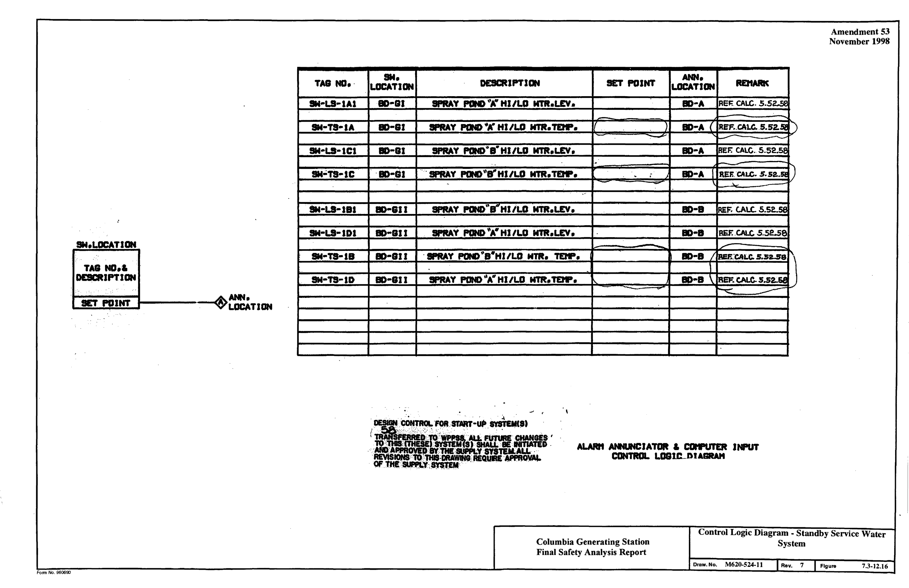

*figure on PDF page 162*

<!-- labels/text on this figure page -->
Amendment 53 November 1998 ...
ANN,
DESCRIPTION
TA& NO,· 9£T POINT REtlARK
UJCATJGN
UJCATJGN
IN•LS•lAI SPRAY PGND "A" HI /LO MTR.LEY•
. REf;. CALC. 5.5~ Bl>•SI Bl)•A
- } - SN•TS•IA r Bl>•A ( RE'F._CALC .. 5.52.5! ) 81)•81 SPRAY POND"'/( HI/LG NTR.TEJP.
- "--
- SW-LS•ICI ID-81 BD•A BEF. CALC. 5.52.Sf SPRAY PQND·a·Hr/LO MTR.LEV.
.
., BEF.. 'CA.LC. S • .Sa.SE ) - ·BD•BI
BD•A I 8N.;TS•IC ••• SPRAY PGND''B"HI/LO NTR.TEtPe
;
-
- ..
~ \ le . ..
~
BD.;81 i
BD-8 REF, c.ALC. 5.52..SS
SPRAY PGND''ll"HI/LO MTR.LEV.
SN•LS•l·BI :
SN•Ul•IDI ID•Sll Sf'RA.Y POND •1.11 HJ /LO NTRaLEV • 11)•8 BEi:.: .CALC. 5.52.58
-
SN.LOCATION
ID•B I AEE--«~ALC. s;sasa ', ~
·SPRAY PDtt>"B"HI/LD MTR. TEl'Pa
SN•TS•IB
ID•CHJ
TA& ND,&
DE$'RIPTIDN
BD•B \ 8EF. c.ALC. 5.5~&! SN•TS•IO
BD•GIJ !PRAY POND ''A" HI/LD. N'l'ReTEPP•
' ~ -----
- ...
~ .. ;.- ANN•
SET PDINT
~
LOCATION
ALARtt AtNJNCIATOR & CDt1PUTER INPUT
CONTROL LOSULDIAGRAH
Control Logic Diagram - Standby Service Water Columbia Generating Station System Final Safety Analysis Report I Rev. 7 I Figure M620-524-11 Draw. No.
7.3-12.16 Form No. 960600

<!-- p.163 -->
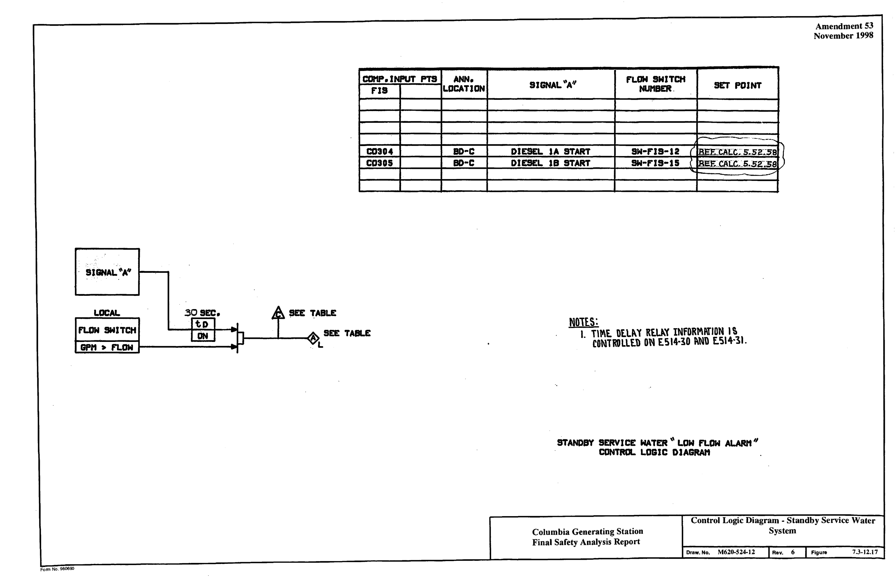

*figure on PDF page 163*

<!-- labels/text on this figure page -->
Amendment 53 November 1998
fLOW SWITCH
C011P. INPUT PTS ANN.
SIGNAL 9A'1
SET POINT
LOCATION
NUMBER.
f"JS
-..-._,_,.-··--------..... r..
,,
BD .. C DIESEL IA START sw-r1s-12 tt1=.r...:c1n:.~~-s.s2-.~se
CDt04
BD·C DIESEL lB START SW•fl9•15 BEEJ::A.lc..:.s.s2-.:ss CD305
...
./
-. ' . • •
siGNAL f4A" .
..
LOCAL
i~ - .30 SEC.
TABLE
N01t.S: to
-
f'LDW SWITCH
- n I T\tt\E. Dllf\ l RE.U.Y INFORMI\TION 11
SEE TABLE
. ON
- u
• CONTROllt\l ON E.514·3.0 l\~'O E.Sl4·ll. ~ L
GPM • F'LOW
-
·,
STANDBY SERVICE WATER'' LON F'LOW ALAM''
CONTROL LOGIC DIAGRAM
Control Logic Diagram - Standby Service Water System Columbia Generating Station Final Safety Analysis Report M620-524-12 l Rev. 6 I Figure 7.3-12.17 Draw. No.
Fom> No. 960600

<!-- p.164 -->
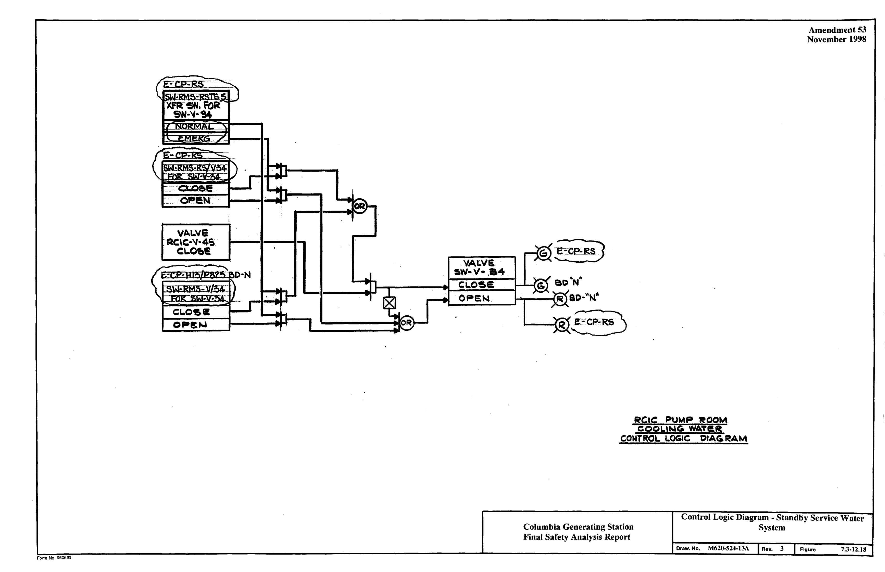

*figure on PDF page 164*

<!-- labels/text on this figure page -->
Amendment 53 November 1998
····-""'"'"·"'e..e .
·-- . ~--'- - .• ~~ :·OPEN"~ ·•
.VAtVE. •
SW•"t/•.84.
Cl.0$6
~cu: PUMP ROOM
COOLING WlTe.flt C0MTROL LOGIC OIAG. leA.M
Control Logic Diagram - Standby Service Water Columbia Generating Station System Final Safety Analysis Report Draw. No. M620-524-13A Rev. 3 Figure 7.3-12.18 Fo nn No. 960600

<!-- p.165 -->
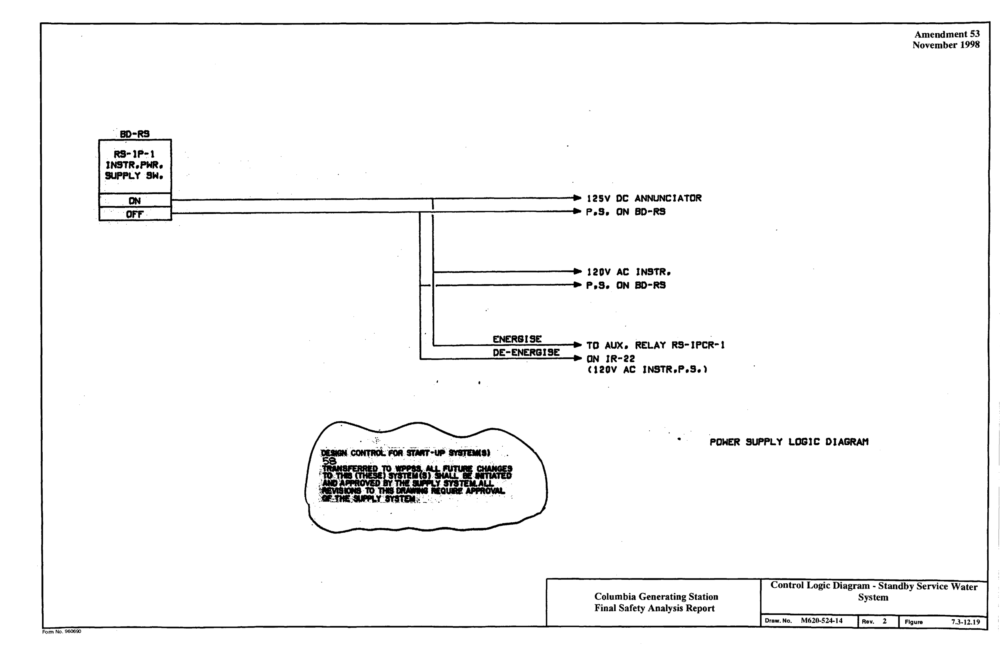

*figure on PDF page 165*

<!-- labels/text on this figure page -->
Amendment 53 November 1998
. R9•1P·t
tNSTR.PWR.
SUPPLY SW.
-----
125V DC ANNUNCIATOR
~ ON I L .
P.S. ON SD•RS . -.,
Off' I ..
. ._
-
120V AC INSTR.
-.- P.S. ON BD-RS
ENE:RSJSE: --- T 0 AUX. RELAY RS-lPCR-1
.
DE:-ENERGISE: -
._ ON JR-22
<120V AC INSTR.PeS•l
. .
POWER SUPPLY LOGlC DIAGRAtt
Control Logic 0 • aagram - Standb Se • Sys tern rvice Water y Columbia G • F. l S eneratmg Station ma afety A na ys1s Report 1 • M620-524-14 2 Draw.No.
Rev. Figure 7.3-12.19 Form No. 960600

<!-- p.166 -->
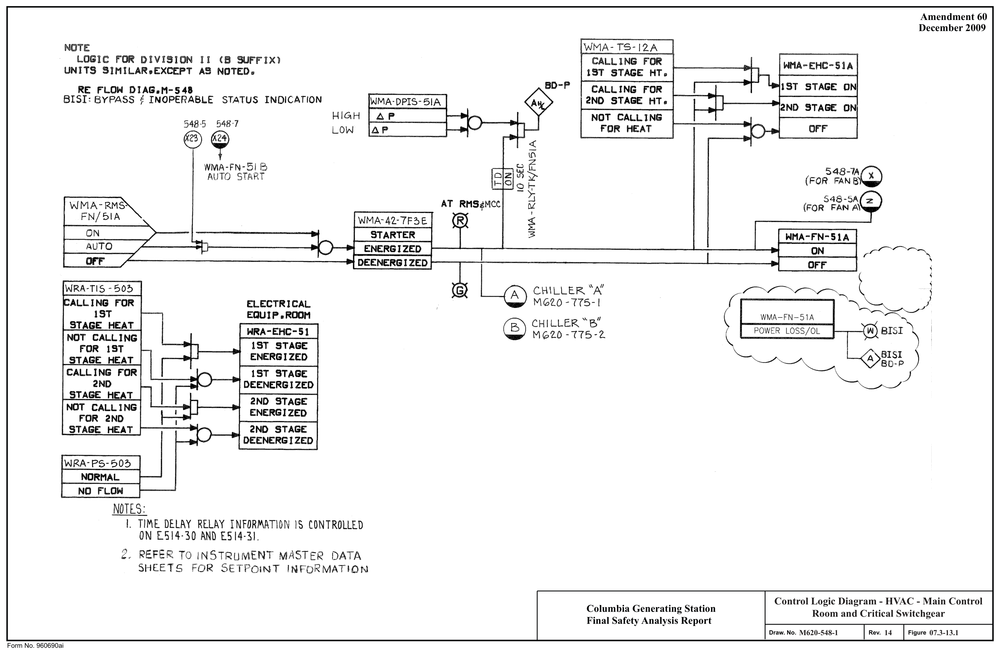

*figure on PDF page 166*

<!-- labels/text on this figure page -->
Amendment 60 December 2009 WMA-TS-l2A NOTE LOGIC FOR DIVISION II CB surFIX)
CALLING F"OR
WMA-E:HC-SlA
UNITS SJMILAR,EXCEPT AS NOTED.
1ST STAGE HT.
1ST STAGE ON
CALLING FOR RE FLOW DIAG.M-541
BISI: BYPASS 1 INOPERABLE STATUS INDICATION
2ND STAGE HT.
WMA·DPIS-51A 2ND STAGE ON Hl~H A. P
NOT CALLING ------ .___ ____
548·5 548 ·7 F"OR HEAT
OF'F LOW
A.P _,, 23'
WMA-FN-51 B
548-?A(';\
(FOR FAN B1\w' AUTO START 548-5A z
(FOR FAN A~
Lh\..BISI ~8D- P
WRA-PS-50~
NORMAL
NO FLOW
NOTlS:
I. TIME. DELAY RE.Lti.Y INFORMATION 15 CONTROLLED ON [Sl4·30 AND £.514·31.
2, REFER TO INSTRUMENT MASTER DATA SHEETS FOR SETPOiNT INFDRMATIOt-J
Control Logic Diagram - HVAC - Main Control Columbia Generating Station Room and Critical Switchgear Final Safety Analysis Report M620-548-1 14 07.3-13.1 Draw. No. Rev. Figure Form No. 960690ai

<!-- p.167 -->
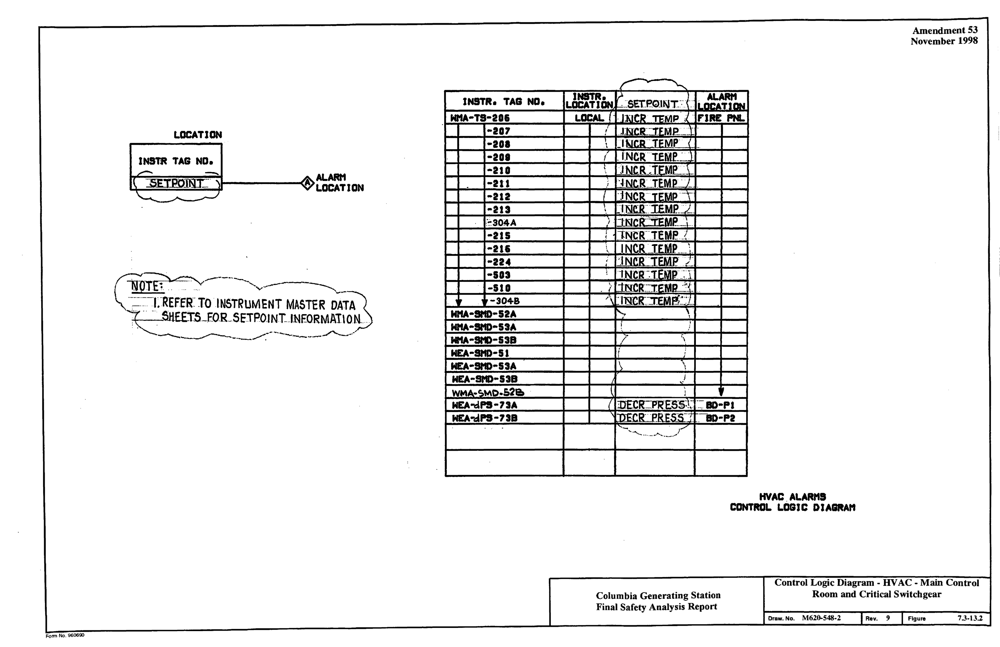

*figure on PDF page 167*

<!-- labels/text on this figure page -->
Amendment 53 November 1998
-... ""' r -
INSTR. i),
_ . ALARtl
INSTR. TAG ND.
-·sET·esl.lN_T ____ 1 -· I flf!.&TlflN
LOCATION
-~··-.... ·--· ..
~' LOCAL ( -IXIC~ TI;:fl'IP ' ··r1RE PNL
wttA•TS•20&
_ _.rKrr111·=rr ME •• -~ • • •207
f LOCATION
I ' ' JNCR 'I.EM.P''
•201
- \ I ! . I.NCR .. I.EMf.. - ]
•281
INSTR TAG ND.
f JNC_R J~F'ML I !
-210
ALARl1
-~ NC.R IEMP -,~
. -21·1 ~ LOCATION
I
I ·JNCR.TE:MP-t -212
.. ... .IEMJ?._y_-.
~tNCR:·. '
•213
·- . ' • :.t-1Sl.Cie:f£MP. -, ~ . .
- ,~3O4A '. "-'- -·· _,, ..
' 1NtR-·Te.Me I '
•215
~ ' I NCR. • IEMP ___ :_
-211
·,.
I ·:I Nl'J). ·:raap· 2~ _
•224
,·
• lN.. CR-~l'FdP.- ·:·•·
-S03
... ' .. 1 ' .
'- l1N:CR=r·~ML:-..r -518
I . -·· _ :_L .. ,. , "\ • llSlCtr~:rEti/1 p;--;
•-3048
f':, NMA•Sf1D•52A
NMA·SND•S3A
I I } 1
'\ N1A·S111>•53B
..
WEA•SND•Sl
i ' r i \
NEA•9tlD-53A
\
NEA·srt>•53B
.... J
J I ' I I WM"-•~M0•&2& I '
( DECR=PRE55~!: --~ BD•PI NEA-dP9•73A
' 1m.cuREs.:s.-1
HEA-dP9•73B
8D•P2 ,_
• ,/
~---..... ... __ ...,.___ ____ ,./
HVAC.ALAR"S
CONTROL LOSJC D1AGJtA"
Control Logic Diagram - HV AC - Main Control Room and Critical Switch gear Columbia Generating Station Final Safety Analysis Report M620-548-2 9 Draw. No. Rev. Figure 7.3-13.2
Form No. 960600

<!-- p.168 -->
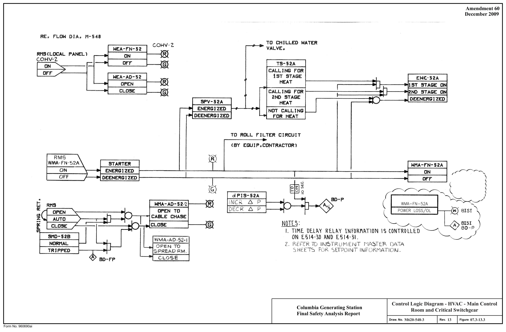

*figure on PDF page 168*

<!-- labels/text on this figure page -->
Amendment 60 December 2009
RE. fLOW DIA. M- 548
TO CHILLED WATER . -
.. - VALVE. COHV 2 WEA-F'"N-52
- RMS CLQCAL PANELl R
-- ON COH V·2 0 --0
-
- OfF -
TS-52A
G N
.......
CALLING FOR
FF / 1ST STAGE WEA-A0-52 EMC.· S2A ..
- - •'
HEAT R
- OPEN I - ::::
1ST STAGE ON
- ...J_h
-
-
CLOSE
CALLING FOR
- 2ND STAGE ON
-.
G :::: I I
I 2ND STAGE
I NOT CALLING -
- OEENERGIZED I
-
SPV-52A
HEAT :::: I .J
-
- - - - --
ENERGIZED
..... OE:E:NERGIZEO
➔ FOR HEAT
TO ROLL FILTER CIRCUIT
--
CBY EQUIP. CONTRACTOR)
~ ~ RMS
STARTER
WMA-FN·52A
WMA-FN-52A
-
- ' \
-- DEENERGIZEO ENERGIZED . ON , , ON I I OFF
OFF -
- ~ 0 °' ,--,-., uJ C {1~~ l- 0 0
d PIS-52A
•
6 P /{\IC'";
K .. WMA-AD-52-'Z ---R
~ RMS DfCR 6 - P ct:
OPEN TO
BISI
• POWER LOSS/ OL -----.,-----11111 OPEN
CABLE CHASE (.!J z ....
AUTO NO Tl~:
BISI If CLOSE r----G CLOSE 8 0 -·P I. TIME. DELf\Y RE.LI\Y lNfDRl'\f\TION IS toNTROLLE.D
SMD-52B
0 N E. 15 14-30 AND E. '5 I 4- 31.
WMA-AD-52-1
NORMAL
Z. REFER TO 11\.!.5 TRUMEI\JT i"l/.\:>TER DATA , O PEN TO
TRIPPED
5 HE.[TS FOi:{ '::iITP0lNT INFO!~MAT IOflJ .
S PREAORM.
CLOSE BD-FP
Control Logic Diagram - HVAC - Main Control Columbia Generating Station Room and Critical Switchgear Final Safety Analysis Report M620-548-3 13 07.3-13.3 Draw. No. Rev. Figure Form No. 960690ai

<!-- p.169 -->
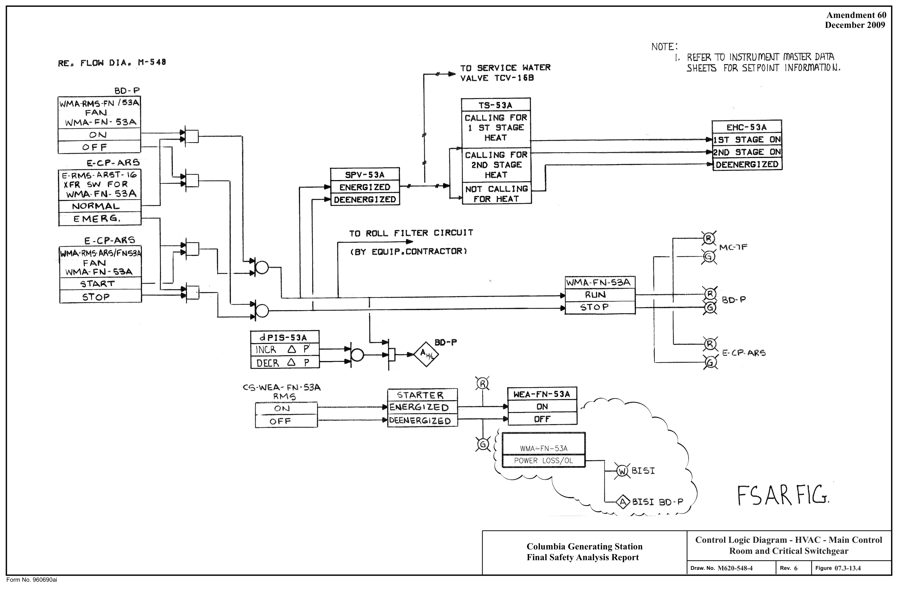

*figure on PDF page 169*

<!-- labels/text on this figure page -->
Amendment 60 December 2009
NOTE'.
I. REFER 1D INSTRUMENT ffiASlER DAlA REs fLOW DIA. M- 548
TO SERVICE WATER
SHEETS FOR SETPOltJT INFORmAllD!J.
--~ai. VALVE TCV-16B
BD- P
WMA-RM':>-FN I 53A. - l~
TS-53A
..
FA.t-J ..
CALLING fOR WMA.- J: t\l • SS A
EHC-53A
1 ST STAGE
'!'."I .. -
- 1ST STAGE ON 0 t,.J HEAT 1'
-- CALLING FOR OFF . 2ND STAGE ON . OEENERGJZEO 2ND STAGE . E· C.P- A.8.5 j HEAT E'-RM€>· A.R'ST- \to
SPV-53A
..
NOT CALLING -
. -..---1
- -
- - XFR SW FOR ENERGIZED ...,
-
--- Wt-1\A- Fl\l- SSA fOR HEAT
-+ OEENERGIZED
- NO~MAL..
~M.ESG, 1---
TO ROLL FILTER CIRCUIT
R. -
--
E-CP-AR'5
I <BY EQUIP.CONTRACTOR )
~MC"'."7 F WMA·RMS· ~f\'?/F"N'S3A _w ... FAN _[ }- -
- W"""A· t= tJ - ~~A.. - ~ .
-
•• ~ ,, WMti..-~ t,.J-S3A 'STA.~T
'........."
RUN R ..:· 5TOP ·r,
- ~~~ Bb~P I
4 E·CP- AR':, -1
..,. $TOP 6.
... , ~ _I
dPIS-53A
- ,.. ' - l.....-11, ~
INC..~ 6 p'
- P
- -
DECR 6 p - .I -
6
I
WEA-fN-53A
STARTER Rtv'\ 16
-
- E."1ERG ' Z..E D ...
...
ON
- 0 "-1
-DE.E.l-liRGIZ,6 0 Off ~( WMA=-FN-53A OF F
( POWER LOSS/OL FSA~ F\G.
- --~A~~~B~ - P
Control Logic Diagram - HVAC - Main Control Columbia Generating Station Room and Critical Switchgear Final Safety Analysis Report M620-548-4 6 07.3-13.4 Draw. No. Rev. Figure Form No. 960690ai

<!-- p.170 -->
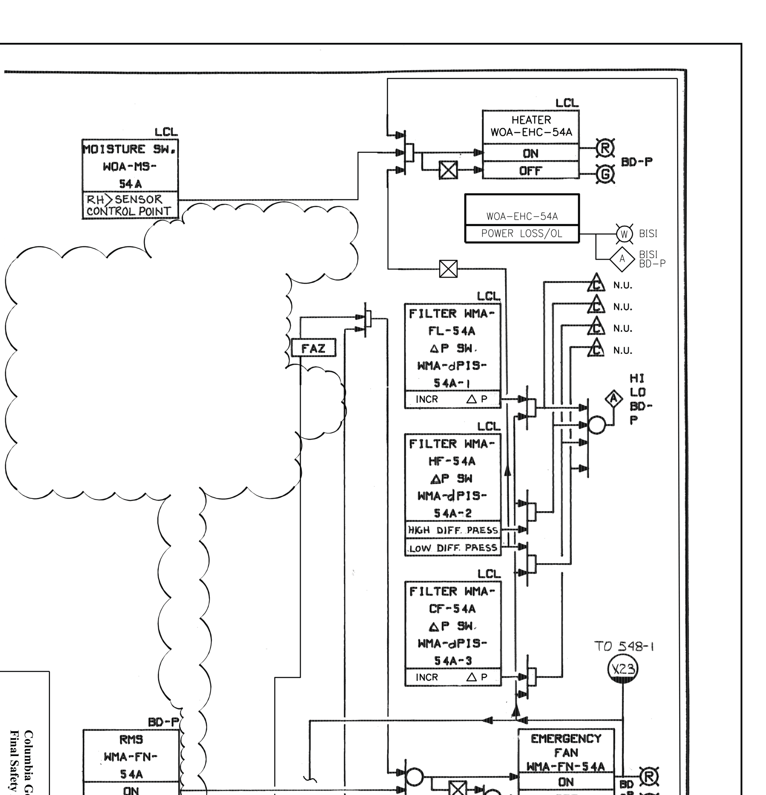

*figure on PDF page 170*

<!-- labels/text on this figure page -->
Amendment 64 December 2017
-o: ~ BD-P BD-P ..
BlSI BISI
TO 548-1 BD-P
-► ~
BO-
0~ >I-t LO
~>rri O>;:::l -trrio 0-4_ ZVlz ...., -t ;:oc rriz =a -t zVl -t -t ;:o (/) 0 ;:o (/) fTl fTl ;;o
HJ P ~(/) -rri
N.U. N.U. N.U. N.U.
;:o .
MATCH LINE-SEE SHEET 548-SA
EMERGENCY
-5 b,. p r ~ 1 ' ... .J
LCL
FAN
WOA-EHC-54A
POWER LOSS/OL
POWER LOSS/OL
WOA-EHC-54A
WMA-FN - 54A
HEATER
OFT ON
HIGH DIFF . . PAE~S , I.
LCL
LCL
.LOW DIFF. PP.E.SS
LC FILTER HMA-
FILTER WMA-
FILTER WMA-
b,. P
HMA·dPJS-
HMA-dPJS-
WMA-dPJS-
AP SH .
Cf-54A AP SH ..
Hf-54A
fL-54A
54A-3 S-4A·I J,,,P SW 54A~2 INCR !NCR
T POINT
-- 4A2
WMA-TS- 5 TEMP ABOVE SE
--,
'-'f\
r POINT 4A1
WMA- TS - 5 TE MP ABOVE SET
LCL
OlSTURE SW.
I DIV• I RESET
CONTROL POI NT
R.H2SEN50R
HMA-fN- WOA-MS-
AUTO
54A Of"F
54A ON
I
Control Logic Diagram - HVAC - Main Control Columbia Generating Station Room and Critical Switchgear Final Safety Analysis Report M620-548-5 19 7.3-13.5 Draw. No. Rev. Figure Form No. 960690ai

<!-- p.171 -->
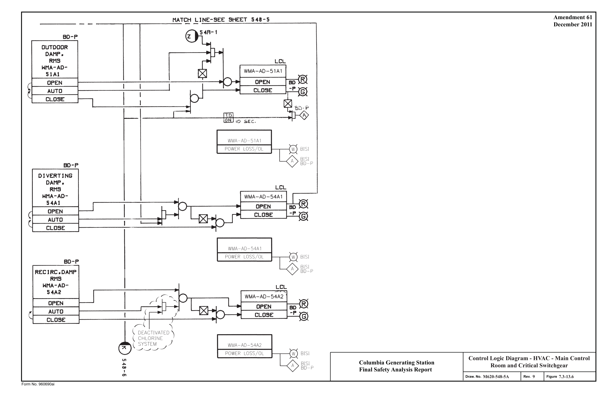

*figure on PDF page 171*

<!-- labels/text on this figure page -->
Amendment 61
MATCHl:lNE-SEE SHEET 548-5
December 2011
BD-P
OUTDOOR
DAMP.
RMS LCL
HMA-AD-
WMA-AD-51 A 1
51A1
OPEN OPEN
CLOSE
AUTO
CLOSE
T.O.
0 10 SEC,
WMA-AD 51A1
POWER LOSS/OL
BD-P
DIVERTJNG
DAMP.
LCL RMS
HMA-AD-
WMA-AD-54A 1
54A1
OPEN OPEN
CLOSE
AUTO
CLOSE
WMA- AD- 54A 1
POWER LOSS/OL
BD-P
RECJRC.DAMP
RMS
HMA-AD-
LCL
54A2
"'\ ~
WMA-AD-54A2
OPEN OPEN AUTO
CLOSE
CLOSE
.,--~ )
( DEACTlVATED \
( CHLORINE /
( SYSTEM )
WMA- AD - 54A2
_/ '----" ~ _/
POWER LOSS/OL
Control Logic Diagram - HVAC - Main Control c.n Columbia Generating Station Room and Critical Switchgear ~ Final Safety Analysis Report CD l O'I M620-548-5A 9 7.3-13.6 Draw. No. Rev. Figure Form No. 960690ai

<!-- p.172 -->
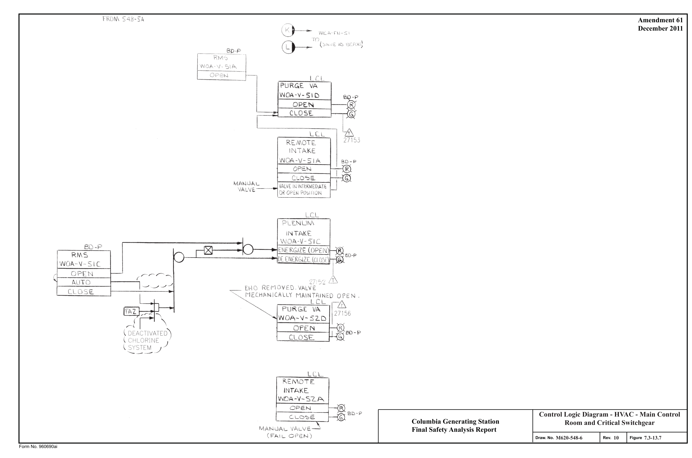

*figure on PDF page 172*

<!-- labels/text on this figure page -->
Amendment 61 December 2011
.p
L CL
PURGE VA
WOA-Y-51 D
OPEN
CLOSE
1-6 LCL 27153
REMOT E
IN1A.KE
"N OA-V-SIA BD-P I ®.
OPE.N
:@_ ~AL\/t 1N. INH:RME\7lATt J CLO~E. .
MAhlLlAL \/Al ye-- -
- '-' QR OPEN ?OSl \ION
P\_ENUN\
INTAKE
OA·"V- S-1 C BD RMS
WOA-V- SIC
OPEN
A-UTO
E.D. VALV E
!CALL'( MAINTI-\INED OPEN, LCL -ill PUR b[ VA. 27 156
WOA,-V-52..D
OFEN ,""'
( DEACTIVATE D)
CLOSE
( CHLORIN E j \ SYSTEM _,,J '-- ---- __ ___,. ·-
L !<,EMOTE
INTAKE
W1JA-V-S2/~ OPEN Control Logic Diagram - HVAC - Main Control BD·P Columbia Generating Station Room and Critical Switchgear Final Safety Analysis Report MANwA\.,.. VA,_ve. - ·
( FA IL O PE: N )
M620-548-6 10 7.3-13.7 Draw. No. Rev. Figure Form No. 960690ai

<!-- p.173 -->
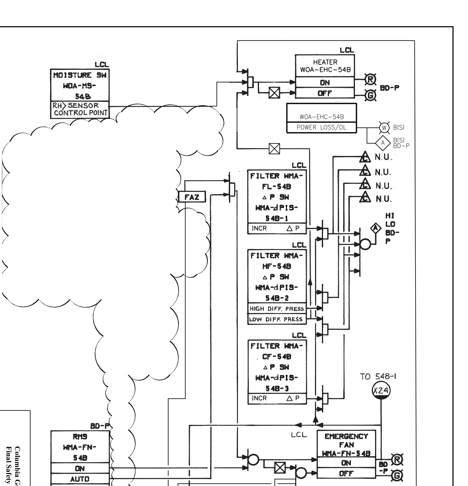

*figure on PDF page 173*

<!-- labels/text on this figure page -->
Amendment 64 December 2017
0 -I l/l z z rr, C II C 0
A ) BD - P
~ A ) BD-P BISI BISI BD-P
BO-
TO 548-1
0-t_ LO -t ~l/lz l/l ..., -t =ti -I 0~ -t -t
N,U. N,U, N.U. HI
:::0 )> rr, "'Tl-t-., )> rr, :::0 0 :::0 :::oc s::: l/l rr, z Vl )> rr, :::0 N.U. - rr, z
-Irr, 0
P
-rr, s::: l/l 0 )> I
- :::0 z 0
-
MATCH LINE-SEE OWGe5~1-7A
LCL
Orf"
WOA-EHC-548
POWER LOSS/OL
POWER LOSS/OL
WOA- EHC-54B
WMA- FN - 54B
HEATER
[Ff
ON I ~ p I . -- LCL
LCL
LCL
LCL
HIGH PJF'f. PRESS. LOv,t DI FF- P~ESS
FILTER .... A-
FILTER WMA-
f'ILTER HMA-
~ P
lil"IA-dPIS-
HtlA-dPJS-
WMA~PIS-
. CF-5-te
• HF"-548 f'L-5-18
5.fl!-3 AP 9W 548-1 AP SW AP SW
S-18-2
INCR INCR
TEMP ABOVE SET POINT
------------- - -
WMA-TS-54B2
'
I
TEMP ABOVE SET POINT I
WMA-TS-54B1
LCL
coJ-~lTKOL POINT t101STURE 9W
01v.n .RESET
80-
&l:!}.SE..NSO&
WMA-fN-
WOA-MS-
54&
AUTO 548 Off
RMS
ON
Control Logic Diagram - HVAC - Main Control > Columbia Generating Station > Room and Critical Switchgear Final Safety Analysis Report M620-548-7 19 7.3-13.8 Draw. No. Rev. Figure Form No. 960690ai

<!-- p.174 -->
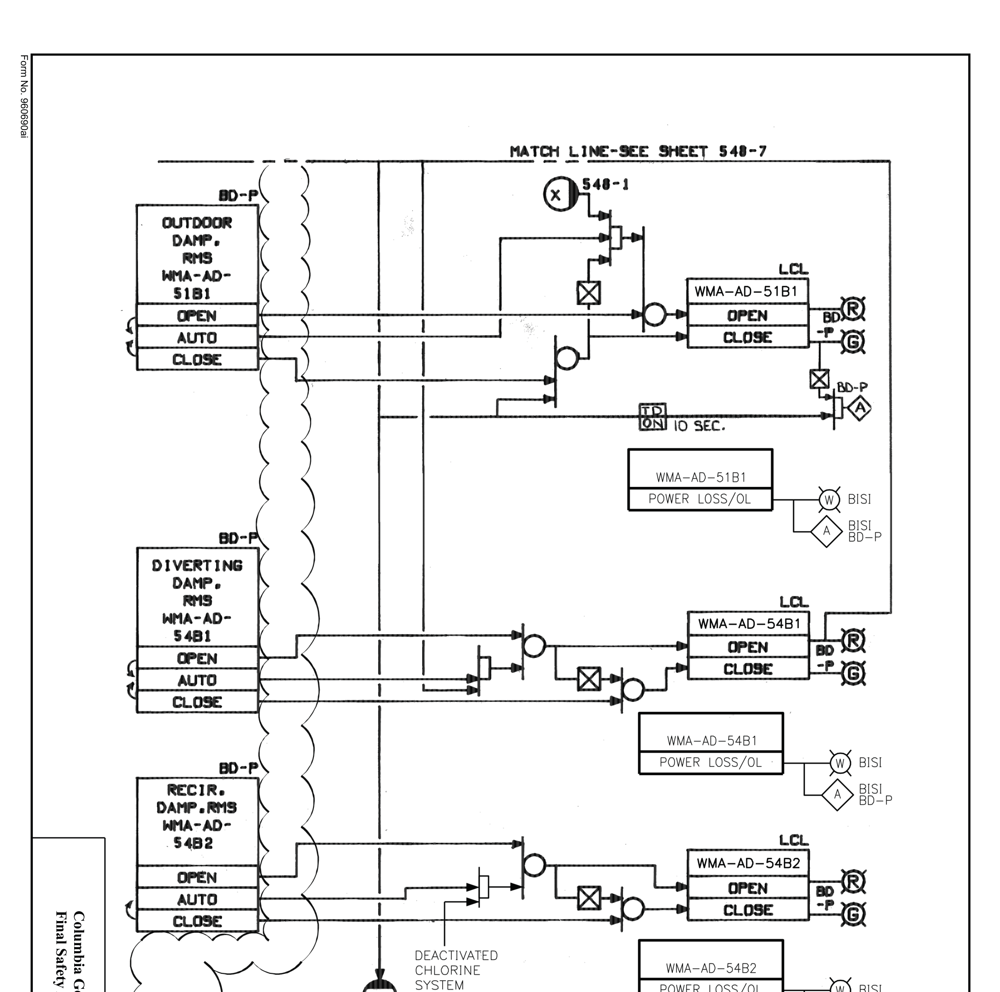

*figure on PDF page 174*

<!-- labels/text on this figure page -->
Amendment 64 December 2017
A ) BD - P
A ) ~6S~p
A ) BD- P
BISI
iz Q () -I I~ BISI
-~~
~ rr rri ► ~z
0100 o-< zrri rr1 i;
010 o:::O R>~ (/) ~ ---l rr, rr,
....
0 :::0 {J1 -< "T'1 0 z -P .... -
I BO
:::::0
I .... r
LCL
LCL
LCL
I
WMA-AD-54B2
WMA-AD-54B1
WMA-AD-51 B1
CLOSE
CLOSE
CLOSE
t1A_Tl:!:f ]:1NE-9E:£ SHEEJ 541-7
CPEN
~ OPEN
Or-EN
POWER LOSS/OL
POWER LOSS/OL
WMA-AD-54B2 WMA- AD - 54B1
POWER LOSS/OL
WMA-AD-5 1 B1
10 SEC.
--®j)---~---...
~,~-----+)--:--. ---11---- ·\~
_________
DEACTIVATED
CHLORINE
SYSTEM
UI .. -
°' I
so- DIVERTING
DAtlP.1"19
OUTDOOR
WMA-AD- WMA-AD-
IU:CJR. WNA-AD-
CLO!IE DMP. CLOSE: DANP.
CPEN AUTO
OPEN
""9 c:PEN AUTO
-s-.a2 SUII 5481
"'19
Control Logic Diagram - HVAC - Main Control Columbia Generating Station Room and Critical Switchgear Final Safety Analysis Report M620-548-7A 10 7.3-13.9 Draw. No. Rev. Figure Form No. 960690ai

<!-- p.175 -->
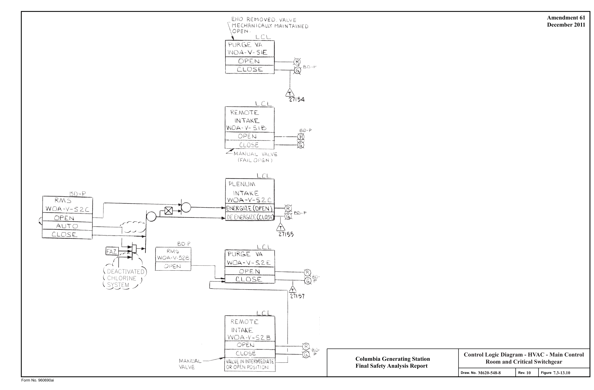

*figure on PDF page 175*

<!-- labels/text on this figure page -->
Amendment 61 EHO t'1 0 VE D . E December 2011 \~ !'1 ECHAN \CALL'\" MAIN1'Jl.,\NE'.CJ OPEN • L CL ?U\~, \/A \/\J0/4-V- SiE OP
& 7.7154 LC R[l\i\OTE_ !NTAl<E WOA~V- \b 60- P
--® OPE~
CLOSE ---G.
Mt\t--..liJ/;\I_ \/.L\L.VE
(!='Ail O N
LCL PLENUN\ p \t'll,AKE
WOA.-V-S
RIV\
---
WOA -V-S
OPEM AUT
BD I LC.L Rtv\'':, PURGsE VA ~, "
WOA-V-526
WO • -
( )
t:;;;EN
( DEACTlVATEo)
( CHLORIN E J I
( SYSTEM
---------~IA ~--_/ 11\?1
INTAKE
VVOA -V-S 2. B
OPE.W
CLOSE __ Control Logic Diagram - HVAC - Main Control ___, Columbia Generating Station t"1A~JUAL VAl'{t IN IN-l£Rt,tit.l)lA.\E Room and Critical Switchgear Final Safety Analysis Report OR OPEN \/AL vE !O~d M620-548-8 10 7.3-13.10 Draw. No. Rev. Figure Form No. 960690ai

<!-- p.176 -->
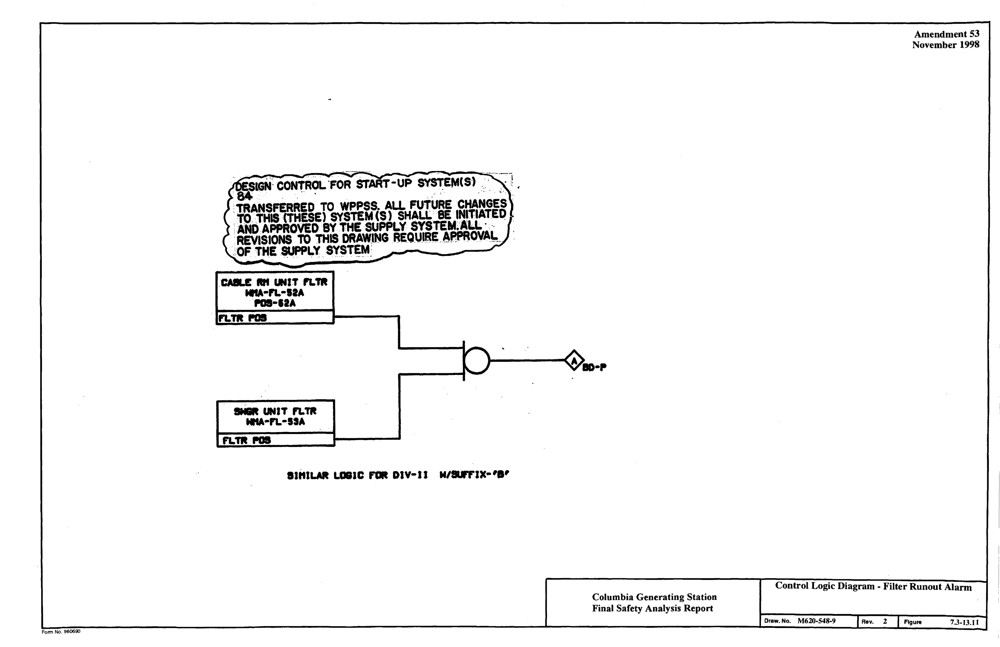

*figure on PDF page 176*

<!-- labels/text on this figure page -->
Amendment 53 November 1998
CAIL£ lltl UNIT FLTR
NflA•FL•IIA
• PDl•IIA
• f"LTII P09
Slat UNIT FLTlt
NttA•FL•SSA
f'l.111 POI
SINILAR UIIIIC File DIY•II
N/IUFFJX•'■'
Control Logic Diagram - Filter Runout Alarm Columbia Generating Station Final Safety Analysis Report Draw. No. M62<1-S48-9 2 Rev. Figure 7.3-13.11 Form No. 96069'.l

<!-- p.177 -->
OS ,~
r- M ll'l -=

.... =

C: N a ,..
~ I,,, fr.>
-0 .c = a {..?
£ s t ~ Q,I Ii ~e .~

#### "C =
-........... <Cl

!£: I:

.......

. F' "- D FIG _._ bl) = ~c! ·- s Q;I i~OTE: Cl,

#### J t"\.~
· , J. TIME OE\.AY 1\£.\.ti."<' lt..s~ORt-M.'°tot.l ·- ~ u ,,

#### El>IERGalCV ~ p 2. RE FER TO INSTRUMENT MASTER DATA . .ts t.0'-JiRO\..\..iO ow ;5,4 ·30~ E;5t'4:3I
-' ..,.
jr-' - 0l) I.
.SHEETS FOR SETPOJNT INFORMATION SH 544-'1 $H 54~·"
---c ::::: --r=:1:J 4i c::;;;;;;:)
'T \ 0 ";' I l:: = Q SIGNAL$ N GT•v•SA1 oGl·V·4A1 \Q :;;, \ 0 u

#### OPEN C.LOSE
i 1· SM·7 BUS 3i I! \

#### VOLTAGE.
)
0 NORt1\AL I DIV.! LOCAL I FAN DIV.I BD·Kl SG.T- • ' / _'-__)I ' RUtJ RMS
(, Gl•FN- ~I S10P = .., . SYS.S7ART 0 ,.

#### START
·- 00 = .. 0. 0 .5

#### CJ AUTO
BD·KI SlOP Ql)(r.> C: ·- :e ~ co 3'24 a, = OS - .,..----~'
- ei:r OlV. l LOC~I.. 7 $TARTS f< l.!l c FA~ DISCH-~P. FROlfl DIV.
X1 $GT•EHC·IM{ll.G)
$H 544·2 L..---1,-1,-_~:;--, SGT-FIS·2A2 FAZ SH.544·'l OS ~
•- OS

~I< I:::. p ·-· . -;-, ...._.__..

,Q 00 t:OPEN5 E- = ~ DIV. I BD·GI
- =
2. 5C,T•V·5A'2 u ~ . FLOWSW ';)lo{ 54 4-'=i 0 ·- SGT· F'$· I It. I X3 ~~~-i~ ~A '2 .. LOW FLDW .. i- $1-i 544-11 OlV.I BO·KI . RMS g . ON S.GT:-E'HC·IAl.
:t ·~u,c .. ' U t •~

#### :I]
#### O.FF I I .
1--.i PULL TO LOCK :. J-
• DIV. I· . LOCAL U'I\Ot,,ENTARY R B. , 11 .
SGT•EHC·IAI ':)TAAT ':iiOP ·t 71---· +-+--_j~ . _DIV.! LOCAL p q: I11~~~J ~ ·l-·cvETUEMP
-· · · -· 0.U I ...
..

rd: - HEAlER. ILOCAL &D--K2 ~T-EHC.·l"'J ~ ~ . DIV. l LOCt-.L ST~~E

#### HE.ATER CONTROL
. • I $f,1 .. EHC•lhl Sl/\GE

.... -r......rE~J;;;?-;AG=-=-E--&::J·o~N I' --~®~ - 1' 2 $l~GE N2 I

I ., '!~CR Ifrv.fP·.:•1 1 5 · _Off.mt~ ~ .. 1JJ~~}~ $. .. _.,_ _____ ...,__ ~ ~VER TEt-1\P.
STfJ.GE N23 ~~~- 'UJCR~·tfMe.. __ 1-1 -----~1--.
T -&C·0198 DIV. I BD·KI HEl\TER TEST SWITCH •

.,......-.,-............,..!:=-::.::..~N--,■--- '5Gl~EHC·IAI l-.......,.-,lf,C·Ol?J7

.J,..J_....._, r~

5T1'GE N2 l ON __ .......,-+-ef'-_,,.... l..-1::::::!!=:. .... __

o i AGE N 2 2 0 ~ t..._,,,_,J ~iti.GE·N!!S0N

M~t-.\TI\INE.O COIH1'C.i p.e.,,

I
----------------------------------------------------------------------u.. ~ g

<!-- p.178 -->
l"--f"")

.... = 1/'lO

~ ...
M ..;. - =N s ~ ,;,i c., ~ I "'l

#### = e "Cl .,Q
r--- >, = ~ <I,)
,.Q "C = ~ ! :, <o cu ooe In ii:
'l,l

a~ I ....

,_, .... ;;

fS I\ DF\G ~r/:J o,E-: -
--- ... = I Ol!C eu ~ - ~
1. TJME OELA't' RE.LA.'1 1t-1FoR.M~ilON 1$

o. ....

_c.o,n~o_LLEO ON ES14-·30 ~ E 514 • 3\,

#### r\T\ •
·- ~ CJ cu .;i -

#### EMERGENC(
Q ~ .,. .,.
~

#### SIGNALS
Q l: Ill ~ C M
2. REFER TO INSTRUMENT MASTER DATA ::;: '&I 0 u SHEETS FOR SETPOINT INF°ORMATION ~ SM-8 BU$ j

#### VOLTAGE
I!!
0 }.JORMA.L DIV]l LOCAL FA.N BD·Kt'

#### DIV.U BD-K1
Rh\$

= ....

SGT-FN· IA2.
0 ,_,

#### START
·- s ~ 0 .... c..

AUTO

## 00 CZ::
STOP = ·- OlJ"' 0
-1 --+-1---+-1----.----i~---1 ~ (AL) BD·K!
',C"' I ~~ ... cu ~ C ~ -( r., .0

## 1 IC\ C;OS'lS
~.,3:!
·- Cl$ ,.Qr,;
8- = cu OIV. U BD-G lt W 1 .FLOW SW
- C u '- 0 ·- SGT-F:i· IA.2- FROtA SH.
LOW FLOW t- 544· 1 f Ol\l.lI E>D·K 1 ti -.
-· li It: ·b...____.}]=> l Rl'I\$ I~ GT-~~~Aa ~ I r ~~,m~ut· µ 1 • 11 ~ ~ p.J .

#### DIV.U LOCAL
I :
: :

#### START
. . II I I ~ ..... '4Cjj,3-1--~-----__,-

Pr5lc.::2:J STOP

#### DIV.JI LOCA.L
#### OVER TEMP
T "- MP.
_ ET I ~ ""· iJ

.......

rCC HE~'TE.R- ·1LOCAl. BO-KI SGT·EHC•IA2 fG1 ~ *

#### OIV.11 LOCAL
#### J $TAG£
#### I HEATER CONT.
•1 :J ~ ?~E ~.t-d,i;-----a:

#### 'l)f---1~ "" i.
#### SGT-EHC-IA'2
..... sv-~E l8PF\I .1

$TA.GE •I ~ .INC' TEMP
-~ SlA.GE ~ Z
- I lNC~ TEMP .. J . c:;:;:> @ _@ OVER TEtAP. I STAGE,..! __ _ I NCR TEMP i---------,..-,

DIV.It BD-Kl C-020_2 ~

#### HEATE.R
TE~T SW1TCH

"'-+-,;;,:__--++-, ...... ,.....,._ ~

._-+--1.......-,

~C-0201 ~T-EHC·IA2

......,.i--e.~-

STAGE "I OtJ STAGE tt2 01'1 >--'------4°1-----~,,_,...,__ STAGE t :,. ON MA.IWTA.lt~ED comt.c.T P. 0.

I ~ 0 z

#### L....----------------------------------------------------------'IL

l== 0

<!-- p.179 -->
r-- !"'l lfl 0 ;..,O

.... -

"l =M "' .,,~ Q,j a.
5 ~ ~ = e C, ~ r-!
>, Q,j et Q,j ~

"0 = I!!

.s e ::,
-(Q CD ii:

00 Q,j

e~ I ;.., ... -i ,~~;rJ~=-~o.~~"'·•c~ELA'< 1KF0RM·A,.1ol't er I\· D F\G • • • ~ 00

i.. ......

·- e 1:)1)=

• 15 ·c.orn~oLlEt>=Ot-4 ~514~3ot£514;.31 ·I '::>t\r"\ • ~ Q,j a:

Q..., u =

_e; __ Rfff~TO IN:,TRtJMENT:MA5TER DATA SHEETS FO~ SETP01NT INfORMATfoN, 01) a. ·- Q,j ;:tJ ~ ~ /\.-~

~ - Of-; SH.544-7 $H. 544·7

'? ....

.... Ef~ERGEMC.Y

OPE~, l ,(.(i'2)SGT-V·SB2 @sGT·V4e2 o Q SIGtJALS ,

T

a. ~

...... =

CLO':>E 0 N ~ Q u ~ 0 z SM-8 ~LI$ t

VOLTAGE

i?
0 NORl-1\/.:.L DIV.I[ LOCAL oav.u FAN BO•KlI do-~ GT•Ft.J-182 c RU» Rtf\S ISGT·FN·IB2.
SiOP

= ......

• SYS.START Q i... • $TART

= C.

0 -.::
AUTO

...... Q,j

00 ~ = ·- 1:)1)"'

i--.izt-91 ---+:i-----:,_-...'f_7-......+-:1im1--, - ........... C0$.'27 STOP

.:: "'

a. = =~

{5g)

QJ =

DIV. I. LOCAL 1-~~--tt--"'9V'"""""I

$TARTS , = < xa SGT·E~C.•IBI ~ FAN015C~. A fl FRO!f\ DIV.I I ~ ~ ·sf:ii~FIS-2&1. fAe5H-544·4 "----, :1H. S44·4 'P - ·- = ,:s~ , .'DJ:CR ~ -·- -· - •
•~ $~+.~~ii ~---- ~,___ ~ rJ1 5- = =
- = DIV.]l BD.-Gll SH. 544·7 u ~

0 ·- '--------T CLOSE.

FLOW SW

,c.
SGT·FS·iB'2. • lQ SGT·V· ?>Bl

• ...,_~;;-)----_-_:--ii~

LOW F'"CO'tl 5H. ;,44·17 .DIV.lI BD·KII Rfh$ SGT· EHC· 152.
#### ON AUTO OFF

r

#### PULL TO LOCK

o,v.n

LOCAL

#### MOMEN'TARY P. &.

~GT·.EHC- IB2.

START

- STOP LOCAL OIV. lI f _ ~ I 01/ER TEMP • :· . cu~ .. ou,:. ••• :
' .I HIGH TEMP •.. 1-1-

P,E SET

II

l) ~ 111

'I I ..., rCC ILOCA\. B~·Kll HEA.iER SGT·EHC·IB2 ~ © orv.n

LOCAL

- HEATER CONT, SGT-EHC• lei2. - ~ $TAGE ~ti

JJNCR-_i..EMe .~1------....... -

.....

STAGE ir2 ., .lr'{CR:::.IEMe=~~i---------,---, STAGE .-3· ' c?. ~ ~ •

..... • ·r-.;~p -i-1 -----"t--1

.IN.CR J;_ 1:>'I -
--&C·O'l04 rnv.u BD·KU

HEATER

TE$T $WITCH ,$GT·EHC·IB2 ~C-O'l.0~

..--.....i,- .__.,..~-,

ST1'GE ,r I ON ~TAGE 2 ON ,__'-_-_-~;_-:_--~!'t-7i--- $TAGE • ~ O~ tf\Alf:tiAlt-lED C9NT/>..CT P-B.

0 !
._ ________________________________________________________________________________ __.] 0)
d z

<!-- p.180 -->
t--~
1./')Q ...,0 ..; - ,., C:N "' ~ ...
5 ~ C$ "Cl .c

I "l 0 ..., ....

= s s ~ .c ~ ~ <~ "Cl I!!
Ci ::, ! 8 m ti:
=~ 1J'J ~ I .._. = -

.......

~ 1J'J ,.: ..
fr Ao F)f N.OTE: •

.... s

,. TIME oELAY RELA','·1Hf:OPiN\AT1014 ,s

CJ)= u.

~ Q,j ~ .... cc

C.OtH1\0LLEP ON ·f514-30 ~ cSl4-3r, :)t-\1'\ ,.
~ ~ 2J~f.FER TO l~STRUMENT MASTER DATA SHEETS FOR SETPOIN'T !~FORMATION.
• ... Q,j

CJ) ...

Of-4 ::Cl ~ 0 - ,., ~

......,_, -tmi E~ERGENC.Y •t~ SH. 544·3

.... = ~

SIGNAL~ Q N \Q :;
0 u ci

SM-7 BUS

z ;i VOLlAGE I!

NORMAL

0 DIV.! LOCAL F~N lll DIV. t 5D·Klr
-· .. SGT·FN·IBI ~ _ )r-e . RUN R t'/1.~
•
•

1 - '1tl

$GT·~N-1Bt t--------....1 •

SlOP

Ci ....

I =· ,-J ' SlART •

·- 0 0 - .... 0.

!

t--------....J •

~ ~ . AUTO 1J'J i:z::
STOP = ·- ..-.®----- CJ) "'
-.e "' r----t~I------~-~· _ ~ ... = ~~ --<Al BC ~ = _iffil ~< - I .:. I 1.2W c., .c
---t; c-c

....

.
e-=~ .c 1J'J ~ s - = ~ DIV.! BD·G!

8,1---t--+------'

FLOW SW

- = u ~ SC',T· FS• IBt FRO"' SH. 0 ·- LOW FLOW . • 544· ~
• OIV. l eo-Kn I. ~
• :;
~~~
-- I ~ $Gl· EMt· t~I SM
-· ON
- C ~ ~._)~t-------

AUTO -

_ OFF _,I :-1 ,i--__

L.....M

- ~- l'-)- r ________

~ I
• ~

~,9MENTARY Rfi LJ

01\!I LOC .. L ·L I :'.!13f·EMt-lBI ~LJ-1

START

I 1 S 10P = . :1• Jii5l f':

--, ~ LOCAL BD·Kll CR) ~ -1..QHJ ~ ~
-
- C::::., o,v.1 --LOC~L OVI:~ TEtJ\P
-=_-rnfi
• N -1 ~UT OUT_ HIC.M TE'.MP- _i--

..... ~~ ..... --.......

~~~~i
- -
• ~ [
-· \.'.'.II§ - ' LOCAL 81>-KD HEAiER .OIV. l ] ~ LOC~L • - SGT•EHC·IBI ]~ ~Tl~-1tT-
-. ~ ~ - •

= s;tr E ~t--,:;!;~;;....-~

- * ~ ~ ~ S~GE ,Q.N ~ ___ 5l~GE •t :.::
' 1 J.HCI< TEMP... • , _ • 2 OFF

.t • STAGE ON ST,-.GE., 2

.INCR TEMP , .. 1-------1--

•~ ~O~Ff-=---~ • ~T,\GE ~3
- . __ _. .. n ·---~ ./ ~ ~ • J NCR.. TE MP. • . • ••• 7 . }'n'( rBf OVER TEthP. •~
• 4 DIV.! BD·K1I

.._ ....... _ I l

#### C-0'200 .

HEATER

. .:-r ,
• 1

,:.tJ )'E$T SWITCH

M ~i---

l l.L-\C7

~GT• E.HC.· 1 Bl
-· I SlAGE "I Oij .-- ~ , - ~ i--- ~ '''\ C.·019'3 ,,_ - STAGE •2 ON 1---1
-.. 1 --., _J
-· .) -~ 7!'1 '
• STAGE# 3 O>J 1----1
-, I~ _, .,-

1...._ ___ ... ~,i,t,...--~

::::• 'i-----J I !'AAllllTAIIJED. cotni.cT P. B.

m ~
--------------------------------------------------------------------------rl" ~ e

<!-- p.181 -->
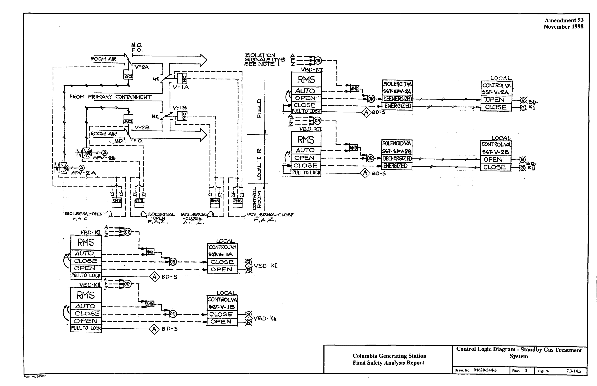

*figure on PDF page 181*

<!-- labels/text on this figure page -->
Amendment 53 November 1998
ftl.O.
F'.o.
ISOLATrON A F==9§)--7
I\ ROOfvi AIR SJGNALSnYP.1 r------------
SEE NOTE I. Z.
I V I L
LOCAL
R
SOLENOID VA
CONTROLV.
.AU --~7 S4''T•~1~V-:>A
$lief• V-'lA
_....,,....,---.,. __ f::F?OM P~IMARY CONThlNMENT
J--:r----.f'---..,,p,--e-1·--:npEN -~-----
---- 0
.___~ _ __,,,'"--_~_cLOSE ~~~ V-:te ~-""."':AI.O&.!:.JJ!...!:.!&:l'!t_-:------<A B
F==a@---,
z-vio-~n I
RMS I
LOCAt...
L
SOLENOID VA
CQ\JTRQL~
-- ~~ tk ( ( AUTO .~l-4!>~~26 ~~T-V•.2!>
- --~ DEENERGIZE01 --11~--e-----.1-ra--i OPEN: OPEN - -
ENERGIZED
CLOSE CLOSE. - - -- - -
,1:-------.. A ao~-s
LOCAL
.o::>NTro..VA
( AUTO Cit~i-\I• I A _ f~- CLOSE
CLOSE
\: CPEN OPEN Ptlt.LTO LOCKi--------<A BD-S
A-~ V D·Kll. f=.::;Jd, 1
RMS
LOCAL
I
-----~, .
CONTROLVA
~GT-V-\S -0--AUTO
OPEN -~-----~--
CLOSE
CLOSE'
~------------- OFEN PULL TO LOCI<------~~ 8D-5
Control Logic Diagram - Standby Gas Treatment Columbia Generating Station System Final Safety Analysis Report Draw. No. M620-544-5 3 7.3-14.S Rev. Figure Forni No. 960090

<!-- p.182 -->
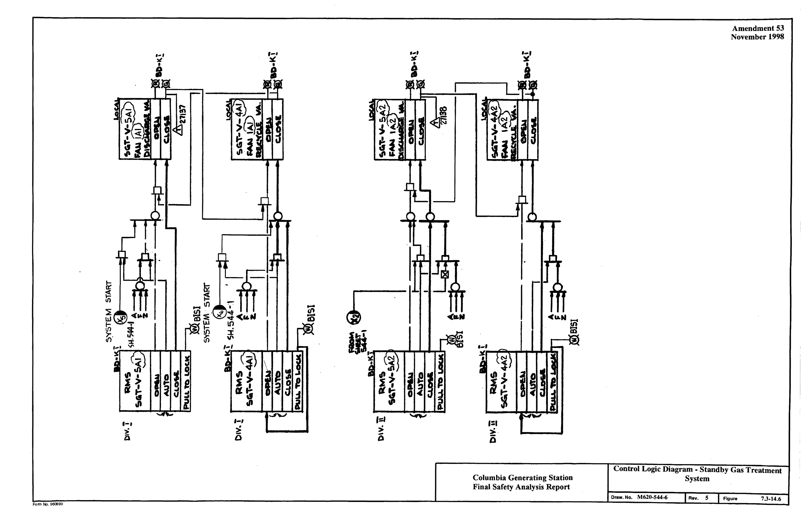

*figure on PDF page 182*

<!-- labels/text on this figure page -->
Amendment 53 November 1998
Ir &
- ~ * ~- .;f ~< ... ., ~ if)
r;; ,_. ltl !ii - I ~ <11-N cO
~aN
<u.N...,.
uJ .
w lO
• Di, lo ~ 3 m :I:
"' ·-· ~- II' ~ ~ ,~ I V' ,.
i
,t. •
-I ~-• Jt i iJ .,. ~ I e J
1fl I I 1 9
~ '
UI e "'
.I
~ s> I
i
• ' §
i i lti '
o:~
i <
~ " "' :1
0
:J
~ ~
l l
i di
JI
,_, ,-, '-ft-,, . J'\t,.J 1:1 , > - ~ - 1:1 > > a ~- D 0
ll
Control Logic Diagram - Standby Gas Treatment Columbia Generating Station System Final Safety Analysis Report Draw. No. M620-544-6 5 Rev. Figure 7.3-14.6 Fonn No, 9eal90

<!-- p.183 -->
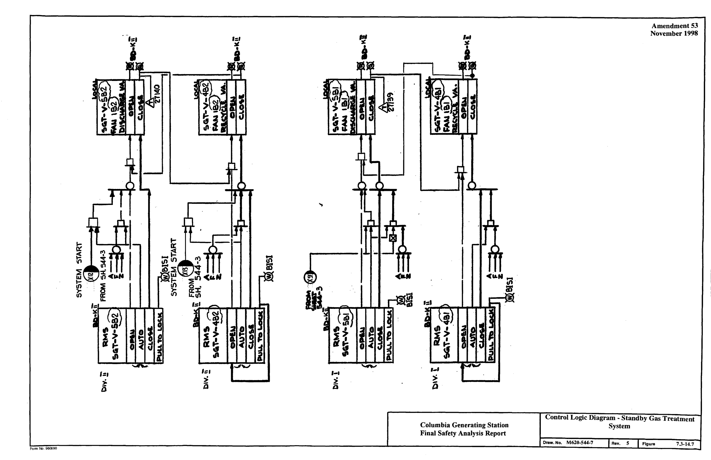

*figure on PDF page 183*

<!-- labels/text on this figure page -->
Amendment 53 November 1998
\(\ ~, :r
I-0:
'?
~ • :;; '°
to
~ rl) •
.... ,,
&3 cO ::i ""~
3 la.I - ....s- ~Ill <a..11
~ ~ Caa.N <&II :;;
• l;;
Di, IJJ
m ~·
0 ~ a::c .
I • ~ ~
m
LI:'° IL.
J I::
J
~ • :s
r e '
~
I ti
g
1 e ~ I ' 1
i
'
s> ~ a I
J: >,
J? i
. .,. ftJ '
:, 0 i i
tt I._
ti It ,-
" :S i
"
0 1
i
.( "
JI
,_,
...,....._,
,_, ~ > l:::1 l.::1 > '> ii ;.
2i
{l jj
Control Logic Diagram - Standby Gas Treatment Columbia Generating Station System Final Safety Analysis Report Draw. No. M620-544-7 Rev. S Figure 7.3-14.7 Foon No. 960590

<!-- p.184 -->
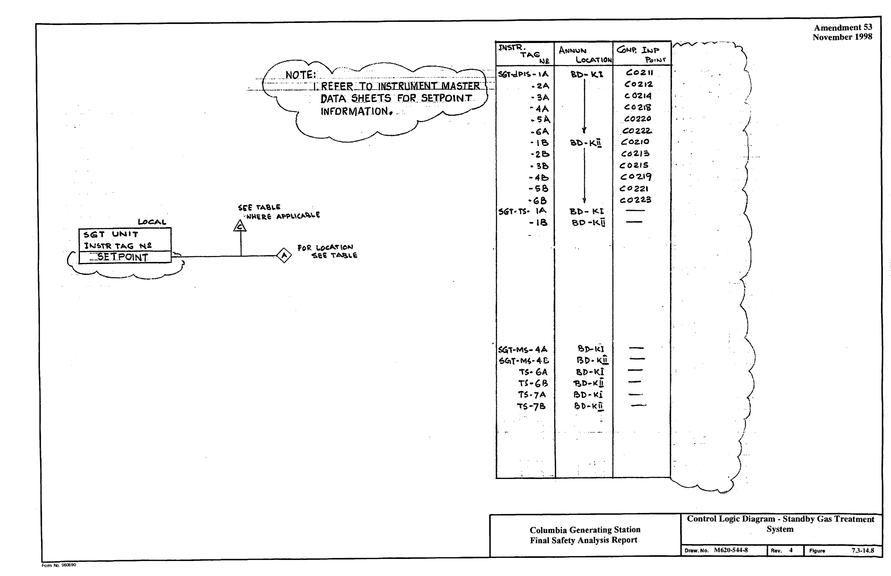

*figure on PDF page 184*

<!-- labels/text on this figure page -->
Amendment 53 November 1998 rv'V'~---~
l'~S~. TA.G ~,
~MP, .It..11=" A.NN\JN )
Loc.A1'\0N °Pott-H' ...
~c:>Z ti • SGt,:;lPIS- \A i.t>- \(. 1.
.,
•. - Co 212.
-2A
C. 0'214
·3A
/ I '--. .. 4A
('; 0 2-,~ .s:~ I t::0220
- I {.
-GA. ' _GCJ2.2.~
L ~oz.,o
• l '!> ob•K.U, ~~_2.l=>
-2.~ . ~~ { ~0215_ t: 0 '2.1(}
-4b )
c::a 22,
-SI?>
-,& c:o'2'2.S ' -
- ,E'E TAS\.E so-1<..u - SGT•TS• IA gt)- t<.t
• ... W'°'ill(; Af:>l)\.\CJ,.~\.t
- aa l.OCAL
- .
..
' .... {
\ ( )
- \ )
B t> .. l(jl - P.,J>-tit ~i-MS-4A ~t>-l<.I - .< SG)t-M,- ~-C ?.>t>..-K.[ j 1"$• 6A :
T,-,s
--
- 'TS-7A P.>D • Ki f:>1>-t<ii 1'S-7S.
~ ..
- . )
...
... .. • ·--- ·-·· - {.
~ .
lJ• . {· ..
.,
• ' .
"
Control Logic Diagram - Standby Gas Treatment System Columbia Generating Station Final Safety Analysis Report Draw. No. M620-S44-8 Rev. 4 7.3-14.8 Figure
Fo,m No. 960090

<!-- p.185 -->
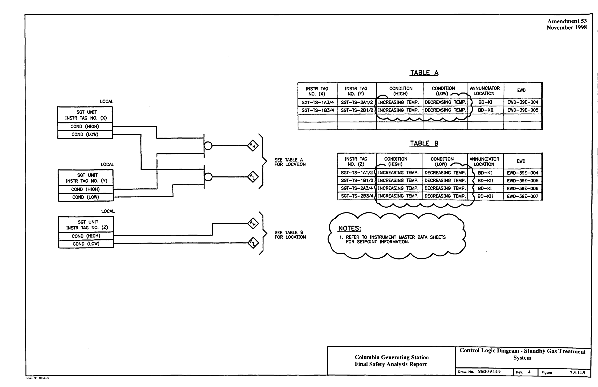

*figure on PDF page 185*

<!-- labels/text on this figure page -->
Amendment 53 November 1998
TABLE A
fNSTR TAG INSTR TAG CONDmON CONDITION ANNUNCIATOR EWD
(LOW),-...,,.- NO. (X} .,-..._ (HIGH) llllt. LOCATION
NO. (Y)
LOCAL
SGT-TS-2A 1/2 INCREASING TEMP. DECREASING TEMP. ~ BO-Kl EWD-39E-004 SGT-TS-1A3/4 SGT-TS-183/4 SGT-TS-281/2 INCREASING TEMP. DECREASING TEMP. ~ BO-KIi EWD-39E-005
SGT UNIT
.... ....
INSTR TAG NO. (X)
~ ~ .,A..~ >-J
COND (HIGH)
COND (LOW}
TABLE a
INSTR TAG CONOJTION CONDITION ANNUNCIATOR SEE TABLE A
EWD
NO. (Z) (HIGH)
(LOW) LOCATION
FOR LOCATION
LOCAL
SGT-TS-1A1/2 INCREASING TEMP.
BO-Kl EW0-39E-004
SGT UNIT
SGT-TS-181/2 INCREASING TEMP.
BO-KIi EWD-39E-005 INSTR TAG NO. (Y)
SGT-TS-2A3/4 INCREASING TEMP.
BO-Kl EW0-39E-006 COND (HIGH}
SGT-TS-283/4
BO-Kil EW0-39E-007 CONO (LOW)
LOCAL
SGT UNIT
NOTES,:
INSTR TAG NO. (Z)
SEE TABLE B
COND (HIGH)
FOR LOCATION
1. REFER TO INSTRUMENT MASTER DATA SHEETS FOR SETPOlNT INFORMATION.
COND (LOW)
Control Logic Diagram - Standby Gas Treatment Columbia Generating Station System Final Safety Analysis Report Draw. No. M620-S44-9 Rev. 4 7.3-14.9 Figure Fo nn No. 960090

<!-- p.186 -->
Amendment 53 November 1998

#### RMS
2-0• TcMP. .SWl"tCM D&\..UGIEi-~. &UI.C..T. 0£.L~Gf.

#### ·"a·,. ,,~,,
#### _VAt.Vl. "C..., •A."
-VA•' _ :---, i:,,v~
--.
~I

#### A
SC:aT~TS» -'AAI [lr.:JIMS-="SuT/)6 - F.P.;sev£S-GT/-1'L : FT~VFSGT / lG
-·-tac
- ~,-~- -ZAI

#### ·-12~-- :A
... .rt.6

#### Kl. ~<=T•~-E,AI
-- -

....... -

--
- ---13· ·s·
---1s& ·- . . . ··- - ' : / '3:(o -. - I( T' ... -- ...:. --- A

......

·-•- .
-- .
- ---~---- -f~-: -

#### e. -- 1e.;1 ·-· . _;___ - ·---- -l4G
!>&T~T~- 861 ,_,_ --·. . ~ - ··•·· -· .M,.6 .
- - ,-- -- --- -- ~~is·,, . -~-. .. ,. ·-- Jss-
---- _ ... ~ :::tsro· . S&,-.: ~-,el
--- - -
- :.K:it:

#### 9-:
--- --- ..... -·

-- ----

#### _,,_ 1,,; ;_Ki,; S& T· ,-4:., ~ 1 SI ·• -· Ir
#### a!
t-, ~:/GG ---- --~- --- W:/66
-.; __ .._:... "-· '

' • 1 ;·--·-----•-- ----·, -··· ! .• ,

#### : Lou.-
Loe.A\. '
-
- - ------ -~--- -•--- i-. -· - •

:OPEN :cL.OSE:

.
. . . '

• . •• -· --- ··- ~. -- .J.. ,- .•• : --- • --~- -- ~---

i-- ·-·- ·- •• ·--- --- :. ·-- ~. -- : . - ~-

. ........... --··-- __ • ·---•-·•·-... -------·•··.

,- - -- . --I ___ ; ____ i-·;-7- - - . - - ... ·:· - .. -- -- - . . -- - _: -- - ----•-- -·• .. JiEfE_R .. JO; . .I ~STR UMEN·T: "Ki1A5TETti
-~--~51lEEISLEOlt.-SETeo,·ar: .. --,NFO.R-MA : ' __ j_ : __ J ___ !. ;
• : - :
!
I

Control Logic Diagram - Standby Gas Treatment Columbia Generating Station System Final Safety Analysis Report Draw. No. M620-544-12 5 7.3-14.10 Rev. Figure Form No. 960690

<!-- p.187 -->
d' 3 ~ !R I NOTe. •rf JR•67 WI-IEN A NITR.OGE.N f,OTTl.E. EQflt6S ITS _CONTENTS, Tl-IE. DECREASE. IN PRESS.U.RE-::{(TUATES Tf-lE

## 20 STEP
PROG~AMME.R STEPPING-MOTOR. VIA PRESSURE SWITCHES

#### STEPPING
JMUS,C~USING,. TH.t.PROGRAMMER TOSEQUE.NC~ TOTI-IE tJM:stEe.:n-te. P.ROGRAMM.E.R-OUTPUT WILL

#### PROGIWltER
, OE.;.lNER61?i (OPE.N·SOLENOIO VALVE} A.T THIS NEW

#### CJA•PROIR•
. _ STEP.ANOWILLJ:IOl:0..-ALL:: PRE..CEOJM6 ST~P.

#### IA
OUTPUTS.0-E':EN'ER:G\'ZEDC SOCENOIO VALVES• OPEN)
UNTll.::THE..PROGRAM~E.R I.S.~E.SET SACK TO STEP·O.
All. STEPS WHIC.H HA\lE NOT~SEEN SEQUENCED WILL R.e.M"\N ~NERGflED (SOLE.NO ID VALVES ·CL05£J))
TYPICAL F"OR "E." TIM£. \)£.L.A-V "E.lAY INF0~MA-r1ON IS • ALL SDl.e ~ £51~~-Joi 1;.5-14:.-31._:.
"F"REFER TO IW!,l'RUM·E~M~ fOR

#### VALVES
~~-~~-~~~-~~~-~~~:~~-~-~----®-.,:A

#### LOCAL
"1DSHEE.T
-----

#### 911.ENDID
,,,_ t;5':>-'M BD•A -----

#### VALVE·
RMS

LOCAL _....._

XI

#### CIA•9PV•1A
#### CJA•V•39A __ ..,
#### C1A·V-39A
DEENERGJ2£ OPEN

#### OPEN(ENERGl
COPENl

AUTO .___.....

a..DSE :G(CLDSEl

#### CLOSE
CDEENERGl
-ari,,,,,

3

#### JR-71
#### a TO CJA•SPY•SA
G)BD•A 1 •

#### CJA•PS•31A
## 4 NOT& "A"
=cEC"REASlN6 0 :_=ege;s-SUl(E. tds ., PROlaAAfll lr1E.R 4PVAW(E,j O..at.

#### s
~UP ON S.TE.P )ll.tJAL .IF •
-A 0 .~,JP Sl<'iMAL P&RSI SiS ~lHt..
~E.£: t,JOTC: 'A' PROlalW-1.,J~tWlll NOT AD• 6 L
- ·1 VA~f. UtJfll 1Af.S1'1NAL IS (Lc;)=LltJIIT CSW\TC.H 0 INT!HU~Tf P AMP RE·AffUf P.
cl 7 1 Hf: A~flTION Or THE T &W\f:.
(LS) - CIA.· V- S"A 0 • »f~Y A,suRI:$ TttAlTHC )ltj• NAL VJIL\. '41t-liE:1'1tUfiEP

#### CLOSED
AFf£1?.. fA!H ll~EIT is AP•

## 0 • IR.fo1
Plll:b.1HEM lfTtiE PR0.t 4RAft11tt~R Al)IIA~fS TO /\ 0 01:F EU 1 'JS. fliiTRO(,f ,-.1 BPT• D-5t.~.-.--•---•-•lLf 1 IT Wilt AOVAt.i'f. AFi8 10 1tR"'30_jfCQtJ!>S.~IT,.OtJT 0

#### C.IA-PS-2'21'
lUf. l)fLAYTHtl0W l'Rl~• DE.ClEAsr··•··----

#### ll 5UllE. Slt.HAL WOULD .. l!.ER.•
StjJ.A~I) "1 it!.J7llOltRAIIMt,! 0 ourl'\:--$1 "i:-·· ·---~ ... .,.uE.
W . '-II'-.. .. Ll'_Q_~_ ., ..
12 Dff~TH/f. _ BbTTLe_ .. ~~ ··o = - CIA·PS·2.~A
-= 0 = =

#### TNCR PRE.55 ..
BD·A

= .... Cl) c:r

13 ;, = 0

#### STEPPING PRDGRAtttER
~~ >g

#### HDTOR DRIVE
14 = fl)

#### POWER SUPPLY
0 e:.. ;J ~ - ~ ::-. -· = l\lOTe•• _e;• 15

#### n I • To C.1/lrt,,. •SW••~ A. loll (1Q
~r.n 0 uce TKE ST~P S\41J"L ~ ~1£1), Ttl~ "C = Xl5' TO S\-\EET 554>·5A => e.
:s. g P«04RAMti1f-t SEALS ILi ANO ADVNJC~ "(TYP. X2-X14)
iOiHI: Mtxf in, BifOtU:. TtiE. LOS~ Or .,.30_jE(O._.O~ lll-'\i. ,HA.Y SlGM~L IH • 'U.RRtlPi~ 'mt ~T~P Stl;NAL.
~ , C ii!

CIA•PROQ • ,A TERM [BJ a· ~ == :, I ~ oTA.Nl)BY PO~TION ~ J A)
~r'.l ~TE"c•· ~o th = .., ~ 0

#### AF\"ER 8'C.H USE OF PROGfW.AMER
S' g, = 0 -· ~

#### l+lO 80TTLeS,RE~ PROG~MMER
i :c a (J'Q

#### 'TO 'ZERO,AN) ~S4S R£45ET BUTTON
• = ~ f'-1 (J'Q -..,

#### A.T REMOTE Mt 80TTLE CST._TION # IA,
... -· t'D -·
(,II ... C, = = !! = a a ~ A) UI C ;
;J;i,, e I - I fll >a ~ - ;-J
-~ I.H > :i. a "C Q..
:;· ~ :s

#### c= - g~
<!-- p.188 -->
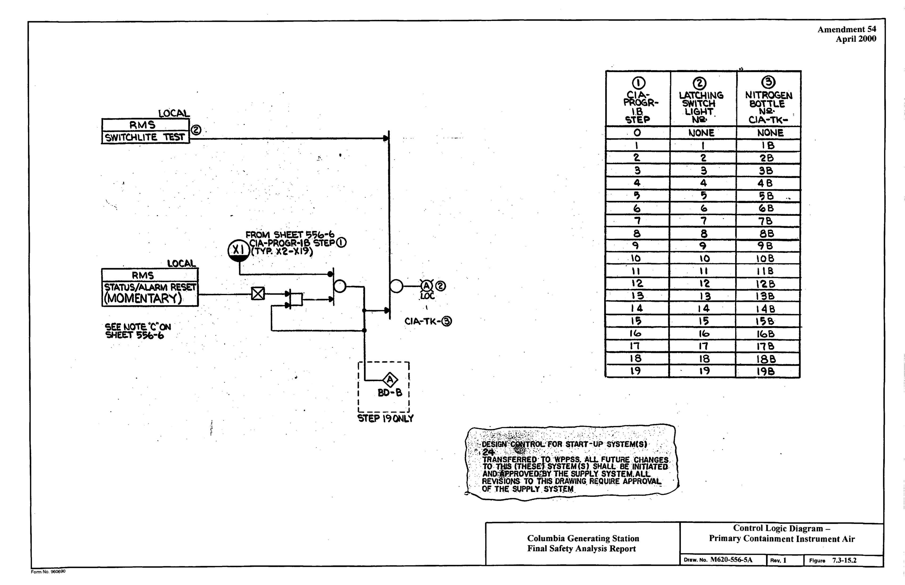

*figure on PDF page 188*

<!-- labels/text on this figure page -->
Amendment 54 April 2000
© @ @
A-
NITROGEN LATt.H\NG
~
OGR- SW\'TCH 80'Til.E
. Ll6MT N2• . \.S
NQ• • C!>1EP Cl~-TI<-
RM4:» . @ .o NONE tJONE SWliCHLITE 'TEST •• I \ IS t ' 'ZB 2 a s 3B 4 48 4
•. I ' c;s
-~ E> , ~ \ ..
~B
-, ~ 7B e ea 8 q 9B ~ . \0 \0 \OB ·~ , "
• LOCAL \I I\ 8 ,i \'2f} ''2.
1'3~ '!> 14 l4B 14 ,c;
,; ,c;e- Cl~-TK-@ l<o lb ·~ l<oB 1, 11 11B r -----, 18 18 18B
- l9 I~& l .1 __ 'fi.
I I
80•6 I
I I I L _____ J ~i£P \90NLV
Control Logic Diagram - Columbia Generating Station Primary Containment Instrument Air Final Safety Analysis Report Rev. 1 Draw. No. M620-556-5A 7.3-15.2 Figure
Form No. 960690

<!-- p.189 -->
J' 3 z !> ~ 8

·NOTE. •·011 ____ _:_:~----~-~--= ~: __ __ -~-_:_ - ·- ·---- ·----

. • .
-. . •• :·;-· ·_· WMlR A NITROG.EhlhODlE... .£MPT1£S .lts. - CONTENT'S~ THl OECREASEJ~lPRESSU.R6..AClUATES 28 STEP :nu: PR0(,RAtJIMER .Sf.EP_f.lN<:t __ M.QT_0fl_Vl1' PRESS\JRE. ••

#### STEPPING
#### SWITCMES1TMUS. CAUSING TME._ PROGRAMM~~ TO-~~ _ PRDGIWltER
-~E.QU£~CEil'O THE. NE.'AT ST&P. TME. PROGRAMMeR
-outPDU~aGJZUOf£M30lIROlll.YALVE.) Al llllS • • - ,ci~ .. -;:-- :NEW~~~:~~~~ILL_MO.Llr.Al:CJ~R~E.~1~.6 _ST£P_ __ _ __ pum:rrs DE.~_e;lEftG\'ZED.(S.Ol.iNOlO.VAl.VE-OPEM)
. UNT.IL:JblE:PROGRAMMER--rs·'"RESEt~BACI( TO sre.p•o•:~ALL~$TtPS :.WbllCH \{A..'IE~Ol"l,£EM. SEQUE.tJCEO
-~-WlLC.-R£MAlt-f~ER.6I?EO. {SOLa.sOIO vAL"IE-,CLOSED).

#### TYPICAL FOR
--~·E~ TIME ·oe.LA'l·-·«e\.:~~ lttfOP-M1'i&-ON IS -

#### ALL SOL.
#### ~t.L~-~~-~;!~~+_;..!Qj;~~~-~J~~,,bv.,
VALV£9 ~~E~;:;1;~~;;!"~~~~-~a:~J
---·

#### LOCAL
'TOSH££·

#### IGLENOID BD-8
#### '51$(,•6~ w
--..
VALVE Rt19

#### LOCAL
#### CIA•9PV•IB
#### CIA•V .. 391!1
#### CJA•V•318
#### DEENER&IZE
DPENC£NER8)
OPEN

#### COPEN)
CLD9£ .
AUTO 1£R8CCL09El Cl.GS£ CDEENERGl

#### 111•74
#### GJBD·B
#### a TD CJA•SPY•l8
## 1 • CJA•P9•318
4 nECRcASINIA:
tJOTE'a,• 0 =:PRESS.URE

#### s
_ l!&Q6gAMfifE RA.OVAM(.eS. <>ME: ..
BD-8

#### td9 r
0 ~iif.O.M 'S'.l'&P S(4N.~L • .IF- S.tlP SIGNAL PtlUtSlS~ 1H!.
I
(L5): LIMIT SW \'l'CH PROC1Rl\ti11V1ER. Will NOT AQ • 0 VA,N(l UWTIL THE.Sttil\"'I.. t~ UX#>t.

## 7 IMTfRRLIPTi1> ANO ~PPltSl,).
CIA.•V-~98 0 • THlAOOIT/0~ Of THl llM!
CLO~ED (Lfi)
l)~tA'(ASSUREs THAT THiSl4• NAL WILi. 8t. lNTA:RIWPT~I)
tB.-"8 0 AFTER EA(M llMc-1US AP•

#### ECREASIN& PRESS. -
CIA· P.S- • 21""' • I Pllf:O.THE"1 l~TMl PRO• 0 l,RAMMeR Al>'IA"ICE.-$ Tb A f>f:Ff,TIVf. tJlf~ft.# ~TlR-&8

#### 10
Tlf, IT WJLLAWAtJCf. Af- ~u CIA·PS:.~t8 0 'TER,~'3OjE(<>N0S. WITllo&.tT TUc:. DElAY ii-Ii LOW 'PRf.-:,- Nt.>1£:!'&" D£.CREASIN5 ...

#### 11
~~ e. = SURE $14MAl WOULO Pela• -· 0 0 = - SIST AMD TUE. PROliAAMHLlt oo= ~ s:
- 12 WOULu 'StlCt< ON 1 J.lf. P&. • ;, ~ CIA· PS· 2.?>B

#### 0
Fft.Tl\/e. SOTTL~.
ffi.[CB~RE55 •. ~~ >~ 13 = ~ a ;a 0 ~ - ""' -·
-· = '-< -

#### STEPPINS PRGSIWl1ER
14

#### ttDTDlt DRIVE
""' IJQ

## 0 TO( SHEET ~b-6A
NP.xt-x,, ~ 00

#### POWER·~Y•
"O e e. i:,:i

#### IS
~ ~g
-~ore.:" 1511 0 II ONC.e lli~.STEP ,Sf~IJAL ,, APPLlfOt n,e._ -·

#### • TO CIA~9PV•11B a
## 1 Pt.Qf1&AldmfC StALS ltJ AIJO A!)VAUCc~
'TO THI:. Ml:J T STEP &EFORf TNa_ LOSS .OF.THI:.
17 .,..SO jfCQNl_l1"1i D.Et-A'( ~•.G.l~I\ t.
o 1

#### TO CJA-SPV-178 1
i II.ITftlWPfS T••~-. ,ree_l.~N~&. •-.
:E z 11 o 1 TO CIA•SPV-118 ?
1 .., ~ ~ 19 §' = ~

#### TO CIA-SPY- I ••
~

#### I ~n 0 I
~ Ir' o a n0 ~ I STANDBY POSITION c:l'I = "'I
-= = - NOiE \\c" -· ~ = 0 i
-o --· 9 IJQ AFTER ~M USE QI: PROG~Mi~ ~ -· :c ... = ~ ltN0 eortLE-S,REt.x.T PRo&R~MER t.11 iO 'ZERO,AtJD PRl:.C:.5 RESET 8\JTTON = s:c A.T REMOTE N2 60TTLE 4:)1'~Tl0N •11~,-

.... .., Cll IJQ .., =

"II = a IQ > e C ; = - ~ I I - >a -.,I ~ >
-· "Cl Q.. ::i. e !'l .., =- ~
- ft N= ~ '.t!

<!-- p.190 -->
Amendment 54 April 2000

@ (D @

#### A- LA1'CHING MITROGEN
~ OGR- BOTTLE SW\1'CH ,s

#### NSil• LOCAL LIGMT
tao ~'TEP CJ~-TI<- ~W\TCHUTE iE~ ~~---------------1:• ~ONE ijQNE 0 I IB I z ?.
'2.6 3 38 4 , 3 48 4 r;
,B '=, , '-;
~B 1B a e 86 q qs q \CB \0 \Q ' ' LOCAL " ,,
• -.
1\B ,2 -.. J- \ '2.B STI\TUS/Al.AR~ RE'x.i ~@
-• J
(MOMENTA.R'()
1·3 \3 l~S .. I

~----4 ....

I 14
- 14 14 B I ,a;~ p;
I'S C..IA.-TK-@ I lo lb lfoB Ii 11 118 I r -----7 18B 18 18
-- 1<3B 19 I<)
~ l I I l~I , 80-S 1 I I L ______ J ~TEP \~CH. 'f

.....

DESIGN CONTROL FOR START-UP 3"fSfEM(S)
i

{ f~NSFERRED TO WPPSS. AU. FUTl.1nE CHANGES TO nus (THESE) SYSTEM (S) SHALL BE lNITIATED \ ANO APPROVED SY ntE SUPPLY SYSTEM. ALL 1 I REVISIONS TO THIS ORAWlHG REQUiP.E APPROVAL l OF THE StJPPLY SYSTEM

Control Logic Diagram - Columbia Generating Station Primary Containment Instrument Air Final Safety Analysis Report I Rev. l Draw. No. M620-556-6A 7 .3-15.4 Figure Form No. 960690

<!-- p.191 -->
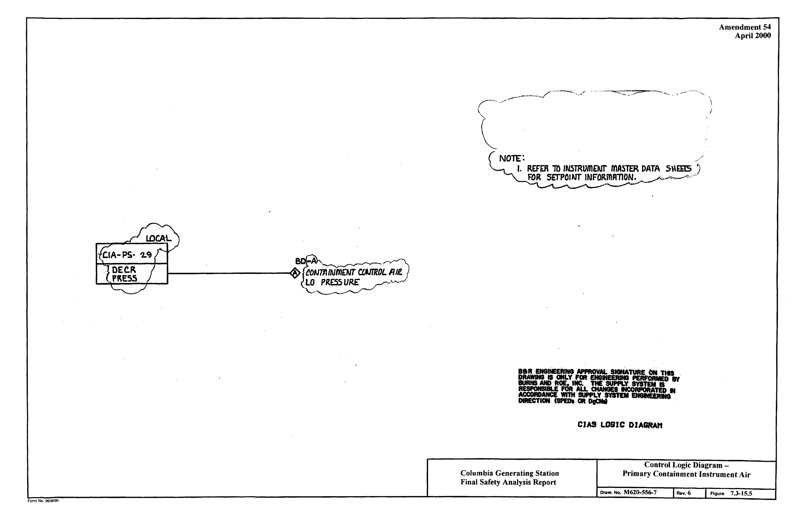

*figure on PDF page 191*

<!-- labels/text on this figure page -->
Amendment 54 April 2000
-.......::._. ____ ;;:=»° ----...
._..___,_ _ 8~~~ 1-----------<P-~J;im/AlmDJT C!MR.O~ ~!~)
__,__ ~~~~
• 86ft ENIINEOING APPROVAL SIGNATURE ON- TtlS ' ' DRAWING IS ONLY FOR £N81NEERIN8 PQf.ORMED ay BURNS ANO ·R~JNC. THE SUPPLY SYSTEM IS RESPONSIBLE rUK ALL CHANGl8 • INCORPORATED It ACCOROANCE wmt SUPPLY 'SYSl'DI ENGIN£IRING DIRECTION (SPEDa CR DgCtW
CJAS LOGJC DJAGRAN
Control Logic Diagram - Columbia Generating Station Primary Containment Instrument Air Final Safety Analysis Report Draw. No. M620-556-7 Rev. 6 7.3-15,S Figure Form No. 960690

<!-- p.192 -->
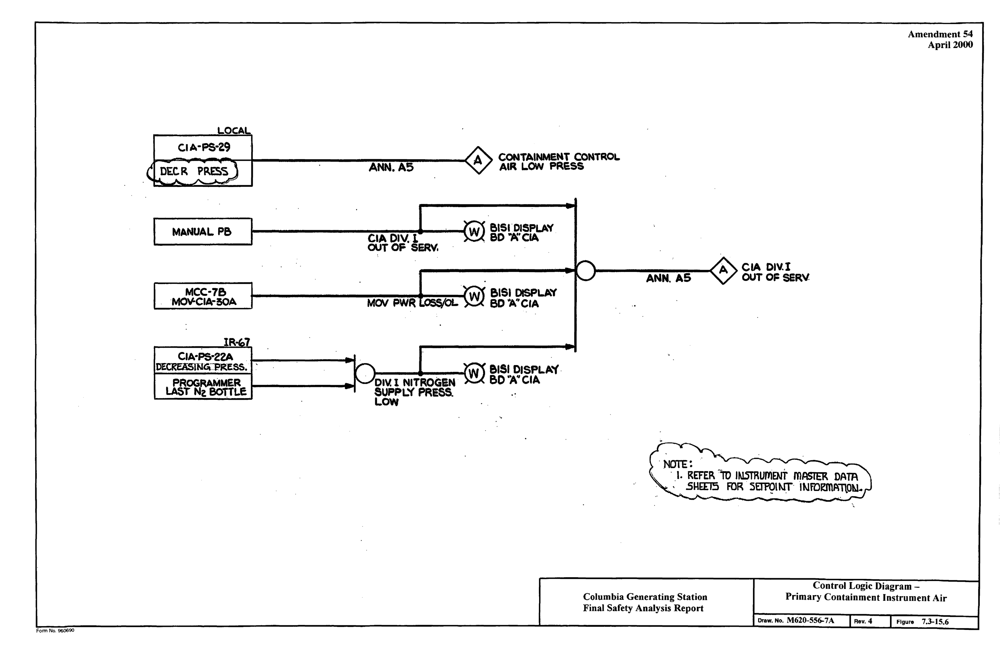

*figure on PDF page 192*

<!-- labels/text on this figure page -->
Amendment 54 April 2000
LOCAL
CONTAINMENT CONTROL
ANN.AS
AIR L.OW PRESS
MANUAL PB
CIA DIV.I
ANN.AS OUTOFSERV
8lSI DISPLAY MCC·7!1 MOVPWR. ~ BD 1'"CIA ·MC)lrCIA-!OA
CIA·PS·22A
e,s, DJSPLA1.
DEtREASrNGt.-PRE.SS. '
80 j\" Cl1' PROGRAMMER
DIV. 1 NITROGEN
LAST Nt BOTTLE
SUPPL'< PRESS.
LOW
• NOTE:
• • 1. REFER ~iD UJ.5TRUM9JT ffiASlER DATA SHEE15 FDR. SEfP9lN:r· iNfO~A1'\0tJ ..
Control Logic Diagram - Columbia Generating Station Primary Containment Instrument Air Final Safety Analysis Report Draw. No. M620-55&-7A Rev. 4 Figure 7.3-15.6 Form No. 960690

<!-- p.193 -->
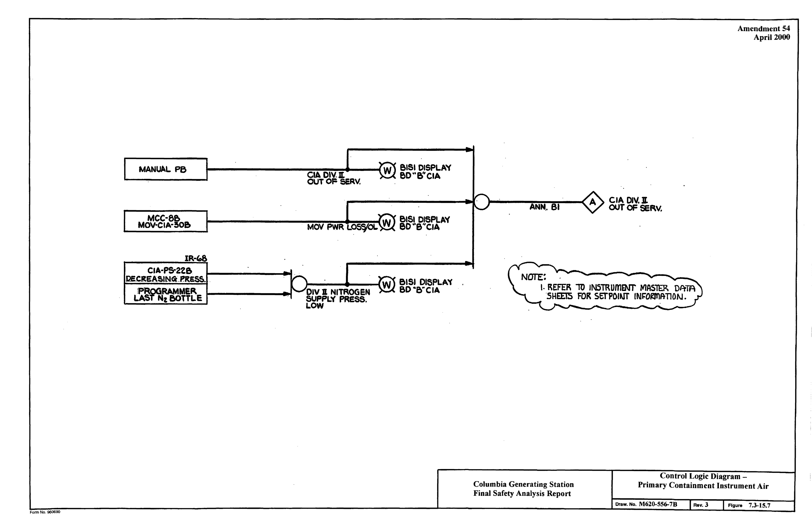

*figure on PDF page 193*

<!-- labels/text on this figure page -->
Amendment 54 April 2000
MANUAL P6
CIA DIV. lL
ANN .. 61
OUTOFSERV.
e,s, OISPLAV
MCC-8&
eo··e·'c1A MOV-CIA·?tO&
MOV PWR LOS~OL
CIA•PS-2t6
IECREA&lN<i:.P.RESS. .
e1s1 DISPLAY 7t> IN5TRUmENT l'JAS1ER a0·s .. c1A !PROGRAMMER DIV Jl NITROGEN FOR SErPOIITT f N~OIZJYll½ LAST Nz 80TTLE SUPPL"( PRESS.
LOW
Control Logic Diagram - Columbia Generating Station Primary Containment Instrument Air Final Safety Analysis Report Draw. No. M620-556-7B Rev. 3 Figure 7.3-15. 7 Fom1 No. 960690

<!-- p.194 -->
Amendment 54 April 2000

RttS & VALVE NDe "'/( ' NDeLT, REf1ARI< RtlS LOC.
CtA•V .. 20 DtV I 27100
• BD•A CIA•V•SO·A .
27101 BD•A

#### OJV 1
'27102.

#### CJA•V•308 80•8 DIV JI
: tt..o •

#### . ISOLATION
#### - VA.
SPRJNG'::,-·-··•·-----.1 ~TURN .• - · .. OPEN

1-------------:. ... ...-_ -_ ~ ..... DP~~EN::::1------IR f"OR LOCATION

.- 'NEUTRAL . .

#### - CLOSE •• 10· •·
#### SEE TABLE
I
- .__--=.::::;;;:;;.;;:;,___;--,-----,.
. CLOSE £!.J:r~~ '.

• DESIGN CONTROL •• fOR START-UP SYSTEM(Si • :
• ti!NS'fERREO TO WPPSS. ALL FUTU~E 'CHANGES t

## 11 TO THIS (THESE).SYSTEM(S) .SHAl~ BE INITIATED
•• •··i' 1 • ANO APPROVEO BY·THE S.UPPLY SYSTEM~AL. L ◄ R.EVIS·I0NS TO THIS DRAWANG REQUIRE APPROVAL.-_)
~· THE SUPPLY· .. SYSTEM_✓r----..._ _ _,,,,,,,,, _ _,,

#### CONTAINMENT 1901.ATJDN,VALVE
#### CONTROL LOGIC DJABRAH
Control Logic Diagram - Primary Containment Instrument Air Columbia Generating Station Final Safety Analysis Report I Figura 7.3-15.8 Draw. No. M620-556-8 Rev. 3 Fomi No. 960690

<!-- p.195 -->
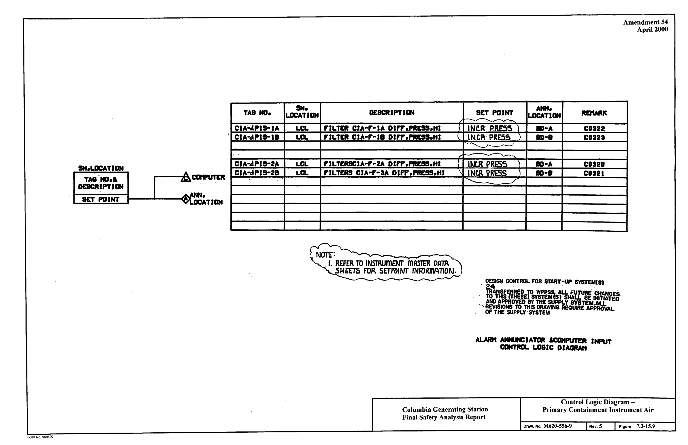

*figure on PDF page 195*

<!-- labels/text on this figure page -->
Amendment 54 April 2000
...
ANN•
DESCRIPTION
TAS NDe
SET POINT
REHARIC
LOCATION
LOCATION
,,~~--- ' INCR· PRESS P-11.TER CIA .. P"-IA DIFF" .PRESS.HI
11) .. A LCL CGll2
CIA-dPJ9 .. lA P"ILTER CIA•P" .. 18 Dl,,..PRESS.HI l tN CA· PRES!:, CJA-,:IPJS .. HI )
ID•B CGl2S .. LQ.
..,.__~
lNC.R PRESS· CIA•dPIS•IA LCL P"JLT£R9CJA•P"•2A Olf'f" .PRESS.HI BO•A C0320 $1.LGCATIDN
,...A CDtPUTER ..,.c_1_A;...;-d.P..;:;1_s_-1_a--+-___,;;;'-_CL ___ -1-,._1_L_tas ____ ciiii,ir_A_-r_-_s_A .... 0_1_,,. ___ .PRE""'"""""' __ ss ..... -" ... '--'~1 N..;.:tR:;;....,;R;;.;.R=ES=S:..-~+-=.,--• __ a __ .,._ __ c_os_1_1 __ ___.
___ TM·ND•& Ail .
/ DaCltlPTIGN SET·PDJNT
NOTE: ,..~ ~ ~ , \ I. R£FER TO INSTRUfflENT lnAS1£R~ATA.
M£f"ra RJR SETl'OINT INF0lalJATI0N.
-------- ~- - -- - ----
• ·-.~:~ CONTROL.'fOR START:-UP SYST~(SI •
• TRANSFERRED TO WPPS& ALL FUTURE CHANGE. • .•. 10· THIS.. mtESEJ SYSlEM($1 SHALL BE INITIATE,.
• ·ANO APPROVED BY THE SUPPLY-SYS'ttt.t· ALL ·
• 'REVISIONS. TO THIS DRAWING REQUIRE APPROVAL
• OF TH£ SUPPLYiSYSTEM
ALARtt AAMJNCIATGR &CONPUTER JtfDUT
CCJNTRaL LDBIC DIAGRAn
Control Logic Diagram - Columbia Generating Station Primary Containment Instrument Air Final Safety Analysis Report I Rev. 5 I Figure 7.3-15.9 Draw. No. M620-556-9
Form No. 960690

<!-- p.196 -->
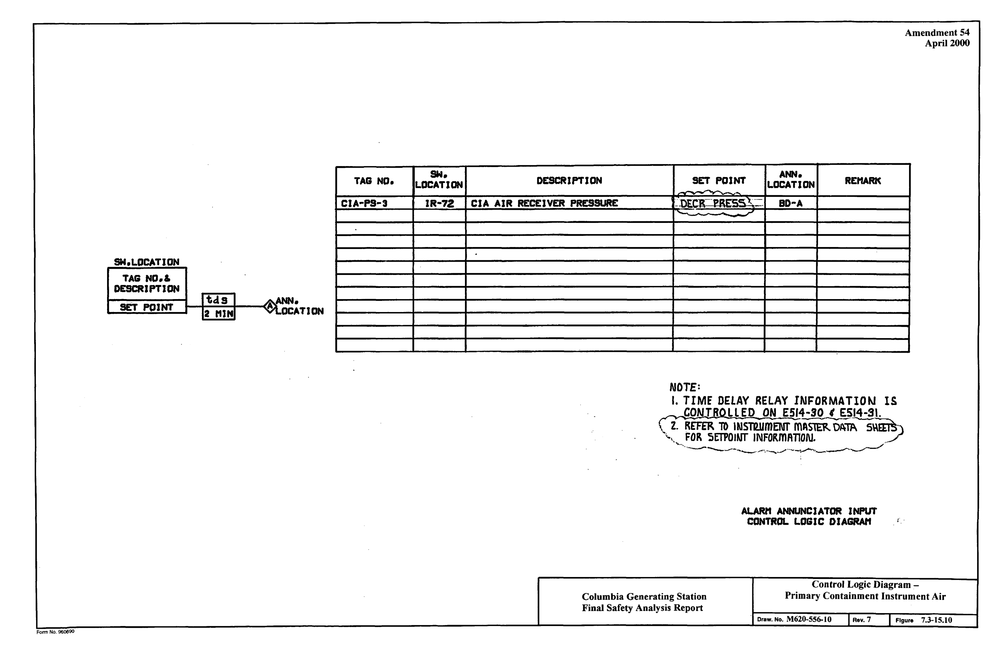

*figure on PDF page 196*

<!-- labels/text on this figure page -->
Amendment 54 April 2000
SW.
ANN•
REMARK LOCATION DESCRIPTION SET POINT LOCATION
TAG NO.
- - -
-, ----·
.....
______________ _,,_,
CIA-PS•3
CIA AIR RECEIVER PRESSURE
~l)Ec:a=.fflESS.!.= JR•7Z BD-A
1------------1-------,.;::::;..-+~-------------------~r-=-
SW.LOCATION
TAG NO.&
DESCRIPTION
tds ..._ .AMM•
SET POINT
vtocATtDN 2 tt1N
NOTE:
I. TIM£ DELAY RELAY INFORMATION IS _CON TROLL ED ON E5f4·30 t E514-3l.
-----------.--...,,,·--_,...--,. _ ~ . Z. RrFER TO INSmlJIDENT fflRS"IER OA-~ 5~ ~ -----------------, r "\.,\, FO~ SETPOltJT INFORmAnoru .
__....__.,.,.- - ........ ,_
./ •
ALARH ANNUNCJATOR INPUT
CONTROL LOGIC DIAGRAM
1
Control Logic Diagram - Primary Containment Instrument Air Columbia Generating Station Final Safety Analysis Report
I Rev. 7 I Figure 7.3-15.10
Draw. No. M620-556-IO
Fonn No. 960690

